# Interakció: a megfigyelési és a cselekvési tér kiterjesztése

**Rögzített alapmodell mellett a megfigyelési és a cselekvési interfész átszervezése vagy kiterjesztése gyakran az egyik leghatékonyabb mérnöki eszköz az Agent feladatteljesítményének javítására.** Az előző fejezetekben az Agent jellemzően megvárta, amíg a felhasználó befejezi a mondandóját, majd utánanézett a dolgoknak, eszközöket hívott, és válaszolt. Amíg azonban az eszközök eredményére várt, a felhasználó és a külső környezet tovább változott.

A felhasználó megbízza az asszisztensét, hogy foglalja át a repülőjegyét. Miközben az asszisztens az ügyfélszolgálattól érdeklődik a járatokról, a felhasználó üzen: „Még egy bőröndöt fel kell adnom.” Az ügyintéző még beszél, a képernyőn látható jegyár is változhat. Az asszisztensnek időben meg kell kérdeznie, hogy az ár tartalmazza-e a feladott poggyászt, és arra is figyelnie kell, hogy az imént kapott ajánlat érvényes-e még. Két tervezési kérdés adódik: milyen csatornákon értesülhet az asszisztens a változásokról, és mikor tud rájuk reagálni? A fejezet először az aszinkron módon érkező e-mailekkel és eszközeredményekkel foglalkozik, majd a folyamatos beszédet, a képernyő változásait és a robotok mozgásából érkező visszajelzést vizsgálja.

## A modalitás és az időzítés kiterjesztése

A **modalitás** az információ és a cselekvés formáját írja le. Az Agent olvashat szöveget, hallgathat hangot, nézheti a képernyőt és fogadhat nyomatékjeleket; kimenetként írhat szöveget, szintetizálhat beszédet, kattinthat a felületen vagy ízületeket mozgathat.

Az **időzítés** arra vonatkozik, mikor érkezik meg az információ, mikor kezdődik a cselekvés, és mikor reagál a rendszer. Az információt az Agent maga is lekérdezheti, de egy külső szolgáltatás is odaküldheti; egy eszköz azonnal visszaadhatja az eredményt, de el is indíthat egy feladatot, és csak később jelezheti a befejezést. Új esemény érkezésekor a rendszernek azt is el kell döntenie, megszakítsa-e az éppen folyó munkát, és hogyan folytassa a félbeszakított feladatot.

| Dimenzió | Információszerzés és megfigyelési interfész | Cselekvés és végrehajtási interfész |
|---|---|---|
| Tartalomszervezés (2–5. fejezet) | A kontextus, a memória és a tudásbázis rendezi a döntéshez szükséges információt | Az eszközök és a kód fejezik ki a végrehajtható műveleteket |
| Modalitás (ez a fejezet) | Beszéd, képernyő, fizikai érzékelők | Beszéd, kattintás, ízületmozgás |
| Időzítés (ez a fejezet) | Aktív lekérdezés, eseményküldés, folyamatos bemenet | Köröket átívelő végrehajtás, visszavonás, kiszorítás és folytatás |

A kontextus egy adott döntéshez szükséges információt hordozza, a megfigyelési tér pedig azt írja le, milyen információt fogadhat egyáltalán a rendszer; az eszközök konkrét interfészt adnak, a cselekvési tér pedig a rendszer számára megengedett cselekvések körét írja le. Az interfészek kiterjesztésekor ezeket a köröket továbbra is korlátozza az eszközök képessége, a paraméterek, a jogosultságok és a futási környezet.

Sok eszközhívási interfész körökbe szervezi az üzeneteket: a modell hívást kezdeményez, a rendszer beilleszti az eszköz eredményét, majd indul a következő következtetési kör. Egy eseményvezérelt rendszernek erre a protokollra építve kell kezelnie a külső változásokat. Ha az interfész natívan támogatja az aszinkron működést, a függőben lévő eszköz ideje alatt is fogadhat új kéréseket, és az eredmény megérkezése után folytathatja a feldolgozást; szinkron interfész esetén a Harness sorokkal, feladatleírókkal és ütemezéssel szervezi meg az interakciót. A továbbiakban mindkét megvalósítási utat tárgyaljuk.

A visszajelzés üteme forgatókönyvenként nagyon eltér. Az alábbi táblázat a jellemző időskálákat sorolja fel.

| Jellemző skála | Forgatókönyv | Változás a megfigyelés oldalán | Kezelés a cselekvés oldalán |
|---|---|---|---|
| Másodperctől napokig | Aszinkron és eseményvezérelt | Külső esemény ébreszti fel az Agentet | Előbb elindítja a feladatot, a későbbi események jelzik a haladást és a befejezést |
| Néhányszor tíz ezredmásodperctől másodpercekig | Beszéd | Folyamatosan érkező hang | Folyamatos kimenet, közbeszólás és a lejátszás leállításának kezelése |
| Másodperc alatt, illetve néhány másodperc | Computer Use | A képernyő folyamatosan változik | Művelet után újra le kell kérni a felület állapotát |
| Ezredmásodperces vezérlési ciklus | Alacsony szintű robotvezérlés | Az érzékelők folyamatosan visszajeleznek | Rövid mozgásszakaszok végrehajtása, reagálás a vezérlő- és leállítójelekre |

## Aszinkron és eseményvezérelt: amikor a világ kopogtat be

A 4. fejezet bemutatta az érzékelő, végrehajtó és együttműködési eszközöket; ez a szakasz az eseményindító és a felhasználói kommunikációs eszközökkel folytatja. Az eseményindító eszközök a környezet változásait juttatják el az Agenthez, a kommunikációs eszközök pedig lehetővé teszik, hogy az Agent a feladat menete közben felvegye a kapcsolatot a felhasználóval. A Harness ezeket a be- és kimeneteket a futó feladatokhoz kapcsolja, és így folyamatosan működő eseményhurok jön létre.

### Miért van szükség aszinkron működésre?

Szinkron hívásnál a hívónak meg kell várnia az eredményt, mielőtt folytathatná a megkezdett folyamatot. Aszinkron hívásnál a hívó előbb egy feladatleírót kap (egy azonosítót, amellyel a feladat lekérdezhető és kezelhető), vagy megállapodnak, hogy a befejezésről később értesítést kap, így a várakozás alatt más munkával foglalkozhat. Ennek alapján a rendszer több folyamatban lévő feladatot is kezelhet, és az erőforrások meg a függőségek szerint dönti el, mely műveletek futhatnak párhuzamosan.

Gondoljunk az Agentre úgy, mint egy titkárra, aki e-maileket, telefonhívásokat és látogatókat intéz: amíg a válaszlevélre vár, tovább rendezi az iratokat; ha sürgős hívás érkezik, félreteszi, ahol éppen tartott, és a hívás után visszatér az eredeti feladathoz. A mérnöki megvalósításban ennek három dolog felel meg:

- **A hosszú feladatok és az interakció szétválasztása.** A fájlelemzés, a telefonhívás vagy a buildfolyamat a háttérben halad, a felhasználó közben lekérdezheti az állását, és kiegészítheti a kéréseit.
- **Eseményprioritás.** A vészleállítás azonnal a vezérlési folyamatba kerül, a rutinszerű frissítések sorba állnak, a független lekérdezések pedig párhuzamos munkamenetre bízhatók.
- **Megszakítás és folytatás.** A feladat állapotát el kell menteni, fel kell jegyezni a már megtörtént műveleteket, folytatáskor pedig újra ellenőrizni kell, mely feltételek érvényesek még.

A Claude Duet kutatási előzetese jó példát ad erre: a felhasználónak délután kettőkor megbeszélése van, és előtte szeretne egy összefoglalót kapni a partnercégről. Hagyhat egy hangüzenetet, majd bezárhatja az alkalmazást. Az előkészítés a felhőben folytatódik, a felhasználó bármikor megnyithatja a feladatoldalt, hogy lássa, hol tart; amikor további információra van szükség, vagy elkészült az összefoglaló, az asszisztens a fő beszélgetésben értesíti. Az, hogy a feladat a felhasználó távozása után is halad, az aszinkron végrehajtást jelenti. A később tárgyalt teljes duplex hívás ennél többet követel: amikor az egyik fél beszél, a másik közbeszólását akkor is hallania kell.[^ch6-duet]

A modell-API-k az üzenetek sorrendjére is szabályokat írnak elő. Egyes interfészek csak akkor fogadják el a következő kérést, ha minden eszközhívásnak megvan a párja az eredmények között; mások megengedik, hogy egy eszköz függőben maradjon, és közben további frissítések érkezzenek. Az alkalmazás aszinkron függvényei a várakozást és a végrehajtást ütemezik, a modellprotokoll pedig azt szabja meg, mikor küldhetők be üzenetek.

A 6-1. ábrán az új üzenetek és az eszközeredmények egyaránt bekerülhetnek a sorba, de hogy miként jutnak oda, az a forrástól függ. Ha a szolgáltatás támogatja a küldést (push), az állapot változásakor rögtön értesítést küldhet; ha csak lekérdezési interfészt kínál, az adapternek rendszeresen meg kell néznie, és változás esetén eseményt kell létrehoznia. Egy időzítő lejárta is eseményt kelthet. Az eseményhurok aztán ezeket a bemeneteket adja át az Agentnek.

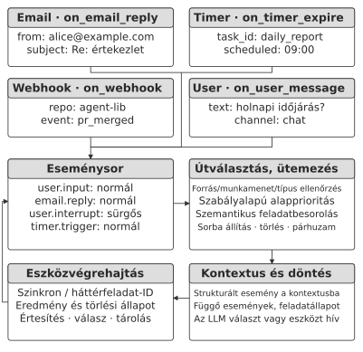

### Az eseményvezérelt működés megvalósítása az OpenClaw-ban

Az OpenClaw egy Gateway-en keresztül csatlakozik az üzenetcsatornákhoz, és onnan irányítja az eseményeket az Agent futtatókörnyezetébe. Automatizálási mechanizmusai közé tartoznak a belső Hookok, az időzített ütemezés, a Heartbeat és a külső Webhookok mint belépési pontok[^ch6-automation]. Ezek indítási feltételük szerint érthetők meg:

- **Hooks (eseményhorgok):** a keretrendszer belső eseményeire reagálnak, például egy munkamenet létrehozására, visszaállítására vagy a futás életciklusának változásaira.
- **Cron (időzített ütemezés):** megadott időpontban vagy rendszeres időközönként végez el munkát. Például a `0 9 * * 5` a beállított időzónában minden péntek reggel 9 órakor indít.
- **Heartbeat (szívverés):** rendszeres időközönként felébreszti az Agentet, hogy megnézze, van-e figyelmet igénylő ügy.
- **Webhook (külső visszahívás):** külső szolgáltatások által beküldött eseményeket fogad, amelyek hitelesítés és útválasztás után indítják el a feldolgozást.

A heti jelentést érdemes menetrend szerint futtatni, a folyamatos figyelmet igénylő teendőket rendszeresen ellenőrizni, az új e-mailek és a szolgáltatások visszahívásai esetében pedig a küldés révén lerövidíthető az észlelés késése.

**A PineClaw hívásesemények.** A Pine AI a felhasználó helyett telefonál, és olyan ügyeket intéz, mint a számlák újratárgyalása, előfizetések lemondása vagy biztosítási kárigények. A PineClaw ezeket a telefonos feladatokat az OpenClaw-ba kapcsolja. Egy hívás általában eltart egy ideig, és közben szükség lehet a felhasználó beavatkozására:

- **Személyazonosság-ellenőrzés.** Az ügyintéző azt kéri, hogy a számlatulajdonos igazolja magát, például biztonsági kód vagy egyszeri jelszó megadásával.
- **Háromoldalú hívás.** Az ügyintéző közvetlenül a számlatulajdonossal akar beszélni, ezért a felhasználót időben értesíteni kell, hogy vegye fel a telefont.
- **Döntés megerősítése.** Ha az ügyintéző alternatív ajánlatot tesz, az előtér a mostani megbízás és a felhasználó korábbi preferenciái alapján mérlegeli, elfogadható-e. Ha a felhasználónak kell döntenie, konkrét lehetőségeket küld neki, és közben tovább egyezteti a többi feltételt az ügyintézővel.

Tegyük fel például, hogy az ügyintéző azt kéri, hogy a számlatulajdonos csatlakozzon a hívásba. Minél hamarabb ér oda az értesítés, annál kevesebb ideig várakoznak tétlenül a vonal két végén. A PineClaw-eset Channel mechanizmust használ, amely a Gateway és a Pine API között közvetíti a hívás eseményeit: a hívás létrejötte, a felhasználói bevitel szükségessége és a hívás vége külön-külön kerül az eseményfolyamba, az Agent pedig ezek alapján frissíti a feladatot és értesíti a felhasználót.

**Úgy gondolom, hogy a proaktív szolgáltatás akkor lehet igazán időszerű, ha az eseményforrás maga értesíti az Agentet, amikor megváltozik az állapota.** Miután az értesítés a csatornán át megérkezett, a Harness megkeresi a hozzá tartozó feladatot, ellenőrzi, nem ismétlődés-e és nem járt-e le, majd a modell dönt a következő lépésről. Ha a felhasználónak igazolnia kell magát, a felületnek egy megbízható hitelesítési belépési pontot kell megnyitnia, és az ellenőrzés eredménye új eseményként tér vissza az eredeti feladathoz.

### Eseményindító eszközök

Ha az asszisztensre bízzuk, hogy „szólj, ha az ügyfél válaszolt”, hogyan ébred fel holnap éppen a megfelelő pillanatban? Először azt kell megnézni, hogy a postafiók tud-e eseményt küldeni levél érkezésekor; ha egy rendszer csak aktív lekérdezést enged, meg kell jegyezni a következő ellenőrzés időpontját. Az alábbi három szemléltető interfész ezeket a várakozási feltételeket a futtatókörnyezetre bízza, így a modell befejezheti az aktuális munkakört.

**Az időzítő (`set_timer`)** egy feladat előre megbeszélt időpontban való felébresztésére szolgál. Az egyszeri időzítő olyan esetekre való, mint „jövő hétfő délelőtt 10-kor hívd fel a bankot, és érdeklődj a lakáshitel állásáról”; az ismétlődő időzítő például a szolgáltatás állapotának óránkénti ellenőrzésére alkalmas. Egy elküldött e-mailre adott válasz kivárását, vagy munkaidőn kívüli hívás után az újratárcsázást szintén időzítővel lehet beütemezni. Az interfésznek el kell tárolnia az időzónát, az indítási feltételt és a feladatazonosítót, és lehetőséget kell adnia a visszavonásra vagy módosításra. Ha a külső szolgáltatás csak lekérdezést támogat, az időzített feladat a haladás rendszeres lekérdezését is elvégezheti.

**A háttérfeladat-figyelés (`monitor_shell`)** a hosszan futó parancsokat haladási eseményekké alakítja. Indításkor feladatazonosítót ad vissza, futás közben az új kimenet, kulcsszavak vagy állapotváltozások alapján értesít, a végén pedig jelenti a kilépési állapotot és az eredményt.

Ha a modell újra és újra lekérdezi a haladást, minden lekérdezés modellhívásba kerül, akkor is, ha az állapot nem változott; ha viszont csak a befejezési értesítésre vár, lemaradhat a menet közbeni hibákról. Ezért azt javaslom, hogy a figyelést a futtatókörnyezet végezze, és csak hasznos előrehaladás, hiba vagy elakadás esetén ébressze fel a modellt. Így a build ideje alatt is folytatható a kommunikáció, és a rendellenességekbe is időben be lehet avatkozni. A figyelési szabályokban beállítható szűrés, összevonás és gyakoriságkorlátozás, hogy ne minden naplósor váltson ki külön modellhívást.

Ha például a modell feliratkozik egy függőben lévő munkajegy állapotfrissítéseire, befejezheti az adott következtetési kört, és megvárhatja, hogy a munkajegy számát hordozó értesítés felébressze. Ha a másik fél csak lekérdezést enged, a modell maga állíthat be időzített feladatot a következő ellenőrzésre. Ha akkor azt találja, hogy az ügy „még folyamatban”, újabb időpontot jelöl ki; ha a munkajegyet lezárták, törli a további ellenőrzéseket. Mindkét esetben a futtatókörnyezet végzi a várakozást, a modell csak értesítés érkezésekor vagy az időzítő lejártakor dönt újra.

**A külső eseménycsatornák (`connect_channel`)** e-mailekre, azonnali üzenetekre vagy API-visszahívásokra való feliratkozásra szolgálnak. A csatornaadapter ellenőrzi a forrást, a szolgáltatás saját azonosítóit szálakra és kapcsolódó objektumokra képezi le, majd egységes formátumú eseményt ad át; ezt a később következő, a fogadórétegről szóló szakasz fejti ki. A PineClaw telefonos állapotértesítései ebbe a csoportba tartoznak.

Mindhárom eszköztípusnál egyértelmű indítási feltételek, szűrési szabályok és eseményadat (payload) kell. Az eseményadatnak tartalmaznia kell az esemény azonosítóját, időpontját, forrását, a kapcsolódó feladatot és a szükséges tartalmat, hogy az Agent el tudja dönteni, érvényes-e még az esemény, és milyen információra van szüksége a következő lépéshez.

### Felhasználói kommunikációs eszközök

Térjünk vissza az átfoglalási feladathoz. Kérdést intézni az ügyintézőhöz, olyan megerősítő üzenetet küldeni a felhasználónak, amelyre közvetlenül válaszolhat, és a feladatnaplóba feljegyezni, hogy „válaszra vár” – ez három különböző helyre írást jelent. A felhasználó egy időre elmehet, és akkor tér vissza, amikor feltételeket kell kiegészítenie, döntést kell megerősítenie vagy eredményt kap.

A beszélgetési felület megjelenítheti a végső választ, az eszközök haladását és a végrehajtás eredményét; a kommunikációs eszközök viszont kifejezetten megadják a címzettet, a csatornát, az üzenet tartalmát és a mellékleteket. A modell dönti el, mit kell közölni, a Harness ellenőrzi a célt és a jogosultságot, az üzenetküldő szolgáltatás pedig kézbesít. A futtatókörnyezet a végső választ automatikusan az eredeti munkamenetbe is irányíthatja. A két módszer együtt is használható.

Az OpenClaw többcsatornás interakciója révén a felhasználó úgy küldhet üzenetet, várhatja a fejleményeket és kaphat emlékeztetőt, mintha egy titkárral érintkezne. Ez az „élő ember” érzés a folyamatosan követett feladatállapotból és az időszerű kommunikációból fakad. A felhasználó a megszokott csatornáján folytathatja a feladatot, az Agentnek pedig következetesen kell kezelnie az identitást, a munkamenetet és az üzenetek összerendelését.

A kommunikáció tartalma is igazodhat a feladathoz: rövid előrehaladási jelentéshez szöveg, összetett eredményhez kép vagy fájl melléklet, kitöltendő adatokhoz strukturált kártya, interaktív eredményhez pedig az 5. fejezetben bemutatott generatív UI. Ha a csatorna támogatja a kézbesítési vagy olvasási visszaigazolást, a rendszer elmenti a megfelelő állapotot; az újrapróbálkozások, az ismétlődő üzenetek és a csatornák közötti szinkronizálás szintén a kézbesítési nyilvántartásba kerül.

**Többcsatornás értesítés és a felhasználó visszahívása.**

Az azonnali üzenet, az SMS, az e-mail, a telefonhívás és az alkalmazásértesítés más-más sürgősségi szinthez és tartalomformához illik. Az Agent a sürgősség, a felhasználói preferenciák, a felhasználó aktuális állapota és az üzenet hossza alapján választhat csatornát. Az azonnali megerősítést igénylő hívásesemények gyors emlékeztetőt kapnak, a teljes jelentés pedig e-mailben vagy alkalmazáslinken keresztül kézbesíthető.

Egyszer megkértem az asszisztensemet, hogy figyelje egy ATC-konferencia szállodai árait. Az asszisztens minden nap ugyanabban az időben üzent, hogy az ár még nem csökkent a célár alá. Egyszer az ár rövid időre leesett, de ezt az ablakot a saját magam írta szkript kapta el. A rövid ideig tartó alacsony ár két lekérdezés között is felbukkanhat. Ha az asszisztens időben észre is veszi, de az üzenete későn ér célba, a felhasználó akkor is lemaradhat a foglalásról. Azokon a napokon, amikor nincs árcsökkenés, az időzített lekérdezés zavartalanul futhat tovább, a felhasználónak pedig nem kell minden nap elolvasnia egy ugyanolyan üzenetet. A 7. fejezet egy ötperces árcsökkenési ablakkal teszi próbára ezt a fajta emlékeztetőt.

Amikor egy hosszú feladat befejeződik, az értesítés visszavezeti a felhasználót az eredményoldalra; a napi összefoglalók és a heti jelentések pedig a megbeszélt ütemben érkeznek. A többcsatornás stratégiában duplikációszűrést, csendes időszakokat és eszkalációs feltételeket is be kell állítani – például azt, hogy ha az első emlékeztetőre nem jön válasz, másik csatornára kell-e váltani. Az értesítési napló a feladatállapothoz kapcsolódik, így a felhasználó a kapott üzenetből folytathatja az ügyet.

### Virtuális identitás és elszigetelt végrehajtási környezet

A 4. fejezet a *Her* című film Samanthájával szemléltette, hogyan lép be egy általános asszisztens eszközök révén a digitális világba. Egy ilyen asszisztens megvalósításakor tisztázni kell, milyen identitással dolgozik, és milyen erőforrásokhoz férhet hozzá. **Én amellett vagyok, hogy az általános asszisztens önálló virtuális identitást kapjon.** Saját hivatali postafiókkal, telefonszámmal, tárhellyel és számítási környezettel az Agent úgy intézheti a felhasználó ügyeit egyértelmű megbízotti identitással, mint egy titkár, akinek saját irodai fiókjai vannak. Az önálló identitás elválasztja az asszisztens mindennapi munkáját a felhasználó személyes fiókjaitól, így külön engedélyezhető, auditálható és visszavonható; tévedés esetén a kár köre is könnyebben behatárolható. Ha egy feladathoz feltétlenül hozzá kell férni a felhasználó fiókjához, a szükséges jogosultságot szűkített hatókörű engedélyezéssel kell megszerezni.

Az, hogy kié a telefonszám, eldönti, ki folytathatja az ügyet, amikor a másik fél visszahív. A Manus Cue szolgáltatása önálló számot ad az asszisztensnek, amely fogadhat bejövő hívásokat, és a hívás összefoglalóját a felhasználónak hagyja. Ha a kereskedő elfogadja az asszisztens által megadott visszahívási számot, az ügyintéző hívása közvetlenül az ügyet korábban intéző asszisztenshez fut be.[^ch6-cue]

Vegyünk egy díjelengedési ügyet: az asszisztens meghatalmazott képviselőként veheti fel a kapcsolatot a kereskedővel. Ha az ügyintéző szóbeli ellenőrzést kér magától az ügyféltől, a felhasználót be lehet vonni háromoldalú hívásba, és az ellenőrzés után az asszisztens folytatja a tárgyalást. Ha a kereskedő a felhasználót fogja visszahívni, előbb át kell adni neki az ügyszámot, a már megállapodott pontokat és az ellenőrizendő kérdéseket. A felhasználónak tett jelentésben azt is pontosan meg kell mondani, milyen bizonyíték van a kézben: ha az ügyintéző szóban megígérte a díjelengedést, ezt az ígéretet kell rögzíteni; ha később a számla frissülése is látszik, akkor lehet jelenteni, hogy a díjat ténylegesen elengedték.

Amikor Pekingben a Bank of America hitelkártyámat kellett pótoltatnom, a Pine felvette a kapcsolatot a bankkal, sürgősségi kártyapótlást intézett, és elérte, hogy elengedjék a 15 dolláros sürgősségi díjat. A hívás végére az asszisztens már be tudott számolni arról, mit fogadott be a bank, és melyik díjat engedte el. Ha a felhasználó néhány nap múlva megkérdezi, „hol tart az új kártya”, ahhoz újra le kell kérdezni a szállítást, vagy a címzettől kell megerősítést kérni.

A virtuális számítógép és a virtuális telefon folyamatosan futó működési környezetet biztosít. A virtuális gépen asztali rendszer futtatható, a konténer a folyamatok és függőségek elszigetelésére alkalmas, az Android-emulátor pedig a mobilalkalmazásokat futtatja. Mindegyik működhet a háttérben, és csökkenti azt is, hogy az automatikus műveletek zavarják a felhasználó aktuális munkáját. Az elszigetelés hatókörét együttesen határozza meg a hálózat, a csatolt kötetek, a hitelesítő adatok és a futási jogosultságok; ugyanezek a beállítások befolyásolják azt is, mely adatokhoz és külső rendszerekhez fér hozzá az Agent.

Tegyük fel, hogy azt szeretné, hogy munka után, a gép kikapcsolása után a Tencent WorkBuddy vállalati változata készítse el a heti jelentést, az e heti értékesítési táblázat viszont csak az irodai számítógépén létezik. Ha helyi feladatot választ, az asszisztens elolvashatja a táblázatot, de a gépnek bekapcsolva, a kliensnek pedig online kell maradnia. Ha felhőfeladatot választ, az asszisztens a gép kikapcsolása után is dolgozhat, feltéve hogy előzőleg feltöltötte a feladathoz a heti jelentésben felhasználható adatokat, vagy olyan dokumentumtárba tette őket, amelyhez a felhőfeladat hozzáfér. Ha az értékesítési táblázatnak a helyi gépen kell maradnia, a feldolgozást arra az időre kell ütemezni, amikor a számítógép online van.

A weboldalak és mobilalkalmazások személyazonosság-ellenőrzést, CAPTCHA-t vagy emberi megerősítést is kérhetnek. Csatlakozáskor elsősorban a szolgáltatás által kínált API-t és engedélyezési módot érdemes használni; ha grafikus felületen kell hitelesíteni, VNC/RDP távoli asztalon a felhasználó maga jelentkezhet be, a hitelesítés idejére pedig szünetelnek az automatikus műveletek. Miután a felhasználó végzett, a rendszer ellenőrzi a munkamenet állapotát, és folytatja a feladatot. A tokeneket és munkameneteket érvényességi idejük szerint kell tárolni, az engedély visszavonása vagy a feladat vége után pedig a szabályzat szerint törölni.

Az Agent és a virtuális környezet egy **megosztott fájlrendszeren** keresztül cserélhet adatot. Például a felhasználó feltölt egy CSV-fájlt, a virtuális számítógép beolvassa, elvégzi az elemzést, és a diagramokat visszaírja a megosztott tárolóba; a futtatókörnyezet átadja az Agentnek a diagram fájlhelyét, az pedig elérhető letöltési lehetőséget kínál a felhasználónak. A nagy fájlok tartalma a tárolóban marad, a modell szükség szerint csak összefoglalót vagy részleteket olvas be.

[^ch6-dsh-threads]: DeepSeek, a dsh-superagent prototípus tartománymodellje, valamint engedélyezési és feliratkozási szabályai.
[^ch6-dsh-sessions]: DeepSeek, dsh-superagent prototípus, `8c32a9d` verzió. A kétféle munkamenet feladatköreit a `docs/004-prompts.md`, a végrehajtó munkamenetet és a munkakönyvtárat a `docs/003-execution.md`, a fő munkamenetbe küldött üzenetek formátumát a `docs/007-architecture.md` írja le.
[^ch6-duet]: Anthropic, *Get started with Claude Duet*; bemutatja a megbeszélés előtti összefoglalót, a feladatoldalt és a fő beszélgetésben küldött értesítéseket.
[^ch6-cue]: Manus, *Introducing Manus 2.0*; bemutatja a Cue önálló telefonszámát, a bejövő hívások fogadását és a hívásösszefoglalókat.
[^ch6-automation]: OpenClaw, Automation; bemutatja az automatizálás belépési pontjait, köztük a belső Hookokat, az időzített ütemezést, a Heartbeatet és a külső Webhookokat.

### Fogadóréteg: sokféle forrás, egyféle esemény

Egy webáruház ügyfélszolgálati Agentje egy visszatérítést intéz: a vásárló az alkalmazás ügyfélszolgálati csevegésében nyújtja be a kérelmet; az összeg meghaladja az Agent jogkörét, ezért a WeCom (vállalati WeChat) ügyfélszolgálati csoportjában jóváhagyást kér a vezetőtől; a sikeres visszatérítés után a fizetési szolgáltatás Webhookot küld; a rendelési rendszer pedig ezt követően Kafkán teszi közzé az állapotváltozást. A négy üzenet ugyanarról a rendelésről szól, de mind más úton érkezik. Ha sok a forrás, és minden útvonal maga kezeli az újrapróbálkozást, a duplikációszűrést és a sorrendet, ezek a különbségek szétszabdalják a futtatókörnyezetet. **A fogadóréteg egységesíti az események alakját, miután beléptek a rendszerbe, de megőrzi a források közötti, beérkezés előtti képességbeli különbségeket.** A 6-2. ábra ezt a rétegzést mutatja.

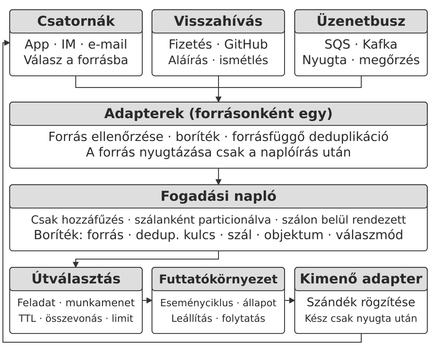

A források négy gyakori csoportba sorolhatók. A **beszélgetési csatornák** közé tartozik a termék saját csevegőfelülete, az olyan azonnali üzenetküldők, mint a WeCom, a Feishu vagy a Slack, valamint az e-mail; ezeken az Agent ugyanott válaszolhat, ahonnan az üzenet jött. A **visszahívás** olyan HTTP-interfész, amelyet egy külső szolgáltatás állapotváltozáskor hív meg; általában aláírással érkezik, és csak értesítést hoz. Sikertelen kézbesítés után egyes szolgáltatások maguktól újrapróbálkoznak, a GitHubnál viszont kézzel vagy API-n keresztül kell újraküldeni. Az **üzenetbuszok**, például az SQS vagy a Kafka, a belső szolgáltatások üzleti eseményeit szállítják, egyértelmű visszaigazolási és megőrzési szemantikával. Az **időzítőket, a lekérdezést és a belső eseményeket** maga a rendszer állítja elő, ezeket elég ugyanabba a naplóba írni. Az alábbi táblázat az első három csoportot hasonlítja össze.[^ch6-ingress-mq][^ch6-ingress-callback]

| | Alkalmazáson belüli csevegés | WeCom / Feishu | E-mail | Webhook | SQS | Kafka |
|---|---|---|---|---|---|---|
| Beérkezés módja | Tartós kapcsolat | Visszahívás vagy tartós kapcsolat | Küldés vagy lekérdezés | Visszahívás | A fogyasztó húzza le | A fogyasztó húzza le |
| A sorrend hatóköre | Beszélgetésen belül | A legtöbb eseménynél nem garantált | Nem garantált | Nem garantált | A standard sornál nem garantált, FIFO-nál üzenetcsoportonként | Partíción belül |
| Natív duplikációszűrési alap | Kliensoldali üzenetazonosító | Üzenetazonosító, eseményazonosító | Message-ID | Kézbesítési azonosító | Üzenetazonosító; FIFO-nál ezen felül `MessageDeduplicationId` | Téma, partíció és offset |
| Visszajátszható-e | A saját nyilvántartástól függ | Maga a visszahívás nem játszható vissza, a Feishunál az üzenetelőzmény-interfésszel utólag lehívható | A postafiók újraolvasható | Szolgáltatásonként eltérő | Törlés után nem | A megőrzési időn belül igen |
| Visszaigazolás módja | Kliensoldali nyugta | Sikeres válasz a határidőn belül | Az olvasási pozíció saját nyilvántartása | 2xx válasz a határidőn belül | Az üzenet törlése | Az offset véglegesítése |
| Válaszútvonal | Az eredeti beszélgetés | Az eredeti beszélgetés | Válaszlevél | Nincs | Nincs | Nincs |

**Egységes boríték.**

Az adapter a nyers üzenetet egységes formátumú **borítékká** (envelope) alakítja. A boríték csak azokat a tényeket rögzíti, amelyek a beérkezéskor már biztosak; a prioritást és a feldolgozási határidőt az útválasztási szabályok egészítik ki, az ügyfélszintet és a rendelés állapotát az üzleti rendszer, a feldolgozás állapotát pedig külön tároljuk. A vásárló visszatérítési kérelme így írható le:

```json
{
  "id": "evt_7f3a",
  "source": {"type": "app_chat", "sender": "user:u_5521", "verified": true},
  "dedupe_key": "app:msg:msg_1029",
  "thread": "app:conv:conv_88",
  "kind": "message",
  "correlation": ["order:12345"],
  "content": {"type": "text", "text": "这个订单我想退款"},
  "raw_ref": "raw/2026-11-23/app/msg_1029.json",
  "reply": {"via": "app_chat", "target": "app:conv:conv_88"},
  "occurred_at": "2026-11-23T14:02:09+08:00",
  "expires_at": null
}
```

- `source`: a forrás típusa és az ellenőrzött küldő. Azt, hogy a küldő „ellenőrzött”, az adapter aláírás, token vagy csatornafiók alapján állapítja meg; az üzenet szövegében szereplő önbemutatkozás nem számít. A futtatókörnyezet ez alapján dönt a jogosultságokról.
- `dedupe_key`: duplikációszűrési kulcs; hogy mi számít ismétlődésnek, azt a forrás szemantikája dönti el. A kézbesítési azonosító, az üzenetazonosító, illetve a partíció és az offset ugyanazt a kézbesítést azonosítja, így kiszűri a szállítási rétegbeli újraküldéseket; ha az üzleti üzenet idempotenciakulcsot (idempotency key) hordoz – például a visszatérítés számát az állapottal együtt –, az adapternek ki kell emelnie, mert csak így szűrhetők ki az üzleti szintű ismétlődések. A felhasználói beszélgetés éppen fordított eset: ha a vásárló kétszer mondja, hogy „visszatérítést kérek”, az két üzenet, ezért csak a kliensoldali üzenetazonosító alapján szűrünk.
- `raw_ref`: az eredeti formájában megőrzött nyers eseményadat; az adapter hibáinak felderítésekor csak erre lehet támaszkodni.
- `reply`: melyik kimenő adapteren át, milyen célhoz kell a választ küldeni. A fizetési visszahívásnak nincs válaszútvonala, ez a mező üres.
- Az `occurred_at` a forrás által megadott bekövetkezési idő; az `expires_at` az érvényességi idő, amelyet csak az olyan eseményeknél töltünk ki, mint az árajánlat vagy az ellenőrző kód.

**Szálak és kapcsolódások.**

Ha a vásárló előbb azt írja, hogy „visszatérítést kérek”, majd rögtön hozzáteszi, hogy „mégsem, inkább cserélném”, a két üzenet sorrendje nem cserélődhet fel; egy másik vásárló üzenetei viszont nem függnek ezektől, és párhuzamosan feldolgozhatók. **A fogadóréteg csak szálon belül vállal sorrendet.** Az adapter a forrás saját sorrendi egységét képezi le `thread` mezőre: ez lehet egy beszélgetés az alkalmazásban, egy SQS FIFO üzenetcsoport (`MessageGroupId`), egy Kafka partíciókulcs vagy egy GitHub-visszahívásban szereplő Issue- vagy PR-szám. Ha a forrás nem garantál sorrendet, a futtatókörnyezet az `occurred_at` vagy a forrás által adott verziószám alapján ismeri fel a későn érkező, elavult állapotot, például a „visszatérítés folyamatban” üzenetet, amely csak a „visszatérítés sikeres” után futott be.

E visszatérítés négy üzenete négy különböző szálhoz tartozik. Ha egy szálba vonnánk őket, annak komoly ára lenne: az ügyfélszolgálati csoport egy nem kapcsolódó beszélgetésének is a vásárló üzenetei mögé kellene sorba állnia, a szálazonosító pedig gyakran partíciókulcsként is szolgál, így utólagos módosítása adatmigrációt igényel. **A kapcsolódásokat külön mező fejezi ki, a szálat nem írjuk át.** A `correlation` felsorolja az eseményben érintett üzleti objektumokat, a feladatok pedig a kapcsolódó objektumok alapján iratkoznak fel a releváns szálakra.

**A visszaigazolás időpontja és a haladás nyilvántartása külön.**

**Az adapternek akkor kell visszaigazolnia a forrás felé, amikor az esemény már bekerült a fogadási naplóba, nem pedig akkor, amikor az Agent befejezte a feldolgozást.** A Feishu eseményvisszahívásai 3 másodpercen, a WeComéi 5 másodpercen belüli választ várnak, különben újraküldik az eseményt; az SQS-üzenetet, ha a láthatósági időkorláton belül nem törlik, újra ki lehet olvasni. Ha a feldolgozás végéig várnánk a visszaigazolással, egyetlen kicsit hosszabb modellhívás is ismételt kézbesítést okozna. Ha előbb a naplóba írunk, és csak utána igazolunk vissza, a források kézbesítési garanciái egyetlen mondatba sűríthetők: **minden esemény legalább egyszer bekerül a fogadási naplóba (at-least-once)**, az újraküldött példányt pedig a duplikációszűrési kulcs szűri ki.

A fogadási napló postaládaként (inbox) működik: követi az 1. fejezet „csak hozzáfűzni, sosem módosítani” elvét, és szálanként van particionálva. Ha a fogadási napló Kafkára épül, a duplikációszűréshez külön, egyediségi megkötést kezelő tároló kell, vagy a fogyasztói oldalon kell a kulcs alapján szűrni: a Kafka nem tudja elutasítani az írást az alkalmazás által megadott kulcs alapján, idempotens producere pedig csak a producer saját újrapróbálkozásaira terjed ki.

A rendszernek háromféle haladást kell külön nyilvántartania:

| Haladás | Mit rögzít | Ki tartja karban |
|---|---|---|
| Forrásoldali haladás | Kafka-offset, SQS fogadási leíró, postafiók olvasási pozíciója | Adapter |
| Kiosztási haladás | A napló eseményei mely feladatokhoz kerültek már | Útválasztó |
| Feladatállapot | Hol tart a feldolgozás, elment-e már a válasz | Futtatókörnyezet |

Ha az offsetet tekintjük a feladat haladásának, a napló visszajátszásakor a már elküldött válaszok még egyszer elmennek; ha szétválasztjuk őket, a visszajátszás csak a kiosztási haladást érinti. A kimenő irány megfelelője a kimenő postafiók (outbox): küldés előtt fel kell jegyezni a küldési szándékot és az idempotenciakulcsot, majd a csatorna nyugtájának megérkezése után befejezettnek jelölni; hogy újraindítás után hogyan kell egyeztetni, azt a később következő „Alaphurok építése e-mail-eseményekből” szakasz mutatja be.

**Érvényesség, összevonás és visszanyomás.**

Ha egyetlen szálon másodpercenként több száz esemény zúdul be, nem szabad őket egyenként a modellhez továbbítani. Az útválasztó a kiosztás előtt kezeli a torlódást:

- **Érvényesség.** Az árajánlat, az ellenőrző kód és a már megszűnt riasztás az idő múltával értelmét veszti. Az `expires_at` utáni események csak a trajektóriába kerülnek, a modellt már nem ébresztik fel.
- **Összevonás.** A `kind` kétféle eseményt különböztet meg. Az állapot jellegű esemény egy objektum aktuális értékét írja le, például a visszatérítés állapotát a fizetési visszahívásban vagy a rendelés állapotát Kafkán; ha egy szálon több ilyen torlódik fel, csak a legfrissebb kerül a modellhez, a köztes értékek a naplóban maradnak. Az üzenet jellegű esemény valakinek egy mondata vagy utasítása, például a vásárló üzenete vagy a vezető kattintása; ezek csoportosan is átadhatók a modellnek, de nem dobhatók el.
- **Visszanyomás.** A lehúzásos forrásoknál le lehet lassítani a lehúzást, a torlódás így a forrásnál marad. A küldéses forrásokat nem lehet szüneteltetésre kérni: az adapter a szokásos módon naplóz és visszaigazol, a torlódás a fogadási naplóba kerül át, és ott az előző két szabály dolgozza fel.

**Egy visszatérítés útja négy forráson át.**

1. A vásárló az alkalmazás csevegésében visszatérítést kér. Az adapter a kliensoldali üzenetazonosító alapján szűri a duplikátumokat, beírja az eseményt a naplóba, majd nyugtát küld a kliensnek; az útválasztó az `order:12345` alapján létrehozza a visszatérítési feladatot, amely feliratkozik erre a beszélgetési szálra.
2. Az összeg meghaladja a jogkört, ezért az Agent jóváhagyási kártyát küld a WeCom ügyfélszolgálati csoportjába, a kártya azonosítóját pedig a feladatban rögzíti. A vezető a „Jóváhagyom” gombra kattint; az adapter naplóz, sikeres választ ad, és a kártyaazonosító alapján pótolja a kapcsolódó objektumot.
3. Miután az Agent meghívta a visszatérítési interfészt, a fizetési szolgáltatás kétszer küld „visszatérítés sikeres” visszahívást, azonos kézbesítési azonosítóval; a másodikat kiszűri a duplikációszűrés.
4. A rendelési rendszer Kafkán közzéteszi, hogy „a rendelést visszatérítették”, ami ugyanarról szól, mint a visszahívás. Ha mindkét adapter az eseményadatból kiemelt visszatérítési számot és állapotot használja duplikációszűrési kulcsként, ez az esemény már a fogadáskor kiesik; ha az egyik a kézbesítési azonosító, a másik a partíció és az offset alapján szűr, mindkettő bekerül a naplóba, a futtatókörnyezet pedig látja, hogy a feladatban a visszatérítés már megerősített, és csak a trajektóriába jegyzi fel.
5. Sem a visszahívásnak, sem a Kafka-eseménynek nincs válaszútvonala. A futtatókörnyezet az 1. lépés beszélgetési szálának `reply` mezőjét használja, és az alkalmazás kimenő adapterén át értesíti a vásárlót.

A 4. lépés a fogadórétegbeli duplikációszűrés határát mutatja: hogy milyen ismétlődéseket tud kiszűrni, az attól függ, milyen duplikációszűrési kulcsot deklaráltak az adapterek; amit nem szűrt ki, arról a feladatállapot alapján kell dönteni. Hogy egy feladathoz kiosztott esemény egy meglévő munkamenethez csatlakozik-e vagy újat nyit, az már kontextuskezelési kérdés: a munkameneteken átívelő információt a 3. fejezetben tárgyalt memória közvetíti, a kontextus megoszthatóságáról pedig a 10. fejezet szól.

[^ch6-ingress-mq]: Amazon Web Services, „Amazon SQS standard queues”; „Amazon SQS visibility timeout”; „Using the message deduplication ID in Amazon SQS”; „Using the message group ID with Amazon SQS FIFO Queues”. Apache Kafka 4.4 dokumentáció, a „Design” fejezet „Consumer Position” és „Message Delivery Semantics” része. Ellenőrizve: 2026-11-24.
[^ch6-ingress-callback]: Feishu nyílt platform, „Eseményáttekintés”; „Beszélgetési előzmények lekérése”. WeCom fejlesztői központ, „Üzenetek és események fogadása” – „Áttekintés”. GitHub Docs, „Best practices for using webhooks”; „Handling failed webhook deliveries”. Ellenőrizve: 2026-11-24.

### Eseménykezelési mechanizmus

Felhasználói üzenetek, eszközeredmények, időzítők és együttműködési kérések egyszerre is érkezhetnek ugyanahhoz az Agenthez. A futtatókörnyezetnek el kell tárolnia ezeket az eseményeket, meg kell határoznia a feldolgozási sorrendet, majd a releváns információt át kell adnia a modellnek. Az **eseményhurok** (event loop) viszi előre folyamatosan ezt a folyamatot: kivesz egy eseményt a sorból, frissíti a feladatállapotot, összeállítja a modellkérést, ütemezi az eszközöket, majd új bemenetre vagy befejezési értesítésre vár. A Go programok, amelyek goroutine-okkal, channelekkel és `select` utasítással szervezik a több irányból érkező üzeneteket, hasonló elvet követnek.

Vegyük példaként a dsh-superagent prototípust: ugyanabban a GitHub-projektben egy Issue alatti és egy lehívási kérés (PR) alatti beszélgetés két külön munkamenetszálhoz (Thread) tartozik. Amikor a rendszernek el kell döntenie, átvállal-e új munkát, beolvassa a szál állapotát, és a modellel kiértékelteti (Eval). Egy szálon egyszerre legfeljebb egy kiértékelés folyhat, de több munkajegy (Ticket) is feliratkozhat rá. Tegyük fel, hogy egy hibajavítási és egy dokumentáció-kiegészítési munkajegy egyaránt feliratkozott ugyanarra a PR-re; ha egy bíráló megjegyzést ír a PR alá, mindkét munkajegy megkapja ezt az üzenetet kontextusként. Ha ezután valaki az Issue alatt pótolja a hiba reprodukálásának feltételeit, ez az üzenet az Issue-ra feliratkozott munkajegyhez jut el. Hogy az üzenet kihez kerül, azt a szálak és a feliratkozások döntik el. Hogy az üzenet megkapása után mit tehet egy munkajegy, azt továbbra is a saját, korábban kapott engedélyei határozzák meg.[^ch6-dsh-threads]

A dsh-superagent az „emberekkel való érintkezést” és a „munkavégzést” is külön munkamenetekre bízza. A fő munkamenet (Main Session) csak a megbízások fogadásával, a válaszadással és az engedélyek rögzítésével foglalkozik; kódot nem olvas, és nem áll meg eredményre várni. Minden munkajegynek saját végrehajtó munkamenete (Executor Session) van, amely külön munkakönyvtárban módosítja a kódot és futtatja a teszteket. A végrehajtó munkamenet csak akkor küld üzenetet a fő munkamenetnek, ha elkészült, elakadt vagy kérdeznie kell valakit; ilyenkor összefoglalót és olvasási címet csatol, vagyis a 2. fejezetben tárgyalt „összefoglaló plusz objektumazonosító” formát. Így a fő munkamenetnek mindig van szabad kapacitása a következő kérésre, és mivel a kérdések, az értesítések és a leállítások is rajta mennek át, kötelezettségvállalás csak egyetlen ponton keresztül születik. A beszédről szóló későbbi rész gyors és lassú modellje ugyanennek a munkamegosztásnak a valós idejű hívásokban megjelenő formája.[^ch6-dsh-sessions]

A szinkron modellinterfészek általában egy generálás befejeztével vagy az eszközeredmények teljes beillesztése után fogadják a következő üzenetcsomagot. Itt **biztonságos pont** állítható be: a futtatókörnyezet először rögzíti a befejezett üzeneteket, a még futó hívásokat és az aktuális feladat haladását, majd áttér az új feldolgozási lépésre. A natív aszinkron interfészek ezzel szemben olyan protokollt kínálnak, amely futás közben is fogad frissítéseket; a pontos folytatási időpontot az interfész és a futtatókörnyezet együtt határozza meg.

A visszavonáshoz a végrehajtó együttműködése is kell. Ha a modell leállítja a generálást, a háttéreszközök még futhatnak; a végrehajtónak fogadnia kell a visszavonási jelet, és jelentenie kell a tényleges állapotot, hasonlóan ahhoz, ahogy egy Go-feladat a `ctx.Done()` ellenőrzése után elvégzi a takarítást. A már befejezett írásokat, küldéseket vagy fizetéseket a megfelelő üzleti folyamaton keresztül kell visszavonni vagy kompenzálni.

**Három kezelési stratégia.**

A 6-3. ábra azt a három lehetőséget hasonlítja össze, amely egy új esemény beérkezésekor kínálkozik. Ha sorba állítjuk, a reakcióidő attól függ, mikor jön el a következő biztonságos pont; ha visszavonjuk az aktuális feladatot, tisztázni kell, mely műveletek fejeződtek be, és honnan lehet folytatni; ha új hurkot nyitunk, ellenőrizni kell, nem versengenek-e a feladatok ugyanazért az erőforrásért.

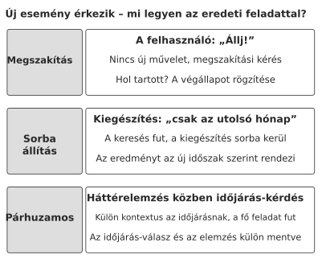

**A visszavonásos kezelés (Cancellation-Based)** a felhasználói leállító utasításokhoz és az azonnali kezelést igénylő vezérlőeseményekhez illik. A futtatókörnyezet először leállítja a kapcsolódó műveletek további kiosztását, leállítójelet küld a generálás alatt álló kérésnek és a visszavonható eszközöknek, majd elmenti a befejezett üzeneteket, az eszközök állapotát és a visszavonási nyugtákat. Ezután kerül az új esemény a döntési kontextusba. Ha például a felhasználó azt mondja: „Állj! Rosszul mondtam”, a rendszer előbb korlátozza a további végrehajtást, majd a tényleges állapot alapján újra tisztázza a feladatot. A még feldolgozatlan sorelemek megtartják azonosítójukat és állapotukat, és a kapcsolódási körük szerint rendeződnek újra.

**A sorba állító kezelés (Queued)** a rutinszerű kiegészítésekhez és előrehaladási frissítésekhez illik. Az esemény a sorba kerül, és a következő biztonságos ponton az eszközeredményekkel együtt jut el a modellhez. Ha például keresés közben a felhasználó hozzáteszi, hogy „csak az utolsó egy hónap eredményei érdekelnek”, a keresés visszatérése után a modell egyszerre olvassa az eredményeket és az új feltételt, majd eldönti, hogy szűr vagy újra keres.

**A párhuzamos kezelés (Parallel)** a fő feladattól független, gyors választ igénylő kérésekhez illik. Ha például egy nagy adatelemzés közben a felhasználó az időjárásról érdeklődik, a rendszer külön munkamenetben végezheti el a lekérdezést.

**Sürgősség és útválasztás.**

Az esemény típusa adja az első támpontot: a `user.interrupt`, a megbízható felügyeleti utasítások és a rendszerriasztások magas prioritású csatornára kerülhetnek; a `user.input`, `agent.input`, `tool.result` és `timer.trigger` eseményekről a tartalom és a feladatállapot alapján kell dönteni. Ha a küldő az üzenet szövegében „sürgősnek” nevezi magát, a rendszer akkor is az ellenőrzött identitás és a szabályok alapján állapítja meg a jogosultságot.

Az üzenet jelentésének megértését igénylő útválasztási döntésekhez könnyűsúlyú osztályozó modellt javaslok: az „azonnal állj le” visszavonást jelent, a „milyen idő van ma” valószínűleg párhuzamosan kezelhető, a „a jelentést kérem kínaiul” pedig általában az aktuális feladat kiegészítési sorába kerül. Az egyértelmű leállítási belépési pontokat a futtatókörnyezet közvetlenül kezeli, a szemantikai osztályozás a többi, megértést igénylő üzenetre vonatkozik.

Az általános modellek is tudnak címkét adni az üzeneteknek, de még ha csak annyit adnak is ki, hogy „kezelendő”, akkor is be kell olvasniuk a feladatleírást és az üzenet tartalmát. Ha minden új üzenetről így döntünk, a hívási költség az üzenetek számával együtt nő, és a valóban sürgős üzenetnek is meg kell várnia, amíg a modell címkét ad. A TypeSafe Jev nevű modellje kifejezetten az ilyen, előre megadott választási lehetőségek közötti döntési feladatokra készült. Ha megkapja az üzenetet és az aktuális feladatállapotot, alacsony költséggel és késleltetéssel, párhuzamosan adja meg az egyes lehetőségek valószínűségét.[^ch6-jev]

Az 1. fejezetben tárgyalt megfigyelésitér-ritkítás itt azt dönti el, mely üzenetek váltanak ki új következtetést. Feishu-üzenetek és GitHub Issue-hozzászólások esetén a program először az eseményazonosító alapján kiszűrheti az ismétlődő értesítéseket, majd a Jevvel eldöntetheti, hogy az új üzenet egy meglévő feladatot egészít-e ki, vagy olyan új kérést tartalmaz, amelyet a fő modellnek kell kezelnie. Ha a szöveg úgy szól, hogy „pótlom a tegnap említett reprodukálási lépéseket”, a modellnek csak azt kell megállapítania, hogy kiegészítésről van szó. Hogy melyik Issue-t egészíti ki, azt a program közvetlenül kiolvashatja a hozzászólásban szereplő számból.

A modell nagyon magas valószínűség megadásakor is túlbecsülheti a saját biztosságát. Tegyük fel például, hogy 100 üzenetet egyenként nagyjából 90%-os valószínűséggel sorol a „meglévő feladat kiegészítése” kategóriába, valójában viszont csak 60 tartozik oda. Ha ezt a csomagot automatikusan a meglévő feladatokhoz csatoljuk, a másik 40 üzenet eredeti célja elsikkad.

[^ch6-jev]: A TypeSafe a Jev kiadási közleményében ismerteti az előre definiált kimeneteket, a valószínűségek párhuzamos visszaadását és az RLCD nevű, döntési kalibrációt célzó tanítási módszert.

### Alaphurok építése e-mail-eseményekből

Tegyük fel, hogy az új e-maileket feldolgozó folyamat váratlanul újraindul. Az e-mail azonosítója alapján megtalálja az eredeti levelet, azt azonban nem tudja meg belőle, hogy az előző válasz elment-e. A sorba állítástól, a levél elolvasásán és az eszközhívásokon át a postafiók frissítéséig vagy a felhasználó értesítéséig érdemes minden írási műveletet és a visszakapott nyugtát ugyanahhoz az e-mailhez rögzíteni. Ha újraindítás után kiderül, hogy egy kérés elment, de nyugta nem jött rá, előbb a postafiók tényleges állapotát kell ellenőrizni, és csak utána dönteni az újraküldésről.

> **6-1. kísérlet ★★★: Eseményvezérelt e-mail-feldolgozó Agent**
>
> A kísérlet egy tesztpostafiókot használ belépési pontként, és az eseményregisztrációt, a sort és a feladatfeldolgozást gyakoroltatja. Először az új e-maileket strukturált eseményekké alakítjuk, és beérkezési sorrendben dolgozzuk fel őket; ezután bekapcsoljuk az e-mail-előzmények, a mellékletolvasás, a tudáslekérdezés és az értesítés eszközeit. Kövessünk végig egy meghívót a 6-4. ábrán: keressük meg az eseményhurokban a naptárütközés-ellenőrzés és a válaszvázlat megírásának lépését, majd a tárolási rétegben ennek az e-mailnek a feldolgozási nyilvántartását.
>
> 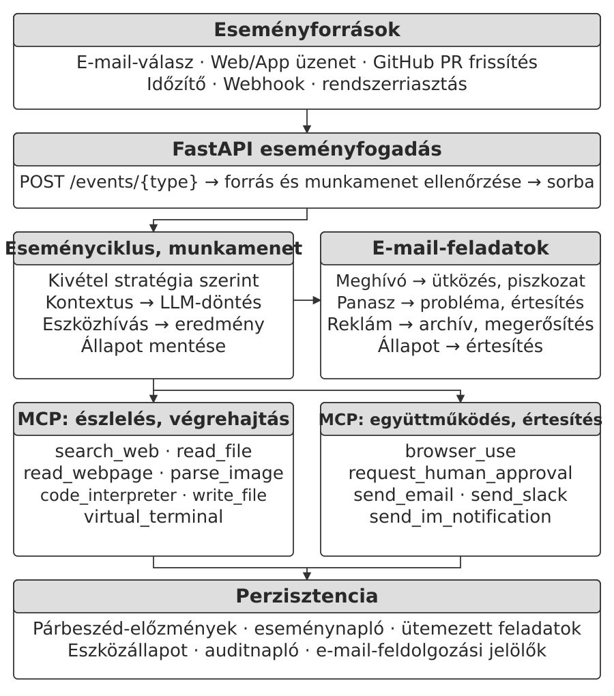
>
> Ugyanaz a sor többféle forrással bővíthető: beérkező e-mail, azonnali üzenet vagy SMS, GitHub PR- és Issue-frissítések, időzítők, külső Webhookok, valamint olyan belső események, mint a felhasználó offline állapota, a folyamat időtúllépése vagy az erőforrás-riasztás. Minden adapter ellenőrzi a forrást és kiegészíti a kapcsolódási információkat, a feldolgozás eredménye pedig az eseményazonosító szerint íródik vissza.
>
> Az átvételhez három teszt-e-mailt használunk: a meghívó naptárütközés-ellenőrzést indít, és elfogadó vagy elutasító vázlatot készít; az ügyfélpanasz a kulcsinformációk kinyerését, magas prioritású jelölést és a felhasználó értesítését váltja ki; a marketinglevelet pedig a szabályok szerint archiváljuk.
>
> A jelenlegi kísérleti jegyzőkönyv elkészült az interfészdokumentáció egyeztetésével és a hitelesítési próbával; a tesztpostafiók bekötése még érvényes hitelesítő adatokra vár.
>
> **Bővítés (választható): többforrású fogadás és hibainjektálás.** A tesztpostafiók mellé kössünk be egy helyi Webhook-végpontot és egy SQS-sort (helyi szimulációval is lehet). Minden adapter ellenőrzi a forrást, borítékot készít, és csak a fogadási naplóba írás után igazol vissza a forrás felé; a futtatókörnyezet a naplóból olvassa az eseményeket, és szálanként sorrendben dolgozza fel őket. Ezután injektáljunk háromféle hibát:
>
> 1. **Ismételt kézbesítés.** A Webhook-végpont kétszer kapja meg a kérést ugyanazzal a kézbesítési azonosítóval; a naplóban csak egy esemény jelenik meg.
> 2. **Összeomlás a visszaigazolás előtt.** Az adaptert a naplóba írás után, de az SQS-üzenet törlése előtt leállítjuk; miután az üzenet újra láthatóvá válik és ismét kiolvassák, a naplóban továbbra is csak egy esemény van.
> 3. **Összeomlás a nyugta előtt.** A futtatókörnyezetet a válasz elküldése után, de a nyugta rögzítése előtt leállítjuk, majd újraindítás után visszajátsszuk a naplóból. Ha a csatorna támogatja az idempotenciakulcsot, vagy le lehet kérdezni az elküldött üzeneteket (például a postafiók elküldött leveleit), ugyanaz a válasz nem megy el kétszer; ha egyik sincs meg, a választ csak emberi megerősítésre váróként lehet megjelölni.
>
> Mindhárom hibának nyomot kell hagynia a naplóban: melyik kézbesítést szűrte ki a duplikációszűrés, melyik üzenetet olvasták ki újra, és melyik választ nem küldték el újra ellenőrzés után.
>
> A bővítés mellékelt kódja offline is fut, API-kulcs nélkül. A tesztpostafiókot és az SQS-sort is helyi fájlok szimulálják, ezek elkülönülnek a fenti, hitelesítő adatokra váró valódi postafióktól; a szimulált sor megőrzi a láthatósági időkorlátot, a fogadási leírót és az üzenetcsoporton belüli sorrendet. Az összeomlást úgy idézzük elő, hogy a szülőfolyamat a megadott ponton közvetlenül leállítja a gyermekfolyamatot. A válaszcsatornákból mindhárom esetre egy-egy példa szerepel: az e-mail az elküldött levelek között ellenőriz, az alkalmazáson belüli csevegés idempotenciakulcsot használ, az SMS-nél egyik sincs meg. A reprodukáláshoz lépjünk be a `chapter6/agent-with-event-trigger` könyvtárba, és futtassuk a `python multisource_demo.py` parancsot; a terminál tételesen kiírja a háromféle hiba naplóbejegyzéseit. A mellékelt futási jegyzőkönyvben mindhárom hiba ellenőrzése sikeres volt.
>

Az e-mail-sor megteremtette a sorrendi feldolgozás alapját. A következőkben hosszan futó eszközöket is bevonunk, és azt vizsgáljuk, hogyan lehet a várakozás alatt új kéréseket fogadni, feladatokat visszavonni és a munkát folytatni.

### Kompatibilitási megoldás natív aszinkron támogatás nélkül

Tegyük fel, hogy az Agent éppen egy e-mailt fogalmaz, és már meghívta a `search_contacts` eszközt egy névjegy megkereséséhez. Mielőtt az eredmény megérkezne, a felhasználó azt kéri: „Várj, előbb nézd meg a holnapi időjárást.” Ha az aktuális modellinterfész megköveteli, hogy minden eszközhívásnak előbb meglegyen az eredménye, a Harnessnek a háttérbeli állapotot az interfész által elfogadott üzenetsorozattá kell alakítania.

**A háttérállapot kifejezése szinkron üzenetformátumban.**

**Szinkron interfésszel való kompatibilitás esetén lehetőleg meg kell őrizni a normál hívások és a valódi eredmények párosítását, és csak a feladat menet közbeni váltásakor kell állapotválaszt beilleszteni.** Ha túl korán minden hívásra „még fut” választ írunk, a trajektória megtelik befejezetlen állapotokkal, és a modellnek nehezebb lesz követnie a valódi eredményeket. Konkrétan öt szabályt lehet követni:

1. **A teljes hívás rögzítése.** Az API által már befejezett assistant üzeneteket és eszközhívási elemeket be kell írni a trajektóriába, a hívásazonosítókkal együtt. A szerveroldali következtetési állapotot a szolgáltató által előírt folytatási módon kell tárolni.
2. **A valódi befejezés rögzítése.** Ha az eszköz végzett, be kell írni a tényleges eredményt, a feladatazonosítót és a végrehajtási állapotot; végrehajtás közben a feladatkezelő folyamatosan tárolja a befejezetlen állapotot.
3. **Az aktuális állapot jelentése váltáskor.** Azoknál az interfészeknél, amelyek megengednek ilyen eredmény-eseményadatot, a függőben lévő hívásra egyértelmű állapotinformáció adható vissza, például „a feladat még fut a háttérben, eredmény még nincs”, majd ezt követi a felhasználói esemény. Az állapotválaszban szereplő feladatazonosító köti össze a hívást a későbbi befejezési értesítéssel.
4. **Az üzenetek rendezése megszakítás után.** Ha nincs lehetőség menet közbeni folytatásra, a befejezetlen generálást vissza kell vonni, meg kell tartani a biztosan befejezett üzeneteket és eszközállapotokat, majd új kérést kell küldeni. A befejezetlen kimenetet az interfész előírásai szerint kell kezelni, nehogy félkész paraméterek végrehajtható hívásként szerepeljenek.
5. **A rutinszerű események csoportos fogadása.** A kiegészítések a sorba kerülnek, és az aktuális ciklus végén vagy egy kijelölt biztonságos ponton együtt kerülnek beküldésre; közben rögzíteni kell, mely eseményeket dolgoztuk már fel.

A névjegykeresési példában a teljes hívás először bekerül a trajektóriába; amikor a felhasználó feladatot vált, a Harness beilleszt egy állapotválaszt arról, hogy a keresés még fut, majd elküldi az időjárási kérést. A névjegykeresés eredménye később érkezik meg, és forrást meg feladatazonosítót hordozó új eseményként kerül a kontextusba, az Agent pedig ezután folytatja az e-mail megfogalmazását. Ha az eredeti hívás már kapott állapotválaszt, a későbbi eredmény az adapter által rögzített eseményformában érkezik, így megmarad a hívás és az eredmény párosítása.

Az állapotválasz csak az aktuális végrehajtási előrehaladást írja le. A névjegyadatoktól függő lépések csak a valódi eredmény megérkezése után folytatódhatnak. A feladatkezelő olyan állapotokat tárolhat, mint a `running`, `completed`, `cancelled` vagy `failed`, és válasz küldése vagy további eszközök végrehajtása előtt ellenőrzi, teljesülnek-e a függőségek.

**Aszinkron eszközök tervezése feladatleírókkal.**

Az újonnan tervezett, hosszan futó eszközöknél én az „indítást” teszem meg önálló, teljes műveletnek, amely azonnal valódi feladatleírót ad vissza. A modell ennek alapján meg tudja különböztetni az „elindult” és a „befejeződött” állapotot, a későbbi lekérdezések, visszavonások és eredményesemények pedig egységes összekapcsolási alapot kapnak. Például az `initiate_phone_call` telefonos feladatot indít, és visszaadja a feladatazonosítót a „tárcsázás folyamatban” állapottal együtt; a `phone_call_connected` és a `phone_call_ended` külön jelenti a hívás létrejöttét és befejezését.

Az eszközleírásban ezt egyértelműen meg kell fogalmazni: „Ez az eszköz telefonos feladatot indít, siker esetén visszaadja a feladatazonosítót. Közben más ügyekkel is foglalkozhatsz; a hívás előrehaladásáról és eredményéről külön események értesítenek.” Az eszköz neve jelzi, hogy indító műveletről van szó, a visszatérési szerkezet és a későbbi események pedig azt mutatják meg, hogyan halad és fejeződik be a feladat. A rendszer ezen felül feladatazonosító szerinti lekérdezési, visszavonási és folytatási interfészt is ad, hogy a modell tudja, mit tehet még az adott helyzetben.

**A csoportos események tételes kezelése.**

Ha egyszerre több esemény kerül a kontextusba, a modell könnyen csak az utolsóra reagál, és elsikkadnak a korábban megfogalmazott kérések. A futtatókörnyezetnek külön kell nyilvántartania mindegyik feldolgozási állapotát, hogy a még meg nem válaszolt feltételek láthatók maradjanak. A promptban elő lehet írni a modellnek a tételes ellenőrzést, az állapotsor pedig felsorolja a még feldolgozatlan információkat:

```text
[未处理事件 1/4] database_query 结果：……
[未处理事件 2/4] 用户补充：只看北京地区的数据
[未处理事件 3/4] 系统提醒：报告截止时间还有 30 分钟
[未处理事件 4/4] 用户询问：进度如何？
```

A csomagösszefoglaló jelezheti például: „1 eszközeredmény, 2 felhasználói üzenet, 1 rendszeremlékeztető”. A futtatókörnyezet ezen túl a feladat megkötéseihez is hozzárendeli az eseményeket: a régióra vonatkozó feltétel módosítja a lekérdezés hatókörét, a határidő az ütemezést befolyásolja, a haladásra vonatkozó kérdésre pedig válaszolni kell. A feldolgozás után rögzíteni kell, hogy egy tétel elkészült, várakozik vagy tisztázásra szorul, a következő körben pedig a megoldatlan tételek továbbra is láthatók maradnak.

Ugyanaz a feladatazonosító fűzi össze az indítást, az előrehaladási jelentéseket és a végső végrehajtási eredményt. Ha menet közben valaki leállítást kér, azt is meg kell nézni, van-e ehhez az azonosítóhoz visszavonási nyugta.

> **6-2. kísérlet ★★★: Párhuzamos végrehajtásra és megszakításra képes aszinkron Agent**
>
> A kísérlet először az aszinkron futtatókörnyezetet ellenőrzi, majd egy modellt kapcsol be a döntések vizsgálatához. A mellékelt futási jegyzőkönyv valódi operációs rendszerbeli gyermekfolyamatokkal hajt végre négy forgatókönyvet, az események ütemezését és a jelentéseket determinisztikus szkript vezérli.
>
> 1. **Háttérbeli végrehajtás és azonnali válasz.** Elindítunk egy néhány másodpercig futó elemzőfolyamatot, amely azonnal visszaadja a feladatazonosítót; a várakozás alatt a rendszer megmondja a pontos időt, a befejezés után pedig fogadja az elemzés eredményét.
> 2. **Sor és csoportos feldolgozás.** A hosszú feladat alatt egymás után érkezik a „válaszolj japánul” és a „rendezd weboldallá” kiegészítés; a feladat befejezése után az eredményt és a két kérést egy csomagként dolgozzuk fel. A szkript japán nyelvű HTML-t állít elő.
> 3. **Visszavonás és folytatás.** A bemutató szerint a „állítsd le az elemzést” utasítás megszakítja a még generálás alatt álló modellkört, és minden futó háttérfeladatot leállásra szólít fel. Ezúttal a szkript küldi a megszakítást, és ekkor csak egyetlen elemzőfolyamat, a T1 fut. A 0,803. másodpercben a megszakítási esemény 18%-os haladást rögzít a T1-hez; a rendszer csak a 0,806. másodpercben jegyzi fel −15-ös kilépési kódját. A közvetlenül utána induló T2 új feladat. A 4,436. másodpercben a T2 eredménye érkezik meg, a T1 nem váltott ki befejezési visszahívást.
> 4. **Párhuzamos feladatok és haladásalapú döntés.** Egyszerre három elemzőfolyamatot indítunk, amelyek logikai időlépésenként 3%-ot, 2%-ot, illetve 1%-ot haladnak. A kísérlet párhuzamos haladási naplója szerint amikor a leggyorsabb T1 végez, a lekérdezési nyugta szerint a T2 68%-on, a T3 34%-on áll. A 6-5. ábrán követhető, hogy az 50%-ot meg nem haladó feladatokat a rendszer visszavonja. A szkript csak a T3-at vonta vissza, végül a T1 és a T2 eredménye érkezett meg. Ez azt mutatja, hogy ugyanaz a futtatókörnyezet képes a teljes csomag leállítására reagálni, és közben megtartani a még hasznos párhuzamos munkát.
>
> 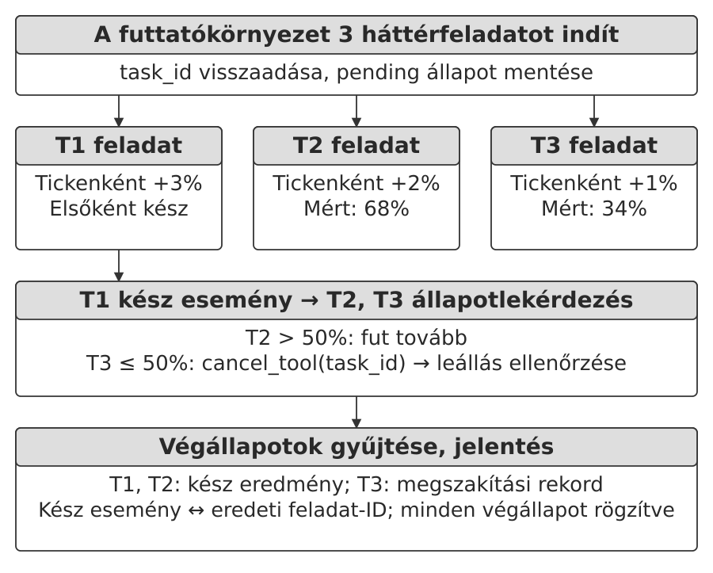
>

### A modell natív aszinkron működése: GPT-6 Astra

Az eddigi megoldásokban a Harness illesztette a szinkron üzenetformátumhoz a működést. A natív aszinkron interfészek viszont közvetlenül megengedik, hogy a modell független munkát végezzen, amíg az eszköz még nem tért vissza, és az eredményt később fogadja. 2026 szeptemberéig a GPT-6 Astra már kínálta az aszinkron eszközhívást (Async tool calling) és a kör közbeni irányítást (Mid-turn steering), amelyek közül az előbbi az eszközre várakozást, az utóbbi a felhasználói frissítéseket kezeli. A 6-6. ábra szembeállítja a szinkron interfészhez való illesztés és a natív aszinkron működés üzenetfolyamát.[^ch6-22][^ch6-23]

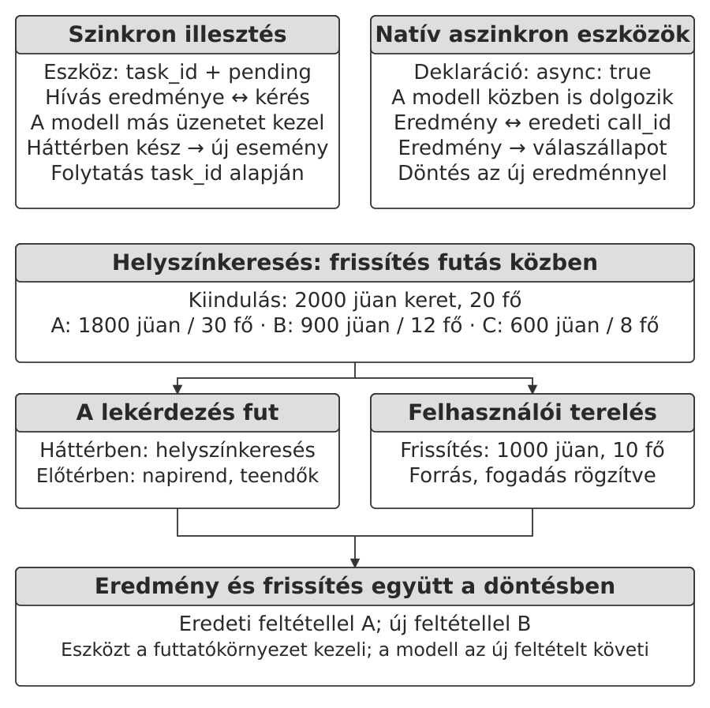

**Független munka az eszközre várva.** Ha például az Agent rendezvényhelyszín-lekérdezést indít, közben összeállíthatja a napirendet és az előkészítési listát; a lekérdezés visszatérése után pedig összehasonlíthatja az árakat és a befogadóképességet. Az eszközdefinícióban az `async: true` jelzi az aszinkron képességet; az alkalmazás a teljes hívási elem megérkezése után indítja a végrehajtást, és elmenti a `call_id` hívásazonosítót. Az eredmény megérkezésekor az alkalmazás az eredeti azonosítóval adja vissza az eredményt, és a legfrissebb válaszállapothoz kapcsolódik. A modell ütemezi a további munkát, a Harness kezeli a hívások összerendelését és a feladatok életciklusát.[^ch6-22]

**Új kérések fogadása a feladat közben.** A felhasználó kiegészítheti, hogy „a keret 1000-re csökken” vagy „a résztvevők száma 10-re változik”, miközben a modell gondolkodik vagy a választ fogalmazza. Az alkalmazás ugyanazon a kapcsolaton küld irányító eseményt, a szerver a fogadás visszaigazolása után az aktuális válaszállapot szerint folytatja a feldolgozást. A kapcsolat megszakadása és újraépülése után az alkalmazás az elmentett események és válaszállapot alapján folytathatja a feladatot.[^ch6-23]

A két képesség együtt is használható: a helyszín-lekérdezés tovább fut, a felhasználó új kérései bekerülnek a további döntésekbe, a lekérdezés eredményének megérkezése után pedig megszületik a választás. A végrehajtó közben a háttérfeladatok valódi állapotát is nyilvántartja. Ha le kell állítani a lekérdezést vagy vissza kell vonni egy foglalást, a Harness meghívja a megfelelő interfészt, és ellenőrzi a nyugtát; a már befejezett üzleti műveletek visszavonási vagy kompenzációs folyamatba kerülnek.

Ha a modell és az interfész már támogatja a natív aszinkron működést, én a natív protokollt részesítem előnyben, és hagyom, hogy az eszközök függőben tartása, a felhasználói frissítések és a válaszok folytatása az interfész szabályai szerint menjen. A szinkron kompatibilitási réteg elsősorban a meglévő modelleket és a régi interfészeket szolgálja; a modell frissítése után fokozatosan eltávolítható az a kompatibilitási logika, amely csak az üzenetpárosítás kiegészítésére szolgált, és a mérnöki ráfordítás a feladatállapotra, a visszavonásra és a folytatásra összpontosítható.

### Az aszinkron feladatok megbízható kezelése

A megbízható aszinkron interakcióhoz egyszerre kell ellenőrizni az üzeneteket, a feladatokat és a végrehajtási állapotot.

1. **Az eredmények hovatartozása.** A késve érkező eredmény az eredeti hívásazonosítót hordozza, az alkalmazás ez alapján rendeli a megfelelő feladathoz; az ettől az eredménytől függő döntések az adatok megérkezése után folytatódnak.
2. **Folytatás és visszavonás.** Ha a felhasználó megváltoztatja a kérését, a rendszer megtartja a még érvényes munkát, frissíti a további lépéseket, és egyértelművé teszi, mely háttérfeladatok futnak tovább és melyek álltak le.
3. **Több kérés.** A keret, a létszám, a régió és a határidő külön-külön kerül a feladatállapotba, a végeredményt pedig ezek mindegyikével szemben ellenőrizni kell.

> **6-3. kísérlet ★★★: A modell natív aszinkron működése és kör közbeni irányítás**
>
> A kísérletben az Agentnek egy szimulált konferenciához kell kiválasztania a legolcsóbb olyan helyszínt, amely megfelel a keretnek és a létszámnak. A kezdeti keret 2000, a létszám 20; a lekérdező eszköz 8 másodperc után adja vissza három helyszín árát és befogadóképességét.
>
> | Helyszín | Ár | Befogadóképesség |
> |---|---:|---:|
> | A | 1800 | 30 |
> | B | 900 | 12 |
> | C | 600 | 8 |
>
> A kezdeti feltételek mellett A-t kell választani. Az irányított csoport a feladat közben két frissítést kap: a keret 1000-re, a létszám 10-re változik, ekkor B a helyes választás. Az eszköz egy újonnan generált nyugtát is visszaad, amelyre a végső válasznak hivatkoznia kell, hogy ellenőrizhető legyen, valóban a ténylegesen megérkezett eredményt használta-e a modell.
>
> A kísérlet öt csoportból áll, mindegyikben három futással: szinkron eszköz, natív aszinkron eszköz, irányítás következtetés közben, irányítás az aszinkron eszközre várakozás közben, valamint kontrollcsoportként egy irányítást nem támogató modell. Az első két csoport azt hasonlítja össze, hogy a várakozás alatt elkészül-e a független előkészítési lista; a két irányított csoportnál azt ellenőrizzük, hogy a keret és a létszám egyszerre érvényesül-e; a képességkontroll azt vizsgálja, hogy az interfész egyértelműen jelzi-e a támogatás hiányát.
>
> Az elmentett futási jegyzőkönyvek szerint az aszinkron eszközt használó csoport a várakozás alatt elkészítette a független listát, és mindkét irányított csoport az új feltételek szerint B-t választotta. Az eszközt használó futások mindegyike csak egyszer kérdezett le, és a tényleges eredményt az eredeti hívásnak adta vissza; a kontrollmodell interfésze pedig egyértelműen közölte, hogy nem támogatja új kérések fogadását egy generálási kör közepén. A szinkron és az aszinkron csoport teljes futási ideje közel azonos, a fő különbség abban áll, hogy a várakozás alatt lehet-e más munkával haladni.
>
> Ha a modell csak arra emlékszik, hogy a létszám 10-re változott, de továbbra is a régi, 2000-es kerettel számol, hová esik a választása? A-ban és B-ben is elférnek, a legolcsóbb továbbra is B. A helyes helyszín kiválasztásából tehát még nem derül ki, hogy a keret frissült-e.
>
> Ha a létszám megváltozott, újra kell-e indítani a már elküldött lekérdezést? A kísérlet eszközének nincs szűrési paramétere, mindhárom helyszínt visszaadja. Az asszisztens felhasználhatja a már úton lévő eredményt, és megérkezése után szűrhet 10 főre és 1000-es keretre. Ha viszont az eszköz csak a legalább 20 főt befogadó helyszíneket adná vissza, a régi eredményben csak A szerepelne, a 12 főt befogadó B benne sem lenne. Ilyenkor ha csak a régi listán írjuk át a létszámot 10-re, B akkor is kimarad. Ha az eredeti lekérdezés már kiszűrte B-t, újra le kell kérdezni.

Az aszinkron mechanizmus lehetővé teszi, hogy a külső változások a feladat menete közben is bejussanak a rendszerbe. A beszéd, a képernyő és a robotok révén megvalósuló interakció még tovább rövidíti a visszajelzési ciklust: a rendszernek folyamatosan kell fogadnia a bemenetet, és a megfelelő pillanatban kell igazítania a kimenetet és a cselekvést.

## Beszéd: a legtermészetesebb ember-gép interfész

A beszéd lehetővé teszi, hogy a felhasználó akkor is elmondja az Agentnek, mire van szüksége, kiegészítse a feltételeket és megerősítse az eredményt, amikor keze vagy tekintete más munkával van elfoglalva. A hangalapú beviteli módszer szöveggé alakítja a diktálást, a hang-Agent ennél tovább megy: a párbeszédet, az eszközhívásokat és a válasz lejátszását is kezeli. Mindkettő támogathatja az előszóban bemutatott whisper codingot.

Ez a szakasz két felhasználási módot tárgyal: amikor a felhasználó közvetlenül az Agenttel beszél, és amikor az Agent a felhasználó nevében külső személyekkel kommunikál. Az előbbinél a felismerés, a válaszadás és a közbeszólás áll a középpontban, az utóbbinál ezen felül a hívás közben a személyazonosság megerősítését, az üzleti lekérdezéseket és a döntéseket is el kell végezni.

### Interakciós időzítés: a kaszkádtól a teljes duplexig

Az OpenAI a GPT-Live bemutatásakor a hangalapú interakció három típusát tekintette át: a kaszkádot, a körökre osztott hangmodellt és a teljes duplexet[^ch6-12]. Ez a fejlődési út fokozatosan a modell folyamatos megítélésére bízza, hogy „mikor szólaljon meg, és mikor hallgasson tovább”. A kaszkádrendszerekben főként a végpontdetektáló logika szervezi a szóátadást, a teljes duplex modellek viszont a folyamatos hang és a párbeszéd állapota alapján kezelhetik az átfedéseket, a szüneteket és a közbeszólásokat.

| Paradigma | Alapszerkezet | Könnyen megvalósítható képességek | Fő tervezési kérdések |
|---|---|---|---|
| Kaszkád | Munkamegosztás a VAD, az ASR, az LLM és a TTS között | A modulok önállóan cserélhetők, a be- és kimenet szakaszonként ellenőrizhető | A modulok közötti késleltetés, az átiratból kimaradó akusztikai információ |
| Körökre osztott végponttól végpontig tartó hangmodell | A modell közvetlenül fogad és állít elő hangot | A hanglejtés, az érzelmek és hasonló információk felhasználása a válaszban | A megszólalás végének megítélése, a szóváltás és a válasz időzítése |
| Teljes duplex | Folyamatosan fogadja a hangot és állítja elő a kimenetet | Egyidejű beszéd, visszajelző hangok, közbeszólás és folyamatos interakció | Folyamatos állapot, a kimenet vezérlése és az interakció értékelése |

Az, hogy a modell közvetlenül dolgozza-e fel a hangot, hogy a be- és kimenet folyamatos-e, és hogy egyszerre tud-e hallgatni és beszélni, külön-külön ellenőrizhető képességek. Egy kaszkádrendszer is kiegészíthető folyamatos modulokkal és megszakításvezérléssel; a végponttól végpontig tartó modellek interakciós ritmusa pedig a konkrét tervezéstől függ.

[^ch6-12]: OpenAI, *Introducing GPT-Live*, 2026-07-08; bemutatja a kaszkádot, a körökre osztott hangmodelleket és a teljes duplex interakciót.

### 1. paradigma · Kaszkádolt csővezeték (Cascading)

A kaszkádrendszer több modulra bontja a hangalapú párbeszédet. A beszédaktivitás-érzékelés (VAD) megtalálja a hangban a beszédszakaszokat, a végpontdetektáló logika pedig eldönti, mikor kerüljön továbbításra az adott szakasz; az automatikus beszédfelismerés (ASR) szöveggé alakítja a hangot; az LLM megérti a kérést és megírja a választ; a beszédszintézis (TTS) pedig lejátszható hanggá alakítja a választ. A 6-7. ábra a sorban egymás után végrehajtott alapszerkezetet mutatja.

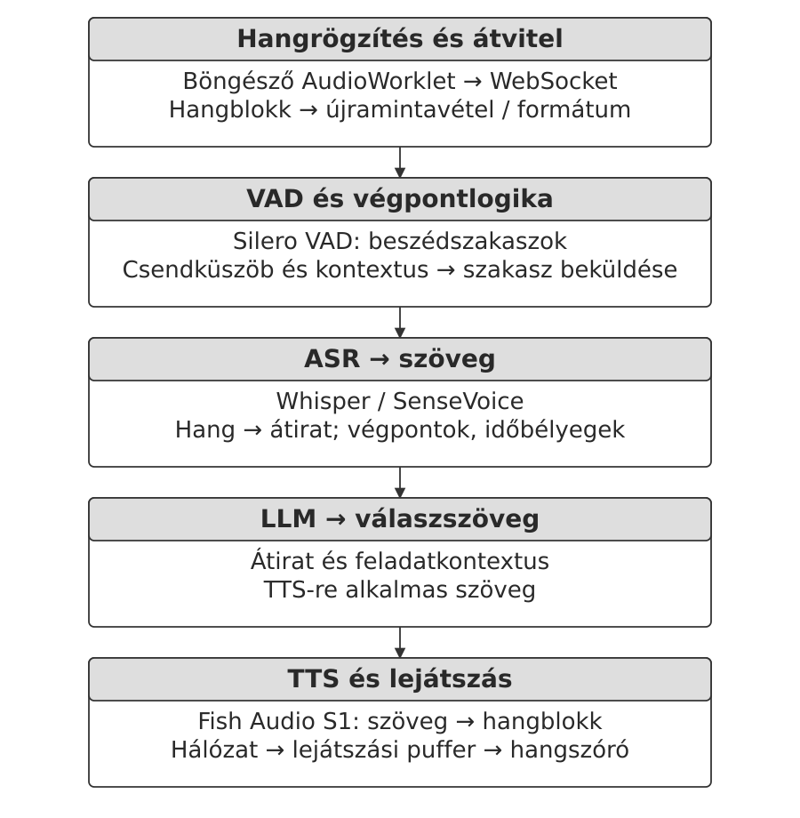

Az akusztikus VAD megtalálja azokat a szakaszokat, amelyekben valaki beszél, így a felismerés átugorhatja a hosszú csendeket. Ugyanaz a szünet azonban mást jelent a „Szeretnék foglalni…” után, mint a „Van még jegy csütörtök délelőttre?” után. A szemantikus VAD (szemantikus végpontdetektálás) az első esetben tovább hallgat, és csak a második esetben adja át a szót a párbeszédmodellnek. Ez a hangalapú megfigyelés időbeli ritkítása: egy folyamatos hangfolyam csak néhány pillanatban vált ki következtetést. Hogy megszólaljon-e, azt az a modell dönti el, amely a mondatot hallotta; hallgathat tovább is, vagy előbb utánanézhet a járatoknak.

| Modul | Szerep | Jellemző várakozási és hibaforrások |
|---|---|---|
| VAD és végpontdetektáló logika | Beszéd érzékelése, a továbbítás időpontjának eldöntése | Csendküszöb, zaj és mondat közbeni szünetek |
| ASR | A hang szöveggé alakítása | Dekódolási idő, nevek és szakkifejezések felismerése |
| LLM | Megértés, következtetés és válaszírás | Kérések sorban állása, a válasz első szakaszának előállítása |
| TTS és lejátszás | Hang szintetizálása és eljuttatása a hangszóróhoz | Az első csomag szintézise, hálózati átvitel és lejátszási puffer |

Teljesen soros megvalósításban a felhasználónak, miután befejezte a mondandóját, egymás után ki kell várnia a végpont megerősítését, az átírást, a válasz előállítását és az első hangszakaszt. A 6-8. ábra példájában mire a felhasználó meghallja a válasz első hangját, már 1,4 másodperc telt el, és ebből a leghosszabb szakasz az, amíg a rendszer megbizonyosodik róla, hogy a felhasználó befejezte (500 ezredmásodperc). Ha az átírás ideje 100-ról 50 ezredmásodpercre csökken is, a felhasználó csak 50 ezredmásodperccel vár kevesebbet.

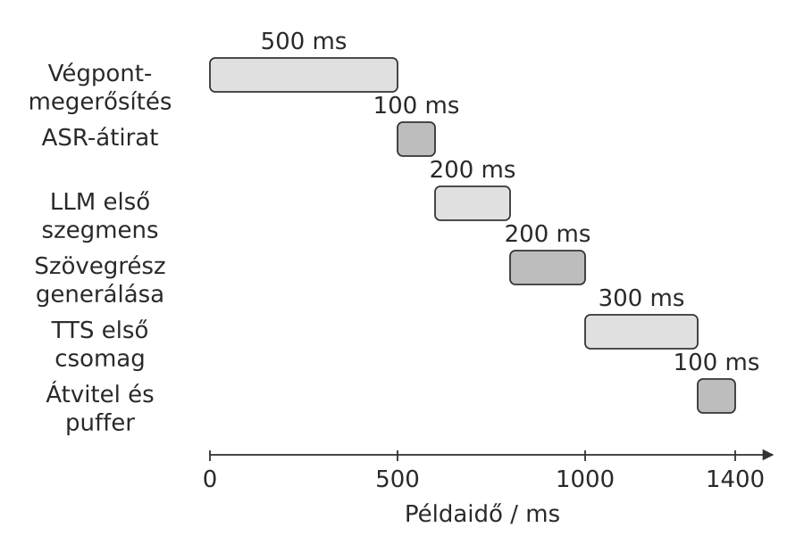

A szolgáltatás terhelése sorban állást is okoz. A 6-9. ábra az M/M/1 egycsatornás kiszolgálási modellel szemlélteti ezt az összefüggést: ha az érkezések Poisson-folyamatot követnek, a kiszolgálási idő exponenciális eloszlású, az átlagos kiszolgálási idő $S$, a kihasználtság pedig $\rho<1$, akkor a kiszolgálást és a sorban állást együtt tartalmazó átlagos teljes idő $W=S/(1-\rho)$. Ha $S=1$ másodperc, és a kihasználtság 0,5-ről 0,8-ra nő, az átlagos teljes idő 2 másodpercről 5 másodpercre emelkedik. Ebből maga a kiszolgálás átlagosan továbbra is 1 másodperc, a többlet 3 másodperc teljes egészében sorban állással telik. Ha a kérések a feldolgozási kapacitás közelébe érnek, a rövid távú forgalmi ingadozások is torlódást okoznak.

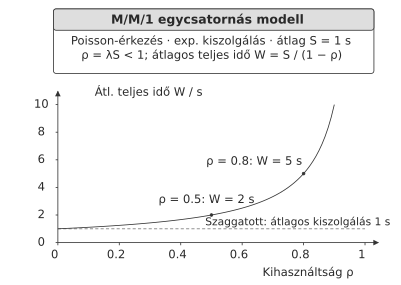

> **6-4. kísérlet ★: Hagyományos hang-Agent építése**
>
> Tegyük fel, hogy az asszisztens éppen a csütörtöki járatokat sorolja, ön pedig közbeszól: „Várjon, péntekre szeretnék foglalni.” A böngésző WebSocketen küldi a mikrofon hangját a háttérrendszernek. Amint a Silero VAD észleli, hogy megszólalt, a háttérrendszer `speech_start` jelet küld, a böngésző pedig azonnal leállítja a lejátszást, és kiüríti a sorban álló régi hangot. Az asszisztens ekkor még nem tudja, melyik napra módosított. Csak miután befejezte, és a csend meghaladja az alapértelmezett 500 ezredmásodpercet, küldi el a háttérrendszer a `speech_end` jelet, és adja át a beszédszakaszt a helyi Whisper tiny modellnek átírásra.
>
> Amikor a Doubao elkezdi visszaadni a szöveget, mennyi idő van még hátra, amíg a felhasználó meghallja a választ? Egy felvétel-visszajátszási kör jegyzőkönyve szerint az átírás 2,710 másodpercig tartott. A Doubao a kérés elküldése után 0,749 másodperccel adta vissza az első tokent, a teljes választ pedig csak 0,792 másodpercnél. A visszajátszó program megvárta, amíg a teljes szöveg megérkezik, és csak akkor adta át a Fish S1-nek szintézisre; újabb 2,819 másodperc múlva kapta meg a háttérrendszer az első hangcsomagot. A végpont megállapításától számítva a három soros szakasz összesen nagyjából **6,321 másodperc**. Az archivált jelentésben 6,279 másodperc szerepel, mert az a teljes válasz előállításának ideje helyett az első token idejével számolt.
>
> Ez a 6,321 másodperc csak a háttérbeli feldolgozást fedi le. A felhasználónak előbb meg kell várnia, amíg a csendérzékelés megállapítja, hogy befejezte a mondatot, a végén pedig azt is, hogy a hang eljusson a böngészőbe, és elinduljon a lejátszás.

#### A soros feldolgozástól a folyamatos érzékelésig

A soros megoldás szakaszonként könnyen ellenőrizhető, de három problémát is felszínre hoz. A csendre várás növeli a végpontkésleltetést; az átirat elveszítheti a hangnemet, az érzelmeket és a környezeti hangokat; ha pedig a hangot szünetek mentén daraboljuk, az e-mail-címek, nevek vagy szakkifejezések elveszíthetik teljes kontextusukat. Azoknál a rendszereknél, amelyek már kaszkádarchitektúrára épülnek, először a folyamatossá alakítást javaslom: minden szakasz minél korábban adjon növekményes eredményt, a felismerés, a következtetés és a lejátszás fedje át egymást, közben pedig külön kell kezelni a már megerősített és a még változó részeket. Így a meglévő modulok újrahasznosíthatók, és fokozatosan kideríthető, honnan ered a várakozási idő.

- **Hallgatás közbeni átírás az ASR-ben.** A rendszer folyamatosan fogadja a hangot, ideiglenes átiratot ad ki, a később érkező hang alapján javítja a bizonytalan részeket, és a végpont megerősítésekor adja meg a végleges szöveget.
- **Spekulatív végrehajtás az LLM-ben.** Az ideiglenes átirat alapján előre elkészíti a választ. A végleges szöveg megerősítése után ellenőrzi, hogy a bemenet egyezik-e, és hogy a már elvégzett munka érvényes-e még, majd dönt a megtartásról, a módosításról vagy az újragenerálásról. A külső küldés és az üzleti írási műveletek csak a szükséges feltételek megerősítése után hajthatók végre.
- **Szakaszos kimenet az LLM-ből.** Amint elkészül egy felolvasásra alkalmas szövegrész, azonnal átkerül a TTS-hez; a darabolásnál meg kell őrizni a mondat jelentését, az írásjeleket és a hanglejtésre utaló jeleket.
- **Növekményes szintézis a TTS-ben.** A hangdarabok fokozatosan érkeznek vissza, így a további szöveg előállítása, a szintézis és a lejátszás átfedheti egymást. Közbeszóláskor egyszerre kell kezelni a generálási feladatot és a lejátszási pufferben még el nem hangzott tartalmat.

A Whisper szokásos átírási megvalósítása hangablakonként kódol és dekódol[^ch6-whisper]. Külső darabolással vagy a növekvő előtag ismételt beküldésével növekményes átírási folyamat építhető; az állapot folyamatos újrahasznosítását, az ismételt kódolás költségét és a korábbi szöveg javítását a konkrét megvalósításnak kell kezelnie. A natívan folyamatos felismerő modellek viszont architektúrájukban és tanításukban közvetlenül kezelik a folyamatos bemenetet.

A hangalapú nyelvi modellekre épülő érzékelő rendszerek a szöveget és az akusztikai eseményeket együtt is kiadhatják. A korábbi hang, az átirat és a szókincsre vonatkozó tippek segítenek a nevek, márkák és szakkifejezések felismerésében; hogy mennyi előzmény marad meg, az a kontextus- és gyorsítótár-tervezéstől függ. Annak megítéléséhez, hogy „befejezte-e a felhasználó”, a modell a szemantikai teljességet és a csendet együtt veheti figyelembe. A „Szeretnék foglalni…” utáni szünetnél a valós idejű rendszer csak ezt a pár szót hallotta, és még nem tudhatja, hogy dátum következik.

Az átiraton túl az interfész a következő eseményekben is megállapodhat: a `speak_start` és `speak_end` a beszéd kezdetét és végét jelzi, az `interrupt` a közbeszólást, az `emotion` az érzelmi állapotot írja le, a `laugh`, `sigh` és `noise` pedig a nevetést, a sóhajt és a környezeti zajt rögzíti. Ezek az események a szöveggel és az időbélyegekkel együtt juthatnak el az Agenthez.

> **6-5. kísérlet ★: Folyamatos hangérzékelés szimulálása a Qwen2-Audióval**
>
> A kísérlet fokozatosan növeli a hangelőtagot, és minden alkalommal a kezdettől az aktuális pillanatig tartó hangot küldi újra a Qwen2-Audiónak, hogy megfigyelje, hogyan változik az átirat és az akusztikai események sora a bemenettel. Az összehasonlító útvonal 600 ezredmásodperces csendvégpontot és Whispert használ. A teszt normál beszédet, egy 900 ezredmásodperces szünettel megtört hosszú mondatot, valamint rózsaszín zajjal kevert beszédet tartalmaz.
>
> A helyi kvantált modell ezúttali futása 13 előtag-következtetést őrzött meg, egyenként nagyjából 8–11 másodperces futásidővel. A mondat közbeni szünet szakaszhatárt váltott ki az összehasonlító útvonalon; a hangmodell felismerte a zajt, de tévesen köhögést és nevetést is jelzett.

[^ch6-whisper]: OpenAI, Whisper; bemutatja a hangablakonkénti átírást és a modell megvalósítását.

### 2. paradigma · Végponttól végpontig tartó omnimodális modellek (Omni)

A végponttól végpontig tartó hangmodell közvetlenül fogadja a hangot, a nyelvi és akusztikai információ alapján állítja elő a választ, majd hangkimeneti ágán keresztül beszéddé szintetizálja. A hang közvetlen feldolgozása kihasználhatja a beszédtempót, a hangmagasságot, a szüneteket és a környezeti hangokat; az átírás utáni válaszadás viszont megkönnyíti a köztes szöveg ellenőrzését és a modulok önálló cseréjét.

Ezek az akusztikai jellemzők befolyásolják a megértést. Ugyanaz a mondat – „kérem, küldje el a jelentést ebéd előtt” – sietve vagy lassan kimondva más benyomást kelt a hallgatóban. Kimenetkor a modell is szervezheti a jelentést szünetekkel, hangsúllyal és hanglejtéssel.

A hangot közvetlenül feldolgozó rendszer is megvárhatja, amíg a felhasználó befejezi a mondandóját. Ha például a felhasználó telefonszám bediktálása közben megáll, a rendszernek akkor is el kell döntenie, hogy a számsor teljes-e már. A végpontdetektálás dönti el, mikor válaszoljon; ha pedig a másik fél a felolvasás közben közbeszól, a rendszernek a modell generálását és a hangszóró lejátszását is össze kell hangolnia.[^ch6-audio-architectures]

> **6-6. kísérlet ★★: A MiniCPM-o 4.5 helyi futtatása – végponttól végpontig és önkaszkád összehasonlítása**
>
> A kísérlet ugyanazt a MiniCPM-o 4.5 modellt használja kikapcsolt gondolkodási móddal, és két útvonalat hasonlít össze: a kérdés megválaszolását közvetlenül a hangból, illetve úgy, hogy a modell előbb átírja a hangot, majd csak az átirat alapján válaszol. A bemenet két szóban elhangzó számtani feladatot és két szövegében azonos, de eltérő tempójú hangfelvételt tartalmaz.
>
> Mindkét útvonal három kérdésre válaszolt helyesen, de a hibák más-más helyen jelentkeztek. A közvetlen hangútvonal az egyik feladatban a twelve boxes kifejezést 8-nak hallotta, ami számítási hibához vezetett; az átírási útvonal helyesen megőrizte a 12-t. A tempóra vonatkozó feladatban mindkét felvétel azt mondta: „Please send the report before lunch.” Az átírás után a szöveg teljesen azonos volt, így a gyors és lassú tempóra vonatkozó információ elveszett; a közvetlen hangútvonal viszont helyesen megkülönböztette a két tempót.
>
> A kísérlet ezen felül előállított egy 24 kHz-es beszédrészletet, amely összeköti a bemenet megértését a hangkimenettel.

### 3. paradigma · Teljes duplex interaktív modellek

A teljes duplex rendszer egyszerre beszél és hallgat, és ennek legkönnyebben észrevehető haszna az, hogy a beszélgetés élő emberrel folytatott társalgásnak tűnik. Olvassuk el ezt a mondatot: „Szerdára szeretnék jegyet… nem, csütörtökre.” A közbülső szünetbe belefér ez az önjavítás; ha az asszisztens már elkezdte sorolni a szerdai járatokat, a „nem, csütörtökre” hallatán abba kell hagynia. Más pillanat az, amikor a másik fél még az útitervét magyarázza: egy rövid, halk helyeslő hang jelezheti neki, hogy az asszisztens figyel. Csak a hang folyamatos fogadása teremti meg a feltételt arra, hogy a rendszer a beszéd, a hallgatás, a szünet és az eszközhívás között így válasszon. A szinkrontolmácsolás ugyanígy megköveteli a be- és kimenet átfedését.

A Kyutai 2024-ben kiadott **Moshi** modellje külön modellezi a felhasználó és a modell hangfolyamát, és párhuzamos folyamokkal ábrázolja az egyidejű beszédet és a közbeszólást[^ch6-moshi]. Ha ezek az időbeli viszonyok megmaradnak a bemenetben, a modell megtanulhatja, mikor válaszoljon, és mikor hallgasson tovább.

A Thinking Machines Lab interakciós modellje a folyamatos be- és kimenetet egyforma hosszú, egyenként 200 ezredmásodperces rövid darabokra vágja, amelyeket mikrokörnek (micro-turn) nevez[^ch6-14]. Nézzük a 6-10. ábra idővonalán a második cellát: az asszisztens még azt mondja, „csütörtök”, de már hallja a felhasználó dátumot javító „nem”-jét. A harmadik cellában az asszisztens elhallgat, és tovább figyel, amíg a felhasználó végigmondja, hogy „péntek”.

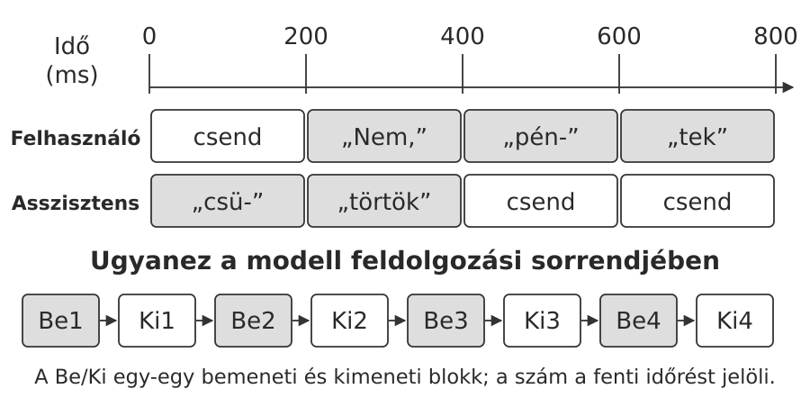

Olvassuk tovább az ábra alsó felét. A hívás két résztvevője két, egymást átfedni képes hangot hall, a modell viszont egyetlen sorozat mentén, felváltva dolgozhatja fel a bemeneti darabokat és állíthatja elő a kimeneti darabokat. A csend is elfoglal egy cellát, így az asszisztens előbb hallgathat egy kicsit, mielőtt megszólal. Az ábrán szereplő 200 ezredmásodperc ennek a megvalósításnak a darabhossza; attól, hogy a felhasználó közbeszól, addig, hogy a hangszóró ténylegesen elhallgat, a feldolgozás és a lejátszási puffer idejével is számolni kell.

[^ch6-moshi]: Kyutai, *Moshi: a speech-text foundation model for real-time dialogue*, 2024; bemutatja a felhasználó és a modell párhuzamos hangfolyamait.
[^ch6-14]: Thinking Machines Lab, *Interaction Models: A Scalable Approach to Human-AI Collaboration*; bemutatja a mikroköröket, a többfolyamú interakciót és a háttérfeladatok delegálását.

### Kognitív időzítés: valós idejű interakció és mély gondolkodás

A Pine ügyfélszolgálati hívásaiban, amikor az ügyintéző félbehagy egy mondatot, az asszisztensnek néha várnia kell, néha halkan visszajeleznie; és amikor ő maga beszél, akkor is meg kell hallania a másik fél közbevetett javítását. Éppen ezért bízom a Moshi által képviselt irányban: ha jó az időzítés, a másik fél valóban úgy érzi, hogy a vonal túlsó végén valaki figyel rá. Ha egy kéréshez utána kell nézni valaminek, egy másik időmérleget is fel kell állítani: attól, hogy a rendszer megértette a kérdést, addig, hogy kimondja a megtalált választ, hányszor kell kézről kézre adni a feladatot?

Azokat az eszközöket, amelyeket az előtérben futó hangmodell közvetlenül meghívhat, az előtér hívja meg. Egy járatlekérdezéshez mindössze két modellhívás kell: az előtér a felhasználó által megadott feltételekkel lekérdez, majd jelenti az eredményt. Delegálás esetén négy kell: az előtér átadja a feladatot, a háttér elindítja a lekérdezést, a háttér rendezi az eredményt, az előtér pedig továbbadja. Egy másik álláspont szerint a valós idejű modell hibás paramétereket adhat meg, ezért az eszközöket a háttérnek kell hívnia, az előtér pedig összpontosítson arra, mikor hallgasson és mikor beszéljen.

A GPT-Live-1 előterének nincs interfésze üzleti függvények közvetlen hívására, csak a háttérben futó Agentre delegálhat. Az OpenAI Realtime GPT-Realtime modellje támogatja, hogy az előtér közvetlenül függvényt hívjon. A Doubao valós idejű hangmodell 3.0 (Seeduplex) tisztán végponttól végpontig tartó módban szintén támogatja az előtérbeli közvetlen hívást, vegyes vezénylésnél viszont a külső nyelvi modell hív.[^ch6-voice-tools]

Jelölje $L_f$ és $L_b$ az elő- és a háttérmodell egy-egy hívásának idejét, $T$ pedig az eszköz futásidejét. Attól, hogy a felhasználó befejezte a mondatot, addig, hogy meghallja az eredményt, közvetlen hívásnál nagyjából $2L_f+T$, delegálásnál nagyjából $2L_f+2L_b+T$ idő telik el. A delegálás $2L_b$ többlete független a $T$ eszközidőtől. Az olyan információt, amelyre minden körben szükség lehet, például a felhasználói memóriát, a futtatókörnyezet előre lekérdezheti és a kontextusba helyezheti; így az előtérnek csak egyszer kell meghívnia a modellt, ami nagyjából $L_f+T$; ha pedig a lekérdezés már azelőtt megtörtént, hogy a felhasználó megszólalt, még a $T$ is megspórolható.

A többlépéses következtetést igénylő feladatokat, például több átfoglalási lehetőség összehasonlítását, érdemes a háttérre bízni. A jegyfoglalás terheléssel és jegykiállítással jár, ezért – bárki hívja is az eszközt – csak a felhasználó megerősítése után szabad megrendelni. A járatok eredményét szóban össze lehet foglalni, a teljes táblázat pedig a képernyőn jeleníthető meg; ez független attól, ki hívja az eszközt.

> **6-7. kísérlet ★★: Az előtér vagy a háttér hívja a hang-Agent eszközeit?**
>
> Az előteret a Doubao valós idejű hangmodell 3.0-val, a hátteret a Volcano Ark által kínált DeepSeek V4 Pro modellel építjük fel. Öt szimulált eszközt készítünk elő – időjárás-lekérdezés, felhasználói memória lekérdezése, webes keresés, járatlekérdezés és jegyfoglalás –, amelyek előre beállított idő után adnak eredményt; a járatlekérdezés és a jegyfoglalás 2–5 másodpercig tart. A felhasználói felvételeket előre szintetizáljuk, és minden alkalommal ugyanannak a forgatókönyvnek a felvételét játsszuk vissza.
>
> Négyféle munkamegosztást állítunk be. Az elsőben az előtér hív minden eszközt. A másodikban a háttér hív minden eszközt, az előtér csak delegálhat. A másik kettőben az előtér kérdezi le az időjárást, a futtatókörnyezet a munkamenet elején a kontextusba helyezi a felhasználói memóriát, a háttér pedig a webes keresésért és a jegyfoglalásért felel. A kettő abban különbözik, hogy a járatlekérdezést az előtér vagy a háttér végzi. Az előtér közvetlenül hallja a felhasználó hangját; a háttér nem hall hangot, csak szöveget olvashat. A Doubao interfésze a felhasználó minden mondata után külön visszaadja a beszédfelismeréssel kapott szöveget is, ezt nevezzük átiratnak. Delegáláskor az átiratot és az asszisztens által elmondottakat időrendben hívásnaplóvá rendezzük, és a hívásban eddig végrehajtott eszközhívásokkal és az előtér által írt feladatleírással együtt átadjuk a háttérnek. Minden munkamegosztásnál az alábbi forgatókönyveket tízszer ismételjük meg.
>
> 1. Külön lekérdezzük az időjárást és a járatokat. Attól mérjük az időt, hogy a felhasználó befejezte a mondatot, addig, hogy elhangzik a lekérdezés eredménye; az olyan átvezető mondatok, mint „utánanézek”, nem számítanak válasznak. Összehasonlítjuk a közvetlen hívás és a delegálás várakozási idejének mediánját. Az én kísérletemben az időjárás-lekérdezésnél ez 2,81, illetve 6,96 másodperc volt.
> 2. Előbb járatot keresünk, majd jegyet választunk és megerősítjük. Az előző kör lekérdezési eredménye, a felhasználó utolsó mondata és a felhasználói adatok alapján tételesen ellenőrizzük a foglalás 13 mezőjét, és azt, hogy a megrendelés időpontja későbbi-e a felhasználó megerősítésénél. Az én kísérletemben mind a négy munkamegosztás minden mezőt helyesen töltött ki, és mind csak a felhasználó megerősítése után rendelt.
> 3. Ezután egy kolléga számára foglalunk jegyet, és lejátsszuk azt a felvételt, amelyen a felhasználó szóban betűzi a kolléga kínai nevét (Chen Jiayi), írásjegyenként megmondva, melyik szóból ismert „Chen”, „Jia” és „Yi” jegyről van szó. A felvételt, a beszédátiratot és a rendelésben szereplő nevet összevetve ellenőrizzük, hogy az előtérbeli közvetlen foglalás és a delegált foglalás egyaránt helyesen adta-e meg a nevet. Az én kísérletemben az előtérbeli közvetlen foglalás tízből tízszer helyes volt; az átirat viszont azonos hangzású, de más „Jia” és „Yi” írásjeggyel rögzítette a nevet, és delegálásnál emiatt egyes rendelésekben hibás név szerepelt.
> 4. Mielőtt a járatlekérdezés eredménye megérkezne, lejátsszuk az időjárásra vonatkozó kérdés felvételét, és figyeljük, hogy az előtér válaszol-e az időjárási kérdésre, majd elmondja-e a járat eredményét. Az én kísérletemben az időjárási kérdésre minden esetben érkezett válasz, az eredeti járateredmény viszont szinte soha nem hangzott el utána.

Ha delegálni kell, az előtérnek a biztosan hallott neveket, számokat és a felhasználó friss javításait bele kell írnia a feladatleírásba, nehogy a háttér az átírási hiba miatt rossz paramétert adjon meg. A futtatókörnyezetnek fel kell jegyeznie a még el nem mondott eredményeket, hogy az előtér a közbevetett kérdés megválaszolása után folytathassa a jelentést.

Ha a gyors modell azt mondja, „utánanézek”, az ügyintéző tudja, hogy az asszisztens megértette a kérést. Hogy mikor tudja megmondani a jegyárat, az viszont attól függ, hogyan hangolódik össze a lekérdezés és a következtetés a hívással. A 6-11. ábra három elrendezést mutat be: előbb válasz, aztán részletes kifejtés; az előtér folyamatosan kommunikál és fogadja a háttér javaslatait; illetve a gondolatszervezés és a kifejezés szakaszonként párhuzamosan halad.

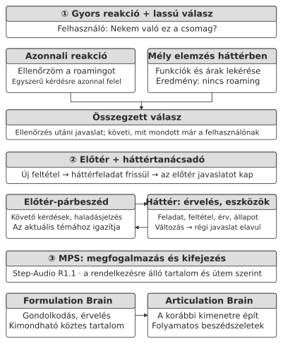

#### 1. megoldás: gyors gondolkodás a reagáláshoz, lassú gondolkodás a válaszhoz

A gyors modell előbb rövid reakciót ad, a lassú modell a háttérben elvégzi az elemzést, majd kiegészíti a részletes válasszal. Ez a felépítés lehetővé teszi a kérés fogadásának korai visszaigazolását, de kezelni kell a két válasz összhangját. Ha például a gyors modell előbb egy bizonyos csomag megvásárlását javasolja, a lassú modell pedig utána rájön, hogy a csomagból hiányzik egy kulcsfontosságú funkció, a két javaslat ütközik. Az ütközés oka az, hogy a két oldal egymástól függetlenül válaszol, és ítéletük alapja, valamint következtetésük előrehaladása eltérhet. A gyors modell kimondott javaslata már beépült a felhasználó mérlegelésébe, sőt a felhasználó cselekedhetett is ennek alapján; ha a lassú modell utólag javít, meg kell magyaráznia a változást, és kezelnie kell a már bekövetkezett következményeket.

Ezért az előtérnek külön kell kezelnie a feladat visszaigazolását és az üzleti következtetést. Az „utánanézek, tartalmazza-e a csomag ezt a funkciót” azonnal kimondható, a vásárlási javaslatnak viszont meg kell várnia a szükséges lekérdezést és elemzést. Amikor a háttér eredménye megérkezik, a rendszer összeveti a már elhangzottakkal, és ennek alapján szervezi meg a további választ. Az egyszerű kérdéseket a gyors modell közvetlenül is elintézheti, így elkerülhető a kettős feldolgozás.

#### 2. megoldás: gyors gondolkodás az interakcióhoz, lassú gondolkodás a figyelmeztetéshez

A beszéd és a képernyő is megoszthatja egymás között a munkát. Ha szóban elhangzik, hogy „ebben a hónapban 15 euró barangolási díjjal több a számla”, a felhasználó egyből megérti a lényeget; ha az eredeti összeg, az új ár és a vitatott tételek a képernyőn maradnak, a felhasználó a saját tempójában ellenőrizheti őket. Egy konkrét művelet megerősítése kattintással is mehet, az érzékeny adatokat pedig a felhasználó maga adja meg a kereskedő által elfogadott beviteli felületen. Az előtérnek csak egy olyan állapotot kell megkapnia, mint „az ellenőrzés megtörtént”, és máris természetesen folytathatja a beszélgetést.

Tegyük fel, hogy egy utas megkéri a Pine-t, hogy foglaljon neki repülőjegyet csütörtök délelőttre Sanghajba, 1200 jüanos keretből, mert délre a rendezvény helyszínén kell lennie. A Pine a légitársaság ügyintézőjével beszél, és közben „cetlit csúsztat” a háttérnek: „Ha délelőtt tízkor érkezik Hongqiaóba, odaér-e időben a reptérről a helyszínre?” Az ügyintéző megnézi a szabad helyeket, és közli a Pine-nal: „A tízórás hongqiaói járat elfogyott. Van még egy, amely fél tizenegykor érkezik Pudongba, 1250 jüanért.” Ha a háttér csak az előtértől kapott cetlit látja, még mindig a Hongqiaóból induló útvonalat számolja. Az előtérnek ezért még egyszer szólnia kell: „Számold át Pudongra, fél tizenegyes landolással, a helyszín és az érkezési határidő változatlan.”

Egy másik megoldás az, hogy a hívásnaplót is sorrendben szinkronizáljuk a háttérrel. Ha a háttér a hívásnaplóból már kiolvasta az ügyintéző által közölt repülőteret és landolási időt, az előtérnek elég annyit mondania, hogy „számold ki, odaér-e ezzel a járattal”, és ugyanazt a feladatot delegálhatja. A napló szinkronizálásakor jelölni kell, ki mit mondott; az előtér félbeszakított, még el nem hangzott félmondatát is el kell különíteni attól, ami már elhangzott. A beszédátirat kihagyhat vagy elírhat kulcsfontosságú információkat. Az előtérnek a pontosan hallott neveket, számokat és a felhasználó javításait bele kell írnia a feladatleírásba. Ha a két nyilvántartás eltér, a háttér a feladatleírást tekinti mérvadónak. Miután a háttér végzett, elég megmondania az előtérnek, hogy várhatóan hánykor ér oda a helyszínre, és mennyire szoros az idő. Hogy útközben milyen útvonalakat nézett meg, és a térképinterfész milyen mezőket adott vissza, az a háttérben maradhat későbbi ellenőrzésre. Az eredménnyel az előtér tárgyal tovább az ügyintézővel.

Az 1. fejezet üzleti utasa azt szeretné, hogy a jegyár 1200 jüan alatt maradjon. Korábbi útjai során hajlandó volt kicsit többet fizetni egy alkalmas járatért, és ezúttal sem adott meg külön felső határt. Amikor kiderül, hogy a legolcsóbb ár 1250 jüan, az asszisztens lefoglalhatja helyette. Ha viszont egy mindig gondosan számolgató felhasználó utazik a családjával, erről az 50 jüanról előbb meg kell kérdezni. Az előtérnek így egyszerre két beszélgetésre kell figyelnie:

- A felhasználónak: „Ennél a járatnál a legolcsóbb jegy 1250 jüan, 50 jüannal több a keretnél. Lefoglaljam?”
- Közben az ügyintézőtől: „Tudná egy ideig tartani ezt az árat? Van ugyanazon a napon későbbi járat 1200 jüan alatt?” Amíg az ügyintéző keres, az előtér a poggyászkeretet és a módosítási, visszatérítési feltételeket is tisztázhatja.

Így amikor a felhasználó visszatér, több lehetőséget lát, az ügyintéző pedig tudja, mit kell még megnéznie. Ha a felhasználó később elmagyarázza, hogy „múltkor egy megbeszélésre siettem, de ezentúl üzleti útnál is kérdezz meg, ha túllépi a keretet”, legközelebb ezt az új kérést kell követni.

A személyes ellenőrzésre várva megint más a beszélgetés ritmusa. Ha az ügyintéző közli, hogy elküldte az ellenőrző kódot, az előtér így válaszolhat: „Rendben, egy pillanat türelmet kérek, megkérem az utast, hogy nézze meg a telefonját.” Ha az utas azt üzeni vissza, hogy még nem kapta meg, megkérdezheti az ügyintézőtől, milyen végződésű számra ment az SMS, és mikor lehet újraküldeni. Miután az utas a kereskedő által kijelölt csatornán elvégezte az ellenőrzést, az előtér folytathatja az ügyintézést. Egy ilyen hívásban az is jobb megoldás, ha egy kicsit tovább várunk vagy később állítjuk ki a jegyet, mint ha a felhasználót sürgetnénk, hogy azonnal döntsön.

Ekkor a háttérből megérkezik, hogy „az eredeti ajánlat frissült”. Az előtér előbb az ügyintézővel ellenőrzi az új árat, és csak utána szól a felhasználónak. Ha a felhasználó éppen ekkor válaszol, hogy „foglald le”, ez a válasz a neki korábban elküldött 1250 jüanos ajánlatra vonatkozik. Az előtérnek az új ár és a meglévő felhatalmazás alapján kell eldöntenie, kell-e újra megerősítést kérni. A háttér csak információt ad, az ügyintézővel mindig az előtér beszél, és ő vállal kötelezettséget. Csak ha az üzenet tartalmazza a járatot, az ár érvényességi feltételeit és az időpontot, tudja az előtér felismerni, melyik ajánlat járt le.

Ugyanannak a háttérüzenetnek – „az ár változott, ellenőrizd” – a megérkezési időpontja is befolyásolja, hogyan reagál rá az előtér. Ha az ügyintéző éppen azt mondja, „a legolcsóbb jegy ára…”, az előtér előbb végighallgathatja az összeget. Ha az ügyintéző már megmondta az árat, és válaszra vár, ez a megfelelő pillanat az új ár felől érdeklődni. Ha az utas éppen közbeszólt a telefonban, hogy „várjon, módosítom a dátumot”, előbb az új dátumot kell tisztán hallani, és csak aztán eldönteni, kell-e még ellenőrizni az eredeti járatot. Ugyanaz a „rendben” az ügyintéző feltételismertetése közben talán csak annyit jelent, hogy figyelünk, a „Kiállíthatom most a jegyet?” kérdés után viszont vásárlási beleegyezésként értelmezhető. Aki csak az átiratot nézi, ezeket a különbségeket nem veszi észre.

#### 3. megoldás: a gondolatszervezés és a kifejezés összehangolt haladása

A Step-Audio sorozat két kapcsolódó példát kínál. A **modalitáshoz horgonyzott következtetési desztilláció (MGRD)** arra figyel, milyen információra épül a következtetés: a hangmagasság, a ritmus, a hanglejtés és más akusztikai jellemzők köré épít és szűr következtetési adatokat, és iteratív desztillációval javítja a hangmegértést. A Step-Audio R1 a megerősítéses tanulási szakaszban két részből pontozza a hangalapú feladatokat: a helyes válasz 0,8 pontot ér, a következtetési folyamat leírása további 0,2 pontot. Az utóbbi arra ösztönzi a modellt, hogy leírja az indoklását; hogy a következtetés valóban felhasználta-e a felvétel akusztikai jeleit, azt viszont már a korábbi mintaszűréskor kell ellenőrizni.[^ch6-mgrd]

A **Mind-Paced Speaking (MPS)** a következtetés és a kifejezés időzítésére összpontosít: egy gondolatszervező modult (Formulation Brain) és egy kifejező modult (Articulation Brain) használ, és a gondolatszervezés irányítja a beszéd előállítását. A Step-Audio R1.1 valós idejű megoldása ezt a módszert alkalmazza.[^ch6-mps]

A két modul az előrehaladás szerint cserél információt: a gondolatszervezés folyamatosan halad, a kifejezés pedig a már rendelkezésre álló tartalom és a korábbi kimenet alapján szervezi a beszédet. Így a kifejezés egy része átfedheti a későbbi következtetést, miközben a rendszer követi, mi hangzott már el.

[^ch6-mgrd]: StepFun, *Step-Audio-R1 Technical Report*; bemutatja a modalitáshoz horgonyzott következtetési desztillációt.
[^ch6-mps]: StepFun, *Mind-Paced Speaking: A Dual-Brain Approach to Real-Time Reasoning in Spoken Language Models* és a Step-Audio-R1.1 modellkártyája; bemutatja a gondolatszervező és a kifejező modult, valamint alkalmazásukat valós idejű rendszerekben.

#### A modulok munkamegosztása és fejlesztési módja

**A gyors-lassú munkamegosztás egyik mérnöki előnyét különösen fontosnak tartom: az interakciós és a következtetési képesség külön-külön fejlődhet.** Ha erősebb következtetési modell jelenik meg, a rendszer lecserélheti a hátteret. Így a háttér lépést tarthat a következtetési modellek fejlődésével, az előtér pedig folyamatosan javíthatja a hallgatás, a reagálás és a közbeszólás élményét. Az előtérnek meg kell értenie a feladatot és a felhasználó kiegészítéseit, a háttér pedig a hosszabb következtetésre, tervezésre és végrehajtásra összpontosít.

**Ha a következtetési modellek gyorsan fejlődnek, a csapatnak pedig folyamatosan bővítenie kell az üzleti képességeket, én a cserélhető gyors-lassú munkamegosztást választom.** Ez a munkamegosztás megspórolja azt a terhet, hogy a következtetési modell minden frissítésekor újra kelljen tanítani az egész hangrendszert. Szorosabb együttműködésen alapuló megoldást akkor érdemes választani, ha a köztes következtetésnek közvetlenebbül kell irányítania a kifejezést, és megvannak hozzá a tanítási erőforrások.

A Pine AI hang-Agentje az előtérbeli gyors és a háttérbeli lassú gondolkodás együttműködésére épülő architektúrát használ. Nyilvános cikkében arról számol be, hogy a τ²-bench hangalapú versenyágában az első helyet szerezte meg, és bemutatja, hogyan kapcsolja össze a folyamatos hívást, az üzleti következtetést és az eszközműveleteket[^ch6-17].

Ezeknek a kombinációknak a megértéséhez három tervezési dimenziót lehet megkülönböztetni: a **hangútvonal** eldönti, hogy a modell közvetlenül dolgozza-e fel a hangot, vagy átiraton keresztül adják át; a **hallgatás és beszéd időzítése** eldönti, hogy a be- és kimenet körönként vagy párhuzamosan halad-e; a **kognitív munkamegosztás** pedig azt, hogy a valós idejű interakció és a mély következtetés hogyan osztozik az állapoton és cserél eredményeket. Egy rendszer közvetlenül dolgozhatja fel a hangot, teljes duplex módban működhet, és közben az összetett feladatokat külön háttérmodellre bízhatja. A Thinking Machines Lab interakciós modellje és a GPT-Live egyaránt ilyen kombinációt mutat be.

[^ch6-17]: Pine AI, *The Most Natural Human-Computer Interface Is Your Voice*; bemutatja a gyors-lassú gondolkodási architektúrát és a beszámolt hangalapú feladatértékelési eredményeket. A jelentés a ranglistát τ²-bench voice néven említi.

### Emberibb beszédszintézis

A szünetek, a beszédtempó és a hangsúly segítenek a hallgatónak megérteni a mondatszerkezetet és a beszélő szándékát. Egy telefonszám bemondásakor például megfelelő csoportosítás kell, egy bonyolult feltétel magyarázatakor le lehet lassítani, a lekérdezés eredményére várva pedig előbb el lehet mondani, mi van folyamatban. Véleményem szerint a megfelelő szünetek és ritmusváltások természetesebbé teszik a beszédet, és a felhasználó azt is kihallhatja belőlük, hogyan halad a feladat. A hangvezérlés ezek köré a konkrét felhasználási módok köré tervezhető.

A fő LLM vezérlőjelölőket illeszthet a szövegbe, például `[THINKING]`, `[EMO:happy]` és `[SPEED:0.8x]`. A végrehajtó réteg értelmezi a jelölőket, beszéd- és szünetszakaszokra bontja a szöveget, majd a szintézisinterfész által támogatott érzelmekre, stílusokra vagy referenciahangokra képezi le őket. A jelölők jelentését az alkalmazás határozza meg: a `0.8x` leképezhető egy lassú fokozatra; a szünetet a lejátszó is beillesztheti, a nevetést és a sóhajt pedig támogatott hangjelölők vagy generálási képességek fejezhetik ki.

A referenciahangos megoldás ugyanannak a beszélőnek különböző kifejezésmódjait könyvtárba rendezi. Minden szövegrészhez kiválasztja a megfelelő érzelmet, tempót és stílust, a szintézis után pedig sorrendben összefűzi őket. A vezérlési állapotok hatókörét is meg kell határozni: az érzelem például a következő módosításig tart, a szünet viszont csak az adott helyen érvényes.

> **6-8. kísérlet ★★: Vezérlőjelölőkkel irányított TTS a Fish Audio alapján**
>
> A kísérlet a Fish Audio S1 segítségével 24 referenciahangból álló hangkönyvtárat épít: négy érzelem, három tempófokozat és két stílus kombinációjából. Az elemző a jelölőkkel ellátott választ beszéd- és csendszakaszokká alakítja, a végrehajtó réteg pedig minden szakaszhoz kiválasztja a referenciahangot, és elvégzi a szintézist.
>
> Háromféle beállítást hasonlítunk össze: vezérlőjelölők nélkül, egyetlen referenciahanggal és több referenciahanggal. A válasz tartalmát változatlanul hagyva ellenőrizzük, hogy a jelölők a várt beállításhoz kerültek-e, majd meghallgatjuk a szünetek, az érzelmek és a hangszín változásait.
>
> Az elmentett hallgatási teszt hangmegértő modellt használt, a három beállítást váltakozó sorrendben mutatta be, és a természetességet, az érzelmi illeszkedést, a gondolkodási szüneteket, a hangszín egységességét és az ügyfélszolgálati benyomást értékelte. A több referenciahangos csoport kapta a legmagasabb összesített pontszámot, az egy referenciahangos csoport viszont a jelölő nélküli csoport alatt maradt.

## Computer Use: GUI-automatizáló Agentek

Tegyük fel, hogy megkéri az Agentet, módosítsa a szállítási címet egy weboldalon. Először meg kell találnia a címmezőt, be kell írnia az új címet, majd a visszajelzés alapján meg kell győződnie róla, hogy a mentés sikerült. Ha a kattintás előtt felugrik egy bejelentkezési ablak, akkor az előző képernyőképen látott gomb hiába maradt ugyanott, a kattintás már egészen mást ér. A Computer Use a képernyőn, az egéren és a billentyűzeten keresztül kezeli a böngészőt, a táblázatokat vagy a rendszerbeállításokat, és fő feladata az, hogy minden cselekvés lépést tartson a szem előtt lévő felülettel.

Kövessük a 6-12. ábra **érzékelés–gondolkodás–cselekvés** ciklusát, és nézzük meg, mit kell megerősítenie a modellnek, mielőtt beírja az új címet. A képernyőkép és a feladat állása alapján kiválasztja a kattintás helyét, a Harness ellenőrzi a paramétereket és a jogosultságokat, majd átadja a végrehajtó rétegnek. A sikeres kattintás csak annyit jelent, hogy a kattintás elment. Hogy a következő képernyőképen hová került a beviteli fókusz, az dönti el, hogy biztonságosan beírható-e a cím.

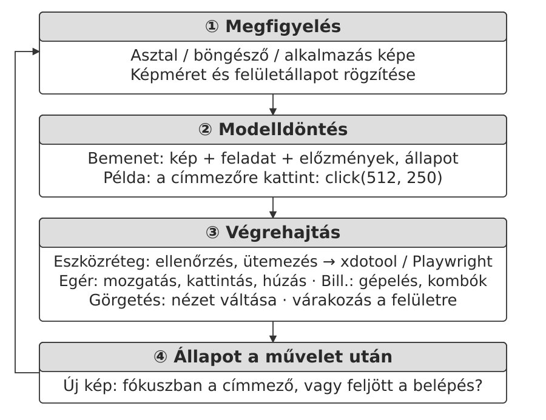

Miután az asszisztens kitöltötte a címet, hogyan közölje a végrehajtóval, melyik „Mentés” gombra akar kattintani? A célt a képernyőkoordináták és az elemazonosítók egyaránt kijelölhetik, de a modelltől és az eszközöktől mást-mást követelnek meg.

### A cselekvési tér tervezése

A 6-13. ábrán az Anthropic Computer Use referencia-megvalósítása háromféle eszközt kínál: grafikus felületet, parancsvégrehajtást és fájlszerkesztést. Ha csak a grafikus felület eszközeit nézzük, az adatok két irányba mennek: a kattintási cselekvés a végrehajtó oldalra kerül, a kattintás utáni képernyőkép pedig visszajut a modellhez, a következő döntés megfigyeléseként. A natív API előírja az eszközök formátumát; ha más modellt használunk, az illesztőrétegnek kell a képernyőképeket, a cselekvési kéréseket és a végrehajtási eredményeket az adott interfész által elfogadott üzenetekké alakítania.[^ch6-computer-tools]

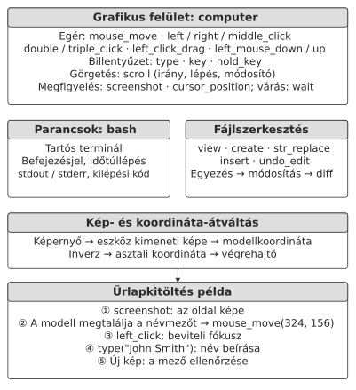

**GUI-műveleti eszközök.** Az egérműveletek közé tartozik a mozgatás, a bal, jobb és középső gombos kattintás, a dupla és tripla kattintás, valamint a húzás; a finomabb interfészek a lenyomást és a felengedést külön is kifejezhetik. A görgetéshez irány és mérték kell, egyes megvalósítások módosító billentyűket is támogatnak. A billentyűzetinterfész szövegbevitelt, billentyűkombinációkat és billentyű nyomva tartását kínálja. A képernyőkép és a kurzor pozíciója az állapot lekérésére szolgál, a várakozási interfész pedig időt hagy az oldal betöltésére vagy az animációkra. A konkrét cselekvéskészletet az eszköz verziója határozza meg, a Harness a használt interfész alapján ellenőrzi a paramétereket.

**Parancsvégrehajtó eszközök.** Egy tartós terminál a hívások között is megőrzi a munkakönyvtárat és a környezet állapotát. Ha például az egyik hívás könyvtárat vált, a következő hívás is abban a könyvtárban fut tovább. A referencia-megvalósítás őrkarakterlánccal ismerheti fel a parancs befejeződését, és időkorlátot is beállíthat; az időtúllépés utáni folyamatállapotot azonban továbbra is a végrehajtónak kell ellenőriznie.

**Fájlszerkesztő eszközök.** A karakterlánc-csere interfész az eredeti szöveg alapján jelöli ki a módosítandó tartományt, és kínálhat megtekintést, létrehozást, beszúrást és visszavonást is. Végrehajtás előtt ellenőrizni kell az egyezés helyét és számát, utána pedig a különbséget; ha a fájl két hívás között megváltozott, előbb újra be kell olvasni a releváns tartalmat. Az 5. fejezetben bemutatott szerkesztési stratégiák itt is alkalmazhatók.

> **6-9. kísérlet ★: Az Anthropic Computer Use referencia-megvalósításának futtatása**
>
> A kísérlet a hivatalos konténerpélda Ubuntu asztalát, böngészőjét és eszközvégrehajtó rétegét használja. Miután a felhasználó megadja a feladatot, a modell beolvassa a képernyőképet, és cselekvést ad vissza; a végrehajtó réteg kezeli az asztalt, majd visszaadja a modellnek az új képernyőképet.
>
> A mellékelt feladat a San Franciscó-i időjárás lekérdezése. Az elmentett trajektória először a Google-t nyitja meg, CAPTCHA-ba ütközik, majd a futás közbeni helyreállítási utasítás alapján a nyilvánosan olvasható Open-Meteo adataira vált, és végül jelenti a hőmérsékletet és az időjárási viszonyokat. A jegyzőkönyv 15 asztali műveletet és a hozzájuk tartozó képernyőképeket tartalmazza, így körről körre ellenőrizhető, hogyan változtatja meg az oldalt a kattintás, a billentyűleütés, a szövegbevitel és a várakozás.
>
> A nyílt modellel vezérelt böngésző útvonalát a 6-10. kísérlet mutatja be.

### Vizuális helymeghatározás (Grounding)

Ha azt akarjuk, hogy a modell rákattintson a keresőmezőre, a feladatot kétféleképpen fogalmazhatjuk meg. Az egyik, hogy megmutatjuk neki a képernyőképet, és megkérjük, mondja meg a kattintás koordinátáit. A másik, hogy a jelölt célpontokat megszámozzuk, és megkérjük, válassza ki a keresőmezőt; a számok elhelyezhetők a képernyőkép jelölt területein, de származhatnak a böngésző által adott elemlistából is. Az alábbiakban ezt a három útvonalat mutatjuk be. Szám kiválasztásakor a végrehajtó réteg feladata a számot a tényleges célpontra visszafordítani; közvetlen koordinátamegadásnál viszont a modellnek is becsülnie kell a célpont helyét, ami nagyobb követelményt támaszt a helymeghatározási tanítással és a képernyőfelbontáshoz való illesztéssel szemben.

**Set-of-Mark: vizuális jelölés.**

A Set-of-Mark (SoM) hivatkozható számokat helyez a képre, és így köti össze a vizuális területeket a modell kimenetével. Az eredeti munka szegmentálással és hasonló módszerekkel állította elő a jelölt területeket, például SAM-mal vagy SEEM-mel nyerte ki őket, majd elhelyezte rajtuk a jelöléseket. Miután a modell kiválasztott egy számot, a végrehajtó réteg a hozzá tartozó terület alapján határozza meg a művelet helyét. A módszer DOM nélküli asztali szoftverekben vagy játékfelületeken is használható; ehhez a kattintandó vezérlőnek számozott területre kell esnie, és a modellnek tisztán kell látnia, melyik szám tartozik hozzá.[^ch6-som]

**Strukturált elemindexelés.**

A böngésző másfajta támpontokat is adhat. A dokumentum-objektummodell (DOM) leírja, milyen elemek vannak az oldalon és milyen hierarchiában, az elrendezési információ megadja az elemek megjelenítési helyét, az akadálymentességi fa (accessibility tree) pedig megőrzi a segítő technológiákhoz szükséges szerepeket és hozzáférhető neveket. Ha például egy csak nagyító ikont tartalmazó gombhoz az oldal megadta a „Keresés” hozzáférhető nevet, az Agentnek esélye van szerep és név alapján megtalálni. A browser-use típusú megoldásoknál a rendszer a Chrome DevTools Protocol (CDP) és hasonló böngészős hibakereső interfészek segítségével gyűjti be az elemek adatait, felismeri a beviteli mezőket, gombokat és hivatkozásokat, majd megszámozza az aktuális oldalon ezeket a kezelhető elemeket. A 6-14. ábrán a modell az oldal jobb felső sarkában lévő [2]-t választotta. Hogyan válik ebből a számból kattintás a Submit gombra?

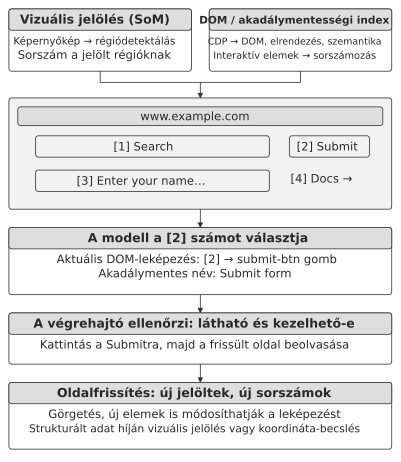

A feldolgozás négy lépésre bontható: a DOM, az elrendezés és az elérhető akadálymentességi információk beolvasása; az interaktív elemek kiszűrése; az aktuális oldal számozási leképezésének felépítése; valamint az elemleírások és a szükséges jelölt képernyőkép átadása a modellnek. A modell például a következő négy számozott elemet láthatja:

```text
截图中标有 [1]、[2]、[3]、[4]

[1] <input type="text" placeholder="Search" aria-label="Search" />
[2] <button id="submit-btn" aria-label="Submit form" />
[3] <input type="text" placeholder="Enter your name" value="" />
[4] <a href="/docs" aria-label="Documentation" />
```

Miután a modell kiválasztott egy számot, a végrehajtó réteg elemhivatkozássá vagy koordinátává alakítja, ellenőrzi, hogy a célpont még látható és interaktív-e, majd elvégzi a műveletet. Az oldal frissülése, görgetése vagy elemek dinamikus beszúrása után frissíteni kell a leképezést, nehogy elavult számot használjunk. A strukturált indexelés kihasználhatja a címkéket, szerepeket és szövegeket; Canvas, takarás vagy hiányos szemantikai jelölés esetén viszont a képernyőképpel együtt kell dönteni. Minél több elemet sorolunk fel, és minél nagyobb a képernyőkép, annál több információ kerül a kontextusba.

**Közvetlen koordináta-előrejelzés.**

A koordinátás útvonalon a modell a képernyőképből és a célpont leírásából közvetlenül adja ki a helyet, például a „kattints a Küldés gombra” utasítást egy pontra képezi le. A SeeClick és más GUI-helymeghatározási kutatások, valamint a Claude Computer Use is koordinátás kimenetet használ. A végrehajtó réteg feladata a képkoordináták átszámítása tényleges asztali koordinátákra.

Ha a képernyőképet átméretezzük, a két koordináta-rendszernek ugyanazt a transzformációt kell követnie. Egy 2560×1440-es asztal esetén, ha a modellnek küldött kép 1366×768-as, a modell által megadott (683, 384) pont a következőnek felel meg:

$$
x = 683 \times \frac{2560}{1366} = 1280,\qquad
y = 384 \times \frac{1440}{768} = 720
$$

A 6-15. ábrán a két méret oldalaránya közel azonos. Ha a képernyőképet az arány megőrzése érdekében fekete sávokkal egészítették ki, a modell koordinátái a kitöltést is tartalmazzák; az eredeti képernyőkoordinátákra való visszaszámítás előtt előbb le kell vonni a megfelelő kitöltési eltolást, és csak utána alkalmazni a skálázási tényezőt. A vágás, a megjelenítési skálázás és a többmonitoros elrendezés origója szintén megváltoztatja a leképezést, ezért az eszközrétegnek el kell tárolnia a ténylegesen alkalmazott transzformáció paramétereit.

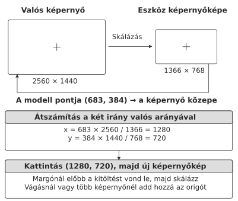

A referencia-megvalósítás korábban olyan célméreteket használt, mint az XGA (1024×768), a WXGA (1280×800) és az FWXGA (1366×768). Az oldalarány erőltetett megváltoztatása eltorzítja a vezérlők alakját; a hibás visszafelé irányuló leképezés pedig a helyes előrejelzést is rossz helyre teszi.[^ch6-computer-tools]

**Ha a strukturált információ teljes, a DOM- vagy akadálymentességifa-alapú indexelést részesítem előnyben.** Az elemek neve, szerepe és hivatkozása közvetlenül részt vehet a helymeghatározásban, így a modellnek kevesebbszer kell rögtönzötten pixelpozíciót becsülnie. Ha nincs struktúra, az általános vizuális modell SoM-mal kombinálható, hogy a jelölt területek közül válasszon; a GUI-helymeghatározásra már betanított modellek pedig közvetlenül előre jelezhetik a koordinátákat, külön jelölés nélkül.

> **6-10. kísérlet ★: Automatikus böngészőkezelés a browser-use segítségével**
>
> A kísérlet a Qwen3-VL 32B Instruct modellel vezérli a browser-use eszközt, amely a böngésző állapotából, az elemadatokból és a képernyőképekből állít elő cselekvéseket. A feladat a San Franciscó-i időjárás lekérdezése: meg kell találni a keresőmezőt, be kell írni, hogy „San Francisco weather today”, el kell küldeni a lekérdezést, majd ki kell nyerni a hőmérsékletet és az időjárási viszonyokat.
>
> A 6-10. kísérlet kódja és futtatási útmutatója két belépési pontot kínál. OpenRouter-kulccsal hosztolt vizuális modell használható; ha már van vLLM-, SGLang- vagy hasonló kompatibilis szolgáltatásunk, az `OPEN_MODEL_BASE_URL` és az `OPEN_MODEL_MODEL` a saját végpontunkra és modellünkre irányítható, a kulcsot pedig a szolgáltatás előírásai szerint kell beállítani. Mindkét útvonalon először a kísérlet könyvtárában kell futtatni a `python main.py --dry-run` parancsot, hogy átnézzük a konfigurációt, majd az útmutató szerint elindítani a tényleges lekérdezést.
>
> Az elmentett futás 16 interakciós lépést végzett el, és 15 képernyőképet őrzött meg. Miután a Google CAPTCHA-t jelenített meg, a feladat a weather.com oldalról szerezte be az eredményt.

[^ch6-computer-tools]: Anthropic, a Computer Use eszközdokumentációja és referencia-megvalósítása; bemutatja a verziózott cselekvési interfészt, a végrehajtó réteget és a képernyőképek kezelését.
[^ch6-som]: Microsoft, *Set-of-Mark Prompting*, 2023; a browser-use DOM-szolgáltatásának megvalósítása példát ad a strukturált elemkezelésre.

### Animációt látó és hangot halló Computer Use Agent

Egy oldal a mentés után csak rövid időre jeleníti meg a „Szinkronizálás sikertelen” üzenetet, a néhány másodperc különbséggel készült két képernyőképen viszont ugyanaz az űrlap látszik. Ha a modell újra megnézi ezt a két képet, nagy valószínűséggel nem tudja rekonstruálni, mi történt közben. A videóknál, animációknál, rövid ideig látható értesítéseknél és a megbeszélések hangjánál ugyanez a probléma. **A folyamatosan változó felületeknél úgy gondolom, hogy a megfigyelési interfészt kell a fejlesztés középpontjába állítani.** Ha a változások alapján akarunk dönteni a következő lépésről, a cselekvések között felbukkanó eseményeket és képeket is meg kell őrizni.

A társszerzőimmel javasolt **Agent–Computer Observation Interface (AOI, Agent–számítógép megfigyelési interfész)** a folyamatos képernyőt és hangot a modell által fogadható képekké és szöveggé alakítja[^ch6-9]. Az interfész három összetevőből áll:

- **Kulcsképkockák rögzítése a cselekvések között.** A főhurok futása közben figyeli a képváltozásokat, pixelkülönbség vagy könnyűsúlyú vizuális modell segítségével szűri a jelölt képkockákat, majd a hasznos képeket a következő döntéshez adja.
- **Hangerőkapuval vezérelt átírás.** Hang észlelésekor beszédfelismerést hív meg, és az átiratot az időinformációkkal együtt a megfigyelési naplóba illeszti, hogy az Agent felhasználhassa a megbeszélés tartalmát vagy a szóbeli utasításokat.
- **Tartós képleírások.** A kulcsképeket szövegesen összefoglalja; miután az eredeti kép kikerült a kontextusból, a szöveg továbbra is megőrzi a bekövetkezett változásokat, és a későbbi lépések hivatkozhatnak rá.

Ha például egy videó bemutat egy menüműveletet, a modell a köztes képeket és a hozzájuk tartozó leírásokat megkapva a lejátszás vége után is felhasználhatja ezt a lépést. A cikk ablációs eredményei szerint a tartós szöveges leírások különösen fontosak a nyereség szempontjából, a kulcsképkockák finom kiválasztása kevesebbet tesz hozzá; egyes modellek túl sok kép hozzáadásakor éppen hogy romlanak.

Térjünk vissza az imént említett űrlapmentéshez. Ha a kulcsképkocka el is kapta a „Szinkronizálás sikertelen” üzenetet, miután az eredeti kép kikerült a kontextusból, a modell csak a megmaradt leírásra támaszkodhat. Az „értesítés jelent meg az oldalon” jelenthet sikeres mentést is, de hibát is; csak a „szinkronizálás sikertelen, a cím nincs elmentve” őrzi meg a következő lépés eldöntéséhez szükséges támpontot.

[^ch6-9]: Bojie Li, Noah Shi, *Agent-Computer Observation Interfaces Enable Dynamic Computer Use*, 2026; bemutatja az AOI-t és összetevőinek ablációját.

### Világmodellek a Computer Use-hoz

Miután időben megkapta a megfigyelést, az Agentnek még cselekvést kell választania, és meg kell várnia a végrehajtást. Az OSWorld-Human kutatás az Agentek műveleti hatékonyságát emberi trajektóriákkal vetette össze, és elemezte az olyan időveszteség-forrásokat, mint a felesleges lépések és a modellhívások[^ch6-osworld-human].

A világmodell előrejelzést ad a tervezéshez a cselekvések következményeiről. Az asztal állapota magában foglalhatja az ablakokat, a fókuszt, a görgetési pozíciót, a beírt tartalmat és a betöltés állását; a jogosultságokat, a hálózati eredményeket és hasonló információkat viszont a megfelelő interfészeken keresztül kell kiegészíteni. A modell az aktuálisan elérhető állapot és a jelölt cselekvés alapján jelzi előre a következő állapotot:

```text
当前状态 + click / type / scroll / wait → 预测的下一状态
```

Amikor ember használja a számítógépet, a kattintás előtt gyakran már elképzeli a következő lépést; ha a felület megfelel a várakozásnak, folytatja, ha valami váratlan történik, megáll és megnézi. A világmodell hasonló alapot adhat az Agentnek a spekulatív végrehajtáshoz: a tervező előre összehasonlítja a jelölt cselekvéseket, az oldal betöltése alatt előkészíti a következő lépéseket, és a valós állapot megerősítése után folytatja a végrehajtást, így nem kell minden kattintás után elölről tervezni. Ha például a VS Code-ban új Python-fájlt hozunk létre, és beleírjuk, hogy hello world, a várt változások: az új fájl megjelenik a fájlfában, a szerkesztőterület tartalmazza a kódot, és frissül a mentési állapot. Végrehajtás után ezeket a változásokat kell ellenőrizni; ha megfelelnek a várakozásnak, folytatható a munka, ha eltérés van, újra kell helymeghatározni és tervezni.

A fájltörléshez és hasonló műveletekhez önálló végrehajtási feltételek is kellenek: helyes-e a célpont, engedélyezett-e a törlés, visszaállítható-e, és szükség van-e a felhasználó megerősítésére. Az előrejelzés segít megérteni a lehetséges eredményt, a tényleges jogosultságokat és üzleti feltételeket a végrehajtó réteg ellenőrzi.

**A Photon-1 látens állapot-előrejelzése.** Az Induction Labs 2026 júliusában mutatta be a Photon-1-et: ez a videóképkockákat diszkrét látens tokenekké kódolja, és a következő tokenek előrejelzésével tanulja meg az állapotváltozásokat. A cég közlése szerint az előtanítás nagyjából 30 ezer H200 GPU-órát vett igénybe. Az állapot-előrejelzés a látens tokenekben történik, egy kiegészítő képgenerátor pedig megtekinthető képekké alakítja vissza őket, hogy ember ellenőrizhesse az előrejelzést. A tervezés és a cselekvésgenerálás közvetlenül a belső reprezentációt használhatja, így nem kell minden lépésben teljes képernyőképet előállítani.[^ch6-20]

A megoldás finomhangolással megtanulja az utasítás- és a cselekvésformátumot is: előbb előrejelzi a kívánt elérendő állapotot, majd előállítja az oda vezető műveleteket, és virtuális gépen online tanítással javítja a feladatteljesítményt. A cselekvésfeltételes finomhangolás pedig arra szolgál, hogy előrejelezze az asztal változását egy adott művelet után. A két felhasználás a tervezéshez, illetve a szimulációhoz kapcsolódik, és megmutatja, hogyan vehet részt az állapotreprezentáció a Computer Use-ban.

[^ch6-osworld-human]: Reyna Abhyankar és munkatársai, *OSWorld-Human: Benchmarking the Efficiency of Computer-Use Agents*; elemzi a feladattrajektóriákat és az időráfordítást.
[^ch6-20]: David Li, Jonathan Li, *Scaling Video Pretraining with Imagination Models*, Induction Labs, 2026-07-23; bemutatja a Photon-1 előtanítását, cselekvéstanulását és állapotszimulációját.
[^ch6-21]: Google DeepMind, *Genie 3: A new frontier for world models*, 2025-08-05; Zachary Lin és munkatársai, *Cosmos World Foundation Model Platform for Physical AI*, 2025.

### Mobil: technikai interfészek és ökoszisztéma-együttműködés

A mobilon továbbra is a megfigyelés–döntés–cselekvés ciklus működik, a cselekvések azonban inkább érintési gesztusok formájában jelennek meg. Ugyanaz a koordináta jelentheti egy koppintás helyét, egy hosszú nyomás helyét vagy egy húzás kezdőpontját, ezért az interfésznek a gesztus típusát, időtartamát és útvonalát is meg kell adnia. A képernyő elforgatása, a virtuális billentyűzet felugrása és a rendszerablakok szintén megváltoztatják a kezelhető területet.

Az Android `AccessibilityService` szolgáltatása az engedélyezett körön belül beolvashatja a felület adatait és végrehajthatja a megfelelő műveleteket; a gesztusinterfészekhez a megfelelő képességet is deklarálni kell[^ch6-android]. A képernyőképek, az akadálymentességi fa és a rendszer automatizálási interfészei együtt is használhatók, a konkrét elérhető kört az operációs rendszer, az alkalmazás megvalósítása és az engedélyek határozzák meg. A 7. fejezetben bemutatott AndroidWorld és hasonló benchmarkok valós alkalmazásfeladatokon ellenőrzik, hogy ezek a cselekvések elérik-e a várt eredményt.

**Úgy gondolom, hogy a mobilos megvalósításban az ökoszisztéma korlátai gyakran nehezebben kezelhetők, mint a technikai problémák.** A platformoknak meg kell határozniuk, mely műveletek bízhatók megbízottra, hogyan kell engedélyezni a fiókokat, a fizetést és az adatokat, és hogyan követhető vissza a felelősség hiba esetén. Ezek a megállapodások közvetlenül befolyásolják, milyen kört fedhetnek le az Agent által elvégezhető feladatok.

Az egyik szerkezeti érdekellentét a forgalomból és a figyelemből fakad. Sok alkalmazás a hirdetések megjelenítéséből, a tartalomajánlásból és a tranzakciós belépési pontokból szerez bevételt; ha a felhasználó az Agentre bízza a lekérdezés vagy a vásárlás közvetlen elvégzését, az oldalbejárási útvonal lerövidülhet, és megváltozik az ajánlásokra és hirdetésekre jutó figyelem is. Az ezekre a pontokra épülő bevételszerzésű platformoknál a megbízotti műveletek a meglévő bevételi forrásokat érintik. A platformoknak ezért újra kell gondolniuk az interfészek megnyitását, a bevételmegosztást és a megbízotti identitások kezelését.

[^ch6-android]: Android Developers, AccessibilityService; bemutatja a felülethez való hozzáférést, a műveleteket és a gesztusképességeket.

## Robotmanipuláció: az asztal rendrakása XLeRobottal

Tedd a piros poharat a tálcára, a sárga papírhulladékot a szemetesdobozba, végül győződj meg róla, hogy az asztal rendben van – ez a feladat összekapcsolja az érzékelést, a tervezést és a vezérlést. Ahogy a megfogó közelít a pohárhoz, a pohár helyzete a kamera képén változik; miután a poharat felemelte, a karnak ki kell kerülnie az asztalon lévő többi tárgyat; ha a papírt elsőre nem sikerült megfogni, a rendszernek észre kell vennie a kudarcot, és újra kell próbálkoznia. Minden cselekvés megváltoztatja a következő döntés feltételeit.

Ez a szakasz öt kísérletet épít e feladat köré. A 6-11. és a 6-13. kísérlet a valódi robot távvezérlésének és önálló működésének gyakorlati tervét adja; a 6-12., a 6-14. és a 6-15. kísérlet helyi szimulációt használ, és sorra a vezérlési alapvonalat, a hibákból való helyreállást és a vizuális feltételek változását vizsgálja.

Ugyanazt a robotot irányíthatja egy ember, aki folyamatosan figyeli a kamera képét, de egy modell is, amely beolvassa a képet, készséget választ, és azt a vezérlőrendszerre bízza. Ha a feladat és a hardver változatlan, a két mód közötti különbség négy kérdés mentén elemezhető: mit akar elérni az ember, melyik részfeladattal kezdjen, milyen cselekvéseket ad ki az aktuális készség, és a cselekvés utáni környezet megfelel-e a tervnek. A hosszú távú tervezés a pohár és a papírhulladék kezelésének sorrendjét állítja fel, a VLA-stratégia vagy az előre definiált cselekvési primitívek felelnek a megfogásért és a lehelyezésért, a világmodell segít megbecsülni a cselekvések következményeit, a szimulációból a valóságba való átvitel pedig a kép, az érintkezés és a beavatkozók jellemzőinek változását kezeli.

### A hardver és az algoritmus munkamegosztása

Ha az önálló asztalrendrakás kudarcot vall, először távvezérléssel lehet ellenőrizni, hogy a hardver képes-e elvégezni a feladatot. A kamera, a robotkar, a megfogó, az asztali elrendezés és az átvételi feltételek változatlanul hagyása mellett a kezelő veszi át az érzékelési és vezérlési zárt hurkot. Ha az ember több körben is megbízhatóan elvégzi a feladatot, az önálló rendszer viszont újra és újra elbukik, az azt jelenti, hogy ez a hardver már alkalmas a feladatra, és a szűk keresztmetszet főként az önálló vezérlés algoritmusában és visszacsatolásában van. Ilyenkor elsősorban a tárgyak helymeghatározását, a készségválasztást, a cselekvések időzítését és a hibákból való helyreállást kell átvizsgálni, hogy az önálló rendszer elsajátítsa a távvezérlés során hatékonynak bizonyult javításokat.

Az XLeRobot billentyűzettel, Xbox-kontrollerrel és Switch Joy-Connal is távvezérelhető, a VR-alapú vezérlés pedig először szimulált környezetben próbálható ki.[^ch6-1] Amikor a megfogó a pohárhoz közelít, a kezelő lassít; ha a pohár megcsúszik, módosítania kell a fogáspontot. Ha a megfogó nem kapta el a papírt, újra meg kell néznie; ha a tárgy a helyére került, egy pillantással meg kell erősítenie. Ezeket a megfigyelés alapján végzett javításokat érdemes rögzíteni a bemutató adatokban. Amikor később a robot önállóan dolgozik, neki is észre kell vennie a megcsúszást és az elhibázott fogást.

> **6-11. kísérlet ★: Az asztal rendrakása a valódi XLeRobot távvezérlésével**
>
> Kalibrált, végállás- és vészleállító-ellenőrzésen átesett XLeRobot munkaterületen helyezzünk el egy piros poharat, egy tálcát, sárga papírhulladékot és egy szemetesdobozt. Egy kalibrált távvezérlési móddal hajtsuk végre a rögzített feladatot: „Tedd a piros poharat a tálcára, a sárga papírhulladékot a szemetesdobozba, végül ellenőrizd az asztal állapotát.” Ismételjük meg több körben, és rögzítsük a kamera képét, a kezelő bemeneteit, a robotkar állapotát, a cselekvések idejét, a sikertelen fogásokat és az újrapróbálkozások számát.
>
> Minden kör végén ellenőrizzük, hogy a pohár a tálcán, a papírhulladék a szemetesdobozban van-e, a robotkar visszatért-e biztonságos helyzetébe, és nézzük át a teljes folyamat ütközési, munkatérhatár-túllépési és emberi beavatkozási naplóját. Ha együtt elemezzük, melyik lépésben történt a hiba, hogyan állt helyre a kezelő, és mi lett a végeredmény, összehasonlítási alapvonalat kapunk az önálló vezérléshez.

A szimulációs kísérletekben viszont könnyen, ismételten változtatható a tárgyak száma és kezdeti helyzete, így külön vizsgálható a vezérlési folyamat ismert állapot mellett. Egy kétdimenziós asztalmodell három szakaszként ábrázolhatja a tárgy megközelítését, a célhoz szállítását és a következő tárgy kezelését, a vezérlés ráfordítását pedig a lépések számával és az útvonal hosszával írhatja le.

> **6-12. kísérlet ★: Ugyanannak a feladatnak ideális vezérlési alapvonala a szimulátorban**
>
> Egy kétdimenziós asztalon véletlenszerűen generáljuk a tárgyak és a célok helyzetét, a vezérlő pedig közvetlenül olvassa a koordinátákat, sorban megközelíti a tárgyakat, a megfelelő célhoz viszi őket, majd a következő tárggyal folytatja. Változtassuk a kezdeti helyzeteket és a tárgyak számát, és hasonlítsuk össze a sikerarányt, a lépésszámot és az útvonal hosszát.
>
> Először kövessük végig egyetlen tárgy teljes trajektóriáját: a vezérlő a tárgyhoz érve szállítási szakaszba lép, és csak a célhoz érve növelheti az elvégzett tárgyak számát. Ezután növeljük a tárgyak számát, és ellenőrizzük, hogy minden tárgy átmegy-e ezen a két érkezési feltételen. A mellékelt kétdimenziós szimuláció öt véletlenmag mellett 1, 2, 3, illetve 4 tárgyat helyez el, minden kombinációt 512 epizódon át futtat, és mind a 10 240 epizód sikeresen lezárul. A vezérlő közvetlenül olvashatja a koordinátákat, a tárgyak mozgatása pedig nem függ valódi megfogótól.

### A robotvezérlés alapszerkezete

Egy asztal rendrakása perceket vehet igénybe, az ízületek vezérlését viszont folyamatosan és időben frissíteni kell. A rendszer időskálák szerint oszthatja meg a munkát: a magas szintű tervezés a feladatok sorrendjét állítja fel, a készségstratégiák mozgást generálnak, az alacsony szintű vezérlő pedig követi a végrehajtást:

| Szint | Alapkérdés | Kimenet | Időskála és konfigurációs példa |
| --- | --- | --- | --- |
| Feladatcél | Mit akar elérni az ember? | „Tedd a helyére a poharat és a papírhulladékot” | Perces feladat |
| Hosszú távú tervezés | Mit csináljunk előbb, mit utána? | Előbb a pohár, aztán a papírhulladék, végül ellenőrzés | Másodpercektől percekig |
| Alapkészség | Milyen állapotváltozást kell most elérni? | `pick(red_cup)`, `place(red_cup, tray)` | Egy készség másodpercekig tarthat, például 1–3 másodpercig |
| VLA / készségstratégia | Pontosan hogyan mozogjon az aktuális készség? | Megfogóművelet, végberendezés-póz vagy egy ízületi trajektóriaszakasz | 1–10 Hz-es következtetésre konfigurálható |
| Alacsony szintű vezérlés és biztonsági réteg | Hogyan hajtsuk végre stabilan és időben? | Ízületi vagy végberendezés-vezérlőjelek, sebességkorlát és vészleállítás | A vezérlő néhányszor tíztől több ezer Hz-ig konfigurálható |

A tervező lehet szabályalapú program, VLM vagy optimalizáló, és a VLA is átvállalhatja a készségválasztás egy részét. **Azt javaslom, hogy a feladatok sorrendjét és a közvetlen cselekvést külön kezeljük.** A magas szintű következtetésnek idő kell a terv összeállításához, az alacsony szintű vezérlésnek pedig időben kell reagálnia a helyzet és az erőhatások változására; csak ha mindkettő a neki megfelelő ütemben fut, lehet egyszerre jól tervezni és vezérelni.

Ez a szakasz öt eszköztípust ad a magas szintű modellnek: `observe_scene`, `pick`, `place`, `verify_state` és `stop`, amelyek sorra a megfigyelésre, a megfogásra, a lehelyezésre, az ellenőrzésre és a leállításra szolgálnak. A Harness ellenőrzi a paramétereket, a munkateret és az aktuális állapotot, a végrehajtó pedig az ellenőrzésen átment készségeket robotkar-mozgássá alakítja, és kezeli a sebességkorlátot és az időkorlátot. Az ízületi szögeket és a folyamatos trajektóriákat a készségstratégia és a vezérlő állítja elő, így a modell készségválasztása és a tényleges mozgás között tiszta interfész jön létre.

### Hosszú távú tervezés és feladatbontás

Amikor a felhasználó azt mondja, „rakd rendbe az asztalt”, a tervező először azonosítja a tárgyakat és a hozzájuk tartozó célterületeket, meghatározza a feldolgozás sorrendjét, és minden lépéshez világosan leírja a kezdési feltételt, a befejezési feltételt és a cselekvés korlátait. A rendrakás sorrendje például ez lehet:

```text
处理红色杯子 → 清理黄色纸张 → 检查桌面
```

A „piros pohár kezelése” tovább bomlik két cselekvésre és egy ellenőrzésre:

```text
pick(red_cup) → place(red_cup, tray) → verify_state()
```

Vegyük a „vedd fel a poharat, és tedd a tálcára” feladatot: ha a robotkar lefuttatta a megfogó programot, az csak annyit jelent, hogy a program véget ért. A következő emelés előtt a megfogó visszajelzése vagy egy új kép alapján el kell dönteni, hogy a pohár valóban a megfogóban van-e. Ha a fogás üres volt, újra meg kell határozni a pohár helyét; ha valaki elvitte a tálcát, a sikeres megfogás továbbra is érvényes, csak a lehelyezést kell újratervezni. Ha minden készség egy ellenőrizhető állapotváltozásnak felel meg, korlátozott cselekvéssel és időtartammal, és visszaadja a végrehajtási állapotot meg az új megfigyelést, a tervező attól a lépéstől folytathatja, ahol a hiba ténylegesen történt.

> **6-13. kísérlet ★★: Az XLeRobot önálló asztalrendrakása a Gemini Robotics-ER 1.5 vezérlésével**
>
> A 6-11. kísérlet hardverét, asztali elrendezését, feladatát és átvételi feltételeit megtartva a megfigyelést és a tervezést egy megtestesült következtető modell végzi. A RoboCrew vezénylési módját alapul véve öt eszközt tervezünk ehhez a feladathoz: `observe_scene`, `pick`, `place`, `verify_state` és `stop`.[^ch6-2]
>
> A modell először beolvassa az asztal megfigyelését, eldönti a feldolgozás sorrendjét, majd meghívja a kalibrált megfogó és lehelyező készségeket. Minden készség befejezése után új megfigyelést kér le, és ellenőrzi az utófeltételeket; hiba után az aktuális állapot alapján választ az újrapróbálkozás és a leállítás között. A futtatórendszer vészleállító jel vételekor, munkatérhatár-túllépés észlelésekor vagy akkor, ha egy kulcsfontosságú állapotot nem tud megerősíteni, közvetlenül leállítja a végrehajtást; a modell is befejezheti a feladatot saját kezdeményezésére a `stop` segítségével.
>
> A végén új környezeti megfigyelés erősíti meg, hogy a pohár a tálcán, a papírhulladék a szemetesdobozban van, a robotkar visszatért biztonságos helyzetébe, és egyezteti az ütközési és munkatérhatár-túllépési naplókat. A kezelő felel az indításért, a vészleállításért és a helyszíni felügyeletért, a menet közbeni átvételeket pedig külön rögzíti.

A 6-13. kísérlet megmutatja, hogyan kell bekötni a valódi robot cselekvéseit és hogyan kell átvenni a rendrakás eredményét, a mellékelt jegyzőkönyvekben azonban még nincs valódi robotos próba erre a feladatra. Az alábbiakban először szimulált környezetben hasonlítunk össze három módszert: a terv szerinti nyílt hurkú végrehajtást, az eredmény minden lépés utáni ellenőrzését, valamint a cselekvések következményeinek előzetes előrejelzését. A feladat célja és az öt eszköztípus változatlan, a hibák pedig ismételten kiválthatók, így megfigyelhető, hogyan kezeli a három módszer ugyanazt a tévedést.

### VLA-vezérlés

A VLA a Vision-Language-Action rövidítése, vagyis látás–nyelv–cselekvés modell. Az aktuális kép, a feladatutasítás és a robot elérhető állapota alapján állítja elő a következő végrehajtandó cselekvést:

```text
当前观测 + 技能指令 → 动作或动作序列
```

Az asztalrendrakási példában a magas szintű tervező kiadja a `pick(red_cup)` utasítást, a készségstratégia pedig a kép alapján dönti el, melyik irányból közelítse meg a poharat, mikor zárja a megfogót, és milyen pályán emelje fel a kart. E mozgásszakasz végrehajtása után a rendszer újra lekéri az asztal megfigyelését, megerősíti, hogy a pohár a megfogóban van, és csak ezután lép tovább a `place(red_cup, tray)` lépésre. Az eszközinterfész rögzíti a várt állapotváltozást, a VLA pedig megtanulja, hogyan érje el ezt a változást folyamatos cselekvésekkel.

A cselekvések többféleképpen ábrázolhatók. Az RT-2 és az eredeti OpenVLA a cselekvés minden dimenziójának értékét diszkrét tokenekké kvantálja, és a nyelvi modellek generálási módját követve adja ki; a π₀ áramlásillesztéssel (flow matching) állít elő folyamatos cselekvési blokkokat. Az előbbi megkönnyíti az autoregresszív generálási keretrendszer újrahasznosítását, az utóbbi közvetlenül egy folyamatos cselekvésszakasz eloszlását modellezi.[^ch6-15]

A modell következtetése és a beavatkozók vezérlése általában eltérő frissítési frekvenciával fut. A cselekvésdarabolás (action chunking) révén a modell egyszerre egy rövid jövőbeli cselekvésszakaszt állít elő, amelyet a vezérlőszál nagyobb frekvenciával hajt végre. Ha a következtetést és a végrehajtást tovább átfedjük, a rendszer az aktuális cselekvési blokk végrehajtása közben előkészítheti a következőt, és így csökken a várakozás. A cselekvési blokkok összeillesztésénél a trajektória folytonosságát és a megfigyelés frissességét is kezelni kell: ha a pohár elmozdul, miközben a kar felé nyúl, a hátralévő cselekvések még a régi helyre mutathatnak. Ha rövidebbek a ténylegesen végrehajtott szakaszok, ha új megfigyelésekkel gördülő frissítést végzünk, vagy ha rendellenesség észlelésekor megszakítjuk a cselekvést, mind javítja a reakciókészséget; ezek a választások azonban a következtetés és az ütemezés többletköltségét is növelik.

### A VLA adat- és telepítési feltételei

Ahhoz, hogy a „fogd meg a poharat” megbízhatóan cselekvéssé váljon, egyszerre többféle eltérést kell kezelni:

- **A tanítóadatok lefedettsége:** a rendelkezésre álló robotos cselekvésbemutatók száma messze elmarad az internetes szövegekétől és képekétől; ha a modell tudja is, mi a „pohár”, valós fogási tapasztalat kell ahhoz, hogy megítélje, mekkora erőt fejtsen ki. A bemutatóknak le kell fedniük a pohár anyagát, alakját, elhelyezkedését és a súrlódási viszonyokat. Ugyanaz a fogási irány egy kerámiabögrénél és egy puha papírpohárnál eltérő eredményt adhat.
- **A cselekvés és a következmény tanulási célja:** a viselkedésklónozás főként azt tanulja meg, milyen cselekvést választana a bemutató az adott körülmények között. Ha több cselekvés következményeit kell összehasonlítani, állapot-előrejelzés vagy a cselekvés eredményének értékelése is hozzáadható.
- **A robot teste és interfésze:** a szabadsági fokok, a koordináta-rendszer, a megfogó szerkezete és a beavatkozók késleltetése dönti el, hogyan valósul meg a cselekvés a hardveren. Egy stratégia átvitelekor egyeztetni kell a cselekvésábrázolást, a kalibrációs paramétereket és a vezérlési ciklust.
- **A megfigyelés frissessége:** egy cselekvési blokk végrehajtása alatt a tárgy elmozdulhat, takarásba kerülhet vagy feldőlhet. A rendszernek meg kell határoznia, mikor kér le új megfigyelést, és mikor frissíti vele a hátralévő cselekvéseket.

Ezek a feltételek összekapcsolják a vizuális felismerést, a készségvezérlést és a környezet változását. A pohárban lévő folyadék befolyásolja a szállítás sebességét, az asztal szélén futó tápkábel megváltoztatja a járható útvonalat, a papír és az asztal érintkezése pedig a megfogás módját. Ha a tervező előre össze tudja hasonlítani ezeket a következményeket, több alapot kap a készségválasztáshoz.

### Világmodellek

A robotos tervezésben a cselekvésfeltételes világmodell „cselekvéskimenet-előrejelzőként” érthető: az aktuális állapot és egy jelölt cselekvés alapján megbecsüli, mi fog történni.

```text
当前状态 + 候选动作
    → 预测下一状态或未来片段
    → 比较候选结果
    → 选择动作、重新规划或停止
```

Ez a folyamat három munkát foglal magában: az aktuális állapot ábrázolását, a cselekvés okozta állapotváltozás előrejelzését, majd azt, hogy a tervező vagy a vezérlő ennek alapján válasszon cselekvést. Az állapot lehet strukturált változók összessége – például a tárgyak helyzete, vagy hogy egy tárgy a megfogóban van-e –, de lehet képekből kinyert belső reprezentáció is. A V-JEPA 2 először videókból tanulja meg az állapotreprezentációt és az előrejelzést, a továbbtanított V-JEPA 2-AC pedig cselekvésfeltételt vezet be, és robotos tervezésre szolgál. A cselekvések és a jövőbeli megfigyelések összekapcsolása a világ–cselekvés modellek (World-Action Model) egyik modellezési iránya is.[^ch6-16]

A világmodell három szakaszban segítheti a robotot: a cselekvés előtt külön-külön előrejelezheti, mi lesz a megfogás, a tolás vagy a várakozás eredménye; végrehajtás közben összevetheti az előrejelzést a tényleges megfigyeléssel, és eltérés esetén módosíthatja a cselekvést vagy újratervezhet; tanításkor pedig videókból, szimulációs adatokból és sikertelen trajektóriákból tanulhatja meg az állapotváltozásokat, csökkentve a valódi robottal végzett próbálkozások számát.

Tegyük fel, hogy a sárga papírhulladékot részben eltakarja a piros pohár; a tervező ilyenkor összehasonlíthatja a „előbb a papírt fogd meg”, „előbb tedd odébb a poharat” és „válts fogási irányt” lehetőségeket. Én elsősorban az ilyen, a feladathoz közvetlenül kapcsolódó és ellenőrizhető állapotváltozások előrejelzését várnám a világmodelltől. Ha meg tudja ítélni, hogy a papír könnyebben megfogható-e, és hogy a pohár könnyen feldől-e, akkor sorba tudja rendezni a jelölt cselekvéseket. A modell állapotreprezentációját és tanítási célját ezek köré a döntések köré kell tervezni. Ha a modell jövőbeli képeket állít elő, én először azt ellenőrizném, hogy a képek pontosan tükrözik-e ezeket a cselekvési következményeket, és csak utána foglalkoznék további vizuális részletekkel; a képi élethűség értékének végső soron a tervezés és a vezérlés javulásában kell megmutatkoznia. A végrehajtás után a rendszer a kamera és a robot állapota alapján ellenőrzi a tényleges eredményt, és dönt a folytatásról, az újrapróbálkozásról vagy a terv megváltoztatásáról.

Minél hosszabb az előrejelzés időtávja, annál könnyebben halmozódnak a hibák. A gyakorlatban először rövid távú következményeket lehet előrejelezni, egy rövid szakaszt végrehajtani, majd új megfigyelés alapján újratervezni, és közben az előrejelzés bizonytalanságát is figyelembe venni a választásnál. A generatív világmodellek interaktív szimulációt és vizualizált jeleneteket is kínálhatnak; vezérlésre használva azonban tovább kell vizsgálni a cselekvésfeltételeket, az érintkezési törvényszerűségeket és az előrejelzési hibát. A hardveres végállások, a vészleállítás és a valós idejű vezérlés továbbra is a végrehajtó rendszer feladata.[^ch6-21]

> **6-14. kísérlet ★★: Három önálló asztalrendrakó zárt hurok összehasonlítása a szimulátorban**
>
> A piros poharat és a sárga papírhulladékot strukturált állapottal ábrázoljuk: minden tárgy három szakasz egyikében van – „az asztalon”, „felvéve” vagy „lehelyezve” –, a célterületről pedig azt rögzítjük, hogy szabad-e. A szimulátor öt eszköztípust kínál – megfigyelés, megfogás, lehelyezés, ellenőrzés és leállítás –, és a papírhulladék megfogásakor legfeljebb egy átmeneti hibát injektál.
>
> Háromféle vezérlési módot hasonlítunk össze. A **nyílt hurkú végrehajtás** rögzített sorrendben végzi el a négy cselekvést. A **lépésenkénti ellenőrzés** minden cselekvés után beolvassa az állapotot, hiba után újra lekéri a megfigyelést, és az éppen végrehajtható lépést választja. Az **előrejelző végrehajtás** egy kis neurális hálózattal megtanulja az „állapot és cselekvés → következő állapot” leképezést, és az előre jelzett rendrakási előrehaladás alapján rangsorolja a végrehajtható cselekvéseket.
>
> Összehasonlítjuk a feladat teljesítését, az eszközhívások számát és a hibákból való helyreállás folyamatát. Ha például a papírhulladék megfogása sikertelen, a papír az asztalon marad, és a közvetlenül végrehajtott lehelyezés kudarcot vall, mert nincs felvett tárgy; csak ha beolvassuk az állapotot és újra megpróbáljuk a megfogást, lehet folytatni a lehelyezéssel. A két visszacsatolásos stratégia a végén a `verify_state` hívással ellenőrzi a rendrakás állapotát.
>
> Először nézzük a hibainjektálás nélküli epizódokat: mindhárom stratégia teljesíti a feladatot. Ha a hibainjektálás valószínűségét 50%-ra állítjuk, minden stratégia három véletlenmagon 384 epizódot fut (magonként 128-at). A nyílt hurkú végrehajtás továbbra is epizódonként 4 eszközhívást végez, és csak 205 epizódot teljesít. A lépésenkénti ellenőrzés és az előrejelző végrehajtás mind a 384 epizódot teljesíti, átlagosan egyaránt nagyjából 6,93 hívással. A többlethívások lehetővé teszik, hogy a vezérlő észrevegye az üres fogást, és helyreálljon. Ebben a csak egyetlen helyrehozható hibát injektáló feladatban a következő állapot előrejelzése egyetlen epizóddal sem mentett meg többet, mint a közvetlen ellenőrzés.

### A szimulációtól a valódi robotig

A szimulált asztaltól a valódi robotig a környezeti különbségeket egyenként kell kezelni. A kép oldalán ugyanaz a pohár és tálca eltérő háttérben, megvilágításban, kamerahelyzetben és takarási viszonyok között jelenik meg; a mozgás oldalán a súrlódás, az érzékelők zaja és a beavatkozók késleltetése befolyásolja a trajektóriát és a megfogást.

A tartományrandomizálás (domain randomization) lényege, hogy tanításkor változtatjuk a hátteret, a tárgyak megjelenését, a megvilágítást vagy a zajt, hogy a modell sokféle körülmény között is ugyanazt a döntést hozza. A 6-15. kísérlet ennek csak egyetlen elemét vizsgálja: ha a modell látja a tárgyat és a célterületet, merre kell mozdulnia?

> **6-15. kísérlet ★★★: Ugyanannak az asztali feladatnak RGB-alapú, környezeteken átívelő tesztje**
>
> A tárgyat körrel, a célterületet négyzettel ábrázolva RGB asztalképeket generálunk. A modell a kettő egymáshoz viszonyított helyzete alapján a bal, jobb, fel és le mozgásirány egyikét adja ki; ha a két helyzet elég közel van egymáshoz, a kísérlet által definiált `grasp` címkét adja ki. Ez a címke azt jelzi, hogy a kétdimenziós helyzet teljesíti a megközelítési feltételt.
>
> Négy azonos felépítésű vizuális stratégiát tanítunk: rögzített vizuális feltételekkel, főként a hátteret változtatva, főként a tárgyak megjelenését változtatva, valamint többféle változást kombinálva. Az egyes csoportok stratégiáit külön alkalmazzuk az eredeti feltételekre és az új színeket, textúrákat, fényerőt és zajt tartalmazó tesztképekre, összehasonlítjuk az iránydöntés pontosságát, és megnézzük azokat a képeket, amelyeken a döntés hibás volt.
>
> Minden teszttartományban és minden véletlenmagnál 1024 szintetikus kép szerepel. Először a három véletlenmag átlagos pontosságát hasonlítjuk össze: a rögzített vizuális feltételekkel tanított stratégia az eredeti tartományban 93,03%-ot ér el, az új textúrákat és zajt tartalmazó céltartományban (`target_realistic`) viszont 54,82%-ra esik vissza; a többféle változás kombinációjával tanított stratégia az eredeti tartományban 87,50%-ot, ugyanabban a céltartományban viszont 76,11%-ot ér el. A csak a hátteret randomizáló csoport ebben a céltartományban mindössze 36,88%-ot ért el.[^ch6-6]

## A fejezet összefoglalása

Térjünk vissza a bevezetőben említett átfoglalási híváshoz. Miközben a háttér a járatokat kérdezi le, a felhasználó kiegészíti a poggyászra vonatkozó kérést. Ha a lekérdezés eredménye a felhasználó üzeneténél később érkezik is, előfordulhat, hogy a régi kérdésre válaszol. Az eseménysornak meg kell őriznie az üzenet forrását, a feladatazonosítót és a sorrendet, hogy az előtér prioritás szerint fogadhassa az új kérést, és eldönthesse, hogy az eredeti lekérdezés folytatódhat, vissza kell vonni, vagy új feltételekkel újra kell kérdezni. Ez **időzítési** kérdés, amelyet önmagában nem old meg, ha a kérést beszédre cseréljük.

A beszéd újabb követelményt hoz. Az árajánlat felolvasása közben is hallani kell a felhasználó közbeszólását; ha módosította a dátumot, az elavult felolvasást le kell állítani. A kaszkád és a végponttól végpontig tartó megközelítés azt írja le, hogyan halad a hang a felismerésen, a következtetésen és az előállításon át, a teljes duplex pedig azt, hogy a felhasználó és az asszisztens tud-e egyszerre hallgatni és beszélni.

Ha képernyőre vagy robotkarra váltunk, ugyanez a kérdés megmarad, csak **a megfigyelés és a cselekvés formája** változik. A gomb koordinátája az előző képernyőképről származik, az oldal frissülése után újra meg kell határozni a helyét; a robotkar egyszerre egy rövid folyamatos cselekvésszakaszt is előre jelezhet, hogy az ízületek mozgása simább legyen, de minél hosszabb a szakasz, annál nehezebb végrehajtás közben a változásokra reagálni. A magas szintű tervezés, a készségek és az alacsony szintű vezérlés eltérő időskálán dolgozik, és hogy a pohár végül a tálcára került-e, ahhoz még egyszer rá kell nézni az asztalra. Ha ezeket az interakciókat egymás mellé írjuk, kirajzolódik közös sorrendjük:

```text
获取观测
  → 判断当前状态与执行时机
  → 选择回复或动作
  → 执行并取得环境反馈
  → 继续、修正、重试、停止或重新规划
```

Ez a folyamat segíthet a hibák helyének felderítésében. Ha a felhasználó közbeszól, a régi árajánlat felolvasása mégis folytatódik, azt kell megnézni, ki felel az előtér felébresztéséért, kiszorítható-e a lejátszás, és melyik biztonságos pontig jutott el a visszavonási jel; ha a leállítás időben megtörtént, mégis a régi dátum hangzik el, akkor az elő- és a háttér közötti átadás mentén kell visszakeresni a lekérdezés eredményét. A javítás után hogyan bizonyítható, hogy sokkal több hívásban is helyesen működik? Innentől a könyv a képességek fejlesztésére tér át. A 7. fejezet először azt mutatja be, hogyan kell feladatokat tervezni, hibákat rögzíteni és változtatásokat összehasonlítani; az utótanítás, a folyamatos fejlődés és a több Agent együttműködése egyaránt erre az értékelési módszerre épül.

[^ch6-1]: XLeRobot, Teleop dokumentáció.
[^ch6-2]: Google DeepMind, *Gemini Robotics-ER 1.5*. XLeRobot, LLM Agent-vezérlés. Az XLeRobot upstream példája a modell és az eszközhívások vezénylését mutatja be; ez a szakasz ugyanezt a vezénylési elvet követi, de a cselekvési eszközöket kalibrált asztali megfogó, lehelyező, ellenőrző és leállító primitívekre korlátozza.
[^ch6-6]: LeRobot, Sim2Real oktatóanyag.
[^ch6-15]: Moo Jin Kim és munkatársai, *OpenVLA: An Open-Source Vision-Language-Action Model*, arXiv:2406.09246, 2024. Lásd még az RT-2 projektleírását és a Physical Intelligence *Our First Generalist Policy* című írását.
[^ch6-16]: Meta AI, *Introducing the V-JEPA 2 world model and new benchmarks for physical reasoning*, 2025. június 11. A technikai jelentés száma arXiv:2506.09985.
[^ch6-22]: OpenAI, „Async tool calling”; „Using GPT-6 Astra”, ellenőrizve: 2026-09-05.
[^ch6-23]: OpenAI, „Mid-turn steering”, ellenőrizve: 2026-09-05.

[^ch6-audio-architectures]: OpenAI, *Voice activity detection*; bemutatja a szóváltási határok hangaktivitás és szemantikai megítélés alapján történő megállapításának két módját.
[^ch6-voice-tools]: Az OpenAI GPT-Live-1 és GPT-Realtime modellleírásai a háttérbe delegálást, illetve a függvényhívást mutatják be. A Doubao valós idejű hangmodell 3.0 bekötési módját a Volcano Engine „Function Calling” című dokumentációja írja le.

## Elgondolkodtató kérdések

1. ★★ Amikor egy aszinkron Agent új eseményt kap, meg kell ítélnie, milyen prioritási viszonyban áll az aktuális feladattal. Ha ehhez a döntéshez szemantikai megértés kell – például annak felismerése, hogy a felhasználó feltételt egészít ki, vagy azonnali leállítást kér –, hogyan kell felosztani a feladatokat a szabálymotor és az LLM között? Hasonlítsa össze a válaszidőt, a költséget és a téves döntés következményeit.
2. ★★ Az eseménysorban 20 esemény torlódott fel: 10 eszközeredmény, 5 felhasználói üzenet és 5 rendszeremlékeztető. Hogyan szervezné meg a sorrendjüket, formátumukat és feldolgozási állapotukat, hogy a modell követni tudja a feladatok függőségeit, és reagáljon a fontos változásokra?
3. ★★★ Az Agent használhat saját postafiókot és telefonszámot, de engedélyezés után a felhasználó személyes fiókjait is kezelheti. A háttérbeli futás, a másik fél személyazonosság-ellenőrzési követelményei, a jogosultsági kör és az auditálás figyelembevételével vitassa meg, milyen forgatókönyvekhez illik a kétféle identitásmód.
4. ★★ A végponttól végpontig tartó hangmodell közvetlenül dolgozza fel a hangot, így a köztes szakaszok hibái kívülről nehezebben lokalizálhatók. Hogyan tervezne megfigyelést és összehasonlító kísérleteket az érzékelési, a következtetési és a kifejezési hibák megkülönböztetésére?
5. ★ A Step-Audio R1.1 MPS-módszere összehangoltan viszi előre a gondolatszervezést és a kifejezést. Hogyan használja a rendszer a szüneteket, az előrehaladásról szóló tájékoztatást és a szakaszos kifejezést? Hogyan kell eljárni, ha a későbbi következtetés megváltoztatja a már kimondott következtetést?
6. ★★ Az SoM vizuális területjelölése és a DOM-elemindexelés egyaránt lehetővé teszi, hogy a modell egyetlen számmal jelölje meg, hol kell műveletet végezni. Nem szabványos vezérlők, takarás vagy dinamikus változás esetén hogyan kombinálná az újbóli jelölést, a koordináta-előrejelzést és a művelet utáni ellenőrzést?
7. ★★ A távvezérlési adatok minőségét befolyásolja a kezelő ügyessége. Hogyan hat a remegés, a kerülőút, a megtorpanás és a sikertelen fogás a VLA tanítására? Hogyan szűrné az adatokat úgy, hogy közben megmaradjanak az értékes hibákból való helyreállási folyamatok?
8. ★★★ A beszéd, a Computer Use és a robotika egyaránt épülhet egységes modellre, moduláris kaszkádra vagy az előtérbeli interakció és a háttérbeli következtetés munkamegosztására. A következő öt évet tekintve hogyan kombinálná ezeket az irányokat? Indokolja döntését a késleltetés, a megfigyelhetőség, a fejlesztési költség és a feladat kockázata alapján.
9. ★★ A szabványos weboldalak DOM- vagy akadálymentességi információt adhatnak, a Canvas, a WebGL és a saját rajzolású vezérlők viszont gyakran vizuális helymeghatározásra szorulnak. Milyen költségekkel jár a strukturált és a vizuális útvonal párhuzamos karbantartása, és milyen előnyökkel?
10. ★★ A cselekvésdarabolás révén a VLA egyszerre egy jövőbeli cselekvésszakaszt állít elő. Ha végrehajtás közben a tárgyat elmozdítják, hogyan hangolná össze a blokkhosszt, az újbóli megfigyelést, a háttérbeli következtetést és a cselekvés megszakítását, hogy a végrehajtás hatékonysága és a reakciókészség egyaránt érvényesüljön?
11. ★★★ A gyors interakció időben megtett cselekvést követel. A hangalapú válasz, a weboldali űrlapküldés és a robotos megfogás példáján tervezzen cselekvési fokozatokat, állapotmegerősítést és leállítási mechanizmust úgy, hogy a reakciósebesség összhangban legyen a feladat következményeivel.
12. ★★★ Válassza ki az ébresztés, a biztonságos pont, a visszavonás, a kiszorítás vagy a gyors-lassú munkamegosztás primitívjei közül az egyiket, és hasonlítsa össze megvalósítását az eseményvezérelt feladatokban és a robotos cselekvésdarabolásban. Hogyan befolyásolja a tervezést a környezet változásának sebessége, a cselekvések visszafordíthatósága és a megfigyelés költsége?
13. ★★ Ugyanannak a rendelésnek a vásárlói csevegése, a jóváhagyási megbeszélés és a fizetési visszahívás ugyanabba a szálba tartozzon-e? A feldolgozási sorrend, a párhuzamosság, a partíciókulcs migrációja és a jogosultságok elkülönítése szempontjából hasonlítsa össze a szálak összevonását és a kapcsolódó objektumok szerinti feliratkozást.
14. ★★ Egy hangalapú utazási asszisztensnek időjárást kell lekérdeznie, felhasználói memóriát kell olvasnia, a weben kell keresnie, járatokat kell lekérdeznie és jegyet kell foglalnia. Hogyan osszák meg a munkát az előtér, a háttér és a futtatókörnyezet? Ha a felhasználó szóban diktálja egy útitárs nevét, majd a járateredményre várva megkérdezi az időjárást, hogyan kerülhető el a hibás jegyfoglalás vagy az eredmény elhallgatása?
