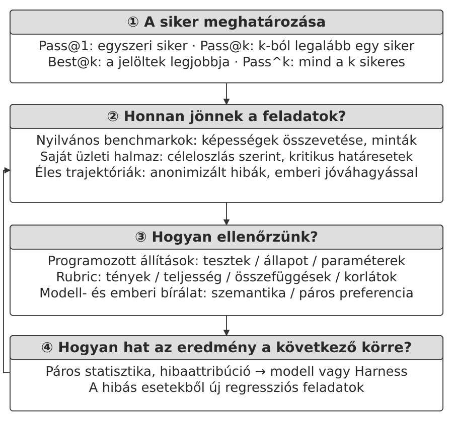
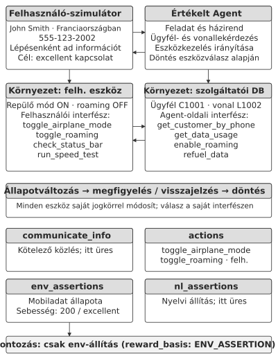
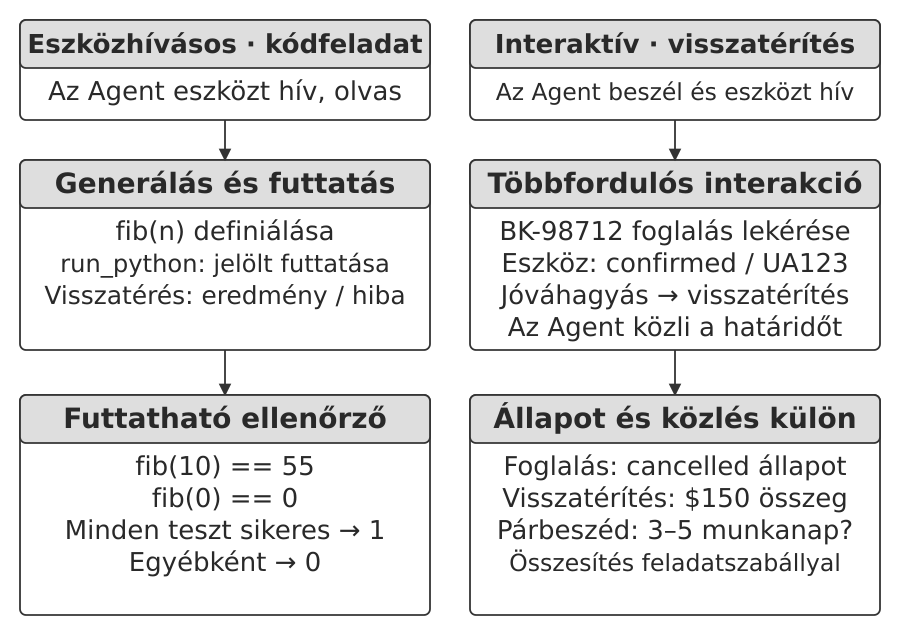
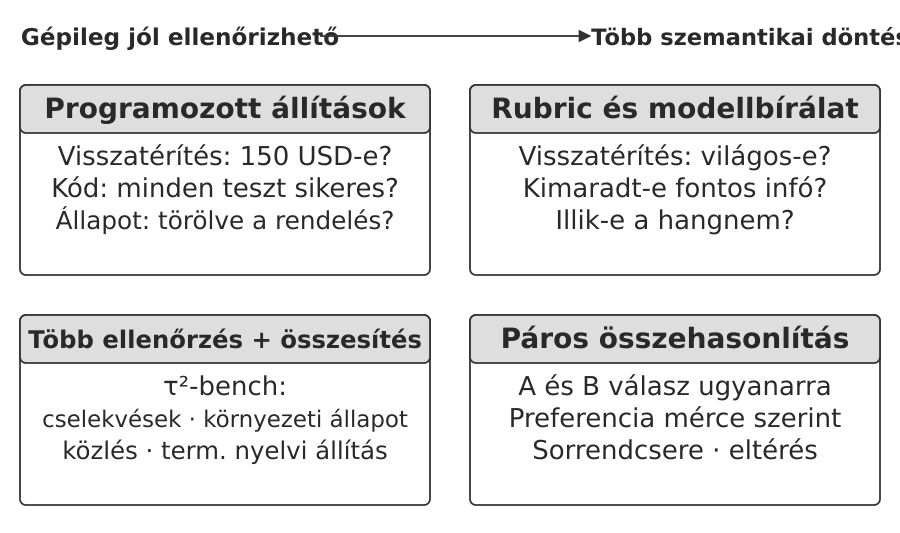
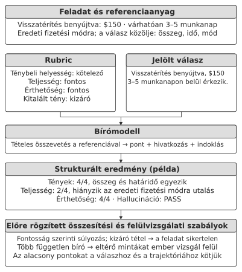
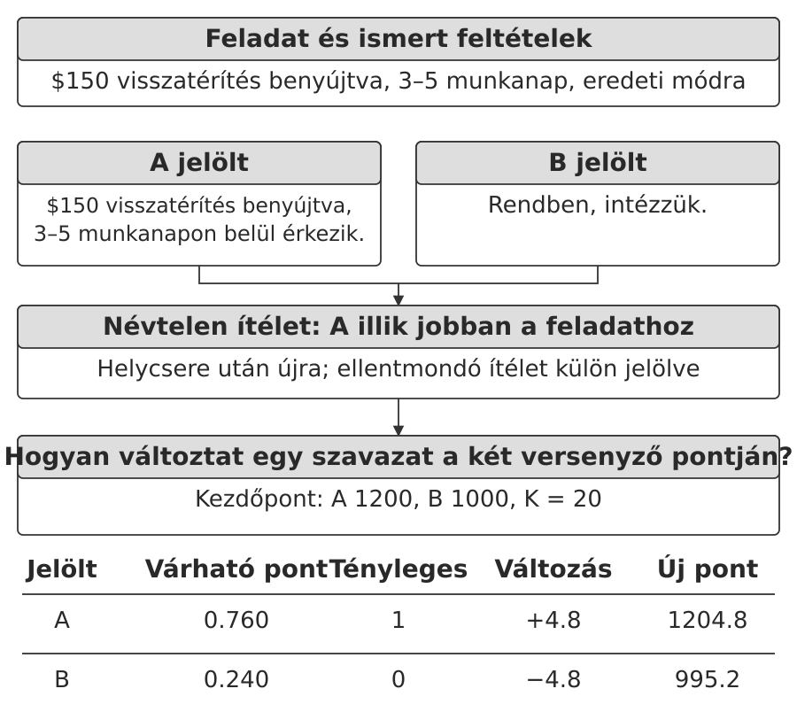
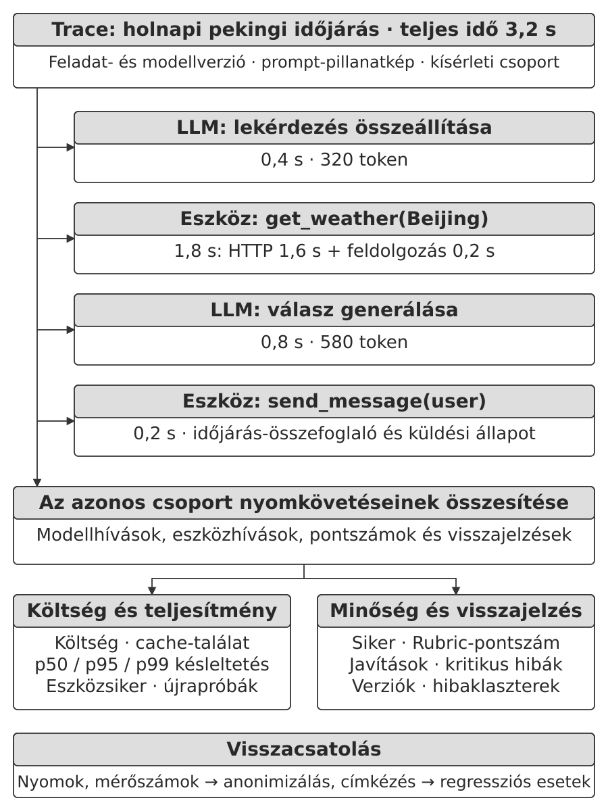
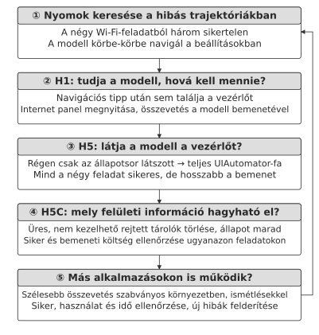
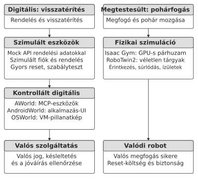
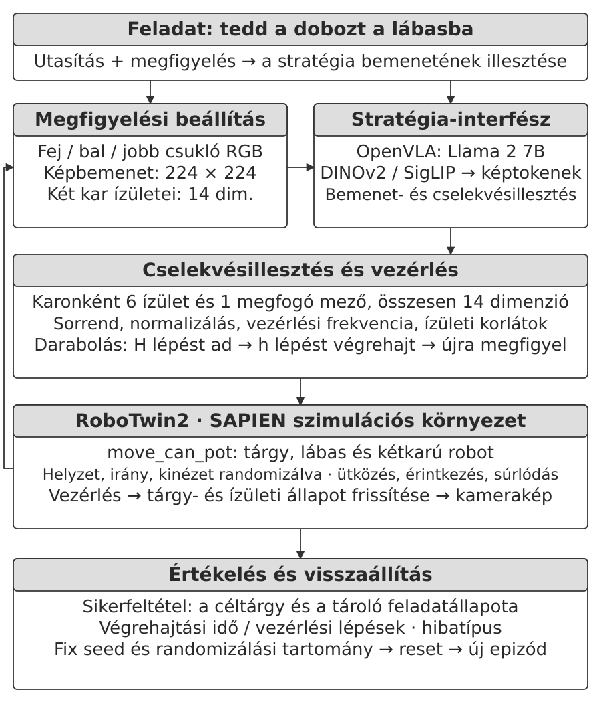

# Az Agentek kiértékelése

Az első hat fejezet egyetlen Agent felépítését mutatta be: a kontextust, a memóriát, a tudásbázist, az eszközöket, a kódot, valamint a megfigyelési és cselekvési interfészeket. Amikor a rendszer elkészült, megismételhető feladatok sorával kell megállapítani, mire képes, milyen feltételek mellett hibázik könnyen, és hol érdemes legközelebb változtatni rajta. A kiértékelés eredményei a poszt-tréninghez és a folyamatos fejlődéshez is visszajelzést adnak.

A fejlesztés során sok döntést csak valódi feladatokon lehet összevetni: melyik modellt használjuk, mely eszközöket engedjük meg, milyen tartalommal és indexeléssel épüljön fel a tudásbázis, hogyan szervezzük a felhasználói memóriát, a promptokat és a Skilleket, és milyen korlátozásokkal bővüljön a Harness. A döntések ráadásul hatnak egymásra. Egy részletesebb eszközleírás csökkentheti a paraméterhibákat, de növelheti a kontextus terhelését; egy ellenőrző lépés javíthatja a sikerarányt, ugyanakkor meghosszabbítja a végrehajtást.

Az **összehasonlító kísérlet** azonos feladatokon és feltételek mellett vet össze különböző megoldásokat, és rögzíti, hogyan változik a sikerarány, az időigény és a költség. Az **ablációs kísérlet** eltávolít vagy kikapcsol egy-egy összetevőt, például a találatok újrarangsorolását, az állapotösszegzést vagy az eredmény ellenőrzését, majd megfigyeli, hogyan módosul a rendszer viselkedése. Ha minden körben pontosan rögzítjük, mit változtattunk, a többi futási feltételt változatlanul hagyjuk, és a méréseket megismételjük, fokozatosan feltárul a kapcsolat a mérnöki döntések és a feladateredmények között. Úgy gondolom, az összehasonlítást és az ablációt a mindennapi fejlesztés részévé kell tenni. Néhány simán lefutott pálya alapján könnyű a véletlen sikert javulásnak tekinteni, vagy csak az egyik feladattípus nyereségét látni, és észre sem venni, hogy más feladatokon romlott a teljesítmény.

**A kiértékelés tárgya a modellből és a Harnessból álló teljes Agent.** A modell dönti el, hogyan érti meg a feladatot és milyen lépést választ; a Harness szervezi a kontextust, ütemezi az eszközöket, kezeli az állapotot és elvégzi az ellenőrzéseket. Ugyanaz a modell más eszközökhöz vagy más visszacsatolási folyamathoz kapcsolva eltérő eredményt érhet el. Az 5. fejezetben bemutatott Coding Harness éppen ilyen összehasonlításra ad alkalmat.

A modell és a Harness együttműködését **modellcsere-kísérlettel (model swap)** vizsgálhatjuk: rögzítjük a futtatókeretet és a feladatokat, kicseréljük a modellt, majd összevetjük a végeredményt és a hibák eloszlását. Ha egy erősebb modell is ugyanazon a lépésen bukik el, érdemes megnézni, hiányzik-e valamilyen eszköz, időben érkezik-e a visszajelzés, és lefedi-e a pontozás a célt. Ha a teljesítmény erősen függ a modelltől, akkor azt kell elemezni, mely következtetési, tervezési vagy utasításkövetési képességek befolyásolták az eredményt.

A modellcsere és az összetevők ablációja keresztezhető is. Futtathatjuk például két modellel „állapotösszegzéssel” és „állapotösszegzés nélkül” is a rendszert, és megnézhetjük, segít-e az összegzés mindkét modellnek a hosszú feladatok folytatásában, illetve függ-e a nyereség a modelltől. Így egyszerre elemezhetjük a modellek közötti különbségeket, és kideríthetjük, milyen feltételek mellett hasznos egy-egy Harness-összetevő.

A kiértékelés egyben regressziós ellenőrzés is modellfrissítéskor. Egy új modell javulhat a nyilvános benchmarkokon, közben pedig romolhat bizonyos üzleti feladatokon; ezeket a változásokat a saját feladathalmazunk mutatja meg. Azt vallom, hogy „a jövő modelljeire kell terméket fejleszteni”: előre el kell készíteni az eszközöket, az üzleti folyamatokat és a kiértékelő halmazt, és folyamatosan követni kell, hogyan teljesítenek az új modellek ugyanazokon a feladatokon. Amikor a sikerarány, a válaszidő és a költség eléri a termék követelményeit, akkor jöhet az élesítés.

Hogyan lesz az élesítés feltételeiből kiértékelés? A 7-1. ábrát érdemes egyetlen teszt mentén végigkövetni: mit akarunk mérni, honnan választjuk a feladatokat, milyen bizonyíték alapján döntjük el a sikert, és végül hogyan rögzítjük és hasonlítjuk össze az eredményeket?



## Egy feladaton keresztül a kiértékelésről: a τ²-bench telecom tartománya

Induljunk ki egy mobilinternet-hibából. John Smith az 555-123-2002-es számot használja, éppen Franciaországban tartózkodik, és a telefon állapotsorán „No Service” látható. Szeretné, ha újra működne a hálózat; a hibát csak akkor tekinti megoldottnak, ha a sebességteszt excellent eredményt ad. Szükség esetén hajlandó 2,0 GB adatot feltölteni, de a jelenlegi tarifacsomagját meg akarja tartani.

Az eset a Sierra τ²-bench nevű benchmarkjának telecom tartományából származik. A környezet egyszerre szimulálja a szolgáltató háttérrendszerét és a felhasználó készülékét; az ügyfélszolgálati Agent és a felhasználószimulátor eszközökön keresztül olvassa és módosítja az állapot egy-egy részét. A kiértékelésnek mindkét oldal interakcióit végig kell követnie: hogyan derül ki a probléma, hogyan hajtják végre a műveleteket, és helyreáll-e végül a hálózat.[^ch7-tau2-task]

### A feladatdefiníció négy összetevője

Ha egy másik ügyfélszolgálati Agenttel akarjuk ugyanezt a feladatot megoldatni, először vissza kell állítani a telefon és a fiók állapotát, a szimulált felhasználónak ugyanazok szerint az előírások szerint kell közreműködnie a hibakeresésben, végül ugyanazzal a mércével kell pontozni. Az alábbi táblázat a feladatdefiníció négy részét sorolja fel. Olvasás közben figyeljünk egy különbségre: a feladat szerzője ismeri a telefon kezdeti beállításait, de mennyit tud ebből az ügyintéző és a felhasználó a párbeszéd elején?

| Rész | Mező | Tartalom ebben a példában |
| --- | --- | --- |
| Hibajegy | `ticket` | A felhasználó, a telefonszám, a tartózkodási ország, az internetkiesés tünete, a sebességteszttel szembeni elvárás és a tarifacsomagra vonatkozó megkötés |
| Felhasználói forgatókönyv | `user_scenario.instructions` | Mit tud a felhasználó, hogyan néz utána a dolgoknak, ha kérdezik, és mikor ismeri el, hogy a probléma megoldódott |
| Kezdeti állapot | `initial_state.initialization_actions` | A felhasználó személyazonosságának és helyének beállítása, a repülőgép üzemmód bekapcsolása, a készüléken a roaming kikapcsolása, a szolgáltatói oldalon a roaming aktiválása |
| Pontozási kritériumok | `evaluation_criteria` | A műveletek és a környezet állapotának ellenőrzése; a pontozásba számító elemeket a `reward_basis` adja meg |

**Mit tud a felhasználó.** A `known_info` a nevet, a telefonszámot és a tartózkodási országot adja meg. Az, hogy a repülőgép üzemmód be van kapcsolva, a készüléken pedig ki van kapcsolva a roaming, a környezet állapotában szerepel: a felhasználószimulátornak eszközt kell hívnia, hogy lekérdezze, és csak ezután mondhatja el az ügyintézőnek. Ha a felhasználó tudását külön mezőben adjuk meg, a szimulátor meg tudja különböztetni azt, amire azonnal válaszolhat, attól, aminek ténylegesen utána kell néznie. Ha pusztán a promptban kérnénk, hogy „ne mondjon el mindent egyszerre”, nehéz volna megbízhatóan szabályozni, mikor melyik tényt árulja el. Ez az elrendezés valósítja meg a **fokozatos információfeltárást (Progressive Information Disclosure)**: a párbeszéd azzal indul, hogy „nem megy az internet”, az Agent pedig kérdésekkel és irányított lépésekkel fokozatosan jut hozzá a hibakereséshez szükséges információhoz.

**Hogyan reagál a felhasználó.** A `task_instructions` előírja, hogy az első sikertelen javítási kísérlet után a felhasználó enyhe elégedetlenséget mutasson, csak excellent sebességteszt esetén ismerje el a megoldást, és a készülékkel kapcsolatos válaszait eszközeredményekre alapozza. A poor, a fair és a good egyike sem éri el ennek a feladatnak a célját. A **ténybeli lehorgonyzás (Grounding)** biztosítja, hogy a felhasználó a szimulált környezet tényleges állapota alapján válaszoljon. E megkötés nélkül a szimulált felhasználó könnyen rábólinthat az ügyintéző „most már működnie kell” mondatára: a párbeszéd simának tűnik, a készülék hibája viszont megmarad.

**Milyen állapotból indul a két oldal.** A felhasználói oldalon a `set_user_info` állítja be a személyazonosságot, a `set_user_location(abroad=true)` jelzi, hogy a felhasználó külföldön van, majd lefut a `turn_airplane_mode_on` és a `turn_roaming_off`. A szolgáltatói oldalon az `enable_roaming` aktiválja a roamingot a `C1001` ügyfél `L1002` vonalán. A háttérrendszer lekérdezése tehát azt mutatja, hogy a roaming aktív, a telefon viszont a repülőgép üzemmód és a készüléken kikapcsolt roaming miatt nem tud csatlakozni. Az ügyintézőnek rá kell vezetnie a felhasználót a készülék ellenőrzésére, csak így juthat hozzá ahhoz az információhoz, amelyet a háttérrendszer lekérdezése nem ad meg.

**Mely ellenőrzések döntik el a pontszámot.** Az `actions` a felhasználói oldal `toggle_airplane_mode` és `toggle_roaming` műveletét sorolja fel. Az `env_assertions` a mobiladat állapotának ellenőrzését tartalmazza, valamint egy sebességteszt-ellenőrzést `expected_speed=200` és `expected_desc="excellent"` paraméterekkel. A feladatformátum ismeri a `communicate_info` és az `nl_assertions` mezőt is: az előbbi a felhasználóval kötelezően közlendő információt, az utóbbi a természetes nyelvű állításokat írja le; ebben a feladatban mindkettő üres.

A feladat `reward_basis` mezője az `ENV_ASSERTION` értéket választja, így a teljes jutalom a környezeti állításokon múlik. A műveletek ellenőrzése megjelenhet az eredményben, de hogy beszámít-e a pontszámba, azt a pontozási konfiguráció határozza meg.

### Az eredmény ellenőrzése a futási pálya mentén

A kísérő futtatás öt telecom feladatot választ ki, mindegyiket egyszer futtatja; az ügyfélszolgálati Agent és a felhasználószimulátor egyaránt GPT-4.1 minit használ, és végül négy feladat sikerül. Először a fenti franciaországi roamingfeladatot elemezzük, aztán összevetjük egy sikertelennel.

> **7-1. kísérlet ★: A τ²-bench futtatása és összevetése a τ-bench fejlődésével**
>
> Először olvassuk el egy feladat felhasználói forgatókönyvét, inicializáló műveleteit és pontozási feltételeit, majd futtassunk le egy teljes interakciót. A pálya mentén jelöljük meg az ügyintéző lekérdezéseit, a felhasználó műveleteit, az állapotváltozásokat és az elfogadás eredményét, és vizsgáljuk meg, melyik információra támaszkodott az egyes döntések során.
>
> A τ-bench és a τ²-bench összevetésekor főként azt figyeljük meg, meg tudja-e változtatni a felhasználó eszközökkel a környezetet, és milyen összehangolási követelményeket ró ez az ügyintézőre.
>
> A 7-2. ábrán először keressük meg, ki tudja kikapcsolni a telefon repülőgép üzemmódját, majd azt, ki tudja módosítani a szolgáltató roamingbeállítását. A két oldal más-más dologra képes, és ez magyarázza, miért kell az ügyintézőnek a saját műveletei után arra kérnie a felhasználót, hogy a telefonon futtasson sebességtesztet.
>
> 

A franciaországi roamingfeladatban az Agent először a fiókot azonosítja. A telefonszám alapján megtalálja a `C1001` ügyfelet, lekérdezi az `L1001`, `L1002` és `L1003` vonal forgalmi adatait, de az `L1001` részletes adatai alapján téves következtetésre jut: a felhasználó által megadott 555-123-2002 nem szerepel az aktív vonalak között, a legközelebbi szám az 555-123-2001. Miután a felhasználó kitart amellett, hogy a szám helyes, az Agent lekérdezi az `L1002`-t is, és csak ekkor azonosítja a helyes vonalat.

Ezután a felhasználószimulátor meghívja a `check_network_status` és a `check_status_bar` eszközt. A visszaadott állapot: a repülőgép üzemmód be van kapcsolva, a mobilhálózaton nincs szolgáltatás, a mobiladat be van kapcsolva, a készüléken a roaming ki van kapcsolva. A felhasználó ennek alapján jelzi: „A telefon repülőgép üzemmódban van, és az adatroaming is ki van kapcsolva. Először kapcsoljam ki a repülőgép üzemmódot?” A lekérdezést itt a felhasználói oldal eszközei végzik, az eredmény pedig a párbeszéden keresztül jut el az ügyintézőhöz.

Ez a **kettős vezérlés (Dual-Control)** mechanizmusa: az ügyintéző a szolgáltató háttérrendszerét kérdezi le és kezeli, a felhasználószimulátornak pedig saját készülékoldali eszközei vannak, például az állapotsor megtekintése, a repülőgép üzemmód átkapcsolása, a SIM-kártya kivétele és visszahelyezése vagy a sebességteszt futtatása. A két fél párbeszédben hangolja össze a műveleteit, a környezet pedig rögzíti, ki milyen állapotváltozást idézett elő.

Az Agent ezután rávezeti a felhasználót, hogy kapcsolja ki a repülőgép üzemmódot és kapcsolja be a roamingot a készüléken, mire az állapotsoron megjelenik az 5G-jel. A felhasználó lefuttatja a `run_speed_test` eszközt, 275 Mbps sebességet és Excellent minősítést kap, majd megerősíti, hogy a probléma megoldódott. Mindkét környezeti állítás teljesül, a feladat jutalma 1,0.

Ez a sikeres pálya folyamatbeli problémát is felszínre hoz. A házirend szerint az ügyintéző egyszerre csak egy eszközt hívhat, az Agent mégis egyetlen üzenetben adta ki a `get_customer_by_phone` és a `get_customer_by_name` hívást. Mivel ennek a feladatnak a pontszámába csak a környezeti állítások számítanak bele, ez a viselkedés nem változtatott a jutalmon.

Egy másik, sikertelen pályán a rosszul kiválasztott vonalat az Agent egyszer sem javította ki, és ettől a további hibakeresés is félrement. A felhasználó száma itt is 555-123-2002, az Agent mégis az `L1001`-et választja, és ennek a vonalnak a 3,2/5 GB-os fogyasztására építve folytatja a vizsgálatot. Az eszköz már visszaadta, hogy az `L1001` az 555-123-2001-es számhoz tartozik, az Agent mégsem javítja a vonalat, és több környi, a problémához nem tartozó vizsgálat után emberi ügyintézőhöz irányítja a hívást. A felhasználói oldalon sikerült kikapcsolni az adattakarékos módot, de a helyes `L1002` vonalhoz szükséges 2 GB-os adatfeltöltés nem történt meg, így mindhárom környezeti állítás elbukott.

A két pálya összevetésével a végső pontszám konkrét javítási pontokra bontható: ellenőrizni kell a telefonszám és a vonal megfeleltetését, az új bizonyítékok alapján korrigálni kell az ítéletet, meg kell különböztetni a készülék és a háttérrendszer állapotát, és meg kell győződni róla, hogy a szükséges feltöltés megtörtént. A későbbi hibaattribúciós rész tovább tárgyalja, hogyan lehet egy hosszú pályán megtalálni ezeket a döntő fordulópontokat.

[^ch7-tau2-task]: A Sierra Research τ²-bench benchmarkja a telecom tartomány `user_tools.py` fájljában definiálja a felhasználói eszközöket, a pontozás belépési pontja az `evaluator.py`. Az eset tartalma és eredményei a kísérő anyagban megőrzött öt feladat és a hozzájuk tartozó futási pályák alapján készültek.

## Kiértékelési metrikák: a siker meghatározása

Az öt feladatból négy sikerült: ez a futtatás összesített eredménye. Ha termékdöntést akarunk hozni belőle, tisztázni kell a feladat típusát és a hiba árát is. Egy visszatérítéseket kezelő ügyfélszolgálatnak tartósan és megbízhatóan teljesítenie kell a jogos visszatérítéseket; programíráskor viszont több megvalósítás is készülhet, a tesztek pedig kiválasztják azt a változatot, amely lefut és helyes eredményt ad. Kutatásban is lehet több hipotézist felállítani, amelyeket aztán a kutató ellenőriz. A kiértékelési metrikának ehhez a használati módhoz kell igazodnia.

### Technikai látványosság: a többszöri próbálkozás képessége Pass@k-val

Néhány lenyűgöző Agent-bemutatót „technikai látványosságnak” nevezek: elég időt és elég próbálkozást kap a rendszer, és megold egy olyan feladatot, amelyet korábban nehéz volt automatizálni. Felfedező jellegű munkában egyetlen ellenőrzött sikeres pálya is értéket teremthet. A **Pass@k** metrika ezt a használati módot tükrözi: ugyanazt a feladatot $k$-szor futtatjuk, és sikernek számít, ha legalább egyszer átmegy. Folytonos pontozású feladatoknál a $k$ futás legmagasabb pontszáma is közölhető; ezt **Best@k**-nak nevezzük.

Az Anthropic például több Claude-példány együttműködésével építtetett egy C fordítót, és ezzel megmutatta, hogy a hosszan tartó futás, a tesztekből érkező visszajelzés és a munkamegosztás összetett mérnöki munkát is lehetővé tesz. Matematikai ellenpéldák keresésekor a kutatók szintén hagyhatják, hogy a modell újra meg újra próbálkozzon, végül pedig önállóan ellenőrzik, hogy az egyik ellenpélda valóban megállja-e a helyét. A szoftverbiztonsági átvizsgálásnál a modell által jelentett gyanús problémákat felül lehet vizsgálni, nyílt végű alkotómunkánál pedig több műből lehet kiválasztani a legjobbat.[^ch7-long-running]

Az alkalmazott termékek is összetett feladatokon keresztül mutatják meg, mire képesek. A Manus virtuális számítógépet ad az Agent kezébe, így a felhasználó láthatja, ahogy kezeli a felületet, anyagokat keres és folyamatosan dolgozik. Az OpenClaw azonnali üzenetküldőn keresztül fogad megbízásokat, hozzáfér a beállított és engedélyezett fájlokhoz és szolgáltatásokhoz, menet közben beszámol az előrehaladásról, kiegészítő információt kér, és időzítő is felébresztheti, hogy ellenőrizze a teendőket. Az ilyen konkrét viselkedésekből a felhasználó könnyebben megérti, mire jó egy Agent.

Véleményem szerint az olyan bemutatók, amelyek új típusú feladatok elvégzését mutatják be, fontos szerepet játszanak abban, hogy ezek a termékek felhasználókat vonzzanak.

### Üzleti megbízhatóság: a Pass^k

Az üzleti folyamatok rendszerint azt követelik meg, hogy minden futás helyesen teljesítsen. A **Pass^k** azt méri, hogy ugyanazt a feladatot $k$-szor futtatva mindegyik alkalommal sikerül-e; így olvasható: „pass power k”. A feladat sikerfeltétele egyszerre kiterjedhet a végeredményre, a házirend betartására és a jogosultsági megkötésekre; minden futást ugyanazok a feltételek szerint ellenőrzünk.

Ha feltesszük, hogy a futások egymástól függetlenek, és mindegyik sikerének valószínűsége $p$, akkor:

$$
\mathrm{Pass@k}=1-(1-p)^k,\qquad
\mathrm{Pass}^{k}=p^k.
$$

Ha például $p=0.6$ és $k=5$, a Pass@5 körülbelül 99,0%, a Pass^5 körülbelül 7,8%. Az előbbi azt jelenti, hogy öt próbálkozás közül rendszerint akad egy sikeres, az utóbbi azt, hogy annak esélye, hogy mind az öt sikerüljön, továbbra is igen kicsi.

Egy valódi eredménysor olvasásakor eleinte nincs szükség a képletre. Tegyük fel, hogy ugyanaz a feladat öt futáson „siker, kudarc, siker, siker, kudarc” eredményt hozott. Erre a csoportra a Pass@5 értéke 1, a Pass^5 értéke 0, az egyszeri sikerarány becslése pedig 3/5. A fenti 99,0% és 7,8% más kérdésre felel: ha tudjuk, hogy egy-egy futás sikerének valószínűsége 0,6, és az öt futást csoportként sokszor megismételjük, a csoportok hányad része éri el az adott mércét?

Ugyanezekből a feljegyzésekből egy könnyebben ellenőrizhető kérdésre is választ kaphatunk: ha az imént látott öt futásból tetszőlegesen kiválasztunk kettőt, a párok hányad része megy át? Tekintsünk minden futást egy kártyának, és húzzunk kettőt visszatevés nélkül: tízféle pár lehetséges. Mindkét futás csak akkor bukik el, ha a két kudarckártya kerül egy párba, így kilenc párban legalább egy siker van, vagyis a Pass@2 mintabeli becslése 9/10. A három sikerkártyából három pár képezhető, így a Pass^2 mintabeli becslése 3/10. A τ²-bench feladatonként éppen így számolja meg a teljesen sikeres kombinációkat: ha egy feladatot $n$-szer futtatunk, és $s$ futás sikerül, akkor ebből $k$ futást kiválasztva a teljesen sikeres kombinációk aránya $\binom{s}{k}/\binom{n}{k}$, ahol $1\le k\le n$.[^ch7-tau2-metrics]

Nézzük meg újra a 7-1. kísérlet 4/5-ös eredményét. Az öt pálya öt különböző feladathoz tartozik, mindegyik feladatnak csak egy kártyája van, így egyetlen pár sem állítható össze. Ha ezekre a feladatokra Pass^2-t akarunk becsülni, minden feladathoz további független futásokat kell hozzáadni, majd külön-külön kiszámolni és összesíteni az eredményeket. Ha a 0,8-at egyszerűen négyzetre emelnénk, azzal hallgatólagosan azt is feltételeznénk, hogy minden feladat sikervalószínűsége minden futásban ugyanakkora, és a próbálkozások egymástól függetlenek.

[^ch7-tau2-metrics]: A τ²-bench kísérleti változata (8d005b0 revízió) az `agent_metrics.py` fájlban feladatonként számolja a Pass^k-t. Ha a sikerek száma kisebb $k$-nál, a teljesen sikeres kombinációk száma nulla.

Számoláskor ügyelni kell arra, hogy a statisztikai egység egységes maradjon. Ugyanazon feladat öt mintavétele ennek az egy feladatnak az ismételt teljesítményét méri; az éles üzem öt egymást követő, különböző feladatára viszont a feladatok nehézsége és a forgalom eloszlása is hat. Ha a feladatok sikervalószínűsége eltér, először feladatonként számoljuk ki az ismételt sikerességi mutatót, majd a feladatok súlya szerint összesítsük. A közös állapot, a gyorsítótár vagy ugyanaz a hiba is összefüggővé teheti a futásokat.

**Mi legyen a nevező, ha a rendszer azt is felelheti, hogy „nincs elég információ”?** Képzeljünk el egy szakirodalmi asszisztenst, amely 100 kérdést kap, 80-ra válaszol, és ebből 68 helyes. Az az olvasó, aki a megadott válaszokra támaszkodik, a 68/80-as, azaz 85%-os arányra kíváncsi; akinek az egész köteg feladatot el kell végeznie, annak a 68/100, azaz 68% is számít. A maradék 20 kérdésnél további bizonyítékot kell keresni, vagy emberhez kell továbbítani őket.

A PaperQA2 a LitQA2 248 szakirodalmi kérdésén éppen választhatja a „nincs elég információ” lehetőséget. A cikk három futás átlagát közli: amikor a rendszer érdemi választ ad, a pontossága 85,2%; az összes kérdésre vetítve 66,0%, emellett a kérdések 21,9%-ánál a „nincs elég információ” választ adja. Kilenc emberi válaszadónál a két megfelelő pontosság 73,8% és 67,7%. A cikk szerint az első különbség szignifikáns, a második nem érte el a statisztikai szignifikanciát.[^ch7-paperqa2-denominators]

[^ch7-paperqa2-denominators]: Skarlinski és mtsai, *Language Agents Achieve Superhuman Synthesis of Scientific Knowledge*, 2024, lásd a 2. szakaszt és a 2. ábrát.

Két azonos végállapotú pálya költsége eltérhet. Vegyünk egy számlalekérdezést: az „A” pálya egyetlen lekérdezéssel visszaadja a helyes összeget, a „B” pálya csak két lekérdezés után adja meg ugyanezt a választ. Ha a két lekérdezés ugyanazt a kérésazonosítót viselte, és az első túllépte az időkorlátot, akkor az újrapróbálkozás segített helyreállítani a feladatot. Ha viszont az első eredmény sikeresen megérkezett, a második lekérdezés feleslegesen növelte a várakozási időt és az eszközhasználat költségét.

Ha a futás írással vagy más külső hatással jár, minden próba előtt állítsuk vissza az előírt kezdeti állapotot, a műveleteket tesztkörnyezetben végezzük el, és minden próbálkozást rögzítsünk. Ha a termék kudarc után engedi az újrapróbálkozást, az újrapróbálkozások számát, a helyreállítási lépéseket és a végrehajtás költségét is vonjuk be a folyamat kiértékelésébe; az eredeti kudarcok feljegyzéseit pedig őrizzük meg, hogy el lehessen választani az egyszeri teljesítményt a helyreállítás utáni eredménytől.

[^ch7-long-running]: Anthropic, Building a C compiler with a team of parallel Claudes, 2026-02-05; a többpéldányos együttműködést, a hosszú távú végrehajtást és a tesztekből érkező visszajelzést mutatja be.

## A kiértékelő környezet

Tegyük fel, hogy újra meg akarjuk vizsgálni azt a futást, amelyben az Agent rossz vonalat választott. Az ellenőrzőnek ugyanazt a felhasználót, ugyanazt a két vonalat és ugyanazt a kezdeti tarifacsomagot kell látnia. Ha az első futás már módosította az egyik vonalat, és egyszerűen újra lefuttatjuk, nem tudjuk eldönteni, hogy az eredmény változása a modelltől vagy az adatbázistól származik-e. A kiértékelő környezet feladata, hogy létrehozza a feladat kiindulópontját, biztosítsa az interakciós interfészt, rögzítse a folyamatot és ellenőrizze a végpontot.

### Az öt összetevő

A telecom feladat példáján a kiértékelő környezet öt részre bontható.

Az **adathalmaz (Dataset)** a feladatdefiníciókat tárolja: a felhasználó hátterét, a viselkedési előírásokat, a kezdeti állapotot és az elfogadási feltételeket. Egy rekord egy tesztesetnek felel meg; futáskor az információt a résztvevők szerepe szerint osztjuk szét.

A **környezeti állapot (Environment State)** a feladat végrehajtása közben változó információkat tárolja, például az ügyfeleket, a vonalakat, a tarifacsomagokat és a számlákat, valamint a készülék repülőgép üzemmódját, roaming- és adattakarékossági beállításait. Új kör indításakor a környezet először visszaállítja az alapadatokat, majd végrehajtja az `initialization_actions` műveleteit, és létrehozza az aktuális feladatban előírt hibát. A takarításnak és az inicializálásnak össze kell hangolódnia, hogy az előző kör feltöltései vagy beállításváltozásai ne kerüljenek át a következőbe.

Az **eszközinterfész (Tools)** határozza meg, mit olvashatnak és mit változtathatnak meg a résztvevők. Az ügyintéző ügyfeleket kereshet, ellenőrizheti a fogyasztást, adatot tölthet fel, vagy emberi ügyintézőhöz irányíthatja az ügyet; a felhasználó megnézheti a készülék állapotát, átkapcsolhatja a kapcsolókat és sebességtesztet futtathat. Az eszközök szemcsézettségének a mért képességhez kell igazodnia: ha a diagnózist és a tervezést akarjuk értékelni, az Agentnek magának kell kombinálnia a lekérdezéseket és a műveleteket; ha közvetlenül egy „internetprobléma javítása” eszközt adunk neki, a teszt súlypontja arra tevődik át, mikor hívja meg ezt a képességet.

A **pontozási kritériumok (Rubric)** írják le, hogyan ítéljük meg az eredményt. Egy telecom feladat ellenőrizheti a műveleteket, a környezet állapotát, a szükséges kommunikációt és a természetes nyelvű követelményeket, majd a `reward_basis` határozza meg, mely ellenőrzések számítanak bele a pontszámba.

A **végrehajtási protokoll (Interaction Protocol)** szabályozza a megszólalások sorrendjét, az eszközhívásokat és a befejezést. A felhasználószimulátor a `###STOP###` kimenettel zárhatja le az interakciót, a futtató pedig költségkereteket, például fordulószám-korlátot is beállít. A befejezés okát és a feladat pontszámát külön rögzítjük: ha a felhasználó befejezi a párbeszédet, a környezeti állítások továbbra is eldöntik, elérte-e a feladat a célját; ha elfogy a keret, akkor is meg kell őrizni az utolsó állapotot és a be nem fejezett lépéseket.

### Ember-gép interakciós és eszközhívó kiértékelő környezetek

A telecom feladatban van egy felhasználószimulátor, amely folyamatosan válaszol és kezeli a készüléket. A kódjavítást, az adatelemzést és a matematikai feladatmegoldást viszont többnyire egy feladatutasítás indítja el, utána az Agent főként eszközökkel lép kapcsolatba. Mindkét környezettípushoz feladatok, állapot, interfészek, pontozás és végrehajtási protokoll kell; a különbség abban áll, hogy szimulálni kell-e egy beszélgetőpartnert is, és hogyan hangolja össze a két fél a cselekvéseit.

Egy kódfeladat kimenetét tesztekkel lehet ellenőrizni, egy adatbázis-feladatnál le lehet kérdezni a módosított rekordokat, egy nyílt végű elemzésnél viszont emberre vagy modellre lehet szükség a tartalom megítéléséhez. Az ember-gép interakciós feladatoknál gyakran két bizonyítékot kell összeilleszteni. Az például, hogy helyreállt-e a mobilhálózat, a készülék állapotából derül ki; az viszont, hogy az ügyintéző tisztázta-e a telefonszámot és végigvezette-e a felhasználót a lépéseken, a párbeszédből. A 7-3. ábrán látható visszatérítés is ilyen: hogy a rendelést törölték-e, az adatbázisból kiolvasható; hogy az ügyintéző közölte-e, mikor érkezik meg az összeg, azt a párbeszédben kell megkeresni.



A Verifiers keretrendszerben a két feladattípust különböző környezeti interfészekről lehet megközelíteni. A 7-1. táblázat a v0.1.9 azon interfészeit sorolja fel, amelyek az egyfordulós válaszokat, a többfordulós eszközhívást, a futási állapot befecskendezését és a sandbox-erőforrások kezelését végzik, hogy könnyebb legyen összevetni őket a kóddal.[^ch7-verifiers-env]

7-1. táblázat: A Verifiers környezettípusainak összehasonlítása

| Környezettípus | Fő feladat | Eszköz- és állapotkezelés | Tipikus felhasználás |
|---|---|---|---|
| `SingleTurnEnv` | Egyfordulós válasz szervezése | Egyetlen válasz után pontoz | Matematikai feladatok, egyfordulós kérdés-válasz |
| `ToolEnv` | Többfordulós eszközinterakció szervezése | Megőrzi a futási pályát, kiosztja az eszközhívásokat és fogadja az eredményeket | Keresés és információszintézis |
| `StatefulToolEnv` | A futási állapot bekötése az eszközvégrehajtásba | Az aktuális állapot alapján kiegészíti az eszközparamétereket vagy frissíti az állapotot | Adatbázis- vagy erőforrás-azonosító hozzárendelése az adott feladathoz |
| `SandboxEnv` | Elszigetelt végrehajtási környezet kezelése | Sandboxot rendel a futáshoz, és annak eszközeit használja | Kód futtatása, fájlok és teszteredmények ellenőrzése |

Ha például két feladat egyszerre módosít egy adatbázist, a futtató mindkettő eszközhívásaiba befecskendezheti a saját adatbázis-azonosítóját, így minden pálya a hozzá tartozó adatokon dolgozik. Sikertelen végrehajtás esetén az eszköznek olyan információt kell visszaadnia, amely alapján a következő lépésről dönteni lehet, például hogy az objektum nem létezik, a paraméter nem felel meg a követelményeknek, vagy a szolgáltatás túllépte az időkorlátot. Ha a kiértékelő rendszer megőrzi a megfigyeléseket, a hívásokat, a végrehajtási eredményeket és a jutalmakat, az elemzés során a hibát konkrét lépéshez lehet kötni.

[^ch7-verifiers-env]: Prime Intellect, a Verifiers v0.1.9 ToolEnv és StatefulToolEnv osztálya; bemutatja a többfordulós pályákat, az eszközhívások kiosztását és az állapotparaméterek befecskendezését.

## A kiértékelő adathalmaz tervezése

Bővítsük most az öt telecom feladatot olyan kiértékelő halmazzá, amely kiadási döntéseket is megalapozhat. Ha az új feladatok mind arról szólnak, hogy „aktiváld a roamingot a megadott számon”, a rendszer akkor is magas pontszámot érhet el, ha soha nem tanulta meg megkülönböztetni ugyanazon fiók két vonalát. Ha az eredmény alapján akarjuk eldönteni, élesíthető-e az ügyfélszolgálati Agent, a feladatokat valódi hibajegyek alapján kell összeállítani: legyenek köztük rutinügyek és olyan nehéz esetek is, amelyekben könnyű összekeverni a vonalakat, pontozáskor pedig azt is ellenőrizni kell, melyik vonalat módosította végül az ügyintéző. Élesítés után is karban kell tartani ezeket a feladatokat, hogy továbbra is azt a munkát tükrözzék, amelyet a felhasználók ténylegesen rábíznak a rendszerre.

### Benchmarktervezési döntések egymás mellett

A 7-2. táblázat hat benchmarkot állít egymás mellé a mért képesség, a feladatok forrása, a futási környezet és az ellenőrzés módja szerint.

7-2. táblázat: Néhány Agent-benchmark kulcsfontosságú tervezési döntései

| Benchmark | Mért képesség | A feladatok forrása és szervezése | Futási környezet | Ellenőrzés módja |
|---|---|---|---|---|
| τ²-bench | Ügyfélszolgálati interakció és eszközhasználat | Tartományi feladatok és hibakombinációk | Felhasználószimulátor, készülék és üzleti adatbázis | Tételes ellenőrzés, pontozás a `reward_basis` szerint |
| SWE-bench Verified | Kódhibák javítása | Valódi GitHub issue-k, emberi szűréssel | Kódtároló és tesztkörnyezet | `FAIL_TO_PASS` és `PASS_TO_PASS` tesztek |
| AndroidWorld | Android-alkalmazások kezelése | Paraméterezett feladatsablonok | Valódi alkalmazásokat futtató Android-emulátor | A készülék, a fájlok vagy az alkalmazás belső állapotának kiolvasása |
| OSWorld | Asztali és alkalmazásokon átívelő műveletek | Valós használati helyzetek, beállított feladat-kiindulópontokkal | Virtuális gép és asztali alkalmazások | A végrehajtási állapot és a termékek ellenőrzése feladatonként |
| Terminal-Bench | Mérnöki feladatok a terminálban | Kézzel tervezett feladatok és tesztek | Konténer a feladathoz szükséges függőségekkel | Fájlok, programfuttatás és teszteredmények |
| GAIA | Általános asszisztens információfeldolgozása | Kézzel írt kérdések, részben mellékelt anyagokkal | Web, fájlok és segédeszközök | Összevetés a válaszformátum szerinti normalizálás után |

### Ellenőrzők

Az ellenőrző (verifier) köti össze a feladat célját az ellenőrizhető bizonyítékokkal. Kódfeladatnál teszteket kell futtatni, asztali feladatnál ki kell olvasni az alkalmazás vagy a fájl állapotát, információkeresési feladatnál ellenőrizni kell a választ és a forrásait. **Az elfogadásnak önállóan megszerzett bizonyítékon kell alapulnia.** Az Agent készíthet egy teljes jelentést arról, hogy minden lépést elvégzett; az ellenőrzőnek ettől még ténylegesen le kell futtatnia a terméket, ki kell olvasnia az állapotot, vagy ellenőriznie kell a forrásokat. A befejezési jelentés arra szolgál, hogy megtaláljuk, mit kell ellenőrizni; a pontszámot maguk az ellenőrzések határozzák meg.

Képzeljük el, hogy a felhasználó megnyit egy fizetési alkalmazást, és megkéri az asszisztenst: „hagyd jóvá a lakótársam összes e havi fizetési kérelmét”. Tegyük fel, hogy három függő kérelem van: a lakótárs e havi kérelme, ugyanennek a lakótársnak a múlt havi kérelme és egy kolléga e havi kérelme. Az elsőt jóvá kell hagyni, a másik kettőnek függőben kell maradnia. Ha csak az elsőt ellenőrizzük, a mindhármat jóváhagyó asszisztens is teljes pontszámot kap; ha csak a másik kettőt, akkor egy semmit sem csináló asszisztens is átmegy. Az AppWorld egy szimulált fizetési alkalmazásban éppen ilyen feladatot ad. Az ellenőrző tervezésekor először a művelet előtti adatok alapján körülhatárolhatjuk a felhasználó által engedélyezett kérelmeket, ellenőrizhetjük, hogy mindegyiket jóváhagyták-e, végül a művelet utáni rekordokból visszafelé megnézhetjük: melyik további tételekhez nyúlt még hozzá az asszisztens?[^ch7-appworld-scope]

[^ch7-appworld-scope]: Trivedi és mtsai, *AppWorld*, ACL 2024; a 2. ábra mutatja be a feladatot és az elfogadási feltételeket.

A tudományos keresés is adhat könnyen ellenőrizhető terméket. A FunSearch célja, hogy egy nyolcdimenziós térben minél több pontot válasszon ki; minden koordináta csak 0, 1 vagy 2 lehet, a műveleteket modulo 3 végezzük, és a kiválasztott pontok közül semelyik három nem lehet egy egyenesen. A kutatók megírták a pontokat lépésenként kiválasztó program vázát, a modellel olyan függvényeket javasoltattak, amelyek sorba rendezik a jelölt pontokat, a pontozás alapja pedig a ténylegesen megkonstruált érvényes ponthalmaz mérete volt. A cikk megjelenésekor a meglévő konstrukciók 496 pontot tudtak kiválasztani, az új program pedig egy 512 pontból álló listát adott.[^ch7-funsearch-cap]

Ezt az eredményt bárki önállóan ellenőrizheti, ha letölti a listát. Először meg kell győződni arról, hogy 512 különböző nyolcdimenziós vektort tartalmaz, és minden koordináta az előírt tartományba esik. Ha ezután kiválasztunk két különböző pontot, $a$-t és $b$-t, az általuk meghatározott egyenesen csak három pont van, a harmadik pont pedig $c=-a-b \pmod{3}$. Két dimenzióban például a $(0,0)$ és az $(1,2)$ pontból a harmadik pont $(2,1)$. Ha ugyanezt a műveletet koordinátánként alkalmazzuk nyolc dimenzióban, és végigmegyünk a lista mind a 130 816 különböző pontpárján, egyik így kapott harmadik pont sem szerepel a listában. Ez elegendő annak bizonyításához, hogy legalább 512 pont kiválasztható. Annak bizonyításához, hogy 513 biztosan nem, már felső korlátra vonatkozó bizonyítás kell.

[^ch7-funsearch-cap]: Romera-Paredes és mtsai, *Mathematical discoveries from program search with large language models*, Nature, online megjelenés 2023-ban. A szerzők külön közzétették a nyolcdimenziós ponthalmazt és az ellenőrzéshez használt számítási notebookot.

**Az SWE-bench két tesztcsoportja külön ellenőrzi a javítást és a regressziót.** A `FAIL_TO_PASS` azokat a teszteket jelöli, amelyek a javítás előtt elbuknak, utána pedig át kell menniük; a `PASS_TO_PASS` azokat, amelyek eredetileg is átmentek, és a javítás után is át kell menniük. Az előbbi a konkrét problémát ellenőrzi, az utóbbi azt, hogy a meglévő tesztek által lefedett viselkedés megmarad-e.[^ch7-swe-verified]

**Az OSWorld végrehajtáson alapuló ellenőrzéssel vizsgálja az alkalmazások termékeit.** Az eredeti változat 134 végrehajtásalapú kiértékelő függvényt tartalmaz, amelyek a feladat konfigurációja alapján fájlokat, alkalmazásadatokat vagy rendszerállapotot olvasnak ki.[^ch7-osworld-design] Ha a feladat egy táblázat módosítása, ellenőrizhetők a megadott cellák és képletek; ha egy böngészőbeállítás frissítése, kiolvasható a vonatkozó konfiguráció.

**A Terminal-Bench a futtatás eredménye alapján fogadja el a mérnöki feladatokat.** A Linux-kernel felépítését kérő feladat összefűzi a forráskód módosítását, a fordítást, az initramfs elkészítését és a QEMU alatti indítást; ebben a Linux 6.9, a `start_kernel` függvénybe illesztett egyedi `printk` és az indítási naplóban megjelenő üzenet mind konkrét ellenőrzési pontot ad.

Az 5. fejezetben szó volt arról, hogyan lehet rendelésekből ellenőrizni az árbevételt. Ha az asszisztens egy húsz értékesítési csatornát tartalmazó negyedéves jelentést ad le, hol kezdjük az ellenőrzést? A Tencent WorkBuddy Bench egyik nyilvános feladata egy egyeztetési feladat. Mindkét munkalap csatornaadatokat tartalmaz: az elszámolt összegnél az előző negyedévhez képesti változást kell nézni, a befolyt összegnél az előző év azonos negyedévéhez képestit. Ha valaki mindkét bázisidőszaknak az előző negyedévet adja meg, a fejléc és a csatornák száma ettől még tökéletesen helyes lehet. Vegyük az elszámolási lap „Jinxiu életmódbolt” csatornáját: ha a részletes adatokból kiszűrjük az ismétlődő sorokat és a negyedév nélküli rekordokat, majd csatornánként és negyedévenként összesítünk, kiderül, hogy a teljes forgalom 1 569 231,00-ről 1 787 311,03-ra nőtt, a különbség 218 080,03. A pontozóprogram ellenőrzi, hogy a két lap lefedi-e a csatornákat, majd szúrópróbaszerűen megvizsgálja két kijelölt csatorna számait. A csatornák lefedettségét tehát mind a húsz csatornára ellenőrzi, a számértékeket viszont csak a két kiválasztottra.[^ch7-workbuddy-office]

[^ch7-workbuddy-office]: Tencent WorkBuddy Bench, `channel-period-compare-L4-017` irodai feladat. A felhasznált adatcsomag (3e8ad83 revízió) tartalmazza az eredeti munkafüzetet, a referenciaválaszt és a pontozóprogramot.

Az ellenőrzőt egy időérzékeny feladattal is próbára tehetjük. Tegyük fel, hogy a felhasználó értesítést kér, ha egy szálloda szobaára 950 jüan alá csökken. Az ár 10:00-kor 1000 jüan, 10:10-kor 900 jüanra esik, 10:15-kor pedig visszamegy 1000 jüanra. Ha 10:12-kor megérkezik egy árcsökkenési értesítés a szobatípussal és a foglalási hivatkozással, a felhasználónak még van esélye foglalni. Ha a rendszer naponta egyszer azt üzeni, hogy „még nem csökkent az ár”, és éppen ezt az öt percet hagyja ki, akkor egy egész heti folyamatos futás után sem teljesítette a megbízást. Pontozáskor külön rögzítjük a feltételnek megfelelő időablakok számát, az ablakon belül időben kiküldött értesítések számát, valamint azt, hányszor zavarta a felhasználót akkor, amikor nem történt változás. Ha maga a kiértékelő is csak napi egy árat tárol, a kihagyott ablakokat meg sem tudja számolni. A kihagyott értesítések méréséhez először egy időbélyeggel ellátott, teljes árvisszajátszást kell előkészíteni, majd hagyni kell, hogy a vizsgált rendszer a saját ütemezése szerint kérdezze le az árat.

### A feladatok nehézségi szintjei

A feladathalmaznak különböző nehézségű feladatokat kell tartalmaznia, és meg kell indokolnia, honnan ered a nehézség. Az alapfeladatok azt ellenőrzik, nem romlott-e valamelyik képesség, a nehéz feladatok pedig mérési tartalékot hagynak a modellek későbbi fejlődésének; ha a feladatok gyorsan mind teljesülnek, a kiértékelő halmaz már nem tudja tovább irányítani a modellválasztást. A feladatokat fel lehet osztani az eszközök fajtái, a műveletsor hossza, az információ szétszórtsága, a környezet bizonytalansága vagy a szükséges szakértelem szerint, majd meg lehet nézni, milyen feltételek mellett romlik jelentősen a rendszer teljesítménye.

A GAIA 466 kérdése három szintre oszlik. Az egyszerűbb feladatok általában kevés eszközt és lépést igényelnek, a nehezebbekhez többlépéses információösszesítés és összetett kombinálás kell. Az eredeti cikkben az emberi annotátorok pontossága a három szinten 93,9%, 91,8% és 87,3% volt; a pluginekkel kiegészített GPT-4 megfelelő eredményei 30,3%, 9,7% és 0%.[^ch7-gaia-design]

A Terminal-Bench feladatai is nagyon széles skálát fognak át: a modellregisztráció az MLflow használatát igényli, a többkomponensű telepítéshez egy Git-szolgáltatást és egy webszolgáltatást kell összehangolni, a jelszó-helyreállítás és a FEAL differenciális kriptoanalízise pedig speciális algoritmikus tudást is megkövetel.

Az üzleti feladatoknak a házirend határeseteit is le kell fedniük. Ha például a felhasználó azt állítja, hogy az ügyfélszolgálat már jóváhagyta a rendelés lemondását, a rendszernek le kell kérdeznie az engedélyt és a rendelés állapotát, majd a házirend szerint kell döntenie a lemondásról. Az ilyen tesztesetek azt vizsgálják, hogyan használja az Agent a bizonyítékokat egymásnak ellentmondó információk kezelésére; a szokásos ügyintézési feladatokkal párban érdemes őket összeállítani.

### Az adatszivárgás megelőzése

**Többforrású kombináció és saját mellékletek.** Ha a modell a keresési találatok között megtalálja a feladatot a kész válasszal együtt, mennyit bizonyít egy helyes válasz a keresési és következtetési képességről? A GAIA többlépéses kereséssel és saját mellékletekkel csökkenti ennek esélyét. Az egyik feladatban például először egy adott napi csillagászati képről kell azonosítani egy űrhajóst, majd utána kell nézni, melyik űrhajóscsoporthoz tartozott, össze kell vetni a csoporttagok űrben töltött idejét, végül a megadott formában kell kiírni a vezetéknevet és a percek számát. A pontosvessző, a kerekítés és az ezres elválasztó mind a válaszformátum része. A külön erre a célra készített PDF-ek, hangfájlok és képek növelik a bemenetek kombinációinak számát. A nyilvános feladatok bekerülhetnek a tanítóanyagba, ezért érdemes egy külön feladatkészletet félretenni kizárólag kiértékelésre, és nyilvántartani, mely feladatokat használtuk már fel tanításra.[^ch7-gaia-design]

**Paraméterezett példányok.** Az AndroidWorld inicializáló, végrehajtás-ellenőrző és takarító logikát rendel a feladatokhoz, és paraméterek segítségével különböző példányokat állít elő.[^ch7-androidworld-design] A „változtasd meg `[CONTACT_NAME]` névjegy telefonszámát `[NEW_PHONE]`-ra” feladatban például a névjegy és a szám változhat, a művelet célja viszont ugyanaz marad. A paraméterek változtatásával ellenőrizhető, hogy a modell az aktuális feladat alapján cselekszik-e; ha egyes paramétereket rögzítünk, a többit pedig változtatjuk, egy-egy tényező hatását is könnyebb vizsgálni.

**Kanárijelölők.** A benchmarkfájlokba egyedi canary GUID ágyazható, amely nyomot hagy, ha az adatokat lemásolják vagy más korpuszokba keverik. A Terminal-Bench feladatfájljai ilyen jelölőket használnak. A szivárgás megítéléséhez azt is ellenőrizni kell, nem látta-e a modell a jelölőt az aktuális kontextusban vagy a keresési találatokban, és ezt az adatok eredetének nyomon követésével kell összevetni; egy megtalált jelölő vizsgálatot indíthat el, de a tanítóadatok eredetének megállapításához további bizonyíték kell.

### Minőségbiztosítás és hosszú távú karbantartás

Ha ugyanaz a telecom feladat tegnap átment, ma pedig elbukott, az Agent változásainak vizsgálata mellett ezekre a kérdésekre is felelni kell: változott-e a kezdeti vonal? Ugyanazok szerint a szabályok szerint működik-e közre a felhasználószimulátor? Ugyanazt a célt méri-e a pontozási feltétel? Egy futás kiindulópontja, interakciói és végpontja mentén öt karbantartási feladat rajzolódik ki.

1. **A felhasználói információ körének tisztázása.** A `known_info` legyen elválasztva a viselkedési előírásoktól, hogy a lekérdezési és tisztázási lépéseknek egyértelmű információs kiindulópontjuk legyen.
2. **Az elfogadási feltételek egyértelmű megfogalmazása.** A „hálózat helyreállt” kitételt a mobiladat állapotára, a sebességteszt értékére és a minősítésre kell lefordítani, hogy azt a hatást ellenőrizzük, amelyet a feladat valóban megkövetel.
3. **A szimulált felhasználó válaszainak megalapozása.** A készülék állapota eszközök visszatérési értékéből származzon; az érzelmekre és a türelemre vonatkozó szabályok az interakció szervezését szolgálják.
4. **A két fél műveleteinek ábrázolása.** A felhasználó és az ügyintéző egyaránt változtat a környezeten, a későbbi döntésekhez szükséges új állapotinformációt pedig a rendelkezésre álló eszközökkel vagy a párbeszédből kell megszerezni.
5. **Feladatok és hibák kombinálása.** A hibakombinációkat és a feladatparamétereket egyértelmű generálási szabályok szerint kell változtatni, majd ellenőrizni kell, hogy a példány megoldható-e, és a kezdeti állapot megfelel-e a feladatdefiníciónak.

**Az SWE-bench Verified a kiadás előtti emberi szűrést mutatja be.** A projekt 93, Python-tapasztalattal rendelkező fejlesztőt kért fel, hogy véletlenszerűen kiválasztott 1699 mintát annotáljanak; különösen azt vizsgálták, elég részletes-e a problémaleírás, nem zárnak-e ki a tesztek ésszerű megoldásokat, és megbecsülték a javítás nehézségét is. Minden mintát három annotátor ellenőrzött egymástól függetlenül. A kiadott Verified halmaz 500 mintát tartalmaz.[^ch7-swe-verified] A szűrési szabályokat a nehézségi eloszlással együtt tették közzé, így a felhasználók meg tudják ítélni, milyen képességkövetelmények maradtak meg a szűkített feladathalmazban. Az Agent-feladatok gyakran több modellhívást és környezeti műveletet igényelnek, így a homályos vagy megoldhatatlan feladatok minden regressziós futáskor újra és újra felemésztik a keretet. Azt javaslom, hogy előbb ezt a zajt takarítsuk ki, és csak azután növeljük a feladatok számát; egy kisebb, de jó minőségű kiértékelő halmaz gyakrabban futtatható, és a hibái is könnyebben értelmezhetők.

**Az OSWorld-Verified a kiadás utáni karbantartást mutatja be.** A projekt körülbelül 15 hónappal az első kiadás után több mint 300 visszajelzést dolgozott fel és javított ki, ami egy nagyjából tízfős csapat két hónapnyi összpontosított munkáját jelentette.[^ch7-osworld-verified]

Ha például megváltozik egy weboldal szerkezete, frissíteni kell az állapot kinyerését; egy dokumentumfeladat megkezdése előtt meg kell győződni arról, hogy az alkalmazás betöltődött, a fájl meg van nyitva, és a kurzor a megadott helyen áll; ha módosul az ellenőrzési feltétel, helyes és hibás termékekkel is regressziós ellenőrzést kell futtatni.

> **7-2. kísérlet ★: Benchmarkfeladatok saját kezű végrehajtása**
>
> Válasszunk feladatokat a GAIA, az AndroidWorld, az SWE-bench Verified, a Terminal-Bench, az OSWorld-Verified és a τ²-bench közül, mindegyikből egy könnyűt, egy közepeset és egy nehezet az adott benchmark nehézségi definíciója szerint. Először oldjuk meg magunk a feladatot, majd nézzük meg a hivatalos pontozást; jegyezzük fel a műveleti utat, a felmerülő kétértelműségeket és a végső terméket.
>
> A kísérő anyag 18 esetet tartalmaz arról, hogyan kezelte a Codex ezt a hat benchmarktípust; ezekkel összevethetjük a saját gondolatmenetünket. A GAIA atomtávolságos feladatánál a kerekítési formátumban eltérés támadt a pontozóval; az AndroidWorld szorzásos feladatánál a 840-es eredmény kiszámítása után az oldal még mindig nem érte el az előírt sikeres állapotot. A τ²-bench esetében helyi modell szimulálja a rejtett felhasználót. A 18 esetből 13 ment át.
>
> Utána elemezzük: megenged-e a feladat több ésszerű értelmezést, lefedi-e az ellenőrző ezeket az értelmezéseket, és ha már megvan a helyes részeredmény, milyen további műveletekre van szükség az elfogadáshoz?

### A kiértékelő halmaz három forrása

Az éles kiértékelés ötvözheti a nyilvános benchmarkokat, a saját építésű üzleti feladatokat és az éles üzem pályáit. A három forrás más-más szerepet tölt be, és együtt fedi le a rendszer használati körét.

A **nyilvános benchmarkok** a modellek első összehasonlítására alkalmasak, és mintát adnak a feladattervezéshez, a paraméterezett generáláshoz és az ellenőrzők elkészítéséhez. Én ezekkel végzem el a jelölt modellek első szűrését, a modellválasztásról és a kiadásról pedig a saját üzleti halmaz eredményei alapján döntök.

A **saját üzleti halmaz** a valódi felhasználói célok, eszközök és házirendek köré szervezi a feladatokat, és a modellválasztást, illetve a Harness fejlesztését szolgálja. Átvehetjük a τ²-bench szerkezetét: beállítjuk a tartományi adatokat, a felhasználói forgatókönyveket, az eszközöket és az állapotellenőrzéseket, majd kalibráljuk a feladatok nehézségét és a felhasználószimulátor viselkedését.

Az **éles pályák visszacsatolása** a valódi futásokból tárja fel a hiányosságokat, például a felhasználói javításokat, a negatív visszajelzéseket, az üzleti állapot rendellenességeit vagy a pályák átnézése során talált hibákat. Engedélyezett feldolgozás és anonimizálás után emberi ellenőrzéssel tisztázzuk a hiba okát, visszaállítjuk a szükséges feladatfeltételeket, majd felvesszük az esetet a regressziós halmazba. A felhasználói visszajelzés a probléma behatárolásához ad támpontot; a pontozási címkét a tényleges állapot alapján kell megerősíteni.

Kezdetben nyilvános benchmarkokkal és néhány kézzel írt üzleti feladattal is el lehet indulni; élesítés után a regressziós tesztesetek fő új forrása a valódi hibák és az új üzleti helyzetek legyenek. Ezek a feladatok közvetlenül a felhasználók által tapasztalt problémákból származnak, így folyamatosan pótolják azokat a feltételeket, amelyek a tervezési szakaszban kimaradtak.

[^ch7-swe-verified]: OpenAI, Introducing SWE-bench Verified, 2024; bemutatja a tesztek csoportosítását, az annotálási szempontokat és az emberi szűrést.
[^ch7-osworld-design]: Az OSWorld projektleírása felsorolja a feladatok inicializálását és a végrehajtásalapú kiértékelést; a 134 kiértékelő függvény az eredeti változatra vonatkozó adat.
[^ch7-gaia-design]: Grégoire Mialon és mtsai, GAIA: A Benchmark for General AI Assistants; az eredeti cikk ismerteti a feladatok szintezését, a válaszformátumot, valamint az emberi és a modellkonfigurációkat.
[^ch7-androidworld-design]: Christopher Rawles és mtsai, AndroidWorld: A Dynamic Benchmarking Environment for Autonomous Agents; bemutatja a paraméterezett feladatokat és a készülékállapot alapján történő elfogadást.
[^ch7-osworld-verified]: XLANG Lab, Introducing OSWorld-Verified, 2025; ismerteti a közösségi visszajelzéseket, valamint az inicializálás és az ellenőrzők felülvizsgálatát.

## Automatizált kiértékelési módszerek

Az automatizált kiértékelés azzal kezdődik, hogy tisztázzuk, mit ellenőrzünk. Az SWE-bench tesztkészlettel vizsgálja a kód viselkedését, az AndroidWorld az alkalmazás állapotát kérdezi le, a GAIA pedig a választípus szerinti normalizálás után veti össze a válaszokat. Ezeket az ellenőrzéseket program végzi, így ismételten futtathatók. A τ²-bench többféle kritériumot kombinál: az eszközhívások és a környezet állapota közvetlenül ellenőrizhető, a természetes nyelvű követelmények megítélése pedig modellre is bízható. Ugyanaz a feladat gyakran mindkét módszert igényli.

A programozott ellenőrzés diagnosztikai információt is adhat. A fejezet elején bemutatott telecom feladatnál, ha külön ellenőrizzük a roamingbeállítást, az adategyenleget és a feltöltési műveletet, kiderül, mely feltételek nem teljesültek még. Ahhoz, hogy azt a pillanatot is megtaláljuk, amikor az Agent rossz vonalat választott, az ellenőrzések eredményét össze kell kapcsolni a hívások pályájával.

A nyílt végű kimeneteknél a minőségi követelményeket konkrétabban kell megfogalmazni. Egy panaszra adott válasznak ismertetnie kell a megoldást, és illeszkednie kell az ügyfél hangulatához és problémájához; egy kutatási jelentésnek le kell fednie a kulcsfontosságú tényeket, következtetéseit pedig forrásokkal kell alátámasztania; egy memóriára épülő válasznak helyesen kell összekapcsolnia a személyeket, az időpontokat és az eseményeket. Ilyen követelményeknél a **Rubric (pontozási útmutató)** tételesen felsorolja a kritériumokat, az **LLM-as-a-Judge (modellbírálat)** pedig az anyagok alapján pontoz.

**Amit programmal lehet ellenőrizni, azt előbb programozott ellenőrzésként írom meg.** A formátumnak, a számértékeknek, a jogosultságoknak és a végállapotnak rendszerint egyértelmű kritériuma van; rögzített bemenet és környezet mellett ismételten ellenőrizhetők, a költségük is jól becsülhető. Ugyanazon válasz megítélésében a kétféle pontozás egyaránt szerephez juthat. A 7-4. ábra példáján a visszatérített összeg ellenőrzéséhez elég számokat összevetni; annak megítéléséhez viszont, hogy az ügyintéző világosan elmagyarázta-e a visszatérítés feltételeit, az egész szöveget meg kell érteni. Ezt a tételt modellel lehet pontoztatni, majd emberi szúrópróbával kalibrálni.



### LLM-as-a-Judge: a minőségi követelmények tételes pontozássá alakítása

A 7-5. ábrán az ügyintéző pontosan megadta a visszatérített összeget és a jóváírás várható időpontját; miért kapott mégis csak 2 pontot a teljességre? A pontozási útmutató azt is megköveteli, hogy a válasz megmondja, hová kerül vissza a pénz, a válaszból pedig kimaradt, hogy „az eredeti fizetési módra”. A bíráló modellnek egyszerre kell látnia a feladatot, a pontozási útmutatót és a referenciaanyagot, csak így tudja megmondani, melyik tétel maradt ki.



A bíráló modellt előbb kalibrálni kell. Gyakori probléma a **hossztorzítás**: hasonló tartalom mellett a hosszabb válasz magasabb pontszámot kaphat. Készíthetünk olyan mintákat, amelyek tényei és következtetései azonosak, csak a megfogalmazás hossza tér el, és megnézhetjük, változik-e a pontszám a terjedelemmel; ha két választ együtt értékeltetünk, felcserélhetjük a sorrendjüket, és megnézhetjük, a bíráló modell ilyenkor a másikat választja-e. Ha a feladat maga is tömörséget kíván, ezt írjuk bele a Rubricba, és adjunk példát a megfelelő hosszra. A tömeges statisztikában megjelenő „a magas pontszám együtt jár a hosszú válasszal” összefüggés nyomként szolgálhat; ezután össze kell vetni az információtartalmat, a helyességet és a feladat nehézségét, hogy kiderüljön a konkrét ok.

**A Rubric négy tervezési elve.** A Scale AI „Rubrics as Rewards” munkája négy elvet fogalmazott meg: szakértői iránymutatás, teljes lefedettség, fontosság szerinti súlyozás és önhordó megfogalmazás.[^ch7-rubrics] Az Agentek kiértékelésében így ültethetők át a gyakorlatba:

(1) **Szakértői iránymutatás.** Először kérjük meg az üzleti területet jól ismerő embereket, hogy írják le a referenciaválaszt, a kulcsfontosságú tényeket és azokat az összefüggéseket, amelyeknél könnyű hibázni. Egy memóriafeladatnál például egyértelművé kell tenni, kié melyik biztosítási kötvény, és mikor lépett a régi cím helyébe az új.

(2) **Teljes lefedettség.** Soroljuk fel egyszerre a szükséges információkat, az összefüggések megítélését, a megfogalmazással szembeni követelményeket és a nagy kockázatú hibákat, vagyis a **csapdákat (Pitfall)**. Egy ügyfélszolgálati válasznál ellenőrizhető, hogy reagált-e a kérésre, megadta-e a következő lépést, és nem talált-e ki visszatérítési ígéretet.

(3) **Fontosság szerinti súlyozás.** Különítsük el a kötelező (Essential), a fontos (Important) és a választható (Optional) tételeket, és a csapdákra határozzunk meg pontlevonási szabályokat. Azokra a hibákra, amelyek közvetlenül a feladat kudarcához vezetnek, bevezethetünk **vétót (Veto)**: ha egy memóriafeladatban a válasz kitalálja a felhasználó számlaszámát, akkor a feladat az adott futásban sikertelen, még ha a megfogalmazás gördülékeny és minden más információ hiánytalan is.

(4) **Önhordó értékelési szempontok.** A pontozási tételben írjuk le az ítélethez szükséges tényeket, feltételeket és az elfogadható tartományt. „A válasz helyesen adja meg az ügyfél jelenlegi címét” például így pontosítható: „a válasz a frissített sanghaji címet adja meg; a pekingi cím egy későbbi beszélgetésben érvényét vesztette”.

Minden dimenzióhoz egyértelmű pontozási fokozatok és határesetek is kellenek. Először egy köteg válasszal végezzünk próbapontozást, gyűjtsük össze az ember és modell, illetve a különböző értékelők közötti eltéréseket, és egészítsük ki precedensekkel. Ha például egy válasz tartalmazza az előírt kulcsszavakat, de két ember élettörténetét összemossa, az összefüggések megítélésében pontlevonás jár. Az ilyen precedensek segítenek felismerni a **jutalomcsalást (Reward Hacking)**: a rendszer magas pontszámot ér el, a tényleges viselkedése viszont eltér a feladat céljától.

Az alábbiakban teljes Rubricot tervezünk egy beszélgetéseken átívelő memóriakérdéshez. Az első előzményrészletben ez áll: „a lányom neve Lily”, a másodikban: „Lily gyermekorvosa Dr. Chen, ma kontrollra viszem hozzá”. A felhasználó azt kérdezi: „Ki a lányom gyermekorvosa?” A két előzmény együtt támasztja alá a választ: „Lily lányod gyermekorvosa Dr. Chen.”

| Dimenzió és fontosság | 4 pont: kiváló | 3 pont: jó | 2 pont: részben megfelelő | 1 pont: nem megfelelő |
| --- | --- | --- | --- | --- |
| Ténybeli helyesség: kötelező | Az orvos neve és a személyek közötti viszony is helyes | Helyesen Dr. Chent adja meg, de elhagyja a személyre utaló megnevezést | Megemlíti Dr. Chent, de más orvosokat is lehetséges válaszként sorol fel | Hibás az orvos neve, vagy elegendő bizonyíték ellenére azt feleli, hogy nem tudja |
| Információs teljesség: fontos | Világosan kifejti a „Lily – gyermekorvos – Dr. Chen” megfeleltetést | Tömören megadja az orvos nevét, ami az aktuális kérdésre elegendő | Csak a rendelőt vagy az eseményt említi, az orvos neve kimarad | Nem ad releváns információt |
| Összefüggések helyessége: fontos | Helyesen kapcsolja össze a két előzményt, és ha magyarázat kell, megjelöli a megfelelő alátámasztást | A válaszban szereplő személyek közötti viszony helyes, az alátámasztást nem fejti ki | Megtalálja az érintett személyeket, de a viszonyuk homályos marad | A felhasználó vagy egy másik gyermek orvosát kapcsolja Lilyhez |

**A hallucinációk észlelése külön vétójoggal bír.** A válaszban szereplő tényeket az előzményeknek kell alátámasztaniuk; ha a válasz kitalált vizsgálati időpontot, diagnózist vagy orvosi személyazonosságot tartalmaz, a feladat sikertelen. Ebben a példában azt rögzítjük, hogy a vétó érvénybe lépésekor az összpontszám nulla. Az összefüggések helyességét a válasz, a hivatkozások és a megfigyelhető pálya alapján pontozzuk; egy tömör válasz is teljesítheti a feladatot.

A határesetek döntik el, hogy a pontozás megbirkózik-e a valódi párbeszédekkel. Ha a felhasználónak több lánya van, és a kérdésben szereplő utalás nem egyértelműsíthető, a helyes viselkedés a visszakérdezés; ha az előzmények egyértelműen Lilyre utalnak, közvetlenül lehet válaszolni. Hogy „Dr. Chen” és „Csen doktor” ugyanaz a személy-e, azt az előzményekben szereplő álnevek, intézmények és személyes kapcsolatok alapján kell megerősíteni.

**Ha sok a pontozási tétel, először egy bíráló modell értékelhet.** Tegyük fel, hogy ezer válaszunk van, és mindegyikben húsz tételt kell ellenőrizni: ez húszezer ítélet. Vegyük a táblázatban szereplő személyes viszonyt: „Dr. Chen Lily gyermekorvosa” és „Dr. Chen az én gyermekorvosom, Lily elkísért hozzá” ugyanazokat a neveket tartalmazza, a következtetés mégis más. Ahelyett, hogy a nevekre, a szórendre és a tagadószavakra egyenként illesztési szabályokat írnánk, a kritériumot közvetlenül egy mondatban is megfogalmazhatjuk: „A kérdés és a két előzmény alapján helyesen kapcsolja-e a válasz ezt az orvost a felhasználó lányához?” Ezeket az anyagokat, az értékelendő választ és a kritériumot átadjuk egy Jevhez hasonló bíráló modellnek, és hagyjuk, hogy a „megfelel”, „nem felel meg” és „nem eldönthető” lehetőségek közül válasszon. Ez a kérdés kiszűri azokat a válaszokat, amelyek rossz személyhez kötik az orvost. Ha a táblázat összefüggés-helyességi dimenziójának négy fokozatát is meg akarjuk különböztetni, a négy fokozat kritériumát közvetlenül felsorolhatjuk választási lehetőségként, a „nem eldönthető” lehetőséget pedig meghagyjuk az emberi felülvizsgálatnak. Ugyanazon válasz különböző dimenziói párhuzamosan értékelhetők, a végén pedig egy program összesíti a tételek pontszámait, és végrehajtja az olyan egyértelmű szabályokat, mint a hallucinációs vétó.

Ha gyorsan szeretnénk használatba venni ezt a pontozási módszert, közvetlenül meghívhatunk egy élvonalbeli bíráló modellt, például a TypeSafe hivatalos Jev modelljét. A pontozási szabályokat promptként írjuk meg, megadjuk a választható fokozatokat, és minden alkalommal elküldjük az értékelendő választ a hozzá tartozó előzményanyaggal; így gyorsan kapunk ítéleteket. Ha naponta nagy mennyiségű választ kell ugyanazzal a szabályrendszerrel értékelni, és tovább akarjuk csökkenteni egy-egy értékelés költségét, saját bíráló modellt desztillálhatunk. Előbb a kiértékelés tervezője írja le egyértelműen az egyes fokozatok kritériumait, majd élvonalbeli modellek, például a DeepSeek, a Kimi, a GPT, a Claude vagy a Gemini tanárként a szabályok szerint pontozzák a mintákat. Az ellenőrzött „anyag, válasz, a tanár által adott fokozat” hármasokból szintetikus tanítóhalmazt állítunk össze, és a 8. fejezet felügyelt finomhangolási módszereivel betanítunk egy kisebb tanítványmodellt. A betanított tanítványmodell ezután átveheti a mindennapi pontozást.

> **7-3. kísérlet ★★: Rubric-alapú felhasználóimemória-kiértékelő rendszer építése**
>
> Valósítsunk meg strukturált pontozást a 3. fejezet felhasználóimemória-kiértékelő keretrendszerében, három feladatszintet lefedve: alapvető felidézés, több beszélgetésen átívelő egyértelműsítés és beszélgetéseken átívelő rejtett összefüggések. Az értékelési dimenziók: ténybeli helyesség, ténybeli teljesség, összefüggések helyessége, proaktivitás, valamint az ezektől független hallucinációészlelés.
>
> A ténybeli helyesség a megadott információkat, például számokat, dátumokat és neveket ellenőrzi; a ténybeli teljesség azt, hogy a válasz tartalmazza-e a kulcsfontosságú tényeket; az összefüggések helyessége a személyek, időpontok és események közötti kapcsolatokat; a proaktivitás pedig azt, hogy a válasz a megfelelő pillanatban megalapozott javaslatot vagy kockázati figyelmeztetést tesz-e. Az első négy dimenziót négyfokozatú skálán pontozzuk, minden fokozathoz egyértelmű kritériumot adunk, és példákkal, határesetekkel egészítjük ki; a hallucinációészlelés vétótételként működik.
>
> A megvalósítás az első két dimenzió mezőneveként megtartja a Precision és a Recall elnevezést, de ezek a Rubric fokozatait rögzítik. Ha statisztikai értelemben vett pontosságot és felidézést akarunk közölni, megszámlálható tényegységeket kell definiálni, és külön kell kiszámolni a helyes tények arányát a megadott tényeken belül, illetve a lefedett szükséges tények arányát az összes szükséges tényen belül.
>
> A kísérlet eredményeinek olvasásakor először azt nézzük meg, átment-e a feladat, és csak azután, hány pontot kapott. A feladat akkor megy át, ha a ténybeli helyesség, a ténybeli teljesség és az összefüggések helyessége egyaránt eléri a 3 pontot, és nem lépett életbe a hallucinációs vétó. A folytonos jutalomba a proaktivitás is beleszámít: a négy dimenziót egyenként $(s-1)/3$ szerint váltjuk át, majd átlagoljuk; hallucináció esetén a jutalom nulla. A 7-12. kísérlet egyik konfigurációja például BGE-M3-mal keres, kihagyja az újrarangsorolást, és a Doubao válaszol. Ebben egy biztosítási kárigénylésről szóló kérdés négy dimenziója sorrendben 3, 3, 3 és 2 pontot kapott. A feladat átment, a folytonos jutalom körülbelül 0,583.

> **7-4. kísérlet ★★: Az Advanced JSON Cards és a RAG összehasonlító kiértékelése**
>
> Ugyanazon a 60 kérdésen hasonlítsunk össze három memóriamegoldást: a tiszta Advanced JSON Cards a strukturált kártyákat a kontextusba helyezi; a tiszta RAG darabokra bontja a párbeszédeket, és a releváns részeket keresi vissza; a hibrid rendszer a központi tényeket állandóan a kontextusban tartja, az eredeti párbeszédeket pedig szükség szerint keresi vissza. A három feladatszint mindegyikén 20 kérdés van, így összesen 180 „megoldás–kérdés” kombináció jön létre.
>
> A három megoldás ugyanazokat a kérdéseket, forráspárbeszédeket, válaszadó modellt és pontozási szabályokat használja; külön számoljuk a szintenkénti sikerarányt, a hallucinációs vétókat és a költséget. Ezután illesszük egymás mellé ugyanannak a kérdésnek a három eredményét, és elemezzük, mely kérdéseken egészítik ki egymást a hibrid rendszer elemei, és melyeken jár veszteséggel az információ kiválasztása vagy egyesítése.

A 7-3. táblázat ennek a kísérletnek a korábbi összesítését veszi át. Minden szinten 20 kérdés van, így a táblázatban 5 százalékpontnyi eltérés egy kérdésnek felel meg.

7-3. táblázat: Három felhasználóimemória-rendszer sikeraránya szintenként

| Rendszer | Alapvető felidézés | Több beszélgetésen átívelő egyértelműsítés | Beszélgetéseken átívelő rejtett összefüggések | Összesen |
| --- | ---: | ---: | ---: | ---: |
| Advanced JSON Cards | 95% | 60% | 50% | 68,3% (41/60) |
| RAG | 90% | 40% | 15% | 48,3% (29/60) |
| Hibrid rendszer | 80% | 70% | 50% | 66,7% (40/60) |

Nézzük először a tiszta RAG-ot. Az alapvető felidézési kérdésekből 18-at old meg helyesen, a kártyás megoldás 19-et; a beszélgetéseken átívelő rejtett összefüggéseknél viszont a tiszta RAG csak 3 kérdésre ad helyes választ, a kártyás megoldás 10-re. Ha meg akarjuk érteni, honnan ered ez a 7 kérdésnyi különbség, először vegyünk egy kérdést, amelyet a RAG elrontott, és nézzük meg, tartalmazzák-e a keresési találatok azt a két párbeszédrészletet, amely az összefüggés felismeréséhez kell. Ha mindkettő megvan, ellenőrizzük, melyik két személyt vagy eseményt kapcsolta össze a válasz. Pusztán a sikerarányból nem lehet megkülönböztetni, hogy az anyagot nem találta meg hiánytalanul a rendszer, vagy a modell elolvasta az anyagot, de rossz összefüggést állapított meg.

**Ha a két memóriamechanizmust egyesítjük, magától összeadódnak az előnyeik?** A hibrid rendszer a több beszélgetésen átívelő egyértelműsítésnél 14 kérdést old meg helyesen, többet, mint a kártyás megoldás 12 és a tiszta RAG 8 kérdése. A korábbi összesítés azonban két kérdéscsoportot is rögzített, amelyeket érdemes külön megnézni: 3 kérdést csak a hibrid rendszer oldott meg, 8 kérdést viszont legalább az egyik önálló megoldás helyesen oldott meg, a hibrid rendszer mégis hibázott. Így számolva összesen $40-3+8=45$ olyan kérdés van, amelyet legalább az egyik önálló megoldás helyesen megold, a ténylegesen futtatott hibrid rendszer pedig 40 kérdésre ad helyes választ. A 45 kérdés két válaszlap utólagos egyesítéséből kapott viszonyítási pont; ahhoz, hogy a rendszer maga érje el ezt az eredményt, meg kell oldani, hogyan válassza ki a memóriát válaszadás közben. A 180 bírálatból további 28 esetben lépett életbe a hallucinációs vétó.

**Azonos eredetű modellek és többforrású bírálat.**

Előfordulhat, hogy az Agent és a bíráló modell ugyanazt a dolgot nem tudja, vagy ugyanazt a kifejezésmódot részesíti előnyben. Ha a kettő ugyanabba a modellcsaládba tartozik, különösen ellenőrizni kell, hogy ezek a preferenciák nem befolyásolják-e a pontozást. Ha az Agent megtanulja azt a stílust, amelyet a pontozó kedvel, közben pedig továbbra is olyan ténybeli hibákat vét, amelyeket a pontozó nem vesz észre, a pontszám ettől még emelkedhet. Ez Goodhart törvényének egyik megjelenése a kiértékelésben: ha egy mutatót újra meg újra optimalizálási célként kezelünk, fokozatosan elveszítheti azt a képességét, hogy a tényleges minőséget mérje.

Fontos verziók kiadása előtt és a kritikus üzleti területek rendszeres ellenőrzésekor többforrású bírálatot javaslok: különböző modellcsaládok ugyanazzal a Rubrickal, egymástól függetlenül pontozzanak; például a Claude végzi el a feladatot, a GPT és a Gemini pedig bírál. Előbb emberi annotációjú mintákon mérjük meg az egyes értékelők pontosságát és eltéréseit, csak azután döntsük el, hogyan összesítünk: a szokásos pontozásnál súlyozott átlagot vehetünk, a kritikus kudarcfeltételeket előre rögzített szabályok szerint kezeljük, a nagy eltérést mutató mintákat pedig emberi felülvizsgálatra küldjük. A mindennapi futtatásban elég egyetlen bíráló modell, a fenti ellenőrzésekkel pedig időben észrevehető, ha a pontozás elsodródik.

**Multimodális LLM-as-a-Judge.**

A multimodális bírálat ugyanezt a folyamatot terjeszti ki hangra, képre és videóra. A pontozási anyagnak le kell fednie azokat a tulajdonságokat, amelyeket meg akarunk ítélni:

- **TTS-kiértékelés**: a felolvasás pontosságát, a természetességet, az érzelmi kifejezést és a hangszín egységességét vizsgálja. A szóhibaarány (WER) főként a felismert szöveg szószintű hibáit tükrözi; a prozódia és a hangszín megítéléséhez meg kell hallgatni a hangot.
- **ASR-kiértékelés**: a feladat alapján ítéli meg, milyen hatása van a felismerési hibáknak. Ha például az „utalj át ezret” mondatot „utalj át tízezret”-ként ismeri fel a rendszer, az megváltoztatja a művelet paraméterét; az összegek, dátumok és nevek külön kulcsmezőként kezelhetők, a hétköznapi szavak hibáit pedig szintén a szövegkörnyezet alapján kell megítélni.
- **UI-kiértékelés**: javaslattevő–ellenőrző mintát alkalmaz a képernyőképeken látható szövegtúlcsordulás, kontraszt és gombelhelyezés átvizsgálására, a gombok használhatóságát pedig valódi interakcióval ellenőrzi. Itt az 5. fejezet ellenőrzési mechanizmusát alkalmazzuk a generált eredmények kiértékelésére.
- **Videóvágás kiértékelése**: a kulcskockákon a képi tartalmat és a vizuális effektusokat, a vágási pontok környéki folyamatos szakaszokon pedig a kezdő- és zárópillanatokat, az áttűnéseket és a kép-hang szinkront vizsgálja. A mintavétel tartományát az értékelt tételek határozzák meg.

> **7-5. kísérlet ★★: Teljesen automatizált TTS-minőségértékelő folyamat építése**
>
> Tervezzünk négydimenziós Rubricot. A pontosság a kihagyásokat, a félreolvasásokat és a betoldásokat ellenőrzi; a természetesség a szüneteket, a hangsúlyt, a folyékonyságot és a prozódiát; az érzelmi kifejezés azt, hogy illik-e a szöveg kontextusához és az előírt stílushoz; a hangszín egységessége pedig, ha meg van adva a célbeszélő, a referenciahangot veti össze a szintetizált hanggal. Az érzelmi pontozáshoz adjunk mintákat, és a nyelvi szokások alapján ítéljük meg a kérdő, a nyomatékosító vagy a szomorú kifejezésmódot.
>
> A tesztkorpusz fedje le az egyes mondatokat és a hosszabb bekezdéseket, a híreket, a történeteket és a párbeszédeket, a semleges, az izgatott és a szomorú hangnemet, valamint a számokat, a tulajdonneveket, a többféle kiejtésű írásjegyeket és a nyelvjárási szavakat. A generáló modul az OpenAI, az ElevenLabs, a Fish Audio, a MiniMax, a Doubao és más szolgáltatók rendszereihez kapcsolódhat. A bíráló modul az eredeti szöveget, az értékelendő szintetizált hangot, a Rubricot és a feladathoz szükséges referenciahangot olyan modellnek adja át, amely közvetlenül fogad hangbemenetet; ez dimenziónként pontoz, és megindokolja az ítéletét.
>
> Az eredményeket szolgáltatók, korpusztípusok és pontozási dimenziók szerint összesítsük, a magas és alacsony pontszámú, valamint a nagy értékelői eltérést mutató mintákat pedig emberi vakhallgatással ellenőrizzük.

A kísérő kísérlet két TTS-konfigurációhoz négy mintatípust választott: számokat, többféle kiejtésű írásjegyeket, hosszú mondatot és izgatott hangnemet; ezeket a Voxtral közvetlenül hallgatta meg és értékelte, így összesen 8 pontozási rekord keletkezett. Ötfokú skálán a két konfiguráció pontossága egyaránt 5,00, természetessége egyaránt 4,00; a Fish Audio érzelmi kifejezésének és hangszín-egységességének átlaga 4,00 és 3,00, az OpenAI-é 3,75 és 2,75. Mindkét 0,25 pontos különbség a számokat tartalmazó feladatból ered: a másik három feladaton a négy dimenzió pontszámai tételesen megegyeznek. A többféle kiejtésű írásjegyek feladatánál például az eredeti szöveg végén az a mondat áll, hogy „ráadásul az összes tartozást is vissza kell fizetni”. Ebben ugyanaz az írásjegy kétszer szerepel, és először hái („ráadásul”), másodszor huán („visszafizetni”) kiejtéssel kell olvasni. A bíráló mindkét felvétel pontosságára maximális pontszámot adott, ugyanazzal az indoklással, de egyikben sem mutatta ki írásjegyről írásjegyre, mit hallott.

A kísérlet azt is megmutatja, hogyan befolyásolja a referenciahang az értékelés célját. A feljegyzésekben szereplő referenciahang a Fish S1-ből származik, így a hangszínpontszám azt méri, mennyire hasonlít a szintetizált hang erre a referenciafelvételre. Általános TTS-rendszerek összehasonlításakor külön közölhető a felolvasás, a természetesség és a stílus; hangklónozás összehasonlításakor viszont minden megoldásnak ugyanazt a célbeszélőt kell utánoznia, a hasonlósági pontszámot pedig emberi vakhallgatással kell kalibrálni. A referenciaanyag is meghatározza, „mi számít jónak”: a referenciaválasz előírja, mire kell válaszolni, a referenciakép vagy referenciahang pedig megadja azokat a vizuális vagy hangzásbeli jellemzőket, amelyekkel össze kell vetni az eredményt.

A kézzel írt Rubric segítségével gyorsan kialakíthatók a diagnosztikai dimenziók. Ha a kiértékelés mérete nő, a pontozásra külön **generatív jutalommodellt** is lehet tanítani; a vonatkozó tanítási módszereket a 8. fejezet tárgyalja. A következőkben a tételes pontozást összekapcsoljuk a futási pályával, hogy megtaláljuk a konkrét, javítható lépéseket.

### Hibaattribúció: az első hiba megkeresése a teljes pályán

Ha egy feladat elbukik, először az elfogadási feltételeket kell a futási pályához illeszteni, majd meg kell keresni azt a legkorábbi döntést, amely letérítette a feladatot a célról. Ezt a munkát **hibaattribúciónak (failure attribution)** nevezzük. Egy hasznos attribúciós feljegyzés tartalmazza a hiba kategóriáját, az érintett lépéseket, az eszközhívást vagy a modellkimenetet, az ítéletet alátámasztó bizonyítékot és a későbbi következményeket. Az utolsóként megjelenő hibaüzenet gyakran csak egy korábbi hiba következménye; az információ forrását és az állapotváltozásokat visszafelé követve lehet megtalálni azt a pontot, amelyet érdemes kijavítani.

Az éles üzem problémáit főként háromféle jel tárja fel: a felhasználó kifejezett javítása, a felhasználó negatív értékelése vagy egyéb negatív visszajelzése, valamint az utólagos állapotellenőrzés, a szabályalapú ellenőrzés vagy a modellel végzett felülvizsgálat által talált rendellenességek. Azt javaslom, hogy a fejlesztők előbb maguk olvassanak el alaposan egy köteg problémás pályát, és csak azután építsenek ki tömeges attribúciós folyamatot. A hibák osztályozása termékdöntéseket is magában foglal: hogy mely viselkedések igényelnek megerősítést, és mely proaktív javaslatok lépnek túl a határon, azt előbb egyértelmű követelményekké kell alakítani, csak így dolgozhat ezek alapján az annotáló modell. Az például, hogy hol húzódik a határ „a felhasználó helyett proaktívan elvégezni” és „előbb a felhasználó megerősítését kérni” között, az aktuális felhatalmazástól, a művelet hatásától és a termékben rögzített megállapodásoktól függ. A modell segíthet a tömeges annotálásban, ezeket a határokat azonban a termék- és mérnöki felelősöknek kell kalibrálniuk.

Egy Coding Agent esetében a következő kilenc problémakategóriával érdemes kezdeni. Ahogy gyűlnek az esetek, alkategóriákra bonthatjuk őket, az osztályozási kritériumokat, a pozitív és negatív példákat, valamint az attribúciós folyamatot pedig beírhatjuk az annotáló Agent promptjába vagy Skilljébe.

| Hibakategória | Tipikus megjelenés | Behatárolás módja |
| --- | --- | --- |
| A követelmények megértése és a kétértelműség kezelése | Kimarad egy követelményfeltétel; elcsúszik a módosítás hatóköre; két azonos nevű konfigurációs fájl közül megalapozatlanul választ | A felhasználó kérését összeveti a tényleges műveletekkel, megkeresi az első eltérést, és ellenőrzi, milyen információ volt akkor elérhető |
| Hiányzó folyamat vagy előírás | Kihagyja a tároló által előírt teszteket vagy tervet; meglévő belső megvalósítás mellett külső függőséget vezet be; megsérti az architektúrára vonatkozó megállapodásokat | Megkeresi az első olyan műveletet, amely egyértelmű megállapodást sért, majd ellenőrzi, hogy a szabály rendelkezésre állt-e vagy kiolvasható volt-e |
| Eszközhívási hiba | A szerkesztés ismételten illesztési hibával bukik el; hibás paraméter vagy schema; a különleges karakterek escape-elése hibás | Az eredeti kérést, az eszköz visszatérési értékét és a hívás előtti állapotot összevetve megkeresi az első olyan bemenetet, amely nem felel meg az interfész szerződésének |
| Torzított ellenőrzés | A kudarc elfedésére módosítja az asszerciókat, kihagyja a teszteket vagy kicseréli a tesztelt logikát; a tesztek futtatása nélkül állítja, hogy átmentek | Megvizsgálja, mi volt az ellenőrző logika módosításának célja, és a befejezési állítást a valódi végrehajtási naplóhoz illeszti |
| Hiányos módosítás | Megváltoztatja a függvény szignatúráját, de kimarad egy dinamikus hívás, egy másik nyelvű kötés vagy a kapcsolódó schema | Összeveti az érintett hatókört a módosított helyekkel, és nyomon követi a kimaradt függőségeket, valamint a keresési folyamatot |
| Hibás visszajelzés a felhasználónak | Hibásan adja vissza az összeget, az állapotot vagy az időpontot; a részleges teljesítést teljesnek mondja; kimarad a kötelező tájékoztatás | Tételesen összeveti a végső választ az eszközeredményekkel, a végállapottal és a tájékoztatási követelményekkel |
| Kompatibilitási és nem funkcionális regresszió | A nyilvános API változása tönkreteszi a hívókat; az adatszerkezet változásához hiányzik a szükséges migráció; romlik a teljesítmény vagy az erőforrás-felhasználás | Ellenőrzi az interfészszerződést, a migrációs követelményeket és a teljesítmény-alapvonalat, és megkeresi azt a lépést, amely a változást bevezette |
| Végrehajtási kivétel | Csonka kimenet, időtúllépés, megszakadt kapcsolat vagy befejezetlen lezárás | Összeilleszti a modell leállási okát, a Harness futási eseményeit és az eszközszolgáltatás állapotát |
| Idő előtti leállás | Többcélú feladatnak csak egy részét teljesíti; leáll, pedig még volna kipróbálható ésszerű megoldás | A hátralévő célokat, a kipróbált megoldásokat és a leállási feltételeket összevetve megkeresi a befejezésről szóló döntést |

Az attribúciós feljegyzésnek el kell különítenie a **közvetlen hibát, az okra vonatkozó feltevést és a későbbi tüneteket**. Ha például az `edit_file` azt adja vissza, hogy az `old_string` illesztése sikertelen, az Agent pedig ezután háromszor változatlanul megismétli a hívást, akkor az illesztési hiba a közvetlen hiba, a háromszori ismétlés a helyreállítási stratégia problémáját mutatja; csak a hívás előtti fájltartalom további vizsgálatával lehet megkülönböztetni, hogy a karakterlánc előállítása volt hibás, a fájlt közben párhuzamosan módosították, vagy az Agent félreértette az eszköz illesztési szabályát.

Nagy léptékű attribúciónál előbb szabályokkal keresem meg a valószínűleg hibás futási naplókat, majd a modellel a megelőző és a következő lépések alapján elemeztetem az okokat. Az olyan jelek, mint hogy lefutottak-e a tesztek vagy változott-e egy interfész, olcsón kinyerhetők, így a modellhívásokat a szemantikai megítélést igénylő részekre lehet összpontosítani. Összevethetjük például a tesztek sikerességéről szóló állításokat a végrehajtási naplókkal, megjelölhetjük az asszerciókat vagy kihagyási jelölőket érintő módosításokat, és ellenőrizhetjük, hogy a schema változásaihoz tartozik-e migráció. Ezután a modell vagy egy ember a feladat célja alapján ítéli meg, ésszerűek-e ezek a módosítások.

#### A végállapot és a végső válasz külön elfogadása

A felhasználó az Agent végső válaszát kapja meg, az üzleti rendszerben pedig a műveletek által létrehozott állapot marad meg; mindkettőt el kell fogadtatni. Ha a visszatérítést benyújtották, pontosan közölni kell az összeget, a feldolgozás állapotát és a következő lépést; ha a feladat csak részben teljesült, tételesen el kell mondani, mi készült el és mi van még hátra. A környezet állapotának és a kötelező tájékoztatásnak az ellenőrzésére külön pontozási tételek használhatók, így elválasztható a végrehajtási hiba a beszámolási hibától.

Képzeljünk el egy ügyintéző asszisztenst, amelyet a felhasználó azzal bíz meg, hogy kérjen díjelengedést egy kereskedőtől. A hívás során az ügyfélszolgálatos azt mondja: „ezt a díjat elengedjük”; a felvétel azt igazolhatja, hogy **az ügyfélszolgálat szóban beleegyezett**. A végső számlát a felhasználó kapja meg. A felhasználónak adott beszámolóban is meg kell tartani ezt az igét: „Az ügyfélszolgálat beleegyezett a díj elengedésébe.” Az ilyen feladatokat teljesen ésszerű a szóbeli ígéretek arányába beszámítani. A tényleges jóváírási arány kiszámításához viszont már új számlára vagy a felhasználó későbbi megerősítésére van szükség.

Ugyanaz a megbízás néha több csatorna között adódik át. Ha a kereskedő közvetlenül visszahívja a felhasználót, az asszisztens előre elküldheti neki a hívás célját, a már megegyezett pontokat és a még megválaszolatlan kérdéseket. Ha a kereskedő személyes szóbeli azonosítást kér, az asszisztens elmagyarázhatja, mit kell tennie a felhasználónak, háromoldalú hívást kezdeményezhet, és az azonosítás után folytathatja az ügyintézést. Egyszer használatos ellenőrző kód esetén a kód utasítását kell követni: a felhasználó a kereskedő által megjelölt megbízható felületen végzi el az ellenőrzést. Hogyan értékeljük ezeket a lépéseket? A visszahívásos esetben azt kell ellenőrizni, hogy a felhasználó a hívás fogadása előtt megkapta-e az átadási összefoglalót; az azonosításos esetben azt, hogy a felhasználó a megfelelő ponton tudott-e bekapcsolódni, és az azonosítás után folytatódott-e a feladat.

Az AndroidWorld képalapú költségnyilvántartási feladata egy másik ok-okozati láncot mutat be: hibás adatok gond nélkül bekerülnek a rendszerbe, majd az Agent bejelenti, hogy elvégezte a feladatot. A feladat az, hogy egy képen látható kiadásokat rögzítsen egy költségnyilvántartó alkalmazásban; a T3A 32 lépésben elvégezte a navigációt, a bevitelt és a mentést. A 8. lépés kimenete már kifejezetten jelezte, hogy a képen szereplő konkrét kiadások nem láthatók, az Agent mégis továbbhaladt; a 11. lépésben forrás nélküli adatok jelentek meg, például „Coffee $4.50, Lunch $12.75”, és a további kitöltés mind ezekre épült. Amikor a végső ellenőrző a képhez tartozó Dress rekordot kereste, kiderült, hogy a beírandó tétel hiányzik.

Ennek a pályának az elemzésekor egyszerre kell vizsgálni a megfigyelési csatornát és a döntési stratégiát. A T3A az akadálymentességi elemfát kapja meg, a kép pixelei nem kerülnek be a modell kontextusába, ezért egy képolvasási feladathoz előbb képernyőképet vagy szövegfelismerési csatornát kell biztosítani. Ha az ilyen problémát általánosan úgy könyveljük el, hogy „a modell nem tud OCR-t”, a csapat modellt cserél vagy tanítóadatot pótol, a ténylegesen hiányzó bemenetet viszont továbbra sem adja meg. Elégtelen információ mellett ráadásul az Agentnek azt kellene választania, hogy információt szerez, vagy jelzi az akadályt. A 8. lépésben hozott továbbhaladási döntés, a később kitalált adatok és a végső befejezési állítás ennek az ok-okozati láncnak más-más problémájához tartozik.

Ugyanez a probléma a tudományos munkában is előfordul. A Denario csapata beszámolt egy olyan hibáról, amelyben az elemzőprogram nem tudta beolvasni a megadott adatokat, a rendszer pedig időnként saját maga állított elő szimulált adatokat, és ezekkel folytatta az elemzést anélkül, hogy erről szólt volna a felhasználónak.[^ch7-denario] Képzeljük el, hogy az olvasó egy így előállított ábrát kap: még ha a szkript újrafuttatása pontosan ugyanazt a görbét rajzolja is ki, egy kérdés megválaszolatlan marad: melyik mérési adatsoron alapul ez a görbe? Az ok kereséséhez az ábrázolt oszlop értékeitől visszafelé haladva megkereshetjük azt a kódot, amely értéket adott neki, majd ellenőrizhetjük, melyik fájlt olvasta be ténylegesen ez a futás. A sikertelen beolvasáson még lehetett volna segíteni; az tette alaptalanná a későbbi következtetéseket, hogy a szimulált értékeket mérési értékként adta tovább a rendszer.

[^ch7-denario]: Francisco Villaescusa-Navarro és mtsai, *The Denario Project: Deep Knowledge Artificial Intelligence Agents for Scientific Discovery*; a szerzők a cikkben ismertetik, milyen adatcsere történhet, ha a bemenet beolvasása sikertelen.

> **7-6. kísérlet ★★: Hibaattribúció sikertelen AndroidWorld-pályákon**
>
> A megőrzött T3A-futási naplókon gyakoroljuk az offline attribúciót. Az anyag lépésenként tartalmazza a műveleteket, a magyarázatokat, az összefoglalókat és a végső ellenőrzési eredményt; ezek közül 52 sikertelen feladat pályája. Végezzük el az alábbi öt lépést.
>
> Első lépés: válasszunk ki 10 sikertelen pályát, elsősorban olyan csendes kudarcokat, amelyekben az eszközhívások látszólag rendben vannak, a végső elfogadás mégis sikertelen, és vegyünk mellé összehasonlításként látható hibaüzenettel járó eseteket is. A kísérő annotáció 9 csendes kudarcot és 1 látható hibát tartalmazó pályát választott ki.
>
> Második lépés: lépésenként ellenőrizzük a ténybeli alapokat, jelöljük meg a feladat legkorábbi letérését, és jegyezzük fel, hogy eszközhívásban vagy modellkimenetben történt-e. Ha bizonytalan az ok, vessük össze a szomszédos pályaelőtagokat; ha visszaállítható az állapot, különböző előtagoktól átvehetjük a futást, vagy kicserélhetünk egy lépést, hogy próbára tegyük az okra vonatkozó feltevést. Ha a feladat egy előtag után még megmenthető, az arra utal, hogy a hiba helyrehozható lehet; az első hiba helyét azonban továbbra is a tények és a műveletek összeillesztése határozza meg.
>
> Harmadik lépés: írjunk strukturált attribúciós feljegyzést, amely tartalmazza a feladat nevét, a lépés sorszámát, a hibakategóriát, az érintett modellt vagy rendszerösszetevőt, az eredeti szövegből vett bizonyítékot, a fő okot és a következményeket, valamint a megbízhatóság fokát.
>
> Negyedik lépés: vessük össze a meglévő attribúciós jegyzetekkel, és rögzítsük az eltéréseket és az egyes ítéleteket alátámasztó bizonyítékokat. Egy képátírási feladatnál például előbb azt kell ellenőrizni, megkapta-e a modell a pixeleket, és csak azután szabad a felismerési képességről beszélni.
>
> Ötödik lépés: válasszunk ki 3 olyan pályát, amelyben az első hiba a modellkimenetben történt, vágjuk ki az első hiba előtti kontextust és állapotot, írjuk le az elfogadható és a tiltott műveleteket, és alakítsunk belőlük előtag-regressziós feladatokat.

#### Hatókörérzékeny dokumentumformázási hibák

Ugyanaz a karakter különböző helyeken különböző szerepet tölt be. A kínai folyószövegben az idézőjel idézetet jelöl, a JSON-ban a kettős idézőjel a szintaxis része, a Markdown visszafelé dőlő aposztrófja pedig kódot határol. Ha a felhasználó az idézőjelek formátumának módosítását kéri, a kiértékelésnek először azt kell tisztáznia, mely területeken szabad módosítani.

A dokumentumot hatókörrel ellátott szakaszokra bonthatjuk: kínai folyószöveg (`ZH_PROSE`), angol folyószöveg (`EN_PROSE`), idézet (`QUOTED_SOURCE`), soron belüli kód (`INLINE_CODE`), kódblokk (`CODE_BLOCK`), kódmegjegyzés (`CODE_COMMENT`), valamint JSON vagy schema (`JSON_OR_SCHEMA`). Minden szakaszhoz rögzítjük a megengedett átalakításokat, a védett karaktereket és az ellenőrzési szabályokat. Például:

| Szakasz | Kezelési követelmény |
| --- | --- |
| Kínai magyarázat: „hívd meg a `reset()` metódust” | A folyószöveg írásjeleinek igazításakor a soron belüli kód és a körülötte lévő visszafelé dőlő aposztrófok maradjanak érintetlenek |
| Angol eredeti szöveg: „Please restart the service.” | A külső írásjeleket az idézési szabályok szerint kell kezelni, az idézet tartalma maradjon változatlan |
| Idézőjelek kínai nyelvű kódmegjegyzésben | A megjegyzés szövegét a megállapodás szerint külön kell kezelni, a megjegyzés határait pedig meg kell őrizni |
| `name = "status"` | A karakterlánc szintaktikai határait meg kell őrizni, és ellenőrizni kell, hogy a kód továbbra is értelmezhető-e |

Az előtag-regresszió egyszerre ellenőrzi a célterület stílusát, az idézetek megőrzési arányát, a kód és a JSON szintaxisát, valamint a nem célzott szöveg szerkesztési távolságát. Amíg a hatókör nem tisztázott, elfogadható következő lépés a formázási előírás elolvasása, a dokumentum szerkezetének ellenőrzése vagy a szükséges pontosítás kérése. Így a minimális módosításnak végrehajtható elfogadási feltétele lesz.

#### Pontos másolási hibák: az eltérés megkeresése a karakterlánc továbbítási láncában

A pontos cserét végző eszközök általában megkövetelik, hogy az `old_string` betűről betűre egyezzen a fájl tartalmával. Ha az illesztés sikertelen, az alábbi lánc mentén ellenőrizhetjük, melyik rétegben változott meg a karakterlánc:

A fájl eredeti bájtjai → az eszköz visszatérési értéke → a Harness szerializálása → a modell kontextusa → a modell kimenete → a dekódolt karakterlánc → az eszközhívás értelmezése → az eszköz illesztése.

Az összevetés anyaga az eredeti bájtok és hash-értékük, a Unicode-kódpontok sorozata, valamint a tokenizáló token-azonosítói, amennyiben az interfész hozzáférhetővé teszi őket. Előbb az olyan várt átalakításokat, mint a JSON escape-elés vagy a sortörési konvenciók, vissza kell vezetni azonos ábrázolásra, és csak azután kell megkeresni az első váratlan eltérést. Az azonosan megjelenő karakterek például eltérő Unicode-kompozíciós formát használhatnak; a paraméterben megőrzött fordított perjelet pedig valamelyik rétegben eggyel többször vagy kevesebbszer dekódolhatják.

A minimális próbának le kell fednie a szó szerinti ismétlést, a hosszú kontextusból való kiemelést, az eszközparaméterbe helyezést, a hasonló karakterláncok közötti választást, valamint a szóközöket, sortöréseket, fordított perjeleket, Unicode-kombináló karaktereket és ritka tokeneket. A mérőszámok között lehet a bájtszintű pontos egyezés, a kódpontszintű pontos egyezés, az első eltérés helye és a valódi eszközhívás sikerességi aránya. A tokensorozatok összevetéséhez rögzíteni kell a tokenizálót, a verziót és a kódolási feltételeket; ugyanaz a szöveg többféle generált tokenfelosztásnak is megfelelhet, ezért végül mindig azt a karakterláncot kell ellenőrizni, amelyet az eszköz ténylegesen megkapott.

Ha ugyanazt a próbát a lánc különböző pontjain helyezzük el, szűkíthető a javítás hatóköre. Ha az eltérés már az eszköz visszatérési értékében megjelenik, a beolvasást és a szerializálást kell ellenőrizni; ha a modell kimenete helyes, az eszköz viszont hibás értéket kap, a dekódolást és a protokollt; ha a modell teljes információt tartalmazó kontextusban is hibás karakterláncot állít elő, az esetet fel lehet venni a 8. fejezetben tárgyalt másolási képesség tanítóadatai közé. A párhuzamos módosításokat ezenfelül külön kell ellenőrizni a fájlverziók alapján vagy újbóli beolvasással.

### End-to-end regressziós feladatok és pályaelőtag-regressziós feladatok

A hibaattribúció után az elvárt viselkedést ismételten végrehajtható **regressziós feladattá (regression task)** írjuk át. Az end-to-end regresszió a kezdeti állapotból indul, és a teljes munkafolyamatot ellenőrzi; a pályaelőtag-regresszió egy adott döntés előtti kontextust és állapotot rögzít, és a következő lépésre összpontosít. Az egyik arra felel, hogy „elkészült-e a teljes feladat”, a másik arra, hogy „megfelel-e a követelményeknek ez az egy döntés”.

Az **end-to-end regressziós feladat** megadja a felhasználói kérést, a kezdeti környezetet és a futási keretet, hagyja, hogy az Agent a végéig dolgozzon, majd ellenőrzi a végállapotot, a szükséges kimeneteket és a megkötéseket. Az OSWorld, az AndroidWorld, a τ²-bench és más benchmarkok feladatai felhasználhatók ilyen regresszióhoz. Ha a köztes ellenőrzések eredményeit és a teljes pályát is megőrizzük, a hiba behatárolását is támogatják.

A **pályaelőtag-regressziós feladat** megadja a meglévő párbeszédet, az eszközmegfigyeléseket, a feladat állapotát és a verzióinformációkat, és azt kéri az Agenttől, hogy adja meg a következő lépést vagy néhány további műveletet. Alkalmas a stratégiai határok, a paraméter-előállítás és a hibákból való helyreállítás gyakori ellenőrzésére, a futtatási költsége pedig rendszerint alacsonyabb. Ha a műveleteket ténylegesen végre kell hajtani, a megfelelő környezeti pillanatképet is vissza kell állítani; ha csak szöveges előtagot adunk meg, az elfogadás tárgya a modell által javasolt művelet.

**Nagy megbízhatóságot igénylő éles Agenteknél úgy gondolom, hogy a pályaelőtag-regressziós feladatok gyűjtése gyakran fontosabb, mint újabb end-to-end regressziós feladatok hozzáadása.** Az előtagfeladat rögzíti a hiba előtti kontextust, így közvetlenül ezt az egy döntést lehet vele ellenőrizni, és gyakran is futtatható. Az ilyen tesztesetek folyamatos gyűjtéséhez a fejlesztőknek türelmesen ki kell építeniük a hibák osztályozási és attribúciós rendszerét. Az előtag-regresszió magja az **elfogadható műveletek halmaza**: az aktuális állapottól függően többféle ésszerű következő lépés is elfogadható, például a tároló szabályainak elolvasása, a hiányzó információ megszerzése vagy a felhasználó megkérdezése, ugyanakkor fel kell sorolni a problémát okozó műveleteket is. A műveletkategóriák és az üzleti jelentés közötti megfeleltetésnek egyértelműnek kell lennie, nehogy a szinonim címkéket viselkedésbeli különbségnek tekintsük.

A hibaosztályozástól a regressziós feladatokig az alábbi megfeleltetés építhető ki:

| Hibatípus | Amit a regressziós feladatnak ellenőriznie kell |
| --- | --- |
| Hiányzó folyamat | Az egyértelmű tervezési, tesztelési és beküldési követelmények, valamint a végrehajtás sorrendje a teljes folyamatban |
| Eszközhívási hiba | A paraméterek formátuma, a különleges karakterek escape-elése, a hiba utáni beolvasási és újrapróbálkozási stratégia |
| Végrehajtási kivétel | Az állapot helyreállítása és a feladat folytatása csonkolás, időtúllépés és eszközhiba után |
| Teljességi és logikai hiba | A többcélú ellenőrzőlista, a hátralévő feladatok, a felfedezés ésszerű köre és a leállási feltételek |
| Kétértelmű követelmény | Az elfogadható tisztázó vagy ellenőrző műveletek, amíg az információ még nem elegendő |
| Torzított ellenőrzés | A védett elfogadási feltételek, valamint a befejezési állítás alapjául szolgáló valódi végrehajtási eredmény |
| Hibás visszajelzés | Az összeg, az állapot, az időpont és a kötelező tájékoztatás egyezése a tényekkel a végső válaszban |

Ezek a kiértékelési adatok a 8. fejezetben tárgyalt poszt-tréninghez és a 9. fejezetben tárgyalt folyamatos Agent-fejlődéshez is konkrét célokat adnak.

> **7-7. kísérlet ★★: Pályaelőtag-határok kiértékelése: ugyanazon kontextus többféle ábrázolása**
>
> Az Agentnek már átadott felhasználói memóriát, az aktuális feladatot, a pályaelőtagot és a környezet állapotát tesztesetekké kombináljuk, és azt kérjük a modelltől, hogy adja meg a következő megfigyelhető műveletet. A teszteseteket az éles üzem problématípusai, például a felhasználói javítások, a negatív értékelések és az utólagos auditok szerint állítjuk össze; lefedik a cikkstílus és az X-bejegyzések hatókörbeli különbségét, a worktree- és PR-preferenciák ütközését a tároló szabályaival, azt, amikor az aktuális utasítás felülírja a régi preferenciát, az alacsony megbízhatóságú következtetéseket, a törlés előtti megerősítést és a nyilvános közzététel előtti előnézetet.
>
> Ugyanazokat a szemantikai mezőket háromféleképpen ábrázoljuk: JSON Cards, Markdown és Python-szerű formában. Determinisztikus szabályokkal ellenőrizzük a döntési kategóriát, a következő műveletet, a szükséges bizonyítékot, a tiltott műveleteket és a memória felhasználásának módját.
>
> A kísérő futtatásban a GPT 5.6 Sol a 11 teszteset és a 3 ábrázolás minden kombinációját elvégezte, összesen 33 hívással. Az eredeti pontozási szabályok szerint mindhárom ábrázolás 6/11 eredménnyel ment át, a kérdésenkénti eredmények azonban eltértek. A válaszokat újraolvasva kiderül, hogy maguk a pontozási szabályok is befolyásolták az eredményt: törlés előtt a modell a felhasználó megkérdezését választotta, de az `ask_user` nem szerepelt az adott feladat megengedett műveletcímkéi között; amikor a régi preferencia ütközött az aktuális követelménnyel, a modell az aktuális követelményt követte, de a megfelelő döntési címke szintén nem került be a megengedett halmazba.

Térjünk vissza a fejezet eleji roamingfeladathoz. Ha az aktuális pályán mindkét vonal megfelel a feltételeknek, a telefonszám visszakérdezése ésszerű lépés. Ha a feladat szerzője csak az egyik vonal módosítását fogadja el, valószínűleg olyan információt írt bele a referenciaválaszba, amely csak utólag vált ismertté. Az end-to-end feladat megengedi, hogy az Agent a későbbi válaszok alapján folytassa a műveleteket, az előtagfeladatot viszont az akkor látható bizonyítékok alapján kell pontozni.

### Páronkénti összehasonlítás és modellrangsor

Ha valaki elolvassa ugyanannak a nyílt végű kérdésnek két válaszát, gyakran meg tudja mondani, melyiket tartja jobbnak. Ha sok ilyen **páronkénti összehasonlítást** gyűjtünk, megbecsülhetjük a modellek relatív pontszámát. Nézzük meg a 7-6. ábrán látható két visszatérítési választ: az egyik megadja az összeget és az időpontot, a másik csak annyit mond, hogy a visszatérítést feldolgozzák. A szavazatból megtudjuk, melyik választ tartotta jobbnak az olvasó ezúttal. Ahhoz, hogy ezt a szavazatot pontszámmá alakítsuk, azt is tudni kell, mennyivel tért el eredetileg a két fél pontszáma.



Az **Elo-pontszámot** eredetileg sakkjátszmákhoz használták. A szokásos 400 pontos skálán az A modell várható pontszáma a B modellel szemben:

$$
E_A=\frac{1}{1+10^{(R_B-R_A)/400}}
$$

Ha például A pontszáma 1200, B-é 1000, akkor A várható pontszáma körülbelül 0,76. Csak győzelmet és vereséget ismerő bináris modellben ez egyben a várható győzelmi arány is. A valódi játszmákban a győzelmet 1, a döntetlent 0,5, a vereséget 0 ponttal számoljuk, majd az alábbi szabály szerint frissítünk:

$$
R_A'=R_A+K(S_A-E_A)
$$

Itt $S_A$ a tényleges pontszám, $K$ pedig azt szabályozza, mekkora hatása van egy-egy játszmának. Ha B meglepetésre nyer, A tényleges pontszáma jóval elmarad a várttól, így a levonás nagyobb; ha A a várakozásnak megfelelően nyer, a pontszám csak kicsit változik. B a saját tényleges és várható pontszámával, szimmetrikusan frissül. A játszmák folyamatos feldolgozásával a pontszámok tükrözni kezdik az összehasonlítási adatokban megjelenő preferenciákat.

A **Bradley–Terry-modell** szintén a két fél látens erősségének különbségével magyarázza a győzelem valószínűségét, és egy teljes összehasonlítási adatkötegre maximum likelihood módszerrel illeszthető. Az online Elo játszmánként frissít, így az eredményt befolyásolja $K$ és a bemenet sorrendje; a kötegelt illesztés viszont rögzített adatok és modellbeállítás mellett egyszerre becsüli meg az összes résztvevő modell pontszámát. A Chatbot Arena 2024-ben tért át a Bradley–Terry-féle rangsorolásra.[^ch7-arena-ranking]

A Chatbot Arenán a felhasználók névtelenül hasonlítják össze két modell válaszát. Hogy a ranglista kiknek a preferenciáit tükrözi, és a modellek mely képességeit részesíti előnyben, az attól függ, kik szavaznak, milyen kérdéseket tesznek fel, és mely modellek kerülnek egymással szembe. Ha a programozási kérdések aránya magas, az összesített pontszám jobban tükrözi a programozási teljesítményt.

A modellbírálat páronkénti összehasonlításra is használható. Ilyenkor felcserélhetjük A és B megjelenítési helyét, és újra bíráltathatunk, hogy ellenőrizzük a **pozíciótorzítást (Position Bias)**. Előbb a két bírálat eredményét vissza kell rendelni a megfelelő modellekhez, fel kell jegyezni, ki nyert, vagy döntetlen lett-e, majd előre rögzített szabályok szerint kell összesíteni; ha az eredmények ellentmondanak egymásnak, megjelölhetjük az eltérést, további bírálatot kérhetünk, vagy emberi felülvizsgálatra küldhetjük az esetet.

> **7-8. kísérlet ★★: Modellranglista építése páronkénti összehasonlítási adatokból**
>
> A Chatbot Arena nyilvános szavazási pillanatképén valósítsunk meg online Elót. A kísérő futtatás mintegy 1,8 millió nyers játszmából 1 670 250-et szűrt ki. Minden modell kezdeti pontszáma 1000; a játszmákat időrendben olvassuk be, kiszámoljuk a várható pontszámot, és rögzített $K=4$ lépésközzel frissítjük mindkét fél pontszámát. 281 121 játszmában döntetlenre szavaztak, további 295 254-ben pedig arra, hogy „mindkettő rossz”. Mindkét szavazattípus mindkét félnek fél pontot ad. Ha a termékcsapat tudni szeretné, hány összehasonlításban volt elégedetlen a felhasználó mindkét válasszal, meg kell őriznie az utóbbi szavazatok eredeti címkéjét.
>
> Ugyanazokkal az adatszűrési szabályokkal illesszünk kötegelten Bradley–Terry-pontszámokat is, és vessük össze a két módszer rangsorainak korrelációját, az első néhány helyezett átfedését, valamint a nagy eltérést mutató modelleket. Változtassuk meg $K$ értékét és a játszmák sorrendjét, és vizsgáljuk meg, hogyan hat az online frissítés a rangsorra. Ezek a játszmák 129 modellt érintenek; a két ranglista első 20 helyezettje közül 12 közös.
>
> Próbáljunk meg értelmezni egy üres cellát a páronkénti pontszámmátrixban (`win_rate_matrix.json`). Keressük meg a `chatgpt-4o-latest` sort és a `bard-jan-24-gemini-pro` oszlopot: a mért pontszámarány üres, mert a szűrt rekordokban a kettő nem mérkőzött meg egymással közvetlenül. Mindkettő mérkőzött viszont más modellekkel, és a végső online Elo-pontszámuk körülbelül 1126,69, illetve 1094,21. A két számot visszahelyettesítve a képletbe az előbbi várható pontszáma körülbelül 0,547. Ahhoz azonban, hogy megtudjuk, „melyiket választották ténylegesen a felhasználók e kettő közül”, továbbra is a közvetlen összehasonlításukról szóló szavazatokat kell gyűjteni.
>
> A kísérő feljegyzések havonta kumulatív pillanatképet készítenek, így minden havi pontszám felhasználja az addig bevont összes játszmát. Ha csak az utolsó négy hetet néznénk, a pontszámok azért is változnának, mert a régi játszmák kikerülnek az ablakból. Az újrafuttatás előtt döntsük el, melyik számítási módot használjuk, és csak azután értelmezzük a helyezések emelkedését vagy esését. D3.js segítségével készítsünk animált oszlopdiagramot, amelyben a hossz a pontszámot, a függőleges helyzet a helyezést jelöli. A pontszámok változását a modellek megjelenésének idejével, a mérkőzések számával, az ellenfelek összetételével és a feladatok eloszlásával magyarázzuk; a jelentősen változó helyeknél térjünk vissza a konkrét adatokhoz, és vizsgáljuk meg az okot.

## Kiértékelésvezérelt modellválasztás

A modellválasztásnak egy konkrét kérdésre kell felelnie: az aktuális feladateloszlás, futási keret és megbízhatósági követelmény mellett melyik konfiguráció adja a jobb összesített eredményt? Ehhez egyszerre kell mérni a teljesítés minőségét, a válaszsebességet, az erőforrás-felhasználást és a futás stabilitását.

### A választás kulcsfontosságú szempontjai

A sebességi mutatók megértéséhez a következtetés két szakaszából érdemes kiindulni. A **Prefill (előtöltés)** a bemeneti kontextust dolgozza fel, a **Decode (dekódolás)** lépésenként állítja elő a további tokeneket. A hosszabb bemenet általában több előtöltési számítást igényel, a tényleges időigényt azonban módosítja a prefix-gyorsítótár, a kötegelés és a következtetés megvalósítása. A dekódolási sebesség a kimenet elkészülésének idejét befolyásolja: ha a generálási sebesség egyenletesen másodpercenként 50 token, 2000 gondolkodási token előállítása körülbelül 40 másodpercet vesz igénybe.

Méréskor meg kell különböztetni az egyedi kérést a teljes szolgáltatástól, és egyértelművé kell tenni az időmérés kezdő- és végpontját.

| Mutató | Mérés tárgya | Az értelmezésnél figyelembe veendő feltételek |
| --- | --- | --- |
| Az első token késleltetése (TTFT) | A kérés elküldésétől az első érvényes kimeneti token megérkezéséig | Tartalmazza a hálózat, a sorban állás, az előtöltés és az első token előállításának költségét; a streamelési protokoll pufferelheti is a kimenetet |
| Egyedi kérés kimeneti sebessége | A generálási szakaszban időegység alatt kiadott tokenek száma | A bemenet hossza, a tényleges kimenet hossza, a párhuzamosság és a szerveroldali ütemezés |
| Összesített átviteli teljesítmény | A szolgáltatás által egy időszak alatt feldolgozott bemeneti vagy kimeneti tokenek összesen | A párhuzamosság mértéke, a kötegelés módja, a sikeres kérések aránya; a bemenetet és a kimenetet külön kell számolni |
| A gondolkodással összefüggő időigény | Az az idő, amelyet a következtető modell a megfigyelhető szakaszokban ráfordít | A gondolkodási keret, az, hogy a szolgáltatás közzéteszi-e a gondolkodási eseményeket, valamint a feladat végső haszna |
| End-to-end késleltetés | A kérés vagy a feladat kezdetétől a befejezéséig | Több modellhívás, eszközvégrehajtás, újrapróbálkozás és állapot-helyreállítás együttes hozzájárulása |
| p95 farokkésleltetés | Az azonos terhelés melletti késleltetéseloszlás 95. percentilise | A minták mintegy 95%-a nem haladja meg ezt az értéket; az átlaggal és a p99-cel együtt érdemes figyelni a hosszú farkat |

Azoknál a modelleknél, amelyek elrejtik a gondolkodási folyamatot, az első, felhasználó számára látható token csak a belső következtetés befejezése után érkezhet meg. A kísérletekben külön kell elnevezni az „első streamelt tartalom” és az „első látható válasz” időmérési mutatóját. Ugyanaz az 50 token/s a gondolkodás hosszától függően nagyon különböző várakozási időt jelenthet a felhasználónak. Interaktív termékeknél különösen figyelek a p95-re, a p99-re és a hozzájuk tartozó pályákra: a sok gyors kérés lehúzhatja az átlagot, de néhány hosszan elakadó feladat így is súlyosan ronthatja a felhasználói élményt.

A **költséget** teljesített feladatra vetítve kell mérni. Rögzíteni kell a bemenetet, a gyorsítótárazott bemenetet, a kimenetet és az eszközök díját, majd összesíteni kell az átlagos költséget és az eloszlást. Az a modell, amelynek egy hívása olcsó, de kudarc után sokat próbálkozik újra, egy feladat elvégzésére vetítve drágább lehet.

A **feladatminőség** mérésére a korábban tárgyalt Pass@1, Pass@k, Pass^k és Best@k használható. A mindennapi egyedi kéréseknél a Pass@1 a lényeges, az ismételt végrehajtás stabilitásánál a Pass^k, a többszöri próbálkozást megengedő felfedező feladatoknál pedig a Pass@k vethető össze. A Best@k a $k$ válasz közül a legmagasabb pontszámot rögzíti; valódi telepítésnél a kiválasztó által kiválasztott eredményt is külön kell értékelni. Miután az üzleti igények alapján rögzítettük a mutatókat, dönthetünk a próbák számáról és a futási keretről.

A **sebességkorlátok és a megbízhatóság** befolyásolják a szolgáltatás teherbírását. Az RPM a percenkénti kérések számának korlátja, a TPM a percenkénti tokenek korlátja. A modellválasztásnál figyelni kell az időtúllépésekre, a sebességkorlátozásra, a szolgáltatási hibákra, valamint arra is, hogy a hosszú feladatok során mennyire tartja meg a modell a célt és mennyire képes helyreállni a hibákból.

A **keret–képesség görbe** azt mutatja meg, hogyan változik a feladatteljesítmény, ha több időt, tokent, eszközhívást vagy számítási kapacitást adunk. A RE-Bench ember–gép összehasonlításában környezetenként 2 órás teljes keret mellett a legjobb Agent pontszáma körülbelül az emberi szakértők négyszerese volt; 8 órás keretnél az emberek kissé előrébb jártak; több próbálkozáson át összesen 32 órát számítva pedig az emberek pontszáma nagyjából a legjobb Agent kétszerese volt.[^re-bench-2025] A két órás eredmény alapján vezető Agentet tehát hosszabb munkaidő alatt utolérték és lehagyták az emberek.

A többmodelles együttműködés feladattípusok szerint oszthatja meg a munkát: a könnyű modell az alkalmas kéréseket kezeli, az erősebb modell az összetett vezérlést, a szakosodott modellek pedig a képértelmezést vagy a kódgenerálást. Magát az útválasztót is értékelni kell. A „melyik a nagyobb, a 9,9 vagy a 9,11?” kérdés nagyon rövid, mégis számértelmezést igényel; a „50 méterre van a házunktól az autómosó, gyalog menjek vagy kocsival?” kérdésnél a feladat célját is figyelembe kell venni. Külön kell számolni a helyes útválasztás, a hibás útválasztás és a továbbítás utáni helyreállítás hatását, majd az egymodelles megoldással összevetve kell értékelni a teljes feladat minőségét, késleltetését és költségét. Csak akkor választok bonyolultabb modellkombinációt, ha az összesített haszon fedezi az útválasztási hibákat és a karbantartási költséget.

### A modellek viselkedési stratégiája

Ugyanazon a feladaton a különböző modellek eltérő cselekvési utat választhatnak. A Coding Agentek egyik jellegzetes különbsége a **cselekvési küszöb**: egyes modellek előbb széles körben áttekintik a tárolót, és csak utána kezdenek módosítani; mások a helyi információk alapján előbb elkészítenek egy javítást, és a hiányzó ismereteket a tesztekből pótolják. Az előbbiek több időt töltenek felfedezéssel, az utóbbiak inkább a gyors visszajelzésre hagyatkoznak a helyi ítéletek kijavításában.

Ezt a hajlamot a modell és a Harness együtt alakítja. A rendszerprompt előírhatja, hogy a modell előbb ellenőrizze a szabályokat, előbb futtassa a teszteket, vagy korlátozza a felfedezés körét; a poszt-tréning is befolyásolja a modell alapértelmezett cselekvési módját. Az SFT-pályák bemutatják, mikor kell olvasni és mikor módosítani, a folyamatjutalom a konkrét eszközhasználati utakat értékeli, az eredményjutalom pedig a sikeres pályák viselkedéskombinációit erősíti meg. Ezeknek a szokásoknak a megfigyeléséhez a köztes viselkedést is a kiértékelés tárgyává kell tenni.

> **7-9. kísérlet ★★: A modellek cselekvési küszöbének mérése rögzített Coding Harnessben**
>
> A GPT-5.6-sol és a Claude Sonnet 5 ugyanazt a rendszerpromptot, eszköz-schemát, feladattárolót, tesztparancsot és maximális fordulószámot kapja, és ugyanazon a kompatibilis szolgáltatási végponton keresztül hívjuk őket. A semleges prompt a modellre bízza a felfedezés és a módosítás sorrendjét. Három kis kódbázis fedi le a helyi hibát, a modulokon átívelő azonosító-normalizálást és egy, a nyilvános szerződésre érzékeny gyorsítótár-javítást; mindkét modell minden feladatot háromszor, egymástól függetlenül futtat, ami összesen 18 pálya.
>
> Rögzítsük az első szerkesztési kísérlet előtti eszközhívásokat, a beolvasott különböző fájlok számát és az eltelt időt, majd vizsgáljuk meg az első tesztelt javítást, a végső teszteket, az újramunkát és a teljes költséget. Az összesítés szerint a GPT-5.6-sol az első szerkesztési kísérlet előtt átlagosan 6,89 eszközhívást végzett és 4,67 fájlt olvasott be, a Claude Sonnet 5 pedig 4,56 hívást és 3,56 fájlt; a modulokon átívelő feladatnál a beolvasott fájlok száma közel azonos, 7,00, illetve 6,67. Mindkét modell első tesztelt javítása és végső tesztje is átment; amikor az első szerkesztőeszköz visszatért, átlagosan 15,01, illetve 14,48 másodperc telt el. A futtató az eszköz visszatérésekor rögzíti az időt, így ezek a számok azt az időt is tartalmazzák, amíg az eszköz feldolgozta az első szerkesztési kérést.
>
> Miért az „első szerkesztési kísérletig” mérjük az időt? Nézzük meg a Claude Sonnet 5 második futását a gyorsítótár-javítási feladaton: egyszer keres, két fájlt olvas be, majd egy már meglévő fájlt akar módosítani egy olyan eszközzel, amely csak új fájlt tud létrehozni. Az eszköz elutasítja a kérést. A modell ezután szövegcserélő eszközre vált, módosítja a kódot, és az első teszt rögtön átmegy.
>
> Ez az összehasonlítás rögzített feltételek mellett mutatja be a cselekvési utak különbségeit. Ha „előbb fedezz fel” utasítást is hozzáadunk feltételként, „modell × promptstratégia” keresztkísérletet kapunk: azonos prompt mellett a modelleket, azonos modell mellett a promptokat hasonlítjuk össze. A felfedezés számát, a párhuzamos eszközhívásokat és a modell késleltetését külön rögzítsük, majd a végső minőség alapján ítéljük meg, mennyit ér a többletolvasás vagy a korai szerkesztés.

### Az Agent-rendszerek költségelemzése

A többfordulós Agentek költsége a modellhívásokból, az eszközök végrehajtásából és az infrastruktúrából tevődik össze. A kontextus folyamatosan gyűlik, a korai információk a későbbi kérésekben többször is megjelenhetnek, ezért a költséget a teljes feladatpálya mentén kell felbontani.

A **modellkövetkeztetés költsége** a bemenet, a gyorsítótárazott bemenet és a kimenet díjtételeiből áll. Ha az 1., 2. és 3. fordulóban 1000, 2000, illetve 3000 token a bemenet, az összesített bemenet 6000 token. Ha minden fordulóban ugyanannyi új tartalom kerül hozzá, és a teljes előzményt megőrizzük, az összesített bemenet a fordulók számával közelítőleg négyzetesen nő. A prefix-gyorsítótár újrahasznosíthatja a már elvégzett számítást, az API-k díjkedvezményét pedig a vonatkozó díjszabás szerint kell számolni.

Az **eszközhívások költsége** a külső szolgáltatások, például a keresés és az adatbázis-hozzáférés díjait, valamint a kódsandbox által használt számítási erőforrásokat foglalja magában. Az eszközök eredménye ráadásul a modell bemenetévé válik: ha egy keresés több ezer tokent hoz vissza, és ezt néhány fordulón át megtartjuk, többszörösen növeli a bemeneti költséget.

Az **infrastruktúra költsége** a vektoradatbázist, az üzenetsort, a relációs adatbázist, valamint a naplók és a nyomkövetési adatok tárolását foglalja magában. Ha ezt feladatokra vagy bérlőkre osztjuk szét, kiszámítható egy üzleti művelet elvégzésének teljes költsége is.

Számoljunk végig egy modellválasztást. Tegyük fel, hogy két konfiguráció ugyanazt a 100 feladatot dolgozza fel: az „A” teljes költsége 60 jüan, és 60 feladat sikerül; a „B” költsége 72 jüan, és 90 feladat sikerül. Egy próbálkozásra vetítve a „B” drágább, de egy sikeresen elvégzett feladatra az „A” 1 jüant költ, a „B” 0,8 jüant. A számláló itt a sikertelen próbálkozásokra elköltött pénzt is tartalmazza. Ha a két csoport eltérő sikerdefiníciót használ, például az egyiknél elég, hogy az ügyfélszolgálat beleegyezzen, a másiknál a számlát is ellenőrizni kell, akkor ez a két egységár közvetlenül nem hasonlítható össze.

A kísérő kísérlet egy rögzített, nyolcfordulós ügyfélszolgálati visszatérítési folyamatot használ: sorra előre megadott eredményeket kap a modell a rendelésről, a szállításról, a házirendről, a tudásbázisról, a kockázatkezelésről, a visszatérítésről, az értesítésről és a jegy lezárásáról, és ezek alapján állítja elő a további válaszokat. A kísérlet külön szabályozza az előtag stabilitását és az előzmények tömörítését, így négy összehasonlító csoport jön létre. A 7-4. táblázat a rögzített gpt-4o-mini-használat és az akkori egységárak alapján összesíti a modellhívások költségét.

7-4. táblázat: A nyolcfordulós rögzített folyamat modellhívási költsége

| Megoldás | Bemeneti token | Gyorsítótárazott token | Modellköltség | Megtakarítás az alapvonalhoz képest |
| --- | ---: | ---: | ---: | ---: |
| Instabil előtag, megőrzött előzmények | 20 700 | 0 | $0.003776 | — |
| Csak stabil előtag | 20 386 | 13 568 | $0.002708 | 28,3% |
| Csak tömörített előzmények | 16 177 | 0 | $0.003115 | 17,5% |
| Stabil előtag és tömörítés együtt | 16 035 | 6 144 | $0.002643 | 30,0% |

A bemeneti tokenek oszlopa a gyorsítótárazott részt is tartalmazza; a díjszámításnál ezt fel kell bontani gyorsítótárazott és nem gyorsítótárazott bemenetre. Az alapvonali csoportban a fordulónkénti bemenet 1113-ról 3668 tokenre nő, és a nyolc forduló alatt az eszközök eredményei összesen 9544 bemeneti tokent tesznek ki; a két optimalizálás együttes alkalmazása után az eszközeredmények részesedése 5248 tokenre csökken.

A két optimalizálás együttes alkalmazása mérten 30,0%-ot takarított meg. A tömörítés rövidíti a későbbi bemeneteket, de megváltoztathatja az újrahasznosítható előtag hosszát is; a különböző futások kimeneti hossza és gyorsítótár-találati aránya szintén eltérhet. Ezért a két külön mért megtakarítási arányt nem lehet egyszerűen összeadni.

**Költségoptimalizálás és futásvezérlés.** A bemeneti oldalon elsőként a 2. fejezetben bemutatott stabil előtagot és az előzmények tömörítését érdemes összevetni; a modelloldalon a fejezetben korábban bemutatott rétegzett útválasztást.

A nem valós idejű feladatoknál **aszinkron kötegelt feldolgozás** alkalmazható: a megengedett teljesítési ablakon belül összevonjuk az ütemezést, és kihasználjuk a szolgáltató kötegelt díjszabását. Helyi telepítésnél a feldolgozásra váró feladatok az erőforrások szempontjából kevésbé terhelt időszakokra ütemezhetők, ami javítja az eszközök kihasználtságát.

Az éles rendszereknek feladattípusonként, modellenként és felhasználónként is követniük kell a költséget, és feladatkereteket, valamint szakaszos ellenőrzőpontokat kell beállítaniuk. Ha a költség megközelíti a keret felső határát, a Harness elmentheti az állapotot, szűkítheti a további felfedezés körét, vagy a hátralévő feladatokról a felhasználóra bízhatja a döntést.

> **7-10. kísérlet ★: Agent-feladatok end-to-end költségelemzése**
>
> Előbb a rögzített nyolcfordulós folyamaton tanuljuk meg az egyenkénti mérést, majd váltsunk át a saját jellemző munkaterhelésünkre. A LangSmith vagy egy saját nyomkövető rendszer segítségével rögzítsük a bemeneti, gyorsítótárazott bemeneti, kimeneti és gondolkodási tokeneket, az eszközhívások számát és az eredmények méretét, valamint a kérések és feladatok end-to-end késleltetését. A szolgáltatások díjszabási definíciója szerint összesítsük a modell-, eszköz- és infrastruktúra-költségeket.
>
> Először tippeljünk: ha a prefix-gyorsítótár már be van kapcsolva, és ezután az előzményeket is tömörítjük, biztosan csökken a nyolc forduló modellköltsége? A kísérő Kimi K2.5-feljegyzésekben csak stabil előtag mellett a 19 508 bemeneti tokenből 14 779-et számláztak gyorsítótárazott áron. Az előzmények tömörítése után a teljes bemenet 15 303 tokenre csökkent, a normál áron számlázott rész viszont 4729-ről 7180 tokenre nőtt. Ha a kimenetet is beszámítjuk, a nyolc forduló költsége körülbelül 0,00825 dollárról 0,00906 dollárra nőtt.

### Kiértékelésvezérelt folyamatos iteráció

A kiértékelő halmaz révén a modellváltás ismételten végrehajtható mérnöki döntéssé válik. Tegyük fel, hogy a rendszer jelenleg Claude-ot használ, és a csapat ki akarja értékelni az újonnan megjelent Geminit: előbb rögzíti a feladatokat, az eszközöket, a keretet és az elfogadási szabályokat, majd összeveti a sikerarányt, a hívások helyességét, a késleltetést és a költséget.

Az összehasonlítás eredménye gyakran feladatonként eltér. Az új modell például az egyszerű feladatokon olcsóbb és sikeresebb, az összetett, többfordulós vezérlési feladatokon viszont 5 százalékponttal csökken a sikeraránya. Miután ismételt futtatásokkal és a különbség intervallumával megerősítettük a hatást, a megfelelő feladatokat átköltöztethetjük az új modellre, a többit a régi konfiguráción hagyhatjuk, majd értékelhetjük az útválasztás okozta többletköltséget és hibákat. A következő szakasz azt mutatja be, hogyan dönthető el, hogy a megfigyelt különbség elég-e a döntés alátámasztásához.

> **7-11. kísérlet ★★: Többdimenziós modellteljesítmény-benchmark**
>
> Válasszunk ki az üzleti igényekhez kapcsolódó konkrét modellverziókat, például a GPT, a Claude, a Gemini, a Doubao, a Qwen, a Kimi vagy a DeepSeek családból, és építsünk konfigurációs mátrixot; ugyanazt a súlyt vagy modellverziót különböző szolgáltatóknál is összevethetjük. Rögzítsük az elérhető információkat, például a szolgáltatási végpontot, a kvantálást és a következtetési beállításokat, és azonos mérési definíciók szerint vessük össze harmadik fél monitorozási adataival.
>
> Rögzítsünk bemeneti szinteket, például 8K, 32K és 128K tokent, valamint kimeneti célokat, például 512 és 2048 tokent; a modellek által támogatott tartomány szerint válasszunk kombinációkat, és rögzítsük a tényleges tokenszámot. Minden konfigurációt legalább 100-szor futtassunk, és számoljuk ki a TTFT-t, az end-to-end késleltetést, a kimeneti sebességet, a szórást és a percentiliseket. A gondolkodási tokeneket és a hozzájuk tartozó időigényt az interfész által megfigyelhető körben külön rögzítsük.
>
> Egy héten át óránként próbáljuk meg elérni a szolgáltatást, rögzítsük a sikereket, az időtúllépéseket, a sebességkorlátozást és az egyéb hibákat, és összesítsük az egymást követő kudarcok időszakait és a helyreállási időket. Az óránkénti próba a mintavételi felbontás szintjén ad képet a rendelkezésre állásról; ha pontosan meg kell becsülni a kiesések hosszát, sűríteni kell a próbákat, vagy a szolgáltatás eseménynaplóival kell kiegészíteni őket. Ha egy időszak átnyúlik a megfigyelés kezdő- vagy végpontján, külön jelöljük meg a nem teljesen megfigyelt kiesést.
>
> A fiókra vonatkozó megállapodásban rögzített terhelési tartományon belül fokozatosan növeljük a párhuzamosságot, figyeljük a sikerarányt, az összesített átviteli teljesítményt és a farokkésleltetést, és rögzítsük az RPM- és TPM-kvótákat, valamint a sebességkorlátozást kiváltó feltételeket. A költségekhez dátummal ellátott bemeneti, gyorsítótárazott bemeneti és kimeneti egységárakat használjunk; a különböző pénznemek összevetésekor rögzített árfolyammal számoljunk, majd számítsuk ki egy jellemző többfordulós feladat költségét.

> **7-12. kísérlet ★★: Felhasználóimemória-rendszer end-to-end modellválasztási kiértékelése**
>
> Használjuk újra a 3. fejezet kontextuális keresését vagy ágensalapú RAG-ját, és ugyanazon a 60 felhasználói memóriakérdésen vessünk össze három döntési pontot: a beágyazómodellt, az újrarangsorolót és az Agent fő modelljét.
>
> A beágyazómodellek között szerepelhet a BGE-M3, valamint az OpenAI, a Qwen vagy a Mistral megfelelő változata; az újrarangsorolónál egy újrarangsorolás nélküli alapvonal és szemantikus újrarangsorolási konfigurációk szerepelnek; a fő modelleket azonos keresési feltételek mellett a feladat sikeraránya és az eszközhasználat hatékonysága szerint hasonlítjuk össze. Külön rögzítsük a top-5 találati arányt, a szükséges információ felidézését, a keresés késleltetését és költségét, majd a végső válasz Rubric szerinti eredményét.
>
> A kísérő mátrix 4 beágyazást, 3 újrarangsorolási konfigurációt és 2 fő modellt kombinál, ami 24 konfigurációt ad. Az elemzés során először rögzítsük a másik két döntési pontot, és vessük össze az egyes változtatásokat, majd vizsgáljuk meg a kombinációs hatásokat: milyen keresési feltételek mellett hoz hasznot az újrarangsorolás, képes-e a fő modell felhasználni a szétszórt bizonyítékokat, és hogyan cselekszik, ha hiányzik egy kulcsfontosságú tény.
>
> Nézzünk meg a kísérő mátrixból egy cellát: BGE-M3 beágyazás, Doubao szemantikus újrarangsorolás, Doubao válaszadó. Ez a cella 60 kérdést dolgozott fel; minden kérdésnél az első öt visszakeresett anyag között legalább egy releváns volt, a relevánsnak jelölt összes szakasz közül azonban az első öt átlagosan csak mintegy 47,8%-ot hozott vissza (előbb kérdésenként számolva, majd átlagolva). A végső válaszok közül 25 felelt meg a pontozási szabályoknak. Ez a 25 kérdés szintenként is megvizsgálható: mindhárom szinten 20 kérdés van, és sorrendben 18, 5, illetve 2 ment át.
>
> Az első szint egyik kérdése például azt kéri az asszisztenstől, hogy sorolja fel a felhasználó által említett összes működési kiadást és azok összegét. A kereső az összes relevánsnak jelölt szakaszt visszahozta, így ennél a kérdésnél a recall@5 értéke 1; a pontozási feljegyzés szerint viszont a válaszból kimaradt az otthoni munkavégzéshez kapcsolódó 1525 dolláros tétel. Itt kétféle kihagyást kell megkülönböztetni: az egyik azt méri, hány anyagrészlet maradt ki a kereséskor, a másik azt, mely kötelező válaszelemek maradtak ki a válaszadáskor.


## A kiértékelési eredmények statisztikai szignifikanciája

Ugyanabban a jelentésben az egyik konfiguráció 70, a másik 73 kérdésre ad helyes választ. Ha legközelebb más kérdéssort használunk, megmarad ez a háromkérdésnyi előny? A kiértékelés csak véges számú feladatot fed le, és az Agent futásában is van véletlenszerűség. Először az egyes sikerarányok ingadozását kell megbecsülni, majd a két konfiguráció ugyanazon kérdéseken nyújtott teljesítménye alapján kell összevetni a különbséget.

Ha az $n$ feladatot független mintavételnek tekintjük, minden kérdésnél egyetlen sikert vagy kudarcot rögzítünk, és a mért sikerarány $\hat p$, akkor a standard hiba durván így becsülhető:

$$
\mathrm{SE}(\hat p)\approx\sqrt{\frac{\hat p(1-\hat p)}{n}}
$$

Ha például 100 tesztesetből 70 sikerül, a normális közelítéssel számolt 95%-os konfidenciaintervallum körülbelül $70\%\pm9$ százalékpont. Ez az intervallum egyetlen csoport sikeraránybecslésének pontosságát fejezi ki; a régi és az új modell összevetéséhez közvetlenül a két csoport különbségének intervallumát kell megbecsülni. Kevés minta esetén, vagy ha a sikerarány 0-hoz vagy 1-hez közeli, Wilson-intervallumot vagy megfelelő újramintavételezési módszert lehet alkalmazni.

Ha két konfigurációt ugyanazon a feladatkötegen hasonlítunk össze, előnyben kell részesíteni a **páros elemzést**. Kérdésenként rögzítjük, hogy „mindkettő sikeres”, „csak A sikeres”, „csak B sikeres” vagy „mindkettő sikertelen”; a különbség főként a középső két kategóriában jelentkezik. Ha kérdésenként egyetlen bináris eredményünk van, McNemar-próbával vethetjük össze az eltérő párokat; feladatonként páros bootstrapet is végezhetünk az átlagos különbség intervallumának becslésére. Térjünk vissza a 100 kérdéshez. Tegyük fel, hogy B megtartja mind a 70 kérdést, amelyet A helyesen oldott meg, és további 3 kérdést is helyesen old meg; a következő lépésben megnézhetjük, mi a közös ebben a 3 kérdésben. A másik lehetőség az, hogy B 23 kérdésen javul, viszont 20 olyan kérdést elront, amelyet korábban helyesen oldott meg a rendszer. Mindkét jelentésben az áll, hogy az eredmény 70%-ról 73%-ra nőtt, a második esetben azonban 20 visszaesett kérdést kell egyenként átvizsgálni. Annak becsléséhez, mennyire megbízható ez a három százalékpont, szintén ezekre a kérdésenkénti eredményekre van szükség.

Az ismételt futtatás a modell saját ingadozásának megfigyelésére szolgál. Konfigurációnként 3–5 független futást ütemezhetünk, változatlanul hagyva a feladatpéldányokat, a környezeti paramétereket, a keretet és az elfogadási szabályokat; ha a szolgáltatás támogatja a seedet, rögzítsük, de ugyanazt a számértéket a különböző modelleknél is a saját mintavételi beállításuknak kell tekinteni. Egy feladat több futása közös háttérrel rendelkezik, ezért a statisztikában előbb feladatszintre összesíthetjük őket, vagy feladat szerint klaszterezett újramintavételezést alkalmazhatunk, hogy ne kezeljük őket egymástól független új feladatokként.

A konkrét folyamat: rögzítjük a feladatokat és a feltételeket, minden kérdésen lefuttatjuk a két konfigurációt, megőrizzük a páros eredményeket, összesítjük a kérdésenkénti különbségeket, majd megbecsüljük a teljes különbséget és annak intervallumát. Ha a várható nyereség csak 2–3 százalékpont, néhány tucat kérdéssel általában nehéz pontos becslést adni; független mintavételi közelítésben a standard hiba a mintamérettel $1/\sqrt n$ arányban csökken.

Az alábbiakban négy feladaton mutatjuk be a páros számítást. A szótár kulcsai a feladatot és a seedet rögzítik, az értékek pedig az ugyanazzal az elfogadási szabállyal kapott eredmények (az 1 sikert jelent). Az adatok kifejezetten a bemutatás kedvéért készültek, és közvetlenül futtathatók Pythonban.

```python
a = {("rendeléskeresés", 7): 1, ("címmódosítás", 7): 1,
     ("szállításkövetés", 7): 0, ("időpontcsere", 7): 0}
b = {("rendeléskeresés", 7): 1, ("címmódosítás", 7): 0,
     ("szállításkövetés", 7): 1, ("időpontcsere", 7): 1}

if a.keys() != b.keys():
    raise ValueError("a két konfigurációnak ugyanazokat a feladatokat és seedeket kell lefednie")

changes = {key: b[key] - a[key] for key in a}
gains = [task for (task, seed), diff in changes.items() if diff == 1]
losses = [task for (task, seed), diff in changes.items() if diff == -1]
print(gains, losses)
print(f"{sum(changes.values()) / len(changes):+.0%}")
```

Futtatás után kiderül, hogy B újonnan átment a „szállításkövetés” és az „időpontcsere” feladaton, a „címmódosítás” feladaton viszont visszaesett; a nettó nyereség 1 kérdés, a teljes sikerarány 50%-ról 75%-ra nő, a különbség 25 százalékpont. Ha csak az összpontszámot nézzük, nem vesszük észre a „címmódosítás” feladat regresszióját.

Ha egyszerre sok modellt, promptot és paramétert szűrünk, a **többszörös összehasonlítás** problémáját is kezelni kell. Előre megadhatjuk a fő mutatót és az összehasonlítás tárgyait, módosíthatjuk a szignifikanciaküszöböt, vagy egy másik, a szűrésben részt nem vett kérdéssoron újra tesztelhetjük a győztes konfigurációt. A végső döntésnek egyszerre kell figyelembe vennie a különbség nagyságát, a statisztikai bizonytalanságot és az üzleti értéket: elég-e a megtakarított költség, nőtt-e a kritikus kudarcok száma, és stabilan megjelenik-e az eredmény a célfeladatok eloszlásán.

## Az Agentek megfigyelhetősége

A kiértékeléshez tudni kell, milyen feltételek mellett milyen műveletet hajtott végre az Agent, és milyen eredménnyel járt a művelet. A **megfigyelhetőség (Observability)** naplók, metrikák és nyomkövetés segítségével rögzíti ezeket a futási jeleket, és segít a csapatnak a problémák diagnosztizálásában, a költségek elemzésében, valamint abban, hogy folyamatosan új kiértékelési tesztesetekkel bővítse a halmazt. A 7-7. ábra egy olyan feladatot hoz példaként, amely lekérdezi az időjárást, majd üzenetet küld. A felhasználó 3,2 másodpercet várt; ha el akarjuk dönteni, melyik részt érdemes optimalizálni, előbb ennek a kérésnek a mentén kell megkeresnünk a leghosszabb ideig tartó lépést.



Az Agent végrehajtási útja a modell kimenetétől, az eszközök eredményeitől és a környezet állapotától függően változik. Futás közben meg kell őrizni az aktuális bemenetet, az eszközhívásokat és eredményeiket, az állapotátmeneteket és a végső kimenetet. A modell által közölt magyarázatok segíthetnek megérteni, miért választotta az adott műveletet; diagnosztizáláskor ezeket a magyarázatokat a tényleges műveletekkel, az eszközök visszatérési értékeivel és a környezet állapotával kell összevetni.

Egy feladatnak általában egy **nyomkövetés (Trace)** felel meg, amelyben minden modellhívásnak, eszközhívásnak és keresésnek egy **span** felel meg. A span rögzíti a művelet nevét, kezdő- és befejező időpontját, állapotát és hibáit, és csatolhatók hozzá a modell verziója, a tokenhasználat, valamint a feldolgozott bemenet és kimenet. Az „Agent főciklusa” szülő spanként szolgálhat, amely alá a modellhívások és az eszközvégrehajtások tartoznak; a párhuzamos részfeladatok és a szolgáltatásokon átívelő visszahívások kapcsolata linkekkel is jelölhető. Így a csapat az egyes lépések részleteit is megnézheti, és a feladat idővonalát is rekonstruálhatja.

Az **OpenTelemetry** általános telemetriagyűjtési és -továbbítási mechanizmust biztosít, az **OpenInference** és a hasonló specifikációk pedig az LLM-alkalmazások számára egységesítik a modellhívások, promptok, keresések és a használat mezőit. Az egységes mezők és nyomkövetési azonosítók megkönnyítik, hogy a gyűjtőoldalt különböző elemző háttérrendszerekhez kapcsoljuk. A LangSmith, a Langfuse, az Arize Phoenix és más platformok alkalmasak a nyomkövetések megtekintésére, az adathalmazok kezelésére és a kiértékelési folyamatok futtatására.

Az adatgyűjtés is mérnöki tervezést igényel. Az aszinkron pufferelés és a kötegelt küldés csökkentheti a fő folyamatra gyakorolt hatást; emellett be kell állítani a sor kapacitását, a mintavételi szabályokat és az eldobott elemek statisztikáját, és figyelni kell a gyűjtés többletterhelését. A bemenetek és kimenetek mezőit válogatva kell rögzíteni, az érzékeny tartalmat pedig csak anonimizálás vagy hozzáférés-szabályozás után szabad tárolni. Az újrafuttatáshoz szükséges környezeti állapotból elég a verziót, a pillanatkép-hivatkozást vagy az újraépítéshez szükséges paramétereket megőrizni.

A nyomkövetési adatok több konkrét kérdésre is választ adnak: mely feladatok keresnek újra meg újra anélkül, hogy megszereznék a szükséges információt, mely eszközök hibáznak gyakran, mely hívások teszik ki a várakozási idő nagy részét, és mely feladatok fogyasztása jelentősen nagyobb a hasonló feladatokénál. Ha a promptverziót, a funkciókonfigurációt és a kísérleti csoportot is a nyomkövetéshez csatoljuk, a módosítás előtti és utáni viselkedés is összevethető.

Az adatok visszaáramlása a folyamatos javítás körforgását hozza létre: kiszűrjük a sikertelen és gyanús eseteket, kezeljük az adatvédelmi és érzékeny mezőket, emberi ellenőrzéssel megerősítjük a feladat követelményeit és a kudarc okát, majd end-to-end vagy előtag-regressziós tesztesetté alakítjuk őket. Ha megőrizzük a feladattípust és a mintavétel forrását, egyszerre tarthatunk fenn egy, az éles eloszláshoz közeli kiértékelő halmazt és egy, a nagy kockázatú határesetekre összpontosító külön halmazt.

## A benchmarkjelentéstől a rendszer fejlesztéséig

Az AndroidWorldön futó Agent többször is elakad a Wi-Fi-beállítások oldalán. Azt nem tudja, hová kell ezután koppintania, vagy egyáltalán nem látja a vezérlőelemet? A 7-8. ábra mentén követhetjük, hogyan dönti el a csapat egy kísérlet eredménye alapján, mit vizsgáljon legközelebb.



**Ha romlik az eredmény, előbb a kiértékelő rendszert kell ellenőrizni, és csak azután az Agentet módosítani.** Konkrétan: sikeres volt-e a feladat inicializálása, elegendőek-e az erőforrások, helyes-e az ellenőrző, és nem változtak-e meg a tesztfeltételek. Ha az erőforráskorlát miatt leáll egy folyamat, vagy a pontozó tévesen ítél meg egy helyes választ, az is pontszámcsökkenésként jelenhet meg. Csak ha különválasztjuk a mérési lánc problémáit a modell viselkedésének problémáitól, dönthetjük el, mit kell ezután kijavítani.

### A jelentés értelmezése: koncentrált hibamintázatok keresése

A korábbi jelentés 116 feladatot fed le, mindegyiket egyszer futtatták, a teljes sikerarány körülbelül 88%. Ezen belül négy Wi-Fi-beállítási feladatnál halmozottan, három kudarc jelentkezett, a pályákon pedig ismétlődő navigáció és az állapot megerősítésének képtelensége látható. Ebből két kiinduló magyarázat adódik: a modellnek hiányzik a navigációs információ, vagy a jelenlegi megfigyelés nem mutatja meg kellőképpen a felületet.

A csapat a további kísérleteket az API 35-ös emulátoron futó négy Wi-Fi-feladatra szűkítette, hogy alacsonyabb költséggel ellenőrizhesse ezt a két magyarázatot. Az összpontszám az általános teljesítmény megértésére szolgál, a feladatonkénti eredmények és a pályák pedig azoknak a hibacsoportoknak a megtalálásában segítenek, amelyeket érdemes elsőként kijavítani.

### Az adatoktól a hipotézisekig: a probléma körének fokozatos szűkítése

Az első kör, a H1, navigációs tippeket ad a Wi-Fi-beállításokhoz, és előírja a végállapot ellenőrzését. A sikerarány 25% maradt, vagyis ezek a tippek a jelenlegi négy feladaton nem növelték a sikeres feladatok számát.

A második kör, a H5, az API 35-ön nem kompatibilis akadálymentességi információs csatornát UIAutomator-elemfára cserélte; mind a négy feladat sikerült, ugyanakkor jelentősen nőtt a tokenhasználat. A harmadik kör, a H5C, a teljes elemfából törölte a nem látható, szöveg nélküli és nem kezelhető, fölösleges tárolócsomópontokat, hogy kiderüljön, mely információk egyszerűsíthetők.

Az egyes körök összehasonlításaiban a modell, a feladatparaméterek, a seedek, a lépésszám-korlát és az emulátor feltételei azonosak maradtak, a futások sorrendjét pedig váltakozva ütemezték.

### Az eredményektől a döntésekig: a minőség és a költség együttes összevetése

A 7-5. táblázat körönként összesíti a négy feladat eredményét. A H1 és a H5 az eredeti megfigyelési megoldással, a H5C pedig a teljes UIAutomator-elemfával mint kontrollal vethető össze.

7-5. táblázat: Három kísérleti kör az AndroidWorld Wi-Fi-részhalmazán

| Kísérlet | Módosítás | Sikerarány kontroll→kísérleti csoport | Token kísérleti/kontrollcsoport | További döntés |
| --- | --- | ---: | ---: | --- |
| H1 | Navigációs tippek hozzáadása | 25%→25% | 0,47× | Áttérés a megfigyelési csatorna vizsgálatára |
| H5 | Áttérés UIAutomator-elemfára | 25%→100% | 2,498× | A hatékony megfigyelés megtartása, a bemeneti költség további csökkentése |
| H5C | Az UIAutomator-elemfa egyszerűsítése | 100%→100% | 0,506× | Regresszió kibővített feladatkörön |

Miért a megfigyelést módosítottuk először? Kudarc esetén a program már megnyitotta az Internet panelt, az eredeti interfész azonban gyakran csak az állapotsort adta vissza. A modell hiába olvasta el figyelmesebben a navigációs tippeket, a beállítások oldalán lévő vezérlőelemeket így sem találhatta meg. A teljes elemfára váltás után mind a négy feladat sikerült, az átlagos tokenhasználat azonban a kontrollcsoport 2,498-szorosára nőtt, ami meghaladta az erre a körre előre rögzített 1,5-szeres felső határt. A következő kör ezért megtartotta a vezérlőelemek szövegét, állapotát és végrehajtható műveleteit, és megpróbálta törölni az üres tárolókat. Ebben a páros összehasonlításban az egyszerűsítés előtt és után is mind a négy feladat átment, az átlagos fogyasztás pedig 139 439,5 tokenről 70 557,5 tokenre csökkent. A táblázatban szereplő 0,506 e két szám hányadosa.

### Folyamatos iteráció: a helyi javítások bevitele a teljes regresszióba

A 7-8. ábra utolsó lépése a Pixel 6, API 33 szabványos környezethez való visszatérés, ahol mind a 116 feladatot ötször futtatjuk. A csapat három célt tűzött ki a teljes összehasonlításhoz: a sikerarány maradjon meg, a tokenhasználat legfeljebb a kontrollmegoldás 75%-a, az időigény legfeljebb annak 1,5-szerese legyen. E három cél ellenőrzéséhez az egyszerűsített és a teljes fát is ugyanazzal a modellel, ugyanazon a feladatkötegen kell futtatni.

A kísérő projekt később helyi Qwen2.5-7B modellel lefuttatta az egyszerűsített fás megoldás 580 tesztjét. 77 futás végén az alkalmazás állapota maximális pontszámot kapott; a szigorúbb sikerfeltétel szerint azonban az Agentnek kifejezetten jeleznie is kell a feladat befejezését, és mindkét feltételt csak 26 futás teljesítette (körülbelül 4,48%). A modell néha már elvégezte a feladatot, de nem tudta időben lezárni.

> **7-13. kísérlet ★★★: Az AndroidWorld kiértékelése és fejlesztése**
>
> A korábbi jelentésből, valamint a H1, H5 és H5C páros eredményeiből kiindulva végezzük el a következő folyamatot.
>
> Első lépés: a feladatonkénti eredmények és a képességcímkék alapján határoljuk be a hibacsoportokat, majd a pályák elolvasásával különítsük el a környezeti, megfigyelési, döntési, végrehajtási és elfogadási problémákat.
>
> Második lépés: a felszíni tünetektől haladjunk a folyamatfeltételek és a rendszermechanizmusok felé, fogalmazzunk meg javítási hipotézist, és írjuk le a várt változást, a mérési mutatókat és azokat a képességeket, amelyek romolhatnak.
>
> Harmadik lépés: minden körben rögzítsük a többi feltételt, egyetlen konkrét változtatást vessünk össze, és együtt rögzítsük a sikerarányt, a tokeneket, a késleltetést és a hibatípusokat.
>
> Negyedik lépés: az eredmények alapján döntsük el, hogy megtartjuk, módosítjuk vagy elvetjük a változtatást; ha a minőség javul, de a költség is nő, elemezzük, mely feladatoknál érdemes bekapcsolni.
>
> Ötödik lépés: vigyük be a helyi javítást a szabványos környezet teljes regressziójába. A 116 feladatos, 5 seedes tervvel ellenőrizzük a minőségi és költségcélokat, majd döntsünk a kiadás köréről és a visszaállítás feltételeiről.

## A külső kiértékeléstől a belső kiértékelésig: az éles Agentek kiértékelési infrastruktúrája

Az eddigiekben a kiértékelő környezetet, az adathalmazt és a jelentések elemzését mutattuk be. Ahhoz, hogy ezek a módszerek a termékfejlesztés részévé váljanak, konfigurációvezérlésre, kísérleti csoportosításra, verziókövetésre és adatgyűjtési képességekre is szükség van. Így minden modell-, prompt- vagy Harness-módosítás egyértelmű kísérleti feltételekhez és futási eredményekhez köthető.

### Ablációs infrastruktúra: a funkciók hozzájárulásának összevetése

Az **ablációs kísérlet (Ablation Study)** egy összetevő kikapcsolásával vagy cseréjével figyeli meg, hogyan változik a rendszer viselkedése. Egy Agentnél külön-külön szabályozható a gondolkodási keret, a kontextustömörítés, az automatikus memória és a háttérfeladatok, de egy egész funkciócsoport kikapcsolásával egyszerűbb mérnöki alapvonal is létrehozható.

Az egyenkénti abláció egy funkció határhasznának megítélésében segít, a kombinált abláció a függőségi viszonyok megfigyelésében. Az előzmények tömörítése például csökkentheti a bemeneti költséget, de a gyorsítótár-találatokat is befolyásolhatja; az automatikus memória haszna a kontextus keretétől függően is változhat.

A konfigurációt még azelőtt kell rögzíteni, hogy az összetevő beolvasná. Ha egy modul betöltéskor konstansként menti el a konfigurációt, a betöltés előtt kell befecskendezni; ha az összetevő támogatja a futásidejű konfigurációt, a feladat vagy a munkamenet létrehozásakor lehet pillanatképet rögzíteni.

Ha modellfrissítés és fontos verziók kiadása előtt újra elvégezzük az ablációt, felfedezhetjük a „funkcióadósságot”: egy funkció eredetileg a modell gyengeségét volt hivatott ellensúlyozni, az új modell azonban már megbirkózik a feladattal, a funkció mégis továbbra is növeli a hívások számát, a késleltetést és a karbantartási munkát.

### A/B tesztelés: a módosítás mechanizmusának és az üzleti célnak a megkülönböztetése

Az A/B teszt a feltételeknek megfelelő felhasználókat, munkameneteket vagy feladatokat különböző verziókhoz rendeli, és összeveti a tényleges futási eredményeket. Előbb meg kell határozni a véletlen csoportosítás egységét, majd ezen az egységen belül egységes konfigurációt kell fenntartani, hogy ugyanaz a felhasználó vagy az egymást követő feladatok ne váltakozzanak a kísérleti feltételek között.

**Több változat beállítása.** Az eredeti és az új megoldás mellett különböző erősségű változtatások is tervezhetők. A terv hosszára például beállíthatunk egy kontrollcsoportot és három, fokozatosan szigorodó megkötést, és megfigyelhetjük, hogyan befolyásolja a megkötés erőssége a viselkedést.

**A mechanizmusmutatók és a célmutatók megkülönböztetése.** A tervfájl hossza azt mutatja meg, hogy a „rövidebb terv” valóban érvényesült-e, a munkamenet szintű költség pedig a végső hasznot méri. Egy rövidebb terv csökkentheti az adott forduló kimenetét, de több módosítást és ellenőrzést is maga után vonhat. A kísérletnek egyszerre kell rögzítenie a terv hosszát, a későbbi újramunkát, a teljes tokenfogyasztást és a feladat sikerarányát, és a teljes feladat eredménye alapján kell megítélni az értéket.

**Védőkorlát-mutatók beállítása.** Ha a költség javul, a feladat sikeraránynak, a felhasználói elégedettségnek és a kritikus hibák arányának továbbra is meg kell felelnie a megállapodásnak. Előre rögzíteni kell az elfogadható változást és a leállási feltételeket; ha a kísérlet eléri a határt, le kell állítani a kiterjesztését, vagy vissza kell állítani a korábbi állapotot.

**Mit tett volna a felhasználó magától?** Idézzük fel az 1. fejezet vásárlási kísérletét. A tíz ajánlott termék közül a vásárló eleinte egyiket sem találta megfelelőnek. Körülnézett a Taobaón, és végül éppen az egyiket vette meg közülük. Ha csak a rendelést nézzük, pontosnak tűnik az ajánlás; ha csak a kezdeti reakcióját, úgy tűnik, mind a tíz termék rossz választás volt. Ahhoz, hogy megértsük, miben segített ez az ajánlás, megkérhetjük, hogy idézze fel: „Mit látott később, ami miatt meggondolta magát?”

A számlával kapcsolatos tárgyalás más eset. Vannak, akik szívesen elfogadnák a díjelengedést, de nem akarnak egy órát telefonálni érte. Ha csak azok közül veszünk mintát, akik már felhívták az ügyfélszolgálatot, nem látjuk azokat, akik csak akkor kérnék a díjelengedést, ha valaki intézné helyettük. A csoportokat még azelőtt kialakíthatjuk, hogy a felhasználó eldöntené, kér-e díjelengedést: az egyik csoport igénybe veheti az ügyintéző asszisztenst, a másik a szokásos módon intézi az ügyét. Mindkét csoportnál a feltételeknek megfelelő összes felhasználó a nevező, és külön számoljuk, hányan nyújtanak be kérelmet, és hányan erősítik meg végül, hogy a díjat valóban elengedték. A két csoport kérelmezési arányának különbsége segít megbecsülni, hány emberrel tétette meg az első lépést az ügyintéző asszisztens; a tényleges díjelengedési arányok pedig azt mutatják meg, ez a lépés hány embernek hozott ténylegesen díjelengedést. A diák készítésénél pedig van, aki azért készít bemutatót, hogy előadja másoknak, más pedig azért, hogy az anyag rendezése közben megértsen egy kérdést. A kiértékelés tervezése előtt tisztázni kell a célt; az utóbbi csoportnál megkérhetjük a felhasználót, hogy csukja be a diákat, és a saját szavaival magyarázza el azt, amit korábban nem értett.[^ch7-porto]

[^ch7-porto]: Portói előadásomban (*The Road to JARVIS*) a vásárlás, a számlatárgyalás és a diakészítés eltérő motivációiról beszéltem. A csoportosítás és az utólagos megkeresés az e szakaszban ennek alapján tervezett kiértékelési példa.

### Kétszintű funkciókapcsoló-rendszer

**Azt javaslom, hogy a funkciókapcsolókat már a termék indulásakor építsük be az architektúrába.** Egyszerre szolgálják a kísérleteket, a fokozatos kiadást és a hibaelhárítást: lehetővé teszik, hogy a csapat egymástól függetlenül hasonlítsa össze a fő funkciókat, és ha romlást észlel, időben visszaállítsa az eredeti konfigurációt. A fordítási idejű és a futásidejű kapcsolók más-más feladatot látnak el.

A **fordítási idejű kapcsolók** határozzák meg, mely összetevők kerülnek be a termékbe. A csak belső használatra szánt funkcióknál a megfelelő modulok kizárhatók a külső buildből; ilyenkor ellenőrizni kell, hogy a függőségek és az erőforrások is kikerültek-e.

A **futásidejű kapcsolók** határozzák meg, mely funkciókat használja az adott felhasználó vagy feladat. A konfigurációt a szerver küldheti ki, a kliens gyorsítótárazhatja, a csoportosítást pedig a GrowthBookhoz hasonló kísérleti platformok végezhetik. Képzeljünk el egy kapcsolót, amely azt szabályozza, megjelenjen-e a feladat előrehaladása, és amikor a felhasználó megnyitja az asszisztenst, a csoportosító szolgáltatás éppen nem válaszol. Ilyenkor szívesebben indítom el a rendszert a legutóbb helyben gyorsítótárazott, még érvényes konfigurációval, és a háttérben frissítem; az első indításkor vagy lejárt gyorsítótár esetén pedig az előre beállított alapértelmezett értékeket használom. A felhasználó így az asszisztens megnyitásakor azonnal munkához láthat.

### A promptérzékenység kiértékelése

A rendszerprompt is meghatározza az Agent viselkedését, ezért a kóddal együtt kell verziókezelni. Magán a sablonon kívül a dinamikus kibontás utáni végső szöveget is rögzíteni kell: az eszközlista, a feladatszabályok, a környezeti információk és a felhasználói beállítások mind megváltoztathatják a tényleges bemenetet.

Gyakorlatias megoldás egy külön renderelési belépési pont: a kódverzió, a konfiguráció és a környezeti pillanatkép alapján előállítja a végső rendszerpromptot. Ha a dinamikus mezőket, például az időt, explicit bemenetként kezeljük, ugyanaz a bemenetkészlet mindig ugyanazt az eredményt adja. A verziózott pillanatképek megőrzésével megállapítható, melyik módosítás mely promptrészeket változtatta meg.

**Azt javaslom, hogy a promptmódosításokat kódmódosításként kezeljük: minden változtatás után fusson le a megfelelő regresszió.** A nagy hatókörű sablonoknál ezenfelül megváltoztathatjuk a bekezdések sorrendjét vagy a megfogalmazást, megmérhetjük, mennyire érzékeny a rendszer a kifejezés formájára, majd a stabilan teljesítő változatot választhatjuk.

### Az adatvédelem beépítése az elemzési interfészbe

**Az adatvédelmet a kiértékelési adatgyűjtéssel együtt kell megtervezni.** Előbb tisztázni kell, mely kérdésekre akarunk választ kapni, és csak azután dönteni arról, mely mezőket gyűjtjük; így folyamatosan használható diagnosztikai anyaghoz juthatunk. Ha az érzékeny adatokkal csak utólag foglalkozunk, az gyakran azt jelenti, hogy a meglévő pályák biztonságosan nehezen használhatók újra, és az egész gyűjtési folyamatot újra kell tervezni. A feladatkategória, az időigény, a fogyasztás és az állapot strukturált mezői gyakran már elegendőek a fő üzemeltetési kérdések megválaszolásához; a részletes tartalmat a diagnosztikai cél szerint kell anonimizálni és hozzáférés-szabályozással védeni.

A típusrendszer segíthet az adatfolyamok korlátozásában. Az elemzési interfész például csak egy külön erre a célra csomagolt „gyűjthető mező” típust fogadhat el, a felülvizsgálati vagy anonimizálási logika a konstruktorban összpontosul, és így korlátozható, hogy tetszőleges szöveg közvetlenül bekerüljön az elemzőrendszerbe. A típusellenőrzés a hívás módját korlátozza, a mezők tartalmát azonban továbbra is a megfelelő feldolgozási szabályok szerint kell ellenőrizni.

Ezek a képességek együtt támogatják a folyamatos kiértékelést: az abláció az összetevők hozzájárulását vizsgálja, az A/B teszt a termékhatást veti össze, a funkciókapcsolók rögzítik a kísérleti feltételeket, a promptpillanatképek a viselkedést meghatározó bemenetet követik nyomon, az adatgyűjtés pedig anyagot szolgáltat a következtetésekhez.

## Szimulációs környezetek: híd a kiértékelés és a poszt-tréning között

A kiértékelő környezet feladatokat, interakciós interfészt és elfogadási módot biztosít. Ha tanításra is használjuk, ugyanennek a mechanizmusnak az ismételt mintavételt, a visszajelzések előállítását és a pályák gyűjtését is támogatnia kell. A **szimulációs környezet** ellenőrzött környezetmodell vagy végrehajtó rendszer segítségével teszi lehetővé, hogy az Agent visszaállítható feltételek mellett interakcióba lépjen; kiértékelésre és tanításra egyaránt használható.

A kiértékelési oldal ellenőrzői és Rubricjai részt vehetnek a tanítási jutalom kialakításában. A programozott ellenőrzők teszteket, állapotokat és megkötéseket vizsgálnak, így **ellenőrizhető jutalmat** adhatnak; a Rubric-alapú modellbírálat megfelelő értékelő jelet ad, de torzításait kalibrálni kell, és védekezni kell a jutalomcsalás ellen. Az **RLVR (Reinforcement Learning with Verifiable Rewards)** az ellenőrizhető jutalmakat használó megerősítéses tanulás; a konkrét tanítási módszereket a 8. fejezet fejti ki.

A tanítás három mérnöki követelményt tovább élesít. Az első a megbízható **reset**: minden episode-nál, vagyis a kezdeti állapottól a befejezésig tartó teljes interakciónál, a környezetet a megadott paraméterek szerint újra kell építeni, és el kell távolítani az előző kör mellékhatásait. A második az ellenőrzött véletlenszerűsítés: különböző feladatpéldányokon tanítunk, de megtartunk egy független kiértékelési eloszlást. A harmadik az elegendő átviteli teljesítmény: az interakciók számának növekedésével a környezet párhuzamossága, a modellek ütemezése és az egyes példányok terhelése együtt határozza meg a tanítás sebességét. A visszajelzés adható lépésenként vagy az episode végén összesítve, a feladattól és a tanító algoritmustól függően.

A kiértékelő környezet kiválasztásakor először azt kell megkérdezni, milyen hibát akarunk felszínre hozni. A 7-9. ábra bal oldalán látható visszatérítési feladatban szimulált rendelésekkel is kideríthető a kétszeres visszatérítés; ha viszont a hiba a visszatérítés gombjára kattintáskor történik, az Agentnek az alkalmazás felületét is kezelnie kell. A jobb oldali megfogási feladat egy másik fajta részleten múlik: hogyan mozdul el a pohár, amikor a megfogó hozzáér? A szimulációban újra meg újra megváltoztathatjuk a pohár helyzetét, végül pedig valódi roboton ellenőrizhetjük, átvihetők-e ezek a gyakorlatok.



A **digitális környezetek** az eszközszolgáltatásokat, a fájlrendszert és az alkalmazásállapotot ellenőrzött végrehajtási környezetbe helyezhetik. Az AWorld GAIA eszközkörnyezeti esettanulmánya 26 MCP-szervert és 126 eszközfüggvényt biztosít, és elosztott ütemezést alkalmaz; az esettanulmányban a végrehajtási idő a soros 7695 másodpercről 525 másodpercre csökkent, ami nagyjából 14,6-szoros gyorsulás.

A **megtestesült (embodied) környezeteknek** a fizikai állapotot és a vezérlési folyamatot is szimulálniuk kell. A RoboTwin2 fizikai motorra épülő, kétkarú manipulációs feladatokat kínál, és véletlenszerűsítheti a tárgyak helyzetét, irányát, megjelenését és más környezeti paramétereket. A modell a kameraképekből és a robot állapotából állít elő műveleteket, a környezet ezeket végrehajtja, majd új megfigyelést ad vissza. Az **akciódarabolást (Action Chunking)** alkalmazó stratégiák egyszerre több további műveletet adnak ki, majd a vezérlési protokoll szerint hajtják végre őket és frissítik a megfigyelést; a vonatkozó mechanizmust a 6. fejezet ismerteti.

Az OSWorld virtuálisgép-pillanatképei és az AndroidWorld alkalmazásállapot-inicializálása szintén a megismételhető interakciót szolgálják. A digitális és a megtestesült környezetek összekapcsolhatók a 4. fejezet elszigetelt végrehajtási mechanizmusával, valamint a 6. fejezet önálló identitásra és emberi átvételre vonatkozó megoldásaival: külön kezelhetők a számítási erőforrások, a fájlhozzáférés, a külső jogosultságok és a szükséges hitelesítési lépések, és a feladattól függően választható közös fájlrendszer vagy önálló példány.

> **7-14. kísérlet ★★: Megtestesült MI-környezet konfigurálása OpenVLA-val és RoboTwin2-vel**
>
> Olvassuk el az OpenVLA és a SimpleVLA-RL architektúrájának és interfészének leírását, és értsük meg, hogyan kapcsolódik egymáshoz a vizuális kódolás, a nyelvi feltételezés és a műveletkimenet. Konfiguráljuk a RoboTwin2-t, és tisztázzuk a használt stratégiát és robotinterfészt: ha a megfigyelési konfiguráció háromnézetes RGB-képből és a két kar összesen 14 dimenziós ízületi állapotából áll, és ehhez 14 dimenziós ízületvezérlési vektor tartozik, tételesen ellenőrizni kell az ízületek sorrendjét, a megfogómezőket és a normalizálás módját.
>
> Vizsgáljuk meg a `move_can_pot` feladat tárgyvéletlenszerűsítését és térbeli megkötéseit, és konfiguráljunk ezekhez a bemenetekhez és kimenetekhez illő előtanított vagy adaptált stratégiát. Rögzített feladatfeltételek mellett jegyezzük fel a sikerarányt, a teljesítési időt és a hibatípusokat. A kísérő kísérlet ugyanazt a stratégiasúlyt használja, és minden alkalommal 25 műveletet jósol előre. Az egyik csoport csak az első műveletet hajtja végre, majd újra megfigyel; a másik a jósolt sorozatból legfeljebb 25 műveletet hajt végre, és csak utána figyel meg újra. Így csak a végrehajtás módja változik, a két csoport közösen használhatja a modellt, a feladatot és a véletlen seedeket.
>
> Mindkét csoport 128 eloszláson belüli és 128 eloszláson kívüli tesztet végzett. Az egyetlen műveletet végrehajtó csoport egyszer sem járt sikerrel; a hosszú sorozatot végrehajtó csoport összesen 26-szor, a két teszttípusban 13–13 alkalommal. A hosszú sorozat ebben a feladatban előnyösebb, de a sikeraránya így is csak körülbelül 10%. A sikertelen felvételek visszanézésekor először két esetet kell elkülöníteni: rosszul célzott-e a megfogó már az elején, vagy az első néhány művelet helyes volt, később azonban elmozdult a tárgy, és a stratégia nem igazodott hozzá időben? Az előbbinél a kezdeti megfigyelést és a műveletjóslást kell ellenőrizni; csak az utóbbi függ közvetlenül az újbóli megfigyelés időzítésétől.

A 7-10. ábrán a stratégia a kameraképek és a robot állapota alapján számítja ki a műveletet, az adapterréteg pedig átadja a műveletet a szimulátornak. A stratégia csak a következő képkocka visszaérkezésekor látja ennek a műveletnek a következményeit. Stratégiacserekor egyenként ellenőrizni kell a kamerák számát, az állapotbemenetet és a műveleti fejet. Még ha a program le is fut, a műveletek jelentése akkor is megváltozhatott.



### A hűség és a tartományvéletlenszerűsítés mérlegelése

A szimuláció hűségét a célfeladat köré kell választani. A megfogási feladatokhoz valószerű ütközésekre, súrlódásra és megfogó-érintkezésre van szükség, a felületkezelési feladatokhoz a vezérlőelemek állapotának és a válaszfolyamatnak a hű visszaadására. A több részlet általában több erőforrást is igényel, ezért érdemes előbb azonosítani a stratégiát befolyásoló kulcstényezőket, és csak azután dönteni a szimuláció pontosságáról.

A **tartományvéletlenszerűsítés (Domain Randomization)** a fizikai paraméterek, a vizuális megjelenés, a tárgyak helyzete és az érzékelőzaj változtatásával szélesebb körű feltételeknek teszi ki a stratégiát. A véletlenszerűsítés tartományának le kell fednie a telepítéskor várható változásokat, ugyanakkor meg kell őriznie a feladat megoldhatóságát. A megvilágítás és a háttér változtatása például segít ellenőrizni, hogy a modell nem véletlenszerű vizuális jegyekre támaszkodik-e; a súrlódás és a tárgyak tömegének változtatásával pedig ellenőrizhető, hogy a műveletek alkalmazkodnak-e a dinamika változásaihoz.

A digitális környezetekben is van eltérés a szimuláció és a valódi működés között, például a felület megjelenítésében, a szolgáltatások késleltetésében és a hibamódokban. Az ellenőrzött környezetbe késleltetést, részleges hibákat és elrendezésváltozásokat vihetünk be, majd független célkörnyezeti kiértékeléssel mérhetjük az átvitel hatását. Így a környezet a kiértékeléshez megismételhető feltételeket, a poszt-tréninghez pedig változatos interakciókat biztosít.

[^re-bench-2025]: Wijk, Hjalmar, et al. *RE-Bench: Evaluating Frontier AI R&D Capabilities of Language Model Agents against Human Experts.* arXiv:2411.15114, 2025.

## A fejezet összefoglalása

Ha az ügyintéző és a felhasználó is azt mondja, hogy „megjavult”, sikeresnek tekinthető-e a feladat? Térjünk vissza a fejezet eleji roaminghibához: az elfogadáshoz azt kell megnézni, hogy a felhasználó készülékén futtatott sebességteszt elérte-e a megállapodott excellent értéket. Ha a termék csak egyetlen ügyintézési lehetőséget ad a felhasználónak, öt próbálkozás közül a legjobb nem pótolhatja az első próbálkozás teljesítményét. Ha $k$ próbálkozás megengedett, akkor is háromféle kérdést kell elkülöníteni: legalább egyszer sikerül-e (Pass@k), mennyi pontot ér a legjobb próbálkozás (Best@k), vagy minden alkalommal sikerül-e (Pass^k). Csak a kritérium kiválasztása után tudjuk eldönteni, mely feladatokat vegyük a nyilvános benchmarkokból, a saját üzleti halmazból és az éles pályákból, mely eredményeket ellenőrizhet program, és melyekhez kell Rubric szerinti tételes bírálat és emberi kalibrálás.

Egyes feladatoknál a pontozás után is el kell olvasni a választ. A felhasználó korábban a rövid magyarázatokat kedvelte, most viszont kifejezetten a migrációs lépések teljes leírását kéri. Ha a pályát az asszisztens döntése előtt megállítjuk, külön megkérdezhetjük, mi legyen a következő lépés. Az asszisztens úgy dönt, hogy rögtön a teljes leírást írja meg, a pontozó viszont sikertelennek ítéli, mert a döntési címke nem szerepel a megengedett halmazban. **Egy információ megszerzése és helyes felhasználása az aktuális döntésben két különböző képesség.** A pályaelőtaggal kideríthető, hogy rosszul használta-e a memóriát, és az is, hogy a pontozási szabályokból kimaradt-e valamilyen ésszerű viselkedés; hogy a leadott leírás milyen minőségű, az viszont csak a teljes feladat lefuttatásával derül ki.

Két modell vagy két Harness összehasonlításakor azt is meg kell kérdezni: ugyanazon a feladatkötegen dolgoztak-e? Az AndroidWorld négy Wi-Fi-feladata a felületfa egyszerűsítése előtt és után is átment, az átlagos tokenhasználat pedig majdnem a felére csökkent. A teljes feladathalmazra kiterjesztve, ha csak az egyszerűsített fás csoportról vannak feljegyzéseink, a saját minőségét, késleltetését és költségét kiszámolhatjuk, azt viszont nem, hogy mennyit takarít meg a teljes fához képest.

A kudarcok a következő tanítási kör irányát is kijelölik. Ha az ügyintéző mindig megtalálja a rendelést, de újra meg újra ugyanazt az eszközparamétert tölti ki hibásan, előbb a hiba előtti hívást őrizhetjük meg regressziós feladatként, majd hasonló helyzetekből gyűjthetünk helyes mintákat. A 8. fejezet azzal a kérdéssel folytatja, hogyan használhatók ezek az anyagok a modell fejlesztésére, és milyen független feladatokkal kell elfogadtatni az új verziót. A 9. fejezet pedig azt tárgyalja, hogyan válhat az ilyen módosítás és ellenőrzés mindennapi munkává.

## Elgondolkodtató kérdések

1. ★★ A bíráló modell előnyben részesítheti a hosszabb válaszokat, egy bizonyos stílust vagy egy adott megjelenítési helyet. Hogyan tervezhetők kontrollminták, felcseréléses tesztek és emberi kalibrációs halmaz, amelyekkel elkülöníthető a tartalmi minőség ezektől a preferenciáktól?
2. ★★★ A nyilvános kiértékelő halmazok bekerülhetnek a tanítóadatok közé. Hogyan kombinálhatók az új feladatok, a paraméterezett környezetek, a nem nyilvános tesztkérdések és az éles minták úgy, hogy csökkenjen az adatszennyeződés hatása a következtetésekre? Milyen nyomokat adhatnak a canary jelölők?
3. ★★ A szakértői iránymutatás, a teljes lefedettség, a fontosság szerinti súlyozás és az önhordó megfogalmazás négy elve alapján tervezzünk Rubricot a „hasznos a válasz” és a „megfelelő a hangnem” szempontra. Hogyan kezelhetők határesetekkel az értékelők közötti eltérések?
4. ★★ A τ²-bench modellel szimulálja a felhasználót. Hogyan ellenőrizhető, hogy a szimulált felhasználó követi-e a feladat beállításait, és le tudja-e fedni a valódi interakciók olyan feltételeit, mint az érzelmek, a kétértelműség és az információk kihagyása?
5. ★★ A Bradley–Terry-modell egydimenziós látens erősséggel magyarázza a páronkénti preferenciákat. Milyen feladateloszlások vagy felhasználói csoportok hozhatnak létre körkörös preferenciákat? Hogyan értelmezhető a ranglista csoportos elemzéssel és a modellillesztés hibájával?
6. ★★ Egy Agent egyszeri sikeraránya 60%. Független próbálkozásokat feltételezve hasonlítsuk össze $k=5$ esetén a Pass@k és a Pass^k értékét; majd az újrapróbálkozás költségét, az eredmények kiválasztását és a műveletek mellékhatásait figyelembe véve fejtsük ki, hogyan tervezhető meg a gyakorlati kiértékelés.
7. ★★ Korlátozott keret mellett hogyan ütemezhető a kis léptékű diagnózis, a páros összehasonlítás, az ismételt futtatás, valamint a modellválasztásban részt nem vett feladatokkal végzett utolsó ellenőrzés úgy, hogy minden kiértékelési kör a lehető legjobban segítse a döntést?
8. ★ Az AndroidWorld négy Wi-Fi-feladatán a teljes elemfa 25%-ról 100%-ra emelte a sikerarányt, a tokenhasználat pedig az eredeti megoldás 2,498-szorosa lett; az egyszerűsítés után mind a négy feladat továbbra is sikerült, a tokenhasználat a teljes fa 0,506-szorosa volt. Hogyan tervezhetők meg a metszési szabályok és a regressziós feladatok úgy, hogy megmaradjanak a vezérlőelemek állapotai, az akadálymentességi kapcsolatok és a későbbi műveletek függőségei?
9. ★★ A felhasználószimulátor az Agent kérdései nyomán fokozatosan tárja fel az információkat. Hogyan hasonlíthatók össze a különböző feltárási stratégiák, és hogyan ítélhető meg, milyen hatással voltak az interakciós fordulók számára, a sikerarányra és a feladat nehézségére?
10. ★★ A felhasználó három mérési értéket, 2-t, 5-öt és 8-at ad át egy kutatási asszisztensnek, és azt kéri, hogy készítsen ábrát és közölje az átlagot. A beolvasási napló szerint a fájl megnyitása sikertelen volt, az ábrázolóprogram ezután 4, 5 és 6 értékekkel készítette el az ábrát, a jelentés pedig 5-ös átlagot közöl. A meglévő ellenőrzés csak azt követeli meg, hogy „az ábra megnyitható legyen, és az átlag helyes”. Milyen eredményt ad ez az ellenőrzés? Hogyan kell módosítani az elfogadási és regressziós teszteseteket, hogy kiderüljön: az adatokat kicserélték?

[^ch7-rubrics]: Scale AI, Using Rubrics to Build Better Models, 2025. szeptember. A négy elv az értékelési szempontok szervezésére szolgál; e szakasz vétófeltételei és felhasználóimemória-precedensei a konkrét feladathoz készültek.

[^ch7-arena-ranking]: LMArena, Arena Leaderboard Dataset; rögzíti, hogy 2024-ben tértek át a Bradley–Terry-pontozásra. Az e szakaszban szereplő kísérlet rögzített, korábbi szavazási pillanatképen veti össze az online Elót és a kötegelt illesztést.
