# A modell utótanítása

Az első hét fejezet főként a kontextuson, az eszközökön és a futtatási mechanizmusokon keresztül javította az ügynököt. Ez a fejezet a modell paramétereire fordítja a figyelmet: hogyan érthetné meg a modell megbízhatóbban a feladatot, hogyan használhatná az eszközöket, dolgozhatná fel a visszajelzést, és választhatna megfelelő cselekvést új helyzetekben? Ezek a képességek tanítással fokozatosan kiépíthetők. A 7. fejezet feladatkészletei, ellenőrzői és szimulációs környezetei így a tanításhoz szükséges adat és visszajelzés forrásává válnak.

A tanítási terv elkészítése a modell problémáinak diagnózisával kezdődik. Ha a modell nem érti a célterület szövegeit, a nyelvi képességét és a szakterületi tudását kell pótolni. Ha érti a feladatot, de rendre hibás eszközparamétereket generál, bemutatókból kell megtanulnia az interfész használatát és a műveleti lépéseket. Ha néha sikerrel jár, de gyakran rossz hatékonyságú utakra téved, a jutalom segítségével növelhető a hatékony stratégiák valószínűsége. Különböző problémákhoz különböző adat, célfüggvény és tanítási folyamat tartozik.

A modern modellek képességfejlesztése általában négy lépésből áll: az **előtanítás** megteremti az általános nyelvi és tudásalapot, a **Mid-training** a céleloszláson folytatja a tanulást, a **felügyelt finomhangolás (SFT)** bemutatókból tanítja meg a válaszadást és a cselekvést, a **megerősítéses tanulás (RL)** pedig a feladat visszajelzései alapján optimalizálja a stratégiát. A fejezet először elmagyarázza, hogyan működik a négy lépés, majd matematikai, navigációs, eszközhívási és robotikai eseteken keresztül tárgyalja, hogyan kombinálhatók.

Két kérdés különösen foglalkoztat. Az első: hogyan hat a bemutatókból és a jutalomból való tanulás az általánosításra. A GeneralPoints és a V-IRL kontrollált kísérleteiben a korlátozott számú SFT-bemutató inkább a tanítóminták memorizálására késztette a modellt, az RL viszont jobban általánosított a megváltozott feladatfeltételek mellett. A fejezet később a tanítóadat, az optimalizálási cél és a teszteloszlás felől magyarázza ezeket a különbségeket. A második: mennyire függ a tanítás eredménye az adattól és a környezettől. Mérnöki ítéletem szerint **az adat és a környezet fontosabb, mint az algoritmus.** Miután megértettük a PPO, a GRPO és hasonló algoritmusok alapmechanizmusát, a fő energiát a korpusz lefedettségére, a bemutatók minőségére, a környezeti visszajelzésre és a jutalomtervezésre érdemes fordítani. Sok feladatnál, ha az alapképességek és a bemutatóadatok rendben vannak, már az SFT is eléri az alkalmazás által megkívánt szintet.

> **Olvasási útmutató**
>
> Ha először találkozol a tanítással, egy kérdéssel a fejedben olvass: egy ügyfélszolgálati ügynök mindig megtalálja a rendelést, de gyakran rossz eszközparamétert használ – milyen tanítóanyagra van szüksége a csapatnak? Olvasd el előbb a „négyszakaszos panoráma” és a „Mikor válassz Mid-traininget, SFT-t vagy RL-t?” részt, írj le egy bemutatót, amelyet gyűjtenél, majd a fejezet végi három problémás eseten ellenőrizd a saját ítéletedet. Ha már van tanítási tapasztalatod, egy másik szálon haladhatsz végig: kezdd az adatszintézissel, számold ki kézzel egyszer a GRPO csoporton belüli előnyét, majd vizsgáld meg, milyen cselekvéseket ösztönöz a többfordulós feladatok jutalma. A klasszikus RL-ről és az előtanítás alapjairól szóló két szakaszhoz akkor érdemes visszalapozni, amikor a cselekvés, a stratégia vagy a veszteség fogalmába ütközöl.

## Az előtanítástól az RL-ig: négyszakaszos panoráma

Egy ügyfélszolgálati párbeszédet többféleképpen használhatunk tanítóanyagként: a modellel megjósoltathatjuk a következő tokent, megjelölhetjük benne a követendő eszközhívásokat, vagy hagyhatjuk, hogy a modell maga intézze el a rendelést, és az eredmény alapján pontozzuk. Mindhárom esetben paramétereket hangolunk, de hogy mit tanul a modell, az attól függ, ki állítja elő a választ, mely pozíciók számítanak bele a veszteségbe, és hogyan értékeljük a kimenetet. A 8-1. táblázat egymás mellé állítja a négyféle tanítás anyagát és célját.

8-1. táblázat: A modellképesség-fejlesztés négy lépése

| Szakasz | Tanítóanyag | Fő optimalizálási cél | Fő szerep | A költséget meghatározó tényezők |
| --- | --- | --- | --- | --- |
| Előtanítás | Nagy mennyiségű szöveg, kód és más modalitású adat | Autoregresszív nyelvi modell: a következő token előrejelzése | A nyelvi, tudás- és érvelési alap kiépítése | Modellméret, tanítási tokenek száma, rendszerhatékonyság |
| Mid-training | A célnyelv, szakterület, kód vagy hosszú kontextus korpusza, a meglévő képességek megőrzésére általános korpusszal keverve | Folytatott nyelvmodellezés, jellemzően sok szövegtoken felügyeletével | A céleloszlás tudásának és alapképességeinek pótlása | Adatmennyiség, szekvenciahossz, a paraméterfrissítés módja |
| SFT | Bemenet és elvárt válasz, eszközhívás vagy teljes trajektória | A bemutatott kimenet feltételes valószínűségének növelése | A feladat tartalmának, az utasításkövetésnek, a formátumnak és a cselekvési folyamatnak a megtanulása | A bemutatók száma, a kimenet hossza, a tanítási epochok száma |
| RL | Feladatok, a stratégia által generált válaszok vagy trajektóriák, jutalmak | A várható kumulatív jutalom növelése | A döntéshozatal, a felfedezés és a visszajelzés-hasznosítás optimalizálása | A rolloutok száma, a generálás hossza, a környezet és a pontozás költsége |

### Előtanítás: szövegszabályok tanulása a következő tokenből

Az autoregresszív nyelvi modell az előzmény ismeretében a szókészlet minden tokenjéhez valószínűséget rendel. Ha a bemenet „Kína fővárosa”, a tanítószövegben ezután következő karakter vagy szódarab a felügyeleti cél. A tokenekre bontást a tokenizáló határozza meg: a „Peking” egy vagy több tokennek is megfelelhet.

A tanítás a **veszteségfüggvénnyel (Loss)** méri, mekkora valószínűséget rendelt a modell a ténylegesen következő tokenhez: minél kisebb a valószínűség, annál nagyobb a negatív logaritmikus veszteség. Ezután kiszámítjuk a veszteség paraméterek szerinti gradiensét, és az optimalizáló frissíti a súlyokat. A gradiens megmutatja, mely paraméterek változása hat a veszteségre, a tanulási ráta és az optimalizáló pedig együtt dönti el, hogyan módosuljon a lépés. A nagy szövegtömegben rejlő szóalaktani, nyelvtani, ténybeli és következtetési összefüggések ezen az ismételt előrejelzésen keresztül kerülnek a modell paramétereibe.

A későbbi tanítás megértéséhez az a kulcs, hogy a modell **feltételes valószínűségeloszlást** ad ki. A tanítás ezt az eloszlást változtatja meg, hogy bizonyos folytatások vagy cselekvések az adott helyzetben nagyobb eséllyel jelenjenek meg. Generáláskor a dekódolási szabály választja ki a tokeneket, és ezekből épül fel lépésről lépésre a válasz.

Az előtanítás szövegei kérdés–válaszokat, cikkeket, kódot és mindenféle töredéket tartalmaznak, és a folytatás célja is a kontextussal együtt változik. Egy alapmodell egy kérdésre válaszolhat, de akár egy újabb kérdéssel is folytathatja. Ahhoz, hogy megbízhatóan kövesse a felhasználó utasításait, további, ennek megfelelő tanítóanyagra van szükség.

Hogy szemléletesen lássuk, mit jelent „megtanulni előre jelezni”, elég egyetlen pozíciót megnézni. Legyen a tanítómondat „Ennek a vonatnak a végállomása Sanghaj”, és a tokenizáló a „Sanghaj” szót egyetlen tokenként kódolja. A „végállomása” után a modell a „Sanghaj” valószínűségét 0,25-ről 0,5-re emeli, így ennek a pozíciónak a negatív log-likelihoodja nagyjából 1,39-ről 0,69-re csökken (természetes logaritmussal). Ez a frissítés csak azt a szót használta, amely a szövegben ténylegesen következett. Hogy a felhasználó jegyfoglalása sikerült-e, ahhoz a rendelés állapotát kell lekérdezni; ezt a visszajelzést a tanítószöveg következő szava nem adja meg.

### Mid-training: továbbtanulás a céleloszláson

Tegyük fel, hogy egy általános modell ritkán találkozott koreai szakmai dokumentumokkal vagy egy vállalat belső protokolljaival. Ilyenkor a releváns korpuszon folytatható a nyelvmodellezés, ami több alkalmat ad a modellnek a célnyelv, a szakkifejezések, a kódminták és a hosszú szövegeken átívelő összefüggések megtanulására. Ha a szakterületi korpuszba általános korpuszt is keverünk, a modell továbbra is jól végezheti azokat a feladatokat, amelyekben korábban erős volt. Ezt a fajta tanítást gyakran **Mid-trainingnek** vagy folytatott előtanításnak (Continued Pre-training, CPT) nevezik; a szakterület-adaptív előtanítás (DAPT) és a feladatadaptív előtanítás (TAPT) a korpuszválasztás lehetséges körét is pontosítja.

A Mid-training általában a dokumentumok, a kód és a levezetések tokenjeinek nagy részét bevonja a veszteség számításába. Egy fogalom megjelenhet definícióban, esettanulmányban, levezetésben és különböző dokumentumokban is, így a modell sokféle összefüggést és használati módot tanul meg. Az SFT ezzel szemben általában bemenetté és elvárt kimenetté szervezi ezt a tartalmat, és a feladat által megkívánt válaszokat vagy cselekvéseket felügyeli koncentráltan. Néhány kérdés–válasz pár csak kevés kérdezési és válaszolási módot fed le: a modell akkor is képtelen lehet előhívni a tudást, ha a benne szereplő tényeket megjegyezte, amint másképp kérdezünk, vagy több fogalmat kell kombinálni. Ezért igényel a nagy terjedelmű szakterületi tudás gazdagabb korpuszlefedettséget.

A választásnál érdemes először a tudás mennyiségét és frissülésének módját megnézni: a nagy szakterületi korpuszhoz a folytatott tanítás illik; a forrás szerint visszakeresendő, gyakran frissülő anyagokhoz a RAG; ha pedig már vannak egyértelmű feladatok és jó minőségű válaszok, az SFT-vel tanulható meg, hogyan használja a modell ezt a tudást. A módszerek kombinálhatók is, külön kezelve az alapképességeket, a külső tudást és a viselkedési elvárásokat.

### SFT: válaszadás és cselekvés tanulása bemutatókból

A **felügyelt finomhangolás (Supervised Fine-Tuning, SFT)** a felhasználói bemenetet és az elvárt kimenetet mintákká szervezi, és a modell megnöveli a bemutatott kimenet egyes tokenjeinek feltételes valószínűségét. Autoregresszív nyelvi modelleknél ugyanazt a negatív log-likelihood célt használja, a tanítóanyag azonban tömörebben fejezi ki a feladat követelményeit.

Egy eszközhívási bemutató például tartalmazza a felhasználói lekérdezést, az eszközdefiníciót és az elvárt hívást. A modell beolvassa az előző kontextust, és megtanulja, melyik eszközt kell ezután választania, milyen paramétereket kell kitöltenie, és hogyan válaszoljon, miután az eredmény visszaérkezett. A többfordulós bemutatók a pontosítás, az ellenőrzés, a hibából való helyreállás és a feladat befejezésének lépéseit is tartalmazhatják.

Egy rendeléslekérdező bemutató olvasásakor bekarikázható az a két rész, amelyet telepítéskor az asszisztensnek kell generálnia: a lekérdezés indításakor az eszköz neve és paraméterei, valamint a rendelés megérkezése utáni válasz. A veszteség számításakor csak ennek a két résznek a tokenjei kapnak pontot; ezt **loss maskingnak (veszteségmaszkolásnak)** nevezzük. A rendszerutasítás, a felhasználó kérdése és az eszköz által visszaadott rendelés továbbra is kontextus, és ez határozza meg, hogyan kell a modellnek válaszolnia. Ha a rendelés tartalmát is asszisztenskimenetként jelölnénk, azt tanítanánk a modellnek, hogy maga írja tovább azt az információt, amelyet a rendeléskezelő rendszernek kellene szolgáltatnia.

Az SFT hatékonysága a tokenenkénti sűrű bemutatásból fakad. Stabil formátumú, jól körülhatárolt feladatoknál néhány ezer jó minőségű minta is elegendő lehet a kívánt viselkedés megtanulásához; összetett feladatokhoz gazdagabb lefedettség kell. A modell nemcsak a bemutatókban rejlő tudást tanulja meg, hanem a megfogalmazást, a formátumot és a műveleti szokásokat is. Ha az adat túl egysíkú, bizonyos felszíni összefüggések is megerősödhetnek vele együtt.

> **Paraméterhatékony tanítás: LoRA**
>
> A teljes paraméteres finomhangolás nagyszámú súlyhoz igényli a gradiensek és az optimalizálóállapot tárolását. A LoRA (Low-Rank Adaptation, alacsony rangú adaptáció) befagyasztja az eredeti $W$ mátrixot, és a frissítést két kisebb mátrix szorzatával fejezi ki: $W'=W+\gamma BA$. A rang (rank) szabályozza a frissítés kapacitását, $\gamma$ a skálázást; a tanítható paraméterek száma a ranktól, a célrétegektől és a modell szerkezetétől függ. A LoRA SFT-hez és RL-hez egyaránt használható, és lehetővé teszi, hogy ugyanaz az alapmodell több adaptert is betöltsön. Én általában LoRA-val állítok fel utótanítás alapvonalat, hogy alacsonyabb memória- és tárolási költséggel hasonlíthassam össze az adatokat és a tanítási terveket; ha az adapter kapacitása kevésnek bizonyul, növelem a rankot, vagy összevetem a teljes paraméteres tanítással.
>
> A „LoRA Without Regret” kísérletei több hasznos konfigurációs támpontot adnak: vonjuk be az adaptációba az MLP-t és a többi fő súlyt, a rankot fokozatosan növelve ellenőrizzük, elég-e a kapacitás, és a LoRA tanulási rátáját külön hangoljuk. A tesztjeikben a LoRA-hoz illő tanulási ráta nagyjából tízszerese volt a teljes paraméteres finomhangolásénak, az RL pedig alacsonyabb rank mellett is jó eredményt ért el.[^ch8-1] A gyakorlatban az SFT-hez a 64–256-os, az RL-hez a 8–32-es rank lehet a jelölttartomány, amelyet érdemes még alacsonyabb rankokkal együtt összehasonlítani.

### Az SFT és az RL ütemezése a modell kiindulópontja szerint

Az RL jutalommal értékeli a modell által generált válaszokat vagy trajektóriákat. Azt a folyamatot, amelyben a stratégia egy adott kiindulópontból a végéig fut, és összegyűjt egy trajektóriát, egy **rolloutnak** nevezzük. Hogy a tanítás kap-e hasznos visszajelzést, az a kimeneti protokolltól és a jelenlegi képességeloszlástól függ.

Először a **kimeneti protokollt** kell megvizsgálni. Ha a modell gyakran generál értelmezhetetlen JSON-t, az ellenőrző ezt formátumhibaként rögzítheti, de az ilyen visszajelzés alig különbözteti meg a feladatmegoldó képességeket. Ha SFT-bemutatókkal stabilizáljuk a mezőket, az eszközhívásokat és az alapfolyamatot, a jutalom inkább a tartalom vagy a cselekvés minőségét tükrözi. Ez az „előbb SFT, aztán RL” egyik gyakori haszna.

Ezután a **sikeres viselkedés mintavételi valószínűségét** kell vizsgálni. A tanításhoz hasonló feltételek mellett mérjük meg a félretett feladatokon a Pass@1 és a Pass@k értéket. Ha ugyanazon a feladaton minden próbálkozás sikervalószínűsége $p$, és a mintavételek közelítőleg függetlenek, akkor annak valószínűsége, hogy $k$ próbálkozásból legalább egy sikerül:

$$
\operatorname{Pass@}k=1-(1-p)^k
$$

Ha a Pass@1 alacsony, de $k$ növelésével a sikerarány jelentősen emelkedik, a jelenlegi stratégia már képes sikeres utakat generálni. Az RL, az elutasító mintavétel vagy a desztilláció ezeket az utakat kihasználva növelheti a megjelenésük valószínűségét. Ha viszont észszerű költségvetés és feladatlefedettség mellett is ritka a siker, előbb azt kell elemezni, mely lépéseknél hiányzik a modellből a tudás, a formátum vagy valamilyen részképesség.

Bináris végjutalom esetén, ha egy rolloutcsoport minden tagja 0 pontot kap, a GRPO csoporton belüli relatív előnye is 0, így pusztán ennek a csoportnak a jutalmaiból nem dönthető el, melyik próbálkozás volt jobb. A PPO értékbecslése, felfedezése és egyéb megkötései továbbra is adhatnak frissítést, de a sikeres minták tartós hiánya mégis megnehezíti a feladat megtanulását. Független, rögzített sikervalószínűség közelítésében az első sikerig átlagosan $1/p$ próbálkozás kell, így kis sikervalószínűségnél a mintavétel költsége gyorsan nő. Ezért én előbb bemutatókat, alaptudást vagy elérhető közbenső visszajelzést adok hozzá, hogy a mintavétel nagyobb eséllyel szolgáltasson hasznos jelet, és csak ezután növelem a rolloutok számát.

A tanítást a probléma forrása szerint lehet kiegészíteni: ha a nyelvi, ténybeli vagy kódmintákra vonatkozó lefedettség hiányos, növeljük a megfelelő korpuszt; ha az interfész és az alapfolyamat nem stabil, adjunk SFT-bemutatókat; ha a modell már képes részlépéseket elvégezni, tervezzünk ellenőrizhető részjutalmat vagy tantervszerű tanulást (curriculum learning). Egy erős kiindulópontú modell közvetlenül is kaphat RL-t. A DeepSeek-R1-Zero ezt az utat mutatta be, a DeepSeek-R1 pedig hidegindítási adatokkal és további tanítási szakaszokkal kombinálva javította az érvelés kifejtését, az olvashatóságot és a nyelvi konzisztenciát. A későbbi GeneralPoints-kísérlet egy másik típusú kiindulópontot mutat be, amelynél előbb a formátumot kell stabilizálni.

### SFT és RL: hogyan hat a kétféle tanítási jel a viselkedésre

Az SFT a bemutatott kimenethez méri a modellt, az RL a jutalom alapján értékeli a generált viselkedést. A GeneralPoints konkrét összehasonlítást kínál: ha a korlátozott bemutatók a J, Q, K kártyákat 10-nek veszik, a modell ezt a rögzített leképezést tanulhatja meg; a teszten a lapok értékét megváltoztatva ellenőrizhető, hogy valóban az aktuális szabály szerint számol-e.

8-2. táblázat: Az SFT és az RL tanítási mechanizmusának összehasonlítása

| Szempont | SFT | RL |
| --- | --- | --- |
| Közvetlen optimalizálási cél | A bemutatott kimenet feltételes valószínűségének növelése | A stratégia várható jutalmának növelése |
| A felügyelet forrása | A megadott válasz vagy cselekvés tokenjei | A jelenlegi vagy egy meglévő stratégia trajektóriái és a rájuk kapott visszajelzés |
| Az adat formája | Bemenet–kimenet minták, többfordulós bemutatók | Feladatok, állapotok, cselekvések, jutalmak és befejezési feltételek |
| Fő mérnöki munka | Bemutatók készítése és szűrése, a veszteségpozíciók beállítása | Rolloutok generálása, a környezet futtatása, pontozás és stratégiafrissítés |
| Az általánosítás feltételei | A bemutatók lefedettsége, az alapképességek, a tanítás intenzitása | A feladateloszlás, a jutalomtervezés, a felfedezés és az optimalizálás stabilitása |
| Erőforrásigény jellege | Az offline bemutatók közvetlenül újrafelhasználhatók | Az online generálás és a környezet futtatása viheti el a költség nagyobb részét |
| Alkalmas kiindulópont | Van jó minőségű bemutató, és ki kell alakítani a feladatviselkedést | A modell már hasznos válaszokat vagy cselekvéseket ad, és az eredményből jutalom számítható |

A két célt a valószínűségeloszlás felől is megérthetjük. Ha a bemutatókban többféle helyes megoldás szerepel, a maximum likelihood tanítás arra készteti a modellt, hogy mindegyiket lefedje; ezt gyakran **mass-covering (lefedő)** hajlamnak nevezik. Az RL ezzel szemben a jutalom alapján osztja újra a valószínűséget; a jutalomkülönbségektől és a megfelelő regularizációtól függően a valószínűség néhány magas jutalmú mintázatra koncentrálódhat, ami **mode-seeking (csúcskereső)** viselkedésként jelenik meg. Hogy végül mennyi sokféleség marad meg, azt az adat, a KL-megkötés, az entrópia-regularizáció és a mintavételi beállítások is befolyásolják.

**Az utótanítás azt is befolyásolja, mikor cselekszik a modell.** Ha a bemutatók újra és újra azt mutatják, hogy „előbb széles körben olvasd be a tárat, aztán szerkessz”, a modell ezt a felfedezési sorrendet tanulja meg; ha a visszajelzés tartósan a gyors helymeghatározás, módosítás és tesztelés kombinációját jutalmazza, az a viselkedés erősödik meg. Az, hogy a modell mikor vált át olvasásról szerkesztésre, két haszon mérlegelését tükrözi: mennyi bizonyosságot ad egy újabb fájl elolvasása, és mennyi hasznos visszajelzést hoz, ha előbb módosítjuk a kódot, majd lefuttatjuk a teszteket. A 7. fejezet ugyanabban a Coding Harnessben figyelte meg ezt a különbséget: egyes modellek sok fájlt elolvastak, mielőtt hozzáfogtak, mások nagyon korán elkezdték a módosítást.

Az online interakció háromféle további tanulási lehetőséget is kínál.

- **A bemutatókban nem szereplő megoldások kipróbálása.** A modell meglévő tudását kombinálva új utakat javasolhat, és a környezet ellenőrzi az eredményt. A SimpleVLA-RL robotikai esete a bemutatókon túli cselekvési stratégiákat is tartalmaz; a fejezet később a feladat kapcsán mutatja meg, hogyan vezet a felfedezés hatékony viselkedéshez.
- **Annak kihasználása, hogy ellenőrizni könnyebb, mint generálni.** A matematikai válaszokat, a kódteszteket és a formális bizonyításokat a megfelelő ellenőrző vizsgálhatja. A modell maga oldhatja meg a feladatot, írhat kódot vagy adhat bizonyítást, és az ellenőrzés eredménye szerint kap jutalmat. Hogy az ellenőrző mely feltételeket fed le, az azt is meghatározza, mely viselkedések felé optimalizál a modell.
- **Tanulás azokban az állapotokban, amelyekbe a stratégia ténylegesen eljut.** Amikor a modell eltér a bemutatótól, új állapotba kerül, és a további cselekvései is megváltoznak; ezt **kovariáns eltolódásnak (covariate shift)** nevezzük. A klasszikus szekvenciális utánzásos tanulás megfelelő feltevései mellett a hiba felső korlátja a trajektória $T$ hosszával $T^2$ szerint nőhet; ha online adataggregációval lefedjük a stratégia által meglátogatott állapotokat, a hiba felső korlátja $T$-vel lineárisan növekvőre javítható. A későbbi On-Policy Distillation a jelenlegi stratégia által generált kontextust használja, és erre köti rá a tanító sűrű felügyeletét.

A tanítási folyamat így lépésről lépésre bontható ki: előbb kialakítjuk a használható képességet és a viselkedési protokollt, majd a generálás, ellenőrzés és frissítés ciklusával javítjuk a teljesítményt. A következő két szakasz, a klasszikus RL és az előtanítás alapjai, hátteret ad; akár egyből a Mid-training szakaszra is ugorhatsz, ahol a konkrét adatválasztás tárgyalása folytatódik.

## A klasszikus RL-ügynökötől a modern ügynökig `[Választható olvasmány]`

### Ügynök–környezet interakció

A megerősítéses tanulás azt vizsgálja, hogyan válasszunk cselekvést a pillanatnyilag elérhető információ alapján úgy, hogy a hosszú távú kumulatív jutalom nagyobb legyen. A sakkban például a stratégia kiválaszt egy lépést, a környezet frissíti a táblát; a játszma végén a győzelem vagy vereség alapján jár jutalom. A korai lépések azonnal nem hoznak pontot, mégis befolyásolhatják a végeredményt.

A 8-1. ábra egy leegyszerűsített kincskereső játékkal mutatja be a cselekvés, a megfigyelés és a jutalom viszonyát. A játékos a csarnokból keletre megy, a játék közli vele, hogy a raktárba ért, és erre a lépésre 0 jutalmat kap. Ezután felveszi a piros kulcsot, és 5 pont jutalmat kap. A játékprogram ismeri a világ teljes állapotát; hogy ebből mennyit lát a játékos, azt a játékszabályok döntik el. Ha a megfigyelés a teljes állapotot megadja, teljesen megfigyelhető környezetről beszélünk; ha csak egy részét látja, a játékosnak gyakran emlékeznie kell arra is, mit látott és mit tett korábban, hogy eldöntse, merre tovább.

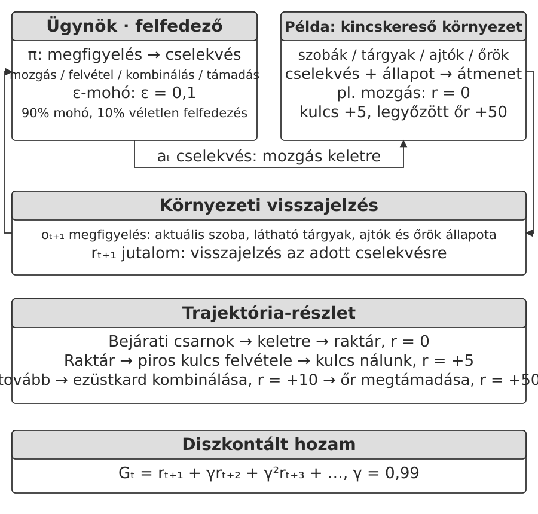

A folyamatos interakcióból **trajektória** áll össze, amely az egyes lépések megfigyeléseit, cselekvéseit, jutalmait és befejezési információit tartalmazza; ha a tanítási rendszer hozzáfér a környezet állapotához, azt is rögzítheti. A stratégia dönti el, hogyan cselekedjünk, az **értékfüggvény (Value Function)** pedig azt becsüli meg, mennyi jövőbeli hozamra számíthatunk, ha az aktuális állapotból egy adott stratégiát követve folytatjuk.

Az ügynök és a környezet határát a modellezéskor kijelölt rendszerhatár szabja meg. A könyvben tárgyalt modell és Harness az ügynökön belül helyezkedik el, az eszközinterfészek pedig külső alkalmazásokhoz, eszközökhöz és szolgáltatásokhoz kapcsolják. Egy fájlmódosítási kérést például az ügynök indít, a fájlrendszer végzi el az írást, az eszköz pedig visszaadja az eredményt az ügynöknek.

A tanulás során el kell osztani a lehetőségeket a **felfedezés és a kiaknázás (Exploration–Exploitation)** között. A felfedezés révén a stratégia még ismeretlen cselekvéseket próbál ki, a kiaknázás pedig a jelenleg legjobbnak becsült cselekvést választja. Késleltetett jutalmú feladatoknál azt is meg kell ítélni, mely korai lépések vezettek a végeredményhez; ez a hitelkiosztás problémája, amelyről később lesz szó.

Egy RL-módszer megértéséhez érdemes először öt dolgot megvizsgálni:

- **Cselekvési tér**: mit szabad kiadni. A társasjátékok diszkrét lépéseket használnak, a robotvezérlés folytonos ízületi célértékeket; a cselekvéseket az állapot, a fizikai tartomány és a jogosultságok is korlátozhatják.
- **Stratégia**: az a szabály, amely az állapot, a megfigyelés vagy az előzmények alapján cselekvést választ. Lehet egy táblázat, de lehet neurális hálózat is.
- **Jutalomjel**: milyen visszajelzésen keresztül fejeződik ki a tanítás célja. A lépésenkénti jutalmak alkotják a hosszú távú hozamot, és a stratégia a jövőbeli nyereségért vállalhat jelenbeli költséget.
- **Értékfüggvény**: a további hozam becslése, amely cselekvések összehasonlítására vagy stratégiafrissítési jel előállítására használható. A konkrét algoritmus dönti el, hogy explicit módon tanuljuk-e.
- **Környezetmodell**: előre jelzi a cselekvés utáni állapotot, megfigyelést vagy jutalmat. A modellalapú módszerek ismert vagy tanult környezetmodellel terveznek; a modellmentes módszerek közvetlenül az interakciós adatokból tanulnak stratégiát vagy értéket.

A 8-3. táblázat ezek közül a környezetet, a cselekvést és a célt emeli ki, és néhány ismerős rendszert hasonlít össze. Az első két sor olvasásakor az „egyensúly megtartása” és a „megtisztított terület” olyan célként értendő, amelyet a feladat modellezésekor választhatunk.

8-3. táblázat: A különböző ügynökrendszerek kulcselemeinek összehasonlítása

| Ügynöktípus | Külső környezet | Cselekvésreprezentáció | Példa jutalomra vagy célra |
| --- | --- | --- | --- |
| Újszülött antilopborjú | Terep, gravitáció és a test dinamikája | Folytonos izomvezérlés | Az egyensúly megtartása, az elesés elkerülése |
| Robotporszívó | Szoba, padló és töltőállomás | Mozgás, takarítás, visszatérés töltésre és vezérlési paraméterek | Megtisztított terület, töltöttség és ütközési költség |
| Sakkügynök | Tábla, ellenfél és időmérési szabályok | Az aktuális állásban szabályos lépések | Győzelem +1, vereség −1, döntetlen 0 |
| Ügyfélszolgálati ügynök | Felhasználók, üzleti adatbázis és szolgáltatási interfészek | Válaszszöveg, lekérdezések és üzleti hívások | A probléma megoldása, folyamatmegfelelőség, kezelési idő |
| Kódasszisztens ügynök | Az igények forrása, kódtár és futtatási környezet | Keresés, szerkesztés, futtatás és válaszadás | Teszteredmény, feladatteljesítés, regresszió és költség |

E rendszerek cselekvésreprezentációja eltér. A társasjátékok általában lépésenként egy diszkrét cselekvést választanak, a robot adott dimenziójú folytonos vezérlőértékeket ad ki, az LLM pedig előbb tokensorozatot generál, amelyet aztán az interfész válasszá vagy eszközhívássá értelmez. A belső számítás is bevonható a stratégia modellezésébe, és a külső állapotot ténylegesen megváltoztató eszközfuttatástól külön rögzíthető.

### Kétféle cselekvésreprezentáció: a klasszikus RL-beállítás és az LLM változó hosszúságú stratégiája

A **Markov-döntési folyamat (Markov Decision Process, MDP)** állapotokkal, cselekvésekkel, átmenetekkel és jutalmakkal írja le a döntési problémát. A Markov-tulajdonság megköveteli, hogy az aktuális állapot és cselekvés ismeretében a következő állapot és jutalom előrejelzéséhez ne kelljen további előzményekre támaszkodni: az előzmények előrejelzés szempontjából releváns információja már benne van az aktuális állapotban. A 8-2. ábrán gondot okoz, ha csak azt jegyezzük fel, melyik szobában van a játékos: hiába ér kétszer ugyanahhoz az ajtóhoz, hogy ki tudja-e nyitni, az attól is függ, megszerezte-e már a kulcsot.

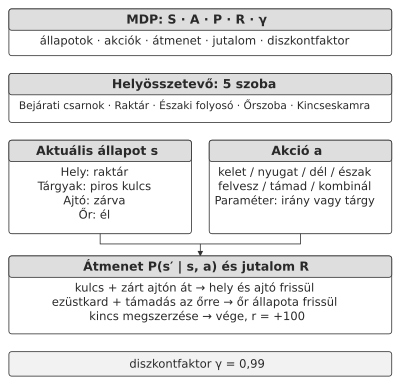

A sakk jó példa az állapot megtervezésére. A bábuk helyzete mellett rögzíteni kell, ki következik, megvan-e még a sáncolás joga és az en passant ütés lehetősége, valamint az ötvenlépéses szabály és az állásismétlés megítéléséhez szükséges információt. Csak ha mindezt felvesszük az állapotba, lehet az aktuális állapot alapján dönteni a szabályokról. Ha az ügynök ennek csak egy részét látja, az előzményekből kell pótolnia az információt, vagy részlegesen megfigyelhető modellezést kell alkalmaznia.

Az MDP diszkrét, folytonos és kombinált cselekvéseket egyaránt befogadhat. A góban 361 metszéspont van a táblán, emellett a passzt és a lépések szabályosságát is figyelembe kell venni; az Atari-játékok általában kevés diszkrét műveletet kínálnak; a robotvezérlés értékeit az ízületek, a megfogó és a fizikai korlátok határozzák meg. Ha az állapotok és a cselekvések száma is kicsi, az értékek közvetlenül táblázatban tárolhatók. Nagyobb méretnél a függvényapproximáció, a stratégiaoptimalizálás és a keresés kínál megoldást.

**Táblázatos Q-learning: a cselekvésérték frissítése egylépéses visszajelzéssel.** A $Q(s,a)$ azt a hozamot becsüli, amelyet az $s$ állapotban az $a$ cselekvés megtétele után kapunk. Az optimális cselekvésérték kielégíti a Bellman-féle optimalitási egyenletet:

$$
Q^*(s,a)=\mathbb E\left[r+\gamma\max_{a'}Q^*(s',a')\mid s,a\right]
$$

Itt $r$ az adott lépés jutalma, $s'$ a következő állapot, $\gamma$ a diszkonttényező. Folyamatos feladatoknál általában $0\leq\gamma<1$; egyértelműen befejeződő, véges hozamú feladatoknál 1 is lehet. Nagyobb diszkonttényező mellett a távolabbi jutalmak nagyobb súlyt őriznek meg. Az aktuális időponttól számított hozam $G_t=\sum_{k\geq0}\gamma^k r_{t+k+1}$.

Miután egy interakcióból megkaptuk $r$-t és $s'$-t, a Q-learning a következő képlettel frissít:

$$
Q(s,a)\leftarrow Q(s,a)+\alpha\left[r+\gamma\max_{a'}Q(s',a')-Q(s,a)\right]
$$

$\alpha$ a tanulási ráta, a szögletes zárójelben pedig az „egylépéses jutalom plusz a diszkontált további érték” és az aktuális becslés különbsége áll. Ha a feladat befejező állapotba ér, a további érték 0. Próbáljuk ki a kísérő játékban: kapcsoljuk ki a véletlen zavarást, menjünk a bejárattól keletre, majd vegyük fel a raktárban a piros kulcsot. A kulcs felvétele 5 pontot ér, minden lépés 0,5 pont levonással jár, így ennek a cselekvésnek az $r$ értéke 4,5. Tegyük fel, hogy a táblázatban a „kulcs felvétele a raktárban” régi becslése 0,25, a kulcs megszerzése utáni választható cselekvések legnagyobb Q-értéke pedig 0,63. $\gamma=0.99$ és $\alpha=0.2$ mellett az egylépéses cél $4.5+0.99\times0.63=5.1237$. A régi becslés ötödnyit közelít ehhez a célhoz, és 1,22474-re frissül. A becslésnek a tényleges egylépéses visszajelzéssel történő korrigálását **időbelikülönbség-tanulásnak (Temporal-Difference Learning, TD)** nevezzük.

Ha egy állapotban összegyűjtjük az egyes cselekvések Q-értékeit, kiválasztható a jelenleg legjobbnak becsült cselekvés. A 8-3. ábra egy egyszerűsített rácson rajzolja meg ezt a stratégiát. Az egyes mezőkben álló számok a normalizált állapotértéket mutatják. Ha a kezeddel letakarod a számokat, és csak a nyilakat nézed, eljutsz a bal felső sarokból a kincsig?

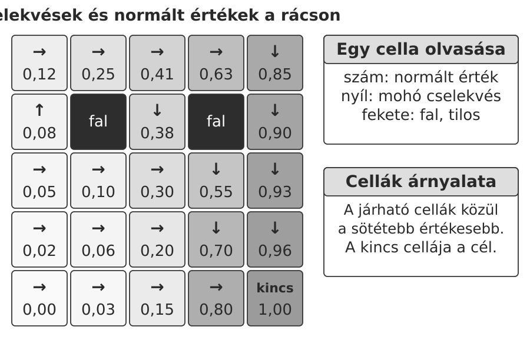

A következő felfedezés megváltoztathatja a nyilak irányát. A 8-4. ábra lépésekre bontja az előbbi piroskulcs-számítást: az ebben a lépésben kapott jutalom a „kulcs felvétele a raktárban” becslését változtatja meg, a táblázat többi állapotának Q-értéke a saját frissítésére vár.

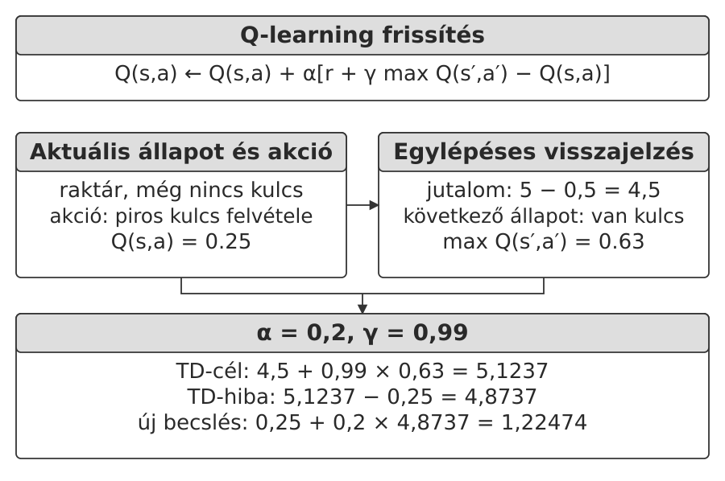

A Q-learning viselkedési stratégiája tartalmazhat véletlen felfedezést, a frissítési cél viszont a következő állapot legnagyobb cselekvésértékét használja, ezért **off-policy** tanulásnak számít.

> **8-1. kísérlet ★: A Q-learning teljesítménye egy kincskereső játékban**
>
> A kincskereső játék rejtett szabályokat tartalmaz: kulcsokat és ajtókat, fegyverhatásokat és tárgyak kombinálását. A győzelemhez több lépést kell meghatározott sorrendben elvégezni, az optimális út 11 lépés; a kulcsfontosságú cselekvések és a győzelem jutalmat adnak, a többi lépés kevés visszajelzést kap.
>
> Ez a kincskereső tanítás 0,2-es tanulási rátát és 0,99-es diszkonttényezőt használ, az ε felfedezési arány pedig 1,0-ról fokozatosan 0,1-re csökken. A táblázatos Q-learning ε-mohó felfedezést alkalmaz: minden lépésben ε valószínűséggel véletlenszerűen választ egy elérhető cselekvést, egyébként a jelenleg legnagyobb Q-értékű cselekvések közül választ. Minden szakaszban rögzítjük a győzelmi arányt, a meglátogatott állapotok számát és a győzelemhez szükséges lépésszámot.
>
> A kincskereső kísérlet tanítási és értékelési naplóinak olvasásakor először két kérdést kell szétválasztani: a tanítás során mikor találja meg először a kincset a véletlen felfedezést tartalmazó stratégia? A tanítás után a Q-táblát rögzítve, mohó stratégiával cselekedve stabilan nyer-e? Az előbbi azt mutatja, hogyan fedezi fel a modell az utat, az utóbbi azt ellenőrzi, képes-e a megtanult értékek alapján cselekvést választani.
>
> Egy korábbi tanításban az első 1000 játszmában még egyszer sem nyert, a Q-tábla 124 állapotot tartalmazott; 5000 játszmánál még mindig nem nyert stabilan, az állapotok száma 133 volt; a 7000. és 8000. játszma között a győzelmi arány 34%-ról 96%-ra nőtt; 10 000 játszmánál elérte a 100%-ot, a Q-tábla 145 állapotot tartalmazott, és megtalálta a 11 lépéses utat.
>
> Miért nem volt sokáig előrelépés az elején, és miért nőtt később olyan gyorsan a győzelmi arány? A felfedezés előbb rátalál a kulcsfontosságú cselekvésekre és az útra, a későbbi látogatások pedig fokozatosan visszaterjesztik a végső hozamot a korábbi állapotokra. Az egész kis szimuláció körülbelül 10 másodpercig tart, ezért megengedheti magának a rengeteg ismételt interakciót.
>
> Az elemzéskor a számítási időt és az interakciók számát is rögzítsük. A játékban egy cselekvés nagyon olcsó; böngészőben, telefonon vagy fizikai eszközön viszont egy interakció várakozással, költséggel és állapotváltozással is jár. A táblázat ráadásul egy konkrét állapotkódoláshoz kötött: ha a szabályok vagy a térkép megváltoznak, újra ellenőrizni kell, érvényesek-e még a meglévő értékek. A következő kísérlet azt vizsgálja, hogyan változtathatja meg az előtanítás során szerzett tudás a felfedezés kiindulópontját.

**Előtanított LLM: számítás és cselekvés nyelvi reprezentációja.**

Az LLM az eszköz meghívása előtt generálhat egy közbenső számítást, de közvetlenül a hívást is kiadhatja. Mindkettőt tokensorozat reprezentálja, szerepük azonban eltér: a közbenső számítás a modell számára később elérhető kontextust változtatja meg, az eszközhívás pedig a végrehajtás után megváltoztatja vagy kiolvassa a külső környezetet. A tanítás során ezek a kimenetek a protokoll szerint rögzíthetők, és a feladat eredményével és a számítási költséggel együtt értékelhetők. A „mennyi ideig gondolkodjon, min gondolkodjon, mikor hívjon eszközt” így ugyanannak a stratégiának a megtanulható választásává válik; a később tárgyalt AdaptThink éppen az érvelési költségvetés körül forog.

A változó hosszúságú szekvenciák nagyobb kombinatorikus teret nyitnak. A modell írhat lekérdezést, programot, JSON-paramétereket és többlépéses levezetést, a szekvencia hosszát pedig a költségvetés és a kontextus korlátozza. Az előtanítás kiindulópontot ad a kereséshez: a matematikai anyagokban gyakori a feltételek elemzése és a számítás, a kódban és a róla szóló vitákban a hiba lokalizálása, a módosítás és az ellenőrzés. A modell ezekre a struktúrákra támaszkodva generálhat jelölt utakat, majd a környezet visszajelzése alapján igazíthat rajtuk. A meglévő tudás miatt a hasznos cselekvéskombinációk már kezdettől nagyobb eséllyel kerülnek a mintába, és kevésbé kell vakon próbálgatni rengeteg irreleváns úton.

Ha például „egy devizaösszeget dollárra kell átváltani”, meg kell szerezni az árfolyamot, és számolni kell. Az előtanítás miatt a modell könnyen generálja az ilyen összefüggő lépéseket; az utótanítás pedig az árfolyam forrása, a számítás eredménye és a feladat megkötései alapján tovább igazíthatja az utak valószínűségét. A nyelvi tudás itt a kezdeti stratégiát adja, a jutalom pedig a feladat visszajelzését.

A 8-5. ábra a szakasz két beállítását veti össze: a táblázatos Q-learning egy megadott állapotkódolásból és felfedezési szabályból indul, az LLM-ügynök pedig az előtanított nyelvi stratégiából, és a kontextusban szervezi meg az eszközmegfigyeléseket és a korábbi tapasztalatokat.

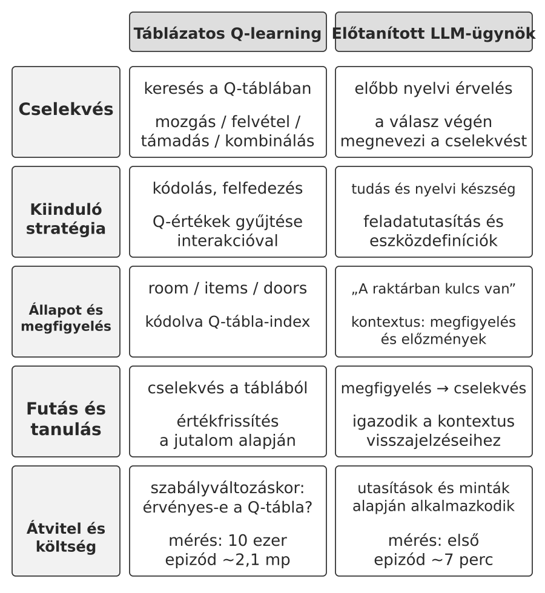

Az előtanítás azt is lehetővé teszi, hogy a modell értelmezze az új utasításokat, és néhány bemutató alapján igazítsa a feladatviselkedését. Az eszközök a nyelvi kimenetet kereséshez, kódfuttatáshoz és üzleti műveletekhez kapcsolják. Az ilyen ügynökök tervezésekor meg kell határozni az eszközinterfészeket és a végrehajtási jogosultságokat, és visszajelzést kell kiépíteni a feladat eredményére, a futtatási költségre és a kulcsfontosságú folyamatokra is.

Ha a modellnek robotkart kell irányítania, hogyan alkalmazható a „következő token előrejelzése” a cselekvésekre? Az OpenVLA nagyjából 970 ezer valódi robotbemutatót használt. Vegyünk egy lépést a bemutatóból: a bemenet az akkori kamerakép és a feladatutasítás, a tanítási cél pedig az a cselekvés, amelyet a bemutató végrehajtója ezután végzett. Az, hogy a robotkar mennyit mozdul vízszintesen, eredetileg folytonos számérték. Az OpenVLA minden cselekvésdimenziót 256 sávra oszt, és egy tokennel jelöli, melyik sávba esik az érték. Így a modell egyenként jelezheti előre a cselekvéstokeneket, és csak ezeken a pozíciókon számít veszteséget.[^ch8-21]

A példa azt is megmutatja, hogyan különböztethető meg a viselkedésklónozás a megerősítéses tanulástól: azt kell nézni, milyen jel frissíti a modellt. Az OpenVLA a bemutatónaplókból tanul; minél nagyobb valószínűséget ad a modell a bemutatott cselekvéstokennek, annál kisebb a veszteség – ez felügyelt finomhangolás. A 8-13. kísérlet SimpleVLA-RL-jében viszont a stratégia ténylegesen kipróbálja a cselekvéseket a környezetben, és a feladat jutalma alapján igazítja a későbbi választásait.

> **Az algoritmustól a környezeten át az előzetes tudásig**
>
> Shunyu Yao a „The Second Half” című írásában az algoritmus, a környezet és az előzetes tudás (prior) hármasán keresztül tekintette át az RL fejlődését.[^ch8-2] Ennek alapján a figyelem eltolódását három szakaszban foglalom össze: 2015 és 2016 között az algoritmusok javítása állt a középpontban, 2016 és 2018 között egyre nagyobb hangsúlyt kapott a környezetek építése, 2018-tól pedig fokozatosan felismerték az előtanításból származó előzetes tudás értékét. A Gym egységes környezeti interfészt adott, a Universe és a World of Bits számítógépes és webes feladatokat kutatott, a Dota 2-höz hasonló projektek pedig összetett környezetben mutatták meg a tanítás lehetőségeit. Ezt követően a GPT-2 és a GPT-3 megmutatta, mennyi tudást és kifejezőképességet halmoz fel a nyelvi előtanítás, a WebGPT, a ChatGPT és más rendszerek pedig tovább építettek erre a kiindulópontra. A feladathoz szükséges előzetes tudás előbb nyelvmodellezéssel megszerezhető, majd az RL optimalizálhatja a konkrét viselkedést.
>
> Egyetértek az itt megfogalmazott mérnöki sorrenddel: **előzetes tudás, környezet, algoritmus.** Először nézzük meg, milyen tudással és képességekkel rendelkezik a modell, aztán építsünk megfelelő környezetet és visszajelzést, végül válasszunk ehhez illő optimalizálási módszert. A 8-6. ábra a kutatási hangsúlyok megjelenésének sorrendjében halad; projektmunkában fordított irányban is haladhatunk, a meglévő képességekből kiindulva.
>
> 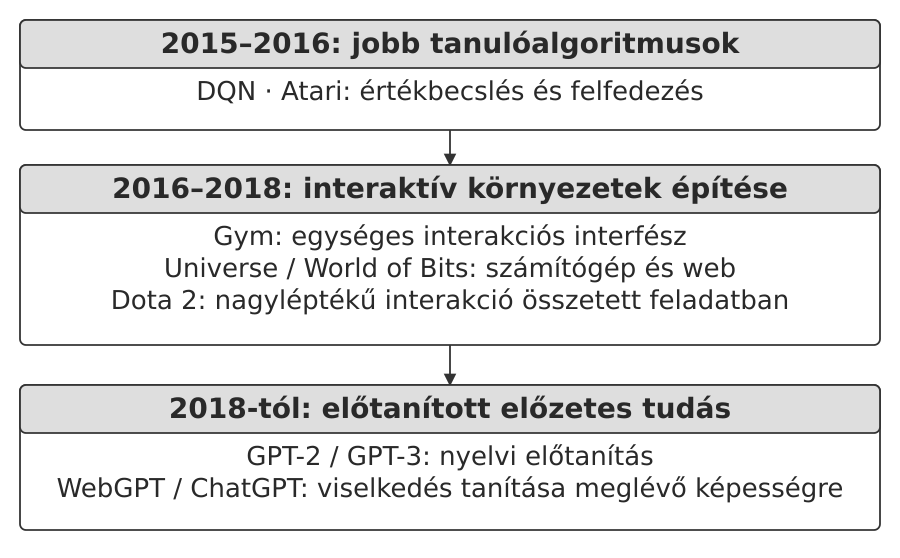

> **8-2. kísérlet ★★: A hagyományos RL és az LLM-ügynök összehasonlító vizsgálata**
>
> Ugyanabban a kincskereső játékban hasonlítjuk össze a táblázatos Q-learninget és egy LLM-ügynököt. Az LLM-konfiguráció a Kimi K3-at használja, és a kontextusban legfeljebb 50 tapasztalatot tart nyilván. Mindkettő minden lépésben a környezet által felkínált lehetséges cselekvések közül választ egyet. A 8-7. ábra két útvonalán végigkövethető, hogyan hozza meg ezt a választást a Q-tábla, illetve a nyelvi modell.
>
> 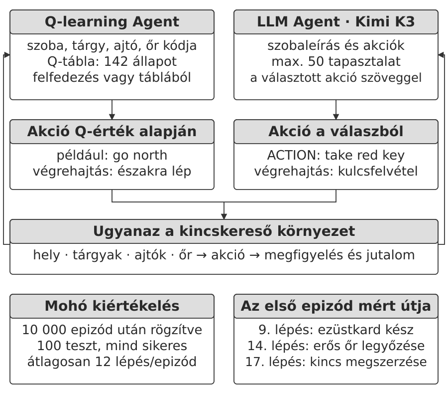
>
> A kísérő Kimi K3-futtatás naplójában az ügynök az első játszmában 17 lépést tett. Előbb felvette a rozsdás kardot, észrevette, hogy az északi ajtó zárva van, átment a raktárba a piros kulcsért és a varázskristályért, a 9. lépésben pedig a kardból és a kristályból ezüstkardot kombinált. A 12. lépésben megpróbálta használni a kulcsot, mire a környezet jelezte, hogy „szükség esetén automatikusan használja”; a 13. lépésben északra indult, és ekkor nyílt ki valóban az ajtó. A 14. lépésben legyőzte az őrt az ezüstkarddal, majd még egyszer megpróbálta használni a kardot, de a környezet jelezte, hogy ez most nem lehetséges. A 17. lépésben megszerezte a kincset. A napló olvasásakor letakarhatod a következő sort, és az aktuális visszajelzés alapján megtippelheted, melyik lépésre volt még szükség.
>
> Ha minden cselekvést az akkori megfigyelés mellé illesztünk, elemezhető, hogyan használja a modell a meglévő tudást – például hogy „a kulcs nyitja az ajtót”, „a fegyverrel lehet szembeszállni az őrrel” –, és hogyan változtatja meg az eszközök visszajelzése a további tervet. A táblázatos megoldás ezeket az összefüggéseket az állapot–cselekvés párok látogatásával halmozza fel.
>
> Ebben az összehasonlításban a Q-learning 10 000 játszmás tanítása 2,12 másodpercig tartott, majd a külön, mohó stratégiával végzett 100 játszmás értékelésben mindegyiket megnyerte, átlagosan 12 lépéssel. A Kimi egy játszmában 17-szer hívta meg a modellt, és 6 perc 56 másodpercig tartott. Ebből a következő választási elvet vezetem le: ha a szimuláció olcsó és tömegesen ismételhető, bátran kihasználható a hagyományos RL felfedezése; ha minden interakció várakozással, költséggel vagy valódi műveleti ráfordítással jár, előnyben kell részesíteni a meglévő tudásra építő stratégiát, hogy minden interakció többet érjen.

Ez a két kísérlet köti össze a fejezetet a korábbi mérnöki módszerekkel: a kontextus egyetlen futáson belül szervezheti a tapasztalatot, a külső memória feladatokon átívelően őrizheti meg, az utótanítás pedig a paraméterek frissítésével változtatja meg a stratégiát. A következőkben először a nyelvi és vizuális előtanítás alapfolyamatát vesszük át, majd a konkrét tanítóadatokat és optimalizálási módszereket tárgyaljuk.

## A modell előtanításának alapjai `[Választható olvasmány]`

Az előtanítás alakítja ki a modell kezdeti reprezentációit és generálási eloszlását, a későbbi tanítás pedig erről a kiindulópontról hangolja tovább a paramétereket. Ennek a kiindulópontnak a megértéséhez érdemes előbb megnézni, hogyan tanul egy kis nyelvi modell a szövegből, majd azt, hogyan kapcsolható hozzá vizuális bemenet.

A szöveg először **tokenizáláson (Tokenization)** megy át, és diszkrét tokenekké alakul. Az „imádok programozni” mondat például vázlatosan két egységre, az „imádok” és a „programozni” szavakra bontható, a tényleges felosztást azonban a tokenizáló határozza meg. A tanítás a korábbi tokeneket kontextusként használja, előrejelzi a következő tokent, kiszámítja a veszteséget, és frissíti a paramétereket. A 8-8. ábrán olvassuk a tanítómondatot a „valós” szóig, a többit takarjuk le, tippeljük meg, mi a következő szó, majd fedjük fel az eredetit. Ha ezt a pozíciót eggyel hátrébb toljuk, megkapjuk a következő előrejelzési feladatot.

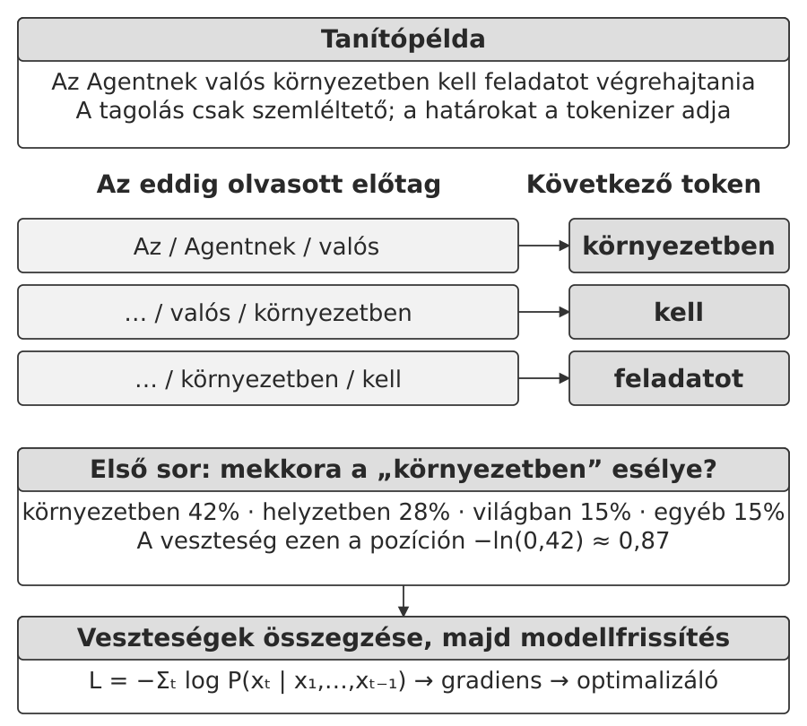

Az alapvető nyelvmodellezés után utasításbemutatók adhatók hozzá, amelyek a válaszformátumot és a feladatviselkedést tanítják; preferenciaadatokkal pedig a DPO-hoz hasonló módszerek növelhetik a kedveltebb válaszok valószínűségét.

> **8-3. kísérlet ★★: LLM tanítása nulláról – az algoritmikus fejlesztések ereje**
>
> A nagyjából százmillió paraméteres MiniMind 2 példáján egy fogyasztói GPU-n végezzük el az előtanítást, az SFT-t és a preferenciaoptimalizálást. Összehasonlítjuk az alapkonfigurációt a QK Normmal és Muon optimalizálóval kiegészített konfigurációval, és megfigyeljük a veszteség csökkenését, a célminőség eléréséhez szükséges időt és a generált eredményeket. A kísérő összesítés nagyjából háromszoros konvergenciagyorsulást rögzített; a teljes tanítás körülbelül 14 óráig tartott, és nagyjából 34 dollárba került.
>
> A QK Norm a figyelemmechanizmusban a lekérdezések és a kulcsok számértékskáláját igazítja, a Muon pedig a megfelelő paraméterek optimalizálási frissítésének módját változtatja meg.
>
> Ugyanazt a kérdéssort szakaszonként figyeljük meg: az előtanított modell már tud válaszolni az olyan kérdésekre, mint „a világ legmagasabb hegycsúcsa”; az SFT után javul az utasításkövetés és a kimenet szerkezete; a preferenciaoptimalizálás pedig tovább befolyásolja a ténybeli válaszokat és a megfogalmazást.

> **8-4. kísérlet ★★: Saját VLM tanítása**
>
> A 8-9. ábra a „vizuális kódoló – projekciós réteg – nyelvi modell” kapcsolatot mutatja. A vizuális kódoló, például a CLIP, kinyeri a kép jellemzőit, a projekciós réteg ezeket a nyelvi modell bemenetéhez szükséges dimenzióba és reprezentációba alakítja, a nyelvi modell pedig ezekből a bemenetekből leírást vagy választ generál.
>
> 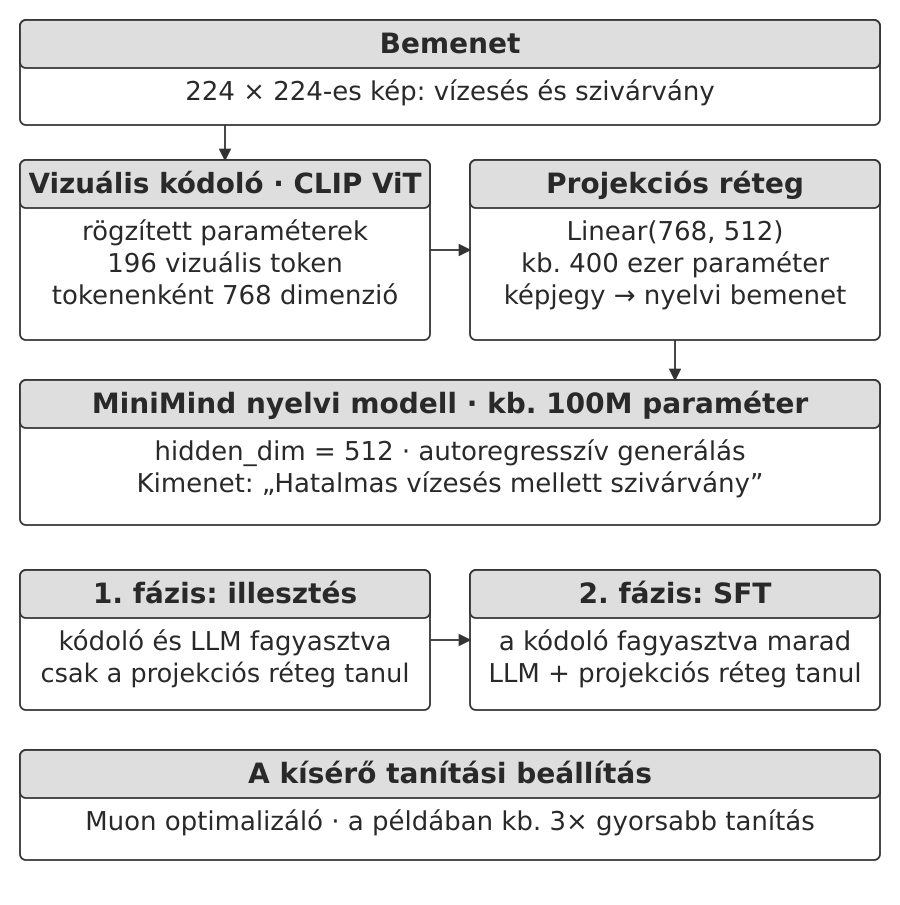
>
> Az első szakaszban befagyasztjuk a vizuális kódolót és az LLM-et, és az újonnan hozzáadott projekciós réteget tanítjuk, hogy a képjellemzők részt vehessenek a nyelvi előrejelzésben; a második szakaszban a konfigurációtól függően feloldjuk az LLM-et, és jó minőségű kép–leírás vagy kérdés–válasz adatokon SFT-t végzünk. Külön-külön figyeljük meg az objektumfelismerés, a részletleírás, a viszonyok megítélése és a nyelvi képesség változását.
>
> Ez az architektúra újrahasznosítja a meglévő vizuális és nyelvi modelleket, és előbb a modalitásokat összekötő modult tanítja koncentráltan; korlátozott költségvetés mellett érdemes elsőként kipróbálni. A súlyok befagyasztása csökkenti a tanítható állapotot, a megfelelő modulokat pedig később a feladat igényei szerint lehet feloldani. Ha a leírás hibás, először ellenőrizzük, bekerült-e az objektum információja a vizuális reprezentációba; ha az információ már ott van, de a modell mégsem tudja felhasználni, akkor a projekciós réteg kifejezőképességét, az illesztési adatokat és a nyelvi generálás felügyeletét kell alaposan megvizsgálni. Ha a kimenetet cselekvésreprezentációvá alakítjuk, és a vezérlési interfészhez illesztjük, eljutunk a 6. fejezet VLA-architektúrájához.

A két kísérlet azt mutatja meg, hogyan hat a tanításra az optimalizálási konfiguráció, illetve a modalitások közötti kapcsolat. Korlátozott költségvetés mellett azt javaslom, hogy előbb hasonlítsuk össze, mennyit hoznak az algoritmikus és architekturális fejlesztések, és csak utána döntsünk a modellméret növeléséről. Ha egy meglévő modell új nyelvre vagy szakterületre lép, az előtanított súlyokból folytathatja a tanulást; a következő szakasz azt tárgyalja, hogyan válasszunk adatot ehhez a tanításhoz.

## Mid-training: tudás és alapképességek pótlása

Ebben a fejezetben a **Mid-training** azt jelenti, hogy egy meglévő modellen a céleloszlás köré szervezve folytatunk egy szakasznyi nyelvimodell-tanítást. A dokumentumok, a kód vagy a levezetések tokenjeinek nagy része részt vesz a felügyeletben, és a tanítás során a célterület korpusza általános korpusszal keverhető. A DAPT/TAPT-kutatások megmutatták, hogy a szakterülethez vagy feladathoz kapcsolódó korpuszon folytatott előtanítás segíti a későbbi feladatokat.[^ch8-30]

Az adatválasztás kétféle hiányból indul ki. Az egyik a tudás és a nyelv lefedettsége: a modell például keveset találkozott vállalati protokollokkal, a célnyelv szakkifejezéseivel vagy egy adott kódtárral. A másik a feladathoz szükséges alapképesség, például az állapot követése hosszú kontextusban, a dokumentumokon átívelő összefüggések összekapcsolása vagy hosszabb kódlevezetések végigvitele. Először hibatípus szerint válasszuk szét a megértési, tudásbeli, formátum- és cselekvési problémákat, és csak ezután döntsük el, milyen anyagot kell pótolni.

Miután a szakterületi szövegen csökkent a veszteség, azt is ellenőrizni kell, tudja-e a modell a megtanult tudást valós feladatokban használni. A folytatott tanítás és az utasításhangolás sorrendje, a kérdés–válaszok szervezése és az anyag formája egyaránt befolyásolja, hogyan használja a modell a tudást.[^ch8-31] Ha egy szakterületi feladatnál az alapképesség egyértelműen hiányos, azt javaslom, hogy előbb szakterületi korpusszal növeljük a lefedettséget, majd SFT-bemutatókkal tanítsuk meg a modellt, hogyan használja ezt az információt a feladatban; RL-be akkor érdemes fektetni, amikor a modell néha már helyesen oldja meg a feladatot, csak alacsony a sikeraránya.

### Hogyan építsük fel a Mid-training adatait

**Első lépés: a szükséges anyag behatárolása a hibaeloszlásból.** Témánként, nyelvenként, dokumentumtípusonként, kódmintánként és kontextushosszanként külön értékeljünk, és a Pass@1, a Pass@k és a hibás példák alapján ítéljük meg, milyen feltételek mellett hiányzik a modellből a használható megoldás. A paraméterformátum problémáit interfészbemutatókra bízhatjuk, a szakterületi fogalmak és összefüggések hiányához viszont megfelelő korpusz kell.

**Második lépés: nagy sűrűségű korpusz összeállítása.** Az eredeti dokumentumok a szakkifejezéseket és a ténybeli összefüggéseket adják, a kódtárak a modulszerkezetet és a függőségeket, a tankönyvszerű levezetések és a szintetikus magyarázatok kibontják a rejtett lépéseket, a dokumentumokon átívelő minták pedig összekötik a szétszórt információt. A minőségi szűrés, a deduplikáció és az értékelőkészlet elkülönítése után állítjuk össze a tanítási szekvenciákat.

**Harmadik lépés: az adatok keverése a célképesség szerint.** A természetes hosszú szövegek könyvekből, dokumentációkból és kódtárakból származhatnak; a visszakereséshez, a több lépéses következtetéshez, az utasításkövetéshez, az aggregáláshoz és a statisztikához levezetést tartalmazó feladatadatok adhatók hozzá; ügynökökhöz tervezést, eszközválasztást, paraméterek összeállítását, állapotkövetést és hibából való helyreállást bemutató trajektóriák. Ezek az anyagok meglévő adathalmazokból vagy tanítómodell generálásából származhatnak, és a tanítás előtt tartalom és viselkedési elvárások szerint szűrjük őket.

**Negyedik lépés: a modell gyakorolja tovább azokat a feladatokat, amelyeket korábban is meg tudott oldani.** Az egyik mintacsoport megtartja a rövid szövegeket, az általános korpuszt és az eredeti feladatokat; a másik ugyanezeket a feladatokat hosszabb kontextusba helyezi, áthelyezi a kulcsinformáció pozícióját, és zavaró elemeket is beiktat. A két csoport arányának megválasztásakor az eredeti tanítóadat eloszlása is irányadó lehet, de a FineWeb-2-höz hasonló nyílt korpuszokkal is kipróbálhatunk néhány keverési arányt, majd az értékelési eredmények alapján igazíthatunk rajta.

**Ötödik lépés: több mutató alapján döntsünk a folytatásról vagy a leállásról.** Egyszerre rögzítsük a tanítási veszteséget, a félretett szakterületi feladatokat, az általános képességeket, a korábbi utasításkövetést és a célfeladat sikerarányát. Ha a szakterületi eredmény javul, de az általános képesség romlik, hasonlítsuk össze a keverési arányokat, a tanulási rátát és a tanítás mennyiségét; ha a veszteség csökken, de a célfeladat egy helyben áll, vizsgáljuk meg, képes-e a tanítóanyag megtanítani a modellnek az ilyen feladatok elvégzését, és kell-e olyan bemutatót hozzáadni, amely a tudás valós feladatban való alkalmazását mutatja be.

Tegyük fel, hogy a modell egy nagyon hosszú rendelésnaplóból ki tudja keresni a megadott rendelésszámot. Ha viszont azt kérdezzük, „melyik ügyfél adott le többször rendelést, majd mondta le mindet”, össze kell gyűjtenie ugyanannak az ügyfélnek a rendeléseit, és tételenként párosítania kell a rendeléseket a lemondásokkal. A két feladat ugyanazt a naplót használhatja, mégis más képességet mér. A RULER szintetikus feladatokkal külön szabályozza a bemenet hosszát és a feladat nehézségét, és külön méri az egyszerű visszakeresést, a több lépéses követést és az aggregálást. A szerzők 17 modellt értékeltek; sok modell az egyszerű visszakeresésben közel hibátlan volt, de a bemenet hosszabbodásával az összesített teljesítmény érezhetően romlott.[^ch8-ruler]

Hogy ez a különbség megjelenik-e valós anyagokon is, azt a LongBench v2 több dokumentumos, hosszú párbeszédes vagy kódtáras feladataival lehet tovább vizsgálni. Ha külön azt akarjuk ellenőrizni, megjegyzi-e a modell az olyan követelményeket, mint a kimeneti formátum, vegyük az IFEval ellenőrizhető utasításait, és helyezzük el őket egy hosszabb anyag különböző pontjain. Két modell összehasonlításakor mindkettőnek ugyanazon a pozíción kell látnia az utasítást és ugyanazt a zavaró tartalmat, és jelezni kell, hogy saját összeállítású tesztről van szó. Végül teljes, végponttól végpontig tartó ügynökfeladatokkal ellenőrizzük, képesek-e ezek a képességek együttműködni. Az értékelőkészlet tervezésekor az alábbi dimenziók egyenként végigvehetők.[^ch8-longbench]

[^ch8-ruler]: Hsieh és mtsai., RULER, 2024.
[^ch8-longbench]: Bai és mtsai., LongBench v2, ACL 2025. A cikk hat feladatkategóriát ad meg, összesen 503 feleletválasztós kérdéssel.

- **Pozíció és visszakeresés**: megtalálja-e a modell az egy vagy több kulcsinformációt, ha az elején, a közepén vagy a végén áll.
- **Összefüggések és következtetés**: bekezdéseken és dokumentumokon átívelő összefüggések követése, ellentmondások feloldása és bizonyítékok kombinálása.
- **Aggregálás és statisztika**: számlálás, csoportosítás, rendezés, összehasonlítás és trendek összegzése hosszú táblázatokban és naplókban.
- **Utasításkövetés**: több követelmény, konfliktusok kezelése, folyamatfeltételek és kimeneti formátum.
- **Hosszú láncú következtetés**: hosszabb függőségi láncok matematikai, logikai és kódolási feladatokban.
- **Alapvető ügynökviselkedés**: feladatbontás, eszközválasztás, paramétergenerálás, állapotmegőrzés és helyreállás hibából.

A hosszú következtetés és a többfordulós eszközhívás folyamatosan nyújtja a kontextust, a korábbi utasításoknak, tényeknek és feladatállapotnak pedig a későbbi döntésekben is szerepet kell kapniuk. Ha a modell nem találja meg az információt a hosszú szövegben, vagy nem tudja tartani a megkötéseket, a hosszú távú ügynök nem működhet megbízhatóan. A tanítási költségvetés növelése előtt kis konfigurációkkal érdemes összehasonlítani az adatarányokat és a tanítás mennyiségét. A gyakran frissülő, forrásmegjelölést igénylő tényeknél a RAG-ot részesítem előnyben; a stabil, nagy terjedelmű szakterületi tudást és alapképességeket érdemes folytatott tanítással a paraméterekbe írni.

> **8-5. kísérlet ★★: Folytatott előtanítás új nyelv tanulásához**
>
> A Mistral 7B v0.3-ból kiindulva a koreai Wikipédiához hasonló anyagokkal javítjuk a koreai képességet. A tanítás előbb nagyjából 80% koreai és 20% angol keveréket használ, majd koreai utasításadatokon SFT következik; külön figyeljük meg a nyelvmodellezés és a párbeszédes viselkedés változását.
>
> A koreai adat a célnyelv lefedettségét növeli, az angol adat a meglévő képességek megőrzését szolgálja. Minden szakaszban ugyanazzal a tanításban nem szereplő koreai és angol feladatsorral tesztelünk. A kísérő eredményekben a koreai végső szakasz vakértékelési pontszáma javult, az angol képesség viszont valamelyest romlott; ez konkrét irányt ad a következő körhöz: több angol tanítóanyagot érdemes bekeverni, vagy csökkenteni kell a frissítés erősségét.
>
> Ha a célnyelvet, az eredeti nyelvet és a ténybeli minőséget külön rögzítjük, megítélhető a nyereség és az ár; az SFT-szakaszban pedig azt ellenőrizzük, képes-e a modell koreai utasítás alapján megszervezni a válaszát. Így a folytatott előtanítás és az utasítás-finomhangolás hatása külön-külön megfigyelhető.

## SFT (felügyelt finomhangolás)

A szakterületi korpusz révén a modell többször találkozhat egy interfésszel, de ha arra akarjuk megtanítani, hogy sikertelen hívás után javítsa ki a paramétereket, ezt közvetlenül is bemutathatjuk egyszer. Az SFT adott feladatbemenet mellett tokenenként tanítja a modellt a bemutatott válasz vagy cselekvés generálására. A 8-10. ábra áttekintésekor előbb gondoljuk végig, melyik viselkedést akarjuk megtanítani, és csak azután döntsük el, hogyan gyűjtsünk bemutatókat. A bemutatókban szereplő tények, hangnem és kimeneti formátum is bekerül a tanításba.

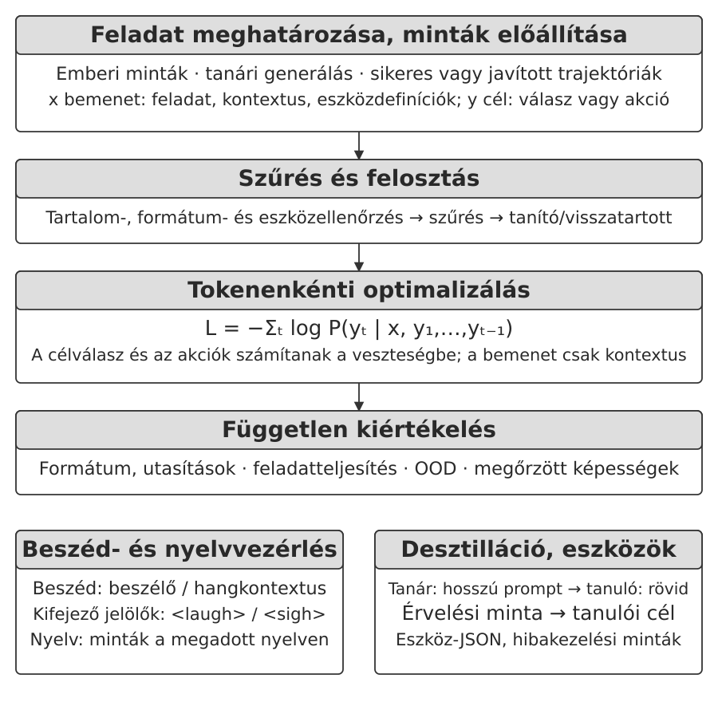

Az adat általában három úton keletkezik: emberi szakértők határozzák meg a kulcsfontosságú viselkedéseket és a határokat, tanítómodellek tömegesen írnak bemutatókat, az ellenőrzők pedig a modell mintáiból választják ki az érvényes kimeneteket. A három út kombinálható. Például előbb szakértők írnak néhány eszközhívási bemutatót, aztán a tanító a feladatfeltételek változtatásával további mintákat generál, végül ellenőrizzük a paramétereket, a végrehajtás eredményét és az üzleti megkötéseket.

**Az SFT egyik felhasználási módja, hogy a promptokban és Skillekben újra és újra leírt eljárást megtanítsuk a modellnek.** Vegyük a 7. fejezet memóriaértékelését: tegyük fel, hogy az értékelési kézikönyv a precedensekkel együtt tízezer token hosszú. A tanító a teljes kézikönyv alapján pontoz egy sor választ, és bemutatja, hogyan kezelje az azonos nevű személyeket, a felcserélt viszonyokat vagy az elégtelen bizonyítékot. A tanuló tanításakor a bemenetben csak az értékelési szempontok rövid neve, az adott előzményanyag és az értékelendő válasz marad meg, a célkimenet pedig a tanító által választott fokozat. Éles üzemben elég egy rövid promptot és az adott anyagot megadni, így minden következtetés megspórolja azt a tízezer tokennyi állandó leírást. A gyakran hívott Skilleknél ugyanígy bemutatható, mikor kell utánanézni valaminek és hogyan kell eszközt választani, majd ezek a stabil lépések a modellbe desztillálhatók.

Az adatelőkészítés a feladateloszlás, a kimeneti séma és az elfogadási mód meghatározásával kezdődik. Miután a bemutatók átmentek az ellenőrzésen, következik a deduplikáció, a mintatípusok arányának beállítása és az adathalmaz felosztása. A minták számát és lefedettségét együtt kell megtervezni: ugyanannak a kérdésnek több ezerszeri megismétlése újra és újra ugyanazt a mintázatot erősíti; csak a kulcsfeltételek köré épített változatok segítik a modellt abban, hogy különböző bemenetekre megfelelő viselkedést válasszon. Én előbb gondosan kidolgozok egy adag, a kulcshelyzeteket lefedő bemutatót, és csak utána növelem a méretet. Az SFT tokenenként tanulja meg a célkimenetet, így a téves tények, a felesleges lépések és a helytelen műveleti szokások is bekerülnek a paraméterekbe.

> **8-6. kísérlet ★★★: Beszéd-SFT – a hangmásolástól a paralingvisztikai modellezésig `[Kiterjesztett kísérlet]`**
>
> Az Orpheus és a Sesame CSM példáján összehasonlítjuk, hogyan vesz részt a beszédgenerálásban a beszélőfeltétel, a párbeszéd kontextusa és a kifejezésjelölők. Az Orpheus a beszédet tokenekkel reprezentálja, referencia szöveg–beszéd részletek alapján képes a megfelelő hangszínt előállítani, és olyan kifejezésjelölőket is kínál, mint a `<laugh>` és a `<sigh>`. A Sesame CSM szöveget, beszélőazonosítót és meglévő hangrészleteket fogad, és ezekből generálja a folytatást.[^ch8-speech-conditioning]
>
> A tanítóminták összeállításakor külön rögzítjük a szöveget, a beszélőt, a hangot és a kifejezési feltételeket; ugyanannak a beszélőnek a mondatokon átívelő anyagán a következetességet, a különböző helyzetekben elhangzó nevetésen, sóhajon és szüneteken pedig a kifejezést tanítjuk. Összehasonlítjuk a referencia nélküli, a referenciával készült és a megadott kifejezési feltétellel generált kimeneteket, majd pontosság, természetesség, érzelem és hangszín szerint pontozunk.
>
> Az adatnak elegendő beszélő-, mondattípus- és érzelemkombinációt kell lefednie. Ha túl kevés a beszélő, a kimenet egyetlen hangszín felé tolódhat; ha egy jelölő mindig ugyanahhoz a hangrészlethez kötődik, ismétlődő, gépies kifejezés jelenhet meg.

> **8-7. kísérlet ★★★: Többnyelvű gondolkodás – az érvelési folyamat generálása megadott nyelven `[Kiterjesztett kísérlet]`**
>
> A gpt-oss-20b-n SFT-t végzünk, és utasítással adjuk meg az érvelési folyamat nyelvét. A `reasoning language: German` például német érvelési szöveget kér. A tanítóminták angol, spanyol, francia és más nyelvű anyagot tartalmaznak, a kínait pedig a tesztszakaszra tartjuk fenn.
>
> A kísérő esetben a tanítás után a Chinese megadásakor a modell kínai érvelési folyamatot tud generálni. Három eredményt lehet tovább összevetni: követi-e a nyelvi előírást, helyes-e a végső válasz, és hogyan változik a generálás hossza és ideje. Ebben a nyelvek közötti teljesítményben az előtanítás többnyelvű alapja és az SFT során megtanult vezérlési mód együtt vesz részt; különböző nyelvek és alapmodellek összevetésével a szerepük tovább elemezhető.

> **8-8. kísérlet ★★: Prompt-desztilláció – a használható képesség reprodukálása kisebb költséggel**
>
> Egy stabil üzleti funkció több ezer tokenes rendszerpromptra támaszkodhat, a tanító pedig hosszabb érvelést is generál. A prompt-desztilláció során előbb a tanító teljes feltételek mellett jó minőségű kimenetet állít elő, majd a „felhasználói bemenet – végső válasz” párokból a tanuló SFT-adatai lesznek. A tanuló rövidebb promptot használ, és a célkonfiguráció szerint közvetlenül válaszol.
>
> Az első tanítómintát megnyitva látható, hogy a Kimi K3 tanító elolvas egy latin betűkkel tarkított arab szöveget, elmagyarázza ítélete alapját, végül megadja az `ar` nyelvkódot. A SmolLM2-135M-Instruct tanulónak átadott bemutatóban csak az eredeti szöveg és az `ar` szerepel. Ugyanazon a 80 tesztrekordon a tanító oldalán kérésenként átlagosan nagyjából 386 token kerül beolvasásra, a tanuló oldalán nagyjából 97. A két számot a saját tokenizálójuk szerint számoltuk.
>
> A kísérő nyelvfelismerési összehasonlító naplóval szétválasztható a „helyes válasz” és a „formátumnak megfelelő kimenet”. A tanító 160 tanítómintán generált bemutatót, emellett 80 tesztrekordon mindet helyesen oldotta meg. A finomhangolás nélküli tanuló tesztkimeneteiből a pontozó egyet sem tudott értelmezni, így nulla pontot kapott; a finomhangolás után mind a 80 értelmezhető volt, és 76 címkéje helyes. Az alapvonal nulla pontja önmagában nem különbözteti meg azt, hogy „nem ismerte fel a nyelvet”, attól, hogy „felismerte, de nem a formátum szerint válaszolt”. Ez a tesztsor 75 különböző szöveget tartalmaz, és a tanító- és tesztkészlet között nincs teljesen azonos szöveg.
>
> Az adatok összeállításakor meg kell őrizni azokat a feltételeket is, amelyekre a tanulónak a feladat elvégzéséhez szüksége van. Ha a tanító a legfrissebb eszközeredményekre támaszkodik, ezek az eredmények a tanuló bemenetébe tehetők, vagy megtartható az eszközinterfész; ha a tanító szisztematikusan hibázik, független ellenőrzéssel kell szűrni.
>
> Ha a termék szabályai stabilak, a bemeneti eloszlás világos, és a hívás költsége magas, azt javaslom, hogy elsőként a prompt-desztillációt értékeljük, és a rendszeresen feldolgozott promptot és érvelést tömörítsük a paraméterekbe. Ha a termék még kísérleti fázisban van, és a feladat követelményei gyakran változnak, tartsuk meg a szerkeszthető promptot és az explicit érvelést, hogy gyorsan lehessen kísérletezni és a hibákat behatárolni.

> **8-9. kísérlet ★★★: Gondolatlánc- (Chain of Thought, CoT) desztilláció**
>
> A CoT-desztilláció a tanító által adott érvelési szöveget a végső válasszal együtt használja felügyeletként, így a tanuló a feladatbontás, a számolás, az ellenőrzés és a javítás folyamatát tanulja meg. Ennek a módszernek jellegzetes példája, ahogy a DeepSeek-R1-et a Qwen és a Llama sorozatba desztillálták. Azoknak a csapatoknak, amelyek saját, kézben tartható modellt szeretnének, de a tanítási ráfordítást is kordában akarják tartani, ezt az utat javaslom elsőként. Ha a tanító a célfeladaton egyértelműen erősebb a tanulónál, értékes bemutatókat adhat; érdemes először olyan nyílt súlyú modellek közül választani, amelyekből a teljes érvelési kimenet hozzáférhető, majd összevetni a tanulóval való képességkülönbséget és az adatminőséget. Ha az interfész csak érvelési összefoglalót ad, a folyamatdesztillációhoz felhasználható információ is ennyivel kevesebb.
>
> Első lépésként a tanító ugyanarra a feladatra többféle megoldást ad. Matematikai feladatnál előbb ellenőrizzük a választ, kódfeladatnál lefuttatjuk a teszteket, és csak az ellenőrzésen átment megoldásokat tartjuk meg; ezt a szűrést **elutasító mintavételnek (Rejection Sampling)** nevezzük. A kiszűrt megoldásokon végzett felügyelt finomhangolás neve **elutasító mintavételes finomhangolás (Rejection Sampling Fine-Tuning, RFT)**. Ha a tanulónak az érvelési folyamatot is meg kell tanulnia, a közbenső lépéseket is ellenőrizni kell, és ki kell szűrni azokat a bemutatókat, amelyekben a levezetés hibás, a válasz mégis véletlenül helyes.
>
> Megbízható ellenőrzővel rendelkező feladatoknál azt javaslom, hogy először RFT-alapvonalat állítsunk fel: a generálás, a szűrés és az SFT már önmagában tanítási folyamatot alkot, így megspórolható az online stratégiaoptimalizálás és az értékbecslés megvalósítása, és ennek alapján dönthető el, megéri-e az RL többletráfordítása.
>
> Második lépésként tanítjuk a tanulót. A választott modell párbeszédformátuma szerint szervezzük meg a „kérdés → érvelési szöveg + végső válasz” mintákat; ha `<think>` és `</think>` típusú határolókat használunk, egyértelművé kell tenni, mely tokenek vesznek részt a veszteségben. Kezdhetünk 7B nagyságrendű tanulóval, és összehasonlíthatjuk a teljes trajektóriát, a tömörített trajektóriát és a csak a végső választ felügyelő konfigurációt.
>
> Harmadik lépésként megnézzük, mit tanult meg a tanuló. A kísérő kísérletben a Kimi K3 24 AIME matematikai feladatot oldott meg; a 23 helyes érvelési trajektóriát megtartva finomhangoltuk velük a Qwen2.5-1.5B-Instruct modellt. Ugyanazt a feladatsort újra megoldva a tanuló 1 helyes válaszról 2-re javult, a tanító 23 feladatot oldott meg helyesen. A tanítás után a tanuló időnként visszatér és ellenőrzi a számolást, de a feladatonkénti páros próba nem mutatott megbízható pontosságjavulást ($p=1.0$).

> **A könyv készítésének gyakorlatából: a desztillációs kísérlet fejlesztése**
>
> A desztillációs kísérletet eredetileg a GPT-5.6-Sol által hajtott Codexszel kezdtem megvalósítani; amikor ez megtagadta a feladatot, átváltottam a Claude Opus 5 által hajtott Claude Code-ra, de azzal sem tudtam továbbhaladni. Végül a Kimi K3-mal készült el a kód és a futtatás.

Mind a négy eset felügyelt tanulást alkalmaz, de mindegyik mást tanul meg: a beszédnél a hangszínt és a kifejezési feltételeket, a többnyelvű érvelésnél a nyelv vezérlését, a prompt-desztillációnál a közvetlen választ, a CoT-desztillációnál pedig a megoldás menetét.

## SFT adatszintézis: bemutatóktól a tanítható trajektóriákig

Ha egyetlen valós panaszból egy egész sor tanítási feladatot akarunk készíteni, mely információk cserélhetők le, és mely összefüggéseket kell megőrizni? Az éles trajektóriákból kinyerjük a felhasználói szándékot, a kezdeti állapotot, az elérhető eszközöket, az üzleti megkötéseket és a gyakori hibákat, és ezekből feladatsablont szervezünk. A személyazonosságot, a rendeléseket, a fájlokat és a hitelesítő adatokat le kell cserélni; ha az eredeti probléma két hasonló rendelést érintett, a generált példányban is meg kell őrizni ezt a megkülönböztetést igénylő viszonyt. Csak ha a példányt visszaállítható környezetben lefuttatjuk, derül ki, hogy az új feladat valóban megőrizte-e az eredeti nehézséget.

Egy teljes folyamat így néz ki: **éles eset → feladatsablon → szintetikus példány → több jelölt trajektória → feladat- és trajektóriaellenőrzés → tanítóadat**. A kétféle ellenőrzés más-más problémáért felel: a feladatellenőrzés azt vizsgálja, elegendőek-e a feltételek, teljesíthető-e a cél, és helyes-e a referenciaeredmény; a trajektóriaellenőrzés pedig egyenként veti össze a feladat végén kialakult állapotot, az eszközhívások sorrendjét, valamint azt, hogy a végrehajtás megfelelt-e az üzleti megkötéseknek.

A végrehajtható feltételekhez teszteket, adatbázis-állításokat vagy állapotkülönbség-ellenőrzést használunk, a nyílt végű kommunikáció minőségéhez Rubricot és modellítéletet, amelyet emberi mintavétellel kalibrálunk. Ha mindezt képességgráffal, végrehajtható környezettel és független ellenőrzőkkel kombináljuk, a feladatlefedettség tervszerűen bővíthető.[^ch8-12][^ch8-17][^ch8-18][^ch8-19][^ch8-20]

Megfelelő bemutató lehet a zökkenőmentesen teljesített trajektória, de a diagnózist és javítást is tartalmazó teljes folyamat is. A benne szereplő hibás cselekvéseknél egyértelművé kell tenni, mi a szerepük a mintában, és a tanítási cél szerint kell megválasztani a veszteségpozíciókat. A sikertelen futások naplói preferenciapárok összeállítására, lefedettségi hiányok feltárására és helyreállítási feladatok generálására is használhatók. Amikor ezután RL-re lépünk, a jelenlegi stratégia újra mintát vesz a trajektóriákból, és a környezet visszajelzése alapján frissül.

A tanítás- és az értékelőkészlet elkülönítésének módját a cél szerint választjuk meg: az azonos eloszlású értékelésnél elég a konkrét példányokat elkülöníteni, az átviteli értékelésnél a feladatsablonokat, az ügyfélcsoportokat vagy az időszakokat is. A deduplikáció során a bemenetek és a megoldások közel azonos ismétlődéseit is ellenőrizni kell; a referenciaválaszok, a rejtett tesztek és a csak pontozásra szolgáló információk a feladatprotokoll szerint az ellenőrző oldalán maradnak.

A finomhangolás befejezése után is ellenőrizhető-e a súlyokból, milyen tanítóanyagot használtak? Vegyük példának az s1 nevű nyilvános érvelési modellt. Ha a nyilvános mintákat a tanítás során használt tokenizálással és szövegfeldolgozással tokenazonosítókká alakítjuk és deduplikáljuk, egy listát kapunk. Ezután soronként összevetjük a finomhangolás előtti és utáni bemeneti beágyazási mátrixot, és feljegyezzük, mely tokenekhez tartozó vektorok változtak meg. Amikor ezt ellenőriztem, a két lista 16 573 azonosítója egyenként egyezett. Ehhez az ellenőrzéshez meg kell találni a helyes alapmodellt és tokenizálót, a tanítási konfiguráció szerint hozzá kell fűzni a rendszerpromptot, és le kell vágni a hosszú mintákat; azt is meg kell erősíteni, hogy a tanítás valóban frissítette a bemeneti beágyazást, és hogy a bemeneti beágyazás és a kimeneti réteg súlyai el vannak választva. Ha például a LoRA-t csak a figyelemrétegeken tanítják, a bemeneti beágyazás változatlan marad, és ebből nem állítható össze a felhasznált tokenek listája.[^ch8-token-provenance]

Három tokenen jól látható, meddig terjed a bizonyíték. Tegyük fel, hogy két nyilvános minta tokenizálva `[10, 20]` és `[20, 30]`, a deduplikáció után `{10, 20, 30}` adódik. Ha most hozzáveszünk egy harmadikat, `[30, 10]`-et, és újra kiszámoljuk, a halmaz pontosan ugyanaz. Hiába egyezik az ellenőrzéskor minden azonosító, ebből nem dönthető el, hogy a harmadik mintát felhasználták-e, és az sem zárható ki, hogy valamelyik értékelési feladat bekerült a tanítókészletbe.

[^ch8-token-provenance]: Li Bojie training-forensics projektje dokumentálja az s1 és más modellek tokenhalmazát és előfeldolgozási feltételeit, és tárgyalja, hogyan befolyásolja a beágyazási súlyok megosztása és a LoRA az összevetési módszert.

Vegyük a 7. fejezet „túl korai befejezés” esetét: abban a pillanatban vágjuk le az előtagot, amikor a modell befejezettnek készül nyilvánítani a feladatot; az ellenőrizetlen befejezési nyilatkozatot jelöljük `rejected`-ként, azt a folytatást pedig, amely előbb ellenőrzi a hátralévő célokat, lefuttatja a releváns teszteket, és csak azután válaszol, `chosen`-ként. A preferenciapárok DPO-hoz használhatók; az ellenőrzésen átment folytatás önmagában SFT-bemutatóként is felhasználható.

A később tárgyalt kínai idézőjeles és speciális karakterláncos kísérlet azt mutatja meg részletesebben, hogyan határozzuk meg a felügyeleti célt. A kínai idézőjeles feladat a dokumentum hatóköréből indul ki: a célzott szövegtörzset kell módosítani, a kódot, az idézeteket és a JSON-t pedig védeni kell; a speciális karakterláncos feladat azt követeli meg, hogy az `old_string` az eszközparaméterben bájtszinten azonos maradjon. Az előbbi a szerkesztés hatókörét és a dokumentum szintaxisát ellenőrzi, az utóbbi a pontos másolást és a tényleges eszközillesztést. Ugyanabból a hibaattribúciós folyamatból különböző tanítási célok vezethetők le.

## Mikor válassz Mid-traininget, SFT-t vagy RL-t?

Ha a modell még az eszköz bemeneti formátumát sem tudja helyesen megírni, és most hagyjuk, hogy próbálgatással tanuljon, a hívások közül hány fut le ténylegesen? A 8-11. ábra mentén először keressük meg azt a lépést, ahol elakad, majd a 8-4. táblázat szerint válasszunk tanítóanyagot és visszajelzési módot.

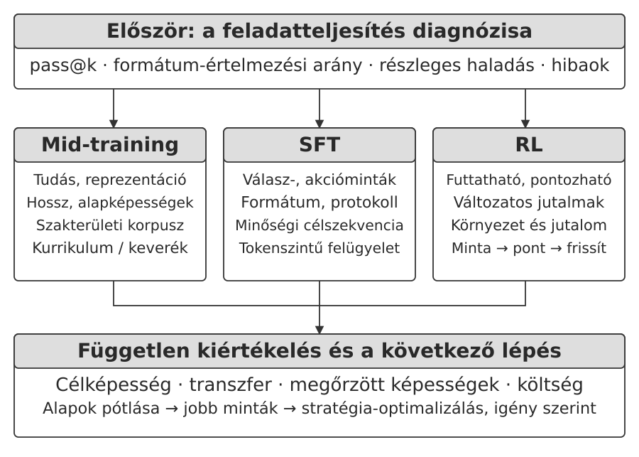

8-4. táblázat: A Mid-training, az SFT és az RL kiválasztási szempontjai

| Megfigyelt jelenség | Elsőként ellenőrizendő | Jelölt módszer | A további értékelés fókusza |
| --- | --- | --- | --- |
| Gyenge a szakterületi nyelv, a fogalmak vagy az alapműveletek ismerete, többszöri mintavételre is alig van előrelépés | Korpuszlefedettség és alapképességek | Mid-training; visszakereshető tényeknél RAG-gal kombinálva | Szakterületi feladatok, az általános képességet ellenőrző tesztkészlet és a részben helyes trajektóriák |
| A tartalom használható, de a formátum, a paraméterek vagy a rögzített folyamat nem stabil | Bemutatók, interfészek és megkötések | SFT, korlátozott dekódolás vagy eszközszintű validálás | Sikeres értelmezés, feladateredmény és helyreállási viselkedés |
| Néha teljesíti a feladatot, de alacsony a sikerarány, vagy gyakran kerülőutakat jár | A jutalom minősége, a felfedezés és a feladateloszlás | RL | Feladatnyereség, jutalomkülönbségek, független általánosítás és költség |
| Van bemutató- vagy preferenciaadat, de interaktív környezet még nincs | Az offline adatok lefedettsége és az ellenőrzés módja | SFT, RFT, offline preferenciaoptimalizálás | Az alapvonal minősége, az adatok torzítása és a környezetépítés haszna |

Négy lépésben haladhatunk. Először felállítunk egy alapvonalat a prompt, a kontextus, az eszközök és a megkötések alkotta megoldásból. Ha ezek a módszerek már megfelelnek a feladat követelményeinek, inkább megtartom a kívülről szerkeszthető megoldást, hogy csökkenjen a tanítás, a telepítés és a regressziós tesztelés karbantartási költsége. A dinamikus tényeket visszakereséssel és verziókezeléssel biztosítjuk; a többször megtanulandó implicit ítéleteket, észlelési mintázatokat és stabil viselkedéseket érdemes paramétertanítással javítani.

Második lépésként a félretett feladatokon megfigyeljük a sikereket, a részleges előrehaladást, az értelmezési eredményeket és a hibatípusokat. Rögzített mintavételi konfiguráció mellett a Pass@1 és a Pass@k megmutatja, van-e már a jelenlegi stratégiának kihasználható útja; a sikertelen trajektóriák segítenek megkülönböztetni a tudáshiányt, a hiányzó visszajelzést és a folyamathibát.

Harmadik lépésként bemutatókat adunk a megtanulandó viselkedésekhez. A JSON-séma, az eszközhívás, a szakkifejezések használata, a pontosítás és a helyreállás egyaránt megírható SFT-mintaként, a szükséges tudást pedig a megfelelő korpusz és feladatkontextus biztosítja.

Negyedik lépésként felmérjük az RL visszajelzési feltételeit. Ha a modell pontozható jelölteket tud generálni, a jutalom megkülönböztető erejű, és a környezet elegendő interakciót enged meg, összevethető a stratégiaoptimalizálás haszna; ha a jutalom túl ritka, előbb a tantervet, a részjutalmat vagy egy alkalmasabb kezdeti stratégiát érdemes megfontolni.

Minden lépésnél az értékelési eredmény dönti el a további ráfordítást: egy egyértelmű formátumú feladat az SFT után telepíthető, egy erős kiindulópontú modell közvetlenül RL-t kaphat, a szakterületi folytatott tanítás után pedig a meglévő utasításkövetési képesség is újrahasznosítható. A következőkben egyfordulós feladatokon figyeljük meg konkrétan, milyen viselkedésbeli különbséget eredményez a bemutatókból és a jutalomból való tanulás.

Térjünk vissza az olvasási útmutató rendelési problémájához. Adjuk át ugyanazt a valós eszközleírást közvetlenül a modellnek, és figyeljük meg, helyesen írja-e meg a paramétereket. Ha a leírás mezői megváltoztak, először a futásidőben lekérdezhető leírást frissítsük. Ha a mezők jelentése világos, a modell mégis rendre a felhasználó szövegét írja a rendelésszám helyére, adhatunk lekérdezést, pontosítást és helyes paraméterkitöltést tartalmazó SFT-bemutatókat. Ha pedig a modell néha már teljesen végig tudja vinni az ügyet, de a lekérdezések eltérő sorrendje eltérő sikerarányhoz és költséghez vezet, adottak a feltételek több stratégiatrajektória összehasonlításához.

## Egyfordulós megerősítéses tanulás: memorizálás és általánosítás összevetése

Az egyfordulós feladat egyetlen bemenettel kezdődik, és azzal ér véget, hogy a modell beadja a válaszát, és jutalmat kap. A modell a válasz generálása közben továbbra is végezhet többlépéses érvelést, és a tanítási rendszer ugyanazt a feladatot többször is megpróbáltathatja vele. Ha az interakciót egyetlen válaszra korlátozzuk, könnyebben megfigyelhető, hogyan változtatja meg a tanítási módszer a modell viselkedését. Az alábbiakban előbb az AdaptThink példáján mutatjuk meg, hogyan tanulja meg a modell elosztani az érvelési költségvetést, majd a GeneralPoints segítségével összevetjük az SFT és az RL teljesítményét a szabályok és a vizuális megjelenés változásakor.

Ha előbb megértjük, hogyan használják az RL-algoritmusok a jutalmat a modell frissítésére, a későbbi kísérletek tanítási folyamata is érthetővé válik. A fejezet RL-tanításai többnyire a **stratégiagradiensen** alapulnak. Vegyük ugyanannak a kérdésnek több mintáját: a modell generál néhány választ, majd az egyes válaszok jutalmát egy alapvonalhoz hasonlítjuk. Az alapvonalnál jobb válaszok pozitív jelet kapnak, és a tanítás növeli a generálási valószínűségüket; az alapvonal alatti válaszok negatív jelet kapnak, és a generálási valószínűségük csökken.

Hogy egyetlen frissítés ne vigye félre a modellt, az elterjedt **PPO** algoritmus levágja a helyettesítő cél többletnyereségét, ha a valószínűségi arány kilép egy megadott intervallumból; a tényleges frissítés mértéke a tanulási rátától és a frissítési körök számától is függ. A később tárgyalt „értékhálózatos PPO” egy értékbecslést tanul, ebből állít fel összehasonlítási alapvonalat, és kiszámítja az egyes lépések cselekvéseinek előnyét. A **GRPO** közvetlenül ugyanannak a kérdésnek több válaszát hasonlítja össze, és a csoporton belüli jutalmakból képez alapvonalat, így nincs szükség külön tanított értékhálózatra.

Az alábbi Python-stílusú pszeudokód összefűzi a mintavételt, a jutalmat, az előnyt és a paraméterfrissítést, hogy látható legyen, hogyan adják át az egyes lépések az információt. A tényleges tanításhoz a mintavétel párhuzamosítását, a KL-regularizációt és az optimalizálót is konfigurálni kell.

```python
for prompt in batch:
    group = [rollout(policy, env.reset(prompt)) for _ in range(G)]
    rewards = [verify(trajectory) for trajectory in group]
    advantages = normalize_within_group(rewards)       # GRPO baseline
    update(policy, group, advantages)
```

Hogyan frissíti a PPO a stratégiát egy adag különböző hosszúságú trajektóriával? Először minden trajektórián belül hátulról előre haladva kiszámítjuk az egyes lépések diszkontált hozamát. A trajektória végén abbahagyjuk az összegzést, nehogy a következő feladat jutalma is beleszámítson. Ezután az összes trajektóriából összegyűjtjük a modell által ténylegesen választott cselekvéseket, és kiszámítjuk erre az adagra az átlagos veszteséget. Az alábbiakban egyetlen frissítést írunk le, a többkörös minibatch-optimalizálást elhagyva.[^ch8-ppo-method]

```python
states, actions, returns = [], [], []
for trajectory in rollouts:
    states.extend(trajectory.states)       # az egyes cselekvésválasztások előtti állapotok
    actions.extend(trajectory.actions)     # elemenként megfelelnek az állapotoknak
    returns.extend(discounted_returns(trajectory.rewards))

returns = tensor(returns)
values = value_model(states)
advantages = returns - stop_gradient(values)
ratio = exp(policy.log_prob(actions, given=states)
            - old_policy.log_prob(actions, given=states))
policy_loss = -mean(min(
    ratio * advantages,
    clip(ratio, 1 - epsilon, 1 + epsilon) * advantages
))
value_loss = mean((values - returns) ** 2)
update(policy, value_model, policy_loss + value_coef * value_loss)
```

A GRPO „relatív” jellege abból fakad, hogy ugyanarra a kérdésre több válasz születik; az itt látható PPO ezzel szemben értékhálózattal becsüli meg minden állapot várható hozamát. Az `old_policy` az a befagyasztott stratégia, amely ezt az adag trajektóriát generálta. Tegyük fel, hogy egy lépés cselekvésének előnye 1, és a jelenlegi stratégia 1,4-szer akkora valószínűséget ad neki, mint mintavételkor; `epsilon = 0.2` mellett ennek a tagnak a hozzájárulása a helyettesítő célhoz `min(1.4, 1.2) = 1.2`. Ha tovább növeljük ennek a cselekvésnek a valószínűségét, ebből a tagból már nem nyerünk többet.

Ha az előny −1, az irány megfordul. Ha a valószínűségi arány már 0,6-ra csökkent, ugyanabba a kódsorba behelyettesítve `min(-0.6, -0.8) = -0.8` adódik, vagyis a valószínűség további csökkentése sem hoz többletnyereséget. Ha viszont ez a gyengébb cselekvés éppen gyakoribbá válik, és a valószínűségi arány 1,4-re nő, a kisebb értéket véve `min(-1.4, -1.2) = -1.4` adódik, tehát a valószínűség növelésének továbbra is ára van.

> **8-10. kísérlet ★★: AdaptThink – megtanulni, „mikor ne gondolkodjunk”**
>
> Az érvelő modellek gyakran hosszú érvelési folyamattal oldják meg a feladatokat. Egyszerű kérdéseknél a közvetlen válasz megspórolja a generálás költségét. Az AdaptThink kétféle módot kínál a modellnek, a Thinkinget és a NoThinkinget: az ezt a protokollt támogató modelleknél a NoThinking a `<think></think>` segítségével lezárja az érvelési szakaszt, és utána közvetlenül generálja a választ. A tanítás célja, hogy a modell a feladat alapján válasszon megfelelő érvelési költségvetést.
>
> A módszer két fő összetevőből áll. A **korlátozott optimalizálási cél** arra ösztönzi a modellt, hogy növelje a NoThinking arányát, miközben megőrzi az összesített válaszadási teljesítményt; a **fontossági mintavétel** a két mód mintavételi arányát igazítja, majd súlyokkal korrigálja a mintavételi eloszlás és az optimalizálási cél közötti eltérést. A kezdeti modell gyakran a Thinking felé hajlik, ezért csak a NoThinking-minták tudatos növelésével kaphat a tanítás olyan jelet, amely összeveti a két módot. A hidegindítási probléma itt konkrétan azt jelenti, hogy a tanítás elején kevés a NoThinking-minta.
>
> A könyv kísérlete 8 darab H100 80GB GPU-t használt. A 300. lépésig tartó tanítás után a MATH500 pontossága 81,00%-ról 81,80%-ra változott, az átlagos válaszhossz nagyjából 4911 tokenről 1577 tokenre csökkent; a GSM8K pontossága 79,68%-ról 81,88%-ra nőtt, a válaszhossz nagyjából 1025 tokenről 477-re csökkent; az AIME mean@16 31,46%-ról 31,04%-ra változott, a válaszhossz nagyjából 12 120 tokenről 6402-re csökkent. A három válaszhossz rendre nagyjából 68%-kal, 53%-kal és 47%-kal csökkent.
>
> A NoThinking aránya a három adathalmazon sorrendben 83,80%, 84,15% és 56,25% volt. Az AIME-n a modell több érvelési számítást tartott meg, a MATH500-on és a GSM8K-n viszont gyakrabban válaszolt közvetlenül. Az AIME2024-en feladatonként 16 mintát vettünk, a mean@16 e 16 válasz átlagos pontosságát méri. A 300. lépésre az átlagos válasz közel a felére rövidült, a pontosság pedig nagyjából 0,42 százalékponttal csökkent.
>
> A 300. lépés a tanítás közbeni egyik validálás volt. A csapat eredetileg 3140 lépésnyi tanítást tervezett, a futás azonban később rendellenesen leállt, és az utolsó validálási rekord a 410. lépésnél maradt. Ekkor az AIME2024 átlagos pontossága 31,88% volt, az átlagos válasz nagyjából 5874 token.
>
> Az AdaptThink a prompt-desztillációval együtt is használható: a desztilláció a rendszeresen használt utasításokat és megoldási mintázatokat írja a paraméterekbe, az AdaptThink pedig azt tanulja meg, mennyi érvelési számítást kell egy-egy feladatra szánni. A kettő együtt befolyásolja a válasz minőségét, a késleltetést és a költséget.

> **8-11. kísérlet ★★: GeneralPoints – az egyfordulós RL „memorizálás és általánosítás” összevetése**
>
> Chu és munkatársai a „24-es játékhoz” hasonló GeneralPoints kártyajátékkal vizsgálták a modell általánosító képességét[^ch8-3]. A négy lapon szereplő számokat egyszer-egyszer felhasználva, összeadással, kivonással, szorzással és osztással kell 24-et kihozni. Ha a modell megtanulta megoldani a feladatot, akkor is helyesen számol-e, ha megváltoznak a lapértékek szabályai vagy a színek? A 8-12. ábra kétféle feladatformát mutat: a GP-L közvetlenül szövegként adja meg a lapokat, a GP-VL-nél viszont a modellnek kell leolvasnia a lapokat.
>
> 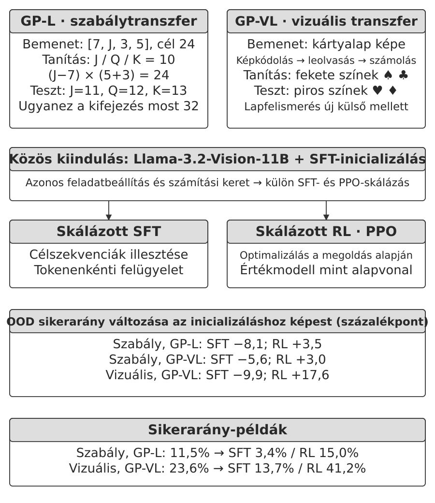
>
> **Szabályváltozat**: tanításkor a J/Q/K egyaránt 10-et ér, teszteléskor rendre 11-et, 12-t és 13-at. A tesztkészlet így a tanításban nem látott számkombinációkat is tartalmaz, és ellenőrizhető vele, hogy a modell az új szabály szerint tud-e 11-gyel, 12-vel és 13-mal számolni. **Vizuális változat**: tanításkor fekete színeket (♠♣), teszteléskor piros színeket (♥♦) használunk, így ellenőrizhető, alkalmazkodik-e a modell a lapok megjelenésének változásához.
>
> A kísérlet a Llama-3.2-Vision-11B-ből indul ki: előbb SFT-vel kialakítja az alapvető utasításkövetési képességet, majd két tanítási ágra válik, a folytatott SFT-re és az RL-re, amelyeket azonos számítási költségvetés mellett hasonlít össze. Az RL-ág értékhálózatos PPO-t használ. Mindkét ágat a J/Q/K=10 szabállyal tanítják, majd eloszláson belüli (ID) és eloszláson kívüli (OOD) tesztkészleten értékelik.
>
> Vegyük például a `[7, J, 3, 5]` lapokat: J=10 esetén használható a `(J−7)×(5+3)=24`; ha J értéke 11-re változik, ez a kifejezés 32-t ad, és helyette a `(11−5)×(7−3)=24` kell. Ugyanaz a lapkombináció tehát azt követeli meg a modelltől, hogy leolvassa az aktuális szabályt, és újraszervezze a számítást.
>
> A két tanítási módszer között az eloszláson kívüli teszten egyértelmű különbség mutatkozott. **Szabály-OOD**: a GP-L-en az RL sikeraránya 11,5%-ról 15,0%-ra nőtt, 3,5 százalékponttal; az SFT-é 11,5%-ról 3,4%-ra esett, 8,1 százalékponttal. A GP-VL-en az RL 3,0 százalékponttal javult, az SFT 5,6 százalékponttal romlott. **Vizuális OOD**: a GP-VL-en az RL 23,6%-ról 41,2%-ra nőtt, 17,6 százalékponttal; az SFT 23,6%-ról 13,7%-ra esett, 9,9 százalékponttal.
>
> A kártyafelismerés eredményeinek további vizsgálata összekapcsolja a végső feladatmegoldási teljesítményt a vizuális észleléssel: az RL-ág felismerési pontossága a feladat sikerarányával együtt javult, az SFT-ágé viszont valamelyest romlott. A kutatás ezt a különbséget a tanítási célhoz köti: a tokenenkénti illesztés megerősítheti a bemutatók szöveges mintázatait, az eredményalapú jutalom viszont folyamatosan megköveteli, hogy a modell helyesen olvassa le a lapokat és végezze el a számítást. Az észlelési pontosság köztes mutatóként szolgál ennek a mechanizmusnak az elemzéséhez.
>
> Hogy miért kell előbb SFT-t végezni, az a kimeneti formátum felől is érthető. A kísérletben szereplő Llama-3.2-Vision-11B alapmodell nem tudta megbízhatóan előállítani a megkövetelt strukturált kimenetet, az ellenőrző ebből nem tudott feladatjutalmat számítani, ezért a közvetlen, végponttól végpontig tartó RL kísérlete kudarcot vallott. Az SFT előbb értelmezhető, pontozható kimenetet alakít ki, és csak ezután tudja a további RL kihasználni a feladat visszajelzését. A korábban említett DeepSeek-R1-Zero ezzel szemben olyan alapmodellből indult, amely eleve pontozható válaszokat tudott generálni, így közvetlenül RL-lel kezdhetett.
>
> Mennyit tanulhat a modell az ellenőrző visszajelzéséből? A cikk 10. ábrája külön összehasonlítja a tisztán szöveges kártyafeladatot (GP-L). A kutatók 1, 3, 5 és 10 ellenőrzési iterációt állítottak be, és mindegyikkel külön tanítottak és értékeltek RL-modellt. Azonos tanítási számítási költségvetés mellett a 10 ellenőrzést engedő csoport sikeraránya az új szabályon 5,99 százalékponttal haladta meg a saját tanítási kiindulópontját, az egyetlen ellenőrzést engedő csoporté 0,48 százalékponttal.
>
> Miért romlik ennek a kísérletnek az eloszláseltolódása mellett az SFT teljesítménye, és miért teljesít jobban az RL? A megfigyelésekkel összhangban álló egyik magyarázat szerint a korlátozott SFT-adat a „J/Q/K-t mindig 10-nek vesszük” rögzített mintázatot erősítette meg; teszteléskor J=11, a modell mégis 10-zel számol. Az eredményorientált RL-ág viszont nagyobb eséllyel az „addig számolj újra, amíg helyes választ nem kapsz” stratégiát erősíti meg, ezért akkor is alkalmazható, amikor J értéke 11 lesz.
>
> A GeneralPoints szabályváltozása és színváltozása lehetővé teszi, hogy külön figyeljük meg: megtanulta-e a modell az új feltételek szerinti számolást, és helyesen olvassa-e le az új vizuális bemenetet. Az itteni modell, tanítóadat és tesztköltségvetés mellett a folytatott SFT-ág az eloszláson kívüli teszten visszaesett, az RL-lel folytatott ág viszont javult. Ha a következtetést a saját feladatunkra akarjuk alkalmazni, érdemes először megkérdezni: elsajátította-e már a tanuló a kimeneti formátumot? Az új teszt pontosan mit cserélt le: a szabályt, a bemenet megjelenését, vagy mindkettőt? Csak külön összevetésekkel derül ki, hogy bemutatót kell pótolni, az észlelést kell javítani, vagy több eredményvisszajelzéses felfedezésre van szükség.

## RL-algoritmusok: 16 rollouttól egyetlen paraméterfrissítésig

A **GRPO-t (Group Relative Policy Optimization)** a DeepSeek javasolta; tanulási jelét abból képezi, hogyan teljesítenek egymáshoz képest ugyanarra a kérdésre tett próbálkozások. Vegyünk egy SWE-bench-stílusú kódjavítási feladatot: egy Python-projekt `parser.py` fájlja üres bemenetre `IndexError`-t vált ki, az ügynöknek ki kell javítania az implementációt, a tesztfájlokat pedig változatlanul kell hagynia. Egy tanítási iteráció négy lépésre bontható.

**Első lépés: a stratégiamodell ismételt próbálkozása.** A stratégiamodell maga a tanított nyelvi modell. A rendszer ugyanazt a kiinduló kódot és problémaleírást 16 elszigetelt sandboxba helyezi, és a modell egymástól függetlenül 16-szor oldja meg a feladatot. Minden próbálkozás a kód olvasásával kezdődik, módosításon és tesztelésen át tart az eredmény beadásáig; ezt a teljes interakciós trajektóriát nevezzük egy **rolloutnak**. A véletlen mintavétel miatt ugyanabból a kiindulópontból különböző utak születnek: van, amelyik pótolja a határfeltétel ellenőrzését, van, amelyik csak elkapja a kivételt, van, amelyik rossz fájlt módosít, és olyan is, amelyik a teszteket próbálja megváltoztatni.

**Második lépés: a jutalom kiszámítása.** Minden rollout végén az ellenőrző tiszta környezetben alkalmazza a javítást, és lefuttatja a teszteket. Tegyük fel, hogy a 16 próbálkozásból 4 minden tesztet teljesít, és nem módosította a tesztfájlokat, a másik 12 pedig sikertelen; ekkor a 4 sikeres 1 jutalmat kap, a többi 12 pedig 0-t. A 8-13. ábra ennek a 16 trajektóriának a pontozását egyetlen táblázatban mutatja. Az ilyen kódfeladatoknál a jutalom közvetlenül tesztekből és szabályokból számítható. Az olvashatósághoz, a magyarázat minőségéhez és más, tesztként nehezen megfogalmazható célokhoz emberi értékelés vagy jutalommodell is bevonható.

**Harmadik lépés: a relatív előny kiszámítása.** A jutalom csak azt mondja meg, hogy egy trajektória sikeres volt-e, a **relatív előny** viszont azt, hogy mennyivel jobb a csoport többi próbálkozásánál. A csoport átlagos sikeraránya 4/16: a teszteken átment 4 trajektória a csoportátlag fölött van, és pozitív előnyt kap; a sikertelen 12 az átlag alatt van, és negatív előnyt kap. Ha a csoporton belüli szórással normalizálunk, a jutalmak átlaga 0,25, a szórás nagyjából 0,433, a sikeres trajektóriák előnye nagyjából 1,73, a sikerteleneké nagyjából −0,58. A GRPO az ilyen csoporton belüli összehasonlításból képez tanulási jelet. Ha a 16 jutalom teljesen azonos, mindegyikből a csoportátlagot kivonva nullát kapunk. A nevezőhöz adott kis stabilizáló tag megakadályozza a nullával való osztást; normalizálás után azonban ennek a csoportnak az eredményjutalma továbbra sem mutatja meg, melyik trajektória felé kellene a tanításnak elmozdulnia. Ilyenkor érdemes megnézni, hogy az útkorlátok, a folyamatjutalom vagy a részleges előrehaladás meg tudja-e különböztetni a csoport trajektóriáit. Ha például két próbálkozás közül egyik sem javította ki a kódot, de az egyik átment az eredetileg sikertelen határteszten, akkor – feltéve, hogy ez a köztes eredmény függetlenül ellenőrizhető – kaptunk egy újabb, a tanuláshoz esetleg felhasználható támpontot.

**Negyedik lépés: a stratégia frissítése gradienscsökkentéssel.** A tanítási program a relatív előnyt tanítási veszteséggé alakítja, kiszámítja a gradienst, majd az optimalizáló (például AdamW vagy Muon) gradienscsökkentést hajt végre: növeli a pozitív előnyű trajektóriákban hozott modelldöntések valószínűségét, és csökkenti a negatív előnyűekben hozottakét. A tanítás sok feladaton és rolloutokon át ismételten igazítja ezeknek a döntéseknek a valószínűségét. Ahogy az optimalizálás fokozatosan hatni kezd, hasonló hibáknál egyre gyakrabban jelenik meg az „előbb reprodukáld a problémát, ellenőrizd a határfeltételeket, módosítsd az implementációt és futtasd a teszteket” viselkedés, és egyre ritkábban a „kivétel elfedése, a tesztek átírása, beadás ellenőrzés nélkül”.

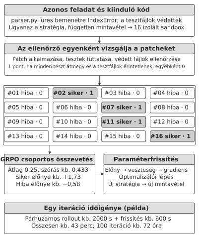

A 8-13. ábrán ugyanarra a feladatra 16 mintát vettünk – hány **tanítási iterációnak (step)** számít ez? Az ebben a szakaszban használt számolás szerint ez a 16 rollout egyetlen adaghoz tartozik. A $k$-adik körben a jelenlegi stratégiával veszünk mintát, kiszámítjuk a jutalmakat, az előnyöket és a gradienst, és egyszer frissítjük a stratégiát; csak a $k+1$-edik körben veszünk újra mintát az új paraméterekkel. A 100 step tanítás azt jelenti, hogy ilyen iterációból nagyjából 100 kört végzünk.

Ebből megbecsülhető a tanítás ideje. Egy összetett feladat több tucat eszközhívási kört tartalmazhat; ha a szinkron tanítás az egész adag eredményére vár, a 16 párhuzamos trajektória közül a leglassabb dönti el, mikor ér véget a mintavételi szakasz. Ha ez nagyjából 2000 másodpercig tart, a gradiensszámítás és az optimalizálói frissítés pedig további 600 másodpercet vesz igénybe, egy step nagyjából $2\,000+600=2\,600$ másodperc, azaz 43 perc. Azonos időigény mellett 100 step folyamatos tanítás nagyjából 72 órát vesz igénybe.

A PPO és a GRPO egyaránt ezt a zárt kört követi; a különbség főként abban van, hogy „mihez hasonlítunk”. A GRPO közvetlenül ugyanannak a kérdésnek több rolloutját veti össze, és nincs szüksége külön értékmodellre; a PPO egy értékmodellt tanít, amely a trajektória minden lépésénél megbecsüli, hogy „általában milyen jól lehet teljesíteni”, majd megítéli, jobb-e az aktuális cselekvés ennél az elvárásnál, és így biztosítja a lépésenkénti hitelkiosztáshoz szükséges alapvonalat. Mindkettő a helyettesítő cél levágásával és hasonló mechanizmusokkal fékezi a túl nagy frissítéseket. A DPO más: közvetlenül előre összegyűjtött „jobb válasz – rosszabb válasz” preferenciapárokból tanul, és nem hagyja, hogy a jelenlegi stratégia online generálja ezt a rolloutcsoportot.

A fejezet esetei különböző tanítási recepteket alkalmaznak: az AdaptThink saját korlátozott célt használ; a GeneralPoints, a V-IRL és a ReTool PPO-t, ezek közül az első kettőnél az értékmodell is részt vesz az előnybecslésben; a SimpleVLA-RL és az RLVP GRPO-t használ.

Tegyük fel, hogy egy A és egy B feladatot egyaránt négyszer próbálunk meg; az A-t mind a négyszer helyesen oldja meg a modell, a B-t egyszer sem. Az A négy jutalma mind 1, a B-é mind 0. Ha mindkét csoportból kivonjuk a csoportátlagot, mindkét csoport előnye 0 lesz. Ha viszont van még számítási kapacitás néhány további próbálkozásra, melyik feladatra érdemes költeni, hogy nagyobb eséllyel kapjunk hasznos tanítómintát?

A Never Give Up ezt a választást a mintavételi folyamatba építette be. Az A feladat minden próbálkozása helyes, így ezt a csoportot kihagyja; a B minden próbálkozása hibás, ezért bizonyos valószínűséggel még egy csoportot vesz. Ha a második csoportban végre egy válasz helyes, a tanítás a két csoport mind a nyolc válaszát együtt kezeli: egy helyes és hét hibás megoldás, vagyis ugyanazon a feladaton eltérő jutalmak. Az aszinkron mintavétel miatt a többi feladat közben zavartalanul halad, nem kell megvárni a B eredményét.[^ch8-ngu]

[^ch8-ngu]: Michael Noukhovitch és mtsai., *Learning to Solve Hard Problems in RL for LLMs by Never Giving Up*, 2026. A cikkben szereplő kiegészítő mintavétel a tanítást szolgálja; a már megoldott feladatok a későbbi tanítás során újra kisorsolhatók.

### Miért részesítik előnyben az LLM RL-ben általában az on-policy tanulást?

Az **online** és az **on-policy** két különböző szempontot ír le. Az online tanítás futás közben folyamatosan interakcióban áll a környezettel, és adatot termel; az on-policy tanítás az adatok forrására figyel, és megköveteli, hogy a trajektóriákat generáló $\mu$ viselkedési stratégia megegyezzen az optimalizálandó $\pi_\theta$ stratégiával, vagy elég közel legyen hozzá. Egy aszinkron fürt folyamatosan vehet online mintát, de ha egy worker néhány ellenőrzőponttal lemarad, a visszaadott adatban megjelenik a stratégia elavultsága, vagyis off-policy összetevő keletkezik.

Azt javaslom, hogy előbb az on-policyhoz közeli tanítással állítsunk fel stabil alapvonalat, és csak utána vezessünk be aszinkron mintavételt vagy a régi adatok újrafelhasználását az áteresztőképesség növelésére. A fejezet PPO/GRPO-receptjei általában minden step elején a legfrissebb stratégiával vesznek mintát. A PPO ezután ugyanazon az adagon több kör minibatch-frissítést végez, így a jelenlegi stratégia fokozatosan eltávolodik az adatot generáló `old_policy`-tól. A valószínűségi arány ezt a változást méri, a levágott cél pedig fékezi a túl nagy frissítéseket.

A stratégiagradiens célja a jelenlegi $\pi_\theta$ stratégia melletti várható jutalomhoz kötődik. Ha a $\mu$ viselkedési stratégiával vett mintákat használunk, előbb kiszámítható ugyanabban az állapotban a cselekvés valószínűségi aránya, majd ebből fontossági korrekció képezhető:

$$
\rho_t=\frac{\pi_\theta(a_t\mid s_t)}{\mu(a_t\mid s_t)}
=\exp\left(\log\pi_\theta(a_t\mid s_t)-\log\mu(a_t\mid s_t)\right).
$$

Tegyük fel, hogy ugyanazon előtag után a mintavételi stratégia 0,2 valószínűséggel választ egy tokent, a jelenlegi stratégia viszont 0,3 valószínűséget ad neki; ekkor ennek a lépésnek a valószínűségi aránya 1,5. A régi mintákban ez a token a kelleténél ritkábban fordul elő, ezért a jelenlegi stratégia szerinti becsléskor az ilyen minták súlya ennek megfelelően nő. Ha a mintavétel és a tanítás ugyanazt a stratégiát használja, a paraméterfrissítés előtt minden lépés valószínűségi aránya 1.

A régi trajektóriák újrafelhasználása lehetővé teszi, hogy a mintavétel és a tanítás aszinkron fusson, ami növeli az áteresztőképességet. Minél jobban eltér azonban a két stratégia, annál valószínűbb, hogy néhány minta igen nagy súlyt kap. Ha az egész trajektóriát súlyozzuk újra, az egyes lépések valószínűségi arányait még össze is kell szorozni. A PPO minden cselekvés helyettesítő céljából levágja a többletnyereség egy részét, ami tompítja a szélsőséges valószínűségi arányok hatását; azokat az állapotokat viszont, amelyekbe a régi minták soha nem jutottak el, csak új mintavétellel láthatjuk. Ezért részesítem előnyben a friss trajektóriákat.[^ch8-32]

#### Numerikus eltérés a tanítás és a következtetés között

A nagy léptékű LLM-megerősítéses tanulás általában vLLM, SGLang vagy hasonló következtetési motorral vesz mintát, a log-valószínűséget és a gradienst pedig FSDP, Megatron vagy hasonló tanítási rendszer számolja. Még ha a két oldal ugyanazokat a súlyokat tölti is be, a lebegőpontos pontosság, a redukciós sorrend, a tenzorpárhuzamosítás, a kötegméret, a KV Cache és a fuzionált kernelek eltérései miatt ugyanarra a tokenre kissé eltérő log-valószínűséget számolhatnak. Ilyenkor $\rho_t$ már a paraméterek frissítése előtt eltér 1-től, vagyis a tanítás és a mintavétel között numerikus szintű stratégiaeltérés jelenik meg. Kontrollált kísérletek szerint már az apró, token szintű eltérések is a tanítás összeomlásához vezethetnek.[^ch8-33]

Ha a mintavételi eloszlás megváltozik, a naiv stratégiagradiens akkor is az egyik cselekvés felé billenhet, ha a két cselekvés jutalma pontosan azonos. Tegyük fel, hogy mintavételkor A és B egyaránt fele-fele eséllyel fordul elő, a tanítás során viszont a modell már 0,8 valószínűséggel választja A-t. Az A-t szabályozó logit szempontjából, ha A-t választjuk, a log-valószínűség gradiense $1-0.8=0.2$; ha B-t, akkor $0-0.8=-0.8$. Ha mindkét cselekvés 1 pontot kap, és a mintavételi valószínűségek szerint átlagolunk, a gradiens $-0.3$. A két választás pontszáma azonos, a frissítés mégis csökkenti A valószínűségét.

A score centering ugyanazon előtag mellett a log-valószínűség gradienséből kivonja annak a mintavételi eloszlás szerinti átlagát. A fenti példában $-0.3$ kivonása után a két tag $0.5$ és $-0.5$ lesz, így az azonos jutalomból adódó átlagos frissítés pontosan nulla. A korábban tárgyalt GRPO egy válaszcsoport jutalmaiból vonja ki az átlagot; itt a gradienst centráljuk.[^ch8-sc]

[^ch8-sc]: Martin Marek, Max Ryabinin, *Score Centering Stabilizes Off-policy Reinforcement Learning*, 2026. Ha a mintavételi stratégia túlságosan lemarad, KL-regularizációval is korlátozható a tanítási stratégia és a viselkedési stratégia közötti távolság (arXiv:2611.21791).

A tanítás- és a mintavételi oldal numerikus hibája a hosszú szekvenciák mentén fel is erősödik: **log-valószínűség-hiba → a valószínűségi arány torzulása → felhalmozódás a hosszú előtagon → a levágás és az előnysúlyozás megváltozása → a gradiens és az effektív mintaszám megváltozása**. Ha például 4000 token log-valószínűségi aránya mind azonos irányú $10^{-3}$ torzítást hordoz, a kiszámított trajektóriaszintű valószínűségi arány a valódi érték $e^{4000\times0.001}=e^4\approx54.6$-szerese lesz.

A korai valószínűségváltozások a mintavétel eredményét is megváltoztathatják, így a későbbi állapotok egy másik úton fejlődnek tovább. A tanítás során megfigyelhető jelek közé tartoznak a fontossági arány kiugrásai, a levágási arány emelkedése, a gradiens vagy a válaszhossz hirtelen változása, valamint a jutalom és az entrópia csökkenése. Ha a kötegméret megváltoztatja a redukció menetét, ugyanarra a bemenetre is változhat a numerikus eredmény, vagyis sérül a kötegfüggetlenség (batch invariance). A kapcsolódó kutatások megfigyelték az ebből fakadó implicit off-policy hatást, és a mintavételi és a tanítási számítás összehangolásával, illetve a stratégiaeltérés explicit korrekciójával javították a stabilitást.[^ch8-34]

Ezért a mintavétel és a tanítás numerikus konzisztenciáját a tanítás indítása előtti alapvető ellenőrzések közé sorolom, és a jutalomgörbével együtt folyamatosan figyelem. A kezelés négy lépésben haladhat: „az eltérés mérése – a konfiguráció összehangolása – a torzítás korrekciója – az elavultság kordában tartása”:

- **Bármilyen paraméterfrissítés előtt** ugyanazon a trajektóriaadagon hasonlítsuk össze a mintavételi oldal (sampler) és a tanítási oldal (trainer) által adott tokenszintű log-valószínűségeket, és figyeljük $\rho_t$ átlagát, kvantiliseit, maximumát, a közelítő KL-t és a levágott arányt; ez a legközvetlenebb on-policy egységteszt.
- A súlyok szinkronizálásakor a LoRA-adaptert, a tokenizálót, a párbeszédsablont, a modellverziót és a pozíciókódolás konfigurációját is hangoljuk össze. A rolloutnak el kell mentenie a mintavételi stratégia által generáláskor adott log-valószínűségeket, és később ezekből kell kiszámítani a valószínűségi arányt.
- Amennyire lehet, hangoljuk össze a mintavétel és a tanítás pontosságát, párhuzamosítási elrendezését és kulcsfontosságú számítási kerneleit; ha ez nem lehetséges, az eltérést kifejezetten off-policyként kezeljük, alkalmazzunk fontossági korrekciót, figyeljük az effektív mintaszámot, és a levágási aránnyal együtt ítéljük meg a korrekció hatását.
- Időben vegyünk új mintát a frissített stratégiával, korlátozzuk az egy adagon végzett frissítési körök számát, valamint azt, hogy az aszinkron mintavétel hány ellenőrzőponttal maradhat le a tanítás mögött.

## RL-környezetek: az értékeléstől a szimulációig

Az ügynök RL-tanításához a feladatokat újra és újra végre kell hajtani. Egy kódjavítás elszigetelt másolatban újrapróbálható, egy fizetés viszont megváltoztatja egy valódi számla állapotát. A tanítási környezetnek visszaállítható kezdőállapotot, párhuzamosítható feladatpéldányokat és ellenőrizhető eredményt kell biztosítania, hogy a modell ellenőrzött feltételek között fedezhessen fel különböző utakat. A 7. fejezet már bemutatta az értékelő környezeteket; tanításhoz ezen felül a hosszú futásidővel, a cselekvések mellékhatásaival és a nagyszámú interakció költségével is számolni kell. Én előbb a környezetépítéshez rendelek embert és költségvetést, és csak utána ütemezem a nagy léptékű tanítást. A valós visszajelzés, az állapot-visszaállítás és a párhuzamos elszigetelés megvalósítása gyakran több mérnöki erőforrást emészt fel, mint a PPO vagy a GRPO bekötése, és a környezetépítés költsége akár magát a tanítást is meghaladhatja.

### A környezet: a modell gyakorlópályája

A környezet a cselekvések alapján frissíti az állapotot, és az új megfigyelést visszaadja a modellnek. Környezet építésekor három kérdésből érdemes kiindulni.

- **Közel áll-e az interakció a telepítési helyzethez?** Egy ügyfélszolgálati szimulátornak le kell fednie azokat a helyzeteket, amikor a felhasználó információt pótol, megváltoztatja a kérését vagy homályosan fogalmaz; egy eszközszimulátornak az éles üzemben gyakori hibákat és késleltetéseket kell visszaadnia. A modell ezekből a visszajelzésekből tanulja meg kezelni a valós problémákat. A túl egysíkú visszajelzés miatt a stratégia a szimuláció rögzített fogásaira támaszkodik majd.
- **Stabilan újrapróbálhatók és párhuzamosíthatók-e a feladatok?** Minden rolloutnak saját rendelés-, fájl- vagy számlaállapot kell, amely a végén kitakarítható és visszaállítható. A ReTool kódértelmező sandboxa és az AWorld MCP-sandboxa egyaránt ezt a szerepet tölti be. A sebességkorláttal, költséggel vagy írási mellékhatással járó valódi API-knál a feladat igénye szerint sandboxfiók, visszajátszott adat vagy szimulált interfész használható.
- **Hogyan ítéljük meg az eredményt?** A környezet állapota a jutalomszámítás fontos alapja. Egy visszatérítési feladatnál például ellenőrizhető az összeg, a rendelés állapota és az engedélyezési feltételek; egy kódfeladatnál lefuttathatók a tesztek. A jutalomtervezésről a későbbiekben külön lesz szó.

**Mielőtt az algoritmus hangolásába fognánk, azt javaslom, ellenőrizzük: elég közel áll-e a szimulációs környezet a valós feladathoz? Ez fontosabb annál, hogy PPO-t vagy GRPO-t választunk.** A hűség, a visszaállíthatóság és az ellenőrizhetőség együtt határozza meg, mit tanulhat a modell az interakcióból. Ha előbb néhány feladaton végigvisszük ezt a három lépést, és csak utána növeljük a tanítás méretét, a problémák általában könnyebben behatárolhatók.

### Eszközök és környezetek szimulálása modellel

A keresési eredmények, a felhasználói párbeszédek és az összetett üzleti állapotok egyaránt szintetizálhatók modell segítségével. A modellalapú szimulátor fogadja az ügynök cselekvését, és előállítja a következő visszajelzést, ami csökkenti a valós idejű külső szolgáltatásoktól való függést. Ez a megközelítés egyetlen eszköztől egészen a teljes feladatkörnyezetig kiterjeszthető.

**Első szint: az eszközök visszatérési értékeinek szintetizálása.** A ZeroSearch[^ch8-13] az LLM-mel játszatja el a keresőmotort: a tanuló lekérdezést küld, a szimulátor keresési eredményeket generál. Így a tanítás kevésbé függ a valódi keresési API költségeitől, sebességkorlátaitól és ingadozó eredményeitől. Tantervszerű ütemezést is alkalmaz: kezdetben jó minőségű, erősen releváns dokumentumokat ad vissza, majd fokozatosan növeli a zajt, hogy a tanuló gyakorolja a hasznos információ kinyerését tökéletlen anyagokból. A kutatásban a szimulált keresési környezetben tanított modell a valódi keresőmotorhoz csatlakoztatva is jól teljesített.

**Második szint: a környezet állapotátmeneteinek szimulálása.** A DreamGym[^ch8-14] a környezet dinamikáját egy következtető tapasztalati modellbe desztillálja. A modell beolvassa az aktuális állapotot és az ügynök cselekvését, levezeti a következő állapotot és a visszajelzést, és tömegesen generál online RL-hez használható interakciós trajektóriákat, így csökkenti a valós környezet igénybevételét. Ügyfélszolgálati és értékesítési feladatoknál az LLM a felhasználót is eljátszhatja, szimulálva a visszakérdezéseket, az információpótlást és a kérések változását. A τ-bench sorozat felhasználószimulátort alkalmaz; hasonló interakciós keretrendszer tanításra is használható, külön a gyakorlásra és az értékelésre szolgáló feladatokkal.

A modellalapú szimulátort is kalibrálni kell. Ha az ügyfélszolgálati szimulátor minden homályos kérdést pontosan megért, a stratégia nem gyakorolhatja a pontosítást; ha a keresési szimulátor mindig a helyes dokumentumot adja vissza, a stratégia nem szerez tapasztalatot a zaj felismerésében. A tanítás ráadásul azokat a viselkedéseket is megerősítheti, amelyek a szimulátor pontozási hibáit aknázzák ki. Vegyes megközelítést javaslok: az interakciók nagy részét a modellszimuláció adja, a stratégia teljesítményét pedig rendszeresen ellenőrizzük valós környezetben futó feladatokon, és a feltárt eltéréseket visszacsatoljuk a szimulátorba. Így „szintetikus interakció – értékelés valós feladatokon – a szimulátor javítása” iteratív folyamat jön létre.

Honnan tudhatjuk, hogy a szimulátor valóban meg tudja tanítani az eszközhasználatot? Egy kis teszttel: ugyanazon a kiinduló rendelésen előbb kérdezzünk le, aztán küldjünk be egy módosítást, majd kérdezzünk le újra, és ellenőrizzük, hogy a visszaadott rendelési mezők a cselekvésnek megfelelően változtak-e. Ezután állítsuk vissza a környezetet, és győződjünk meg róla, hogy ismét az eredeti értékeket olvassuk ki. Az a környezet, amely csak egy hihetően hangzó „módosítva” üzenetet tud generálni, de a következő körben nem lehet benne lekérdezni a változást, a szépen beszélő stratégiát jutalmazza, még ha az soha nem is változtatta meg a rendelést.

### Környezet, feladateloszlás és értékelési elkülönítés

A tanítási környezet határozza meg, mit élhet át a modell. A visszaállítható állapot lehetővé teszi az újrapróbálást, az elszigetelt példányok a párhuzamosítást, az egyértelmű állapot- és ellenőrzési szabályok pedig a reprodukálást és a pontozást. A feladatok a korábbi adatszintézis-módszerrel készíthetők: a valós üzleti naplókból feladattervet nyerünk ki, eltávolítjuk a személyazonosító adatokat, majd kitalált személyeket, rendeléseket, fájlokat és kezdőállapotokat generálunk.

A tanítás és az értékelés újrahasznosíthatja a feladatgenerátort és az ellenőrző kódot, a konkrét feladatokat azonban független halmazokra kell osztani. A SWE-Gym, a τ²-bench és az AndroidWorld környezettervezését alapul véve[^ch8-28] az elfogadási tesztek, a pontozáshoz szükséges rejtett állapot és a referenciamegoldás az ellenőrző oldalán marad, az ügynök pedig a feladatban rögzített interfészen keresztül kap megfigyeléseket. A mintavétel bővítése előtt néhány rollouttal ellenőrizzük, teljesíthetők-e a feladatok, és meg tudja-e különböztetni az ellenőrző az érvényes és az érvénytelen eredményt. Ha a pontozási torzítást korán felfedezzük, csökken annak az esélye, hogy a stratégia kihasználja az ellenőrzés réseit.

A környezetépítés sorrendje ezért: **feladatterv → visszaállítható környezet → eredményellenőrzés → a tanítás és az értékelés elkülönítése → kalibrálás valós interakcióval**. A korábbi adatszintézis ezekből a környezetekből szűri ki az érvényes trajektóriákat, és ezekből lesznek az SFT-bemutatók. Az RL-szakaszban a jelenlegi stratégia tovább próbálkozik a környezetben, és a bemutatókon túli utakat is felfedez.

Az ellenőrzést is be kell számítani az áteresztőképességi költségvetésbe. A Lean kernel, a tesztfuttató és a konténeres végrehajtás CPU-t és memóriát fogyaszt. Ha a GPU gyorsabban generál, mint ahogy az ellenőrzés halad, a feladatok felhalmozódnak az ellenőrzési sorban. Ilyenkor több ellenőrző workert kell indítani, csökkenteni kell az ellenőrzés késleltetését, vagy át kell állítani a generálás és az ellenőrzés erőforrásarányát[^ch8-9].

## Egyfordulóstól a többfordulósig: feladathelyzetek és hitelkiosztás

### A többfordulós feladatok alapvető kihívása

A 8-14. ábra bal oldalán a 24-es játék látható. A modell a válaszában több lépést is végigszámolhat, de mindegyik lépés a feladatban megadott négy lapot használja, menet közben nem érkezik új megfigyelés a környezetből. A jobb oldalon utcaképes navigáció látható. Csak miután a kereszteződésben balra fordult, látja meg a modell azt az utcát, amelybe befordult. A következő lépésről a szeme előtt lévő útjelző táblák alapján kell újra döntenie. Az 1. és a 4. fejezetben tárgyalt ReAct éppen az ilyen interakciót szervezi meg: a modell cselekvést választ, az eszköz vagy a környezet végrehajtja, az új megfigyelés pedig bekerül a következő kör döntésébe.

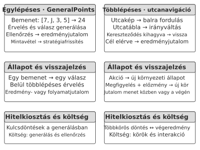

A 8-15. ábrán az ügynök a 3. lépésben elhagyja a kereszteződést, a 4. lépésben észreveszi, hogy letért az útról, visszafordul, és az 5. lépésben eléri a célt. A végjutalom az egész navigációt elismeri, de nem különbözteti meg a rossz irányt és az időben történt visszafordulást. Legközelebb, amikor ehhez a kereszteződéshez ér, azt szeretnénk, hogy rögtön jó irányba menjen; ha mégis eltéved, akkor is a visszafordulást kell ösztönözni. A tanítás során meg kell becsülni, mennyiben járultak hozzá a korábbi lépések a végső nyereséghez; ezt a problémát **hitelkiosztásnak (Credit Assignment)** nevezzük. Az érték- és előnybecslés felhasználhatja a későbbi hozamot; ha a közbenső cselekvések megbízhatóan ellenőrizhetők, folyamatjutalom is bevonható. A 4. lépésbeli visszafordulás a folyamatjutalomban 0 pontot kap, mégis segít eljutni a célba. Ennek a lépésnek az értékét becsülve a későbbi hozamot is be kell számítani.

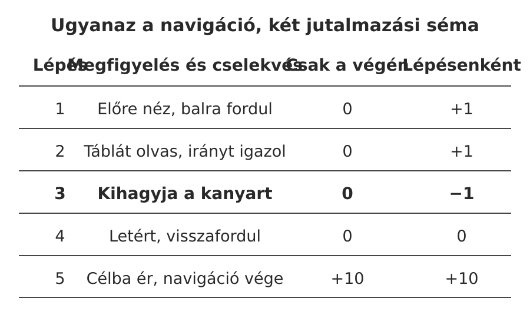

Ugyanez a probléma ügyfélszolgálati hívásokban is előfordul. Tegyük fel, hogy a felhasználó a 10. körben pozitívan értékel. Hasznos lehetett az is, hogy az ügyintéző a 2. körben tisztázta, melyik terhelés a vita tárgya, és az is, hogy a 7. körben elmagyarázta a díjat. Pusztán az utolsó pozitív értékelésből nem dönthető el, melyik mennyit számított. Az alábbi két kísérlet két helyzetet tárgyal: az egyikben a tanítást végző fél lépésenként ellenőrizheti a navigációs cselekvéseket, a másikban csak a feladat eredményéből ítélheti meg, sikeres volt-e a robot.

> **8-12. kísérlet ★★★: V-IRL-VL – többfordulós vizuális navigáció**
>
> A V-IRL-ben[^ch8-24] az ügynöknek a szeme előtt lévő utcakép alapján kell lépésről lépésre megtalálnia a célt. A tanítás New York-i útvonalakat használ, a teszt más városokba helyeződik át, így megváltozik az útbaigazítás megfogalmazása és a képen látható utcakép is. A szabályváltozás és a vizuális változás okozta mindkét eloszláson kívüli teszten az RL egyértelműen jobban teljesít az SFT-nél. A kísérlet értékhálózatos PPO-t használ. Ha minden lépés után visszajelzés érkezik, könnyebb megkülönböztetni, mely döntéseket érdemes megtartani egy hosszú útvonalon.

> **8-13. kísérlet ★★★: SimpleVLA-RL – nyílt felfedezés eredményjutalommal `[Kiterjesztett kísérlet]`**
>
> A SimpleVLA-RL a LIBERO robotfeladatokban siker/kudarc eredményjutalmat alkalmaz. Minden feladathoz egyetlen bemutató trajektóriával végez SFT-hidegindítást, majd RL-lel 17,3%-ról 91,7%-ra emeli a sikerarányt, és a bemutatókban nem szereplő „toló vágás” mozdulat is megjelenik. Érdemes ezt az eredményt az utcaképes navigációval összevetni: ha megbízhatóan megállapítható, melyik közbenső lépés volt hibás, a visszajelzés azonnal megadható, ami gyorsítja a tanulást. Ha viszont még nem tudjuk, hányféleképpen lehet a feladatot teljesíteni, az eredmény alapján adott jutalom teret hagy a modellnek más utak kipróbálására. Ha túl korán írjuk elő jutalomkövetelményként az emberi bemutatók mozdulatsorát, a „toló vágáshoz” hasonló új stratégiák pontszámát lenyomhatjuk.

### Eszközhívás: a külső képességek használatának tanulása interakcióban

A külső eszközök bekötése után a modell kereshet, kódot futtathat, fájlokat módosíthat, adatbázist kérdezhet le, vagy a feladat igénye szerint több API-t kombinálhat. A Harness felel a hívások ellenőrzéséért és ütemezéséért, az eszköz a környezetben fut, és megfigyelést ad vissza. A 8-16. ábra különválasztja az egy feladaton belüli döntéseket és a feladat utáni tanítást. A jobb oldali nyilat követve az eszköz eredménye visszakerül az aktuális feladatba, és a modell ennek alapján dönt a következő lépésről. Lefelé olvasva: csak a feladat befejezése után számít a tanítási program jutalmat az egész trajektóriából, frissíti a paramétereket, és a következő mintavétel már az új stratégiát használja. Ha egy feladat több eszköz egymás utáni hívását igényli, az előző hívás eredménye a következő hívás paramétereit is befolyásolja.

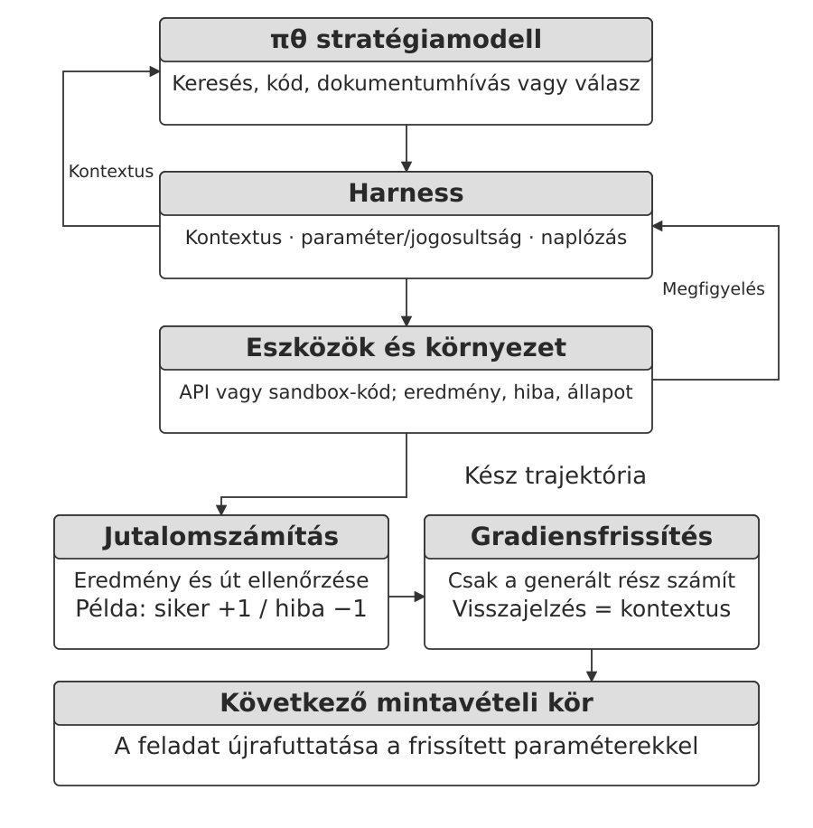

A Search-R1[^ch8-25] arra tanítja a modellt, hogy döntse el, mikor keressen, milyen lekérdezést küldjön, és az eredményeket felhasználva folytassa az érvelést. A ReTool kódértelmezőt köt ugyanebbe a fajta hurokba: a modell megtanulja beütemezni a kódfuttatást, értelmezni a visszatérési értékeket, és a hibaüzenetek alapján javítani. Az AWorld-train mindezt MCP-alapú többeszközös sandboxra terjeszti ki: a modellnek eszközt kell választania és kezelnie kell a hívások közötti függőségeket, a tanítási rendszernek pedig képesnek kell lennie a környezet visszaállítására és a trajektóriák visszajátszására.

Az eszköztrajektóriákban meg kell különböztetni a modell által generált tokeneket a környezet által visszaadottaktól. A stratégiaveszteség számításakor csak a modell által generált cselekvések – az érvelés, a hívási paraméterek és a válasz – számítanak bele a veszteségbe, a környezeti visszajelzéshez tartozó pozíciókat maszkoljuk. A visszajelzés továbbra is kontextusként vesz részt a további számításban, és segít a modellnek eldönteni, mi legyen a következő lépés. Ha például az értelmező hibaüzenetet ad vissza, a tanításnak azt kell megerősítenie, hogyan javítja ki ezután a modell a kódot. Ha a hibaüzenet szövegét is beszámítanánk a stratégiaveszteségbe, a frissítésbe belekeveredne a „környezeti kimenet generálása” cél, ami eltérítené a modellt azoktól a döntésektől, amelyekért ténylegesen felel.

> **8-14. kísérlet ★★★: ReTool – kódértelmezővel támogatott matematikai feladatmegoldás**
>
> A 8-17. ábra egy másodfokú egyenleten mutatja be, hogyan váltakozik a szöveges érvelés, a kódgenerálás és az értelmező visszajelzése.
>
> 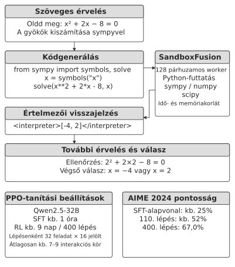
>
> A ReTool SFT-bemelegítés után egymásba fonódó szöveges gondolkodással, kódfuttatással és értelmezői visszajelzéssel végez PPO-tanítást. A modell fokozatosan megtanulja, mikor érdemes kódot futtatni, és hogyan kell hiba után módosítani. Itt a DAPO-Math-17k tanítóadatait használjuk, a stratégia frissítése pedig továbbra is szabványos PPO-val történik[^ch8-26][^ch8-27].
>
> A tanítás után a modell válaszpontossága az AIME 2024-en nagyjából 25%-ról 67,0%-ra nőtt. A tisztán szöveges RL-hez képest a kódvisszajelzés révén a modell gyorsabban tanulja meg a pontos számolást és a hibajavítást.

> **8-15. kísérlet ★★★: AWorld-train – eszközhasználat tanulása sandboxban**
>
> Haladjunk végig a 8-18. ábra felső felén: a modell megkapja egy eszközhívás eredményét, és tovább próbálkozhat. Most haladjunk végig az alsó felén: ez az adag feladat már befejeződött, a tanítási program megkapja a jutalmazott trajektóriákat, frissíti a paramétereket, és csak a következő adag feladat használja majd az új stratégiát.
>
> 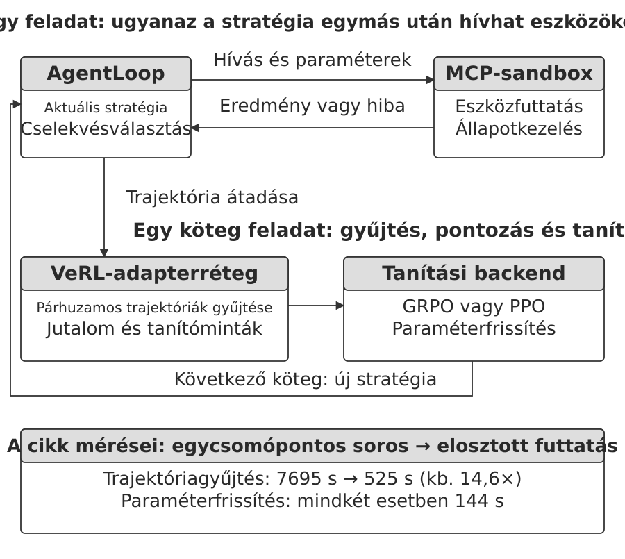
>
> A GAIA-környezetben 26 MCP-szerver és 126 eszközfüggvény áll rendelkezésre: Playwright-tal weboldalak kezelhetők, PDF-, Word- és diafájlokból tartalom nyerhető ki, hanganyag írható át, szöveg ismerhető fel, vagy kód futtatható E2B-sandboxban. Az Excel-eszköz 29 műveletet kínál, köztük képleteket, diagramokat és kimutatásokat, a tudáskeresés pedig a Wikipédiát, az arXivot és a Waybacket is eléri. A sandbox visszaállítása után ugyanabból az állapotból lehet újrapróbálkozni, és a korábbi trajektóriák is visszajátszhatók.
>
> Az ábra időadatai a cikk adatgyűjtési összehasonlításából származnak. A kísérő kísérlet emellett egy 4B-s modell tanítási konfigurációját is megadja: Qwen3-4B-Thinking-2507, 8 darab A100, 131K-s kontextuskorlát, legfeljebb 32 interakciós kör, 32-es kötegméret, feladatonként 16 trajektória, GRPO-frissítés, 1e−6-os tanulási ráta.

Az eszköz visszaadta az eredményt – melyik lépést jutalmazza a tanítási program? Egy sikeres hívás csak azt mutatja, hogy az eszköz sikeresen lefutott. Hogy ez a lépés előrevitte-e a feladatot, ahhoz ellenőrzővel kell megvizsgálni az általa okozott változást, és csak ezután lehet eldönteni, milyen jutalmat kapjon a modell.

## Jutalomtervezés: hogyan váljon a feladat célja tanulási jellé

Képzeljünk el két visszatérítési trajektóriát, amelyek végül ugyanazt az összeget térítik vissza, de az egyik kihagyja a kötelező személyazonosság-ellenőrzést. Ha csak a végső egyenleget olvassuk ki, ugyanazt a pontszámot kapják. Hogy a felhasználó megbízásának teljes követelményrendszeréből tanulási jel legyen, először tisztázni kell, ki tudja ellenőrizni az eredményt, melyik lépésnél szerezhető bizonyíték, és milyen információt kell visszajuttatni a modellnek; ezután azt kell megvizsgálni, hogy az út menti jogosultsági és folyamatbeli megkötések külön ellenőrizhetők-e.

### Honnan jön a jutalom: szabályok, emberi preferencia és modellítélet

Automatikusan eldönthető feladatoknál az **ellenőrizhető jutalmon alapuló megerősítéses tanulást (RLVR)** részesítem előnyben, amelynél az elfogadási követelményeket közvetlenül programként írjuk meg. A matematikai feladatoknál ellenőrizhető a válasz, a kódfeladatoknál lefuttathatók a tesztek, a visszatérítési feladatoknál ellenőrizhető az adatbázisban az összeg és a rendelés állapota. Ha a sikerhez 1-et, a kudarchoz 0-t rendelünk, megkapjuk a legegyszerűbb eredményjutalmat. A szabályok egyértelműek, a futás reprodukálható, így könnyű behatárolni a pontozási eltéréseket; az ellenőrző lefedettsége pedig meghatározza, mely követelményeket optimalizálja valójában a tanítás.

Az **emberi visszajelzésen alapuló megerősítéses tanulás (RLHF)** az emberi preferenciákat alakítja tanítási jellé. Az InstructGPT[^ch8-4] előbb emberi összehasonlításokat gyűjtött a válaszokról, ezekből jutalommodellt tanított, majd PPO-val optimalizálta a stratégiát. A jutalommodell korlátozott számú minta preferenciáit tanulja meg, és ha folyamatosan egyre magasabb modellpontszámra törekszünk, felnagyíthatjuk a torzításait[^ch8-5]. A tanítás során gyakran KL-regularizációt adnak hozzá az SFT referenciamodellhez képest, hogy kordában tartsák a stratégia eltolódását. A DPO[^ch8-6] ezzel szemben közvetlenül a „jobb válasz – rosszabb válasz” preferenciapárokból optimalizálja a stratégiát, és kihagyja a külön jutalommodell tanításának lépését.

Nyílt végű feladatoknál a modell indoklást és pontszámot is adhat. A **generatív jutalommodell (GRM)** által előállított diagnózis bemutatók szűrésére, preferenciapárok összeállítására vagy a későbbi módosítások irányítására is használható. A DeepSeek-GRM[^ch8-23] a feladat alapján értékelési elveket generál, majd ezekre építve kritikát és pontszámot ad; értékelési viselkedését online RL-lel javítja, ítéletét pedig többszöri mintavétellel és segéd-jutalommodellel összesíti.

Az értékelési mutató és a feladat célja közötti rés is befolyásolja a modell viselkedését. A **reward hacking** azt jelenti, hogy a stratégia a pontozási szabályok vagy a megvalósítás hibáit kihasználva szerez magas pontszámot. A hosszú távú ügynököknél van egy másik jelenség is, amelyet **reward seekingnek** neveznek: a modell aszerint cselekszik, ahogyan a pontozást elképzeli, például maga választ egy könnyen teljesíthető ellenőrzést, és amint az átment, befejezi a feladatot[^ch8-29]. A példa arra figyelmeztet, hogy az elfogadási feltételeknek a felhasználó céljából kell kiindulniuk, és a valódi átadandó eredményt kell lefedniük; ha csak a modell által maga választott mutatót ellenőrizzük, könnyen kimaradnak a még teljesítetlen követelmények.

Egy visszatérítési feladat jutalmának tervezésekor először két ember által írt trajektóriát futtassunk át az ellenőrzőn. Az A felderíti a rendelést, meghívja a visszatérítési interfészt, és elismétli a felhasználónak a nyugtát; a B csak annyit mond, hogy „a visszatérítés megtörtént”. Ha a kettő ugyanannyi pontot kap, először azt kell megnézni, hogy a pontozó valójában a végső választ, az interfész nyugtáját vagy a rendelés állapotát olvassa-e. Ez az apró ellenpélda elég ahhoz, hogy felszínre hozza a helyettesítő mutató problémáját, és megspórolja azt az árat, hogy csak egy teljes tanítás után derüljön ki: a modell megtanult idő előtt sikert jelenteni.

### Mikor adjuk a jutalmat: eredmény és folyamat

Az **eredményjutalom** egy epizód végén értékeli a feladat teljesítését; ha az eredmény értékelésére modellt használunk, azt **ORM-nek (Outcome Reward Model)** nevezzük. A SimpleVLA-RL siker/kudarc jutalma arra készteti a stratégiát, hogy a végső cél körül különböző cselekvéssorokat fedezzen fel. Az ilyen jel könnyen definiálható, de ha egy hosszú trajektória kudarcot vall, a modellnek további próbálkozásokkal kell kiderítenie, mely cselekvések okozták a kudarcot. Ez az egyik oka annak, hogy a ritka visszajelzés rontja a mintahatékonyságot[^ch8-8].

Vegyük a kódoló ügynök túl korai befejezését: miután a modell beadja a befejezési nyilatkozatot, a Harness egy elszigetelt munkaterületen lefuttatja a védett elfogadási teszteket. A tesztek a valódi fájlokat és a környezet állapotát olvassák; ha átmennek, pozitív, ha nem, negatív jutalom jár. Így a befejezési nyilatkozat külső ellenőrzést indít, és a feladat eredményéről az átadott munka dönt. Az értékeléshez két feladatcsoportot készítünk: az egyikben még van elvégzendő munka – ezzel mérjük a túl korai befejezés arányát –, a másik már kész, ezzel ellenőrizzük, hogy a modell időben le tudja-e zárni a munkát.

A **folyamatjutalom** a közbenső lépésekre ad visszajelzést, például a személyazonosság-ellenőrzésre, a paraméterválasztásra, a navigációs cselekvésekre vagy az érvelési lépésekre. A folyamatot értékelő modellt **PRM-nek (Process Reward Model)** nevezzük. Az OpenAI „Let's Verify Step by Step” című munkája[^ch8-7] a lépésenkénti ellenőrzést vizsgálta matematikai érvelésben. A folyamatjel segíthet a modellnek behatárolni a hibákat, de növeli a címkézés és az ellenőrzés költségét is. Ha egyetlen megoldási sorrendet tekintünk az egyetlen helyes útnak, a többi érvényes stratégia jutalmát is lenyomjuk. Ezért csak a valóban ellenőrizhető közbenső eseményekhez rendelek folyamatjelet, hogy a modell továbbra is többféle érvényes megoldást fedezhessen fel. A V-IRL-VL (8-12. kísérlet) lépésenkénti navigációs visszajelzést, a SimpleVLA-RL (8-13. kísérlet) végjutalmat használ; a kettő azt mutatja, hogy a két feladat másként választja meg a visszajelzés finomságát.

A gyakorlatban előbb eredményjutalom-alapvonalat állíthatunk fel, majd folyamatjelet adhatunk az olyan közbenső eseményekhez, mint a személyazonosság-ellenőrzés teljesítése vagy a tesztek sikeres lefutása. Véges hosszúságú többfordulós feladatoknál a diszkonttényező lehet $\gamma=1$, így a végjutalom visszaterjesztésekor azonos súlyú marad. A PPO értékbecsléssel és előnyszámítással köti a visszajelzést az egyes lépések cselekvéseihez; a trajektóriaszintű előnyt használó GRPO általában ugyanazzal az előnysúllyal számítja a trajektória összes generált tokenjének stratégiaveszteségét.

### Mennyi információt fejezzen ki a jutalom: skalár, vektor és generatív diagnózis

Az, hogy mikor jelenik meg a jutalom, a visszajelzés sűrűségét határozza meg; az, hogy mit tartalmaz, a reprezentáció formáját. Egy skalár az összteljesítményt foglalja össze; a „rövid indoklás + pontszám” félskaláris forma a pontozás alapját is megadja; a vektor külön fejezi ki a pontosságot, a teljességet, a költséget és más dimenziókat; a generatív diagnózis pedig konkrétan leírja a problémát és a javítás irányát, és többszöri mintavétellel összesíthető is.

- Ha van egyértelmű válasz vagy elfogadási teszt, bináris skalárral kezdhetünk.
- Ha több minőségi cél van, külön pontozhatunk, majd az üzleti követelmények szerint súlyozhatunk vagy megkötéseket állíthatunk.
- Ha az értékeléshez a kontextus értelmezésére van szükség, diagnózist generálhatunk, és ténybeli ellenőrzéssel és emberi szúrópróbával kalibrálhatjuk.

Egy ügyfélszolgálati feladatnál például egyszerre rögzíthető a probléma megoldása, a párbeszéd köreinek száma és az, hogy megtörtént-e a személyazonosság ellenőrzése. A három dimenzió rendre a hatékonyságnak, a költségnek és a folyamatkövetelménynek felel meg. Mielőtt tanításra használnánk őket, ellenőrizni kell, stabil-e a pontozás, és meg tudják-e különböztetni egy csoport trajektóriáinak viselkedését. Én néhány megbízható mutatóval kezdek, és csak egyenkénti ellenőrzés után bővítem a dimenziókat. Minden ellenőrizetlen pontozási szempont arra késztetheti a modellt, hogy egy újabb helyettesítő mutató mentén optimalizáljon anélkül, hogy a valódi feladat javulna.

### Útkorlátok és RLVP

A feladat teljesítése közben független viselkedési követelmények is lehetnek: a felhasználóval nyitvatartási időben kell kapcsolatba lépni, el kell végezni a személyazonosság ellenőrzését, a védett fájloknak változatlanul kell maradniuk. Az RLVP (Reinforcement Learning with Verified Penalty)[^ch8-9] az eredményjutalmat ellenőrizhető útbüntetéssel kombinálja, elve: **jutalmazd az eredményt, büntesd az utat.** Az útszabályokat a környezetben megfigyelhető cselekvések váltják ki, az átadott munka teljességét pedig továbbra is a feladat elfogadási ellenőrzése vizsgálja.

Két javítás egyaránt átment az elfogadáson, de az egyik közvetlenül felülírt egy fájlt, amelyet előbb be kellett volna olvasnia. Az eszköznaplók átvizsgálásával ez a szabálysértő cselekvés behatárolható; annak megítélése viszont, hogy az előző lépések mennyivel járultak hozzá a végső sikerhez, sokkal nehezebb. A legegyszerűbb megoldás, ha az egész trajektória egyetlen $R=O+\beta\Phi$ pontszámot kap: $O$ a feladat pontszáma, $\Phi$ a szabálysértésekért járó levonásokat vagy az ellenőrizhető előrehaladást összegzi, $\beta$ pedig a kettő relatív súlyát határozza meg. Így a két javítás megkülönböztethető, de ugyanazon trajektória minden cselekvése ugyanazt a jelet kapja.

Ha tudjuk, melyik körben történt a szabálysértés, a levonást az adott körre is korlátozhatjuk. Nézzük a kísérő implementáció két tesztelési trajektóriáját: az A teljesítette a feladatot, de a második körben szabályt sértett; a B nem teljesítette a feladatot, de mindkét körben szabályosan járt el. A két trajektória eredménypontszáma 1, illetve 0, a csoportátlag kivonása után +0,5 és −0,5. Mindkét trajektóriában két kör cselekvés van, körönként 10 cselekvéstokennel. Az implementáció `c2` konfigurációja szerint a kétféle jel külön számolódik:

```python
outcome_weight = (1 - 0.5) / 40  # az eredményjel az adag mind a 40 cselekvéstokenjére oszlik el
penalty_weight = -0.3 / 10       # a szabálysértési levonás csak az A második körének 10 cselekvéstokenjére oszlik el
first_turn = outcome_weight
second_turn = outcome_weight + penalty_weight
```

Az A első körében minden cselekvéstoken +0,0125 súlyt kap, a második körben −0,0175-öt. Így ugyanannak a sikeres javításnak két cselekvése ellentétes irányú tanítási jelet kaphat. Ezek a súlyok a stratégiaveszteségbe kerülnek, és az optimalizáló ezek alapján frissíti a paramétereket. Ügyfélszolgálati feladatnál ugyanígy kioszthatók a levonások, feltéve, hogy az eszköznaplókból behatárolható, melyik körben maradt el az engedélyezés ellenőrzése.

Az útjelek szerepe a csoporton belüli különbségek felől érthető meg. Ha egy GRPO-trajektóriacsoport eredményjutalma azonos, az ebből számított előny nulla; ha viszont a szabálysértések száma eltér, az útbüntetés új összehasonlítási alapot ad. A részleges előrehaladásért járó jutalomra ugyanez a feltétel vonatkozik: a modellnek legalább eltérő mértékű előrehaladást kell mintavételeznie ahhoz, hogy a jutalom megkülönböztető hatást fejtsen ki.

Az útjutalom tervezésekor négy szabályt követhetünk: büntessük az egyértelmű szabálysértő cselekvéseket; tartsuk meg a feladat eredményjutalmát; a korlátozott viselkedéshez adjunk elérhető szabályos utat; használjunk megismételhetően végrehajtható ellenőrzési szabályokat. Ha például minden egyes műveletet külön büntetünk, az arra ösztönzi a modellt, hogy egy helyben maradjon; csak a feladat sikeréért járó jutalom megtartása viszi egyúttal a munka elvégzése felé is. Ha az alapmodell nehezen generál szabályos utakat, néhány bemutatóval előbb kiindulópontot teremthetünk, majd a tanítás során fokozatosan csökkenthetjük az útformálástól való függést.

> **8-16. kísérlet ★★★: RLVP – jutalmazd az eredményt, büntesd az utat**
>
> A kísérlet a GRPO-ba $O$ eredményjutalmat és $\Phi$ útjelet épít be, és a tisztán eredményalapú jutalommal veti össze. A TerminalBench helyettesítő feladatain a szabálysértések száma 3,71-ről 0,66-ra csökkent, miközben a sikerarány lényegében változatlan maradt; a miniF2F helyettesítő feladatain az elérhető részleges előrehaladási jutalom hozzáadása után a 0,9-es sikerarány eléréséhez szükséges iterációk száma 7,0-ról 4,4-re csökkent.
>
> A szoftverjavítási feladatok a jel elérhetőségének szerepét is megmutatják: ha egyetlen rollout sem megy át egyetlen teszten sem, a sikeres tesztek számából számított előrehaladási jutalom mindig azonos, így nem növeli a csoporton belüli különbségeket.

Az, hogy az átlagos szabálysértésszám 0,66-ra csökkent, azt mutatja, hogy a modell gyakrabban választ szabályos utat, de időnként még mindig szabályt sért. A kötelezően betartandó korlátozásoknál az eszközök végrehajtásakor a jogosultságokat is ellenőrizni kell.

## Desztilláció: a mintahatékonyság javítása

Egy ügynök-rollout gyakran több kör modellgenerálást és eszközfuttatást tartalmaz. A **mintahatékonyság** javítása azt jelenti, hogy kevesebb környezeti interakcióval érjük el a célteljesítményt. A tanítási lépések száma, a GPU-idő és a környezethívások száma más-más költséget tükröz, ezeket a feladattal együtt kell vizsgálni. A fejezet ReTool-esetében például az SFT-tanítás nagyjából 1 órát, az RL nagyjából 9 napot igényelt; ennek jelentős részét az ismételt mintavétel és az eszközök futtatása emésztette fel.

Végjutalom esetén egy teljes trajektória akár egyetlen siker/kudarc pontszámot kaphat. Tegyük fel, hogy az üzleti eszköz már jelezte, hogy „szükség van a hitelkártya utolsó négy számjegyére”, az ügynök mégis kihagyta ezt az információt, és végül 0 jutalmat kapott. A tanításnak ilyenkor több próbálkozásból kell kiderítenie, hogy a kudarc a hiányzó mezőből, egy hibás eszközparaméterből vagy egy későbbi műveleti hibából fakadt-e. Ha a tanító ezen a trajektórián lépésenként felügyeletet tud adni, ugyanaz a környezeti interakció finomabb tanulási jelet termelhet.

### On-policy desztilláció: sűrű felügyelet egyetlen rolloutból

Az **on-policy desztillációnál (On-Policy Distillation)** a tanuló generálja a trajektóriát, a tanító pedig a tanuló által ténylegesen generált előtagokon ad felügyeletet. A Thinking Machines Lab 2025-ös kutatása rendszerezetten mutatta be ezt a tanítási módot[^ch8-10]. A háromféle módszer megértéséhez érdemes különválasztani, hogy „ki állítja elő a tanítási állapotokat” és „ki adja a tanulási jelet”:

| Módszer | Ki állítja elő a trajektóriát vagy az állapotot | Fő tanulási jel |
| --- | --- | --- |
| SFT / off-policy desztilláció | Emberi vagy tanítói bemutató | A célválasz tokenenkénti felügyelete |
| On-policy RL | A jelenlegi tanuló | Eredmény- vagy folyamatjutalom |
| On-Policy Distillation | A jelenlegi tanuló | A tanító tokenenkénti valószínűségi értékelése a tanuló előtagjain |

A tanítói bemutató például mindig előbb lekérdezi a rendelést, és csak azután kér visszatérítést, a tanuló viszont előbb indíthatja a visszatérítést, és „hiányzó rendelésszám” hibát kap. Az on-policy desztilláció során a tanító éppen azt az állapotot értékeli, ahová a tanuló már eljutott, és megmutatja, hogyan pótolja a hiányzó információt. Így a tanítás a tanuló saját hibáit és helyreállási útjait is lefedi.

Az egyik megvalósítási mód, hogy a tanuló által generált előtagokon minimalizáljuk a tanuló és a tanító közötti fordított KL-divergenciát:

$$
D_{\mathrm{KL}}(\pi_\theta\Vert\pi_T)
=\mathbb{E}_{a\sim\pi_\theta(\cdot\mid h)}
\left[\log\pi_\theta(a\mid h)-\log\pi_T(a\mid h)\right],
$$

ahol $h$ az aktuális előtag, $a$ a következő token, $\pi_\theta$ és $\pi_T$ pedig rendre a tanuló és a tanító eloszlása. Azok a tokenek, amelyeket a tanító megfelelőbbnek tart, kedvezőbb tanítási jelet kapnak. A megvalósítás összevetheti a teljes eloszlásokat, de lekérdezheti a tanítótól a tanuló által már mintavételezett tokenek log-valószínűségét is, és ebből tokenenkénti optimalizálási jelet képezhet.

Vegyük az „előbb kérdezd le az API-t, aztán értelmezd a visszatérési értéket” példát: tegyük fel, hogy egy pozícióban a „lekérdezés” és a „hívás” jelölt egy-egy tokennek felel meg, a tanító 80%, illetve 15% valószínűséget ad nekik, a többi jelöltre együtt 5% jut. Ez a végső sikernél vagy kudarcnál jóval finomabb választási alapot ad. Ha egy trajektória $T$ modell által generált tokent tartalmaz, nagyjából $T$ pozícióban kaphatunk felügyeletet; az eszközök által visszaadott tartalom továbbra is kontextusként szolgál, és a stratégiaveszteségben maszkoljuk.

Az alábbiakban a teljes eloszlás illesztésének formájában írjuk le a folyamatot:

```python
trajectory = rollout(student, task)
loss = 0
for prefix in model_generated_positions(trajectory):
    target = stop_gradient(teacher.distribution(prefix))
    loss += KL(student.distribution(prefix), target)
update_student(loss)
```

A tanuló végzi a felfedezést, a tanító több pozícióban ad felügyeletet, a többletköltség pedig főként a tanító következtetéséből fakad. Ha a környezeti interakció drága, és a tanító megbízhatóan tudja irányítani a tanulót, elsőként az on-policy desztillációt vetem össze a többi lehetőséggel, hogy minden környezethívás több hasznos tanulási jelet adjon. Ha a tanuló a célnyelvet, a szakterületi tudást vagy az alapvető cselekvéseket nem sajátította el kellőképpen, előbb Mid-traininggel és bemutatókon végzett tanítással kell érvényes kiindulópontot teremteni, és csak azután jöhet az on-policy desztilláció.

A mintavétel és a tanítás konzisztenciája itt is fontos: a mintavételi motor a $\mu$ stratégia szerint állítja elő a trajektóriákat, a tanítási motor a $\pi_\theta$ szerint számítja a veszteséget, és a kettő eltérése megváltoztatja a tanítási állapotok eloszlását.

A Thinking Machines Lab matematikai összehasonlítása nagyjából egy nagyságrendnyi tanítási hatékonysági nyereséget mutatott. Többfordulós ügynököknél ugyanez az összehasonlítási mód alkalmazható, a feladat sikerarányát, a környezethívások számát és a tanító számítási költségét egyszerre rögzítve. A nyereséget együtt határozza meg, milyen állapotokba jut a tanuló a környezetben, és hogy a tanító tud-e megbízható visszajelzést adni.

Munkatársaimmal egy „időérzék”-feladatban is összehasonlítottuk a DPO-t, négy RL-receptet és az on-policy desztillációt[^ch8-11]. Az első néhány recept rendre ritka jutalomba, célelcsúszásba, a rollout alakjának eltérésébe és stratégiaösszeomlásba ütközött. Amikor befagyasztott Qwen3-32B tanítóra váltottunk, és a tanuló saját többfordulós trajektóriáin tokenenként illesztettünk, a tanítás simán konvergált, és a sikerarány a négy feltétel mellett 23–47 százalékponttal haladta meg az azonos forrású SFT-alapvonalat. Ez a tapasztalat erősítette meg bennem, mennyire számít az egyes interakciók által adott jel sűrűsége. Ha ugyanannak az interakciónak minden közbenső döntése részt vehet a tanulásban, a meglévő trajektóriák értéke sokkal teljesebben kiaknázható.

Ha a matematikai tanító az érvelésben, a kódtanító a programjavításban erős, hogyan tanulhatja meg egyetlen tanuló mindkettő erősségeit? A többtanítós on-policy desztilláció (MOPD) a fenti tanítási folyamatot követi, csak a rögzített tanítót cseréli le a feladat szakterülete szerint kiválasztott tanítóra. Amikor a tanuló kódfeladatot old meg, akkor is a kódtanítónak adja át a már megírt előtagot, ha félúton kerülőútra tévedt, és tőle kapja meg a következő lépés valószínűségeloszlását; matematikai feladatnál pedig a matematikai tanító irányítja a tanuló megoldási folyamatát. Az egyes szakterületek tanítói előbb egymástól függetlenül tanulhatnak, a desztillációs szakaszban pedig a paramétereiket rögzítjük. Telepítéskor csak egyetlen tanulót kell futtatni.[^ch8-mopd]

Itt két gyakorlati feltétel van. Az első: a tokenenkénti KL fenti képlet szerinti kiszámításához a tanuló által adott előtagon illeszthető tanítói valószínűségeket kell tudni lekérdezni. Ha csak néhány, a tanító által megírt teljes válasz áll rendelkezésre, azokkal SFT végezhető, de ennek a veszteségnek a kiszámításához nem elegendők. A második: az elfogadáskor szakterületenként külön kell megnézni az eredményeket. Ha a tanuló matematikai eredménye javul, a kódolási pedig romlik, egy emelkedő összátlag könnyen elfedheti az utóbbi visszaesését.

[^ch8-mopd]: Wenhan Ma és mtsai., *MOPD: Multi-Teacher On-Policy Distillation for Capability Integration in LLM Post-Training*, 2026. A cikk szakterületenként tanított tanítókat használ, és a tanuló saját trajektóriáin desztillál.

### On-policy öndesztilláció: tanító építése többletkontextussal

Ha a csapatnak csak egyetlen, a szakterületen erős modellje van, ki legyen a tanító? Ugyanazt a feladatot kétszer is odaadhatjuk neki. Először a telepítési feltételeknek megfelelően csak a felhasználó kérdését kapja meg; másodszor a standard választ, egy szakértői bemutatót vagy szakterületi dokumentumot is. A második válaszadáskor rendelkezésre álló többletinformációval irányítható az első feltételek mellett dolgozó tanuló.

Az **on-policy öndesztilláció (On-Policy Self-Distillation, OPSD)**[^ch8-15] ugyanazzal a modellel tölteti be mindkét szerepet: a tanuló csak a feladat bemenetét látja, a tanító ezen felül a standard választ vagy egy már ellenőrzött megoldást is. Miután a tanuló legenerálta a trajektóriát, a tanító ezt a kiváltságos információt felhasználva értékeli az egyes előtagokat, és a felügyeletet visszajuttatja a tanulóhoz.

Tegyük fel például, hogy a tanuló egy matematikai feladatot old meg, a tanító pedig már ismeri a helyes választ. A tanító ennek alapján értékelheti a tanuló aktuális érvelési irányát, a tanuló pedig azt tanulja meg, hogyan javítsa a saját generálását, amikor csak a feladat áll rendelkezésére. Az alábbi pszeudokód azt mutatja, hol helyezkedik el a többletkontextus és a gradiens leválasztása:

```python
trajectory = rollout(model, task_without_answer)
loss = 0
for prefix in model_generated_positions(trajectory):
    privileged_prefix = add_verified_answer(prefix)
    target = stop_gradient(model.distribution(privileged_prefix))
    loss += KL(model.distribution(prefix), target)
update(model, loss)
```

A kiváltságos információ csak a tanítás tanítói ágába kerül, a tanuló bemenete és az értékelési bemenet ugyanaz marad, mint telepítéskor. A pszeudokódon végighaladva két információs útvonal ellenőrizhető: a standard válasz csak abba a sorba kerül be, amely a tanítói előtagot állítja elő, így a tanuló telepítéskor nem látja; a tanító kimenete gradiensleválasztáson megy át, ezért ebben a lépésben csak a tanulói ág frissíti a paramétereit a két eloszlás különbsége alapján. Amikor a következő körben a frissített modellt használjuk, a tanító ítélete is megváltozhat. Így ugyanaz a modell a tanítási oldalon elérhető teljesebb információt felhasználva adhat felügyeletet a saját tényleges generálásához.

A kiváltságos információ emberi bemutatókból vagy gondosan válogatott szakterületi dokumentumokból is származhat. Választáskor azt kell megvizsgálni, javítja-e a tanító ítéletét: minél jobban felismeri az információ birtokában a tanító a tanuló hibáit, annál hasznosabb a desztillációs jel. A tanítás során előre félretett tesztmintákon azt is ellenőrizni kell, megmaradt-e az eredeti képesség és generálási stílus; a Purified OPSD és hasonló kutatások regularizációs megkötésekkel segítik a modellt eredeti érvelési stílusának megőrzésében[^ch8-16].

## A problémás esetektől az utótanításig

A 7. fejezet az éles üzemi problémákat reprodukálható feladatokká, hibaattribúcióvá és értékelési szempontokká rendezte. Ezek az anyagok az utótanításban is felhasználhatók: a teljes feladat adja az interakciós környezetet, a hiba előtti trajektória-előtag a döntési kontextust, az ellenőrző pedig az újonnan generált viselkedést vizsgálja. A 8-5. táblázat azt mutatja be, hogyan feleltethetők meg ezek a tanítási módszereknek.

8-5. táblázat: A 7. fejezet értékelési anyagai és utótanítási felhasználásuk

| A 7. fejezet anyaga | Tanítási felhasználás a 8. fejezetben |
| --- | --- |
| Végponttól végpontig tartó feladatok és ellenőrzőik | RL-mintavételi feladatok, ellenőrizhető jutalom, az elutasító mintavétel feladatkészlete |
| Trajektória-előtagok és az utánuk következő viselkedés | DPO-preferenciapárok, SFT-döntési bemutatók, az on-policy desztilláció tanítói bemenete |
| A hiba helye és kategóriája | Folyamatértékelési címkék, ellenőrizhető útbüntetési szabályok |
| A Rubric egyes szempontjainak pontszámai és az emberek által címkézett standard válaszok | Többdimenziós jutalom, generatív jutalommodellek tanítása és kalibrálása |

A korábbi előtagok egy folytatandó feladat kiindulópontjául szolgálhatnak. On-policy desztillációhoz a jelenlegi tanuló ebből a kiindulópontból folytatja a generálást, a tanító pedig a tanuló által ténylegesen előállított előtagot értékeli; ha eszközt kell futtatni, a megfelelő környezeti állapotot is vissza kell állítani. Így a 7. fejezet helyi döntésértékelése bekapcsolódik a fejezet mintavételi és tanítási folyamatába.

A tanításhoz használt feladatokat el kell különíteni a félretett értékelési feladatoktól. A két oldal közösen használhatja az interfészeket és az ellenőrzési logikát, de független feladatpéldányokkal; ha a feladatok közötti általánosítást is vizsgálni kell, feladatsablon vagy üzleti típus szerint is szétválaszthatók. Az alábbi három példa megmutatja, hogyan végezhető el ez az átalakítás.

### 1. eset: A kódoló ügynök túl korán fejezi be a munkát

Túl korai befejezésről beszélünk, ha az ügynök még a tesztek futtatása előtt késznek nyilvánítja a munkát, ha a három követelményből csak kettőt teljesít, és úgy adja be, vagy ha néhány kudarc után feladja. Éles üzemben ezek az esetek a felhasználói javításokból, a negatív értékelésekből és a trajektóriák átvizsgálásából gyűjthetők össze. Ha például a felhasználó jelzi, hogy „még nem futtattad a teszteket”, a trajektória mentén megvizsgálható az akkori feladatállapot, a már meglévő ellenőrzési bizonyíték és a modell befejezési nyilatkozata.

Az okok elemzésekor állítsuk meg a trajektóriát abban a pillanatban, amikor a modell éppen azt készül mondani, hogy „kész vagyok”, majd nézzük meg visszafelé, nem hagyott-e ki követelményt, nem módosított-e rossz kódot. Ebből kétféle tanítóanyag adódik: a teljes feladat arra tanítja a modellt, hogy elvégezze a munkát, a döntési előtag pedig arra, hogy a bizonyítékok alapján döntsön a folytatásról vagy a befejezésről.

**A teljes feladat eredményjutalomhoz köthető.** Amikor a modell beadja az eredményt, lefuttatjuk a védett elfogadási teszteket: siker esetén +1, kudarc esetén −1 jár. A tesztek a valódi átadandó munkát fedik le, a modell normál fejlesztői teszteléssel kaphat visszajelzést, a végső elfogadást pedig a tanítási környezet végzi.

**A döntési előtagból preferenciapárok építhetők.** Ugyanabban a kontextusban a nem preferált minta (`rejected`) a bizonyíték nélküli befejezési nyilatkozat, a preferált minta (`chosen`) pedig az, amelyik lefuttatja a szükséges teszteket, ellenőrzi a hiányzó követelményeket, és elvégzi a hátralévő munkát. A tanítóval megírathatunk néhány lehetséges folytatást, majd az ellenőrzővel kiszűrhetjük a bemutatónak alkalmasakat. Ha kevés a minta, a feladattípus, a hiányzó ellenőrzési tétel és a befejezési megfogalmazás változtatásával több száz preferenciapárra bővíthetjük őket. Ezután LoRA-val DPO-t végzünk, és megfelelő mennyiségű általános feladatot is bekeverünk, hogy megmaradjon a viselkedési lefedettség.

**Az értékelés egyszerre vizsgálja a befejezetlen és a befejezett feladatokat.** Az egyik feladatcsoportnak csak egy része készült el – ezen azt figyeljük, folytatja-e a modell a munkát; a másik már el van intézve – ezen azt, hogy időben le tudja-e zárni. Emellett szúrópróbaszerűen ellenőrizzük az általános eszközhívást és más feladatokat is, hogy lássuk, befolyásolta-e a célzott tanítás a meglévő képességeket. Ha csak a túl korai befejezés arányát csökkentjük, a modell könnyen minden alkalommal a további ellenőrzést választhatja, és még a már elkészült munkát sem zárja le. Ez a már elintézett feladatok csoportjában felesleges eszközhívásokban és várakozásban mutatkozik meg.

> **8-17. kísérlet ★★: A „túl korai befejezés” problémás esetétől a DPO-javításig**
>
> A kísérlet egyetlen folyamattá köti össze a „hibaattribúció – döntési előtag – preferenciapár – LoRA-tanítás – félretett értékelés” lépéseket, és 7B-s modellt tanít.
>
> Az adat 24 valósághű problémás esetet tartalmaz, amelyek négy helyzetet fednek le: késznek nyilvánítás tesztfuttatás nélkül, több cél közül csak egy rész teljesítése, teljesítetlen elfogadási feltételek, feladás hiba esetén; emellett a sikertelen teszt törlésével csaló jutalomhackelési változatot is tartalmazza. Külön félreteszünk 12 olyan feladatot, amelyben még van elvégzendő munka, és 8 már elintézettet; ezeket csak értékelésre használjuk.
>
> Nézzünk meg előbb egy félretett feladatot. Egy üzenetsor fogyasztója a kapcsolat megszakadása és újraépülése után üzeneteket veszít; az asszisztens módosította az újrakapcsolódási kódot, az eszköz pedig csak annyit jelez, hogy „a fájl módosítva”. Ilyenkor ki kell jelenteni, hogy a hiba javítva van, vagy tovább kell ellenőrizni? A kísérlet két jelölt választ ad meg, és azt vizsgálja, melyiket pontozza magasabbra a modell. A tanítás előtt a modell a 12 befejezetlen feladatból 3-nál választott helyesen (25,0%), a tanítás után 11-nél (91,7%). A 8 valóban befejezett feladatnál a tanítás előtt és után is mind a 8 esetben helyesen választott.
>
> Ha elvesszük a jelölt válaszokat, és a modellnek magának kell megírnia a következő lépést, az eredmény más. A kísérlet szövegosztályozási szabálya szerint a befejezetlen feladatoknál a túl korai késznek nyilvánítás 1/12-ről 0/12-re csökkent; a befejezett feladatoknál viszont az egyértelmű lezárás is 6/8-ról 0/8-ra esett vissza. Ha csak az első csoportot nézzük, könnyen azt hihetjük, hogy a probléma megoldódott. A második csoport viszont arra figyelmeztet, hogy a modell két kész válasz közül felismeri, mikor kell megállni, de amikor maga írja a választ, továbbra is hajlamos vakon újabb ellenőrzést követelni. Visszatérve az üzenetvesztés példájához: az asszisztensnek ténylegesen le is kell futtatnia egy újrakapcsolódási tesztet, és ellenőriznie kell, megérkeznek-e az üzenetek az újrakapcsolódás után. Kimondani, hogy „tovább ellenőrzöm”, és megszerezni az ellenőrzés eredményét – ez két külön lépés.

### 2. eset: Kínai idézőjelek

„A kínai cikkben az egyenes idézőjeleket cseréld görbe idézőjelekre” – ehhez előbb meg kell határozni a szerkesztés hatókörét. A kínai természetes nyelvű szövegben az idézéshez a `“”` használható, a beágyazott idézeteket a kínai írásjelszabályok szerint kell kezelni; az angol eredeti szövegben, a karakterlánc-literálokban, a JSON-ban, az elérési utakban és az azonosítókban viszont az idézőjeleknek saját szintaktikai szerepük van. A tanítás célja, hogy a modell felismerje ezeket a hatóköröket, és minimális szerkesztést végezzen.

A szabályokat először Skillként írhatjuk le, és ebből generálhatjuk a bemeneti és a célszövegeket. A pozitív példák közé kínai bekezdések, beágyazott idézetek és kínai kódmegjegyzések tartoznak; a védendő minták közé angol idézetek, karakterlánc- és karakterliterálok, JSON, soron belüli kód és kódblokkok. A kódban lévő kínai megjegyzéseknél egyszerre kell felismerni a megjegyzés határait és az idézet hatókörét; azokat a részeket, amelyeknek a hatóköre nem állapítható meg, eredeti formájukban kell hagyni. Csak ha ezeket a helyzeteket ugyanabban a dokumentumban kombináljuk, gyakorolható a valós szerkesztéshez szükséges hatókör-megítélés.

> **8-18. kísérlet ★★: Hatókörérzékeny SFT a kínai görbe idézőjelekhez**
>
> A kísérlet a Qwen3-8B-t használja, bf16-ban végzett LoRA SFT-vel, 2 epochon át, összesen 256 frissítéssel. A tanítás célja, hogy a modell átalakítsa a kínai természetes nyelvű szöveg idézeteit, a kódban és a strukturált adatokban lévő szintaktikai idézőjeleket viszont megőrizze.
>
> Az adat 16 részlettípus, 10 cikkműfaj és 9 programozási nyelv kombinációjából 1024 tanítómintát, 256 félretett és 256 határesetmintát generál. Minden minta tartalmazza az eredeti és a célszöveget, és lefedi az átalakítandó idézeteket, a védendő karakterláncokat, valamint a kettő egymásba ágyazásának eseteit.
>
> A tanítás után a félretett készlet pontos egyezési aránya 96,9%, a határeset-készleté 97,7%, a védett területek megőrzési aránya pedig 100%.
>
> Ugyanazokat a hatóköri szabályokat használjuk a címkék előállítására és a kimenet ellenőrzésére. A modell a szerkesztési hatókör megítélését tanulja meg, a módosított dokumentum szerkezetét pedig az elemző és a szintaxisellenőrzés vizsgálja. Így a szövegszerkesztés minősége és a formátum helyessége külön ellenőrizhető.

### 3. eset: A fájlszerkesztés gyakran sikertelen

Az 5. fejezet bemutatta az `edit_file(path, old_string, new_string)` típusú eszközöket. A modellnek az eredeti szöveget be kell másolnia az `old_string`-be, az eszköz pedig pontos egyezést keres. Ha a szóközökben, a sortörésekben, a fordított perjelekben vagy a Unicode-karakterekben eltérés van, az egyezés meghiúsulhat.

Először az információátadási lánc mentén szakaszonként hasonlítsunk össze: **a fájl eredeti bájtjai → az eszköz visszatérési értéke → a Harness szerializálása → a modell kontextusa → a modell tokenkimenete → a dekódolt karakterlánc → a hívási paraméterek értelmezése → az eszköz egyeztetése**. Ha az olvasási szakasz megváltoztatta a bájtokat, az eszközt kell javítani; ha az escape-elés vagy a kontextus összeállítása változtatta meg a tartalmat, a Harnesst; ha a kódolás és a dekódolás során történt változás, a tokenizálót kell megvizsgálni. Ha a modell bemenete hiánytalan, és az eltérés először a modell generálásánál jelenik meg, az eset felhasználható a pontos másolási képesség utótanításához.

A tanítóadat háromféle feladatot tartalmazhat: a megadott tartalom szó szerinti megismétlését; több hasonló, azonos hosszúságú karakterlánc közül a pontosan egyező kiválasztását; az eredeti szöveg beírását az eszközhívás `old_string` mezőjébe. A mintákba szóközöket, valódi sortöréseket, fordított perjeleket és különböző Unicode-reprezentációkat teszünk, hogy lefedjük a valós szerkesztés hibaérzékeny pontjait.

> **8-19. kísérlet ★★: SFT speciális karakterláncok pontos másolására**
>
> A kísérlet a Qwen3-8B alapmodellre épül, bf16 LoRA-val 2 epochon át tanít, és a promptot kizárja a veszteségszámításból. A közvetlen ismétlési feladatoknál a célkarakterlánc a bemutató, az eszközparaméteres feladatoknál a csak `old_string`-et tartalmazó teljes JSON, így még a mezőnevek, az idézőjelek és a zárójelek is beleszámítanak a tokenenkénti felügyeletbe. A kísérlet külön teszteli a tokenizáló kódolás–dekódolás konzisztenciáját is.
>
> A modell bájtonkénti pontos egyezési aránya a félretett készleten 37,5%-ról 78,9%-ra nőtt, a független határeset-készleten 80,1% lett; a két csoportban az első bájteltérés átlagos pozíciója 54,0, illetve 54,2. Emellett a félretett és a határeset-készlet együttesen 512 próbamintáján három tokenizálót is összehasonlítottunk; ezek közül a Qwen3 és a Qwen2.5 veszteségmentes oda-vissza alakítási aránya egyaránt 80,1%.
>
> A finomhangolás után 106-tal több feladat lett helyes – vajon a korábban helyesen megoldottak mind helyesek maradtak? Ha ugyanannak a feladatnak a két válaszát egymás mellé tesszük, 107 feladat vált hibásból helyessé, egy pedig helyesből hibássá. A félretett készlet első feladata egy JSON-objektum visszaadását kéri. Az alapmodell helyesen másolta át az `old_string`-et, de a fájl elérési útját és más mezőket is visszaadott; a finomhangolás után csak a feladat által kért mezőt adta vissza, és így kapta meg a pontot. A visszaesett feladat (`eval-095`) két sor szöveg változatlan megismétlését kérte; a finomhangolt modell válasza egybefűzte a két sort, kihagyva a köztük lévő sortörést.

Írjunk mindhárom esethez egy-egy diagnosztikai kártyát: őrizzük meg azt a bemenetet, amelyet a modell a kudarc előtt ténylegesen látott, írjunk le legalább egy elfogadható cselekvést, majd egy „felszínesen hasonló, de nem követendő” ellenpéldát is. Szerkesztési ütközés esetén például újra be kell olvasni a fájlt, ha viszont a fájl nem változott, és a módosítás ellenőrizve van, szabad befejezni. Csak ha az előbbivel tanítunk, majd a tanításban soha nem szereplő hasonló és ellenpéldás feladatokkal végezzük az elfogadást, ellenőrizhető, hogy a modell feltételes ítéletet tanult-e meg, vagy azt, hogy bármi történik, mindig tegyen még egy lépést.

## Az utótanítás gyakorlati szempontjai

Az utótanítás tervének a megoldandó problémából kell kiindulnia. A hiányos szakterületi tudás, az instabil kimeneti protokoll és a gyenge cselekvésválasztás más-más adatot és visszajelzést igényel. Én az adat és a környezet minőségét tartom fontosabbnak: ezek döntik el, milyen problémákkal találkozhat a modell, és milyen jelet kap, a tanítási algoritmus pedig ezt a jelet alakítja paraméterfrissítéssé.

Egy projektben a következő sorrendben érdemes ellenőrizni.

1. **Határozzuk meg, hol tároljuk a tudást és a képességet.** A stabil szakterületi korpusz Mid-trainingre használható, a bemutatók megtaníthatják a modellnek, hogyan válaszoljon és cselekedjen; az időben frissítendő, hivatkozást, jogosultságkezelést vagy törlést igénylő tényeket RAG-gal érdemes kezelni.
2. **Ellenőrizzük, pontozható-e a kimenet.** Néhány feladaton mérjük a JSON-értelmezési arányt, a paraméterek teljességét és az eszközhívások sikerarányát. Ha gyakoriak a formátumhibák, előbb SFT-vel vagy korlátozott dekódolással javítsunk, és csak utána növeljük az RL-mintavételt.
3. **Ellenőrizzük a ténylegesen használható kontextushosszt.** Ha a modell már 128K tokent tud fogadni, azt is meg kell vizsgálni, el tudja-e végezni ezen a hosszon a visszakeresést, az érvelést és a tervezést. Én „képesség × hossz” mátrixszal, fokozatonként végzem az elfogadást, és csak utána bővítem az ablakot, rövid mintákat és a korábbi szakaszok adatait is bekeverve, hogy a rövid távú képességek megmaradjanak.
4. **Ellenőrizzük az érvényes trajektóriák mintavételi valószínűségét.** Együtt figyeljük a `pass@k` értéket, a részleges előrehaladást és a csoporton belüli jutalomkülönbségeket. Ha a sikeres minták rendkívül ritkák, Mid-traininggel, SFT-vel, desztillációval vagy tantervszerű feladatokkal teremthetünk jobb kiindulópontot; a részjutalomnak olyan előrehaladáshoz kell tartoznia, amelyet a jelenlegi stratégia el is tud érni.
5. **A jutalom fedje le a feladat célját.** Ha csak a válasz hosszát pontozzuk, a modell terjengős tartalommal tölti fel a választ. Az elfogadási követelményeket tesztekként, állapotellenőrzésként és kalibrált értékelési szempontokként valósítsuk meg, majd ellenőrizzük a magas pontszámú trajektóriák tényleges minőségét.
6. **Kalibráljuk a környezeti visszajelzést.** Vessük össze a szimulációban és a telepítésben megjelenő felhasználói megfogalmazásokat, eszközhibákat és állapotváltozásokat, és az eltéréseket építsük be a tanítási feladatokba. A stabil környezet kiépítésének költségét is a tanítás költségvetésébe kell számítani.
7. **Félretett feladatokkal figyeljük az általánosítást és a felejtést.** Egyszerre kövessük a célképességet és az eredeti általános képességeket. Ha a tanítási mutatók tovább javulnak, de a félretett feladatokon romlik a teljesítmény, igazítsunk az adatarányokon, a tanítási körök számán vagy a regularizáción, és az ellenőrzési eredmények alapján válasszunk ellenőrzőpontot.
8. **Figyeljük az értékbecslést és a felfedezést.** A PPO értékhibája befolyásolja az előnyszámítást; a mintavételi hőmérséklet és a véletlenszerűség a jelölt utak sokféleségét. Ha a jutalomingadozást, az értékhibát, a kimeneti entrópiát és a trajektóriák közötti különbségeket együtt nézzük, könnyebb megítélni, miért akadt el a tanítás.
9. **Mérjük a mintavétel és a tanítás numerikus konzisztenciáját.** Frissítés előtt hasonlítsuk össze a két oldal log probabilityjét, figyeljük a valószínűségi arányt, a közelítő KL-t, a levágási arányt és a stratégia elavultságát, és hangoljuk össze a súlyokat, a sablonokat és a számítási konfigurációt.
10. **A költséget a teljes láncra becsüljük.** Az RL költsége magában foglalja a modellgenerálást, az eszközfuttatást, az ellenőrzést, a paraméterfrissítést és a várakozást. A ReTool időösszevetése azt mutatja, hogy a mintavétel jelentősen megnyújthatja a tanítási ciklust. Ha az SFT már eléri a célteljesítményt, az erőforrásokat elsősorban az adatok bővítésére és a telepítési értékelésre fordíthatjuk.
11. **Ellenőrizzük minden adattípus felügyeleti minőségét.** A Mid-training korpusz téves összefüggései, az SFT-bemutatók zaja és az RL-ellenőrző torzításai egyaránt bekerülnek a tanítási jelbe. Előbb kis adagokban szúrópróbázzuk az adatokat és a trajektóriákat, és csak utána növeljük a méretet.

Ezekből az ellenőrzésekből egy olcsó próbatanítás állítható össze: kevés szakterületi korpusszal a tudásnyereséget és a felejtést, néhány bemutatóval azt vizsgáljuk, megtanulható-e a viselkedés, egy kis adag rollouttal pedig a jutalomkülönbségeket és a futtatási költséget. A próbatanítás megalapozza a következő lépés ráfordítását.

**Az utótanítás a RAG-gal és a kontextusban tanulással is együttműködhet.** Tegyük fel, hogy átutalási asszisztenst fejlesztesz. Előbb mutathatsz a modellnek néhány bemutató párbeszédet, és megpróbáltathatod vele, hogy érthetően elmagyarázza a felhasználónak a jóváhagyási folyamatot; minél több a példa, annál több időbe és pénzbe kerülhet minden beolvasás. Ha a szabályzat megváltozik, a tudásbázisból kell visszakeresni az aktuális rendelkezéseket, és a válaszhoz a forrást is csatolni kell. Amikor pedig elérkezik az átutalás beküldése, akkor is programnak kell ellenőriznie az összeget és az engedélyt, ha a jóváhagyási limit évek óta nem változott. A módszer kiválasztásakor nemcsak azt kell nézni, milyen gyakran változik az információ, hanem azt is, hogy a döntés alapja megfogalmazható-e szabályként. A természetes hangnemet vagy az orvosi képeken megjelenő alakzatokat nehéz szabályokkal hiánytalanul leírni; az ilyen mintázatok megtanulásához gyakran paramétertanításra van szükség.

Egy rendszer előbb kontextusban ellenőrizheti a stratégiát, RAG-gal adhat bizonyítékot, programmal érvényesítheti a kemény megkötéseket, majd Mid-traininggel, SFT-vel és RL-lel javíthatja a modell képességeit. Ha a modell elérte a célt, desztillációval a viselkedés kisebb modellre is átvihető, ami csökkenti a telepítési költséget.

Hogyan ellenőrizzük, hogy a modell „megtanult ítélni a visszajelzésből”? Portói előadásomban nyitott kérdésként említettem, hogyan tanulhat a modell a súlyaiban folyamatosan ítélni úgy, hogy közben megőrizze a régi képességeit. Ha a modell megjegyzi a felhasználó által kijavított egyenleget, az ténybeli memóriát mér. Hogy kiderüljön, megtanulta-e, hogyan kell ítélni, más helyzetben kell újra feltenni a kérdést.

Tegyük fel például, hogy a tanítóanyagban az szerepel, hogy a felhasználó üzleti út esetén elfogadja a költségkeretet kissé meghaladó repülőjegyet. A teszten ismeretlen szállodát és új összeget adunk meg: az egyik feladatban megmarad a konferenciára érkezés időbeli megkötése, a másikban kifejezetten családi nyaralásról és szűkös költségvetésről van szó. Mindkét feladatban megadjuk az akkor elérhető alternatívákat, és előre leírjuk, mely cselekvések és magyarázatok fogadhatók el. Ha a modell mindkét feladatban egyformán drágább opciót választ, vagy egyformán visszakérdez, az arra utal, hogy valószínűleg csak a felszíni cselekvést jegyezte meg. Ezután játsszuk vissza azokat a feladatokat, amelyeket a régi változat már jól megoldott, például a felhasználó által kifejezetten megszabott költségtérítési felső határ szigorú betartását.

## A fejezet összefoglalása

Ha a modell egy feladatot nem tud megoldani, először hagyjuk többször próbálkozni, és nézzük meg, hol bukik el. Ha észszerű mintavétel után a `pass@k` még mindig közel nulla, előbb azt érdemes megvizsgálni, nem hiányos-e a szakterületi tudás vagy az alapképesség, és csak utána dönteni arról, hogy Mid-traininggel pótoljuk-e a korpuszt. Ha a modell nem olvassa végig a hosszú dokumentumokat, fokozatosan növeljük a tanítási hosszt, és rövid feladatokkal ellenőrizzük az eredeti képességeket. Ha a modell néha helyesen válaszol, de az eszközparamétereket gyakran értelmezhetetlen formában írja meg, érdemes előbb SFT-bemutatókat adni. Csak amikor már többféle végrehajtható trajektóriát tud generálni, és a jutalom különbséget tud tenni közöttük, akkor van esélye az RL-nek arra, hogy növelje a jó stratégiák kiválasztásának valószínűségét.

**Én elsősorban az adatba és a környezetbe fektetek.** A GeneralPoints szabály- és vizuális átviteli kísérleteiben a korlátozott bemutatókon tanított SFT-modell könnyen túltanult, az RL-ág viszont jobban teljesített az eloszláson kívüli feladatokon. Ha más bemutatókat vagy más ellenőrzési módot használunk, ezt az összehasonlítást újra el kell végezni. A ReTool, a V-IRL és a SimpleVLA-RL típusú többfordulós feladatoknál azt is el kell dönteni, hogy az eszközfuttatás, a navigáció vagy a mozgásvezérlés mely eseményei érdemelnek visszajelzést. Ha a valós környezet túl drága, szimulálhatók az eszközök visszatérési értékei és az állapotátmenetek, de a valós feladatokon ellenőrizni kell, nem azt tanulta-e meg a modell, hogyan aknázza ki a szimulátor torzításait. Egyes feladatoknál már az alaptudás és a bemutatók pótlása is elég ahhoz, hogy elérjük az átadási követelményeket.

**Úgy gondolom, a jelenlegi ügynök-RL fő szűk keresztmetszete a mintahatékonyság és az eloszlások konzisztenciája.** Ha egy eszközinterakció ilyen drága, tanulhatunk-e belőle többet? Az on-policy desztillációban a tanító azokon a pontokon ad tokenenkénti útmutatást, ahová a tanuló ténylegesen eljutott; az RLVP pedig ellenőrizhető közbenső eseményekkel egészíti ki a végjutalmat. Másfelől, ha a mintavételhez használt stratégia már lemaradt a tanítási változat mögött, vagy a mintavételi és a tanítási oldal ugyanarra a kimenetre érezhetően eltérő valószínűséget számol, előbb ezt az eltérést kell megvizsgálni, és csak utána értelmezni a jutalomgörbét.

A túl korai lezárás, a rossz szerkesztési hatókör és a karakterláncok pontatlan másolása egyaránt visszakövethető egyetlen kudarctól a konkrét tanítómintákig. Miután egy feladatot megjavítottunk, független mintákkal és a korábban helyesen megoldott feladatokkal regressziós ellenőrzést is kell végezni. Amikor a következő adag kudarc érkezik, melyik miatt érdemes újra tanítani a modellt, és melyikhez elég a tudást, az utasításokat vagy a programot frissíteni? Ez az a választás, amellyel a következő fejezet foglalkozik.

[^ch8-ppo-method]: Schulman és mtsai., *Proximal Policy Optimization Algorithms*, 2017, arXiv:1707.06347.

[^ch8-1]: Schulman, John and Thinking Machines Lab, “LoRA Without Regret”, 2025.
[^ch8-2]: Shunyu Yao, „The Second Half”, 2025. április 10.
[^ch8-3]: Chu, Tianzhe et al., “SFT Memorizes, RL Generalizes: A Comparative Study of Foundation Model Post-training”, 2025. arXiv:2501.17161.
[^ch8-4]: Ouyang, Long et al., “Training Language Models to Follow Instructions with Human Feedback”, OpenAI, 2022.
[^ch8-5]: Gao, Leo, John Schulman, and Jacob Hilton, “Scaling Laws for Reward Model Overoptimization”, OpenAI, 2023.
[^ch8-6]: Rafailov, Rafael et al., “Direct Preference Optimization: Your Language Model is Secretly a Reward Model”, 2023.
[^ch8-7]: Lightman, Hunter et al., “Let's Verify Step by Step”, OpenAI, 2023.
[^ch8-8]: Silver, David and Richard S. Sutton, “Welcome to the Era of Experience”, 2025.
[^ch8-9]: Li, Bojie, and Noah Shi, “RLVP: Penalize the Path, Reward the Outcome”, 2026. arXiv:2607.07435.
[^ch8-10]: Thinking Machines Lab, “On-Policy Distillation”, 2025.
[^ch8-11]: Li, Bojie, and Noah Shi, “Agents That Sense Physical Time: Urgency, Persistence, and Vigilance as Missing Controls for LLM Agents”, 2026.
[^ch8-12]: Kulikov, Ilia, et al. *Autodata: An Agentic Data Scientist to Create High Quality Synthetic Data.* arXiv:2606.25996, 2026.
[^ch8-13]: Sun, Hao, et al. “ZeroSearch: Incentivize the Search Capability of LLMs without Searching”, 2025. arXiv:2505.04588.
[^ch8-14]: “DreamGym: Scaling Agent Learning via Experience Synthesis”, 2025. arXiv:2511.03773.
[^ch8-15]: Zhao, Siyan, et al. “Self-Distilled Reasoner: On-Policy Self-Distillation for Large Language Models”, 2026. arXiv:2601.18734.
[^ch8-16]: Shen, Ziqi, et al. “Purified OPSD: On-Policy Self-Distillation Without Losing How to Think”, 2026. arXiv:2607.02234.
[^ch8-17]: Tan, Zelin, et al. “SKT: Skill-Use Training at Scale via Verified Synthetic Data Generation”, 2026. arXiv:2608.02287.
[^ch8-18]: Wei, Yifan, et al. “Towards Compositional Generalization of LLMs via Skill Taxonomy Guided Data Synthesis”, 2026. arXiv:2601.03676.
[^ch8-19]: Zhu, Kaijie, et al. “TermiGen: High-Fidelity Environment and Robust Trajectory Synthesis for Terminal Agents”, 2026. arXiv:2602.07274.
[^ch8-20]: Hua, Zhanbo, et al. “CLI-Universe: Towards Verifiable Task Synthesis Engine for Terminal Agents”, 2026. arXiv:2606.22883.
[^ch8-21]: Kim, Moo Jin et al., “OpenVLA: An Open-Source Vision-Language-Action Model”, 2024. arXiv:2406.09246.
[^ch8-23]: Liu, Zijun et al., “Inference-Time Scaling for Generalist Reward Modeling”, 2025. arXiv:2504.02495.
[^ch8-24]: Yang, Jihan et al., “V-IRL: Grounding Virtual Intelligence in Real Life”, 2024. arXiv:2402.03310.
[^ch8-25]: Jin, Bowen et al., “Search-R1: Training LLMs to Reason and Leverage Search Engines with Reinforcement Learning”, 2025. arXiv:2503.09516.
[^ch8-26]: Feng, Jiazhan et al., “ReTool: Reinforcement Learning for Strategic Tool Use in LLMs”, 2025. arXiv:2504.11536.
[^ch8-27]: Yu, Qiying et al., “DAPO: An Open-Source LLM Reinforcement Learning System at Scale”, 2025. arXiv:2503.14476.
[^ch8-28]: Pan, Jiayi et al., “Training Software Engineering Agents and Verifiers with SWE-Gym”, 2024. arXiv:2412.21139; Barres, Victor et al., “$\tau^2$-Bench: Evaluating Conversational Agents in a Dual-Control Environment”, 2025. arXiv:2506.07982; Rawles, Christopher et al., “AndroidWorld: A Dynamic Benchmarking Environment for Autonomous Agents”, 2024. arXiv:2405.14573.
[^ch8-29]: storm, „Hosszú távú ügynökök önellenőrzése és korai leállása: a Reward Seeking jelenség és enyhítése” (kínai nyelvű), Qingke közösség, 2026. augusztus 6.
[^ch8-30]: Gururangan, Suchin et al., “Don't Stop Pretraining: Adapt Language Models to Domains and Tasks”, ACL, 2020.
[^ch8-31]: Jiang, Zhengbao et al., “Instruction-tuned Language Models are Better Knowledge Learners”, ACL, 2024.
[^ch8-32]: Zheng, Chujie et al., “Stabilizing Reinforcement Learning with LLMs: Formulation and Practices”, 2025. arXiv:2512.01374.
[^ch8-33]: Zhong, Tianle et al., “Diagnosing Training Inference Mismatch in LLM Reinforcement Learning”, 2026. arXiv:2605.14220.
[^ch8-34]: He, Horace and Thinking Machines Lab, “Defeating Nondeterminism in LLM Inference”, 2025.

[^ch8-speech-conditioning]: Az Orpheus-TTS leírása tartalmazza a kifejezésjelölőket és a szöveg–beszéd kontextusfeltételeket; a Sesame CSM interfésze szövegből, beszélőből és hangrészletekből generálja a folytatást.

## Gondolkodtató kérdések

1. ★★ Egy célzott finomhangolás javította a célfeladatot, de rontotta az általános eszközhívási képességet. Hogyan terveznéd meg az eredeti képességeket ellenőrző tesztkészletet, hogyan igazítanád az adatarányokat és a tanítás mennyiségét, és hogyan hasonlítanád össze a teljes paraméteres finomhangolás és a LoRA hatását?
2. ★★ Egy szakterületi képesség paramétertanítással is megtanulható, de kontextusbeli példákkal és tudásvisszakereséssel is támogatható. Milyen tényezők alapján választanál a megoldások között?
3. ★★ Milyen tanítóanyagra és ellenőrzési módszerre van szükség, ha külön-külön a közvetlenül válaszoló Chat modellt, az érvelési folyamatot generáló Reasoning modellt, illetve a többfordulósan eszközöket használó Agentic modellt desztilláljuk?
4. ★★★ Egy ügyfélszolgálati ügynök 10 körös interakcióval teljesíti a feladatot, és végül sikerjutalmat kap. Hogyan kapcsolnád ezt a jelet a közbenső döntésekhez? Mely lépésekhez érdemes folyamatjutalmat adni?
5. ★★★ 10 000 dolláros költségvetésed van egy ügyfélszolgálati ügynök teljesítményének javítására. Hogyan osztanád el a ráfordítást az értékelés, a kontextus és a tudás, a Prompt/Skills, a programozott megkötések és a paramétertanítás között?
6. ★★★ A feladathoz nincs egyértelmű jutalom, a környezeti interakció pedig nagyon drága. Milyen forrásokból szerezhető tanulási jel? Hogyan ellenőriznéd, hogy ezek a jelek valóban javítják a feladat teljesítését?
7. ★★ Milyen személyre szabott képességek hordozására alkalmas, ha minden felhasználónak vagy vállalatnak saját LoRA-t tanítunk? Mely információkat érdemesebb külső tudásbázisban tartani?
8. ★★★ A Weak-to-Strong Generalization kutatási gondolatmenetére építve: adhat-e egy kis modell hasznos felügyeletet egy erősebb ügynöknek? Vedd sorra a helyi ellenőrzést, a preferenciacímkéket és a többletkontextust, és tervezz módszert a felügyelet torzításának ellenőrzésére.
9. ★★ Az egyik trajektória közbenső lépései többnyire helyesek, mégis kudarccal végződik; a másik helyes eredményt ad, de megsérti a folyamatbeli megkötéseket. Hogyan értékelnéd e két trajektóriát a folyamat és az eredmény együttes figyelembevételével?
10. ★★★ A SWE-bench, a τ²-bench és az AndroidWorld környezetei és ellenőrzői tanításra is használhatók. Hogyan osztanád fel a feladatpéldányokat és -sablonokat úgy, hogy a tanítóanyag hasznosuljon, mégis megmaradjon a független értékelés?
11. ★★★ A célfeladat pass@1 értéke nagyon alacsony. Hogyan kombinálnád a pass@k-t, a formátumértelmezési arányt, a részleges előrehaladás arányát és a hibaattribúciót annak eldöntéséhez, hogy Mid-traininget, SFT-t vagy RL-t alkalmazol?
12. ★★★ Egy rolloutadagban csak néhány rendkívül hosszú válasz nem fejeződött még be, a többi feladat már kész. Hogyan javítanád a tanítási fürt kihasználtságát, miközben kordában tartod az aszinkron mintavétel okozta stratégiaelavulást?
13. ★★★ Ha modellel szimulálunk keresőmotort vagy felhasználókat, milyen szimulációs torzítások vezethetik félre az ügynököt? Hogyan kalibrálnád a tanítást a feladatállapotok és a valós interakciók segítségével?
