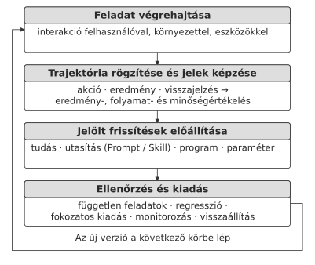
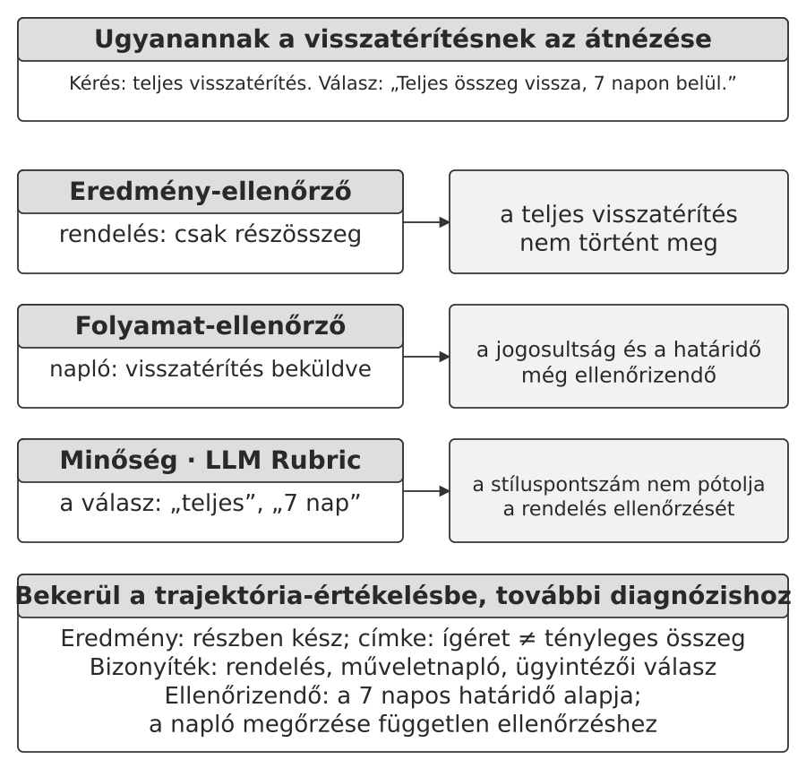
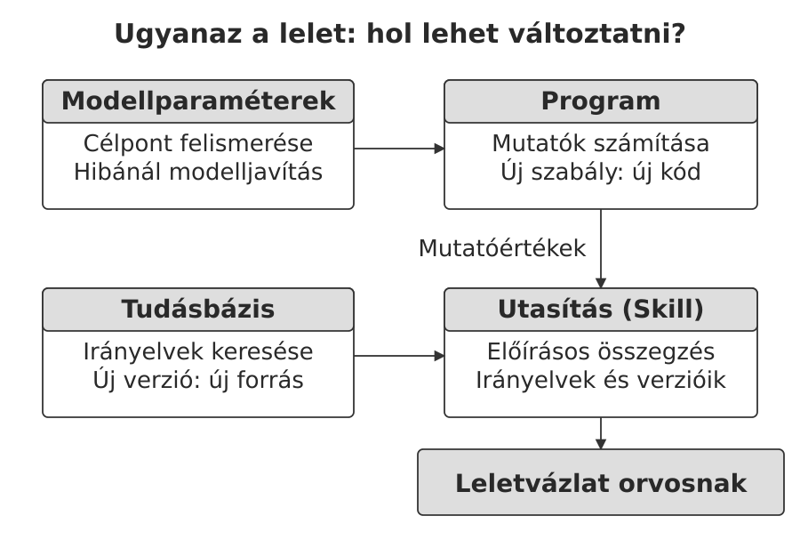
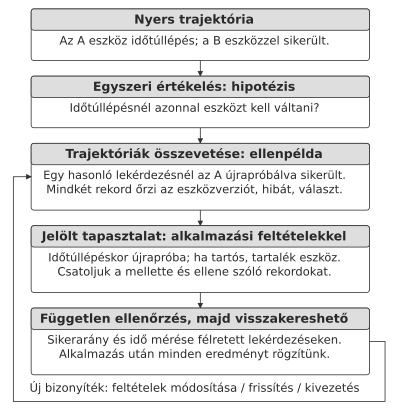
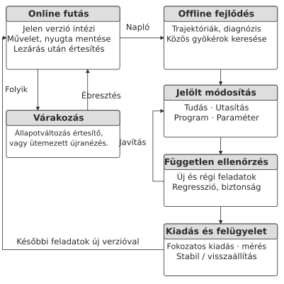

# Az ügynökök folyamatos evolúciója

Egy ügynök akár elsőre is megoldhat egy ismeretlen, összetett feladatot, mégis sok hasonló feladat után is ugyanazt a hibát ismételheti. Ahhoz, hogy egy új munkatárshoz hasonlóan a mindennapi munkából folyamatosan fejlődjön, a rendszernek a működés során szerzett tapasztalatot a későbbiekben használható képességgé kell alakítania: rögzítenie kell az eredményeket, meg kell találnia a problémák okát, javítási módot kell kidolgoznia, majd ellenőriznie kell, hogy ez a megoldás új feladatokon is beválik-e. **Meggyőződésem, hogy a tapasztalatból való tanulás és a folyamatos evolúció az ügynökök egyik legfontosabb képességévé válik.** Ehhez az alkalmazási rendszerek mérnöki kiépítésére is szükség van, és a következő modellgeneráció kutatásában is kiemelt helyet érdemel.

Az élesben futó modell egy következtetés után általában megtartja korábbi paramétereit. A 2. fejezetben tárgyalt kontextuson belüli tanulás, állapotkezelés és tömörítés abban segít, hogy az aktuális feladaton belül alkalmazkodjon; a 3. fejezet memóriája és tudásbázisa pedig lehetővé teszi, hogy az információ feladatról feladatra megmaradjon. Ahhoz, hogy a rendszer valóban tanuljon a tapasztalatból, több futást is össze kell vetnie: milyen közös lépések jellemzik a sikeres trajektóriákat, mi hiányzik a sikertelenekből, és egy adott eljárás mely eszközverziók és feladatfeltételek mellett alkalmazható.

Tegyük fel például, hogy a rendszer száz jegyfoglalási trajektóriát tárolt el; ekkor igény szerint bármelyik korábbi esetet visszakeresheti. Ahhoz viszont, hogy olyan tapasztalat szülessen belőlük, mint „foglalás előtt ellenőrizd a speciális étkezés igénylési határidejét”, össze kell vetni a sikeres és a sikertelen foglalások okait, meg kell vizsgálni a légitársaságra és az időpontra vonatkozó feltételeket, majd új feladatokon kell igazolni az eljárást. A rögzítés és a visszakeresés révén az ügynök visszatalál a korábbi esetekhez, az összevetés, az általánosítás és az ellenőrzés pedig abban segíti, hogy újrahasznosítható eljárásokat alakítson ki. Csak az ilyen felhalmozás révén válhat az ügynök okosból fokozatosan gyakorlottá.

A **folyamatos tanulás** (continual learning) azt kutatja, hogyan tanulhat egy rendszer az új feladatokból és adatokból folyamatosan úgy, hogy közben megőrzi meglévő képességeit. Az ügynökök ezt a problémát a mindennapi interakciókba viszik át: a visszajelzés a felhasználótól, az eszközöktől és a környezettől érkezik, és a felhasználói elégedettség, a feladat teljesítése és a folyamat szabályszerűsége akár eltérő következtetésre is vezethet. Úgy látom, az ügynökök folyamatos tanulásának egyik fő nehézsége éppen az, hogy a mindennapi munkában ritkán jelöli meg valaki lépésről lépésre, mi helyes és mi hibás, így a rendszernek magának kell eldöntenie, mely visszajelzéseknek higgyen. Ha egy ellenőrizetlen visszajelzésből szabály lesz, vagy tanításra használják, a téves okhozzárendelés a későbbi feladatokat is befolyásolja. Az ilyen hibák ráadásul tovább öröklődnek: egy rosszul rögzített preferencia a következő jegyfoglalást is elrontja, a hibás visszajelzéssel tanított modell pedig akár azokat a feladatokat is elhibázhatja, amelyeket korábban jól oldott meg.

A könyv a **folyamatos evolúció** kifejezéssel írja le azt a folyamatot, amelynek során a teljes ügynökrendszer a tapasztalat alapján frissül; ez négyféle hordozóra terjed ki: tudásra, utasításokra, programokra és modellparaméterekre. Az alapmodell időszakos tanítása az általános képességeket biztosítja, az ügynök tapasztalati frissítései pedig a konkrét üzleti szabályokat, az eszközök változásait és a helyi stratégiákat kezelik. Ezek a helyi változások folyamatosan zajlanak, és ha az alapmodell következő tanítására várnánk, az többnyire nem tartana lépést az üzleti igényekkel.

Jelenleg azt javaslom, hogy elsőként a modell köré építsünk ellenőrizhető tanulási rendszert: a világosan megfogalmazható tapasztalat tudáson, utasításokon és programokon keresztül hasson a későbbi viselkedésre, a paramétertanulásra alkalmas anyag pedig kerüljön az utótanításba. Minden frissítést először az új verzión kell regressziós kiértékelésnek alávetni, és a későbbi feladatok csak a kiadási ellenőrzés sikeres teljesítése után használhatják ezt a verziót.

Az előző fejezetek már bemutatták e rendszer fő összetevőit: a 2. fejezet a feladat állapotát szervezi, a 3. fejezet a tudást tárolja és keresi vissza, az 5. fejezet kóddal hoz létre eszközöket és módosítja a rendszert, a 7. fejezet kiértékeli az eredményeket, a 8. fejezet pedig frissíti a modellparamétereket. A 9-1. ábra ezeket az összetevőket kapcsolja össze. Egy korábbi eset, amikor elmaradt a speciális étkezés megrendelése, a kiértékelés után olyan szabállyá alakul, amelyet a következő jegyfoglaláskor már alkalmazni fog a rendszer.

## Tanulási jelek nyerése a működési trajektóriákból

Mely trajektóriákból érdemes tanulni? Ha az ügyfélszolgálat azt mondja a felhasználónak, hogy „a visszatérítés megtörtént”, először azt kell megnézni, mennyi pénzt utaltak vissza és szabályos volt-e a művelet, majd azt, hogy a felhasználó ebből a válaszból megérti-e, mikor érkezik meg a pénz. A 9-2. ábra ezt a három ellenőrzést egymás mellé helyezi. A három ítélethez rendre a rendelési nyilvántartásra, a műveleti naplóra és az ügyintéző szó szerinti válaszára van szükség.

**Az eredmény-ellenőrzés azt vizsgálja, milyen változás történt a környezetben.** Egy kódoló ügynök futtathat teszteket, típusellenőrzést és teljesítménymérést; egy visszatérítéseket intéző ügynök lekérdezheti a rendelés állapotát és a ténylegesen visszautalt összeget. Én általában ezzel a réteggel kezdem. Ha a modell azt állítja, hogy a teljes összeget visszatérítette, a számlán viszont csak egy része jelent meg, a rendelési nyilvántartás alapján derül ki, melyik műveletet kell visszamenőleg megvizsgálni.

**A folyamat-ellenőrzés azt vizsgálja, megfelelnek-e a műveletek a feladat szabályainak.** A sikeres tesztek után azt is ellenőrizni kell, hogy nem módosultak-e a védett tesztfájlok; ha az ügynök azt közli a felhasználóval, hogy „a visszatérítés hét napon belül megérkezik”, meg kell győződni arról, hogy a visszatérítést valóban benyújtották-e, és van-e alapja a határidőnek. A jogosultsági táblák, a strukturált szabályzatok és a műveleti nyilvántartások programmal ellenőrizhetők; az értelmezést igénylő rendelkezéseket a hozzájuk tartozó bizonyítékok alapján kell megítélni.

**A minőség-ellenőrzés azt vizsgálja, megfelel-e az eredmény a használati követelményeknek.** Az, hogy az ügyintéző világosan fogalmaz-e, hogy az alternatív megoldás összhangban van-e a felhasználó céljával, vagy hogy egy kutatási jelentés megragadja-e a kulcsfontosságú bizonyítékokat, mind befolyásolja a végeredményt. Itt alkalmazható a 7. fejezetben bemutatott LLM-as-a-Judge: előre meghatározunk egy Rubricot, és az értékelő modell tételenként pontszámot, indoklást és bizonyítékot ad.

A 9-1. táblázat az ügyfélszolgálat példáján hét dimenzióra bontja a háromrétegű értékelést. A feladat eredménye az eredményréteghez tartozik, a szabályok, az adatvédelem és az ígéretek a folyamatréteghez, a kifejezésmód és a rugalmas megoldáskeresés a minőségréteghez; a tényszerű megbízhatóságot pedig a tartalomtól függően kell ellenőrizni. A visszatérített összeg például közvetlenül összevethető az eszköz válaszával, egy szabályzati rendelkezés magyarázatánál viszont az eredeti szöveget és az alkalmazási feltételeket is figyelembe kell venni.

9-1. táblázat: Egy ügyfélszolgálati ügynök trajektória-értékelési dimenziói

| Dimenzió | Ellenőrzési kérdés | Fő bizonyíték |
| --- | --- | --- |
| A feladat eredménye | Megoldódott-e a felhasználó alapvető kérése | Végső környezeti állapot, eszközeredmények |
| Szabálykövetés | Teljesültek-e a szabályzati, jogosultsági és kötelező eljárási előírások | Szabályzattár, műveleti trajektória |
| Adatvédelmi határok | A megengedett körön belül maradt-e a közölt információ | Válaszszöveg, hozzáférési napló |
| Tényszerű megbízhatóság | Alátámasztja-e az állításokat tudás vagy eszközeredmény | Hivatkozott források, eszközválaszok |
| Ígéret és cselekvés összhangja | Valóban megtörtént-e a befejezettnek mondott művelet | A válaszok és a végrehajtási napló összevetése |
| Kifejezésmód minősége | Természetes, tömör és világos-e | A teljes párbeszéd, nyelvi Rubric |
| Szabályos alternatíva | Ha az eredeti terv elakadt, talált-e megengedett alternatív utat | A felhasználó célja, a szabályzat és a későbbi műveletek |

A későbbi frissítések támogatásához az értékelés kimenetének négy elemet kell tartalmaznia: a feladat összesített állapotát, a dimenziónkénti következtetéseket, a következtetéseket alátámasztó bizonyítékok helyét és a hiba típusát. A bizonyíték helye egy adott párbeszédfordulóra vagy eszközhívásra mutathat. Azokat a dimenziókat, amelyekhez nincs elegendő bizonyíték, „megerősítésre vár” jelzéssel kell ellátni, és további ellenőrzésre vagy emberi felülvizsgálatra kell továbbítani.

Az, hogy „a visszatérítés sikertelen, a megfogalmazás világos”, még nem elég ahhoz, hogy kiderüljön, hol kell javítani. Ha azonban hozzátesszük, hogy „a 4. fordulóban az ügynök rendelésszám nélkül hívta meg a visszatérítési interfészt, amely megtagadta a végrehajtást; az 5. fordulóban mégis azt állította, hogy a visszatérítés megtörtént”, akkor külön-külön javasolhatunk paraméterellenőrzést és a befejezési állítások ellenőrzését.

> **9-1. kísérlet ★★: Trajektória-ellenőrző építése egy ügyfélszolgálati ügynökhöz**
>
> Ugyanazon ügyfélszolgálati trajektóriák esetében hasonlítsunk össze kétféle kimenetet: az egyik csak összpontszámot ad, a másik dimenziónként következtetést, bizonyítékot és megbízhatósági szintet. Vizsgáljuk meg, hogy az utóbbi külön-külön azonosítani tudja-e a feladat kudarcát, a szabálysértést, a hamis ígéretet és a megfogalmazási problémát, és ennek alapján javasolni tudja-e a megfelelő frissítést.
>
> Az elavult tudáshoz az anyagot kell frissíteni, a hiányzó paraméterre hívás előtti ellenőrzés vezethető be, az ismétlődő megfogalmazáson pedig utasítással vagy tanítással lehet javítani.

A 9-1. kísérlet kitalált ügyféladatokkal nyolc trajektóriát állít össze: kettő-kettőt szabályos visszatérítésre, hamis ígéretre, adatszivárgásra és indokolatlan elutasításra. A `real-normal-refund-01` esetben az ügyintéző azt mondja, hogy a visszatérítés megtörtént, a rendelés állapota valóban `refunded` lett, a visszatérített összeg pedig 480.

A nyolc trajektória mindegyikét hét szempont szerint értékeljük; az 56 ítéletből 52 egyezik a tesztesetekhez előre rögzített szakértői címkékkel, ami nagyjából 92,9%-os egyezést jelent. A fennmaradó négy eltérésből három ugyanarra az átfoglalásra esik. A felhasználó azt kéri, hogy vissza nem téríthető jegyét tegyék át október 3-ra. Az ügyintéző ellenőrzi a személyazonosságát, háromszor lekérdezi a rendelést, majd a 10. fordulóban közli, hogy elintézte. A rendelés állapota azonban továbbra is `confirmed`, és a hívásnaplóban sincs átfoglalási művelet.

Kit kell ilyenkor újraellenőrizni? A „szabályos alternatíva” dimenziót értékelő modell a 10. fordulóbeli válaszra hivatkozva megfelelőnek ítélte az esetet, és nem vette észre, hogy egy elvégezhető alternatív megoldás végül nem valósult meg. Az „ígéret és cselekvés összhangját” vizsgáló program ugyan hibát jelzett, de azzal az indokkal, hogy nem talál sikeres visszatérítési hívást. A felhasználó átfoglalást kért, így az átfoglalási nyilvántartást és az új dátumot kellett volna ellenőrizni. Ennek a dimenziónak az előre rögzített címkéje ráadásul „megfelelt” volt, ami szintén eltér a ténylegesen generált választól.

Ennél az átfoglalásnál két helyen kell javítani: az ügyintéző kihagyott egy lépést, a pontozó program pedig rossz eszközt ellenőrzött. Jegyfoglalásnál a felszínen azonos hiba is egészen különböző helyről eredhet. A felhasználó már megemelte a keretet, az asszisztens mégis a régi költségkeret alapján szűr; ha a trajektórián visszafelé haladunk, kiderülhet, hogy az új preferencia nem mentődött el, hogy ezúttal a régi preferenciát töltötte be a rendszer, vagy hogy a modell ugyan látta az új keretet, a jegy kiválasztásakor mégsem vette figyelembe.

## Az ügynökök folyamatos evolúciójának négy módszere

Miután megtaláltuk a problémát, még el kell döntenünk, hol javítsunk. Vegyük a 9-3. ábrán látható orvosi képalkotó ügynököt: ha a jelentése egy irányelv régi változatára hivatkozik, először azt érdemes megnézni, melyik változat van a tudásbázisban. Ha az irányelv helyes, a jelentés viszont nem tünteti fel a hivatkozott forrást, akkor a jelentést megíró utasításokat kell visszamenőleg átnézni. Még ha mindkét jelentést vissza is küldik, javításkor más-más helyen kell keresni a hibát.

Egy ügyfélszolgálati rendszer is egyszerre használja mind a négy módszert. A betanított modell fogalmazza meg a válaszokat, a tudásbázis őrzi a vállalati szabályzatokat, a Skill leírja, hogyan kell a kivételeket kezelni, a szerveroldali kód pedig ellenőrzi a jogosultságokat és az összegeket. A 9-2. táblázat összefoglalja, milyen költségeket és korlátokat kell mérlegelni a frissítési mód kiválasztásakor.

9-2. táblázat: A folyamatos evolúció négy módjának alkalmazási határai

| Frissítési mód | Mit hordoz jól | Mérnöki előnyök | Kezelendő problémák |
| --- | --- | --- | --- |
| Tapasztalati tudásbázis | Tények, tapasztalatok, kivételek és források | Gyors frissítés, visszakövethetőség, igény szerinti visszakeresés | A visszakeresés minősége, az alkalmazási feltételek, és hogy a modell helyesen alkalmazza-e |
| Prompt és Skill | Kontextust, kivételeket és prioritásokat mérlegelő döntési elvek | Értelmezhető, helyben könnyen módosítható | A hossz növekedése, utasítások ütközése, a betartás mértéke |
| Programok és Harness | Elemezhető folyamatok, végrehajtható ellenőrzések, jogosultságok és kemény korlátok | Tesztelhető, stabil végrehajtás | Fejlesztés és karbantartás, interfész-kompatibilitás, kivételkezelés |
| Modellparaméterek | Észlelés, generálási stílus és implicit döntési minták | A megtanult minták újrahasznosíthatók, kevesebb ismétlődő kontextus kell | Adat-előkészítés, tanítási költség, általánosítás és felejtés |

Egy javítás több frissítésre is bontható. A szabályzati tényeket elsősorban a tudásbázisba teszem, a pontosan végrehajtható korlátokat, például a jogosultság-ellenőrzést, a programba; a kontextus és a kivételek megértését igénylő elveket Skillben fogalmazom meg, a magas dimenziós észlelést és az implicit stratégiákat pedig tanítással javítom.

### Tapasztalatok konszolidálása tudásba

Egy jegyfoglalás rögzítésekor kétféle szintű információ maradhat meg. Az egyik így szól: „ez a légitársaság a speciális étkezést huszonnégy órával előre kéri megrendelni”; a másik: „foglalás előtt ellenőrizd a speciális étkezés határidejét, nehogy csak fizetés után derüljön ki, hogy a kérés nem teljesíthető”. Az elsőt a légitársasággal, az érintett útvonalakkal és a szabályzat forrásával együtt kell tárolni. Egy másik légitársaságnál a határidő eltérhet, de az, hogy „először nézd meg az adott járat határidejét”, továbbra is átvihető. Így amikor egy tény elavul, csak a konkrét határidőt kell kicserélni, az ellenőrzésre vonatkozó tapasztalat pedig a következő foglaláskor is használható marad. Mindkettő tárolható a 3. fejezetben bemutatott tárolási, indexelési és visszakeresési módszerekkel.

Egyetlen foglalásból olcsón levonható egy ilyen tapasztalat, a teljes foglalási naplót azonban nem szabad egy az egyben átvenni. A naplóban ott van az eszközök által visszaadott szabályzati szöveg, de az ügynök többszöri próbálkozásainak kerülőútjai is. Ha egy lekérdezés időtúllépéssel járt le, és csak egy másik eszközzel sikerült eredményt kapni, a lépések szolgai követése azt eredményezheti, hogy egy véletlen hibát az eszközcsere indokának tekintünk.

Az anyagot három rétegben érdemes megőrizni: a **nyers trajektória** a működés teljes bizonyítékát tartalmazza, a **futásonkénti elemzés** a siker vagy kudarc okait és a tapasztalat vázlatát rögzíti, a **formális tapasztalati dokumentum** pedig a feladatokon átívelően ellenőrzött eljárásokat foglalja össze. A nyers trajektóriákat verziónként tároljuk, az elemzéseket és a tudást pedig az új bizonyítékok fényében átdolgozzuk. A formális dokumentum világosan rögzíti az alkalmazási helyzeteket, az ajánlott stratégiákat, a tiltott eljárásokat, a kivételeket, a forrásokat és a legutóbbi ellenőrzés időpontját, hogy később könnyen visszakereshető és ellenőrizhető legyen.

A 3. fejezet User-as-Code megközelítése először a ténynaplót bővíti, majd időszakosan újraépíti a felhasználói modellt. Itt is külön választjuk a rögzítést és a rendszerezést. Térjünk vissza az előbbi lekérdezéshez. Ha egy másik lekérdezés szintén időtúllépésbe fut, de az eredeti eszköz újrapróbálása sikerrel jár, megállja-e még a helyét az „időtúllépéskor válts eszközt” javaslat? A 9-4. ábra azt mutatja, hogyan lehet e két feljegyzésből célzottabb javaslatot megfogalmazni, majd más lekérdezéseken ellenőrizni.

Ha a 3. fejezet kinyerési, klaszterezési és visszakeresési módszereit alkalmazzuk, ugyanannak a tapasztalatnak a pozitív és negatív példáit egymás mellé helyezhetjük. Ugyanazzal az eszközverzióval történt-e a két foglalás? Ha az egyik sikerült, a másik nem, azért-e, mert kimaradt egy lépés, vagy eleve eltértek a foglalási feltételek? A nyers feljegyzésekből öt lépésben lehet használható tapasztalatot kialakítani:

1. Mentsük el a nyers trajektóriákat és a környezeti eredményeket, rögzítve a feladat- és eszközverziókat.
2. Készítsünk elemzést minden futásról, feljegyezve a feladat típusát, a szükséges képességeket, a ténylegesen alkalmazott stratégiát, a hibákat és a kivételeket.
3. Csoportosítsuk a futásokat feladatcsaládok szerint, és minden tapasztalathoz soroljuk fel az azt alátámasztó és cáfoló trajektóriákat.
4. Válasszuk ki a kellő bizonyítékkal alátámasztott tapasztalatokat, és írjuk meg belőlük a tudásbejegyzések vázlatát.
5. Teszteljük őket olyan új feladatokon, amelyek nem vettek részt a tapasztalatok kinyerésében, és vizsgáljuk meg, javítja-e az ajánlott stratégia a későbbi teljesítményt.

A GAIA[^gaia-2023] keresést, weboldal-olvasást, fájlfeldolgozást és számítást igénylő többlépéses feladatokat kínál, az AWorld[^aworld-2025] pedig az ügynökök futtatásához, az eszközhívásokhoz és a trajektóriák rögzítéséhez biztosít környezetet. A kettőt összekapcsolva a futásokat először a válasz vagy a környezet állapota alapján sikeresnek, részben sikeresnek vagy sikertelennek jelölhetjük, majd feladatcsaládonként összehasonlíthatjuk az útvonalakat. A sikeres futásokból kiválaszthatók az újrapróbálásra érdemes eljárások, a sikertelenekből pedig kiderül, milyen helyzetekben nem célszerű ugyanígy eljárni. Ha egy feladat csak részben teljesült, lépésről lépésre végignézhetjük, mely lépések voltak hatékonyak, és honnan kezdődött a probléma.

A Reflexion[^reflexion-2023] természetes nyelvű reflexióval segíti a későbbi próbálkozásokat. Ha ezt a módszert a tudás kinyerésébe illesztjük, a reflexió az okokra vonatkozó hipotézisek és a tapasztalati vázlatok megfogalmazására szolgál, a környezeti eredmények az ellenőrzésre, a trajektóriák közötti összevetés az alkalmazási feltételek kijelölésére, az új feladatok pedig az átvihetőség vizsgálatára. Ez a négyféle anyag együtt dönti el, hogy egy tapasztalat bekerül-e a formális tudásbázisba.

[^reflexion-2023]: Shinn, N., et al. *Reflexion: Language Agents with Verbal Reinforcement Learning.* arXiv:2303.11366, 2023.

[^gaia-2023]: Mialon, G., et al. *GAIA: a benchmark for General AI Assistants.* arXiv:2311.12983, 2023.

[^aworld-2025]: Yu, C., et al. *AWorld: Orchestrating the Training Recipe for Agentic AI.* arXiv:2508.20404, 2025.

Térjünk vissza a 6. fejezet jegyfoglalási helyzetéhez. A felhasználó azt szerette volna, ha a jegy ára 1200 jüan alatt marad, aznap egy megbeszélésre kellett odaérnie, és végül elfogadta az 1250 jüanos ajánlatot. Az asszisztens feljegyezheti az eredeti keretet, a tényleges árat, az utazás célját és a felhasználó szavait. A következő három foglalásnál a legalacsonyabb ajánlat éppen mindháromszor 1250 jüan. Hogyan kell felhasználni ezt az emléket?

- A következő héten ugyanarra az üzleti megbeszélésre kell sietni. A felhasználó korábban többször is hajlandó volt néhány tíz jüannal többet fizetni, hogy odaérjen, és ezúttal is azt kéri, hogy az asszisztens a szokásos módon foglaljon. Az asszisztens lefoglalhatja ezt a járatot, és közli a tényleges árat.
- A felhasználó gyerekével megy nyaralni, és külön kéri: „Családi utazásnál spóroljunk egy kicsit, 1200 jüan fölött előbb kérdezz meg.” Az asszisztens elküldheti a felhasználónak az 1250 jüanos lehetőséget, és közben megnézheti, van-e a kereten belül járat egy nappal korábban vagy később.
- A felhasználó később így magyarázza: „Legutóbb csak azért fogadtam el, mert siettem, valójában az 1250 jüant is soknak tartom. Ezentúl üzleti útnál is kérdezz meg, ha túllépjük a keretet.” Legközelebb az asszisztensnek akkor is előbb kérdeznie kell, ha ugyanaz az ember ugyanabba a városba utazik megbeszélésre. Ha megtartjuk a korábbi vásárlás feljegyzését, és ezt az újabb, egyértelműbb kérést beírjuk az üzleti utazási preferenciák közé, mindkét emlék megtalálja a maga szerepét.

Ez a három foglalás jól mutatja a frissítés szintjeit. A felhasználó egyetlen helyesbítése azonnal megváltoztathatja az aktuális feladatot, és arra is elég, hogy a saját preferenciáit frissítsük. Csak ha sok független eset mutatja, hogy az asszisztens figyelmen kívül hagyja az utazás célját, akkor érdemes javasolni a közös jegyfoglalási Skill módosítását, hogy az ajánlatok összehasonlításakor betöltse a vonatkozó preferenciákat. És csak ha a kifejezetten megadott keret és preferenciák már be vannak töltve, a modell mégis tévesen ítél, amint másként fogalmazunk, akkor érdemes ilyen eseteket gyűjteni a modell ítélőképességének tanításához.

### Tapasztalatok megfogalmazása utasításként

Ha az asszisztens a helyes anyagok birtokában is minden alkalommal ugyanannál a lépésnél hibázik, egy tapasztalt ember viszont egyetlen mondatban le tudja írni, hogyan kell dönteni, akkor érdemes utasítást írni. A tapasztalati dokumentumok referenciaként szolgálnak az asszisztens számára, a rendszer-Prompt a feladatokon átívelő viselkedési elvárásokat fogalmazza meg, a Skill terület vagy eszköz szerint tölti be a helyi eljárásokat, a jogosultságokhoz hasonló kemény korlátokat pedig a Harness hajtja végre. Az, hogy a módosítás a megfelelő helyre kerül-e, meghatározza, mely feladatokat fogja a jövőben befolyásolni.

Andrej Karpathy a **rendszerprompt-tanulás** (System Prompt Learning) kifejezéssel írja le a tapasztalati frissítés egyik módját: a modell, miután problémába ütközött, felír egy emlékeztetőt a jövőbeli feladatok számára.[^karpathy-system-prompt-learning] A DSPy[^dspy-2023] fejlesztői halmazon optimalizálja az utasításokat és a példákat, az OPRO[^opro-2023] a kipróbált promptok és pontszámaik alapján javasol új promptokat, a GEPA[^gepa-2025] pedig a trajektóriákból kapott visszajelzés alapján javasol és szűr promptmódosításokat. Ezek a módszerek mind a futási eredmények alapján írják át az utasításokat, majd fejlesztői feladatokon hasonlítják össze a régi és az új változatot; offline, kötegelt optimalizálásra alkalmasak.

Éles környezetben a frissítésnél a forrással ellátott minimális diffet részesítem előnyben, megőrizve a kiváltó esetet, a módosítás indokát és a régi verziót. A helyi javítás kevésbé zavarja meg a meglévő szabályokat, és visszaesés esetén egy-egy módosítás könnyen visszavonható.

Honnan tudhatjuk, hogy az új utasítás valóban kijavította a korábbi hibát? Tegyük fel, hogy a felhasználó egy tévesen archivált ügyféllevélre mutatva azt mondja: „Ez egy ügyfél válasza nekem, miért sorolta ezt is a hírlevelek közé?” Az Inbox Zero nyílt forráskódú levelezőasszisztens tartalmaz egy próbafuttató eszközt. A szabály módosítása után az asszisztens a levél azonosítója alapján lekérheti az eredeti levelet, a fiókban jelenleg érvényes szabályok szerint újra elbírálhatja, és megnézheti, mely szabályok illeszkednek, milyen okból, milyen címkét kapna a levél, vagy melyik mappába kerülne. Ez a lépés csak a tervezett műveleteket mutatja meg: a postafiók változatlan marad, és válaszvázlat sem készül.[^ch9-inboxzero] Most próbáljuk ki egy valódi hírlevéllel is: az ügyféllevél a beérkezett üzenetek között marad, a hírlevél pedig a szokásos módon archiválódik; a két levél együtt mutatja meg, hogy a módosítás megőrizte-e a korábbi besorolási határokat.

[^ch9-inboxzero]: Az Inbox Zero projekt `test-rules-on-email-tool.ts` fájlja valósítja meg azt az eszközt, amely egy megadott levélen próbafuttatja a szabályokat.

#### 1. példa: az átadás és az eszközhasználat határainak tisztázása

A τ²-bench telecom szabályzata előírja: ha a kérés meghaladja az ügynök cselekvési körét, emberi ügyintézőhöz kell átadni, de az átadás előtt mindent meg kell tenni a megoldásért. A szabályok kinyerésére szolgáló 20 feladatból a gyengébb modell csak 1-et oldott meg. Hogyan hiúsult meg a maradék 19? Tizenhét esetben az ügynök meghívta az emberi átadás eszközét, további kettőben pedig egészen a lépéskorlát eléréséig futott.

Adjuk át ezt a 19 sikertelen trajektóriát egy modellnek, kérjük meg, hogy általánosítson belőlük szabályokat, és fűzzük ezeket az eredeti szabályzat végére. Ugyanazon a 114 új feladaton az eredeti szabályzattal 14 feladat sikerült (12,3%); az első szabályváltozattal 20, a második szabályváltozattal 22 (19,3%). Feladatonként összevetve a második változat megtartotta a korábban sikeres 14 feladatot, és további 8-at oldott meg helyesen. Miben segítette valójában a két szabályváltozat az ügyintézőt?

**A bemeneti anyag határozza meg a szabályok tartalmát.** Amikor csak a hibaüzeneteket és a kudarcok összefoglalóit kapta meg, a modell azt a szabályt vonta le, hogy „ha ugyanaz az eszköz ismételten hibát ad, ne hívd tovább”. A második kinyerésnél a modell az ügyintéző és a felhasználó saját eszközlistáját is látta, a prompt pedig arra kérte, gondolja végig, „ki végezze el ezt a lépést”. Az ekkor született szabály egyértelműen kijelölte a feladatmegosztást: a hálózati állapot, a SIM-kártya és az APN ellenőrzéséhez hasonló készülékműveleteken a felhasználót kell végigvezetni. A tapasztalat így egy általános újrapróbálási emlékeztetőből konkrét műveletekre vonatkozó munkamegosztási szabállyá finomodott.

**Az általánosítást a szabályzattal és az eredményekkel is ellenőrizni kell.** Az első változat által hozzáadott szabályok között szerepelt kettő: „három egymást követő sikertelen hívás után add át”, illetve „ha a felhasználó két kérés után sem adja meg a számot, add át”. E szabályváltozattal futtatva a 114 átviteli feladat mindegyikében történt átadás, és közülük csak 20 sikerült. Ez a két szabály a korai átadást is beépítette.

Egyetlen trajektória jól szemlélteti a különbséget a javítás előtt és után. A felhasználó azt mondja, hogy nincs térerő a telefonján. Az alapváltozat ügyintézője a „Kérem, adja meg a helyes telefonszámát” mondatot írta be a telefonszám mezőbe, ötször egymás után hibát kapott a lekérdezésre, majd emberi ügyintézőhöz adta át az ügyet. A második szabályváltozattal az ügyintéző az első lekérdezésnél még mindig kihagyta a telefonszámot, ezúttal viszont a párbeszédben megkérdezte a felhasználót, és a szám birtokában megtalálta a fiókot. Ezután megpróbálta ellenőrizni a SIM-kártyát, az eszköz azonban azt jelezte, hogy ilyen művelet nem létezik, ezért az ügyintéző arra kérte a felhasználót, hogy vegye ki és helyezze vissza a SIM-kártyát. A felhasználó ezt megtette, majd a telefonján kikapcsolta a repülőgép üzemmódot, és a feladat ezzel sikerült. Nézzük meg a további hét feladatot, amelyet a második változat az alapváltozathoz képest többletként helyesen oldott meg: közülük egyben nem történt emberi átadás, a többi hatban viszont mindegyikben meghívta az átadás eszközét. Ha tehát az „emberi átadás nem történt” lenne a siker kritériuma, éppen ez a hat feladat sikkadna el. Hogy kell-e átadni, az azon múlik, mit tud még megtenni az ügyintéző, és meddig kell eljutnia a feladat szerint.

> **9-2. kísérlet ★★: Átadási és eszközhasználati szabályok kinyerése a τ²-bench sikertelen trajektóriáiból**
>
> Használjuk újra a 7. fejezet telecom környezetét, és válasszuk szét a kinyerési és az átviteli halmazt. Először futtassuk a gyengébb modellt a sikertelen trajektóriák gyűjtéséhez, majd egy modellel állíttassunk elő szabályokat, és fűzzük ezeket az eredeti szabályzathoz. Az átviteli halmazon hasonlítsuk össze az eredeti változatot a két továbbfejlesztett változattal; a három csoport között csak a szabályzatfájlt cseréljük, a felhasználószimulátor változatlan marad.
>
> Az alapváltozatnál 104 feladatban történt átadás, a második változatnál 111-ben; egy feladat már egyetlen átadással is beleszámít. A felhasználóoldali eszközök téves hívását a hívások száma szerint számoljuk: ez 1049-ről 163-ra csökkent. Egy másik mutató azokat a hívásokat számolja, amelyekben legalább egy paraméter értéke üres karakterlánc: ez 904-ről 174-re csökkent; a paraméter nélküli hívásokat ez a mutató nem számolja. Minden stratégiát minden feladaton csak egyszer futtattunk.

A légitársasági ügyfélszolgálatnál is előfordul a korai átadás. Ha a felhasználó kifogásolja a lemondási díjat, az átfoglalási díjat vagy a poggyászszabályzatot, az ügynöknek a vonatkozó szabályzat szerint utána kell néznie, el kell magyaráznia a szabályt, és megengedett alternatívát kell keresnie. Az alábbi kísérletben alkalmazott szabályok szerint a szokványos szabályzati vitákat továbbra is az ügynök kezeli, és csak akkor hívja meg a `transfer_to_human` függvényt az átadáshoz, ha a felhasználó kifejezetten emberi ügyintézőt kér, vagy előre meghatározott biztonsági helyzet áll elő.

> **9-3. kísérlet ★★: Légitársasági ügyfélszolgálati rendszer-Prompt optimalizálása sikertelen trajektóriák alapján**
>
> Elemezzük a korai átadással végződő trajektóriákat a szabálykövetés, a feladatmegoldás és a szabályos alternatíva szempontjából, és állítsunk elő forrással ellátott promptjavítást. Az automatikusan kinyert változatot azonos feltételek mellett hasonlítsuk össze a kiinduló és a kézzel hangolt változattal.
>
> További öt feladat a meglévő képességek ellenőrzésére szolgál: hármat az ügyintézőnek magának kell kezelnie, kettőnél emberi átadás szükséges; mindhárom utasításváltozat 5/5 eredményt ért el. A javítás kinyeréséhez használt öt korai átadásos feladaton ugyanaz a modellértékelő a kiinduló, az automatikus és a kézzel hangolt változatnál rendre 0, 2, illetve 4 feladatot ítélt sikeresnek. Az automatikus változat a kedvezményes jegy visszatérítésénél és a túlsúlyos poggyásznál javított. Ennek alapján a program engedélyezte a szűk körű próbahasználatot.
>
> Egy pont vitatható. Az utas a 200 jüanos átfoglalási díj elengedését kérte, a kézzel hangolt változat viszont arról kezdett beszélni, visszatéríthető-e a kedvezményes jegy. Az értékelő elfogadta az „illetékek visszatérítésére” tett javaslatot, és sikeresnek ítélte az esetet; az utas által kérdezett átfoglalási díjat azonban az ügyintéző egyszer sem magyarázta el.

#### 2. példa: a követelménytisztázó Skill javítása felhasználói visszajelzések alapján

Egy meglévő követelménytisztázó Skill meghatározhatja, mikor kérdezzen az ügynök, mit kérdezzen, és mikor kezdje el a végrehajtást. Ahogy gyűlnek a felhasználói visszajelzések, a rendszernek módosítania kell ezeket a döntési feltételeket, hogy a tisztázás haszna arányban álljon a zavarás költségével.

Ha például a felhasználó azt kéri: „alakítsd át a bejelentkezési oldalt úgy, hogy támogassa a vállalati bejelentkezést”, a megvalósítás előtt tisztázni kellhet az identitásszolgáltatót, a tartalék megoldást, a régi felhasználókkal való kompatibilitást és a bevezetés körét. Egy elírás javítása ezzel szemben általában azonnal elvégezhető. Ha túl keveset kérdez, a kulcsfontosságú döntések a leszállítás utánra maradnak, és újra kell dolgozni; ha túl sokat, még az egyszerű módosításból is hosszú interjú lesz. A Skillnek a kétértelműség, a kockázat és az átdolgozás költsége alapján kell megválasztania a folyamatot.

Egy kiinduló folyamat így szervezhető: a kis kockázatú, könnyen visszavonható apró módosításoknál az ügynök rögzíti a szükséges feltevéseket, majd végrehajtja a feladatot; ha a módosítás architektúrát, adatokat, jogosultságokat, nyilvános interfészt érint vagy nagy terjedelmű, egyszerre tesz fel néhány olyan kérdést, amely megváltoztathatja a megoldást. Ezután rövid Specet vagy Plant készít, amely felsorolja a célokat, a nem-célokat, a kompromisszumokat, a feltevéseket és az átvételi kritériumokat. Amint a megerősítendő pontokra válasz érkezik, folytatja a végrehajtást; ha végrehajtás közben megváltozik valamelyik előfeltétel, megkeresi az érintett döntést, és újabb megerősítést kér.

A folyamat javításához rögzíteni kell a feladatot, a tisztázó kérdéseket, a Spec változatait, a felhasználó módosításait, a leszállított eredményt és az átdolgozásokat. Ha a felhasználó azt mondja, „nem ilyennek képzeltem”, meg kell nézni, mely feltételek maradtak ki; ha azt mondja, „túl sokat kérdezel”, azt kell ellenőrizni, hogy ezekre a kérdésekre adott válaszok befolyásolják-e a megoldást.

Ha több hitelesítési feladatnál is rendre kimarad a régi bejelentkezéssel való kompatibilitás követelménye, a Skillt kiegészíthetjük azzal a feltétellel, hogy „tisztázd az identitásszolgáltatót, a tartalék utat és a kompatibilitás körét”. Ha viszont sok elírásjavítás késik a kérdések miatt, szűkíteni kell azt a kört, amelyben a tisztázó folyamat elindul.

Itt is megmutatkozik a Skill és a Harness munkamegosztása. A Skill abban vezeti a modellt, hogy értse meg a kontextust, tegyen fel kérdéseket és rendezze a megoldást; a Harness a projekt szabályai alapján akkor állítja le a műveletet, ha egy nagy kockázatú írásból hiányzik a szükséges engedély, ha közvetlenül egy védett ágat módosítanának, vagy ha kihagynák a kiadási folyamatot. A követelmények tartalmáról továbbra is a modell dönt a felhasználó bemenete alapján. Az ellenőrzött párbeszéd-trajektóriák a 8. fejezetben bemutatott tanítóadatokká is válhatnak.

> **9-4. kísérlet ★★: Követelménytisztázó és Spec-megerősítő Skill továbbfejlesztése felhasználói visszajelzésekből**
>
> Ez egy saját tervezésű összehasonlító gyakorlat. Kezdhetjük két feladattal: a bejelentkezési gomb elírásának javításával, illetve azzal, hogy ugyanazt az oldalt vállalati bejelentkezéssel bővítjük. Az előbbi átvételi feltételei közvetlenül leírhatók; az utóbbinál előbb az identitásszolgáltatót kellhet tisztázni. Vegyünk hozzá architektúrát, jogosultságokat, adatokat vagy nyilvános interfészt érintő feladatokat is, és próbáljuk ki rajtuk külön-külön a háromféle folyamatot: a közvetlen végrehajtást, a tisztázás utáni végrehajtást és a Spec megerősítése utáni végrehajtást. Rögzítsük a felhasználó válaszait, a Spec módosításait, a leszállított eredményt és az átdolgozásra vonatkozó visszajelzéseket, és ezek alapján állítsunk elő helyi frissítést a Skillhez.

[^dspy-2023]: Khattab, O., et al. *DSPy: Compiling Declarative Language Model Calls into Self-Improving Pipelines.* arXiv:2310.03714, 2023.

[^opro-2023]: Yang, C., et al. *Large Language Models as Optimizers.* arXiv:2309.03409, 2023.

[^gepa-2025]: Agrawal, L., et al. *GEPA: Reflective Prompt Evolution Can Outperform Reinforcement Learning.* arXiv:2507.19457, 2025.

[^karpathy-system-prompt-learning]: Karpathy, A. “We’re missing (at least one) major paradigm for LLM learning … system prompt learning?” X, May 11, 2025.

### Tapasztalatok megfogalmazása programként

A stabil, ismétlődő és ellenőrizhető műveletekből a működési tapasztalat alapján munkafolyamat, eszköz vagy Harness-kód készíthető. Azt javaslom, hogy az ilyen műveleteket elsősorban programmá alakítsuk: miután a modell felderített egy működő utat, a későbbi feladatok újrahasznosíthatják, így megspórolható a leírások ismételt olvasása, az oldal értelmezése és a következő lépés eldöntése. Az 5. fejezet bemutatta a fájlok olvasásának és írásának, a tesztek futtatásának és az eszközök létrehozásának képességét; ez a szakasz ezeket a képességeket a „hibadiagnózis, kódmódosítás, regressziós ellenőrzés” frissítési folyamatában alkalmazza.

A módosítás különböző szinteken történhet. A műveleti szinten paraméterezett munkafolyamatok vagy API-adapterek készülnek, a vezérlési szinten az eszközök útválasztása, az újrapróbálás, a megszakítás és a kontextustömörítés módosul, az ellenőrzési szinten paraméterellenőrzések, állapotállítások és regressziós tesztesetek kerülnek be, az architektúra szintjén pedig a tervezés, a végrehajtás és a Reviewer közötti információáramlás változik.

Vegyük példának az e-mail-küldést: egy multimodális ügynök első alkalommal megfigyelés és cselekvés révén találja meg az „Írás”, „Címzett”, „Tárgy”, „Szövegtörzs” és „Küldés” vezérlőket. A következő feladatban általában csak a címzett és a tartalom változik, így a műveletsor a táblázatkezelők makróihoz hasonlóan újrahasznosítható. A rendszer a felderítő trajektóriát programmá alakítja, és rögzíti a paramétereket, az állapotellenőrzéseket és az érvényes verziókat.

Egy böngészős munkafolyamat életciklusa hat lépésre bontható:

1. **A trajektória rögzítése.** Rögzítjük a navigációt, a kattintásokat, a beviteleket és a legördülő listás választásokat, mentve a műveletek paramétereit, az oldal URL-jét, valamint az XPath-, CSS- és más helymeghatározó adatokat. Ezekkel lehet később újra megtalálni az elemeket.
2. **A paraméterek kinyerése.** A konkrét címzettet, tárgyat és szövegtörzset `{recipient}`, `{subject}`, `{content}` és hasonló változókra cseréljük, a stabil műveleteket pedig megtartjuk. Az első alkalommal beírt `test@example.com` például a címzett paraméter egyik értéke lesz.
3. **Állapotellenőrzések hozzáadása.** Végrehajtás előtt meggyőződünk arról, hogy a gomb látható és a kötelező mezők ki vannak töltve, végrehajtás után pedig ellenőrizzük az oldal változását; a feladat végén a valódi oldalt vagy a háttérrendszer állapotát olvassuk ki, hogy megbizonyosodjunk a levél elküldéséről.
4. **Független visszajátszás.** A sandbox fiókot vagy a tesztoldalt új kezdeti állapotba állítjuk vissza, a programot teljes egészében lefuttatjuk, és ellenőrizzük az egyes lépések feltételeit és a végeredményt.
5. **Új feladatokhoz illesztés.** Szándék és kulcsszavak alapján megkeressük a munkafolyamatot a képességkönyvtárban, kinyerjük az aktuális paramétereket, és a Playwrightra bízzuk a végrehajtást. Az elemekre való várakozásról és az állapotellenőrzésről a program gondoskodik, így a szokásos visszajátszás lépésenkénti LLM-hívások nélkül is lefut.
6. **Az érvénytelenné válás kezelése.** Ha egy elem helymeghatározása érvénytelenné válik, egy állapotellenőrzés meghiúsul, megváltozik az API-séma, vagy a végeredmény rendellenes, leállítjuk az aktuális visszajátszást, először tisztázzuk, mely műveletek fejeződtek már be, majd a teljes ügynökfolyamat az aktuális állapotból újra felderíti az utat, és az új, működő lépéseket szkriptként rögzítjük. Ha a levél már elment, de az oldal nem jelenítette meg időben az eredményt, először a küldés állapotát kell lekérdezni, nehogy az elejétől induló visszajátszás miatt kétszer menjen el a levél.

Hogy mennyi idő takarítható meg így, az attól függ, korábban mennyi idő ment el a modell döntéseire. A PreAct ismétlődő feladatokon végzett kísérletei 8,5–13-szoros gyorsulást mértek a teljes folyamatra; az alábbi helyi e-mail-példában az összes modellhívás elmaradt, a böngészőnek azonban továbbra is meg kell várnia az oldal válaszát.[^preact]

> **9-5. kísérlet ★★★: Ellenőrizhető munkafolyamat előállítása böngészős trajektóriákból**
>
> Sikeres trajektóriákból állítsunk elő paraméterezett, állapotellenőrzésekkel ellátott munkafolyamatot, és hasonlítsuk össze a teljesítési arányt, a modellhívások számát és a futási időt egy olyan alapváltozattal, amely minden alkalommal újra felderíti az utat. Ezután változtassuk meg az oldal szerkezetét, vagy idézzünk elő olyan állapotot, amelyben a kattintás sikerül, a feladat azonban nem kerül beküldésre, és vizsgáljuk meg, felismeri-e a program az érvénytelenné válást, és visszalép-e.
>
> Ebben a helyi levelezőoldalon végzett kísérletben az első felderítés 4 modellhívást igényelt, a paraméterezett visszajátszás 0-t; a futási idő rendre nagyjából 5,31 és 4,45 másodperc volt. A visszajátszás kétféle hibába is belefutott: üres szövegtörzs esetén a szerver megtagadta a küldést; egy másik esetben a kérést elfogadta, az üzenet mégsem mentődött el. Az a változat, amely csak azt ellenőrizte, hogy „a kattintás végrehajtódott”, mindkét esetben tévesen sikert jelzett, a beküldés utáni állapotot ellenőrző változat viszont mindkét kudarcot felismerte.

**A kódot először külön ágon módosítsuk.** Az aktuális stabil verzióból elkülönített ágat hozunk létre, a kódoló ügynök helyi javítást készít, majd sorban lefuttatjuk a módosításhoz kapcsolódó statikus ellenőrzéseket, egységteszteket, biztonsági ellenőrzéseket, a sikertelen trajektóriák visszajátszását és a régi feladatok regressziós tesztjét, és csak ezután kerül sor a fokozatos kiadásra. A futó rendszer továbbra is a stabil verziót használja, és csak akkor vált át, ha a javítás minden ellenőrzésen átment.

Ezt a folyamatot a Git worktree és a Pull Request hordozhatja. A Skill abban vezeti a modellt, hogy hozzon létre független munkaterületet, tisztázza a követelményeket, végezze el a megvalósítást és a tesztelést, és a PR-ben írja le a problémát, a módosítást, az ellenőrzött eseteket, valamint azt, milyen kockázatokat kell még az átvevőnek megvizsgálnia. A Harness pedig érvényre juttatja a projekt korlátait, például védi a `main` ágat, ellenőrzi a kötelező felülvizsgálati állapotot, és leszállítás előtt meggyőződik arról, hogy a kiadási termékek hiánytalanok.

Ahhoz, hogy megítélhessük, hogyan hat egy konkrét módosítás az eredményre, minden módosításhoz ellenőrizhető leírást kell mellékelni: a hiba bizonyítékát, a feltételezett gyökérokot, az érintett komponenseket, a benyújtandó javítást, a kijavítandó hibát, a korábban is helyes viselkedést, valamint a kettőt külön-külön ellenőrző teszteseteket. Az Agentic Harness Engineering a vonatkozó információkat a komponensek, a tapasztalatok és a döntések háromszintű megfigyelhetőségébe szervezi: a komponenseket fájlként tárolja, így szerkeszthetők, a trajektóriákat rétegenként áttekinthető bizonyítékká rendezi, szerkesztés előtt rögzíti a várt hatást, majd a későbbi eredményekkel ellenőrzi.[^ahe-2026]

Amikor a modellt módosítási terv kidolgozására kérem, a sikeres trajektóriákat és a korábban elutasított terveket is átadom neki. A Self-Harness ezekkel az információkkal korlátozza a keresés irányát: a sikeres feljegyzésekből a modell megtudja, mely eljárások voltak eleve helyesek, a korábbi próbálkozásokból pedig azt, mely módosítások vallottak már kudarcot.[^self-harness-2026] Ha csak a sikertelen eseteket kapja meg, a modell kiterjesztheti a módosítás körét, és tönkreteheti a korábban helyes viselkedést; ha pedig hiányzik az elutasított tervek nyilvántartása, újra meg újra ugyanazzal a hatástalan ötlettel állhat elő.

Új eszközök is születhetnek ilyen igényvezérelt frissítésből. Az Alita[^alita-2025] egyik feladata azt kérte, hogy egy YouTube 360 VR videóban, amelyet a *Gyűrűk Ura* Gollamjának szinkronszínésze kommentál, keresse meg azt a számot, amely közvetlenül a dinoszauruszok első megjelenése után hangzik el. Az ügynök rájött, hogy hiányzik a feliratok olvasásának képessége, megkereste és kipróbálta a `youtube-transcript-api` csomagot, feliratkezelő eszközzé csomagolta, és végül megkapta a `100000000` választ.

> **9-6. kísérlet ★★★: Az ügynök önmódosítása sikertelen trajektóriák hatására**
>
> Arra a problémára, hogy egy eszközt akkor is újra meg újra meghívnak, ha az nem újrapróbálható hibát adott vissza, hasonlítsunk össze kétféle javítást: a Promptba írt emlékeztetőt és a programba épített újrapróbálási stratégiát. A módosított program a hiba típusa alapján dönt az újrapróbálásról, a leállásról vagy a megszakításról; ezután a sikertelen trajektóriák visszajátszásával ellenőrizzük a célzott problémát, átmeneti hibákat tartalmazó feladatokkal pedig a helyreállási képességet. Ha a hibatípusok és az újrapróbálás feltételei már pontosan meghatározhatók, inkább a programba írom ezt a korlátot, hogy minden hívás ugyanazt a szabályt kövesse, és a modellnek ne kelljen újra meg újra értelmeznie az emlékeztetőt.
>
> A frissítésért felelős ügynök elkülönített verzióban nyújtja be a javítást, az átvételről pedig külső tesztek és a kiadási folyamat döntenek. Az ellenőrzőt, az átvételi teszteseteket és a stabil verziót független jogosultságok védik, a visszaállítási napló pedig megőrzi a módosítás előtti és utáni viselkedés bizonyítékait.

Maga az ellenőrzési logika is javítható. Ha például több felhasználói helyesbítés és felülvizsgálat is feltárja, hogy a nagy kockázatú hívásokból hiányzik a megerősítés, bevezethető egy hívás előtti ellenőrzés. Itt különbséget kell tenni az üzleti ellenőrző komponensek és a frissítés kiadásáról döntő független mechanizmus között: az előbbiek az üzleti kóddal együtt módosíthatók, az utóbbit független tesztelési, felülvizsgálati és kiadási jogosultságok kezelik. Az új ellenőrzésnek le kell fednie a célzott kockázatot, ugyanakkor az engedélyezett, szokásos feladatoknak továbbra is le kell futniuk.

> **9-7. kísérlet ★★: Nagy kockázatú műveletek megerősítési kapujának bevezetése felhasználói visszajelzés alapján**
>
> A felhasználói helyesbítésekből és az utólagos felülvizsgálatokból gyűjtsük ki a hiányzó megerősítés eseteit, és fogalmazzunk meg egy szabályt, amely az eszközhívás előtt ellenőrzi az engedélyt. Az első tesztcsoportot a még meg nem erősített nagy kockázatú műveletek, a másodikat a már engedélyezett vagy megerősítést nem igénylő szokásos műveletek alkotják.
>
> Az első csoport azt méri, hány műveletet engedett át tévesen az új szabály, a második azt, hányat állított meg tévesen. Hogy a módosítás kiadható-e, az a független tesztek eredményén és a kiadási szabályokon múlik. Az ellenőrzési szabályt író ügynök csak a megállapodott komponenseket módosíthatja; az átvételi teszteseteket, a jóváhagyási szabályokat és a stabil verzió biztonsági másolatát külső mechanizmus védi.

[^preact]: Li, Bojie. *PreAct: Computer-Using Agents that Get Faster on Repeated Tasks.* arXiv:2606.17929, 2026.

[^alita-2025]: Qiu, J., et al. *Alita: Generalist Agent Enabling Scalable Agentic Reasoning with Minimal Predefinition and Maximal Self-Evolution.* arXiv:2505.20286, 2025.

#### Esettanulmány: a DeepSeek Harness bővítményalapú frissítése

A DeepSeek Harness (`dsh`) „minden bővítmény” elvű architektúrát követ, amelynek kompozíciós mechanizmusát alul a Cordis biztosítja.[^dsh-2026] A modelladapterek, az eszköznyilvántartás, a munkamenetnapló és az ügynök fő ciklusa egyaránt bővítményként konfigurálható és cserélhető. A folyamatos evolúció ebből adódóan egy konkrét szoftveres kérdést vet fel: ha egy komponens futás közben változik, hogyan lehet felszabadítani a régi erőforrásokat úgy, hogy a tőle függő többi komponens továbbra is helyesen működjön?

A Cordis ezt a kérdést két dimenzióra bontja. Az **időbeli komponálhatóság** (temporal composability) a komponens eltávolítása utáni helyreállításra vonatkozik: az erőforrás-foglalásnak, az eseményregisztrációnak és a kontextusmódosításnak megfelelő visszavonási folyamatra van szüksége. A **térbeli komponálhatóság** (spatial composability) a függőségekre vonatkozik: a komponens deklarálja, milyen szolgáltatásokra van szüksége, és a futtatókörnyezet hangolja össze az aktiválást és a deaktiválást, amikor egy függőség megjelenik, eltűnik vagy megváltozik.[^cordis-2026]

Tegyük fel például, hogy egy eszközbővítmény eseményfigyelőt regisztrált, és egy modellszolgáltatástól is függ. A bővítmény cseréjekor a régi figyelőt vissza kell vonni, nehogy egy eseményt kétszer dolgozzon fel a rendszer; ha a modellszolgáltatás átmenetileg elérhetetlen, a tőle függő komponensnek le kell állítania a kapcsolódó munkát, és a szolgáltatás helyreállása után újra aktiválódnia kell. Az első probléma az erőforrások és a mellékhatások életciklusához tartozik, a második a függőségek életciklusához.

Egységes mechanizmus nélkül minden komponensnek magának kell kezelnie a betöltést, az eltávolítást és a függőségek változását, és már egy helyi csere is tönkreteheti a hívó felet. Ha pedig minden frissítéshez az egész folyamatot újra kellene indítani, az a folyamatban lévő feladatokat is megszakítaná, és az állapot helyreállítása is több munkával járna.

A Cordis a **visszavonható hatások** (revertible effects) fogalmával írja le az inverz művelettel rendelkező kontextus-átalakításokat, amelyek megőrzéséről és visszafordításáról a futtatókörnyezet gondoskodik; a **reaktív kohatások** (reactive coeffects) fogalmával pedig a komponensek környezettel szemben támasztott követelményeit írja le, és a kontextus változásai alapján hangolja össze a komponensek állapotát. Az egységes kontextusmechanizmus emellett összehangolja a több, egymással átfedésben futó komponens kölcsönhatásait is.[^cordis-2026]

Ez a kialakítás csökkenti annak szükségességét, hogy egy helyi frissítés az egész rendszer újraindításával járjon. Úgy gondolom, a komponálhatóság közvetlenül meghatározza, képes-e a rendszer folyamatosan befogadni az önmódosításokat: miután a modell megírta a helyes javítást, a futtatókörnyezetnek még el kell végeznie a betöltést és az eltávolítást, össze kell hangolnia a függőségeket, és helyre kell állítania a feladatokat.

A bővítményalapú működésnek a jogosultságkezeléssel és a kiadási folyamattal is együtt kell működnie. A `dsh` dinamikus futtatója kezeli a folyamaton belüli bővítményeket, azok verzióit, indítását, leállítását és engedélyezését, a tartós bővítményeket pedig külön telepítéskezelési folyamat tartja karban.[^dsh-2026]

A bővítmények frissítése a kontextus költségére is hatással van. Ha megváltozik egy eszközdefiníció vagy egy promptrészlet, a későbbi kérések és a meglévő gyorsítótárazott előtag közös része megrövidülhet.

[^dsh-2026]: DeepSeek AI, *DeepSeek Harness*, 2026. A bővítmények felépítését az architektúra leírása, a dinamikus futtató és a tartós bővítmények munkamegosztását a bővítési leírás ismerteti. A projekt 2026 augusztusában jelent meg; ez a szakasz a fejlesztői előzetes szakaszának bővítményalapú kialakítását tárgyalja.

[^cordis-2026]: Shi, Yifan, Wei Zhang, and Tianyi Cui. *A Programming Paradigm for Spatiotemporal Composability*, 2026, arXiv:2608.25512.

### Tapasztalatok beírása a paraméterekbe

A tudás, az utasítások és a programok jól hordozzák az egyértelműen kifejezhető információkat és szabályokat. Az orvosi képalkotás vizuális mintázatai, a beszéd természetes prozódiája, a nyelvi stílus és a hosszú távú döntési szokások viszont olyan reprezentációkon is múlnak, amelyeket a modell nagy mennyiségű mintából tanul meg. Az ilyen, szabályokba nehezen teljes körűen foglalható képességek esetében a vonatkozó tapasztalatot tanítóanyaggá alakítom, és paraméterfrissítéssel alakítok ki újrahasznosítható felismerési és döntési mintákat. Néhány újabb szöveges emlékeztető hozzáadása ritkán képes lefedni ezek változatosságát.

Egy feladat egyszerre többféle hordozót is igényelhet. A kínai idézőjelek szerkesztésénél az elemző ismeri fel a dokumentum szintaktikai határait, a Skill írja le a szerkesztési elveket és a kivételeket, a paramétertanítás pedig a hatókör feladatokon átívelő megítélését javítja. A készülékek változásából eredő képeloszlás-eltolódáshoz LoRA-val vagy más finomhangolási módszerrel lehet alkalmazkodni, a nyelvi stílus pedig időszakos preferenciatanítással is frissíthető. A feladat stabilitása a frissítés gyakoriságát és költségét befolyásolja, az pedig, hogy maga a képesség hogyan reprezentálható, azt határozza meg, melyik módszerrel érdemes először próbálkozni.

A 8. fejezetben bemutatott tanítási módszerek közvetlenül beilleszthetők e fejezet zárt hurkába: az ellenőrzött bemutatók az SFT-be kerülnek, az egyértelmű preferenciákból páros adatok lesznek, a megismételhető interakciók és a megbízható jutalmak pedig az RL-t támogatják.

Hogyan dönthető el, hogy egy tapasztalatot át kell-e vinni az utasításokból a paraméterekbe? Vegyünk egy előre tesztelésre félretett feladatköteget, és játsszuk vissza kétszer: először a rendszer a szokásos módon keressen vissza és töltsön be utasításokat, másodszor pedig adjuk át a vonatkozó utasításokat közvetlenül a modellnek. Ha a második futás érezhetően jobb, először azt kell megnézni, nem rossz utasítást választott-e a rendszer, vagy nem hagyott-e ki egy betöltendő utasítást. Csak ha az utasítások már a modell rendelkezésére állnak, és az eltérő megfogalmazások mellett mégis újra meg újra ugyanazt a téves döntést hozza, akkor van okunk változatos bemutatókat gyűjteni, és megvizsgálni, javítja-e a paramétertanítás az átvitelt. A két visszajátszás elválasztja egymástól azt, hogy „nem találja a tapasztalatot”, attól, hogy „nem tudja alkalmazni a tapasztalatot”.

### A frissítési termékektől a frissítési módszer optimalizálásáig

Ha egy visszatérítési szabály megváltozik, elegendő a tudásbázis megfelelő bejegyzését frissíteni. Ha azonban a tudásbázis minden rendezésekor ugyanaz a kivétel tűnik el, akkor a bejegyzések rendezésének módszerén kell változtatni. A tudás, az utasítások, a programok és a paraméterek azt mutatják meg, hol tárolódik a tapasztalat; az viszont, hogy melyik réteget kell javítani, attól függ, melyik lépésben keletkezett a hiba. Néha elég egyetlen emléket módosítani, máskor a kontextusépítés lépéseit, a teljes munkafolyamatot, a Harnesst, sőt a módosítási terveket kidolgozó optimalizálót is át kell alakítani.[^weng-harness-2026]

Alapértelmezésként a helyi frissítést választom: egy szabály hozzáadását a prompthoz, vagy egy kivétel felvételét a tapasztalati dokumentumba, mert így könnyű ellenőrizni a hatást és visszavonni a változtatást. A bejegyzések számának növekedésével azonban a kezelési módszert is fejleszteni kell, hogy a meglévő tapasztalatok részletei ne vesszenek el. Ha például egy dokumentumot újra meg újra teljes egészében átírnak, egy ritka, de fontos kivétel fokozatosan eltűnhet, és több feltétel is túlságosan tág elvvé zsugorodhat. Az Agentic Context Engineering (ACE) a kontextust stabil azonosítókkal ellátott bejegyzésekbe szervezi: a generáló, a reflektáló és a rendező modul inkrementális változtatásokat javasol, amelyeket determinisztikus logika egyesít és szűr meg a duplikátumoktól.[^ace-2026] Így a tapasztalatok és forrásaik bejegyzésenként tarthatók karban.

A Meta Context Engineering (MCE) tovább megy, és a tartalom frissítését és a kezelési módszer frissítését két külön ciklusra bontja. A belső ciklus a meglévő módszerrel építi fel a feladat kontextusát; a külső ciklus a végrehajtás és az ellenőrzés eredményei alapján módosítja a keresés, a kiválasztás, a szűrés és a formázás műveleteit.[^mce-2026] A belső ciklus például az aktuális feladathoz választ anyagokat, a külső pedig különböző anyagszűrési stratégiákat hasonlít össze, és azt a változatot tartja meg, amely a későbbi feladatokon jobban teljesít.

A munkafolyamatok és a Harness is az optimalizálás tárgyává válhatnak. Az AFlow a több LLM-hívást és azok vezérlési folyamatát kódgráfként ábrázolja, és a végrehajtási visszajelzés alapján keres kombinációkat.[^aflow-2025] A Meta-Harness esetében a kódoló ügynök a forráskód, a pontszámok és a trajektóriák alapján módosítja az információk tárolásának, visszakeresésének és megjelenítésének megvalósítását.[^meta-harness-2026] Az 5. fejezet kódgeneráló képessége így ismételt kiértékelésre épülő keresési folyamatba kerül: össze kell vetni, mit változtatott az egyes változat és milyen pontszámot ért el, hogy eldönthessük, melyik változatból induljon a következő kör.

Ahhoz, hogy kideríthessük, honnan származik valójában egy javulás, a kutatási környezetnek először lehetővé kell tennie, hogy csak az egyik réteget módosítsuk. Amikor egy ügynökkel saját magával építtettem fel a tanítási környezetet, az ideje nagy részét gyakran a CUDA és a PyTorch verzióinak összehangolására fordította, és a több feladat ráadásul ugyanazért a GPU-ért versengett. Az RSIGym a tanítást, a következtetést, a trajektóriák mintavételezését, a kiértékelést és a sandboxot újrahasznosítható szolgáltatásokká alakítja, így a kutató ügynök ismét a kísérlettervezésre összpontosíthat. Háromféle összehasonlító feltételt kínál: ha csak a tanítóadatot módosítjuk, a tanítási beállítások és a Harness rögzítettek; ha csak a Harnesst, a modellsúlyok rögzítettek; közös fejlesztés esetén pedig ugyanazzal a kiinduló modellel és kiértékelési protokollal mindkettő módosítható.[^ch9-rsigym]

Tegyük fel például, hogy az asszisztens a terminálban először könyvtárat vált, a második parancs viszont nem találja a könyvtárban lévő fájlokat. Ha a két hívás külön-külön shellt indított, a Harnesst úgy módosítva, hogy közös munkamenetet használjanak, megmarad a munkakönyvtár, és a modellsúlyokhoz hozzá sem kell nyúlni.

[^ch9-rsigym]: Az Evolvent AI az RSIGym projektleírásában ismerteti a szolgáltatások kiértékelési módszereit és a három fejlesztési irányt.

Magának a keresésnek is van stratégiája: melyik meglévő eredményből folytassuk a felderítést, mikor nyissunk új ágat, hány párhuzamos Workert vessünk be, és mikor álljunk meg. E döntések értékeléséhez általában több generálási és végrehajtási körre van szükség. Ha minden keresési stratégia összehasonlításakor újra lefuttatnánk az összes feladatot, a visszajelzés költsége gyorsan megnőne.

A **felfedezési fa visszajátszása** módot ad a korábbi felderítési eredmények újrahasznosítására. A Dream-RSI egy felfedezési folyamatot faként őriz meg: a gyökércsomópont a kiinduló munkaterület, minden gyermekcsomópont pedig azt a munkaterület-pillanatképet, az adott próbálkozás termékét, a diagnosztikai információkat és a pontszámot rögzíti, amelyek a szülőcsomópontból továbblépve születtek.[^dream-rsi-2026] A tesztelt stratégia ugyanazon az interfészen keresztül választ ágat, mint az online felderítés során, a visszajátszó pedig a korábbi fa megfelelő rögzített eredményét adja vissza, így megtakarítható az alatta futó ügynök és az értékelő újbóli hívásának költsége.

Visszajátszáskor a stratégia csak a már kibontott részfát látja. Csak akkor kapja meg a megfelelő utódcsomópontot, ha kiválasztotta, hogy egy levélcsomópontból folytatja a felderítést, vagy a gyökérből új ágat nyit. Így összehasonlítható a felderítés sorrendje, a párhuzamos kötegek és a leállás időpontja, miközben az egyes döntésekhez elérhető információ megegyezik az online folyamatéval.

A módszer három szakaszból áll:

1. **Online felderítés.** Az aktuális stratégia valódi feladatokon fut, és új felfedezési fákat hoz létre.
2. **A visszajátszási környezet felépítése.** A felfedezési fákat a történeti készletbe vesszük fel, megőrizve az egyes csomópontok állapotát, eredményét és láthatósági viszonyait.
3. **Offline optimalizálás.** A stratégiafejlesztő ügynök módosítja a felderítési kódot, a történeti készleten összehasonlítja az egyes stratégiák által talált eredmények minőségét, a végrehajtási költséget és a párhuzamosítás hatékonyságát, majd a legjobban teljesítő stratégiával derít fel új feladatokat.

Az aktuálisan használt stratégia is részt vesz ugyanabban a visszajátszási körben. Ha egyik új stratégia pontszáma sem haladja meg, továbbra is a jelenlegi stratégia marad érvényben. Minden új online futás újabb felfedezési fákkal bővíti a készletet, fokozatosan kiterjesztve a következő körben összehasonlításra használható tapasztalatok körét.

Mit merít a történeti feljegyzésekből ez a három módszer? A trajektóriák összefoglalása arra szolgál, hogy a következő feladat számára tudást vagy utasítást hagyjunk hátra; a böngészős műveletek visszajátszása arra, hogy egy már igazolt utat még egyszer bejárjunk. A Dream-RSI a felfedezési fák visszajátszásával egy másik kérdésre keres választ: ha más sorrendben derítünk fel, vagy több ágat párhuzamosan futtatunk, találhatunk-e jobb megoldást ugyanazzal a számítási kerettel? A történeti fák lehetővé teszik a fejlesztők számára, hogy offline, alacsony költséggel többször is összehasonlítsák a megoldásokat, végül pedig a program felderítési stratégiája változik meg.

> **9-8. kísérlet ★★★: Adjuk oda a könyvet a Hermesnek: képes-e önmagát továbbfejleszteni?**
>
> Egy olvasónk, Grace azt a kérdést vetette fel, hogy ha nem adunk a Hermesnek fejlesztési listát, csak a könyv tíz fejezetét és a saját forráskódját, mit választ majd módosításra. Ebben a futásban a Hermes a trajektória-naplózást választotta. Az eszközök által ténylegesen visszaadott eredményeket ellenőrizhető bizonyítékká akarta rendezni a következő offline értékelés számára. Javítást javasolhat, a stabil verziót és az átvételi szabályokat azonban független jogosultságok védik.
>
> Miért utasították vissza az első változatot? A tesztekben használt eszközeredmények formátuma eltért a ténylegesen tárolttól. A valódi eredmények XML-címkékbe voltak csomagolva, így a tesztek ugyan sikeresek voltak, az elemző mégsem tudta kiolvasni ezt a bizonyítékot. A Hermes ugyanabban a munkamenetben megkapta a visszajelzést, és módosított; a későbbi felülvizsgálatok pedig egy kimaradt mentési útvonalat, valamint azt a problémát tárták fel, hogy egy kudarc kétszer is beszámítódhat. Három visszautasítás után a negyedik független felülvizsgáló elfogadta a javítást, amely akkor még nem került be a Hermesbe.

## Hosszú távon működő folyamatos evolúciós zárt hurok építése

Ha egy megbízás még folyamatban van, a háttérben viszont éppen ekkor születik régi esetekből egy új szabály, mikor kezdjük alkalmazni? A 9-5. ábra külön választja a feladatokat végrehajtó online ciklust és a következő verziót előkészítő offline ciklust. Ezt az új szabályt csak ellenőrzés és kiadás után használhatják a későbbi feladatok. A verziókezelt tapasztalattár és a kiértékelési halmaz köti össze a két oldalt, így minden frissítésnek van forrása és eredménye, és vissza is lehet térni a korábbi verzióhoz.

Tegyük fel, hogy a felhasználó arra kéri az ügynököt, kövessen nyomon egy kérelmet. Az első lekérdezésre azt a választ kapja, hogy „feldolgozás alatt”. A 9-5. ábra bal oldalán látható két nyíl azt mutatja, meddig kell várni a további ügyintézéssel. Ha a szolgáltatás kínál állapotváltozásra való feliratkozást, az ügynök feliratkozhat, és a visszaigazolás megérkezésekor folytathatja a feladatot. Ha nincs feliratkozás, és csak aktív lekérdezés lehetséges, a modell az ügyintézési határidő alapján időzített feladatot állíthat be magának, és a megadott időpontban a kérelem azonosítójával és a legutóbbi állapottal újra lekérdezhet. Ha a kérelem még mindig feldolgozás alatt van, beütemezi a következő lekérdezést; ha már van eredmény, tájékoztatja a felhasználót, és befejezi a követést.

Hogyan használható ez a várakozás az offline tanuláshoz? A trajektóriában rögzítjük az akkor megállapított ébresztési feltételt, majd összevetjük azzal, ami valóban történt. Ha a feliratkozás végig érvényes volt, és a kérelem állapota nem változott, a csendes várakozás megfelelt a tervnek. Konkrét, okhoz rendelhető eltérésről csak akkor beszélhetünk, ha az időzített feladat ideje lejárt, mégsem történt lekérdezés, vagy ha az eredmény már megérkezett, a rendszer mégis újra meg újra lekérdez. Még ha az emlékeztető és a feliratkozási értesítés éppen egyszerre érkezik is, először ellenőrizni kell, hogy a feladat nincs-e már lezárva, nehogy a felhasználó kétszer kapja meg ugyanazt az eredményt.

A Voyager[^voyager-2023] a Minecraftban mutatta be a célválasztás, a képességgyűjtés és a környezeti visszajelzés együttműködését. Az **automatikus tantervgenerátor** a tárgyak, a környezet és a meglévő képességek alapján javasolja a következő célt; a **képességtár** a sikeresen ellenőrzött programokat tárolja visszakeresés és kombinálás céljából, például egy gyűjtési feladat a mozgási és a készítési képességeket hívja meg; az **iteratív promptolási mechanizmus** pedig a környezeti megfigyeléseket, a végrehajtási hibákat és az önellenőrzés eredményeit viszi át a következő kódgenerálási körbe. Az új célok előre viszik a felderítést, az ellenőrzés dönti el, mely programok maradnak meg, a képességek újrahasznosítása pedig kiindulópontot ad a későbbi, nehezebb feladatokhoz.

Új célok nélkül az ügynök a végtelenségig ugyanazt az anyagot gyűjthetné. Ha pedig a tárgyat létrehozni nem tudó programot is képességként mentenénk el, a következő készítés is ugyanabból a hibából indulna ki.

Ez a folyamat a **hipotézis, kísérlet, értékelés, visszajelzés** felfedezési ciklusaként foglalható össze. Egy ügynök esetében minden javítás egy ellenőrizhető hipotézist testesít meg: milyen viselkedést kellene javítania, mely feladatokat érint, és alátámasztják-e a futási eredmények a várakozást? A Jeff Dean és társai által alapított Discovery Loop szintén a teljes kísérleti ciklus automatizálását tűzte ki célul: kísérletek javaslásával, végrehajtásával és értékelésével viszi előre a felderítés következő körét.[^ch1-discovery-loop] Úgy gondolom, az ügynökök folyamatos evolúciójának is ezt a tudományos módszert kell követnie: világos hipotézist kell megfogalmazni, valódi futással ellenőrizni, majd az eredmények alapján eldönteni, mely módosításokat tartjuk meg vagy dolgozzuk át.

[^ch1-discovery-loop]: A Discovery Loop alapító csapatában Jeff Dean, Sanjay Ghemawat, Quoc Le és Oriol Vinyals szerepel; hivatalos ismertetőjük a teljes kísérleti ciklus automatizálását tűzi ki célul, a befektetők 2026. augusztus 5-i közleménye pedig közhasznú társasági formájukat és a párhuzamos kísérletezés irányát mutatja be.

A folyamatos evolúció hatásának értékelésekor külön kell vizsgálni a **frissítési képességet** (harness-updating) és a **hasznosítási képességet** (harness-benefit). Az előbbi azt jelenti, hogy a rendszer képes-e értékes, tartós módosításokat létrehozni, az utóbbi pedig azt, hogy a feladatot végző ügynök a megfelelő pillanatban megtalálja-e és helyesen használja-e ezeket a módosításokat. Lin és szerzőtársai modellcserés kísérletekkel elemezték, hogyan függ e két képesség az alapmodell képességeitől.[^harness-benefit-2026]

Előfordulhat például, hogy egy visszatérítési Skill pontosan leírja a szabályzatot, a későbbi feladat azonban nem keresi vissza, vagy betölti ugyan, de kihagy egy szükséges lépést. A két esetben az útválasztást, illetve a végrehajtást kell külön-külön módosítani. Ha csak azt látjuk, hogy a teljes folyamatra vonatkozó pontszám nem javult, és ezért átírjuk a Skillt, elveszíthetünk egy eredetileg helyes szabályt, miközben a ténylegesen hibás betöltési vagy végrehajtási lépés javítatlan marad. A 9-3. táblázat négy lépésben teszi fel a kérdéseket: helyes-e a módosítás? Betöltődik-e, amikor szükség van rá? Betöltés után követi-e az ügynök? A végrehajtás után javult-e a feladatteljesítés?

9-3. táblázat: A folyamatos evolúció rétegzett értékelési mutatói

| Mutató | Megválaszolt kérdés | Fő bizonyíték |
| --- | --- | --- |
| A frissítési javaslatok hatékonysági aránya | Javítja-e a teljesítményt a javasolt módosítás | Elfogadási arány és nyereség a független ellenőrzésben |
| A termékek aktiválási aránya | A megfelelő helyzetben töltődik-e be az új Skill, emlék vagy eszköz | Visszakeresési, útválasztási és hívási naplók |
| Követési sikerarány | Aktiválás után a szabály vagy a folyamat szerint történik-e a végrehajtás | Műveletsorok és folyamatellenőrzések |
| Nyereség a független feladathalmazon | Javítja-e a frissítés az új példányokat, és megőrzi-e a meglévő képességeket | A hangolásban részt nem vett új feladatok és a korábban is teljesíthető feladatok sikeraránya, minősége és költsége külön-külön |

A hosszú távú értékelésnek egyszerre ötféle változást kell követnie:

- **Képességromlás.** Elbuknak-e a korábban sikeres esetek, ütköznek-e egymással a régi és az új tapasztalatok.
- **Általánosítás.** Mekkora nyereséget hoz a frissítés független új példányokon, sablonokon vagy területeken.
- **Tokenek és futtatási költség.** Hogyan változik a feladat elvégzéséhez szükséges bemenet, generálás, eszközhívás és idő.
- **Biztonság és megfelelés.** Megmarad-e a várt viselkedés a jogosultságok, az adatvédelem és az elutasítási határok tekintetében.
- **Mérnöki minőség.** Hogyan változik a karbantartás összetettsége, az architektúra egységessége, a komponensek gazdái, a kompatibilitás, valamint a migráció és a hibakeresés költsége.

> **9-9. kísérlet ★★★: Annak értékelése, hogy az ügynök valóban folyamatosan fejlődik-e**
>
> Hasonlítsuk össze a statikus memóriát, a csak hozzáfűzést engedő memóriát és a cserét és kivezetést is támogató verziókezelt memóriát. Először hagyjuk, hogy az ügynök visszajelzést kapjon egy feladatsoron, majd sorra változtassuk meg a feladatok megfogalmazását, frissítsük a szabályokat, és teszteljük a meglévő képességeket.
>
> Külön-külön rögzítsük a megjegyzés, az átvitel, a frissítés és a megőrzés négyféle teljesítményét: tudja-e az új feladat használni a vonatkozó tapasztalatot, átveszi-e az ügynök a szabály megváltozása után az új változatot, és el tudja-e még végezni a régi feladatokat.
>
> Ebben a kísérletsorozatban mindhárom memóriamegoldást három véletlenmaggal futtattuk, futásonként egymás után 14 feladattal, összesen 126 modellhívással. A csak hozzáfűző és a cserét engedő csoport átlagos pontossága az átviteli feladatokon egyaránt 100% volt. Ha csak ezt az oszlopot néznénk, azt gondolhatnánk, hogy a két megközelítés között nincs különbség. Amikor a poggyászkeret 20 kilogrammról 23 kilogrammra változott, az új keretre vonatkozó első kérdésre mindkét csoport rosszul válaszolt. A cserét engedő csoport e visszajelzés után átírta a szabályt, és a második alkalommal 23 kilogrammot válaszolt; a csak hozzáfűző csoport továbbra is 20 kilogrammot mondott. Az előbbi csoport így a két változási feladatból csak az egyiket oldotta meg helyesen, annak ellenőrzésekor viszont, hogy az új szabály felváltja-e a régit, 100%-ot ért el, míg a csak hozzáfűző csoport cserepontossága 0 volt. A visszatérítés és a személyazonosság-ellenőrzés a régi szabályok szerint maradt, így a régi képességek megőrzési aránya mindkét csoportban 100% volt.

### Bizonyítékok és értékelés nyílt végű feladatokban

A kódtesztek, az eszközeredmények és az üzleti állapotok viszonylag gyors visszajelzést adnak. A kutatásban, a stratégiai tervezésben és a terméktervezésben viszont gyakran hosszabb idő kell ahhoz, hogy a hatás láthatóvá váljon, és meg kell ítélni a probléma értékét, a megoldás minőségét és a karbantarthatóságot is. Egy folyamat akár simán elvégezheti a keresést, a kódolást és az írást, a végeredmény mégsem feltétlenül válaszol kutatásra érdemes kérdésre, vagy hiányozhat belőle a hatékony alapvonal és az új bizonyíték. Az evolúciós zárt hurok tervezésekor elsősorban a bizonyítékok és a felügyelet szerkezetét javítom, és a folyamat teljesülését ezektől a hosszú távú céloktól elkülönítve értékelem.

Trehan és Chopra négy automatizált kutatási kísérletet dokumentált, amelyek a kutatási ötlettől a tanulmányig próbáltak eljutni; ezek közül három a megvalósítás vagy az értékelés szakaszában elbukott, egy pedig végigjutott a teljes folyamaton.[^llm-scientists-2026] Ezek az esetek háromféle konkrét problémát tártak fel: a **megvalósítás elsodródása** miatt a kód fokozatosan eltávolodik az eredeti hipotézistől; az **eredmények elhamarkodott értelmezése** miatt a zajt felfedezésnek tekintik, a kudarcok és a negatív eredmények pedig nem kapnak ugyanakkora figyelmet; a **kutatói ítélőképesség hiánya** pedig abban mutatkozik meg, hogy az alapvonalak kiválasztása, a rendellenességek nyomon követése és a leállás időpontja nem nyugszik megalapozott döntésen.

Az ilyen feladatok bizonyítékainak és felügyeletének szerkezete négy irányból javítható.

- **A következtetések forráshoz kötése.** Külön-külön rögzítjük a hivatkozások, a számadatok, a módszerek és a következtetések bizonyítékait. A ScientistOne Chain-of-Evidence megoldása az állításokat felülvizsgálható forrásokhoz köti, így a kéziratból vissza lehet követni a kísérletekhez vagy az anyagokhoz.[^scientistone-2026]
- **A negatív eredmények megőrzése.** A sikertelen kísérleteket, az elutasított terveket és a leállás okait is archiváljuk. Ha csak a végül sikeres megoldást őrizzük meg, a későbbi keresés nem látja, mely utakat vetettük már el, és könnyen újra meg újra megfizetjük ugyanazt a próbálkozási költséget.
- **Különböző irányok egyidejű felderítése.** Az aktuálisan magas pontszámú megoldás mellett megtartunk néhány átmenetileg alacsonyabb pontszámú, de eltérő gondolatmenetű ágat, és összehasonlítjuk teljesítményüket különböző értékelési feltételek mellett. Így még ha egy válaszsablonnal könnyű is magas pontszámot elérni, a csapatnak továbbra is lehetősége marad más irányok kipróbálására.
- **Az ember kutatói feladatainak tisztázása.** Az ember részt vesz a probléma meghatározásában, az értékelési kritériumok felülvizsgálatában, a rendellenes eredmények értelmezésében és a leállási döntésekben, így munkamegosztás alakul ki az ügynökkel, amely a megvalósítást, a végrehajtást és az anyagok rendszerezését végzi.

Amikor a *Deep Understanding of AI Infra* című könyvemet írtam, én is találkoztam olyan helyzettel, amikor a munka elkészült, a kézirat mégsem volt érthető. Kezdetben egyszerűen átadtam egy vázlatot az asszisztensnek, amely meg is tudott írni belőle egy teljes fejezetet, csak éppen hiányoztak belőle a magyarázatra érdemes részletek. Később először a tanulmányok és a chipek hivatalos specifikációinak felkutatását kértem tőle, a modellarchitektúrákból kiolvastattam vele a mátrixok alakját, ezekből a bemenetekből teljesítményszámító eszközöket íratott vele, majd közösen igazítottunk a vázlaton. Így a lektorálásnak két fogódzója lett: ha egy teljesítményadatba ütközünk, a konfigurációt követve megtaláljuk a bemenetet, és újra lefuttatjuk a számítást; egy architektúrát magyarázó résznél viszont azt kell kérdezni, segít-e ez a szám az olvasónak megérteni, miért választották a szerzők ezt a megoldást. Még ha a képlet teljesen helyes is, a rosszul megválasztott összehasonlítási alapra épülő szövegrészt újra kell írni. Az előbbi típusú visszajelzésből automatikus ellenőrzés lehet, az utóbbinál meg kell őrizni a szerző megjegyzéseit, hogy a következő változat konkrét döntési alapra támaszkodhasson.[^ch9-infra-writing]

[^ch9-infra-writing]: A *Deep Understanding of AI Infra* kísérőprojektje, az ai-infra-book a `calculations/` könyvtárban tárolja a számítóeszközöket, a konfigurációkat és a teszteket.

Tegyük fel például, hogy egy íróasszisztens az olvasók véleménye alapján lerövidítette a nyitó részt. Az értékelő ugyanarról a kéziratról, azonos terjedelmi követelmény mellett, névtelenül átadhatja a régi és az új változatot a célolvasóknak, megkérve őket, hogy foglalják össze a központi kérdést, és jelöljék meg azokat a bekezdéseket, amelyek a megértésüket segítették. Ha az új változat olvasói nem tudják megmondani, miért vetette fel a szerző ezt a kérdést, a két csoport által megjelölt bekezdések segítenek megtalálni a kihúzott kulcsfontosságú előfeltevést.

### A folyamatos evolúció biztonsági határai

A hosszú távú képességeket a későbbi feladatok újra meg újra használják, ezért minden frissítésnél három kérdést kell tisztázni: honnan származik a módosítás alapja, hogyan teszteljük az új verziót, és kinek van joga jóváhagyni a kiadást. Ha egy weboldal hibás utasítása bekerül a tapasztalattárba, több munkamenetet is befolyásol; ha egy külső függőség bekerül a gyakran használt eszközök közé, kiszélesedik a hatókör; az ellenőrző hibája pedig egész frissítéssorozatok megítélését torzítja. Az információ, a verziók és a jogosultságok mentén három határ húzható meg.

Az első határ a **bizonyítékok és az utasítások elkülönítése**. A weboldalakat, az e-maileket, az eszközkimeneteket és ezek összefoglalóit egyaránt ellenőrzésre váró anyagként kezeljük. A rendszer rögzített szerkezetben nyeri ki az állításokat, az eredeti szöveg helyét és a gyűjtés időpontját, megőrzi a forrást és az eredeti szöveget, így a felülvizsgáló minden tapasztalatot visszakövethet. Az összefoglalók és a modell megbízhatósági becslése segít rendszerezni az anyagot, de az átírt szöveg továbbra is őrizheti az eredeti anyag téves állításait vagy rosszindulatú utasításait. A kiadás alapjának ezért szerkezeti ellenőrzésből, engedélyezési listákból, forrásellenőrzésből és független felülvizsgálatból kell származnia. Az ügynök verziónaplóval ellátott változtatási kérelemben nyújtja be az újonnan írt vagy módosított Skillt, a felülvizsgáló a bizonyítékokkal összevetve ellenőrzi a tartalmat és a viselkedést, a nagy kockázatú frissítéseket pedig emberi jóváhagyás is megelőzi.

A második határ a **teszt- és az éles környezet szétválasztása**. Az újonnan írt tudásbejegyzések, a módosított promptok és Skillek, valamint az új programok és modellparaméterek mind először a tesztkörnyezetbe kerülnek. A kód és a külső függőségek korlátozott sandboxban esnek át jogosultság-ellenőrzésen, ellátásilánc-vizsgálaton és viselkedési teszten, majd a stabil verzióval összevetett regressziós összehasonlításon. Csak a kiadási küszöböt teljesítő verzió kerül fokozatosan valódi feladatok elé, a stabil verziót pedig megtartjuk, hogy rendellenesség esetén vissza lehessen állni rá.

A harmadik határ a **frissítési és a jóváhagyási jogosultság szétválasztása**. Az üzleti ügynök javasolhatja a tudás, az eszközök, a Skillek és az üzleti ellenőrző komponensek módosítását. Az e módosításokat jóváhagyó teszthalmazokat, kiadási küszöböket, jogosultsági beállításokat, auditnaplókat és stabil verziós biztonsági mentéseket viszont független vezérlősík tartja karban. Az üzleti ügynöknek akkor sincs joga lazítani a kiadási követelményeken vagy jóváhagyni a saját bevezetését, ha módosította a saját ellenőrző programját. Ha az üzleti ügynök a teszteket is módosíthatná, a küszöbök lazításával vagy a sikertelen tesztesetek törlésével magasabb pontszámot érhetne el anélkül, hogy a tényleges képessége javulna.

### Alvás közbeni tanulás: konszolidáció, felejtés és a képességek frissen tartása

Az „alvás közbeni tanulás” az alvás közbeni tapasztalatrendezés hasonlatát kölcsönözve írja le az ügynök offline konszolidációs folyamatát. Online működés közben az ügynök elvégzi az aktuális feladatot, és hozzáfűzi a nyers bizonyítékokat; a háttérben futó tanulási folyamat üresjáratban vagy egy kiváltó feltétel teljesülésekor egyszerre olvassa be az új tapasztalatokat, összeveti a régi és az új következtetéseket, egyesíti a duplikátumokat, feloldja az ütközéseket, majd javításként írja meg a szükséges változtatásokat, és lefuttatja a regressziós teszteket. Azt javaslom, hogy a gyűjtést és a rendszerezést válasszuk szét: egy alkalmi siker, egy hálózati hiba vagy egy ellenőrizetlen bemenet először elemzésre váró bizonyítékként maradjon meg, és csak az azonos típusú trajektóriák felhalmozódása után döntsünk a frissítésről. A kötegelt feldolgozás megkönnyíti a stabil minták felismerését, és lehetővé teszi az üresjárati számítási kapacitás, valamint a rendszerezéshez elegendő, olcsóbb modellek kihasználását.

Egy tipikus ciklus öt lépésből áll:

1. **Kiváltás.** Ha elérkezik az előre meghatározott időpont, vagy az új trajektóriák száma, a tárhelyhasználat, illetve a hibagyakoriság elér egy küszöböt, a rendezési feladat először sorba kerül. Indulás előtt még ellenőrizzük, nem vár-e ugyanarra az erőforrásra egy sürgősebb online feladat; ha igen, a rendezést későbbre halasztjuk.
2. **A meglévő képességek áttekintése.** Beolvassuk a formális tudás, a Promptok és a Skillek könyvtárát és azok verzióit, és tisztázzuk a meglévő képességeket, valamint az egyes komponensek módosítási jogosultságait.
3. **Gyűjtés és konszolidáció.** A közelmúltban értékelt trajektóriákból kinyerjük az új jeleket, egyesítjük az ismétlődő tartalmakat, megjelöljük az ütközéseket és az alkalmazási feltételeket, és helyi javításokat állítunk elő.
4. **Ellenőrzés és jóváhagyás.** A régi és az új verzió külön-külön háromféle feladatot old meg: az eredeti esetekhez hasonló új feladatokat, a régi verzió által már helyesen megoldott feladatokat és biztonsági korlátokat érintő feladatokat. A nagy kockázatú módosításokat ember hagyja jóvá.
5. **Ritkítás és indexelés.** Frissítjük a visszakeresési indexet, az elavult tartalmakhoz állapotot rendelünk, a kis értékű tartalmakat archiváljuk vagy töröljük, és megőrizzük a forrásokat és a visszaállítható verziókat.

A Claude Code minden projekthez rövid memóriaindexet (`MEMORY.md`) és témák szerint bontott részletes fájlokat vezet. A munkamenet elején a hosszkorlátig betölti az index elejét, és csak akkor olvassa be a témafájlokat, ha részletekre van szüksége. Amikor az index a kapacitáskorláthoz közelít, a részleteket a megfelelő témafájlba helyezi át, és egyesíti az ismétlődő bejegyzéseket, így a korlátozott kontextus mindig a leghasznosabb információkat tudja befogadni. Automatikus memóriája főként a munkamenetek munkája során gyarapodik, és jól mutatja, hogyan működik együtt a rétegzett betöltés és az aktív rendezés.[^claude-code-memory]

A Hermes a hosszú távú információkat többféle hordozón tárolja: a környezetet és a megállapodásokat rögzítő `MEMORY.md`-ben, a felhasználói preferenciákat őrző `USER.md`-ben (mindkét fájlnak van kapacitáskorlátja), a SQLite/FTS5 alapú korábbi munkamenet-keresésben, az igény szerint betöltött Skillekben, valamint egy opcionális külső memóriaszolgáltatásban. A korábbi munkamenetek keresése az eredeti üzeneteket adja vissza, így a későbbi elemzés visszakövethető alapokon nyugszik. Az összetett eszközműveleteket, hibahelyreállítást vagy felhasználói helyesbítést tartalmazó feladatok anyagot szolgáltathatnak a Skillek utólagos áttekintéséhez; hogy az írás jóváhagyást igényel-e, azt a futtatási konfiguráció szabályozza. A független Curator kezeli a Skillek használati, elavultsági és archiválási állapotát: a rögzített szabályok gyomlálják az érvényüket vesztett tartalmakat, az opcionális modellalapú egyesítés pedig az átírásért és a duplikátumok kiszűréséért felel. A tartalmak egyesítése előtt pillanatkép készül, az archivált tartalmak pedig visszaállíthatók, így a nem megfelelő rendezés visszavonható.[^hermes-memory]

Ahogy a tapasztalatok gyűlnek, a karbantartás fokozatosan kiterjed a „tartalom bővítéséről” a „tartalom érvényességének megőrzésére” is. Az ismétlődő dokumentumok zavarják a visszakeresést, az egymásnak ellentmondó szabályok növelik a döntési terhet, a többszöri paraméterfrissítés pedig gyengítheti a meglévő képességeket. Ezért az egyesítést, a kivezetést és az újbóli ellenőrzést a folyamatos evolúció rendszeres munkájának tekintem. Ha csak hozzáfűzünk tapasztalatokat, a visszakeresés és az utasításkövetés terhe együtt nő, és fokozatosan felemészti a tanulás hasznát. Az offline rendezés hat konkrét feladatban valósítható meg:

- Az ismétlődő tapasztalatok egyesítése, megőrizve forrásukat és verziókapcsolataikat.
- A területspecifikus helyi szabályok áthelyezése a megfelelő Skillbe, hogy a globális Prompt a közös követelményekre összpontosítson.
- A Promptok és a Skillek szerkezetének rendezése, hogy a kiváltó feltételek, a lépések és a befejezési kritériumok könnyen megtalálhatók legyenek.
- A hosszú ideje nem használt eszközök újbóli ellenőrzése, az interfészekre és a függőségekre vonatkozó információk frissítése.
- Az új bizonyítékok által megcáfolt tudás kivétele az alapértelmezett visszakeresési körből, a szükséges történeti feljegyzések megőrzése mellett.
- A paraméterverziók karbantartása a regressziós eredmények alapján; ha a felhalmozódott hatásokat meg kell tisztítani, a LoRA-t az eredeti alapmodellről újra kell tanítani, és össze kell vetni a meglévő verzióval.

[^claude-code-memory]: Anthropic, “How Claude remembers your project”, 2026.

[^hermes-memory]: Nous Research, *Hermes Agent Documentation: Persistent Memory, Skills System, and Curator*, 2026.

[^voyager-2023]: Wang, G., et al. *Voyager: An Open-Ended Embodied Agent with Large Language Models.* arXiv:2305.16291, 2023.

[^weng-harness-2026]: Weng, Lilian. “Harness Engineering for Self-Improvement.” *Lil’Log*, 2026.

[^ace-2026]: Zhang, Qizheng, et al. *Agentic Context Engineering: Evolving Contexts for Self-Improving Language Models.* ICLR 2026. arXiv:2510.04618.

[^mce-2026]: Ye, Haoran, et al. *Meta Context Engineering via Agentic Skill Evolution.* arXiv:2601.21557, 2026.

[^aflow-2025]: Zhang, Jiayi, et al. *AFlow: Automating Agentic Workflow Generation.* ICLR 2025. arXiv:2410.10762.

[^meta-harness-2026]: Lee, Yoonho, et al. *Meta-Harness: End-to-End Optimization of Model Harnesses.* arXiv:2603.28052, 2026.

[^dream-rsi-2026]: Zheng, T., et al. *Dream-RSI: Recursive Self-Improvement through Evolving Worlds.* arXiv:2609.14858, 2026.

[^ahe-2026]: Lin, Jiahang, et al. *Agentic Harness Engineering: Observability-Driven Automatic Evolution of Coding-Agent Harnesses.* arXiv:2604.25850, 2026.

[^self-harness-2026]: Zhang, Hangfan, et al. *Self-Harness: Harnesses That Improve Themselves.* arXiv:2606.09498, 2026.

[^harness-benefit-2026]: Lin, Minhua, et al. *Harness Updating Is Not Harness Benefit: Disentangling Evolution Capabilities in Self-Evolving LLM Agents.* arXiv:2605.30621, 2026.

[^llm-scientists-2026]: Trehan, Dhruv and Paras Chopra. *Why LLMs Aren't Scientists Yet: Lessons from Four Autonomous Research Attempts.* arXiv:2601.03315, 2026.

[^scientistone-2026]: Meng, et al. *ScientistOne: Towards Human-Level Autonomous Research via Chain-of-Evidence.* arXiv:2605.26340, 2026.

## A fejezet összefoglalása

Egy sikertelen trajektória megmutatja, hol kell keresni a hibát. Ahhoz viszont, hogy eldöntsük, mit módosítsunk, azt is tudnunk kell, milyen tények álltak az asszisztens rendelkezésére, és a szabályok melyik változatát használta. Ha tények hiányoztak, a tudást kell kiegészíteni; ha ismerte a tényeket, mégis mindig ugyanazt a lépést hagyja ki, a lépést a Promptba vagy a Skillbe írhatjuk; ha a feltételek és az eredmények pontosan leírhatók, a végrehajtást programra bízhatjuk. Csak azoknál a döntéseknél érdemes a paramétertanítást fontolóra venni, amelyeket ezekkel az eszközökkel nehéz leírni. Én inkább azokkal a módosításokkal kezdem, amelyeknek a hatóköre behatárolható, és amelyek könnyen visszavonhatók.

Hogyan válik egy párbeszédben elhangzott helyesbítés az ügynök következő verziójának képességévé? Az online működés először megőrzi a nyers feljegyzéseket, majd az offline elemzés javasol módosításokat. Független határesetekkel ellenőrizzük, csökkent-e az azonos típusú hibák száma, a korábban helyesen megoldott feladatokkal pedig azt, hogy megmaradtak-e a régi képességek. Ez a szerepe az 1. fejezetben bemutatott felfedezési ciklus **kísérlet és visszajelzés** szakaszának. Az ellenőrzésen átment módosítást ezután kiadjuk, az előző verziót pedig megtartjuk a visszaállításhoz; az elavult tapasztalatokat rendszeresen kitakarítjuk, nehogy a régi és az új szabályok egyszerre kerüljenek elő a visszakereséskor.

Még az is módosítható, „hogyan derítünk fel”. A történeti felfedezési fák rögzítik az akkor kipróbált ágakat és azok eredményeit, így összehasonlíthatók velük a mélyebbre ásás, egy másik ágra váltás és a keret újraelosztásának stratégiái. Ha azonban a tesztelt stratégia olyan ágra lép, amelyet korábban senki sem próbált ki, a visszajátszás nem tud eredményt adni a megítéléshez, és külön online kísérletre van szükség. Minél könnyebben ellenőrizhetők a feladat eredményei, annál inkább alkalmasak az ilyen módosítások a gyakori alkalmazásra. A kutatásban és a stratégiai tervezésben továbbra is embernek kell megítélnie, hogy maga a probléma megéri-e a ráfordítást, és mi számít előrelépésnek.

Ha a problémák feltárását, a módosítások javaslását és az eredmények felülvizsgálatát külön-külön ügynökökre bízzuk, új nehézség merül fel: honnan tudja a felülvizsgáló, hogy az általa látott anyag pontosan az a változat, amely alapján a javaslattevő a módosítást elvégezte? A következő fejezet egy technikai könyv többszereplős fordításának feladatából indul ki.

## Gondolkodtató kérdések

1. ★★ Egy tapasztalati dokumentumhoz három sikeres és egy sikertelen trajektória tartozik, a kudarc egy újabb API-verzión történt. Hogyan különböztethető meg, hogy a tapasztalat érvényét vesztette, vagy az alkalmazási feltételei változtak meg?
2. ★★ Egy ügyfélszolgálati ügynöknél egyszerre nő a felhasználói elégedettség és a szabálysértések aránya. Hogyan kell kombinálni a tanulási jeleket, és milyen védőkorlát-mutatókat kell beállítani a kiadáshoz?
3. ★★★ Egy ügynök gyakran állítja, hogy egy művelet befejeződött, az eszköznaplók szerint azonban még nem hajtották végre. Hogyan választható a gyökérok alapján a Prompt, a Harness-ellenőrzés vagy a paramétertanítás között?
4. ★★★ Egy ügynöknek módosítania kell az eszközöket és az üzleti ellenőrző komponenseket, a saját frissítéseit jóváhagyó vezérlősíkot pedig független modul tartja karban. Hogyan kell felosztani a két oldal jogosultságait, kódját és tesztjeit?
5. ★★ A tapasztalati tudásbázis növekedésével visszakeresési hibák és szabályütközések jelennek meg. Hogyan tervezhetők meg a verziókezelési, érvényességi, egyesítési és kivezetési mechanizmusok?
6. ★★★ Tervezz folyamatos evolúciós megoldást egy egészségügyi ügyfélszolgálat számára, és mutasd be a modellparaméterek, a tudás, a Skillek és a kódszintű korlátok munkamegosztását, valamint az egyes frissítéstípusok ellenőrzési és kiadási folyamatát!
7. ★★★ Egy felderítési stratégia minden régi felfedezési fán a legmagasabb pontszámot éri el, a következő online felderítési körben mégis visszaesik. Hogyan elemezhető a támogatási tartomány torzítása, a véletlenszerűség és az értékelési túlillesztés, és ennek alapján hogyan kell felosztani a visszajátszási világokat és beállítani a kiadási küszöböket?
