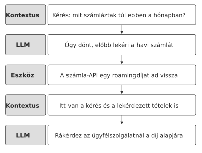
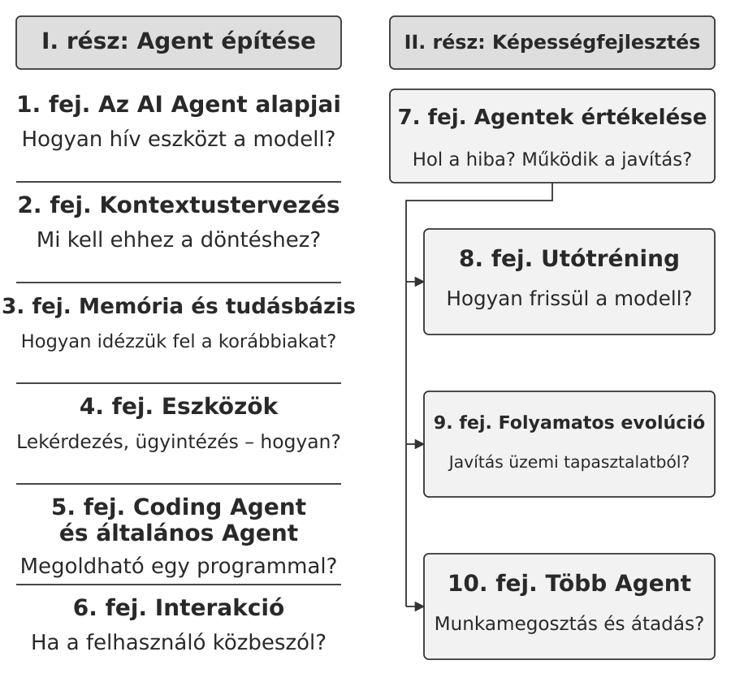

# Bevezetés {.unnumbered}

2025 augusztusától 2026 elejéig online videós kurzust tartottam a Turing kiadónál „AI Agent Bootcamp” címmel. Arról szólt, hogyan lehet AI-ügynököket (AI Agent) magyarázható, ellenőrizhető és újrahasznosítható mérnöki módszerekkel építeni. A kurzus egy ügynök futtatásával indult, majd azt elemezte, miért éppen ilyen az architektúrája: melyik tervezési döntés milyen problémát old meg, mi az ára, és milyen feladatokhoz illik. Ez a könyv a kurzus jegyzeteiből és a hozzájuk tartozó kísérletekből állt össze.

> **Hogyan készült a könyv: ember és gép együttműködése**
>
> Az órákra készülve először elmondtam a vázlatot a Pine hangalapú ügynökének, és rábíztam az anyaggyűjtést meg az első változat megírását. Ezt a diktáláson alapuló együttműködést **whisper codingnak** nevezik. Az órák után ahhoz tértem vissza, hogy a hallgatók melyik lépésnél akadtak el, és melyik kísérlet eredménye lepte meg őket; ilyenkor újra átnéztem a vonatkozó példákat és érveket.

2025 óta fontos változást látok: az AI-kutatás és az ipari gyakorlat súlypontja az alapmodellek képességeinek javításáról egyre inkább afelé tolódik, hogy az ügynökök valódi feladatokat végezzenek el. Ennek nyomán a modellek tanítása és alkalmazása is szorosabban összekapcsolódik. A DeepSeek-R1-hez hasonló következtető modellek megmutatták, mennyit javít a megerősítéses tanulás a matematikai, programozási és következtetési képességeken.[^preface-r1] Az ügynöki megerősítéses tanulás (Agentic Reinforcement Learning) az eszközhívást és a környezettel való interakciót is bevonja a tanításba, így a modell programozni is tanul, és grafikus felületet kezelni is. Ez utóbbi feladattípust gyakran Computer Use-nak hívják: a modell képernyőképből ítéli meg az oldal állapotát, majd kattintással, gépeléssel vagy görgetéssel hajtja végre a műveletet. Az olyan termékek pedig, mint a Manus, a Claude Code vagy az OpenClaw, lehetővé teszik, hogy a felhasználó közvetlenül adjon át feladatokat, és azt is megmutatják, hogyan tud a „kódgenerálás + fájlrendszer” általános célú ügynököt működtetni.

2026 szeptemberében a Meta bemutatta a Muse-t. Abban az időszakban Kínában és világszerte is gombamód szaporodtak a személyes ügynöktermékek. A könyvben tárgyalt problémák közül sokkal a csapatommal már korábban, a Pine fejlesztése során találkoztunk. A Pine AI vezető tudósaként kollégáimmal együtt fejlesztettem ezt a személyes ügynököt, amely a fogyasztók helyett intéz ügyeket. A Pine 2025 januárjának elején indult el az Egyesült Államokban: a felhasználók megkérhetik, hogy hívja fel helyettük a szolgáltatót, tárgyaljon a számláról, kérjen visszatérítést vagy mondjon le egy előfizetést.

Ha a szolgáltató telefonon beleegyezik egy díj elengedésébe, a Pine a hívás végén annyit mondhat a felhasználónak, hogy „az ügyfélszolgálat megígérte”. Azt, hogy „a pénzt visszautalták”, csak akkor állíthatja, ha a visszatérítés megjelent a számlán. Az ilyen ügyek intézéséhez a modellnek emlékeznie kell arra, mire adott felhatalmazást a felhasználó, tudnia kell, mit ellenőrizzen következőként, és meg kell tudnia különböztetni, hol tart az ügy. Amikor később az iparág a Skillről, a Harnessről és a loop engineeringről kezdett beszélni, ezek közül sok megoldást mi éppen ezekben a telefonhívásokban dolgoztunk ki.

- **Skill.** Egy promptot csak akkor töltöttünk be, amikor a feladathoz valóban szükség volt rá. Amikor az eszközök száma megnőtt, a modellt parancssoron keresztül hívattuk meg velük, így nem kellett minden kérésben felsorolni az összes eszköz definícióját.
- **Harness.** A végrehajtási környezetet, az aktuális időt és a felhasználó munkájának állapotát egy állapotsávba írtuk, hogy a modell döntéskor támaszkodhasson rájuk. A modell néha kitalált eredményeket, rossz eszközt hívott meg vagy kihagyott egy utasítást, a veszélyes műveletek pedig a felhasználó felhatalmazásán is túlléphettek. Ezért korlátokat építettünk a végrehajtás köré; hasonló megoldást később a Claude Code-ban is láttunk.
- **Loop engineering.** A modell néha félig elvégzett munka után jelentette ki, hogy kész. Ezért egy ügynök intézte az ügyet, egy másik pedig ellenőrizte a számlát vagy a rendelést, és ha valami elmaradt, visszaadta pótlásra. Ez a javaslattevő–felülvizsgáló (proposer-reviewer) munkamegosztás.

Más modell- és ügynökfejlesztő csapatok hasonló problémák megoldása közben egymástól függetlenül jutottak hasonló módszerekre. Ez még inkább meggyőzött arról, hogy a nehézségeink nagy része olyan probléma, amellyel minden ügynökrendszer szembekerül, amikor a valós használatba lép. Az „AI Agent Bootcamp” mellett 2024 és 2026 között folyamatosan tanítottam gyakorlati ügynökfejlesztést a Kínai Tudományos Akadémia Egyetemén is. A két kurzus hallgatóinak kérdései segítettek felismerni, mely tapasztalatokat kell még világosabban elmagyaráznom. A könyvet nyílt forrásúként adom közre, abban a reményben, hogy minél több kutató és mérnök használja, próbára tegye és továbbfejlessze ezeket a módszereket.

**A gyakorlat jön előbb, az elnevezés csak utána.** Fejlesztőcsapatok számára ennek van egy további tanulsága is: mire egy kifejezés iparági konszenzussá válik, a vezető csapatok rendszerint már régóta kísérleteznek a területen. Aki saját mérnöki előnyt akar felhalmozni, annak a valós üzleti működésből kell idejekorán felismernie a problémákat, és megpróbálnia megoldani őket. Úgy gondolom, ehhez két feltétel kulcsfontosságú.

**Először: olyan valós üzleti feladatot kell választani, amely kellően magas követelményeket támaszt az ügynök képességeivel szemben, és folyamatosan visszajelzést kell gyűjteni belőle.** A Pine egyetlen feladata órákig, akár hetekig is eltarthat. Több féllel kell egyeztetnie, hosszú telefonhívásokat folytatnia, bonyolult űrlapokat kitöltenie, több körben e-maileznie, és mindeközben a számoknak pontosnak, a műveleteknek kézben tarthatónak kell lenniük, a felhasználó érdekeit pedig védeni kell. Az ilyen helyzetek újra és újra felszínre hozzák a modell képességei és az üzleti követelmények közötti rést, és arra késztetik a csapatot, hogy javítsa a Harnesst. Ha egy termék fő értéke csupán annyi, hogy egy adott modellgeneráció gyengeségeit pótolja, a következő modellfrissítés könnyen elhalványíthatja ezt az értéket, és a csapat nehezen halmoz fel tartós előnyt.

**Másodszor: rendszeres értékelési (Evaluation) mechanizmust kell kiépíteni.** Ha a rendszer módosítása után egy számlatárgyalás sikerül, annak oka lehet, hogy az asszisztens a jó kérdéseket tette fel, de az is, hogy az ügyintéző, akivel éppen beszélt, történetesen jogosult volt engedményt adni. Ha ugyanazon az esetkészleten többször összehasonlítjuk a régi és az új változatot, kiderül, hogy a különbség stabil-e. A 7. fejezet részletesen bemutatja, hogyan határozzuk meg a sikerkritériumokat, hogyan építünk értékelési környezetet, hogyan elemezzük a kudarcokat, és hogyan ellenőrizzük a módosításokat.

A Pine-nál a számlakedvezményekből egy módszert tanultunk meg: a felülvizsgáló nézze meg magát az összeget a számlán. Ha ugyanezt a módszert jegyátfoglalásra alkalmazzuk, azt kell megnézni, kiállították-e az új jegyet. A konkrét bizonyíték üzletágról üzletágra változik, mögötte azonban közös elv áll: azt, hogy egy feladat elkészült-e, abból kell megítélni, milyen eredményt hagyott a cselekvés a külvilágban. **A jó elvek túlélik a modellek iterációs ciklusait.**

## A könyv küldetése {.unnumbered}

Képzeljük el, hogy valaki átad egy mobiltelefon-számlát az asszisztensnek, és megkéri, hogy vegye fel a kapcsolatot a szolgáltatóval, és tárgyaljon kedvezményről. Mielőtt belekezd, az asszisztensnek tisztáznia kell, melyik tétel vitatott; a hívás közben meg kell hallgatnia a magyarázatot, és rá kell kérdeznie a feltételekre; a végén pedig közölnie kell a felhasználóval, mit ígért pontosan az ügyfélszolgálat. Az asszisztensnek minden lépésnél három kérdésre kell választ adnia: Mit tud ebben a pillanatban? Milyen cselekvések állnak rendelkezésére? Mi alapján választja ki a következő lépést? A könyv ebből a három kérdésből kiindulva mutatja be az ügynökök felépítését, építési módszereit és képességeik határait. A központi képlet: **Ügynök = LLM + kontextus + eszközök**. Az LLM felel a megértésért, a tervezésért és a döntéshozatalért; a kontextus hordozza az aktuális döntéshez szükséges információt; az eszközök pedig a külső környezethez kapcsolódnak, megfigyeléseket szereznek vagy cselekvéseket hajtanak végre.

Szemléletes hasonlattal élve az LLM az „agy”, a kontextus az „aktuális döntési látómező”, az eszközök pedig az „érzékszervek és a végtagok”. A látómezőben ott van a környezetről szóló információ, a beszélgetés előzménye, a memória és a tudás, de a rendszerutasítások, az eszközdefiníciók és a feladat állapota is. A keresés, az olvasás és a képernyőkép információt hoz vissza, a kattintás, az írás és az üzleti interfészek hívása pedig megváltoztatja a külső állapotot. A 0-1. ábra egy számlalekérdezést bont részeire. Az első döntésnél a modell csak annyit tud, hogy a felhasználónak kérdése van egy díjjal kapcsolatban; a másodiknál már meg tudja nevezni, melyik összegre kell rákérdezni.



A megerősítéses tanulást (Reinforcement Learning, RL) ismerő olvasók a policy, a megfigyelés és a cselekvés fogalmaival is értelmezhetik ezt a munkamegosztást. Az LLM a kontextus alapján választja ki a következő lépést, döntési szerepe tehát a policyhoz (Policy) áll közel; a kontextus az adott döntéshez felhasznált konkrét megfigyeléseket és előzményeket hordozza; az eszközök pedig a megfigyelési és cselekvési interfészt adják. A megfigyelési tér (Observation Space) azt írja le, milyen megfigyelések szerezhetők, a cselekvési tér (Action Space) pedig azt, milyen cselekvések megengedettek; a kettő együtt rajzolja ki az ügynök és a környezet interakciójának kereteit.[^preface-spaces] Az 1. fejezet eszközhívási példákon keresztül bontja ki ezeket a fogalmakat, és bemutatja a Modell és a Harness munkamegosztását az éles implementációkban.

> **Továbbgondolás: az élettől a tervezett entitásokig**
>
> A mérnöki gyakorlaton túl az ügynökök az intelligens rendszerek fejlődésével kapcsolatos kérdéseket is felvetnek. Richard Sutton Turing-díjas kutató, a megerősítéses tanulás úttörője négy szakaszban foglalja össze az univerzum fejlődését: por, csillagok, élet és „tervezett entitások” (designed entities).[^preface-sutton] Az élőlények véletlen mutáció és természetes szelekció révén fejlődnek, a tervezett entitásokat viszont már meglévő intelligens rendszerek célzottan hozhatják létre és fejleszthetik tovább.
>
> Egy ügynök képes kódot generálni, új ügynököt építeni, majd elemezni a futás közbeni viselkedést, módosításokat javasolni és ellenőrizni az eredményt, így fokozatosan eljuthat az önindításig (bootstrap) és a folyamatos fejlődésig. Olyan ez, mintha egy programozó megírna egy másik programozót, aki aztán maga is részt vesz új rendszerek építésében. Az önmegértésnek és önfejlesztésnek ez a lehetősége volt az egyik legizgalmasabb kérdés számomra, amikor a kódgenerálásról és a folyamatos evolúcióról szóló két fejezetet írtam.

## A könyv szerkezete {.unnumbered}

A 0-2. ábra a fejezetek közötti összefüggéseket mutatja. Ha a felhasználó a hívás közben hirtelen meggondolja magát, az asszisztens pedig továbbra is a régi kérés szerint jár el, érdemes a bal oldali oszlop 6. fejezetével kezdeni, amely azt mutatja be, hogyan kezeli az asszisztens a felhasználó közbeszólásait. A javítás után honnan tudhatjuk, hogy más hívásokban is figyelembe veszi az új kéréseket? Ehhez a jobb oldali oszlop 7. fejezetének értékelési módszereire van szükség. Az ábrán a 7. fejezetből kiinduló három nyíl azt jelzi, hogy az értékelés eredményének birtokában a kudarc oka szerint különböző javítási utak közül választhatunk.



- **Az 1. fejezet (Ismerkedés az AI-ügynökökkel)** termékeken és eszközhívási példákon keresztül mutatja be az ügynökök fő alkotórészeit, a futási ciklust, a Harnesst és a vezénylési módokat, és felállítja azt a fogalmi keretet, amelyre az egész könyv épül.
- **A 2. fejezet (Kontextustervezés)** a könyv legfontosabb fejezete: azt tárgyalja, hogyan szervezzük meg a modell számára éppen szükséges információt. A promptok tervezésétől és az igény szerinti betöltéstől az előzmények kezeléséig halad, és a KV Cache segítségével magyarázza el, hogyan befolyásolják ezek a módszerek a válaszok minőségét és a futtatás költségét.
- **A 3. fejezet (Felhasználói memória és tudásbázis)** azt tárgyalja, hogyan tároljuk és hívjuk elő a munkameneteken átívelő információt. A felhasználói memóriától a RAG-on, a strukturált indexeken és a tudás frissítésén át segít elsajátítani a tartós tudás visszakeresésének és karbantartásának módszereit.
- **A 4. fejezet (Eszközök)** arról szól, hogyan szerez az ügynök megfigyeléseket, hogyan hajt végre cselekvéseket, és hogyan kér együttműködést. Az eszközök osztályozásán, az interfésztervezésen, az MCP-n és a végrehajtás kezelésén keresztül mutatja meg, hogyan kapcsolhatók külső képességek a rendszerhez.
- **Az 5. fejezet (Kódoló ügynök és általános ügynök)** az általános célú ügynökök egyik központi architektúra-elvét fogalmazza meg: a végrehajtás magja a kódoló ügynök (Coding Agent), a munkaterülete pedig a fájlrendszer. Először a fejlesztési folyamatot ismerteti, majd multimédiás és üzleti rendszerekből vett esetekkel szemlélteti, hogyan old meg az ügynök problémákat programok írásával, és hogyan hoz létre ezáltal új eszközöket és új ügynököket.
- **A 6. fejezet (Interakció: a megfigyelési és a cselekvési tér kiterjesztése)** a modalitás és az időzítés két dimenziója mentén vizsgálja az ügynökök interakcióit. Az aszinkron eseményeken, a hangon, a Computer Use-on és a robotikán keresztül mutatja be a folyamatos megfigyelést, a gyors és lassú útvonalat, valamint a végrehajtás irányítását.
- **A 7. fejezet (Az ügynökök kiértékelése)** arra ad választ, hogyan ítélhetjük meg a rendszer teljesítményét és egy-egy módosítás hatását. Először a sikerkritériumokat, a környezetet és az adathalmazt határozza meg, majd a verifikátorokat, a pontozást és a statisztikai elemzést tárgyalja, végül a kudarcok okainak elemzéséből vezeti le a javítás irányát.
- **A 8. fejezet (A modell utótanítása)** azt tárgyalja, hogyan frissíthetők a modell képességei adatok és környezetek segítségével, és amellett érvel, hogy elsősorban az adatminőségbe és a tanítási környezetbe érdemes befektetni. A felügyelt finomhangoláson, a megerősítéses tanuláson és a jutalomtervezésen keresztül magyarázza el, miért általánosít eltérően a bemutatókból való tanulás és a felfedezés, és miért hoz gyakran csekély eredményt, ha csak az algoritmust változtatjuk meg.
- **A 9. fejezet (Az ügynökök folyamatos evolúciója)** azt vizsgálja, hogyan használható fel a működés során szerzett tapasztalat az ügynök későbbi változatainak javítására. Összehasonlítja a frissítések négy típusát – tudás, utasítások, programok és paraméterek –, majd validálási, kiadási és helyreállítási folyamatokkal kezeli a hosszú távú változásokat.
- **A 10. fejezet (Többügynökös együttműködés)** azt tárgyalja, mikor hoz többletértéket több résztvevő, és hogyan osszák meg a munkát, hogyan kommunikáljanak és hangolják össze tevékenységüket. Először azt tisztázza, hogyan oszlik meg a kontextus és az irányítás, majd esetekkel szemlélteti az együttműködési mechanizmusokat, elemzi a kudarcok okait, végül az ügynökötársadalmak és ügynökgazdaságok lehetséges formáit vizsgálja.

## Hogyan olvassuk ezt a könyvet {.unnumbered}

- **Ha a nulláról építesz ügynökterméket**, érdemes az egész könyvet végigolvasni. Az 1–6. fejezet segítségével állíts össze egy ügyeket intéző asszisztenst, majd a 7. fejezettel derítsd ki, milyen feladatoknál hibázik könnyen. Az utolsó három fejezet azt tárgyalja, hogyan javítható e kudarcok alapján a modell, a rendszer vagy a résztvevők közötti munkamegosztás.
- **Ha először átfogó képet szeretnél kapni**, olvasd el sorban az 1., 2., 4. és 7. fejezetet. Kövess végig egyetlen eszközhívást: először ismerd meg az ügynök futási ciklusát, aztán nézd meg, milyen információt kap a modell, és mit csinál valójában az eszköz, végül értékeléssel döntsd el, megfelel-e az eredmény a felhasználó kérésének. Amikor a 2. fejezetben a KV Cache-hez érsz, első olvasásra elég a fejezet elején megfogalmazott három következtetést megjegyezni; a mögöttes elvekhez a kísérletek elvégzése után is visszatérhetsz.
- **Ha a modelltanítás áll a középpontban**, az 1. és 2. fejezetből értsd meg, hogyan működik egy ügynök, majd a 7. fejezet értékelési módszereivel együtt olvasd a 8. fejezetet. Így össze tudod kapcsolni a tanítási célokat a valós feladatokon mutatott teljesítménnyel.
- **Ha már élesben futó ügynököt tartasz karban**, válassz ki valós feladatokat, és értékeld őket a 7. fejezet módszereivel. Ha például az asszisztens elavult árat közölt a felhasználóval, először nézd meg, az árajánlat melyik változatát kapta meg. Ha a tudás vagy a folyamat elavult, ezzel a kudarccal a fejedben olvasd el a 9. fejezetet; ha az árajánlat és az eszközök is megfelelően rendelkezésre álltak, és a modell a folyamat javítása után is rendre rosszul választ, akkor olvasd el a 8. fejezetet, és mérlegeld, megéri-e tanítóadatokat előkészíteni.

Minden fejezetben vannak kísérletek és gondolkodtató kérdések. A kísérletek számozása „X-Y. kísérlet” formájú, ahol X a fejezet száma, Y pedig a fejezeten belüli sorszám. A csillagok a nehézséget jelzik: a ★ kezdőknek való, a ★★ némi mérnöki tapasztalatot igényel, a ★★★ nyitott kérdéseket vagy összetett rendszertervezést érint. A kísérletek többségéhez futtatható kód tartozik, amely egy nyílt forráskódú repóban található:

> **Kísérő kódrepó**: `bojieli/ai-agent-book`

Ha most végzel először kísérletet, kezdheted az „1-1. kísérlet: a kontextus kulcsszerepe” feladattal. Ha Gitet használsz, futtasd a terminálban:

```bash
git clone https://github.com/bojieli/ai-agent-book.git
cd ai-agent-book
```

Ugyanezt a könyvtárat úgy is megkaphatod, hogy a repó oldalán a **Code → Download ZIP** lehetőséget választod, majd kicsomagolod a fájlt. Az 1. fejezet kísérletjegyzékében (`chapter1/README.md`) keresd meg az 1-1 számot, majd nyisd meg a `chapter1/context/README.md` fájlt. Ezután bármelyik „X-Y. kísérlet” projektjét és futtatási módját megtalálod a repó `chapterX/README.md` fájljában. A „reprodukciós útmutatók” megadják a külső projekteket és beszerzésük módját; a telepítési parancsokat és a könyvtárak leírását a README-k tartalmazzák.

## Előfeltételek {.unnumbered}

A könyv olyan olvasóknak szól, akik alapszinten tudnak programozni, és szeretnék megérteni, illetve megépíteni az ügynököket. A kísérletek elvégzéséhez a következő alapokra lesz szükség.

**Kötelező: a teljes könyv olvasásának alapjai**

- **Python programozás**: ismerd a szintaxist, a gyakori adatszerkezeteket és az olyan csomagkezelőket, mint a pip, hogy el tudd olvasni és módosítani tudd a kísérletek kódját. A könyv kísérleteinek többsége Pythonra épül.
- **Tapasztalat LLM-ek használatában**: használtál már ChatGPT-t, Claude-ot vagy hasonló terméket, és ismered az alapvető menetet: kérést fogalmazol meg, elolvasod a választ, majd továbbkérdezel.
- **Szoftverfejlesztési alapismeretek**: ismerd a parancssort, a Gitet, a JSON-t és a REST API-kat, hogy ezek segítségével futtatni tudd a projekteket, át tudd nézni a változtatásokat, és el tudd olvasni az interfészek adatait.

A kísérletek elvégzéséhez erősen ajánlom, hogy válassz egyet a Claude Code, a Codex, a Cursor és a TRAE közül. Kérd meg, hogy segítsen hibát keresni egy kódrészletben, és figyeld meg, milyen fájlokat olvas el, és milyen eszközöket hív meg. Amikor később a futási ciklusról és a kontextuskezelésről olvasol, lesz egy saját élményed, amelyhez viszonyíthatsz.

**Ajánlott: fejezetenként kiegészítő ismeretek**

- **Gépi tanulási alapok (8. fejezet)**: a tanítás és a következtetés, a veszteségfüggvény, a gradiensereszkedés és a túltanulás ismerete segít megérteni a modell frissítésének folyamatát.
- **Matematikai alapok (2., 3., 7. és 8. fejezet)**: a vektorok és mátrixok segítenek megérteni a beágyazásokat és a figyelmi mechanizmust, a valószínűségszámítás és a statisztika pedig az értékelési metrikákat és a várható jutalmat. A könyv a szemléletes magyarázatokra és a gyakorlati felhasználásra helyezi a hangsúlyt.
- **Webfejlesztési alapok (6. fejezet)**: a HTTP, a WebSocket és a frontend–backend munkamegosztás ismerete segít megérteni az aszinkron eseményvezérelt architektúrát és a valós idejű hangkommunikációt.
- **Transformer-alapok (2. és 8. fejezet)**: a figyelmi mechanizmus és a modellszerkezet ismerete segít megérteni a kontextus feldolgozását és az utótanítást. Aki rendszerezetten szeretné megtanulni ezeket, olvassa el a *Hands-On Large Language Models* című könyvet (Jay Alammar és Maarten Grootendorst; kínai fordítását Li Bojie készítette, a Turing kiadásában jelent meg). Ez a könyv ábrákkal magyarázza el a Transformert, az előtanítást és a finomhangolást, így jól kiegészíti e könyv mérnöki szemléletét.

A 8. fejezet utótanításról szóló részét leszámítva a többi fejezet kevés matematikai és gépi tanulási ismeretet igényel; alapszintű programozási tapasztalattal már neki lehet kezdeni az olvasásnak.

## Köszönetnyilvánítás {.unnumbered}

Köszönöm Meng Ge és Liu Meiying szerkesztőknek a Turing kiadónál, hogy gondozták a könyvet, és sok munkát fektettek az „AI Agent Bootcamp” megszervezésébe; köszönöm Liu Junming tanár úrnak, hogy gyakorlati ügynökfejlesztési kurzust indított a Kínai Tudományos Akadémia Egyetemén. Köszönöm a két kurzus hallgatóinak: kérdéseitek, kísérletekről adott visszajelzéseitek és javaslataitok segítettek folyamatosan javítani a magyarázataimat, és elmélyítették e fogalmak megértését is.

Köszönöm a Pine AI minden munkatársának. A valós üzleti működés kihívásai és a csapaton belüli viták adták a könyv számos módszerének és esetének forrását. Gyakorlatotok és meglátásaitok révén ezek a felismerések folyamatosan csiszolódhattak.

Köszönöm barátaimnak az AI-iparágban. Beszélgetésről beszélgetésre őszintén elmondtátok a véleményeteket, megosztottátok tapasztalataitokat és ítéleteiteket, és ezzel segítettetek mélyebben megérteni a modelleket és az ügynököket.

Végül, de leginkább a családomnak tartozom köszönettel, különösen a feleségemnek, Meng Jiayingnek. Mindvégig támogatta a könyv megírását, és számos értékes javaslattal segítette a kéziratot.

[^preface-r1]: DeepSeek-AI, *DeepSeek-R1: Incentivizing Reasoning Capability in LLMs via Reinforcement Learning*, 2025.
[^preface-spaces]: A Gymnasium dokumentációjának „Spaces” című szakasza.
[^preface-sutton]: Richard Sutton interjúja Dwarkesh Patellel, 2025-09-26, a „Succession to AI” című rész.
