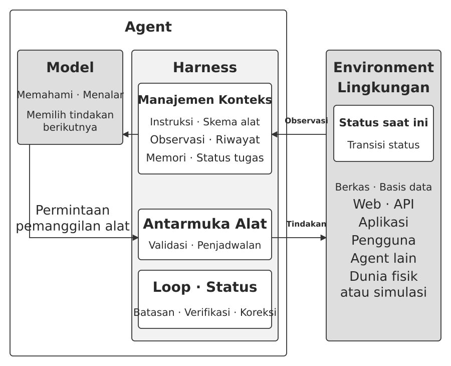
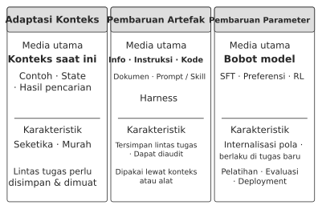
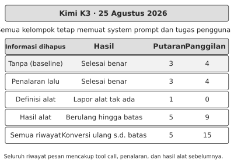
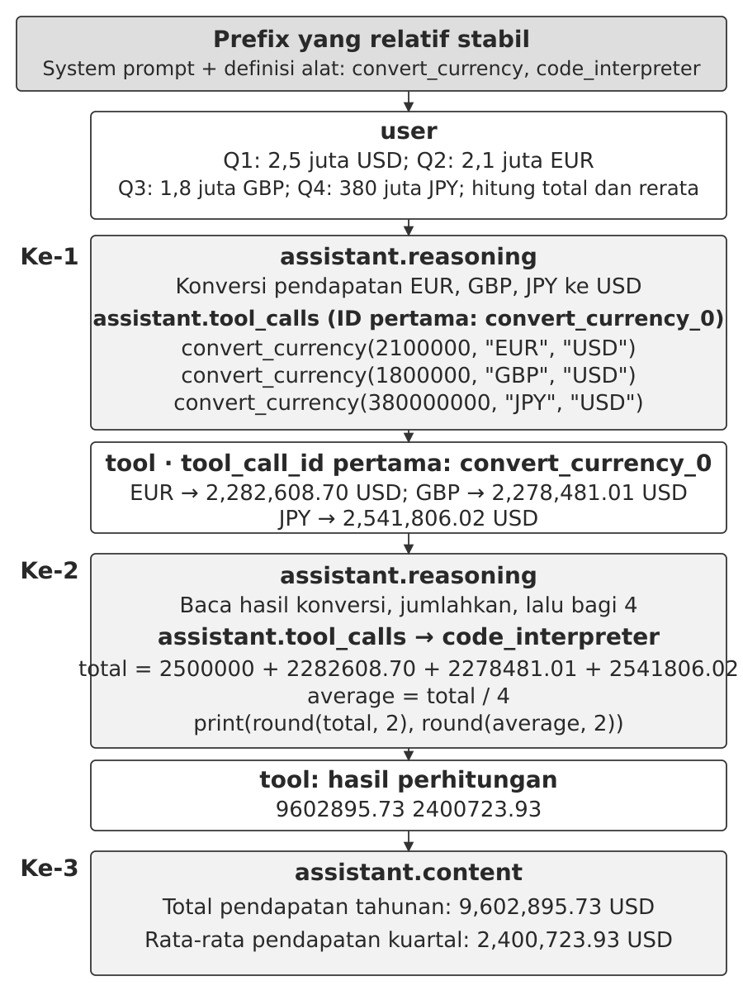
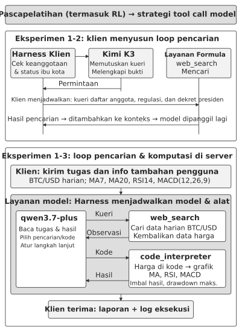
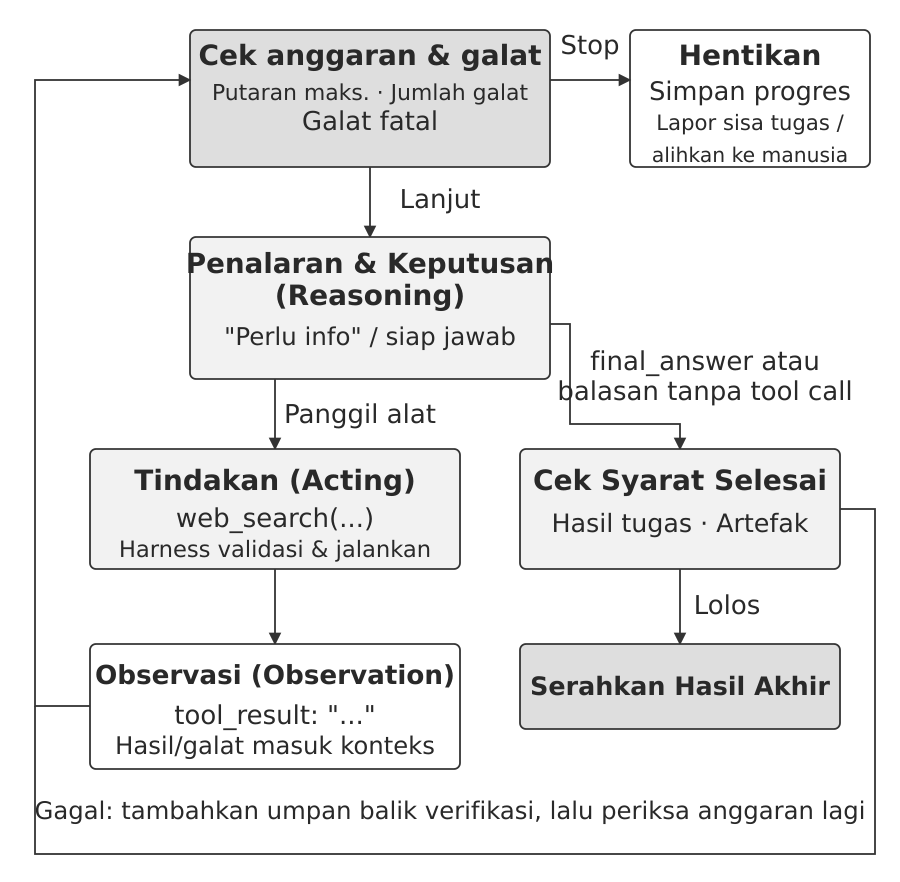
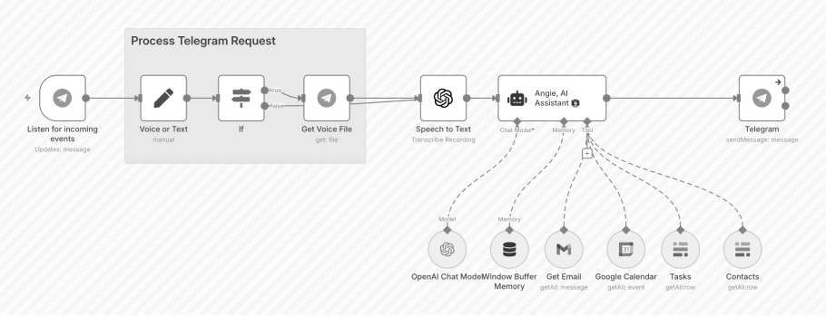

# Memulai dengan AI Agent

Saat Anda meminta Deep Research meneliti suatu topik, ia akan mencari dan membaca berulang kali, lalu menyusun hasilnya menjadi laporan. Manus dapat mengoperasikan peramban untuk menyelesaikan tugas online, asisten ponsel Doubao dapat memesan tiket dan mengirim pesan dari ponsel, dan Pine AI dapat menelepon atas nama pengguna untuk menegosiasikan tagihan yang lebih rendah dengan operator. Semua ini adalah penerapan AI Agent.

Saat Anda meminta Cursor memperbaiki sebuah fungsi, ia menemukan fungsi tersebut, mengedit berkas, lalu menjalankan pengujian. Jika pengujian masih gagal, pesan error menjadi dasar perubahan berikutnya; baru ketika pengujian lolos, ia punya bukti untuk melaporkan hasilnya kepada Anda. Urutan tiga langkah—mencari, mengedit, dan menguji—dapat ditulis ke dalam program sejak awal, tetapi baris mana yang harus diubah dan ke mana harus kembali setelah gagal bergantung pada informasi yang diperoleh selama eksekusi. Proses memilih tindakan berdasarkan tujuan, lalu menyesuaikan rencana berdasarkan hasilnya, juga terjadi dalam tugas riset maupun negosiasi lewat telepon.

## Agent Modern = LLM + Konteks + Alat

Buku ini merangkum tiga jenis elemen fungsional Agent modern dalam satu rumus: **Agent = LLM (Large Language Model) + konteks + alat**.

- **LLM adalah otak Agent**, yang bertugas memahami tugas, merencanakan langkah, dan memilih tindakan. Prapelatihan memberi model kemampuan bahasa dan pengetahuan tentang dunia, sedangkan pascapelatihan membentuk lebih lanjut perilaku seperti mengikuti instruksi, bernalar, dan memanggil alat. Bab 8 akan membahas metode pascapelatihan seperti supervised fine-tuning dan reinforcement learning.
- **Konteks adalah bidang pandang keputusan Agent saat ini**, yang memuat informasi yang dibutuhkan untuk keputusan kali ini: instruksi, definisi alat, observasi lingkungan, memori pengguna, pengetahuan domain, riwayat pesan, status Agent sendiri, dan kemajuan tugas.
- **Alat adalah indra sekaligus tangan dan kaki Agent**, yang memperoleh informasi atau menjalankan operasi melalui antarmuka. Sistem alat mencakup definisi, protokol pemanggilan, dan adaptor; ia mendukung operasi observasi seperti pencarian, pembacaan, dan tangkapan layar, sekaligus operasi seperti penulisan, eksekusi kode, delegasi ke sub-agent, dan komunikasi dengan pengguna.

Satu alat dapat menjalankan beberapa peran sekaligus. Misalnya, ketika model membaca berkas melalui baris perintah, isi berkas yang dikembalikan menjadi dasar keputusan berikutnya; ketika model menjalankan program melalui baris perintah, status berkas atau proses juga dapat berubah.

Misalkan Anda baru saja membuka sebuah paket dan ingin bertanya kepada layanan pelanggan: "Apakah barang yang sudah dibuka masih bisa dikembalikan?" Sistem dapat menggunakan **Retrieval-Augmented Generation** (RAG) untuk mencari kebijakan pengembalian toko yang berlaku, lalu meminta model menjawab berdasarkan ketentuan tersebut.[^ch1-rag] Dengan menelusuri satu kueri ini, tanggung jawab beberapa komponen menjadi jelas. Teks asli kebijakan beserta indeksnya disimpan dalam basis pengetahuan eksternal; alat retrieval mencari bagian yang relevan dengan pertanyaan, lalu program yang memanggil model memasukkan bagian tersebut beserta sumbernya ke dalam permintaan kali ini. Setelah membaca butir "kemasan dibuka", model dapat menjelaskan ketentuannya; jika ketentuan itu masih dibedakan menurut kategori barang, model harus terlebih dahulu menanyakan barang apa yang Anda beli.

[^ch1-rag]: Patrick Lewis dkk., Retrieval-Augmented Generation for Knowledge-Intensive NLP Tasks, NeurIPS, 2020.

Dalam kueri pengembalian barang ini, memulai retrieval adalah tindakan Agent, sedangkan ketentuan yang dikembalikan adalah observasi yang diperolehnya dari lingkungan (*environment*). Apakah langkah berikutnya menjawab atau bertanya balik bergantung pada isi ketentuan tersebut. Inilah yang dalam reinforcement learning dan teori kontrol disebut loop tertutup, seperti ditunjukkan Gambar 1-1.



Lapisan luar gambar menandai batas antara Agent dan lingkungan. Berkas, basis data, halaman web, pengguna, Agent lain, serta dunia fisik atau simulasi semuanya dapat menjadi lingkungan tempat Agent berinteraksi. Lapisan dalam memperlihatkan pembagian kerja dalam implementasi produksi: **Model bertugas memahami, bernalar, dan mengambil keputusan; Harness berada di dalam batas Agent tetapi di luar Model, bertugas menyusun konteks, antarmuka alat, loop eksekusi, dan status, serta menerapkan pembatasan, verifikasi, dan koreksi.** Harness dapat membuat, mengisolasi, atau menjadi proxy bagi lingkungan; isi berkas, status proses, dan sebagainya berubah di dalam lingkungan seiring tindakan yang dijalankan.[^ch1-harness]

[^ch1-harness]: Lihat *The Anatomy of an Agent Harness* dari LangChain dan *Effective harnesses for long-running agents* dari Anthropic. Sebagian implementasi memasukkan sandbox ke dalam Harness; Gambar 1-1 menggambar lingkungan secara terpisah agar mudah menelusuri apa yang sebenarnya diubah oleh suatu tindakan.

Karena itu, buku ini memakai dua cara penguraian yang saling melengkapi: **"LLM + konteks + alat" menjelaskan komposisi fungsional, sedangkan "Model + Harness" menjelaskan implementasi produksi.** Konteks disusun oleh Harness lalu diberikan kepada Model; pemanggilan alat diputuskan oleh Model, divalidasi dan dijadwalkan oleh Harness, kemudian dijalankan oleh alat atau lingkungan. Sistem sederhana dapat dimulai dari perakitan konteks dan penjadwalan alat, lalu secara bertahap dilengkapi dengan mekanisme pembatasan, verifikasi, dan koreksi yang dibutuhkan untuk berjalan di lingkungan produksi.

Jika Anda akrab dengan reinforcement learning, tabel berikut dapat dibaca melalui tiga pertanyaan: siapa yang memutuskan langkah berikutnya, atas dasar apa keputusan itu diambil, dan bagaimana keputusan itu dijalankan. Ini hanyalah analogi kasar berdasarkan fungsi.

| Pemahaman Intuitif | Elemen Rekayasa | Konsep Terkait dalam Reinforcement Learning | Makna |
|-----------|-----------|----------------------------|----------------------------------------------|
| **Otak** | LLM | **Kebijakan** (*policy*) | Memutuskan apa yang dilakukan berikutnya berdasarkan informasi saat ini |
| **Bidang pandang keputusan saat ini** | Konteks | **Observasi dan riwayat** | Menyusun informasi dari lingkungan dan riwayat yang ada menjadi dasar keputusan |
| **Indra serta tangan dan kaki** | Alat dan adaptor | **Antarmuka observasi dan tindakan** | Menetapkan cara membaca informasi lingkungan, mengirim tindakan, serta format pemanggilan dan nilai kembalian |

### Ruang Observasi dan Ruang Aksi: Antarmuka antara Model dan Dunia

**Ruang observasi menggambarkan observasi apa saja yang mungkin diterima Agent, sedangkan ruang aksi menggambarkan aksi apa saja yang mungkin dikeluarkannya.** Konteks dalam satu pemanggilan membawa informasi konkret, sementara alat yang tersedia menyediakan antarmuka untuk berinteraksi dengan lingkungan. Selain alat, input pengguna, notifikasi peristiwa, dan sebagainya juga dapat membawa observasi; parameter pemanggilan alat, izin, dan lingkungan eksekusi bersama-sama membatasi cakupan tindakan.

Bayangkan dua jenis kegagalan. Pada yang pertama, model mampu menjelaskan setiap pos biaya pada tagihan, tetapi tidak dapat memperoleh tagihan bulan ini. Setelah pengguna memberi izin baca, tagihan masih harus diambil dan diserahkan kepada model, barulah model dapat menilai biaya mana yang bermasalah. Pada yang kedua, pengguna meminta asisten mengganti paket layanan; asisten sudah menemukan paket yang cocok, tetapi antarmuka akun hanya mengizinkan kueri. Sekalipun membaca tagihan sekali lagi, asisten tetap tidak dapat melakukan perubahan; ia memerlukan izin operasi yang sesuai. Tugas Harness adalah memasukkan materi yang dibaca ke dalam konteks, menerima tindakan yang dipilih model, memeriksa parameter dan izin, lalu menjadwalkan eksekusinya.

Karena itu, **ketika model dasarnya tetap, menyesuaikan ruang observasi dan ruang aksi merupakan cara rekayasa yang penting untuk meningkatkan kinerja tugas.** Jika model melewatkan fakta kunci, data yang relevan dapat dimasukkan ke dalam konteks; jika model sering keliru memilih di antara alat yang mirip, antarmuka yang tumpang-tindih dapat digabungkan, atau hanya alat yang diperlukan tugas saat ini yang dimuat.

Saat menonton video, masalah sebaliknya muncul: gambar selalu ada, tetapi perubahan yang layak dinilai ulang tidak banyak. Misalkan asisten sedang menunggu unggahan berkas; jika model utama dipanggil setiap kali bilah kemajuan bergerak, banyak komputasi terbuang, sedangkan jika ia baru melihat setiap sepuluh detik, pesan kegagalan yang muncul sekilas bisa terlewat. **Menurut saya, menjarangkan ruang observasi adalah salah satu persoalan mendasar dalam desain Agent.** Sistem dapat terus mengamati lingkungan, tetapi hanya meneruskan perubahan yang mungkin mengubah tindakan berikutnya, beserta konteks yang diperlukan, kepada model utama.

**Manus: menggabungkan riset, pemrograman, dan kendali komputer dalam satu tugas.** Deep Research unggul dalam mencari dan membaca, Coding Agent dapat menulis dan menjalankan kode, dan Computer Use Agent dapat mengoperasikan antarmuka. Manus memadukan peramban, sistem berkas, eksekusi kode, dan baris perintah di dalam sandbox cloud, sehingga satu Agent dapat mencari bahan terlebih dahulu, lalu mengolah berkas dan menjalankan kode, dan akhirnya menyelesaikan operasi melalui peramban. Peramban dan pembacaan berkas menambah informasi yang dapat diperoleh, sedangkan eksekusi kode dan perintah menambah operasi yang dapat dikombinasikan. **Menurut saya, kombinasi ini merupakan terobosan penting bagi Agent serbaguna: satu Agent dapat melintasi batas produk yang sebelumnya terpisah dan merangkai pengumpulan bahan, pengolahan data, dan eksekusi operasi menjadi tugas yang utuh.**

**OpenClaw: memperluas antarmuka ke kehidupan digital pengguna.** OpenClaw menerima tugas dan mengembalikan hasil melalui kanal pesan seperti WhatsApp, Telegram, Slack, Discord, dan iMessage, serta memakai Gateway yang berjalan di perangkat pengguna untuk menghubungkan kanal pesan, model, dan alat. Setelah alat yang sesuai dikonfigurasi dan izin diberikan, Agent dapat mengolah berkas lokal sekaligus terhubung ke layanan cloud seperti Google Drive dan Notion. Dengan begitu, bahan milik pengguna yang tersebar di berbagai akun dan perangkat dapat masuk ke dalam proses pengerjaan satu tugas yang sama. Manus pada awalnya terutama bekerja di sandbox cloud, dan pengguna harus mengunggah berkas; konektor Google Drive dan fitur desktop My Computer yang ditambahkan kemudian memperluas jangkauan akses ke berkas cloud dan sumber daya lokal. Evolusi ini menunjukkan bahwa pertumbuhan kemampuan produk sering kali berasal dari perluasan antarmuka observasi dan tindakan[^ch1-agent-products].

[^ch1-agent-products]: Untuk struktur produk, lihat pengenalan resmi Manus tentang Sandbox, Google Drive Connector, dan My Computer, serta repositori resmi dan dokumentasi alat OpenClaw. Sumber daya yang benar-benar dapat diakses ditentukan oleh konektor, konfigurasi tool, dan izin pengguna.

Tugas setiap produk berbeda-beda, tetapi semuanya dapat dipahami dari tiga sisi: dasar keputusan, operasi yang tersedia, dan strategi eksekusi.

| Produk Agent | Informasi Utama dalam Konteks | Alat dan Operasi yang Tersedia | Strategi Eksekusi |
|----------------|----------------------|----------------------------|------------------------------|
| **Coding Agent seperti Cursor** | Kebutuhan, potongan kode, daftar direktori, output terminal | Pencarian kode, baca/tulis berkas, eksekusi perintah | Memahami kebutuhan→mencari kode yang relevan→mengedit kode→menguji dan memverifikasi→men-debug dan memperbaiki |
| **Agent pencarian seperti Deep Research** | Hasil pencarian, isi halaman web, abstrak dan sitasi makalah | Kueri pencarian, pembacaan halaman web, pembuatan laporan | Menyesuaikan arah pencarian berdasarkan informasi yang ada, lalu secara bertahap menyintesis laporan utuh |
| **Agent kendali komputer seperti Browser Use** | Tangkapan layar, DOM atau pohon aksesibilitas, hasil operasi | Mengklik, mengetik, menggulir, mengambil tangkapan layar, menjalankan kode | Membaca antarmuka→mengenali elemen target→menjalankan operasi→memverifikasi hasil |
| **Asisten ponsel seperti Doubao** | Tangkapan layar ponsel, status antarmuka App, umpan balik sistem | Mengetuk, menggeser, mengetik, membuka App | Memahami kebutuhan→menemukan App target→menjalankan operasi→memastikan selesai |
| **Agent urusan pribadi seperti Pine AI dan Meta Muse** | Catatan akun, tagihan, dan data penyedia layanan yang dibaca dengan izin | Menelepon, mengirim email, mengisi formulir, mengonfirmasi dengan pengguna | Mengumpulkan informasi→menyusun strategi negosiasi→menghubungi penyedia layanan→bernegosiasi→melaporkan hasil |

**Bagaimana sebuah permintaan yang didelegasikan berubah menjadi tugas yang dapat dijalankan?** Saat membangun asisten urusan pribadi di Pine, saya mendapati bahwa pengguna sering hanya menyebutkan satu tujuan, misalnya "Tolong pesankan tiket pesawat untuk perjalanan dinas, sebisa mungkin tidak lebih dari 1200 yuan." Asisten harus terlebih dahulu memastikan tanggal, tujuan, dan apa yang paling diutamakan dalam perjalanan ini, lalu mengumpulkan data yang kurang, menyepakati dengan pengguna bagaimana urusan itu akan dijalankan dan syarat mana yang masih bisa ditawar, baru kemudian menghubungi penyedia layanan. Situasi baru yang muncul selama pengurusan pun dapat membawa tugas kembali ke langkah sebelumnya.

Misalkan harga tiket terendah yang ditemukan petugas layanan pelanggan adalah 1250 yuan. Model akan menilai berdasarkan akal sehat, keadaan perjalanan ini, dan kebiasaan pengguna yang diingatnya. Untuk pengguna yang sedang dinas dan biasanya bersedia membayar sedikit lebih mahal demi jadwal yang cocok, Pine mungkin langsung memesannya; untuk keluarga yang sedang berlibur dan sebelumnya secara tegas memperhatikan total pengeluaran, Pine mungkin memberi tahu selisih harganya kepada pengguna terlebih dahulu sambil meminta petugas mencari penerbangan lain. Jika kemudian pengguna menambahkan, "Lain kali kalau tiketnya melebihi anggaran, tanya saya dulu," umpan balik itu memberi dasar yang lebih spesifik daripada pengalaman umum untuk keputusan berikutnya.

Dalam skenario lain, petugas layanan pelanggan bank menawarkan untuk mengirim dokumen ke rumah, sementara asisten ingat bahwa pengguna sedang bepergian ke luar negeri. Kali ini yang perlu diubah adalah cara penyerahannya: asisten dapat langsung menjelaskan kesulitan menerima kiriman dan meminta dokumen dikirim lewat email. Lalu pada urusan keringanan tagihan, petugas menyanggupi secara lisan di telepon; asisten dapat melaporkan janji pihak perusahaan secara akurat, tetapi untuk memastikan potongan itu benar-benar diterapkan, diperlukan tagihan berikutnya sebagai observasi baru. Ruang aksi sebuah asisten dapat diperluas sampai ke panggilan telepon sungguhan, tetapi kesimpulannya tetap dibatasi oleh ruang observasinya.

Dilihat dari jenis urusan yang dititipkan, buku ini akan membahas tiga kelompok penerapan: urusan sehari-hari, kerja kolaboratif di kantor, dan eksplorasi ilmiah. Satu asisten dapat menangani tugas dari berbagai kelompok; perbedaannya terletak pada siapa yang memberinya wewenang, apa yang dapat diubahnya, dan siapa yang akhirnya menerima hasil kerjanya. Di kantor, apakah sebuah tiket sudah boleh ditutup begitu seorang rekan menyerahkan hasil pemeriksaannya? Misalkan penanggung jawab proyek, dalam sebuah tiket di Multica, menyebut nama asisten dan memintanya memeriksa satu selisih dalam tabel anggaran. Komentar itu memicu pemeriksaan, tetapi tiket tetap dimiliki penanggung jawab semula dan statusnya juga tidak berubah. Asisten menyerahkan dua angka beserta sumbernya, sehingga pertanyaan rekan tadi terjawab; apakah keseluruhan anggaran dapat diajukan masih harus diputuskan oleh penanggung jawab dengan mempertimbangkan pekerjaan lain yang belum selesai.[^ch1-multica]

Untuk tugas riset ilmiah, pertanyaan yang sama dapat diajukan: atas dasar apa kita menyatakan ada kemajuan? Ketika AlphaEvolve dari Google DeepMind mencari algoritma perkalian matriks, model mengusulkan program kandidat, lalu evaluator menjalankan program tersebut dan memeriksa apakah hasil perkaliannya benar dan berapa kali perkalian digunakan. Pencarian berikutnya dapat melanjutkan perbaikan dari program yang berkinerja baik. Tim peneliti melaporkan bahwa salah satu algoritmanya hanya memerlukan 48 perkalian skalar untuk mengalikan dua matriks kompleks $4\times 4$. "Lebih sedikit perkalian" memiliki objek hitungan yang jelas, dan algoritma itu tetap harus menghasilkan hasil perkalian matriks yang benar.[^ch1-alphaevolve]

[^ch1-multica]: Multica, menyebut nama Agent dalam komentar tiket. Bab 10 membahas cara membedakan permintaan bantuan sementara dengan pengalihan tanggung jawab dalam kolaborasi.

[^ch1-alphaevolve]: Google DeepMind, catatan riset AlphaEvolve, Mei 2025. Jumlah perkalian di sini adalah jumlah perkalian skalar dalam algoritma; waktu eksekusi sebenarnya masih bergantung pada implementasi dan perangkat keras.

Ruang aksi sistem-sistem ini bersifat **terbuka** (*open-ended*). Kata kunci pencarian, teks yang diketik, kode yang dihasilkan, dan kombinasi operasi sulit didaftar habis sejak awal, sementara setiap tindakan tetap dibatasi oleh alat, parameter, izin, dan lingkungan eksekusi. Justru karena itu, rencana yang dapat dijalankan harus menyisakan ruang bagi observasi baru untuk mengubah langkah berikutnya.

### Alat: Indra serta Tangan dan Kaki Agent

Alat mewujudkan keputusan model menjadi pembacaan atau operasi terhadap lingkungan eksternal. Alat pencarian dan pembacaan membawa kembali observasi, sedangkan alat seperti penulisan berkas dan eksekusi perintah menjalankan tindakan. Melalui hasil yang dikembalikan, model mengetahui efek suatu operasi, lalu memutuskan untuk melanjutkan, mencoba ulang, atau mengakhiri tugas.

Berdasarkan kegunaan utamanya, buku ini membagi alat menjadi lima jenis. Satu antarmuka dapat memiliki beberapa kegunaan sekaligus; misalnya, panggilan suara dapat dipakai untuk memperoleh informasi sekaligus menyampaikan permintaan.

**Alat persepsi** (*Perception Tool*) bertugas memperoleh informasi: mesin pencari menyediakan bahan dari web, alat pembaca berkas mengakses dokumen lokal, dan antarmuka API serta basis data terhubung ke layanan eksternal dan data perusahaan.

**Alat eksekusi** (*Execution Tool*) bertugas menjalankan operasi: menjalankan kode, mengubah berkas, mengeksekusi perintah sistem, atau memanggil API eksternal, sehingga keputusan benar-benar terwujud di lingkungan.

**Alat kolaborasi** (*Collaboration Tool*) mendukung pembagian kerja dan koordinasi: mendelegasikan tugas khusus kepada sub-agent, mengumpulkan hasilnya, dan mengoordinasikan pekerjaan beberapa Agent. Ketika keputusan memerlukan keterlibatan manusia, sistem juga dapat meminta konfirmasi melalui antarmuka komunikasi pengguna.

**Alat pemicu peristiwa** (*Event Trigger Tool*) menghubungkan peristiwa eksternal ke proses yang sedang berjalan. Email baru, waktu terjadwal yang tiba, atau callback Webhook dapat memicu sebuah tugas. Adaptor peristiwa bertugas mengubah input semacam ini menjadi observasi yang dapat diolah Agent, sedangkan mekanisme penjadwalan bertugas memulai atau melanjutkan eksekusi; aturan pemicunya dapat dikonfigurasi oleh pengembang atau didaftarkan melalui pemanggilan alat yang diizinkan.

**Alat komunikasi pengguna** (*User Communication Tool*) bertugas menyampaikan informasi kepada pengguna dan mengumpulkan umpan balik, misalnya mengirim pesan teks, melakukan panggilan suara, atau mengirim email. Alat ini dipakai untuk melaporkan kemajuan dan meminta konfirmasi, dan juga dapat secara proaktif mengingatkan pengguna untuk menangani suatu urusan.

Bab 4 akan membahas desain kelima jenis alat ini secara rinci. Definisi antarmuka memengaruhi apakah model dapat memilih alat dan mengisi parameter dengan benar, penanganan error menentukan apakah eksekusi dapat berlanjut setelah gagal, dan kontrol izin membatasi jangkauan dampak suatu operasi. MCP (Model Context Protocol) menyediakan cara terpadu untuk menemukan dan memanggil alat, sehingga mengurangi pekerjaan adaptasi antarsistem.

**Pemanggilan alat** (*tool calling*) adalah kemampuan model untuk mengajukan permintaan operasi dalam format yang telah disepakati. Function calling yang umum dikenal menyatakan permintaan itu dengan nama alat dan parameter terstruktur. Buku ini secara konsisten menggunakan istilah "pemanggilan alat".

Ambil contoh kueri cuaca Beijing. Model dapat menuliskan nama kota, tetapi suhu yang sebenarnya baru muncul di konteks setelah Harness menjalankan kueri. Berikut empat langkah pesan untuk pemanggilan ini:

```text
Langkah 1: Deklarasikan alat       Langkah 2: Model memutuskan memanggil
tools: [{                          assistant: {
  name: "get_weather",               tool_calls: [{
  parameters: {                        id: "call_1",
    city: "string"                     function: "get_weather",
  }                                    arguments: {city: "Beijing"}
}]                                   }]
                                   }

Langkah 3: Hasil masuk konteks     Langkah 4: Model menjawab dari hasil
tool: {                            assistant: {
  tool_call_id: "call_1",              content: "Beijing hari ini 28°C, cerah."
  content: '{"temp":28,"sky":"cerah"}'}
}
```

Di sini, `call_1` menghubungkan nilai kembalian alat dengan permintaan pemanggilannya. Pengembang menjelaskan cara memanggil alat, menulis fungsi kueri cuaca, dan mengembalikan hasil kueri kepada model; model memutuskan apakah akan memanggil alat, alat mana yang dipanggil, dan parameter apa yang diteruskan. Bab 2 akan membahas struktur pesan API lebih lanjut.

Saat merancang alat, mulailah dengan kemampuan yang cukup. Untuk aritmetika dasar, kalkulator dengan parameter yang jelas sudah memadai; ketika tugas berkembang menjadi membaca tabel, membersihkan nilai yang hilang, menghitung statistik, dan membuat grafik, interpreter kode Python yang dibatasi lebih memudahkan penggabungan langkah-langkah tersebut. Setelah kemampuan umum diperluas, isolasi dan pengelolaan sumber daya juga harus menyusul: kode dijalankan di sandbox, akses jaringan dimatikan secara default, akses berkas dibatasi pada direktori kerja yang diizinkan, dan batas atas ditetapkan untuk waktu eksekusi, CPU, memori, serta ukuran output.

Untuk mencatat satu kali eksekusi, satu alat log sudah cukup. Untuk tugas yang berlangsung berjam-jam atau bahkan berhari-hari, direktori kerja virtual yang terkontrol lebih cocok untuk menyimpan rencana, hasil antara, log eksekusi, dan produk akhir, sehingga Agent dapat melanjutkan pekerjaan di antara beberapa kali eksekusi. Direktori ini harus membatasi jalur yang boleh dibaca dan ditulis, kapasitas, serta jenis berkas, dan memeriksa apakah suatu jalur melewati batas yang diizinkan.

Operasi seperti pembayaran, penghapusan data, pengiriman email, dan deployment produksi memiliki risiko tinggi atau aturan bisnis yang tegas, sehingga lebih cocok dikemas sebagai alat khusus dengan parameter yang jelas, izin terbatas, dan dapat diaudit sepanjang proses, ditambah pratinjau dan konfirmasi manusia bila perlu. **Kemampuan dasar yang umum mendukung kombinasi dan eksplorasi; alat khusus menegakkan batasan atas operasi berisiko tinggi dan aturan bisnis.**

### LLM: Otak Agent

LLM adalah inti pengambilan keputusan Agent. Setelah menerima permintaan, ia terlebih dahulu mengenali tujuan dan batasan dari ungkapan pengguna, lalu memecah tugas yang kompleks menjadi langkah-langkah yang dapat dijalankan. Selama eksekusi, ia juga harus menentukan apa yang dilakukan berikutnya, apakah perlu memanggil alat, alat mana yang dipilih, dan bagaimana mengisi parameternya. Kemampuan ini berlandaskan pengetahuan dan kemampuan bahasa yang terkumpul selama prapelatihan, lalu dibentuk oleh pascapelatihan menjadi perilaku pengambilan keputusan yang sesuai dengan tugas. Baik workflow maupun Agent otonom memerlukan penilaian semacam ini, sedangkan operasi nyatanya diselesaikan melalui Harness, alat, dan lingkungan.

Perencanaan dan penalaran sebelum bertindak membantu Agent membandingkan pilihan, memperkirakan hasil, dan mengurangi percobaan yang sia-sia. Misalnya, model dapat memakai kaidah matematika untuk memeriksa langkah perhitungan, memakai hubungan sebab-akibat untuk menganalisis gangguan, lalu menyusun urutan operasi berdasarkan ketergantungan. Model terlebih dahulu membandingkan berbagai pilihan dalam penalarannya, dan baru meminta alat menjalankan tindakan setelah memilih salah satunya. Sistem reinforcement learning tradisional juga dapat memakai kebijakan yang telah dipelajari, value function, model lingkungan, atau algoritma perencanaan untuk mengatur eksplorasi; kekhasan LLM Agent terletak pada pengetahuan luas dan pola pemecahan masalah yang sudah diperolehnya melalui prapelatihan berskala besar sebelum memulai tugas tertentu, sementara pascapelatihan memperkuat cara pemanfaatan kemampuan tersebut.

#### Pemanggilan Alat Native pada Model

Industri memakai istilah "Model sebagai Agent" (Model as Agent) untuk merangkum sebuah tren: semakin banyak keputusan perencanaan dan pemanggilan alat yang diambil alih oleh model. Melalui pascapelatihan, terutama reinforcement learning, model dapat belajar kapan memanggil alat, alat mana yang dipanggil, parameter apa yang diteruskan, dan bagaimana melanjutkan setelah memperoleh hasil. Pengembang menyediakan tujuan, antarmuka, dan batasan, sedangkan model menyusun langkah-langkah konkret sesuai kemajuan tugas.

Pengambilan keputusan otonom oleh model memerlukan dukungan Harness. *Harness* pada mulanya berarti abah-abah dan tali kekang kuda, perlengkapan yang menyalurkan tenaga kuda ke kendaraan sekaligus mengendalikan arahnya. Dalam Agent, Harness mengorganisasi kemampuan model menjadi proses tugas yang dapat terus berjalan, dengan tanggung jawab berupa manajemen konteks, antarmuka alat, pembatasan, verifikasi, dan koreksi. Paruh kedua bab ini akan membahas kelima fungsi tersebut satu per satu.

Semakin banyak operasi yang dapat diatur model secara mandiri, semakin luas pula jangkauan dampak kesalahannya. Karena itu, model dan Harness perlu dioptimalkan bersama: model meningkatkan kualitas perencanaan dan pemilihan alat, sementara Harness mengelola izin, memeriksa hasil, dan menangani kegagalan. Penyedia model dapat memperbaiki kedua bagian ini sekaligus, dan iterasi bersama semacam ini merupakan keunggulan rekayasa yang penting.

> **Evolusi Kemampuan Model dan Harness**
>
> Dalam *The Bitter Lesson*, Rich Sutton meninjau sebuah tren jangka panjang dalam riset AI: metode pencarian dan pembelajaran yang mampu memanfaatkan lebih banyak sumber daya komputasi lambat laun mengungguli metode yang bergantung pada banyak rancangan domain buatan manusia[^ch1-1]. Mengikuti arah ini, keputusan seperti pemilihan alat dan penyusunan langkah, yang dahulu ditangani oleh alur eksternal, dapat secara bertahap diinternalisasi ke dalam model melalui pelatihan.
>
> Sikap buku ini adalah: **setuju dengan arahnya, pragmatis terhadap lajunya.** Model akan terus mengambil alih sebagian tanggung jawab keputusan dalam Harness, tetapi satu putaran pelatihan dan deployment membutuhkan waktu, sementara aturan bisnis dan preferensi pengguna terus berubah. Batasan dalam bisnis nyata juga sulit dituliskan seluruhnya ke dalam parameter model sekaligus. Karena itu, bagian yang belum dapat dikerjakan model secara andal ditutupi terlebih dahulu oleh Harness. **Batas kemampuan model saat ini adalah tempat nilai Harness saat ini berada.** Pembagian kerja ini berubah mengikuti kemampuan model: setiap kali model menguasai satu jenis keputusan, Harness dapat mengurangi orkestrasi yang bersangkutan dan beralih menangani kesulitan baru. Penegakan izin, persistensi status, dan validasi hasil tetap dijalankan oleh sistem runtime.

[^ch1-1]: Sutton, Rich. The Bitter Lesson, 2019.

#### Mekanisme Pembelajaran Agent: Dari Adaptasi Kontekstual hingga Pembaruan Persisten

Setelah alat melaporkan error, kali ini Agent belajar mencari berkas melalui jalur lain. Besok, dalam sesi baru, apakah ia masih ingat pelajaran itu? Dengan mengikuti Gambar 1-2 untuk melihat di mana pengalaman ini disimpan, kita dapat membedakan tiga jenis pembaruan.



**Adaptasi kontekstual** terjadi selama tugas dijalankan. Setelah membaca contoh, status tugas, atau hasil retrieval, model dapat menyesuaikan perilaku selanjutnya. Misalnya, ketika alat melaporkan bahwa berkas tidak ada, model dapat mencari ulang jalurnya lalu melanjutkan operasi. Jalur ini cepat dan murah, tetapi efektivitasnya bergantung pada kapasitas jendela konteks dan cara informasi disusun. Agar pengalaman dapat dipakai dalam tugas-tugas berikutnya, informasi yang relevan masih harus disimpan dan diberikan lagi kepada model. Bab 2 akan membahas cara menyusun konteks.

**Artefak eksternal** dapat menyimpan pengalaman lintas tugas. Fakta dan pengalaman ditulis ke dalam dokumen pengetahuan, strategi yang dapat diungkapkan dengan bahasa ditulis ke dalam prompt atau Skill, sedangkan alur dan batasan yang deterministik ditulis sebagai program atau logika Harness. Artefak semacam ini mudah diaudit dan direvisi, dan pada saat runtime ikut berperan dalam keputusan serta eksekusi melalui konteks atau antarmuka alat. Bab 3 sampai 5 membahas landasan pengetahuan dan program yang bersangkutan, sedangkan Bab 9 membahas cara menghasilkan, memvalidasi, dan merilis pembaruan dari trajektori eksekusi yang telah dievaluasi.

**Parameter model** diperbarui melalui pelatihan. Kemampuan seperti memahami citra medis, gaya bahasa, dan kebijakan keputusan implisit melibatkan banyak pola yang sulit dituliskan satu per satu sebagai aturan, sehingga dapat dipelajari dari data dan umpan balik melalui pascapelatihan. Pembaruan parameter memerlukan investasi untuk pelatihan, evaluasi, dan deployment, dengan tujuan agar model tetap dapat memakai kemampuan yang telah dipelajarinya pada tugas-tugas baru. Bab 8 akan membahas metode-metodenya.

Satu kegagalan yang sama dapat pertama-tama dipakai untuk mengoreksi operasi saat itu, lalu sesudahnya dirangkum menjadi catatan proyek yang dapat dibaca oleh Agent berikutnya. Jika jenis kesalahan yang sama muncul berulang kali di banyak proyek, kasus-kasus tersebut juga dapat dipakai untuk pelatihan.

### Konteks: Bidang Pandang Keputusan Agent Saat Ini

Saat mengambil keputusan, manusia perlu melihat instruksi tugas, buku panduan, catatan komunikasi, dan data terbaru secara bersamaan. Agent juga memerlukan kumpulan informasi semacam itu, dan itulah konteks. Jumlah informasi yang dapat diterima satu pemanggilan LLM dibatasi oleh jendela konteks, sedangkan Harness bertugas memilih dan menyusun isinya. Dari sudut pandang API, implementasi dasar dalam buku ini memuat lima jenis informasi:

- **System Prompt**: disusun oleh pengembang atau Harness untuk menjelaskan identitas Agent, batas tugas, dan pedoman perilakunya. Prompt engineering membentuk cara kerja Agent dengan menyesuaikan instruksi ini. System prompt dapat tetap relatif stabil sepanjang sesi, dan sesuai konfigurasi produk juga dapat memuat memori pengguna lintas sesi—misalnya preferensi, perilaku sebelumnya, dan informasi latar—atau menyisipkan status lingkungan saat ini. Izin yang sebenarnya ditegakkan oleh Harness dan kontrol akses di lingkungan. Bab 3 akan membahas memori pengguna.
- **Definisi alat** (*tool definitions*): mendeklarasikan nama, fungsi, dan format parameter alat yang tersedia, sehingga membantu model memilih operasi dan menyusun permintaan. Dalam implementasi dasar buku ini, definisi alat diletakkan bersama system prompt di bagian depan permintaan, membentuk prefiks yang relatif stabil. Jika alatnya banyak, schema lengkap juga dapat dimuat sesuai kebutuhan sambil mempertahankan prefiks yang sudah ada; Bab 2 dan Bab 4 akan membahas metode ini.
- **User Messages**: berisi tugas dan input tambahan dari pengguna, dan dapat pula disertai pengetahuan eksternal yang diperoleh melalui RAG (Retrieval-Augmented Generation), misalnya informasi setelah batas data pelatihan atau bahan dari domain privat. Bab 3 akan membahas retrieval dan pengorganisasian pengetahuan.
- **Assistant Messages**: mencakup teks untuk pengguna `content`, permintaan pemanggilan alat `tool_calls`, dan informasi penalaran yang disediakan oleh layanan. Buku ini menyingkat informasi penalaran sebagai `reasoning`; layanan yang berbeda dapat mengembalikan isi penalaran, ringkasannya, atau status tak tembus pandang (*opaque*) untuk melanjutkan percakapan. Saat memanggil alat, balasan dapat berisi informasi penalaran dan permintaan pemanggilan; saat tugas selesai, balasan dapat berisi informasi penalaran dan teks akhir. Field yang tersedia beserta visibilitasnya ditentukan oleh layanan model.
- **Hasil alat** (*tool results*): berisi nilai kembalian, error, atau status setelah eksekusi; setelah ditambahkan ke riwayat pesan, hasil ini menjadi dasar keputusan berikutnya. Dari situ model menilai apakah operasi berhasil dan apakah perlu penyesuaian, serta mengurangi percobaan berulang dalam tugas yang sedang berjalan.

Setiap kali memanggil model, Harness mengirimkan prefiks yang relatif stabil (system prompt, definisi alat) bersama riwayat pesan yang terus bertambah. Dengan begitu, meskipun alat konversi mata uang sudah mengembalikan hasilnya pada putaran sebelumnya, model masih dapat membacanya saat menghitung total pada putaran ini.

Peran setiap jenis informasi terhadap keputusan dapat diperiksa melalui **studi ablasi** (Ablation Study): tugas dan kondisi eksekusi dibuat tetap, lalu satu jenis informasi dihilangkan setiap kali dan perubahan perilakunya dibandingkan. Eksperimen 1-1 mempertahankan system prompt dan tugas pengguna saat ini untuk menetapkan peran, batasan, dan persyaratan tugas, lalu melakukan ablasi terpisah pada definisi alat, hasil alat, informasi penalaran historis, dan riwayat pesan.

> **Eksperimen 1-1 ★★: Peran Penting Konteks**
>
> Agent diminta merekapitulasi pendapatan kuartalan sebuah perusahaan: kuartal pertama 2,5 juta dolar AS, kuartal kedua 2,1 juta euro, kuartal ketiga 1,8 juta pound sterling, dan kuartal keempat 380 juta yen. Tugas ini mengharuskan semua pendapatan dikonversi ke dolar AS dengan alat konversi mata uang, lalu dihitung total pendapatan tahunan dan rata-rata pendapatan kuartalannya dengan alat perhitungan, dengan hasil dibulatkan dua angka desimal. Dengan demikian, model harus memilih alat sekaligus mengingat langkah yang sudah diselesaikan beserta nilai kembaliannya.
>
> Eksperimen ini terdiri atas satu baseline lengkap dan empat kelompok ablasi, masing-masing dengan batas lima putaran. Saat informasi penalaran historis dihilangkan, model tetap boleh bernalar ulang di setiap putaran; saat definisi alat dihilangkan, permintaan tidak lagi menyertakan alat yang tersedia; saat hasil alat dihilangkan, catatan pemanggilan dipertahankan tetapi isi kembaliannya disembunyikan; saat riwayat pesan dihilangkan, yang tersisa hanya system prompt, definisi alat, dan tugas pengguna saat ini. Cobalah menebak dahulu: hanya mengetahui "kurs yen sudah dicari" dibandingkan mengetahui "380 juta yen setara berapa dolar AS"—masing-masing dapat mendukung langkah perhitungan yang mana? Gambar 1-3 memperlihatkan hasil kelima kelompok.
>
> 
>
> Pada eksekusi dengan Kimi K3 tanggal 25 Agustus 2026, **baseline lengkap** menyelesaikan tugas dalam tiga putaran dengan empat pemanggilan alat, menghasilkan total pendapatan tahunan 9.602.895,73 dolar AS dan rata-rata pendapatan kuartalan 2.400.723,93 dolar AS. **Setelah informasi penalaran historis dihilangkan**, hasil yang benar juga diperoleh dengan jumlah putaran dan pemanggilan yang sama: catatan alat sudah menyimpan hasil konversi, sehingga model dapat merekonstruksi informasi yang dibutuhkan untuk perhitungan berikutnya.
>
> **Setelah definisi alat dihilangkan**, model tidak mengeluarkan pemanggilan alat dan memberi tahu bahwa alat konversi mata uang tidak tersedia. **Setelah hasil alat dihilangkan**, model melakukan sembilan pemanggilan dan tetap tidak menyelesaikan tugas dalam batas lima putaran; catatan pemanggilan yang ada tidak dapat memberi tahu berapa dolar AS hasil konversinya. **Setelah riwayat pesan dihilangkan**, model melakukan lima belas pemanggilan secara kumulatif, berulang kali menjalankan konversi, dan juga menghabiskan anggaran lima putaran; pekerjaan yang sudah selesai tidak masuk ke konteks putaran berikutnya, sehingga kemajuan tugas tidak dapat terakumulasi.
>
> Coba ganti modelnya dan kerjakan soal yang sama. Pada 1 September, DeepSeek V4 Flash, setelah informasi penalaran historisnya dihilangkan, juga memakai tiga putaran dan empat pemanggilan alat, tetapi menghasilkan 9.600.000,00 dolar AS. Ke mana perginya selisih 2.895,73 dolar AS itu? Petunjuknya ada pada pemanggilan konversi pertama: pendapatan kuartal kedua adalah 2,1 juta euro, tetapi model menuliskan jumlahnya sebagai `2.1` dengan maksud menghitung dalam satuan "juta". Alat menerima 2,1 euro, mengonversinya, dan membulatkan ke dua desimal sehingga diperoleh 2,28 dolar AS. Model kemudian memasukkannya ke total sebagai 2,28 juta dolar AS, sehingga galat pembulatan saat konversi ikut membesar sejuta kali lipat. Dua nilai lainnya juga ditulis dengan cara yang sama. Sekalipun total akhirnya dicetak hingga dua angka di belakang koma, angka yang sudah terbuang sebelumnya tidak dapat kembali.[^ch1-context-runs]
>
> Perbandingan ini memperlihatkan peran masing-masing jenis informasi: definisi alat menyediakan kemampuan yang dapat dipanggil, hasil alat menyediakan fakta dari lingkungan, dan riwayat pesan menyimpan kemajuan tugas. Adapun nilai informasi penalaran historis bergantung pada apakah dasar keputusan saat ini dapat dipulihkan dari catatan lain.

[^ch1-context-runs]: Direktori `chapter1/context/validation/` di repositori menyimpan permintaan dan respons per putaran dari kedua eksekusi. Catatan bulan Agustus ada di `real_20260825T025409Z/evidence.json`, dan catatan bulan September ada di `real_20260901T163146Z/evidence.json`.

### Loop ReAct

**ReAct** (Reasoning + Acting) adalah salah satu implementasi khas dari loop ini, yang menyusun penalaran dan tindakan secara bergantian[^ch1-react]. Model terlebih dahulu menganalisis informasi saat ini, memilih tindakan, lalu menyesuaikan rencana berdasarkan **observasi** yang dikembalikan alat. Dalam contoh-contoh berikut, kami memakai field `reasoning` yang singkat untuk menyatakan dasar keputusan setiap putaran, agar pembaca dapat memahami kaitan antartindakan.

[^ch1-react]: Yao, Shunyu, et al. ReAct: Synergizing Reasoning and Acting in Language Models, ICLR 2023.

Urutan keputusan, tindakan, dan observasi yang terkumpul selama tugas dijalankan disebut **trajektori** (*trajectory*). Riwayat pesan adalah salah satu cara mencatat trajektori: user messages menyimpan tugas, assistant messages menyimpan keputusan dan permintaan pemanggilan, dan pesan alat menyimpan hasil eksekusi. Catatan eksekusi yang lengkap juga dapat memuat waktu, status lingkungan, dan hasil verifikasi untuk keperluan debugging dan evaluasi.

Dalam implementasi dasar pada bagian ini, **konteks setiap putaran = prefiks yang relatif stabil + riwayat pesan yang terakumulasi**. Prefiks berisi system prompt dan definisi alat, sedangkan riwayat pesan bertambah seiring interaksi. Gambar 1-4 mengutip pesan tiga putaran dari Eksperimen 1-1. Perhatikan tiga permintaan konversi pada putaran pertama: hasil mana yang berpadanan dengan 2,1 juta euro pada kuartal kedua?



ID permintaan euro adalah `convert_currency_0`. Harness memvalidasi parameter dan menjalankan alat, lalu menuliskan ID yang sama ke `tool_call_id` pada pesan alat. Dengan begitu, hasil 2.282.608,70 dolar AS dapat ditemukan, lalu kita dapat memeriksa apakah nilai itu dipakai dengan benar saat penjumlahan pada putaran kedua. Angka ini dapat dihitung ulang: dalam tabel kurs tetap eksperimen, 1 dolar AS setara 0,92 euro; 2.100.000 dibagi 0,92 dan dibulatkan dua angka desimal menghasilkan angka tersebut. Kurs kebalikan 1,087 yang dikembalikan alat sudah dibulatkan; jika langsung dikalikan dengan jumlah euro, hasilnya akan meleset 91,30 dolar AS.[^ch1-context-runs]

Loop eksekusi dapat dinyatakan dengan pseudocode bergaya Python berikut. Model memutuskan langkah berikutnya, Harness merakit konteks serta memvalidasi dan menjadwalkan pemanggilan, dan alat dijalankan di lingkungan lalu mengembalikan observasi. Di sini, berhentinya model meminta alat dijadikan kondisi akhir; mekanisme verifikasi dan keluar pada sistem produksi akan dibahas kemudian.

```python
history = [user_request]

repeat:
    context = stable_prefix + history
    decision = Model(context)
    history.append(decision)

    if decision has no tool call:
        return decision.answer

    for call in decision.tool_calls:  # Pemanggilan yang saling independen dapat dijalankan paralel
        validated_call = Harness.validate(call)
        observation = Harness.dispatch(validated_call)
        history.append(observation)
```

Berikut kutipan pesan sesuai urutan eksekusi baseline bulan Agustus. ID pemanggilan dan nama parameter aslinya dipertahankan, hasil konversi hanya mencantumkan jumlah dan mata uangnya, dan kode perhitungan juga disingkat. Saat sampai di putaran kedua, cobalah menelusuri asal setiap suku dalam rumus penjumlahan: pendapatan kuartalan ada empat, mengapa alat hanya mengembalikan tiga hasil konversi?

```text
riwayat_pesan = [
  {role: "user",
   content: "Q1 2,5 juta USD, Q2 2,1 juta EUR, Q3 1,8 juta GBP, Q4 380 juta JPY. Konversikan ke USD dengan alat, lalu hitung total pendapatan tahunan dan rata-rata pendapatan kuartalan."},

  # Putaran 1: mengajukan tiga permintaan konversi
  {role: "assistant",
   reasoning: "Konversikan dulu pendapatan EUR, GBP, dan JPY ke USD.",
   tool_calls: [
     {id: "convert_currency_0", name: "convert_currency",
      args: {amount: 2100000, from_currency: "EUR", to_currency: "USD"}},
     {id: "convert_currency_1", name: "convert_currency",
      args: {amount: 1800000, from_currency: "GBP", to_currency: "USD"}},
     {id: "convert_currency_2", name: "convert_currency",
      args: {amount: 380000000, from_currency: "JPY", to_currency: "USD"}}
   ]},
  {role: "tool", tool_call_id: "convert_currency_0", content: "2282608.70 USD"},
  {role: "tool", tool_call_id: "convert_currency_1", content: "2278481.01 USD"},
  {role: "tool", tool_call_id: "convert_currency_2", content: "2541806.02 USD"},

  # Putaran 2: menghitung dari hasil konversi
  {role: "assistant",
   reasoning: "Q1 sudah dalam USD; tambahkan tiga hasil konversi, jumlahkan, lalu bagi 4.",
   tool_calls: [
     {id: "code_interpreter_3", name: "code_interpreter",
      args: {code: """
        total = 2500000 + 2282608.70 + 2278481.01 + 2541806.02
        average = total / 4
        print(round(total, 2), round(average, 2))
      """}}
   ]},
  {role: "tool", tool_call_id: "code_interpreter_3",
   content: "9602895.73 2400723.93"},

  # Putaran 3: menyerahkan hasil
  {role: "assistant",
   reasoning: "Perhitungan selesai; laporkan hasil dengan dua angka desimal.",
   content: "Total pendapatan tahunan 9.602.895,73 dolar AS, rata-rata pendapatan kuartalan 2.400.723,93 dolar AS."}
]
```

Pendapatan kuartal pertama sebesar 2,5 juta dolar AS sudah tercantum dalam user message dan dapat langsung ikut dijumlahkan. Tiga nilai lainnya diambil dari jumlah yang dikembalikan alat; keempatnya dijumlahkan lalu dibagi 4, sehingga rata-rata kuartalan akhirnya dapat dicocokkan. Secara keseluruhan, model dipanggil tiga kali dan alat empat kali: pada putaran pertama model sekaligus meminta tiga operasi konversi yang tidak saling bergantung, pada putaran kedua meminta eksekusi kode rekapitulasi, dan pada putaran ketiga langsung menjawab pengguna.

Mencatat proses eksekusi sebagai trajektori terstruktur juga membantu pengembang memperbaiki sistem. Pengembang dapat menelusuri permintaan pengguna, keputusan model, parameter pemanggilan, dan hasil alat untuk menemukan titik kegagalan; setelah merangkum banyak trajektori, ia juga dapat mengenali operasi yang berulang, memperbaiki antarmuka alat, atau mengoptimalkan jalur keputusan. Pengalaman yang telah dievaluasi dan disaring dapat ditulis ke dalam basis pengetahuan, atau dijadikan data pascapelatihan untuk memperbaiki model. Bab 7 sampai 9 masing-masing akan membahas evaluasi, pascapelatihan, dan evolusi berkelanjutan.

Tugas konversi mata uang hanya memakai beberapa pemanggilan alat. Tugas pencarian dan analisis biasanya memerlukan loop yang lebih panjang dan lebih sering menghadapi informasi yang hilang serta alat yang gagal. Dua eksperimen berikut menunjukkan bagaimana tugas semacam ini maju selangkah demi selangkah, dan apa yang menjadi tanggung jawab sisi klien serta sisi server.

> **Eksperimen 1-2 ★: Pencarian Multiputaran dan Penyesuaian Kueri pada Kimi K3**
>
> Sebuah tugas riset biasanya memerlukan beberapa kali retrieval: menetapkan fakta dasar terlebih dahulu, lalu menelusuri bukti yang masih kurang, dan akhirnya menyintesis hasilnya. Eksperimen ini meminta Kimi K3 memeriksa keanggotaan ASEAN dan status ibu kota Indonesia. Soalnya juga mengharuskan model terus mencari fakta yang belum terbukti setelah pencarian pertama.
>
> Kimi K3 memakai arsitektur Mixture of Experts (MoE) dengan sekitar 2,8 triliun parameter, serta mendukung visi native dan konteks sepanjang satu juta token. MoE dapat diibaratkan sebagai tim pakar: saat memproses setiap token, mekanisme routing hanya memilih sebagian pakar untuk ikut menghitung, sehingga biaya komputasi terkendali. Pascapelatihannya mencakup reinforcement learning untuk tugas umum, pemrograman, dan tugas Agent, dengan penekanan pada kemampuan eksekusi jangka panjang[^ch1-k3].
>
> Dalam trajektori kali ini, model terlebih dahulu mencari bahan resmi tentang keanggotaan ASEAN, lalu melengkapi daftar anggota dan tanggal bergabungnya, kemudian mempersempit kueri ke peraturan, keputusan presiden, dan bahan dari lembaga peradilan terkait pemindahan ibu kota Indonesia. Tugas berakhir dengan jawaban terstruktur yang disertai tautan sumber.
>
> Dengan mengikuti proses ini, terlihat pembagian kerja tiga pihak. **Model** memutuskan isi kueri, parameter pemanggilan, dan pencarian berikutnya; **Harness di sisi klien** mengambil definisi alat, memanggil model, meneruskan permintaan ke Formula, dan menambahkan hasilnya ke konteks; **layanan alat Formula** menjalankan pencarian web dan mengembalikan hasilnya. Hasil pencarian putaran sebelumnya dengan demikian masuk ke permintaan putaran berikutnya, sehingga model dapat merevisi kuerinya[^ch1-2].
>
> Pelatihan dapat menginternalisasi strategi pemanggilan alat ke dalam parameter model, sedangkan implementasi pencarian dan pengiriman kembali hasilnya ditangani oleh sistem runtime. Pembagian kerja ini juga berlaku untuk alat seperti eksekusi kode: model memutuskan apa yang akan dijalankan, layanan alat menyediakan lingkungan eksekusi, dan Harness mengorganisasi pemanggilan serta umpan baliknya.

[^ch1-k3]: Kimi Team. Kimi K3: Open Frontier Intelligence, 2026. Struktur model, panjang konteks, dan metode pascapelatihan dijelaskan dalam laporan teknisnya; cara integrasi layanan dijelaskan dalam dokumentasi tool resmi Kimi.

[^ch1-2]: Terima kasih kepada pembaca asdlem yang, dalam issue nomor 30 di repositori pendamping, menunjukkan bahwa keputusan pemanggilan alat dan mekanisme eksekusi tool perlu dijelaskan secara terpisah.

> **Eksperimen 1-3 ★: Loop Riset Terkelola pada Responses API**
>
> Setelah pencarian, sering kali masih diperlukan perhitungan. Misalnya, untuk menemukan pasangan terdekat di antara sejumlah ibu kota, koordinatnya harus diperoleh dulu, lalu semua pasangan kota didaftar dan jaraknya dihitung. Eksperimen ini memakai `qwen3.7-plus` dari Bailian dan memanggil dua alat terkelola di sisi server melalui Responses API: `web_search` untuk memperoleh bahan beserta sumbernya, dan `code_interpreter` untuk menjalankan Python di sandbox guna menyelesaikan perhitungan dan membuat grafik[^ch1-hosted].
>
> Untuk tugas pertama, eksekusi kali ini memilih sepuluh ibu kota dari Brunei, Kamboja, Indonesia, Laos, Malaysia, Myanmar, Filipina, Singapura, Thailand, dan Vietnam. Setelah mencari koordinatnya, model menulis kode untuk mendaftar $10\times9/2=45$ pasangan kota dan menghitung jarak lingkaran besar dengan rumus Haversine, memakai model bola dengan jari-jari Bumi 6.371 kilometer. Dengan koordinat yang dipakai kali ini, pasangan terdekat adalah Kuala Lumpur dan Singapura, dengan jarak sekitar 316 kilometer. Pencarian menyediakan input, kode menyelesaikan perhitungan yang dapat diperiksa ulang, lalu model menyusun sumber, asumsi, dan hasil menjadi jawaban.
>
> Tugas kedua adalah "cari tren Bitcoin selama sebulan terakhir dan lakukan analisis teknikal". System prompt menetapkan bahwa jika sumber data atau indikatornya tidak jelas, model harus meminta klarifikasi dari pengguna terlebih dahulu. Karena itu, model lebih dulu menanyakan sumber data dan indikator analisis; setelah pengguna menambahkan harga penutupan harian BTC/USD dari CoinGecko, serta MA7, MA20, RSI14, MACD(12,26,9), imbal hasil periode, dan drawdown maksimum, barulah model mulai mencari dan menghitung.
>
> Jika bukti eksekusi kode dari eksekusi ini dibuka, terlihat satu detail yang mudah terlewat. Setelah akses langsung ke antarmuka data pasar berulang kali timeout, model, dalam potongan kode Python terakhirnya, membuat 31 tanggal berurutan dan menuliskan 31 harga langsung sebagai sebuah list. Kode itu memakai angka-angka tersebut untuk menghitung indikator dan menyimpan grafik di sandbox. Dalam laporannya, model menyatakan bahwa harga itu berasal dari bahan hasil pencarian. Bukti eksekusi dapat menjelaskan bagaimana indikator dihitung, tetapi asal daftar harga itu tetap tidak jelas.
>
> Dalam kedua tugas ini, pencarian dan eksekusi kode sama-sama dikelola oleh server; model memutuskan tindakan berikutnya berdasarkan hasil yang dikembalikan, dan Harness di sisi server bertugas menyambungkan setiap pemanggilan. Klien mengirim tugas dan menerima hasil; ketika ada pertanyaan klarifikasi, klien mengirimkan informasi tambahan dari pengguna untuk melanjutkan konteks yang sudah ada. Gambar 1-5 membandingkan struktur ini dengan loop di sisi klien pada Eksperimen 1-2, serta memperlihatkan kedua pembagian kerja melalui langkah pencarian dan perhitungan yang konkret.
>
> 

[^ch1-hosted]: Cara integrasi alat terkelola dapat dilihat pada dokumentasi interpreter kode Bailian. Model, urutan pemanggilan, dan hasil dalam eksperimen ini berpedoman pada catatan eksekusi pendamping.

> **Catatan Antarmuka: Pemanggilan Alat Format Bebas**
>
> Parameter alat juga dapat berupa teks format bebas. Misalnya, setelah sebuah alat kustom (*custom tool*) dideklarasikan dengan `type: "custom"` pada OpenAI Responses API, model dapat langsung mengirim kode Python atau kueri SQL, sehingga mengurangi pekerjaan escaping ketika teks multibaris dimasukkan ke dalam string JSON[^ch1-custom]. Alat fungsi (*function tool*) biasa tetap menerima parameter terstruktur sesuai JSON schema.
>
> Format parameter dan lokasi eksekusi adalah dua pilihan desain yang terpisah. Alat kustom format bebas tetap menerima input, memvalidasi, mengeksekusi, dan mengembalikan hasilnya di sisi aplikasi; sedangkan interpreter kode terkelola menyediakan sandbox dan loop eksekusi di sisi server.

[^ch1-custom]: OpenAI, Function calling; bagian Custom tools di dalamnya menjelaskan input format bebas dan pengembalian hasil pemanggilan.

## Rekayasa Harness: Daya Saing di Luar Model

Dua aplikasi layanan pelanggan memakai model yang sama, dan keduanya menjawab pengguna dengan "dana sudah dikembalikan". Aplikasi pertama hanya menyimpan kalimat itu, sedangkan aplikasi kedua masih dapat menampilkan jumlah pengembalian dana dan status transaksi yang dikembalikan oleh layanan pembayaran. Untuk menilai pengembalian dana mana yang benar-benar berhasil, kita dapat menelusuri mundur dari jawaban tersebut: apa yang dijalankan oleh layanan pembayaran? Bukti transaksi mana yang dilihat model sebelum menjawab? Jika pemanggilan mengalami timeout, siapa yang mencatat transaksi yang masih perlu diperiksa ini, dan bagaimana langkah berikutnya diputuskan?

Bahwa model menghasilkan sebuah kalimat dan bahwa sistem pembayaran benar-benar mengubah status adalah dua hal yang masing-masing perlu dipastikan. LLM saat ini memakai pendekatan jaringan saraf koneksionis, yang mempelajari probabilitas bersyarat token dari data dan menghasilkan jawaban atau permintaan alat selangkah demi selangkah.[^ch1-connectionism] Sekalipun setiap kali decoding menghasilkan kalimat jawaban yang sama, kita tetap tidak dapat mengetahui dari situ apakah uangnya sudah dikembalikan. Aplikasi harus mengirim permintaan operasi untuk dijalankan, mencatat hasil yang dikembalikan alat, lalu memberikan hasil itu kepada model untuk mencocokkan jawaban akhirnya. Mengorganisasi langkah-langkah inilah persoalan yang hendak dipecahkan oleh rekayasa Harness.

[^ch1-connectionism]: Kelompok Studi Konsultasi Kecerdasan Buatan, Divisi Akademik Akademi Ilmu Pengetahuan Tiongkok, 《人工智能赋能科学研究：人工智能学科体系》, Science Press, 2026, ISBN 978-7-03-084786-7, Bab 1 Subbab 1.1.

Sebelumnya, komposisi fungsional Agent telah dijelaskan melalui LLM, konteks, dan alat. Saat diwujudkan menjadi kode dan layanan, Model mengambil keputusan berdasarkan input, Harness bertugas menyusun input, menjadwalkan pemanggilan alat, dan menangani umpan balik, sedangkan alat atau lingkungan menyelesaikan operasi yang sebenarnya. Buku ini merangkum pembagian kerja tersebut dengan rumus berikut, dan menyimpulkan tanggung jawab Harness menjadi lima fungsi:

> **Agent = Model + Harness**
>
> **Harness = manajemen konteks + antarmuka alat + pembatasan + verifikasi + koreksi**
>
> **Agent $\leftrightarrow$ Lingkungan**

Manajemen konteks dan antarmuka alat menopang berjalannya Agent, sedangkan pembatasan, verifikasi, dan koreksi meningkatkan keandalan eksekusi. Ambil contoh Agent pengembalian dana: Harness menyusun kebijakan pengembalian dana, pesanan, dan alasan pengajuan menjadi konteks, lalu melalui antarmuka alat mencari pesanan dan memulai pengembalian dana; sebelum eksekusi, ia memeriksa izin dan aturan jumlah, dan setelah eksekusi, ia memeriksa status transaksi. Jika permintaan mengalami timeout, Harness terlebih dahulu memastikan apakah pengembalian dana sudah terjadi, lalu berdasarkan sifat idempoten operasi memutuskan untuk mencoba ulang, melakukan kompensasi, melakukan rollback, atau mengalihkannya ke manusia.

Pembagian kerja ini juga membantu kita menentukan batas sistem. Definisi alat, adaptor pemanggilan, izin sandbox, dan mekanisme reset termasuk Harness; berkas dan proses di dalam sandbox yang berubah karena operasi, basis data eksternal, halaman web, pengguna, dan dunia fisik termasuk lingkungan. Sekalipun lingkungan simulasi dan Agent di-deploy dalam proses yang sama, keduanya tetap memikul tanggung jawab yang berbeda: evolusi lingkungan dan pengambilan keputusan tindakan.

| Fungsi | Tanggung Jawab dan Pokok Desain | Contoh Nyata | Lihat |
| --- | --- | --- | --- |
| **Konteks (manajemen konteks)** | Memilih dan menyusun informasi yang diperlukan keputusan saat ini, serta menyimpan kemajuan tugas dan dasar-dasar kunci | System prompt, basis pengetahuan, status bar Agent, kueri samping Sidecar | Bab 2 dan 3 |
| **Alat (antarmuka alat)** | Menyediakan antarmuka observasi dan tindakan; nama intuitif, parameter disertai contoh, nilai kembalian dan error jelas | Alat MCP, interpreter kode, alat pencarian | Bab 4 |
| **Constrain (pembatasan)** | Membuka kemampuan berdasarkan hak akses minimum, serta memeriksa operasi, parameter, dan cakupan izin sebelum eksekusi | Cakupan akses berkas, batas atas jumlah pengembalian dana, persetujuan pemanggilan alat | Bab 4 |
| **Verify (verifikasi)** | Memeriksa operasi dengan aturan yang dapat diperiksa, hasil alat, dan status lingkungan; sekaligus memeriksa sumber dan keabsahan data | Linter, pemeriksaan tipe, pengujian, pencocokan status transaksi | Bab 5 dan 6 |
| **Correct (koreksi)** | Memilih coba ulang, melanjutkan, kompensasi, rollback, atau pengambilalihan manusia sesuai jenis error, serta membatasi jumlah upaya pemulihan | Coba ulang diam-diam, melanjutkan generasi, beralih ke manusia setelah circuit breaker terpicu | Bab 2 dan 5 |

Pembatasan dapat dimulai dengan mematikan kemampuan sensitif secara default: kemampuan yang menyentuh sumber daya sensitif atau menimbulkan efek samping eksternal baru dibuka setelah mendapat izin eksplisit, mirip dengan App di ponsel yang meminta izin kamera atau lokasi. Verifikasi harus menghubungkan pernyataan model dengan bukti yang dapat dicocokkan. Misalnya, keberhasilan pengembalian dana harus dipastikan oleh status di sistem transaksi; ketika alat mengembalikan JSON, tipe field, nilainya, dan sumbernya juga perlu diperiksa. Output model maupun konten alat eksternal dapat dipengaruhi oleh informasi yang keliru atau prompt injection, sehingga logika verifikasi yang tepercaya harus bekerja di dalam batas eksekusi yang terpisah.

Mekanisme koreksi harus menyeimbangkan pemulihan tugas dan pengalaman pengguna. Untuk gangguan sesaat, sistem dapat mencoba ulang secara otomatis dalam batas anggaran tanpa terus-menerus menyela pengguna; jika ada efek samping eksternal, status eksekusinya harus dipastikan terlebih dahulu. Kegagalan yang terus berulang harus menghentikan operasi berulang, lalu menjelaskan kemajuan saat ini dan hal-hal yang perlu ditangani manusia. Dengan menambahkan kelima fungsi ini ke loop sebelumnya, diperoleh pseudocode berikut:

```python
history = [user_request, Environment.observe()]

while Harness.within_budget():
    decision = Model(Harness.build_context(history))
    history.append(decision)

    if decision has no tool call:
        verdict = Harness.verify_completion(decision, Environment)
        if verdict.passed:
            return decision.answer
        history.append(verdict.feedback)
        continue

    for call in decision.tool_calls:
        permission = Harness.constrain(call)
        if permission.denied:
            history.append(permission.feedback)
            continue

        result = Harness.dispatch(call)
        verdict = Harness.verify(result, Environment)
        if not verdict.passed:
            result = Harness.correct(call, result, verdict)
        history.append(result)

return Harness.report_incomplete(history)
```

Loop ini menempatkan pembatasan sebelum eksekusi, verifikasi saat alat mengembalikan hasil dan saat tugas berakhir, lalu membawa hasil koreksi kembali ke konteks. Bab 2 akan membahas loop pesan API, sedangkan Bab 4 dan Bab 5 membahas eksekusi alat dan verifikasi otomatis.

**Dari demo menuju produksi, pusat perhatian rekayasa bergeser dari menyambungkan konteks dan alat ke pembatasan, verifikasi, dan koreksi.** Sebuah demo cukup menunjukkan kemampuan melalui beberapa tugas yang berjalan lancar; produk harus terus memberikan hasil di tengah input yang berubah-ubah, layanan yang gagal, dan eksekusi yang berlangsung lama. Karena itu, izin, status, verifikasi, dan pemulihan menjadi fokus investasi rekayasa. Claude Code memberi contoh konkret: selain baca/tulis berkas, eksekusi perintah, dan pencarian, ia juga menyediakan mekanisme seperti aturan izin, kompresi konteks, dan checkpoint berkas. Aturan izin menentukan perlu-tidaknya konfirmasi berdasarkan jenis alat, cakupan operasi, dan mode yang dipilih; checkpoint mendukung pemulihan perubahan berkas yang tercatat[^ch1-claude-harness]. Dalam mode otomatis, Claude Code juga meminta classifier terpisah untuk meninjau pemanggilan alat. Ada satu jenis pekerjaan yang cocok diserahkan kepada model penilai khusus seperti Jev: model utama harus memikirkan cara menyelesaikan tugas, sedangkan model pembantu cukup menjawab satu pertanyaan dengan cakupan yang jelas, misalnya "Apakah operasi ini melampaui cakupan yang baru saja diminta pengguna?" Bab 4 akan memakai persetujuan alat untuk menjelaskan pembagian kerja ini.

Berangkat dari mekanisme produk ini, kita dapat merangkum beberapa pekerjaan yang perlu dipertimbangkan saat membangun Harness:

- **Manajemen status proses**: mencatat sampai langkah mana eksekusi berjalan, operasi mana yang sudah selesai, dan hasil mana yang masih menunggu konfirmasi.
- **Kompresi konteks**: ketika informasi bertambah, mempertahankan fakta kunci, batasan, dan kemajuan, sekaligus menyediakan ruang bagi keputusan selanjutnya.
- **Klasifikasi izin**: membedakan operasi baca, ubah, pemanggilan eksternal, dan sebagainya, lalu menerapkan aturan sesuai risiko dan cakupan izin.
- **Circuit breaker**: berhenti mencoba ulang setelah kegagalan beruntun mencapai ambang batas, agar gangguan yang sama tidak terus menghabiskan sumber daya atau memperluas dampaknya, mirip MCB (pemutus arus) yang turun saat terjadi gangguan listrik.
- **Pemulihan error**: menangkap exception, lalu berdasarkan checkpoint dan status lingkungan memilih untuk kembali ke status yang stabil, mencoba lagi, atau menyerahkannya kepada manusia.

[^ch1-claude-harness]: Dokumentasi resmi Claude Code: konfigurasi izin, checkpoint, perintah interaktif, dan kompresi konteks. Cakupan pemulihan checkpoint berkas ditentukan oleh catatan alat; status di layanan eksternal memerlukan mekanisme pemulihan tersendiri.

### Dari Prompt Engineering ke Graph Engineering: Meluasnya Cakupan Perhatian Rekayasa

Sebelum mengganti prompt untuk tugas yang gagal, lihat dulu di mana kegagalan itu terjadi. Jika model salah memahami satu kalimat batasan, periksa instruksinya terlebih dahulu; jika seluruh tagihan tidak pernah sampai ke model, periksa pengorganisasian informasinya; jika langkah yang sudah selesai hilang setelah tugas terputus, periksa mekanisme eksekusinya. Ketika tugas meluas menjadi eksekusi lintas hari dan kolaborasi banyak anggota, kesinambungan eksekusi dan struktur eksekusi juga memengaruhi hasil. Lima sudut pandang rekayasa berikut masing-masing menyediakan satu titik masuk untuk menelusuri masalah.

**Prompt Engineering** berfokus pada cara menyatakan instruksi. Cara menuliskan tujuan tugas, batasan, dan contoh secara langsung memengaruhi bagaimana model memahami permintaan dan menghasilkan jawaban.

**Context Engineering** melangkah lebih jauh dengan mengorganisasi seluruh informasi yang dapat dilihat model, termasuk instruksi sistem, definisi alat, riwayat percakapan, dan pengetahuan eksternal. Prompt hanyalah salah satu bagiannya; retrieval, kompresi, dan pengorganisasian status juga memengaruhi keputusan.

**Harness Engineering** berfokus pada cara model berjalan dan berinteraksi dengan lingkungan. Ia mengorganisasi penyusunan konteks, penjadwalan alat, izin, verifikasi, dan pemulihan error menjadi sistem yang dapat dijalankan, sehingga model dapat menyelesaikan tugas secara berkesinambungan.

**Loop Engineering** berfokus pada operasi otonom yang berkelanjutan: setelah satu putaran selesai, siapa yang menemukan pekerjaan berikutnya, kapan eksekusi dimulai lagi, kapan hasil diverifikasi, dan dengan syarat apa sebuah tugas dinilai benar-benar selesai. Bab 10 akan membahas sudut pandang ini bersama sistem kolaborasi multi-Agent.

**Graph Engineering** berfokus pada penggabungan beberapa unit eksekusi. Loop Agent, program deterministik, dan persetujuan manusia dapat menjadi node; edge menetapkan perutean dan ketergantungan; status terstruktur dialirkan antarnode, dan checkpoint disimpan pada batas-batas penting. Diskusi yang muncul pada tahun 2026 memakai nama ini untuk merangkum persoalan-persoalan orkestrasi tersebut[^ch1-graph-engineering].

Harness menampung manajemen konteks dan loop tugas tunggal, sementara mekanisme penjadwalan di lapisan luar dapat memulai tugas berulang kali; sebuah execution graph dapat berisi loop Agent, dan sebuah loop juga dapat memanggil workflow berbentuk graph untuk menyelesaikan subtugas.

**Ketika semua model kandidat sudah mampu menangani tugas, praktik rekayasa di luar model sering kali menentukan perbedaan produk.** Perbaikan LangChain pada Terminal Bench 2.0 memberi contoh konkret: dengan tetap memakai GPT-5.2-Codex, mereka menyesuaikan Harness sehingga skornya naik dari 52,8% menjadi 66,5%, dan peringkatnya saat itu melompat dari luar tiga puluh besar ke lima besar. Perbaikannya meliputi pemeriksaan mandiri sebelum menyatakan selesai, deteksi operasi berulang, penambahan informasi lingkungan, dan alokasi anggaran penalaran. Peningkatan ini berasal dari analisis pola kegagalan dalam trajektori eksekusi, lalu revisi dan evaluasi Harness secara berulang berdasarkan analisis tersebut[^ch1-langchain-harness].

[^ch1-graph-engineering]: Josh C. Simmons, We Are Entering the Graph Engineering Phase, 4 Juli 2026, membahas node, edge bertipe, dan status yang dapat di-checkpoint. Praktik terkait juga dapat dilihat dalam bahan resmi LangGraph, workflow Microsoft Agent Framework, dan Google ADK.

[^ch1-langchain-harness]: Vivek Trivedy, Improving Deep Agents with harness engineering, 17 Februari 2026. Skor dan peringkat mengacu pada model, benchmark, dan pengaturan pengujian yang dilaporkan dalam artikel tersebut.

### Prinsip Inti Membangun Agent yang Efektif

Sebelum mulai merancang, lihat dulu langkah mana yang sebenarnya ingin diserahkan pengguna. Saya pernah melakukan eksperimen belanja: asisten memilih sepuluh barang, tetapi pada awalnya pembeli tidak menyukai satu pun. Semula ia menginginkan barang yang bagus, murah, dan sebaiknya tanpa ulasan buruk. Setelah berkeliling sendiri di Taobao dan membandingkan banyak pilihan, barulah ia pelan-pelan menetapkan pada hal mana ia bersedia mengalah, dan barang yang akhirnya dipilihnya justru salah satu dari sepuluh barang semula. Jika hanya melihat transaksi akhirnya, rekomendasi pertama seolah sudah cukup. Namun saat pertama kali melihat daftar itu, ia belum memiliki preferensi yang cukup untuk mengambil keputusan. Asisten dapat membantunya memeriksa spesifikasi dan membandingkan harga, atau menyajikan perbedaan-perbedaan yang representatif agar ia dapat berkeliling dan memilih sendiri.

Jika pertanyaan yang sama diterapkan pada pengajuan keberatan tagihan, jawabannya berbeda. Pengguna yang ingin memahami satu pos biaya mungkin semula akan menyerah karena harus mengantre satu jam; asisten yang menunggu dan memeriksa untuknya menghemat persis waktu yang ingin dihematnya. Ada pula tugas yang semula tidak dapat dikerjakan seseorang sendirian, misalnya orang yang tidak bisa memprogram membuat sebuah alat kecil yang ia butuhkan dengan bantuan asisten. Saat menentukan cakupan urusan yang dititipkan, kita dapat bertanya kepada pengguna: jika ada yang mengerjakannya untuk Anda, langkah mana yang paling ingin Anda lewati? Dan langkah mana yang justru baru bermakna jika Anda ikut terlibat?

Anthropic merangkum pengalaman membangun Agent yang efektif menjadi tiga prinsip: tetap sederhana, tetap transparan, dan merancang antarmuka antara Agent dan alat dengan sungguh-sungguh[^ch1-anthropic-building-effective-agents].

**Tetap sederhana.** Mulailah dari solusi paling sederhana yang dapat menyelesaikan tugas, dan tambahkan mekanisme baru setelah evaluasi menemukan masalah yang konsisten. Memanggil API secara langsung biasanya lebih memudahkan kita melihat input, output, dan alur kendali; jika memakai framework, kita juga harus dapat menelusuri bagaimana framework itu menyusun konteks dan memanggil alat.

**Tetap transparan.** Pengembang yang ingin mengetahui mengapa sebuah pengembalian dana gagal dapat menelusuri catatan eksekusi sampai menemukan bukti transaksi dari antarmuka pembayaran. Pengguna, di sisi lain, peduli apakah uangnya sudah kembali dan siapa yang menangani langkah berikutnya. Rencana tugas, log alat, dan keputusan-keputusan kunci dapat dicatat, lalu kemajuan dan hal-hal yang masih menunggu konfirmasi disampaikan kepada pengguna.

**Rancang antarmuka alat dengan baik.** ACI (Agent-Computer Interface) menekankan perancangan alat dari cara Agent memakainya: nama harus intuitif, parameter harus disertai contoh konkret, nilai kembalian harus memudahkan keputusan berikutnya, dan bagian yang mudah disalahgunakan harus diberi batasan yang dapat ditegakkan. Semakin jelas antarmukanya, semakin mudah model mengubah niat menjadi operasi yang benar.

Untuk ini kita dapat meminjam metode **Poka-yoke** (antisalah) dari industri manufaktur. Sudut kartu SIM yang terpotong membantu pengguna mengenali arah pemasangannya, dan kunci-pengaman pintu microwave membuat perangkat berhenti memanaskan saat pintunya dibuka. Dalam desain alat, padanannya adalah memakai enumerasi untuk membatasi jenis operasi, validasi parameter untuk memeriksa format, dan kontrol izin untuk membatasi jangkauan dampak. Model memahami antarmuka melalui definisi alat dan hasil yang dikembalikan; penjelasan yang samar akan terus menimbulkan salah pakai dalam pemanggilan multiputaran, sedangkan antarmuka yang jelas dan batasan eksekusi dapat mengurangi kesalahan sejak dari sumbernya.

[^ch1-anthropic-building-effective-agents]: Anthropic, Building effective agents, Desember 2024.

Selanjutnya, kita akan membahas berbagai pertimbangan desain dari tiga sisi: pemilihan model, pola orkestrasi, serta guardrail dan keamanan. Pemilihan model menentukan kemampuan keputusan yang tersedia, orkestrasi mengatur jalur eksekusi, dan guardrail mewujudkan pembatasan, verifikasi, dan koreksi pada operasi-operasi konkret.

### Cara Memilih Model

**Memilih model yang tepat sering kali lebih efektif daripada berulang kali memoles prompt.** Model menentukan seberapa kompleks tugas yang dapat dipahami Agent, apakah ia dapat memilih alat yang tepat, dan bagaimana ia menyesuaikan diri setelah terjadi kesalahan. Jika informasi tugas sudah memadai dan alat tersedia, tetapi kesalahan perencanaan atau penggunaan alat masih terus berulang, bandingkan kemampuan model terlebih dahulu, baru kemudian putuskan berapa banyak upaya yang dicurahkan untuk prompt dan orkestrasi.

**Model closed-source cocok untuk integrasi cepat melalui antarmuka layanan.** Seri GPT dari OpenAI dan seri Claude dari Anthropic adalah contoh yang dibahas dalam buku ini. Saat mengevaluasi, perhatikan kemampuan pada tugas sekaligus periksa cara pemanggilan alat yang disediakan API, kapasitas konteks, batasan layanan, dan biayanya.

**Model open-weight memberi ruang untuk deployment dan kustomisasi.** Model seperti DeepSeek, Kimi, dan GLM dapat dipakai untuk deployment mandiri atau pascapelatihan sesuai syarat lisensi versi masing-masing. Deployment privat membantu mengendalikan aliran data, dan fine-tuning dapat menyesuaikan model dengan tugas tertentu. **Untuk bisnis yang kemampuan modelnya sudah memadai dan volume pemanggilannya stabil, serta bisnis yang perlu mengendalikan aliran data secara ketat, saya akan lebih dulu mengevaluasi solusi open-weight.**

Pada saat penulisan, penilaian empiris saya tentang kecepatan model open-weight mengejar ketertinggalan adalah bahwa selisihnya sudah menyusut hingga kurang dari setengah tahun.

**Evaluasi kemampuan model, antarmuka produk, dan aturan penggunaan secara bersamaan.** Ketika model yang sama dilayankan melalui produk chat, Coding Agent, atau API, alat yang dapat dipanggil, izin, dan batasan eksekusinya bisa berbeda. Untuk bidang seperti keamanan siber, distilasi dan ekstraksi model, data privat, dan operasi berisiko tinggi, aturan penggunaan layanan juga perlu diperiksa satu per satu.

**Untuk tugas Agent multilangkah, saya lebih memilih model penalaran sebagai titik awal.** Perencanaan, pemilihan alat, verifikasi hasil, dan pemulihan dari kegagalan semuanya menuntut penilaian yang berkesinambungan; mencurahkan lebih banyak komputasi penalaran pada tahap-tahap ini biasanya membantu meningkatkan kualitas penyelesaian tugas. Untuk klasifikasi satu langkah, konversi format sederhana, atau klik pada posisi tetap dengan target yang sudah jelas dalam Computer Use, model yang lebih ringan mungkin sudah cukup.

**Ukur kecepatan dalam konteks keseluruhan tugas.** Agent sering melakukan banyak pemanggilan berurutan, dan waktu yang dibutuhkan model untuk menghasilkan output di setiap putaran terakumulasi menjadi latensi end-to-end. Jika sebuah tugas memerlukan dua puluh putaran inferensi dan setiap putaran lebih lambat dua detik, total waktunya bertambah empat puluh detik. Waktu tunggu token pertama, proses generasi model, dan eksekusi alat semuanya terhitung dalam waktu tersebut.

**Periksa kemampuan multimodal sesuai bentuk inputnya.** Jika tugas memerlukan pemahaman gambar, audio, atau video, evaluasilah kemampuan tersebut dengan bahan nyata dari tugas itu, misalnya tulisan kecil pada tangkapan layar antarmuka, interupsi dalam percakapan suara, atau gerakan berurutan dalam video.

### Pola Orkestrasi: Workflow dan Otonom

Setelah permintaan pengguna diterima, siapa yang memutuskan langkah berikutnya? Satu kali pemanggilan model cocok untuk tugas yang bahannya sudah cukup dan hasil serahannya jelas; ketika langkah-langkah tetap muncul berulang kali, program dapat mengaturnya menjadi workflow; ketika jalur harus diubah berdasarkan umpan balik lingkungan, hak memilih dapat diserahkan kepada model. Pembagian kerja ini menentukan bagaimana konteks diteruskan antarpemanggilan dan kapan alat dijalankan.

Ambil contoh "mengekstrak memori pribadi dari sejuta pesan percakapan". Salah satu rancangan akan memotong percakapan terlebih dahulu, lalu meminta beberapa Agent masing-masing mengekstrak fakta, mencocokkan kutipan asli, mengenali orang-orang yang disebut dalam percakapan, dan merapikan memori, kemudian Agent lain meninjau dan menggabungkan hasilnya. Sistem juga harus memakai graph untuk mencatat hubungan antarfakta, mendaftar pesan mana yang sudah diproses, dan menyimpan setiap versi hasil sebagai snapshot hanya-baca. Masing-masing mekanisme ini memecahkan masalah nyata, tetapi jika semuanya dipasang sejak awal, beban penyampaian informasi, sinkronisasi status, dan pelacakan error akan bertambah. Ketika muncul situasi baru dan cabang terus ditambahkan, penilaian semantik yang semula dapat dilakukan model berdasarkan konteks lambat laun berubah menjadi aturan tetap yang sulit dipelihara.

Titik awal yang lebih tepat adalah memberi Agent yang cukup mampu sebuah tujuan yang jelas, konteks yang diperlukan, dan alat yang dapat dikombinasikan, lalu membiarkannya memeriksa bahan, membandingkan klaim, dan menangani konflik; program menegakkan aturan yang harus selalu berlaku, seperti izin, perlindungan bahan asli, dan publikasi atomik. Jika evaluasi menemukan bahwa sistem selalu gagal pada jenis tugas yang sama, barulah ditambahkan verifier khusus, Agent independen, atau proses deterministik. **Kompleksitas struktur harus didorong oleh batasan bisnis dan kegagalan nyata.** Manus merangkum pertimbangan ini dengan "Less structure, more intelligence."

#### Pola Workflow: Orkestrasi yang Ditetapkan Sebelumnya

**Workflow** mengorganisasi model dan alat melalui jalur kode yang telah ditetapkan sebelumnya. Pengembang menetapkan node, sambungan, dan syarat percabangan, sementara di dalam setiap node LLM dapat dipakai untuk memahami atau menghasilkan konten. Saat menerima input yang berbeda, sistem masuk ke cabang yang sesuai berdasarkan syarat yang ditetapkan program.

Ambil contoh pemesanan tiket pesawat; alur bisnis yang disederhanakan dapat dirancang menjadi empat node:

1. **Memverifikasi identitas pengguna**: memastikan akun dan izin operasi melalui layanan identitas.
2. **Mencari dan mengonfirmasi penerbangan**: mencari penerbangan yang tersedia, lalu meminta pengguna mengonfirmasi jadwal, harga, serta aturan pengembalian dana dan perubahan.
3. **Menyelesaikan pembayaran**: setelah pengguna memberi izin, memproses biaya pesanan melalui antarmuka pembayaran.
4. **Mengonfirmasi pemesanan**: menyelesaikan penerbitan tiket atau konfirmasi sesuai prosedur pemasok, lalu mengirimkan hasil pemesanan kepada pengguna.

Di dalam node pencarian, model dapat mengubah kebutuhan dalam bahasa alami menjadi tanggal, tujuan, dan kriteria penyaringan, sedangkan program memeriksa status identitas, penawaran harga, dan izin yang diperlukan untuk masuk ke node pembayaran. Antarmuka pemesanan yang sebenarnya mungkin mengharuskan kursi dikunci dahulu, baru kemudian dibayar atau diterbitkan tiketnya; workflow harus menyusun urutannya sesuai protokol pemasok dan menyiapkan jalur kompensasi untuk kegagalan.

Keunggulan workflow terletak pada **kendali alur yang eksplisit**: langkah kunci, cabang, dan titik validasi semuanya dapat diperiksa, dan pengembang dapat menegakkan aturan seperti "pembayaran hanya boleh dilakukan setelah jumlahnya dikonfirmasi" melalui kode. Workflow juga memudahkan pembatasan izin dan cakupan akses data untuk setiap node.

Agar alur yang tetap dapat menangani pengecualian dengan baik, pengembang harus merancang cabang yang sesuai sejak awal. Jika pengguna mengubah jadwal di tahap pembayaran, atau penerbangan dibatalkan sehingga pilihan harus dibandingkan ulang, sistem hanya dapat menanganinya melalui cabang yang sudah dirancang, atau menyerahkan kendali kepada manusia. Semakin banyak pengecualian dalam tugas, semakin tinggi biaya pemeliharaan cabang-cabang tersebut.

Workflow lain yang mudah dipahami adalah **text-to-image**. Pengguna mungkin hanya berkata, "Tolong gambarkan suasana kerja programmer setelah AGI terwujud." Workflow dapat menyusun dua node:

1. **Penulisan ulang prompt**: LLM menjabarkan kebutuhan yang luas menjadi subjek, adegan, komposisi, pencahayaan, dan gaya. Misalnya, adegan dirancang sebagai "seorang programmer bersantai di tepi pantai sambil memberi perintah kepada karyawan AI melalui antarmuka otak-komputer", lalu dirapikan menjadi prompt yang sesuai untuk model target.
2. **Pembuatan gambar**: prompt yang sudah dirapikan diserahkan kepada model pembuat gambar untuk menghasilkan gambar.

Dalam sebagian workflow Stable Diffusion, pengembang terbiasa memakai tag berbahasa Inggris yang dipisahkan koma, kata kunci kualitas, dan negative prompt. Node penulisan ulang dapat menyeragamkan format ini sekaligus menambahkan detail komposisi. Stable Diffusion juga dapat menerima deskripsi dalam bahasa alami[^ch1-image-prompt]. Node LLM di sini merapikan kebutuhan pengguna menjadi input yang sesuai untuk model gambar dan menambahkan detail kreatif, sehingga dapat dipandang sebagai **lapisan adaptasi** di dalam Harness.

Ketika layanan pembuat gambar dapat langsung memahami kebutuhan dalam bahasa alami, **saya lebih memilih mengirimkan deskripsi asli secara langsung, tanpa pemanggilan penulisan ulang yang ditambahkan semata-mata demi menyesuaikan format input.** Setiap kali melewati penulisan ulang, batasan mendapat satu kesempatan lagi untuk terlewat atau berubah. Barulah ketika kebutuhan yang luas memerlukan eksplorasi komposisi, atau serangkaian gambar memerlukan gaya yang seragam, node penulisan ulang diberi tugas kreatif yang jelas tersebut.

[^ch1-image-prompt]: Stability AI, referensi Stable Diffusion API, yang menjelaskan input seperti prompt teks, negative prompt, dan gaya; contoh penerapan resminya memperlihatkan penggunaan deskripsi dalam bahasa alami.

> **Eksperimen 1-4 ★: Perbandingan Workflow Text-to-Image dan Generasi Langsung**
>
> Kirimkan satu kalimat kebutuhan yang sama melalui dua jalur. **Jalur workflow** terlebih dahulu meminta Kimi K3 menulis ulang prompt, lalu menyerahkannya kepada Tongyi Wanxiang untuk menghasilkan gambar; **jalur generasi langsung** mengirimkan kebutuhan aslinya ke layanan pembuat gambar. Catatan kali ini memakai dua layanan generasi langsung: model gambar Gemini dan GPT-Image 2.
>
> Perbandingan ini mencakup dua jenis kebutuhan. Kebutuhan konkret meliputi programmer yang lembur di akhir pekan, tanaman hijau di ambang jendela dalam cahaya pagi, dan poster earphone peredam bising dengan tulisan "深夜独处也清净" (sendiri di tengah malam pun tetap tenang); kebutuhan luas meliputi suasana kerja programmer setelah AGI terwujud dan pagi hari di kota masa depan.
>
> Ambil poster earphone sebagai contoh. Node penulisan ulang menambahkan earphone hitam doff, latar biru tengah malam, cahaya tepi bak sinar bulan, dan ruang kosong, sekaligus memasukkan `text` ke negative prompt dan menyarankan agar tulisan Mandarinnya ditambahkan belakangan. Dengan begitu, workflow memecah penyerahan poster yang semula sekali jadi menjadi dua tahap: pembuatan gambar dan tata letak pascaproduksi.

Seiring meningkatnya kemampuan model, sebagian pekerjaan adaptasi dapat diserahkan kepada model atau antarmuka layanan. Instruction tuning dan model penalaran mengurangi ketergantungan pada sebagian contoh few-shot dan prompt "berpikirlah selangkah demi selangkah"; structured output dan pemanggilan alat native mengurangi pekerjaan perbaikan format dan toleransi kesalahan parsing JSON; kemampuan pemahaman bahasa pada model gambar menyederhanakan penulisan ulang prompt. **Setelah model ditingkatkan, kode adaptasi yang sudah tidak berguna harus secara aktif dibersihkan.** Langkah penerjemahan format dan penambalan yang dulu diperlukan bisa berubah menjadi pemanggilan tambahan, latensi tambahan, dan titik rawan error.

#### Agent Otonom: Keputusan Otonom yang Dinamis

**Agent otonom** (Autonomous Agent) memilih langkah berikutnya berdasarkan kemajuan tugas dan umpan balik lingkungan, sehingga cocok untuk persoalan yang jalur eksekusinya sulit didaftar lengkap sejak awal. Pengguna berkata, "Tolong pesankan tiket pesawat ke Shanghai untuk Rabu depan." Agent dapat mencari penerbangan terlebih dahulu, memverifikasi identitas ketika diminta login, lalu melanjutkan pencarian; jika mendapati bahwa pilihan termurah mengharuskan transit, ia bertanya apakah pengguna bersedia, dan setelah mendapat jawaban "hanya mau penerbangan langsung", ia menyesuaikan kriterianya. Agent memutuskan langkah-langkah konkret dalam cakupan izin yang diberikan, sedangkan operasi kunci seperti pembayaran tetap dibatasi oleh aturan bisnis.

Jika kueri gagal, model dapat mengubah parameter dan mencoba lagi, beralih ke cara kueri lain, atau meminta pengguna melengkapi informasi. Harness mencatat setiap upaya dan membatasi waktu atau sumber daya yang boleh dipakai tugas ini.

Kedua loop pada Gambar 1-6 sama-sama melewati pemeriksaan anggaran. Loop kiri adalah ketika alat mengembalikan hasil, sedangkan loop kanan adalah ketika model bersiap mengakhiri tugas tetapi pemeriksaan akhir menemukan ada yang kurang. Ketika model memanggil alat output akhir seperti `final_answer`, atau mengembalikan balasan tanpa pemanggilan alat, Harness memeriksa apakah semua hasil yang diperlukan sudah lengkap. Hasil baru diserahkan setelah verifikasi lolos; jika ada produk wajib yang kurang, Harness memberi tahu model apa yang masih kurang agar ia melanjutkan eksekusi. Jika terjadi error yang tidak dapat dipulihkan, jumlah error melampaui batas, atau jumlah putaran maksimum tercapai, kemajuan disimpan, lalu bagian yang belum selesai dilaporkan atau tugas dialihkan ke manusia.



Loop otonom cocok untuk skenario yang jumlah langkahnya berubah-ubah sesuai tugas, misalnya Coding Agent yang memperbaiki masalah kode sungguhan, Computer Use Agent yang mengoperasikan antarmuka, dan tugas riset yang berulang kali mencari dan menganalisis. SWE-bench, misalnya, mengukur kemampuan memperbaiki kode dengan persoalan dari repositori perangkat lunak sungguhan. Langkah berikutnya dalam tugas semacam ini sering kali bergantung pada output pengujian, status antarmuka, atau hasil pencarian yang baru saja diperoleh.

#### Memilih dan Memadukan Kedua Pola

Workflow dan Agent otonom dapat dipakai bersama: program menetapkan alur kunci, syarat verifikasi, dan izin, sementara Agent otonom dijalankan di dalam node yang memerlukan penilaian fleksibel. Ikuti garis tegas di bagian atas Gambar 1-7: pesan Telegram terlebih dahulu diperiksa jenisnya, pesan suara diubah menjadi teks, dan akhirnya balasan dikirim kembali oleh node Telegram. Lalu perhatikan garis putus-putus di bawah AI Agent: alat seperti Gmail dan Google Calendar tersambung ke node ini, dan alat mana yang dipanggil diputuskan oleh model berdasarkan isi pesan[^ch1-n8n].



Cara lain adalah **membiarkan Agent otonom menghasilkan workflow terlebih dahulu, lalu menjalankan workflow yang sudah diperiksa**. Agent merancang topologi berdasarkan tugas dan menghasilkan kode orkestrasi; sistem runtime memvalidasi kode, izin, dan input, lalu menjalankannya mengikuti jalur yang dihasilkan. Untuk data atau langkah yang diproses berulang kali, cara ini mengurangi biaya memanggil model pada setiap penjadwalan, sambil tetap mempertahankan fleksibilitas merancang alur secara dinamis di awal tugas. Bab 10 akan membahas bentuk ini lebih lanjut.

[^ch1-n8n]: n8n, dokumentasi node AI Agent.

> **Referensi Alat: Framework dan Platform Agent**
>
> Setiap framework membungkus loop eksekusi, manajemen status, dan integrasi alat dengan tingkat yang berbeda-beda.[^ch1-frameworks]
>
> | Framework/Platform | Posisi Inti | Cara Orkestrasi | Cara Pengembangan | Penggunaan Khas |
> | --- | --- | --- | --- | --- |
> | **Codex Harness** | Runtime Agent yang dapat diintegrasikan | Loop otonom | Integrasi kode dan antarmuka | Coding Agent, Agent yang ditanam dalam produk |
> | **Claude Agent SDK** | Memakai ulang alat dan loop eksekusi Claude Code | Loop otonom | Python, TypeScript | Tugas kode, tugas alat yang kompleks |
> | **LangChain / LangGraph** | Integrasi model dan alat, orkestrasi graf status (*state graph*) | Workflow dan loop otonom | Kode | Tugas multilangkah, status persisten dan pemulihan |
> | **n8n** | Platform otomasi visual | Workflow dan node Agent | Visual, node kode | Otomasi bisnis, penghubungan layanan |
> | **Dify** | Platform pengembangan aplikasi LLM | Workflow, percakapan, dan node Agent | Visual dan API | RAG, basis pengetahuan, dan aplikasi bisnis |
> | **CrewAI** | Orkestrasi tim multi-Agent dan alur | Crews dan Flows | Kode | Pembagian peran, kolaborasi, dan alur bisnis |
> | **OpenClaw** | Asisten pribadi yang dapat di-host sendiri | Loop otonom dan berbasis peristiwa | Konfigurasi dan ekstensi | Pesan multiplatform, tugas pribadi, dan integrasi alat |
> | **DeepSeek Harness** | Runtime Agent berbasis plugin | Loop dan plugin yang dapat dikombinasikan | Kode dan konfigurasi | Kustomisasi mekanisme runtime, pengembangan dan riset Agent |
> | **Pi** | Toolkit Agent dan Coding Agent yang ringkas | Loop otonom dan ekstensi | Kode | Alat kustom, loop eksekusi, dan asisten pemrograman |
>
> Ambil Codex sebagai contoh: pengembang dapat langsung memberikan tugas melalui aplikasi desktop, baris perintah, atau editor. Jika kemampuan ini ingin ditanamkan ke dalam produk sendiri, perlu dipikirkan cara memulai runtime, menerima peristiwa, dan menangani persetujuan. Ada tiga cara integrasi yang umum: `codex exec` cocok untuk tugas noninteraktif dalam skrip dan CI; Codex SDK memudahkan aplikasi untuk memulai, melanjutkan, dan memproses peristiwa tugas; app-server memakai komunikasi JSON-RPC dua arah untuk mendukung sesi, aliran peristiwa, dan interaksi persetujuan, sehingga cocok untuk membangun klien kustom[^ch1-codex-harness]. Claude Agent SDK membuka alat, loop, dan manajemen konteks Claude Code bagi aplikasi, dan pengembang dapat mengonfigurasi izin, sesi, dan hook melalui SDK.

[^ch1-codex-harness]: Dokumentasi resmi OpenAI: Codex SDK, Codex App Server.

[^ch1-frameworks]: Kemampuan dan antarmuka setiap framework dapat dilihat pada bahan resminya: Claude Agent SDK, LangGraph, node Agent Dify, CrewAI, OpenClaw, DeepSeek Harness, Pi. Node Agent n8n mengacu pada rujukan sebelumnya.

Setelah cara tugas bergerak maju ditetapkan, kita masih perlu memeriksa apakah setiap langkah boleh dijalankan dan apakah hasilnya memenuhi persyaratan. Guardrail yang dibahas berikut mewujudkan pembatasan, verifikasi, dan koreksi pada titik-titik tersebut.

### Guardrail dan Keamanan

**Guardrail** mewujudkan pembatasan, verifikasi, dan koreksi pada batas-batas sistem, untuk mengendalikan paparan informasi sensitif, operasi yang melampaui wewenang, dan output yang tidak sesuai dengan persyaratan produk. Saat merancang, kenali dahulu risiko dalam tugas: data apa yang akan dibaca model, alat apa yang dapat dipanggilnya, dan tindakan mana yang menimbulkan dampak eksternal, lalu pasang pemeriksaan dan kontrol yang sesuai pada titik-titik tersebut.

Evaluasi guardrail harus mencakup kegagalan memblokir (lolos pemeriksaan) sekaligus **penolakan keliru**. Yang pertama memeriksa apakah permintaan berbahaya diloloskan, sedangkan yang kedua memeriksa apakah tugas yang jelas diperbolehkan justru diblokir, misalnya pengujian keamanan yang berizin atau riset distilasi model yang sesuai dengan aturan layanan.

#### Jenis-Jenis Guardrail

Berdasarkan letak perlindungannya, buku ini membagi guardrail menjadi **lapis konteks, lapis eksekusi, dan lapis data**. Nilai rekayasa dari pelapisan ini adalah mengurangi ketergantungan keamanan pada penilaian model secara bertahap: informasi yang masuk ke konteks dijaga dengan pemeriksaan sumber dan isi, tindakan nyata dibatasi lagi oleh izin eksekusi, dan baca-tulis akhir masih harus melewati aturan lapis data. Dengan ketiganya bekerja sama, masalah yang lolos dari satu pemeriksaan masih berpeluang ditemukan di batas berikutnya.

**Lapis konteks** berfokus pada apa yang dibaca model dan cara membedakan sumber informasi. Mekanisme yang umum meliputi:

- **Klasifikasi relevansi**: mengenali permintaan yang menyimpang dari tugas produk; misalnya, ketika asisten pemrograman menerima pertanyaan "Berapa tinggi Empire State Building?", ia memutuskan untuk menjawab atau mengarahkan pengguna kembali ke tugas sesuai cakupan produk.
- **Klasifikasi keamanan**: mengenali permintaan jailbreak yang memancing model melanggar aturan keamanan, serta prompt injection yang berusaha mengubah data input menjadi instruksi kendali. Prompt injection dapat muncul dalam input pengguna, atau masuk ke konteks secara tidak langsung melalui halaman web, dokumen, atau hasil alat.
- **Moderasi konten**: memeriksa konten yang menyangkut topik sensitif seperti kekerasan dan diskriminasi sesuai kegunaan dan aturan, serta membedakan diskusi dan analisis dari penggunaan yang tidak diperbolehkan.
- **Pemeriksaan aturan dan penandaan sumber**: membatasi panjang input, memeriksa format field, menandai sumber yang tidak tepercaya, dan membedakan instruksi dari data di dalam konteks. Pemanggilan basis data juga harus memakai mekanisme di sisi eksekusi seperti kueri terparameter untuk menangani risiko injeksi SQL.

**Pemeriksaan yang krusial bagi keamanan harus dijalankan di luar konteks model.** Ketika konten yang tidak tepercaya sudah memengaruhi penilaian model, meminta model yang sama memeriksa dirinya sendiri dalam konteks yang sama mudah membuatnya terus memakai premis yang sudah terpengaruh. Penandaan sumber dan classifier membantu mengurangi masalah semacam ini, sedangkan pemeriksaan izin dan eksekusi yang independen membatasi akibat nyatanya. Bab 2 akan membahas pengorganisasian konteks dan perlindungan terhadap prompt injection.

**Constitutional Classifiers** dari Anthropic memperlihatkan cara lain mengorganisasi classifier: aturan dalam bahasa alami dipakai untuk menghasilkan data sintetis, yang kemudian melatih kemampuan memeriksa input dan output. Sistem generasi berikutnya menilai pertanyaan dan jawaban secara bersamaan, sehingga classifier dapat memahami makna dengan mempertimbangkan percakapan; misalnya, ungkapan "perisa makanan" yang tampak biasa jika berdiri sendiri, dalam konteks tertentu bisa jadi sebenarnya merujuk pada reagen kimia. Untuk menekan biaya komputasi, sistem terlebih dahulu menyaring dengan probe ringan yang membaca aktivasi internal, lalu menyerahkan percakapan yang mencurigakan kepada gabungan classifier yang lebih kuat untuk ditinjau ulang. Tahap pertama bertugas menyaring, sedangkan penilaian akhir dilakukan pada tahap peninjauan ulang, sehingga biaya dan tingkat penolakan keliru dapat diseimbangkan[^ch1-3].

[^ch1-3]: Anthropic, Next-generation Constitutional Classifiers, 9 Januari 2026; Cunningham et al., Constitutional Classifiers++.

**Lapis eksekusi** berfokus pada apakah operasi yang diajukan model boleh berlaku. Pemanggilan alat dapat dibagi menjadi risiko rendah, sedang, dan tinggi berdasarkan dapat-tidaknya dibalik, cakupan izin, dampak finansial, dan sensitivitas data, lalu diperiksa secara dinamis dengan mempertimbangkan parameter yang sebenarnya. Membaca bahan publik dan mengubah informasi akun memerlukan kontrol yang berbeda; operasi berisiko tinggi dapat ditambah peninjauan independen atau konfirmasi manusia.

Pemeriksaan eksekusi harus ditegakkan oleh mekanisme yang memiliki batas izin tersendiri, misalnya proses peninjauan tepercaya, kredensial dengan hak akses minimum, sandbox, dan persetujuan manusia. Sekalipun model dipengaruhi konten yang tidak tepercaya, pemanggilan yang sebenarnya tetap harus melewati pemeriksaan ini. Balasan yang dikembalikan kepada pengguna juga merupakan sebuah tindakan: filter PII (informasi identitas pribadi) dapat memeriksa field sensitif seperti nomor induk kependudukan dan nomor ponsel, sedangkan validasi output dapat memeriksa apakah isi balasan sesuai dengan kegunaan produk dan persyaratan merek. Bab 4 akan membahas risiko alat dan izin eksekusi.

**Lapis data** secara langsung mengendalikan akses dan perubahan terhadap sumber daya. Kebijakan keamanan tingkat baris pada basis data menentukan catatan mana yang boleh diakses identitas saat ini, constraint dan validator memeriksa keabsahan penulisan, view terkendali dan stored procedure membatasi operasi yang boleh dijalankan, dan runtime tepercaya bertugas mengikat identitas dengan konteks akses. Jika semua baca-tulis nyata melewati mekanisme ini dan kredensial eksekusi juga dibatasi izinnya, maka sekalipun kode yang dihasilkan di lapisan atas lupa melakukan pemeriksaan, lapis data tetap dapat menolak baca-tulis yang melampaui wewenang. Bab 5 akan memakai perangkat lunak yang dihasilkan secara dinamis untuk menjelaskan cara menegakkan batas kepercayaan di lapis ini.

#### Intervensi Manusia

**Human-in-the-loop** (HITL) berarti sistem meminta manusia menilai atau mengambil alih pada langkah-langkah tertentu. Misalnya, asisten dapat memeriksa tagihan secara mandiri, mengirimkan dua pilihan paket beserta selisih harganya yang perlu dipilih pengguna, lalu melanjutkan pengurusan setelah mendapat jawaban. Setiap kali asisten meminta persetujuan, pengguna harus mencurahkan sedikit perhatian lagi; perlu-tidaknya jeda ini bergantung pada besarnya kerugian jika salah pilih dan apakah pengguna sudah memberi izin yang cukup jelas. Pada awal deployment, umpan balik manusia juga dapat membantu tim mengenali pola kegagalan, menambah kasus tepi, dan memperbaiki evaluasi. Sistem layanan pelanggan dapat mengalihkan masalah ke petugas manusia, dan Coding Agent dapat menyerahkan kembali masalah yang belum terpecahkan beserta perubahan yang sedang dikerjakan kepada pengembang.

Ada dua jenis situasi yang terutama cocok untuk memicu intervensi manusia: pertama, **melampaui ambang kegagalan**, misalnya jumlah percobaan ulang atau jumlah operasi mencapai batas atas; kedua, **operasi berisiko tinggi**, misalnya pengembalian dana dalam jumlah besar, pembayaran, atau perubahan data yang sulit dibatalkan. Syarat pemicunya harus dituliskan ke dalam aturan eksekusi, agar sistem dapat segera berhenti, menyimpan status, dan menyerahkan kendali.

Saat menyerahkan kendali, sistem harus menyertakan tujuan awal, langkah yang sudah diselesaikan, hasil saat ini, penyebab kegagalan, dan hal-hal yang menunggu keputusan. Jika pengguna sedang tidak online, tugas dapat disimpan dan ditunda, atau pekerjaan independen yang berisiko rendah dilanjutkan sesuai aturan yang telah ditetapkan; operasi yang memerlukan izin harus tetap dalam status menunggu. Dengan begitu, manusia yang mengambil alih dapat langsung menentukan langkah berikutnya, dan tugas pun dapat dilanjutkan dari status yang tersimpan.

### Lima Fungsi Harness dan Padanannya dalam Buku Ini

**"LLM + konteks + alat" menggambarkan komposisi fungsional, sedangkan "Model + Harness" menggambarkan implementasi produksi.** Yang pertama menjelaskan dari mana kemampuan berasal, sedangkan yang kedua menjelaskan bagaimana sistem berjalan.

Tabel berikut mencantumkan fungsi Harness yang dibahas di setiap bab beserta risiko yang terkait.

| Fungsi Harness | Bab Utama | Isi Teknis | Fokus Keamanan dan Keandalan |
| --- | --- | --- | --- |
| Manajemen konteks | Bab 2 | Prompt engineering, status bar, kompresi konteks, Agent Skills | Prompt injection, pencemaran konteks, hilangnya kemajuan |
| Manajemen konteks (lintas sesi) | Bab 3 | Memori pengguna, RAG, pengindeksan terstruktur, Agentic RAG | Paparan informasi sensitif, sumber dan privasi |
| Antarmuka alat dan pembatasan | Bab 4 | Klasifikasi alat, kontrol izin, MCP, penemuan alat proaktif | Salah operasi, akses melampaui wewenang, operasi yang tidak dapat dibalik |
| Verifikasi | Bab 5 dan 7 | Pengembangan berbasis pengujian, aturan sebagai kode, evaluasi produk kerja | Batas identitas dan tanggung jawab, salah menilai hasil |
| Koreksi | Bab 2 dan 5 | Rekonstruksi konteks, coba ulang yang aman, pemeriksaan status, rollback dan pengambilalihan manusia | Eksekusi ganda, pemulihan gagal, perambatan error |

Bab 6 memperluas modalitas dan waktu interaksi, misalnya gambar, suara, operasi antarmuka, dan peristiwa asinkron; kemampuan ini memerlukan konteks dan antarmuka alat yang sesuai untuk menampungnya. Bab 7 mengukur kinerja Agent secara keseluruhan, Bab 8 dan Bab 9 masing-masing memperbaiki kemampuan melalui pembaruan parameter dan pembaruan artefak eksternal, sedangkan Bab 10 mempelajari bagaimana beberapa Agent membagi kerja, berkomunikasi, dan berkoordinasi.

Keamanan membentang di seluruh bab tersebut. Kontrol pada lapis konteks dan lapis eksekusi terutama diorganisasi oleh Harness, sedangkan kontrol akses pada lapis data berlaku di sisi lingkungan. Setiap bab akan menjelaskan, bersama teknik-teknik konkretnya, di mana kontrol ini harus ditempatkan dan bagaimana semuanya bekerja sama.

Kasus Agent jangka panjang dari Anthropic memperlihatkan kerja sama kelima fungsi ini: **Agent inisialisasi** menyiapkan lingkungan dan memecah daftar tugas, lalu **Agent eksekusi** berikutnya mengerjakannya butir demi butir, dan setiap sesi diakhiri dengan catatan kemajuan serta produk yang dapat dilanjutkan. Sesi baru membaca catatan tersebut lalu melanjutkan pekerjaan, sementara pengujian dan daftar tugas membantu sistem menilai fitur mana yang belum selesai. Pengaturan ini meringankan masalah sulitnya serah terima lintas konteks dan klaim selesai yang terlalu dini[^ch1-long-running]. Bab 2 akan dimulai dari pengorganisasian konteks, dan Bab 5 akan membahas lebih jauh Harness lengkap untuk Coding Agent.

[^ch1-long-running]: Anthropic, Effective harnesses for long-running agents, 26 November 2025.

## Pola Desain yang Membentang di Seluruh Buku

Bayangkan sebuah Agent yang harus memperbarui kebijakan layanan pelanggan. Peninjau harus dapat menemukan teks asli dari ketentuan yang diubah; saat dijalankan, model cukup melihat daftar isi kebijakan terlebih dahulu; setelah pembaruan, versi lama harus tetap dapat diambil kembali, dan pertanyaan yang dulu dapat dijawab dengan benar harus diverifikasi lagi. Dalam satu tugas ini saja, beberapa pola desain berikut sudah muncul.

**Pengusul–Peninjau (Proposer–Reviewer)** menyerahkan produksi dan penilaian kepada dua peran yang independen. Dalam contoh pembaruan kebijakan layanan pelanggan, satu Agent menyusun draf perubahan, dan Agent lain mencocokkan perubahan itu dengan ketentuan aslinya. Cara meninjau bergantung pada apa yang diserahkan: slide dapat ditinjau dari hasil render-nya, kode dari output pengujiannya, dan pemanggilan alat dari parameternya. Peninjau perlu memahami latar belakang tugas dan memakai konteks tersendiri untuk menilai, sehingga pengaruh kesimpulan pihak produsen terhadap peninjauan berkurang. Peninjauan oleh model sendiri cenderung meneruskan asumsi sebelumnya; peninjauan independen menambah peluang menemukan titik buta, sementara batas izin dan pemeriksaan deterministik tetap bertugas membatasi eksekusi. Bab 3 memakai pola ini untuk memperbarui pengetahuan, Bab 4 memakainya untuk meninjau pemanggilan alat sekaligus memperkenalkan varian Sidecar yang hanya-baca; kasus PPT, video, dan log di Bab 5, evaluasi UI di Bab 7, revisi aturan di Bab 9, dan kolaborasi setara di Bab 10 juga memakai pola ini.

**Pengungkapan Bertahap (Progressive Disclosure)** terlebih dahulu menyediakan katalog atau ringkasan yang dapat ditelusuri, lalu memuat detail sesuai kebutuhan. Cara ini mengendalikan biaya konteks sekaligus membantu model mempersempit pilihannya terlebih dahulu. Agent Skills di Bab 2 membiarkan metadata menetap di konteks sementara isinya dimuat sesuai kebutuhan; retrieval berlapis di Bab 3, penemuan alat proaktif dan pemotongan berhalaman di Bab 4, serta penemuan Agent di Bab 10 semuanya memakai cara serupa.

**Hanya Tambah (Append-only)** menyatakan perubahan dengan menambahkan catatan, sehingga riwayat tetap tersedia untuk cache, pemutaran ulang, dan audit. Di Bab 2, prefiks yang stabil memudahkan pemakaian ulang KV Cache; semakin ke depan letak perubahan, biasanya semakin banyak cache berikutnya yang terdampak. Memori berbasis peristiwa di Bab 3 mencatat perubahan status sebagai peristiwa baru, Bab 4 menambahkan schema alat ke konteks berikutnya sesuai kebutuhan, yang juga memanfaatkan gagasan mempertahankan prefiks yang sudah ada; log masukan di Bab 6 menambahkan peristiwa dari berbagai sumber ke satu catatan yang sama untuk keperluan pembagian tugas, pemutaran ulang, dan penelusuran masalah. Ketika status perlu dikompresi atau diperbarui, versi baru dapat dibuat sambil tetap menyimpan catatan yang diperlukan untuk penelusuran.

**Himpunan Batas + Himpunan Retensi (Boundary Set + Retention Set)** memverifikasi perubahan dari dua arah: satu kelompok berisi masalah yang diharapkan terselesaikan oleh perubahan kali ini, dan kelompok lain berisi tugas yang sudah benar pada versi lama. Misalnya, setelah memperbaiki satu jenis kesalahan parameter alat, sampel-sampel kesalahan itu harus diuji ulang, dan tugas yang sebelumnya dapat diselesaikan juga harus diperiksa. Jika hanya sampel target yang diuji, overfitting terhadap sampel tersebut mudah disangka kemajuan; jika hanya kemampuan lama yang diuji, perubahan yang sama sekali tidak berdampak bisa ikut diterima. Evaluasi regresi di Bab 7, pemisahan pelatihan dan evaluasi di Bab 8, serta validasi pembaruan di Bab 9 semuanya memakai perbandingan semacam ini untuk memeriksa manfaat sekaligus kemunduran.

**Diff Minimal + Dapat Di-rollback** menuntut setiap perubahan memiliki cakupan yang jelas, asal-usul yang tercatat, dan dapat dikembalikan ke versi sebelumnya. Perubahan kecil memudahkan atribusi efek pada perubahan tertentu, dan juga memudahkan penarikan kembali setelah gagal. Pembaruan pengetahuan di Bab 3, tambalan kode di Bab 5, serta pembaruan prompt dan program di Bab 9 semuanya mengikuti gagasan ini. Konteks, artefak eksternal, dan parameter model masing-masing memiliki cara pemulihannya sendiri: menyimpan snapshot input, versi artefak, atau checkpoint model memungkinkan status yang bersangkutan dipulihkan; efek samping eksternal yang sudah terjadi masih memerlukan mekanisme kompensasi.

## Ringkasan Bab

**Kemampuan Agent berasal dari kerja sama LLM, konteks, dan alat.** Kembali ke contoh tiket pesawat: harga 1250 yuan adalah observasi yang diberikan petugas layanan pelanggan, sedangkan tujuan perjalanan dinas dan umpan balik pengguna sebelumnya membentuk konteks saat ini, dan berdasarkan itu model memilih menerima harga tersebut atau terus bertanya. Asisten dapat melanjutkan tawar-menawar melalui telepon; tetapi untuk memberi tahu pengguna bahwa "tiketnya sudah dipesan", ia masih harus memperoleh umpan balik bahwa pemesanan berhasil.

**Memperluas konteks dan alat adalah salah satu cara rekayasa paling utama untuk meningkatkan kemampuan Agent.** Ketika model tetap, melengkapi bahan kunci dan menyediakan operasi yang diperlukan sering kali membuat tugas yang sebelumnya tidak dapat diselesaikan menjadi mungkin. Kasus Manus dan OpenClaw memperlihatkan perluasan semacam ini; alat, parameter, izin, dan lingkungan eksekusi bersama-sama menetapkan batas tindakan.

**Pengorganisasian konteks memengaruhi setiap putaran keputusan.** Implementasi dasar memberikan prefiks yang relatif stabil bersama riwayat pesan yang terakumulasi kepada model. Dalam eksperimen ablasi, definisi alat memberi tahu model kemampuan apa yang tersedia, hasil alat menyediakan fakta yang diperlukan untuk perhitungan, dan riwayat pesan menyimpan langkah-langkah yang sudah diselesaikan. Ketika catatan yang ada sudah cukup untuk memulihkan dasar keputusan, model tetap dapat menyelesaikan tugas meskipun informasi penalaran historisnya dihilangkan. ReAct menyambungkan penalaran, tindakan, dan observasi baru, sehingga tugas dapat maju selangkah demi selangkah.

**Harness adalah kunci bagi produk Agent untuk membangun daya saing rekayasa.** Ketika semua model kandidat sudah memenuhi persyaratan kemampuan dasar, manajemen konteks, antarmuka alat, pembatasan, verifikasi, dan koreksi menentukan apakah produk dapat memberikan hasil secara berkelanjutan dan andal.

**Orkestrasi harus dimulai dari solusi sederhana, lalu kompleksitasnya ditambah sesuai kebutuhan.** Cobalah satu kali pemanggilan terlebih dahulu; gunakan workflow ketika diperlukan beberapa langkah tetap, dan baru libatkan Agent otonom ketika jalur harus disesuaikan berdasarkan umpan balik. Ketiganya juga dapat dipakai bersama.

Bagaimana jika asisten mulai mengurus pesanan yang sebenarnya tidak boleh ia tangani? Telusuri dulu tiga jalur: sumber data, izin alat, dan perubahan status. Dari catatan mana model melihat pesanan tersebut, mengapa lapis eksekusi menerima operasi itu, dan apakah kontrol akses di lingkungan berhasil menghentikannya? Untuk operasi berisiko tinggi atau yang melampaui izin, asisten dapat berhenti dan meminta manusia menanganinya. Misalkan penelusuran mendapati bahwa satu aturan izin ditulis terlalu longgar; pengusul cukup mengubah aturan itu saja. Peninjau memakai pesanan yang melampaui wewenang sebagai himpunan batas dan pesanan normal sebagai himpunan retensi, untuk menguji apakah setelah perubahan, yang seharusnya diblokir benar-benar diblokir dan yang seharusnya diproses tetap dapat diproses. Aturan dapat dimuat sesuai kebutuhan, dan perubahannya ditambahkan ke catatan riwayat agar versi lama dapat dipulihkan bila perlu. Cara-cara ini akan berulang kali dipakai di bab-bab berikutnya.

Kembali ke percakapan telepon pemesanan tiket. Ketika petugas menyebut harga 1250 yuan, asisten harus melihat sekaligus harga tersebut, anggaran pengguna, dan syarat-syarat yang sebelumnya sudah disepakati. Jika panggilan sudah berlangsung setengah jam, pesan mana yang masih harus dipertahankan pada putaran berikutnya, dan informasi mana yang dapat disimpan terpisah lalu diambil saat diperlukan? Bab 2 akan menjawab pertanyaan ini, dimulai dari input nyata satu kali pemanggilan model. Adapun hubungan antara Agent dalam reinforcement learning dengan LLM Agent di sini akan dibahas lebih lanjut di Bab 8.

## Pertanyaan Pemikiran

1. ★★ Jika Anda hanya dapat memprioritaskan perbaikan pada salah satu dari model, konteks, atau alat, bagaimana Anda menentukan bagian yang paling layak mendapat investasi? Hasil evaluasi seperti apa yang akan membuat Anda mengubah pilihan?
2. ★★★ Misalkan jumlah pesan baru di setiap putaran kurang lebih sama, dan setiap putaran model diberi seluruh riwayat sebelumnya. Mengapa jumlah input kumulatif tumbuh kira-kira secara kuadratik terhadap jumlah putaran? Biaya apa saja yang diubah oleh cache, kompresi, dan pemangkasan riwayat?
3. ★★ Model mengambil alih semakin banyak keputusan pemanggilan alat, sementara Harness juga harus mendukung tugas yang lebih panjang dan lebih kompleks. Bagaimana tanggung jawab keduanya akan berubah? Mekanisme mana yang dapat disederhanakan, dan mana yang perlu diperkuat?
4. ★★ Dalam eksperimen, hilangnya hasil alat menyebabkan pemanggilan berulang. Dalam sistem produksi, apa lagi yang dapat menimbulkan loop serupa? Bagaimana mendeteksinya, memulihkannya, dan menetapkan syarat penghentiannya?
5. ★ Pilih satu produk AI yang Anda pakai sehari-hari, lalu daftarkan informasi utama dalam konteksnya, operasi yang tersedia, dan strategi eksekusinya. Di tahap mana produk itu paling mudah gagal? Bagaimana Anda akan memperbaikinya?
6. ★★ Rancanglah sebuah alur untuk layanan pelanggan pemesanan tiket pesawat: langkah mana yang cocok untuk workflow, dan mana yang cocok untuk Agent otonom? Ketika pengguna tiba-tiba mengubah jadwal perjalanan, bagaimana kedua bagian itu bekerja sama?
7. ★★★ Dengan alat `delete_file` yang sama, menghapus berkas sementara dan menghapus berkas sistem yang penting memiliki risiko yang berbeda. Bagaimana Anda akan melakukan penilaian risiko dinamis dengan mempertimbangkan parameter, cakupan sumber daya, dan kemampuan pemulihan?
8. ★★ Ruang aksi terbuka memungkinkan kombinasi konten dan operasi yang sulit didaftar habis sejak awal. Pada tugas seperti apa membatasi tindakan pada sedikit pilihan yang sudah ditetapkan lebih tepat? Apa manfaat dan biaya dari pembatasan semacam itu?
9. ★★ Ketika Agent memerlukan konfirmasi manusia, pengguna mungkin sedang tidak online, lambat membalas, atau memberi instruksi yang samar. Status apa yang harus disimpan sistem, pekerjaan apa yang masih dapat dilanjutkan, dan operasi mana yang harus menunggu?
10. ★★★ Berikan satu contoh metode rekayasa yang akan menjadi lebih sederhana seiring kemajuan model, jelaskan masalah apa yang semula dipecahkannya, dan bagaimana prinsip desain sistem di baliknya tetap berperan.
