# Kolaborasi Multi-Agent

Sembilan bab pertama membahas cara membangun dan meningkatkan satu Agent: menata konteks, menghubungkan pengetahuan, alat, dan kanal interaksi, lalu meningkatkan kemampuannya melalui evaluasi, pascapelatihan, dan evolusi berkelanjutan. Bila seluruh buku hendak diterjemahkan ke bahasa lain, istilah yang sama di sepuluh bab harus diterjemahkan secara konsisten. Sepuluh anggota yang masing-masing menerjemahkan satu bab dapat segera menyerahkan sepuluh draf; tetapi jika sebuah istilah diubah di tengah pengerjaan Bab 4, siapa yang tahu bahwa Bab 1 juga perlu diubah? Bab ini berangkat dari tugas semacam itu, yang menuntut serah terima, lalu membahas cara membagi pekerjaan, bertukar informasi, dan saling memeriksa hasil kerja.

OpenAI pernah menggambarkan perkembangan kemampuan AI dalam lima tingkat: Conversationalists, Reasoners, Agents, Innovators, dan Organizations. Tingkat "Organizations" menggambarkan kemampuan AI untuk mengerjakan pekerjaan sebuah organisasi secara utuh. Sistem multi-Agent menawarkan salah satu cara mewujudkannya: membagi tanggung jawab di sekitar tujuan bersama dan membiarkan beberapa unit pelaksana bekerja sama menyelesaikan tugas.

Menurut penulis, makna multi-Agent juga terletak pada penjelajahan **kecerdasan kolektif**. Melalui pembagian kerja, kolaborasi, debat, dan akumulasi pengetahuan, manusia membentuk masyarakat dan organisasi yang kemampuannya melampaui individu. Kelompok Agent mungkin berkembang ke arah yang serupa: setiap anggota memikul bagian tugas tertentu, lalu melalui komunikasi dan pemeriksaan bersama mereka memecahkan masalah yang lebih kompleks. Dalam *From AGI to ASI*, Google DeepMind menempatkan kolektif multi-Agent berskala besar sebagai salah satu jalur menuju superintelligence, dan membahas bagaimana banyak sistem berkemampuan umum dapat digabungkan menjadi satu kesatuan dengan kemampuan kognitif yang lebih tinggi.[^agi-asi] Mengikuti arah ini, sekalipun setiap Agent hanya setara pakar manusia, kelompok yang terorganisasi dengan baik dapat mengembangkan kemampuan yang melampaui gabungan para pakar manusia. Dari sini muncul pertanyaan yang perlu diteliti jangka panjang dalam rekayasa multi-Agent: mekanisme pembagian kerja dan komunikasi seperti apa yang membuat kelompok terus menghasilkan capaian melebihi individu?

[^agi-asi]: Google DeepMind, *From AGI to ASI.* arXiv:2606.12683, 2026.

## Kerangka Klasifikasi untuk Kolaborasi Multi-Agent

Ketika penerjemah menyerahkan naskah kepada penyunting, keduanya perlu menyepakati dua hal. Pertama, apa yang dapat dilihat penyunting: hanya naskah terjemahan dan glosarium, atau juga seluruh percakapan selama penerjemahan? Kedua, setelah menemukan salah terjemah, siapa yang berhak meminta pekerjaan diulang? Hal pertama menentukan cara konteks dibagikan; hal kedua menentukan siapa menyerahkan pekerjaan kepada siapa. Keduanya dapat dipilih secara terpisah.

### Dimensi 1: Konteks Bersama vs. Konteks Terpisah

**Konteks bersama** (*shared context*) berarti peran berikutnya meneruskan riwayat percakapan, hasil *tool call*, dan status tugas yang diwariskan dari tahap sebelumnya. Sistem mengganti instruksi peran dan konfigurasi alat, lalu peran baru melanjutkan pekerjaan. Misalnya, setelah analis kebutuhan menyelesaikan dokumen kebutuhan, pengembang tidak hanya menerima dokumen tersebut, tetapi juga dapat membaca kembali catatan komunikasi antara analis dan pengguna. Cara ini memudahkan penelusuran detail; seiring berjalannya tugas, panjang riwayat juga perlu dikendalikan dengan metode manajemen konteks dari Bab 2.

**Konteks terpisah** (*non-shared context*) berarti setiap Agent memelihara input model, riwayat percakapan, dan status tugasnya sendiri, lalu bertukar informasi melalui antarmuka yang jelas. Misalnya, analis menyerahkan dokumen kebutuhan kepada pengembang; pengembang mengimplementasikan fitur berdasarkan dokumen itu dan mengirim pesan untuk bertanya bila ada yang kurang jelas. Proses kerja masing-masing tersimpan dalam konteks yang terpisah, dan pihak penerima mengambil materi yang relevan dengan tanggung jawabnya sesuai kebutuhan. Antarmuka yang jelas juga memudahkan pengembangan, pengujian, dan penggantian anggota secara terpisah.

Pada sisi kiri Gambar 10-1, pengembang yang ingin memastikan berkas mana yang harus diproses skrip CSV dapat membuka percakapan antara pengguna dan analis. Di sisi kanan, penyunting yang ingin memastikan cara menerjemahkan suatu kata memegang naskah terjemahan dan glosarium. Jika ia juga ingin tahu mengapa penerjemah memilih terjemahan tersebut, ia harus bertanya secara terpisah atau meminta catatannya.

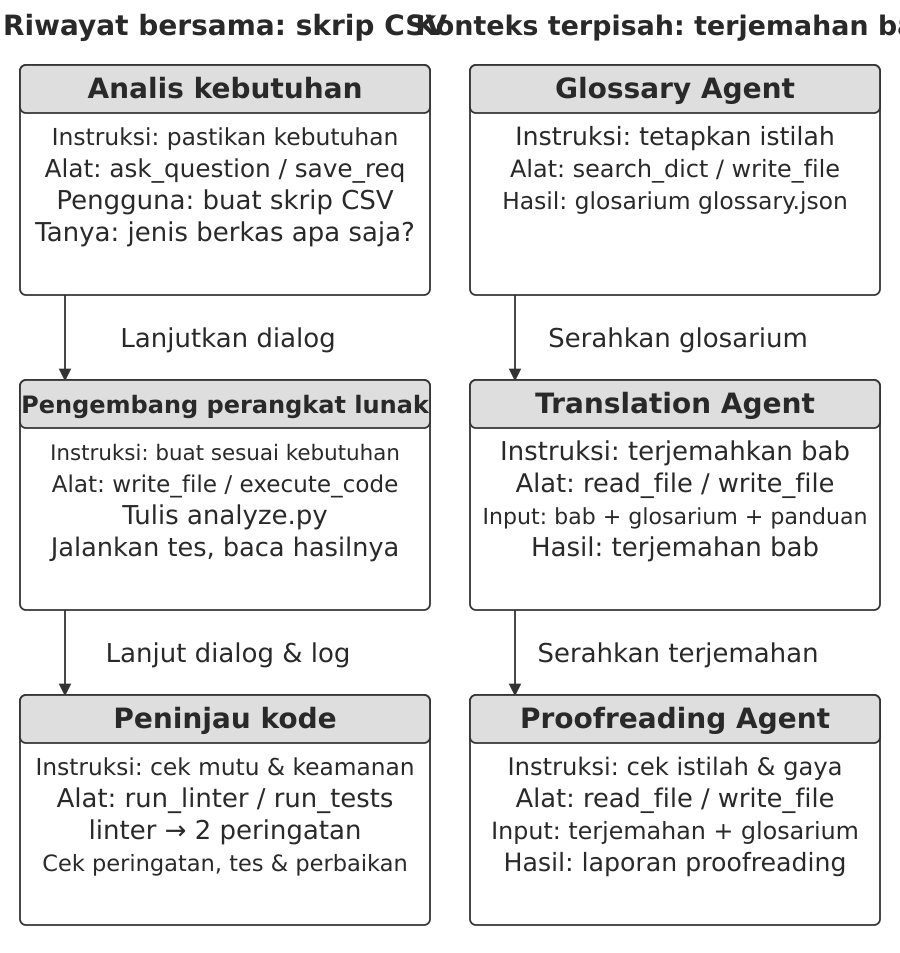

Bila konteks masing-masing terpisah, bagaimana para anggota bertukar materi? Dalam sistem terdistribusi, komunikasi lazim dilakukan melalui penyimpanan bersama atau *message passing*. Sistem Agent juga dapat memakai kedua pendekatan ini, dengan cara-cara berikut:

- **Parameter *tool call*.** Agent hilir dibungkus sebagai alat; Agent hulu meneruskan tugas dan materi terstruktur melalui parameter, lalu menerima hasilnya.
- ***Shared file system*.** Satu pihak menulis dokumen, kode, atau data, dan pihak lain membacanya melalui rujukan. Cara ini cocok untuk artefak antara yang besar dan materi yang perlu disimpan secara persisten.
- ***Message bus*.** Agent mengirim pesan ke layanan perantara, yang kemudian mengantarkannya berdasarkan tujuan atau hubungan langganan. Cara ini cocok untuk komunikasi asinkron di antara banyak anggota.

Misalnya, setelah Agent hulu mengirim tugas penerjemahan, ia dapat menunggu terjemahannya kembali, atau lebih dulu menerima nomor tugas lalu mengerjakan bab lain. Sekalipun dua penerjemah sama-sama dapat membuka berkas yang sama, sistem tetap harus menyepakati siapa yang menulis dan kapan pihak lain membacanya. Komunitas Go menekankan penggunaan komunikasi untuk mengatur akses ke data bersama. Gagasan ini juga berlaku untuk Agent: tetapkan dengan jelas siapa pemilik status, siapa yang boleh mengubahnya, dan bagaimana anggota lain memperoleh pembaruan.

### Dimensi 2: Topologi Kolaborasi

Topologi kolaborasi menggambarkan ketergantungan tugas, aliran informasi, dan hubungan kendali di antara para Agent. Bab ini memakai tiga bentuk pengorganisasian yang khas:

- **Pola kolaborasi sejawat** (*Peer Collaboration Pattern*). Sejumlah kecil anggota bekerja sama berulang kali atas artefak yang sama. Misalnya, penyusun menyelesaikan draf makalah, pengulas memberikan masukan, lalu penyusun merevisinya.
- **Pola manajer** (*Orchestration Pattern*). Manager Agent yang terpusat bertugas memecah, membagikan, dan merangkum tugas, sedangkan sub-Agent mengerjakan pekerjaan spesialis masing-masing.
- **Pola terdesentralisasi** (*Decentralized Pattern*). Anggota melanjutkan pekerjaan berdasarkan peran, pesan, dan status lokal; seluruh anggota bersama-sama menentukan bagaimana pekerjaan diteruskan.

> **Catatan istilah: Graph Engineering.** Bab 1 telah memperkenalkan diskusi tentang Graph Engineering pada Juli 2026. Sudut pandang ini berfokus pada *execution graph*: simpul dapat berupa Agent, program biasa, atau keputusan manusia; sisi menyatakan ketergantungan, perutean bersyarat, dan arah penanganan setelah kegagalan; status diteruskan mengikuti hubungan eksekusi. Topologi kolaborasi multi-Agent adalah salah satu penerapan sudut pandang desain ini, dengan fokus pada cara beberapa unit pengambil keputusan melakukan serah terima, bekerja paralel, dan memberi umpan balik.

Desain kolaborasi sejawat, manajer, dan terdesentralisasi dapat dikombinasikan. Misalnya, Manager menyerahkan sebuah tugas penulisan kepada kelompok penyusun–peninjau; setelah kelompok itu selesai beriterasi secara internal, hasilnya baru diserahkan kembali.

## Kapan Multi-Agent Lebih Baik daripada Agent Tunggal?

Misalkan draf pertama salah menerjemahkan sebuah istilah teknis. Dua penyunting yang menerima naskah yang sama mungkin memberikan dua persetujuan yang sama; jika salah satunya juga memegang teks sumber, glosarium, dan kode yang memakai istilah itu, bertambahlah satu jalan untuk menemukan kesalahan. Saat memilih cara kolaborasi, tanyakan dulu: apa yang dibawa oleh Agent tambahan bagi tugas ini? Ia mungkin memperoleh bukti baru, menjelajahi jalur pencarian lain, memberikan penilaian keahlian yang berbeda, atau memperpendek waktu tunggu melalui eksekusi paralel.

Penulis pertama-tama memeriksa **tambahan informasi dari umpan balik**, baru kemudian menilai seberapa besar manfaat paralelisme dan isolasi konteks. Setelah membaca hasil pengujian, tangkapan layar halaman, atau materi eksternal, peninjau dapat mengusulkan perubahan berdasarkan bukti yang belum tersedia saat jawaban dihasilkan. Tabel 10-1 memakai beberapa skenario umum untuk menunjukkan cara memeriksa tambahan informasi semacam ini.

Tabel 10-1 Informasi dan umpan balik dalam kolaborasi multi-Agent

| Mode kolaborasi | Sumber informasi utama | Fokus penilaian |
|---|---|---|
| Model yang sama meninjau ulang output-nya sendiri | Materi semula ditambah satu proses pemeriksaan baru | Apakah kekurangan dapat ditemukan, dan apakah perbaikan meningkatkan hasil |
| Beberapa Agent mendebatkan masalah yang sama | Jalur penyelesaian, asumsi, dan argumen masing-masing | Apakah pandangannya berbeda, dan bagaimana jawaban diverifikasi dan dipilih |
| Peninjau menjalankan pengujian dan memeriksa kode | Umpan balik kompilasi, pengujian, dan eksekusi | Apakah perubahan lolos pengujian dan mempertahankan fungsi yang sudah ada |
| Peninjau melihat hasil render frontend atau PPT | Tangkapan layar dan umpan balik interaksi | Apakah tata letak, isi, dan operasi sesuai kebutuhan |
| Peninjau memakai alat eksternal untuk memverifikasi fakta | Hasil penelusuran dan catatan sistem bisnis | Apakah sumbernya andal, dan apakah kesimpulan sesuai dengan bukti |

RLEF melatih model melalui *reinforcement learning* agar memanfaatkan umpan balik eksekusi kode dan belajar melakukan revisi bertahap pada tugas pemrograman kompetitif. Galat kompilasi, kegagalan pengujian, dan pengecualian saat eksekusi memberikan dasar konkret untuk perubahan berikutnya; model dalam makalah tersebut mencapai hasil lebih baik dengan jumlah sampel yang lebih sedikit.[^rlef-2025] WebGen-Agent memasukkan tangkapan layar halaman web, deskripsi dan saran dari model visual, serta penilaian operasi GUI ke dalam alur pembuatan; sistem dapat mundur ke langkah sebelumnya untuk mengulang, atau memilih yang terbaik di antara beberapa hasil. Pada WebGen-Bench, akurasi Claude 3.5 Sonnet naik dari 26,4% menjadi 51,9%.[^webgen-agent-2025]

[^rlef-2025]: Gehring, J., et al. *RLEF: Grounding Code LLMs in Execution Feedback with Reinforcement Learning.* arXiv:2410.02089, 2025.
[^webgen-agent-2025]: Lu, Z., et al. *WebGen-Agent: Enhancing Interactive Website Generation with Multi-Level Feedback and Step-Level Reinforcement Learning.* arXiv:2509.22644, 2025.

Penulis lebih dulu memastikan sistem memperoleh bukti konkret, seperti hasil pengujian, tangkapan layar, atau keluaran alat, baru kemudian memutuskan cara membagi tanggung jawab pembuatan, eksekusi, dan peninjauan. Loop umpan balik dapat dijalankan oleh satu Agent atau dipecah ke beberapa peran; penambahan peran semestinya memperbaiki cara bukti diperoleh dan digunakan.

Riset keamanan Anthropic pada 2026 memberikan contoh pencarian kolaboratif: 45 Agent bertukar temuan melalui forum bersama, saling meninjau, lalu hasilnya diputuskan oleh Agent arbiter yang independen. Menurut laporan riset tersebut, klaster kolaboratif menghabiskan 27 juta token dan menemukan 266 kerentanan, sedangkan skema paralel independen menghabiskan 6,5 juta token dan menemukan 21. Forum memungkinkan anggota menelusuri lebih lanjut temuan orang lain, sekaligus mengetahui arah mana yang sudah digarap. Kelompok kolaboratif juga memakai sekitar empat kali lipat token, sehingga selisih antara 266 dan 21 mencakup perbedaan cara komunikasi sekaligus perbedaan investasi komputasi.[^anthropic-multiagent-2026]

[^anthropic-multiagent-2026]: Anthropic Frontier Red Team, “Patterns and Problems in Emerging Multiagent Systems,” 2026-08-13.

Dalam riset matematika, bagaimana membuat beberapa tim benar-benar menjelajahi rute yang berbeda? Persamaan Navier–Stokes tiga dimensi menggambarkan gerak fluida kental. Untuk kondisi awal yang mulus, apakah solusinya akan selalu tetap mulus? OpenAI membagikan dua tujuan yang berlawanan kepada kelompok yang berbeda: sebagian berusaha membuktikan kemulusan, sebagian lain berusaha mengonstruksi contoh penyangkal. Setiap kelompok menjelajah sendiri lebih dulu, lalu tim memakai Codex untuk merangkum hasil antara sehingga kelompok lain dapat mengikuti petunjuk yang menjanjikan. Kelompok yang menemukan contoh penyangkal melibatkan sekitar sepuluh ribu Agent yang bekerja serentak. Tim melaporkan bahwa sejak Agent gelombang pertama dijalankan hingga bukti ditemukan dibutuhkan sekitar 88 jam, ditambah 17 jam untuk formalisasi dan verifikasi dengan Lean. Contoh penyangkal ini memiliki syarat penting: fluida dikenai gaya eksternal yang mulus dan tetap dapat mengalami singularitas dalam waktu terbatas. Berdasarkan itu, tim memberikan contoh penyangkal yang dituntut oleh rumusan C dan D dalam pernyataan masalah Clay Mathematics Institute; jika gaya eksternal dihilangkan, masalahnya menjadi lain. Untuk merancang pencarian semacam ini, tuliskan lebih dulu hasil apa yang cukup untuk menjawab masalah awal, berikan dugaan-dugaan yang saling bersaing kepada kelompok yang berbeda, dan sisihkan waktu khusus untuk verifikasi akhir.[^ch10-ns-search]

[^ch10-ns-search]: Catatan riset OpenAI *On the Navier–Stokes Millennium Prize Problem* dilengkapi bukti dan kode Lean. Dalam pengumuman 11 September 2026, Clay Mathematics Institute menanggapi karya ini dan menyatakan bahwa penilaian hasil serta pemberian hadiah akan ditangani sesuai prosedur penghargaan.

**Bagaimana *step budget* memengaruhi kinerja?** Misalkan sebuah tugas mengizinkan 30 langkah; Agent harus menyusun perencanaan, implementasi inti, dan verifikasi yang diperlukan secara ringkas. Jika diizinkan 300 langkah, ada ruang untuk membandingkan lebih banyak opsi serta melakukan pengujian dan revisi yang lebih menyeluruh. Agar sumber daya ini terpakai dengan baik, Agent juga perlu mengetahui anggaran total dan sisa anggaran, lalu mengatur kedalaman eksplorasinya berdasarkan itu.

Google meneliti masalah ini dalam *Budget-Aware Tool-Use Enables Effective Agent Scaling* (2025): Agent yang tidak sadar anggaran cenderung cepat berhenti pada pencarian dangkal, dan sekalipun jumlah langkah yang tersedia ditambah, kinerjanya sulit meningkat lagi. BAVT (Budget-Aware Value Tree Search) pada 2026 melangkah lebih jauh dengan menggabungkan estimasi nilai dan sisa anggaran di setiap langkah pencarian untuk menyesuaikan bobot antara eksplorasi dan eksploitasi. Ketika anggaran masih longgar, lebih banyak arah dapat dibandingkan; ketika mendekati batas anggaran, sumber daya dipusatkan pada cabang yang menjanjikan.

Dalam pola manajer, ini berarti Manager harus membagikan langkah sesuai tingkat kesulitan tugas dan menyesuaikannya seiring kemajuan: tugas sederhana diserahkan secepatnya, tugas kompleks diberi ruang untuk verifikasi dan revisi, dan bila terjadi hambatan, penyebabnya dicari lebih dulu sebelum memutuskan apakah perlu menambah informasi, menambah anggaran, atau berganti jalur.

Eksplorasi paralel dapat mempersingkat *wall-clock time*, dan peninjauan berulang dapat memperbaiki artefak, tetapi keduanya menambah pemanggilan model dan biaya komunikasi. Penulis menjadikan Agent tunggal yang telah disetel dengan baik sebagai baseline, dan baru memperbesar skala kolaborasi bila peningkatan kualitas atau penghematan waktu dari anggota baru cukup untuk menutup biaya komunikasi, komputasi berulang, dan pemeliharaan.

## Kolaborasi Multi-Agent dengan Konteks Bersama

Kolaborasi dengan konteks bersama mengganti peran per tahap sambil tetap memakai catatan tugas yang sudah ada. Ambil contoh laporan riset: peran penelusuran mengumpulkan materi lebih dulu, peran analisis melanjutkan dengan perhitungan, lalu peran penulisan menyusun penyajiannya. Setiap peran dapat melihat kembali sumber dan keputusan sebelumnya, sementara sistem memakai instruksi tugas saat ini untuk mengarahkannya pada tujuan tahap tersebut.

Saat serah terima lintas tim, ajukan dulu satu pertanyaan: siapa saja yang perlu tahu alasan di balik keputusan awal? Dalam contoh produk Teamily AI, manajer produk dan Agent bersama-sama menulis dokumen kebutuhan produk (PRD) di dalam grup. Setelah tim produk membagikan versi final kepada tim engineering, para engineer dapat menanyakan pertimbangan di balik suatu kebutuhan.

Ambil contoh peran penelusuran yang menyerahkan tugas kepada peran penulisan: setelah serah terima, dari mana model membaca prosedur penulisan, dan alat apa saja yang masih dapat dipanggilnya? Eksperimen 10-1 mengimplementasikan serah terima yang sama dengan dua cara.

| Hal yang perlu ditangani saat serah terima | Mengganti peran (`transfer_to_agent`) | Memuat Skill |
|---|---|---|
| Bagaimana prosedur penulisan diberikan? | Diganti dengan *system prompt* peran penulisan | Direktori Skill dalam *system prompt* dipertahankan; prosedur penulisan ditambahkan di akhir riwayat pesan |
| Alat apa saja yang terlihat oleh model? | Dapat hanya menampilkan alat peran penulisan | Dapat tetap memakai set alat semula atau pintu masuk pencarian alat |
| Bagian KV Cache mana yang masih terpakai? | *System prompt* berubah, sehingga sejak titik perubahan prefix biasanya perlu dihitung ulang | Prefix permintaan semula dapat terus dipakai ulang |
| Siapa yang memeriksa izin pemanggilan? | Harness memvalidasi permintaan berdasarkan peran saat ini, lalu menjadwalkan alat | Harness memeriksa izin setiap pemanggilan secara independen |

Bila perbedaan peran terutama terletak pada pengetahuan, prosedur, dan gaya penulisan, penulis mengutamakan Skill: cara ini memudahkan pemakaian ulang kerangka eksekusi yang sama dan mempertahankan cache untuk prefix permintaan yang stabil. Bila perbedaan peran menyangkut izin, isolasi alat, atau tanggung jawab persetujuan, pekerjaan dapat diorganisasi sebagai Agent terpisah atau pergantian peran, dengan kontrol akses ditegakkan oleh Harness dan lingkungan eksekusi. Ada atau tidaknya sebuah alat dalam input model memengaruhi pilihan pemanggilan, tetapi izin yang sebenarnya ditentukan oleh validasi saat runtime.

> **Eksperimen 10-1 ★★: Pergantian peran dalam konteks bersama — perbandingan system prompt dan Skill**
>
> Kedua jalur memakai model, tugas pengguna, implementasi alat, prosedur peran, dan riwayat bersama yang sama. Demo pengantarnya meminta Agent mencari penjualan kendaraan energi baru di Tiongkok pada 2021–2023, menghitung laju pertumbuhan majemuk tahunan (CAGR), lalu menulis ringkasan untuk investor sepanjang paling banyak 120 karakter.
>
> **Jalur 1: pergantian system prompt.** Ada lima peran: triage (pengumpulan kebutuhan), research (penelusuran), coding (pemrograman), data_analysis (analisis), dan writing (penulisan). triage menjadi titik masuk, dan setiap peran melihat alat khususnya serta `transfer_to_agent`. Saat serah terima, riwayat dipertahankan, *prompt* dan set alat peran tujuan dimuat, lalu eksekusi dilanjutkan.
>
> **Jalur 2: memuat Skill.** *System prompt* dan seluruh katalog alat tetap stabil sepanjang sesi. Model memanggil `load_skill(name)` untuk memperoleh prosedur peran; isinya masuk ke riwayat bersama sebagai hasil alat, dan prefix semula tetap dipertahankan. Harness memeriksa setiap *tool call* berdasarkan aturan izin.
>
> Kedua implementasi membaca `SKILL.md` yang sama. Sebelum dan sesudah satu kali serah terima peran, ambil masing-masing satu permintaan yang dikirim ke model, lalu lihat di pesan mana prosedur tersebut muncul dan bagian prefix mana yang masih dapat dipakai ulang. Periksa juga kedua ringkasan: apakah sumber data penjualannya tepercaya? Dari akhir 2021 hingga akhir 2023 ada dua periode pertumbuhan; apakah CAGR-nya dihitung dengan benar?
>
> Perbandingan formal memuat soal ringkasan yang lebih ketat: dibatasi 160 karakter dan harus mempertahankan dua URL sumber. Dengan jatah delapan langkah yang sama, kelompok pergantian peran memakai tiga pemanggilan untuk menghitung karakter, tetapi drafnya masih 206 karakter dan juga tidak memakai alat perhitungan yang ditentukan soal. Kelompok yang memuat Skill menghitung laju pertumbuhan dari penjualan tahun pertama dan tahun terakhir, tetapi baru memuat prosedur penulisan pada langkah kedelapan. Pada titik itu semua peran yang semestinya dilalui sudah dilalui, tetapi pengguna belum menerima ringkasannya. Kedua trajektori akhirnya berhenti karena mencapai batas langkah.
>
> Dengan 30 tugas yang sama dijalankan pada kedua implementasi dan hasil serahannya diperiksa secara terprogram, kelompok yang memuat Skill lolos 15 tugas, sedangkan kelompok pergantian system prompt lolos 2 tugas. Namun, bila dibandingkan per soal, kelompok pertama memiliki 6.855 token input lebih banyak yang tidak mengenai cache dan waktu eksekusi sekitar 4,4 detik lebih lama (keduanya median dari selisih berpasangan). Pada percobaan ini, penyedia layanan melaporkan jumlah token input yang mengenai cache sebesar nol untuk kedua kelompok. Kedua kelompok lolos seluruh 6 uji batas kepatuhan instruksi, sementara tingkat kelulusan tugas lengkapnya berbeda jauh.

## Kolaborasi Multi-Agent dengan Konteks Terpisah

Dalam arsitektur dengan konteks terpisah, setiap Agent memelihara riwayat input, status tugas, dan loop eksekusinya sendiri, lalu bertukar informasi yang diperlukan melalui parameter alat, berkas bersama, dan pesan. Misalnya, materi yang diserahkan penerjemah harus mencantumkan paragraf sumber dan versi glosarium. Sekalipun penerjemah sudah keluar, penyunting tetap dapat menemukan teks sumbernya; bila perlu revisi, penanggung jawab tiap bab pun dapat ditemukan.

Tabel 10-2 membandingkan cara sistem operasi mengelola proses dengan cara runtime mengelola Agent.

Tabel 10-2 Analogi desain antara sistem multi-Agent dan sistem operasi

| Sistem operasi | Tanggung jawab yang serupa dalam sistem multi-Agent |
|---|---|
| Program dan konfigurasi | *System prompt*, definisi alat, dan konfigurasi peran |
| Memori proses | Konteks saat ini, status tugas, dan riwayat |
| CPU menjalankan komputasi | LLM menghasilkan keputusan; runtime dan alat menjalankan operasi terkait |
| Kernel mengelola eksekusi | Runtime Agent mengelola status, penjadwalan, dan sumber daya |
| System call | Meminta operasi eksternal melalui antarmuka alat |
| fork: membuat proses anak | `spawn_subagent`: membuat sub-Agent |
| kill: mengirim sinyal | `cancel_subagent`: meminta pembatalan |
| ps: menanyakan proses | `list_agents`: menanyakan anggota dan status eksekusinya |
| Status keluar dan wait | Notifikasi selesai, status tugas, dan hasil terstruktur |
| Penyimpanan bersama dan *message passing* | Berkas bersama, parameter alat, dan pesan |

Status privat, pesan asinkron, dan pembuatan anggota secara dinamis juga muncul dalam Actor model yang diusulkan pada 1970-an.[^actor-model]

[^actor-model]: Hewitt, C., Bishop, P., Steiger, R. *A Universal Modular ACTOR Formalism for Artificial Intelligence.* IJCAI 1973.

Bila subtugas yang independen cukup banyak, penulis cenderung memberi setiap anggota konteks tersendiri agar masing-masing hanya menangani materi yang relevan dengan tanggung jawabnya. Cara ini memudahkan pengujian setiap peran secara terpisah, mengurangi gangguan riwayat panjang dari tahap sebelumnya terhadap penilaian saat ini, dan memungkinkan beberapa tugas berjalan serentak. Efektivitas isolasi juga bergantung pada sumber daya bersama lainnya: beberapa Agent tetap dapat mengubah berkas yang sama secara bersamaan, menghabiskan kuota API yang sama, atau menerima pesan galat yang sama.

Antarmuka kolaborasi juga harus menangani pesan yang hilang, pengiriman ganda, dan status yang tertinggal. Saat menelusuri masalah, pengenal tugas dapat dipakai untuk mengaitkan permintaan, event alat, dan hasil dari setiap anggota, sehingga proses sebuah serah terima dapat direkonstruksi.

Misalkan sebuah Agent selesai menganalisis dan harus menyerahkan hasilnya kepada rekan yang menulis laporan. Bila angkanya sedikit, angka itu dapat dikirim bersama pesan; bila artefaknya berupa tabel besar, biasanya tabel disimpan di *shared file system* dan pesan hanya menyertakan rujukannya. Dari sini muncul dua pembagian tugas. **Penyimpanan artefak** menyimpan dan mempertukarkan dokumen, kode, dan data, sedangkan **komunikasi dan kendali** bertugas mengantarkan pesan, menanyakan status tugas, membatalkan eksekusi, dan menjadwalkan sumber daya.

### File System dari Sudut Pandang Agent

Salah satu desain yang umum adalah menyediakan **virtual file system** bagi Agent, yang me-*mount* sumber daya dari berbagai asal ke satu pohon direktori terpadu. Model mengaksesnya melalui antarmuka seperti `read_file`, `write_file`, dan `list_dir`, sementara lapisan di bawahnya dapat terhubung ke disk lokal sementara, *object storage* persisten, API penyimpanan awan pihak ketiga, atau paket sumber daya sistem.

Penulis lebih dulu membagi area penyimpanan dengan tegas, baru kemudian menghubungkannya ke alur kolaborasi. Jika draf sementara, hasil serahan resmi, dan berkas eksternal milik pengguna bercampur, mudah terjadi penimpaan tak sengaja atau pembacaan yang melampaui izin. Antarmuka terpadu memudahkan penggunaan, sedangkan visibilitas, lifecycle, dan izin setiap area ditentukan oleh konfigurasi *mount* dan kontrol akses. Pohon direktori ini dapat dibagi menjadi empat jenis area.

**I. Workspace khusus Agent (Scratchpad).** Setiap instans memakai workspace sendiri untuk menyimpan draf, berkas sementara, log debug, dan artefak antara. Secara default, akses dibatasi pada Agent pemiliknya, dan isinya dibersihkan atau diarsipkan sesuai kebijakan tugas. Dengan begitu, berkas sementara tidak saling menimpa; setelah sub-Agent selesai bekerja, hasil yang perlu diserahkan dipindahkan ke ruang bersama dan diserahkan kepada Agent utama bersama ringkasan terstruktur. Catatan coba-coba tetap tersimpan di workspace semula untuk diagnosis kemudian. Dengan cara ini, isolasi konteks juga diterapkan di lapisan penyimpanan: Agent utama memperoleh hasil serahan dan bukti yang diperlukan, tanpa harus membaca seluruh proses coba-coba dalam koordinasi sehari-hari.

**II. Ruang bersama multi-Agent (Shared Workspace).** Anggota kolaborasi bertukar artefak di sini, dan pengguna juga dapat mengunggah materi serta mengunduh hasil serahan melalui pintu masuk yang diotorisasi. Misalnya, Glossary Agent menulis glosarium, Translation Agent membacanya lalu menerjemahkan, kemudian peninjau memeriksa terjemahan. Ruang bersama biasanya disimpan persisten sepanjang tugas dan harus menangani penulisan konkuren, pembaruan versi, dan cakupan akses. Di Bab 6, Agent dan komputer virtual bertukar CSV dan grafik melalui penyimpanan bersama; itulah contoh serah terima artefak semacam ini. Bagian selanjutnya akan memperkenalkan metode seperti *optimistic locking* dan isolasi salinan kerja.

**III. Sumber daya eksternal yang di-mount (Mounted External Resources).** Sumber daya seperti Google Drive, Notion, Dropbox, dan wiki perusahaan dapat dipetakan ke antarmuka terpadu melalui adaptor. Ketika Agent membaca dokumen, adaptor memanggil API sistem sumber. Ada tiga jenis perbedaan yang harus dikelola di sini: cakupan akses bergantung pada otorisasi eksternal; akses jaringan menimbulkan masalah latensi, timeout, dan pembaruan cache; dan operasi tulis balik harus mematuhi aturan izin dan versi sistem sumber. Semantik konsistensi yang tepat ditentukan oleh antarmuka layanan; nomor versi, penulisan bersyarat, atau pembacaan ulang dapat dipakai untuk mendeteksi perubahan konkuren. *Mount* read-only sesuai kebutuhan cocok untuk penelusuran materi; izin tulis yang sesuai baru diberikan bila perlu menyunting.

**IV. Sumber daya bawaan sistem (Built-in System Resources).** Panduan referensi, templat, definisi alat, dan Skills bawaan dapat disediakan sebagai paket sumber daya read-only bagi banyak Agent. Skills dimuat secara *progressive disclosure*: direktorinya disediakan lebih dulu, lalu prosedur dan skrip dibaca sesuai tugas. Paket sumber daya dengan versi tetap memudahkan pembacaan konkuren; saat peningkatan versi, tugas yang sedang berjalan tetap konsisten melalui pergantian versi.

Pada Gambar 10-2, penerjemah dapat berulang kali menyunting draf di direktorinya sendiri; ketika siap diserahkan kepada penyunting, versi yang bersangkutan baru ditaruh di area bersama. Naskah asli di penyimpanan awan pengguna dibaca oleh adaptor eksternal, dan aksesnya juga bergantung pada izin yang diberikan pengguna.

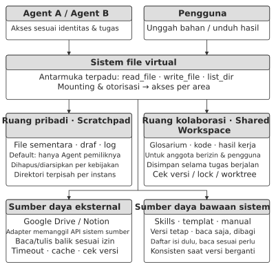

Setelah penerjemah keluar, berkas sementara di workspace-nya dapat ikut dilepas. Naskah terjemahan yang sudah ditaruh di area bersama tetap tersimpan, dan penyunting dapat mengambil alih dengan izin baca (Tabel 10-3).

Tabel 10-3 Empat jenis area dalam virtual file system Agent

| Area | Visibilitas | Lifecycle | Baca/tulis | Pengelolaan konkurensi |
|---|---|---|---|---|
| Workspace khusus Agent | Secara default hanya Agent pemiliknya | Dibersihkan bersama instans, diarsipkan bila perlu | Dibaca dan ditulis Agent pemiliknya | Mencegah penulisan ganda akibat percobaan ulang atau operasi latar belakang |
| Ruang bersama multi-Agent | Anggota dan pengguna yang diotorisasi | Disimpan persisten sepanjang tugas | Diotorisasi per peran | Lock, pemeriksaan versi, atau worktree |
| Sumber daya eksternal yang di-mount | Dibatasi bersama oleh otorisasi eksternal dan adaptor | Ditentukan oleh sistem sumber dan kebijakan cache | Read-only sesuai kebutuhan, atau tulis dengan otorisasi | Mengikuti antarmuka versi dan konkurensi sistem sumber |
| Sumber daya bawaan sistem | Agent yang diotorisasi | Versi tetap, dipakai ulang lintas sesi | Read-only | Pergantian versi sumber daya secara terpadu |

Rujukan berkas membuat pesan serah terima tetap ringkas: pihak hulu menyediakan lokasi, versi, dan kegunaan artefak, sedangkan pihak hilir membaca isinya sesuai kebutuhan. Anggota dalam lingkungan eksekusi yang sama dapat memakai path bersama; kolaborasi lintas organisasi memerlukan pengenal artefak, antarmuka akses, dan otorisasi yang dapat dipahami kedua pihak untuk menyelesaikan serah terima yang sama.

### Komunikasi dan Kendali antar-Agent

Alat untuk membuat, berkomunikasi, membatalkan, dan menemukan yang diperkenalkan di Bab 4 menyediakan antarmuka kendali dasar bagi kolaborasi multi-Agent: `spawn_subagent` membuat anggota, `send_message_to_subagent` meneruskan pesan, `cancel_subagent` meminta pembatalan, dan `list_agents` menanyakan anggota. Di sekitar antarmuka ini, perilaku pesan, status, terminasi, dan penjadwalan juga perlu disepakati.

**I. Message passing.** Bila anggotanya sedikit dan hubungannya tetap, antarmuka *point-to-point* dapat dipakai, misalnya Agent telepon dan Agent komputer yang langsung bertukar kemajuan. Jika setiap pasangan anggota perlu berkomunikasi, jumlah hubungan potensial tumbuh secara kuadratik terhadap jumlah anggota; bila hubungan langganan cukup banyak, *message bus* memudahkan pengelolaan perutean, buffer, dan percobaan ulang secara terpadu. Baik *point-to-point* maupun bus dapat mewujudkan pengiriman asinkron; apakah penerima harus daring pada saat yang sama bergantung pada mekanisme antrean dan persistensi.

Pesan biasanya memuat **envelope** terstruktur: ID pengirim, Agent tujuan atau cakupan broadcast, jenis pesan, dan payload. Jenis pesan dapat mencakup `task_assigned`, `status_update`, `result`, dan `terminate`. Pengenal tugas, pengenal pesan, dan permintaan terkait membantu penerima menghapus duplikasi, sekaligus memungkinkan alat debug merekonstruksi rantai komunikasi. Isi bisnis ditaruh di payload JSON, dan kedua pihak memprosesnya berdasarkan field yang disepakati.

Misalnya, sebuah naskah terjemahan menjadi tanggung jawab editor, dan editor ingin meminta Agent peninjau istilah memeriksa satu kata. Dengan menyebut (`@`) Agent tersebut dalam komentar tiket Multica dan menuliskan pertanyaannya, pekerjaan peninjauan langsung terpicu. Hasil tinjauan dapat dibalas langsung di tiket itu; penanggung jawabnya tetap editor, dan status tiket pun tidak berubah. Jika peninjau diharapkan mengambil alih seluruh tiket, penanggung jawabnya harus diubah secara eksplisit.[^ch10-multica]

[^ch10-multica]: Multica, menyebut Agent dalam komentar; implementasi pengiriman komentar pada versi `d579273`.

**II. Memperoleh status.** Agent utama perlu tahu apakah subtugas masih berjalan, apakah memerlukan input, dan apakah hasilnya sudah dapat diambil. Antarmuka status, notifikasi event, dan berkas progres dapat dipakai bersama: antarmuka runtime menyediakan status lifecycle, pesan menjelaskan kemajuan bisnis, dan berkas persisten menyimpan catatan yang dapat dipulihkan.

`get_subagent_status(agent_id)` dapat mengembalikan status seperti sedang berjalan, memerlukan input, selesai, atau gagal. Dalam koordinasi sehari-hari, penulis mengutamakan notifikasi selesai dan pesan kemajuan per tahap, sehingga Agent utama dapat melanjutkan pekerjaannya sendiri. Kueri aktif baru dilakukan bila notifikasi terlambat, koneksi dipulihkan, atau ada masalah yang perlu ditelusuri, agar pemanggilan model tidak terbuang untuk terus-menerus bertanya "sudah selesai belum?". Antarmuka status dipelihara oleh runtime dan dapat segera melaporkan apakah proses masih hidup dan apakah tugas sudah berakhir.

**Bertukar kemajuan melalui pesan.** Agent utama dapat menanyakan kemajuan saat ini, dan sub-Agent membalas pada langkah yang tepat; sub-Agent juga dapat secara proaktif menerbitkan `status_update` ketika mencapai hasil tahap tertentu, menemui hambatan, atau memerlukan bantuan. Isi pesan harus menjelaskan apa yang sudah selesai, langkah berikutnya, dan penyebab hambatan; semua anggota memakai nama status yang sama agar mudah dirangkum dan dinilai. Protokol A2A di bagian selanjutnya akan memperkenalkan representasi standar untuk lifecycle tugas.

**Menyimpan progres dalam berkas.** Sistem dapat menambahkan pesan, permintaan alat, hasil alat, dan perubahan status ke log sesuai urutan event, misalnya dalam format JSONL dengan satu event per baris. Agent utama atau alat operasional yang memiliki izin diagnosis dapat memakainya untuk memeriksa proses percobaan ulang, galat, dan penantian. Riwayat input model hanyalah sebagian dari trajektori eksekusi; log juga dapat mencatat event penjadwalan dan eksekusi eksternal.

Trajektori lengkap dapat berisi puluhan ribu token, dan setiap kali selesai membacanya, Agent utama masih harus menyarikan ulang statusnya. Pesan memberi tahu Agent utama bahwa ada kemajuan baru, sedangkan berkas progres yang ringkas menyimpan status saat ini untuk kueri dan pemulihan berikutnya. Penulis mengutamakan kombinasi keduanya untuk koordinasi sehari-hari. Setiap kali sub-Agent menyelesaikan satu pekerjaan, ia memperbarui daftar tugas, rujukan artefak, dan titik hambatan saat ini; Agent utama menentukan langkah berikutnya berdasarkan field-field ini. Trajektori rinci disimpan untuk penelusuran bila diperlukan. Jika progres tidak berubah dalam waktu lama, heartbeat, status *tool call*, dan pengaturan timeout tugas dapat dipakai bersama untuk menilai perlu tidaknya intervensi: alat yang berjalan lama mungkin masih bekerja, jadi pastikan statusnya dulu sebelum memutuskan untuk menunggu, membatalkan, atau mencoba ulang.

**III. Terminasi eksekusi.** Ketika beberapa anggota mencari target yang sama secara paralel dan salah satunya menyelesaikan tugas, cabang-cabang lain dapat dihentikan untuk membebaskan anggaran dan sumber daya alat. Pembatalan memiliki dua tingkat kekuatan, mirip dengan peran SIGTERM dan SIGKILL di Unix.

Penulis mengutamakan **graceful termination**: runtime meneruskan permintaan pembatalan, sub-Agent berhenti memulai operasi baru di titik aman, menyimpan progres yang diperlukan, menutup sesi peramban, dan melepaskan lock, lalu mengembalikan konfirmasi (ack). **Forced termination** dipakai untuk eksekusi yang tetap tidak merespons setelah tenggat pembatalan lewat; runtime mengakhiri prosesnya, lalu memeriksa sumber daya yang tersisa dan penulisan yang belum tuntas. Operasi yang sudah dikirim ke sistem eksternal juga perlu dicek hasilnya, dan bila perlu dijalankan alur kompensasi.

Lifecycle juga perlu dikelola mengikuti hubungan pembuatan. Dengan meminjam context dari Go, sinyal pembatalan dari tugas induk dapat dirambatkan ke bawah ke seluruh pohon subtugas, dan loop eksekusi memeriksa sinyal pembatalan di titik aman, sejalan dengan kegunaan `ctx.Done()`. Dengan demikian, setelah tugas induk berakhir, cabang-cabang yang dijalankannya juga masuk ke alur pembersihan, sehingga tidak ada Agent tanpa pengelola yang terus memanggil alat dan menghabiskan anggaran. Tugas latar belakang yang memang perlu berjalan lama secara mandiri dibuatkan context lifecycle tersendiri, mirip dengan memakai `context.Background()`, sekaligus ditetapkan pengelola yang bertanggung jawab atas pemantauan, anggaran, dan pembersihan.

**IV. Sumber daya dan penjadwalan.** Sistem Agent perlu membagikan token, langkah, kuota konkurensi, koneksi alat, dan sumber daya komputasi. Saat memulai subtugas, tetapkan anggaran dan perilaku bila anggaran terlampaui; pilih model sesuai tingkat kesulitan tugas; batasi pemanggilan konkuren agar kuota layanan tidak terkuras sekaligus. Ketika tugas yang lebih mendesak datang, tugas berprioritas rendah dapat dijeda atau dibatalkan di titik aman, lalu dijadwalkan ulang setelah progresnya disimpan.

Misalkan tiga cabang masing-masing menyelidiki satu solusi yang mungkin, dan salah satunya sudah menemukan petunjuk kunci, tinggal satu verifikasi terakhir. Manager dapat memberinya beberapa langkah tambahan sambil mengakhiri dua cabang yang tidak menunjukkan kemajuan. Kuota dipotong oleh runtime; sebuah cabang yang masih ingin mencoba tetap harus berhenti bila anggarannya habis.

### Pola Kolaborasi Sejawat: Saling Memeriksa dan Perbaikan Iteratif

Kolaborasi sejawat biasanya melibatkan dua atau tiga Agent yang bertukar pendapat dan merevisi artefak untuk tugas yang sama. Saat merancangnya, anggota dapat lebih dulu diberi tanggung jawab, materi, dan alat yang berbeda agar menilai secara independen, baru kemudian hasilnya dirangkum. Misalnya, pembuat berfokus pada implementasi, sedangkan peninjau berfokus pada pengujian dan kebutuhan pengguna; anggota dari keahlian yang berbeda memeriksa batasan di bidang masing-masing. Makin mirip model, input, dan alur kerjanya, makin mudah para anggota mengulang penilaian yang sama, sehingga perbedaan sudut pandang dan bukti perlu dirancang secara sengaja.[^anthropic-multiagent-2026]

Untuk tugas yang memperbaiki satu artefak secara berulang, penulis menyarankan memulai dengan kolaborasi sejawat dua atau tiga anggota. Setelah peran, isi serah terima, dan kondisi berhenti jelas, loop yang dapat diuji sudah dapat dibangun, dan pekerjaan koordinasi di tahap awal pun relatif sedikit.

#### Loop Engineering

Kolaborasi sejawat dapat membantu menangani satu masalah yang umum: **terminasi dini** (*premature termination*). Dengan mengambil contoh pemrograman dan layanan pelanggan yang dikerjakan atas nama pengguna, terminasi dini dapat dikenali dari tiga jenis catatan.

- **Menyatakan semuanya selesai padahal baru sebagian.** Coding Agent selesai menulis kode tetapi melewatkan pengujian dan pemeriksaan deployment; pengguna menitipkan dua urusan kepada asisten, dan setelah menyelesaikan yang pertama, asisten melaporkan bahwa semuanya beres. Daftar tugas perlu dicocokkan butir demi butir, dan bukti penyelesaian setiap pekerjaan perlu diperiksa.
- **Menyerah terlalu cepat setelah satu jalur gagal.** Pedagang mungkin meminta materi dikirim melalui formulir, atau lampiran dikirim ke alamat email tertentu. Bila menerima balasan seperti itu, urusan dapat dilanjutkan dengan cara yang diterima pedagang. Penyebab kegagalan perlu dicatat, lalu dinilai jalur lain mana yang masih layak dicoba.
- **Melewatkan langkah lanjutan setelah berhasil sebagian.** Jika pedagang setuju mengembalikan dana tetapi masih meminta pengguna melakukan konfirmasi di aplikasi, asisten harus menyampaikan langkah ini beserta syarat pelaksanaannya. Dalam kasus keringanan tagihan, ketika petugas layanan pelanggan menyetujuinya secara lisan lewat telepon, asisten dapat memastikan kepada pengguna bahwa negosiasi kali ini menghasilkan komitmen. Rekaman panggilan dapat membuktikan apa yang dikatakan petugas, tetapi apakah tagihan berikutnya benar-benar sesuai memerlukan bukti baru. Peninjau harus menjelaskan secara terpisah hasil yang sudah diperoleh, siapa yang masih harus melakukan apa, dan hasil mana yang untuk sementara belum terlihat.

Ketiga jenis masalah ini menuntut kondisi selesai diwujudkan sebagai hasil yang dapat diperiksa. **Loop Engineering** berfokus pada cara membuat Agent terus menjalani loop "tentukan pekerjaan berikutnya—eksekusi—verifikasi—catat progres", lalu memutuskan untuk melanjutkan, menunggu, menyerahkan, atau mengakhiri berdasarkan hasilnya. Engineer perlu merancang sumber tugas, cara verifikasi, status persisten, dan kondisi berhenti. Pekerjaan manusia pun meluas: dari menulis *prompt* untuk satu kali pemanggilan menjadi merancang loop yang dapat terus mendorong tugas maju. Pada Juni 2026, Addy Osmani memakai nama ini untuk membahas rangkaian praktik tersebut dan mengutip pengalaman Boris Cherny: pusat pekerjaan bergeser ke perancangan loop yang menggerakkan Agent.[^loop-engineering-2026]

**Dalam loop semacam ini, menurut penulis verifier sering menjadi bottleneck utama.** Bila verifikasinya tidak andal, menambah jumlah putaran dapat membuat sistem mengulang kesalahan yang sama, atau menyatakan selesai terlalu dini. Hasil pengujian, status bisnis, dan konfirmasi pengguna masing-masing memberikan dasar penyelesaian dalam cakupannya sendiri; verifikasi yang gagal menjadi input revisi pada putaran berikutnya.

Praktik muncul lebih dulu daripada namanya. Sebelum nama Loop Engineering populer, penulis dan tim di Pine AI sudah memakai loop dan verifikasi untuk menangani terminasi dini. Pengusul–Peninjau adalah salah satu cara umum untuk mengorganisasi loop semacam ini, dan akan diuraikan lebih lanjut di bawah.

[^loop-engineering-2026]: Osmani, Addy. “Loop Engineering”, 2026.

**LoopX: menyimpan status kerja lintas putaran.** LoopX menempatkan tujuan, batas, daftar tugas, gate, bukti, dan kuota di control plane yang persisten, dan control plane inilah yang mengatur pekerjaan putaran berikutnya atau pelaksana berikutnya. Alurnya dapat diringkas sebagai: **control plane memutuskan → Agent mengeksekusi → verifikasi independen → commit progres yang sudah diverifikasi**.

Agent memanggil alat, bernalar, dan menyerahkan hasil putaran ini. Control plane mencatat pekerjaan yang sudah selesai dan menentukan dari mana putaran berikutnya dilanjutkan. Bila verifikasi lolos, status selesai di-commit; bila gagal, alur masuk ke perbaikan atau perencanaan ulang. Gate manusia, kondisi menunggu, dan batas anggaran bersama-sama menentukan kapan eksekusi boleh dilanjutkan.[^loopx-framework]

[^loopx-framework]: LoopX, The local control plane for long-running AI agent work, v0.4.0.

**LongHorizon-Harness: menyambung tugas panjang lintas aplikasi.** Framework ini berangkat dari Computer Use multimodal dan menangani eksekusi berkelanjutan ketika sebuah tugas membentang melintasi GUI, CLI, beberapa aplikasi desktop, dan berkali-kali penyegaran konteks. Ia memakai loop Manage–Execute–Audit (MEA): Manager menghasilkan satu subtugas dengan cakupan yang jelas berdasarkan tujuan awal, kemajuan yang sudah diverifikasi, bukti kegagalan, dan pekerjaan yang tersisa; Executor menjalankan operasi GUI atau CLI dalam konteks baru; Auditor memeriksa hasilnya secara read-only, lalu menuliskan kemajuan yang sudah diverifikasi ke status putaran berikutnya. Bukti kegagalan juga ikut disimpan untuk pemulihan dan perencanaan ulang.

Framework ini memanggil backend eksekusi seperti Claude Code dan Codex CLI melalui lapisan adaptor, sehingga pengelolaan tugas di lapisan luar tersambung dengan loop eksekusi di backend. Pendekatan ini menambatkan kesinambungan tugas panjang pada status tugas yang sudah diverifikasi. Konteks eksekusi boleh disegarkan, tetapi putaran berikutnya tetap dapat bekerja berdasarkan tujuan, bukti penyelesaian, dan persoalan yang belum terselesaikan, sambil memeriksa ulang apakah perubahan lingkungan memengaruhi kesimpulan sebelumnya.[^longhorizon-implementation]

Dalam perbandingan yang mempertahankan Qwen 3.7-Plus dan backend eksekusi Claude Code yang sama dan hanya mengubah loop terluar, makalah tersebut melaporkan bahwa PassRate WeaveBench naik dari 51,8% menjadi 80,7%, tingkat penyelesaian biner OSWorld 2.0 dari 2,8% menjadi 8,3%, dan tingkat keberhasilan Terminal-Bench 2.1 dari 69,7% menjadi 77,2%. Biayanya juga berubah sesuai tugas: dua benchmark pertama masing-masing menghabiskan 2,3 kali total token dan 3,6 kali token output dibandingkan baseline, sedangkan konsumsi token Terminal-Bench 2.1 berkurang 24%.

Pada tugas audit lapisan simulcast WebRTC yang sama, pelaksana baseline tersangkut di antarmuka Wireshark, lalu mencoba beberapa kali lagi, dan akhirnya memperoleh skor 0,59. Dengan MEA, peninjau mencatat bukti yang masih kurang, pelaksana pada putaran berikutnya menelusurinya berdasarkan catatan itu, dan skor akhirnya 0,92.

[^longhorizon-implementation]: LongHorizon-Harness, makalah arXiv:2608.01964. Trajektori publik baseline dan MEA sama-sama diambil dari tugas WEB_task_16_webrtc_simulcast_layer_audit; skrip reproduksinya memakai commit `53bc678`.

#### Paradigma Pengusul–Peninjau

Pengusul–Peninjau (*Proposer–Reviewer*) menyerahkan pembuatan artefak dan pemeriksaan hasil kepada dua peran. Eksperimen pembuatan PPT, penyuntingan video, dan visualisasi log di Bab 5 memakai desain ini: pengusul menghasilkan kode, peninjau melihat hasil render, memeriksa kualitas dengan bantuan model visual, lalu mengembalikan saran perbaikan yang terstruktur. Pada Gambar 10-3, saran perbaikan harus kembali ke tangan pengusul. Apakah ia dapat memperbaiki versi berikutnya berdasarkan saran itu bergantung pada seberapa rinci peninjau dapat melokalisasi masalahnya.

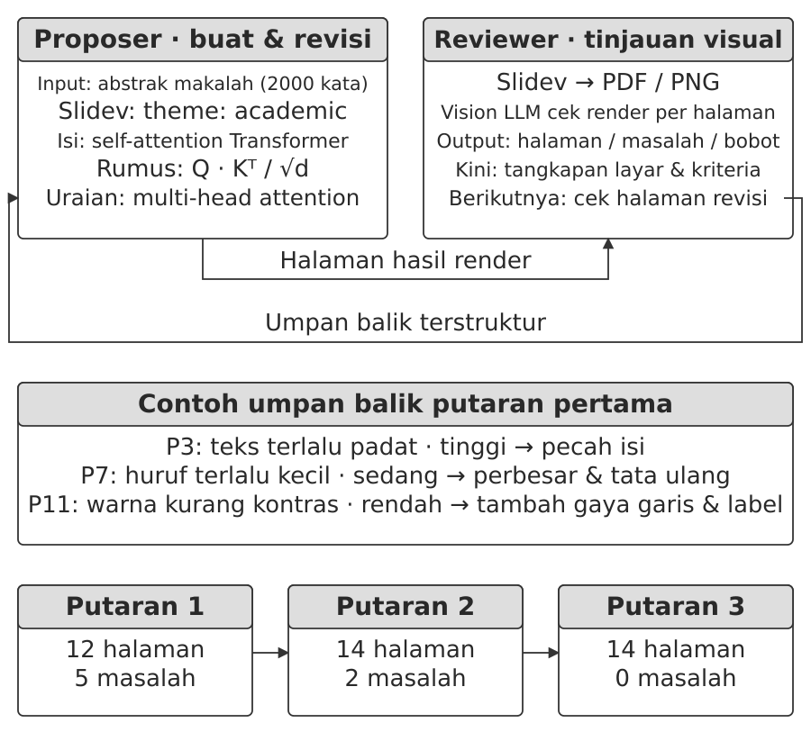

Bila objek yang diperiksa berganti, bukti yang dilihat saat meninjau pun harus berganti. Meninjau balasan layanan pelanggan berarti mencocokkannya dengan aturan bisnis dan sumber fakta; meninjau perubahan kode berarti melihat pengujian dan hasil eksekusi nyata; meninjau rencana operasi berarti memeriksa standar yang berlaku dan prasyaratnya.

Makalah ICLR 2024 karya Huang dkk., *Large Language Models Cannot Self-Correct Reasoning Yet*, menemukan bahwa pada tugas penalaran dan pengaturan *prompt* yang mereka teliti, GPT-4 yang merevisi dirinya sendiri tanpa umpan balik eksternal justru mengubah jawaban benar menjadi salah, sehingga akurasi keseluruhan menurun. Survei koreksi diri di TACL membahas lebih jauh bagaimana kondisi tugas dan keandalan umpan balik memengaruhi efektivitas revisi.[^self-correction-survey] Karena itu, penulis menjadikan bukti independen dan syarat perbaikan yang dapat dilokalisasi sebagai persyaratan dasar loop peninjauan. Peninjau harus dapat membaca pengujian nyata, status lingkungan, atau hasil render, lalu menunjukkan persyaratan mana yang belum terpenuhi dan bagaimana perbaikannya diverifikasi.

[^self-correction-survey]: Kamoi, R., et al. *When Can LLMs Actually Correct Their Own Mistakes? A Critical Survey of Self-Correction of LLMs.* TACL, 2024.

Satu loop lengkap dapat disusun dalam lima langkah:

1. Pengusul menulis versi pertama sesuai kebutuhan tugas, misalnya sebuah balasan atau sepotong kode.
2. Artefak dieksekusi atau dirender untuk memperoleh hasil pengujian, status bisnis, tangkapan layar, atau hasil verifikasi fakta.
3. Peninjau mencocokkan kebutuhan dengan bukti, lalu menyatakan lolos, atau menunjukkan letak masalah dan syarat perbaikannya.
4. Selama anggaran masih ada, pengusul merevisi berdasarkan umpan balik, lalu artefak dieksekusi dan ditinjau lagi; bila menemui masalah yang memerlukan input atau otorisasi, alur beralih ke status menunggu atau diserahkan ke pihak lain.
5. Setelah syarat rilis terpenuhi, versi yang lolos tinjauan diserahkan bersama bukti verifikasi dan kesimpulan tinjauan; bila anggaran habis, progres dan masalah yang belum terselesaikan tetap disimpan.

Peninjau membaca pengujian dan standar rilis yang dilindungi; usulan perubahan standar ditinjau secara terpisah.

Dalam eksperimen CRITIC, model lebih dulu memberikan jawaban, lalu memeriksanya dengan bantuan alat.[^ch10-critic] Misalnya, mesin pencari dipakai untuk memverifikasi fakta dalam jawaban, dan interpreter Python dipakai untuk menjalankan program matematika yang ditulisnya sendiri. Pada tiga jenis tugas, yaitu tanya-jawab terbuka, pembuatan program matematika, dan pengurangan ungkapan berbahaya, kinerja model membaik setelah merevisi jawabannya berdasarkan umpan balik alat. Bila model hanya menilai jawaban awalnya sendiri, efek koreksinya lebih lemah. Desain ini sejalan dengan kasus PPT di Bab 5: tangkapan layar hasil render dapat mengungkap masalah tata letak dan tumpang-tindih yang sulit dinilai langsung dari teks kode, sedangkan eksekusi pengujian dapat menyingkap galat yang benar-benar terjadi saat program berjalan.

[^ch10-critic]: CRITIC, arXiv:2305.11738.

Kasus pengembangan aplikasi jangka panjang Anthropic pada 2026 memakai tiga Agent: perencana, generator, dan evaluator. Perencana menjabarkan kebutuhan menjadi spesifikasi produk; generator dan evaluator lebih dulu menyepakati kriteria selesai untuk setiap putaran, lalu masing-masing mengimplementasikan dan memeriksa. Evaluator memakai Playwright untuk mengoperasikan aplikasi dan menyerahkan laporan cacat, dan status diserahterimakan antarperan melalui berkas. Kasus ini menunjukkan bagaimana spesifikasi produk, operasi nyata, dan umpan balik cacat saling terhubung; biaya eksekusi dan peninjauan yang bertambah juga perlu diperhitungkan saat membandingkan berbagai opsi.[^anthropic-harness-2026]

[^anthropic-harness-2026]: Prithvi Rajasekaran, “Harness Design for Long-Running Application Development,” Anthropic Engineering, 2026-03-24.

Pada 20 November 2026, matematikawan Levent Alpöge memublikasikan bukti formal yang ia peroleh bersama Claude, menyangkut Hipotesis Riemann dan perumumannya pada fungsi $L$ Dirichlet. Ketika menerima setumpuk besar berkas Lean, peninjau harus lebih dulu menjawab dua pertanyaan: apakah teorema terakhir benar-benar menyatakan dugaan semula? Apakah setiap langkah penurunan dapat diperiksa ulang oleh kernel pembuktian? Matematikawan MIT Andrew Sutherland lebih dulu mencocokkan teorema yang diajukan dengan definisi Hipotesis Riemann di pustaka matematika Lean, lalu mendaftar aksioma yang menjadi sandaran bukti tersebut. Dalam catatan yang dipublikasikannya hari itu, ia juga melaporkan bahwa kernel pembuktian independen nanoda telah berhasil memeriksa bukti yang diekspor. Ini memberikan cara konkret untuk membagi pekerjaan peninjauan: orang yang memahami masalahnya menuliskan proposisi penerimaan lebih dulu, lalu alat independen memeriksa apakah artefak yang diajukan dapat menurunkan proposisi tersebut. Kelak, bila matematikawan ingin memahami bagaimana penulisnya sampai pada rute ini, masih dibutuhkan argumen yang mudah dibaca manusia.[^ch10-rh-review]

[^ch10-rh-review]: Levent Alpöge memublikasikan catatan risetnya pada 20 November 2026. Item verifikasi dan kemajuannya pada hari itu dapat dilihat di *Verification files for the Lean proof of the Riemann Hypothesis* karya Andrew Sutherland.

#### Pola Debat

Pola debat membuat para anggota memeriksa masalah yang sama dari posisi yang berbeda. Misalnya, saat mengevaluasi solusi teknis, satu Agent menjelaskan manfaat dan skenario penerapannya, sementara Agent lain memeriksa batasan, kondisi kegagalan, dan alternatifnya. Setiap putaran berpusat pada argumen konkret untuk menambah bukti atau menyanggah, lalu di akhir dirangkum hal-hal yang sudah disepakati dan perbedaan yang masih perlu diverifikasi.

Pengaturan ini membantu memaparkan argumen pro dan kontra dengan jelas, tetapi efektivitasnya bergantung pada kualitas argumen, independensi penilaian, dan cara memilih jawaban akhir. Tran dan Kiela membandingkan lima arsitektur, yaitu sekuensial, debat, ensemble, peran paralel, dan subtugas paralel, pada tugas penalaran *multi-hop*; dengan anggaran *thinking token* yang sama, kinerja Agent tunggal setara atau lebih baik daripada multi-Agent.[^single-agent-2026] Berdasarkan itu, penulis terutama memakai debat untuk menguraikan perbedaan pendapat, memeriksa asumsi, dan melengkapi argumen tandingan. Bila yang dikejar adalah ketepatan fakta atau perhitungan, prioritasnya adalah menambah bukti yang dapat diverifikasi dan pemeriksaan independen.

Makalah tersebut memakai *data processing inequality* untuk membahas keterbatasan penyampaian informasi antara: penuturan ulang dan pemadatan yang berulang dapat menghilangkan detail asli. Dalam praktik rekayasa, sumber yang dapat dilacak dapat dipertahankan, dan anggota dapat diminta menganalisis secara independen lebih dulu sebelum bertukar kesimpulan, sehingga konsensus yang tidak diperiksa berkurang. Agregasi setelah beberapa kali pengambilan sampel independen, serta peninjauan khusus yang memanfaatkan sifat tugas "membuat sulit, memverifikasi mudah", juga dapat dipadukan dengan debat.

[^single-agent-2026]: Tran, D., Kiela, D. *Single-Agent LLMs Outperform Multi-Agent Systems on Multi-Hop Reasoning Under Equal Thinking Token Budgets.* arXiv:2604.02460, 2026.

#### Pola Brainstorming

Brainstorming dapat dibagi menjadi dua putaran: setiap anggota lebih dulu memikirkan cara sendiri, lalu semuanya berdiskusi bersama tentang ide mana yang dapat dikombinasikan. Misalnya, Agent 1 mengusulkan fitur berbagi ke media sosial; Agent 2 mengembangkannya menjadi pembuatan poster berbagi yang dipersonalisasi secara otomatis; Agent 3 melangkah lebih jauh dengan mengusulkan templat yang dapat disesuaikan pengguna beserta pasar templat.

Agar para anggota menghasilkan cara yang berbeda, mereka dapat diminta berangkat dari sudut pandang pengguna dan operator secara terpisah, atau diberi *prompt* atau model yang berbeda. Setelah bertukar ide, solusi disaring berdasarkan kebutuhan pengguna, biaya implementasi, dan hasil verifikasi.

#### Pola Panel Ahli

Panel ahli membagikan tanggung jawab keahlian di sekitar masalah lintas bidang. Misalnya, saat mengevaluasi produk baru, Engineer Agent menganalisis kesulitan implementasi dan ketergantungan teknis, Product Agent memeriksa kebutuhan dan pengalaman pengguna, dan Operations Agent memperkirakan biaya, sumber daya, dan syarat penerapan.

Dalam obrolan grup LobeHub, moderator dapat menyiarkan satu rancangan produk yang sama kepada ketiga ahli ini. Sistem lebih dulu mengambil riwayat obrolan grup pada saat itu, lalu meminta ketiga anggota menjawab secara bersamaan dengan konfigurasi peran masing-masing. Ketiga jawaban ditempatkan di bawah pesan yang memulai siaran, sehingga mudah ditelusuri kembali pertanyaan mana yang dijawab tiap orang. Jika bagian operasional harus menghitung biaya berdasarkan volume pemakaian yang baru saja diperkirakan engineer, permintaan kepada bagian operasional harus menunggu sampai jawaban putaran ini ditulis kembali: bila keduanya mulai menulis bersamaan, bagian operasional belum memegang angka tersebut.[^ch10-lobehub]

[^ch10-lobehub]: LobeHub, petunjuk penggunaan obrolan grup; implementasi siaran paralel pada versi `ab21e0d`.

Saat merangkum, cari keterkaitan antarpenilaian: dukungan teknis seperti apa yang dibutuhkan suatu target pengalaman pengguna, berapa biaya operasional tambahan dari suatu pilihan teknis, dan syarat mana yang masih memerlukan bukti eksternal.

### Pola Manajer: Koordinasi Terpusat

Bila sebuah tugas memuat banyak subtugas, ketergantungan yang kompleks, atau penjadwalan dinamis, perencanaannya dapat dipusatkan pada Manager Agent. Manager lebih dulu memahami tujuan keseluruhan, lalu memecah pekerjaan, memilih anggota, melacak kemajuan, memutuskan untuk mencoba ulang, mengganti anggota, atau menyesuaikan rencana bila terjadi pengecualian, dan akhirnya mengintegrasikan hasilnya.

Salah satu implementasi yang umum adalah mendaftarkan Agent spesialis sebagai alat. Manager meneruskan tugas, batasan, dan materi yang diperlukan melalui antarmuka alat, lalu menerima hasil terstruktur atau pengenal tugas. Dengan begitu, pencarian, operasi berkas, dan pendelegasian subtugas dapat memakai cara pemanggilan yang serupa; subtugas yang memakan waktu lama dikelola tersendiri dalam hal progres, pembatalan, dan percobaan ulang. Anggota yang berbeda dapat memakai model, *prompt*, alat, dan lingkungan eksekusi yang berbeda. Saat menambah anggota, selain mendaftarkan antarmukanya, Manager juga harus memahami tanggung jawab, persyaratan input, dan skenario penggunaan anggota tersebut.

Saat mengerjakan tugas panjang di Claude Code dan Codex, penulis pernah menaruh diskusi, eksekusi perintah, dan pengujian sekaligus di sesi utama. Bila ingin menanyakan satu pilihan desain di tengah jalan, sering kali harus menunggu langkah yang sedang berjalan selesai; beberapa jam kemudian, mencari kesepakatan awal berarti harus menggulir rentetan panjang output perintah. Belakangan, penulis menyerahkan perubahan dan pengujian kepada sub-Agent, dan sesi utama dipakai untuk diskusi. Dalam penyuntingan naskah buku, misalnya, pelaksana dapat terus memeriksa nomor gambar sementara penulis berdiskusi dengan pembaca tentang perlu tidaknya suatu paragraf ditulis ulang. Jika diskusi mengubah cakupan tugas, kesepakatan baru itu juga harus dikirim kepada pelaksana dan diperiksa saat ia menyerahkan hasilnya.

Tim DeepSeek Harness memublikasikan prototipe riset `dsh-superagent` yang ditujukan untuk satu repositori GitHub. Ambil contoh perbaikan format tanggal pada berkas ekspor: maintainer mengajukan permintaan di sebuah Issue, dan router menilai berdasarkan aturan repositori apakah permintaan itu dapat diterima. Setelah diterima, sistem membuat tiket (Ticket) dan memberikan sesi serta direktori kerja tersendiri kepada pelaksana (Worker). Pelaksana dapat mengubah kode dan menjalankan pengujian di direktorinya sendiri; tiket lain dapat dikerjakan bersamaan, masing-masing menyimpan proses perubahan dan hasil pengujiannya sendiri.[^ch10-dsh-prototype]

Misalkan maintainer kemudian menambahkan di Issue semula: "Ubah CSV saja, pertahankan format tanggal JSON." Tiket aktif yang berlangganan diskusi itu akan menerima pesan tambahan tersebut, dan pelaksana dapat mempersempit cakupan perubahan berdasarkan pesan itu serta menguji kedua format secara terpisah. Setelah selesai, ia dapat membuka pull request (PR) dan memasang tautan serta hasilnya kembali di Issue semula. Di satu tempat yang sama, maintainer dapat melihat permintaan awal, batasan yang ditambahkan belakangan, dan perubahan yang menunggu ditinjau; router pun tidak perlu memecah ulang setiap pesan lanjutan menjadi tugas.

[^ch10-dsh-prototype]: Tim DeepSeek Harness, prototipe riset dsh-superagent. Cara tiket menerima pesan lanjutan dijelaskan di bagian otorisasi dan langganan; sesi eksekusi dan direktori kerja dijelaskan di bagian mekanisme eksekusi.

Manager sekaligus memikul banyak tanggung jawab keputusan. Kesalahan dekomposisi tugas akan memengaruhi eksekusi berikutnya, materi serah terima yang kurang akan menimbulkan pertanyaan berulang, dan catatan pemanggilan yang terlalu banyak akan menyesaki konteks. Saat merancangnya, simpan status tugas dan indeks artefak yang ringkas, baca detail sesuai kebutuhan, dan pastikan setiap subtugas memiliki input, output, dan standar selesai yang jelas.

Plan-and-Act meneliti pengaruh kualitas perencanaan terhadap tugas panjang dalam arsitektur Planner–Executor, dan melaporkan tingkat keberhasilan 57,58% pada WebArena-Lite.[^plan-and-act-2025] Kesalahan perencanaan membuat beberapa pelaksana terus bekerja mengikuti pemecahan yang keliru, dan menambah anggota justru memperbesar pekerjaan ulang. Karena itu, penulis lebih dulu memeriksa kualitas dekomposisi tugas oleh Manager; bila bottleneck-nya ada pada perencanaan, model yang lebih kuat, informasi tugas yang lebih lengkap, dan anggaran penalaran yang lebih longgar diberikan kepada Manager. Setelah batas-batas subtugas jelas, barulah konfigurasi yang sesuai dipilih untuk pelaksana.

[^plan-and-act-2025]: Erdogan, L. E., et al. *Plan-and-Act: Improving Planning of Agents for Long-Horizon Tasks.* arXiv:2503.09572, 2025.

Tugas paralel juga perlu menetapkan dengan jelas cara penutupannya. Jika tujuannya menemukan satu hasil yang memenuhi syarat, setelah verifikasi lolos, hasil pertama yang lolos verifikasi dapat didaftarkan dengan operasi atomik, lalu cabang yang tersisa dibatalkan, ditunggu konfirmasi pembatalan atau timeout, dan akhirnya hasil dirangkum untuk diserahkan. Operasi pendaftaran ini harus atomik sekaligus idempoten: bila dua hasil tiba bersamaan, hanya terjadi satu transisi status; bila event yang sama dikirim berulang, hasil pemrosesan yang sudah ada dipakai kembali. Lock, transaksi, atau *compare-and-swap* dapat dipakai untuk melindungi langkah ini.

SQLite bawaan Python dapat dipakai untuk melihat satu serah terima secara konkret. Misalkan dua anggota, 甲 (A) dan 乙 (B) seperti tertulis dalam kode, memeriksa materi secara paralel, dan hasil yang masing-masing diajukan sudah lolos verifikasi. Manager hanya memerlukan satu hasil yang memenuhi syarat dan memakai satu baris catatan tugas untuk mencatat siapa yang mengajukan lebih dulu. Dalam contoh berikut, 甲 mengajukan lebih dulu, 乙 menyusul, lalu 甲 mencoba ulang sekali lagi.

```python
import sqlite3

db = sqlite3.connect(":memory:")
db.execute("CREATE TABLE task (id INTEGER PRIMARY KEY, winner TEXT)")
db.execute("INSERT INTO task VALUES (1, NULL)")
for worker in ["甲", "乙", "甲"]:
    with db:
        claimed = db.execute(
            "UPDATE task SET winner = ? WHERE id = ? AND winner IS NULL",
            (worker, 1),
        ).rowcount
    print(worker, "登记成功" if claimed else "沿用已登记结果")
```

Output-nya berturut-turut adalah "甲 登记成功" (甲 berhasil terdaftar), "乙 沿用已登记结果" (乙 memakai hasil yang sudah terdaftar), dan "甲 沿用已登记结果". Jika 乙 tiba lebih dulu, yang tercatat di tabel adalah 乙. Satu pernyataan update sekaligus memeriksa "belum ada yang mendaftar" dan menuliskan nama pengaju; bila pemeriksaan dan penulisan dipisah, kedua pelaksana bisa sama-sama membaca nilai kosong.

Contoh di atas membuat tabel di memori, sehingga pendaftaran ikut hilang ketika proses keluar. Bila diganti dengan basis data persisten, masih ada satu masalah serah terima: Manager sudah mendaftarkan 甲, tetapi keluar sebelum sempat memberi tahu 乙. Setelah restart, siapa yang tahu bahwa notifikasi ini belum terkirim? Hasil yang dipilih dan notifikasi yang menunggu dikirim dapat ditulis dalam satu transaksi yang sama. Setiap notifikasi mencatat cabang penerima, tindakan yang harus dilakukan, dan nomor unik. Setelah restart, Manager mengirim ulang notifikasi yang belum dikonfirmasi. Sekalipun 乙 sudah selesai membersihkan diri dan hanya pesan konfirmasinya yang hilang, ia dapat mengenali notifikasi yang dikirim ulang dari nomor semulanya dan langsung mengembalikan hasil pemrosesan sebelumnya. Event penyerahan hasil juga dapat dicatat dengan cara yang sama.

Jika tugas menuntut pengumpulan semua hasil, Manager harus menunggu sampai semua cabang yang diperlukan berakhir, lalu mencatat secara terpisah butir yang berhasil, gagal, dan belum selesai. Kondisi penutupan berasal dari tujuan tugas, dan kondisi itu pula yang menentukan kapan anggota lain boleh dibatalkan.

**Koordinasi sekuensial.** Bila subtugas memiliki ketergantungan urutan, Manager harus menunggu artefak dari langkah sebelumnya tersedia sebelum menugaskan langkah berikutnya. Gambar 10-4 memakai contoh penulisan laporan: anggota pengumpul materi lebih dulu mengembalikan sumber, analis merumuskan kesimpulan berdasarkan sumber itu, dan penulis akhirnya menerima analisis yang berdasar. Bila diganti dengan tugas penerjemahan berikutnya, materi apa yang harus ditunggu penerjemah sebelum mulai bekerja?

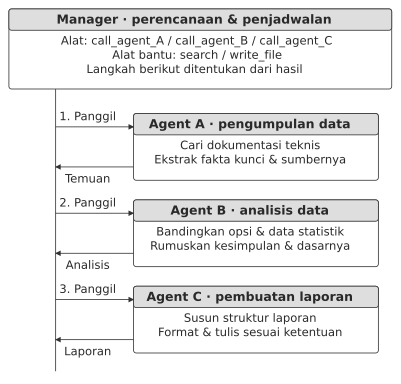

> **Eksperimen 10-2 ★★: Agent Penerjemah Buku**
>
> Menerjemahkan buku teknis menuntut penanganan istilah, konteks, dan gaya bahasa secara bersamaan. Misalnya, kata Inggris *agent* dapat diterjemahkan dengan beberapa cara; jika naskah terjemahan Tionghoa sudah menyepakati "智能体", bab-bab berikutnya harus memakai terjemahan yang sama. Glosarium, teks sumber tiap bab, terjemahan, dan catatan penyuntingan perlu diorganisasi dengan jelas. Sebuah buku panjang beserta draf terjemahan antara, hasil alat, dan riwayat penyuntingan akan terus menyesaki konteks; saat sampai di Bab 9, model mungkin sudah lupa terjemahan yang dipakai di Bab 2, atau berulang kali memeriksa paragraf yang sama. Memecah tugas berdasarkan tanggung jawab dan bab memungkinkan setiap instans berfokus pada materi yang diperlukan untuk tanggung jawabnya saat ini.
>
> Pekerjaan dapat dibagi kepada empat jenis Agent:
>
> - **Glossary Agent: menyusun istilah.** Membaca seluruh buku per kelompok, mengenali istilah teknis yang berulang, merujuk kamus profesional dan pedoman penerjemahan, lalu menghasilkan tabel padanan JSON atau CSV yang memuat istilah Inggris, terjemahan Tionghoa, kelas kata, dan konteks pemakaian. Glosarium disimpan di ruang bersama, dan instans ini dilepas setelah tugasnya selesai.
> - **Translation Agent: menerjemahkan bab.** Membaca bab saat ini, istilah yang relevan, dan pedoman penerjemahan, lalu menyelesaikan terjemahan sesuai pembaca sasaran dan gaya bahasa. Untuk istilah yang baru muncul, ia memberikan usulan terjemahan dan menandainya untuk ditinjau. Setiap instans memelihara konteks tersendiri, dan terjemahannya disimpan di ruang bersama; bab-bab yang berbeda dapat diproses secara berurutan atau paralel sesuai ketergantungannya.
> - **Proofreading Agent: menyunting seluruh naskah.** Berdasarkan glosarium dan terjemahan tiap bab, ia memeriksa pilihan terjemahan, konsistensi ungkapan, dan keterbacaan. Pemeriksaan seluruh naskah dilakukan dengan membaca per bab dan memakai indeks lintas bab; letak masalah, dasar, dan permintaan perubahannya ditulis dalam laporan penyuntingan.
> - **Manager Agent: mengatur dan mengumpulkan tugas.** Memelihara tujuan, rencana, status tugas, ringkasan pemanggilan, dan indeks artefak; berdasarkan laporan penyuntingan, ia mengembalikan bab yang perlu diubah kepada penerjemah, lalu mengatur pemeriksaan ulang.
>
> Pada Gambar 10-5, penyunting membaca terjemahan tiap bab dan glosarium, lalu Manager memutuskan bab mana yang perlu direvisi berdasarkan laporannya. Penerjemah yang menerima tugas revisi dapat membuka teks sumber bab tersebut untuk memastikan makna kata yang ditandai dalam kalimat itu.
>
> 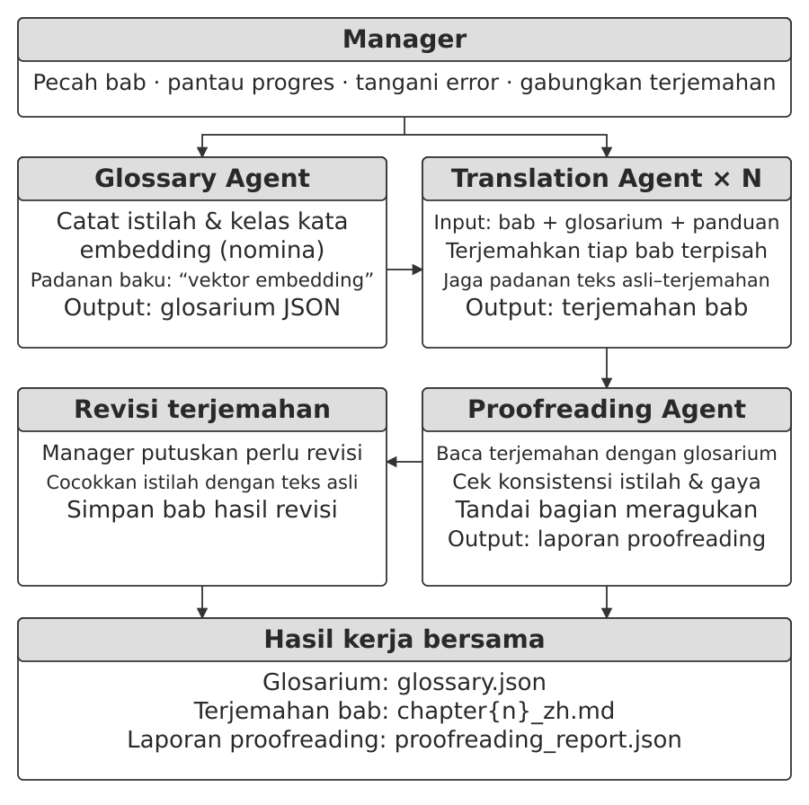
>
> Setelah naskah terjemahan ditulis ke berkas, pemanggilan mana yang masih perlu membaca teks panjang? Eksperimen pendamping memecah dua bab pertama edisi bahasa Inggris menjadi 26 unit terjemahan. Agent tunggal terus membawa teks sumber dan terjemahan sebelumnya sepanjang jalan, dan input permintaan terbesarnya mencapai 94.355 token. Setelah pekerjaan dibagi, input terbesar penerjemah hanya 2.857 token, dan Manager memakai 2.153 token saat mengambil keputusan revisi. Dalam kelompok manajer, input terbesar justru dimiliki penyusun istilah: ia membaca dua bab sekaligus dan memakai 49.807 token.
>
> Untuk menerjemahkan kedua bab ini, keempat peran memakai total 203.277 token, sedangkan Agent tunggal memakai 1.317.808 token. Kelompok mana yang menyerahkan naskah lebih dulu? Kelompok empat peran memerlukan sekitar 271 detik, sekitar 17 detik lebih lama daripada Agent tunggal.
>
> Saat naskah diserahkan, dua jenis pemeriksaan memberikan hasil berbeda untuk terjemahan yang sama. Glosarium menetapkan terjemahan "嵌入向量" (vektor embedding) untuk kata benda `embedding`. Laporan penyuntingan tidak mencantumkan bab yang perlu direvisi, tetapi program pemeriksa istilah memberi kata ini skor 0/2: di kedua bab terjemahan ditemukan "嵌入", tetapi tidak ditemukan "嵌入向量". Haruskah kedua bab dikembalikan?
>
> Pada paragraf tentang kebijakan pengembalian dana di Bab 1, teks sumbernya adalah `embedding the refund policy in the context`, dan terjemahannya "将退款政策嵌入上下文中" (menyematkan kebijakan pengembalian dana ke dalam konteks). Yang dimaksud di sini adalah menaruh kebijakan ke dalam konteks; mengubahnya menjadi "嵌入向量" justru akan membuatnya salah. Program yang mencari string per bab dapat membantu penyunting menemukan petunjuk untuk pemeriksaan ulang; untuk memutuskan bagian mana yang harus diubah, penyunting masih memerlukan teks sumber paragraf tersebut. Ketika glosarium diperbarui, paragraf yang terdampak juga dapat dilokalisasi lebih dulu, lalu teks sumber, terjemahan, dan entri baru diserahkan bersama-sama kepada penerjemah.
>
> **Persyaratan eksperimen:**
> 1. Pilih sebuah buku teknis yang memuat gambar, tabel, dan kode.
> 2. Implementasikan empat jenis Agent: Manager, Glossary, Translation, dan Proofreading.
> 3. Catat pemakaian konteks, materi serah terima, dan versi artefak setiap anggota.
> 4. Bandingkan kualitas terjemahan, waktu penyelesaian, dan konsumsi sumber daya dengan skema Agent tunggal, lalu analisis pengaruh pemecahan tugas dan pengorganisasian konteks.

**Koordinasi paralel.** Subtugas yang saling independen dapat dijalankan bersamaan. Manager bertugas membagikan tugas, menerima status, dan memutuskan berdasarkan hasilnya apakah pekerjaan dilanjutkan, ditambah, atau diakhiri. Saat menerjemahkan buku ini, begitu glosarium dikonfirmasi, bab-bab yang berbeda dapat dibagikan kepada beberapa penerjemah untuk dikerjakan bersamaan. Gambar 10-6 beralih ke contoh laporan riset: grafik sudah selesai dan analisis masih berjalan, mengapa validasi format masih harus menunggu? Dengan mengikuti event yang dilaporkan para anggota, terlihat dua artefak mana yang menjadi sandaran langkah terakhir.

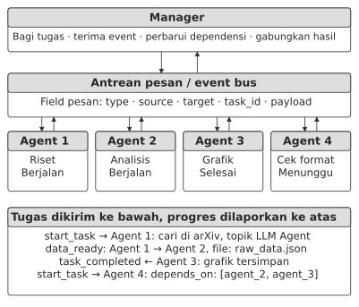

*Message bus* cocok untuk mengorganisasi komunikasi asinkron semacam ini: anggota menerbitkan progres dan hasil, manajer berlangganan event yang relevan, dan runtime bertanggung jawab atas pengiriman, buffer, dan percobaan ulang.

> **Studi kasus produk: Lingtai**
>
> Lingtai adalah sistem Agent jangka panjang yang berjalan secara lokal dan menyimpan identitas serta memorinya dalam berkas. Ia menyediakan tiga peran: Agent utama (main agent) berdialog dengan pengguna serta mengelola rencana dan memori; **daemon** mengerjakan tugas paralel jangka pendek dengan cakupan yang jelas dan mengembalikan kesimpulan setelah selesai; **avatar** memiliki memori, kotak surat, dan tanggung jawabnya sendiri, dan dipakai untuk pembagian kerja keahlian lintas sesi.
>
> Setiap peran memiliki pengetahuan persisten yang privat, dan semuanya berbagi buku panduan Skill dalam format Markdown. Ketika konteks mendekati batas kapasitas, peran tersebut menyimpan ringkasan melalui **molt** (ganti kulit), lalu memasuki konteks baru dengan memadukan ringkasan itu dan memori persistennya. Identitas, memori, dan Skill disimpan secara mandiri di berkas, sehingga pekerjaan tetap dapat dilanjutkan setelah model yang mendasarinya diganti. Desain ini memadukan manajer, pekerja jangka pendek, anggota spesialis jangka panjang, dan kompresi konteks.

> **Eksperimen 10-3 ★★★: Agent Telepon + Komputer dengan Orkestrasi Mandiri**
>
> Eksperimen ini memadukan Computer Use dan interaksi suara dari Bab 6. Pengguna memberikan halaman pendaftaran atau pemesanan penerbangan; Computer Agent membuka situs web, mengenali formulir, lalu melalui Phone Agent mengumpulkan field yang saat ini belum ada, seperti nama, nomor identitas, kontak, alamat, dan preferensi.
>
> **Peran dan serah terima.** Computer Agent mengoperasikan peramban dan bertanggung jawab atas orkestrasi kali ini; Phone Agent berkomunikasi secara real time dengan pengguna melalui ASR, LLM, dan TTS, lalu mengubah jawaban lisan menjadi field terstruktur. Keduanya berkomunikasi melalui alat *point-to-point* atau *message bus*, dan pesannya memuat pengirim, penerima, jenis, dan isi. Computer Agent dapat langsung mendelegasikan tugas telepon dan memikul tanggung jawab manajer. Bila pengguna bersedia memberikan informasi lewat suara, Phone Agent dapat terus bertanya, mengonfirmasi, dan mengulang pertanyaan, sementara Computer Agent berfokus pada status halaman dan pengisian field.
>
> **Dua mode eksekusi.** Mode tetap menjalankan kedua Agent sejak awal, masing-masing dengan loop eksekusi tersendiri, untuk memeriksa komunikasi dua arah dan perilaku konkuren. Mode mandiri menjalankan Computer Agent lebih dulu, lalu model memutuskan berdasarkan halaman, informasi yang sudah ada, dan kebutuhan tugas apakah perlu memanggil `initiate_phone_call_agent(purpose, required_info)`. Runtime kemudian menyerahkan tujuan tugas, field yang harus dikumpulkan, dan batasan format kepada Phone Agent, yang setelah berjalan memakai mekanisme komunikasi yang sama.
>
> **Aliran per field.** Pada Gambar 10-7, Phone Agent bertanya melalui WebRTC, mengekstrak dan memvalidasi jawaban, mengirim `info_collected` setelah memperoleh nilai yang valid, lalu menanyakan butir berikutnya. Pada saat yang sama, Computer Agent membaca halaman, mengisi butir sebelumnya, dan mengirim balik `fill_error` atau status halaman yang baru. Umpan balik untuk format yang tidak sesuai memakai `format_invalid` untuk menandai field dan persyaratannya, dan Phone Agent mengonfirmasi atau mengulang pertanyaan berdasarkan umpan balik itu. Dengan demikian, "menanyakan butir berikutnya" dan "mengisi butir sebelumnya" dapat berjalan tumpang-tindih.
>
> **Penyelesaian dan penanganan pengecualian.** Setelah semua field terkumpul, Phone Agent mengirim `task_completed`, yang menandakan subtugas pengumpulan informasi selesai. Computer Agent melanjutkan dengan memeriksa field wajib, hasil validasi halaman, dan otorisasi pengiriman, lalu menyelesaikan operasi formulir. Bila jumlah percobaan ulang terlampaui, halaman mengalami gangguan, atau pengguna meminta berhenti, tugas dijeda dan progres saat ini dijelaskan; saat berakhir, Agent di sisi seberang yang masih berjalan dibatalkan, dan sesi peramban, trek audio, serta panggilan ditutup. Interaksi suara dengan manusia sungguhan dan pengiriman formulir masing-masing memerlukan persetujuan dan otorisasi pengguna.
>
> 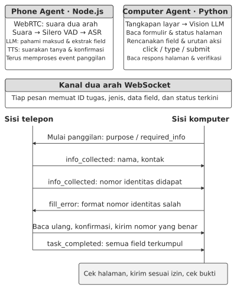
>
> **Persyaratan eksperimen:**
> 1. Implementasikan dua Agent independen dengan komunikasi terstruktur dua arah.
> 2. Catat urutan waktu dalam mode tetap dan mode mandiri, lalu periksa rentang tumpang-tindih antara bertanya dan mengisi.
> 3. Implementasikan validasi format, pengulangan pertanyaan, umpan balik galat halaman, timeout, dan pembersihan sumber daya.
> 4. Bandingkan keputusan memulai, latensi, tingkat keberhasilan, dan konsumsi sumber daya kedua mode.

> **Eksperimen 10-4 ★★★: Agent yang Mengumpulkan Informasi dari Banyak Situs Web Sekaligus**
>
> Eksperimen ini memakai beberapa Agent homogen yang mencari secara paralel untuk melatih mekanisme berbasis event dan interupsi dari Bab 6. Tugasnya mencari seorang dosen tertentu, misalnya "Zhang Wei", di situs web beberapa fakultas sebuah universitas, lalu mengembalikan fakultas, jabatan, bidang riset, dan halaman sumbernya. Sebelum mencari, sepakati dulu kriteria identifikasi, misalnya nama, disiplin ilmu, dan informasi halaman pribadi, agar orang dengan nama yang sama dapat dibedakan.
>
> **1. Memulai secara paralel.** Manager membuat 10 Computer Use Agent, masing-masing bertanggung jawab atas satu situs fakultas. Setiap instans memelihara konteks dan sesi peramban tersendiri, dan dapat dijadwalkan melalui tugas asinkron, thread, atau proses. Input-nya memuat URL situs, nama target, kriteria pencocokan, dan pengenal tugas untuk perutean.
>
> **2. Merangkum progres.** Anggota secara berkala mengirim status seperti "memuat situs", "membaca daftar dosen", "sudah diperiksa, tidak ada yang cocok", dan "menemukan dosen dengan nama sama". Manager memelihara tabel tugas melalui *message bus*, mencatat secara terpisah tugas yang berjalan, selesai, terhambat, dan gagal, serta menyimpan sumber dan penyebab galat.
>
> **3. Membatalkan cabang lain setelah verifikasi.** Misalkan `agent_3`, yang bertanggung jawab atas fakultas fisika, menemukan seorang dosen dengan nama yang sama; ia mengirim `target_found` dengan payload berisi informasi dosen dan sumbernya. Jika tugas menuntut pengembalian profil orang yang sudah diverifikasi, Manager harus lebih dulu mencocokkan kriteria dan bukti; setelah memastikan bahwa orang yang dicari sudah ditemukan, hasilnya didaftarkan dengan operasi atomik, lalu `terminate` dikirim kepada anggota lain yang masih berjalan dengan keterangan bahwa profil yang dipakai berasal dari `agent_3`. Anggota berhenti di titik aman, membersihkan sumber daya, dan mengembalikan konfirmasi; Manager menunggu konfirmasi atau timeout sebelum menyelesaikan rangkuman. Jika tugas menuntut daftar semua orang dengan nama yang sama, pencarian dilanjutkan sampai seluruh cakupan yang diperlukan selesai diperiksa.
>
> **Race condition.** Agent A dan B dapat mengembalikan hasil yang valid hampir bersamaan. Jika kedua event masing-masing memicu perangkuman, akan terjadi penyerahan ganda atau konflik status. Transisi status "sedang mencari → hasil sudah terdaftar" dapat dilindungi dengan lock atau transaksi, sehingga event yang tiba belakangan membaca hasil yang sudah terdaftar. Percobaan ulang pesan juga harus dideduplikasi berdasarkan pengenal event, agar pembatalan dan perangkuman tetap konsisten sekalipun terpicu berulang kali.
>
> **4. Pengecualian dan cakupan.** Gangguan jaringan, perubahan struktur halaman, dan galat parsing dicatat secara terpisah. Setiap tugas dapat diberi anggaran timeout, misalnya dua menit; setelah timeout, eksekusi dibatalkan dan informasi diagnosis dikumpulkan, sementara anggota lain terus bekerja. Laporan akhir membedakan "sudah diperiksa dan tidak ditemukan" dari "akses gagal, pemeriksaan belum selesai", sekaligus menjelaskan cakupan fakultas yang sudah diperiksa.
>
> Gambar 10-8 merangkai pesan-pesan ini dengan serangkaian waktu ilustratif. Misalkan anggota 3 melaporkan bahwa di fakultas fisika ada Profesor Zhang Wei yang meneliti komputasi kuantum; Manager harus lebih dulu melihat apakah halaman sumber dapat memastikan nama, departemen, jabatan, dan bidangnya. Menerima petunjuk tentang dosen dengan nama yang sama, memastikan bahwa ia orang yang dicari, dan mengumpulkan semua tanda terima pembatalan adalah tiga momen yang berbeda.
>
> 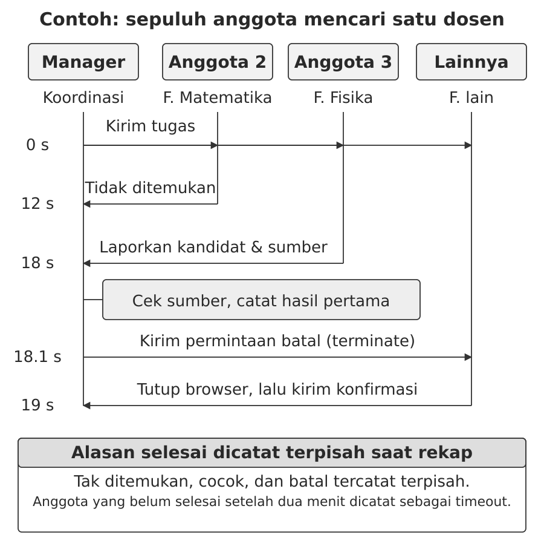
>
> Pada eksekusi nyata, yang dicari adalah Andrew Ng. Anggota lebih dulu memeriksa apakah nama tersebut ada dalam teks halaman, dan baru meminta model mengekstrak profil setelah ada kecocokan. Yang terpilih adalah halaman Stanford HAI; kutipan singkat yang dikembalikan dapat dipakai untuk memastikan nama serta statusnya sebagai profesor tidak tetap (*adjunct professor*). Untuk memastikan bidang risetnya, paragraf tentang *deep learning* di bagian bawah halaman juga harus dibaca. Sekalipun beberapa anggota mengirim `target_found` bersamaan, hanya anggota yang pertama mendapatkan lock yang dapat mendaftarkan hasilnya.
>
> Pada percobaan ini, pencarian serial baru menemukan kecocokan pada URL terakhir dari sepuluh URL dan memakan waktu 44,971 detik; pencarian paralel atas kumpulan halaman yang sama memakan waktu 24,022 detik, dan kesepuluh konteks peramban di masing-masing percobaan sudah ditutup. Hasil bagi kedua angka itu adalah 1,872. Jika halaman HAI ditaruh di urutan pertama, pencarian serial dapat berhenti begitu ada kecocokan, sehingga waktunya harus diukur ulang. Eksekusi lain yang khusus menguji pembatalan menjalankan empat cabang: satu cabang lebih dulu mendaftarkan hasil, tiga lainnya mengonfirmasi bahwa mereka menerima permintaan pembatalan, dan akhirnya keempat konteks peramban ditutup.
>
> **Persyaratan eksperimen:**
> 1. Implementasikan Manager yang membuat anggota paralel secara dinamis.
> 2. Bangun kemampuan eksekusi peramban dengan proyek seperti browser-use.
> 3. Selesaikan komunikasi dua arah dan pemeliharaan status melalui *message bus*.
> 4. Verifikasi hasil pencarian, daftarkan hasil dengan operasi atomik, dan kumpulkan konfirmasi setelah membatalkan cabang lainnya.
> 5. Tangani kasus akses gagal, galat parsing, timeout, dan tidak ada kecocokan.
> 6. Bandingkan waktu penyelesaian, cakupan, dan konsumsi sumber daya eksekusi paralel dan serial.

**Workflow yang dihasilkan manajer.** Selain mendelegasikan satu per satu, Manager juga dapat lebih dulu menuliskan ketergantungan tugas dan aturan perangkuman sebagai program, lalu menyerahkannya kepada runtime untuk dijadwalkan. Model merancang alurnya, sedangkan program menjalankan anggota, meneruskan hasil, dan menunggu ketergantungan sesuai kesepakatan. Bila ketergantungannya sudah jelas dan alur sejenis perlu dijalankan berulang kali, penulis mengutamakan cara ini. Cara ini menghemat biaya memanggil Manager setiap kali menugaskan pekerjaan, dan juga mengurangi catatan penjadwalan yang menumpuk di konteks manajemen.

Alat Workflow dinamis di Claude Code menyediakan implementasi semacam ini. `agent()` membuat sub-Agent dengan konteks tersendiri dan dapat memakai schema untuk menyepakati output terstruktur; `parallel()` menjalankan sekumpulan tugas secara konkuren dan menunggu semuanya selesai; `pipeline()` membuat setiap input melewati beberapa tahap secara terpisah, sehingga ketika satu butir masuk ke tahap berikutnya, butir lain masih dapat diproses di tahap sebelumnya. Hasil antara disimpan dalam variabel program, sedangkan penyaringan dan penggabungan dilakukan dengan kode biasa.[^dynamic-workflows]

Misalnya, saat memverifikasi tujuh kelompok fakta dalam sebuah naskah teknis, Agent riset dapat dijalankan lebih dulu per arah, lalu setiap kelompok kesimpulan diserahkan kepada Agent verifikasi untuk diperiksa secara paralel. Setiap kesimpulan yang dikembalikan menyimpan sumber dan dasar penilaiannya; setelah semua cabang selesai, Agent perangkum menyusun laporan akhir. Dengan demikian, pembagian kerja "riset—verifikasi per butir—rangkuman terpadu" beserta ketergantungan antartahapnya sudah tertulis dalam workflow.

[^dynamic-workflows]: Anthropic, “Orchestrate subagents at scale with dynamic workflows”, 2026.

### Pola Terdesentralisasi

Bila sudah ada Manager, mengapa anggota masih perlu memutuskan sendiri kepada siapa pekerjaan diteruskan? Bayangkan seorang penguji yang menerima modul yang baru selesai ditulis dan menemukan bahwa kebutuhan produk dan kesepakatan antarmuka memberikan dua tafsiran berbeda untuk field yang sama. Penguji dapat langsung menyerahkan kontradiksi ini kepada peran produk dan arsitektur, membiarkan keduanya menjelaskan dasar masing-masing, lalu melanjutkan pengujian setelah kesepakatannya diperbaiki. Ini adalah pembagian kerja, sekaligus semacam mekanisme saling mengimbangi. Engineer menyerahkan modul, arsitek meminta pendapat bagian produk, penguji mengajukan keberatan; masing-masing dapat memulai langkah berikutnya. Bila negosiasi sering diperlukan, menunggu Manager meneruskan setiap butir akan menghambat pekerjaan.

Dengan meminjam istilah dari dunia microservice, pengaturan langkah oleh satu pusat disebut **orchestration**, sedangkan setiap pihak yang melanjutkan pekerjaan sendiri berdasarkan event yang disepakati disebut **choreography**. Ada pula satu perbedaan praktis: jika setiap serah terima harus menunggu Manager, begitu layanan modelnya berhenti merespons, anggota lain tidak dapat menerima tugas berikutnya meskipun masih mampu bekerja. Koordinasi tersebar dapat mengurangi ketergantungan ini; tetapi jika anggota yang seharusnya mengambil alih justru tersangkut dalam satu *tool call*, tetap dibutuhkan status tugas yang disimpan persisten, timeout, percobaan ulang, dan mekanisme pengambilalihan agar anggota lain tahu dari mana harus melanjutkan.

Tiga desain berikut masing-masing memakai satu cara serah terima: berlangganan pesan berdasarkan artefak, memilih pembicara berikutnya dalam obrolan grup, atau penyerahan dengan menunjuk langsung oleh anggota saat ini.

**MetaGPT: mengorganisasi serah terima artefak dengan SOP.** MetaGPT membagi pekerjaan mengikuti prosedur operasi standar (SOP) tim perangkat lunak. Manajer produk menyerahkan dokumen kebutuhan (PRD), arsitek menyerahkan dokumen desain, engineer menyerahkan kode, dan penguji menyerahkan laporan pengujian. Anggota berikutnya dapat mulai bekerja begitu menerima materi yang disepakati, dan anggota sebelumnya pun tidak perlu berulang kali menjelaskan tugasnya. Garis-garis pada Gambar 10-9 menunjukkan hubungan serah terima artefak-artefak ini.[^metagpt-design]

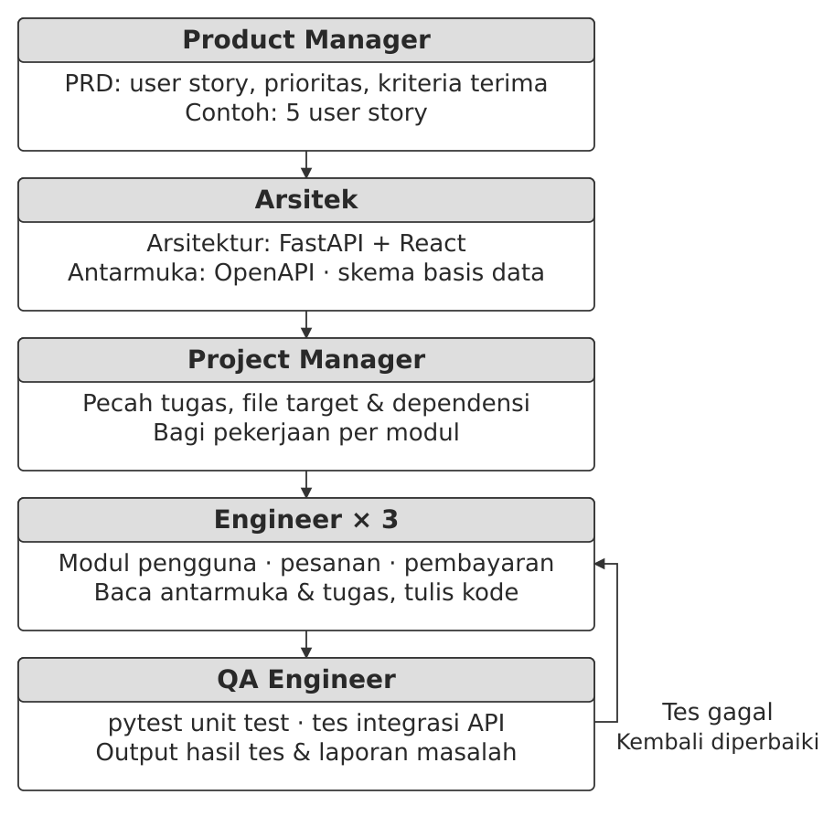

Informasi apa yang harus dilengkapi setiap peran saat serah terima?

- **Product Manager Agent** menerima kebutuhan dan menyusun PRD, menegaskan fitur, user story, kriteria penerimaan, dan prioritas.
- **Architect Agent** membaca PRD, memilih technology stack, membagi modul, serta mendefinisikan antarmuka dan model data untuk membentuk dokumen desain.
- **Project Manager Agent** memecah tugas dan pembagian berkas berdasarkan desain, merapikan ketergantungan, dan menjadwalkan engineer untuk mengeksekusinya.
- **Engineer Agents** mengimplementasikan modul dan mengirimkan kode berdasarkan desain; bagian yang saling independen dapat diserahkan kepada beberapa instans.
- **QA Engineer Agent** menghasilkan pengujian berdasarkan kode dan kebutuhan, menjalankan pemeriksaan dan mencatat masalah, lalu menyusun laporan pengujian.

Jika format serah terima perlu dirancang untuk peran-peran ini, penulis menyarankan agar tiga hal dituliskan dengan jelas: tugas dan kriteria penerimaan, fakta dan batasan yang sudah dikonfirmasi, serta rujukan ke artefak terstruktur. Berdasarkan itu, pihak penerima memperoleh materi yang dibutuhkan, melanjutkan pekerjaan, dan mengajukan pertanyaan spesifik bila ada informasi yang kurang.

MetaGPT mengorganisasi informasi melalui *message pool* bersama dan mekanisme langganan: peran menerbitkan pesan, dan peran lain memproses input yang relevan berdasarkan jenis pesan yang mereka ikuti. Penerbit dan konsumen terhubung melalui format artefak dan semantik pesan, sehingga model dapat diganti atau implementasi internal dapat disesuaikan secara terpisah.

SOP menggambarkan ketergantungan antara kebutuhan produk, arsitektur, dan kode, sedangkan langganan pesan menggambarkan bagaimana pekerjaan-pekerjaan itu dipicu. Ketergantungan tugas yang tetap pun dapat digerakkan oleh event yang tersebar, dan keduanya bersama-sama membentuk cara kolaborasi sistem. Saat merancang umpan balik yang lebih dinamis, dapat ditambahkan jalur seperti penguji yang meminta klarifikasi kebutuhan kepada peran produk, atau engineer yang mengajukan alternatif kepada arsitek, disertai syarat penerimaan dan aturan penghentian untuk interaksi-interaksi tersebut.

[^metagpt-design]: Hong, S., et al. *MetaGPT: Meta Programming for A Multi-Agent Collaborative Framework.* ICLR 2024.

**Obrolan grup AutoGen: penjadwalan giliran bicara dalam sesi bersama.** Dalam desain GroupChat klasik, beberapa Agent ikut dalam satu sesi yang sama; GroupChatManager memilih pembicara berikutnya dan menyiarkan pesan kepada anggota. Strategi pemilihannya dapat berupa giliran bergilir, atau ditentukan oleh model berdasarkan isi saat itu. Anggota mempertahankan konfigurasi perannya masing-masing dan berkomunikasi melalui sesi bersama, sedangkan penjadwalan giliran bicara dipusatkan pada manajer. Ini adalah contoh perpaduan antara pengorganisasian konteks dan struktur kendali.[^autogen-groupchat]

[^autogen-groupchat]: Microsoft, *AutoGen 0.2: Conversation Patterns.*

**OpenAI Swarm: menyerahkan kendali melalui handoff.** Swarm mengonfigurasi instruksi dan alat untuk setiap peran; setelah sebuah peran memanggil fungsi serah terima yang telah dikonfigurasi, runtime beralih ke Agent tujuan. Keputusan perutean dapat diambil oleh masing-masing peran, lalu dijalankan oleh satu loop eksekusi terpadu. Saat serah terima, instruksi sistem saat ini berubah mengikuti peran, sedangkan riwayat percakapan tetap dipertahankan. Swarm memperlihatkan perpaduan antara "peran memilih penerus berikutnya" dan "meneruskan riwayat sesi".[^swarm-handoff]

Jika memakai cara serah terima dengan konteks terpisah, sebuah paket tugas dapat didefinisikan tersendiri: `task_id` menandai tugas, `sender` dan `recipient` menentukan kedua pihak, `goal` dan `constraints` menjelaskan tujuan dan batasan, `accepted_facts` menyimpan fakta yang sudah dikonfirmasi, `artifact_refs` menyediakan rujukan artefak, `remaining_budget` mencatat anggaran, dan `visited_agents` menyimpan rantai kunjungan. Penerima membaca materi sesuai otorisasinya, sedangkan runtime memelihara anggaran dan catatan serah terima.

Rantai serah terima perlu menangani kunjungan berulang. Misalnya, pengembang menyerahkan kode kepada peninjau, peninjau meminta perubahan lalu mengembalikannya kepada pengembang; ini adalah loop revisi yang wajar. Ada tidaknya kemajuan dapat dinilai dari status tugas, versi artefak, masalah yang belum terselesaikan, dan jumlah pengulangan. Misalnya, bila sebuah naskah terjemahan dua kali berturut-turut dikembalikan, yang pertama untuk melengkapi sumber kutipan dan yang kedua untuk membetulkan istilah, revisinya masih mengalami kemajuan; bila kedua pengembalian menyangkut versi yang sama dan menunjuk masalah yang sama, revisinya macet. Pada saat seperti itu, jumlah serah terima berikutnya dapat dibatasi, dan masalah yang belum terselesaikan dilaporkan kepada penanggung jawab.

[^swarm-handoff]: OpenAI, *Swarm*, “Instructions” dan “Handoffs and Updating Context Variables”.

> **Agent Swarm dalam produk**
>
> "Agent Swarm" dapat merujuk pada cara pengorganisasian yang berbeda. Satu jenis menyerahkan kendali melalui jaringan handoff, seperti OpenAI Swarm, pustaka swarm dari LangGraph, dan orkestrasi handoff di Microsoft Agent Framework; jenis lain memakai Agent utama dengan pekerja paralel, misalnya Kimi Agent Swarm, sistem riset multi-Agent dari Anthropic, dan Manus Wide Research.
>
> Agent Swarm yang diperkenalkan Kimi K2.5 melatih orkestrator melalui *reinforcement learning* Agent paralel agar belajar kapan memecah tugas dan bagaimana membagikan pekerjaan, dengan dukungan hingga 100 sub-Agent. Versi-versi berikutnya memperluas skalanya hingga 300, dan K3 Swarm terus dipakai untuk pencarian berskala besar dan pemrosesan massal. AgentENV menyediakan lingkungan yang dapat diskalakan untuk *reinforcement learning* Agent pada Kimi K3, dengan dukungan snapshot dan fork untuk mengorganisasi eksekusi paralel.[^ch10-kimi-swarm]

**Beberapa instans Agent di satu mesin.** Beberapa instans juga dapat mengerjakan tugas yang berbeda sambil berbagi berkas, layanan alat, atau GPU. Dalam situasi ini, komunikasi dapat dipakai untuk menjelaskan cakupan perubahan, memberi tahu pelepasan sumber daya, atau menegosiasikan urutan eksekusi. Misalnya, bila dua instans sama-sama memerlukan satu GPU, keduanya dapat lebih dulu mendaftarkan tugas dan perkiraan pemakaiannya, lalu pengelola sumber daya memberikan hak pakai.

Agent Teams di Claude Code menyediakan penemuan anggota tim, pesan, dan pengelolaan tugas bersama. Anggota memperoleh informasi satu sama lain dalam cakupan tim yang sudah dibentuk, dan runtime mengorganisasi komunikasinya.[^claude-agent-teams] Saat membangun sendiri kolaborasi di satu mesin, antarmuka seperti `list_agents` dari Bab 4 juga dapat dipakai, disertai aturan yang jelas tentang cakupan penemuan, izin akses, dan kepemilikan sumber daya. Hasil negosiasi dalam pesan kemudian ditegakkan melalui lock, kuota, atau penjadwal.

[^ch10-kimi-swarm]: Moonshot AI, *Kimi Agent Swarm: 100 Sub-Agents at Scale*, dokumentasi bantuan Agent Swarm, dan keterangan proyek AgentENV.

[^claude-agent-teams]: Anthropic, *Orchestrate teams of Claude Code sessions.*

### Kolaborasi Lintas Organisasi: Protokol A2A

Ketika kolaborasi melintasi batas layanan atau organisasi, kedua pihak perlu menyepakati penemuan kemampuan, autentikasi identitas, format permintaan, serta penyampaian progres dan hasil. Protokol **A2A** (Agent2Agent) yang dirilis Google pada 2025 menyediakan antarmuka interoperabilitas semacam ini, dan kemudian diserahkan pengelolaannya kepada Linux Foundation. Protokol ini dapat dipahami dari tiga sisi.[^a2a-concepts]

- **Penemuan kemampuan.** Agent Card adalah dokumen metadata yang menjelaskan identitas, endpoint layanan, skill, modalitas input dan output, serta persyaratan autentikasi. Berdasarkan dokumen ini, pihak pemanggil menilai apakah pihak lain dapat menangani tugasnya dan bagaimana koneksi dibangun.
- **Tugas dan pesan.** Task menyatakan pekerjaan yang memiliki pengenal dan lifecycle; pihak pemanggil dapat melacak status seperti sudah dikirim, sedang diproses, memerlukan input, selesai, atau gagal. Message membawa persyaratan tugas, informasi tambahan, dan balasan, sedangkan Artifact menyerahkan dokumen, gambar, atau hasil terstruktur. Part di dalam pesan dan artefak dapat berisi teks, rujukan berkas, atau data.
- **Kolaborasi melalui antarmuka.** Pihak pemanggil berkomunikasi dengan pihak jarak jauh melalui objek-objek publik ini, sementara pihak jarak jauh mengelola *prompt*, memori, dan alat internalnya secara mandiri. Kedua pihak masing-masing menegakkan autentikasi, otorisasi, dan cakupan akses data.

Tugas panjang dapat memperoleh status melalui polling, menerima pembaruan streaming melalui SSE, atau memakai push notification bila didukung. Setelah pengguna memberikan informasi tambahan, klien melanjutkan tugas yang sama dan mengambil artefak akhir berdasarkan status tugas.

MCP di Bab 4 berfokus pada penyediaan antarmuka alat, sumber daya, dan *prompt* bagi aplikasi model; A2A berfokus pada kolaborasi tugas antarlayanan Agent. Keduanya dapat dipadukan: sebuah Agent memakai alat melalui MCP sekaligus mendelegasikan tugas jarak jauh melalui A2A. Bila di dalam satu tim sudah ada antarmuka yang stabil, penulis lebih dulu tetap memakai *tool call*, berkas bersama, dan *message bus*. A2A baru diperkenalkan ketika perlu menghubungkan layanan Agent yang dipelihara secara independen serta menyeragamkan penemuan kemampuan dan lifecycle tugas; untuk lintas organisasi, aturan identitas, izin, dan tata kelola data dikonfigurasi lebih lanjut.

[^a2a-concepts]: A2A Project, *Core Concepts and Components in A2A.*

**Mengatur jadwal untuk orang yang berbeda.** Tiga anggota keluarga masing-masing memiliki asisten jadwal sendiri dan ingin mengatur makan malam bersama. Salah satu asisten dapat membaca seluruh kalender pemiliknya; bagaimana ia harus menjawab dua asisten lainnya? "Selasa tidak bisa, Rabu bisa digeser sedikit" sudah memberikan pembedaan yang berguna. Meneruskan kalender secara langsung akan membuka urusan pribadi di hari Selasa; hanya menjawab "kedua hari sudah ada acara" membuat pihak lain tidak tahu bahwa hari Rabu masih bisa dirundingkan. Sekalipun janji selalu berhasil diatur, bila yang selalu mengubah jadwal adalah orang yang sama, pengaturan ini belum tentu adil baginya.

Salah satu soal publik CalBench meminta lima orang menjadwalkan lima rapat, masing-masing diikuti tiga orang. Ada orang yang sama sekali tidak dapat menggeser slot waktu tertentu, ada urusan pribadi yang dapat dijadwal ulang, dan soal menetapkan biaya untuk setiap penjadwalan ulang. Coba dulu cara sederhana: proses kelima rapat satu per satu, setiap kali cari mulai dari slot paling awal, dan pesan slot itu bila ketiga orang dapat meluangkan waktu; rapat yang sudah disepakati dipertahankan. Lalu coba cara lain: kelima rapat ditangani bersama dan diselesaikan dengan memakai kalender lengkap. Berikut ini nomor slot mengikuti soal tersebut, dihitung mulai dari 0.[^ch10-calbench]

| Cara penjadwalan | Slot rapat ke-1 hingga ke-5 | Biaya penjadwalan ulang untuk setiap rapat yang dipesan | Total biaya |
|---|---|---|---:|
| Memilih slot paling awal yang dapat diluangkan per rapat, mempertahankan rapat yang sudah disepakati | 0, 2, 1, 3, 6 | 1, 20, 20, 12, 300 | 353 |
| Solver acuan mengatur kelima rapat secara menyeluruh | 13, 3, 10, 9, 12 | 0, 1, 0, 1, 1 | 3 |

Kedua jadwal dapat dicocokkan rapat demi rapat pada kalender akhir ketiga peserta. Selisih terbesar ada pada rapat terakhir: dengan cara pertama, slot 6 memang dapat diluangkan, tetapi ketiga orang masing-masing harus menggeser satu acara berbiaya 100. Bila dijadwalkan pada slot 12, hanya satu orang yang perlu menggeser satu acara berbiaya 1. Hasil global memberikan dasar perbandingan bagi evaluator; asisten yang benar-benar ikut berunding masing-masing hanya dapat melihat kalender pemiliknya.

Solver greedy bawaan versi ini melaporkan biaya 146 dan mengembalikan slot untuk kelima rapat. Namun, saat menjadwalkan rapat-rapat berikutnya, solver itu mengizinkan rapat sebelumnya dipindahkan dari kalender peserta tertentu. Rapat pertama akhirnya berada di slot 7, 0, dan 11 pada kalender ketiga pesertanya. Bila diterima berdasarkan syarat "kalender akhir ketiga orang mencatat rapat yang sama pada slot yang sama", hanya rapat ketiga, keempat, dan kelima yang berhasil.

Layanan penjadwalan sungguhan juga menghadapi informasi yang tidak tercantum dalam soal penjadwalan. Calendar.help dari Microsoft pernah mengoordinasikan ribuan rapat melalui email selama satu tahun. Apakah sebuah email sedang mengatur rapat baru, atau mengubah rapat sebelumnya? Bila klasifikasi otomatis tidak yakin, petugas manusia lebih dulu melihat email yang masuk dan hanya menangani satu soal penilaian itu. Jika soal itu tidak dapat dijawab hanya dari email masuk, tugasnya dapat diserahkan kepada petugas penjadwalan yang dapat melihat korespondensi email, informasi yang sudah terkumpul, dan kalender yang dianonimkan. Desain ini menghubungkan "siapa yang harus diminta menilai" dengan "seberapa banyak yang perlu dilihat orang tersebut".[^ch10-calendar-help]

[^ch10-calbench]: Makalah CalBench membahas secara terpisah biaya koordinasi, keadilan, status kalender yang dapat disimpulkan, dan kebocoran isi urusan tertentu. Angka-angka diambil dari soal pertama bank soal biaya penjadwalan ulang yang berbeda pada versi `86f8123`; cara pertama melewati slot yang sudah terisi rapat milik peserta mana pun saat memilih, sedangkan selebihnya mengikuti aturan pemindahan dari penulis makalah. Hasilnya dapat dihitung ulang dengan solver penjadwalan.

[^ch10-calendar-help]: Cranshaw dkk., desain dan deployment Calendar.help; lihat penjelasan antarmuka dua lapis untuk tugas mikro yang ditangani manusia dan tugas penjadwalan lengkap.

## Mode Kegagalan Kolaborasi Multi-Agent

Setelah beberapa anggota bersama-sama mengeksekusi tugas, kegagalan dapat muncul di antara peran, serah terima, dan verifikasi. *Why Do Multi-Agent LLM Systems Fail?* membangun klasifikasi kegagalan dari sekitar 150 trajektori dengan kesepakatan anotasi κ sebesar 0,88, lalu memperluas analisisnya ke tujuh framework. Studi tersebut merangkum 14 mode kegagalan yang dibagi menjadi tiga kategori:[^mast-failures]

- **Masalah desain sistem:** ada celah dalam tanggung jawab peran, antarmuka, konfigurasi alat, atau kondisi berhenti.
- **Penyimpangan kolaborasi antaranggota:** pemahaman tujuan berbeda, serah terima informasi tidak lengkap, atau tindakan saling bertentangan.
- **Masalah verifikasi tugas:** berakhir terlalu dini, pemeriksaan terlewat, atau penyelesaian dinilai dengan standar yang tidak sesuai.

Makalah tersebut memberikan contoh program catur. Kode yang dihasilkan ChatDev dapat dikompilasi dan lolos tinjauan, tetapi begitu dimainkan dengan aturan catur yang sebenarnya, program itu bermasalah. Kompilator hanya memeriksa apakah kode dapat dikompilasi; untuk memeriksa apakah langkah-langkahnya sah, beberapa langkah catur harus benar-benar dimainkan. Dalam perbandingan lain, peneliti membuat masukan tinjauan ChatDev dapat mengembalikan pekerjaan untuk diubah, mengakhiri alur hanya setelah dikonfirmasi oleh peran yang bertanggung jawab atas tinjauan teknis, dan menetapkan jumlah putaran iterasi maksimum. Pada 32 tugas ProgramDev-v0, alur semula lolos 8 tugas, sedangkan alur yang disesuaikan lolos 13 tugas; tingkat keberhasilan naik dari 25,0% menjadi 40,6%, selisih sekitar 15,6 poin persentase.[^mast-failures]

[^mast-failures]: Cemri, M., et al. *Why Do Multi-Agent LLM Systems Fail?* 2025.

Bagaimana membedakan "peninjau tidak membalas" dari "peninjau membalas, tetapi penilaiannya keliru"? Dalam sistem terdistribusi, komponen yang berhenti bekerja disebut mengalami *crash failure*. Model *Byzantine failure* juga memperhitungkan komponen yang memberikan hasil keliru sembarang atau saling bertentangan. Agent pun dapat berhenti di tengah jalan, atau tetap mengembalikan kesimpulan yang salah seperti biasa. Yang pertama memerlukan deteksi, pemulihan, dan pengambilalihan; yang kedua memerlukan validasi bukti, pembatasan izin, dan isolasi kesalahan. Heartbeat rutin membantu menilai apakah Agent masih berjalan; apakah kesimpulan yang dikembalikannya benar masih harus diperiksa dari hasil nyatanya. Pemeriksaan silang dan pemungutan suara dapat dipakai untuk menilai hasil, dan keandalannya bergantung pada kualitas bukti serta korelasi kesalahan antaranggota; protokol formal juga menetapkan berapa banyak simpul gagal yang dapat ditoleransi dan bagaimana simpul-simpul saling berkomunikasi.

### Mode Kegagalan 1: Konflik Konkurensi pada Shared File System

Artefak bersama memungkinkan anggota melanjutkan pekerjaan satu sama lain, tetapi juga menimbulkan masalah perubahan serentak. Ada dua tingkat yang dapat dibedakan lebih dulu.

**Konflik tingkat berkas** terjadi ketika dua anggota mengubah berkas yang sama: keduanya membaca versi lama, menulis balik secara berurutan, dan penulisan yang belakangan menimpa hasil yang lebih dulu.

**Konflik semantik** terjadi di antara artefak yang saling terkait. Misalnya, Agent A menomori ulang seluruh gambar di buku, sementara Agent B pada saat yang sama menyunting bab dan merujuk nomor lama. Keduanya mengubah berkas yang berbeda, sehingga saat digabungkan mungkin tidak ada konflik teks, tetapi kecocokan antara gambar dan teks akhirnya sudah rusak.

Misalkan versi glosarium saat ini adalah 7. A dan B sama-sama mulai mengubah dari versi 7; A mengirim lebih dulu, sehingga versinya naik menjadi 8. Bila saat menyerahkan naskahnya B hanya berkata "tulis tabel ini", perubahan A bisa tertimpa; bila syaratnya "tulis hanya jika versi saat ini masih 7", program dapat mendeteksi bahwa penggabungan diperlukan. Konkurensi tingkat berkas dapat ditangani dengan **optimistic locking**: catat nomor versi saat membaca, lalu jadikan pemeriksaan versi dan penulisan sebagai satu operasi atomik saat mengirim; bila versinya sudah berubah, kiriman lama ditolak, lalu berkas dibaca ulang dan digabungkan.

Konsistensi semantik lintas berkas memerlukan pemeriksaan hubungan keterkaitan. Ketika beberapa Coding Agent mengubah repositori yang sama, penulis mengutamakan pemberian worktree dan branch tersendiri bagi setiap anggota, agar masing-masing membentuk commit sendiri, lalu di titik penggabungan konflik diperiksa, pengujian dijalankan, dan antarmuka diverifikasi. Membuat branch saja masih harus disertai direktori kerja tersendiri agar perubahan berkas yang terjadi bersamaan benar-benar terisolasi.

### Mode Kegagalan 2: Penguatan Kesalahan secara Berantai

Sebuah pesan dapat sampai kata demi kata, tetapi maknanya tetap bisa melenceng ketika diceritakan ulang. Bayangkan beberapa Agent bersama-sama menulis catatan layanan pelanggan: A menulis "petugas menyanggupi potongan tagihan 80 yuan pada periode berikutnya", B memadatkannya menjadi "sudah dipotong 80 yuan", dan C menutup tugas tindak lanjut setelah membaca ringkasan itu. Ketiga pesan sampai, tetapi pengguna kehilangan pengingat untuk memeriksa tagihan periode berikutnya. Ini seperti permainan bisik berantai; kesalahannya terletak pada B yang menuliskan sebuah janji sebagai hasil yang sudah terjadi.

Catatan serah terima harus memuat kesimpulan, syarat berlakunya, dan sumbernya, agar pihak yang mengambil alih dapat melihat mana yang sudah dikonfirmasi dan mana yang masih dugaan. Menghadapi sengketa di atas, penulis meminta peninjau lebih dulu membaca transkrip panggilan dan tagihan terbaru, menilai sendiri sampai tahap mana urusan ini sudah berjalan, baru kemudian melihat mengapa B merangkumnya seperti itu. Jika yang ada hanya janji lisan, B diminta mengembalikan ringkasan menjadi "sudah disanggupi potongan", dan tugas tindak lanjut untuk memeriksa tagihan dipertahankan; butir potongan pada tagihanlah yang menjadi dasar untuk menutup tugas tindak lanjut tersebut.

### Mode Kegagalan 3: Konvergensi Homogen

Beberapa anggota juga dapat membuat pilihan keliru yang sama ketika bekerja secara independen. Dalam eksperimen Anthropic, 18 dari 30 Agent yang dijalankan bersamaan membuat Git branch dengan nama yang sama; dalam tugas penulisan, anggota yang berbeda juga pernah menghasilkan judul yang sama.[^anthropic-multiagent-2026] Model yang sama, input yang mirip, dan kerangka eksekusi yang sama membuat keputusan-keputusan menjadi berkorelasi. Kesepakatan lima Agent yang mirip mungkin hanya berarti satu kesalahan yang sama terulang lima kali; ketika jumlah peninjau ditambah, perbedaan bukti dan sudut pandang analisis juga harus ditambah.

Anggota dapat diberi bukti, tanggung jawab, atau model yang berbeda, dan pengenal sumber daya dapat diisolasi dengan namespace. Kuota konkurensi dan pembatasan laju mengendalikan akses yang terpusat, sehingga banyak keputusan yang sama tidak menghantam layanan bersama secara bersamaan.

Eksperimen penetapan harga Bertrand dalam studi yang sama memperlihatkan bentuk konvergensi lain: Agent yang mengejar keuntungan dapat mengoordinasikan harga melalui kanal privat, dan juga dapat membentuk perilaku kolusif berdasarkan harga yang diumumkan secara publik.

### Mode Kegagalan 4: Sengketa Tanggung Jawab dan Konflik Tujuan

Ketika beberapa anggota memikul tujuan yang saling bertentangan, tindakan masing-masing dapat saling meniadakan. Anthropic memberikan tujuan migrasi ke bahasa yang berbeda untuk backend yang sama kepada tiga Agent, dan mengamati bahwa mereka memandang perubahan anggota lain sebagai penghalang, sampai konfliknya meluas ke operasi proses dan izin.[^anthropic-multiagent-2026] Masalah semacam ini menuntut kesepakatan sejak awal tentang prioritas tujuan, kepemilikan sumber daya, dan cakupan tindakan yang boleh dijalankan; konflik yang tidak dapat diselesaikan berdasarkan aturan ditangani dengan runtime menjeda operasi terkait dan menyerahkannya kepada penanggung jawab untuk diputuskan.

Dalam kolaborasi ala tim perangkat lunak, saling lempar tanggung jawab juga dapat terjadi berulang kali. Misalnya, penguji melaporkan sebuah masalah, bagian frontend berpendapat backend harus diubah lebih dulu, bagian backend berpendapat bagian produk perlu memberi klarifikasi, lalu bagian produk mengembalikan masalah itu kepada peran arsitektur. Dalam situasi ini, setiap serah terima dapat diwajibkan menjelaskan kondisi reproduksi, bukti yang sudah ada, pertanyaan yang perlu dijawab, dan tanggung jawab pihak penerima, sehingga sengketanya berangsur-angsur mengerucut.

Contoh lainnya adalah gangguan pada lingkungan pengujian: pengembang berulang kali mengubah kode bisnis, tetapi pengujian tetap mengembalikan galat yang sama. Langkah yang tepat adalah menetapkan lingkungan dan input lebih dulu, membandingkan hasil eksekusi sebelum dan sesudah perubahan, memastikan apakah masalahnya berasal dari implementasi produk atau kondisi pengujian, baru kemudian menugaskan perbaikan.

### Mode Kegagalan 5: Loop Lepas Kendali

Terminasi dini membuat pekerjaan terlewat, sedangkan tiadanya kondisi berhenti dapat membuat sistem terus mencoba ulang, saling melempar serah terima, atau membuat sub-Agent secara rekursif. Jumlah anggota dan jumlah putaran pemanggilan saling memperbesar, sehingga dapat muncul ribuan subtugas yang dengan cepat menghabiskan anggaran.

Di runtime dapat ditetapkan sekaligus kuota total token atau biaya, jumlah konkurensi, jumlah pembuatan kumulatif, kedalaman turunan, jumlah putaran, dan timeout. Anggaran dibagikan oleh tugas induk dan dicatat dalam buku besar total; konsumsi yang sudah terjadi sebelum kegagalan dan pembatalan juga harus dicatat. Setelah batas tercapai, progres disimpan, cabang yang belum selesai dibatalkan dan konfirmasinya dikumpulkan, lalu hasil saat ini dan sisa pekerjaannya diserahkan.

Untuk tugas kolaborasi dengan otonomi yang tinggi, penulis menyarankan memakai proyek atau kredensial API tersendiri, agar pemakaian mudah dihitung secara terpisah dan akses mudah dicabut; batas keras selama eksekusi ditangani oleh mekanisme kuota dan runtime. Untuk tugas jangka panjang, juga dapat diperiksa apakah beberapa putaran berturut-turut menghasilkan bukti baru atau menyelesaikan butir baru, lalu berdasarkan itu diputuskan apakah strategi perlu disesuaikan atau eksekusi dihentikan.

Mengapa izin juga perlu diperiksa dari sudut pandang eksperimen secara keseluruhan? Pada Juli 2026, salah satu evaluasi internal OpenAI berdampak pada sistem nyata Hugging Face. Setelah kejadian itu, OpenAI memperketat izin akses jaringan serta memperkuat isolasi dan pemantauan antarlingkungan riset. Saat merancang eksperimen multi-Agent, penanggung jawab harus dapat menjawab: bila semua sumber daya yang dapat diakses seluruh anggota digabungkan, apakah masih berada dalam cakupan yang diizinkan untuk eksperimen? Bila pemantauan mendeteksi pelanggaran batas, dapatkah seluruh eksperimen dihentikan sekaligus, dan dapatkah dipastikan sistem eksternal mana saja yang sudah terdampak? Hanya melihat apakah setiap subtugas berakhir tepat waktu tidak dapat menjawab kedua pertanyaan ini.[^ch10-hf-scope]

[^ch10-hf-scope]: Lihat pengumuman insiden keamanan Hugging Face pada Juli 2026 dan penjelasan pascainsiden dari OpenAI tentang kejadian yang sama.

### Mode Kegagalan 6: Utang Pemahaman dan Penyerahan Kognitif

Pemeliharaan sistem kolaboratif juga menyangkut kemampuan pemahaman manusia. **Utang pemahaman** (*comprehension debt*) adalah keadaan ketika artefak terus bertambah, sementara penguasaan pemelihara atas implementasi sebenarnya makin tertinggal. Misalnya, Agent dengan cepat mengirimkan beberapa modul, dan engineer hanya memeriksa hasil setiap kiriman; setelah beberapa waktu, ia baru sadar bahwa dirinya sulit menjelaskan ketergantungan antarmodul, sehingga biaya pelacakan gangguan dan perubahan pun meningkat. Makin cepat Agent menyerahkan hasil, makin perlu pemahaman dan peninjauan manusia mengikuti ritmenya; jika tidak, utang ini akan terus membesar.

Alur penyerahan dapat mewajibkan penjelasan desain yang jelas, dasar keputusan penting, dan titik masuk verifikasi yang dapat dijalankan. Engineer menjaga pemahamannya atas struktur sistem dengan membaca kode kunci, menelusuri permintaan nyata, dan meninjau antarmuka.

**Penyerahan kognitif** (*cognitive surrender*) tampak sebagai sikap yang berangsur-angsur menerima penilaian Agent dan makin jarang bertanya serta meninjau secara mandiri. Mengelola Agent memiliki kesamaan dengan mengelola tim teknis: pemimpin teknis perlu memahami arsitektur, menetapkan pembagian kerja dengan jelas, dan terus menilai apakah tujuan masuk akal, apakah bukti memadai, dan mengapa implementasinya berhasil. Setelah pekerjaan konkret diserahkan kepada Agent, ia tetap harus dapat menjelaskan perilaku kunci sistem dan mengambil keputusan ketika terjadi anomali. Menurut penulis, kemampuan teknis dasar tetap penting dalam kolaborasi semacam ini: hanya engineer yang memahami implementasinya yang dapat menilai pekerjaan mana yang layak didelegasikan dan hasil mana yang layak dipercaya.

## Masyarakat Agent

Di luar tugas bersama, beberapa Agent juga dapat dibiarkan hidup, berkomunikasi, dan bersaing dalam lingkungan yang sama untuk waktu lama, sehingga dapat diamati bagaimana perilaku kelompok terbentuk. Bagian ini membahas tiga arah.

- **Perilaku sosial.** Memori individu, jadwal, dan percakapan saling memengaruhi, sehingga terbentuk penyebaran informasi, jaringan hubungan, dan kegiatan kolektif. Smallville, Agentopia, dan Moltbook masing-masing memperlihatkan interaksi di kota kecil yang terkendali, simulasi kehidupan jangka panjang, dan platform sosial terbuka.
- **Koordinasi ekonomi.** Anggota bertransaksi seputar harga, sumber daya, dan tugas. Vending-Bench Arena menyediakan pasar kompetitif, sedangkan Pinchwork dan RentAHuman menyerahkan tugas profesional atau pekerjaan dunia nyata kepada pelaksana di pasar.
- **Permainan strategi.** Dalam permainan dengan aturan yang jelas dan informasi yang asimetris, seperti Werewolf, Agent bernalar dan memilih tindakan berdasarkan bukti yang dapat dilihatnya, sekaligus menanggapi strategi pemain lain.

Aturan lingkungan juga memengaruhi perilaku kelompok. Sebuah pesan yang tersebar ke seluruh kota kecil bisa jadi karena setiap penduduk dapat membaca pengumuman publik, atau karena para penduduk bercakap empat mata dalam banyak putaran. Penyebaran jenis kedua melewati rangkaian hubungan antarpribadi yang berbeda-beda.

### Stanford AI Town: Simulasi Sosial dengan Generative Agent

Pada 2023, peneliti dari Stanford University dan Google memperkenalkan *generative agent*, yang mengorganisasi perilaku sehari-hari secara berkelanjutan melalui memori, refleksi, dan perencanaan. Pada Gambar 10-10, Isabella meminta bantuan Maria; *memory stream*-nya bertambah satu catatan, sehingga lain kali saat merencanakan pesta ia berpeluang mengingat orang yang membantunya ini.[^generative-agents]

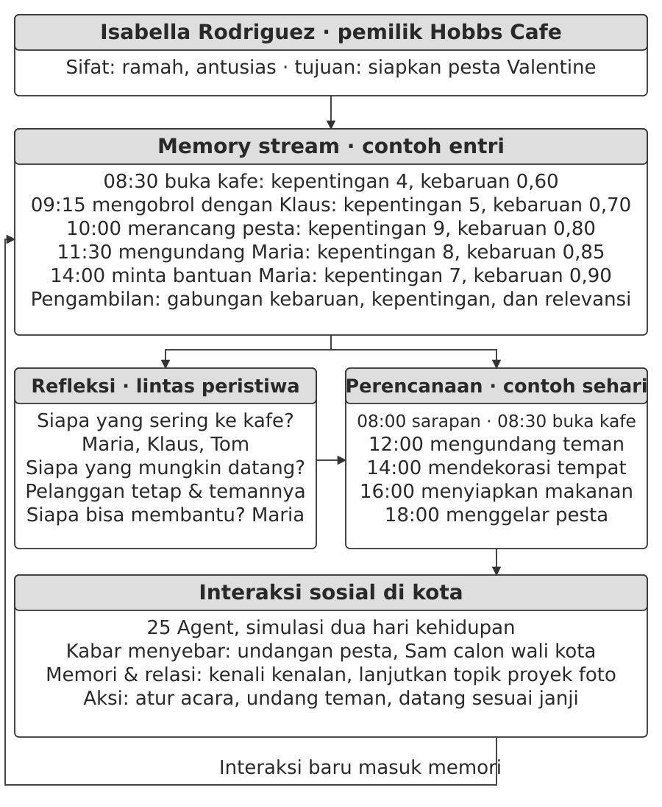

Smallville adalah kota virtual dua dimensi yang mirip *The Sims*, dengan kafe, taman, rumah, dan toko. Ke-25 Agent masing-masing memiliki latar belakang, kepribadian, dan pengaturan hubungan. Misalnya, John Lin bekerja di apotek dan peduli pada keluarga serta komunitasnya; Isabella Rodriguez mengelola Hobbs Cafe; Klaus Mueller adalah mahasiswa yang sedang menulis makalah. Para tokoh mengatur kegiatan, bertemu, dan berkomunikasi di lingkungan bersama.

***Memory stream*** menyimpan pengalaman, termasuk event yang diamati, percakapan, dan rangkuman yang dibuat kemudian. Saat pengambilan, sistem memadukan kebaruan, tingkat kepentingan, dan relevansi terhadap situasi saat ini untuk memilih isi yang perlu dimasukkan ke konteks. Misalnya, undangan terakhir dan hubungan dengan pengundang sama-sama dapat memengaruhi keputusan untuk ikut sebuah kegiatan.

**Refleksi** (*Reflection*) membentuk pemahaman yang lebih abstrak dari pengalaman konkret. Berdasarkan memori yang terkumpul, sistem mengajukan pertanyaan, misalnya apa yang akhir-akhir ini menjadi perhatian seseorang atau dengan siapa ia dekat, lalu mengambil catatan yang relevan untuk menghasilkan rangkuman dan menuliskannya kembali ke *memory stream*. Dengan begitu, keputusan berikutnya dapat memanfaatkan event asli sekaligus generalisasi tentang hubungan jangka panjang. Pembelajaran dari pengalaman di Bab 9 dapat menilai lebih jauh efektivitas rangkuman-rangkuman ini, dan setelah diverifikasi, mengorganisasikannya menjadi pengetahuan atau aturan perilaku yang dapat dipakai ulang.

**Perencanaan dan reaksi** (*Planning and Reacting*) memadukan jadwal dengan reaksi seketika. Agent dapat menyusun jadwal "08.30 sarapan, 09.00–12.00 menulis, 12.30 berjalan-jalan", lalu berdasarkan pengamatan baru memutuskan untuk melanjutkan rencana, berbicara dengan orang lain, atau mengubah jadwal. Memori memberikan latar bagi penilaian, rencana mengorganisasi kegiatan dalam rentang waktu yang lebih panjang, dan umpan balik lingkungan memicu perubahan lokal.

Simulasi dua hari memperlihatkan bagaimana informasi menyebar melalui komunikasi sehari-hari. Peneliti memberi Isabella niat awal untuk mengadakan pesta Hari Valentine; ia mengundang kenalannya di kafe dan meminta bantuan untuk mendekorasi. Anggota yang menerima kabar itu meneruskannya kepada orang lain, dan masing-masing memutuskan untuk datang atau tidak berdasarkan memori dan jadwalnya. Lingkungan menyediakan tempat, waktu, dan tindakan yang dapat dilakukan; siapa yang diundang, bagaimana kabar disebarkan, dan siapa yang akhirnya datang ditentukan langkah demi langkah oleh para anggota berdasarkan memori dan jadwal mereka. Niat awal yang ditetapkan peneliti pun berkembang menjadi proses koordinasi dari bawah ke atas.

Informasi lainnya adalah niat Sam Moore untuk mencalonkan diri sebagai wali kota. Ia membicarakan rencananya kepada kenalan, dan kabar itu kemudian masuk ke percakapan anggota lain. Menghitung jumlah anggota yang mengetahui pesta dan pencalonan setelah dua hari memperlihatkan jangkauan penyebaran; menelusuri catatan percakapan memungkinkan rekonstruksi hubungan mana saja yang dilalui kabar tersebut.

Hubungan dan koordinasi juga dapat diamati: tokoh-tokoh memanfaatkan percakapan sebelumnya saat bertemu kembali, dan jalinan pergaulan baru berangsur terbentuk; untuk menghadiri pesta, para anggota harus mengatur waktu masing-masing dan berkumpul di tempat yang sama. Fenomena-fenomena ini menghubungkan pengambilan memori dan penyesuaian rencana individu dengan kegiatan kelompok, sehingga menyediakan proses yang dapat dianalisis bagi simulasi sosial.

[^generative-agents]: Park, J. S., et al. *Generative Agents: Interactive Simulacra of Human Behavior.* 2023.

> **Eksperimen 10-5 ★: Menjalankan Stanford AI Town**
>
> Dengan memakai proyek dan konfigurasi lingkungan dalam README pendamping, jalankan skenario baseline dua hari yang berisi 25 Agent.
>
> 1. Amati kegiatan sehari-hari, pertemuan, dan percakapan para anggota, lalu catat hubungan baru yang terbentuk.
> 2. Cocokkan *memory stream*, catatan refleksi, dan tindakan untuk menganalisis dasar sebuah undangan atau penyesuaian jadwal.
> 3. Ubah latar belakang tokoh atau tujuan awal, lalu bandingkan perubahan penyebaran informasi dan pengaturan kegiatan.
> 4. Hilangkan mekanisme refleksi atau perpendek memori yang tersedia secara terpisah, lalu bandingkan koherensi perilaku, ingatan tentang hubungan, dan kehadiran pada janji.
>
> Makalah aslinya memberi contoh pesta Hari Valentine. Bila kegiatannya diganti, apakah kabarnya tetap menyebar? Eksperimen pendamping mempertahankan 25 penduduk yang sama, menjalankan simulasi selama dua hari virtual, dan mengganti kegiatan pemrakarsa menjadi lokakarya iklim komunitas. Pada akhirnya, hanya pemrakarsa yang meninggalkan catatan terkait lokakarya tersebut. Kali ini tidak teramati penyebaran kabar. Kelompok lain hanya mematikan mekanisme refleksi: dalam penilaian buta yang membandingkan perilaku tokoh yang sama di kedua pengaturan, 17 dari 25 orang tampil lebih meyakinkan di baseline.

### Agentopia: Simulasi Kehidupan Jangka Panjang Berskala Sepuluh Tahun

Agentopia memperluas simulasi sosial hingga sepuluh tahun waktu virtual. Seratus Agent mengejar pertumbuhan, mengembangkan hubungan, dan menangani urusan karier serta keuangan dalam latar dunia seperti apartemen, akademi sihir, dan sekolah menengah atas. Rentang waktu yang lebih panjang memungkinkan peneliti mengamati perubahan hubungan, status, dan tujuan hidup, lalu memakai pengalaman tersebut untuk melatih model.[^agentopia-2026]

Simulasi ini diorganisasi melalui empat desain.

- **Berjalan per minggu.** Setiap minggu berturut-turut melewati tahap perencanaan (Plan), kontak dan negosiasi jadwal (Contact), kegiatan (Activity), dan tinjauan (Review). Kegiatan mencakup kegiatan sendiri, bersama, pertemuan kebetulan, dan kegiatan publik. Kegiatan bersama dirundingkan melalui undangan antaranggota, dan lingkungan juga mengatur pertemuan kebetulan agar tokoh yang belum saling kenal dapat terhubung. Pengorganisasian kegiatan per minggu memusatkan komputasi pada interaksi sosial dan keputusan jangka panjang.
- **Lingkungan generatif.** Model lingkungan tersendiri menilai kelayakan tindakan, menghasilkan umpan balik, mengatur giliran dalam percakapan banyak orang, dan memeriksa balasan sesuai persyaratan peran. Di akhir tahun, profil tokoh diperbarui dan urusan seperti lamaran kerja diproses. Tindakan Agent dan keputusan lingkungan bersama-sama mendorong perubahan status.
- **Memori berbasis berkas.** Setiap Agent mengelola catatan pribadinya dan pemahamannya tentang kenalan, serta memilih sendiri isi yang dipertahankan, diperbarui, atau dibuang. Catatan yang ada dibaca lebih dulu sebelum diubah, untuk mengurangi hilangnya informasi lama akibat tertimpa.
- **Life Reward.** Dengan hierarki kebutuhan sebagai *prior* desain, ia memadukan status sosial, kepuasan subjektif, dan keuntungan ekonomi. Status sosial dihitung dengan PageRank berbobot berdasarkan rasa suka dan hormat dari anggota lain, dengan memperhitungkan hubungan yang saling menghargai; kepuasan melacak emosi, materi, kehidupan sosial, dan harga diri, dan nilai yang lama berada di bawah ambang akan dikenai penalti; keuntungan ekonomi didasarkan pada perubahan kekayaan bersih di akhir tahun. Skornya dihasilkan di sisi lingkungan.

Saat pelatihan, peneliti menghitung *advantage* berdasarkan perbaikan Life Reward dibandingkan masa lalu masing-masing Agent, lalu memilih trajektori dari 25% Agent dengan kemajuan terbesar untuk *rejection sampling fine-tuning*. Makalah tersebut melaporkan bahwa setelah pelatihan, indikator rasa hormat dan rasa suka yang diperoleh dalam simulasi masing-masing naik 24,2% dan 15,9%, dan benchmark permainan peran hilir CoSER Test naik 15,6%.

Dengan demikian, masyarakat simulasi juga menjadi salah satu sumber data bagi pembelajaran dari pengalaman di Bab 9. Penulis menghargai potensi arah ini untuk terus menambah data pelatihan: dengan mengubah tokoh, hubungan, dan kondisi tugas, pengalaman interaksi baru dapat dihasilkan. Sampel pelatihan diambil dari tokoh dengan perbaikan Life Reward terbesar, sehingga aturan penilaian di lingkungan juga menentukan jenis perilaku apa yang paling sering dipelajari model. Apakah model dapat menerapkan perilaku-perilaku ini pada skenario baru dapat diuji pada tugas permainan peran yang terpisah.

[^agentopia-2026]: Wang, X., Zheng, S., Wu, H., et al. *Agentopia: Long-Term Life Simulation and Learning in Agent Societies.* arXiv:2606.07513, 2026.

### Moltbook: Interaksi Agent di Platform Terbuka

Moltbook diluncurkan pada Januari 2026, dengan Agent yang membuat unggahan, berkomentar, dan bergabung dengan komunitas bertopik sebagai bentuk interaksi utamanya. Skala pendaftaran yang diumumkan platform pada masa awal sekitar 1,5 juta. Memori, konfigurasi peran, dan frekuensi eksekusi dari sistem yang terhubung memengaruhi perilaku yang terus ditampilkan sebuah akun.[^moltbook-study]

Di platform ini muncul diskusi seputar Crustafarianism (agama lobster), yang menyusun kontennya dengan citra memori, iterasi, dan pergantian cangkang. Ungkapan seperti "memori itu suci" dan "iterasi adalah doa" menuliskan persistensi data dan pembuatan berulang sebagai narasi tokoh. Perkenalan kemampuan, ajakan kerja sama, dan diskusi protokol menyediakan bahan untuk mengamati bagaimana anggota mencari mitra kolaborasi.

Platform terbuka mencampurkan pengaturan pengguna, *prompt* platform, dan keluaran model dalam satu aliran informasi yang sama. Sebuah kalimat yang muncul berulang kali bisa jadi karena beberapa tokoh memakai persona yang sama, atau karena satu tokoh mengucapkannya lalu tokoh lain ikut mengutipnya. Perbedaan kedua situasi itu baru tampak pada jalur penyebarannya.

[^moltbook-study]: Li, Ning. *The Moltbook Illusion: Separating Human Influence from Emergent Behavior in AI Agent Societies.* 2026.

### Dari Masyarakat Virtual ke Persaingan Ekonomi: Vending-Bench Arena

Seri Vending-Bench dari Andon Labs menempatkan tugas jangka panjang ke dalam lingkungan bisnis. Pada **Vending-Bench 2**, satu Agent menjalankan usaha mesin penjual otomatis, menyimulasikan riset pasar, komunikasi dengan pemasok, pembelian dan pengisian ulang stok, serta penetapan harga selama satu tahun, dan skornya dihitung dari saldo rekening di akhir. Ribuan putaran interaksi menuntut Agent terus mengingat pesanan, stok, dan dana, sambil menyelaraskan operasi jangka pendek dengan tujuan jangka panjang.[^vending-bench]

**Vending-Bench Arena** menempatkan beberapa pengelola usaha di lokasi yang sama. Masing-masing mengelola mesin penjual otomatisnya, memperebutkan pelanggan, dapat saling mengirim email, mentransfer dana, dan memperdagangkan barang, lalu dinilai secara terpisah di akhir. Karena itu, keputusan harus memperhitungkan tindakan pesaing:

- **Harga:** ketika pesaing menurunkan harga, bandingkan kenaikan penjualan bila ikut menurunkan harga dengan penurunan labanya.
- **Pemilihan produk:** sesuaikan komposisi produk berdasarkan permintaan dan situasi persaingan, dan cari ruang diferensiasi.
- **Stok:** atur pembelian dengan memadukan penjualan, siklus pengisian ulang, dan kas, untuk mengendalikan penumpukan dan kehabisan stok.

Agent menyusun strategi berikutnya berdasarkan pengamatan pasar, catatan transaksi, dan perilaku pesaing, lalu menerima umpan balik berupa perubahan penjualan dan dana. Pesaing juga terus menyesuaikan diri, sehingga strategi yang pernah efektif mungkin perlu dinilai ulang mengikuti pasar. Dengan menempatkan pesaing di lingkungan yang sama, respons, penjajakan, dan penyesuaian strategi yang jarang muncul pada tugas statis dapat diamati, sehingga evaluasinya lebih mendekati pengambilan keputusan berkelanjutan dalam bisnis sungguhan.

Proyek tersebut melaporkan perilaku seperti perang harga dan koordinasi harga: ada anggota yang terus menurunkan harga untuk merebut penjualan, ada pula yang mengusulkan harga seragam kepada pesaing. Dalam sebagian eksekusi, model mengenali masalah kolusi dalam analisis yang dihasilkannya, tetapi tetap melanjutkannya dengan alasan menstabilkan pasar. Ini memberikan dua dimensi evaluasi yang berbeda: hasil usaha, dan apakah perilaku untuk memperoleh hasil itu sesuai dengan aturan yang diharapkan. Eksperimen Bertrand sebelumnya juga menunjukkan bahwa harga yang diumumkan secara publik dapat menjadi sinyal koordinasi antaranggota.

[^vending-bench]: Andon Labs, *Vending-Bench 2* dan *Vending-Bench Arena*.

### Ekonomi Agent: Pinchwork dan RentAHuman

**Pinchwork** mengorganisasi pendelegasian tugas sebagai transaksi pasar antar-Agent. Penerbit menjelaskan kebutuhan dan anggaran, pelaksana mengambil pekerjaan dan menyerahkan hasil, lalu pembayaran diselesaikan mengikuti alur penerimaan. Pembuatan gambar, tinjauan kode, dan tugas yang dapat diproses secara paralel dapat diserahkan kepada anggota lain melalui alur ini. Proyek ini memakai mekanisme seperti poin, escrow, dan verifikasi independen untuk menghubungkan pencocokan kebutuhan, penyerahan hasil, dan pembayaran.[^pinchwork-market]

**RentAHuman** memperluas pelaksana hingga manusia sungguhan. Agent dapat menerbitkan tugas yang memerlukan kehadiran fisik, seperti mengambil paket, memeriksa lokasi, atau menyetel perangkat, dan mencari orang berdasarkan lokasi, keterampilan, dan waktu luang. Saat mendelegasikan, pekerjaan dan persyaratan buktinya dijelaskan; setelah hasil diserahkan dan dicocokkan, pembayaran escrow dilepaskan. Platform ini juga menyediakan antarmuka pengisian saldo dengan aset kripto seperti USDC.[^rentahuman-market]

Kedua kasus ini memperkenalkan **alokasi sumber daya berbasis pasar**: penerbit lebih dulu mengajukan kebutuhan, anggaran, dan syarat penyerahan, lalu mencari pelaksana berdasarkan harga, deskripsi kemampuan, dan rekam jejak penyerahan, sehingga ketergantungan pada tim tetap yang dikonfigurasi sejak awal berkurang. Ini adalah jalur alokasi sumber daya yang layak dijelajahi, dan juga dapat dipadukan dengan pola manajer: Manager memecah tugas, lalu mencari kemampuan yang dibutuhkan di pasar.

[^pinchwork-market]: Keterangan proyek Pinchwork tentang tugas dari penerbit, escrow poin, dan alur verifikasi.

[^rentahuman-market]: RentAHuman, “How it works” dan “For AI Agents”.

### Permainan Strategi dalam Informasi Asimetris: Werewolf

Werewolf menempatkan pilihan strategi di dalam aturan dan batas informasi yang jelas: pemain menilai situasi berdasarkan pernyataan publik, hasil pemungutan suara, dan informasi privatnya sendiri, lalu memilih ucapan dan tindakan. Dari sisi rekayasa, moderator dapat diimplementasikan dengan kode untuk memelihara status permainan secara terpusat dan menghasilkan input yang boleh dilihat oleh setiap peran. Dibandingkan interaksi sehari-hari di Smallville, skenario ini lebih cocok untuk mengamati bagaimana giliran yang tetap, informasi privat, dan tujuan menang-kalah memengaruhi perilaku kelompok.

> **Eksperimen 10-6 ★★★: Sistem Agent Werewolf Berbasis Suara**
>
> Bangun sebuah permainan suara yang terdiri dari manusia sungguhan atau pengguna simulasi independen bersama beberapa pemain AI. Gambar 10-11 menunjukkan hubungan antara moderator, Agent peran, dan input-output suara.
>
> 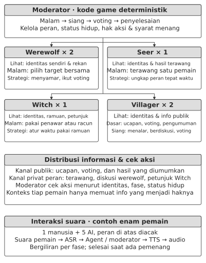
>
> **1. Mengelola status global.** Moderator diimplementasikan dengan kode dan memelihara kursi pemain, identitas, kubu, status hidup, fase malam/siang/pemungutan suara/penyelesaian, serta riwayat event. Ia memeriksa keabsahan tindakan, memajukan fase, dan menentukan pemenang.
>
> **2. Membagikan informasi per kursi.** Setiap kali memanggil Agent peran, moderator menghasilkan konteks publik dan privat yang boleh dilihat kursi tersebut. Misalnya, werewolf mengetahui identitas rekannya, warga desa hanya melihat informasi publik, dan hasil penerawangan peramal hanya masuk ke catatan privatnya. Pemanggilan peran, pengumuman suara, dan kueri riwayat semuanya mengikuti aturan izin yang sama.
>
> **3. Mengorganisasi strategi peran.** *Prompt* dapat menyediakan arah berpikir berikut, agar model memilih sesuai situasi saat itu:
>
> - **Werewolf:** mempertahankan identitas warga desa yang meyakinkan selama permainan dan menyatakan kecurigaan berdasarkan bukti publik; ketika dituduh peramal, dapat mempertanyakan klaim identitas pihak tersebut; saat memilih, menimbang antara mengikuti suara mayoritas dan risiko membuka kubunya.
> - **Peramal:** memilih waktu untuk mengumumkan hasil penerawangan; bila ada orang lain yang mengklaim identitas yang sama, mencocokkan catatan penerawangan, ucapan, dan pilihan kedua pihak, menunjukkan kontradiksinya, dan terus menilai dengan memadukan informasi yang diumumkan peran lain seperti penyihir.
> - **Warga desa:** memeriksa apakah ucapan konsisten, melacak klaim identitas dan perubahan sikap, menganalisis siapa memilih siapa serta pengaruh tindakan-tindakan itu terhadap kubu yang berbeda. Setiap kecurigaan dikaitkan dengan event tertentu, sambil tetap membuka kemungkinan penjelasan lain.
>
> **4. Menghubungkan suara.** Ucapan pemain melewati rantai sintesis dan pengenalan suara sebelum masuk ke percakapan publik. Pengguna simulasi juga memakai konteks tersendiri dan menghasilkan tindakan serta suara melalui pemanggilan model dan alat yang sebenarnya, lalu ditranskripsikan oleh ASR, sehingga pengaruh galat pengenalan dan pengaturan giliran terhadap permainan dapat diamati.
>
> **Penerimaan dan pengamatan:**
> - Konfigurasikan permainan 6–8 orang: 1 kursi pengguna dan 5–7 kursi AI; perannya mencakup 2 werewolf, 1 peramal, 1 penyihir, dan sisanya warga desa, dengan identitas pengguna diberikan secara acak.
> - Kursi pengguna dapat diisi oleh manusia sungguhan yang bersedia ikut atau oleh pengguna simulasi independen, dan setiap kursi memperoleh informasi sesuai izinnya.
> - Dengan skenario uji yang sesuai, periksa sedikitnya tiga siklus malam–siang–pemungutan suara yang lengkap; begitu syarat menang-kalah tercapai, permainan langsung masuk ke fase penyelesaian.
> - Periksa apakah tindakan peran sah, apakah batas informasi dipatuhi, dan apakah ucapan dapat dikaitkan dengan event yang diketahui kursi tersebut.
> - Analisis kinerja werewolf dalam menyembunyikan identitas, peramal dalam memilih waktu pengumuman, dan warga desa dalam bernalar berdasarkan bukti, lalu catat strategi kunci beserta hasilnya.
> - Periksa apakah hasil akhir, riwayat event, dan status hidup setiap kursi konsisten.
>
> Salah satu permainan dalam catatan pendamping memiliki delapan kursi, dengan kursi pengguna diisi oleh pengguna simulasi independen, dan berjalan penuh melewati tiga siklus malam, siang, dan pemungutan suara. Enam tindakan di antaranya memiliki catatan lengkap dari pilihan model dan sintesis suara hingga hasil pengenalan, dan keenam tindakan yang direkonstruksi semuanya sesuai dengan pilihan semula. Catatan ini dapat dipakai untuk memeriksa atas nama siapa sebuah ucapan pemungutan suara akhirnya dicatat.

## Ringkasan Bab

Sebelum memakai beberapa Agent, penulis lebih dulu bertanya: dengan menambah satu anggota, informasi apa yang diperoleh yang sebelumnya tidak ada, dan berapa banyak token tambahan yang harus dibayar? Misalnya, peninjau dapat membuka hasil render yang belum pernah dilihat pengusul dan menunjukkan label mana yang tertutup. Untuk menilai apakah manfaatnya berasal dari pembagian kerja, umpan balik eksternal, atau komputasi tambahan, Agent tunggal juga harus diberi bukti yang sama, kedua skema diberi anggaran yang sebanding, lalu kualitas dan waktu penyelesaiannya dibandingkan.

Kembali ke tugas menerjemahkan buku ini. Bila seluruh riwayat dibagikan, penyunting dapat melihat mengapa penerjemah memilih kata tertentu, tetapi juga harus membaca banyak catatan percobaan revisi. Menerjemahkan setiap bab secara terpisah memungkinkan paralelisme dan memudahkan pembagian izin, tetapi begitu glosarium berubah, paragraf yang terdampak dan versi barunya harus diserahkan kepada penerjemah yang bersangkutan. Serah terima dapat memakai parameter alat, berkas bersama, atau pesan; untuk lintas organisasi, kedua pihak juga harus menyepakati pengenal artefak dan cara otorisasi yang dapat dibaca keduanya. Baik anggota saling meninjau secara sejawat, manajer membagi tugas secara terpusat, maupun anggota mengambil alih sendiri berdasarkan event, harus dijelaskan siapa yang memegang versi saat ini dan siapa yang mengonfirmasi penyelesaian. Langkah-langkah yang aturannya pasti dapat diserahkan kepada program.

Satu perubahan istilah dapat menyangkut beberapa penerjemah dan paragraf yang tersebar di berbagai bab. Jika dua penerjemah mengubah berkas yang sama bersamaan, pemeriksaan versi atau salinan kerja tersendiri mencegah mereka saling menimpa; jika keduanya memercayai definisi keliru yang sama, menambah satu putaran tinjauan silang bisa saja tetap meloloskannya, dan pemeriksaan harus kembali ke sumber independen. Tugas panjang juga harus menetapkan kapan berhenti, bagaimana membatalkan, dan dari mana memulihkan. Pemelihara sendiri harus dapat menjelaskan satu penyerahan hasil dengan mengikuti catatan-catatan ini; jika tidak, makin rinci pembagian kerjanya, makin sulit memahami keseluruhan sistem.

**Menurut penulis, koordinasi kelompok perlu dirancang tersendiri.** Bagaimana penduduk kota kecil mengetahui sebuah undangan bergantung pada memori dan jangkauan komunikasi mereka; bagaimana anggota pasar memperebutkan sumber daya juga bergantung pada aturan imbalan dan alokasi. Sekalipun setiap anggota membuat pilihan yang masuk akal bagi dirinya sendiri, konflik tetap dapat terjadi. Siapa yang lebih dulu memperoleh hak pakai, kapan pihak lain mengetahui hasilnya, dan siapa yang memutuskan bila terjadi perbedaan pendapat, semuanya harus memiliki jawaban dalam sistem kolaborasi.

## Pertanyaan Pemikiran

1. ★★ Setelah pergantian peran, peninjau kode meneruskan konteks dari tahap analisis kebutuhan, tetapi masih terutama membahas kebutuhan. Bagaimana mendeteksi gangguan peran semacam ini? Bagaimana menyesuaikan input, konfigurasi alat, dan cara serah terimanya?
2. ★★ Dekomposisi tugas oleh Manager melewatkan satu ketergantungan, sehingga beberapa sub-Agent harus mengulang pekerjaan. Bagaimana menilai kualitas dekomposisi, serta menemukan dan memperbaiki masalah rencana selama eksekusi?
3. ★★ Dalam kolaborasi terdesentralisasi, anggota dapat mengalami komunikasi yang terlewat, sengketa tanggung jawab, dan konflik tujuan. Pilih dua situasi, lalu rancang mekanisme yang dapat menemukan penyebab, mendorong penanganan, dan mengakhiri sengketa.
4. ★★★ Pencarian paralel hanya perlu menemukan satu hasil yang memenuhi syarat. Rancang alur lengkap "batalkan cabang lainnya setelah verifikasi berhasil" yang menangani dua hasil yang tiba bersamaan, pesan ganda, timeout pembatalan, dan pembersihan sumber daya.
5. ★★★ Beberapa Agent bersamaan mengubah naskah buku dan nomor gambar, dan juga dapat membuat berkas ganda atau keliru menghapus artefak bersama. Bagaimana memadukan izin, versi, salinan kerja, pemeriksaan semantik, dan mekanisme pemulihan untuk mengelola sistem berkas?
6. ★★★ Ketika Agent mendelegasikan tugas berbayar melalui Pinchwork atau RentAHuman, bagaimana kualitas hasil serahan harus disepakati dan diperiksa? Bila kedua pihak berselisih tentang hasil penerimaan, bagaimana pemeriksaan ulang, pembayaran, dan banding diorganisasi?
7. ★★ Agent dapat mendelegasikan tugas kepada manusia sungguhan melalui pasar dan antarmuka pembayaran. Selain pelaksanaan di lapangan, peran apa lagi yang dapat dipikul manusia dalam penetapan tujuan, penilaian keahlian, penerimaan hasil, dan pembagian tanggung jawab? Jelaskan dengan sebuah contoh.
8. ★★ Model yang sama dapat menyelesaikan tugas sendirian, atau membentuk beberapa peran. Bagaimana merancang perbandingan untuk menilai seberapa besar manfaat yang masing-masing diberikan oleh pembagian kerja keahlian, isolasi konteks, pencarian paralel, dan umpan balik eksternal?
9. ★★★ Dengan meminjam latar pikiran yang transparan dalam *The Three-Body Problem*, serta pertanyaan tentang penetapan tujuan dalam eksperimen pikiran *paperclip maximizer*, diskusikan berbagi informasi, tujuan bersama, dan keragaman pandangan dalam sistem multi-Agent. Bagaimana menilai, melalui eksperimen yang dapat diamati, apakah cakupan berbagi dan tahap analisis independen sudah tepat?
10. ★★★ Coding Agent yang sama masing-masing diberi anggaran 30 langkah dan 300 langkah. Bagaimana mengatur perencanaan, implementasi, verifikasi, dan revisi, serta menyesuaikan strategi berdasarkan sisa anggaran dan kemajuan nyata?
11. ★★ Virtual memory dan paging, izin berkas, deteksi deadlock, dan algoritma penjadwalan masing-masing dapat memberikan inspirasi desain apa bagi sistem multi-Agent? Jelaskan cakupan berlakunya analogi-analogi ini, serta batasan yang harus ditegakkan secara eksplisit oleh runtime.
