# Context Engineering

Bab 1 mengibaratkan konteks sebagai "bidang pandang keputusan saat ini" bagi Agent: setiap kali model mengambil keputusan, ia bertumpu pada informasi yang diterimanya pada saat itu. **Context engineering** (rekayasa konteks) bertugas memilih, menyusun, dan memperbarui informasi tersebut, yang meliputi instruksi sistem, definisi alat, permintaan pengguna, riwayat pesan, dan status tugas. Setiap kali hendak memanggil model, Harness harus merangkai latar belakang tugas dan perkembangan terbarunya menjadi input. Gambar 2-1 memperlihatkan komposisi jendela konteks dengan isi yang konkret.

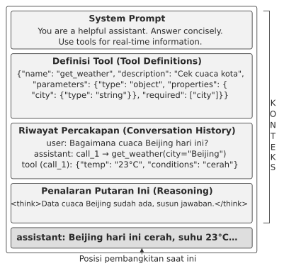

## Konteks: Menerapkan Kemampuan Model pada Tugas Konkret

Bayangkan seorang engineer berpengalaman yang baru bergabung dengan tim. Tugas pertamanya adalah "ubah konfigurasi sesuai standar kita". Ia mahir memprogram, tetapi belum tahu berkas mana yang menjadi sumber konfigurasi, field mana yang boleh diubah, dan bagaimana cara memverifikasinya. Sekalipun seluruh basis kode diserahkan kepadanya, ia tetap bisa mengubah berkas yang salah. Agent yang mengambil alih proyek asing juga kekurangan latar belakang semacam ini.

Ambil contoh permintaan "Bantu saya memperbaiki bug ini". Coding Agent biasanya membutuhkan tiga jenis latar belakang:

- **Konteks kode terkini**: struktur direktori, tanggung jawab modul, struktur data inti, dan standar penulisan kode. Misalnya, jika yang diubah adalah berkas konfigurasi yang dibangkitkan otomatis, perubahan itu akan tertimpa pada pembangkitan berikutnya meskipun sudah berlaku di mesin lokal. Hanya dengan mengetahui modul mana yang membangkitkan berkas tersebut, Agent dapat menemukan tempat yang semestinya diubah.
- **Aturan proses**: strategi percabangan Git, konvensi commit, alur code review, dan persyaratan CI/CD. Berdasarkan aturan ini Agent mengatur urutan perubahan, pengujian, dan commit, sedangkan sistem runtime menjalankan operasi tersebut sesuai izin yang berlaku.
- **Informasi lingkungan**: konfigurasi pengembangan, cara terhubung ke database pengujian, cara deployment ke lingkungan pengujian, dan cara pengelolaan API key. Informasi ini membantu Agent memilih lingkungan eksekusi yang tepat serta memahami perbedaan antara lingkungan lokal dan lingkungan pengujian.

Kode proyek dan database pengujian berada di luar konteks model. Dalam contoh konfigurasi yang dibangkitkan otomatis tadi, Agent baru tahu dari mana harus mulai mengubah setelah membaca skrip pembangkitnya melalui alat pencarian. **Kualitas konteks menentukan apakah model dapat menerapkan kemampuan yang sudah dimilikinya pada masalah yang sedang dihadapi.** **Untuk tugas yang bergantung pada banyak informasi latar belakang, model yang cukup mampu dengan konteks yang lengkap dan akurat dapat mengungguli model yang lebih kuat tetapi kekurangan bahan yang diperlukan.**

**Membangun tim AI-native dimulai dengan mendokumentasikan pengetahuan kunci.** Jika alasan memilih suatu database dahulu hanya diingat oleh karyawan lama, dan perubahan aturan bisnis hanya pernah disebut dalam obrolan pribadi, rekan baru maupun Agent akan menghadapi masalah yang sama saat mengambil alih pekerjaan: dari kode terlihat apa yang dikerjakan tim, tetapi tidak terlihat mengapa dulu dikerjakan dengan cara itu.

**Tim yang nyaman bekerja secara jarak jauh biasanya juga nyaman bagi Agent.** Para pengembang kernel Linux membahas patch dan bertukar hasil review melalui mailing list, sementara dokumen proses pengembangan menjelaskan cara mengirim, meninjau, dan menggabungkan patch[^ch2-linux]. Peserta baru yang menemukan perubahan yang mengejutkan dapat menelusuri patch-nya hingga ke perdebatan saat itu; Agent pun dapat memanfaatkan catatan yang sama ketika memeriksa latar belakang.

Setelah mendengarkan wawancara Jiayi Weng di WhynotTV, penulis merangkum salah satu pandangannya sebagai berikut: **manusia dan model sama-sama bergantung pada konteks.** Manusia dapat bertanya langsung kepada rekan yang ikut mengambil keputusan, sedangkan latar belakang apa yang dapat dibaca model bergantung pada catatan apa yang ditinggalkan tim dan pada isi yang dimasukkan Harness ke dalam permintaan kali ini.[^ch2-weng]

[^ch2-linux]: Dokumentasi resmi kernel Linux, How the development process works.

[^ch2-weng]: WhynotTV, 《翁家翌：OpenAI，GPT，强化学习，Infra，后训练，天授，tuixue，开源，CMU，清华》, Podcast #4.

Makalah ReAct menggunakan sebuah ungkapan formal untuk menggambarkan bagaimana riwayat interaksi ikut menentukan keputusan[^ch2-react]. Pada langkah waktu $t$, Agent menerima observasi $o_t\in\mathcal{O}$ dari lingkungan dan memilih action $a_t\in\mathcal{A}$ berdasarkan kebijakan $\pi(a_t\mid c_t)$, dengan konteks:

$$
c_t=(o_1,a_1,\ldots,o_{t-1},a_{t-1},o_t)
$$

Ungkapan ini menunjukkan bahwa **langkah Agent berikutnya bergantung pada riwayat interaksi hingga saat ini.** Misalnya, berkas mana yang sudah diperiksa Agent dan galat apa yang dikembalikan alat akan memengaruhi pilihan langkah selanjutnya. Pada LLM Agent, input pengguna dan hasil alat menyediakan observasi, sedangkan pemanggilan alat dan balasan ke luar mencatat action; instruksi sistem dan definisi alat melengkapinya dengan aturan tugas dan antarmuka yang tersedia.

Bab ini memakai pola permintaan stateless: pada setiap putaran Harness merangkai pesan dan definisi alat, lalu memanggil model. Riwayat pesan yang lengkap memudahkan penyimpanan kemajuan tugas; ketika riwayat bertambah panjang, informasi yang dibutuhkan untuk keputusan berikutnya dapat tetap dipertahankan di dalam jendela melalui pencarian, pencatatan status, dan kompresi. Tata letak konteks, bilah status, dan teknik kompresi semuanya berkisar pada satu pertanyaan: bagaimana memasukkan ke dalam $c_t$ informasi yang dibutuhkan model untuk langkah ini, di dalam konteks yang terbatas?

[^ch2-react]: Yao, Shunyu, et al., ReAct: Synergizing Reasoning and Acting in Language Models, ICLR 2023.

## Bagaimana Agent Memanggil LLM: Memahami Struktur Konteks pada API

Kita mulai dengan format pesan pada sebuah sapaan sederhana, lalu melihat bagaimana pertanyaan "jam berapa sekarang di Vancouver dan bagaimana cuacanya" memicu dua pemanggilan alat. Bagian ini menggunakan antarmuka yang kompatibel dengan Chat Completions dan Qwen3-0.6B yang dijalankan secara lokal, kemudian merangkai seluruh putaran permintaan dengan Python[^ch2-chat-api].

### Empat Peran Pesan dalam Contoh

**Daftar pesan** (`messages`) di dalam permintaan menyimpan informasi interaksi secara berurutan. Setiap pesan ditandai dengan **peran** (`role`) yang menunjukkan asal dan kegunaannya. Bagian ini menggunakan empat peran:

- **system**: system prompt. Di sini peran ini membawa identitas, aturan perilaku, dan batasan yang diberikan pengembang, dan diletakkan di bagian depan daftar pesan. Sebagian antarmuka model menggunakan peran `developer` untuk instruksi dari pengembang.
- **user**: pesan pengguna, berisi tugas, pertanyaan lanjutan, dan permintaan tambahan.
- **assistant**: balasan model, termasuk teks dan permintaan pemanggilan alat. Dengan memasukkan kembali pesan-pesan ini ke input putaran berikutnya, model dapat membaca jawaban dan permintaan operasi sebelumnya.
- **tool**: hasil eksekusi alat. Setelah menerima nilai kembalian, Harness menuliskannya sebagai pesan alat dan mengaitkannya dengan panggilan tertentu melalui `tool_call_id`.

Definisi alat diberikan melalui field `tools` di tingkat teratas permintaan, berisi nama, kegunaan, dan format parameter setiap alat yang tersedia.

Model menyusun permintaan panggilan berdasarkan definisi alat. Apakah operasi itu benar-benar dapat dijalankan ditentukan oleh Harness dan lingkungan runtime.

[^ch2-chat-api]: OpenAI, referensi Chat Completions API, menjelaskan peran pesan, definisi tool, dan field hasil panggilan; Qwen, Function Calling, menjelaskan tool call dan template pada layanan yang kompatibel.

### Percakapan Satu Putaran: Panggilan API Paling Sederhana

Pertama, lihat satu kali tanya jawab. Pengguna bertanya "Hello, who are you?"; Harness mengirimkan instruksi sistem bersama pertanyaan pengguna ke model, lalu membaca balasannya. Gambar 2-2 memperlihatkan hubungan antara permintaan dan respons.

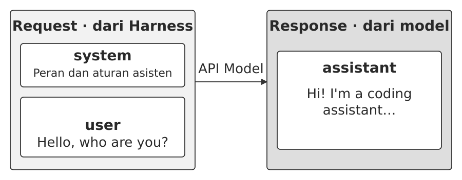

Berikut permintaan dan contoh balasannya dalam format antarmuka model lokal; komentar di dalam kode menandai asal setiap bagian:

```javascript
// Harness menyusun permintaan
{
  "model": "Qwen3-0.6B",
  "messages": [
    {
      "role": "system",                           // Instruksi dari pengembang
      "content": "You are a helpful coding assistant. Follow user instructions."
    },
    {
      "role": "user",                              // Input pengguna
      "content": "Hello, who are you?"
    }
  ]
}
```

```javascript
// Respons yang dikembalikan API
{
  "choices": [{
    "message": {
      "role": "assistant",                         // Dibangkitkan model
      "content": "Hi! I'm a coding assistant. I can help you write code, debug issues, and explain technical concepts. How can I help?"
    }
  }]
}
```

Permintaan ini berisi satu pesan `system` dan satu pesan `user`, sedangkan `choices[0].message` pada respons menyimpan pesan `assistant` yang dihasilkan model. Pada antarmuka stateless yang dipakai di sini, **Harness bertanggung jawab menyediakan konteks yang dibutuhkan setiap panggilan**. Jika permintaan berikutnya hendak melanjutkan percakapan ini, riwayat yang relevan harus ikut disertakan.

### Interaksi Multi-Putaran dengan Pemanggilan Alat: Loop Inti Agent

Sekarang lihat pertanyaan yang membutuhkan alat: "What's the current time and weather in Vancouver?" Untuk menjawabnya, waktu dan cuaca setempat harus diperiksa terlebih dahulu. Pada Gambar 2-3, panggilan model pertama oleh Harness menghasilkan dua permintaan alat. Harness lalu menanyakan layanan waktu dan layanan cuaca, menambahkan kedua hasilnya ke riwayat pesan, dan memanggil model untuk kedua kalinya, barulah diperoleh jawaban bagi pengguna.

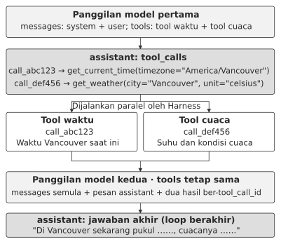

Alat mana yang dijalankan lebih dulu? Alat waktu membutuhkan zona waktu, sedangkan alat cuaca membutuhkan kota dan skala suhu. Pengguna hanya menyebut Vancouver; berdasarkan itu model dalam contoh mengisi `America/Vancouver` dan `Vancouver`, dan memilih derajat Celsius. Pencarian cuaca tidak perlu menunggu hasil alat waktu, sehingga kedua permintaan dapat dikirim bersamaan.

**Panggilan API pertama — framework Agent mengirim permintaan awal:**

```javascript
// Panggilan model pertama: Harness menyusun permintaan
{
  "model": "Qwen3-0.6B",
  "messages": [
    {
      "role": "system",                           // Instruksi dari pengembang
      "content": "You are a helpful assistant. Use the provided tools to get real-time information when needed."
    },
    {
      "role": "user",                              // Input pengguna
      "content": "What's the current time and weather in Vancouver?"
    }
  ],
  "tools": [                                       // Alat yang didefinisikan pengembang
    {
      "type": "function",
      "function": {
        "name": "get_current_time",
        "description": "Get the current date and time in a specific timezone",
        "parameters": {
          "type": "object",
          "properties": {
            "timezone": { "type": "string", "description": "Timezone name, e.g. America/Vancouver" }
          },
          "required": ["timezone"]
        }
      }
    },
    {
      "type": "function",
      "function": {
        "name": "get_weather",
        "description": "Get the current weather for a specific city",
        "parameters": {
          "type": "object",
          "properties": {
            "city": { "type": "string", "description": "City name" },
            "unit": { "type": "string", "enum": ["celsius", "fahrenheit"] }
          },
          "required": ["city", "unit"]
        }
      }
    }
  ]
}
```

Daftar `tools` ini didefinisikan pengembang sebelumnya, berisi nama, deskripsi, dan schema parameter. Dalam contoh ini, setiap putaran permintaan menyediakan dua alat yang sama; setelah membaca daftar tersebut dan pertanyaan pengguna, model memilih alat yang akan dipanggil dan mengisi parameternya.

**Model mengembalikan dua permintaan pemanggilan alat:**

```javascript
// Model mengembalikan permintaan pemanggilan alat
{
  "choices": [{
    "message": {
      "role": "assistant",                         // Dibangkitkan model
      "content": null,                             // Putaran ini tanpa balasan teks
      "tool_calls": [                              // Meminta pemanggilan dua alat
        {
          "id": "call_abc123",
          "type": "function",
          "function": {
            "name": "get_current_time",
            "arguments": "{\"timezone\": \"America/Vancouver\"}"
          }
        },
        {
          "id": "call_def456",
          "type": "function",
          "function": {
            "name": "get_weather",
            "arguments": "{\"city\": \"Vancouver\", \"unit\": \"celsius\"}"
          }
        }
      ]
    }
  }]
}
```

`tool_calls` pada respons berisi dua permintaan, masing-masing dengan `id`, nama alat, dan parameternya sendiri. `arguments` adalah string berenkode JSON; sisi eksekutor harus mem-parsing-nya terlebih dahulu, lalu memvalidasi field dan nilainya. **Model memutuskan apa yang dipanggil dan parameter apa yang diteruskan; Harness bertanggung jawab atas validasi dan penjadwalan; implementasi alat bertugas mengakses layanan waktu atau cuaca.**

**Framework Agent menjalankan alat, lalu melakukan panggilan API kedua:**

Setelah memvalidasi permintaan, Harness menjadwalkan kedua alat, menuliskan nilai kembaliannya sebagai pesan `tool`, lalu menyerahkan riwayat yang sudah ada beserta hasil baru tersebut kepada model:

```javascript
// Panggilan model kedua: menambahkan hasil alat
{
  "model": "Qwen3-0.6B",
  "messages": [
    {
      "role": "system",                           // Pesan dari permintaan pertama dipertahankan
      "content": "You are a helpful assistant. Use the provided tools to get real-time information when needed."
    },
    {
      "role": "user",                              // Pesan dari permintaan pertama dipertahankan
      "content": "What's the current time and weather in Vancouver?"
    },
    {
      "role": "assistant",                         // Permintaan pemanggilan dari putaran sebelumnya dipertahankan
      "content": null,
      "tool_calls": [
        { "id": "call_abc123", "type": "function", "function": { "name": "get_current_time", "arguments": "{\"timezone\": \"America/Vancouver\"}" } },
        { "id": "call_def456", "type": "function", "function": { "name": "get_weather", "arguments": "{\"city\": \"Vancouver\", \"unit\": \"celsius\"}" } }
      ]
    },
    {
      "role": "tool",                              // Harness menuliskan hasil eksekusi alat
      "tool_call_id": "call_abc123",
      "content": "{\"timezone\": \"America/Vancouver\", \"datetime\": \"2025-09-13T05:18:47\", \"day_of_week\": \"Saturday\"}"
    },
    {
      "role": "tool",                              // Harness menuliskan hasil eksekusi alat
      "tool_call_id": "call_def456",
      "content": "{\"city\": \"Vancouver\", \"temperature\": 13.2, \"unit\": \"celsius\", \"conditions\": \"clear\", \"humidity\": 93}"
    }
  ],
  "tools": [ ... ]                                 // Memakai definisi alat sebelumnya, dihilangkan di sini
}
```

Telusuri permintaan kedua dengan mengikuti `call_def456`: pada pesan `assistant` sebelumnya, ini adalah nomor untuk kueri cuaca Vancouver; pesan `tool` sesudahnya mengembalikan 13,2 ℃ dan cuaca cerah dengan nomor yang sama. Sekalipun hasil cuaca tiba lebih dulu daripada hasil waktu, Harness tetap dapat mencocokkan hasil dengan permintaannya. Pada putaran ini model sekaligus membaca pertanyaan asli pengguna, dua kueri yang ia ajukan sendiri, dan data yang dikembalikan alat. Kini model dapat menjawab pengguna.

**Model menghasilkan balasan akhir berdasarkan hasil alat:**

```javascript
// Model membangkitkan balasan akhir
{
  "choices": [{
    "message": {
      "role": "assistant",                         // Dibangkitkan model
      "content": "It's currently 5:18 AM on Saturday, September 13, 2025 in Vancouver.\n\nWeather: 13.2°C with clear skies and 93% humidity. It's quite cool this morning - you might want to grab a jacket."
    }
  }]
}
```

Respons kedua memberikan teks akhir dan `tool_calls` kosong, sehingga loop contoh pun berakhir. Proses "panggil model → jalankan alat → kirim balik hasil → panggil model lagi" inilah wujud konkret loop eksekusi dari Bab 1 di tingkat API.

Jika pengguna bertanya lagi, "Bagaimana dengan Tokyo?", Harness menambahkan pesan itu ke akhir riwayat dan memanggil model kembali. Model dapat meneruskan latar belakang tugas "mencari waktu dan cuaca saat ini" untuk membuat permintaan baru bagi Tokyo; setelah alat mengembalikan hasil, model menyusun jawaban baru.

**Jika memakai Responses API, bagaimana hasil alat dikembalikan?** Eksperimen lokal di atas menggunakan antarmuka yang kompatibel dengan Chat Completions. Untuk proyek baru yang memakai layanan OpenAI, yang direkomendasikan secara resmi adalah Responses API. Kembali ke contoh Vancouver: aplikasi meletakkan pertanyaan pengguna di `input` permintaan dan mendeklarasikan dua fungsi, waktu dan cuaca, di `tools`. `output` yang dikembalikan berupa sekumpulan entri bertipe. Jika di dalamnya muncul dua `function_call`, aplikasi membaca nama fungsi, parameter, dan `call_id` dari masing-masing entri, lalu menjalankan alatnya satu per satu.[^ch2-responses-loop]

Misalkan nomor panggilan fungsi cuaca adalah `call_weather`. Maka `input` pada permintaan berikutnya dapat memuat tanda terima seperti di bawah; fungsi waktu juga harus mengembalikan hasilnya dengan nomornya sendiri.

```json
{"type": "function_call_output", "call_id": "call_weather", "output": "{\"temperature\": 13.2, \"unit\": \"celsius\"}"}
```

`call_id` mencocokkan satu tanda terima dengan satu panggilan fungsi. `previous_response_id` menunjuk ke respons model sebelumnya, sehingga layanan dapat melanjutkan konteks putaran itu. Kedua nomor ini merujuk pada objek yang berbeda. Saat memakai cara penyambungan ini, putaran sekarang tetap harus menyediakan alat yang akan terus dipakai dan `instructions` di tingkat teratas; instruksi tingkat teratas dari permintaan sebelumnya tidak otomatis diwariskan melalui nomor respons. Model mungkin terus meminta alat, sehingga aplikasi harus membaca `output` berikutnya sebelum memutuskan apakah akan berhenti. Eksperimen 1-3 di Bab 1 memakai pencarian yang dikelola di sisi server; dua fungsi kustom di sini benar-benar dijalankan oleh aplikasi.

[^ch2-responses-loop]: OpenAI, panduan migrasi ke Responses API, function calling, serta penjelasan parameter pembuatan respons.

### Mengimplementasikan Loop Inti Agent dengan Kode

Dua pemanggilan `messages.append` di dalam loop masing-masing menyimpan balasan model dan hasil eksekusi alat. Waktu dan suhu sama-sama berasal dari Vancouver; jika kedua ID panggilan ditukar, pada putaran berikutnya model akan membaca bahwa "kueri waktu" mengembalikan 13,2 derajat Celsius.

Contoh ini terhubung ke layanan yang kompatibel melalui OpenAI Python SDK. Alamat bawaannya adalah `http://localhost:8000/v1` di mesin lokal, cocok untuk layanan lokal yang sudah berjalan dan tidak memerlukan autentikasi. Nilai bawaan ini sesuai dengan backend vLLM pada Eksperimen 2-1. Jika memakai backend Ollama dari eksperimen tersebut, ubah alamatnya menjadi `http://localhost:11434/v1` dan nama modelnya menjadi `qwen3:0.6b`. Untuk terhubung ke layanan lain, atur variabel lingkungan `LLM_BASE_URL` dan `LLM_API_KEY` sesuai kebutuhan, dan samakan `model` di bawah dengan nama yang benar-benar di-deploy. Untuk sementara alat waktu dan cuaca memakai data tetap dari contoh sebelumnya agar mudah dibandingkan dengan pesan-pesannya; ganti implementasi kedua alat ini ketika menyambungkan data nyata.

```python
import json
import os

from openai import OpenAI

client = OpenAI(
    base_url=os.getenv("LLM_BASE_URL", "http://localhost:8000/v1"),
    api_key=os.getenv("LLM_API_KEY", "EMPTY"),
)

# Definisi alat: nama, kegunaan, dan struktur parameter
tools = [
    {
        "type": "function",
        "function": {
            "name": "get_current_time",
            "description": "Get the current date and time in a specific timezone",
            "parameters": {
                "type": "object",
                "properties": {
                    "timezone": {"type": "string", "description": "Timezone name, e.g. America/Vancouver"}
                },
                "required": ["timezone"],
            },
        },
    },
    {
        "type": "function",
        "function": {
            "name": "get_weather",
            "description": "Get the current weather for a specific city",
            "parameters": {
                "type": "object",
                "properties": {
                    "city": {"type": "string", "description": "City name"},
                    "unit": {"type": "string", "enum": ["celsius", "fahrenheit"]},
                },
                "required": ["city", "unit"],
            },
        },
    },
]

# Alat contoh memakai data tetap; parameternya sama dengan kueri Vancouver sebelumnya.
def execute_tool(name, arguments):
    args = json.loads(arguments)
    if name == "get_current_time" and args == {"timezone": "America/Vancouver"}:
        result = {
            "timezone": "America/Vancouver",
            "datetime": "2025-09-13T05:18:47",
            "day_of_week": "Saturday",
        }
    elif name == "get_weather" and args == {"city": "Vancouver", "unit": "celsius"}:
        result = {
            "city": "Vancouver", "temperature": 13.2,
            "unit": "celsius", "conditions": "clear", "humidity": 93,
        }
    else:
        result = {"error": "Contoh ini hanya menyediakan data waktu Vancouver dan cuaca dalam Celsius"}
    return json.dumps(result, ensure_ascii=False)

# Pesan awal: instruksi dan tugas pengguna
messages = [
    {"role": "system", "content": "You are a helpful assistant. Use tools to get real-time information when needed."},
    {"role": "user", "content": "What's the current time and weather in Vancouver?"},
]

# Loop eksekusi: model dipanggil paling banyak delapan putaran
rounds = 0
while rounds < 8:
    rounds += 1
    response = client.chat.completions.create(
        model="Qwen3-0.6B", messages=messages, tools=tools
    )
    assistant_message = response.choices[0].message

    # Simpan balasan model, termasuk permintaan pemanggilan pada putaran ini
    messages.append(assistant_message.model_dump(exclude_none=True))

    # Contoh ini berakhir ketika model memberi balasan tanpa pemanggilan alat
    if not assistant_message.tool_calls:
        print(assistant_message.content)
        break

    # Jalankan satu per satu dan tambahkan hasilnya; panggilan yang independen juga dapat dijadwalkan paralel
    for tool_call in assistant_message.tool_calls:
        try:
            result = execute_tool(tool_call.function.name, tool_call.function.arguments)
        except json.JSONDecodeError:
            result = json.dumps({"error": "Parameter alat harus berupa JSON yang valid"})
        messages.append({
            "role": "tool",
            "tool_call_id": tool_call.id,
            "content": result,
        })
    # Putaran berikutnya memakai daftar pesan yang sudah ditambah hasil
else:
    print("Batas jumlah putaran tercapai, tugas belum selesai.")
```

Misalkan pada putaran pertama model meminta waktu dan cuaca sekaligus. Loop `for` di sini akan mencari waktu lebih dulu dan menambahkan hasilnya ke `messages`, lalu mencari cuaca dan menambahkan hasil kedua. Setelah keduanya selesai dijalankan, barulah program kembali ke awal `while` dan mengirim permintaan model yang kedua. Dengan menjabarkan isi `messages` pada langkah-langkah ini, kita dapat melihat apa saja yang diterima model setiap kali.

**Keadaan awal (sebelum panggilan ke-1):**
```text
messages = [
  { role: "system",  content: "You are a helpful assistant..." },     # ditulis pengembang
  { role: "user",    content: "What's the current time and weather in Vancouver?" },  # input pengguna
]
```

**Setelah panggilan model ke-1 dan eksekusi alat selesai:**
```text
messages = [
  { role: "system",    content: "..." },
  { role: "user",      content: "What's the current time..." },
  { role: "assistant", tool_calls: [get_current_time, get_weather] },  # permintaan pemanggilan yang dibangkitkan model
  { role: "tool",      tool_call_id: "call_abc123", content: "{time...}" },  # ditulis Harness setelah alat dijalankan
  { role: "tool",      tool_call_id: "call_def456", content: "{weather...}" },  # ditulis Harness setelah alat dijalankan
]
```

**Setelah panggilan ke-2 (model mengembalikan balasan akhir, loop berakhir):**
```text
messages = [
  { role: "system",    content: "..." },
  { role: "user",      content: "What's the current time..." },
  { role: "assistant", tool_calls: [get_current_time, get_weather] },
  { role: "tool",      tool_call_id: "call_abc123", content: "{time...}" },
  { role: "tool",      tool_call_id: "call_def456", content: "{weather...}" },
  { role: "assistant", content: "It's currently Saturday, Sep 13, 2025 in Vancouver..." },  # balasan akhir
]
```

### Komposisi Konteks dari Sudut Pandang API

Gambar 2-4 membagi satu permintaan menjadi dua bagian: prefiks dan riwayat pesan. Ketika kueri Vancouver tadi baru dikirim, riwayat hanya berisi pertanyaan pengguna dan percakapan sebelumnya. Setelah kedua kueri selesai, riwayat bertambah dengan pemanggilan alat yang diajukan model dan dua hasil alat.

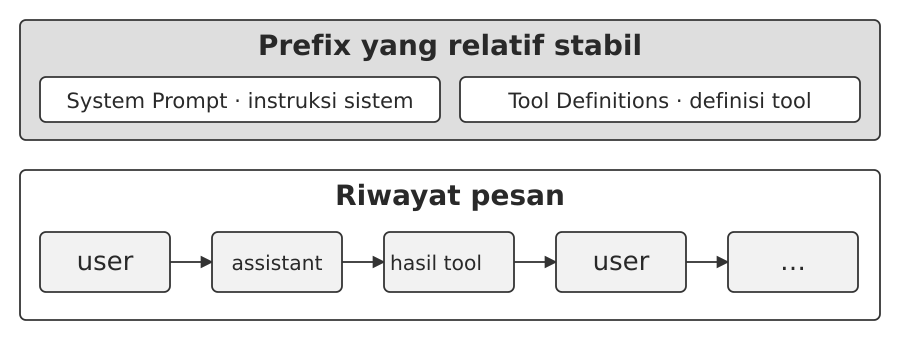

Karena itu, bagian awal yang sama pada dua permintaan berturut-turut dapat terus memanjang hingga ke dalam riwayat pesan. Seberapa banyak komputasi lama yang dapat dipakai ulang pada panggilan berikutnya bergantung pada panjang prefiks ini.

Harness di bawah ini meletakkan instruksi sistem dan definisi alat yang jarang berubah di depan, dan pada setiap putaran hanya menambahkan status terkini di akhir riwayat pesan. Jika riwayat terlalu panjang, Harness lebih dulu mengompresi pesan lama, baru kemudian merangkai permintaan.

```python
stable_prefix = system_message
stable_tools = core_tool_schemas
history = load_message_history(session)
status_message = make_status_message(derive_current_state(history))

if estimated_tokens(stable_prefix, stable_tools, history, status_message) > budget:
    history = compress_old_evidence(
        history,
        preserve = [decisions, constraints, failures, citations]
    )

request.messages = [stable_prefix] + history + [status_message]
request.tools = stable_tools
response = call_model(request)
```

Saat mengompresi, pertahankan informasi yang dibutuhkan pekerjaan selanjutnya, seperti keputusan, batasan, kegagalan, dan rujukan, serta jaga keterkaitan antara permintaan panggilan dan hasil alat. Selain anggaran panjang, informasi yang berulang dan kedaluwarsa juga dapat memicu kompresi; strateginya akan dibahas pada paruh kedua bab ini.

> **Eksperimen 2-1 ★: Deployment Layanan LLM Lokal dan Pemanggilan Alat**
>
> Eksperimen ini menjalankan Qwen3-0.6B secara lokal dan, melalui tugas "mencari waktu dan cuaca di Vancouver", mengamati bagaimana pesan melewati model, parser, dan eksekutor alat. Gambar 2-5 memperlihatkan pembagian kerja antara layanan lokal dan klien: server memuat model, memproses input, dan membangkitkan balasan, sedangkan klien memelihara riwayat pesan, menjadwalkan alat, dan mengirim balik hasilnya.
>
> 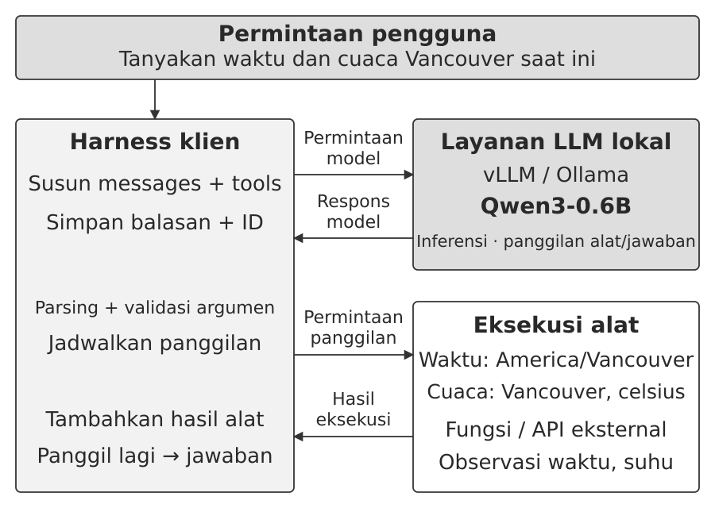
>
> **Pertama, ikuti satu tugas secara utuh.** Dalam satu output, model meminta kueri waktu dan suhu sekaligus, dengan mengisi parameter seperti `America/Vancouver`, `Vancouver`, dan `celsius`. Klien menjalankan kedua alat secara paralel. Tanda terima pertama memberikan waktu setempat 11:11:28, dan tanda terima kedua memberikan suhu 17,9 °C. Setelah kedua hasil dikirim kembali ke model, model melaporkan waktu hingga satuan menit, menjawab bahwa suhunya 17,9 °C, lalu mengakhiri loop ini. Hasil ini menunjukkan bahwa model berparameter enam ratus juta sudah dapat memilih dua alat yang tepat untuk tugas ini, mengisi parameternya dengan benar, dan menjawab pengguna dengan nilai kembaliannya.
>
> **Selanjutnya, periksa kecocokan antara output mentah dan field API.** Mode berpikir Qwen3 dapat menghasilkan konten penalaran bertanda `<think>`, sedangkan permintaan alat memakai tanda panggilan yang sesuai. Setelah server mem-parsing-nya, klien dapat menerima field `thinking` atau field pemanggilan alat secara terpisah. Susunan dan cara penyimpanan setiap bagian output ditentukan bersama oleh template model dan protokol layanan.
>
> **Kemudian, amati pemrosesan streaming.** Antarmuka dapat memperbarui status seperti "sedang berpikir", "memanggil alat", dan "menyusun jawaban" seiring datangnya peristiwa. Parameter alat biasanya tiba dalam beberapa potongan yang perlu dikumpulkan menjadi permintaan yang utuh; setelah protokol memastikan panggilan itu selesai dan pemeriksaan parameter, izin, serta dependensinya lolos, sistem runtime dapat mulai menjadwalkannya. Alat yang saling independen dapat dijalankan secara paralel, atau membentuk pipeline dengan pemrosesan output berikutnya.
>
> **Terakhir, bandingkan kecepatan dan cache.** Pada catatan run kali ini di Mac berprosesor Apple, kecepatan decoding rata-rata untuk tugas alat sekitar 107 token per detik. Token adalah satuan dasar teks yang diproses model; pemotongannya ditentukan oleh tokenizer, dan satu kata atau satu aksara Han dapat sesuai dengan satu atau beberapa token. Kecepatan decoding mencerminkan laju output setelah pembangkitan dimulai; lama pengguna menunggu juga dipengaruhi oleh latensi token pertama, panjang penalaran, dan waktu eksekusi alat.
>
> Perbandingan cache memakai prefiks panjang yang sama, lalu menguji permintaan yang mempertahankan prefiks dan permintaan yang mengubah awal prefiks. Dari lima pasangan kali ini, permintaan yang mempertahankan prefiks lebih cepat pada empat pasangan; rata-rata latensi token pertama kedua kelompok masing-masing sekitar 1,30 detik dan 1,51 detik. Subbab berikutnya akan menjelaskan apa perbedaan komputasi di antara permintaan-permintaan ini.
>
> Eksperimen ini juga membuat penulis semakin optimistis terhadap Agent di perangkat: model kecil sudah mampu menyelesaikan tugas pemanggilan alat semacam ini di perangkat milik pengguna sendiri. **Era Agent di perangkat datang lebih cepat daripada yang diperkirakan banyak orang.**

## Desain Konteks yang Ramah KV Cache

Permintaan-permintaan Agent yang berdekatan biasanya berbagi banyak informasi: instruksi sistem, definisi alat, dan interaksi yang telah terjadi sebelumnya. Jika mesin inferensi dapat memakai ulang hasil komputasi antara untuk isi tersebut, lebih banyak komputasi dapat dicurahkan untuk informasi baru. **KV Cache** menyimpan key (Key) dan value (Value) yang sudah dihitung dalam komputasi attention di setiap lapisan agar dapat dipakai oleh token berikutnya; **Prompt Cache** melangkah lebih jauh dengan memakai ulang cache prefiks yang memenuhi syarat di antara permintaan[^ch2-kv-basics].

Ambil contoh Agent layanan pelanggan: agar model mengetahui waktu saat ini, pengembang menambahkan `Current time: {{now}}` di awal system prompt dan memperbaruinya pada setiap permintaan. Aturan bisnis dan definisi alat sesudahnya tidak berubah, tetapi input yang sebenarnya mulai berbeda sejak cap waktu tersebut. Pada layanan yang memakai ulang KV berdasarkan prefiks yang sama, hal ini membuat cap waktu dan seluruh bagian sesudahnya harus dihitung ulang, sehingga menambah waktu pemrosesan input dan biaya.

Jika waktu ditulis sebagai pesan tambahan, atau alat waktu dipanggil saat dibutuhkan, prefiks yang sudah ada dapat dipertahankan. Kedua tata letak memberikan informasi yang mirip, tetapi cakupan komputasi ulang yang dipicunya berbeda.

Ingat dulu tiga praktik berikut; prinsip dan eksperimen di bagian selanjutnya akan menjelaskannya satu per satu:

1. **Jaga agar prefiks yang dapat dipakai ulang tetap stabil.** Instruksi sistem dan definisi alat yang sering dipakai menggunakan isi dan urutan yang pasti.
2. **Tambahkan perubahan selama eksekusi di bagian belakang.** Waktu, saldo, jumlah panggilan, dan kemajuan tugas dapat diberikan melalui pesan baru atau hasil alat. Status terbaru harus mencantumkan saat mulai berlakunya, agar model dapat mengenali catatan mana yang berlaku untuk keputusan saat ini.
3. **Susun pesan sesuai protokol model.** Gunakan peran, ID panggilan, dan format hasil alat yang benar, lalu biarkan chat template yang sesuai membangkitkan input model. Cache mencocokkan prefiks yang sudah diproses beserta konfigurasi terkait, dan protokol pesan juga menentukan bagaimana model mengenali instruksi, permintaan pengguna, dan nilai kembalian alat.

Pada model dengan causal attention yang dipakai di bagian ini, penambahan token berikutnya tidak mengubah status yang sudah dihitung pada posisi sebelumnya. Ketika input yang sudah ada diubah, status pada posisi perubahan pertama dan seluruh posisi sesudahnya harus dihitung ulang; prefiks sebelum perubahan masih berpeluang dipakai ulang. Server juga menentukan cakupan hit yang sebenarnya berdasarkan ukuran blok cache, masa simpan, dan konfigurasi runtime.

[^ch2-kv-basics]: Hugging Face, How caching works, menjelaskan mekanisme penyimpanan dan pemakaian ulang K dan V per lapisan.

> **Eksperimen 2-2 ★: Visualisasi Mekanisme Attention**
>
> Kita mulai dengan kalimat "北京 的 天气 怎么样" (bagaimana cuaca di Beijing) untuk memahami satu kali komputasi attention. Agar mudah diperlihatkan, Gambar 2-6 membagi kalimat ini menjadi empat unit makna; model yang sebenarnya memotong input dengan tokenizer. Saat memproses posisi "怎么样" (bagaimana), lapisan attention harus merangkai representasi saat ini dari informasi yang sudah ada. Query, Key, dan Value masing-masing berperan untuk mencari, mencocokkan, dan mengagregasi informasi.
>
> | Vektor | Peran | Pemahaman intuitif dalam contoh ini |
> | --- | --- | --- |
> | **Query (kueri)** | Vektor milik posisi saat ini yang dipakai untuk mencocokkan posisi lain | "怎么样" perlu menemukan informasi yang relevan dari isi yang sudah ada |
> | **Key (kunci)** | Vektor setiap posisi yang ikut dicocokkan | Posisi seperti "北京" (Beijing) dan "天气" (cuaca) menyediakan representasi untuk dicocokkan |
> | **Value (nilai)** | Vektor informasi yang diagregasi sesuai bobot | Informasi tentang tempat, cuaca, dan sebagainya dimasukkan ke representasi saat ini sesuai porsinya |
>
> Key dapat dibayangkan sebagai label untuk pencarian, dan Value sebagai isi yang diambil. Vektor-vektor di dalam model ini semuanya berupa nilai numerik yang dihitung dari representasi tersembunyi, dan cara pencocokannya dibentuk oleh pelatihan.
>
> Satu kali komputasi terdiri atas tiga langkah. Pertama, posisi saat ini membangkitkan Query; kedua, Query di-dot product dengan Key setiap posisi, lalu melalui penskalaan, causal mask, dan softmax menghasilkan bobot attention yang berjumlah 1; ketiga, Value dijumlahkan secara berbobot dengan bobot tersebut. Dot product adalah perkalian dua deret angka pada posisi yang sama, lalu hasilnya dijumlahkan; softmax mengubah skor posisi-posisi yang terlihat menjadi bobot yang ternormalisasi. Value setiap posisi ikut diagregasi sesuai bobotnya dan bersama-sama membentuk output attention head ini.
>
> Bacalah baris terakhir Gambar 2-6 secara mendatar: posisi "怎么样" memberi bobot 0,55 kepada "天气". Angka ini harus dikalikan dengan Value pada posisi "天气", lalu ditambah kontribusi tiga posisi lainnya, barulah diperoleh output attention head tersebut di posisi "怎么样". Mengapa pada baris "天气" muncul satu tanda silang tambahan di sebelah kanan? Karena saat posisi itu dihitung, urutan belum sampai pada "怎么样".
>
> 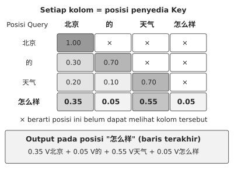
>
> Jika bobot setiap posisi disusun menjadi matriks, diperoleh **heatmap attention**. Setiap baris sesuai dengan satu Query, setiap kolom sesuai dengan satu Key, dan pekat-tipisnya warna menunjukkan besar bobot. Causal mask memperbolehkan posisi saat ini membaca dirinya sendiri dan posisi-posisi sebelumnya; posisi yang ditutup ditandai × pada gambar, dan bobotnya menjadi nol setelah softmax. Struktur ini berlaku untuk pemrosesan input maupun pembangkitan berikutnya.
>
> Dari sini juga terlihat kegunaan cache K dan V: ketika pembangkitan terus berlanjut, posisi baru tetap membaca Key dan Value dari posisi yang sudah ada. Dengan menyimpan vektor-vektor ini, posisi baru dapat langsung memakainya untuk pencocokan dan agregasi, sehingga komputasi berulang untuk posisi historis dapat dihindari.
>
> Setelah memahami contoh bobot ini, kita memakai Qwen3-0.6B untuk melihat distribusi attention yang benar-benar dihitung model. Eksperimen ini mencatat sebuah kalimat pendek serta sebuah urutan pembangkitan yang berisi penalaran dan jawaban akhir, lalu membandingkan matriks attention di berbagai lapisan. Gambar 2-7 menampilkan lapisan 0, 13, dan 27: kolom kiri adalah kalimat pendek sembilan token, kolom kanan adalah urutan pembangkitan untuk menghitung 17 × 23, dengan rentang posisi input, penalaran, dan jawaban ditandai. Skala abu-abu memakai skala logaritmik agar bobot attention yang kuat dan yang lemah sama-sama terlihat jelas.
>
> 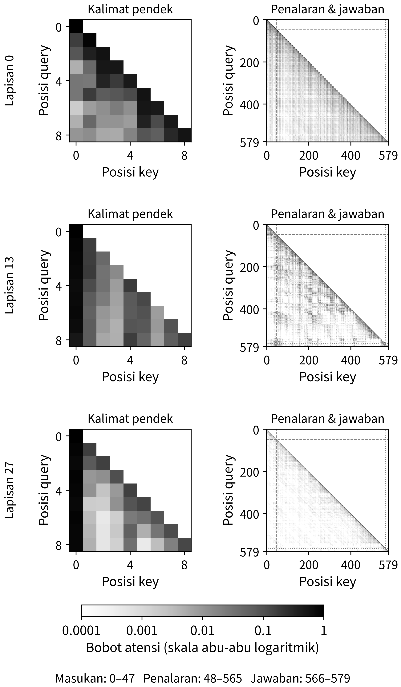
>
> Saat membaca gambar, analisislah dengan mengikuti empat petunjuk:
>
> 1. **Attention sink.** Sebagian lapisan memberi bobot besar pada awal urutan, meskipun token di awal hanya membawa sedikit makna. Lihat kalimat pendek di kolom kiri Gambar 2-7. Setiap panel sudah merata-ratakan semua attention head pada lapisan yang sama. Ambil lagi rata-rata sembilan angka di kolom pertama matriks, maka diperoleh berapa bobot yang rata-rata diberikan sembilan posisi itu kepada token pertama. Untuk lapisan 0, 13, dan 27, nilainya masing-masing 14,7%, 73,9%, dan 83,2%. Pada urutan pembangkitan yang lebih panjang di kolom kanan, nilai ini untuk lapisan 13 menjadi 28,0%. Softmax mengharuskan bobot semua posisi berjumlah 1, sehingga model dapat mempelajari posisi penerima yang relatif stabil; StreamingLLM secara khusus meneliti fenomena ini dan perannya dalam inferensi streaming[^ch2-attention-sinks].
> 2. **Wilayah penalaran.** Tandai rentang pembangkitan yang sesuai dengan `<think>`, lalu telusuri baris-baris tersebut untuk melihat prompt, keterangan alat, atau penalaran sebelumnya mana yang diperhatikan model. Bentuk segitiga berasal dari causal mask; yang mencerminkan perbedaan bobot antarposisi adalah pekat-tipis di dalam segitiga itu.
> 3. **Wilayah jawaban.** Tandai pula rentang pembangkitan jawaban akhir, lalu bandingkan pembagian bobotnya terhadap input asli dan penalaran sebelumnya. Ini membantu menemukan informasi mana yang sudah ada yang masuk ke agregasi attention saat ini.
> 4. **Perbedaan posisi.** *Lost in the Middle* mengamati, pada tanya jawab konteks panjang dan pencarian key-value, bahwa informasi di posisi tengah lebih sulit dimanfaatkan secara efektif[^lost-in-the-middle]. Secara rekayasa, berdasarkan temuan ini aturan yang selalu berlaku dapat diutamakan di bagian depan, sedangkan tujuan dan kemajuan saat ini diletakkan di bagian akhir.

[^ch2-attention-sinks]: Xiao et al., Efficient Streaming Language Models with Attention Sinks, ICLR 2024.

[^lost-in-the-middle]: Liu et al., Lost in the Middle: How Language Models Use Long Contexts, TACL 2024.

### Dari Pesan API ke Token Model: Chat Template

Contoh API di depan berupa sekumpulan pesan berperan, sedangkan input pada gambar attention berupa deretan token. **Chat Template (template obrolan)** bertugas melakukan konversi ini: menambahkan tanda peran dan tanda batas pada pesan, menyusun keterangan alat dan nilai kembaliannya sesuai konvensi, lalu menyerahkannya ke tokenizer untuk dienkode. Bandingkan dua kolom pada Gambar 2-8: kolom kiri hanya mengirim instruksi sistem dan pertanyaan pengguna, lalu mengapa kolom kanan memiliki satu `assistant` tambahan? Itu adalah tanda awal yang ditambahkan template untuk balasan berikutnya. Tanda-tanda ini akan dipakai lagi ketika kita membahas pemanggilan alat, penyimpanan informasi penalaran, dan cache hit.

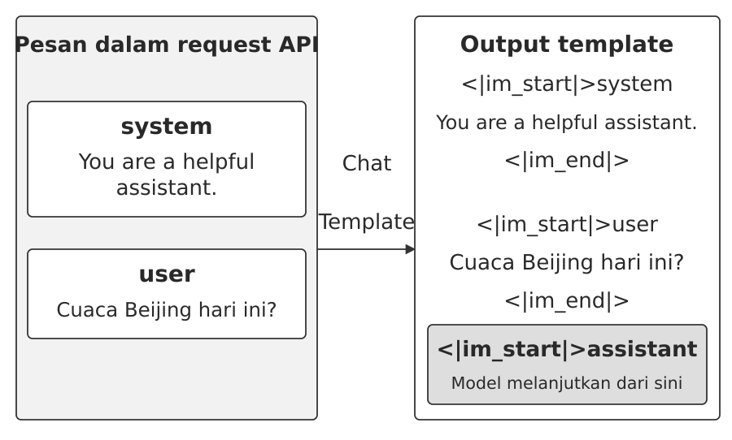

Keluarga model seperti Qwen, Llama, dan Gemma masing-masing memiliki chat template sendiri. Sekumpulan pesan API yang sama, jika diberikan ke model yang berbeda, dapat menghasilkan tanda peran dan tanda batas yang berbeda pula. Pada API terkelola, konversi biasanya dilakukan di server; jika men-deploy sendiri, layanan inferensi harus dikonfigurasi dengan template yang sesuai dengan modelnya.

Misalkan pengguna mengirim kalimat "Vancouver 17,9 °C", dan alat cuaca kebetulan juga mengembalikan teks yang sama. Jika kedua pesan ini masing-masing diberikan ke template Qwen3-0.6B, diperoleh dua potong input seperti pada Gambar 2-9. Keduanya diawali `<|im_start|>user`; tanda mana yang menunjukkan bahwa teks berasal dari alat?

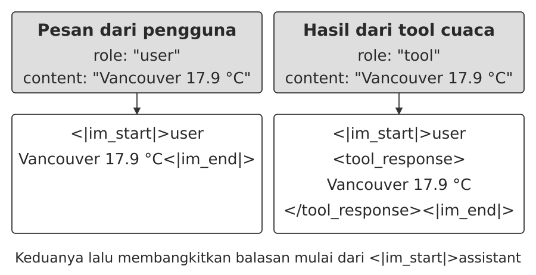

Kolom kanan memiliki sepasang tag `<tool_response>` tambahan. Template juga menentukan letak pertanyaan terakhir pengguna berdasarkan peran pesan: pada putaran sebelum pertanyaan itu, hanya isi jawaban yang dipertahankan; sesudahnya, interaksi alat masih dapat membawa informasi penalaran model[^ch2-qwen-template].

Misalnya, setelah memeriksa sebuah berkas, model masih harus melanjutkan analisis. Jika hasil alat dikirim kembali dengan peran `tool`, template dapat mengenalinya sebagai umpan balik alat dalam tugas yang sedang berjalan; jika hasil yang sama ditulis sebagai pesan `user` biasa, template dapat mengenalinya sebagai kueri baru dan mengubah cakupan penalaran sebelumnya yang dipertahankan. Ini seperti melanjutkan pengerjaan soal yang perlu menyimpan coretan perhitungan: Harness harus menyimpan field penalaran yang diminta layanan dan melanjutkan panggilan dengan struktur pesan yang benar.

**Dari penalaran satu putaran menuju Agent jangka panjang, pemikiran historis berangsur menjadi status tugas yang harus dipelihara.** Chat template DeepSeek-R1 generasi awal membuang bagian pemikiran dari jawaban historis dan hanya mempertahankan jawaban akhir[^ch2-r1-template]; protokol pemanggilan alat DeepSeek yang lebih baru justru mewajibkan informasi penalaran dikirim kembali. Setelah satu kali tanya jawab selesai, jawaban akhir mungkin sudah memuat informasi yang dibutuhkan putaran berikutnya; tetapi di tengah tugas alat, "mengapa berkas ini diperiksa" dan "hipotesis mana yang sudah disingkirkan" mungkin hanya tertulis dalam penalaran antara. Mempertahankan informasi ini membantu putaran berikutnya melanjutkan alur pikir yang sudah ada.

**Cara pengiriman kembali informasi penalaran ditentukan oleh protokol model.** Saat melakukan integrasi, `content`, `tool_calls`, dan field penalaran yang disediakan layanan harus ditangani bersamaan. Beberapa skema berikut menunjukkan aturan penyambungan yang berbeda:

- **Mode berpikir DeepSeek** mengembalikan penalaran melalui `reasoning_content`. Menurut protokol pemanggilan alatnya, jika permintaan menyertakan `tools`, permintaan berikutnya harus mengirim kembali seluruh penalaran historis, termasuk balasan model yang tidak memanggil alat; field yang hilang akan memicu galat 400. Untuk permintaan obrolan murni tanpa `tools`, layanan mengabaikan penalaran historis yang dikirim kembali[^ch2-deepseek-thinking].
- **Interaksi berpikir dan alat pada Kimi** juga mengharuskan penalaran, permintaan alat, dan hasilnya dikelola di dalam loop eksekusi. Dalam contoh interleaved thinking pada Kimi K2.5, model dapat terus bernalar di antara beberapa pemanggilan alat, dan klien menyimpan serta mengirim kembali pesan model sesuai protokolnya[^ch2-kimi-thinking].
- **Preserved thinking pada GLM** dapat diaktifkan melalui `thinking.clear_thinking: false`, lalu `reasoning_content` dikirim kembali secara lengkap dan dalam urutan aslinya. Pengaturan bawaan Coding Plan berbeda dari API standar, sehingga klien harus memilih mode yang dibutuhkan secara eksplisit[^ch2-glm-thinking].
- **Thinking block pada Claude** harus disimpan bersama tanda tangannya. Model yang mendukung preserved thinking juga memeriksa asal dan prefiks blok tersebut; aturan rincinya dibahas di subbab "Cache sebagai Batasan Arsitektur" nanti.

Aturan-aturan ini memengaruhi pemanggilan alat yang berurutan, dan juga memengaruhi pergantian model di tengah jalan. Saat berganti model, lapisan adapter harus mengubah permintaan alat, hasil, dan status tugas ke bentuk yang diterima antarmuka tujuan, lalu menangani informasi penalaran sesuai aturan model tujuan. Eksperimen 5-1 di Bab 5 akan membahas penyambungan trajektori semacam ini.

**Template juga menentukan input yang dicocokkan oleh cache.** Isi pesan yang sama, jika diproses dengan template, urutan alat, atau cara serialisasi yang berbeda, dapat menghasilkan prefiks token yang berbeda. Untuk memakai ulang KV yang sudah ada, konfigurasi model yang terkait dan prefiksnya harus tetap sama.

[^ch2-qwen-template]: File konfigurasi tokenizer Qwen3-0.6B, `tokenizer_config.json`, menyimpan chat template yang memuat logika penanganan kueri pengguna, konten penalaran, dan respons tool.

[^ch2-r1-template]: Chat template resmi DeepSeek-R1 mempertahankan isi sesudah `</think>` pada jawaban historis biasa; aturan pengiriman kembali penalaran untuk tool call berikutnya dapat dilihat di dokumentasi Thinking Mode DeepSeek.

[^ch2-deepseek-thinking]: DeepSeek, Thinking Mode.

[^ch2-kimi-thinking]: Moonshot AI, repositori resmi Kimi K2.5, bagian Interleaved Thinking and Multi-Step Tool Call.

[^ch2-glm-thinking]: Z.ai, Thinking Mode, menjelaskan interleaved thinking, preserved thinking, dan pengaturan bawaan setiap endpoint.

### Prinsip dan Batasan KV Cache

Saat memproses satu permintaan, model lebih dulu menjalankan **prefill** atas input, yaitu menghitung representasi token yang sudah ada, lalu masuk ke tahap **decode**, membangkitkan token berikutnya satu per satu. Selama decoding, KV Cache menyimpan K dan V dari posisi yang sudah ada; cache prefiks lintas permintaan melangkah lebih jauh dengan memakai ulang prefiks identik yang ditinggalkan permintaan sebelumnya.

Misalnya, pada putaran keenam Agent sudah mengumpulkan 2.000 token input. Jika layanan hanya memakai KV Cache di dalam permintaan ini, 2.000 token tersebut harus diproses dulu sebelum pembangkitan dapat berlanjut dengan bantuan cache. Jika cache lintas permintaan sudah menyimpan sebagian prefiks yang sama, prefill dapat dilanjutkan dari posisi yang belum di-cache. Gambar 2-10 memperlihatkan pemakaian ulang lintas permintaan semacam ini.

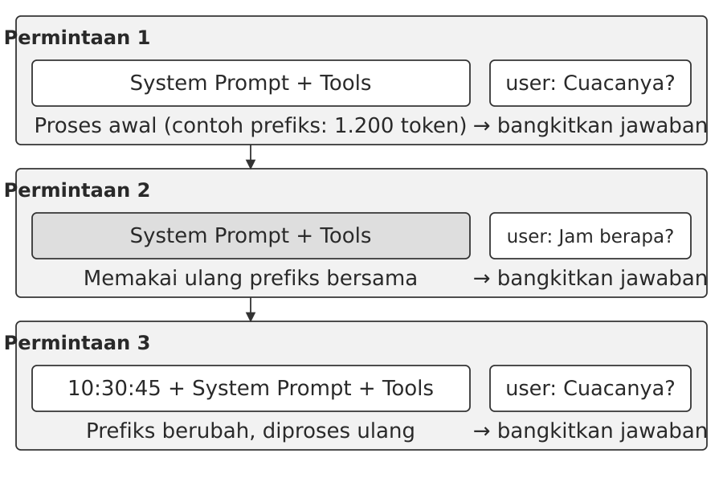

**Ikuti pertumbuhan cache dengan empat token.** Misalkan inputnya `[A, B, C, D]`. Saat memproses posisi D, model mencocokkan Query milik D dengan Key milik A, B, C, dan D, lalu mengagregasi Value mereka secara berbobot. Setelah melewati semua lapisan, representasi akhir di posisi D dipakai untuk memprediksi token berikutnya, E. Pada titik ini, K dan V dari A hingga D di setiap lapisan sudah tersimpan.

Setelah E diperoleh melalui sampling, langkah berikutnya memasukkan E ke model dan menghitung Query, Key, dan Value-nya di setiap lapisan. Query milik E membaca cache sebelumnya serta K dan V posisi saat ini, lalu model memprediksi token keenam; K dan V milik E sekaligus ditambahkan ke cache. Dengan demikian, setiap langkah pembangkitan dapat meneruskan status sebelumnya dan hanya menghitung status token input yang baru.

Tanpa KV Cache sama sekali, memprediksi E mengharuskan A hingga D diproses ulang, dan memprediksi token keenam mengharuskan A hingga E diproses lagi. Jika dihitung hanya dari jumlah posisi yang K dan V-nya dibangkitkan berulang, beban kerja kumulatifnya tumbuh seperti $1+2+\cdots+N$. Dengan cache, komputasi per lapisan untuk posisi historis dapat dipakai ulang; posisi baru tetap harus membaca K dan V yang terlihat. Pada decoding full attention standar, pembacaan dan pencocokan ini meningkat linear terhadap panjang konteks, sehingga konteks panjang tetap memakan lebih banyak memori GPU dan bandwidth memori.

**Mengapa mengubah input memengaruhi cache sesudahnya?** Lapisan-lapisan Transformer memproses representasi tersembunyi secara berurutan, dan setiap lapisan memiliki K dan V sendiri. Setelah suatu posisi melewati komputasi attention, representasinya sudah memuat informasi dari posisi-posisi sebelumnya, lalu diteruskan ke lapisan berikutnya. Karena itu, ketika token ke-$k$ berubah, pengaruhnya merambat dari posisi itu ke belakang dan ke lapisan yang lebih tinggi.

Untuk model dan konfigurasi komputasi yang sama, posisi sebelum $k$ hanya bergantung pada input yang lebih awal sehingga dapat terus dipakai ulang; mulai dari $k$, status yang terdampak harus dibangun ulang. Layanan nyata biasanya mencocokkan prefiks per blok cache, sehingga batas komputasi ulang juga dipengaruhi ukuran blok. Makin awal letak pembaruan, biasanya makin banyak input yang harus dihitung ulang. Meletakkan instruksi yang stabil di depan dan menambahkan status baru di belakang berarti memanfaatkan hubungan ketergantungan ini.

> **Eksperimen 2-3 ★★: Perbandingan Cara Pengelolaan Konteks**
>
> Dalam eksperimen ini Agent menyelesaikan tugas yang sama dengan alat untuk menemukan, membaca, dan mencari berkas, lalu membandingkan satu baseline yang menambahkan secara stabil dengan lima jenis perubahan konteks. Baseline menjaga instruksi dan urutan alat tetap stabil, serta menambahkan pesan model dan hasil alat putaran demi putaran. Kelompok lainnya masing-masing mengubah instruksi, status, urutan alat, atau representasi riwayat, untuk mengamati bagaimana statistik cache dan jalannya tugas berubah.
>
> **System prompt dinamis** memperbarui waktu saat ini di instruksi sistem pada setiap putaran. Sebelum titik perubahan masih bisa ada prefiks bersama, tetapi input sejak informasi waktu itu harus dicocokkan atau dihitung ulang. Waktu dapat ditambahkan sebagai pesan baru, atau diambil sesuai kebutuhan melalui alat waktu, agar aturan bisnis yang selalu berlaku tetap dapat dipakai ulang.
>
> **Konfigurasi pengguna dinamis** memperbarui sisa jumlah panggilan atau saldo akun di pesan bagian depan. Status itu sendiri merupakan informasi yang dibutuhkan tugas; inti desainnya terletak pada posisi pembaruan: menambahkan status terbaru di akhir dan mencantumkan waktu berlakunya dapat mempertahankan kemajuan sekaligus prefiks. Bilah status Agent di bagian selanjutnya akan memakai cara penyusunan ini.
>
> **Pengacakan urutan definisi alat** mengubah urutan daftar alat pada setiap putaran. Meskipun nama dan parameternya sama, urutan token setelah serialisasi sudah berubah. Buka laporan run Kimi K2.6: `Hit%` untuk baseline maupun kelompok pengacakan sama-sama 100%. Benarkah kedua kelompok memakai ulang input sebanyak yang sama? Baseline memasukkan total 7.567 token input dalam tiga putaran, 768 di antaranya cache hit; kelompok pengacakan juga tiga putaran, tetapi dari 7.568 token input hanya 256 yang hit. Jumlah token cache dibagi jumlah token input menghasilkan 10,1% dan 3,4% pada kolom `Cache%`. Kolom `Hit%` lainnya menghitung permintaan yang dinilai mengalami hit: baseline mencatat dua hit, kelompok pengacakan hanya satu, dan jumlah miss yang tercatat pada kedua kelompok sama-sama nol. Status hit permintaan sisanya tidak dapat dipastikan hanya dari catatan ini. Urutan alat yang tetap mencegah prefiks berubah tanpa alasan.
>
> **Sliding window** hanya mempertahankan riwayat terbaru. Jika yang dipertahankan sepuluh putaran interaksi, pada putaran kelima belas isi berkas penting yang diperoleh pada putaran kedua bisa jadi tidak terbaca lagi. Selain memperpendek prefiks bersama, pemangkasan juga mengubah fakta dan kemajuan tugas yang dapat diakses model. Implementasi pendampingnya bertitik tolak dari enam pesan riwayat terakhir, lalu menambahkan ke belakang permintaan panggilan yang berpasangan dengan hasil alat di dalamnya. Kelompok sliding window memakai ulang 1.510 dari 2.224 token input, dengan porsi cache 67,9%, tertinggi di antara keenam kelompok. Namun, lihat catatan alat kelompok sliding window pada Eksperimen 2-3: model mencari berkas tiga kali, lalu membaca dua berkas, tetapi tidak menyerahkan ringkasan tiga kalimat yang diminta pengguna.
>
> **Pemformatan teks** menulis ulang riwayat berperan menjadi teks seperti `USER: ...`, `ASSISTANT: ...`. Cara ini mengubah batas pesan dan struktur alat di dalam template, sehingga model harus memulihkan hubungan aslinya dari teks. Kali ini kelompok teks tetap menghasilkan balasan akhir dan juga mendapat cache hit. Peran pesan, ID panggilan, dan field hasil alat yang disediakan antarmuka membantu menyampaikan hubungan tersebut secara stabil.
>
> Sekalipun program menyusun ulang daftar pesan, selama prefiks yang dikirim dan konfigurasi cache-nya sama, prefiks itu masih berpeluang dipakai ulang.
>
> Jika ingin tahu berapa lama waktu tunggu pengguna berkurang, periksa dulu di mana stopwatch berhenti. `ttft` putaran pertama kelompok sliding window sekitar 2,23 detik. Meskipun program menamai field ini TTFT (latensi token pertama), stopwatch baru berhenti ketika permintaan non-streaming mengembalikan seluruh balasan.

### KV Cache dan Prompt Cache: Dua Tingkat Cache

Kedua tingkat cache ini dapat dibedakan dengan dua momen. Saat model membangkitkan token kedua dalam balasannya, ia dapat membaca status key-value dari posisi yang sudah ada dalam permintaan tersebut; inilah **KV Cache**. Beberapa saat kemudian pengguna bertanya lagi dan Harness mengirim permintaan baru; layanan harus lebih dulu menemukan prefiks identik yang disimpan sebelumnya agar bagian input itu tidak perlu dihitung lagi; inilah **Prompt Cache**. Yang pertama menjelaskan bagaimana satu pembangkitan berlanjut, sedangkan yang kedua juga memerlukan mekanisme penyimpanan dan pencocokan lintas permintaan.

Pada layanan API, cache juga dipengaruhi oleh panjang prefiks minimum, ukuran blok, masa berlaku, konfigurasi model, dan cakupan isolasi tenant. Prefiks yang dapat dipakai ulang harus dicari di dalam cakupan cache yang sama. Misalnya, Claude API mengisolasi cache per organisasi dan workspace; teks yang sama di domain isolasi yang berbeda akan membangun cache-nya masing-masing[^ch2-prompt-cache].

Penagihan harus mempertimbangkan penulisan dan pembacaan secara terpisah. Pada sebagian model Claude, harga pembacaan cache sepersepuluh harga input biasa, sedangkan penulisan pertama dikenai biaya tambahan. Jika prefiks yang sama dipakai berulang kali dalam masa berlakunya, biaya penulisan hanya dibayar sekali, dan permintaan yang hit sesudahnya ditagih dengan harga pembacaan.

[^ch2-prompt-cache]: Anthropic, Prompt caching, menjelaskan pencocokan, isolasi, masa berlaku, dan penagihan cache.

### Cache sebagai Batasan Arsitektur

**Dalam sistem produksi, cache sudah menjadi batasan arsitektur.** Cara menyusun prompt, titik awal sub-Agent, dan cara memulihkan sesi semuanya memengaruhi seberapa banyak komputasi yang dapat dipakai ulang. **Batas cache harus diatur sejak awal desain.** Tentukan dulu isi mana yang dapat dibagi dan status mana yang akan berubah, lalu susun prompt dan struktur sesinya; cara ini mengurangi komputasi ulang berulang selama eksekusi. Jika struktur ini baru diubah setelah latensi dan biaya tugas jangka panjang menjadi masalah, perubahan itu sering kali merembet ke pengelolaan status, sub-Agent, dan pemulihan sesi.

**Susun prefiks menurut tingkat kestabilannya.** Instruksi dan definisi alat yang dipakai bersama oleh banyak tugas dapat diletakkan di depan, disusul data pengguna, status sesi, dan observasi baru, yang dikelompokkan menurut cakupan berlakunya. Misalnya, sistem operasi memiliki dua pilihan, macOS/Linux; mode eksekusi dua pilihan, normal/debug; bahasa dua pilihan, Mandarin/Inggris; tiga kondisi independen ini menghasilkan paling banyak $2\times2\times2=8$ kombinasi prefiks. Meletakkan field yang sering berubah sesudah bagian bersama dapat memperbesar peluang pemakaian ulang prefiks bersama. Cakupan berbagi bagian bersama juga harus mematuhi batas organisasi, workspace, dan privasi layanan.

**Pilih titik awal yang dapat dipakai ulang untuk sub-Agent.** Jika sub-Agent mewarisi latar belakang tugas Agent induk, ia dapat memakai ulang prefiks yang identik di kedua pihak, lalu menambahkan subtugasnya sendiri. Prompt, urutan alat, model, dan konfigurasi terkait bersama-sama menentukan cakupan yang dapat dipakai ulang. Sub-Agent yang membutuhkan peran mandiri atau konteks terisolasi menyusun inputnya sesuai tugasnya, lalu memeriksa bagian bersama mana yang cocok untuk dibagi.

**Simpan isi yang sudah dikirim.** Setelah output alat berukuran besar dikompresi menjadi ringkasan atau pratinjau, versi yang benar-benar dikirim ke model harus disimpan. Saat sesi dipulihkan, memutar ulang catatan ini dapat membangun kembali urutan pesan yang konsisten; jika ringkasan dibangkitkan ulang setiap kali pemulihan, rumusan dan prefiksnya dapat berubah. Saat memperbarui ringkasan, terbitkan versi baru dan tetapkan dengan jelas dari titik mana cache akan dibangun ulang.

**Mempertahankan penalaran juga harus memenuhi batasan protokol.** Preserved thinking pada Claude memberikan contoh konkret untuk masalah ini. Dokumentasinya memakai mekanisme ini untuk mencegah distilasi: layanan memeriksa tanda tangan thinking block, model yang membangkitkannya, dan prefiksnya. Pada model yang mendukung pengikatan prefiks, seperti Claude Fable 5.1 dan Claude Opus 5.5, `system` tingkat teratas, `tools`, dan pesan-pesan sebelum blok tersebut bersama-sama membentuk cakupan validasi; mengubah isinya akan membuat blok itu dan thinking block sesudahnya tidak berlaku lagi[^ch2-preserved-thinking].

Misalnya, menulis ulang waktu sistem setiap putaran, merender ulang informasi lingkungan di pesan pertama, atau memotong hasil alat lama di tempatnya, semuanya mengubah prefiks yang terikat pada blok penalaran berikutnya. Setelah validasi terpicu, API dapat mengembalikan galat 400, atau, sesuai konfigurasi `prefix_mismatch_behavior`, membuang blok yang tidak berlaku dan tetap memproses permintaan. Pada kasus kedua, model masih dapat memakai informasi tugas dan hasil alat yang dipertahankan, tetapi penalaran yang tidak berlaku tidak lagi ikut dalam input kali ini. Akun yang dibuat sejak 31 Agustus 2026 mengaktifkan validasi prefiks secara bawaan; cara mengaktifkannya untuk akun yang lebih lama dijelaskan dalam keterangan protokol.

Saat mengintegrasikan protokol semacam ini, jaga agar instruksi tingkat teratas dan himpunan alat dalam sesi tetap stabil, dan tambahkan perubahan status di bagian belakang. Jika instruksi atau alat perlu diperbarui di tengah jalan, gunakan antarmuka yang disediakan layanan tersebut, seperti pesan sistem di dalam sesi atau blok perubahan alat. Pemangkasan thinking block juga harus menjaga rentang yang bersambung dalam urutan aslinya: boleh dihapus dari depan atau dari belakang, atau dihapus seluruhnya; celah di tengah akan memengaruhi blok sesudahnya, dan blok yang sudah sengaja dihapus harus tetap terhapus.

Ketika model diganti di tengah jalan, layanan juga memeriksa apakah model tujuan dapat membaca blok penalaran dari model asal. Klien harus menyimpan riwayat aslinya dan membiarkan layanan menanganinya menurut aturan kompatibilitas; jika klien menghapusnya sendiri, catatan tersebut tidak dapat dipulihkan ketika nanti beralih kembali ke model asal.

[^ch2-preserved-thinking]: Anthropic, Preserved thinking, menjelaskan model, pengikatan prefiks, penanganan blok yang tidak berlaku, dan aturan pemangkasan blok penalaran; antarmuka pembaruan di dalam sesi dapat dilihat di Mid-conversation system messages and tool changes.

### Perluasan Riset: KV Cache yang Dapat Diedit dan Disusun

> Seluruh desain di atas memakai ulang komputasi dengan mencocokkan prefiks. Penulis ingin menjelajah lebih jauh: dapatkah informasi yang sudah tersimpan di KV diedit dan disusun secara langsung, sehingga cache dapat menyesuaikan diri dengan perubahan konteks? Dalam *Models Take Notes at Prefill*, penulis mengibaratkan informasi semacam ini sebagai "catatan" model[^ch2-2]: setelah prefill melewati komputasi attention berlapis-lapis, pengaruh sebuah field sudah masuk ke representasi posisi-posisi sesudahnya. Misalnya, "kota pengguna: Beijing" dapat memengaruhi penilaian lokasi selanjutnya; jika hanya K dan V milik field itu sendiri yang diganti, status sesudahnya masih dapat menyimpan kesimpulan yang diturunkan dari kota lama.
>
> Melalui intervensi, makalah tersebut memisahkan peran KV milik field itu sendiri dari peran status sesudahnya. Pada keputusan yang diuji, kontribusi langsung KV milik field itu sendiri di bawah 1%, sedangkan pengaruh utamanya tersimpan di representasi hilir. Berdasarkan "catatan" yang tertinggal di hilir ini, dapat dijelajahi dua cara memanfaatkan cache.
>
> **Editing (penyuntingan)** mendorong komputasi berikutnya memperbarui penilaian yang sudah ada melalui koreksi informasi yang eksplisit. Makalah itu juga menemukan bahwa, pada tugas model 8B yang diuji, ketika ada chain-of-thought eksplisit, menyunting field saja sudah dapat memulihkan keputusan yang diinginkan dengan biaya komputasi sekitar 1% dari komputasi ulang penuh; tanpa proses penalaran tersebut, status hilir yang lama dapat terus memengaruhi keputusan sehingga perubahan field sulit berdampak.
>
> **Composition (penyusunan)** menyambungkan cache skill yang sudah dihitung sebelumnya ke konteks baru. Untuk model yang memakai rotary position embedding (RoPE), representasi posisi di dalam cache harus disesuaikan dulu sebelum penyambungan. Ini dapat dibayangkan seperti memberi nomor ulang pada halaman catatan yang sudah ada, lalu menempelkannya di belakang bahan lain. Makalah tersebut membandingkan dua belas model; cosine similarity logits output antara penyambungan dan komputasi ulang penuh berada di kisaran 0,90–0,999; relokasi cache dan penyambungannya sendiri dapat diproses linear terhadap panjang, sehingga mengurangi komputasi ulang attention untuk seluruh konteks.
>
> Penambahan informasi koreksi juga dapat dipadukan dengan cache prefiks yang sudah ada. Pada benchmark online vLLM dalam makalah tersebut, kombinasi ini mempertahankan cache hit rate prefiks sekitar 98,5%, dan latensi token pertama p90 sekitar 1/398 hingga 1/53 dari baseline.
>
> **Penulis optimistis terhadap jalur riset ini karena berpotensi membuat pembaruan konteks mempertahankan lebih banyak komputasi yang sudah ada.** Agent sering memperbarui field memori, menambahkan status, atau mengganti definisi alat; jika status terkait dapat dikoreksi dan disambung seperti catatan, biaya memelihara konteks panjang berpeluang turun secara signifikan.

[^ch2-2]: Li, Bojie, Models Take Notes at Prefill: KV Cache Can Be Editable and Composable, 2026. Eksperimen editing, composition, dan cache online memakai tugas dan metrik yang berbeda; pengaturan rincinya dapat dilihat di makalah.

### Dari Mekanisme Cache ke Desain Isi Konteks

Setelah memahami bagaimana cache memakai ulang komputasi, berikutnya kita harus memutuskan apa yang dimasukkan ke input setiap putaran dan bagaimana isi itu diperbarui. Pembahasan selanjutnya terbagi menjadi tiga bagian:

- **Prompt engineering dan Agent Skills**: pertama, rancang instruksi sistem dan definisi alat untuk menjelaskan tujuan, aturan, dan cara operasi; lalu muat pengetahuan domain sesuai kebutuhan melalui progressive disclosure. Pertahanan terhadap prompt injection berfokus pada sumber dan batas instruksi ketika konten eksternal masuk ke konteks.
- **Bilah status Agent**: menyediakan status seperti kemajuan tugas, ringkasan observasi lingkungan, dan jumlah panggilan kepada model, sehingga mengurangi biaya menurunkannya kembali dari riwayat yang panjang. Ia seperti waktu, baterai, dan status jaringan di ponsel, yang membuat kondisi eksekusi saat ini selalu terlihat.
- **Kompresi konteks**: mempertahankan informasi yang dibutuhkan keputusan berikutnya ketika riwayat bertambah, memutuskan kapan kompresi dilakukan, bagaimana menyusun ringkasan, serta bagaimana menangani komputasi ulang cache dan kelanjutan tugas.

## Prompt Engineering: Mengoptimalkan System Prompt

Prompt engineering memandu model menyelesaikan tugas tertentu melalui instruksi, alur, dan contoh. Bagian ini berfokus pada **system prompt**: ia seperti buku panduan karyawan yang menjelaskan identitas, tujuan, aturan perilaku, dan alur kerja Agent. Dalam contoh API di bab ini, isi tersebut diberikan melalui pesan `system`.

### Nada dan Gaya: Cara Berbicara kepada Pengguna

Ketentuan nada harus diwujudkan dalam rumusan yang konkret. Misalnya, untuk tanya jawab singkat dapat diminta "You MUST answer concisely with fewer than 4 lines", yaitu menjawab dengan kurang dari empat baris. Ketika tugas terhambat, dapat diminta "keep your response to 1–2 sentences", yaitu menjelaskan keadaan saat ini dan langkah berikutnya dalam satu atau dua kalimat, sehingga pengguna langsung melihat hal yang perlu ditangani.

Penekanan dengan huruf kapital seperti "NEVER do X" dapat dipakai untuk menonjolkan persyaratan penting. Yang lebih penting adalah menjelaskan dalam situasi apa persyaratan itu berlaku dan tindakan apa yang harus diambil.

### Prompt Terstruktur: Menata Hierarki dan Batas Isi

Judul, daftar, dan tag dapat membantu menata prompt yang panjang. Judul Markdown cocok untuk menyatakan bagian dan langkah, sedangkan tag bergaya XML cocok untuk memisahkan blok isi dengan kegunaan berbeda, misalnya membungkus informasi direktori kerja dengan `<working_directory>`. Nama tag harus langsung menjelaskan kegunaan isinya agar model mudah mengenali hubungan antarblok.

Satu prompt dapat memadukan kedua cara penulisan ini:

```text
# Aturan Penggunaan Alat

## Operasi Berkas
<file_operation>
- Periksa apakah jalur ada sebelum membaca berkas
- Simpan cadangan sebelum mengubah berkas yang sudah ada
</file_operation>

## Permintaan Jaringan
<network_request>
- Atur batas waktu 30 detik
- Untuk gangguan sesaat, coba ulang paling banyak 3 kali
- Untuk permintaan yang berdampak eksternal, pastikan status eksekusinya sebelum mencoba ulang
</network_request>
```

Markdown menyediakan hierarki yang mudah dibaca, sedangkan `<file_operation>` dan `<network_request>` membatasi cakupan berlakunya aturan. Misalnya, "coba ulang paling banyak 3 kali" hanya berlaku untuk permintaan jaringan; saat mengubah berkas, yang berlaku adalah aturan pencadangan pada kelompok sebelumnya.

### Menata Aturan dengan Alur

**Jika tugas memiliki tahapan yang jelas, utamakan penyusunan prompt berdasarkan alur.** Ambil contoh pengembalian dana: pesanan harus ditemukan dulu, baru kemudian dapat dinilai berdasarkan kebijakan pengembalian dana apakah uangnya boleh dikembalikan. Jika pesanan tidak ditemukan, minta pengguna melengkapi informasi seperti nomor pesanan; jika pesanan memenuhi syarat, barulah ajukan pengembalian dana. Jika aturan yang sama ditebar dalam daftar berisi ratusan butir, setiap langkah harus mencari ulang butir yang berlaku. Dengan menuliskan syarat input, urutan penanganan, dan jalan keluar untuk pengecualian pada tahap yang bersangkutan, model memiliki dasar untuk menilai di mana posisinya sekarang dan apa yang harus dilakukan berikutnya.

Berikut contoh pemrosesan berkas yang merangkai pemeriksaan, klasifikasi, praproses, eksekusi, dan verifikasi menjadi satu prosedur operasi standar (SOP):

```text
Alur Pemrosesan Berkas

Langkah 1: Pemeriksaan
  Pastikan berkas ada dan dapat diakses
  Berkas tidak ada → catat galat, hentikan pemrosesan
  ↓
Langkah 2: Klasifikasi
  Tentukan jenis berkas dari ekstensi dan isinya
  ↓
Langkah 3: Praproses
  Berkas konfigurasi → cadangkan dulu
  Berkas besar (>1 MB) → gunakan pemrosesan streaming
  ↓
Langkah 4: Eksekusi
  Jalankan pemrosesan sesuai jenis berkas
  ↓
Langkah 5: Verifikasi
  Periksa keutuhan berkas setelah diproses
```

Setiap langkah memberikan satu tujuan lokal, dan aturan terkait diletakkan di bawah langkah tersebut. Jika berkas tidak ada, proses keluar pada tahap pemeriksaan; jika berkas konfigurasi perlu diubah, cadangan disimpan pada tahap praproses. Kemajuan eksekusi diberikan kepada model melalui riwayat pesan atau catatan status.

### Merinci Aturan Bisnis: Menuliskan Ketentuan Produk dengan Jelas

Untuk data pesanan yang sama, termasuk jenis permintaan apa, layanan mana yang berlaku, dan berapa biayanya, pertama-tama merupakan ketentuan bisnis yang harus ditegaskan oleh tim produk dan operasional. Implementasi teknisnya kemudian dibagi: prompt memberi tahu model field mana yang harus diperoleh dan layanan mana yang harus ditanya; alat dan sistem bisnis menjalankan penagihan dan batasan yang bersifat deterministik.

Ambil contoh Agent yang menelepon atas nama pengguna untuk menurunkan biaya langganan atau mengajukan pengembalian dana. Tim ingin menurunkan hambatan untuk mencoba dengan jaminan "jika gagal, uang kembali", sekaligus menetapkan cara penagihan yang jelas untuk tugas khusus. Dapat dirancang tiga jenis penagihan:

- **Komisi atas penghematan**: menurunkan tagihan yang ada melalui negosiasi, lalu menagih persentase tertentu dari jumlah yang benar-benar dihemat, misalnya 20%.
- **Biaya tetap per layanan**: tugas berupa layanan, seperti reservasi restoran, ditagih menurut jenis atau kerumitan tugas.
- **Pembayaran di muka untuk tugas sulit**: untuk tugas sulit yang memenuhi syarat tertentu, biaya di muka dan ketentuan tidak dapat dikembalikan dijelaskan terlebih dahulu, dan tugas diterima setelah pengguna menyetujuinya.

Menulis "pilih jenis penagihan yang sesuai dengan kondisi tugas" masih menyisakan ambiguitas klasifikasi. "Tolong kembalikan baju yang saya beli bulan lalu" berarti mendapatkan kembali uang yang sudah dibayar, sedangkan "Tolong batalkan langganan Netflix saya" berarti menghentikan pembayaran di masa depan. Kedua hasil ini bisa dipahami secara longgar sebagai penghematan, tetapi tim dapat membatasi komisi hanya untuk negosiasi penurunan tagihan yang ada, sedangkan pengembalian dana dan pembatalan layanan seluruhnya memakai biaya tetap.

Prompt yang bersangkutan dapat menuliskan batas kategori secara langsung: "NEVER use percentage_based_one_time for refunds and service cancellations. Use fixed_fee instead." Artinya, pengembalian dana dan pembatalan layanan memakai `fixed_fee`, dan model komisi hanya berlaku untuk negosiasi penurunan tagihan yang ada.

Tim juga harus memperkirakan seberapa besar peluang tugas itu berhasil. Permohonan apa yang diterima merchant, apakah pengguna ini memenuhi syarat, biaya apa yang tercantum di tagihan, dan bagaimana hasil tugas serupa di masa lalu, semuanya memengaruhi cara tugas diterima. Jika aturan memakai ambang "di atas 60% masuk mode dapat dikembalikan, di bawah 30% tidak diterima", cara menangani rentang di antaranya dan nilai-nilai batasnya juga harus dituliskan.

Perhitungan jumlah uang harus menegaskan satuan, dasar perhitungan, dan urutan pembulatan. Misalnya, biaya telepon diakumulasi 0,05 dolar AS per menit, lalu setelah dijumlahkan dibulatkan ke dolar bulat terdekat; jumlah penghematan didasarkan pada tagihan saat ini. Jika tagihan saat ini 150 dolar AS dan merchant mungkin menaikkannya menjadi 180 dolar AS tahun depan, potensi kenaikan yang terhindarkan karena harga saat ini dipertahankan harus ditangani dengan definisi yang telah disepakati sebelumnya, dan tidak boleh otomatis dihitung sebagai penghematan dari penurunan tagihan yang ada.

Saran penulis: **biarkan pemilik produk memimpin desain aturan bisnis**, dengan memelihara definisi-definisi ini berdasarkan data produksi, umpan balik pengguna, dan pengalaman operasional; engineer kemudian menerapkannya ke prompt, parameter alat, logika penagihan, dan aturan validasi.

### Few-shot Examples: Menjelaskan Perilaku yang Diharapkan dengan Contoh

Ketika persyaratan output sulit diungkapkan dengan beberapa aturan, **memberikan dua atau tiga contoh berkualitas tinggi lebih langsung daripada terus menumpuk penjelasan abstrak.** Cara ini disebut **few-shot examples** (contoh sedikit-sampel). Gaya tulisan tertentu, laporan terstruktur, dan nada layanan pelanggan semuanya cocok ditunjukkan dengan pasangan input dan output yang diharapkan. Model memakai contoh-contoh ini di dalam konteks saat ini untuk mengenali pola, lalu menerapkannya pada permintaan baru.

Contoh dapat diletakkan di system prompt sebagai isi yang dibagi oleh banyak permintaan; dapat juga disusun sebagai pesan `user`/`assistant` peragaan yang dimuat di awal sesi. **Untuk memproses jenis tugas yang sama berulang kali, penulis lebih memilih kumpulan contoh tetap yang sudah diseleksi.** Contoh tetap juga menjaga prefiks tetap stabil. Jika tugasnya sangat beragam dan contoh tetap tidak dapat mencakupnya, barulah pertimbangkan pencarian contoh per tugas. Saat memakai pemilihan dinamis, instruksi bersama dapat dipertahankan lebih dulu, lalu contoh yang terpilih ditambahkan di bagian belakang.

Dengan aturan penagihan tadi, dua contoh sudah cukup untuk menjelaskan batas yang mudah tertukar. Pengguna yang meminta asisten menegosiasikan biaya bulanan dari 80 dolar AS menjadi 60 dolar AS dapat dikenai komisi atas penghematan; pengguna yang meminta asisten menghentikan layanan berbiaya 80 dolar AS per bulan dikenai biaya tetap untuk pembatalan layanan.

### Desain Definisi Alat

Definisi alat adalah buku petunjuk operasi bagi Agent. Model harus menilai kapan memanggil alat dari nama dan deskripsinya, lalu mengisi permintaan berdasarkan struktur parameternya. Definisi yang jelas harus membuat model tahu apa yang dapat dilakukan alat, input apa yang dibutuhkan, apa yang dikembalikan, dan syarat apa yang harus dipenuhi sebelum memanggilnya.

Informasi ini dapat ditulis sangat spesifik. Misalnya, alat pencarian dapat menyatakan "gunakan alat pencarian khusus untuk mencari isi berkas"; alat waktu dapat memberikan `timezone: "America/New_York"` untuk menunjukkan penulisan parameter yang sebenarnya; alat pembaca dapat mengingatkan "pembacaan yang saling independen dapat dipanggil sekaligus"; alat penyunting sebaiknya menjelaskan "baca dulu berkas sasaran, lalu sunting berdasarkan isinya saat ini". Keempat jenis keterangan ini masing-masing menjelaskan batas penggunaan, format parameter, efisiensi eksekusi, dan dependensi awal. Bab 4 akan membahas desain antarmuka alat dengan lebih banyak contoh.

Jika jumlah alat sedikit, definisi `tools` lengkap dapat disertakan bersama permintaan, dengan nama, isi, dan urutannya dijaga tetap stabil pada putaran-putaran berikutnya. Jika jumlah alat bertambah, definisi lengkap akan memakan banyak konteks dan juga menambah beban model untuk membedakan alat yang mirip. Pada saat itu dapat dipakai **pemuatan sesuai kebutuhan**: model lebih dulu diberi tahu kemampuan apa saja yang ada, lalu schema lengkap alat yang relevan dicari dan dimuat ketika dibutuhkan. Skills di bagian berikutnya juga memakai cara penyusunan "sediakan katalog dulu, muat rinciannya kemudian" ini.

OpenAI Responses API menandai alat yang dimuat tertunda dengan `defer_loading: true`. Dalam alur pencarian alat yang dikelola klien, model mengeluarkan `tool_search_call`, dan klien mengembalikan definisi alat yang terpilih melalui `tool_search_output`; alat yang sering dipakai juga dapat disediakan langsung dan dipakai bersama alat yang dimuat tertunda[^ch2-toolsearch-oai]. Pada model dan konfigurasi layanan yang mendukung pencarian alat, Claude Code secara bawaan memuat alat MCP sesuai kebutuhan: di awal sesi hanya nama alat dan keterangan server yang diberikan, dan definisi lengkap dimuat setelah pencarian. Claude Code juga menyediakan mode ambang, yang mengaktifkan pemuatan tertunda setelah definisi alat mencapai porsi konteks tertentu[^ch2-toolsearch-cc]. Template penemuan alat Apps/Connectors di Codex memakai BM25 untuk mencari metadata alat, lalu menyediakan alat yang cocok untuk panggilan model berikutnya[^ch2-toolsearch-codex].

Pemuatan sesuai kebutuhan juga harus selaras dengan cache prefiks. Pada antarmuka yang mendukung penambahan definisi alat di dalam sesi, isi yang sudah ada tetap di tempatnya, dan definisi baru masuk ke konteks berikutnya bersama hasil penemuan. Dalam causal attention, K dan V setiap token hanya bergantung pada token itu sendiri dan isi sebelumnya, sehingga isi baru di akhir dapat mempertahankan syarat pemakaian ulang prefiks sebelumnya. Putaran-putaran berikutnya terus menambahkan pesan sesudah riwayat ini, dan definisi yang sudah dimuat tetap berada di posisi semula. Sebagian antarmuka memasukkan alat baru ke himpunan `tools` di awal permintaan. Akibatnya, pesan riwayat yang berada sesudah definisi baru itu harus dihitung ulang, meskipun isinya sama sekali tidak berubah.

[^ch2-toolsearch-oai]: OpenAI, Tool search, dokumentasi Responses API.
[^ch2-toolsearch-cc]: Anthropic, Scale with MCP tool search, dokumentasi Claude Code.
[^ch2-toolsearch-codex]: OpenAI Codex, template penemuan tool Apps/Connectors.

> **Eksperimen 2-4 ★★: Eksperimen Ablasi Prompt Engineering**
>
> Dalam satu prompt, apa peran nada, penataan informasi, dan keterangan alat masing-masing? Eksperimen ini memakai tugas layanan pelanggan maskapai dari τ-bench sebagai pembanding. τ-bench membangun skenario interaksi melalui simulasi pengguna, alat bisnis, dan aturan, lalu memeriksa status tujuan setelah tugas selesai; maskapai dan ritel adalah dua domain tugas di dalamnya[^ch2-tau-bench].
>
> Kali ini Kimi K3 dipakai sebagai model pelaksana dan model simulasi pengguna, dengan enam konfigurasi dijalankan pada sepuluh tugas layanan pelanggan maskapai yang sama. Baseline mempertahankan aturan terstruktur, deskripsi alat yang lengkap, dan nada profesional yang netral; konfigurasi lainnya masing-masing mengubah nada, mengacak penataan aturan, menghapus deskripsi alat, dan menambahkan satu kelompok perubahan gabungan.
>
> **Perbandingan nada** mempertahankan aturan tugas tetapi mengubah cara penyampaian. Gaya Trump memakai retorika yang berlebihan dan penuh percaya diri, misalnya "saya akan memesankan Anda penerbangan terbaik sepanjang sejarah"; gaya Casual memakai nada santai dan emoji.
>
> **Perbandingan penataan informasi** mempertahankan isi aturan tetapi mengacak judul dan urutannya.
>
> **Perbandingan deskripsi alat** mempertahankan nama, signature fungsi, dan struktur parameter, tetapi menghapus teks deskripsinya. Nama alat dan schema itu sendiri juga membawa informasi; kinerja setelah deskripsi dihapus bergantung pada apakah informasi yang tersisa cukup untuk mendukung tugas saat ini.
>
> Dari sepuluh tugas kali ini, baseline lolos tujuh, nada Trump dan Casual masing-masing lolos enam dan sembilan, penataan yang diacak lolos delapan, penghapusan deskripsi lolos sembilan, dan perubahan gabungan lolos delapan.

[^ch2-tau-bench]: Yao et al., τ-bench: A Benchmark for Tool-Agent-User Interaction in Real-World Domains, 2024.

### Prompt Injection: Ancaman Inti terhadap Keamanan Konteks

Untuk menyelesaikan tugas, Agent perlu membaca halaman web, email, dokumen, dan nilai kembalian alat. Isi-isi ini juga dapat menyisipkan instruksi yang berusaha mengubah tujuan tugas. **Prompt injection** memanfaatkan fakta bahwa instruksi dan bahan yang sedang diproses sama-sama masuk ke konteks model, untuk membujuk model memperlakukan isi dari sumber berkepercayaan rendah sebagai dasar tindakan. Misalnya, pengguna meminta ringkasan sebuah halaman web, tetapi halaman itu justru meminta Agent melakukan operasi lain yang tidak berkaitan dengan peringkasan. Sistem harus mempertahankan tujuan tugas pengguna dan memperlakukan permintaan di halaman web sebagai isi yang sedang dianalisis.

Pemanggilan alat meneruskan penyimpangan semacam ini ke lingkungan luar. Ringkasan yang keliru dapat menyesatkan pengguna, sedangkan perubahan berkas, pengiriman email, dan pengungkapan data tanpa izin langsung mengubah status sistem. Saat menganalisis risiko, periksa lapis demi lapis mengikuti rantai "pintu masuk konten — penyusunan konteks — keputusan panggilan — eksekusi nyata": melalui alat apa konten eksternal masuk, apakah informasi sumbernya dipertahankan, operasi apa yang diminta model, dan apakah lapisan eksekusi mengizinkan operasi tersebut[^ch2-injection-defense].

Penyusunan konteks pertama-tama harus menjaga batas sumber dan izin:

- **Penandaan sumber**. Ketika bahan eksternal masuk ke konteks, pertahankan sumbernya, entah halaman web, email, atau dokumen, dan bungkus isinya dengan batas yang jelas. Misalnya, `<external_content source="webpage">...</external_content>` menyatakan bahwa isinya adalah bahan dari halaman web. Tanda dan atributnya dibangkitkan oleh Harness, sedangkan teks eksternal diletakkan di area data yang terkendali.
- **Peran terstruktur**. Aturan sistem, permintaan pengguna, dan hasil alat disampaikan secara terpisah sesuai konvensi antarmuka. Hasil alat berpasangan dengan ID panggilan, sehingga mudah ditelusuri dari mana isinya berasal. Ketika dirangkum atau diteruskan ke Agent lain, hubungan sumber ini juga harus dipertahankan.
- **Pemeriksaan input**. Deteksi isi berbentuk instruksi yang menyimpang dari tugas, dan bersihkan isi tak relevan yang terbawa oleh proses parsing. Hasil pemeriksaan dapat dipakai oleh model dan lapisan eksekusi; keputusan otorisasi tetap didasarkan pada permintaan pengguna dan izin sistem.

Skills dan status runtime juga perlu dikelola sumbernya. Saat memasang Skill pihak ketiga, periksa instruksi, dokumen rujukan, dan skrip yang dibundelnya, dan pastikan operasi yang dimintanya sesuai dengan kegunaannya. Kemajuan tugas, izin, dan hitungan di bilah status harus dipelihara oleh runtime; fakta yang diekstrak dari halaman web tetap mempertahankan label sumber eksternalnya. Dengan begitu, setelah informasi dirangkum, dipindahkan, atau dimuat ulang, sistem tetap dapat mengenali batas kepercayaan aslinya.

Lapisan eksekusi bertugas menegakkan batas-batas ini: cakupan akses alat dikendalikan oleh izin, aktivitas berkas dan proses dibatasi oleh sandbox, dan operasi berisiko tinggi dikonfirmasi sesuai aturan. Sekalipun model mengajukan panggilan yang melampaui wewenang, Harness dan lingkungan harus mencegatnya sebelum dieksekusi. Bab 4 dan Bab 5 akan menguraikan mekanisme ini, sedangkan Bab 3 membahas pengelolaan sumber pada konten hasil pencarian dan memori jangka panjang.

[^ch2-injection-defense]: Anthropic, How we contain Claude across products.

> **Eksperimen 2-5 ★★: Eksperimen Serangan dan Pertahanan Prompt Injection**
>
> Eksperimen ini memeriksa bagaimana sistem mempertahankan tujuan tugas dan izin operasi setelah konten eksternal masuk ke konteks. Eksperimen dilakukan di workspace terisolasi dengan data sintetis; pembacaan halaman web, penulisan berkas, dan output email semuanya memiliki catatan yang dapat diperiksa.
>
> Tiga jenis skenario masing-masing mencakup permintaan langsung, isi halaman web, dan memori lintas sesi. Skenario permintaan langsung memeriksa apakah model mematuhi aturan output untuk informasi terlindung sintetis; skenario halaman web memeriksa apakah tugas peringkasan memicu penulisan tanpa izin; skenario memori memeriksa apakah bahan eksternal yang diubah menjadi memori memengaruhi operasi di sesi baru.
>
> Empat konfigurasi menambahkan pertahanan lapis demi lapis: baseline berisi aturan dasar perlindungan informasi dan konfirmasi operasi; kelompok kedua menambahkan petunjuk tentang batas sumber dan instruksi; kelompok ketiga juga menandai sumber konten eksternal; kelompok keempat menambahkan pemeriksaan otorisasi runtime yang memvalidasi izin untuk penulisan berkas dan pengiriman email.
>
> Run Kimi K3 kali ini mencakup tiga jenis skenario dan empat konfigurasi, dengan setiap kombinasi diulang lima kali, total enam puluh kali; tidak satu pun mencapai tujuan serangan yang telah ditetapkan.

## Prompt Dinamis dan Agent Skills

Jika sebuah Agent yang sekaligus menangani pengembalian dana, mengubah kode, dan merapikan dokumen menyertakan tiga buku panduan lengkap di setiap putaran permintaan, maka saat memproses satu pengembalian dana, jendela konteksnya akan terpakai untuk standar kode dan aturan tata letak yang tidak relevan. Keterangan mana yang harus selalu dibawa, dan mana yang dapat menunggu sampai model memilih tugasnya baru dimuat? Pertanyaan inilah yang melahirkan prompt dinamis dan Skills.

Saat menangani pengembalian dana, model dapat lebih dulu menemukan panduan pengembalian dana di katalog, membacanya, lalu memutuskan apakah perlu memeriksa tabel tarif khusus yang dirujuknya. Gambar 2-11 menerapkan cara yang sama untuk membuat presentasi: model memilih PPTX dari katalog, dan setelah membaca alur pembuatan presentasi baru, barulah ia memeriksa panduan konversi HTML. Jika tugasnya menyunting presentasi yang sudah ada, model dapat menempuh jalur lain dan memeriksa rujukan XML.

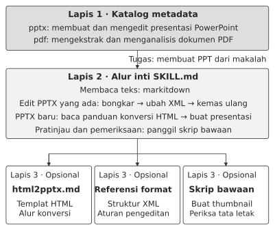

### Skills: Unit Kemampuan Domain yang Dapat Dirangkai

**Agent Skills** mengemas cara penanganan suatu jenis tugas, bahan rujukan, skrip, dan templat menjadi paket yang dapat dipakai ulang. Karyawan baru tidak perlu menghafal seluruh buku panduan operasi perusahaan pada hari pertama, dan model pun dapat membaca bab yang relevan secara saksama baru ketika mengerjakan tugasnya. Cara pemuatan ini disebut **progressive disclosure (pengungkapan bertahap)**[^ch2-3].

Mari kembali ke sepuluh barang dari Bab 1 untuk menilai informasi mana yang layak ditulis sebagai Skill. Misalkan pengguna ingin membandingkan harga akhir termasuk ongkos kirim; cukup memasukkan rincian dan alamat pengiriman kali ini ke konteks saat ini. Jika tim berulang kali membandingkan harga lintas merchant, cara menyamakan spesifikasi, membedakan harga satuan dan harga paket, serta menandai ongkos kirim yang belum diketahui dapat dirapikan menjadi sebuah Skill perbandingan harga. Lain kali, jika seseorang hanya ingin melihat model apa saja yang tersedia, katalognya tetap terlihat, sedangkan seluruh alur pengecekan harga dapat menunggu sampai pengguna benar-benar perlu membandingkan harga.

**Lapisan pertama adalah metadata.** Setiap Skill mendeskripsikan dirinya dengan `SKILL.md`; YAML frontmatter di awal berkas dibatasi oleh `---` dan berisi `name` serta `description`. Runtime lebih dulu menyusun nama dan deskripsi menjadi katalog, agar model dapat menilai Skill mana yang dibutuhkan tugas saat ini. Susunan dan penyajian katalog dikelola oleh Harness, dan alur lengkapnya dimuat setelah Skill terpilih.

**Deskripsi Skill pertama-tama harus ditulis sebagai syarat perutean.** Model harus memutuskan apakah akan memakainya sebelum memuat isinya, sehingga `description` harus lebih dulu menjelaskan kapan Skill berlaku dan kapan harus dilewati, baru kemudian merangkum apa yang dapat dilakukannya. Misalnya, "help with backend" cakupannya terlalu luas, sehingga hampir semua tugas backend bisa cocok; "menulis integration test untuk antarmuka HTTP yang sudah ada, mencakup autentikasi, validasi parameter, dan respons galat" memberikan cakupan yang jelas. Untuk tugas yang mudah tertukar, dapat ditambahkan syarat pengecualian, misalnya "tidak perlu dipakai jika hanya membahas rancangan antarmuka".

**Lapisan kedua adalah alur inti.** Setelah Skill terpilih, runtime memasukkan instruksi lengkapnya ke konteks. Jika pengguna secara eksplisit mengetik perintah seperti `/pptx`, klien dapat langsung mencari dan memuatnya; jika model memilih sendiri, isinya diperoleh melalui alat Skill atau alat pembaca berkas. Cara pertama menghemat langkah model mengajukan panggilan aktivasi, sedangkan cara kedua menyimpan pemilihan dan pemuatan di dalam trajektori eksekusi.

Ambil contoh PPTX Skill yang dipakai dalam eksperimen buku ini. Keterangan intinya memperkenalkan beberapa jalur yang umum: mengekstrak teks presentasi dengan markitdown dari Microsoft, membongkar PPTX untuk melihat XML di dalamnya, serta memilih alur kerja untuk membuat presentasi baru atau menyunting presentasi yang sudah ada. Setelah membaca lapisan keterangan ini, model dapat memutuskan, sesuai tugas saat ini, bahan mana yang harus dibaca berikutnya dan jenis skrip apa yang harus dipanggil[^ch2-4].

**Lapisan ketiga adalah bahan rinci.** Operasi yang rumit tersebar di dokumen-dokumen khusus, dan berkas utama menyediakan pintu masuknya. Pada versi yang dipakai buku ini, `html2pptx.md` menjelaskan cara membangkitkan presentasi melalui HTML, sementara dokumen rujukan lain melengkapi rincian format dan penyuntingan. Agent terus membaca isi ini sesuai tugasnya, dan memakai skrip, aset, serta templat yang dibundel untuk menyelesaikan operasi.

[^ch2-3]: Anthropic, Equipping Agents for the Real World with Agent Skills, 2025; Agent Skills, How to add skills support to your agent.
[^ch2-4]: Anthropic, PPTX Skill. Eksperimen buku ini memakai versi tetap yang memuat alur konversi HTML; versi dan cara menjalankannya dapat dilihat di README eksperimen pendamping.
[^ch2-codex-skills]: OpenAI, Build skills; implementasi Skills di repositori publik OpenAI Codex.
[^ch2-cc-skill-inject]: Claude Code, How Claude Code uses prompt caching, Invoking skills and commands; Agent Skills, How to add skills support to your agent, User-explicit activation.

### Cara Menulis Skill yang Dapat Dipakai

Skill yang dapat dipakai harus menjawab empat pertanyaan: tugas apa yang cocok, dengan urutan apa ditangani, situasi apa yang memerlukan konfirmasi, dan bagaimana menilai pekerjaan sudah selesai. Penulisnya harus merapikan pengalamannya sendiri menjadi langkah-langkah yang dapat dijalankan, dan melengkapi penilaian-penilaian kunci dengan contoh.

Ambil contoh Skill penulisan. Kita dapat merujuk gagasan Baoyu dalam memperbaiki tulisan AI berangkat dari kebiasaan berekspresi pribadi[^ch2-baoyu-remove-ai-writing-flavor], lalu menyusun isinya menjadi empat bagian:

- **Peran dan pembaca**: menjelaskan siapa yang dilayani, jenis tugas, dan persyaratan naskah jadi.
- **Prinsip inti**: tuliskan dulu tiga sampai lima penilaian yang sering dipakai, masing-masing dengan contoh konkret sebelum dan sesudah penulisan ulang.
- **Kesalahan umum dan batas**: mencatat masalah ungkapan yang sering muncul, tindakan yang melampaui wewenang, dan situasi pengecualian.
- **Bahan rujukan**: memuat glosarium, templat, contoh tulisan, dan keterangan khusus untuk dirujuk saat eksekusi.

Aturan dapat ditulis menurut pola "cakupan, tindakan, pengecualian, cara verifikasi". Misalnya, aturan untuk memadatkan kalimat panjang harus menjelaskan paragraf apa yang dikenainya, bagaimana memecahnya, dan bagaimana memeriksa apakah syarat dan kesimpulan masih utuh setelah dipecah.

Sebagai permulaan, pilih tiga sampai lima artikel orisinal yang Anda sukai, minta Agent merangkum pilihan kata, pola kalimat, susunan paragraf, dan nadanya, lalu bangkitkan versi awal sekitar dua puluh baris. Selanjutnya, gunakan versi itu untuk menulis topik baru, dan biarkan penulis merevisinya kalimat demi kalimat. Perbedaan sebelum dan sesudah revisi memberikan umpan balik yang lebih konkret: kata mana yang berlebihan, kalimat mana yang perlu dipecah, di mana fakta kurang, dan di mana rincian teknis perlu dikembalikan. Rangkum revisi yang muncul berulang kali menjadi aturan, dan pertahankan contoh serta cakupan berlakunya.

Skill juga dapat menyertakan alat eksekusi dan templat. Misalnya, PPTX Skill menyatukan keterangan operasi, skrip parsing, skrip pembangkit, dan aset tata letak, sehingga model dapat memanggil sumber daya yang sesuai dengan mengikuti keterangannya. Setiap Skill dapat diuji, diperbarui, dan dikelola versinya secara mandiri, dan anggota tim dapat terus menambahkan pengalaman pada alur yang sama. **Nilai jangka panjang Skills terletak pada kemampuannya membuat pengalaman domain dapat dikumpulkan secara tersebar, diterbitkan secara mandiri, dan dipakai ulang.** Saat memperluas kemampuan Agent, tim dapat memelihara Skill sesuai keahlian masing-masing, sehingga lambat laun terbentuk ekosistem paket perangkat lunak mirip pip dan npm. Skill-skill ini dapat berbagi mekanisme penemuan, pemuatan, dan eksekusi yang disediakan sistem utama.

**Saat merancang cara interaksi, utamakan pola yang sudah dilatihkan dan disesuaikan pada model.** Pembagian peran, format hasil alat, dan cara memuat Skill semuanya memengaruhi bagaimana model melanjutkan tugas. Alur standar yang disediakan vendor cocok sebagai titik awal, karena mengurangi beban model untuk menyimpulkan ulang makna dari format yang asing.

[^ch2-baoyu-remove-ai-writing-flavor]: 宝玉, 《别再用提示词去 AI 味了，方向就是错的》, 2026-02-14.

### Posisi Skills di dalam Konteks

Biaya konteks Skills terbagi atas katalog dan isi. Katalog membuat model dapat menemukan kemampuan yang tersedia, sedangkan isi menyediakan alur operasi setelah Skill terpilih. Spesifikasinya mewajibkan pemuatan sesuai kebutuhan, sedangkan peran pesan, pembungkus, dan cara pembaruan yang konkret diimplementasikan oleh Harness.

Claude Code menambahkan instruksi Skill ke sesi sebagai pesan `user` di posisi pemanggilan[^ch2-cc-skill-inject]. Gambar 2-12 memperlihatkan salah satu susunan pesan ketika model memicu Skill sendiri: model lebih dulu mengeluarkan panggilan `Skill(skill: "pptx")`, menerima respons alat, lalu membaca isi Skill yang ditambahkan. Jika memakai alat aktivasi khusus, respons alat dapat berfungsi sebagai konfirmasi panggilan, dan isinya disuntikkan terpisah oleh Harness; jika memakai alat pembaca berkas biasa, isinya juga dapat langsung termuat di dalam hasil alat. Ketika pengguna secara eksplisit mengetik `/pptx`, klien dapat langsung menjabarkan instruksinya, sehingga menghemat langkah model mengajukan panggilan aktivasi.

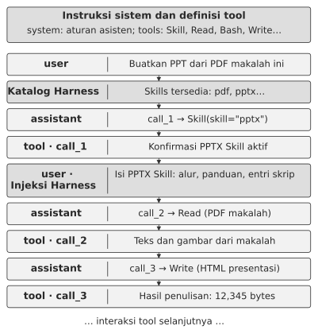{height=55%}

Implementasi Skills di Codex juga menyusun katalog kemampuan dan instruksi terpilih secara terpisah. Dalam kode sumber publiknya, sebagian katalog masuk ke konteks `developer`, sebagian lain diberikan bersama putaran saat ini dan lingkungan eksekusi; Skill yang dipilih secara eksplisit ditambahkan melalui potongan konteks pengguna. Sumber katalog dan lingkungan eksekusi yang tersedia memengaruhi susunan konkretnya[^ch2-codex-skills].

Gambar 2-13 memperlihatkan pertumbuhan cache saat pemuatan sesuai kebutuhan, dengan permintaan yang belum memiliki cache yang dapat dipakai ulang sebagai titik awal. Katalog harus diproses saat pertama kali masuk ke permintaan, dan pemuatan isi untuk pertama kalinya juga menambah komputasi; ketika permintaan berikutnya mempertahankan prefiks yang sama, isi-isi ini berpeluang dibaca dari cache. Menambahkan isi baru di posisi pemanggilan dapat menjaga pesan-pesan sebelumnya tetap stabil. Keterangan yang sudah dimuat tetap berada di riwayat, dan jika perlu diperbarui, ditangani menurut strategi konteks runtime.

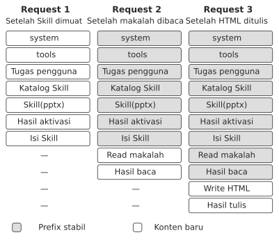

### Hubungan antara Skills dan Alat

Skill menyediakan pengetahuan tugas dan alur operasi, sedangkan alat bertugas membaca, mengeksekusi, dan memperoleh hasil. Tujuh alat inti yang diperkenalkan di Bab 5 dapat dipadukan dengan berbagai Skill: alat pembaca berkas yang sama dapat membaca panduan presentasi maupun standar kode, dan eksekutor umum dapat menjalankan skrip yang sesuai. Dengan demikian, kemampuan khusus dapat diperluas melalui alur dan sumber daya, sementara himpunan alat dasar tetap relatif stabil.

Alat khusus juga dapat dipakai bersama Skill. Pencarian alat yang dibahas sebelumnya bertugas menyediakan definisi alat sesuai kebutuhan, sedangkan Skill menjelaskan kapan memanggil, bagaimana merangkai, dan bagaimana memeriksa hasilnya. Keduanya sama-sama perlu mengendalikan jumlah informasi yang selalu ada dan mengatur posisi yang tepat untuk isi yang baru dimuat. Bab 4 akan membahas pertimbangan antara eksekutor umum dan alat khusus, dan Bab 9 lebih jauh membahas apakah pengalaman lebih cocok disimpan sebagai pengetahuan, instruksi, program, atau parameter model.

> **Eksperimen 2-6 ★★: Membuat Presentasi dari Makalah dengan Agent Skills**
>
> Eksperimen ini memakai *Attention Is All You Need* sebagai bahan untuk memperagakan bagaimana Agent memuat alur profesional pembuatan presentasi sesuai kebutuhan. Tugasnya adalah membangkitkan presentasi sepuluh sampai lima belas halaman dari PDF makalah, mencakup latar belakang masalah, metode, hasil utama, dan kesimpulan, serta memakai gambar dan tabel dari makalah untuk membantu penjelasan.
>
> Run kali ini memakai Kimi Code dan PPTX Skill resmi dari Anthropic. Agent lebih dulu menemukan PPTX Skill di katalog, membaca keterangan operasinya, lalu membaca panduan konversi HTML, memanggil alat pembangkit pendamping, dan akhirnya memeriksa tata letak melalui thumbnail dan render per halaman. Bahan yang dibaca pada setiap langkah melayani operasi berikutnya, dan alur pembuatan yang lengkap terbentang secara bertahap mengikuti tugas.
>
> Naskah jadinya berisi tiga belas halaman, memuat diagram arsitektur, diagram mekanisme attention, tabel hasil eksperimen, dan gambar visualisasi attention dari makalah.
>
> Pemeriksaan setelah pembangkitan juga merupakan bagian dari alur kerja Skill. Dalam run ini sempat muncul subscript yang hilang, butir daftar yang tidak normal, jalur rujukan gambar yang salah, dan masalah presisi label angka; Agent memperbaikinya satu per satu berdasarkan hasil render dan pemeriksaan struktur. Berkas akhirnya lolos pemeriksaan struktur, lalu dibuka ulang dan dirender dengan LibreOffice.

> **Eksperimen 2-7 ★★: Membuat Skill Penulisan "Bebas Rasa AI" dari Contoh Tulisan Pribadi**
>
> Latihan ini merapikan pengalaman menulis pribadi menjadi instruksi yang dapat dipakai ulang. Siapkan tiga sampai lima artikel orisinal, minta Agent merangkum kebiasaan berekspresinya, lalu bangkitkan Skill versi awal yang memuat syarat pemicu, tiga sampai lima prinsip, dan contoh yang sesuai.
>
> Pilih satu topik baru untuk dicoba, lalu biarkan penulis merevisinya kalimat demi kalimat. Bandingkan kedua versi dan temukan masalah yang muncul berulang, misalnya pilihan kata yang kabur, kalimat yang terlalu panjang, hubungan sebab-akibat yang dihilangkan, atau contoh konkret penunjang pemahaman yang terhapus. Cara revisi yang muncul berulang kali dapat dituliskan ke dalam Skill.

## Bilah Status Agent: Memperkuat Pengelolaan Trajektori Agent dengan Informasi Meta

Pengguna mendesak: "Bisa telepon sekali lagi?" Bagian kiri Gambar 2-14 mencatat tiga kali panggilan. Panggilan pertama sudah menunggu 45 menit dan tetap tidak tersambung; baru pada panggilan ketiga tercapai harga 59 dolar AS per bulan. Menurut aturan dalam contoh ini, setiap panggilan memakai satu jatah; meskipun hanya dua yang tersambung, tiga jatah sudah habis. Harness dapat merapikan hitungan semacam ini, kemajuan penanganan, dan hal-hal yang menunggu konfirmasi menjadi ringkasan yang diperbarui bersama pesan, yang disebut **bilah status Agent** (*Agent Status Bar*).

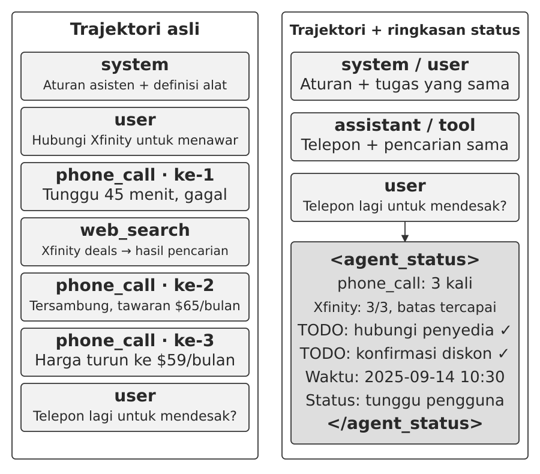

Ponsel menampilkan waktu, baterai, dan sinyal di bagian atas layar, sehingga orang cukup melirik untuk mengetahui keadaan saat ini. Ringkasan di sisi kanan gambar juga berperan serupa: setelah membaca "sudah mencapai batas" dan "menunggu konfirmasi pengguna", asisten dapat menyampaikan harga yang sudah disepakati kepada pengguna dan meminta pengguna memutuskan apakah akan menerimanya. Harness dapat melampirkan ringkasan ini saat mengembalikan hasil alat, atau menambahkan satu pesan status tersendiri.

### Dari Catatan Mentah ke Status Eksplisit

Bayangkan tugas layanan pelanggan lewat telepon: sistem mensyaratkan bahwa dalam satu tugas, setiap merchant ditelepon tidak lebih dari tiga kali. Di antara tiga panggilan itu bisa terselip pencarian, pembacaan dokumen, dan pertanyaan lanjutan dari pengguna. Untuk memutuskan apakah boleh menelepon lagi, model harus mengumpulkan semua catatan terkait dari riwayat ini, membedakan merchant-nya, dan menghitung jumlah kumulatifnya.

Runtime dapat memperbarui hitungan setelah setiap panggilan dan langsung mengembalikan "ini panggilan ke-3 ke Xfinity, batas untuk tugas ini sudah tercapai". Keputusan berikutnya dapat langsung memakai hasil ini. Jumlah panggilan dipelihara oleh program, sedangkan model bertugas memutuskan, berdasarkan kemajuan tugas, apakah selanjutnya menunggu, mencari saluran lain, atau menjelaskan keadaan saat ini kepada pengguna; lapisan eksekusi sekaligus memeriksa permintaan panggilan berikutnya berdasarkan hitungan tersebut.

Nilai rekayasanya di sini adalah **merapikan sejak awal status yang berulang kali dibutuhkan keputusan berikutnya**. Catatan panggilan yang lengkap tetap bertugas menyimpan isi percakapan dan jalannya penanganan, sedangkan bilah status menyediakan statistik dan kemajuan yang sering dipakai untuk keputusan. **Statistik yang dipakai berulang kali sebaiknya dipelihara secara inkremental oleh kode.** Menemukan satu catatan di dalam konteks dan menghitung total dari seluruh catatan adalah dua pekerjaan yang berbeda. Menyimpan trajektori mentah tidak dengan sendirinya menghasilkan tabel statistik yang akurat dan siap dipakai kapan saja. Meminta model menelusuri dan menghitung ulang setiap kali tidak hanya menghabiskan token penalaran, tetapi juga memperbesar peluang terlewat atau terhitung ganda.

Penulis mengibaratkan konteks sebagai mesin pencari yang memerlukan "lapisan penyulingan" pendamping: catatan mentah memudahkan penelusuran balik, sedangkan status hasil penyulingan siap dipakai langsung. Hitungan, batas, dan status penyelesaian tugas yang sudah diverifikasi cocok dipelihara oleh kode; informasi yang memerlukan penilaian semantik dapat diekstrak butir demi butir terlebih dahulu, lalu dijumlahkan dan diverifikasi. Dengan begitu, setiap kali mengambil keputusan, model dapat melihat status saat ini sekaligus bukti yang diperlukan.

Trajektori yang panjang juga mempersulit pencarian informasi kunci. Mengumpulkan tujuan, batasan, dan kemajuan terbaru di bagian belakang membuat model lebih mudah menemukan informasi yang dibutuhkan keputusan saat ini.

> **Eksperimen 2-8 ★★: Mengamati Efek Bilah Status Agent melalui Visualisasi Attention**
>
> Eksperimen ini memakai Qwen3-0.6B dan menyusun trajektori pengembalian dana layanan pelanggan: Agent sudah menelepon Xfinity tiga kali, diselingi pencarian web, lalu pengguna bertanya, "Bisakah Anda menelepon lagi untuk mendesak mereka?" Aturan sistem membatasi paling banyak tiga panggilan ke setiap merchant dalam satu tugas.
>
> Kedua kelompok input mempertahankan riwayat dan pertanyaan pengguna yang sama. Kelompok A langsung memakai trajektori mentah; kelompok B menambahkan status berikut di bagian akhir:
>
> ```xml
> <agent_status>
> Current State:
> - Tool call summary: 'phone_call' has been invoked 3 times (Xfinity: 3 times)
> - Constraint check: Maximum calls to Xfinity reached (3/3)
> </agent_status>
> ```
>
> Setiap kelompok dijalankan tiga kali. Kelompok A dua kali dengan tegas menolak menelepon lagi, dan satu kali tergolong output lain; kelompok B tiga kali dengan tegas menolak menelepon lagi. Tidak satu pun kelompok menghasilkan output yang dinilai melanggar aturan karena tetap menelepon. Untuk mereproduksi perbandingan ini, masuk ke `chapter2/attention_visualization`, lalu jalankan `python run_status_bar_experiment.py --output runs/status-bar-reproduction`. Input dan hasil per run kali ini disimpan di `runs/exp2-7-qwen3-0.6b-20260730-v2/comparison.json` dalam direktori eksperimen.
>
> Gambar attention memperlihatkan distribusi bobot wilayah pembangkitan terhadap riwayat panggilan, hasil pencarian, pertanyaan pengguna, dan bilah status.

Riset ContextDistill-Bench yang dilakukan penulis bersama Noah Shi menelaah lebih jauh manfaat penyulingan status sejak awal[^ch2-8]. Pada kueri status yang dicakup benchmark tersebut, model yang lebih kecil pun dapat mencapai akurasi tinggi berkat status eksplisit; jumlah pemikiran, latensi, dan biaya kueri model frontier dapat turun sekitar satu orde besaran. Misalnya, biaya per seribu kueri Claude 4 Sonnet turun dari sekitar 35,46 dolar AS menjadi 3,51 dolar AS. **Desain ini memelihara status pada saat peristiwa terjadi, sehingga menghindari biaya menelusuri riwayat pada setiap kueri.** Setelah field ringkasan ditetapkan, sekalipun riwayat terus bertambah, kueri hanya perlu membaca beberapa field tersebut.

[^ch2-8]: Li, Bojie and Noah Shi. *Distill, Don't Retrieve: Inference-Time Context Distillation for LLM Agent Reasoning.* 2026.

### Komposisi Bilah Status Agent

Bilah status biasanya memuat tiga jenis informasi, yang masing-masing menjawab "apa yang harus dikerjakan", "apa yang baru saja terjadi", dan "dalam keadaan apa sekarang".

**Perencanaan tugas** mencatat tujuan, langkah, dan status penyelesaiannya. Tugas yang kompleks dapat dipecah menjadi daftar TODO, dengan setiap butir menyimpan statusnya dan dependensi yang diperlukan. Saat menangani langkah saat ini, model tetap dapat melihat kebutuhan asli, batasan inti, dan pekerjaan selanjutnya; setelah satu langkah selesai, daftar diperbarui.

**Informasi side-channel dari peristiwa** melengkapi latar belakang saat peristiwa terjadi, misalnya waktu, lokasi geografis, dan selang waktu sejak balasan terakhir. Metadata ini disimpan bersama peristiwa dan membantu model memahami urutan dan situasinya. Kalimat yang sama, "belum ada balasan", dapat memerlukan penanganan berbeda jika diucapkan dua menit atau dua hari setelah permohonan diajukan.

**Ringkasan observasi atas keadaan lingkungan saat ini** menyediakan waktu saat ini, direktori kerja, jumlah pemanggilan alat, dan peringatan anomali. Perannya mirip dengan tampilan direktori saat ini atau status eksekusi pada CLI dan GUI: memberi dasar yang jelas bagi operasi berikutnya. Misalnya, peringatan panggilan berulang dapat mendorong model memeriksa penyebab kegagalan, dan sisa anggaran membantunya memutuskan apakah akan terus mencari.

Metadata peristiwa biasanya tetap stabil setelah ditambahkan bersama peristiwa, sedangkan kemajuan tugas dan keadaan lingkungan terus berubah. Kedua jenis informasi ini harus ditulis ke riwayat sesuai cara pembaruannya masing-masing; berikut penjelasannya berdasarkan struktur pesan.

### Posisi Konkret Bilah Status Agent di dalam Konteks

Dalam contoh di bagian ini, Harness menambahkan satu pesan `user` di akhir daftar pesan untuk menyampaikan ringkasan status. `user` di sini adalah peran pesan pada API yang dipilih; isi statusnya dibangkitkan oleh runtime, dan kegunaannya dijelaskan melalui tag. Pada antarmuka lain, dapat juga dipakai blok konteks yang didukungnya, atau status diberikan bersama hasil alat yang bersangkutan. Jika memakai template yang telah dibahas sebelumnya, yang memangkas penalaran historis berdasarkan kueri pengguna yang sebenarnya, status runtime dapat diberikan bersama hasil alat agar template tetap mempertahankan informasi penalaran sesuai tugas saat ini.

Ikuti Gambar 2-15 untuk menemukan permintaan awal pengguna, lalu lihat di putaran mana status terbaru ditulis. Hanya dengan mempertahankan permintaan asli, setelah semua panggilan telepon selesai dua hal dapat diperiksa sekaligus: apa yang ingin diurus pengguna, dan sampai di mana penanganannya sekarang.

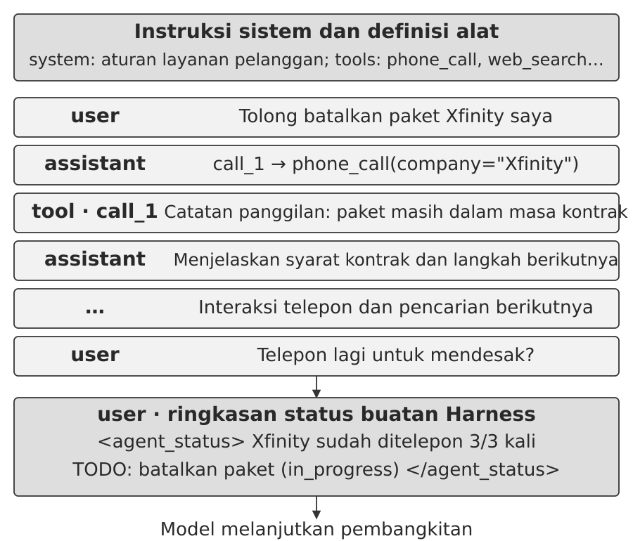

Urutan dalam gambar dapat dituliskan sebagai daftar pesan berikut. Agar mudah dibandingkan, putaran yang berulang dan sebagian field panggilan dihilangkan.

```text
messages: [
  { role: "system", content: "You are a customer service assistant..." }
  { role: "user", content: "Help me cancel my Xfinity plan" }
  { role: "assistant", tool_calls: [{ id: "call_1", ... }] }
  { role: "tool", tool_call_id: "call_1", content: "Call log..." }
  { role: "assistant", tool_calls: [{ id: "call_2", ... }] }
  { role: "tool", tool_call_id: "call_2", content: "Call log..." }
  ...putaran lainnya...
  { role: "user", content: "Can you call them again to follow up?" }
  { role: "user", content: "<agent_status>
      Current State:
      - phone_call invoked 3 times (Xfinity: 3/3 max)
      - Current time: 2025-09-14 10:30:45
      - TODO: [1] Cancel plan (in_progress)
    </agent_status>" }
]
```

Pesan terakhir mengumpulkan jumlah panggilan, batas, waktu, dan kemajuan tugas di satu tempat. Model dapat langsung memakai field-field ini, sekaligus menelusuri catatan rinci melalui ID panggilan sebelumnya.

Setelah pesan ini ditambahkan, urutan token di depannya tetap tidak berubah, sehingga masih memenuhi syarat dasar pemakaian ulang prefiks. Adapun cara menangani status lama pada putaran berikutnya memerlukan pertimbangan antara pemakaian konteks dan biaya cache.

### Dua Implementasi Pembaruan Status dan Biaya Cache-nya

Pada putaran berikutnya, mungkin satu butir TODO selesai, atau bertambah satu pemanggilan alat. Harness harus memperbarui status, dan ada dua cara yang umum dipakai.

**Penggantian setiap putaran**: saat menyusun permintaan baru, status sebelumnya dihapus dan status terbaru ditambahkan di akhir. Konteks hanya menyimpan satu status terkini, sehingga mudah dipakai model. Misalnya, permintaan sebelumnya berisi "keterangan tugas, status A", dan kali ini "keterangan tugas, hasil alat, status B". Keterangan tugas masih bisa cache hit; hasil alat baru pertama kali dikirim, sehingga memang harus dihitung. Hanya jika permintaan sebelumnya masih memiliki pesan lain sesudah status A, penghapusan A membuat pesan-pesan tersebut kehilangan kecocokan prefiks semula. Dalam permintaan ini model hanya dapat melihat B. Jika perlu meninjau A, snapshot saat itu dapat diambil dari log eksekusi.

**Penambahan persisten**: catatan status yang sudah ada dipertahankan, dan setiap kali status baru ditambahkan di akhir. Prefiks riwayat tetap stabil, dan perubahan status mudah ditelusuri. Status lama lambat laun akan memakan konteks, sehingga waktu atau versinya harus jelas agar model menilai keadaan saat ini berdasarkan catatan terbaru. Cara Claude Code menambahkan pengingat perubahan berkas ke dalam sesi juga mencerminkan pola desain ini.

Jika status sangat pendek dan sesudahnya sudah ada banyak hasil alat yang di-cache, mempertahankan status lama bisa lebih hemat daripada menghitung ulang sufiks yang panjang; jika status cukup panjang dan sering diperbarui, penggantian dapat mengendalikan penumpukan status historis.

Titik impasnya dapat diperkirakan dengan model kasar: misalkan setiap status berukuran $S$ token, setiap penggantian membuat rata-rata $R$ token sufiks yang sudah di-cache sesudah status lama harus dihitung ulang (isi yang pertama kali dikirim pada putaran ini tidak dihitung), status disuntikkan sebanyak $N$ kali, dan harga input cache adalah $\alpha$ kali harga input biasa. Dengan mengabaikan biaya yang sama pada kedua skema, $C_{\text{ganti}} \approx (N-1)(1-\alpha)R$ dan $C_{\text{tambah}} \approx \alpha S N(N-1)/2$. Untuk $N>1$, jika $\alpha SN/2 < (1-\alpha)R$, perkiraan biaya penambahan persisten lebih rendah; sebaliknya, penggantian setiap putaran lebih hemat. Di sini harga input biasa dipakai sebagai satuan biaya: biaya tambahan pada skema penggantian adalah selisih harga karena sufiks yang semula dibaca dari cache harus diproses ulang, sedangkan biaya tambahan pada skema penambahan adalah biaya pembacaan berulang atas status-status historis.

Contohnya, setiap kali disuntikkan status berukuran 100 token, total 10 kali, dan pembacaan cache dihitung sepersepuluh harga input biasa. Dengan skema penambahan, permintaan-permintaan berikutnya masing-masing membaca tambahan 1, 2, ……, 9 status lama, dengan biaya tambahan setara 450 token input biasa. Jika penggantian status membuat rata-rata 1.000 token yang sudah di-cache di belakangnya diproses ulang, biaya tambahan dari sembilan kali penggantian setara 8.100 token input biasa, sehingga penambahan lebih hemat. Jika status lama memang berada di ujung cache dan tidak ada isi yang di-cache sesudahnya, $R=0$ dalam rumus, dan penggantian langsung justru menghemat biaya setara 450 token tersebut.

> **Eksperimen 2-9 ★★: Beberapa Teknik Bilah Status Agent yang Berguna**
>
> Eksperimen ini mengimplementasikan lima teknik bilah status yang dapat diaktifkan secara terpisah maupun dikombinasikan. Setiap teknik menyediakan satu jenis informasi konkret untuk membantu model memutuskan tindakan berikutnya.
>
> **Pelacakan cap waktu** mencatat waktu peristiwa di pesan pengguna dan respons alat, misalnya `[2025-09-14 10:30:45]`. Waktu ditulis ke riwayat bersama peristiwa dan nilainya tidak berubah pada putaran berikutnya; waktu saat ini diperbarui bersama pesan status yang baru. Eksperimen ini juga menyediakan simulasi waktu untuk memeriksa apakah model dapat membedakan "berkas kemarin" dari "perubahan hari ini", dan apakah ia memahami lama waktu tunggu dengan benar.
>
> **Penghitung pemanggilan alat** memakai dictionary untuk memelihara jumlah kumulatif panggilan setiap alat, dan menandai respons dengan `Tool call #3 for 'read_file'`. Dengan menggabungkannya dengan isi galat, model dapat menilai apakah perlu terus mencoba. Misalnya, setelah pembacaan pertama gagal, periksa jalurnya, lalu tampilkan isi direktori; setelah beberapa kali gagal, cari berkas pengganti atau jelaskan kepada pengguna bahwa berkas tersebut tidak ada. Jika jumlah percobaan ulang perlu dibatasi, runtime juga harus menegakkan batas itu berdasarkan hitungan.
>
> **Pengelolaan daftar TODO** menyediakan dua alat, `rewrite_todo_list` dan `update_todo_status`. Setiap butir berisi pengenal unik, isi, cap waktu, dan salah satu dari empat status: `pending`, `in_progress`, `completed`, `cancelled`. Daftar ini mengumpulkan "apa yang sudah dikerjakan, apa yang masih kurang" di satu tempat, mirip gagasan Manus yang menjaga tujuan tetap terlihat dengan menampilkan rencana tugas berulang kali.
>
> **Informasi galat terperinci** menyediakan jenis dan deskripsi galat, JSON parameter panggilan, stack trace, dan saran perbaikan. Misalnya, ketika menemui `FileNotFoundError`, model dapat diingatkan untuk memeriksa nama berkas, direktori saat ini, dan jalur absolut. Parameter membantu menemukan input yang salah, stack trace membantu menemukan letak kegagalan, dan saran perbaikan memberi arah pemeriksaan berikutnya. Sebelum isi ini dikembalikan ke model, field sensitif seperti kredensial harus dibersihkan, dan panjang stack trace yang bertele-tele harus dibatasi.
>
> **Kesadaran status sistem** menyediakan waktu saat ini, direktori kerja, sistem operasi, Shell, dan versi Python. Alat perintah dalam eksperimen ini mengenali operasi pindah direktori yang berdiri sendiri, memperbarui direktori kerja yang dipelihara runtime, lalu memakainya untuk panggilan berikutnya; perubahan direktori oleh subproses dalam perintah majemuk mengikuti cakupan eksekusi proses yang bersangkutan. Field lingkungan juga membantu model memilih alat yang tersedia, misalnya memilih `apt` atau `brew` sesuai sistem yang sebenarnya dan perangkat lunak yang terpasang.
>
> Dalam perbandingan Kimi K3 kali ini, setiap jenis tugas memiliki lima kasus. Konfigurasi cap waktu dan konfigurasi gabungan masing-masing lolos lima, sedangkan kelompok pembandingnya masing-masing lolos tiga; kelompok penghitung alat dan status sistem, baik diaktifkan maupun dimatikan, sama-sama lolos lima. Konfigurasi TODO lolos nol, dan kelompok pembandingnya lolos satu; konfigurasi galat terperinci lolos empat, dan kelompok pembandingnya lolos lima.

**Bilah status sebaiknya dipelihara oleh kode sebisa mungkin.** Model akan langsung memakai statistik dan batasan di dalamnya, sehingga satu catatan keliru "sudah menelepon tiga kali" dapat mengubah tindakan berikutnya. Hitungan, waktu, dan transisi status diserahkan kepada program; jika diperlukan pemahaman semantik, minta model mengekstraknya butir demi butir terlebih dahulu, lalu biarkan kode menjumlahkan dan memverifikasinya, alih-alih meminta model menghitung seluruh riwayat panjang sekaligus. Pertahankan keterkaitan antara peristiwa mentah, hasil ekstraksi, dan status akhir, agar penghitungan ganda, catatan yang terlewat, dan kerancuan sumber mudah ditemukan.

Informasi apa yang dirangkum bilah status harus dipilih sejak awal. Misalnya, "sudah menelepon tiga kali" cukup untuk menilai apakah masih boleh menelepon, tetapi tidak dapat menjawab "apa yang dijanjikan petugas layanan pada panggilan kedua". Untuk tugas lanjutan yang hanya memerlukan nilai statistik, riwayat dapat diganti dengan ringkasan status dan catatan mentah diarsipkan; ketika isi percakapan perlu diperiksa, teks aslinya dibaca melalui indeks. Desain field ringkasan menentukan pertanyaan mana yang dapat dijawab langsung, dan juga menentukan kapan perlu menelusuri kembali.

## Strategi Kompresi Konteks

Sebuah tugas investigasi sudah membaca sepuluh halaman web yang panjang, dan misalkan jendelanya hanya cukup untuk dua bahan lagi. Tanyakan dulu apa yang masih harus dikerjakan model pada putaran berikutnya: jika harus membandingkan dua penawaran harga, pertahankan harga, syarat berlakunya, dan sumbernya; jika harus memeriksa ulang kutipan, pertahankan lokasi tempat teks aslinya dapat diambil kembali. Isi halaman web yang sudah diperiksa tetapi tidak relevan dapat diarsipkan, untuk memberi ruang bagi input dan output baru. Di sini yang perlu dihitung bukan hanya berapa banyak ruang yang dibebaskan, tetapi juga satu perhitungan lain: jika bahan yang dihapus ternyata dibutuhkan nanti, berapa besar biaya untuk mendapatkannya kembali?

### Tiga Tujuan Kompresi

**Mengendalikan panjang dan biaya.** Ambil contoh jendela 128K token; halaman web dan berkas yang panjang dapat menempati porsi yang cukup besar dari ruang itu. Harness harus menyisihkan anggaran untuk input berikutnya, output model, dan interaksi alat.

**Merapikan pengetahuan yang dibutuhkan keputusan berikutnya.** Belasan putaran pencarian bisa berulang kali menyebut peristiwa yang sama, atau meninggalkan keterangan yang saling bertentangan. Merapikannya menjadi "A dan B sudah dipastikan, C masih kurang bukti" membuat model dapat melanjutkan pertanyaan yang belum selesai. Ringkasan harus mempertahankan hubungan antarfakta, sumber, dan pertanyaan yang belum terjawab, agar keputusan berikutnya memiliki dasar yang jelas.

**Mendukung kelanjutan tugas jangka panjang.** Sebagian model, ketika mengira jendelanya hampir habis, akan menyudahi pekerjaan lebih awal; fenomena ini disebut **context anxiety (kecemasan konteks)**. Dalam pengujian tugas jangka panjang Sonnet 4.5, Anthropic menemukan bahwa perilaku ini masih dapat muncul setelah kompresi, sehingga mereka memakai catatan serah terima yang terstruktur untuk melanjutkan eksekusi setelah konteks diatur ulang[^ch2-7].

[^ch2-7]: Prithvi Rajasekaran, Harness design for long-running application development, Anthropic Engineering, 2026.

### Merapikan Hasil Komputasi Berulang Menjadi Pengetahuan Siap Pakai

Bilah status memelihara hitungan dan kemajuan sejak awal, sedangkan ringkasan melangkah lebih jauh dengan merapikan fakta dan hubungan dalam teks panjang. Keduanya sama-sama merapikan informasi yang tercecer lebih awal, agar keputusan berikutnya dapat langsung memakainya.

Lihat contoh inspeksi sebuah toko hewan peliharaan:

> Kandang 1: kucing hitam. Kandang 2: kucing putih. Kandang 3: kucing hitam. Kandang 4: kucing hitam. Kandang 5: kucing putih.
> ……(total 100 kandang, berisi 90 kucing hitam dan 10 kucing putih)

Menjawab "kucing apa yang ada di kandang 37" memerlukan penemuan catatan yang sesuai; menjawab "berapa jumlah kucing hitam dan kucing putih" memerlukan penjumlahan seluruh catatan. Jika total itu akan dipakai berkali-kali, "90 kucing hitam, 10 kucing putih" dapat dihitung dan disimpan sejak awal, agar tidak perlu menghitung dari nol setiap kali. Program cocok untuk penjumlahan yang deterministik semacam ini, sedangkan model dapat melanjutkan menjawab pertanyaan bisnis berdasarkan hasil statistiknya.

Isi ringkasan harus dipilih sesuai tugas. Jika hanya total kedua jenis kucing yang disimpan, itu cukup untuk menjawab pertanyaan jumlah; untuk menjawab keadaan kandang 37, masih diperlukan catatan per kandang atau indeks yang sesuai.

Sekalipun jendela masih memiliki ruang, konteks yang terlalu panjang atau campur aduk juga dapat mengganggu pemanfaatan informasi: model melewatkan fakta kunci, mengulang penanganan masalah yang sudah terselesaikan, atau memakai status yang kedaluwarsa untuk keputusan saat ini. Penurunan kinerja yang muncul seiring bertambahnya konteks ini biasanya disebut **context rot (pembusukan konteks)**. Ia tampak sebagai memburuknya kinerja tugas; sedangkan jika permintaan melampaui batas kapasitas, yang terjadi adalah luapan jendela.

**Meskipun jendela masih memiliki ruang, pengetahuan yang sudah berulang kali dipakai sebaiknya dirapikan secara proaktif.** Jika penilaian kunci sebenarnya sudah dapat dirangkum, tetapi model masih dibiarkan mencarinya berulang-ulang dalam riwayat yang panjang, komputasi akan terus terbuang dan peluang terlewat bertambah. Tugas pencarian dapat menyimpan fakta yang sudah dipastikan, sumber, dan pertanyaan yang masih harus dicari; tugas pemrograman dapat menyimpan keputusan arsitektur, cakupan perubahan, hasil pengujian, dan penyebab kegagalan.

Contoh di dalam konteks juga memengaruhi cara model menangani masalah baru. Riset Dherin dkk. berangkat dari kombinasi lapisan attention dan MLP di dalam Transformer, lalu menyatakan komputasi forward tertentu sebagai pembaruan bobot berperingkat rendah yang bergantung pada konteks, sehingga memberikan satu penjelasan teoretis bagi in-context learning[^ch2-6]. Pada inferensi nyata, bobot model tetap tidak berubah, dan contoh memengaruhi output melalui input saat ini. Jika pengalaman semacam ini ingin dipakai ulang pada sesi-sesi berikutnya, ia dapat dirapikan menjadi memori, contoh, atau Skill, lalu dimuat sesuai tugas; Bab 9 akan membahas lebih lanjut cara mengakumulasi pengalaman.

[^ch2-6]: Benoit Dherin et al., Learning without training: The implicit dynamics of in-context learning, 2025.

### Pertimbangan antara Kompresi dan KV Cache

Kompresi biasanya terjadi di antara dua panggilan model. Berdasarkan sisa anggaran dan kemajuan tugas, Harness merapikan pesan yang dibutuhkan permintaan berikutnya, lalu mengirimkannya ke model. Mengganti riwayat akan mengubah prefiks, sehingga manfaat kompresi dan biaya membangun ulang cache harus dipertimbangkan bersamaan.

Pertama, jaga agar instruksi sistem dan definisi alat yang masih berlaku tetap stabil. Keduanya berada di depan, sehingga kompresi riwayat sesudahnya tetap dapat memakai ulang bagian prefiks ini. Kedua, pilih objek kompresi yang konkret: hasil alat yang panjang dapat diganti dengan ringkasan, dan interaksi multi-putaran yang sudah selesai dapat digabung menjadi catatan tahap. Cache sebelum posisi penggantian masih dapat dipakai ulang, sedangkan isi pada posisi penggantian dan sesudahnya harus diproses menurut prefiks yang baru.

**Kompresi riwayat sebaiknya dilakukan sekaligus dalam satu kelompok, agar segmen prefiks yang sama tidak ditulis ulang setiap putaran.** Setelah kompresi, input setiap putaran menjadi lebih pendek, tetapi panggilan kompresi dan komputasi ulang sufiks juga memakan sumber daya. Waktu pemicuannya dapat ditentukan dengan menggabungkan pemakaian jendela, perkiraan jumlah putaran berikutnya, dan tahap tugas: merapikan sekaligus setelah hasil alat yang panjang muncul berdekatan, atau menyimpan ringkasan serah terima setelah satu tahap selesai, sama-sama dapat mengurangi biaya mengubah riwayat terlalu sering. Saat mempertahankan beberapa putaran terakhir, periksa apakah pemanggilan alat dan nilai kembaliannya tetap berpasangan, dan tuliskan status operasi yang belum selesai ke dalam ringkasan.

Saat mengompresi, protokol pengiriman kembali informasi penalaran juga harus diperiksa. Pada sebagian model, thinking historis terikat pada prefiks saat ia dibangkitkan. Jika riwayat sebelum blok-blok ini diganti, thinking yang dipertahankan dapat menjadi tidak cocok dengan prefiks yang baru. Dengan protokol semacam ini, sesi dapat dirapikan menjadi ringkasan, thinking lama yang terdampak dibersihkan, dan model melanjutkan penalaran dari ringkasan tersebut; dapat juga dipakai mekanisme kompresi atau penyuntingan konteks yang didukung server.

Lihat dulu ringkasan per item pada Gambar 2-16: jumlah karakter setelah diproses hanya 10,9% dari aslinya, tetapi total token kumulatif Agent utama justru yang terbanyak di antara keenam kelompok. Untuk menjelaskan mengapa kedua angka ini dapat berlaku sekaligus, kita harus menelusuri bahan apa saja yang dikompresi, dan berapa putaran permintaan yang membawa bahan-bahan itu ke model.

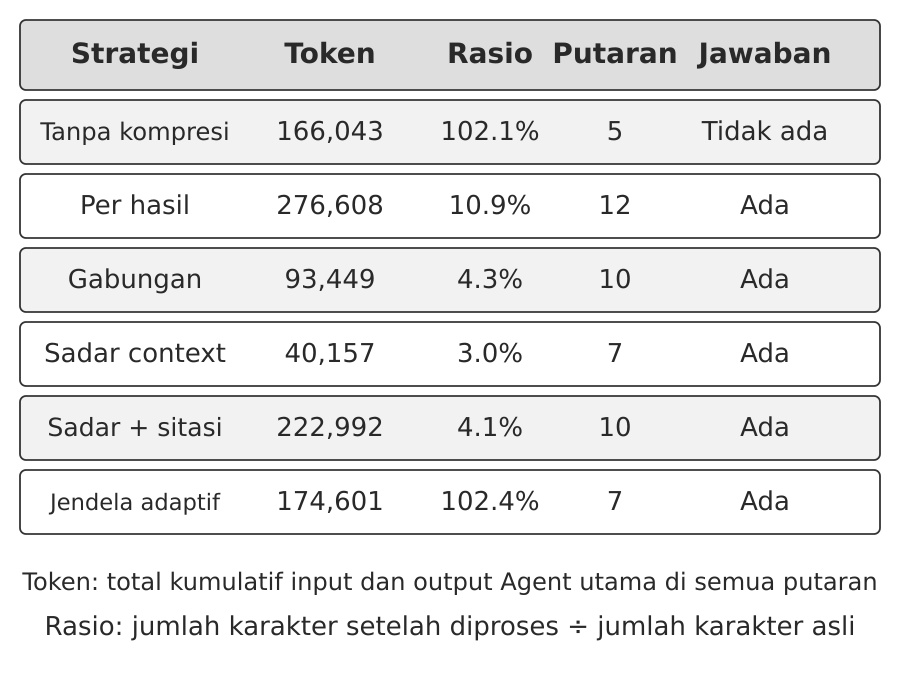

> **Eksperimen 2-10 ★★★: Perbandingan Strategi Kompresi Konteks**
>
> Eksperimen ini memakai Kimi K3 untuk meneliti status karier para pendiri bersama OpenAI. Tugasnya menuntut penyusunan daftar orang secara bertahap, pencarian riwayat dan perubahan jabatan, lalu pencocokan fakta terkait dengan sumbernya. Untuk mengamati kompresi dan penanganan luapan, eksperimen menetapkan anggaran konteks di sisi aplikasi sebesar 128.000 token, mempertahankan baseline tanpa kompresi, lalu membandingkan lima cara penanganan, masing-masing dijalankan paling banyak 15 putaran[^ch2-compression-results].
>
> **Strategi 1: Tanpa kompresi.** Hasil pencarian dan pembacaan halaman masuk ke riwayat secara utuh. Tujuh pemanggilan alat menyumbang 367.246 karakter mentah. Program memicu proteksi dan berhenti pada putaran kelima, dengan pemakaian kumulatif Agent utama 166.043 token. Versi lama memicu proteksi berdasarkan jumlah token input semua permintaan, sehingga angka 165.227 dalam pesan galat merupakan input kumulatif. Sebagai contoh, segmen riwayat yang sama yang dikirim sekali di masing-masing dari tiga putaran permintaan akan terhitung tiga kali.
>
> **Strategi 2: Ringkasan per item.** Setiap hasil pencarian dirangkum tersendiri menjadi dua sampai tiga paragraf, mempertahankan isi utama setiap halaman. Cara ini mudah diproses secara paralel dan menjaga batas antarhalaman; ketika beberapa halaman membahas peristiwa yang sama, informasi yang berulang tetap masuk ke riwayat. Konfigurasi ini menghasilkan balasan akhir dalam dua belas putaran, dengan pemakaian kumulatif Agent utama 276.608 token dan rasio kompresi karakter 10,9%.
>
> **Strategi 3: Ringkasan gabungan.** Satu kelompok hasil pencarian digabung, lalu dibangkitkan ringkasan menyeluruh, sehingga mudah merapikan fakta yang berulang dan hubungan antarsumber. Konfigurasi ini menghasilkan balasan akhir dalam sepuluh putaran, dengan pemakaian kumulatif Agent utama 93.449 token dan rasio kompresi karakter 4,3%.
>
> **Strategi 4: Ringkasan sadar-konteks.** Saat mengompresi, kueri saat ini dan informasi yang sudah diketahui ikut diberikan, misalnya dengan menambahkan `Given the search query: {query}` dan `Current context: {context}` ke prompt. Berdasarkan itu model mempertahankan fakta yang relevan dengan pertanyaan saat ini dan mengutamakan pengisian celah dalam ringkasan yang sudah ada. Konfigurasi ini menghasilkan balasan akhir dalam tujuh putaran, dengan pemakaian kumulatif Agent utama 40.157 token dan rasio kompresi karakter 3,0%. Dalam salah satu kompresinya, sekitar seratus lima puluh ribu karakter dirapikan menjadi sekitar dua ribu karakter, dengan tetap mempertahankan nama orang dan perubahan jabatannya.
>
> **Strategi 5: Ringkasan sadar-konteks dengan kutipan.** Ringkasan yang relevan dengan tugas mempertahankan tautan sumber bagi setiap fakta. Konfigurasi ini menghasilkan balasan akhir dalam sepuluh putaran, dengan pemakaian kumulatif Agent utama 222.992 token. Jika dijumlahkan dari catatan alat, bahan setelah diproses berjumlah 52.891 karakter dan teks aslinya 1.295.044 karakter, sehingga perbandingannya sekitar 4,1%.
>
> **Strategi 6: Windowing adaptif.** Pada tahap awal, bahan mentah dipertahankan; setelah input mencapai ambang, barulah dirapikan sekaligus. Eksperimen ini memakai tiga mekanisme: kompresi dipicu ketika melampaui 80% anggaran; hasil alat yang belum dikompresi dirangkum bersama; hasil yang sudah diproses diberi tanda `[COMPRESSED]` agar tidak dirangkum dua kali. Dengan anggaran 128.000 token dalam eksperimen ini, ambang pemicunya 102.400 token. Konfigurasi ini menghasilkan balasan akhir dalam tujuh putaran, dengan pemakaian kumulatif Agent utama 174.601 token. Catatan historis memicu ambang berdasarkan input kumulatif; belakangan program diubah untuk memeriksa ukuran input permintaan terakhir.
>
> Gambar 2-17 membandingkan input dan output keenam strategi.
>
> 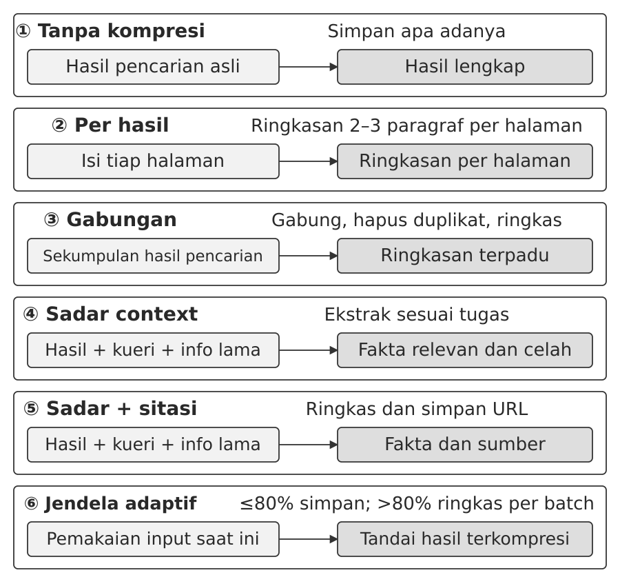
>
> Saat membandingkan angka-angka pada Gambar 2-16, tiga besaran harus dibedakan: input satu permintaan menentukan apakah anggaran jendela tercapai, token kumulatif mencerminkan pemakaian pada panggilan multi-putaran, dan rasio kompresi karakter menggambarkan perbandingan panjang bahan yang dihitung setelah dan sebelum diproses. Pemakaian kumulatif di sini berasal dari input dan output setiap putaran permintaan Agent utama; permintaan model terpisah untuk membangkitkan ringkasan tidak dimasukkan ke field ini.
>
> Untuk mereproduksi eksperimen, konfigurasikan model dan layanan pencarian nyata sesuai petunjuk pendamping, lalu jalankan `python experiment.py -m kimi-k3 -n 15 -o results/reproduction.json` di direktori eksperimen. Baca `metrics` setiap strategi: hitung ulang rasio karakter dengan `total_compressed_size / total_original_size`, lalu bandingkan `total_tokens` dan `iterations`. Baseline tanpa kompresi juga menambahkan format seperti judul dan URL pada isi hasil pencarian, sehingga jumlah karakter setelah diproses bisa sedikit lebih tinggi daripada teks aslinya. Program eksperimen mencatat sebuah kelompok sebagai selesai begitu menerima balasan akhir. Cobalah mencari orang yang sama di dua hasil akhir: kelompok dengan kutipan menulis bahwa Pamela Vagata bekerja di Pebblebed, sedangkan tabel ringkasan kelompok windowing menulis Stripe. Jawaban pertama menyebut situs web lembaga tersebut, tetapi tidak memberikan tautan halaman yang dapat dibuka. Kedua kelompok sama-sama menyerahkan tabel ringkasan, tetapi data orang yang diberikan saling bertentangan.

[^ch2-compression-results]: File hasil Eksperimen 2-10, `kimi_k3_real_20260718.json`, menyimpan field statistik, jawaban akhir, dan cap waktu setiap strategi, sehingga rasio karakter dapat langsung dihitung ulang. Run tanggal 18 Juli 2026 memakai syarat proteksi versi lama; revisi kode tanggal 22 Juli (commit `aea4d72`) mengganti input kumulatif dengan input permintaan putaran terakhir.

### Mekanisme Kompresi Berlapis Tingkat Produksi

Output alat mungkin perlu disimpan sementara secara utuh, langkah yang sudah selesai dapat diarsipkan, dan batasan saat ini harus tetap terlihat; lima jenis mekanisme di bawah ini masing-masing cocok untuk frekuensi pemakaian dan masa simpan yang berbeda.

1. **Pengendalian anggaran hasil alat**. Output berukuran besar disimpan di penyimpanan eksternal, dan konteks hanya menyimpan pratinjau ringkasan dan pintu masuk untuk membacanya. Begitu pratinjau masuk ke riwayat, isinya dijaga tetap stabil; jika diperlukan rincian lebih, potongan yang relevan dibaca dan hasilnya ditambahkan.
2. **Pembersihan isi yang tidak relevan**. Bilah navigasi halaman web, footer yang berulang, dan sejenisnya dapat disaring sebelum hasil masuk ke konteks. Jika isi yang sudah masuk ke riwayat perlu dihapus, pastikan dulu apakah tugas dan rujukan berikutnya masih bergantung padanya, lalu hitung biaya cache akibat perubahan riwayat.
3. **Penyuntingan konteks di lapisan API**. Layanan yang mendukung kemampuan ini dapat membersihkan hasil alat lama menurut aturan. Klien harus mengonfigurasi syarat pemicunya dan menangani informasi penyuntingan yang dikembalikan layanan. Cakupan pembersihan dan perilaku cache ditentukan oleh konvensi antarmuka, sehingga cocok diintegrasikan bersama pemantauan anggaran input.
4. **Ringkasan bergaya arsip**. Tujuan, operasi, hasil, dan pekerjaan yang belum selesai dicatat per putaran atau per tahap tugas, dengan mempertahankan urutan eksekusinya. Ini dapat dipahami sebagai catatan perubahan tugas: nantinya dapat ditelusuri pada langkah mana suatu keputusan diambil dan apa dasarnya.
5. **Kompresi sesi secara menyeluruh**. Jika pembersihan lokal masih belum memenuhi anggaran, tujuan saat ini, batasan, fakta yang sudah dipastikan, keputusan kunci, dan pekerjaan berikutnya dirapikan menjadi ringkasan serah terima. Catatan sesi yang sudah ada dapat dirapikan lebih dulu, baru kemudian seluruh riwayat dirangkum. Jika kompresi gagal berturut-turut, batas percobaan ulang atau mekanisme circuit breaker menghentikan panggilan berulang, menyimpan status yang dapat dipulihkan, lalu memilih untuk memperkecil input atau menyerahkan penanganannya kepada manusia.

Mekanisme-mekanisme ini dapat bekerja sama secara berlapis: pengendalian di pintu masuk mengurangi output besar sekali jadi, perapian lokal mengendalikan pertumbuhan sehari-hari, sedangkan ringkasan tahap dan kompresi menyeluruh menyimpan informasi serah terima untuk tugas jangka panjang.

Saat membaca dsh-superagent, penulis memperhatikan satu detail: peristiwa dan hasil alat dapat lebih dulu dikirim sebagai ringkasan dan ID objek, lalu rinciannya dibaca dengan ID tersebut ketika dibutuhkan. Misalkan di latar belakang sekelompok pengujian selesai dijalankan, dan latar depan hanya diberi tahu "ada dua yang gagal"; latar depan dapat melaporkan kemajuan, tetapi tidak dapat menjawab pertanyaan lanjutan pengguna, "Apakah itu dua yang kemarin?" Jika ringkasan melampirkan pengenal catatan pengujian kali ini, latar depan dapat mengambil nama test case yang gagal dan membandingkannya dengan catatan kemarin.

### Prinsip Desain Strategi Kompresi

Saat memutuskan apa yang dipertahankan setelah kompresi, periksalah dari empat aspek berikut. Proses mengakumulasi pengalaman lintas tugas akan dibahas di Bab 9.

- **Alokasikan ruang menurut nilai bagi tugas**. Daftar orang, hubungan identitas, dan pertanyaan yang sedang dicari biasanya harus dipertahankan langsung; bukti kunci yang menopang kesimpulan dipertahankan bersama sumber dan rincian yang diperlukan; bilah navigasi, iklan, dan isi berulang dapat dibersihkan. Jika suatu fakta diperdebatkan, perbedaan antarbukti juga merupakan informasi penting.
- **Jaga keutuhan makna**. Misalnya, dalam "Sutskever meninggalkan OpenAI pada Mei 2024", tokoh, waktu, tindakan, dan lembaga bersama-sama membentuk satu fakta. Saat mengompresi, unsur-unsur ini harus dipertahankan, jangan sampai hanya tersisa potongan yang sulit ditafsirkan seperti "Sutskever pergi".
- **Susun isi berdasarkan pertanyaan berikutnya**. "Mencari daftar pendiri" memerlukan cakupan orang yang lengkap, sedangkan "memahami latar belakang pribadi" memerlukan riwayat, linimasa, dan sumber. Bahan yang sama dapat dirangkum secara berbeda untuk tugas yang berbeda: pencarian menekankan cakupan, analisis menekankan hubungan dan dasar, sedangkan penulisan kreatif juga perlu mempertahankan rincian dan contoh yang berguna.
- **Verifikasi apakah ringkasan mampu mendukung eksekusi**. Ringkasan semantik harus memahami tugas, menghilangkan duplikasi, dan menyimpan syarat serta pengecualian. **Kompresi semantik atas bahan yang rumit sebaiknya memakai model dengan kemampuan pemahaman yang mendekati model utama.** Pengompresi harus menilai syarat, pengecualian, dan bukti mana yang akan memengaruhi pekerjaan berikutnya; jika semua itu dibuang, model utama sekuat apa pun akan sulit memulihkannya.

Keputusan arsitektur di masa awal, alasan di balik batasan, dan jalur yang gagal mudah terlewat dalam riwayat yang panjang. **Tugas jangka panjang harus memperbarui dokumen kemajuan secara berkala**, menyimpan "apa yang diputuskan, mengapa diputuskan begitu, apa yang sudah diverifikasi, dan apa langkah berikutnya". Prompt atau Skill dapat menetapkan kapan dokumen ini diperbarui, sedangkan Harness memuat catatan yang sesuai saat serah terima tugas. Dokumen semacam ini juga memudahkan pelaksana, peninjau, dan Agent berikutnya memahami pekerjaan yang sudah dilakukan.

### Isolasi Konteks Sub-Agent

**Untuk tugas dengan batas serah terima yang jelas dan yang menghasilkan banyak bahan antara, penulis lebih memilih isolasi dengan sub-Agent.** Pencarian berskala besar akan membaca banyak bahan yang hanya berguna pada tahap eksplorasi; mengisolasinya lebih dulu dapat mengurangi gangguan berkelanjutan dari isi tersebut terhadap tugas utama. Agent utama menyerahkan tugas kepada sub-Agent yang memiliki konteks tersendiri; sub-Agent membaca hasil antara, lalu mengembalikan kesimpulan, lokasi bukti, dan pertanyaan yang belum terjawab. Dengan demikian, konteks Agent utama hanya perlu menyimpan informasi yang dibutuhkan keputusan berikutnya.

Misalnya, untuk "menemukan fungsi yang menangani callback pembayaran", jika Agent utama mencarinya sendiri, ia mungkin harus membaca belasan berkas. Setelah diserahkan kepada sub-Agent pencarian, sub-Agent dapat diminta mengembalikan nama fungsi, modul tempatnya, titik pemanggilan, dan dasar penilaiannya. Balasannya dapat berupa "`handle_callback` di modul pembayaran bertugas menangani callback, dan ada dua titik pemanggilan lain", disertai rujukan yang dapat ditelusuri. Agent utama memutuskan berdasarkan hasil ini apakah perlu membaca kode terkait lebih lanjut.

Deskripsi tugas harus cukup lengkap: apa tujuannya, seberapa luas cakupan pencariannya, batasan apa yang harus dipatuhi, format apa yang harus dikembalikan, dan bagaimana menangani ambiguitas. Jika permintaan delegasi dan hasil yang dikembalikan sama-sama ditambahkan ke riwayat, prefiks asli Agent utama tetap dapat dipakai ulang.

Bab 4 akan membahas desain antarmuka sub-Agent sebagai alat, dan Bab 10 lebih jauh membahas pembagian konteks dalam sistem multi-Agent.

## Ringkasan Bab

Setelah asisten layanan pelanggan menyelesaikan panggilan ketiga, bagaimana pekerjaan dilanjutkan? Permintaan putaran berikutnya membawa tanda terima alat dari panggilan ini, yang dicocokkan dengan operasi panggilan melalui ID panggilan. Bilah status memperbarui jumlah jatah yang terpakai menjadi tiga, dan mencantumkan syarat yang belum disepakati. Aturan sistem dan definisi alat tetap berada di prefiks yang stabil, dan Skill yang sesuai dimuat ketika suatu layanan perlu diurus. Dengan cara ini setiap field memiliki asal-usul, dan terlihat isi mana yang akan berubah pada panggilan berikutnya.

Ketika percakapan telepon berlarut-larut dan hasil alat makin banyak, panjang hasil dapat dibatasi, bagian yang sudah selesai dirapikan menjadi ringkasan bersumber, atau pekerjaan yang dapat diurus secara mandiri diserahkan kepada sub-Agent yang hanya mengembalikan kesimpulan dan buktinya.

Setelah tugas ini selesai, hitungan tiga kali panggilan dapat diarsipkan bersama tugasnya. Namun, jika pengguna secara khusus berpesan "lain kali hubungi saya pada sore hari kerja", dan pesan itu hanya tertinggal di ringkasan panggilan, asisten yang menerima tugas berikutnya mungkin sama sekali tidak melihatnya. Bagaimana menyimpan informasi yang berguna dalam jangka panjang, dan bagaimana menemukannya kembali pada tugas yang tepat? Bab 3 membahas memori pengguna lintas tugas dan basis pengetahuan bersama.

## Pertanyaan Pemikiran

1. ★★★ Bacalah catatan run sliding window pada Eksperimen 2-3: apa yang dilakukan masing-masing dari lima pemanggilan alat? Untuk menilai apakah panggilan berulang disebabkan oleh pemangkasan riwayat, apa lagi yang perlu dicatat dan perbandingan apa yang perlu dilakukan? Rancanglah skema pemangkasan yang mempertahankan status kunci, dan jelaskan dampaknya terhadap cache prefiks. Catatannya ada di `chapter2/kv-cache/result_sliding_window_20260718_kimi_k2_6.json`.
2. ★★ Chat Template Qwen3 menangani pemikiran historis berdasarkan posisi kueri pengguna sungguhan yang terakhir. Jika satu loop ReAct berlangsung hingga ratusan putaran, bagaimana Anda akan mengelola konten penalaran yang terus bertambah? Bandingkan pemangkasan, pengiriman kembali, dan protokol pengikatan prefiks untuk pemikiran historis, lalu jelaskan bagaimana Harness harus menyesuaikan diri.
3. ★★ Misalkan sekitar seratus lima puluh ribu karakter bahan pencarian harus dikompresi menjadi dua ribu karakter. Fakta, hubungan, dan sumber apa yang akan Anda pertahankan? Bagaimana memeriksa apakah ringkasan cukup untuk mendukung pertanyaan berikutnya, dan bagaimana memulihkan rincian yang dihilangkan?
4. ★★ Penghitung alat melewatkan satu panggilan, sehingga bilah status memberikan sisa jatah yang salah. Rancanglah pencatatan peristiwa, verifikasi penjumlahan, dan pemeriksaan di lapisan eksekusi, lalu jelaskan bagaimana ketidakkonsistenan ini ditemukan dan diperbaiki.
5. ★★ Eksperimen 2-4 membandingkan nada, penataan informasi, dan deskripsi alat. Jika system prompt dipelihara banyak orang dalam jangka panjang, bagaimana Anda akan mengelola versinya, memeriksa konflik aturan, dan mengevaluasi setiap perubahan dengan tugas regresi?
6. ★★★ Kasus toko hewan peliharaan mencakup pencarian satu catatan sekaligus statistik keseluruhan. Rancanglah catatan mentah, ringkasan statistik, dan perutean kueri agar sistem dapat menjawab kedua jenis pertanyaan secara efisien, dan jelaskan kapan ringkasan perlu diperbarui.
7. ★★★ Sebuah Skill sudah ada di katalog, tetapi model tidak menyadari bahwa Skill itu cocok untuk tugas saat ini. Bagaimana Anda akan menelusuri masalahnya dari empat aspek: deskripsi, penataan katalog, pemicuan eksplisit, dan contoh evaluasi?
8. ★★ Skill sudah berhasil dimuat, tetapi model melewatkan langkah verifikasi di dalamnya. Rancanglah eksperimen pembanding untuk membedakan masalah pada pemicuan, pemahaman, penggunaan alat, dan penilaian penyelesaian, lalu bandingkan kinerja berbagai model.
9. ★★★ Sistem memiliki banyak alat, dan himpunan alat sering berubah. Bagaimana Anda akan mengatur posisi definisi tetap, katalog alat, hasil pemuatan sesuai kebutuhan, dan status runtime? Pertimbangkan sekaligus akurasi penemuan, anggaran konteks, dan cache hit.
