# Memori Pengguna dan Basis Pengetahuan

Misalkan pekan lalu pengguna memberi tahu asistennya bahwa ia lebih suka kursi dekat jendela, lalu hari ini ia hanya berkata "pesankan lagi tiket ke Tokyo". Dari mana permintaan kali ini memperoleh kembali preferensi tersebut? Jika kemarin maskapai mengubah ketentuan bagasi, di mana aturan barunya harus dicari? Bab sebelumnya membahas cara menyusun konteks untuk satu tugas. Bab ini membahas dari mana ucapan pengguna di masa lalu dapat ditemukan kembali, dari mana aturan baru maskapai dapat diperoleh, dan kapan masing-masing jenis informasi itu perlu diperbarui.

**Memori pengguna** menata informasi di sekitar satu pengguna tertentu: preferensi, kebiasaan, kebutuhan, dan pengalamannya, sehingga pada sesi-sesi berikutnya Agent tetap dapat melayani sesuai keadaan pengguna tersebut. **Basis pengetahuan** dipakai bersama oleh banyak pengguna dalam batas hak akses tertentu, misalnya regulasi industri, prosedur operasional perusahaan, dan dokumentasi teknis. Yang pertama membantu Agent memahami siapa yang dilayaninya; yang kedua menyediakan pengetahuan ranah yang dibutuhkan untuk menyelesaikan tugas.

Keduanya harus menjawab pertanyaan yang sama: bagaimana informasi disimpan dan bagaimana informasi itu ditemukan saat dibutuhkan. Keduanya juga menghadapi fakta yang saling bertentangan, isi yang kedaluwarsa, dan hasil retrieval yang terlewat. Retrieval vektor, indeks terstruktur, dan kompresi pengetahuan dapat dipakai untuk kedua jenis sistem ini. Gambar 3-1 memperlihatkan susunan bab ini: mula-mula representasi dan pengelolaan memori pengguna, kemudian Retrieval-Augmented Generation (RAG), dan terakhir penerapan metode retrieval pada memori lintas sesi serta pada pengorganisasian pengetahuan yang lebih kompleks.

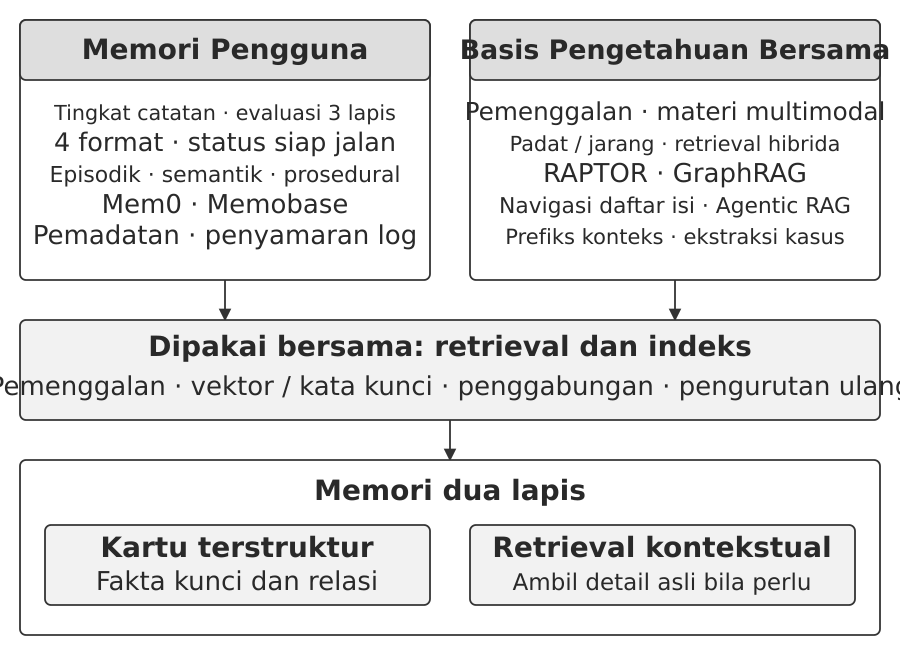

## Sistem Memori Pengguna

Uraikan kalimat "Minggu depan saya di luar negeri, dokumen dari bank tolong dikirim lewat email." Pengguna menyebut sebuah perjalanan yang punya batas waktu, lalu menetapkan cara penerimaan dokumen selama perjalanan itu. Ketika bank menawarkan pengiriman dokumen lewat pos, asisten dapat berpegang pada pernyataan ini untuk meminta pengiriman elektronik; setelah perjalanan selesai, urusan surat-menyurat harus dinilai lagi berdasarkan kondisi saat itu. Jika yang disimpan hanya "pengguna tidak suka surat kertas", memori itu memang akan ditemukan kelak, tetapi diterapkan pada cakupan yang salah.

Sekarang lihat contoh tiket pesawat. Jika pengguna berkata "tiket 1250 kemarin lebih mahal dari perkiraan saya", sistem setidaknya dapat menyimpan harga penawaran saat itu, anggaran ketika itu, konteks perjalanannya, dan umpan balik kali ini. Ketika situasi serupa muncul lagi, model dapat menangani penawaran yang melampaui anggaran dengan lebih hati-hati. Jika pengguna secara terpisah menegaskan "untuk perjalanan keluarga, tanya saya dulu", ia telah menetapkan syarat yang jelas kapan harus bertanya untuk perjalanan keluarga di masa depan. Dari sini dapat dibedakan tiga jenis informasi: apa yang benar-benar dikatakan pengguna, dalam kondisi apa ia mengatakannya, dan apa yang disimpulkan model dari pengalaman tersebut.

Pada akhir sesi, LLM dapat diminta merapikan catatan-catatan ini dan menuliskan fakta yang berguna di kemudian hari ke penyimpanan persisten. Ketika tugas baru dimulai, hanya catatan yang relevan dan masih berlaku yang dimasukkan ke dalam konteks.

Misalnya, saat memesan tiket pesawat, pengguna memberikan informasi berikut:

```text
User: Help me book a flight to Tokyo next Friday. I prefer window seats
      and I'm vegetarian, so I'll need a special meal.
Agent: I'll search for flights to Tokyo for next Friday...
       [calls flight_search tool, returns 3 options]
Agent: Here are your options. Based on your preference, I've filtered for
       window seat availability. Shall I book the ANA direct flight?
User: Yes, and use my United MileagePlus number 12345678.
```

Setelah sesi berakhir, pengekstrak memori dapat merapikannya menjadi empat catatan:

```text
Extracted memories:
- User prefers window seats (preference)
- User is vegetarian, needs special meals on flights (dietary restriction)
- User's United MileagePlus number: 12345678 (loyalty program)
- User has travel plans to Tokyo (recent activity)
```

Contoh ini mengandung tiga langkah pemrosesan. **Ekstraksi selektif** mempertahankan preferensi kursi, kebutuhan makanan, dan nomor keanggotaan, serta membuang detail sementara seperti "pencarian mengembalikan tiga opsi". **Abstraksi** mengubah preferensi kursi jendela yang dinyatakan pengguna menjadi aturan yang dapat dipakai untuk pemesanan berikutnya. **Strukturisasi** memberi label kategori pada setiap fakta sehingga mudah dicari dan diperbarui. Perjalanan ke Tokyo juga perlu dicatat bersama tanggal keberangkatan dan statusnya; "Jumat depan" harus dikonversi berdasarkan tanggal sesi, dan statusnya diperbarui setelah perjalanan selesai atau dibatalkan. Dengan begitu, preferensi jangka panjang dan aktivitas terbaru dapat dipelihara sesuai masa berlakunya masing-masing.

Deskripsi produk asisten pribadi Today memberi sebuah contoh. Pengguna menyebutkan bahwa ia berlatih setiap Selasa dan Kamis untuk persiapan setengah maraton. Enam minggu kemudian, data tidur yang terhubung atas izin pengguna menunjukkan bahwa ia kurang tidur semalam. Asisten menggabungkan kedua informasi itu dan menyarankan agar latihan interval intensitas tinggi hari itu digeser. Berapa lama informasi ini perlu diingat? Rencana latihan berguna selama masa persiapan lomba, sedangkan catatan tidur semalam harus disertai tanggalnya. Sekalipun pengguna menerima perubahan jadwal kali ini, latihan Kamis depan tetap mengikuti rencana semula, kecuali pengguna menyatakan bahwa jadwal itu diubah untuk seterusnya. Today juga memisahkan pemberian saran dari pengubahan kalender menjadi dua langkah; langkah kedua memerlukan konfirmasi pengguna.[^ch3-today]

[^ch3-today]: Tim Today memakai contoh latihan setengah maraton dalam "What Is Today" untuk menjelaskan bagaimana memori dan informasi hari itu bekerja sama. Pendirinya menjelaskan mekanisme konfirmasi sebelum kalender diubah dalam "Meet Today".

### Menilai Kemampuan Memori: Kerangka Tiga Tingkat

Benchmark publik **LoCoMo** (Long-term Conversational Memory, memori percakapan jangka panjang) berisi percakapan panjang dengan rata-rata sekitar 300 giliran dan paling banyak 35 sesi, lalu menguji kemampuan memori melalui tanya jawab, ringkasan peristiwa, dan pembuatan dialog multimodal. Pertanyaan tanya jawabnya terbagi menjadi lima jenis. Pertanyaan satu langkah (*single-hop*) dapat dijawab dari satu sesi; pertanyaan multi-langkah (*multi-hop*) menuntut penggabungan petunjuk dari beberapa sesi; pertanyaan penalaran waktu juga mengharuskan model memahami urutan terjadinya peristiwa. Pertanyaan pengetahuan ranah terbuka mengharuskan ucapan pengguna digabungkan dengan pengetahuan eksternal. Dengan contoh pemesanan tiket tadi, jika pengguna hanya pernah berkata "minggu depan ke Tokyo", maka untuk menjawab "mata uang apa yang dipakai di tujuan", model perlu mengingat petunjuk tentang Tokyo sekaligus tahu bahwa di sana digunakan yen. Jika yang ditanyakan adalah nomor penerbangan yang tidak pernah disebut pengguna, asisten harus menyatakan bahwa informasinya tidak cukup. Kemampuan mengenali pertanyaan yang memang tidak dapat dijawab inilah yang diuji oleh pertanyaan adversarial.[^ch3-locomo]

[^ch3-locomo]: Bagian 4.1 makalah LoCoMo karya Maharana dkk. (arXiv:2402.17753) memberikan definisi kelima jenis pertanyaan. Halaman proyek penulis menyediakan data dan contoh percakapan.

Dengan memadukan benchmark semacam ini dan praktik produk memori, penulis merangkum kemampuan yang perlu diperhatikan menjadi delapan:

- **Penyimpanan informasi pribadi**: menyimpan dan mengambil kembali informasi jangka panjang seperti identitas pengguna secara akurat.
- **Pelacakan preferensi**: mencatat preferensi pengguna dan memperbaruinya ketika ada pernyataan baru yang tegas.
- **Peralihan konteks**: tetap dapat melanjutkan latar belakang yang relevan setelah topik berganti.
- **Pembaruan memori**: menangani tambahan dan koreksi pengguna terhadap fakta yang sudah ada.
- **Kesinambungan lintas sesi**: memakai informasi yang tersimpan sebelumnya di sesi baru.
- **Penalaran kompleks**: menghubungkan beberapa potongan memori. Misalnya, jika pengguna pernah menyebut alergi kacang, saat membahas masakan Thailand informasi itu perlu dipakai untuk mengingatkannya memeriksa bahan makanan.
- **Kesadaran waktu**: menyimpan tanggal, menafsirkan waktu relatif, dan menghitung selang antarperistiwa.
- **Penyelesaian konflik**: menemukan informasi yang tidak konsisten dan memutuskannya dengan mempertimbangkan sumber, waktu, dan pihak yang dimaksud.

Dengan berpijak pada tugas nyata Agent, buku ini selanjutnya memakai kerangka evaluasi tiga tingkat. Eksperimen 3-1 dan 3-2 menggunakannya terlebih dahulu untuk membandingkan representasi memori; Eksperimen 3-9 dan 3-11 kemudian memakai kerangka yang sama untuk menilai metode retrieval.

**Tingkat 1: Pengingatan dasar.** Menyimpan dan mengambil kembali secara akurat informasi yang diberikan langsung oleh pengguna dan maknanya jelas. Misalnya, jika pengguna berkata "nomor keanggotaan saya 12345", nomor lengkap itu harus dapat dikembalikan saat ia memesan tiket kemudian. Tingkat ini terutama memeriksa apakah fakta hilang, tertukar, atau berubah.

**Tingkat 2: Retrieval multi-sesi.** Mengumpulkan informasi yang relevan dari sesi-sesi pada waktu berbeda yang menyangkut pihak berbeda, lalu menentukan siapa yang dimaksud permintaan saat ini dan catatan mana yang dibutuhkan. Jika pengguna punya dua mobil tetapi hanya berkata "jadwalkan servis mobil saya", sistem harus mengambil informasi kedua mobil terlebih dahulu dan menanyakan mobil yang dimaksud. Saat menanyakan status pinjaman, kontrak yang sudah berlaku harus dibedakan dari penawaran yang pernah ditanyakan dulu. Saat membatalkan "perjalanan ke Los Angeles", pemesanan tiket pesawat, hotel, dan lainnya harus dikaitkan dengan perjalanan yang sama.

**Tingkat 3: Layanan proaktif.** Berdasarkan tugas saat ini, menemukan hal-hal terkait yang tidak disebutkan pengguna satu per satu. Misalnya, saat memesan penerbangan internasional, menghubungkannya dengan informasi paspor yang disimpan beberapa bulan sebelumnya dan memeriksa apakah masa berlakunya memenuhi syarat perjalanan; saat ponsel rusak, menghimpun garansi perangkat, perlindungan tambahan dari kartu kredit, dan asuransi operator, lalu menyusun daftar pilihan penanganan yang tersedia; saat menyiapkan dokumen pajak, mengumpulkan transaksi saham, penghasilan pekerja lepas, dan dokumen pajak properti dari catatan sepanjang tahun.

> **Eksperimen 3-1 ★: Menilai Sistem Memori dengan Kerangka Tiga Tingkat**
>
> Set evaluasi berisi 20 kasus uji per tingkat, total 60 kasus. Tingkat 1 kebanyakan terdiri dari satu sesi; tingkat 2 dan 3 berisi beberapa sesi lintas waktu dan lintas pihak untuk memeriksa keterkaitan entitas, pembaruan informasi, dan pengingat proaktif.
>
> Setiap kasus dijalankan dalam dua langkah. Pertama, sesi-sesi dimasukkan satu per satu: model membuat memori dari sesi pertama, lalu setiap kali hanya menerima memori yang sudah ada dan sesi baru, dan menghasilkan memori yang diperbarui. Sejak itu model tidak lagi dapat membaca teks asli sesi sebelumnya; untuk menjawab pertanyaan tentang hal yang dibicarakan saat itu, ia hanya dapat mengandalkan informasi yang sudah ditulis ke memori. Setelah semua sesi diproses, sebuah pertanyaan baru dimasukkan dan Agent diminta menjawab berdasarkan memorinya.
>
> Evaluasi memakai LLM-as-a-judge: model penilai yang independen mencocokkan jawaban dengan jawaban acuan dan kriteria penilaian, lalu memeriksa fakta yang dicakup serta kesalahan yang ada. Dalam putaran ini, Doubao Seed 1.6 dipakai untuk membuat memori dan jawaban, sedangkan model Moonshot dipakai untuk menilai. Penilai dapat melihat percakapan asli, sedangkan model penjawab hanya melihat memori yang tersisa di akhir.
>
> Bagaimana membaca lembar nilainya? Misalnya, pengguna hanya ingin menemukan kembali nomor akun layanan internetnya. Pada kelompok catatan yang diperkaya, asisten menjawab dengan nomor yang benar. Penilai memberi skor 4 untuk akurasi, recall, dan penalaran, tetapi hanya 1 untuk proaktivitas; kasus ini tetap dinyatakan lulus. Syarat kelulusan dalam program adalah ketiga aspek pertama masing-masing bernilai minimal 3 (nilai maksimum 4) dan penilai tidak menemukan fakta penting yang tidak berdasar atau bertentangan dengan ucapan asli. Proaktivitas ikut menentukan skor gabungan, sehingga jumlah kasus yang lulus saja tidak menunjukkan seberapa jauh asisten memberikan bantuan secara proaktif.

### Struktur Hierarki Memori

Untuk menjawab "penerbangan mana yang saya pesan terakhir kali", sistem perlu menemukan satu peristiwa; untuk menjawab "kursi apa yang diutamakan saat memesan tiket", sistem perlu mengambil preferensi yang terbentuk dari banyak interaksi. Kedua pertanyaan menyangkut orang yang sama, tetapi menuntut granularitas catatan dan cara retrieval yang berbeda.

**Trajectory** mencatat peristiwa dalam satu kali eksekusi Agent menurut urutan waktu, termasuk pesan pengguna, respons model, *tool call*, dan hasil eksekusinya. Jika dipakai log peristiwa yang hanya boleh ditambah dan tidak pernah diubah (*append-only*), peristiwa baru ditambahkan di akhir dan catatan lama dipertahankan untuk penelusuran. Harness dapat memilih riwayat, mengekstrak status, atau membuat ringkasan dari trajectory untuk menyusun konteks yang benar-benar dikirim ke model pada setiap giliran.

**Memori jangka panjang pengguna** menyimpan informasi yang berguna lintas sesi, seperti preferensi, hubungan antarorang, ringkasan aktivitas masa lalu, dan fakta yang sudah dikonfirmasi, serta menetapkan kepemilikannya melalui penanda seperti ID pengguna. Pernyataan baru dapat menambah, mengoreksi, atau menggantikan catatan lama, sehingga memori jangka panjang perlu digabungkan dan diperbarui. Pembacaan dan pemeliharaannya dapat dilakukan oleh Agent dengan memanggil alat secara eksplisit, atau dipicu oleh Harness saat sesi dimuat, saat sesi berakhir, atau saat penataan di latar belakang.

**Status bisnis** menggambarkan tahap logis suatu tugas, misalnya "perlu klarifikasi", "sedang diproses", "menunggu pembayaran", dan "selesai". Program dapat memeriksa status ini untuk memutuskan peristiwa apa yang ditunggu berikutnya dan tindakan apa yang dijalankan. Bab 6 akan membahas lebih jauh manajemen status dalam arsitektur berbasis peristiwa (*event-driven*).

Ketiga jenis catatan ini dapat bekerja sama: trajectory menyediakan dasar eksekusi, memori jangka panjang menyediakan latar belakang lintas sesi, dan status bisnis menunjukkan sampai di mana tugas saat ini berjalan. Pembahasan berikut berfokus pada representasi, pengelolaan, dan retrieval memori jangka panjang.

### Empat Format Penyimpanan Memori Pengguna

Jika yang perlu diubah hanya satu alamat email, sebaiknya entri itu dapat ditemukan langsung; jika ingin tahu mengapa alamat itu dulu diubah, kita perlu membaca jalan ceritanya. Panel kiri atas Gambar 3-2 menyimpan email, perusahaan, dan jabatan sebagai entri terpisah, sedangkan panel kanan atas menuliskan jabatan, tim, dan proyek dalam satu paragraf. Lalu lihat dua kartu di bawahnya: kelak, untuk memperbarui jabatan, atau untuk memastikan siapa yang berobat ke dokter jantung, field mana yang harus diperiksa?

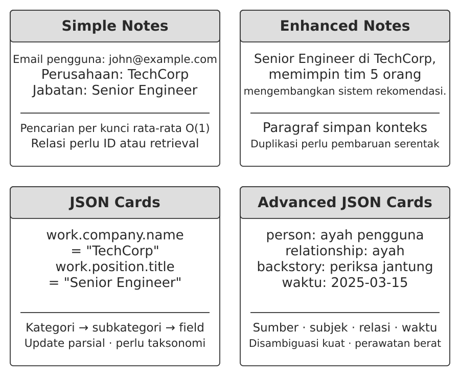

**Simple Notes** menuliskan setiap memori sebagai satu fakta singkat, misalnya "Email pengguna: john@example.com". Setiap catatan mudah dibaca dan ditulis; jika dicari melalui tabel hash berdasarkan kunci yang stabil, kompleksitas waktu rata-rata untuk pencarian dan pembaruan biasanya O(1). Untuk mencari secara semantik di antara banyak catatan, tetap diperlukan indeks retrieval. Pemecahan yang terlalu halus juga menghilangkan hubungan: "Bekerja sebagai Senior Engineer di TechCorp dan bertanggung jawab atas pengembangan sistem rekomendasi", jika dipecah menjadi tiga catatan perusahaan, jabatan, dan proyek yang tidak saling terhubung, kelak harus dinilai ulang apakah ketiganya merujuk pada pekerjaan yang sama.

**Enhanced Notes** menyimpan fakta beserta latar belakangnya dalam paragraf utuh. Contohnya: "Pengguna bekerja sebagai Senior Software Engineer di TechCorp, sudah tiga tahun menekuni machine learning, dan saat ini memimpin proyek sistem rekomendasi dengan tim lima orang." Hubungan antara perusahaan, jabatan, pengalaman, dan tim tetap terjaga dalam satu paragraf. Konsekuensinya, sebagian fakta bisa berulang di beberapa paragraf; ketika jabatan berubah, semua paragraf terkait harus ditemukan dan diperbarui agar catatan lama dan baru tidak berdampingan.

**JSON Cards** menata informasi menurut "kategori—subkategori—pasangan key-value", misalnya `personal.contact.email` dan `work.position.title`. Saat field jabatan diubah, field lain seperti `work.company.name` dapat dibiarkan, sehingga format ini cocok untuk pembaruan parsial. Saat merancang kategori, informasi yang bersilangan juga perlu dipertimbangkan: "mengembangkan proyek pribadi dengan Python pada akhir pekan" sekaligus menyangkut waktu, preferensi teknis, dan aktivitas. Kita dapat menyimpan satu catatan aktivitas dengan beberapa tag, atau menghubungkan kategori terkait melalui referensi, agar keterkaitan itu tetap terjaga.

**Advanced JSON Cards** menambahkan latar sumber `backstory`, subjek `person`, hubungan dengan pengguna `relationship`, dan timestamp di samping fakta. Field-field ini membantu sistem mengenali milik siapa suatu informasi, kapan informasi itu diketahui, dan dalam situasi apa informasi itu berlaku. Misalnya, "Dr. Zhang" bisa berarti dokter gigi pengguna, bisa juga dokter jantung ayah pengguna; menyimpan nama bersama pasiennya, hubungan keluarga, dan spesialisasinya dapat mengurangi kerancuan.

Ketika pengguna berkata "tolong atur pemeriksaan kesehatan tahunan untuk keluarga saya", sistem dapat menemukan anggota keluarga melalui `person` dan `relationship`, lalu membaca pengalaman terkait dari `backstory`. Makin kaya field-nya, makin banyak pula hubungan yang harus ditangani saat ekstraksi dan pembaruan. Penulis menyarankan penyimpanan campuran berdasarkan tingkat kepentingan informasi dan kebutuhan keterkaitannya: tokoh penting, kontrak, dan preferensi jangka panjang memakai Advanced JSON Cards agar sumber dan hubungannya tersimpan; fakta sederhana yang banyak jumlahnya dan sedikit keterkaitannya memakai Simple Notes untuk menekan biaya ekstraksi dan pemeliharaan. Kedua jenis catatan dihubungkan melalui penanda atau referensi dan diambil bersama saat diperlukan.

> **Eksperimen 3-2 ★★: Perbandingan Empat Format Memori**
>
> Implementasi pendamping menyediakan antarmuka seragam untuk membuat, memperbarui, dan mengambil memori dalam keempat format, lalu membandingkan jawaban akhirnya pada 60 kasus uji yang sama dari Eksperimen 3-1.
>
> Dalam putaran ini, Simple Notes, Enhanced Notes, JSON Cards, dan Advanced JSON Cards masing-masing meluluskan 48, 52, 51, dan 49 kasus. Pada tingkat 2, Enhanced Notes meluluskan 16 kasus, sedangkan Advanced JSON Cards 12 kasus; pada tingkat 3 keduanya sama-sama meluluskan 19 kasus. Jika pemeliharaan memori, penjawaban, dan penilaian dihitung seluruhnya, Enhanced Notes memakai sekitar 990 ribu token dan Advanced JSON Cards sekitar 1,55 juta token; rata-rata waktu panggilan model untuk yang terakhir juga lebih lama.
>
> Ambil contoh soal langganan layanan streaming di tingkat 2. Pengguna ingin berhemat dan bertanya layanan apa saja yang ia langgani beserta biayanya. Kelompok catatan yang diperkaya mencantumkan biaya bulanan Netflix, Disney+, dan Max, yaitu 22,99, 19,99, dan 19,99 dolar AS. Kelompok kartu JSON tingkat lanjut hanya menyebut harga Max, ditambah dua paket Max yang lebih murah. Sekonkret apa pun sarannya, dua tagihan lainnya tetap tidak terjawab.
>
> Sejak pembaruan mana masalahnya muncul? Jika memori yang disimpan kelompok kartu tingkat lanjut diperiksa satu per satu, setelah sesi pertama Netflix masih ada, setelah sesi kedua yang tersisa hanya catatan terkait Disney+, dan setelah sesi ketiga hanya tersisa Max. Ketika pertanyaan diajukan, dua langganan pertama sudah lenyap dari memori.

### Representasi Pengetahuan Tingkat Lanjut: Kode yang Dapat Dieksekusi

Setelah fakta disimpan, kita masih perlu menghitung agregat, memeriksa konflik, dan memutuskan langkah berikutnya berdasarkan aturan bisnis. Dalam **User as Code** (UaC), penulis mencoba menata informasi pengguna sebagai objek Python bertipe dan menuliskan operasi-operasi tersebut sebagai fungsi[^uac]. Model mengekstrak fakta dari percakapan, sedangkan program menjalankan perhitungan yang terdefinisi dengan jelas.

Untuk perbandingan tanggal, penjumlahan nominal uang, dan batasan bisnis yang tegas, penulis lebih memilih menuliskan perhitungannya sebagai fungsi, agar sekumpulan fakta yang sama selalu menghasilkan keluaran yang dapat direproduksi dan diuji. Dengan begitu, model dapat memusatkan perhatian pada pemahaman semantik dan tidak lagi berulang kali menghitung di kepala serta mencocokkan aturan dalam percakapan panjang; representasi dan penggunaan memori pun dapat diperiksa dalam satu basis kode yang sama.

UaC memakai alur dua tahap: fakta hasil ekstraksi lebih dulu ditambahkan ke log, lalu secara berkala dibuat *checkpoint* yang membangun ulang status bertipe dari log tersebut. Log menyimpan sumber fakta dan riwayat perubahannya, sedangkan objek status menyediakan field yang dapat dikueri saat ini.

Dengan paspor dan rencana perjalanan sebagai contoh, statusnya dapat didefinisikan seperti ini:

```python
from dataclasses import dataclass
from datetime import date

@dataclass
class PassportInfo:
    number: str
    country: str
    expiry_date: date

@dataclass
class Trip:
    destination: str
    departure_date: date
    is_international: bool

@dataclass
class UserState:
    passport: PassportInfo
    trips: list[Trip]

state = UserState(
    passport=PassportInfo("AB1234567", "US", date(2025, 2, 18)),
    trips=[
        Trip("Tokyo", date(2025, 1, 15), True),
        Trip("Paris", date(2025, 6, 10), True),
    ],
)
```

**Agregasi statistik** cukup menelusuri catatan secara langsung. Misalnya, menghitung jumlah perjalanan internasional yang tercatat pada tahun 2025:

```python
count = sum(
    1 for trip in state.trips
    if trip.is_international and trip.departure_date.year == 2025
)
# count == 2
```

**Pemeriksaan konflik** membandingkan dua himpunan field menurut aturan yang sudah ditetapkan. Contoh berikut mencocokkan golongan obat untuk menunjukkan bagaimana entri yang perlu diperiksa lebih lanjut dimasukkan ke antrean pemrosesan:

```python
def find_allergy_matches(profile):
    matches = []
    for medication in profile.current_medications:
        for allergy in profile.allergies:
            if medication.drug_class == allergy.drug_class:
                matches.append((medication, allergy))
    return matches
```

Setiap kecocokan menyimpan catatan obat dan catatan alergi yang bersangkutan, sehingga alur berikutnya dapat memeriksanya, lalu memutuskan berdasarkan aturan ranah apakah perlu memberi peringatan, meneruskannya untuk ditinjau, atau meminta informasi tambahan.

**Pemeriksaan batasan** dapat dijalankan otomatis setiap kali status diperbarui. Misalnya, suatu aturan perjalanan mensyaratkan paspor masih berlaku setidaknya 180 hari pada saat keberangkatan; jumlah hari itu dapat diberikan sebagai parameter:

```python
def passport_alerts(state, required_days):
    alerts = []
    for trip in state.trips:
        if trip.is_international:
            days = (state.passport.expiry_date - trip.departure_date).days
            if days < required_days:
                alerts.append((trip.destination, days))
    return alerts

alerts = passport_alerts(state, required_days=180)
```

Dengan ambang 180 hari dalam contoh ini, paspor hanya tersisa 34 hari masa berlaku saat berangkat ke Tokyo, dan pada hari keberangkatan ke Paris paspor itu sudah kedaluwarsa. Setelah pengguna memperbarui paspornya, program dapat menghitung ulang kedua perjalanan itu dengan tanggal yang baru.

[^uac]: Li, Bojie, User as Code: Executable Memory for Personalized Agents, 2026.

### Dasar Ilmu Kognitif bagi Memori Pengguna

Ilmu kognitif membedakan jenis-jenis memori berdasarkan isi dan cara penggunaannya. Konsep-konsep ini juga dapat membantu kita menata informasi jangka panjang Agent:

- **Memori episodik (*episodic memory*)** menyimpan peristiwa konkret beserta waktu, pihak yang terlibat, dan jalannya peristiwa. Contoh pada manusia: "Rabu lalu makan malam bersama rekan kerja di restoran Italia"; pada Agent, padanannya adalah "pengguna berencana terbang ke Tokyo dengan ANA Jumat depan", disertai catatan apakah pemesanan kemudian berhasil atau dijadwal ulang.
- **Memori semantik (*semantic memory*)** menyimpan fakta dan konsep. Contoh pada manusia: "ibu kota Italia adalah Roma"; pada Agent, padanannya adalah "pengguna seorang vegetarian" dan "pengguna lebih suka kursi dekat jendela". Informasi ini dapat berasal dari pernyataan tegas pengguna atau disimpulkan dari banyak pengalaman; mencatat sumbernya membantu membedakan keduanya.
- **Memori prosedural (*procedural memory*)** berkaitan dengan keterampilan dan alur tindakan. Contoh pada manusia adalah bersepeda; dalam rekayasa Agent, analoginya adalah alur yang dapat dipakai ulang, misalnya "cari penerbangan langsung → pastikan preferensi kursi → gunakan nomor frequent flyer → pesan makanan".

Kembali ke catatan belanja di Bab 1: "melihat sepuluh barang lalu membeli salah satunya" cukup untuk mencatat satu peristiwa pembelian, tetapi sulit dijadikan dasar untuk menilai apa yang akan disukai pengguna di kemudian hari. Bisa jadi ia menyukai modelnya, bisa jadi hanya karena barang itu dapat tiba hari itu juga. Jika kemudian ia berkata "untuk barang jenis ini, ke depannya cek dulu apakah bisa dikirim di hari yang sama", barulah ada satu preferensi jangka panjang dengan cakupan yang jelas. Saat merekomendasikan barang sejenis berikutnya, waktu pengiriman dapat diperiksa lebih dulu, dan asisten juga dapat menjelaskan kepadanya bahwa syarat penyaringan itu berasal dari umpan balik yang mana.

Tabel 3-1 menempatkan klasifikasi ini berdampingan dengan hierarki memori dan format penyimpanan yang telah dibahas, untuk menunjukkan pertanyaan yang dijawab oleh masing-masing.

Tabel 3-1 Tiga aspek desain memori

| Aspek desain | Pertanyaan yang dijawab | Kategori konkret |
| --- | --- | --- |
| Lapisan catatan | Apa peran informasi ini? | Trajectory, memori jangka panjang pengguna, status bisnis |
| Format penyimpanan | Struktur apa yang dipakai untuk merepresentasikannya? | Simple Notes, Enhanced Notes, JSON Cards, Advanced JSON Cards |
| Isi memori | Jenis informasi apa yang disimpan? | Memori episodik, memori semantik, memori prosedural |

Misalnya, "pengguna lebih suka kursi dekat jendela" termasuk memori semantik dan dapat disimpan dalam memori jangka panjang sebagai Simple Notes; satu alur pemesanan tiket termasuk memori prosedural dan dapat disimpan sebagai kartu yang mencantumkan sumber serta syarat berlakunya.

### Studi Kasus Kerangka Kerja Memori

Pengguna berkata "akhir-akhir ini saya pindah ke kursi lorong", padahal catatan lama menyebut "suka kursi jendela". Sistem dapat memperbarui preferensi kursi saat menulis, atau menyimpan kedua pernyataan dan baru memutuskan mana yang berlaku saat pemesanan berikutnya. Berikut kita lihat dulu pada tahap mana Mem0 menangani konflik semacam ini, kemudian bagaimana Memobase mencatat profil pengguna dan peristiwa konkret secara terpisah.

**Mem0: memindahkan titik penanganan konflik.** Alur dalam makalah 2025 dan v2 membandingkan fakta lama dan baru saat penulisan, sedangkan v3 kemudian beralih ke penambahan fakta dan retrieval hibrida. Gambar 3-3 membandingkan kedua rancangan ini.

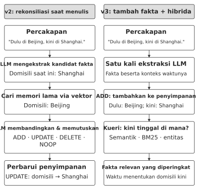

Dalam alur awal, LLM lebih dulu mengekstrak fakta kandidat dari percakapan, lalu mengambil memori lama yang mirip, dan memutuskan untuk menjalankan **ADD**, **UPDATE**, **DELETE**, atau **NOOP**. Jika pengguna mula-mula berkata "saya tinggal di Beijing" lalu kemudian "saya sudah pindah ke Shanghai", sistem dapat memperbarui tempat tinggal saat ini menjadi Shanghai. Dengan cara ini, kueri mudah mendapatkan fakta yang sudah dirapikan; sebaliknya, pemeliharaan harus dapat mengenali dengan benar mana koreksi, mana perubahan karena waktu, dan mana pihak yang berbeda, serta menyimpan dasar pembaruannya agar dapat ditelusuri kembali jika ditemukan kesalahan. Makalah tersebut juga mengusulkan varian memori graf **Mem0-g** yang merepresentasikan pengetahuan terkait melalui entitas dan relasi[^ch3-mem0-paper].

v3 mengganti ekstraksi otomatis menjadi satu panggilan LLM dan hanya menambahkan catatan **ADD**. Informasi tentang Beijing dan Shanghai dapat disimpan keduanya bersama latar waktunya, lalu tempat tinggal saat ini ditentukan berdasarkan konteks ketika kueri dijalankan. Retrieval memakai kemiripan semantik, kata kunci BM25, dan pencocokan entitas sekaligus; tindakan yang sudah dipastikan selesai juga dapat diekstrak sebagai fakta. Panduan migrasinya melaporkan skor LoCoMo naik dari 71,4 menjadi 91,6, dan LongMemEval dari 67,8 menjadi 93,4. Versi sumber terbuka ini memakai keterkaitan entitas untuk retrieval internal, menghapus antarmuka penyimpanan graf eksternal serta nilai kembalian `relations`; memori graf disediakan oleh platform terkelola[^ch3-mem0-migration].

Evolusi ini menunjukkan bahwa sistem memori dapat memindahkan penilaian konflik dari tahap penulisan ke tahap pembacaan. Jika saat menulis pengalaman dua orang keliru digabungkan, atau informasi tambahan dianggap sebagai koreksi, jawaban-jawaban berikutnya bisa terus memakai status terkini yang salah. Penyimpanan secara *append* memungkinkan bukti lama dan baru sama-sama ikut dipertimbangkan, dan juga mengurangi panggilan model untuk mengambil keputusan per entri saat penulisan. Untuk memori pengguna yang sering berubah dan konfliknya sulit dinilai saat itu juga, penulis cenderung menyimpan fakta beserta waktu dan sumbernya terlebih dahulu, lalu menyusun status yang berlaku ketika menjawab pertanyaan konkret.

[^ch3-mem0-paper]: Chhikara dkk., Mem0: Building Production-Ready AI Agents with Scalable Long-Term Memory, 2025.

[^ch3-mem0-migration]: Mem0, Open Source: Migrating to the New Memory Algorithm.

**Memobase: profil pengguna dan memori peristiwa.** Memobase menata informasi jangka panjang menjadi dua bagian. **Profil pengguna (*profile*)** menyimpan atribut yang relatif stabil menurut topik dan subtopik, misalnya nama di bawah `basic_info`, minat di bawah `interest`, dan jabatan di bawah `work`. Pengembang dapat mengonfigurasi slot yang perlu diekstrak untuk mengendalikan cakupan dan granularitas profil. **Memori peristiwa (*event memory*)** mencatat pengalaman pengguna beserta waktunya, sehingga sistem dapat menjawab pertanyaan seperti "kapan terakhir kali kita membahas anggaran".

Memobase lebih dulu menaruh percakapan baru di buffer, lalu memprosesnya secara batch setelah buffer mencapai ukuran tertentu atau sesi menganggur selama durasi yang ditetapkan; pemrosesan juga dapat dipicu secara eksplisit saat sesi berakhir. Dengan begitu, banyak pesan berbagi satu alur penataan, sedangkan kueri membaca profil dan peristiwa yang sudah dihasilkan. Pembaruan asinkron mengurangi waktu tunggu interaksi saat ini terhadap ekstraksi memori; jika fakta terbaru harus segera dipakai, sistem dapat menunggu pemrosesan kali ini selesai[^ch3-memobase].

[^ch3-memobase]: Memobase, dokumentasi resmi proyek, mencakup field profil, memori peristiwa, buffer, dan antarmuka pembaruan sinkron.

Jika asisten harus mengingat jalannya pemesanan tiket terakhir sekaligus menguasai preferensi kursi pengguna dan prosedur pembatalan tiket, peristiwa, fakta, dan prosedur dapat disimpan terpisah seperti pada Gambar 3-4. Setiap kali menerima tugas, bagian yang diperlukan kemudian dimasukkan ke memori kerja.

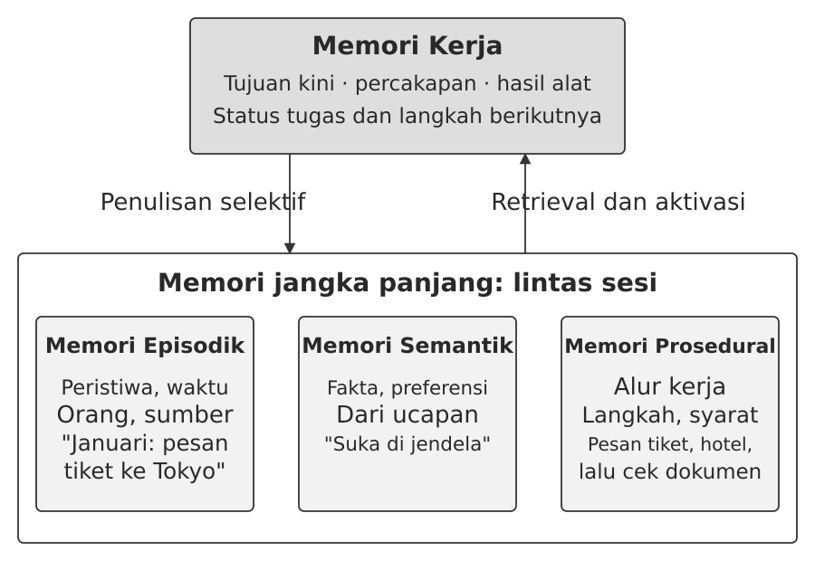

Memori episodik menyimpan urutan peristiwa beserta metadata seperti timestamp, penanda emosi, dan penanda tugas, sehingga retrieval dapat menggabungkan waktu dan topik. Misalnya, "terakhir kali membahas anggaran" memerlukan pencocokan topik sekaligus pengurutan waktu. Memori semantik menyimpan fakta dan preferensi yang diekstrak dari peristiwa, sedangkan memori prosedural menyimpan alur yang dipakai berulang kali.

**Memori kerja (*working memory*)** menata tujuan saat ini, status tugas, dan informasi relevan yang sudah diambil. Harness memilih isi dari trajectory dan penyimpanan jangka panjang lalu memuatnya ke konteks saat ini; fakta baru yang muncul dari tugas dirapikan dulu sebelum ditulis ke memori jangka panjang. Trajectory mencatat bagaimana sesuatu terjadi, sedangkan memori kerja memusatkan informasi yang diperlukan untuk keputusan berikutnya; keduanya dihubungkan melalui penanda peristiwa dan sumber.

Saat membaca memori pengguna dengan RAG, sistem lebih dulu mencari sekumpulan memori yang mungkin relevan dengan permintaan saat ini, lalu memutuskan mana yang dimasukkan ke memori kerja. Misalkan hari ini asisten membantu pengguna memilih kursi, dan retrieval menemukan dua kalimat sekaligus: "kalau perjalanan dinas saya suka kursi jendela" dan "kemarin lutut saya cedera, untuk penerbangan pulang pilihkan kursi lorong". Keduanya sangat relevan dengan pemilihan kursi, tetapi kalimat kedua hanya berlaku untuk penerbangan pulang waktu itu. Jika diurutkan ulang berdasarkan relevansi, sekalipun kalimat itu ditempatkan di urutan pertama, pertanyaan apakah ia berlaku hari ini tetap belum terjawab.

Dalam situasi seperti ini, penulis lebih mengandalkan model penilai sejenis Jev untuk menyaring memori kandidat. Rencana perjalanan kali ini, permintaan pengguna saat ini, serta kalimat asli, tanggal, dan syarat berlaku setiap memori diserahkan kepadanya, lalu setiap entri dinilai sebagai "berlaku kali ini", "hanya sebagai rujukan", atau "dasarnya tidak cukup". Jika hari ini juga perjalanan dinas, kalimat pertama dapat dijadikan dasar pemilihan kursi; jika pengguna baru saja berkata lututnya belum pulih, kalimat kedua layak diangkat untuk ditanyakan.

### Mekanisme Kompresi dan Penataan Memori

Pengguna yang sering memesan tiket pesawat mungkin menyebut "kursi jendela" sepuluh kali. Bisa jadi sembilan di antaranya hanya mengulang pesanan yang sama; menganggap jumlah penyebutan sebagai kekuatan preferensi akan melebih-lebihkan bobot satu peristiwa. Saat menata memori, sumber dan peristiwanya dikenali lebih dulu, lalu catatan duplikat digabungkan, diperiksa apakah ada koreksi yang lebih baru, dan barulah diputuskan pola mana yang layak dipakai pada tugas mendatang. Ketika menemukan kalimat "kursi jendela waktu itu enak", model penilai sejenis Jev dapat diminta membaca kalimat ini dan pesanan terkait, lalu hanya menentukan apakah kalimat itu "mengenang penerbangan terakhir", "mengajukan permintaan untuk kali ini", atau "menyatakan preferensi jangka panjang". Jika pesanannya tidak cocok atau beberapa tafsiran sama-sama masuk akal, simpan kalimat aslinya dan verifikasi saat memesan tiket nanti. Penilaian lokal seperti ini dapat mencegah satu pengalaman yang sama dihitung berulang kali sebagai bukti baru.

1. **Memilih objek penataan.** Frekuensi akses, waktu pencatatan, penanda emosi, dan keunikan informasi dapat dipakai sebagai sinyal pengurutan. Misalnya, catatan yang dibuat tiga hari lalu, diakses lima kali, bermuatan emosi kuat, dan tidak memiliki duplikat lebih layak disimpan tersendiri; catatan yang dibuat sembilan puluh hari lalu, hanya diakses sekali, dan sangat mirip dengan tiga catatan lain dapat diprioritaskan untuk digabung dengan catatan terkait. Sistem dapat menyaring catatan yang perlu ditata berdasarkan skor, lalu memutuskan menurut aturan bisnis apakah catatan itu dikompresi, digabung, atau dihapus. Batasan jangka panjang dan kontrak yang masih berlaku, meski jarang diakses, harus dipertahankan sampai masa berlakunya habis.
2. **Mengelompokkan dan membuat ringkasan.** Catatan yang mirip dikelompokkan, dan isi bersamanya dipertahankan dalam satu ringkasan. Misalnya, percakapan tentang cuaca yang berulang kali dapat dirapikan menjadi "pengguna sering menanyakan cuaca, terutama soal hujan". Tanggal spesifik dan pertanyaan asli diarsipkan, dan ringkasannya ditautkan ke catatan asli agar dapat ditelusuri kemudian.
3. **Mengekstrak pola dan prosedur.** Dari banyak catatan belanja dapat disimpulkan "lebih menyukai produk yang sepadan dengan harganya dan memperhatikan ulasan pengguna", atau dapat disarikan langkah-langkah memilih produk.

### Perlindungan Privasi: Penyamaran Data dalam Log

Memori pengguna sering memuat identitas, kontak, dan informasi akun. Sistem perlu memutuskan berdasarkan tugas field mana yang masuk ke input model, dan berdasarkan kebutuhan operasional isi mana yang masuk ke log. Penyamaran data dapat dilakukan sebelum log ditulis: potongan sensitif diganti dengan label jenis atau placeholder yang stabil, sementara struktur yang diperlukan untuk menelusuri masalah tetap dipertahankan.

> **Eksperimen 3-3 ★★: Penyamaran Data Log dengan Model Lokal**
>
> Eksperimen ini memanggil Qwen3-0.6B secara lokal melalui Ollama untuk mengenali potongan sensitif dalam log di mesin sendiri. Model kecil cocok dijalankan di perangkat kelas konsumen, dan dapat juga diganti dengan ukuran 1.7B, 4B, dan sebagainya untuk membandingkan kualitas pengenalan dan waktu pemrosesan. Jika log mentah harus tetap berada di mesin lokal, pengenalan dan penggantian juga harus dilakukan di mesin itu, baru kemudian hasil yang sudah disamarkan diserahkan ke layanan berikutnya.
>
> Bahan uji mencakup nomor terstruktur seperti nomor KTP dan nomor kartu bank, konten semi-terstruktur seperti alamat, serta informasi sensitif seperti kata sandi yang terungkap dalam bahasa alami. Model mengembalikan jenis informasi, posisi teks, dan tingkat keyakinan sesuai JSON Schema, lalu program mengganti teks asli berdasarkan keluaran itu. Kelompok pembanding memakai ekspresi reguler; kelompok campuran menjalankan pencocokan reguler lebih dulu, lalu meminta model menangani teks sisanya.
>
> Lihat dulu dua baris log. Baris pertama berisi nomor KTP dan nomor ponsel; ekspresi reguler hanya menutupi nomor ponsel, sehingga recall-nya $1/2$. Pada baris kedua, ekspresi reguler berhasil menemukan nomor jaminan sosial AS dan nomor kartu bank, tetapi ikut menutupi nomor tiket layanan yang formatnya mirip. Dari tiga bagian yang ditandainya, hanya dua yang perlu disamarkan, sehingga presisinya $2/3$. Jika yang diperiksa hanya apakah nilai sensitif masih tersisa di log, baris kedua akan lulus; baru ketika petugas layanan pelanggan memakai log ini untuk menelusuri tiket tersebut, terlihat bahwa petunjuknya sudah hilang.
>
> Jika recall dihitung per baris untuk seluruh 12 contoh lalu dirata-ratakan, ekspresi reguler, model, dan skema campuran masing-masing mencapai sekitar 50%, 69%, dan 78%. Setelah penggantian dihitung satu per satu, ketiga skema itu masing-masing masih menyisakan 9, 3, dan 2 nilai sensitif. Pilihan akhirnya juga bergantung pada waktu pemrosesan: di mesin ini, ekspresi reguler rata-rata memerlukan sekitar 0,1 milidetik per baris, sedangkan model dan skema campuran sama-sama mendekati 3 detik. Jika volume log besar, field yang formatnya stabil dapat ditangani lebih dulu dengan ekspresi reguler, dan model hanya dipakai untuk memeriksa potongan yang perlu dinilai berdasarkan konteks.

Ketika catatan makin banyak, langkah berikutnya adalah menemukan isi yang dibutuhkan tugas saat ini dari ribuan bahkan puluhan ribu informasi. Teknik RAG yang diperkenalkan berikut dapat dipakai untuk basis pengetahuan bersama maupun untuk retrieval memori pengguna.

## Dasar-dasar RAG: Membangun Pipa Akuisisi Pengetahuan Agent

Sebuah toko mengubah kebijakan pengembalian dananya, lalu seorang pengguna bertanya: "Barang yang saya beli bulan lalu, bagaimana cara mengajukan pengembalian dananya sekarang?" Untuk menjawab dengan benar, sistem harus lebih dulu menemukan ketentuan yang berlaku untuk pesanan itu, lalu menjelaskan syarat dan langkahnya dengan jelas. **Retrieval-Augmented Generation** (RAG) menyambungkan kedua langkah ini, sehingga model dapat memakai dokumen internal toko, termasuk kebijakan yang baru diumumkan setelah pelatihannya selesai.

Kita mulai dari keadaan ketika hanya ada satu versi kebijakan. Di bawah ini sebuah antarmuka sederhana dipakai untuk menanyakan prosedur pengembalian dana di toko yang sama, untuk melihat bagaimana hasil retrieval masuk ke jawaban model:

```python
query = "退款流程"
results = retriever.search(query, top_k=2)
# results = [
#   "退款政策：订单签收后7天内可申请全额退款，需提供订单号。退款将在3–5个工作日内到账。",
#   "退款操作：进入‘我的订单’，选择订单，点击‘申请退款’。"
# ]
answer = llm.generate(system="你是客服助手。", context=results, question=query)
# 回答包含申请期限、所需信息、操作步骤和到账时间。
```

Bandingkan Gambar 3-5 dengan dua hasil retrieval dalam kode: langkah pengajuan pengembalian dana berasal dari "退款操作" (prosedur pengembalian dana), sedangkan keterangan bahwa dana baru masuk dalam 3–5 hari kerja berasal dari "退款政策" (kebijakan pengembalian dana). Jika hasil retrieval hanya menyisakan langkah-langkah prosedurnya, apakah model masih punya dasar untuk memberi tahu pengguna kapan uangnya masuk? Pertanyaan ini berkaitan dengan cara memecah buku panduan menjadi potongan-potongan.

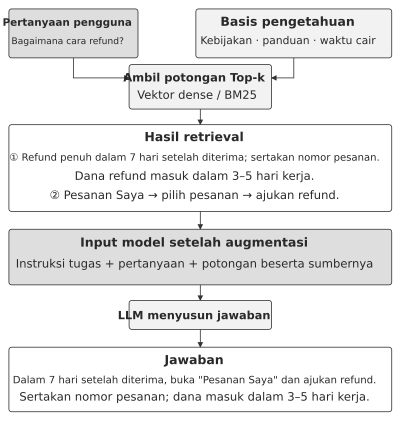

### Pemenggalan Dokumen (Chunking)

Misalkan sebuah buku panduan layanan purnajual mula-mula menulis "dapat dikembalikan dalam tujuh hari", lalu paragraf berikutnya menjelaskan barang-barang yang dikecualikan. Jika hanya kalimat pertama yang diambil, sistem bisa saja menjanjikan pengembalian dana untuk barang yang dikecualikan; jika seluruh buku panduan dijadikan satu unit retrieval, isinya ikut membawa instalasi, konfigurasi, dan pemecahan masalah, sehingga vektornya sulit menonjolkan topik pengembalian dana. **Pemenggalan (*chunking*)** harus memilih ukuran di antara kedua ujung ini, agar satu potongan teks cukup untuk menjelaskan syaratnya sendiri dan juga mudah ditemukan oleh pertanyaan yang spesifik. Panjang potongan juga harus sesuai dengan batas input model embedding dan menyisakan ruang konteks untuk tahap pembangkitan.

Ada tiga metode yang umum dipakai.

**Pemenggalan ukuran tetap** membagi teks berdasarkan jumlah token, misalnya 512 token per potongan dengan tumpang tindih 50–100 token antarpotongan yang berdekatan. Tumpang tindih ini memberi kesempatan bagi isi di dekat batas untuk muncul utuh di potongan lain. Metode ini memudahkan pengendalian panjang potongan, tetapi titik potongnya bisa jatuh di tengah paragraf, kode, atau tabel.

**Pemenggalan rekursif atau sadar struktur** mengutamakan batas alami seperti bab dan paragraf, lalu memecah bagian yang terlalu panjang dengan satuan yang lebih kecil seperti kalimat. Judul Markdown dan elemen HTML dapat memberi petunjuk struktur. Blok kode, tabel, dan teks yang terkait dengan judul juga dapat diberi aturan penanganan khusus. Untuk dokumentasi teknis yang strukturnya jelas, penulis menyarankan memulai dari metode ini: manfaatkan dulu bab dan paragraf yang sudah ada, baru pecah lagi bagian yang terlalu panjang; cara ini biasanya lebih mudah menjaga makna utuh dibanding memotong begitu saja.

**Pemenggalan semantik** menghitung kemiripan embedding antara kalimat atau kelompok kalimat yang berdekatan, lalu memotong di titik tempat topik berubah secara nyata. Metode ini menambah komputasi embedding, tetapi berpeluang mempertahankan satu topik dalam satu potongan.

Misalkan retriever hanya mengembalikan satu kalimat: "Pendapatan perusahaan itu tumbuh 3%." Perusahaan mana? Kuartal berapa? Angkanya benar, tetapi dasar untuk menjawab pertanyaan justru ada di paragraf sebelumnya. Jika seluruh laporan keuangan dimasukkan ke satu potongan, kuartal dan nama perusahaan memang terjaga, tetapi saat menanyakan pendapatan, paragraf tentang rekrutmen dan pembelian peralatan ikut terbawa. Semua isi itu juga harus berbagi satu vektor, sehingga topik pendapatan mungkin tidak lagi menonjol di dalamnya. Dalam praktik, ukuran potongan dapat dicoba mulai dari 256–1024 token per potongan dengan tumpang tindih 10%–20% antarpotongan yang berdekatan.

Metadata seperti judul, sumber, dan waktu dapat disimpan bersama potongan. Retrieval kontekstual yang dibahas nanti akan menambahkan pada setiap potongan latar belakangnya dalam teks asli, agar rujukan dan cakupannya dapat dipahami ketika potongan itu diambil secara terpisah.

### Embedding Padat: Merepresentasikan Teks dengan Vektor

**Embedding** memetakan kata, kalimat, atau potongan teks menjadi vektor numerik, misalnya `[0.2, -0.5, 0.8, ...]`. Model retrieval dilatih agar kueri dan dokumen yang relevan memiliki kemiripan tinggi di ruang vektor. "Padat" berarti sebagian besar dimensi vektor bernilai bukan nol dan bersama-sama merepresentasikan informasi teks; representasi jarang yang dibahas kemudian hanya memiliki sedikit dimensi bukan nol.

Ruang vektor dapat dibayangkan sebagai peta berdimensi tinggi: setiap potongan teks menempati satu posisi, dan retrieval berarti mencari isi yang dekat dengan kueri di peta itu. Salah satu ukuran yang umum dipakai adalah **kemiripan kosinus**:

$$
\operatorname{cos}(A,B)=\frac{A\cdot B}{\|A\|\,\|B\|}
$$

Hasil kali titik $A\cdot B$ mengalikan dimensi yang bersesuaian lalu menjumlahkannya, sedangkan panjang vektor $\|A\|$ adalah akar kuadrat dari jumlah kuadrat semua dimensinya. Setelah dibagi dengan kedua panjang vektor, hasilnya hanya mencerminkan hubungan arah. Untuk vektor bukan nol, nilai kosinus berada pada rentang $[-1,1]$; makin mendekati 1, makin searah keduanya. Model retrieval yang berbeda juga dapat memakai hasil kali titik atau jarak Euclidean. Jika kedua vektor dinormalisasi menjadi panjang satuan, hasil kali titik sama dengan kemiripan kosinus.

> **Hitung Manual: Kemiripan Kosinus Tiga Kalimat**
>
> Tiga vektor ilustratif mewakili "cara memelihara kucing" $A=(0.9,0.5,0.1)$, "panduan merawat kucing" $B=(0.8,0.6,0.1)$, dan "strategi investasi saham" $C=(0.1,0.1,0.9)$.
>
> $A\cdot B=0.9\times0.8+0.5\times0.6+0.1\times0.1=1.03$. Panjang kedua vektor masing-masing $\sqrt{1.07}$ dan $\sqrt{1.01}$, sehingga kemiripannya sekitar **0,991**.
>
> $A\cdot C=0.9\times0.1+0.5\times0.1+0.1\times0.9=0.23$, dan panjang $C$ adalah $\sqrt{0.83}$, sehingga kemiripannya sekitar **0,244**. Dalam kumpulan vektor ini, kueri tentang memelihara kucing lebih dekat ke panduan merawat kucing.

Model sesungguhnya biasanya memakai representasi dengan ratusan hingga ribuan dimensi.

#### Dari Word2Vec ke Representasi Sadar Konteks

Gambar 3-6 dimulai dari vektor kata yang tetap. **Word2Vec** mempelajari vektor tetap untuk setiap kata berdasarkan kemunculan bersama kata-kata. Sebagian hubungan dapat terlihat melalui operasi vektor, seperti contoh klasik "raja − laki-laki + perempuan ≈ ratu". Keterbatasan representasi tetap juga mudah dilihat: `bank` dalam `river bank` (tepi sungai) dan `investment bank` (bank investasi) memakai vektor kata yang sama.

**GloVe** menghitung jumlah kemunculan bersama antarkata dari seluruh korpus, lalu mempelajari vektor kata melalui fungsi tujuan kuadrat terkecil berbobot. Word2Vec berfokus pada tugas prediksi dalam jendela lokal, sedangkan GloVe memasukkan statistik kemunculan bersama global langsung ke dalam pelatihan; keduanya mempelajari representasi tetap untuk kosakata[^ch3-glove].

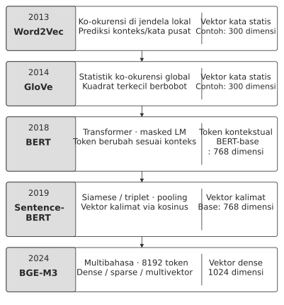

Pada model kontekstual seperti **BERT**, representasi satu token berubah mengikuti kalimatnya. Dengan *self-attention*, model dapat memanfaatkan petunjuk seperti "meluncurkan produk baru" dan "membeli satu kilo" untuk menghitung representasi yang berbeda bagi kata "apel" di kedua kalimat. Model embedding untuk retrieval juga perlu menghimpun representasi token menjadi vektor kueri atau vektor dokumen, dan dilatih secara khusus agar keduanya dapat dibandingkan.

**Sentence-BERT** menggabungkan BERT dengan pooling serta struktur jaringan siam atau triplet untuk melatih vektor kalimat yang dapat dibandingkan secara langsung. Dokumen dapat dienkode lebih dulu dan disimpan di indeks; ketika kueri datang, cukup kuerinya yang dienkode, lalu kemiripan vektor dihitung. Pengodean di muka ini menghilangkan biaya menghitung ulang representasi semua dokumen pada setiap kueri[^ch3-sbert].

**BGE-M3** menyediakan representasi retrieval padat, jarang, dan multivektor sekaligus, serta mendukung banyak bahasa dan input yang lebih panjang; bagian ini memakai representasi padatnya untuk menjelaskan retrieval satu vektor[^ch3-bge-m3]. Panjang input yang dapat diterima model memengaruhi skema pemenggalan: batas umum BERT asli adalah 512 token, sedangkan BGE-M3 mendukung hingga 8192 token.

[^ch3-bge-m3]: Makalah M3-Embedding karya Chen dkk. (arXiv:2402.03216) menjelaskan bagaimana tiga representasi retrieval dilatih bersama. Lihat juga deskripsi model BGE-M3 dari BAAI, yang mencakup cara representasi, dimensi, panjang input, dan cara penggunaannya.

> **Eksperimen 3-4 ★★: Membandingkan Dua Indeks Approximate Nearest Neighbor**
>
> Setelah vektor dokumen dibuat, kita perlu menemukan vektor yang dekat dengan kueri secara cepat. Menghitung satu per satu menghasilkan tetangga terdekat yang eksak, tetapi ketika skala data membesar, indeks **Approximate Nearest Neighbor** (ANN) menukar sedikit penurunan recall yang terkendali dengan kecepatan kueri. Eksperimen ini membandingkan ANNOY dan HNSW pada embedding nyata dan kueri yang sama, dengan hasil pencarian eksak sebagai acuan. Misalnya, pencarian eksak untuk suatu kueri menghasilkan sepuluh tetangga terdekat, dan sepuluh hasil indeks aproksimasi memuat delapan di antaranya; maka Recall@10 kueri itu adalah 0,8. Angka ini mengukur berapa banyak tetangga terdekat eksak yang dipertahankan oleh indeks.
>
> ANNOY memakai banyak pohon proyeksi acak untuk mempersempit kandidat; HNSW memakai graf tetangga berlapis, yang lebih dulu bergerak cepat mendekati wilayah sasaran di lapisan atas yang jarang, lalu masuk ke lapisan bawah yang lebih padat untuk mencari. Gambar 3-7 memperlihatkan struktur berlapis HNSW.
>
> 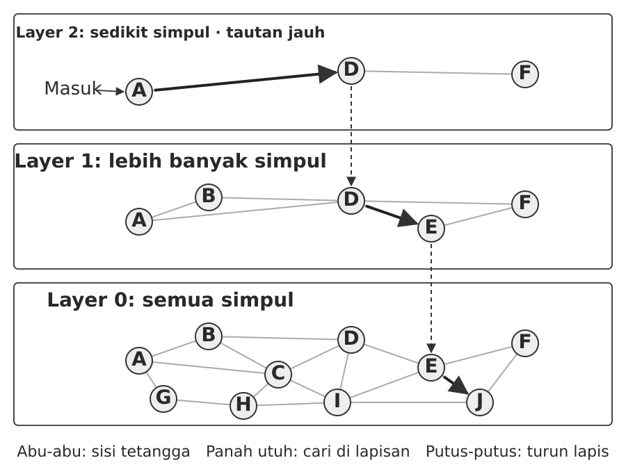
>
> Tabel 3-2 Pertimbangan implementasi ANNOY dan HNSW
>
> | Aspek perbandingan | ANNOY | HNSW (contoh: hnswlib) |
> | --- | --- | --- |
> | Struktur indeks | Banyak pohon proyeksi acak | Graf tetangga berlapis |
> | Biaya pembangunan | Bergantung pada jumlah pohon, jumlah vektor, dan dimensi | Bergantung pada ukuran ketetanggaan, cakupan pencarian saat pembangunan, dan volume data |
> | Memori dan berkas | Indeks statis mendukung pemetaan memori dan berbagi antarproses | Menyimpan vektor dan relasi ketetanggaan graf; ukuran ketetanggaan memengaruhi biaya |
> | Pembaruan inkremental | Entri baru setelah indeks dibangun memerlukan pembangunan ulang | Mendukung penambahan, pembaruan, dan penandaan hapus; kapasitas perlu dikelola |
> | Recall dan kecepatan | Diatur melalui jumlah pohon dan anggaran pencarian kueri | Diatur melalui parameter pembangunan dan cakupan pencarian kueri |
> | Skenario penggunaan | Indeks statis yang mudah didistribusikan dan dibagi | Indeks dinamis yang terus ditulisi dan dikueri |
>
> Dalam putaran ini, basis data mula-mula dibangun dari 240 potongan teks. Untuk 20 kueri yang sama, kedua indeks menemukan seluruh 10 tetangga teratas hasil pencarian eksak. Pada pembangunan awal, ANNOY memerlukan sekitar 13 milidetik di kontainer Linux dan HNSW sekitar 78 milidetik di lingkungan lokal; indeks yang disimpan masing-masing berukuran sekitar 1,40 MB dan 1,02 MB. Kemudian 60 potongan sisanya ditambahkan: ANNOY membangun ulang indeksnya, sedangkan HNSW langsung menyisipkan vektor baru. Basis data kini berisi 300 potongan, dan tetangga terdekat yang semula pun dapat berubah. Setelah pencarian eksak diulang pada basis data baru, recall rata-rata kedua indeks tetap 100%.

[^ch3-ann]: Dokumentasi proyek Annoy dari Spotify menjelaskan cara membangun indeks hanya-baca, memuat indeks melalui pemetaan memori, dan mengatur jumlah node yang diperiksa saat kueri dengan `search_k`. Bagian antarmuka Python dalam dokumentasi proyek hnswlib memuat metode `add_items` untuk menambahkan vektor dan metode `set_ef` untuk mengatur cakupan kueri.

**Indeks harus dipilih sesuai cara pengetahuan diperbarui.** Jika korpus dirilis secara berkala dalam batch dan banyak proses berbagi satu indeks hanya-baca yang sama, penulis akan mempertimbangkan ANNOY lebih dulu; jika dokumen baru terus berdatangan dan perlu disisipkan secara daring, HNSW lebih diutamakan. Model embedding menentukan representasi semantik, sedangkan indeks menentukan apakah representasi itu dapat dipakai dengan latensi dan biaya pembaruan yang wajar; keduanya bersama-sama menentukan kinerja layanan retrieval.

Dengan mengatur jumlah pohon dan anggaran pencarian ANNOY, atau ukuran ketetanggaan dan cakupan pencarian HNSW, kita dapat mengamati perubahan recall dan latensi[^ch3-ann]. Recall indeks mengukur apakah tetangga terdekat sasaran berhasil ditemukan; apakah tetangga itu dapat menjawab pertanyaan pengguna bergantung pada representasi embedding dan isi dokumennya.

### Representasi Jarang: Dari Kata Kunci ke Skor Relevansi

**Representasi jarang** memakai vektor berdimensi tinggi yang hanya sedikit dimensinya bernilai bukan nol. Retrieval kata kunci tradisional menjadikan istilah sebagai dimensi dan memberi bobot berdasarkan kata yang muncul dalam dokumen. Dasarnya adalah **model kantong kata** (Bag of Words, BoW): menyimpan kata dan jumlah kemunculannya, tanpa memedulikan urutan. Karena itu, "kucing mengejar anjing" dan "anjing mengejar kucing" memiliki representasi kantong kata yang sama.

Representasi ini cocok untuk mencocokkan nama, nomor, dan istilah teknis. Pembahasan berikut dimulai dari TF-IDF untuk menjelaskan bagaimana frekuensi istilah dan frekuensi dokumen diubah menjadi skor peringkat.

#### Dari TF-IDF ke BM25

**TF-IDF** (Term Frequency–Inverse Document Frequency, frekuensi istilah–frekuensi dokumen inversi) menggabungkan dua sinyal: berapa kali suatu kata muncul dalam dokumen saat ini, dan seberapa umum kata itu di seluruh korpus. Misalkan dari 100 artikel, 60 artikel memuat kata "model" dan hanya 3 artikel memuat kata "distilasi"; untuk kueri "distilasi model", kata "distilasi" lebih berperan membedakan.

Salah satu bentuk dasarnya adalah:

$$\operatorname{TF\!\text{-}\!IDF}(t,d)=\operatorname{TF}(t,d)\times\operatorname{IDF}(t),\qquad \operatorname{IDF}(t)=\ln\frac{N}{\operatorname{DF}(t)}$$

$\operatorname{TF}(t,d)$ menyatakan jumlah kemunculan kata $t$ dalam dokumen $d$, $\operatorname{DF}(t)$ menyatakan jumlah dokumen yang memuat kata itu, dan $N$ adalah jumlah seluruh dokumen. Menurut rumus ini, kontribusi skor kata yang muncul sepuluh kali dua kali lipat dari kata yang muncul lima kali; dokumen panjang juga bisa mendapat skor tinggi hanya karena katanya lebih banyak. TF-IDF punya banyak varian normalisasi, sedangkan BM25 di bawah ini menangani kedua pengaruh tersebut dengan saturasi frekuensi istilah dan normalisasi panjang.

**BM25** menjumlahkan kontribusi setiap kata kueri:

$$\operatorname{Score}(Q,D)=\sum_i\operatorname{IDF}_{\mathrm{BM25}}(q_i)\cdot\frac{\operatorname{TF}(q_i,D)(k_1+1)}{\operatorname{TF}(q_i,D)+k_1\left(1-b+b\frac{|D|}{\operatorname{avgdl}}\right)}$$

Di sini, $q_i$ adalah kata kueri, $|D|$ adalah panjang dokumen, dan $\operatorname{avgdl}$ adalah panjang dokumen rata-rata. $k_1$ mengendalikan tingkat saturasi frekuensi istilah; $b$ mengendalikan kekuatan normalisasi panjang, dan bila bernilai 0 koreksi ini dimatikan. Gambar 3-8 menghitung suku-suku ini secara terpisah. Pertama, panjang dokumen ditetapkan dan kemunculan kata kueri dinaikkan dari satu menjadi tiga kali, untuk melihat berapa tambahan skor dari setiap kemunculan berikutnya; lalu frekuensi istilah ditetapkan dan hanya panjang dokumen yang digandakan. Baris paling bawah membandingkan seberapa umum dua kata di dalam kumpulan dokumen.

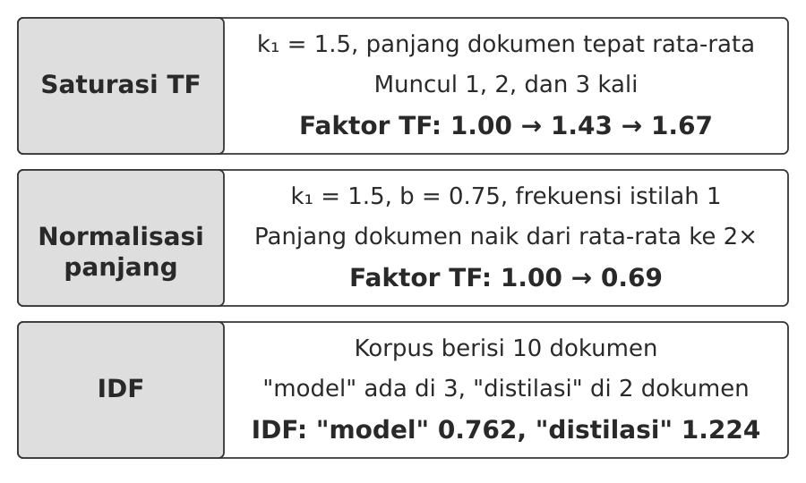

Pada baris pertama gambar, kemunculan kedua menaikkan faktor frekuensi istilah sekitar 0,43, sedangkan kemunculan ketiga hanya sekitar 0,24; inilah saturasi frekuensi istilah. Pada baris kedua, kata yang sama sama-sama muncul sekali, tetapi kurang menonjol di dokumen yang lebih panjang, sehingga koreksi panjang menurunkan faktor frekuensi istilahnya. Hasil itu masih harus dikalikan dengan IDF untuk memperoleh kontribusi kata tersebut terhadap skor total.

Rumus di atas masih punya satu suku yang perlu ditentukan: sama-sama muncul tiga kali, mengapa kata yang jarang sering kali lebih berguna daripada kata yang umum? Bagian ini memakai frekuensi dokumen inversi berikut untuk memberi bobot pada kata:

$$\operatorname{IDF}_{\mathrm{BM25}}(t)=\ln\frac{N-\operatorname{DF}(t)+0.5}{\operatorname{DF}(t)+0.5}$$

Pembilang menyatakan jumlah dokumen yang tidak memuat kata itu, penyebut menyatakan jumlah dokumen yang memuatnya, dan keduanya ditambah 0,5 sebagai penghalusan agar tetap dapat dihitung ketika frekuensi dokumen bernilai 0 atau $N$. Kata yang jarang mendapat bobot lebih tinggi; jika lebih dari separuh dokumen memuat kata itu, rumus ini menghasilkan nilai negatif. Implementasi pendamping menetapkan batas bawah bobot penilaian yang dipakai sebesar $10^{-6}$, sambil tetap menyimpan nilai aslinya untuk pemeriksaan.

> **Eksperimen 3-5 ★★: Membangun Mesin Pencari BM25 dari Nol**
>
> Eksperimen ini secara berurutan mengerjakan tokenisasi, penanganan *stop word*, indeks terbalik, dan penilaian. Penanganan *stop word* dapat menyaring kata berfrekuensi tinggi seperti "的" dan "了". **Indeks terbalik** mencatat di dokumen mana saja setiap kata muncul beserta frekuensinya; ia mirip indeks istilah di akhir buku: mencari "TCP" langsung menunjuk ke halaman 45, 112, dan 203, lalu isi di halaman-halaman itu dibaca.
>
> Mari hitung secara manual satu kueri "模型蒸馏" (distilasi model). Misalkan korpus berisi 10 dokumen dengan panjang rata-rata 250 kata, $k_1=1.5$, dan $b=0.75$. "模型" (model) muncul di 3 dokumen dengan IDF sekitar 0,762; "蒸馏" (distilasi) muncul di 2 dokumen dengan IDF sekitar 1,224. Tabel berikut mencantumkan, per kata, dokumen yang cocok, frekuensi istilah, dan panjang dokumen. Dengan memasukkan nilai-nilai ini ke rumus, kontribusi setiap kata terhadap skor dokumen dapat dihitung.
>
> | Kata kueri | Dokumen | Frekuensi TF | Panjang dokumen | Kontribusi BM25 |
> | --- | --- | ---: | ---: | ---: |
> | 模型 | doc_1 | 5 | 200 | 1.52 |
> | 模型 | doc_3 | 2 | 500 | 0.82 |
> | 模型 | doc_7 | 8 | 150 | 1.68 |
> | 蒸馏 | doc_1 | 3 | 200 | 2.15 |
> | 蒸馏 | doc_5 | 1 | 250 | 1.22 |
>
> Jumlah kontribusi kedua kata di doc_1 sekitar 3,67, sehingga urutannya **doc_1 (3,67) > doc_7 (1,68) > doc_5 (1,22) > doc_3 (0,82)**. Di doc_1, frekuensi "蒸馏" lebih rendah daripada "模型", tetapi kata itu lebih jarang sehingga kontribusi akhirnya lebih besar; kecocokan dengan kedua kata sekaligus juga makin menaikkan skor total.
>
> Sekarang cari `cat` di korpus bahasa Inggris eksperimen pendamping. Dua artikel pendek yang ditandai relevan masing-masing memakai `kitten` dan `feline`, sementara indeks terbalik tidak memuat `cat` sama sekali, sehingga daftar kandidatnya kosong. Setinggi apa pun bobot frekuensi istilah tadi diatur, tidak ada satu dokumen pun yang dapat dinilai. Jika kueri diganti dengan kata-kata dari kedua artikel itu, masing-masing akan masuk ke daftar kandidat.

### Retrieval Hibrida: Menggabungkan Dua Jalur Hasil lalu Mengurutkan Ulang

Sebagian pertanyaan sulit didaftar sinonimnya terlebih dahulu. Salah satu soal dalam Eksperimen 3-6 menanyakan "bagaimana memori heap yang tidak terpakai didaur ulang secara otomatis", sedangkan artikel sasarannya ditulis sebagai "manajemen memori otomatis membebaskan pengembang dari pelepasan objek secara manual". Kueri bahasa Inggris itu tidak punya istilah yang sama dengan artikelnya; retrieval kata kunci tidak menemukan apa pun, sedangkan retrieval vektor menempatkan artikel sasaran di urutan pertama. Ketika kuerinya diganti dengan nomor model XR-7003, retrieval kata kunci langsung menemukan model yang tepat, sedangkan retrieval vektor juga menampilkan beberapa model yang mirip.

**Retrieval hibrida** mencari paragraf relevan dengan kata kunci dan vektor secara terpisah, lalu memutuskan paragraf mana yang layak diserahkan ke model. Jika basis pengetahuan berisi penanda eksak sekaligus deskripsi bahasa alami, penulis menyarankan menjadikannya titik awal. Ikuti XR-7003 di sepanjang Gambar 3-9: kedua jalur sama-sama menempatkannya di urutan pertama, sehingga saat digabungkan ia mendapat dua kontribusi peringkat. Pengurutan ulang mengganti peringkat kedua, tetapi model yang pertama kali dilihat pengguna tetap benar.

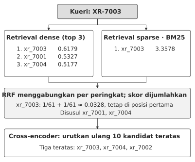

Tahap pertama adalah **retrieval paralel**: kueri dikirim ke mesin padat dan mesin jarang, yang masing-masing mengambil sekumpulan dokumen yang mungkin relevan. Kedua jalur dapat memakai teks asli yang sama, atau melakukan prapemrosesan sesuai kebutuhan modelnya masing-masing.

Tahap kedua adalah **penggabungan hasil**: dokumen yang sama dari kedua jalur digabungkan, lalu diberi peringkat bersama. Kemiripan kosinus dan BM25 memiliki skala nilai yang berbeda, sehingga penjumlahan langsung mudah membuat jalur dengan nilai lebih besar mendominasi hasil. Salah satu caranya adalah mengkalibrasi atau menormalisasi skor lebih dulu lalu menggabungkannya dengan bobot; cara lain adalah **Reciprocal Rank Fusion** (RRF), yang menghitung berdasarkan peringkat di setiap jalur:

$$\operatorname{RRF}(d)=\sum_{j:\,d\in R_j}\frac{1}{k+\operatorname{rank}_j(d)}$$

$R_j$ adalah hasil jalur ke-$j$, peringkat dimulai dari 1, dan jika suatu dokumen tidak muncul di sebuah jalur, kontribusi jalur itu nol. Konstanta penghalus $k$ biasanya bernilai 60; makin besar nilainya, makin kecil selisih skor di antara beberapa peringkat teratas. RRF memudahkan penggabungan cara penilaian yang berbeda, tetapi hanya mempertahankan peringkat; perbedaan kuat-lemah dalam skor asli harus dimanfaatkan dengan cara lain.

Mari hitung contoh retrieval dua jalur. Pengguna bertanya "berapa lama pengembalian dana masuk", dokumen A berada di peringkat pertama retrieval kata kunci dan tidak muncul di jajaran teratas retrieval vektor; dokumen B berada di peringkat kedua pada kedua jalur. Dengan $k=60$, A mendapat $1/61$, sekitar 0,0164; B mendapat $1/62+1/62$, sekitar 0,0323. Setelah digabungkan, B berada di depan A. Hasil ini hanya menunjukkan bahwa kedua jalur retrieval sama-sama menemukan B. Untuk menilai apakah B benar-benar menjawab soal waktu masuknya dana, masih perlu dilihat apakah isinya tentang "cara mengajukan pengembalian dana" atau "kapan pengembalian dana masuk".

Tahap ketiga dapat menambahkan **pengurutan ulang neural**. Sistem mengambil dokumen berperingkat teratas setelah penggabungan, misalnya 50 teratas, lalu meminta model pengurut ulang (*reranker*) menilai tingkat relevansi setiap dokumen terhadap kueri. Pengurutan ulang dapat mengubah urutan 50 dokumen ini. Jika dokumen yang benar-benar berguna tidak terpilih sama sekali, perbaikannya harus kembali ke retrieval di hulu.

Model yang umum dipakai di sini adalah ***cross-encoder***: kueri dan dokumen kandidat dimasukkan bersama, sehingga keduanya berinteraksi di dalam model, lalu skor relevansinya dikeluarkan. ***Bi-encoder*** pada tahap retrieval mengenkode kueri dan dokumen secara terpisah; vektor dokumen dapat dihitung lebih dulu, dan saat kueri hanya dilakukan pencarian vektor. Yang pertama cocok untuk mengurutkan secara cermat sedikit dokumen, yang kedua cocok untuk penyaringan awal di antara banyak dokumen. Analoginya adalah penyaringan CV dan wawancara: rentang kandidat dipersempit dulu berdasarkan ciri yang sudah ada, lalu dibandingkan lebih dalam berdasarkan persyaratan konkret. BGE Reranker v2 M3 adalah salah satu model yang dapat dipakai pada tahap ini[^ch3-reranker].

[^ch3-reranker]: BAAI, deskripsi model BGE Reranker v2 M3, yang menjelaskan input kueri–dokumen dan penilaian relevansi.

Ketika materi yang relevan sudah masuk ke kumpulan kandidat tetapi sering berada di belakang materi yang tidak relevan, penulis akan lebih dulu mengevaluasi pengurutan ulang dengan *cross-encoder*. Karena membaca pertanyaan dan dokumen bersamaan, model ini dapat langsung membandingkan apakah syarat, kata pembatas, dan detail dalam dokumen sesuai dengan yang diminta pertanyaan. Tabel 3-3 mencantumkan tiga metrik yang umum dipakai.

Tabel 3-3 Tiga metrik kualitas retrieval

| Metrik | Cara menghitung dan maknanya |
| --- | --- |
| recall@k | Jumlah dokumen relevan di antara k hasil teratas dibagi jumlah seluruh dokumen relevan untuk kueri itu; mengukur seberapa banyak isi relevan yang ditemukan; pada set uji biasanya dirata-ratakan lagi untuk semua kueri |
| MRR (Mean Reciprocal Rank) | Untuk setiap kueri diambil kebalikan dari peringkat dokumen relevan pertama, lalu dirata-ratakan; peringkat pertama bernilai 1, peringkat kesepuluh 0,1, tidak ditemukan 0 |
| nDCG@k (Normalized Discounted Cumulative Gain) | Memberi nilai pada hasil berdasarkan tingkat relevansinya, mendiskon peringkat yang lebih bawah, lalu membaginya dengan skor urutan ideal; mengukur kualitas urutan k hasil teratas secara keseluruhan |

Kita juga dapat mencatat **hit rate**: berapa banyak kueri yang menemukan setidaknya satu dokumen relevan di antara k hasil teratas? Misalnya, suatu pertanyaan memerlukan tiga dokumen, tetapi dua puluh hasil teratas hanya menemukan dua di antaranya. Kueri ini sudah dianggap kena, sehingga tidak dihitung sebagai kegagalan "sama sekali tidak kena", tetapi recall@20-nya hanya $2/3$, karena masih ada $1/3$ dokumen yang belum ditemukan. Jika setiap soal hanya punya satu dokumen sasaran, soal yang berhasil menemukannya bernilai 1 dan yang melewatkannya bernilai 0. Untuk hasil retrieval yang sama, rata-ratanya membuat hit rate sama dengan recall rata-rata.

> **Eksperimen 3-6 ★★: Membandingkan Retrieval Jarang, Padat, Penggabungan, dan Pengurutan Ulang**
>
> Eksperimen ini membandingkan lima konfigurasi pada 12 kueri berlabel yang sama: retrieval jarang, retrieval padat, penggabungan RRF, penggabungan berbobot, serta penggabungan yang diikuti pengurutan ulang. Kueri-kuerinya mencakup kemiripan semantik, nama eksak, multibahasa, dan kode teknis; dua di antaranya menanyakan, dalam bahasa Inggris dan bahasa Tionghoa, bagaimana tumbuhan mengubah sinar matahari menjadi makanan. Model padatnya adalah Qwen3-Embedding-0.6B, pengurut ulangnya adalah *cross-encoder* MS MARCO MiniLM; setiap jalur retrieval mengambil paling banyak 10 dokumen, dan pengurut ulang memproses paling banyak 10 dokumen teratas hasil RRF. Recall dan nDCG hanya melihat 3 dokumen teratas dari urutan akhir, sedangkan MRR menelusuri daftar yang dikembalikan untuk mencari dokumen relevan pertama.
>
> Pertama, buka peringkat per soal dalam catatan eksekusi Eksperimen 3-6 dan bandingkan hasil retrieval dua soal fotosintesis. Untuk soal bahasa Inggris, dokumen sasaran tetap berada di peringkat pertama. Untuk soal bahasa Tionghoa, yang pertama dikembalikan adalah bahasa pemrograman dan gunung berapi, dan baru dokumen ketiga membahas fotosintesis. Setiap soal hanya punya satu dokumen berlabel relevan, dan kedua soal menemukannya di tiga besar, sehingga recall@3 keduanya 1. Namun, dokumen relevan pertama untuk soal bahasa Tionghoa berada di peringkat ketiga, sehingga peringkat kebalikannya hanya $1/3$. Menurut cara penilaian eksperimen ini, perolehan untuk peringkat ketiga adalah $1/\log_2(3+1)=0.5$ dan untuk peringkat pertama adalah 1, sehingga nDCG@3 soal bahasa Tionghoa adalah 0,5.
>
> Sekarang lihat keseluruhan 12 soal. Setelah pengurutan ulang, selain soal fotosintesis bahasa Tionghoa, ada satu soal lagi tentang daur ulang memori heap yang dokumen sasarannya turun dari peringkat pertama ke kedua. Sepuluh soal lainnya tetap di peringkat teratas, sehingga MRR setelah pengurutan ulang adalah $(10+1/2+1/3)/12\approx0.903$. Sebagai pembanding, MRR retrieval padat dan RRF sama-sama 1. nDCG@3 keduanya juga 1, dan turun menjadi sekitar 0,928 setelah pengurutan ulang. Perubahan peringkat ini tidak terlihat jika hanya melihat recall rata-rata: recall@3 retrieval jarang adalah 0,833, sedangkan keempat kelompok lainnya 1.
>
> Misalkan sekarang kita harus memilih satu konfigurasi untuk kumpulan soal ini; apa yang diperoleh dari waktu tambahan untuk pengurutan ulang? Di CPU ini, RRF rata-rata memerlukan sekitar 194 milidetik per soal sejak retrieval dimulai hingga peringkat diberikan; dengan pengurutan ulang, waktunya menjadi sekitar 237 milidetik. Tambahan sekitar 43 milidetik itu tidak menemukan dokumen sasaran yang baru, bahkan menggeser jawaban yang benar pada dua soal ke peringkat lebih bawah.

## Pengorganisasian dan Retrieval Pengetahuan

Cara pengetahuan diorganisasi menentukan isi setiap entri, sedangkan retriever menentukan apa yang diambil dari entri-entri itu. Paragraf dalam manual teknis, dokumen hukum, dan makalah saling terhubung melalui hierarki bab, ketergantungan konsep, dan rujukan lintas dokumen. Jika struktur ini dipertahankan, kueri dapat menjangkau bukti konkret sekaligus ringkasan di tingkat yang lebih tinggi.

Bagian ini membahas beberapa cara pengorganisasian secara berurutan: RAPTOR dan GraphRAG membangun indeks hierarkis atau relasional; OpenViking menata sumber daya konteks dengan direktori; pembaruan inkremental dan penataan berkala menjaga kemutakhiran pengetahuan; Agentic RAG memungkinkan Agent melanjutkan retrieval berdasarkan hasil yang sudah diperoleh; retrieval sadar konteks melengkapi latar belakang potongan; dan terakhir, pengetahuan yang dapat dipakai ulang diekstrak dari dataset. Masing-masing bekerja pada representasi, indeks, pembaruan, atau proses kueri, dan semuanya juga dapat dipadukan untuk memori pengguna.

Mari lihat dulu dua contoh untuk memahami jarak antara informasi yang dibutuhkan kueri dan catatan aslinya.

**Kasus 1: menghitung kucing hitam dan kucing putih.** Pada bab sebelumnya, program diminta menghitung seluruh 100 kandang dan mendapatkan 90 kucing hitam serta 10 kucing putih. Kali ini retriever hanya diminta mengembalikan 20 catatan teratas. Misalkan 18 di antaranya memuat informasi warna yang valid: 15 kucing hitam dan 3 kucing putih. Angka 83,3% (15/18) yang dihitung adalah proporsi kucing hitam di antara catatan valid tersebut, sedangkan proporsi kucing hitam di seluruh toko adalah 90% (90/100). Retriever memilih catatan berdasarkan relevansi; ia tidak mengambil sampel yang representatif untuk seluruh toko.

Jika proporsi untuk seluruh toko sering ditanyakan, semua kandang dapat dihitung terlebih dahulu, lalu jumlah kucing hitam dan putih disimpan beserta cakupan perhitungan dan waktu pembaruannya. Jika kucing di suatu kandang berganti, rincian yang bersangkutan diperbarui dan totalnya dihitung ulang. Jika seseorang bertanya isi kandang nomor 37, rincian itu tetap harus dicari kembali.

**Kasus 2: apakah perawat bisa mendapat diskon yang diperoleh dokter?** Ambil sebuah situasi pembelajaran yang dibangun di sekitar konsultasi promo Xfinity: dalam tiket layanan, veteran John lolos verifikasi, dokter Sarah mendapat diskon, dan guru Mike diberi tahu bahwa ia tidak memenuhi syarat. Setiap tiket mencatat satu hasil penanganan. Jika seorang perawat bertanya apakah ia berhak atas diskon, retrieval tiket yang mirip saja akan menghadapi tiga masalah.

- **Profesi yang mirip belum tentu berhak atas promo yang sama.** "Perawat" dan "dokter" dekat secara semantik, sehingga catatan Sarah mungkin berada di urutan atas; padahal berlaku tidaknya promo bergantung pada siapa saja yang boleh mengajukan menurut syarat program dan bukti apa yang harus ditunjukkan.
- **Tiket satu per satu tidak mencantumkan semua syarat yang berlaku.** Seseorang yang lolos verifikasi hanya menunjukkan hasil untuk orang itu dalam kondisi saat itu; menaikkan jumlah hasil retrieval pun belum tentu menemukan kategori atau pengecualian yang belum pernah muncul.
- **Cakupan data tidak jelas.** Tiket bisa berasal dari program atau periode yang berbeda. Perlu dipastikan dulu catatan mana yang berlaku dan dasar kebijakan apa yang belum ada.

Saat membangun indeks, tiket-tiket dari program yang sama dapat dihubungkan, lalu syarat resmi yang bersangkutan dibaca, dan pihak yang berhak, pengecualian, waktu berlaku, serta sumber ketentuannya dirangkum menjadi kartu aturan. Misalnya, jika ketentuan dalam situasi pembelajaran ini secara tegas mencakup anggota militer aktif dan veteran serta tenaga medis berlisensi, dan mengecualikan kategori guru, syarat-syarat itu disimpan satu per satu; apakah perawat termasuk tenaga medis juga dipastikan dari ketentuan tersebut. Tiket tetap disimpan untuk menjelaskan proses penanganan yang sebenarnya dan menemukan perbedaan pelaksanaan.

Kedua contoh ini menunjukkan kebutuhan informasi yang berbeda: menghitung kucing memerlukan statistik seluruh kandang di toko, sedangkan menentukan siapa yang berhak atas diskon memerlukan ketentuan dan pengecualian yang lengkap. Untuk kueri seperti ini, penulis berpendapat bahwa penghitungan statistik dan perumusan aturan sebaiknya dimajukan ke tahap pembangunan basis data. Jika hanya menambah jumlah potongan yang diambil, model tetap mungkin tidak melihat cakupan statistik yang lengkap atau ketentuan yang menentukan apakah pengajuan kali ini dapat disetujui. Dengan membangun ringkasan statistik, kartu aturan, dan relasi sumber yang berpusat pada tugas, retrieval dapat sekali jalan memperoleh informasi yang cukup untuk mengambil keputusan, sekaligus tetap dapat menelusuri kembali bahan aslinya.

### Indeks Terstruktur: Membangun Hierarki dan Keterkaitan

Saat membaca laporan panjang, pertanyaan "kolom mana yang harus diisi dalam permohonan perbaikan" sering dapat dijawab dari satu paragraf asli; pertanyaan "mengapa beberapa jenis kerusakan terus berulang" harus melintasi beberapa bab. Agar kedua jenis kueri ini sama-sama terlayani, saat membangun basis data kita dapat membuat ringkasan, membangun hierarki, atau mengekstrak entitas dan relasi. RAPTOR di bawah ini membentuk hierarki melalui ringkasan rekursif, sedangkan GraphRAG menata bahan melalui relasi entitas dan ringkasan komunitas.

**RAPTOR** (Recursive Abstractive Processing for Tree-Organized Retrieval) dimulai dari potongan teks: setiap potongan dienkode menjadi vektor, dikelompokkan menjadi beberapa grup berdasarkan kemiripan, lalu dibuatkan ringkasan untuk setiap grup. Ringkasan-ringkasan itu diperlakukan sebagai kumpulan potongan teks baru, dan langkah yang sama diulang hingga terbentuk pohon pada Gambar 3-10. Ikuti panah ke atas dari potongan teks 3, 4, dan 5: ketiganya bersama-sama menghasilkan ringkasan B; lebih ke atas lagi, ringkasan tiga grup A, B, dan C bergabung menjadi ringkasan global.[^ch3-raptor]

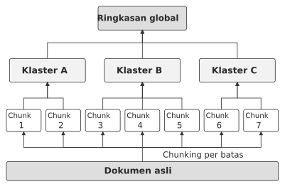

Misalnya, "SSE2 mendukung operasi SIMD bilangan bulat di register XMM 128-bit" dan "SSE4.2 menambahkan instruksi perbandingan string" dapat dimasukkan ke ringkasan "evolusi set instruksi SIMD x86". Pertanyaan detail dapat dicocokkan dengan potongan di lapisan bawah, sedangkan pertanyaan gambaran umum dapat dicocokkan dengan ringkasan di lapisan atas. Kueri dapat menelusuri hierarki ini selangkah demi selangkah, atau menggabungkan simpul dari semua lapisan dalam satu retrieval lalu memilih sekelompok yang paling relevan.

[^ch3-raptor]: Sarthi dkk., RAPTOR: Recursive Abstractive Processing for Tree-Organized Retrieval, 2024.

**GraphRAG** menata pengetahuan dengan entitas, relasi, dan ringkasan komunitas. Ia mencatat satu relasi sebagai tripel "subjek—relasi—objek", misalnya (Tiongkok, beribu kota, Beijing) atau (Zhang San, bekerja di, Tencent). Asalkan dua catatan menyebut entitas yang sama, keduanya dapat dihubungkan di dalam graf. Kedua dokter pada Gambar 3-11 sama-sama bermarga Zhang. Ketika pengguna bertanya "alamat rumah sakit tempat dokter gigi saya bekerja", relasi mana yang harus ditelusuri sistem?

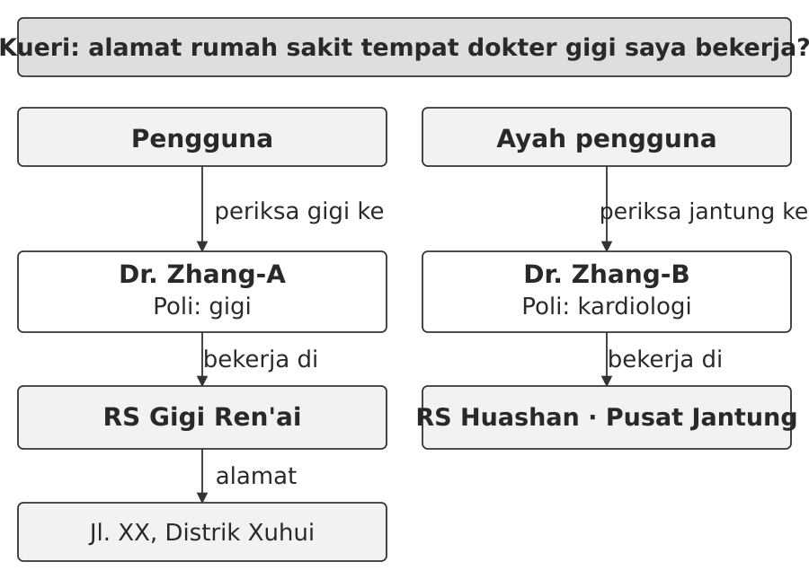

1. **Membedakan entitas bernama sama saat membangun graf.** Seorang Dr. Zhang merawat gigi pengguna di Rumah Sakit Gigi Ren'ai, sedangkan Dr. Zhang lainnya menangani penyakit jantung ayah pengguna di Rumah Sakit Huashan. Saat mengekstrak entitas dan menyatukan catatan, sistem dapat memakai petunjuk-petunjuk ini untuk memberi kedua dokter penanda yang berbeda. Field `person` dan `relationship` yang dibahas sebelumnya juga punya fungsi serupa. Menentukan apakah `bank` dalam sebuah kalimat berarti tepi sungai atau bank adalah disambiguasi makna kata; menentukan Dr. Zhang mana yang dimaksud suatu catatan adalah disambiguasi entitas.
2. **Menelusuri rantai relasi saat kueri.** Mulai dari pengguna, lalu telusuri "pengguna → dokter → rumah sakit → alamat" langkah demi langkah, sehingga informasi yang tersebar di beberapa catatan dapat dirangkai menjadi satu jawaban.

Alur pengindeksan GraphRAG dari Microsoft mula-mula mengekstrak entitas dan relasi dari unit teks, lalu mengenali kelompok entitas yang terhubung erat melalui deteksi komunitas, dan menghasilkan hierarki komunitas beserta ringkasannya. Saat menanyakan suatu entitas, pencarian lokal menggabungkan informasi yang terkait dengannya dan teks aslinya; saat menanyakan tema seluruh korpus, pencarian global memakai ringkasan komunitas untuk menyusun jawaban[^ch3-graphrag].

[^ch3-graphrag]: Microsoft GraphRAG, ikhtisar pengindeksan dan kueri, pencarian lokal, dan pencarian global.

Representasi relasi juga perlu menampung syarat dan waktu. Misalnya, "Kalau minggu depan masih hujan, saya batal ke pantai dan pergi ke museum saja" mengandung syarat, waktu berlaku, dan tindakan alternatif. Jika yang diekstrak hanya (pengguna, punya rencana, wisata pantai) dan (pengguna, punya rencana alternatif, kunjungan museum), syarat peralihannya hilang. Kalimat asli dapat disimpan utuh, sementara batasan "jika minggu depan hujan" direpresentasikan dengan simpul syarat, simpul peristiwa, atau field terstruktur, dan relasinya merujuk balik ke teks asli.

Untuk memori pengguna, penulis lebih menyarankan **perpaduan berlapis antara bahasa alami dan indeks terstruktur**: bahasa alami menyimpan ungkapan lengkap, metadata mencatat pihak, waktu, dan sumber, lalu indeks graf dibangun untuk isi yang sering perlu dikaitkan.

> **Eksperimen 3-7 ★★★: Membandingkan Ringkasan Hierarkis dan Indeks Relasional**
>
> Eksperimen ini memilih 14 halaman dari manual arsitektur Intel yang berkaitan dengan SSE, AVX, dan manajemen status, lalu membangun dua implementasi untuk keperluan pembelajaran. Cabang ringkasan hierarkis mula-mula membuat ringkasan per halaman, lalu mengelompokkannya menjadi tiga grup dan membuat ringkasan grup serta ringkasan akar; cabang indeks relasional mengekstrak entitas dan relasi, lalu membuat ringkasan komunitas. Kedua kelompok memakai bahan dan delapan pertanyaan yang sama untuk membandingkan detail konsep dan penalaran relasional.
>
> Untuk kueri "jelaskan lingkungan pemrograman SSE", ringkasan hierarkis dapat mencocokkan gambaran umum SSE sekaligus detail register. Implementasi ini menggabungkan simpul dari semua lapisan dalam satu retrieval dan memilih lima yang paling relevan. Cabang relasional memperluas tetangga dari entitas terkait dan menyusun konteks dengan ringkasan komunitas. Dengan menelusuri relasi seperti "SSE → register XMM → operasi floating point → ADDPS", konsep dapat dihubungkan dengan instruksi konkret.
>
> Pertanyaan yang lebih rumit adalah "Jika prosesor menyatakan mendukung AVX, apakah program sudah pasti dapat memakai AVX?" Pertanyaan ini mengharuskan kemampuan prosesor dikaitkan dengan manajemen status oleh sistem operasi: periksa flag AVX dan OSXSAVE pada CPUID, lalu baca XCR0 untuk memastikan status XMM dan YMM sudah diaktifkan. Petunjuk titik ujung yang diberikan soal ini kepada program retrieval graf adalah CPUID dan YMM. Program mencari jalur terpendek yang menghubungkan keduanya, melalui XSAVE, CR4.OSXSAVE, dan XCR0, lalu menyerahkan jalur itu kepada model untuk dijawab.
>
> Pada delapan pertanyaan, rata-rata cakupan halaman sumber kedua kelompok sama-sama sekitar 95,8%.

Penulis menyarankan agar pemenggalan dan retrieval hibrida dikerjakan dengan baik terlebih dahulu, dan indeks terstruktur baru dibangun ketika kebutuhan sintesis lintas dokumen dan kueri relasional muncul berulang kali. Menemukan satu paragraf kebijakan pengembalian dana biasanya cukup diselesaikan dengan pemenggalan dan retrieval hibrida; membandingkan SSE dengan AVX, atau menelusuri dari arsitektur keseluruhan hingga instruksi tertentu, lebih memerlukan ringkasan lintas paragraf dan indeks relasional.

### Paradigma Sistem Berkas: Menata Pengetahuan dengan Struktur Direktori

**OpenViking** menata memori, sumber daya, dan keterampilan dengan sistem berkas virtual. Setiap entri dirujuk melalui URI `viking://`, sehingga Agent dapat menjelajahi direktori, membaca ikhtisar, lalu mengakses isi yang dibutuhkan[^ch3-openviking-uri]. Berdasarkan kegunaan informasinya, direktori dapat dipahami sebagai tiga kelompok: sumber daya eksternal, data pengguna, serta keterampilan dan pengalaman yang dipakai Agent. Penanda pengguna dan penanda Agent lebih jauh membatasi ruang nama masing-masing.

| Isi | Kegunaan khas |
| --- | --- |
| Resources | Bahan eksternal seperti dokumentasi teknis, basis kode, dan halaman web |
| User memories | Preferensi, kebiasaan, dan pengalaman pengguna tertentu |
| Skills dan Agent memories | Alur yang dapat dipakai ulang, catatan tugas, dan pengalaman yang masih perlu diverifikasi |

URI menyediakan cara penunjukan lokasi yang seragam, sedangkan penyimpanan fisik dan indeks dikelola oleh layanan. Antarmuka direktori memungkinkan Agent menjelajah lapis demi lapis menurut topik, sekaligus membatasi pencarian semantik pada subpohon yang relevan. Akses bergaya sistem berkas, penyimpanan konten, dan indeks vektor dapat bersama-sama membentuk satu layanan.

[^ch3-openviking-uri]: OpenViking, Viking URI dan arsitektur sistem.

OpenViking membagi isi menjadi tiga lapisan, **L0, L1, dan L2**: L0 adalah ringkasan singkat untuk menilai dengan cepat apakah suatu direktori relevan; L1 adalah ikhtisar direktori yang menjelaskan isi utama dan titik masuk navigasi; L2 adalah teks lengkap yang perlu dibaca secara rinci. Ringkasan dan ikhtisar tingkat direktori masing-masing disimpan di `.abstract.md` dan `.overview.md`. Anggaran pembuatan teks keduanya masing-masing 256 dan 4000 karakter[^ch3-openviking-layers].

Kueri dapat membaca ringkasan lebih dulu untuk menentukan lokasi, lalu membaca ikhtisar untuk memilih berkas, dan terakhir memuat teks asli. Ini sejalan dengan pengungkapan bertahap Skills di Bab 2: direktori yang ringan mendukung penemuan, sedangkan isi lengkap dimuat sesuai kebutuhan tugas. Jika diperlukan angka yang persis, syarat, atau rumusan asli, teks lengkap yang bersangkutan tetap harus diambil.

[^ch3-openviking-layers]: OpenViking, Context Layers (L0/L1/L2). L0 dan L1 adalah representasi yang dihasilkan pada tingkat direktori; L2 dapat berupa berkas asli atau teks hasil penguraian.

Untuk pengetahuan yang perlu dipelihara bersama oleh manusia dan Agent, penulis cenderung mengelolanya dengan **teks polos Markdown dan kontrol versi**. Manusia dapat langsung membaca, menyunting, dan membetulkan pengetahuan, sedangkan Agent dapat memakai antarmuka berkas yang sama untuk mengusulkan pembaruan di cabang kerja, yang kemudian dirilis setelah ditinjau. Kontrol versi menyimpan selisih setiap perubahan dan memungkinkan pembaruan yang keliru dibatalkan. Saat sesi berakhir, preferensi pengguna masuk ke memori pengguna yang bersangkutan, dan jalannya operasi masuk ke catatan tugas. Setelah melalui evaluasi hasil, perangkuman lintas trajectory, dan verifikasi lanjutan, catatan tugas dapat berkembang menjadi pengalaman yang dibahas di Bab 9.

Jika pengetahuan ditata dengan sistem berkas, kita harus sekaligus **membangun tautan dan indeks untuk entri-entri yang berkaitan**. Sekumpulan berkas yang tidak saling merujuk hanya dapat menemukan kembali keterkaitannya melalui pemindaian teks penuh atau retrieval semantik; makin banyak berkasnya, makin sulit Agent melanjutkan penelusuran dari isi yang sudah ditemukannya. Tautan menyediakan jalur pencarian yang jelas, misalnya kebijakan pengembalian dana menunjuk ke ketentuan pengecualian, ringkasan kontrak menunjuk ke catatan penandatanganan, dan entri tokoh menunjuk ke peristiwa terkait. Halaman utama menjelaskan topik-topik pokok, halaman indeks menyediakan navigasi, dan rujukan silang antarentri mendukung pencarian ke samping. Cara ini mirip penataan entri ensiklopedia, dan dapat menyimpan sebagian relasi dengan cara yang relatif ringan.

Saat membangun basis data, kita juga dapat menandai entri mana yang boleh dipakai bersama dan rencana tindakan mana yang hanya boleh dipilih salah satu dalam satu kali penanganan. Misalnya, ketika layanan pelanggan menangani permintaan pembatalan pesanan, balasan kepada pelanggan harus mematuhi pedoman tata bahasa sekaligus pedoman privasi, sehingga kedua pedoman itu dapat dimasukkan bersama ke konteks. Jika gudang menyiapkan dua rencana tindakan untuk pembatalan pengiriman, syarat berlakunya masing-masing harus ditulis jelas di indeks. Untuk paket yang sama, jika belum keluar gudang, perintah pengeluaran dibatalkan; jika sudah diserahkan ke kurir, diajukan permintaan pencegatan. Jika tiket layanan hanya berisi "tolong batalkan pesanan", Agent harus memeriksa status paket terlebih dahulu, lalu memuat rencana tindakan yang berlaku.

Pemeliharaan tautan harus dimasukkan ke alur pembaruan: sebelum menambah entri, cari dulu catatan yang sudah ada untuk menentukan apakah perlu digabung atau dibuat baru; setelah ditulis, lengkapi rujukan terkait dan perbarui indeks direktori tempatnya berada. Tautan dapat membawa pembaca ke suatu ketentuan, tetapi apakah ketentuan itu berlaku untuk pesanan yang sedang ditangani masih bergantung pada kapan ketentuan itu mulai berlaku.

### Bagaimana Pengetahuan Harus Diperbarui

Sebuah kebijakan diubah hari ini; besok pengguna mungkin bertanya "sekarang saya harus bagaimana", atau mungkin bertanya "mengapa pesanan saya bulan lalu ditangani seperti itu". Jika ketentuan lama hanya ditimpa dengan ketentuan baru, pertanyaan kedua kehilangan dasarnya pada waktu itu. **Pembaruan inkremental** segera menuliskan bukti baru, sedangkan **penataan berkala** menemukan duplikasi, konflik, dan perubahan struktur dari cakupan yang lebih luas; kedua jalur harus menyimpan versi dan rujukan bukti serta diperiksa sebelum dirilis, agar periode yang berlaku dapat dipilih sesuai pertanyaan.

#### Pembaruan Inkremental Memori Pengguna dan Basis Pengetahuan

Saran penulis: **perlakukan basis pengetahuan seperti basis kode, dan setiap perubahan pengetahuan seperti sebuah Pull Request (PR).** Satu pembaruan harus punya cakupan perubahan yang jelas dan disertai bukti yang mendukungnya, agar dapat diperiksa peninjau. Dokumen Markdown, berkas aturan, dan status yang dapat dieksekusi dari User as Code semuanya dapat dimasukkan ke alur ini. Riwayat versi membantu pemelihara melihat perubahan, menelusuri penyebabnya, dan memulihkan keadaan setelah rilis yang keliru.

Dengan pola **pengusul–peninjau** dari Bab 1, satu pembaruan dapat berjalan seperti ini:

1. **Pengusul membuat perubahan.** Proposer Agent membaca bukti baru, mencari pengetahuan yang sudah ada, menemukan entri yang perlu ditambah, dikoreksi, atau sudah kedaluwarsa, lalu mengajukan perubahan dengan cakupan jelas di cabang kerja. Ia juga memelihara tautan terkait, indeks direktori, informasi waktu, dan rujukan bukti.
2. **Peninjau memeriksa secara independen.** Reviewer Agent membandingkan isi sebelum dan sesudah perubahan dengan bukti aslinya, memeriksa apakah pernyataan baru punya sumber, apakah syarat berlakunya sudah ditulis lengkap, apakah pernyataan di berkas yang berbeda konsisten, dan apakah paragraf yang dihapus masih memuat informasi yang berguna. Jika menemukan masalah, ia menunjuk entri dan dasar yang spesifik, serta menjelaskan apa yang perlu ditambahkan, dipulihkan, atau dikoreksi.
3. **Iterasi dan pengambilan keputusan.** Pengusul merevisi sesuai masukan, dan peninjau memeriksa ulang. Setelah lolos tinjauan, perubahan masuk ke alur penggabungan; jika batas jumlah putaran atau biaya tercapai dan masih ada perselisihan, perubahan itu dibiarkan di cabang kerja dan diserahkan kepada manusia untuk ditinjau.
4. **Pemeriksaan dan rilis.** Format, tautan, metadata, dan label izin diperiksa secara otomatis; pengetahuan yang dapat dieksekusi juga harus lolos pemeriksaan tipe dan pengujian terkait. Setelah digabungkan, potongan, ringkasan, dan indeks vektor yang terdampak dibangun ulang dari versi pengetahuan yang sudah pasti, lalu versi layanan dirilis.

Alur ini berkaitan dengan tiga lapisan data. **Lapisan bukti asli** menyimpan percakapan, trajectory eksekusi, dokumen bisnis, dan hasil alat; **lapisan pengetahuan** menyimpan teks atau kode yang sudah disarikan dan dapat direvisi; **lapisan layanan** menyimpan indeks yang dihasilkan dari versi pengetahuan tertentu. Catatan perubahan menghubungkan penanda bukti, versi pengetahuan, masukan tinjauan, dan keputusan akhir, sehingga pemelihara dapat menelusuri mengapa suatu pengetahuan ditulis dan kapan mulai berlaku. Bukti asli diarsipkan sesuai kebijakan retensi, sedangkan indeks dapat dibangun ulang dari versi pengetahuan. Memori bergaya *append* yang dibahas sebelumnya cocok untuk menyimpan fakta lama dan baru beserta sumbernya; alur tinjauan di sini bertugas merapikan bukti-bukti itu menjadi versi pengetahuan yang siap dipakai. Jika saat kueri ditemukan konflik yang belum terselesaikan, bukti masih dapat ditelusuri kembali dan dinilai berdasarkan syarat tugas.

Dalam rancangan ini, **pengusul dan peninjau sama-sama harus berupa Agent yang dapat memanggil alat dan terus melakukan kueri.** Pengusul mungkin perlu mencari di banyak catatan untuk menemukan entri yang terdampak; peninjau juga mungkin perlu menelusuri rujukan lebih lanjut, membandingkan versi, atau menjalankan pemeriksaan. Alat pencarian berkas, retrieval bukti, peninjauan selisih, dan pengujian memungkinkan keduanya menangani langkah-langkah lanjutan ini; Coding Agent yang memiliki kemampuan tersebut dapat mengemban pekerjaan seperti ini.

Cakupan retrieval keduanya harus meliputi pengetahuan dan bukti asli yang terkait dengan perubahan saat ini, serta dibatasi oleh izin pengguna, tenant, dan tugas. Trajectory tinjauan, hasil alat yang dirujuk, dan umpan balik diarsipkan bersama, sehingga di kemudian hari dapat diperiksa apa yang benar-benar diverifikasi peninjau.

Dalam pemilihan model, penulis menyarankan untuk mengutamakan pasangan dengan kemampuan setara yang berasal dari keluarga berbeda, misalnya Claude dan GPT, atau DeepSeek dan Kimi. Data pelatihan dan kebiasaan penalaran yang berbeda dapat menghasilkan penilaian yang berbeda pula. Peninjau harus mencari bukti secara independen dan memeriksa pernyataan serta syarat dalam perubahan. Izin harus ditegakkan oleh sistem yang berjalan: pengusul menulis ke cabang kerja, peninjau membaca bukti dan menyerahkan kesimpulan, sedangkan layanan penggabungan dan rilis memegang hak pembaruan atas repositori utama dan indeks daring.

#### Penataan Berkala Memori Pengguna dan Basis Pengetahuan

Setelah banyak pembaruan lokal, satu fakta yang sama bisa tersebar di beberapa berkas, dan rumusan lama serta baru bisa hadir berdampingan. Penataan berkala memeriksa masalah yang menumpuk ini dengan bertolak dari direktori, waktu, atau topik. Cara kerjanya serupa dengan tinjauan periodik yang dibahas di Bab 9: bukti baru dikumpulkan di latar depan, penataan dilakukan secara terpusat di latar belakang, dan hasilnya menjadi catatan yang dapat dipakai tugas-tugas berikutnya.

Penataan mencakup tiga pekerjaan.

1. **Menghapus duplikasi, menggabungkan, dan menyesuaikan struktur.** Temukan entri yang berulang, kedaluwarsa, atau terlalu terpecah, gabungkan isi yang terkait, pecah berkas yang terlalu besar, lalu perbarui tautan, halaman utama, dan halaman indeks. Saat menghapus rumusan lama dari layanan, catat relasi penggantinya dan dasar aslinya.
2. **Menelusuri kembali bahan asli.** Jika setiap putaran penataan hanya menulis ulang ringkasan putaran sebelumnya, kelalaian dan salah paham awal akan terus terbawa dari putaran ke putaran. Karena itu, ringkasan harus dicocokkan dengan percakapan, trajectory eksekusi, dokumen bisnis, dan keluaran alat untuk memeriksa apakah ada fakta kunci yang terlewat, apakah negasi, waktu, atau syarat hilang, dan apakah dugaan ditulis sebagai kesimpulan pasti. Basis pengetahuan berukuran besar dapat diproses bertahap menurut direktori, waktu, atau topik, dengan daftar cakupan yang mencatat bagian yang sudah diperiksa, belum diperiksa, dan masih diperdebatkan, hingga pemeriksaan seluruh basis selesai.
3. **Menangani konflik dan cakupan berlaku.** Bandingkan sumber catatan yang bertentangan, serta waktu, pihak, wilayah, tugas, dan prasyaratnya. Jika kedua informasi berlaku untuk situasi yang berbeda, lengkapi cakupan masing-masing; jika bukti baru secara tegas menggantikan aturan lama, simpan relasi versinya; jika dasarnya belum cukup, catat butir yang perlu dikonfirmasi dan bukti yang perlu dilengkapi.

Hasil penataan juga diajukan sebagai perubahan untuk ditinjau. Penataan ulang yang besar dapat dipecah menjadi beberapa PR menurut direktori atau topik, dengan rencana penataan dan daftar cakupan yang sama; setelah perubahan terkait disetujui, indeks turunan dibangun ulang, lalu kasus uji retrieval dan tanya jawab yang khas diputar ulang untuk memeriksa apakah pengetahuan yang sebelumnya dapat ditemukan masih dapat diakses. Pemicunya dapat berupa jadwal mingguan atau bulanan, atau ambang batas berdasarkan jumlah entri baru, jumlah konflik, atau perubahan kualitas retrieval.

**Menurunkan isi yang sudah tidak berlaku.** Potongan dan ringkasan harus menyimpan versi, waktu mulai berlaku, dan waktu berakhir. Setelah kebijakan lama digantikan, kueri bisnis saat ini menyaring versi yang tidak berlaku, sedangkan kueri historis membaca aturan yang sesuai dengan waktu sasaran. Dengan begitu, pengetahuan terbaru dapat dipakai sekaligus hasil penanganan di masa lalu tetap dapat dijelaskan.

**Izin dan isolasi tenant.** Penyaringan izin harus dilakukan di lapisan retrieval: layanan retrieval lebih dulu menetapkan cakupan dokumen yang boleh dicari berdasarkan identitas pemanggil, lalu mencari bahan yang relevan di dalamnya. Begitu data pribadi pengguna lain masuk ke konteks, model dapat membocorkannya saat menjawab atau memanggil alat. Teks asli, ringkasan, sisi relasi, dan hasil cache semuanya harus mewarisi cakupan akses yang sesuai, agar informasi pengguna atau tenant lain tidak terbawa keluar melalui isi turunan. Layanan dapat memakai indeks terpisah atau indeks bersama yang mampu menegakkan penyaringan secara wajib; yang terpenting, setiap kueri harus menjalankan batasan izin.

### Agentic RAG: Agent Mengendalikan Proses Retrieval

Pertama, tanyakan apakah satu kali retrieval sudah cukup. Untuk pertanyaan seperti "berapa nomor telepon layanan purnajual", satu buku panduan layanan yang berlaku biasanya sudah memberi jawabannya, dan penulis menyarankan tetap memakai jalur sederhana: sekali retrieval, lalu pembangkitan. Jika pengguna bertanya "apakah model yang saya beli bisa ditukar berdasarkan ketentuan garansi bulan lalu", retrieval pertama mungkin hanya menemukan seri produknya, sehingga syarat penukaran bulan lalu belum dapat dinilai. Jika retrieval dibuka sebagai alat, Agent dapat memakai petunjuk dari hasil sebelumnya untuk menyusun kueri berikutnya. Cara ini, ketika Agent memutuskan apakah perlu mencari lagi dan apa yang dicari berikutnya, disebut **Agentic RAG**. Pada Gambar 3-12, data produk yang dikembalikan pada pencarian pertama sama persis. Petunjuk tambahan apa yang dipakai jalur sebelah kanan sehingga dapat menemukan ketentuan yang berlaku saat itu?

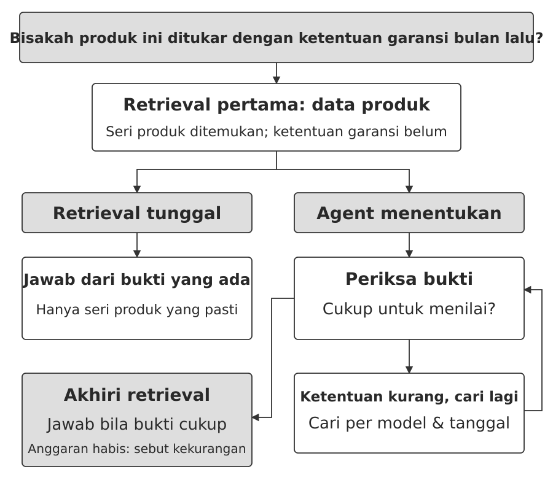

Dengan ReAct sebagai contoh, model lebih dulu menganalisis pertanyaan dan memilih kueri, lalu memanggil `knowledge_base_search`; setelah alat mengembalikan observasi, model menilai apakah buktinya sudah cukup. Jika syarat atau pihak terkait masih kurang, kueri ditulis ulang dan retrieval dilanjutkan; jika bahannya sudah memadai, jawaban dibuat dengan menyertakan sumbernya. Harness memelihara riwayat, *tool call*, dan anggaran, serta menghentikan pencarian atau beralih ke klarifikasi ketika batasnya tercapai.

Sekarang lihat Gambar 3-13. Sekalipun backend basis pengetahuan diganti dari indeks vektor menjadi graf relasi, model tetap dapat meminta pencarian melalui antarmuka alat yang sama. Jika dokumen yang dikembalikan kebetulan memuat sepotong instruksi, bolehkah model menjalankannya begitu saja?

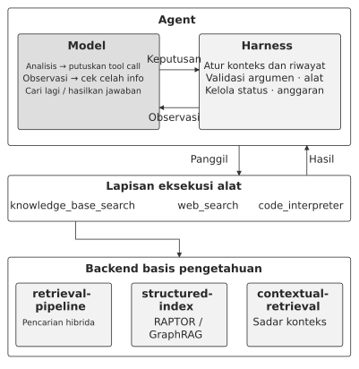

**Batas kepercayaan isi hasil retrieval.** Dokumen eksternal dapat memuat teks yang berusaha mengubah perilaku model, dan dapat pula disusupi fakta keliru sebelum masuk basis data. Yang pertama menyangkut injeksi *prompt* tidak langsung, sedangkan yang kedua termasuk peracunan basis pengetahuan. Penanganannya harus mengelola sumber isi dan izin eksekusi sekaligus: hasil retrieval membawa sumber, versi, dan lokasi kutipan sebagai bukti jawaban; tindakan seperti transfer dana, penghapusan, dan pengiriman pesan keluar diverifikasi oleh Harness dan lingkungan eksekusi berdasarkan otorisasi pengguna. Tinjauan sebelum masuk basis data, penelusuran sumber, dan pemeriksaan fakta lebih jauh mengendalikan penyebaran pengetahuan yang keliru. Penandaan sumber yang dibahas di Bab 2 dan batasan alat di Bab 4 bekerja bersama di sini.

> **Eksperimen 3-8 ★★: Membandingkan Retrieval Sekali Jalan dan Retrieval Multiputaran**
>
> Eksperimen ini memakai bahan hukum berbahasa Tionghoa yang sama, retriever BM25 yang sama, dan model yang sama untuk membandingkan dua mode pada tujuh pertanyaan: mode dasar mencari sekali berdasarkan pertanyaan asli, sedangkan mode Agent mengizinkan model menyesuaikan kueri dan menjalankan paling banyak empat kali pencarian.
>
> Untuk kueri seperti "bagaimana ketentuan tentang pembelaan diri yang sah", retrieval langsung sudah memperoleh pasal-pasal utamanya. Contoh yang lebih rumit adalah "bagaimana penjatuhan pidana bagi orang yang dalam keadaan mabuk karena kelalaiannya menyebabkan luka berat pada orang lain dan pernah dihukum karena pencurian". Pertanyaan ini sekaligus menyangkut perbuatan saat ini, keadaan mabuk, dan catatan sebelumnya, sehingga retrieval perlu menemukan bahan terkait masing-masing, lalu memeriksa syarat berlakunya.
>
> Dalam eksekusi sebenarnya, pencarian dilakukan berturut-turut dengan "醉酒过失致人重伤 盗窃前科 量刑", "醉酒 犯罪 量刑", "盗窃前科 量刑影响 刑法", dan "前科 量刑影响 刑法". Setelah itu model masih mengajukan "累犯 认定 刑法", tetapi anggaran pencarian sudah habis, sehingga Harness mengembalikan informasi bahwa anggaran telah habis.
>
> Pada empat pertanyaan rumit dalam pembagian eksperimen, cakupan pasal sasaran naik dari sekitar 8% menjadi 92%, rata-rata jumlah pencarian naik dari satu menjadi 3,5 kali, dan rata-rata waktu tahap penjawaban naik dari sekitar 8 detik menjadi 66 detik. Pada tiga pertanyaan sederhana, cakupan bukti semuanya 100%, dan kedua kelompok hanya mencari sekali.

Loop retrieval yang sama juga dapat dipakai untuk riwayat pengguna. Berikut kita pakai lagi set evaluasi tiga tingkat dari Eksperimen 3-1 untuk mengamati bagaimana Agent mengambil fakta dari catatan lintas sesi, membedakan pihak, dan menangani pembaruan.

> **Eksperimen 3-9 ★★: Membaca Memori Pengguna dengan Retrieval Agentic**
>
> Eksperimen ini menjadikan seluruh riwayat percakapan sebagai basis pengetahuan, memecahnya berdasarkan jendela lalu membangun indeks, kemudian menyediakan alat `search_user_memory` bagi Agent. Ukuran jendela dapat diatur; dalam putaran ini setiap potongan berisi delapan giliran percakapan dengan tumpang tindih dua giliran antarpotongan, serta menyimpan penanda sesi, waktu, dan metadata bisnis. Kueri dijalankan paling banyak tiga kali, dan setiap kali mengambil empat potongan.
>
> Pengingatan dasar dapat dicari berdasarkan field yang jelas, misalnya "berapa nomor rekening giro saya". Pertanyaan multi-sesi juga perlu memeriksa apakah pihak yang dimaksud sudah lengkap: pengguna punya Honda Accord dan Tesla Model 3, sehingga ketika menanyakan jadwal servis kendaraan, sistem harus membedakan kedua mobil beserta status janji servisnya masing-masing.
>
> Dari sini dapat dirancang rute retrieval: pertama cari catatan kendaraan dan servis; setelah menemukan petunjuk tentang mobil kedua, cari jadwal untuk Tesla; terakhir jelaskan janji servis Honda yang sudah ada, dan pastikan apakah pengguna masih perlu membuat janji untuk Tesla. Catatan eksekusi kali ini hanya menjalankan satu kueri `scheduled car services`, dan jawaban kelompok retrieval biasa berpusat pada Honda serta melewatkan Tesla.
>
> Kesulitan lain berasal dari perubahan yang berturut-turut. Dalam kasus transfer dana, sang istri membuat pengaturan, sang suami kemudian mengubah jumlah dan tanggalnya, lalu sang istri menyesuaikannya lagi. Setelah catatan diambil, perubahan itu harus direkonstruksi menurut waktu, pihak, dan status konfirmasinya untuk menemukan instruksi yang akhirnya berlaku. Potongan saat ini sudah menyimpan informasi waktu, tetapi retrieval tetap bisa melewatkan perubahan penting, sehingga potongan dapat dilengkapi lebih lanjut dengan latar peristiwanya.
>
> Dari 60 kasus ini, 18 kasus hanya mencari sekali, 6 kasus mencari dua kali, dan 36 kasus memakai ketiga kesempatan. Kelompok retrieval potongan biasa meluluskan 47 kasus: 19 pada pengingatan dasar, 15 pada retrieval multi-sesi, dan 13 pada layanan proaktif. Bagian berikutnya melanjutkan perbandingan prefiks konteks dan memori terstruktur pada kasus yang sama, untuk menganalisis informasi apa yang ditambahkan masing-masing.

### Retrieval Sadar Konteks: Melengkapi Latar Belakang Potongan

Kembali ke laporan keuangan tadi. Untuk mencari kinerja ACME pada kuartal kedua 2025, kueri memuat nama perusahaan dan tahun, tetapi potongan yang bertuliskan "Pendapatan perusahaan itu tumbuh 3%" justru tidak memuat kedua kata tersebut. Selain memperbesar potongan, kita dapat mempertahankan teks pendek itu dan menambahkan latar yang hilang di depannya. **Retrieval sadar konteks (*Contextual Retrieval*)** membuat prefiks latar yang singkat untuk setiap potongan saat membangun indeks, lalu memakai prefiks itu bersama teks aslinya untuk retrieval[^ch3-1]. Gambar 3-14 memperlihatkan proses ini.

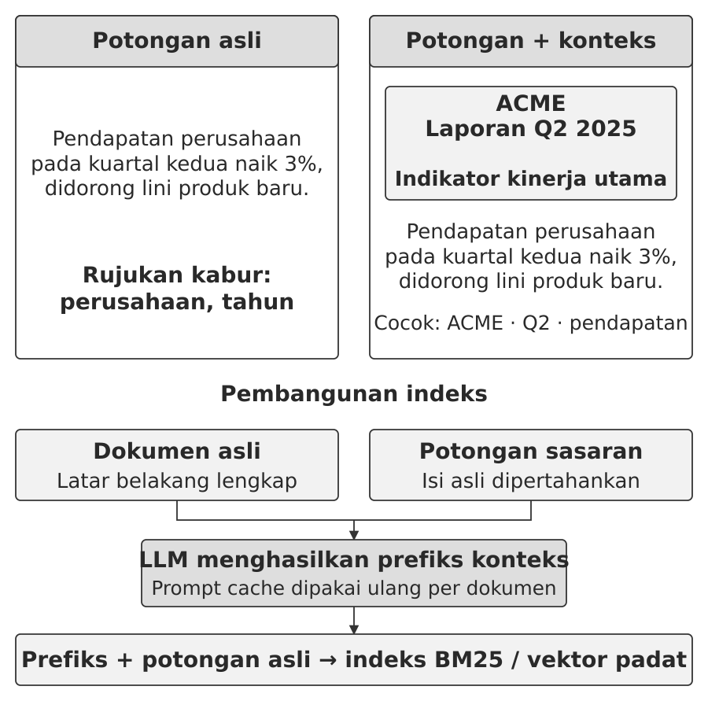

Misalnya, prefiks dapat menjelaskan "paragraf ini berasal dari bagian indikator kinerja utama dalam laporan kuartal kedua 2025 perusahaan ACME". Saat membuatnya, teks asli dan potongan sasaran diberikan bersama, agar model melengkapi rujukan, waktu, dan informasi bab yang memang ada dasarnya. Dengan begitu, BM25 memperoleh istilah yang dapat dicocokkan seperti nama perusahaan dan kuartal, dan embedding padat juga dapat merepresentasikan potongan dengan memperhitungkan latar tersebut.

Teknik ini dapat dipadukan dengan kompresi sadar konteks di Bab 2: pada tahap pengindeksan, latar ditambahkan ke potongan pengetahuan untuk memperbesar peluang menemukan informasi yang relevan; pada tahap eksekusi, riwayat yang sudah diambil ditata sesuai tugas saat ini untuk mengendalikan panjang input. Yang pertama berfokus pada seberapa mudah potongan ditemukan, yang kedua pada informasi dan anggaran yang dibutuhkan untuk keputusan saat ini.

[^ch3-1]: Anthropic, Introducing Contextual Retrieval, September 2024.

> **Eksperimen 3-10 ★★: Membandingkan Potongan Asli dan Potongan yang Diperkaya Konteks**
>
> Eksperimen ini membangun dua indeks untuk bahan yang sama: satu memakai potongan asli, yang lain menambahkan prefiks yang dibuat model. Dengan kueri dan label sasaran yang sama, BM25, retrieval padat, dan retrieval hibrida dibandingkan masing-masing.
>
> Dengan contoh laporan keuangan tadi, untuk kueri "pertumbuhan pendapatan terbaru perusahaan ACME", kita dapat memeriksa apakah potongan yang ditemukan memuat perusahaan sasaran, periode, dan data pertumbuhan sekaligus. Jika hanya ada "pertumbuhan pendapatan", hasilnya bisa cocok dengan perusahaan lain; setelah prefiks ditambahkan, nama perusahaan dan waktu ikut menentukan peringkat.
>
> Pada 15 kueri dalam putaran ini, setelah prefiks ditambahkan, recall@1 BM25 naik dari 0,60 menjadi 0,80, dan retrieval padat naik dari sekitar 0,867 menjadi 0,933; recall@3 keduanya tetap 0,867 dan 1,0. Recall@5 retrieval hibrida naik dari 14/15 menjadi 15/15. Soal mana yang tambahan ditemukan? Untuk kueri tentang wewenang Komite Tetap Kongres Rakyat Nasional, potongan sasaran mencantumkan wewenangnya tetapi tidak memuat subjeknya. Setelah prefiks ditambahkan, BM25 menaikkannya dari peringkat 16 ke peringkat 12, masih di luar lima besar; retrieval hibrida menaikkannya dari peringkat 6 ke peringkat 5, dan barulah ia masuk lima besar. Jika teks aslinya dibaca lagi, potongan pertama mencantumkan wewenang butir (1) sampai (4), dan potongan kelima melanjutkan dari butir (4) sampai butir (22). Penilaian hanya memeriksa apakah potongan kelima yang dilabeli ikut terpilih, padahal untuk mencantumkan semua wewenang, kedua potongan itu harus disambung.
>
> Pembuatan prefiks menambah panggilan pada tahap pengindeksan. Saat membuat latar untuk banyak potongan dari dokumen yang sama, cache prefiks dokumen dapat dipakai ulang. Dalam laporan 2024, Anthropic memperkirakan, dengan potongan 800 token, dokumen 8000 token, dan panjang *prompt* tertentu, biaya pemrosesan satu kali sekitar 1,02 dolar AS per sejuta token dokumen.
>
> Dalam laporan tersebut, embedding kontekstual yang dipadukan dengan BM25 menurunkan tingkat kegagalan retrieval top-20 dari 5,7% menjadi 2,9%, turun relatif sekitar 49%; setelah pengurutan ulang ditambahkan, angkanya turun menjadi 1,9%, turun relatif sekitar 67%. Tingkat kegagalan yang dipakai laporan itu adalah $1-\mathrm{recall@20}$.

Untuk koleksi dokumen yang sering dikueri dan isinya relatif stabil, penulis menyarankan agar latar potongan dilengkapi lebih dulu saat membangun indeks; satu kali pemrosesan dapat melayani banyak kueri berikutnya. Jika nama perusahaan, subjek peristiwa, dan waktu hilang saat pemenggalan, sekadar memperbesar jumlah hasil retrieval tetap bisa mengembalikan sekumpulan potongan yang rujukannya tidak jelas. Jika petunjuk-petunjuk ini dilengkapi saat membuat prefiks, retrieval berikutnya dapat memanfaatkannya untuk menemukan bahan.

> **Eksperimen 3-11 ★★★: Memperkuat Memori dengan Prefiks Konteks dan Kartu Terstruktur**
>
> Kalimat "Oke, pesan yang ini saja" dalam percakapan perlu dikaitkan dengan barang atau rencana perjalanan yang dibahas sebelumnya. Jika teks aslinya membahas tiket sekali jalan Shanghai–Seattle seharga 500 dolar AS, prefiks dapat melengkapi latar ini sekaligus mempertahankan sesi dan waktu terjadinya konfirmasi.
>
> Eksperimen ini menambahkan dua konfigurasi pada pemenggalan biasa: kelompok prefiks konteks, dan kelompok memori dua lapis yang juga memuat Advanced JSON Cards. Model lebih dulu membuat urutan pencarian berdasarkan indeks biasa, lalu kumpulan kueri yang sama dipakai pada kedua indeks; kelompok dua lapis memakai hasil retrieval yang diperkuat yang sama, ditambah kartu terstruktur.
>
> Dalam kasus transfer dana, prefiks masing-masing menjelaskan bahwa Patricia memulai transfer, James mengubah pengaturannya, dan Patricia menyesuaikannya lagi, sehingga membantu menentukan urutan peristiwa. Catatan asli memberikan status akhir 95.000 dolar AS pada 1 Oktober, dan pengaturan sebelumnya sudah digantikan. Dalam putaran ini, ketiga kelompok berhasil menemukan status tersebut dengan benar.
>
> Struktur dua lapis juga dapat mendukung pengaitan proaktif. Kartu menyimpan fakta kunci seperti "perjalanan ke Tokyo" dan "masa berlaku paspor", sedangkan percakapan rinci diambil sesuai kebutuhan. Dengan contoh perjalanan 15–22 Januari dan paspor yang habis berlaku pada 18 Februari, sistem dapat lebih dulu menyadari bahwa tanggalnya berdekatan, lalu mencari catatan perpanjangan dan persyaratan perjalanan, dan akhirnya mengingatkan pengguna untuk memastikan persiapan yang belum selesai. Dalam kasus perjalanan ini, jawaban ketiga kelompok lolos penilaian; perbedaan antara kartu dan retrieval terutama terlihat pada kasus kendaraan dan kasus lintas sesi berikut.
>
> Dari keseluruhan 60 kasus, retrieval biasa, prefiks konteks, dan memori dua lapis masing-masing meluluskan 47, 52, dan 57 kasus. Kasus layanan proaktif yang lulus pada kelompok prefiks naik dari 13 menjadi 18; kelompok dua lapis meluluskan seluruh 20 kasus pada tingkat retrieval multi-sesi, dan juga 18 kasus pada tingkat layanan proaktif. Dalam kasus kendaraan, kartu melengkapi informasi mobil kedua, sehingga jawabannya mencakup pihak yang sebelumnya terlewat. Sekarang lihat salah satu kemunduran: pengguna menanyakan cakupan perlindungan kerusakan air pada properti; kelompok biasa menyebut rumah yang ditinggali sendiri dan rumah sewaan, tetapi kelompok prefiks melewatkan rumah sewaan. Perbandingan per soal menunjukkan bahwa kelompok prefiks menjawab benar 8 soal lebih banyak dari kelompok biasa, tetapi juga kehilangan 3 soal yang sebelumnya dijawab benar.

**Jika diperlukan layanan proaktif, penulis lebih memilih arsitektur dua lapis: fakta kunci selalu tersedia, catatan rinci diambil sesuai kebutuhan.** Jika hanya mengandalkan retrieval, model sering harus tahu dulu apa yang perlu ditanyakan sebelum dapat menemukan catatan terkait; paspor, kendaraan, atau hubungan keluarga yang belum masuk ke pandangannya mudah terlewat karenanya. Menaruh sedikit fakta kunci di konteks sejak awal membantu model menemukan keterkaitan, mengajukan kueri, lalu mengambil detail aslinya. Saat memilih informasi yang selalu tersedia, perlu dipertimbangkan hubungan antarorang, batasan saat ini, dan urusan yang belum selesai; sementara itu, hasil retrieval menyimpan sumber, waktu, dan dasar perubahan.

### Mengekstrak Pengetahuan dari Dataset: Dari Kasus ke Representasi Terstruktur

Pengetahuan juga dapat berasal dari penataan sejumlah besar kasus. Dalam putusan pengadilan, tiket layanan pelanggan, dan catatan perbaikan, banyak informasi berguna tersebar di dalam narasi yang spesifik. Jika tugas mengharuskan perumusan pola dari banyak kasus, perbandingan hasil, atau keputusan tentang apa yang perlu ditanyakan lebih lanjut, penulis menyarankan agar field yang seragam diekstrak lebih dulu, baru kemudian dilakukan statistik dan perumusan prototipe. Jika hanya mengambil beberapa kasus yang mirip, sebaran di seluruh dataset sulit terlihat; setelah field diseragamkan, statistik dapat dihitung untuk seluruh catatan dan menyediakan gambaran umum bagi kueri kasus individual berikutnya.

Proses ini dapat dibagi menjadi dua langkah. **Ekstraksi pengetahuan** mengubah deskripsi asli menjadi catatan terstruktur dengan makna, nilai, dan sumber field yang jelas; **analisis pola** kemudian memakai statistik dan pengelompokan untuk mencari kasus yang mirip beserta ciri bersamanya. Gambar 3-15 memperlihatkan alur dari ekstraksi kasus dan pengodean fitur hingga retrieval prototipe.

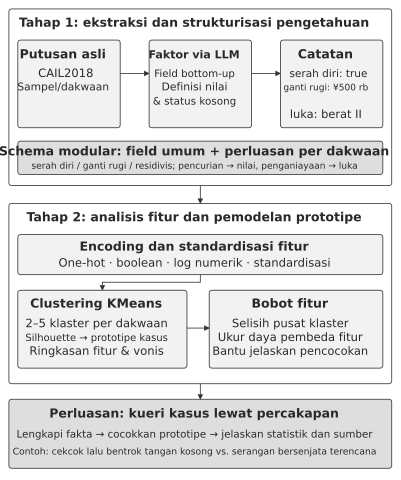

> **Eksperimen 3-12 ★★★: Mengekstrak Faktor dan Prototipe dari Kasus Peradilan**
>
> Eksperimen ini memakai bahan perkara pidana dari CAIL2018, memilih sampel dari tiga jenis perkara, yaitu pencurian, penganiayaan dengan sengaja, dan penipuan, lalu membangun alur pembelajaran "penemuan faktor—ekstraksi field—pengelompokan—penjelasan prototipe"[^ch3-cail]. Setiap jenis mengambil 120 sampel untuk pemodelan dan menyisihkan 20 sampel lagi, sehingga terbentuk 360 sampel pemodelan dan 60 sampel uji yang disisihkan.
>
> **Menemukan dan merapikan field.** Model lebih dulu membaca sampel pemodelan secara bertahap, mengusulkan faktor yang mungkin berguna, lalu menggabungkannya menjadi Schema modular. Bagian umum menyimpan field yang perlu diperhatikan untuk banyak jenis tindak pidana, seperti menyerahkan diri dan pemberian ganti rugi; bagian perluasan menyimpan informasi yang berkaitan dengan tindak pidana tertentu, seperti nilai kerugian atau tingkat luka. Penataan kali ini menghasilkan 16 field umum dan tiga kelompok perluasan yang masing-masing berisi 12, 12, dan 11 field. Setiap field juga perlu didefinisikan nilai dan status kosongnya agar ekstraksinya konsisten.
>
> **Mengodekan field menjadi vektor.** Field kategori dapat memakai *one-hot encoding*: sebagai ilustrasi, tiga kategori pencurian, perampokan, dan penipuan masing-masing dikodekan sebagai `[1,0,0]`, `[0,1,0]`, dan `[0,0,1]`, dan setiap posisi hanya menyatakan apakah termasuk kategori itu. Jika memakai 1, 2, dan 3, sebagian algoritma akan menangkap urutan dan jarak di antara kategori. Field seperti "menyerahkan diri atau tidak" dan "memberi ganti rugi atau tidak" dapat memakai 1 dan 0 untuk dua status yang sudah dipastikan; keadaan yang tidak disebut dalam teks asli harus ditangani tersendiri, agar ketiadaan data tidak otomatis dianggap sebagai jawaban "tidak".
>
> Untuk nilai nonnegatif dengan rentang besar seperti jumlah uang, implementasi ini lebih dulu memakai $\ln(1+x)$ untuk memampatkan skalanya, baru kemudian ikut distandardisasi. Jika suatu field boleh memuat beberapa kategori sekaligus, misalnya satu catatan memuat beberapa tindakan penanganan, setiap kategori dapat diberi bit penanda tersendiri sehingga terbentuk *multi-hot encoding*.
>
> **Membangun prototipe perkara.** Fitur yang sudah dikodekan distandardisasi, lalu dikelompokkan secara terpisah untuk setiap jenis tindak pidana. Implementasi ini membandingkan dua hingga lima klaster, memilih pengelompokan dengan koefisien siluet, dan akhirnya membentuk 11 prototipe. Setiap prototipe menyimpan jumlah sampel, ciri utama, serta median, kuartil, dan rentang lama hukuman sampelnya. Misalnya, dengan bertumpu pada penyebab konflik, cara melakukan perbuatan, dan akibat luka, kita dapat membandingkan kombinasi ciri yang berbeda seperti perkelahian tangan kosong setelah adu mulut dengan perbuatan berencana menggunakan senjata; pengelompokan konkretnya ditentukan bersama oleh hasil ekstraksi dan pengelompokan.
>
> **Menjelaskan fitur dan hasil pencocokan.** Program menghitung bobot fitur dalam membedakan prototipe berdasarkan selisih pusat terstandardisasi antarklaster. Pencocokan prototipe memetakan kasus baru ke ruang fitur yang sama, lalu mengambil ringkasan statistik dan dasar dari kelompok yang mirip untuk dipakai model dalam menyusun penjelasan.
>
> Dalam putaran ini, 12 dari 60 sampel uji yang disisihkan dipilih untuk dibuatkan penjelasan, lalu diserahkan ke model independen untuk dinilai. Lihat dulu salah satu sampel pencurian: prototipe yang cocok dengannya hanya memiliki satu catatan pemodelan dengan hukuman 4 bulan, sehingga nilai minimum, median, dan maksimumnya semuanya 4. Pembuat penjelasan melaporkan angka ini apa adanya dan juga menyebutkan bahwa hanya ada satu catatan sebagai rujukan. Penilai memberi skor 4 (nilai maksimum) untuk "apakah angka setia pada prototipe", padahal label sebenarnya dari sampel uji itu adalah 8 bulan.
>
> Jika retrieval prototipe dipakai dalam percakapan, sistem dapat lebih dulu menanyakan fakta-fakta yang belum ada yang mungkin memengaruhi pencocokan, lalu melakukan retrieval ulang berdasarkan jawabannya.

[^ch3-cail]: CAIL2018, proyek dataset resmi. Eksperimen pendamping mengambil sampel dari bahan publik dan memakai pembagian internal sampel untuk pemodelan dan evaluasi.

Dari kasus ke prototipe, basis pengetahuan memperoleh satu lapisan representasi statistik yang dapat dicari. Teks asli menyediakan bukti, field mendukung perhitungan, dan prototipe merangkum ciri bersama sampel-sampel yang mirip; ketiganya harus tetap saling terhubung agar ketika ditemukan kesalahan ekstraksi atau bias sampel, kita dapat menelusuri kembali dan memperbaikinya.

### Eksplorasi Terdepan: Memori Multimodal dan Memori Parametrik

Bayangkan pengguna menunjuk foto yang diunggahnya sebelumnya dan berkata "warnanya yang ini". Jika saat itu sistem hanya menyimpan dua kata "jaket biru", lain kali sistem mungkin tidak dapat membedakan dua nuansa biru. Warna suara dalam rekaman dan hubungan spasial dalam diagram juga kehilangan detail saat ditranskripsi. Agar kueri di masa depan berpeluang menemukan kembali informasi ini, kita dapat menyimpan bahan aslinya, menyimpan representasi yang dapat dipakai model, atau lebih jauh meneliti memori persisten di dalam model.

**Jalur pertama: bahan asli dipadukan dengan indeks teks.** Misalnya, dalam tugas merapikan album foto yang diizinkan pengguna, area lokal seperti wajah seseorang dapat dipotong dan disimpan, gambar itu dirujuk dari entri Markdown, sambil dicatat waktu pengambilan, latar, dan label orang yang diberikan pengguna. Saat retrieval, beberapa foto yang mungkin relevan dicari dulu berdasarkan deskripsi, lalu gambar asli atau area potongannya dibaca untuk membandingkan detail penampilan. Potongan suara juga dapat dikaitkan dengan waktu, sumber, dan transkripsinya, lalu audio aslinya diputar ulang bila perlu. Teks menjadi pintu masuk, sedangkan bahan asli menyimpan detail yang sulit dirangkum dengan kata-kata.

**Jalur kedua: menyimpan embedding dan memuatnya sesuai kebutuhan.** Encoder visual atau audio dapat mengubah bahan menjadi vektor dan menyimpannya di indeks untuk retrieval berbasis kemiripan. Misalnya, area lokal gambar atau potongan suara dienkode lalu dikaitkan dengan entri memori yang bersangkutan. Jika model mendukung lapisan proyeksi dan antarmuka memori yang sudah dilatih, sekelompok slot juga dapat disediakan dalam konteks untuk memuat vektor-vektor kontinu ini, sehingga model dapat mengaksesnya melalui *attention*. Di sini perlu dipecahkan masalah penyelarasan antara representasi encoder dan representasi internal model bahasa.

Sebuah penelitian awal penulis bersama Noah Shi memecah masalah ini menjadi dua langkah. Dalam foto bersama ada dua orang, dan pengguna bertanya "Orang yang berdiri di dekat jendela itu, apakah dia orang yang pernah kita temui sebelumnya?" Pertama, orang yang dimaksud pengguna harus ditemukan berdasarkan petunjuk "dekat jendela", lalu gambar orang itu dibandingkan dengan sampel yang disimpan sebelumnya. Jika langkah pertama salah memilih orang, seakurat apa pun pengenalan di langkah kedua, yang dijawab adalah pertanyaan lain. Makalah itu juga tetap menyimpan fakta yang dapat disalin persis, seperti nama, di memori teks, sehingga kedua jenis informasi masing-masing punya cara pengambilan yang tepat.[^ch3-perceptmem]

[^ch3-perceptmem]: Li Bojie, Noah Shi, Parametric Multimodal User Memory; proyek pendamping `19PINE-AI/multimodal-user-memory` memuat implementasi dan eksperimen PerceptMem. Pertanyaan tentang foto bersama adalah contoh untuk keperluan pembelajaran.

**Jalur ketiga: memori persisten di dalam model.** Melatih LoRA untuk setiap pengguna adalah salah satu cara menuliskan fakta personal ke dalam model. Bertanya langsung "di mana pengguna tinggal" dan merencanakan perjalanan berdasarkan alamat menuntut penggunaan memori yang berbeda: yang pertama membaca fakta, yang kedua juga harus memakai fakta itu untuk penalaran lanjutan. Jika pelatihan hanya berpusat pada pengulangan fakta, model mungkin mengingat jawabannya tetapi tidak menggunakannya secara proaktif dalam tugas yang rumit. Karena itu, sampel pelatihan perlu memuat pertanyaan langsung sekaligus tugas yang bergantung pada fakta-fakta tersebut.

Penelitian **User as Engram** penulis menuliskan fakta teks ke tabel memori lokal model Engram, dan adapter bersama mempelajari cara memanfaatkan fakta-fakta itu untuk penalaran[^engram]. Pencarian N-gram berkunci hash bertugas menemukan entri tabel, sedangkan mekanisme *gating* mengirimkan isi yang diambil ke dalam model; setiap pengguna menyimpan entri tabel lokalnya, sementara bagian penalaran dapat dipakai bersama. Dalam eksperimen fakta teksnya, makalah tersebut membandingkan pengingatan langsung dan penalaran tidak langsung, serta menunjukkan cara mengelola isi memori setiap pengguna secara terpisah dari kemampuan penalaran yang dipakai bersama.

[^engram]: Li, Bojie, User as Engram: Internalizing Per-User Memory as Local Parametric Edits, 2026.

Untuk memperluas jalur ini ke multimodal, masih perlu dirancang mekanisme pengalamatan, penulisan, dan pembacaan untuk representasi gambar atau audio.

## Ringkasan Bab

Kembali ke permintaan pemesanan tiket di awal bab. "Saya lebih suka kursi jendela" berasal dari pengguna ini, sedangkan "boleh membawa berapa koper" harus dicari dari ketentuan maskapai yang berlaku pada tanggal perjalanan. Jika kedua informasi itu sama-sama disimpan sebagai satu kalimat, perbedaan terpentingnya mudah hilang: kalimat pertama berlaku untuk siapa, dan kalimat kedua mulai berlaku kapan. Jika sumber, waktu, dan syarat berlaku ikut disimpan, setelah diambil kembali barulah ada dasar untuk menilai apakah informasi itu dapat dipakai kali ini. Fakta tunggal cocok ditulis sebagai catatan singkat; jika perlu menjelaskan hubungan antarorang atau mempertahankan latar belakangnya, dapat dipakai kartu atau paragraf asli; tanggal dan jumlah juga dapat disimpan sebagai field bertipe lalu dihitung oleh program.

Jika asisten salah menyebutkan batas bagasi, periksa dulu apakah ketentuan yang berlaku sudah masuk basis data, lalu periksa ketentuan itu dipecah ke potongan mana, apakah retriever menemukannya, di peringkat berapa ia setelah pengurutan ulang, dan terakhir bahan apa saja yang diterima model. Jika teks aslinya sangat banyak, ikhtisar terstruktur dapat dipertahankan di konteks dan detailnya diambil sesuai kebutuhan. Ringkasan bab membantu menemukan topik, indeks relasional membantu menelusuri keterkaitan; jika potongan kehilangan rujukannya, latar sumbernya dapat dilengkapi; jika satu kali retrieval masih kekurangan bukti, Agent dapat mengganti kueri dan terus mencari.

Setelah maskapai mengumumkan ketentuan baru, pembaruan kecil dapat dilakukan lebih dulu dengan menyimpan tanggal berlaku dan sumber ketentuan lama maupun baru; entri duplikat, konflik, dan perubahan struktur yang menumpuk kemudian ditata secara berkala. Pengusul mengajukan perubahan, peninjau memeriksa bukti, dan setelah disetujui indeks layanan dibangun ulang. Dengan catatan versi, soal yang dulu dijawab salah dapat diputar ulang, dan dapat ditelusuri pula bahan apa yang menjadi dasar jawaban lama saat itu. Bagaimana mengumpulkan pengalaman lebih lanjut dari hasil eksekusi akan dibahas khusus di Bab 9.

Mengetahui bahwa dua koper boleh masuk bagasi hanya menjawab "apakah aturan mengizinkannya". Untuk menambahkan bagasi ke pesanan atas nama pengguna, asisten masih harus tahu alat mana yang dapat dipanggil, parameter apa yang dibutuhkan, dan tanda terima seperti apa yang menandakan urusannya selesai. Inilah titik awal bab berikutnya.

## Pertanyaan Pemikiran

1. ★★ Pengguna berkata: "Pada 1 Mei saya pindah dari A ke B, tanggal 10 sampai 20 Mei saya menginap di Hotel C, dan selama itu tagihan dikirim lewat email." Pada 15 Mei, bagaimana asisten seharusnya menjawab pertanyaan tentang alamat rumah, tempat tinggal sementara, dan cara pengiriman tagihan? Rancang aturan pencatatan dan kueri, dan jelaskan cara menangani koreksi salah ketik atau alamat yang saling bertentangan.
2. ★★ Jika dokumen asli memuat informasi yang bertentangan, prefiks konteks dapat ikut menuliskan kesalahan itu ke indeks. Bagaimana Anda akan menyimpan sumber, versi, dan butir yang belum pasti, serta memakai informasi itu pada tahap retrieval dan pembangkitan?
3. ★★ Setelah diagram diubah menjadi teks, hubungan spasial apa yang mudah hilang? Berikan contoh dengan tabel, diagram arsitektur, atau grafik garis, lalu rancang skema retrieval yang memadukan gambar asli, representasi terstruktur, dan indeks teks.
4. ★★★ Seiring meningkatnya kemampuan model dan konteks panjang, pekerjaan mana dalam pemenggalan, pengindeksan, dan alur retrieval yang mungkin diserahkan kepada model? Analisis dengan merujuk pembahasan tentang pencarian dan pembelajaran dalam "The Bitter Lesson" karya Rich Sutton, lalu rancang eksperimen yang membandingkan input penuh dengan retrieval sesuai kebutuhan, sambil memeriksa kualitas tugas, biaya komputasi, dan batasan izin.
5. ★★★ Jika model sudah menguasai banyak pengetahuan ranah, apa yang masih perlu disimpan basis pengetahuan eksternal? Bahas secara terpisah pengetahuan umum yang publik, aturan yang terus diperbarui, data privat, dan bukti yang perlu ditelusuri secara persis.
6. ★ Kueri apa saja yang didukung oleh ringkasan berlapis RAPTOR dan oleh relasi entitas serta ringkasan komunitas GraphRAG? Berikan masing-masing satu contoh untuk gambaran umum, detail lokal, dan keterkaitan multi-langkah, lalu jelaskan bukti apa yang perlu diperiksa.
7. ★★ Bagaimana direktori, tautan, dan indeks vektor bekerja sama dalam menata pengetahuan? Rancang sebuah basis pengetahuan yang perlu dipelihara bersama oleh manusia dan Agent, lalu jelaskan posisi masing-masing navigasi, pencarian semantik, pembaruan versi, dan penyaringan izin.
8. ★★★ Setelah field diekstrak dari kasus-kasus dan dikelompokkan, bagaimana menilai apakah prototipenya berguna? Bedakan pentingnya fitur pengelompokan, kemampuan memprediksi hasil, dan penjelasan kausal, lalu rancang alur evaluasi dengan data yang disisihkan serta tinjauan ulang oleh pakar.
9. ★★★ Rancang alur pembaruan inkremental dan penataan berkala untuk basis memori pengguna berformat Markdown. Jika peninjau dan pengusul memakai model yang sama, dan peninjau hanya dapat melihat potongan yang dipilih pengusul, kesalahan apa yang mudah terlewat? Usulkan perbaikan dari tiga sisi: cakupan bukti, izin alat, dan evaluasi tinjauan.

[^ch3-glove]: Pennington dkk., GloVe: Global Vectors for Word Representation, 2014.

[^ch3-sbert]: Reimers dan Gurevych, Sentence-BERT: Sentence Embeddings using Siamese BERT-Networks, 2019.
