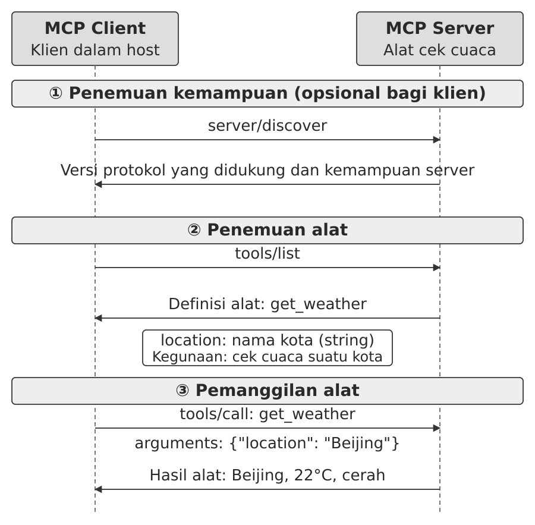
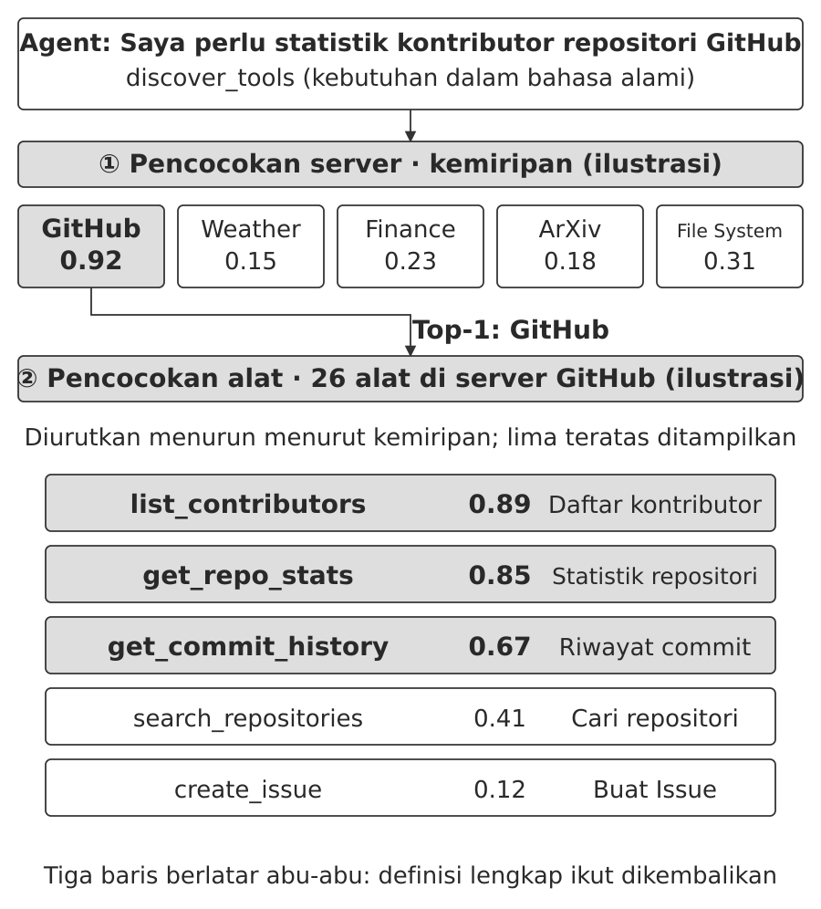
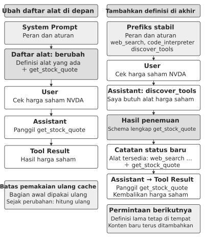
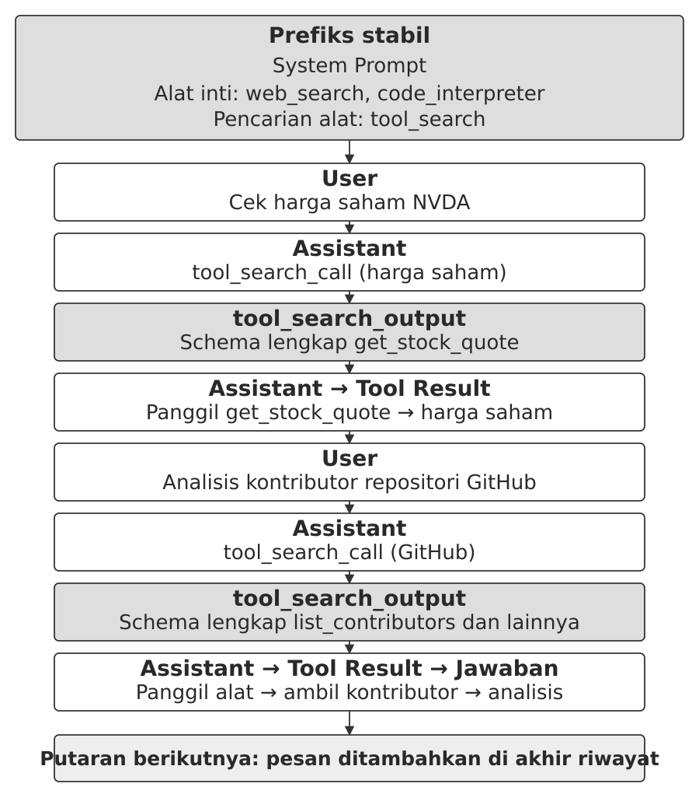

# Alat

Dalam film fiksi ilmiah *Her*, asisten AI bernama Samantha merapikan surel, membantu menyusun balasan, mengurus urusan penerbitan, dan berpindah dengan leluasa di antara berbagai saluran komunikasi. Asisten seperti ini harus mampu mengubah pemahaman bahasa menjadi operasi pada sistem eksternal. Agent menjalankan interaksi tersebut melalui **alat**. Alat adalah "indra serta tangan dan kakinya": alat menyediakan hasil pengamatan sekaligus menjalankan tindakan. Agent serbaguna yang dibahas dalam buku ini, seperti Manus dan OpenClaw, juga memerlukan alat untuk menjangkau dunia digital.

Misalkan pengguna berkata: "Tolong cari tanggal pengiriman yang disebutkan dalam surel pelanggan, susun dalam tabel, lalu kirimkan kepada saya." Model dapat memutuskan surel mana yang perlu diperiksa, tetapi untuk membaca isi aslinya ia harus mengakses kotak surat, dan untuk mengirim tabel ia harus memanggil antarmuka pengiriman. Bagaimana alat-alat ini dirancang, dan bagaimana model menemukannya ketika diperlukan? Bab ini terlebih dahulu membedakan lima kategori alat, kemudian membahas deskripsi, integrasi, dan penemuan alat, dan terakhir merancang antarmuka persepsi, eksekusi, dan kolaborasi satu per satu. Alat pemicu peristiwa dan alat komunikasi pengguna juga menyangkut kapan Agent dibangunkan dan bagaimana pesan disampaikan lintas saluran, sehingga keduanya dibahas lebih lanjut di Bab 6.

## Klasifikasi Alat

Ambil contoh memeriksa surel: model memilih langkah berikutnya, Harness memeriksa parameter dan izin lalu mengirimkan permintaan, dan layanan surel-lah yang benar-benar membaca serta menulis data. Bab 1 membedakan alat menurut kegunaannya menjadi alat persepsi, eksekusi, kolaborasi, komunikasi pengguna, dan pemicu peristiwa. Empat kategori pertama dipanggil secara aktif oleh Agent, sedangkan alat pemicu peristiwa memungkinkan peristiwa eksternal ikut membangunkan Agent (Tabel 4-1).

Tabel 4-1 Arah pemanggilan dan kegunaan utama lima kategori alat

| Jenis Alat | Arah Pemanggilan | Kegunaan Utama |
| --- | --- | --- |
| Alat persepsi | Dipanggil secara aktif oleh Agent | Memperoleh informasi eksternal |
| Alat eksekusi | Dipanggil secara aktif oleh Agent | Menjalankan komputasi atau mengubah keadaan eksternal |
| Alat kolaborasi | Dipanggil secara aktif oleh Agent | Mendelegasikan tugas, bertukar pesan, mengoordinasikan Agent lain atau manusia |
| Alat komunikasi pengguna | Dipanggil secara aktif oleh Agent | Membalas pengguna, menampilkan hasil, atau mengirim pengingat |
| Alat pemicu peristiwa | Dikonfigurasi pengembang atau didaftarkan Agent, dipicu dari luar | Membangunkan Agent ketika peristiwa tertentu terjadi |

**Alat persepsi** memungkinkan Agent memperoleh informasi eksternal, misalnya pencarian web `web_search`, penelusuran basis pengetahuan `knowledge_base_search`, pembacaan halaman web `fetch_url`, pencarian nama berkas `find_file`, pencarian isi berkas `grep_file`, dan pembacaan berkas `read_file`.

**Alat eksekusi** memungkinkan Agent menjalankan komputasi atau mengubah keadaan eksternal, misalnya baris perintah `shell_exec`, interpreter kode `code_interpreter`, penulisan berkas `write_file`, penyuntingan berkas `edit_file`, dan pengiriman surel `send_email`. Satu eksekutor umum yang sama dapat menjalankan komputasi yang hanya membaca, tetapi juga dapat mengubah data.

**Alat kolaborasi** mendukung pendelegasian tugas dan pertukaran pesan, misalnya membuat sub-Agent `spawn_subagent`, mengirim pesan `send_message_to_subagent`, membatalkan sub-Agent `cancel_subagent`, dan menemukan Agent yang tersedia `list_agents`. Tugas-tugas yang saling lepas dapat dikerjakan secara paralel, misalnya meneliti riwayat beberapa pendiri bersama OpenAI secara terpisah; tugas yang berbeda juga dapat diserahkan kepada Agent yang dikonfigurasi dengan model, alat, *prompt*, dan konteks yang berbeda. Bab 10 akan membahas lebih jauh arsitektur pembagian kerja dan kolaborasi.

**Alat komunikasi pengguna** menyampaikan informasi kepada pengguna, misalnya membalas pesan `reply_to_user`, mengirim kartu terstruktur `send_card_to_user`, dan mengirim pengingat `send_user_notification`. Ketika interaksi meluas ke banyak saluran atau memerlukan notifikasi di latar belakang, sistem dapat membungkus pengiriman pesan sebagai pemanggilan alat yang eksplisit, sehingga penerima, isi, dan status pengiriman dikelola secara seragam.

**Alat pemicu peristiwa** menghubungkan peristiwa eksternal dengan jalannya Agent, misalnya pengatur waktu `set_timer`, pemantauan tugas latar belakang `monitor_shell`, dan penyambungan sumber peristiwa `connect_channel`. Prosesnya terdiri atas dua langkah. Pada tahap pendaftaran, peristiwa yang diperhatikan dikonfigurasi lebih dulu oleh pengembang atau dinyatakan oleh Agent melalui pemanggilan yang diizinkan; setelah peristiwa terjadi, sistem penjadwal menerima *callback* atau pesan peristiwa lalu membangunkan Agent untuk menanganinya. Surel baru, peringatan sistem, pengingat terjadwal, dan selesainya tugas latar belakang semuanya dapat menjadi titik masuk baru bagi sebuah eksekusi.

Kembali ke tugas surel di awal: membuka surel asli untuk mendapatkan tanggal pengiriman adalah persepsi; membuat dan menyimpan tabel ringkasan mengubah ruang kerja, jadi termasuk eksekusi; menyerahkan tabel kepada pemberi tugas termasuk komunikasi pengguna. Pemicu peristiwa baru berperan jika sistem otomatis melanjutkan pekerjaan ketika surel pelanggan berikutnya tiba. Satu layanan surel yang sama dapat memikul beberapa peran ini. Keputusan berikutnya adalah seberapa halus alat yang diserahkan kepada model: apakah model dibiarkan memeriksa surel, membaca isi, dan mencari lampiran secara terpisah, atau beberapa langkah yang sering dikerjakan berurutan itu digabungkan untuknya?

## Prinsip Umum Desain Alat

Pada masa awal integrasi alat, cara yang lazim adalah membungkus setiap *endpoint* API secara langsung. Cara ini cepat diintegrasikan, tetapi mudah menghasilkan sekumpulan antarmuka yang granularitasnya sangat halus. Untuk menyelesaikan satu tugas, Agent mungkin harus berulang kali mencari objek, membaca atribut, dan memeriksa kondisi sebelum memanggil antarmuka eksekusi. Ketika merancang alat, operasi-operasi ini dapat digabungkan berdasarkan tugas-tugas yang umum, misalnya menyambungkan pencarian kontak dengan pengiriman pesan, atau membuat pencarian log langsung mengembalikan baris yang relevan beserta konteksnya[^ch4-tool-design].

**Alat harus dirancang dengan berpusat pada tugas yang hendak diselesaikan Agent.** Cara merancang antarmuka yang berangkat dari cara Agent menggunakannya ini disebut **ACI** (*Agent-Computer Interface*, antarmuka Agent–komputer). HCI memperhatikan bagaimana manusia berinteraksi dengan komputer, sedangkan ACI memperhatikan bagaimana model memilih operasi, menyusun parameter, memahami umpan balik, dan memperbaiki kesalahan.

[^ch4-tool-design]: Anthropic, *Writing effective tools for AI agents—using AI agents*, 2025.

### Bentuk Ekspresi Kemampuan: Alat Khusus, Eksekutor Umum, dan Skill

Untuk menyerahkan tugas "men-*deploy* aplikasi" kepada model, kita dapat merancang tiga jenis antarmuka operasi. Jenis pertama hanya menyediakan satu `deploy_app`, dan server yang menjalankan semua langkahnya; jenis kedua menyediakan *build*, pengemasan, dan *deploy* secara terpisah, dan model yang memutuskan kapan memanggil langkah berikutnya; jenis ketiga menuliskan langkah-langkah itu ke dalam sebuah Skill dan membiarkan model menjalankannya di terminal. Jika *build* gagal, jenis pertama bergantung pada hasil alat untuk memberi tahu model langkah mana yang salah, sedangkan dua jenis lainnya dapat langsung menyerahkan pesan galat *build* tersebut kepada model.

- **Alat khusus** menyediakan antarmuka terstruktur untuk operasi yang sudah pasti. Pengembang mendefinisikan *schema* parameter, aturan validasi, logika eksekusi, dan format kembalian, sehingga alat mudah diuji dan diberi otorisasi secara tersendiri; setelah definisi alat masuk ke konteks, ruang yang dipakainya bergantung pada panjang field, deskripsi, dan contoh.
- **Eksekutor umum dan Skill** dipakai bersama: terminal atau interpreter kode menyediakan kemampuan eksekusi, sedangkan Skill menjelaskan alur kerja, kondisi penggunaan, dan cara mengoperasikannya. *Host* dapat terlebih dahulu memuat nama dan ringkasan, lalu membaca penjelasan lengkap beserta sumber daya terkait setelah Skill itu dipilih.

Misalnya, sebuah Skill *deploy* dapat menjelaskan secara berurutan: bangun proyek dengan `npm run build`, kemas *image* dengan `docker build -t app:latest .`, lalu terapkan sumber daya yang didefinisikan dalam manifes ke *cluster* saat ini dengan `kubectl apply -f deploy.yaml`. Agent menjalankan langkah-langkah ini melalui alat terminal dan memakai ulang satu titik masuk eksekusi yang sama.

Bagaimana sebuah alat diimplementasikan dan kapan model membaca penjelasannya adalah dua persoalan yang berbeda. Ratusan alat khusus dapat ditampilkan sebagai indeks saja, dengan *schema* dimuat sesuai kebutuhan; segelintir Skill dapat menempatkan katalognya secara tetap di konteks, lalu ditambah penelusuran setelah jumlahnya membesar. Pilihan antara antarmuka khusus dan eksekutor umum memengaruhi cara parameter dilewatkan dan cara kode dipelihara; pilihan antara memberikan semuanya sekaligus atau memuat sesuai kebutuhan memengaruhi alat apa saja yang dapat dilihat model pada langkah ini. Strategi pengungkapan dibahas pada bagian "Jika Alat Terlalu Banyak" di bawah.

**Penulis menyarankan untuk mengutamakan alat umum, lalu menambahkan antarmuka khusus sesuai kebutuhan izin, parameter, dan kinerja.** Misalnya, jika `code_interpreter` di dalam *sandbox* dilengkapi SymPy, NumPy, dan pandas, Agent dapat menulis Python untuk menyelesaikan aritmetika dasar, komputasi simbolik, pengolahan larik, dan analisis data. Cara ini membuat kemampuan model dalam menghasilkan kode termanfaatkan sepenuhnya: satu interpreter dapat menampung berbagai algoritma, dan dapat pula menggabungkan pustaka yang sudah ada untuk menangani masalah baru yang tidak terpikirkan sebelumnya. Model bertugas menghasilkan kode, sedangkan lingkungan eksekusi bertugas menjalankannya serta membatasi akses ke berkas, jaringan, dan sumber daya.

Kalaupun alat khusus dipakai, penulis tetap menyarankan untuk lebih dulu menggabungkan operasi yang fungsinya mirip dan sering dipakai bersama. Jika antarmuka terlalu halus, model harus mengingat lebih banyak nama dan pembagian tugas, dan menyelesaikan tugas yang sama memerlukan lebih banyak pemanggilan. Penggabungan terutama ditentukan oleh **kemiripan fungsi** dan **derajat tumpang tindih skenario penggunaan**. Misalnya, `extract_pdf_text`, `extract_docx_content`, dan `extract_pptx_content` sama-sama menerima dokumen dan mengekstrak teksnya, sehingga dapat digabungkan menjadi `read_document` yang membedakan format melalui `file_type`. Model cukup memilih satu titik masuk terpadu, dan format baru pun dapat memakai struktur parameter serta kembalian yang sama.

Empat keadaan berikut sangat cocok untuk antarmuka khusus.

1. **Memerlukan otorisasi dan audit yang halus.** Penulisan ke basis data produksi dapat dibungkus sebagai operasi dengan cakupan yang jelas; server memeriksa izin pengguna, tabel sasaran, dan field yang boleh diubah, serta mencatat dasar operasinya.
2. **Perlu menyembunyikan perbedaan platform.** Operasi seperti grep dan find dapat dijalankan lewat *shell*, tetapi alat pencarian berkas khusus dapat menyeragamkan parameter dan umpan balik di macOS, Windows, dan Linux, misalnya selalu mengembalikan nama berkas, nomor baris, dan potongan yang cocok.
3. **Frekuensi operasi sangat tinggi.** Operasi yang sering dipakai dapat diberi titik masuk yang singkat dan stabil, sehingga mengurangi biaya untuk berulang kali menghasilkan skrip dan menjelaskan alurnya.
4. **Hubungan antarparameter rumit.** Objek bersarang, ketergantungan antar-field, dan batasan nilai yang rumit lebih cocok dinyatakan melalui *schema* bersama validasi bisnis.

**Makin rumit parameternya, makin penting cara melewatkannya.** Pemanggilan alat terstruktur biasanya mendeskripsikan masukan dengan JSON Schema, dan sebagian layanan model mendukung pembangkitan terbatas (*constrained generation*) sehingga parameter memenuhi aturan *schema* yang didukung. Struktur nilai kembalian ditetapkan oleh antarmuka alat, lalu *host* menyerahkan hasilnya kepada model. Di luar validasi tipe dan format, hal-hal seperti izin, ada tidaknya objek, dan terpenuhi tidaknya syarat bisnis oleh beberapa field tetap diperiksa oleh Harness dan layanan alat.

Skill dapat menjelaskan cara memanggil alat khusus, dan dapat pula menuntun Agent memakai CLI. Cara kedua menuntut model menangani sintaks baris perintah, tanda kutip, dan *escape* sekaligus, padahal aturannya berbeda-beda di tiap *shell*. Makin rumit parameternya, makin banyak detail yang harus ditangani model dengan benar. Untuk parameter bersarang yang rumit, parameter itu dapat lebih dulu ditulis sebagai JSON, lalu perintah diminta membaca berkas tersebut; cara ini mengurangi *escape* berlapis dan memungkinkan isinya divalidasi sebelum dijalankan.

**Skill mudah ditulis dan diubah langsung oleh orang-orang bisnis.** Orang yang memahami bisnisnya dapat menulis langkah-langkahnya sendiri, atau memulai dari draf penjelasan yang disusun Agent. Jika urutan alur berubah, ada langkah yang hanya berlaku untuk sebagian pelanggan, atau contohnya perlu diganti, cukup ubah teks penjelasannya; tidak perlu mengubah kode alat dan men-*deploy* ulang antarmukanya. Menurut spesifikasi Agent Skills, metadata `SKILL.md` memakai format yang telah ditentukan, isinya memakai Markdown, dan dapat disertai skrip, dokumen rujukan, serta sumber daya[^ch4-skill-format].

[^ch4-skill-format]: Agent Skills, spesifikasi format, mencakup metadata, isi, sumber daya penyerta, dan pemuatan bertahap.

Dalam memilih bentuk kemampuan, empat dimensi berikut dapat ditimbang bersama.

- **Keamanan dan izin**: antarmuka khusus memudahkan pembatasan cakupan operasi; eksekutor umum mengendalikan kemampuan eksekusinya melalui *sandbox*, kredensial, dan izin sumber daya.
- **Kerumitan parameter**: struktur yang rumit cocok untuk *schema* dan validasi bisnis; operasi sederhana dapat langsung menerima parameter melalui CLI.
- **Frekuensi perubahan**: alur yang sering disesuaikan sebaiknya ditulis sebagai Skill, sehingga orang bisnis dapat langsung mengubah penjelasan dan contohnya; operasi tingkat bawah yang stabil dan dipakai berulang baru dibungkus sebagai alat atau skrip.
- **Kemampuan model**: untuk model yang andal dalam menghasilkan kode dan menangani baris perintah, utamakan penggabungan kemampuan melalui Skill dan eksekutor umum sehingga jumlah alat khusus berkurang; untuk model yang lebih lemah dan sering keliru pada parameter rumit, biarkan antarmuka terstruktur memikul lebih banyak batasan.

**Kode juga dapat mengorkestrasi banyak pemanggilan alat.** Saat mengambil banyak halaman web lalu mengekstrak field-fieldnya, model dapat menghasilkan sebuah skrip yang menjalankan perulangan, penyaringan, dan peringkasan. Teks lengkap halaman tetap tersimpan di variabel lingkungan eksekusi, dan hanya field terpilih serta hasil statistik yang kembali ke konteks. Kondisi, perulangan, dan penanganan pengecualian di dalam program yang menyambungkan setiap langkah, sementara model langsung menganalisis hasil ringkasannya. Untuk tugas yang langkah-langkahnya sudah jelas, seperti pengambilan massal, penyaringan, dan perhitungan statistik, penulis lebih memilih merangkainya dengan kode, sehingga bolak-balik model memanggil alat satu per satu dan membaca hasil antara berkurang. Makin banyak hasil antara dan makin ringkas field yang dikembalikan, makin besar konteks yang dihemat. Bab 5 akan membahas orkestrasi kode semacam ini lebih lanjut.

Antarmuka seperti ini sering disebut **Code Mode**. Ambil contoh server MCP milik Cloudflare: model terlebih dahulu memakai `search()` untuk menulis program kueri yang mencari *endpoint* dan parameter yang diperlukan dari deskripsi OpenAPI; kemudian memakai `execute()` untuk mengirim JavaScript yang memanggil *endpoint* tersebut. Misalnya, untuk menampilkan catatan DNS yang memenuhi syarat, program dapat mengueri halaman demi halaman, menyaring, dan hanya mengembalikan catatan yang cocok. Langkah pertama menghemat biaya memasukkan seluruh manual antarmuka ke konteks, dan langkah kedua menghemat bolak-balik mengirim hasil setiap halaman kembali ke model. Zona mana yang boleh dibaca dan apakah catatan boleh diubah oleh identitas eksekusi tetap ditentukan oleh otorisasi di sisi server.[^ch4-code-mode]

[^ch4-code-mode]: Cloudflare, implementasi MCP untuk Code Mode; Armin Ronacher memakai Pi 1.0 sebagai contoh untuk membahas pembagian tugas antara alat yang disediakan Harness dan lingkungan eksekusi.

### Deskripsi Alat: Menjelaskan Kegunaan, Parameter, dan Umpan Balik

Saat menulis penjelasan sebuah alat, bayangkan dulu permintaan yang paling mungkin membuatnya disalahgunakan. Pengguna berkata, "Temukan klausul dalam kontrak yang menyebut denda keterlambatan." Pencarian nama berkas hanya mengembalikan berkas yang namanya cocok; kalaupun model mendapatkan sebuah *path*, ia masih harus membaca isinya. Deskripsi alat harus memungkinkan model menilai antarmuka mana yang harus dipilih, apa yang harus diberikan saat memanggil, dan pertanyaan apa yang dapat dijawab oleh hasilnya.

**Jelaskan kapan alat dipakai.** Deskripsi pencarian web dapat ditulis sebagai "Gunakan ketika perlu memperoleh informasi terkini atau mencari fakta yang belum diketahui", sehingga model dapat mencocokkan kebutuhan pengguna dengan kegunaan alat. Jika hanya tertulis "Cari konten yang relevan", model masih harus menebak sendiri cakupan pencarian dan kondisi penggunaannya.

**Perjelas masukan dan cakupan pencarian.** Misalnya, alat pencarian nama berkas dapat menyatakan "Mencocokkan berdasarkan nama berkas dan *path*; untuk mencari teks di dalam berkas, gunakan `grep_file`." Menuliskan pembagian tugas dengan alat-alat yang berdekatan secara jelas membantu model memilih titik masuk yang benar dalam satu kali pemanggilan. **Menurut penulis, memperjelas kondisi batas sering kali lebih penting daripada mendaftar fungsi.** Masukan apa yang diterima alat, cakupan mana yang dicari, dan bagaimana menangani hasil kosong atau galat, semuanya langsung memengaruhi keputusan model berikutnya.

**Jelaskan parameter dengan spesifikasi dan contoh.** `timestamp` dapat ditulis sebagai "format RFC3339, misalnya `2024-03-15T14:30:00Z`". Ketika menangani tugas yang rumit, model harus sekaligus memilih alat, mengambil informasi dari trajektori riwayat, dan menimbang langkah-langkah selanjutnya; format parameter hanyalah salah satu detail di antaranya. String yang lengkap memberikan format yang dapat langsung dijadikan acuan, sehingga model dapat menyusun parameter dengan menirunya dan peluang salah saat menafsirkan ulang istilah berkurang.

Demikian pula, `phone` dapat ditulis sebagai: "Nomor telepon dalam notasi nomor internasional E.164, diawali `+`, diikuti kode negara dan nomor, sisanya hanya berisi angka tanpa spasi atau pemisah. Misalnya `+8613888888888` (Tiongkok) atau `+12025551234` (Amerika Serikat)."

**Jelaskan struktur kembalian dan biaya eksekusi.** Misalnya, "Mengembalikan larik JSON; setiap elemen berisi tiga field: `title`, `url`, `snippet`", sehingga model mudah mengambil judul, sumber, dan ringkasannya. Alat yang memakan waktu lama dapat mencantumkan perkiraan latensi pada lingkungan pengukuran beserta titik masuk alternatifnya, misalnya "Membaca halaman web lengkap dapat memakan waktu 5–10 detik; jika hanya memerlukan metadata, panggil `get_page_metadata`."

Dapat pula dilampirkan 1–5 contoh pemanggilan yang sudah diverifikasi, yang mencakup parameter minimal, kombinasi yang umum, dan kondisi yang rumit. JSON Schema dapat menyatakan tipe, field wajib, rentang nilai, dan sebagian ketergantungan antar-field[^ch4-json-schema]; contoh menunjukkan bagaimana aturan-aturan itu dipakai dalam tugas konkret, misalnya apakah *timestamp* memakai detik atau milidetik, bagaimana kondisi penyaringan disarangkan, dan field opsional mana yang biasanya muncul bersama. Dalam pengujian internal parameter rumit yang dilaporkan Anthropic pada 2025, akurasi naik dari 72% menjadi 90% setelah contoh pemanggilan alat ditambahkan[^ch4-tool-examples].

[^ch4-json-schema]: JSON Schema, tipe objek dan batasan properti. Cakupan kata kunci *schema* yang didukung antarmuka model ditentukan oleh layanan masing-masing.

[^ch4-tool-examples]: Anthropic, *Introducing advanced tool use on the Claude Developer Platform*, 24 November 2025, bagian Tool Use Examples.

Ketika Agent sering memilih alat yang salah, penulis menyarankan untuk **memeriksa deskripsi alat terlebih dahulu**: apakah beberapa alat memakai nama yang mirip, apakah cakupan pencariannya jelas, dan apakah parameternya kekurangan contoh. Cara ini berlaku pula untuk nama, ringkasan, dan petunjuk operasi sebuah Skill.

### Fidelitas Penerusan Parameter

Model meminta agar sepotong teks asli diganti, tetapi sisi eksekusi melaporkan "tidak ditemukan". Sebelum meminta model mengubah susunan katanya, tanyakan dulu apakah kedua sisi menerima untaian karakter yang sama. Sebuah pemanggilan melewati penguraian, serialisasi, proksi, dan pembungkusan di *runtime*, dan setiap lapisan dapat mengubah isinya. **Fidelitas parameter** menuntut agar nilai yang dilihat sisi eksekusi memiliki makna yang sama dengan nilai yang dikirim model; *escape* protokol boleh mengubah bentuk transmisinya, tetapi tanda kutip dan baris baru setelah didekode harus tetap terjaga.

Ambil contoh masalah konversi tanda kutip lengkung pada salah satu versi Cursor di awal 2026. Alat penggantinya menerima `old_string` dan `new_string` dan mengubah berkas melalui pencocokan yang persis. Alat baca mengembalikan tanda kutip lengkung Tionghoa `“` dan `”`, yang bersesuaian dengan `\u201c` dan `\u201d`; model memasukkan teks asli itu ke `old_string`, tetapi selama penerusan parameter tanda kutip tersebut diubah menjadi tanda kutip lurus `"`. Teks asli di dalam berkas tidak berubah, sehingga alat pengganti mengembalikan "tidak ditemukan kecocokan". Membaca ulang dan menyalin ulang teks aslinya tetap berujung pada kegagalan yang sama.

Arah penulisan juga terdampak. Model meminta agar tanda kutip lengkung ditulis, tetapi yang akhirnya tersimpan di berkas adalah tanda kutip lurus. Ketika kemudian membaca berkas itu, model melihat isi yang berbeda dari yang ingin ditulisnya, lalu mungkin mencoba memperbaikinya; selama konversi itu masih terjadi, setiap percobaan ulang akan mengulangi kesalahan yang sama.

Masalah jenis lain adalah **injeksi parameter diam-diam**. Alat bash pada sebuah IDE otomatis menambahkan parameter penanda *commit* AI ke `git commit`. Git versi lama tidak mengenali parameter tersebut, sehingga *commit* gagal. Model hanya melihat perintah yang ia hasilkan sendiri; ia mungkin berulang kali menyesuaikan pesan *commit* atau parameter lain tanpa pernah menyentuh sumber kerusakan yang sebenarnya.

Untuk menelusuri masalah semacam ini, bandingkan secara berdampingan parameter yang dihasilkan model, parameter setelah diteruskan, permintaan yang benar-benar dieksekusi, dan hasil yang dikembalikan. Jika sebuah antarmuka menyeragamkan pengodean atau menambahkan parameter eksekusi, tuliskan aturan konversinya dengan jelas dan kembalikan nilai yang benar-benar dipakai. Bagi alat pencocokan persis, kelebihan satu spasi, kekurangan satu baris baru, atau berubahnya satu tanda kutip sudah cukup untuk menggagalkan pencocokan. Model harus tahu apa yang sebenarnya diterima sisi eksekusi agar dapat memperbaiki pemanggilan berikutnya.

## Ekosistem Alat: MCP dan Skill Hub

Antarmuka model dan kerangka kerja Agent yang berbeda memakai cara masing-masing untuk mendefinisikan alat, misalnya *function calling*, *tool use*, dan abstraksi Tool di LangChain. Jika satu layanan eksternal harus disesuaikan dengan antarmuka dan kerangka kerja ini satu per satu, deskripsi, parameter, dan format hasilnya harus ditangani berulang kali. **Model Context Protocol (MCP)**, yang dirilis Anthropic pada November 2024, menyediakan protokol terpadu bagi aplikasi model untuk mengakses alat dan data[^ch4-mcp-origin].

Untuk memahami MCP, mulailah dari tiga peran: *host*, klien, dan server. ***Host*** adalah aplikasi Agent atau IDE yang bertanggung jawab atas interaksi dengan model, penyusunan konteks, dan pengelolaan izin; **klien MCP** di dalam *host* menangani pesan protokol; **server MCP** menyediakan alat, sumber daya, dan templat *prompt*, dan dapat berjalan sebagai proses lokal ataupun di-*deploy* sebagai layanan jarak jauh[^ch4-mcp-architecture].

**Definisi dan pemanggilan alat.** Klien memperoleh daftar alat yang tersedia melalui `tools/list`, dan daftar ini dapat dikembalikan per halaman. Setiap alat berisi nama, deskripsi, dan `inputSchema`; hasil terstruktur juga dapat ditetapkan formatnya dengan `outputSchema`. Setelah model memilih alat dan menghasilkan parameternya, *host* melakukan validasi, klien mengirimkan `tools/call`, lalu server mengeksekusi dan mengembalikan hasilnya. *Host* yang memutuskan definisi dan hasil mana yang dimasukkan ke konteks model[^ch4-mcp-tools].

Pada Gambar 4-1, setelah memperoleh nama dan parameter alat cuaca, klien masih harus melakukan satu pemanggilan lagi untuk mengetahui cuaca di Beijing. Implementasi pendamping memakai MCP 2026-07-28: setiap permintaan membawa versi protokol, informasi klien, dan kapabilitasnya, dan klien juga dapat lebih dulu memanggil `server/discover` untuk mengetahui versi serta kapabilitas yang didukung server. Versi-versi awal memakai jabat tangan `initialize` untuk membangun sesi, sehingga saat tersambung cara interaksi harus dipilih sesuai versi yang didukung kedua belah pihak[^ch4-mcp-versioning].

Sama-sama gagal mendapatkan cuaca, Gambar 4-1 menunjukkan dua titik awal penelusuran yang berbeda. Jika *host* sudah tersambung ke server tetapi alat cuaca tidak ditemukan setelah memanggil `tools/list`, periksa alat apa saja yang diterbitkan server dan apakah klien sudah membaca seluruh halaman daftarnya. Jika model sudah memilih alat yang benar tetapi server melaporkan nama kota tidak ada, cari `arguments` di catatan pemanggilan dan periksa apakah nama field-nya sesuai dengan `location` yang diminta definisi alat.

**Mekanisme transport.** stdio meneruskan pesan JSON-RPC melalui *standard input* dan *standard output* sebuah subproses lokal. Streamable HTTP mengirim permintaan melalui HTTP, dan responsnya dapat berupa JSON atau dikembalikan bertahap melalui aliran SSE. Streamable HTTP menggantikan skema transport HTTP+SSE yang lama, dan tetap memakai SSE sebagai cara mengalirkan respons[^ch4-mcp-transports].

**Sumber daya dan templat *prompt*.** Sumber daya (*resources*) menyediakan data yang dapat dibaca, misalnya isi berkas dan catatan basis data; *host* dapat mendaftar dan membacanya berdasarkan URI serta memilih isi yang relevan. Templat *prompt* (*prompts*) menyediakan templat pesan atau tugas yang dapat dipakai ulang, untuk dipilih oleh pengguna dan klien. Alat juga dapat dipakai untuk mencari dan membaca, sehingga ketiga primitif ini dibedakan menurut antarmuka interaksinya: alat menyediakan titik masuk pemanggilan, sumber daya menyediakan titik masuk data, dan templat *prompt* menyediakan titik masuk tugas[^ch4-mcp-primitives].

Nilai inti MCP adalah membuat satu implementasi alat dapat melayani banyak produk Agent. Protokol yang seragam memungkinkan server yang sama dipakai ulang oleh *host* yang kompatibel, misalnya Cursor, Claude Desktop, dan OpenClaw, dan pengembang pun dapat lebih memusatkan tenaga pada kemampuan itu sendiri serta mutu umpan baliknya. *Host* mengubah definisi alat dalam protokol menjadi antarmuka yang dapat dipakai model.

**Skill Hub menyediakan penemuan dan distribusi paket kemampuan.** Sebuah Skill biasanya berisi `SKILL.md`, dan dapat pula disertai skrip dan bahan rujukan. Platform distribusi membantu pengguna mencari, memasang, dan memperbarui berkas-berkas ini. Vercel meluncurkan skills.sh pada Januari 2026, yang menyediakan direktori skill beserta alat pemasangnya; ClawHub di ekosistem OpenClaw juga menyediakan pencarian skill dan pengelolaan versi[^ch4-skills-sh][^ch4-clawhub]. Setelah dipasang, *host* membaca nama, ringkasan, dan penjelasan lengkapnya sesuai strategi pemuatannya. MCP juga dapat menyediakan penemuan dan pembacaan Skills melalui ekstensi, sehingga paket kemampuan dan protokol komunikasi dapat dipakai bersama[^ch4-skills-over-mcp].

**Integrasi dan pemuatan konteks dikelola secara terpisah.** Setelah klien MCP memperoleh daftar alat, seluruhnya dapat diberikan kepada model, atau cukup indeksnya yang disimpan dan definisinya dimuat sesuai kebutuhan. Skill pun dapat lebih dulu menampilkan `name` dan `description`, lalu isinya dibaca setelah dipilih. Daftar izin alat menentukan kemampuan mana yang boleh dipakai, sedangkan pemuatan tertunda menentukan definisi mana yang saat ini terlihat.

**Saat mengintegrasikan kemampuan pihak ketiga, periksa secara terpisah isi yang disediakannya dan operasi yang benar-benar dijalankannya.** Deskripsi, isi kembalian, dan kode penyerta berasal dari pihak yang berbeda, dan cakupan otorisasinya pun bisa berbeda. Dengan MCP sebagai contoh, tiga jenis masalah dapat diperiksa satu per satu.

1. **Peracunan deskripsi alat.** Deskripsi dapat menyelipkan permintaan operasi yang tidak berkaitan dengan kegunaan alat, untuk membujuk model keluar dari tugas yang sedang dikerjakan. Ini termasuk *prompt injection*: konten dari luar berusaha mengubah perilaku model.
2. **Server dan dependensinya diubah.** Pembaruan server dapat mengubah perilaku alat, dan pembaruan dependensi atau layanan jarak jauh yang dibobol juga dapat mencemari hasil kembalian.
3. **Kerancuan alat bernama sama.** Server yang berbeda dapat menyediakan alat dengan nama yang sama atau mirip, sehingga model atau lapisan perutean salah memilih sasaran. *Host* harus mempertahankan ikatan antara identitas server dan nama alat, menampilkan sumbernya, dan memverifikasi sasaran saat menjadwalkan pemanggilan.

Sebelum integrasi, tinjau deskripsi dan implementasinya, kunci versi untuk *deployment* yang dapat dikendalikan, dan periksa ulang setiap kali ada pembaruan; setiap server memakai kredensial dengan hak akses minimum yang sesuai dengan tugasnya. Jika layanan jarak jauh dipelihara oleh pihak lain, pantau pula perubahan definisi dan perilaku alatnya.

Saat *runtime*, Sidecar yang dibahas di bagian selanjutnya juga dapat dipakai untuk meninjau secara independen pemanggilan terstruktur beserta dasar tugas yang diperlukan. *Path*, teks, dan alamat tujuan dalam parameter pemanggilan juga harus diperlakukan sebagai data yang perlu diperiksa. Hasil tinjauan bersama aturan izin yang deterministik menentukan apakah pemanggilan dijalankan. Bab 5 akan memperkenalkan "trio mematikan" (*lethal trifecta*) dari Simon Willison, untuk menganalisis risiko yang timbul ketika data pribadi, masukan eksternal, dan komunikasi keluar bergabung.

Skrip yang menyertai Skill, server MCP lokal, dan layanan jarak jauh masing-masing memiliki lokasi eksekusi dan cakupan izin sendiri. Saat meninjau, periksa asal kode, lingkungan eksekusi, izin berkas dan jaringan, serta ke mana kredensial mengalir; jika langkah-langkah dari pihak luar mengarahkan untuk mengunduh atau menjalankan program lain, program itu juga harus masuk ke rantai pemeriksaan ini. Pemindaian oleh platform dapat memberikan petunjuk tambahan, tetapi isolasi eksekusi, hak akses minimum, dan peninjauan perubahanlah yang secara langsung mengendalikan eksekusi yang sebenarnya.

[^ch4-mcp-origin]: Anthropic, *Introducing the Model Context Protocol*, 25 November 2024.
[^ch4-mcp-architecture]: Spesifikasi MCP versi 2026-07-28, bagian arsitektur dan ikhtisar protokol.
[^ch4-mcp-tools]: MCP, Tools, mencakup daftar alat, *schema* masukan dan keluaran, serta hasil pemanggilan.
[^ch4-mcp-versioning]: MCP, *Versioning and Compatibility*, menjelaskan metadata per permintaan, penemuan kapabilitas, dan kompatibilitas dengan jabat tangan versi lama.
[^ch4-mcp-transports]: MCP, ikhtisar transport dan spesifikasi transport 2025-11-25; yang terakhir menjelaskan bagaimana Streamable HTTP menggantikan skema HTTP+SSE yang lama.
[^ch4-mcp-primitives]: MCP, bagian Resources dan Prompts.
[^ch4-skills-sh]: Vercel, *Introducing skills, the open agent skills ecosystem*, 20 Januari 2026.
[^ch4-clawhub]: OpenClaw, petunjuk penggunaan ClawHub.

## Jika Alat Terlalu Banyak: Organisasi Berlapis dan Penemuan Alat secara Aktif

Setelah jumlah alat bertambah dari belasan menjadi ratusan atau ribuan, model harus menemukan kemampuan yang tepat sekaligus memahami perbedaan di antara antarmuka yang mirip. Definisi lengkap menyita konteks; jika definisi itu berada di prefiks *prompt*, menambah, menghapus, atau mengubah urutan alat juga dapat memperpendek prefiks *cache* yang dapat dipakai ulang. Makin banyak alat dengan nama dan kegunaan yang mirip, makin mudah model salah memilih titik masuk atau melewatkan kemampuan yang diperlukan. Karena itu, pustaka alat berskala besar sebaiknya secara bawaan memuat alat sesuai kebutuhan, disertai direktori kategori dan antarmuka penemuan yang dirancang dengan baik, sehingga model lebih dulu menemukan alat yang relevan dengan tugas saat ini, lalu memilih salah satunya berdasarkan kegunaan masing-masing.

Penemuan alat dapat dibayangkan seperti membolak-balik sebuah manual yang disusun menurut tugas. Daftar isi lebih dulu memberi tahu model bagian mana yang harus dicari; ketika muncul kebutuhan baru di tengah eksekusi, model dapat kembali mencari; setelah memilih sebuah kemampuan, barulah ia membaca parameter, urutan operasi, dan contohnya. Indeks kategori, pencarian aktif, dan Skill di bawah ini masing-masing menjawab ketiga persoalan tersebut, dan baik alat khusus maupun eksekutor umum dapat disediakan kepada model melalui titik-titik masuk ini.

### Organisasi Berlapis dan Pemuatan Sesuai Kebutuhan

**Sediakan indeks terlebih dahulu, muat definisinya ketika dipakai.** Direktori alat dapat menyita banyak konteks. Anthropic pernah memberi contoh: lima server MCP seperti GitHub dan Slack menyediakan total 58 alat, dan definisi lengkapnya memakan sekitar 55 ribu token[^ch4-tool-search-eval]. Cursor mengelola deskripsi-deskripsi ini dengan direktori berkas: konteks awal hanya berisi informasi ringkas seperti nama alat, dan Agent membaca definisi lengkapnya sesuai tugas. Dalam uji A/B yang dipublikasikan Cursor pada Januari 2026, untuk tugas yang benar-benar memanggil alat MCP, cara ini mengurangi total konsumsi token Agent sebesar 46,9%; besarnya penghematan bergantung pada jumlah MCP yang diintegrasikan[^ch4-cursor-discovery].

Rancangan awal Pi justru mengutamakan alat CLI yang disertai README, sehingga Agent membaca cara pemakaiannya sesuai kebutuhan lalu memanggil kemampuan tersebut melalui baris perintah[^ch4-pi-no-mcp]. Ekstensi komunitas `pi-mcp-adapter` menerapkan gagasan serupa pada MCP: secara bawaan model diberi satu alat proksi berukuran sekitar 200 token, lalu model berturut-turut mencari alat, melihat definisinya, dan melakukan pemanggilan; server baru dijalankan pada pemanggilan pertama. Pi versi 0.99 kemudian juga menambahkan dukungan MCP bawaan dengan mekanisme penemuan sesuai kebutuhan[^ch4-pi-mcp-adapter]. Implementasi-implementasi ini memisahkan integrasi protokol dari pemuatan konteks: bagian belakang tersambung ke layanan MCP, sedangkan bagian depan membantu model menemukan kemampuan yang diperlukan melalui indeks ringkas atau antarmuka proksi.

[^ch4-cursor-discovery]: Cursor, *Dynamic context discovery*, 6 Januari 2026.
[^ch4-pi-no-mcp]: Mario Zechner, *What if you don’t need MCP at all?*, 2 November 2025, memperkenalkan gagasan desain CLI dan membaca dokumentasi sesuai kebutuhan.
[^ch4-pi-mcp-adapter]: pi-mcp-adapter, README proyek tentang alat proksi, penundaan start, dan perbandingan dengan MCP bawaan Pi.

**Susun direktori alat menurut tugas.** Ketika jumlah alat bertambah, alat dapat dikelompokkan menurut cara memperoleh informasi, sehingga model lebih dulu menemukan kategorinya, lalu memilih antarmuka yang spesifik:

- **Alat pencarian**: mencari letak informasi berdasarkan petunjuk, misalnya pencarian web, pencarian basis pengetahuan, dan pencarian berkas.
- **Alat pembacaan**: mengambil konten dari lokasi yang sudah diketahui, misalnya membaca halaman web, dokumen, atau catatan tertentu.
- **Alat penguraian**: mengekstrak informasi dari konten tidak terstruktur, misalnya OCR gambar, analisis video, dan transkripsi audio.
- **Alat kueri**: mengakses data terstruktur berdasarkan field dan kondisi, misalnya API cuaca, API saham, dan kueri basis data.

Ambil contoh "mencari tahu data apa saja yang dipakai sebuah makalah": pencarian lebih dulu mengembalikan makalah kandidat beserta alamatnya, alat pembacaan mengambil teks asli berdasarkan alamat itu, lalu alat penguraian membantu menemukan tabelnya. Jika langkah pertama menempatkan makalah lain yang judulnya sama di urutan teratas, jawaban akhirnya tetap salah meskipun tabelnya dibaca dengan tepat.

**Persempit cakupan alat dengan penelusuran terlebih dahulu.** Berdasarkan deskripsi tugas, *host* dapat melakukan penelusuran kata kunci atau semantik atas nama, ringkasan, dan penjelasan parameter alat, lalu hanya menyerahkan definisi alat yang cocok kepada model. Jika alat yang dikembalikan terlalu sedikit, antarmuka yang diperlukan pada langkah berikutnya bisa terlewat; jika terlalu banyak, konteks tersita dan pilihan makin sulit. Penelusuran pertama dapat didasarkan pada permintaan pengguna, dan penelusuran berikutnya ditambahkan sesuai kemajuan tugas.

### Penemuan Alat secara Aktif yang Native pada Model

Kebutuhan alat untuk tugas yang rumit sering kali baru tampak secara bertahap selama eksekusi. Misalnya, "Debug the file" mungkin pertama-tama perlu membaca berkas, lalu menelusuri dependensi, menjalankan pengujian, dan menganalisis galat. Jika penelusuran hanya dilakukan sekali di awal tugas, kemampuan yang diperlukan kemudian mudah terlewat.

**Biarkan Agent mengajukan permintaan ketika perlu.** MCP-Zero membuat model menghasilkan permintaan kemampuan terstruktur selama eksekusi, misalnya memakai `server` untuk menunjuk GitHub dan `tool` untuk mendeskripsikan "cari repositori dan kembalikan metadatanya". Sistem lebih dulu mencocokkan server, kemudian mencocokkan alat di dalam server tersebut, lalu menambahkan definisi yang terpilih ke dalam konteks; jika alat yang dikembalikan tidak dapat memenuhi tugas, model dapat menyesuaikan permintaannya dan terus menelusuri. Dataset MCP-tools yang dibangun dalam makalah ini berisi 308 server dan 2797 alat; dalam pengujian dengan seluruh himpunan alat APIBank, biaya *prompt* alat pada pengaturan satu putaran maupun banyak putaran sama-sama berkurang sekitar 98%[^mcp-zero-2025].

Dalam praktik, alat dasar seperti `web_search` dan `code_interpreter` dapat dipertahankan, lalu ditambahkan satu antarmuka pencarian alat. Model mendeskripsikan kemampuan yang kurang, antarmuka pencarian mengembalikan definisi beberapa alat yang cocok, dan model memilih salah satunya untuk dipanggil. Tool Search Tool dari Anthropic memakai cara penemuan sesuai kebutuhan ini: alat yang sering dipakai dimuat langsung, sedangkan alat lainnya dimuat tertunda melalui `defer_loading`. Dalam evaluasi MCP internal yang dipublikasikan Anthropic, setelah pencarian alat diaktifkan, akurasi Opus 4 naik dari 49% menjadi 74%[^ch4-tool-search-eval].

[^mcp-zero-2025]: Xiang Fei, Xiawu Zheng, Hao Feng, *MCP-Zero: Proactive Toolchain Construction for LLM Agents from Scratch*, 2025. Penurunan biaya sekitar 98% berasal dari pengaturan seluruh himpunan alat APIBank; lihat Tabel 1 dalam makalah tersebut.
[^ch4-tool-search-eval]: Anthropic, *Introducing advanced tool use on the Claude Developer Platform*, 24 November 2025, bagian Tool Search Tool.

**Cari server dulu, baru cari alatnya.** Sebuah server MCP biasanya menyediakan sekumpulan alat untuk satu platform atau bidang bisnis. Contoh pada Gambar 4-2 lebih dulu memilih server GitHub berdasarkan deskripsi kemampuan, lalu memilih tiga kandidat dari alat-alatnya. Operasi bernama sama dapat tersebar di platform yang berbeda, sehingga langkah pertama sudah dapat menyisihkan sejumlah kandidat yang tidak relevan. Namun, jika langkah ini melewatkan server yang benar, perbandingan alat yang secermat apa pun pada langkah berikutnya tidak akan dapat menemukannya kembali.

Jika memakai penelusuran vektor, *embedding* deskripsi server dan alat dapat dihitung terlebih dahulu dan diperbarui secara inkremental ketika direktori berubah. Mutu pencocokan perlu diperiksa di setiap lapisan: ketika kemiripan kandidat server atau alat berada di bawah ambang yang ditetapkan, kembalikan "tidak ditemukan alat yang sesuai", agar Agent menambahkan syarat, merumuskan ulang kebutuhannya, lalu mencoba lagi. Untuk tugas yang dapat diselesaikan dengan eksekutor umum, tugas itu juga dapat dikerjakan dengan menggabungkan alat-alat dasar; cara membuat dan menyimpan alat baru akan dibahas di Bab 9.

**Selaraskan pemuatan dinamis dengan KV Cache.** Letak definisi alat memengaruhi pemakaian ulang prefiks. Jika setiap kali alat baru ditemukan daftar alat di awal permintaan diubah, prefiks hasil serialisasi ikut berubah, dan *cache* hanya dapat dipakai ulang sampai posisi perubahan pertama. Bandingkan kolom kiri dan kanan Gambar 4-3: perbedaannya terletak pada di mana alat baru pertama kali muncul. Di sisi kanan, *system prompt*, alat dasar, dan antarmuka pencarian tetap stabil, sedangkan definisi alat baru ditambahkan ke riwayat mengikuti hasil penemuan; permintaan berikutnya mempertahankan posisi definisi yang sudah ada dan terus menambahkan pesan.

`tool_search`, `defer_loading`, dan `tool_search_output` dari OpenAI, serta `tool_reference` dari Anthropic, yang diperkenalkan di Bab 2, semuanya mendukung pemuatan definisi alat sesuai kebutuhan. Bilah status dapat memelihara secara terpisah daftar ringkas nama alat yang tersedia, untuk membantu model mengetahui kemampuannya saat ini.

Gambar 4-4 mencatat dua kali penemuan alat. Ketika model mulai menganalisis kontributor GitHub, definisi alat yang sebelumnya dipakai untuk menanyakan harga saham masih berada di tempat semula.

Rancangan ini menuntut model mampu memahami definisi alat yang baru dimuat di tengah sesi, lalu mengisi parameter dan melakukan pemanggilan berdasarkan definisi tersebut. Eksperimen 4-1 menyerahkan sekumpulan tugas yang sama kepada dua cara pemuatan alat, lalu membandingkan berapa banyak definisi yang masuk ke konteks pada masing-masing cara.

> **Eksperimen 4-1 ★★★: Penemuan alat secara aktif**
>
> Bagaimana penemuan alat mengurangi teks definisi yang dihadapi model setiap kali? Eksperimen ini memakai Qwen3-4B untuk membandingkan pemuatan penuh dan penemuan aktif pada server MCP yang sama dengan 127 alat. Kedua kelompok masing-masing mengerjakan tiga tugas: menanyakan harga saham Apple beserta berita terkait; menelusuri makalah tentang transformer lalu mengunduh tiga teratas; serta mengambil statistik kontributor sebuah repositori GitHub dan membuat grafiknya. Tugas-tugas ini masing-masing memerlukan kemampuan keuangan dan pencarian, penelusuran dan pengunduhan makalah, serta kueri data dan eksekusi kode.
>
> **Pemuatan penuh**: *schema* lengkap semua alat dimasukkan ke *system prompt*. Catatan eksekusi pendamping tanggal 25 Agustus 2026 berisi 127 alat, dan seluruh direktori itu berjumlah 50.597 token jika dihitung dengan *tokenizer* yang sama (o200k).
>
> **Penemuan aktif**: *system prompt* hanya menyisakan `web_search`, `code_interpreter`, dan `discover_tools`. Ketika menemui kekurangan kemampuan, model mendeskripsikan kebutuhannya dalam bahasa alami, misalnya "Saya memerlukan kemampuan untuk menanyakan harga saham". `discover_tools` menelusuri lima alat kandidat berdasarkan kemiripan vektor, menambahkan definisi lengkapnya ke riwayat percakapan, dan memperbarui nama alat yang tersedia di bilah status. Model kemudian memilih alat dan melanjutkan tugasnya.
>
> **Hasil eksekusi**: sesuai urutan tugas di atas, kelompok penemuan aktif masing-masing menambahkan definisi alat sebesar 3.939, 1.853, dan 2.632 token. Kedua kelompok sama-sama memilih kemampuan yang diperlukan setiap tugas; lapisan adaptor eksekusi bertugas mengisi parameter tugas, melakukan pengunduhan massal, dan menghasilkan kode pembuat grafik, dan pada akhirnya keduanya lolos pemeriksaan pemanggilan alat dan artefak.
>
> Melihat definisi alat menjadi lebih pendek, kita masih harus bertanya: apakah model memilih dengan tepat karena bacaannya lebih sedikit, atau karena alat yang mudah tertukar berkurang? Pada dua kelompok semula, metode penyaringan, posisi pesan, bilah status, petunjuk penemuan, dan jumlah putaran pemanggilan juga ikut berubah. Eksperimen pemilihan satu langkah pendamping (`selection_ablation.py`) mempersempit pertanyaannya menjadi "alat mana yang dipilih pada langkah pertama". Pertama, pertahankan kumpulan kandidat yang sama dan tambahkan teks pengisi ke pesan sistem, sehingga terlihat apakah pilihan berubah setelah masukan diperpanjang. Kemudian, pertahankan kandidat-kandidat itu, tambahkan alat pengecoh dalam jumlah yang setara, sambil mengurangi teks pengisi, sehingga masukan kedua kelompok sama-sama berjumlah 6.144 token. Dengan begitu, alat yang benar tetap berada dalam kumpulan kandidat semula, dan pengaruh tambahan beberapa pengecoh dapat diamati secara tersendiri.
>
> Jika alat diambil secara acak, antarmuka yang diperlukan pada langkah pertama mungkin sama sekali tidak ada dalam daftar. Hanya jika alat itu sudah ada dalam daftar tetapi model memilih yang lain, barulah itu terhitung sebagai kesalahan model.
>
> Dalam catatan langkah demi langkah tugas kueri saham, pengguna sebenarnya menanyakan dua hal: berapa perubahan harga sahamnya, dan berita apa yang dapat menjelaskan perubahan itu? Penelusuran putaran pertama menemukan lima alat, dan model memilih `yfinance_quote` yang berada di urutan ketiga. Kutipan harga kali ini 310,34 dolar AS, naik sekitar 0,32% dari harga penutupan sebelumnya sebesar 309,35 dolar AS, sehingga pertanyaan pertama dapat langsung diverifikasi. Pertanyaan kedua memakai `web_search` yang sudah ada di direktori awal. Alat itu mengembalikan lima hasil pencarian yang ringkasannya sebagian besar berisi data pasar, tanpa peristiwa spesifik yang dapat menjelaskan kenaikan hari itu. Kedua alat yang diperlukan sama-sama terpilih, sehingga cakupan kemampuannya mendapat nilai penuh; jika pengguna ingin tahu alasan kenaikannya, masih perlu dicari laporan berita yang bertanggal.

### Skills: Mengubah Penemuan Alat Menjadi "Membaca Sesuai Kebutuhan"

Bab 2 telah memperkenalkan pengungkapan bertahap (*Progressive Disclosure*) pada Skills. Dari sudut pandang desain alat, mekanisme ini menyusun cara pemakaian kemampuan menjadi seperangkat bahan yang dapat dibaca sesuai kebutuhan: model lebih dulu memilih Skill berdasarkan ringkasannya, lalu membaca langkah-langkah operasinya, dan terakhir memanggil alat atau menjalankan skrip sesuai kebutuhan tugas.

**Pengungkapan bertahap terdiri atas tiga langkah.** Saat mulai, `name` dan `description` setiap Skill dimuat agar model tahu kemampuan apa saja yang ada dan tugas apa yang cocok untuk masing-masing; setelah dipilih, `SKILL.md` lengkap dibaca; selama eksekusi, dokumen, templat, atau skrip yang dirujuk di dalamnya dibaca lagi[^ch4-skill-format]. Misalnya, saat menangani PDF, model lebih dulu menentukan apakah yang diperlukan ekstraksi teks atau pengisian formulir, baru kemudian membaca penjelasan yang sesuai. Dengan demikian, detail yang diperlukan untuk operasi tertentu tetap tersimpan di dalam paket kemampuan dan masuk ke konteks secara bertahap seiring tugas. Total biaya direktori bergantung pada jumlah Skill dan panjang ringkasannya.

Proses ini mirip dengan membuka buku rujukan: lihat daftar isi dulu, buka entri yang relevan, lalu ketika menemui masalah spesifik, lanjutkan membaca contoh-contohnya. Untuk pustaka kemampuan yang berukuran kecil dan terutama terdiri atas alur operasi serta bahan rujukan, penulis lebih memilih direktori Skill ditambah pembacaan berkas. Cara ini memakai ulang kemampuan model membaca dokumen dan memanggil alat umum; pada awalnya hanya ringkasan, rujukan, dan petunjuk operasi yang perlu dipelihara, tanpa layanan penelusuran alat tersendiri. Setelah pustaka kemampuan membesar dan direktorinya sulit dijelajahi, barulah tambahkan penelusuran kata kunci atau semantik.

Alat khusus juga dapat dimuat sesuai kebutuhan. *Host* dapat memadukan *namespace* server, daftar izin, dan alat penelusuran untuk menentukan definisi mana yang terlihat dalam tugas saat ini, lalu menambahkannya ke konteks melalui antarmuka pencarian alat. Skills, sebaliknya, menempatkan langkah, contoh, dan bahan rujukan dalam satu struktur berkas yang sama, sehingga mudah ditulis dan dipelihara oleh penulisnya.

Satu penjelasan pengisian formulir PDF yang sama dipakai berulang kali di banyak sesi; dapatkah komputasi model saat membaca penjelasan itu juga dipakai ulang? Bedakan dulu dua keadaan. Dalam sesi yang sama, jika penjelasan baru ditambahkan di bagian akhir, prefiks yang sama sebelumnya berpeluang mengenai *cache*. Di sesi lain, meskipun teks penjelasannya persis sama, permintaan pengguna, bahan, dan posisi sebelum penjelasan itu biasanya sudah berubah, sehingga *cache* prefiks biasa tidak dapat langsung memakai ulang komputasi bagian tersebut. Penelitian KV Cache yang dapat dikomposisikan, yang diperkenalkan di Bab 2, mencoba melakukan prakomputasi bagian ini secara tersendiri, lalu menyesuaikan pengodean posisi rotasi (RoPE) dan menyambungkannya ke konteks baru. Komputasi untuk pemosisian ulang dan penyambungan ini tumbuh linear terhadap panjang potongannya.

MCP dan Skill Hub juga dapat bersama-sama memikul tugas distribusi. Skill Hub menangani pencarian, pemasangan, dan pembaruan paket kemampuan; ekstensi Skills pada MCP memungkinkan klien menemukan dan membaca Skill yang disediakan server[^ch4-skills-over-mcp]. Pengetahuan operasional yang sama dapat dimuat melalui paket kemampuan lokal, atau disediakan melalui layanan MCP yang mendukung ekstensi tersebut.

[^ch4-skills-over-mcp]: Model Context Protocol, *Skills Over MCP Charter*, menjelaskan tanggung jawab ekstensi Skills dalam penemuan, distribusi, dan pembacaan.

Setelah alatnya ditemukan, apa yang perlu dikembalikan kepada model agar berguna? Kembali ke contoh surel pelanggan: mengembalikan nama berkas saja sudah cukup untuk menemukan surel aslinya, tetapi untuk memeriksa tanggal pengiriman, kalimat aslinya tetap harus dibaca. Desain alat persepsi berangkat dari perbedaan ini.

## Alat Persepsi

Misalkan pengguna ingin menghitung ulang jumlah total dalam sebuah laporan. Alat pencarian mengembalikan satu ringkasan yang cocok; itu cukup untuk menemukan laporannya, tetapi belum tentu memperlihatkan satuan yang dipakai untuk jumlah tersebut. Baru setelah model mengikuti ringkasan itu sampai ke tabel aslinya dan melihat nama kolom, satuan, dan baris totalnya, ia mempunyai bekal untuk menghitung ulang. Dalam merancang alat persepsi, ada dua pertanyaan yang saling terkait: bahan apa yang dikembalikan kali ini, dan jika bahannya kurang, dari mana model dapat melanjutkan membaca?

Satu kali pencarian dapat mengembalikan puluhan ribu karakter, dan satu PDF dapat mencapai ratusan halaman. **Kompresi sadar-konteks** dari Bab 2 dapat dipakai di sini: ketika keluaran melampaui ambang yang ditetapkan, ambil konten yang relevan dengan pertanyaan saat ini. Misalnya, dengan 10.000 karakter sebagai pemicu, kembalikan ringkasan sambil mempertahankan titik masuk untuk membaca hasil aslinya, agar model dapat terus memeriksa kutipan, tabel, atau detailnya.

**Daftarkan hasil pencarian terlebih dahulu; hasil mana yang dipilih model, teks lengkap hasil itulah yang dibaca.** Daftar yang dikembalikan harus memuat judul, lokasi, dan potongan ringkasan, untuk membantu Agent menilai hasil mana yang layak dibaca. Jika hasilnya banyak, gunakan paginasi atau kursor (`cursor`): secara bawaan kembalikan beberapa hasil pertama dan jelaskan cara mengambil halaman berikutnya; jika jumlah totalnya dapat diketahui, kembalikan juga. Berdasarkan bukti yang sudah ada, model dapat memutuskan untuk membuka halaman berikutnya atau membuka salah satu hasil untuk membaca teks aslinya.

**Baca berkas besar per potongan, dan tandai rentangnya ketika dipotong.** Antarmuka pembacaan harus mendukung parameter seperti `offset` dan `limit`, serta menjelaskan apakah satuannya baris, bita, atau catatan. Misalnya, kembalikan "Menampilkan baris 1–200 dari 5.000 baris" beserta parameter untuk melanjutkan pembacaan. Informasi rentang membantu Agent menilai apakah konten saat ini sudah lengkap, dan juga memudahkan penelusuran balik berdasarkan posisi. Pemotongan diam-diam mudah membuat model mengira sudah membaca semuanya, lalu menyimpulkan "tidak muncul di bagian ini" sebagai "tidak ada di seluruh bahan". Jika bagian tengah dihilangkan, tandai posisi yang dihilangkan dan cara membaca sisa kontennya.

**Manfaatkan operasi baca-saja untuk mengatur *cache* dan konkurensi.** Akses baca-saja ke data bisnis biasanya dapat memakai ulang hasilnya dan mudah dijalankan secara paralel, misalnya membaca lima berkas sekaligus atau menjalankan tiga pencarian yang saling lepas. Kunci *cache* harus mencakup parameter kueri, identitas pengguna, dan cakupan otorisasi; cuaca, harga saham, dan hasil pencarian juga perlu diberi masa berlaku (TTL) yang sesuai. Pembacaan konkuren perlu mengendalikan laju dan memperhitungkan dampak pembaruan data eksternal: untuk tugas yang memerlukan tampilan yang konsisten, gunakan *snapshot*, nomor versi, atau waktu pengambilan untuk mengoordinasikan beberapa kali pembacaan.

**Pilih keluaran multimodal sesuai tugas.** Tangkapan layar, grafik, dan pindaian dapat langsung diserahkan kepada model yang mendukung masukan visual, atau teksnya diekstrak lebih dulu dengan alat seperti OCR dan pengurai dokumen. Teks hasil ekstraksi mudah dicari, dikutip, dan dikompresi; mempertahankan gambar membantu memahami tata letak halaman, hubungan baris dan kolom tabel, serta posisi elemen antarmuka. Untuk konten yang didominasi teks, hasil ekstraksi dapat dikembalikan lebih dulu; untuk UI, tabel yang rumit, atau rancangan desain, model harus dapat melihat gambar yang bersangkutan. Kedua bentuk ini juga dapat dipakai bersamaan.

Alat persepsi juga dapat mengubah hal-hal yang dapat dikenali mata pembaca menjadi pengamatan yang dapat diverifikasi. Para peneliti Coscientist menempatkan tiga sampel warna—merah, kuning, dan biru—di tiga posisi yang sudah diketahui pada sebuah pelat sumur, lalu meminta asisten menentukan warna mana yang ada di sumur mana. Alat pembaca pelat mengembalikan data serapan untuk setiap panjang gelombang, dan asisten memakai Python untuk menemukan puncak serapannya. Sampai di sini, yang diperoleh barulah hubungan antara panjang gelombang dan posisi sumur; untuk memberi label warna pada setiap sumur, puncak-puncak itu masih harus ditafsirkan. Makalahnya mencatat satu detail: baru setelah peneliti meminta asisten mempertimbangkan bagaimana warna yang berbeda menyerap cahaya, asisten itu mengenali ketiga sampel warna dengan benar.[^ch4-coscientist-colours]

[^ch4-coscientist-colours]: Boiko dkk., *Autonomous chemical research with large language models*, Nature, 2023. Susunan eksperimennya lihat Gambar 4 serta implementasi sederhana yang dipublikasikan penulis.

> **Eksperimen 4-2 ★★: server MCP alat persepsi**
>
> Eksperimen ini menghubungkan kemampuan perolehan informasi yang umum ke satu server MCP yang sama, dengan antarmuka yang disusun menurut lima jenis skenario:
>
> - **Pencarian dan pengambilan**: pencarian web, pencarian basis pengetahuan lokal, dan pengunduhan berkas.
> - **Pemahaman multimodal**: pembacaan halaman web, ekstraksi dokumen PDF, Word, dan PPT, OCR dan analisis visual gambar, serta transkripsi dan analisis audio dan video.
> - **Sistem berkas**: pembacaan berkas, pencarian isi, dan penjelajahan direktori; server juga menyediakan operasi salin, pindah, dan hapus, yang izinnya dikelola sebagai alat eksekusi.
> - **Sumber data publik**: cuaca, harga saham, kurs mata uang, Wikipedia, dan makalah arXiv.
> - **Sumber data pribadi**: membaca kalender dan konten Notion dengan otorisasi pengguna.
>
> Eksekusi kali ini mencakup empat jenis skenario pertama. Pertama, pembacaan dokumen: alat membuka sebuah PDF satu halaman dan mengembalikan jumlah halaman serta teks hasil ekstraksi, yang dapat dicocokkan dengan halaman aslinya. Kedua, kueri kalender: alat ini juga mengembalikan sebuah respons MCP, dengan penanda galat di lapisan luar bernilai *false*, tetapi isinya bertuliskan `success: false` dan `missing_credentials`. Berdasarkan itu, asisten dapat memberi tahu pengguna "belum memperoleh otorisasi untuk membaca kalender"; jika ia menjawab "tidak ada agenda pada hari itu", berarti ia memperlakukan permintaan yang gagal sebagai hasil kueri. Kueri Notion juga terhenti pada tahap konfigurasi kredensial.

### Persepsi Multimodal

Ajukan dua pertanyaan tentang satu PDF yang berisi grafik: "Solusi mana yang direkomendasikan penulis dalam kesimpulannya?" dan "Kurva mana yang lebih dulu melewati ambang?" Pertanyaan pertama sering kali dapat dijawab dengan menelusuri teks hasil ekstraksi, sedangkan pertanyaan kedua juga memerlukan legenda, sumbu koordinat, dan hubungan spasial antarkurva. Gambar, audio, video, dan PDF dapat langsung diserahkan kepada model utama yang mendukung modalitas tersebut, dapat diubah lebih dulu menjadi teks, atau model dapat memanggil alat analisis multimodal sesuai kebutuhan.

#### Pemrosesan Multimodal Native

**Pemrosesan multimodal native** memungkinkan model utama langsung memanfaatkan masukan visual, audio, dan sejenisnya ketika menjawab pertanyaan. Pada model bahasa-visual seperti Qwen-VL dan LLaVA, struktur yang khas terdiri atas *encoder* visual, modul penghubung, dan model bahasa: *encoder* visual mengekstrak fitur dari gambar, modul penghubung mengubah fitur tersebut menjadi representasi yang dapat diterima model bahasa, lalu representasi itu ikut dalam penalaran bersama instruksi teks[^ch4-vlm-architecture].

Dengan **Vision Transformer (ViT)**, gambar dibagi menjadi potongan-potongan (*patch*), dan setiap potongan dikodekan menjadi fitur visual. Model kemudian menerima fitur-fitur ini melalui cara penghubungan seperti proyeksi atau *resampling*, dan memakai mekanisme atensi untuk mengolah hubungan antara isi gambar dan pertanyaan tekstual. Misalnya, untuk menjawab "berapa angka di pojok kanan bawah tabel", model harus memanfaatkan teks, posisi, dan struktur tabel sekaligus.

Ketika tugas menuntut pemeriksaan berulang atas hubungan antara tata letak, grafik, dan teks, penulis lebih memilih membiarkan model utama yang memiliki kemampuan tersebut langsung melihat bahan aslinya. Informasi visual yang terus ikut dalam penalaran berikutnya mengurangi peluang hilangnya detail akibat penceritaan ulang berkali-kali.

PDF biasanya lebih dulu diurai oleh lapisan pemrosesan masukan, atau halamannya dirender menjadi gambar sebelum diserahkan kepada model. Mempertahankan gambar halaman membantu menganalisis tata letak, grafik, dan keterkaitan gambar dengan teks; untuk dokumen panjang, jumlah halaman, resolusi, dan cara pemotongan perlu dikendalikan agar detail yang diperlukan tugas masuk ke dalam jangkauan yang dapat diolah model.

[^ch4-vlm-architecture]: Bai dkk., *Qwen-VL: A Versatile Vision-Language Model for Understanding, Localization, Text Reading, and Beyond*, 2023; Liu dkk., *Improved Baselines with Visual Instruction Tuning*, 2023; masing-masing memperkenalkan *encoder* visual dan struktur penghubungnya dengan model bahasa.

#### Ekstraksi ke Teks

**Ekstraksi ke teks** (*Extract to Text*) membagi pemrosesan menjadi dua langkah: teks lebih dulu diperoleh dengan alat penguraian dokumen, OCR, atau transkripsi audio, lalu model bahasa melakukan penelusuran, peringkasan, dan tanya jawab. Model teks seperti GLM 5.2 dan DeepSeek V4 Flash dapat mengolah informasi tekstual dalam dokumen serta audio dan video melalui jalur ini[^ch4-text-models].

Untuk PDF yang didominasi teks, mengekstrak teks secara langsung biasanya lebih ringkas daripada memasukkan tangkapan layar halaman demi halaman, dan juga memudahkan pencarian serta pengutipan. Jumlah token masukan gambar dipengaruhi oleh resolusi, pemotongan, dan cara model mengodekannya; jumlah masukan teks bergantung pada isi yang diekstrak dan cara tokenisasinya.

Hasil ekstraksi harus mempertahankan hubungan yang diandalkan tugas. OCR biasa mungkin mengenali angka dalam gambar, tetapi kehilangan keterkaitan angka itu dengan label sumbu; membaca lapisan teks PDF saja juga dapat melewatkan grafik yang tertanam sebagai gambar. Analisis tata letak dan penguraian tabel dapat lebih jauh mempertahankan urutan paragraf, struktur baris dan kolom, atau penanda posisi.

[^ch4-text-models]: Z.AI, dokumentasi model GLM-5.2, modalitas masukan berupa teks; DeepSeek, kartu model DeepSeek-V4-Flash, menyediakan model pembangkit teks dan cara pemakaiannya.

#### Analisis Multimodal Berbasis Alat

**Analisis multimodal berbasis alat** memungkinkan model utama memanggil kemampuan analisis visual, audio, atau dokumen sesuai pertanyaan saat ini. Misalnya, `analyze_image`, `analyze_pdf`, dan `analyze_audio` menerima rujukan berkas dan pertanyaan dalam bahasa alami, lalu mengembalikan hasil analisis. Model utama memutuskan kapan memanggil, apa yang ditanyakan, dan bagaimana memanfaatkan hasilnya; model di dalam alat berfokus mengolah modalitas yang bersangkutan.

Ketika model utama hanya mendukung teks sementara tugasnya bergantung pada detail visual, penulis lebih memilih menambahkan alat analisis semacam ini.

Misalnya, Agent lebih dulu membaca isi laporan dan mendapati bahwa pendapatan kuartalan yang ditanyakan pengguna hanya muncul dalam grafik, lalu memanggil alat analisis gambar dengan pertanyaan "berapa pendapatan setiap kuartal". Setelah alat mengembalikan angka beserta kuartalnya, model utama melanjutkan menghitung pertumbuhan atau selisihnya. Konteks model utama cukup menyimpan pertanyaan dan hasil analisis, sedangkan gambar aslinya diolah oleh alat.

> **Eksperimen 4-3 ★★: Ekstraksi informasi multimodal: analisis perbandingan tiga paradigma teknis**
>
> Eksperimen ini memakai sebuah diagram batang pendapatan kuartalan beserta laporan PDF yang memuat diagram tersebut untuk membandingkan tiga cara penyampaian informasi. Pendapatan empat kuartal dalam diagram berturut-turut adalah 120 juta, 150 juta, 95 juta, dan 180 juta dolar AS; teks laporan hanya menggambarkan tren perubahannya. Dua pertanyaan diajukan masing-masing untuk gambar dan PDF: "Kuartal mana yang pendapatannya tertinggi, dan berapa tepatnya?" serta "Kuartal mana yang pendapatannya terendah, berapa pendapatannya, dan berapa lebih tinggi kuartal keempat dibandingkan kuartal itu?"
>
> Pada jalur **melihat gambar langsung**, gambar asli atau gambar halaman PDF diserahkan kepada model bersama pertanyaannya. Pada jalur **ekstraksi ke teks**, model menjawab berdasarkan hasil OCR dan hasil ekstraksi teks PDF. Pada jalur **memanggil alat sesuai kebutuhan**, model lebih dulu membaca teks hasil ekstraksi, dan ketika mendapati angka atau keterkaitannya tidak memadai, ia memanggil `inspect_visual` untuk melihat gambar asli sebelum menyusun jawaban. Ketiga jalur memakai model Doubao yang sama, sehingga yang dibandingkan adalah pengaruh cara penyampaian informasi terhadap jawaban.
>
> Dari empat kombinasi "bahan–pertanyaan" kali ini, jalur melihat gambar langsung dan jalur memanggil alat sesuai kebutuhan semuanya menjawab benar; kelompok ekstraksi teks tidak satu pun menjawab dengan lengkap dan benar. Salah satu jawabannya sangat mudah dianggap benar: model yang hanya membaca hasil OCR gambar menjawab "Kuartal pertama terendah, 95 juta dolar AS, dan kuartal keempat 85 juta dolar AS lebih tinggi." Angka dan selisihnya benar, tetapi kuartalnya salah. Jika teks yang diterima model diperiksa kembali, angka di puncak batang bercampur dengan skala sumbu tegak, sedangkan label kuartal terpisah di baris terakhir; meskipun dua angka itu dapat ditemukan dari teks tersebut, tetap tidak diketahui kuartal mana yang bersesuaian dengan batang mana. Baru setelah alat visual melihat kembali gambar aslinya, 95 juta dolar AS dipasangkan dengan kuartal ketiga.
>
> Ketika bahannya diganti dengan PDF yang memuat diagram yang sama, penyebab kesalahannya pun berubah. Teks PDF menyebutkan penurunan di pertengahan tahun dan pemulihan pada kuartal terakhir, sedangkan angka pastinya seluruhnya berada dalam gambar yang tertanam. Ketika ditanya pendapatan tertinggi, model yang hanya membaca teks menunjuk kuartal keempat dan juga menyatakan bahwa ia tidak dapat memberikan angka pastinya. Pada titik ini, langkah berikutnya yang paling berguna adalah menyerahkan halaman yang memuat grafik itu kepada alat visual.
>
> Memanggil alat visual sesuai kebutuhan menambah satu putaran tanya jawab dan pengembalian hasil, dan latensi pada eksekusi kali ini pun ikut bertambah.

## Alat Eksekusi

Alat eksekusi memungkinkan Agent menulis berkas, menjalankan program, dan mengubah sistem eksternal. Alat persepsi menitikberatkan perolehan informasi yang berguna, sedangkan alat eksekusi juga harus mengelola perubahan yang ditimbulkan oleh operasinya. Dalam merancangnya, tiga pertanyaan harus dijawab sekaligus: apakah operasi ini sesuai dengan otorisasi tugas, bagaimana cakupan eksekusinya dibatasi, dan bagaimana hasilnya dipastikan setelah selesai. Kesalahan seperti berkas terhapus tidak sengaja, layanan terhenti, atau pengiriman ganda semuanya berkaitan dengan batas-batas ini.

Ambil contoh "mengubah alamat penerima pada pesanan yang sudah ada": menemukan alamat baru yang diberikan pengguna, mengirimkan perubahan, dan membaca kembali alamat baru di dalam pesanan adalah tiga momen yang dapat diamati. Jika koneksi terputus setelah perubahan dikirim, klien hanya tahu bahwa ia belum menerima tanda terima, dan tidak dapat menyimpulkan dari situ bahwa server belum menulis perubahan. Saat pemulihan, keadaan pesanan saat ini dapat diperiksa lebih dulu sebelum memutuskan apakah perlu mencoba ulang. Jika yang terbaca masih alamat lama, periksa pula apakah layanan mungkin terlambat memperbarui; jika ada pengenal permintaan, utamakan memeriksa status perubahan tersebut berdasarkan pengenal itu. Mengirim ulang hanya berdasarkan satu kali pembacaan tetap berisiko menjalankan operasi yang sama dua kali.

Kadang-kadang, menemukan sesuatu yang layak dikerjakan dan benar-benar mengerjakannya memerlukan dua jenis izin. Saat merilis **dots**, OpenAI menceritakan pengalaman seorang pengguna awal: dot miliknya menyadari bahwa ia lupa mengirim tagihan kepada sebuah media, lalu menyiapkan tagihan itu, dan baru mengirimkannya setelah ia setuju. Menurut penjelasan produknya, ketika pengguna tidak memberikan pekerjaan baru, dot boleh secara proaktif mencari petunjuk di aplikasi yang sudah tersambung; pada tahap ini alatnya hanya dapat membaca, tidak dapat mengirim pesan, mengubah isi aplikasi, atau mengoperasikan peramban.[^ch4-dots]

[^ch4-dots]: OpenAI, *Introducing dots*, dirilis 29 September 2026; kasus tagihan dan batasan baca-saja untuk pencarian proaktif di latar belakang dapat dilihat dalam catatan rilisnya.

**Periksa parameter dan izin secara berlapis.**

Pertama, periksa masukan. Alat berkas harus menguraikan *path* sasaran, memastikan lokasi yang benar-benar diakses berada dalam cakupan yang diizinkan, dan menangani hal-hal yang dapat mengubah lokasi sasaran seperti tautan simbolik; alat perintah harus membedakan program, argumen, dan skrip yang perlu ditafsirkan; API eksternal harus memvalidasi tipe, format, dan rentang nilai field. Jika parameter tidak sah, kembalikan field yang bermasalah beserta alasan kesalahannya, agar model memperbaikinya lalu mengirim ulang.

Kedua, periksa izin. Akses berkas harus dibatasi cakupan baca-tulisnya, proses memakai identitas terbatas, dan API eksternal memakai otorisasi serta kredensial yang sesuai dengan tugas. Kuota dan pembatasan laju bertugas membatasi pemakaian sumber daya. Daftar hitam perintah dapat mencegat pola berbahaya yang sudah dikenal, sedangkan penguraian perintah dan tinjauan model membantu menilai makna operasinya; izin sistem berkas, jaringan, dan proses di lapisan bawah bertugas membatasi cakupan dampak yang sebenarnya. Bab 5 akan membahas lebih jauh bagaimana mekanisme-mekanisme ini dipadukan.

**Pengusul–Peninjau: memeriksa rencana tindakan dan hasil eksekusi secara independen.**

**Paradigma Pengusul–Peninjau** (*Proposer–Reviewer*) yang diperkenalkan di Bab 1 juga dapat diterapkan pada alat eksekusi: pengusul menyusun rencana tindakan, dan peninjau memeriksanya berdasarkan tujuan tugas, otorisasi, dan kriteria penerimaan. Menurut waktu pemeriksaannya, mekanisme ini dapat dibagi menjadi persetujuan sebelum tindakan dan verifikasi sesudah tindakan.

**Persetujuan sebelum tindakan** dilakukan sebelum operasi dikirimkan. Misalnya, sebelum mengirim surel, peninjau memeriksa apakah penerima, isi, lampiran, dan cakupan pengirimannya sesuai dengan permintaan pengguna; sebelum mengubah konfigurasi penting, peninjau memeriksa lingkungan sasaran, isi perubahan, dan rencana pemulihannya. Berdasarkan hasil tinjauan, Harness memutuskan untuk menjalankan, meminta perbaikan, atau menyerahkannya kepada manusia.

Untuk tinjauan yang rumit, penulis cenderung memilih model yang kemampuannya setara tetapi latar pelatihannya berbeda, misalnya membiarkan seri GPT dan Claude saling memeriksa, atau seri Kimi dan DeepSeek saling meninjau. Kemampuan yang setara membuat peninjau dapat memahami rencana yang rumit, sedangkan latar pelatihan yang berbeda berpeluang mengurangi titik buta bersama. Model dari keluarga yang sama mungkin memakai asumsi yang mirip, sehingga kedua tinjauan melewatkan masalah yang sama; jika kemampuannya terpaut terlalu jauh, peninjau mungkin tidak melihat kesalahan kunci dalam rencana. Kebutuhan kemampuan ditentukan oleh tugas tinjauannya: memahami rencana yang rumit memerlukan kemampuan penalaran yang kuat, sedangkan memeriksa field sederhana berdasarkan aturan yang jelas dapat memakai model yang lebih kecil.

Kedua pihak harus memakai tujuan tugas, batas otorisasi, dan kriteria penerimaan yang sama, serta memperoleh bukti yang diperlukan untuk menilai. *Prompt* dapat membagi tanggung jawab yang berbeda: pengusul menyusun tindakan, sedangkan peninjau berfokus memeriksa risiko, kelalaian, dan kepatuhan pada aturan.

Ketika menolak, masukkan alasan spesifiknya ke dalam trajektori sebagai hasil alat, misalnya "Penerima melampaui cakupan yang sudah dikonfirmasi; periksa kembali daftar pengiriman." Model dapat memperbaiki rencananya berdasarkan itu; jika penolakan terjadi berturut-turut atau otorisasinya tidak jelas, barulah keputusan diserahkan kepada pengguna. Operasi seperti penagihan, pengiriman surel, perubahan konfigurasi penting, dan pembuatan sumber daya eksternal dapat diberi tingkat persetujuan sesuai cakupan dampaknya; operasi rutin yang cakupannya jelas dan dapat dipulihkan dapat ditangani dengan aturan yang sudah dikonfigurasi sebelumnya.

**Verifikasi sesudah tindakan** memeriksa artefak dan keadaan sistem setelah eksekusi. Penulis menyarankan untuk lebih dulu mengganti cara pemeriksaan, yaitu membiarkan peninjau langsung memeriksa hasil eksekusi atau tampilan akhirnya. Membaca kode yang sama berulang kali cenderung membuat peninjau tetap memakai asumsi yang dipakai saat kode itu dibuat; jika yang diperiksa diganti dengan artefak yang dapat dilihat dan dijalankan, kesalahan yang tidak tampak di permukaan kode dapat ditemukan. Misalnya, setelah dokumen dihasilkan dengan kode, render halamannya untuk memeriksa tata letak; setelah konfigurasi diubah, jalankan program di lingkungan terisolasi untuk memeriksa apakah konfigurasi itu berlaku; setelah data ditulis, baca kembali catatan sasaran untuk mencocokkan isinya. Bab 5 akan memperlihatkan siklus ini dengan presentasi: pengusul menghasilkan kode, peninjau memeriksa tangkapan layar hasil render, lalu memberi umpan balik tentang bagian yang perlu diubah.

**Sidecar: modul pemeriksa yang berjalan menyertai *loop* utama.**

Sidecar meminjam kiasan "sespan" (kereta samping pada sepeda motor) dari arsitektur *microservice*, yaitu modul pembantu yang berjalan menyertai Agent utama dan memikul tugas khusus. Ketika dipakai untuk pemeriksaan keamanan, Sidecar meninjau tindakan konkret sebelum pemanggilan dijalankan; ketika dipakai untuk pengolahan konteks, Sidecar juga dapat secara paralel menyaring memori atau mengompresi hasil alat.

Auto Mode pada Claude Code secara otomatis menilai apakah sebuah pemanggilan alat boleh diloloskan. Dalam implementasi yang dipublikasikan Anthropic pada Maret 2026, aturan izin biasa lebih dulu menangani sebagian pemanggilan, dan sisanya diserahkan kepada pengklasifikasi berbasis model; pengklasifikasi itu lebih dulu membuat penilaian cepat, lalu menganalisis lebih lanjut pemanggilan yang tertahan. Pengklasifikasi membaca pesan pengguna dan pemanggilan alat, tetapi mengecualikan teks penjelasan model utama dan isi kembalian alat, agar penilaiannya berpusat pada maksud pengguna dan tindakan yang sebenarnya[^ch4-auto-mode].

Saat merancang modul pemeriksa sendiri, nama alat, sumber daya sasaran, parameter, jenis operasi, dan otorisasi terkait dapat dijadikan masukan. Misalnya, sebelum menghapus berkas, periksa apakah sasarannya berada dalam cakupan yang diizinkan, apakah termasuk artefak yang memang akan dibersihkan, dan apakah perlu konfirmasi tambahan.

Pemeriksaan dapat berjalan paralel dengan model utama yang sedang menghasilkan konten berikutnya atau memperbarui antarmuka, untuk mempersingkat waktu tunggu tambahan; pemanggilan yang sedang diperiksa harus menunggu diloloskan. Misalnya, pengguna berpesan "lihat konfigurasinya", tetapi model utama bersiap menulis kembali berkas tersebut. *Path*-nya mungkin sepenuhnya sah, tetapi makna operasinya sudah berubah dari melihat menjadi mengubah. Saat merancang pemeriksaan semacam ini, model penilai seperti Jev dapat diminta membandingkan ucapan asli pengguna dengan parameter alat, lalu membedakan "sesuai permintaan", "melampaui permintaan", dan "perlu konfirmasi lebih lanjut". Hasil klasifikasi dipakai oleh alur persetujuan, sedangkan izin akses berkas tetap diperiksa setiap kali oleh lapisan eksekusi.

[^ch4-auto-mode]: Anthropic, *How we built Claude Code auto mode: a safer way to skip permissions*, 25 Maret 2026, memperkenalkan pelapisan izin, pengklasifikasi pemanggilan, dan cara isolasi masukannya.

Pengusul–Peninjau menggambarkan pembagian tanggung jawab, sedangkan Sidecar menggambarkan hubungan jalannya modul pembantu dengan *loop* utama. Peran peninjau dapat diemban oleh Sidecar, dan Sidecar juga dapat mengerjakan tugas lain. Tabel 4-2 membandingkan keduanya berdasarkan pemakaian khas yang dibahas di bagian ini.

Tabel 4-2 Perbandingan mekanisme Pengusul–Peninjau dan mekanisme Sidecar

| Dimensi | Pengusul–Peninjau | Sidecar |
| --- | --- | --- |
| Peran utama | Memeriksa usulan atau hasil secara independen | Memikul tugas khusus sambil menyertai *loop* utama |
| Waktu berjalan | Persetujuan sebelum tindakan, atau verifikasi sesudah tindakan | Dipicu sesuai kebutuhan, dapat berjalan paralel dengan *loop* utama |
| Objek pemeriksaan | Rencana, operasi, dan hasilnya | Pemanggilan alat, memori, keluaran alat, dan sebagainya |
| Penyusunan masukan | Berbagi kriteria tugas, menyediakan bukti untuk penilaian independen | Memilih field dan konteks yang diperlukan sesuai tanggung jawabnya |
| Penerapan khas | Persetujuan operasi penting, pemeriksaan mutu dokumen, verifikasi konfigurasi | Gerbang pemanggilan, penyaringan memori, ringkasan keluaran |

Ketika dipakai untuk melengkapi konteks, Sidecar dapat menyaring memori pengguna yang relevan, merangkum keluaran alat yang panjang, atau mengueri data yang diperlukan langkah berikutnya, sementara model utama mengerjakan langkah saat ini. *Loop* utama menerima hasilnya pada posisi yang tepat, sehingga waktu tunggu berurutan berkurang.

**Verifikasi otomatis dan *loop* umpan balik.**

**Saran penulis: jika hasil sebuah operasi dapat diverifikasi secara otomatis, masukkan verifikasi itu ke dalam alur alat.** Misalnya, setelah `write_file` menulis kode, pemeriksa sintaks atau *linter* dapat dipanggil sesuai bahasanya, lalu diagnosisnya disusun menjadi lokasi berkas, nomor baris, jenis kesalahan, dan penjelasannya, dan dikembalikan bersama status penulisan. Begitu melihat "Baris 10: variabel `result` belum didefinisikan", Agent dapat menemukan dan memperbaiki masalahnya.

Alat harus melaporkan status operasi dan status verifikasi secara terpisah: berkas sudah ditulis, tetapi pemeriksaannya mungkin gagal. Pemeriksaan sintaks bertugas menemukan kode yang tidak dapat diurai, dan pemeriksaan statis juga dapat menemukan sebagian masalah nama, tipe, atau aturan; benar tidaknya fungsionalitas memerlukan pengujian atau hasil eksekusi yang sesuai.

**Pemotongan dan penyimpanan permanen keluaran panjang.**

Log terminal dan keluaran program bisa sangat panjang. Sebuah ambang dapat ditetapkan, misalnya lebih dari 200 baris atau 10.000 karakter, lalu hasil lengkapnya disimpan sebagai artefak yang dapat dirujuk kembali, dan hanya potongan awal dan akhirnya yang dikembalikan ke konteks:

- Pertahankan 50 baris pertama, yang memuat informasi awal dan konteks permulaan.
- Pertahankan 50 baris terakhir, yang memuat status akhir atau galat di bagian akhir.
- Tandai rentang yang dihilangkan, misalnya "8523 baris di tengah dihilangkan; keluaran lengkap telah disimpan".
- Kembalikan rujukan artefak dan cara membacanya, agar Agent dapat terus melihat atau mencarinya melalui `read_file`.

Setiap pemanggilan memakai pengenal artefak tersendiri, agar keluaran berikutnya tidak menimpa catatan sebelumnya. Nilai kembalian alat sekaligus menyimpan status keluar, penanda pemotongan, dan lokasi artefak, sehingga ringkasan saat ini mudah dicocokkan dengan catatan lengkapnya.

**Isolasi dan *sandbox* lingkungan eksekusi.**

Alat umum seperti interpreter Python dan *shell* dapat menjalankan program yang dihasilkan model. Cakupan aksesnya ditentukan bersama oleh identitas yang menjalankannya, serta kebijakan sistem berkas dan jaringan. Lingkungan virtual Python (venv) bertugas mengisolasi dependensi paket, tetapi kodenya tetap memakai izin berkas, jaringan, dan sistem dari proses tempatnya berjalan; untuk membatasi kemampuan-kemampuan ini diperlukan mekanisme sistem operasi atau virtualisasi.

Cara *deployment* yang umum antara lain:

- **Proses lokal terbatas**: berjalan di mesin lokal, dengan cakupan akses dikendalikan melalui pengguna terbatas, aturan baca-tulis ruang kerja, dan kebijakan jaringan. Eksekusi lokal pada Coding Agent umumnya termasuk bentuk *deployment* ini, dan izin spesifiknya ditentukan oleh konfigurasi *host*.
- **Kontainer**: memakai *namespace* untuk mengisolasi tampilan proses, sistem berkas, dan jaringan, serta membatasi pemakaian melalui kendali sumber daya. Kontainer berbagi kernel dengan *host*, sehingga batas sebenarnya juga dipengaruhi oleh direktori yang di-*mount*, izin proses, dan konfigurasi kontainer[^ch4-docker-isolation].
- **microVM atau mesin virtual**: menyediakan kernel tersendiri bagi tugas melalui virtualisasi. microVM seperti Firecracker cocok untuk skenario yang memerlukan isolasi lebih kuat sambil tetap memperhatikan biaya *startup* dan sumber daya[^ch4-firecracker].

Untuk pengembangan lokal dengan masukan tepercaya dan cakupan tugas yang jelas, dapat dimulai dari proses terbatas dan aturan ruang kerja; jika perlu menjalankan kode yang asal-usulnya tidak jelas atau menangani kredensial yang sensitif, tingkat isolasinya harus dinaikkan, utamakan kontainer atau microVM dengan kernel tersendiri, dan batasi paparan kredensial. Jika tugas hanya perlu membaca bahan, direktori terkait cukup di-*mount* baca-saja; jika perlu menulis artefak, sediakan ruang keluaran tersendiri. Lingkungan eksekusi juga harus membatasi CPU, memori, disk, jumlah proses, dan akses jaringan, serta menetapkan batas waktu eksekusi, agar tugas yang lepas kendali mudah dihentikan dan sumber dayanya mudah diambil kembali.

Setelah cara isolasi dipilih, masih ada persoalan biaya: untuk siapa lingkungan ini disediakan, dan berapa lama disimpan? Ketika penulis membuat Agent pertamanya, satu layanan Go menangani permintaan konkuren dari banyak pengguna. Untuk mengakses halaman web, layanan itu memanggil peramban *headless*; berkas yang diunggah dapat disimpan di GCS atau Google Drive dan baru diambil ketika tugas membutuhkannya. Menurut perkiraan penulis saat itu, jika setiap pengguna disediakan satu mesin virtual cloud yang selalu siap, satu *sandbox* saja bisa menelan biaya puluhan dolar per bulan. Bahkan jika pengguna hanya datang sekali dalam sebulan untuk satu urusan, lingkungan itu tetap menunggunya sepanjang waktu.

Hitungan ini dapat dirinci per satu permintaan tugas. Misalkan pengguna mengunggah tagihan hari ini, dan baru minggu depan meminta asisten memeriksanya. Yang perlu disimpan selama seminggu adalah tagihan dan catatan tugasnya; jika pemeriksaan memerlukan eksekusi skrip yang baru dihasilkan, lingkungan terisolasi dapat dialokasikan saat itu juga, diberi berkas yang boleh dibaca untuk kali ini, lalu diambil kembali setelah hasilnya disimpan. Anggaplah penagihan dihitung berdasarkan waktu jalan instans, spesifikasi mesinnya sama, dan pemeriksaannya sendiri memakan 10 menit. Membiarkan satu mesin yang sama menganggur tujuh hari sebelum memeriksa berarti membayar biaya komputasi selama 168 jam 10 menit. Jika menyalakan sesuai kebutuhan memerlukan 2 menit untuk menyiapkan lingkungan, total waktu yang ditagih kali ini 12 menit.

Jika minggu depan pengguna ingin melanjutkan pekerjaan di desktop yang sudah terbuka, mendapatkan kembali berkasnya mungkin belum cukup. Berapa lama waktu yang diperlukan untuk memulihkan aplikasi ke halaman semula? Dapatkah pekerjaan yang belum disimpan dipulihkan? Setelah kedua pertanyaan ini terjawab, barulah dapat diketahui apakah lingkungan itu layak dipertahankan. Bab 5 akan memakai perbedaan ini lagi ketika membahas sesi baris perintah.

[^ch4-docker-isolation]: Docker, *Docker Engine security*, menjelaskan pengaruh *namespace*, kendali sumber daya, kernel, dan izin proses terhadap isolasi kontainer.
[^ch4-firecracker]: Firecracker, Design, memperkenalkan arsitektur microVM berbasis KVM.

**Keteramatan eksekusi alat.**

Catatan eksekusi harus dapat menjawab "siapa memulai operasi apa, sumber daya mana yang terdampak, dan bagaimana hasilnya". Setiap pemanggilan mencatat ID pemanggilan, waktu, nama alat, parameter yang diperlukan, sumber daya sasaran, status eksekusi, dan durasinya, serta dikaitkan dengan tugas dan catatan persetujuannya. Kredensial dan konten sensitif perlu disamarkan atau dibatasi aksesnya. Setelah frekuensi pemanggilan, tingkat keberhasilan, tingkat *timeout*, dan durasi direkapitulasi, alat yang lambat, kegagalan berulang, dan hambatan sumber daya dapat ditemukan; ketika anomali mencapai ambang, peringatan dipicu atau eksekusi terkait dihentikan sementara.

**Idempotensi dan semantik pembatalan.**

Misalkan asisten mengirimkan sebuah pesanan, pedagang sudah membuat pesanan itu, tetapi tanda terimanya hilang di tengah jalan. Yang dilihat asisten adalah permintaan yang *timeout*. Jika ia mengirim ulang pesanan yang sama, bagaimana pedagang tahu bahwa pengguna hanya ingin membeli satu?

Salah satu caranya adalah meminta asisten menyimpan sebuah **kunci idempotensi** sebelum pengiriman pertama. Ketika pengguna yang sama mencoba ulang pesanan ini, kunci dan parameter aslinya dipakai kembali. Server mengaitkan kunci itu dengan jenis operasi, parameter, dan status pemrosesannya, lalu mendaftarkan dan menghapus duplikatnya secara atomik. Dengan begitu, meskipun menerima dua permintaan, hanya satu pesanan yang dibuat; inilah **idempotensi**. Setiap permintaan jaringan tetap dapat memiliki ID pemanggilannya sendiri, sehingga mudah ditelusuri permintaan mana yang *timeout* dan mana yang menerima tanda terima.

Saat mengintegrasikan alat eksternal, dua kesepakatan juga harus dibaca dengan jelas: apa yang terjadi jika kunci yang sama dipasangkan dengan parameter berbeda? Berapa lama server mengingat kunci itu? Misalnya, Stripe API v1 menolak percobaan ulang yang parameternya berubah. Kunci dapat dihapus setelah disimpan sekurang-kurangnya 24 jam; jika kunci lama sudah dihapus, pengiriman dengan kunci itu akan diperlakukan sebagai permintaan baru. Asisten yang baru melanjutkan tugas setelah beberapa hari harus lebih dulu memeriksa operasi sebelumnya berdasarkan nomor bisnisnya.[^ch4-idempotency]

Sebelum mencoba ulang, keadaan sasaran juga dapat diperiksa, misalnya mencari pesanan berdasarkan nomor bisnis, atau membaca berkas untuk memastikan apakah isi yang diharapkan sudah tertulis. Permintaan konkuren mungkin mengirim perubahan secara bersamaan setelah pemeriksaan, sehingga masih diperlukan batasan keunikan, pembaruan bersyarat, atau dukungan idempotensi di sisi server untuk mencegah operasi ganda.

Operasi seperti mengirim surel, menelepon, dan mentransfer dana menimbulkan dampak eksternal, sehingga dapat memakai alur "periksa awal–konfirmasi–kirim": periksa dulu sasaran, isi, jumlah, atau syarat bisnis lainnya, lalu konfirmasikan sesuai ketentuan otorisasi, dan terakhir kirimkan. Persetujuan memeriksa apakah tindakan memenuhi ketentuan, sedangkan idempotensi dan pemeriksaan status menangani percobaan ulang setelah pengiriman. Jika server untuk sementara tidak dapat memastikan hasilnya, catat tugas itu sebagai "hasil menunggu konfirmasi", simpan pengenal permintaannya, lalu terus periksa atau serahkan kepada manusia untuk dicocokkan.

Pembatalan juga memerlukan kesepakatan yang jelas. Jika tugas belum dimulai, tugas itu dapat dikeluarkan dari antrean; jika proses lokal sedang berjalan, proses itu dapat dihentikan dan sumber dayanya diambil kembali; jika sistem eksternal sudah menerima permintaan, perlu diperiksa apakah sistem itu mendukung pembatalan, penarikan kembali (*undo*), atau kompensasi. Alat harus mengembalikan status saat ini, agar Agent dapat membedakan "berhenti menunggu", "sudah dihentikan", dan "operasi eksternal sudah selesai".

[^ch4-idempotency]: Stripe, *Idempotent requests*, menjelaskan kunci idempotensi, pemakaian ulang hasil permintaan berulang, konsistensi parameter, dan masa penyimpanan.

> **Eksperimen 4-4 ★★: server MCP alat eksekusi**
>
> Eksperimen ini menghubungkan operasi berkas, program, sistem eksternal, dan antarmuka grafis ke MCP, serta menyusun pemeriksaan dan umpan balik untuk setiap jenis pemanggilan:
>
> - **Penulisan dan penyuntingan berkas**: memeriksa sintaks Python dan JavaScript, mengembalikan diagnosis terstruktur, serta memvalidasi hasil penyuntingan dan batas ruang kerja.
> - **Eksekusi terminal**: mencatat perintah dan hasilnya, menetapkan *timeout*, dan memanggil model independen untuk operasi yang perlu ditinjau.
> - **Interpreter kode**: menjalankan Python di dalam kontainer yang membatasi jaringan, sistem berkas, dan pemakaian sumber daya.
> - **Penanganan keluaran panjang**: mengembalikan potongan yang dipangkas, menyimpan keluaran lengkap secara permanen, dan menyediakan titik masuk untuk membacanya kemudian.
> - **Operasi data**: membaca dan menulis Excel, menerapkan rumus, serta merender tangkapan layar untuk memeriksa hasil tampilan.
> - **Sistem eksternal**: memanggil Webhook, membuat GitHub PR, serta menyediakan antarmuka acara kalender dan pengiriman surel.
> - **Antarmuka grafis**: navigasi dan tangkapan layar peramban, operasi papan ketik di desktop virtual, serta kendali antarmuka emulator Android.
>
> Kasus desktop membuka halaman web melalui papan ketik lalu mengambil tangkapan layar; kasus ponsel membuka pengaturan Wi-Fi, memeriksa layar saat ini, lalu kembali ke layar utama.
>
> Lihat operasi tabelnya. Alat mengalikan jumlah dengan harga satuan; kedua biaya masing-masing 25 dan 21, dengan total 46. Ketika PDF hasil ekspor dibuka, halaman pertama memuat item, jumlah, dan harga satuan, sedangkan nominal biayanya baru terlihat di halaman kedua. Alat hanya mengambil tangkapan layar halaman pertama, sehingga meskipun tangkapan layar itu memuat "Grand total", tidak ada angka di sebelahnya. Jika tugasnya menuntut tagihan yang totalnya dapat diperiksa sekilas, setelah rumusnya benar, tata letak cetaknya masih harus disesuaikan dan pratinjaunya dilihat sekali lagi.

## Alat Kolaborasi

Ketika memerlukan Agent lain untuk memeriksa bahan, atau menemui persoalan bisnis yang harus diputuskan manusia, bagaimana Agent saat ini menyerahkan pekerjaannya? Alat kolaborasi harus menjelaskan apa yang diminta dari pihak lain, sekaligus menyepakati hasil apa yang harus diserahkan kembali. Misalnya, ketika mendelegasikan penelusuran, jelaskan kelompok bahan mana yang harus dicari; ketika mendelegasikan tinjauan, lampirkan rencana yang akan diperiksa; ketika meminta keputusan manusia, uraikan hal-hal yang perlu diputuskan.

Ketika banyak Agent bekerja bersamaan, pembagian tugas juga harus diwujudkan menjadi pembagian sumber daya mesin. Penulis pernah melihat dua jenis kegagalan di mesinnya sendiri: tugas-tugas paralel masing-masing menyalin seluruh kode, sehingga disk 3 TB penuh dalam sehari; kelompok tugas lain menghabiskan seluruh kapasitas server seratus inti, sampai-sampai manusia pun sulit masuk. Setiap tugas dapat diberi ruang kerja tersendiri yang hanya mencatat perbedaannya, berkas sementara diambil kembali setelah selesai, dan berkas yang perlu diserahkan disimpan terpisah. Ruang kerja tersendiri dapat menghemat disk, tetapi tidak dapat mencegah puluhan tugas menghabiskan CPU secara bersamaan. Dengan memberi kuota pada tugas latar belakang dan menaikkan prioritas permintaan interaktif, manusia masih berkesempatan masuk ke mesin untuk menangani kegagalan.

Kembali ke contoh merapikan surel pelanggan. Agent lain dapat diminta mengekstrak tanggal pengiriman dari lampiran, tetapi ia juga harus diberi pengenal surel aslinya dan diminta mengembalikan "tanggal, kalimat aslinya, dan lampiran tempatnya berada". Baru dengan begitu, ketika menerima dua tanggal yang saling bertentangan, Agent utama dapat membedakan bahwa yang satu adalah tanggal pemesanan dan yang lain tanggal pengiriman yang dijanjikan; jika yang diterima hanya kalimat "sudah selesai dirapikan", perbedaan itu tidak dapat ditangani.

**Konfigurasikan sub-Agent menurut tanggung jawabnya.**

Pengetahuan khusus dan alur kerja dapat lebih dulu dimuat sesuai kebutuhan melalui Skill. Ketika tugas memerlukan konteks tersendiri, izin alat yang berbeda, atau pemrosesan paralel, barulah tugas itu diserahkan kepada sub-Agent yang dikonfigurasi secara terpisah. Setiap sub-Agent dikonfigurasi dengan *prompt*, perangkat alat, dan sumber pengetahuan sesuai tanggung jawabnya, sehingga gangguan akibat menumpuk semua aturan dan bahan antara dalam satu konteks berkurang. Misalnya, Agent penelusuran bahan bertugas menyediakan sumber dan bukti, Agent pemeriksa kode bertugas menemukan masalah, dan Agent utama bertugas membagi tugas dan memadukan hasilnya. Dalam pembagian kerja, cara mengakses sumber daya bersama juga perlu disepakati, agar beberapa Agent tidak mengubah berkas yang sama secara bersamaan atau mengirim operasi eksternal berulang kali.

*Prompt* untuk sub-Agent harus menjelaskan hal-hal berikut:

- **Peran dan tujuan**: nyatakan tanggung jawabnya secara langsung, misalnya "Anda bertugas mencocokkan angka dan sumber dalam laporan", dan berikan kriteria selesai untuk tugas kali ini.
- **Sumber informasi**: bedakan penjelasan tugas dari Agent utama, tambahan dari pengguna, dan hasil alat. Label seperti `[FROM_MAIN_AGENT]`, `[FROM_USER]`, dan `[TOOL_RESULT]` dapat dipakai untuk membantu pembacaan, sementara Harness menyimpan sumber dan peran pesan yang sebenarnya. Label bernama sama di dalam teks eksternal diperlakukan sebagai data.
- **Batas tugas**: perjelas cakupan yang boleh ditangani, alat yang tersedia, izin sumber daya, serta cara melapor ketika informasi kurang atau terjadi pertentangan.
- **Kesepakatan keluaran**: gunakan struktur JSON atau Markdown yang disepakati untuk mengembalikan kesimpulan, bukti, hal yang belum terselesaikan, dan status saat ini, agar Agent utama mudah melanjutkannya.

**Kelola siklus hidup sub-Agent.**

Antarmuka kolaborasi dapat disusun menjadi beberapa jenis primitif: peluncuran, pesan, status, dan penemuan. `spawn_subagent` membuat sub-Agent dan memberinya tugas, `cancel_subagent` meminta penghentian ketika tugas sudah tidak bermakna; `send_message_to_subagent` menyampaikan permintaan tambahan, dan sub-Agent juga dapat melaporkan kemajuan atau meminta klarifikasi; `get_subagent_status` menanyakan status dan hasilnya. Sistem juga dapat memakai `list_agents` untuk mendaftar tanggung jawab, status ketersediaan, dan kepemilikan tugas setiap Agent, sehingga Agent utama terbantu menemukan rekan kerjanya.

Antarmuka-antarmuka ini dapat mendukung beberapa cara pemanggilan. **Pemanggilan sinkron** menunggu hasil sebelum melanjutkan, cocok untuk tugas yang singkat atau yang hasilnya diperlukan langkah berikutnya; **pemanggilan asinkron** lebih dulu mengembalikan ID tugas, sehingga Agent utama dapat mengerjakan hal lain lalu memperoleh hasilnya melalui kueri status atau peristiwa selesai; **kolaborasi *streaming*** terus mengembalikan pesan inkremental, sehingga hasil sementara dapat dimanfaatkan lebih awal; **interaksi multi-putaran** memungkinkan kedua pihak saling bertanya dan menambahkan syarat.

ID tugas mengaitkan pembuatan, pesan, hasil, dan pembatalan. Harness perlu memelihara status seperti mengantre, berjalan, selesai, gagal, dan dibatalkan, memperjelas status mana yang masih dapat menerima pesan, serta bagaimana menangani operasi eksternal yang sudah terjadi setelah pembatalan. Penyampaian konteks, topologi kolaborasi, dan pembagian kerja multi-Agent akan dibahas di Bab 10.

**Minta campur tangan ketika diperlukan keputusan manusia.**

HITL (*Human-in-the-Loop*, manusia dalam *loop*) cocok untuk tahap yang memerlukan pilihan, otorisasi, atau penilaian keahlian tambahan dari pengguna. Permintaan harus menyajikan secara terpusat persoalan yang perlu diputuskan, pilihan tindakan, dan akibatnya, agar manusia dapat menilai berdasarkan itu. Misalnya, ketika rencana sudah siap dan eksekusinya memerlukan otorisasi yang jelas, barulah ajukan persetujuan; ketika tugas kekurangan syarat yang diperlukan, mintalah informasi tambahan.

Tanggapan manusia bisa lambat, sehingga permintaan perlu diberi masa berlaku dan perilaku ketika *timeout*. Misalnya, setelah menunggu lima menit, simpan status tugas yang tertunda, hentikan sementara operasi yang bergantung pada jawaban itu, atau jalankan rencana konservatif yang sudah diotorisasi sebelumnya. Setelah permintaan kedaluwarsa, dibatalkan, atau sudah ditangani, jawaban berulang harus mengembalikan status saat ini; jika perlu keputusan baru, buat permintaan baru. Notifikasi dapat dikirim menurut prioritas: permintaan mendesak memakai saluran instan yang sudah dikonfigurasi, sedangkan permintaan biasa masuk ke surel atau antrean tugas.

Persetujuan, penolakan, dan alasan perubahan dari manusia juga dapat menjadi data umpan balik. Simpan dulu tugas, bukti, dan keputusan pada saat itu, lalu nilai pengalaman mana yang dapat dipakai ulang: aturan bisnis yang jelas dapat masuk ke basis pengetahuan atau Skill, sedangkan penilaian preferensi dapat disusun menjadi sampel evaluasi atau pascapelatihan. Bab 9 akan membahas cara menyaring trajektori-trajektori ini dan memilih cara pembaruannya.

> **Eksperimen 4-5 ★★: server MCP alat kolaborasi**
>
> Eksperimen ini mengimplementasikan antarmuka pengelolaan sub-Agent, bantuan manusia, dan notifikasi, untuk melatih dua cara penyampaian konteks serta pemanggilan sinkron dan asinkron.
>
> Pertama, tangani sebuah pertanyaan pengembalian dana. Barangnya dibeli tiga hari lalu dengan harga 80 dolar Singapura. Aturan toko menyatakan bahwa pengembalian dana dalam tujuh hari setelah pembelian dengan jumlah di bawah 100 dolar Singapura dapat disetujui. Agent utama menyerahkan tugas "nilai berdasarkan aturan toko apakah pengembalian dana ini memenuhi syarat" kepada sub-Agent; fakta apa saja yang harus dikirim bersama tugas itu?
>
> Ketika didelegasikan secara sinkron dengan `mcp_spawn_subagent`, kelompok yang hanya menyampaikan konteks yang diperlukan melewatkan catatan pembelian dan hanya mengirim aturan toko. Status di lapisan luar tanda terimanya adalah `completed`, karena sub-Agent sudah menjawab; tetapi ketika jawabannya dibuka, status di dalamnya adalah `need_info`, karena jumlah dan waktu pembelian tidak ada. Agent utama memakai `mcp_send_message_to_subagent` untuk menambahkan "barang belum dipakai", tetapi kedua pertanyaan itu tetap tidak terjawab. Kelompok yang memakai ringkasan buatan model menyerahkan tiga hari, 80 dolar Singapura, dan aturan toko sekaligus, dan barulah memperoleh penilaian "memenuhi syarat pengembalian dana".
>
> Ketika diganti dengan delegasi asinkron, tanda terima peluncuran sekaligus memberikan `task_id` dan `subagent_id`. Dalam antarmuka eksperimen ini, parameter untuk menanyakan status, menambahkan pesan, atau meminta pembatalan adalah `subagent_id`. Dengan mengikuti pengenal ini, catatan sub-Agent yang sama dari `running` hingga `completed` dapat ditemukan. Permintaan keputusan kepada manusia memiliki `request_id` tersendiri: `mcp_request_admin_approval` meminta persetujuan, dan `mcp_request_admin_input` meminta informasi tambahan. Dalam eksekusi nyata, yang disetujui administrator adalah publikasi catatan eksperimen ini. Permintaan lain mengalami *timeout* setelah menunggu satu detik, dan tanda terimanya sekaligus mencantumkan `approved: false` dan `timeout: true`; berdasarkan itu, yang dapat dilaporkan kepada Agent utama hanyalah bahwa persetujuan belum diperoleh.
>
> Server pendamping juga menyediakan antarmuka untuk mengirim surel serta pesan Telegram dan Slack.

## Ringkasan Bab

Untuk menghubungkan sebuah kemampuan ke model, ada dua hal yang harus diputuskan secara terpisah. Pertama, bagaimana model memakai kemampuan itu? **Penulis biasanya memilih eksekutor umum terlebih dahulu**, dan membiarkan model menulis kode untuk menggabungkan operasi. Ketika menemui operasi yang memerlukan otorisasi tersendiri, parameter rumit yang mudah salah diisi, pemanggilan yang sering berulang, atau perbedaan platform, barulah antarmuka khusus dibungkus. Kedua, kapan model perlu melihat kemampuan itu? Meskipun sebuah alat sudah terhubung melalui MCP, model dapat lebih dulu melihat direktorinya, lalu membaca definisi lengkapnya ketika akan dipakai. Petunjuk operasi, skrip, dan bahan rujukan yang didistribusikan Skill Hub juga dapat dimuat sesuai kebutuhan.

Gunakan tabel tanggal pengiriman di awal bab untuk memeriksa apakah antarmukanya sudah memadai. Ketika asisten **mengumpulkan bukti** dari surel dan lampiran, hasil yang panjang dapat dibaca per halaman atau per rentang, tetapi bagian yang dipotong harus diberi tanda, dan kompresi tabel atau gambar harus tetap mempertahankan keterkaitan antara tanggal dan pesanan. Sebelum **mengeksekusi** pengiriman, asisten harus memeriksa penerima dan lampirannya; jika koneksi terputus saat pengiriman, periksa dulu berdasarkan pengenal pesan apakah server sudah menerimanya, baru putuskan apakah perlu mencoba ulang. Skrip eksekusi dapat ditempatkan di dalam *sandbox*, sedangkan operasi tulis eksternal memerlukan pemeriksaan idempotensi. Untuk tugas yang sudah diminta dibatalkan, tanda terimanya juga harus dibaca kembali untuk memastikan operasi mana yang benar-benar berhenti. Ketika pekerjaan memeriksa lampiran **didelegasikan** kepada Agent lain, harus ada cara untuk menanyakan kemajuan berdasarkan pengenal tugas, mengirim pesan tambahan, dan membatalkan tugas, serta meminta penilaian manusia ketika menemui dua catatan yang saling bertentangan.

Sekarang alat sudah memungkinkan asisten menemukan tanggal pengiriman sebuah pesanan. Jika kotak surat maupun sistem tabel tidak memiliki antarmuka ringkasan yang siap pakai, dapatkah asisten menulisnya sendiri dan memakainya lagi lain kali? Bab 5 berangkat dari pertanyaan ini. Bagaimana asisten dibangunkan ketika surel baru tiba, dan bagaimana hasil disampaikan ketika pengguna sedang tidak daring, akan dibahas di Bab 6.

## Pertanyaan Pemikiran

1. ★★ MCP memisahkan integrasi alat dari kerangka kerja Agent. Pilih salah satu kebutuhan berikut: hasil *streaming*, interaksi dua arah, atau pengelolaan status tugas panjang; jelaskan kapabilitas protokol dan kapabilitas *host* apa saja yang diperlukannya, lalu bahas desain tambahan yang diperlukan ketika diintegrasikan ke MCP yang ada.
2. ★★ Ketika beberapa server MCP menyediakan alat yang mirip, bagaimana memilihnya? Dengan contoh "yang satu mengembalikan ringkasan, yang lain mengembalikan teks lengkap", rancang deskripsi alat, penanda sumber, dan dasar pemilihannya, agar Agent dapat memanfaatkan perbedaan ini.
3. ★★ Selain menjalankan pemeriksaan setelah menulis kode, di skenario apa lagi "eksekusi–verifikasi–umpan balik" dapat dipakai? Pilih dua contoh, jelaskan metode verifikasi, umpan balik kegagalan, dan biayanya, lalu bahas kapan cocok memakai verifikasi seketika, verifikasi sampel, atau verifikasi asinkron.
4. ★★ Menghadapi ribuan alat, selain penemuan aktif, bagaimana lagi kemampuan dapat diorganisasi? Dengan memadukan direktori kategori, templat alur kerja, atau eksekutor umum, jelaskan kondisi penerapan dan pertimbangan untung-rugi sebuah skema.
