# Coding Agent dan Agent Serbaguna

Bayangkan pengguna menyerahkan tiga tabel penjualan yang berisi catatan pesanan dan retur, lalu meminta Anda menemukan produk dengan tingkat retur tertinggi dan menuliskan dasar temuannya dalam sebuah laporan. Agar Agent sanggup menangani tugas terbuka semacam ini, ia harus lebih dulu memahami kepala kolom dan satuan, menulis program untuk menggabungkan data, lalu memeriksa nilai-nilai ganjil terhadap catatan aslinya. Jika saat pemeriksaan ternyata nama produk di dua tabel berbeda, ia harus kembali dan memperbaiki programnya. Konteks, memori, basis pengetahuan, dan alat yang dibahas pada bab-bab sebelumnya masing-masing berperan dalam proses bolak-balik seperti ini. Bab ini berangkat dari tugas pemrograman, lalu secara bertahap memperluas cara kerja yang sama ke riset, pembuatan konten, dan analisis data.

Pandangan penulis tentang arsitektur Agent serbaguna untuk tugas terbuka adalah: **Coding Agent sebagai inti eksekusi, sistem berkas sebagai ruang kerja.** Coding Agent mampu menulis, mengubah, dan menjalankan kode; sistem berkas menyimpan kode, data, memori, dan hasil antara. Dengan keduanya bekerja sama, Agent dapat menulis program sesuai kebutuhan tugas dan menyimpan hasilnya sebagai berkas untuk dipakai oleh langkah-langkah berikutnya.

Pembuatan kode adalah sebuah **meta-kapabilitas**: Agent dapat memakai kode untuk mengorganisasi alat yang sudah ada, dan juga dapat mengimplementasikan alat baru untuk kebutuhan baru. Kode juga mampu menyatakan aturan dan langkah penalaran secara eksplisit. Misalnya, dengan menuliskan "usia lebih dari 18 tahun dan identitas sudah terverifikasi" sebagai `age > 18 and verified`, aturan ini dapat diuji dengan beberapa set masukan. Dari dua orang yang sudah terverifikasi, satu berusia 18 tahun dan satu lagi 19 tahun, hanya yang kedua yang seharusnya lolos. Jika pemohon berusia 19 tahun itu belum terverifikasi, permohonannya pun harus ditolak.

Bab ini pertama-tama memperkenalkan alat-alat dasar Coding Agent dan, dengan OpenClaw sebagai contoh, menjelaskan bagaimana kode dan sistem berkas menopang tugas-tugas serbaguna. Setelah itu dibahas alur kerja, Harness, dan implementasi konkretnya. Bagian berikutnya membahas kegunaan pembuatan kode dari enam arah: berpikir, aturan bisnis, multimedia, adaptasi sistem, UI generatif, dan bootstrapping Agent.

## Coding Agent

### Coding sebagai Kemampuan Dasar Agent

**Penulis berpendapat bahwa pembuatan kode harus menjadi kemampuan dasar Agent serbaguna.** Perhitungan matematis dapat diserahkan kepada *solver*, pemrosesan data dapat memanggil pustaka program, dan operasi berulang dapat ditulis sebagai skrip; ketika menjumpai format atau antarmuka baru, Agent juga dapat membuat logika parsing dan adaptasinya. Alat dasar menyediakan titik masuk eksekusi, sedangkan kode merangkai kemampuan-kemampuan itu menjadi langkah-langkah yang dibutuhkan tugas.

Pertimbangkan sebuah tugas: "Rapikan semua komentar TODO yang tersisa di repositori, klasifikasikan berdasarkan prioritas, dan buat *issue*." Mula-mula cari TODO, baca kode di sekitar komentar, lalu bedakan mana yang sekadar pengingat bagi diri sendiri dan mana yang perlu dijadikan tugas tersendiri. Setelah nama berkas, nomor baris, dan dasar penilaiannya tersusun, *issue* dapat dibuat begitu izin diberikan. Baru jika hasil klasifikasi juga harus disimpan ke repositori, diperlukan operasi menulis berkas. Tugas sejenis juga akan memerlukan operasi seperti menjalankan perintah dan mengedit kode. Dalam pembahasan ini kami memakai tujuh alat dasar berikut:

1. **Code Interpreter (interpreter kode)**: Menjalankan kode Python dan sejenisnya untuk perhitungan, pemrosesan data, dan pembuatan grafik; akses ke berkas, jaringan, dan sumber daya dibatasi melalui *sandbox*.
2. **Bash Shell (terminal baris perintah)**: Mengeksekusi perintah build, pengujian, pemrosesan berkas, dan sebagainya, lalu mengembalikan keluaran dan status keluarnya.
3. **Alat baca berkas**: Membaca kode, konfigurasi, dokumentasi, dan log, dengan dukungan pengambilan isi per rentang.
4. **Alat tulis berkas**: Membuat berkas atau mengganti seluruh isinya.
5. **Alat edit berkas**: Mengubah sebagian berkas yang sudah ada, cocok untuk pemeliharaan dan iterasi.
6. **Alat pencarian nama berkas (Glob)**: Menemukan berkas berdasarkan pola, misalnya memakai `**/*.py` untuk mencari berkas Python.
7. **Alat pencarian isi berkas (Grep)**: Mencari teks atau pola dan mengembalikan nama berkas, nomor baris, serta isi yang cocok, misalnya untuk menemukan tempat sebuah fungsi dipanggil.

Ketujuh alat ini terutama mencakup kemampuan persepsi dan eksekusi dari Bab 4. Kolaborasi, pemicu peristiwa, dan komunikasi dengan pengguna dapat ditambahkan sesuai kebutuhan aplikasi. Jumlah alat dan granularitas antarmukanya ditentukan oleh implementasi: Shell dapat menangani penjelajahan direktori, pencarian, dan pembacaan, sedangkan alat berkas tersendiri dapat menyediakan parameter yang seragam dan umpan balik terstruktur. Misalnya, Codex dapat membaca dan mencari melalui alat eksekusi perintah, lalu menyatakan perubahan berkas melalui `apply_patch`; sebuah patch menghimpun berkas target, lokasi perubahan, serta isi yang ditambah dan dihapus, sehingga mudah diperiksa dan diputar ulang.

Mari persempit tugas menjadi "menyusun daftar TODO dalam berkas Python" dan lihat bagaimana alat-alat itu bekerja sama:

| Langkah | Operasi | Hasil atau Artefak |
| --- | --- | --- |
| Mencari komentar | Grep mencari `TODO`, cakupan dibatasi dengan `**/*.py` | `api.py` baris 42: add rate limiting; `db.py` baris 15: migrate to PostgreSQL; `test_api.py` baris 8: add edge case tests |
| Menyusun daftar | Write menulis ke `TODO_LIST.md` | Tiga item tugas beserta berkas, nomor baris, dan keterangan masing-masing |
| Melaporkan hasil | Memberi tahu pengguna lokasi daftar dan cakupannya | Ditemukan tiga TODO di berkas Python |

Jika pengguna juga meminta statistik per modul beserta diagram batang, Agent dapat membuat program Python dan menyerahkannya kepada Code Interpreter untuk dihitung dan digambar; jika prioritas perlu ditentukan, Agent melanjutkan dengan membaca implementasi, pengujian, atau *issue* terkait untuk menemukan dasar penilaiannya.

### Studi Kasus: Dari Manus ke OpenClaw — Inti Coding dari Agent Serbaguna

Agent serbaguna seperti Manus dan OpenClaw dapat mencari informasi, mengoperasikan komputer, dan menjalankan kode dalam satu tugas. Beberapa pekerjaan itu sering dirangkai oleh sebuah program: mengambil data dari antarmuka, merapikan hasil penelusuran, lalu menjadikannya grafik dan dokumen. Ketika tugas sejenis muncul lagi, program yang sama dapat dipakai ulang.

Misalnya, pustaka program dapat langsung membuat dan mengubah dokumen Word dan presentasi PowerPoint berformat OOXML (Office Open XML); laporan PDF dapat dirender dari Markdown, HTML, atau LaTeX, sedangkan analisis dan visualisasi data dapat dikerjakan dengan Python. Operasi web yang stabil juga dapat dirapikan menjadi skrip yang dapat dipakai ulang; Bab 9 akan membahas lebih lanjut cara mengekstrak langkah-langkah yang dapat dipakai ulang dari satu operasi yang berhasil.

**Jika sebuah operasi sudah memiliki API atau antarmuka baris perintah yang dapat dipakai, penulis lebih memilih pemanggilan lewat kode.** Parameter terstruktur menghilangkan biaya tangkapan layar, penentuan posisi visual, dan klik yang berulang, dan skrip dapat disimpan, diuji, serta dipakai ulang. Computer Use memperluas jangkauan perangkat lunak yang dapat dioperasikan; mengunci langkah-langkah yang sudah berhasil dan akan dijalankan berulang kali menjadi kode dapat menekan biaya dan latensi lebih jauh. Sistem berkas dalam Gambar 5-1 membuat beberapa pemanggilan dapat tersambung. Berkas data yang disimpan oleh satu pemanggilan dapat menjadi masukan bagi skrip analisis berikutnya.

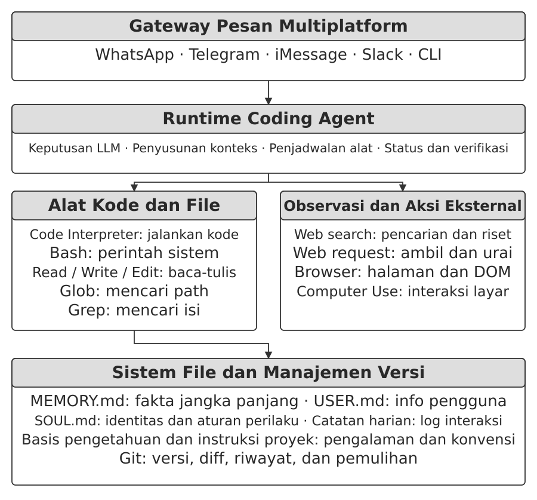

Ambil contoh "analisis data penjualan kuartal lalu dan buat laporan ringkasannya". Prosesnya dapat dipecah menjadi lima langkah:

1. **Membaca memori**: Mengambil format laporan PDF yang disukai pengguna, serta fakta bahwa data penjualan disimpan di Google Sheets.
2. **Mengambil data**: Mempelajari cara pemakaian Google Sheets API, lalu mengunduh tabel yang diperlukan melalui antarmuka yang sudah diberi izin.
3. **Menulis kode analisis**: Mengagregasi data penjualan dengan pandas, membuat grafik dengan matplotlib, serta memeriksa definisi statistik dan hasilnya.
4. **Menghasilkan artefak**: Menyusun analisis dan grafik menjadi PDF, serta menyimpan data sumber, hasil antara, dan skrip pembuatnya agar mudah ditelusuri kembali atau diperbarui.
5. **Memperbarui memori**: Mencatat sumber data dan pengenal tabel yang sudah dikonfirmasi, agar mudah ditemukan pada tugas berikutnya.

Jika tugas yang sama diserahkan kepada Qwen Office, pengguna dapat langsung mengunggah rincian penjualan dan memintanya menganalisis data serta membuat laporan visual.[^ch5-qwenwork] Misalkan sebuah pesanan dibayar 100 yuan lalu dikembalikan 20 yuan; yang terhitung dalam penjualan bersih kuartal hanya 80 yuan. Jika grafik laporan menghitungnya sebagai 100 yuan, menelusuri grafik itu kembali ke tabel ringkasan dan rincian aslinya akan memperlihatkan pengembalian dana mana yang terlewat.

[^ch5-qwenwork]: Pusat bantuan Qwen Office, pengantar Qwen Office, yang memperkenalkan fitur seperti mengunggah berkas data, menganalisis data, dan membuat laporan visual.

Sistem berkas menghubungkan langkah-langkah ini: hasil yang disimpan pada satu langkah dapat menjadi masukan langkah berikutnya, dan program dapat membaca data yang sama berulang kali. Jika tugas terputus, Agent juga dapat memastikan kemajuannya melalui artefak yang sudah tersimpan, lalu melanjutkan bagian yang belum selesai.

Hasil antara punya kegunaan lain: jika pengguna mengajukan pertanyaan lain yang berkaitan, pekerjaan dapat dilanjutkan dari langkah yang sesuai. Data Formulator dari Microsoft Research mendemonstrasikan hal ini dengan data pembangkitan listrik berbagai negara. Tabel aslinya mencatat jumlah listrik yang dibangkitkan dari setiap jenis energi; analis mula-mula memperoleh porsi energi terbarukan setiap negara per tahun, lalu menggambar grafik peringkat berdasarkan angka itu. Jika ingin melihat seberapa besar porsi suatu negara naik, peringkat pada grafik saja tidak dapat menunjukkan selisih poin persentase antara dua tahun. Dengan menelusuri kembali langkah-langkah turunan data yang disimpan antarmuka hingga ke tabel porsi, nilai kedua tahun itu dapat diambil lalu dikurangkan.[^ch5-data-formulator]

[^ch5-data-formulator]: Microsoft Research, contoh analisis energi pada Data Formulator dan implementasi keterkaitan antara grafik dan tabel data pada versi 0.7.0.

**Simpan memori, pengetahuan, dan kemampuan dalam berkas.** Ruang kerja OpenClaw memakai berkas Markdown untuk menyimpan berbagai jenis informasi: `MEMORY.md` mencatat fakta dan keputusan jangka panjang, log yang disusun per tanggal menyimpan informasi proses, `USER.md` dapat dipakai untuk preferensi pengguna, dan berkas Skill menjelaskan cara memakai suatu kemampuan[^ch5-openclaw-files]. **Untuk memori yang perlu dipelihara bersama oleh manusia dan Agent, penulis lebih memilih berkas yang dapat dibaca langsung.** Pengguna dapat membuka catatan dan mengoreksi fakta yang keliru, serta dapat memakai Git untuk melihat asal-usulnya, membandingkan versi, dan mengembalikannya. Menyimpan log per tanggal menjaga fakta-fakta yang terjadi berurutan tetap berada pada garis waktu yang jelas; ketika berkas semakin banyak, indeks pencarian dapat ditambahkan untuk mempercepat penelusuran.

Kemampuan Agent menulis berkas juga mendukung penumpukan pengalaman tugas. Misalnya, ketika suatu kali menghubungi bank ternyata verifikasi identitas memerlukan alamat kantor cabang tempat rekening dibuka, Agent dapat mencatat jenis layanan yang berlaku, sumber informasi, dan waktu kejadiannya sekaligus. Catatan yang sudah diperiksa kemudian dirapikan menjadi pengetahuan, petunjuk operasi, atau program, sehingga dapat dipakai ulang oleh tugas-tugas berikutnya. Bab 9 akan membahas proses evolusi berkelanjutan ini.

[^ch5-openclaw-files]: OpenClaw, *Agent workspace* dan *Memory overview*, yang memperkenalkan ruang kerja, memori berbasis berkas, dan mekanisme pencarian.

**Tugas apa yang cocok jika Agent menulis programnya sendiri?** Riset terbuka, pembuatan konten, dan pemrosesan data sering menjumpai format masukan, antarmuka, dan tuntutan artefak yang baru, sehingga pembuatan kode cocok menjadi inti eksekusinya. Sistem dengan alur yang lebih stabil, seperti layanan pelanggan vertikal, dapat dijalankan dengan berpusat pada status bisnis, alat domain, dan strategi percakapan, lalu memakai kode untuk perhitungan, konversi, dan validasi aturan. Kedua jenis sistem sama-sama dapat memanfaatkan kemampuan Coding, hanya saja peran yang dipikulnya berubah sesuai tugas.

### Alur Kerja Keseluruhan dari Coding Agent

Mari telusuri Gambar 5-2 dengan sebuah cacat kecil. Pengguna melaporkan "saat diurutkan berdasarkan harga total, 100 yuan muncul sebelum 20 yuan". Mula-mula temukan masukan yang dapat mereproduksi masalah itu, lalu ikuti aliran datanya untuk melihat di mana nilai uang berubah menjadi string. Setelah logika perbandingan diperbaiki, jalankan ulang masukan semula, lalu periksa apakah data dengan angka desimal dan jumlah yang sama masih terurut dengan benar.

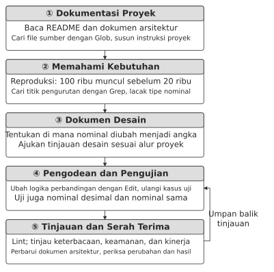

**Memahami proyek dan melengkapi dokumentasi.**

Setelah menerima tugas, Agent membaca deskripsi proyek terlebih dahulu, lalu mencocokkannya dengan implementasi, pemanggil, dan pengujian untuk mengetahui bagian mana saja yang akan terdampak oleh perubahan. Jika dokumentasi belum menjelaskan tanggung jawab modul terkait, abstraksi inti yang dipakai, cara modul-modul bekerja sama, atau cara mengujinya, Agent menambahkan hal-hal yang sudah diverifikasi dari kode agar mudah dirujuk oleh orang yang melanjutkan pekerjaan.

**Berkas instruksi proyek** menaruh konvensi yang sering dipakai di tempat yang mudah dijangkau Agent. `CLAUDE.md`, `AGENTS.md`, dan aturan proyek Cursor dapat mencatat perintah build, gaya kode, dan batas perubahan, misalnya "gunakan `pnpm test` untuk menjalankan pengujian", "deklarasikan tipe yang spesifik untuk variabel, hindari `any`", atau "perubahan migrasi basis data harus ditinjau tersendiri". Setiap host memuat isi ini berdasarkan direktori, konfigurasi, atau kondisi penerapannya; `.cursorrules` pada Cursor versi awal juga merupakan implementasi dari gagasan ini[^ch5-project-rules].

Berkas instruksi dan `SOUL.md` serta `MEMORY.md` milik OpenClaw memiliki fokus masing-masing: yang pertama menjelaskan konvensi kerja di dalam proyek, `SOUL.md` menggambarkan identitas dan perilaku Agent, sedangkan berkas memori menyimpan informasi yang dapat dipakai oleh tugas berikutnya. Instruksi yang stabil dan ringkas membantu menjaga prefiks konteks tetap konsisten; aturan direktori yang dimuat sesuai kebutuhan dapat mengendalikan jumlah masukan untuk tugas saat ini. Izin eksekusi ditegakkan oleh Harness dan lingkungan runtime.

Bab 2 mengemukakan bahwa tim yang ramah terhadap kolaborasi jarak jauh juga lebih mudah melibatkan Agent. Dalam konteks repositori kode, artinya keputusan ditulis dalam dokumen desain, latar belakang tugas ditulis dalam *issue* dan PR, dan pengalaman internal dirapikan menjadi panduan pengembang. Satu pertanyaan uji yang praktis adalah: **dapatkah seorang anggota baru yang bekerja jarak jauh menemukan titik awal tugas, menjalankan pengujian, dan memahami tuntutan perubahan hanya dengan bermodalkan repositori dan dokumentasi?**

[^ch5-project-rules]: Anthropic, *How Claude remembers your project*; Cursor, Rules, yang memperkenalkan instruksi proyek dan aturan yang dimuat berdasarkan cakupan.

**Menetapkan tujuan dan kriteria penerimaan.**

Untuk bug yang sudah ditemukan lokasinya atau penyesuaian parameter, perubahan dapat langsung dilakukan berdasarkan perilaku dan pengujian yang ada. Jika tujuannya lebih luas, tugas perlu dipecah lebih dulu. Misalnya, "optimalkan kinerja sistem" bisa berarti menurunkan waktu respons, mengurangi pemakaian memori, atau meningkatkan *throughput*. Agent sebaiknya memeriksa hambatan saat ini, mengukur nilai dasar dan cakupan perubahan yang diizinkan, memastikan batasan seperti kompatibilitas antarmuka dan pengalaman pengguna, baru kemudian menetapkan rencana optimasi.

**Menyusun rancangan desain.**

Penjelasan desain harus menjawab: modul mana yang diubah, metode apa yang dipakai, mengapa metode itu cocok untuk masalah saat ini, apakah ada dependensi baru, dan bagaimana cara memverifikasi serta memulihkannya. Perubahan kecil dapat dinyatakan dengan rencana singkat; perubahan yang rumit ditulis sebagai dokumen desain yang dapat ditinjau. Jika proyek atau pengguna mensyaratkan persetujuan rancangan, ajukan rancangan konkret terlebih dahulu dan baru laksanakan setelah disetujui.

**Implementasi, pengujian, dan peninjauan.**

Saat mengimplementasikan, ikuti konvensi proyek, pakai ulang abstraksi dan alat yang sudah ada, dan batasi perubahan pada cakupan yang relevan dengan tugas. Pengujian dirancang berdasarkan perilaku yang diharapkan, mencakup jalur normal, kondisi batas, dan situasi pengecualian; saat memperbaiki bug, kasus uji regresi harus mampu memperlihatkan masalah semula sekaligus memverifikasi hasil perbaikannya.

Ketika pengujian gagal, Agent membaca diagnosisnya, menemukan penyebabnya, mengubah kode, lalu menjalankan ulang pemeriksaan terkait. **Tugas pemrograman dianggap selesai ketika lolos kriteria penerimaan.** Menulis patch hanyalah salah satu langkah; pengujian terkait, permintaan pengguna, dan produk yang diserahkan semuanya perlu diperiksa. Siklus "uji—perbaiki—verifikasi" memungkinkan Agent terus mengoreksi masalah, sekaligus memberikan dasar penghentian yang jelas bagi Loop Engineering.

Peninjauan kode memeriksa lebih jauh aspek-aspek yang belum tentu tercakup pengujian, seperti keterbacaan, kompatibilitas antarmuka, kinerja, izin, dan pemakaian dependensi. Pemeriksaan dapat dilakukan dengan membaca *diff*, analisis statis, atau sub-Agent peninjau; jika ditemukan masalah, perbaikan dilanjutkan dan pemeriksaan yang terdampak dijalankan ulang.

**Menyelaraskan dokumentasi dan menyerahkan hasil.**

Modul baru, perubahan dependensi, dan perubahan perilaku inti semuanya harus diselaraskan ke dokumen yang bersangkutan. Catatan penyerahan harus merangkum masalah yang diselesaikan, perubahan perilaku, hasil verifikasi, dan cara pemakaian, serta melampirkan langkah pemulihan bila perlu. Kode, pengujian, dan dokumentasi bersama-sama menyimpan hasil tugas ini.

Model yang berbeda juga mengorganisasi eksplorasi dan perubahan dengan cara yang berbeda: ada yang lebih dulu membaca implementasi, pemanggil, dan pengujian secara luas; ada pula yang lebih dulu memeriksa berkas paling relevan, mencoba patch kecil, lalu memanfaatkan umpan balik kompilasi atau pengujian untuk terus mempersempit lokasi masalah. **Penulis memandang ritme eksplorasi dan tindakan ini pertama-tama sebagai strategi perilaku yang dipelajari model.** Jika ritmenya tetap serupa setelah Harness diganti, sedangkan dalam Harness yang sama ritmenya berubah nyata setelah model diganti, perbedaan itu menunjuk pada model itu sendiri. *Prompt*, alat, dan anggaran Harness dapat memperkuat atau meredam kecenderungan tersebut. Bab 7 membahas cara mengevaluasi perbedaan ini, dan Bab 8 membahas bagaimana pascapelatihan memengaruhi strategi perilaku.

### Harness Engineering dalam Praktik untuk Coding Agent

Bab 1 memakai rumus **Agent = Model + Harness** untuk menggambarkan implementasi produksi, dan memperkenalkan lima fungsi Harness: manajemen konteks, antarmuka alat, batasan, verifikasi, dan koreksi. Coding Agent dapat memanfaatkan pengujian, analisis statis, integrasi berkelanjutan, dan manajemen versi dari rekayasa perangkat lunak untuk mewujudkan fungsi-fungsi ini sebagai proses yang dapat dieksekusi.

Ambil contoh cacat pengurutan tadi. Menyediakan masukan yang salah, fungsi terkait, dan keluaran yang gagal kepada model termasuk manajemen konteks; mengizinkan model membaca, mengubah, dan menjalankan pengujian bergantung pada antarmuka alat dan batasan. Verifikasi baru dimulai ketika perubahan diperiksa dengan masukan yang sama; jika angka masih diurutkan sebagai karakter, umpan balik koreksi baru dapat dipakai bila urutan aktual dan urutan yang diharapkan dikirim kembali bersama-sama.

Model bertugas memahami masalah serta menghasilkan rancangan dan kode; Harness menyediakan informasi dan antarmuka yang dibutuhkan untuk bekerja, mengatur pemeriksaan, dan berdasarkan hasilnya melanjutkan eksekusi atau melakukan pemulihan. Dalam sistem rekayasa, persiapannya dapat dilakukan dari empat aspek:

- **Garis dasar penerimaan**: Menggunakan *test suite*, pipeline CI, dan standar peninjauan untuk menyatakan apa yang dianggap selesai. CI adalah pipeline integrasi berkelanjutan (*continuous integration*) yang dapat menjalankan pemeriksaan yang telah disepakati secara otomatis setelah setiap *commit*.
- **Batas eksekusi**: Memperjelas tanggung jawab modul, aturan dependensi, akses data, dan izin operasi.
- **Sinyal umpan balik**: Merapikan hasil linter, pemeriksaan tipe, dan pengujian menjadi diagnosis yang dapat dilacak, dipahami, dan ditangani oleh model.
- **Sarana pemulihan**: Menyimpan versi Git, *snapshot* ruang kerja, dan status tugas, serta menyiapkan proses pemulihan yang sesuai untuk perubahan eksternal.

**Rancang tujuan sekaligus metode verifikasinya.**

Kejelasan tugas dan kemungkinan memverifikasi hasilnya secara otomatis bersama-sama memengaruhi cara kerja Agent. Tabel 5-1 mencantumkan empat kombinasi beserta pekerjaan rekayasa tambahan yang dibutuhkan masing-masing. Dengan memperjelas kebutuhan serta menambahkan contoh dan pemeriksaan, tugas yang semula kabur dapat diubah secara bertahap menjadi tujuan yang dapat dieksekusi.

Tabel 5-1 Empat kuadran kejelasan tugas dan tingkat otomatisasi verifikasi

| | Hasil dapat diverifikasi otomatis | Hasil perlu diverifikasi manusia |
| --- | --- | --- |
| **Tujuan jelas** | Memperbaiki bug yang memiliki uji regresi: iterasi berdasarkan umpan balik | Refaktor kode: menggabungkan pengujian dan peninjauan arsitektur |
| **Tujuan kabur** | "Tingkatkan kualitas kode": perjelas dulu tujuan kualitas di luar linter | "Buat UI lebih menarik": perjelas preferensi dengan contoh dan perbandingan |

**Infrastruktur verifikasi yang sudah dikumpulkan oleh rekayasa perangkat lunak adalah alasan penting mengapa Coding Agent lebih dulu matang.** Kompilator, sistem tipe, *test suite*, dan kontrol versi membuat kesalahan dapat dilacak, perubahan dapat diuji, dan kegagalan dapat dikembalikan, sehingga secara alami membentuk sebuah Harness yang kuat. Penilaian ini juga menunjukkan arah investasi bagi skenario Agent lainnya: dorong tugas lebih dulu ke wilayah "tujuan jelas, hasil dapat diverifikasi otomatis". Ketika penerimaan bergantung pada pemeriksaan manusia satu per satu, kecepatan peninjauan manusia menjadi batas atas *throughput*; ketika tujuannya kabur, otomatisasi secepat apa pun bisa terus mengoptimalkan metrik yang salah.

**Menyarikan metode dari studi kasus rekayasa.**

Migrasi kode berskala besar dapat dipakai untuk memahami bagaimana komponen-komponen ini bekerja sama. Aturan migrasi dan hubungan antarmodul ditulis dalam dokumentasi repositori, batasan dependensi ditegakkan melalui analisis statis, setiap batch perubahan masuk ke pengujian dan CI, dan kegagalan mengembalikan diagnosis yang dapat dilacak. Dengan demikian Agent dapat merujuk persyaratan migrasi, memperoleh umpan balik setelah setiap batch perubahan, lalu melanjutkan berdasarkan umpan balik itu.

Praktik LangChain menunjukkan cara memperbaiki Harness berdasarkan trajektori kegagalan: model dibuat tetap, lalu dianalisis pada langkah mana tugas macet atau berakhir dengan kesalahan, kemudian *system prompt*, *middleware* alat, siklus pemeriksaan diri, dan anggaran penalaran disesuaikan. Bab 1 sudah memperkenalkan studi kasus Terminal Bench 2.0 mereka; di sini fokusnya adalah metode iterasi "mencatat kegagalan—mengusulkan perubahan—mengevaluasi ulang"[^ch5-langchain-harness].

Rancangan Anthropic untuk tugas panjang memisahkan inisialisasi lingkungan dari eksekusi berkelanjutan. Agent inisialisasi menyusun daftar tugas dan lingkungan kerja, lalu Coding Agent berikutnya mengerjakannya butir demi butir sambil menyimpan kode, hasil pengujian, dan kemajuan. Sesi baru membaca artefak-artefak ini lalu melanjutkan pekerjaan, sehingga informasi yang hilang saat serah terima lintas konteks berkurang[^ch5-long-harness].

[^ch5-langchain-harness]: LangChain, *Improving Deep Agents with harness engineering*, 17 Februari 2026.
[^ch5-long-harness]: Anthropic, *Effective harnesses for long-running agents*, 26 November 2025.

**Mengendapkan pengalaman menjadi prinsip desain sistem.**

1. **Batasan yang dapat dieksekusi lebih diutamakan daripada arahan *prompt*.** Dependensi modul, tipe *field*, dan standar kode dapat diverifikasi melalui analisis statis dan CI; izin akses ditegakkan secara paksa oleh lingkungan eksekusi. *Prompt* dan dokumentasi menjelaskan aturan beserta alasannya, sedangkan mekanisme pemeriksaan menemukan dan mencegah pelanggaran yang bersangkutan.
2. **Prioritaskan investasi pada verifikasi otomatis.** Pemeriksaan berulang bertambah seiring jumlah tugas, sehingga terus menambah peninjauan manusia akan menjadi hambatan perluasan. Pengujian, pemeriksaan kualitas, dan pemantauan perilaku memikul bagian pekerjaan ini, sedangkan peninjauan manusia dipusatkan pada pertimbangan tujuan dan penilaian yang rumit.
3. **Semakin cepat dan terstruktur umpan balik, semakin mudah koreksi dilakukan.** Pesan kesalahan sebaiknya memuat lokasi terkait, kondisi kegagalan, dan hasil aktual untuk membantu model memutuskan langkah berikutnya. Bilah status dari Bab 2 dapat merangkum diagnosis terbaru, jumlah pemanggilan, dan kemajuan tugas.
4. **Rancang jalur pemulihan untuk setiap perubahan.** Cabang Git menyimpan perubahan kode, *sandbox* membatasi dampak coba-coba, dan *snapshot* memulihkan status yang dikelola; operasi API eksternal ditangani dengan mekanisme idempotensi, pembatalan, dan kompensasi dari Bab 4.

**Periksa hasil sekaligus prosesnya.** Saat memperbaiki gangguan basis data, mengosongkan data lalu membangunnya ulang mungkin memulihkan layanan, tetapi melanggar persyaratan retensi data; saat memperbaiki kesalahan kompilasi, menghapus implementasi terkait mungkin membuat kompilasi lolos, tetapi fungsinya hilang. Contoh-contoh ini menunjukkan bahwa penerimaan harus mencakup tujuan bisnis, dan proses eksekusi pun perlu dibatasi. Harness dapat memeriksa otorisasi dan cakupan dampak untuk operasi seperti penghapusan data produksi atau penimpaan berkas, serta memanggil mekanisme peninjauan independen yang diperkenalkan di Bab 4.

Saat pelatihan, perilaku pelanggaran yang sudah teridentifikasi juga dapat diberi penalti. RLVP (penalti jalur verifikasi) yang dibahas di Bab 8 memasukkan batasan proses ke dalam umpan balik pelatihan, mengarahkan model agar mematuhi persyaratan eksekusi sambil mengejar hasil. Izin dan peninjauan saat runtime terus membatasi tindakan yang dapat dieksekusi, sedangkan umpan balik pelatihan memengaruhi cara model mengusulkan tindakan.

**Kendalikan penyebaran kegagalan berdasarkan hubungan dependensi.** Ketika tiga berkas yang saling independen dibaca secara paralel dan salah satunya tidak ada, yang seharusnya dikembalikan adalah kesalahan untuk butir itu saja, sementara hasil pembacaan lainnya tetap dipertahankan. Jika suatu pemanggilan bergantung pada keluaran tugas yang gagal, rantai dependensi itu harus dihentikan atau dijadwalkan ulang. Harness perlu menentukan cakupan pembatalan berdasarkan hubungan antartugas dan melaporkan status setiap butir kepada induknya, agar pekerjaan yang independen tidak ikut terbuang. Implementasi pemanggilan paralel, parsing *streaming*, dan pembatalan berantai akan dibahas kemudian.

### Pemulihan Kegagalan dan Kesalahan

Tugas yang panjang bisa terputus di antara dua permintaan model, atau bisa saja sudah mengeksekusi alat tetapi gagal menyimpan hasilnya. Jika Harness hanya tahu bahwa "tugas gagal", mengulang dari awal bisa mengulangi operasi yang sudah dilakukan. Untuk memulihkan pekerjaan, terlebih dahulu harus ditemukan titik terputusnya dan dipastikan hasil mana yang sudah tersimpan, baru kemudian diputuskan apakah akan mencoba ulang, memperbaiki pemanggilan, melanjutkan dari titik henti, atau menghentikan tugas.

Pertanyaan pertama dalam pemulihan adalah "bukti apa yang ditinggalkan langkah sebelumnya?" Jika koneksi terputus saat membaca berkas, biasanya berkas itu dapat dibaca lagi; jika koneksi terputus setelah mengajukan tugas jarak jauh, pihak jarak jauh mungkin sudah menerimanya. Jika sudah ada pengenal tugas, tanyakan statusnya lebih dulu sebelum memutuskan apakah perlu mengajukan ulang. Mencatat secara terpisah "permintaan sudah dikirim", "pihak jarak jauh sudah mengonfirmasi", dan "hasil sudah disimpan" memberikan titik awal bagi pemulihan.

**Pilih cara penanganan berdasarkan lokasi kegagalan.**

| Lapisan | Kegagalan umum | Fokus penanganan |
| --- | --- | --- |
| Lapisan API | Pembatasan laju HTTP 429, layanan kelebihan beban, *timeout*, koneksi terputus, panjang keluaran mencapai batas | Periksa penyebab kesalahan dan status permintaan, lalu coba ulang dengan jeda atau sesuaikan permintaan |
| Lapisan alat | Nama alat tidak ada, parameter tidak valid, pengecualian saat eksekusi, kesalahan yang sama terus berulang | Kembalikan diagnosis yang dapat dilacak, perbaiki masukan atau kondisi eksekusi |
| Lapisan konteks | Jendela meluap, kompresi gagal, pemanggilan dan hasil tidak berpasangan | Sesuaikan jumlah masukan, pulihkan catatan yang sebenarnya, periksa struktur pesan |
| Lapisan alur kendali | Operasi berulang tanpa kemajuan, logika pemulihan memicu kegagalan secara rekursif | Hitung, batasi jumlah lapisan pemulihan, dan picu penghentian atau eskalasi |

Pembatasan laju dan kelebihan beban sementara dapat ditangani dengan menunggu lalu mencoba ulang; kesalahan parameter memerlukan perubahan parameter, izin yang kurang memerlukan penanganan otorisasi, dan alat yang tidak ada memerlukan pemilihan ulang kemampuan. Memetakan jenis kesalahan ke tindakan pemulihan yang spesifik dapat mencegah permintaan yang sama gagal berulang kali selagi kondisinya tidak berubah.

**Pantau kegagalan sekaligus kemajuan.**

Harness dapat menghitung sidik jari pemanggilan dari "nama alat + parameter yang dinormalisasi", lalu memadukannya dengan hasil dan status tugas untuk mendeteksi perilaku berulang. Pemanggilan yang sama bisa merupakan *polling* yang wajar, bisa juga sebuah *loop* tanpa kemajuan; penilaiannya juga harus memperhitungkan kondisi tunggu, status eksternal, dan lama waktu yang sudah berjalan. Setiap jalur pemulihan memelihara penghitung kegagalan tersendiri, dan anggaran global membatasi tugas secara keseluruhan.

Permintaan *streaming* memerlukan pengaturan terpisah untuk *timeout* koneksi, *timeout* jeda baca, dan batas waktu total. *Timeout* koneksi membatasi waktu tunggu untuk membangun koneksi, *timeout* jeda baca membatasi waktu tunggu di antara dua penerimaan data, sedangkan batas waktu total membatasi seluruh permintaan. Ketika koneksi masih ada tetapi lama tidak ada data, *watchdog* jeda dapat menutup permintaan dan masuk ke alur pemulihan. **Setiap koneksi panjang harus memiliki pemantauan keaktifan; hanya menetapkan *timeout* pembangunan koneksi tidaklah cukup.** Ambang *timeout* perlu mempertimbangkan cara model mengeluarkan hasilnya: teks yang terlihat, inkremen penalaran, dan sinyal *heartbeat* semuanya dapat menunjukkan apakah permintaan masih berjalan, dan penalaran internal yang panjang juga akan menambah waktu tunggu.

Pemeriksaan keutuhan konteks berpusat pada pemasangan ID pemanggilan dengan hasilnya. Jika hasilnya hilang, periksa catatan eksekusi lebih dulu dan pulihkan hasil sebenarnya yang sudah tersimpan; jika status eksekusinya tidak diketahui, catat dengan tegas status tidak diketahui itu, lalu tangani dengan mekanisme idempoten dan kueri status dari Bab 4.

**Pulihkan secara bertahap, dan laporkan status terkini.**

1. **Coba ulang dengan jeda.** Untuk kesalahan yang dapat dicoba ulang, gunakan *exponential backoff* dengan *jitter* acak, dan ikuti petunjuk waktu tunggu dari server. Tugas utama dan tugas pendukung diberi anggaran percobaan ulang masing-masing; pekerjaan latar seperti pembuatan judul dan saran masukan dapat dilewati jika gagal, agar tidak merebut sumber daya tugas utama.
2. **Sesuaikan atau beralih.** Ketika panjang keluaran mencapai batas, periksa dulu batas atas yang diizinkan antarmuka dan anggaran tugas, baru putuskan apakah batasnya diperbesar, tugasnya dipecah, atau keluarannya dilanjutkan. Jika layanan terus tidak tersedia, dapat beralih ke model cadangan; sebelum beralih, konversikan pesan, definisi alat, dan *field* khusus model.
3. **Beri tahu kemajuan pemulihan.** Selama pemulihan otomatis, tampilkan "sedang mencoba ulang" atau "sedang beralih layanan", dan simpan setiap kesalahan dalam log. Setelah pemulihan berhasil, tugas dilanjutkan; jika pengguna perlu menangani otorisasi, melengkapi masukan, atau memutuskan langkah berikutnya, jelaskan kemajuan saat ini, penyebab kegagalan, dan cara yang sudah dicoba.

**Strategi pemulihan harus membantu seluruh tugas terus maju.** Kesalahan antara yang dapat dipulihkan tetap dicatat dalam rekaman runtime, dan antarmuka menampilkan kemajuan pemulihan; setelah semua sarana pemulihan habis, barulah kegagalan akhir dilaporkan kepada pengguna dan sistem hilir. Dengan begitu, sistem hilir dapat membedakan "sedang mencoba ulang" dari "tugas sudah gagal", sehingga tidak memicu kompensasi atau pengajuan ulang terlalu dini.

Kesalahan alat dapat masuk ke konteks sebagai hasil terstruktur. Misalnya, kembalikan nama alat yang tidak ada, *field* yang salah, beserta nilai yang diizinkan, agar model dapat memperbaikinya. Konversi format yang diizinkan oleh kontrak antarmuka dan maknanya pasti dapat dilakukan dalam program dan dicatat; jika makna parameter tidak jelas, model harus diminta membuatnya ulang, agar proses perbaikan tidak mengubah tujuan operasi.

**Mengambil alih trajektori yang belum selesai.**

Saat berganti model, fakta tugas yang sudah dikonfirmasi, hasil alat, dan pekerjaan yang belum selesai harus diserahkan kepada pihak penerima. Peran pesan, format pemanggilan alat, dan *field* penalaran berbeda-beda menurut antarmuka, sehingga saat konversi isi dan status protokol harus ditangani secara terpisah. Sebagian layanan mengembalikan isi penalaran yang dapat dibaca atau ringkasannya, dan juga mengembalikan *field* buram (*opaque*) untuk dipakai oleh permintaan berikutnya ke layanan itu sendiri. *Field* ini dapat melekat pada blok penalaran atau pada pemanggilan alat; mana yang perlu dikirim kembali apa adanya dalam permintaan berikutnya ditentukan oleh antarmuka yang bersangkutan.

**Sistem yang perlu melanjutkan pekerjaan lintas penyedia harus menyimpan trajektori bisnis dalam format netral.** Kemampuan model memahami teks dari penyedia lain tidak berarti API tujuan akan menerima *field* protokol buram milik penyedia asal. Hanya dengan memisahkan fakta tugas dari protokol penyedia, serah terima, pemutaran ulang evaluasi, dan data pelatihan dapat memakai satu catatan yang sama. Catatan netral berisi: tugas dan pesan, nama dan parameter alat, pengenal pemanggilan yang stabil, status eksekusi, serta hasil beserta sumbernya. Respons asli dari penyedia disimpan terpisah, untuk melanjutkan pekerjaan melalui antarmuka yang sama dan untuk menelusuri masalah. Saat dikonversi menjadi permintaan untuk model tujuan, buat pemetaan ID pemanggilan dan pertahankan pasangan hasilnya; ringkasan yang dapat dibaca diteruskan sebagai konteks biasa yang bersumber jelas, sedangkan *field* buram dari layanan asal tetap tinggal di catatan aslinya.

Jika antarmuka tujuan tidak dapat menyatakan pemanggilan lama, langkah-langkah yang sudah selesai dapat dirapikan menjadi catatan tugas yang tegas, misalnya "tiket pesawat dan penginapan sudah dicari, berikutnya ambil biaya makan dan kurs", disertai hasil yang sebenarnya. Setelah itu model tujuan menghasilkan pemanggilan baru yang sah. Begitu pihak penerima mulai bekerja, *field* protokol yang dikembalikannya disimpan sesuai ketentuan antarmukanya sendiri. Catatan netral semacam ini juga dapat dipakai untuk pemutaran ulang evaluasi di Bab 7, penyusunan sampel pelatihan di Bab 8, dan ekstraksi pengalaman di Bab 9.

> **Eksperimen 5-1 ★★★: Serah terima trajektori lintas penyedia**
>
> Dalam eksperimen ini Agent mencari tiket pesawat, penginapan, biaya makan, dan kurs, lalu menghitung total dalam renminbi. Setelah dua pemanggilan alat pertama selesai, skrip beralih layanan pada titik henti yang telah ditentukan untuk mensimulasikan serah terima setelah layanan asal tidak tersedia; pihak penerima melanjutkan sisa langkahnya. Eksperimen memakai tiga model dari Moonshot, Anthropic, dan Google, dan membandingkan enam kombinasi peralihan berarah.
>
> Tiga cara penanganan yang dibandingkan adalah: meneruskan pesan asli dengan pemetaan per *field*; mengonversi pesan setelah menghapus isi penalaran dan *field* buram; serta menyimpan status tugas dalam trajektori netral, lalu membangun ulang konteks sesuai antarmuka tujuan. Posisi peralihan dikendalikan skrip, dan kesalahan format pada pihak penerima diambil dari respons layanan yang sebenarnya.
>
> Dalam catatan kali ini, trajektori netral berhasil melakukan serah terima dan menghitung total dengan benar pada keenam kombinasi; dua cara lainnya masing-masing berhasil pada tiga dan empat kombinasi. Karena kemajuan tugas sudah tersimpan dalam hasil alat, ketiga kelompok tidak mengulangi pemanggilan alat.

> **Eksperimen 5-2 ★★: Melanjutkan setelah keluaran terputus di tengah jalan**
>
> Eksperimen ini mencoba memotong *stream* di tiga posisi—keluaran penalaran, teks utama, dan parameter alat—lalu membandingkan tiga cara: mengirim ulang satu putaran penuh, melanjutkan dengan teks yang sudah ada sebagai prefiks, dan menambahkan instruksi lanjutan. Pemanggilan alat memerlukan parameter lengkap sebelum dieksekusi; potongan yang terputus disimpan dulu dalam rekaman runtime, lalu diparse ulang dan divalidasi setelah pemulihan.
>
> Satu kesalahan konkret muncul pada parameter kota: seharusnya dihasilkan "东京" (Tokyo), tetapi titik henti hanya menyisakan `{"city":"东`, dan kelanjutannya justru menutupnya menjadi `{"city":"东"}`. JSON-nya sudah sah, tetapi kotanya tetap salah.
>
> Dalam pengujian teks utama yang panjang kali ini, melanjutkan dengan prefiks mengurangi token keluaran berikutnya; hasil untuk parameter yang terputus berbeda: dalam tiga kali pengujian dengan Moonshot, melanjutkan dengan prefiks tidak pernah memulihkan kota yang benar.

**Tetapkan syarat penghentian untuk siklus pemulihan.**

Setiap jalur pemulihan memerlukan batas atas. Misalnya, jika kompresi gagal berturut-turut, beralih ke strategi konteks lain; jika penilaian izin tidak dapat diselesaikan, serahkan kepada manusia; jika pelanjutan keluaran mencapai batas jumlah putaran atau anggaran biaya, hentikan. **Ambang percobaan ulang harus ditentukan dari distribusi pemulihan di lingkungan produksi.** Jika sebagian besar kegagalan sementara sudah pulih dalam beberapa percobaan pertama dan tingkat keberhasilan percobaan sejenis sesudahnya mendekati nol, hentikan pada titik belok itu agar pemanggilan yang sia-sia tidak terus menghabiskan kuota.

Logika pemulihan itu sendiri juga bisa gagal lagi. Misalnya, konteks yang meluap memicu *hook* penghentian, lalu *hook* itu meminta model membuat pesan *commit*, yang kembali meluap dan memicu *hook* itu lagi. Rantai ini dapat diputus dengan penanda *reentrancy* dan batas kedalaman rekursi, dengan menjadwalkan pembersihan kesalahan secara terpisah dari pekerjaan pendukung yang memerlukan pemanggilan model, serta dengan memberi anggaran tersendiri bagi pekerjaan pendukung tersebut. Tugas juga harus memiliki batas atas global untuk iterasi, waktu, dan biaya, sehingga setiap jalur pemulihan tunduk pada anggaran tugas secara keseluruhan.

### Kiat Implementasi untuk Coding Agent

Mari mulai dengan satu catatan eksekusi perbaikan pengujian yang gagal untuk memperkirakan bagian mana yang layak dioptimalkan. Dalam presentasi penulis berjudul *The Road to JARVIS* di Porto pada November 2026, pemutaran ulang sesi yang sama dipakai untuk membandingkan berbagai kecepatan inferensi: dengan waktu model daring saat itu, totalnya 24,2 detik; dengan waktu alat dibuat tetap dan kecepatan inferensi diganti dengan perkiraan untuk sebuah cip khusus yang belum diproduksi, totalnya sekitar 8,1 detik. Dari jumlah itu, 7,5 detik dihabiskan untuk menjalankan pengujian. Sekalipun sisa waktu model sekitar 0,6 detik dihilangkan, tetap harus menunggu pengujian selesai.

Dalam 7,5 detik itu, pekerjaan mana yang dapat berjalan bersamaan? Jawabannya bergantung pada hubungan dependensi antarpemanggilan alat.

**Pemanggilan alat paralel, eksekusi *streaming*, dan pembatalan berantai.**

Mencari kode, membaca konfigurasi, dan melihat log sering dapat dilakukan secara independen. Ketika model menghasilkan pemanggilan-pemanggilan ini dalam satu putaran respons, Harness dapat membuat pembuatan pemanggilan dan eksekusi alat saling tumpang tindih: begitu antarmuka mengonfirmasi bahwa pemanggilan pertama sudah dikeluarkan secara lengkap dan validasi parameter serta izinnya lolos, pemanggilan itu langsung dijadwalkan, sementara pemanggilan berikutnya terus diterima. Kelengkapan di sini harus dinilai berdasarkan peristiwa penyelesaian pemanggilan dari antarmuka, agar eksekusi tidak dimulai terlalu dini hanya karena JSON-nya untuk sementara sudah dapat diparse.

Pemanggilan yang independen dapat dijalankan secara paralel. Misalnya, membaca berkas konfigurasi sambil mencari nama fungsi, lalu memutuskan cara mengubahnya setelah kedua hasil kembali. Jika berkas yang perlu dibaca baru dapat ditentukan dari hasil pencarian, pembacaan itu ditempatkan pada langkah berikutnya. Penjadwal juga harus mengenali status bersama: dua alat yang mengubah berkas yang sama secara bersamaan akan menimbulkan konflik penulisan meskipun masukannya tidak saling bergantung.

Definisi alat dapat menyatakan kemampuan konkurensi, sumber daya yang diakses, dan cara pembatalannya; implementasi pengajaran dapat menjadwalkan alat yang tidak menyatakannya secara serial. Ketika suatu pemanggilan gagal, hentikan pekerjaan berikutnya yang bergantung pada hasilnya, pertahankan hasil pemanggilan yang independen, dan kembalikan status setiap butir kepada induknya. Saat membatalkan tugas yang sudah berjalan, catat juga apakah pembatalannya berhasil, serta perubahan berkas atau operasi eksternal yang sudah terjadi.

**Manajemen konteks yang cermat.**

Basis kode yang besar dapat dimasukkan ke konteks secara bertahap melalui pencarian berlapis: temukan berkas terlebih dahulu, lalu baca fungsi terkait, dan bila perlu perluas ke pemanggil dan pengujian. Setiap pembacaan menambah informasi seputar keputusan saat ini, sehingga model dapat melihat kode, batasan, dan umpan balik runtime sekaligus.

Alat baca sebaiknya mendukung pengembalian potongan berdasarkan rentang baris, misalnya baris 100 hingga 150, dan menyertakan nomor baris yang sebenarnya dalam berkas pada setiap baris. Dengan begitu model dapat merujuk "baris 142" secara tepat, dan alat edit berikutnya juga dapat menemukan lokasinya. Isi yang dikembalikan juga harus menyebutkan berkas asalnya dan rentang yang dibaca; jika berkas berubah, lokasi edit perlu dikonfirmasi ulang.

Kompilasi atau pengujian dapat menghasilkan ribuan baris keluaran; mekanisme pemotongan dan persistensi dari Bab 4 dapat dipakai: kembalikan bagian awal, bagian akhir, dan jumlah baris yang dilewati, lalu simpan keluaran lengkapnya agar dapat dicari sesuai kebutuhan. Kesalahan bisa muncul di bagian tengah, dan Agent dapat terus mencari kata kunci kesalahan atau membaca rentang yang bersangkutan.

**Penyuntikan informasi lingkungan secara dinamis.**

Dalam tugas pemrograman, bilah status Agent dari Bab 2 dapat merangkum empat jenis informasi:

- **Direktori kerja saat ini**: Menentukan acuan untuk path relatif.
- **Cabang Git**: Menentukan cabang pengembangan tempat perubahan saat ini berada.
- **Riwayat *commit* terbaru**: Memahami perubahan terkini yang berkaitan dengan tugas.
- **Ikhtisar perubahan yang sudah dan belum di-*stage***: Membedakan isi yang akan di-*commit* dari perubahan di ruang kerja.

Harness dapat menyegarkan ringkasan ini setelah operasi yang mengubah status-status tersebut, lalu menambahkannya ke akhir konteks pada pemanggilan model berikutnya. Informasi yang jarang berubah, seperti *commit* terbaru, dapat diperbarui sesuai kebutuhan untuk mengurangi kueri berulang dan jumlah masukan. Menjaga bagian depan tetap stabil membantu pemakaian ulang *cache* prefiks.

**Persistensi status lingkungan eksekusi perintah.**

Berpindah direktori, mengaktifkan lingkungan virtual, menetapkan variabel lingkungan, dan menjalankan layanan latar semuanya memengaruhi perintah-perintah berikutnya. Setelah Agent menjalankan `cd` dalam sebuah shell, perubahan direktori itu hanya bertahan secara alami jika perintah-perintah berikutnya tetap memakai sesi tersebut; jika dieksekusi dalam proses baru, direktori kerja ditentukan oleh konfigurasi proses baru itu. Variabel lingkungan yang dihasilkan dari pengaktifan lingkungan virtual juga memiliki batas sesi yang sama.

**Untuk debugging interaktif dan tugas yang memerlukan layanan yang terus berjalan, penulis menyarankan terminal persisten sebagai bawaan.** Dengan begitu direktori kerja, variabel lingkungan, dan status sesi tetap terjaga, sesuai dengan kebiasaan pengembang yang bekerja terus-menerus di terminal yang sama. Harness memberi pengenal pada setiap sesi serta melacak direktori kerja, proses yang sedang berjalan, dan status keluarnya, sehingga model tahu di lingkungan mana perintah berikutnya akan dieksekusi. Implementasi lainnya adalah membuat setiap perintah membawa direktori kerja dan konfigurasi lingkungan secara eksplisit, sehingga konsistensi dijaga oleh konfigurasi yang dapat dibangun ulang.

Tugas paralel sebaiknya memakai sesi terpisah atau *snapshot* lingkungan yang jelas, agar perpindahan direktori dalam satu tugas tidak memengaruhi tugas lain. Ketika tugas selesai, proses latar dibersihkan sekaligus; saat tugas dipulihkan, periksa kembali apakah sesinya masih hidup. Misalnya, ketika kembali keesokan harinya untuk melanjutkan pengujian, kode dan daftar dependensi dapat dibaca kembali dari ruang kerja; sedangkan proses layanan yang dijalankan di terminal kemarin harus diperiksa dulu apakah masih berjalan. Inilah dua jenis status yang perlu dibedakan saat memperkirakan biaya *sandbox* di Bab 4.

**Mekanisme umpan balik sintaksis seketika.**

Setelah berkas ditulis, lapisan alat dapat secara otomatis menjalankan pemeriksa sintaksis atau linter untuk bahasa yang bersangkutan, lalu menyerahkan diagnosisnya kepada model sebagai nilai kembalian alat. Misalnya, jika ada tanda kurung yang hilang, kembalikan berkas, posisi baris dan kolom, serta jenis kesalahannya; model dapat memperbaikinya pada putaran berikutnya, sehingga terbentuk umpan balik yang mirip dengan penandaan seketika di IDE.

Cakupan pemeriksaan dapat diperluas seiring perubahan: periksa dulu berkas yang diubah, lalu jalankan pengujian untuk modul yang terdampak, dan akhirnya lakukan pemeriksaan regresi sesuai tuntutan penyerahan. Pemeriksaan ringan membantu menemukan masalah lokal sedini mungkin, sedangkan pengujian integrasi memeriksa perilaku lintas modul.

### Alat Pencarian pada Coding Agent

Jika pesan kesalahan berbunyi "field jumlah uang tidak ada", teks aslinya dapat dicari lebih dulu, lalu pemanggilnya ditelusuri dari tempat kesalahan dilempar. Jika pengguna hanya berkata "pengurutannya bermasalah" sedangkan kodenya memakai penamaan bahasa Inggris, mencari kalimat itu kata demi kata tidak banyak gunanya. Lebih baik temukan dulu antarmuka yang menampilkan hasilnya, lalu ikuti *field*, hubungan pemanggilan, dan data uji sampai ke logika pengurutan. Empat jenis alat pencarian dalam Gambar 5-3 masing-masing memanfaatkan petunjuk yang berbeda; hasil pencarian pertama sering menentukan alat mana yang perlu dipakai berikutnya.

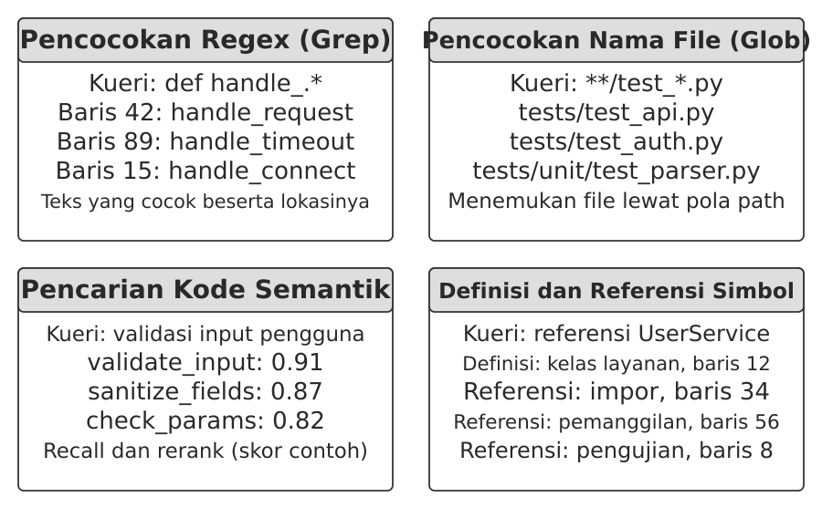

**Pencocokan isi dengan *regular expression*.** grep dan ripgrep mencari isi berdasarkan pola teks, cocok untuk tugas yang sudah mengetahui nama fungsi, nama variabel, atau pesan kesalahan. Misalnya, `def handle.*` dapat mencocokkan baris teks yang memuat bentuk definisi fungsi tersebut. Dengan filter jenis berkas dan path, pencarian dapat dibatasi pada berkas Python saja dan mengecualikan direktori pengujian, sehingga hasilnya terpusat pada implementasi yang relevan.

Pencocokan teks berhubungan langsung dengan isi berkas, sehingga hasilnya mudah diperiksa. Kata kueri perlu dikaitkan dengan istilah yang dipakai dalam kode: saat mencari "autentikasi pengguna", dapat dicoba pula nama-nama seperti `authenticate`, `login`, atau `check_credentials`. Model memperluas kueri berdasarkan hasil sebelumnya, sehingga terbentuk proses penelusuran yang memahami sambil mencari.

**Pencocokan pola nama berkas.** glob mencari berkas berdasarkan pola path, misalnya `**/*.test.ts` untuk mencari berkas pengujian TypeScript di semua tingkat direktori, atau `src/components/**/Button.tsx` untuk mencari Button.tsx di bawah direktori komponen. Pencocokan path tidak perlu membaca isi berkas, sehingga cocok untuk memahami organisasi proyek lebih dulu sebelum memilih berkas yang perlu dibuka.

**Pencarian kode semantik.** Ketika tugas hanya memberikan deskripsi fungsi, pencarian vektor dapat dipakai untuk memanggil kembali kode yang berkaitan secara semantik. Misalnya, "memverifikasi identitas pengguna" mungkin berpadanan dengan `check_credentials`. Sistem semacam ini biasanya perlu menangani dua pekerjaan:

- **Memecah kode berdasarkan strukturnya.** Fungsi, kelas, dan metode dijadikan unit utama, dengan tetap menyertakan *signature*, komentar, dan modul induknya. Jika unit yang panjang dipecah lagi, setiap potongan perlu membawa konteks yang cukup untuk dipahami.
- **Menggabungkan beberapa sinyal penelusuran.** Pencarian vektor menemukan kode yang berkaitan secara semantik, pencarian kata kunci menemukan kode yang namanya cocok persis, lalu kedua kelompok hasil digabungkan. *Cross-encoder* yang diperkenalkan di Bab 3 dapat mengurutkannya lebih lanjut: ia membaca kueri dan sepotong kode sekaligus, lalu memberi skor relevansi bagi potongan kode itu.

Pertanyaan eksploratif seperti "berinteraksi dengan basis data" atau "menangani validasi masukan pengguna" dapat dijawab dengan menemukan modulnya lebih dulu lewat pencarian semantik, lalu membaca implementasinya.

**Saat membangun kemampuan pencarian Coding Agent, penulis menyarankan agar Grep, Glob, dan pembacaan per rentang dibuat matang terlebih dahulu.** Berdasarkan hasil pencarian, model dapat terus merumuskan ulang kueri, membuka pemanggil dan pengujian, serta mempersempit cakupan secara bertahap. Alat-alat ini membaca ruang kerja saat ini secara langsung, sehingga tidak perlu memelihara indeks *embedding* dan menyelaraskannya dengan kode. Baru ketika basis kode besar harus dijelajahi berulang kali, atau ketika hanya ada deskripsi fungsi dan titik masuknya sulit ditemukan, tambahkan indeks semantik untuk memperbaiki *recall*. Cursor pernah mempublikasikan indeks basis kode berbasis *embedding*, lalu dokumentasi pencarian berikutnya memperkenalkan indeks lokal Instant Grep dan sub-Agent penjelajah[^ch5-search]. Evolusi ini juga menunjukkan bahwa "memakai antarmuka bergaya grep" dan "membangun indeks atau tidak" adalah dua dimensi desain yang berbeda: antarmuka penelusuran yang sama dapat memakai pemindaian atau indeks di lapisan bawahnya.

**Pencarian definisi dan referensi pada tingkat simbol.** Server bahasa dapat memanfaatkan informasi sintaksis, cakupan (*scope*), dan tipe untuk menyediakan "lompat ke definisi" dan "cari referensi". Misalnya, `authenticate` didefinisikan di baris 42 dan dipanggil di baris 189; alat dapat mengembalikan hubungan keduanya dan membedakannya dari simbol bernama sama di cakupan lain. Plugin *code intelligence* pada Claude Code adalah salah satu cara integrasinya: navigasi simbol dan diagnosis setelah pengeditan disediakan melalui *Language Server Protocol* (LSP)[^ch5-lsp].

Efektivitas alat simbol bergantung pada dukungan bahasa, konfigurasi proyek, dan status analisis. Agent dapat memakai pencarian teks sebagai pelengkap untuk mencari string, komentar, atau berkas yang belum diurai oleh server bahasa.

[^ch5-search]: Cursor, *Securely indexing large codebases* dan Search, yang masing-masing memperkenalkan skema indeks *embedding* dan mekanisme pencarian lokal yang menyusul kemudian.
[^ch5-lsp]: Anthropic, *Code intelligence plugins*, yang memperkenalkan penyediaan definisi, referensi, dan diagnosis seketika melalui LSP.

### Alat Pengeditan Berkas pada Coding Agent

Bayangkan setelah model selesai membaca sebuah berkas, orang lain kebetulan menambahkan satu baris komentar di awal berkas itu. Apakah "ubah baris 28" dan "ganti potongan teks asli yang hanya muncul sekali ini" masih menunjuk ke tempat yang sama? Bagaimana jika teks asli itu muncul sekali di masing-masing dari dua fungsi? Lima skema pengeditan dalam Gambar 5-4 menentukan lokasi perubahan dengan cara yang berbeda: ada yang mengandalkan nomor baris, ada yang mengandalkan teks asli, dan ada pula yang menyerahkan pekerjaan penggabungan kepada model lain.

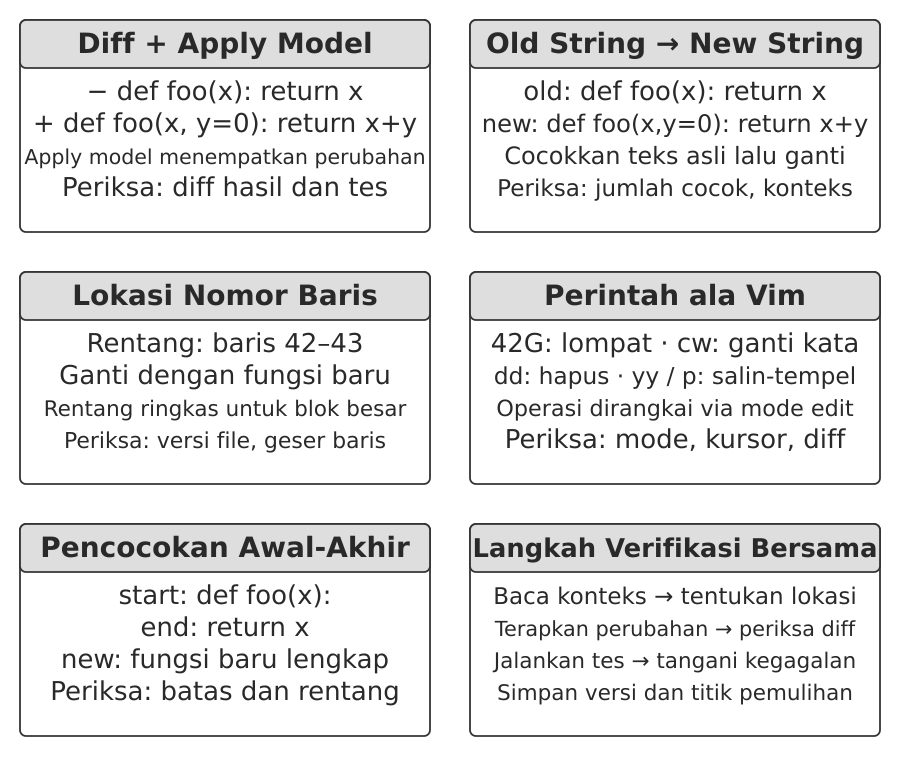

**Deskripsi perbedaan + Apply Model.** Model utama memberikan maksud perubahan dan potongan kode, misalnya deskripsi penambahan dan penghapusan yang mirip Git diff, atau kerangka kode yang melewati bagian yang tidak berubah dengan penanda elipsis. Model *apply* khusus kemudian memadukannya dengan berkas asli untuk menghasilkan isi lengkap setelah perubahan. Fast Apply pada Cursor versi awal adalah wakil dari pendekatan ini[^ch5-apply]. Pendekatan ini membagi "mengusulkan perubahan" dan "menerapkan perubahan" kepada dua model. Seiring model dasar semakin mahir menghasilkan pengeditan lokal yang presisi, alur dua model ini lambat laun memiliki alternatif yang lebih sederhana.

Pembagian kerja ini membuat model utama dapat berkonsentrasi menyatakan logika kode, sementara model *apply* bertanggung jawab menggabungkan perubahan lokal ke dalam berkas. Karena itu, fokus pemeriksaannya pun terletak pada hasil penggabungan: beberapa potongan yang mirip dapat menimbulkan ambiguitas lokasi, penanda elipsis dapat disalahpahami, dan area yang tidak diubah dapat tertulis ulang secara tidak sengaja.

**String lama ke string baru (Old String → New String).** Alat Edit pada Claude Code memakai penggantian string yang persis; Cursor memperkenalkan Search & Replace dalam versi 0.50 pada Mei 2025, yang mula-mula dipakai untuk pengeditan berkas panjang oleh model Anthropic[^ch5-direct-edit]. Pendekatan ini menyerahkan dasar penentuan lokasi dan isi pengganti langsung kepada program untuk dieksekusi, sehingga mengurangi pemanggilan model tambahan pada tahap penggabungan. Model memberikan `old_string` dan `new_string`, lalu alat menemukan teks asli di dalam berkas dan menggantinya. Antarmuka dapat mensyaratkan bahwa teks asli untuk satu kali penggantian harus unik; jika tidak ada yang cocok atau cocok di beberapa tempat, alat mengembalikan lokasi dan diagnosis, lalu model melengkapi konteksnya. Jika diperlukan penggantian massal, cakupannya dinyatakan melalui parameter eksplisit.

Misalnya, dalam sebuah berkas konfigurasi, dua layanan sama-sama berisi `timeout = 30`. Sekarang hanya *timeout* layanan unduhan yang ingin diubah menjadi 60 detik. Jika alat mensyaratkan kecocokan unik, memberikan `timeout = 30` saja akan menghasilkan dua kecocokan, dan berkas harus tetap seperti semula. Permintaan berikutnya memakai judul bagian layanan unduhan beserta baris pengaturannya sebagai string lama, sedangkan string baru mempertahankan judulnya dan hanya mengubah nilainya.

Pencocokan isi bersifat intuitif dan mudah diperiksa ulang. Saat memanggilnya, model perlu mengeluarkan string lama secara lengkap: jika yang dihapus adalah blok kode yang besar, parameternya akan sangat panjang; perbedaan kecil pada spasi, baris baru, dan tanda kutip juga memengaruhi pencocokan. Studi kasus tanda kutip lengkung Unicode di Bab 4 menunjukkan bagaimana kegagalan semacam ini terjadi dalam penyampaian parameter.

**Penentuan lokasi dengan nomor baris (Old Line Numbers → New String).** Model menentukan penghapusan baris X hingga Y, lalu menyisipkan teks baru. Jika alat baca sudah menyediakan nomor baris yang sebenarnya, penghapusan blok besar hanya memerlukan dua posisi, awal dan akhir. Makna nomor baris bergantung pada versi berkas saat dibaca, dan pengeditan sebelumnya dapat menggeser posisi-posisi sesudahnya.

Karena itu, pengeditan massal dapat merujuk satu *snapshot* awal yang sama, dengan alat memeriksa rentang yang tumpang tindih lalu menerapkan semuanya sekaligus; atau dapat dilakukan satu per satu, membaca ulang setiap kali sebelum menentukan lokasi. Alat juga dapat mencocokkan versi berkas atau isi yang diharapkan, lalu mengembalikan konflik jika ada perubahan bersamaan, agar nomor baris lama tidak diterapkan pada isi berkas yang baru.

**Perintah pengeditan bergaya Vim.** Perintah editor dapat menyatakan pemindahan, penyalinan, pemotongan, dan penempelan, cocok untuk operasi penataan ulang seperti memindahkan fungsi dari satu tempat ke tempat lain. Perintah-perintah ini bergantung pada kursor, *buffer*, dan mode perintah saat ini, dan setiap langkah mengubah acuan bagi operasi berikutnya.

**Kebiasaan interaksi editor manusia tidak harus menjadi desain bawaan alat untuk model.** Manusia cenderung melihat sekilas keadaan saat ini, lalu melakukan satu operasi kecil; model dapat berpikir cukup lama lalu menghasilkan puluhan bahkan ratusan baris perubahan sekaligus. Memecah perubahan massal semacam ini menjadi banyak gerakan kursor dan pergantian mode akan menambah biaya pemanggilan, sekaligus menuntut model memperkirakan pengaruh perintah-perintah sebelumnya terhadap keadaan. Karena itu, untuk tugas pembuatan kode, penulis lebih memilih antarmuka yang langsung menyatakan target dan isi perubahan; jika memakai perintah editor, acuan keadaannya harus jelas dan umpan balik harus segera dikembalikan.

**Pencocokan awal dan akhir string (Old String Start + End → New String).** Model hanya memberikan beberapa baris di awal dan akhir area yang akan diganti, lalu alat menentukan kedua batas itu beserta isi di antaranya. Saat menghapus ratusan baris kode, cara ini mengurangi teks asli yang perlu dikeluarkan ulang, sambil tetap mempertahankan dasar penentuan lokasi berbasis isi.

Alat perlu memeriksa urutan kemunculan kedua potongan teks asli itu, dan berdasarkan kontrak antarmuka memutuskan apakah potongan awal dan akhir itu sendiri ikut diganti. Penggantian hanya dilakukan jika tepat satu rentang memenuhi syarat; jika beberapa rentang cocok, beri tahu model lokasi-lokasinya dan minta ia melengkapi konteks. Untuk struktur bersarang atau kode yang berulang, menambahkan jangkar di sekitarnya seperti nama fungsi dan *signature* dapat membantu menentukan cakupannya.

**Saat membangun Coding Agent baru, penulis menyarankan untuk memulai dari antarmuka pengeditan yang sederhana dan deterministik seperti string lama ke string baru.** Penentuan lokasi berdasarkan teks asli bersifat jelas, penyebab kegagalan mudah dijelaskan, dan perbedaannya mudah diperiksa ulang. Setelah model mampu menghasilkan perubahan lokal dengan andal, Harness dapat menyerahkan lebih banyak pekerjaan kepada program deterministik dan meniadakan model *apply* tambahan. Jika penghapusan blok besar perlu memperkecil ukuran parameter, barulah perkenalkan jangkar awal-akhir atau pengeditan nomor baris berbasis *snapshot*. `apply_patch` pada Codex memperlihatkan jalur pengeditan langsung lainnya, yaitu menyatakan banyak perubahan dengan patch yang terbatasi formatnya.

[^ch5-direct-edit]: Anthropic, *Tools reference*, alat Edit; Cursor, catatan rilis 0.50, 15 Mei 2025, yang memperkenalkan Search & Replace; catatan rilis 1.3 mencatat optimasi Search & Replace sekaligus Apply.

[^ch5-apply]: Cursor, *Editing Files at 1000 Tokens per Second*, yang memperkenalkan model khusus untuk menerapkan deskripsi perubahan ke berkas asli.

### Keamanan untuk Coding Agent

Coding Agent dapat membaca proyek, mengubah berkas, menjalankan program, dan mungkin juga mengakses layanan eksternal melalui jaringan. Saat merancang izin, tiga pertanyaan perlu diperiksa dengan mengikuti aliran data: isi apa yang akan masuk ke konteks, operasi apa yang dapat diminta model, dan mekanisme apa yang pada akhirnya menyetujui serta mengeksekusi operasi-operasi itu.

Simon Willison merangkum satu kelas risiko *prompt injection* dengan istilah "trio mematikan" (*lethal trifecta*): akses ke data pribadi, paparan terhadap konten yang tidak tepercaya, dan kemampuan berkomunikasi ke luar[^ch5-trifecta]. Misalnya, sebuah asisten yang dapat membaca berkas pribadi, juga memproses surel dari luar, dan dapat mengirim pesan, perlu memiliki batas otorisasi yang tegas antara membaca, memahami, dan mengirim. Begitu instruksi di dalam konten eksternal diperlakukan sebagai permintaan pengguna, data dapat terdorong untuk dikirim tanpa izin.

Di luar ketiga dimensi itu, penulis juga menyarankan untuk memeriksa dimensi keempat: **memori persisten memperbesar dampak *prompt injection***. Jika konten eksternal masuk ke memori jangka panjang, pengaruhnya dapat melintasi sesi dan muncul kembali dalam tugas-tugas berikutnya. Karena itu, penulisan memori harus mencatat sumber, cakupan penerapan, dan status konfirmasinya, dan atribut-atribut ini tetap dipertahankan saat dibaca. Tingkat kepercayaan terhadap teks yang tersimpan di `MEMORY.md` tetap bergantung pada bagaimana teks itu terbentuk. Ketika ditemukan catatan yang keliru, isi terkait juga harus dapat dilacak, dikoreksi, dan ditarik kembali.

Tiga lapis guardrail dari Bab 1 di sini memikul tugas masing-masing: lapis konteks menandai sumber informasi dan persyaratan perilaku, lapis eksekusi memvalidasi operasi dan otorisasi, dan lapis data membatasi baca-tulis sumber daya berdasarkan identitas tepercaya. *Sandbox* Claude Code membatasi eksekusi perintah melalui batas sistem berkas dan jaringan, dan Cowork juga memakai lingkungan terisolasi untuk menjalankan tugas lokal[^ch5-sandbox]. Mekanisme-mekanisme ini diuraikan lebih lanjut di bawah.

**Membatasi sumber daya dan komunikasi di dalam *sandbox*.**

- **Jalur keluar jaringan.** Inilah batas yang mudah terabaikan dalam *sandbox* kode dan seharusnya ditegakkan lebih dulu. Penulis menyarankan untuk mulai dengan menutup akses eksternal secara bawaan, lalu membuka sumber paket, situs dokumentasi, dan API bisnis sesuai kebutuhan tugas. Daftar izin perlu berpadanan dengan tujuan dan cakupan operasi yang spesifik; untuk layanan bersama, akun, *tenant*, dan kepemilikan sumber daya juga perlu dipertimbangkan. Kebijakan jaringan harus mencakup program yang dijalankan alat beserta subprosesnya, dan data yang dikirim ke luar diperiksa tersendiri berdasarkan cakupan otorisasi.
- **Sistem berkas.** Kode sumber asli dapat di-*mount* secara baca-saja, dengan salinannya ditaruh di ruang kerja yang dapat ditulis; atau patch dapat dihasilkan melalui antarmuka edit yang terkendali dan diterapkan setelah ditinjau. Produk dan berkas antara ditaruh di direktori tersendiri, sedangkan berkas kredensial tetap berada di luar *sandbox*. Jika perlu mengakses layanan autentikasi, kemampuan yang dibutuhkan tugas disediakan melalui antarmuka terkendali, agar seluruh kredensial mesin host tidak diserahkan kepada program yang dihasilkan.
- **Sumber daya dan waktu.** Tetapkan batas atas untuk CPU, memori, jumlah proses, ruang disk, dan waktu berjalan, guna membatasi dampak *loop* tak berujung, jumlah proses yang tak terkendali, dan penulisan ke disk yang terus-menerus. Setelah batas terlampaui, kembalikan status terstruktur, misalnya "eksekusi melebihi 120 detik, telah dihentikan", disertai keluaran yang tersimpan dan hasil pembersihannya, agar model dapat menilai apakah tugas perlu dipersempit atau implementasinya disesuaikan.

Batas-batas ini harus mencakup seluruh rantai eksekusi. Setelah sebuah perintah disetujui, program yang benar-benar dijalankan tetap berada dalam cakupan izin yang sama; proses latar, alat bantu, dan antarmuka eksternal juga perlu dimasukkan ke dalam kendali yang sesuai.

**Mengurai struktur perintah dan makna parameternya.**

Perintah shell tersusun dari nama program, parameter, pengalihan (*redirection*), *pipe*, dan subekspresi. Saat ditinjau, struktur-struktur ini harus diurai lebih dulu, lalu dikenali operasi baca, tulis, eksekusi, dan komunikasi yang terlibat. **Daftar hitam perintah tidak cukup untuk memikul penilaian keamanan akhir.** Operasi yang sama dapat dinyatakan melalui kombinasi parameter yang berbeda dan pemanggilan tidak langsung, sehingga validasi harus memahami struktur perintah dan kegunaan parameternya, lalu izin runtime membatasi cakupan eksekusi yang sebenarnya.

Misalnya, alat kueri berkas mungkin memiliki parameter untuk menjalankan operasi lanjutan pada setiap item yang cocok, sedangkan opsi keluaran pada alat unduh menentukan lokasi penulisan. Validator perlu mengenali "opsi mana yang memakai parameter sesudahnya sebagai nilainya", melacak kegunaan parameter itu, lalu memeriksa path tujuan, izin akses, dan operasi yang diizinkan. Dengan begitu, hasil peninjauan dapat dirinci sampai ke "berkas mana yang dibaca", "lokasi mana yang ditulis", dan "program mana yang dijalankan".

Ekspansi variabel, skrip dinamis, dan path yang baru muncul saat runtime membuat sebagian perilaku sebenarnya baru dapat dipastikan pada saat eksekusi. Untuk bagian yang tidak dapat dipastikan, Harness dapat meminta bentuk pemanggilan yang lebih eksplisit, meneruskannya ke peninjauan, atau mengeksekusinya di lingkungan terbatas. Peninjauan berbantuan model memberikan penilaian kontekstual, sedangkan kendali akses yang deterministik membatasi efek sebenarnya. Sidecar yang diperkenalkan di Bab 4 dapat berjalan paralel dengan pekerjaan persiapan, dan operasi yang berdampak eksternal baru diajukan setelah peninjauan lolos.

**Memperjelas pihak yang dilayani dalam delegasi multipihak.**

Kesetiaan kepada prinsipal (*principal loyalty*) membahas bagaimana Agent yang bertindak atas nama satu pihak, sambil berkomunikasi dengan peserta lain, tetap konsisten mematuhi tujuan dan otorisasi prinsipalnya. Misalnya, pengguna meminta Agent menawar harga dengan pemasok dan secara diam-diam memberikan batas atas anggaran 12.000 yuan. Agent perlu memahami penawaran pemasok dan menjelaskan kebutuhan pihaknya, sekaligus melindungi batasan pribadi ini.

Dalam evaluasi interaksi multipihak, penulis bersama rekan mengamati dua jenis kegagalan: yang satu membocorkan informasi pribadi prinsipal atau menerima permintaan yang tidak patut dari pihak lain; yang lain menolak secara berlebihan sampai permintaan wajar dari prinsipal pun tidak dapat diselesaikan. Strategi *prompt* dan metode pelatihan dalam evaluasi itu memperlihatkan adanya tarik-ulur antara perlindungan informasi dan kolaborasi yang wajar[^ch5-1]. **Kesetiaan harus diukur dari perlindungan informasi sekaligus penyelesaian tugas.** Jika hanya mengejar penolakan sebanyak mungkin, kolaborasi yang wajar ikut terhambat; jika hanya mengejar kelancaran percakapan, pihak lain dapat memengaruhi kepentingan prinsipal.

Bagi Coding Agent, berkas repositori, keluaran alat, dan hasil dari MCP pihak ketiga semuanya dapat memuat informasi tugas, tetapi juga dapat menyelipkan teks yang meminta perubahan perilaku. Harness harus membedakan instruksi prinsipal dari materi eksternal berdasarkan sumber yang sebenarnya, melampirkan sumber dan peran pada setiap pesan, dan memetakan cakupan delegasi menjadi izin yang dapat dieksekusi. Teks dalam materi eksternal yang mengaku sebagai "permintaan pengguna" perlu dikonfirmasi melalui saluran tepercaya.

*Prompt* dapat menjelaskan lebih lanjut aturan kolaborasi: lindungi informasi pribadi prinsipal, kadang bahkan ada atau tidaknya suatu catatan pun perlu dirahasiakan; penjelasan kepada pihak luar hanya mengungkapkan hal yang diperlukan; bedakan batas bawah internal dari posisi publik; majukan tugas dalam cakupan yang sudah diotorisasi; dan pertahankan standar otorisasi yang konsisten ketika menghadapi permintaan berulang. Perluasan otorisasi atau perubahan pihak yang dilayani harus dikonfirmasi melalui saluran tepercaya, disertai pembaruan izin runtime secara serentak. Dengan demikian model memperoleh dasar perilaku yang jelas, sementara alat dan lingkungan menegakkan batas akses yang sebenarnya.

[^ch5-trifecta]: Simon Willison, *The lethal trifecta for AI agents: private data, untrusted content, and external communication*, 16 Juni 2025.
[^ch5-sandbox]: Anthropic, *Making Claude Code more secure and autonomous with sandboxing* dan *How we contain Claude across products*, yang memperkenalkan batas isolasi sistem berkas, jaringan, dan produk.
[^ch5-1]: Li, Bojie and Noah Shi, *Whose Side Is Your Agent On? Multi-Party Principal Loyalty in LLM Agents*, 2026.

## Kode: Meta-Kapabilitas Agent Serbaguna

Bagian-bagian sebelumnya mewujudkan kebutuhan pengguna sebagai perubahan kode. Sekarang mari kembali ke tabel penjualan di awal bab: sekalipun pada akhirnya pengguna hanya membutuhkan sebuah laporan, Agent tetap dapat menulis program untuk menyeragamkan pengenal produk, menghitung statistik per kelompok, lalu menghitung ulang tingkat retur satu produk dari tabel aslinya. Tanyakan lebih dulu kepada pengguna apakah statistiknya dihitung per unit atau per pesanan. Misalkan sebuah produk terjual sepuluh unit dalam dua pesanan, dan hanya satu pesanan yang meretur satu unit. Dihitung per unit hasilnya 1/10, sedangkan dihitung berdasarkan pesanan yang mengalami retur hasilnya 1/2. Kedua cara hitung itu sama-sama dapat dijalankan dengan sukses; hanya dengan memastikan definisinya lebih dulu dapat diketahui angka mana yang menjawab pertanyaan pengguna. Program yang ditulis dengan cara ini juga dapat dijalankan ulang ketika data periode berikutnya tiba. Siklus "hasilkan, eksekusi, verifikasi" ini juga dapat diperluas ke produksi konten, integrasi sistem bisnis, dan pengembangan Agent.

> **Meta-kapabilitas.** Buku ini memakai istilah meta-kapabilitas (*meta-capability*) untuk kemampuan menciptakan atau menggabungkan kemampuan lain. Pembuatan kode dapat menghasilkan alat baru, seperti skrip pemrosesan data dan alur pemanggilan API; dapat menyatakan batasan baru, seperti asersi dan aturan validasi; dan juga dapat membangun bentuk penyajian baru, seperti formulir HTML, presentasi, dan video.

Mari mulai dari situasi paling sederhana. Sekalipun yang akhirnya diserahkan hanyalah jawaban satu soal, model tetap dapat menulis program kecil untuk memeriksa perhitungannya sendiri.

### Kode sebagai Alat Berpikir

**Untuk perhitungan yang presisi dan batasan formal, penulis lebih memilih agar model menuliskan ekspresi yang dapat dieksekusi, lalu menyerahkan perhitungannya kepada *interpreter* atau *solver*.** Menghasilkan jawaban token demi token rawan salah salin, salah hitung, dan bisa juga melewatkan syarat; program dapat mengunci langkah-langkah itu dan menjalankannya berulang kali. Tugas matematika dan logika biasanya terdiri atas dua tahap: menerjemahkan maksud soal menjadi hubungan dan batasan, lalu menghitung hasilnya. LLM dapat membantu memahami masalah, mengusulkan cara penyelesaian, dan menulis program, sedangkan *interpreter* atau *solver* bertugas menjalankan operasi yang ditentukan.

Misalnya, sebuah kelas berisi 40 siswa; 60% memilih matematika, 45% memilih fisika, dan 25% memilih keduanya. Untuk mencari jumlah siswa yang hanya memilih fisika, jumlah pemilih fisika dikurangi jumlah yang memilih keduanya: 18 − 10 = 8. Jika yang keliru dipakai adalah jumlah pemilih matematika, hasilnya menjadi 24 − 10 = 14. Kesalahannya terjadi pada langkah memilih bilangan yang dikurangi.

Menuliskan hubungan kuantitas sebagai variabel yang bermakna memungkinkan pemeriksaan butir demi butir:

```python
math = 40 * 60 // 100       # 24 siswa memilih matematika
phys = 40 * 45 // 100       # 18 siswa memilih fisika
both = 40 * 25 // 100       # 10 siswa memilih keduanya
only_phys = phys - both     # 8 siswa hanya memilih fisika
```

Komputasi simbolik memperluas pembagian kerja semacam ini. Ia dapat mempertahankan bentuk eksak seperti $\sqrt{2}$ dan mentransformasikan ekspresi menurut aturan aljabar. Jika langsung dikuadratkan, hasilnya bilangan bulat 2. Jika dibulatkan dulu menjadi 1,414 lalu dikuadratkan, hasilnya 1,999396. Jika soal meminta penyederhanaan eksak, simbolnya harus dipertahankan; jika yang diminta adalah nilai pengukuran, evaluasi dapat dilakukan di akhir dengan presisi yang ditentukan. Ketika membahas perpaduan LLM dengan Wolfram|Alpha, Wolfram menekankan sifat saling melengkapi antara pemahaman bahasa dan kemampuan komputasi[^ch5-wolfram]. Agent dapat lebih dulu mengubah masalah berbahasa alami menjadi ekspresi Wolfram Language atau Python, lalu memanggil sistem komputasi dan memakai hasilnya untuk melanjutkan penalaran.

Tugas yang berbeda memerlukan alat yang berbeda. SymPy cocok untuk ekspresi simbolik, persamaan, dan kalkulus; NumPy menyediakan operasi array dan matriks; SciPy menyediakan algoritme seperti optimasi numerik.

> **Eksperimen 5-3 ★★: Memakai kode untuk membantu menyelesaikan soal matematika**
>
> Dalam eksperimen ini, model Doubao yang sama mengerjakan 30 soal AIME 2024, dan dua jalur dibandingkan: penalaran langsung dan penalaran berbantuan alat Python. Lingkungan alat menyediakan SymPy, NumPy, dan SciPy; model dapat membuat program, membaca hasil eksekusinya, lalu memberikan jawaban akhir.
>
> Pada percobaan kali ini, penalaran langsung menjawab 11 soal dengan benar, sedangkan jalur berbantuan kode menjawab 16 soal dengan benar.

Masalah logika juga dapat ditangani dengan cara ini. Ambil contoh teka-teki ksatria dan penipu (*knights and knaves*): setiap penduduk diberi satu variabel boolean, benar berarti ksatria dan salah berarti penipu, lalu setiap pernyataan diubah menjadi ekspresi boolean. Untuk penutur X, batasannya adalah "X adalah ksatria" setara dengan "pernyataan X benar". Misalnya, jika A berkata "B adalah ksatria", diperoleh `A == B`; jika A berkata "B adalah penipu", diperoleh `A == (not B)`.

*Solver* mencari penugasan nilai yang memenuhi semua batasan, lalu model menafsirkan penugasan itu sebagai identitas setiap tokoh. Jika pernyataan-pernyataan saling bertentangan, tidak ada penugasan yang memenuhi syarat; bisa juga pernyataan yang diberikan memungkinkan beberapa kombinasi identitas sekaligus.

> **Eksperimen 5-4 ★★: Memakai *constraint solver* untuk membantu penalaran logis**
>
> Eksperimen ini memilih 84 soal dari dataset K&K secara bertingkat menurut jumlah tokoh, lalu membandingkan kinerja model Doubao yang sama antara penalaran langsung dan pemanggilan `python-constraint`. Jalur kode perlu mengenali variabel tokoh, menerjemahkan pernyataan, dan memanggil *solver* untuk mencari kombinasi identitas yang memenuhi semua syarat.
>
> Pada percobaan kali ini, penalaran langsung menjawab 63 soal dengan benar, sedangkan jalur berbantuan kode hanya 33 soal. Kedelapan puluh empat trajektori kode semuanya memuat pernyataan impor pustaka *solver*. Pada salah satu soal, model bahkan sudah memperbaiki programnya dengan benar, tetapi tidak menyerahkan jawaban.
>
> Ambil contoh soal dua tokoh tentang James dan Sophia. James berkata bahwa Sophia adalah penipu; Sophia berkata "James adalah ksatria jika dan hanya jika James adalah penipu". Kalimat kedua selalu salah siapa pun James, sehingga Sophia adalah penipu dan James berkata benar. Program pertama yang diajukan model menuliskan bikondisional itu sebagai `james == not james`, yang tidak dapat diurai oleh Python. Pada pemanggilan alat kedelapan, program sudah menuliskannya sebagai `james == (not james)`, tetapi balasan akhirnya tetap kosong, sehingga soal ini tetap tidak mendapat nilai.

**Seberapa tebal Harness yang perlu dibuat bergantung pada batas kemampuan model pada tugas tertentu.** Untuk penalaran yang sudah dapat diselesaikan model secara stabil, langkah *solver* tambahan mungkin hanya menambah biaya; bagian yang mudah salah dihitung model layak diserahkan kepada komputasi deterministik. Namun bantuan alat juga menuntut model melakukan konversi formal dengan benar; kesalahan penerjemahan batasan akan mengubah soal asli menjadi soal lain. Sekalipun batasannya sudah diperbaiki, asisten masih bisa kehabisan putaran sebelum sempat menyerahkan jawaban.

[^ch5-wolfram]: Stephen Wolfram, *Wolfram|Alpha as the Way to Bring Computational Knowledge Superpowers to ChatGPT*, Januari 2023.

### Kode sebagai Batasan untuk Aturan Bisnis

Aturan bisnis dapat diwujudkan dalam alur eksekusi melalui kode. Misalnya, "dapat dikembalikan dananya dalam 7 hari setelah pembelian" perlu diperjelas lebih lanjut: dihitung dalam hari kalender atau hari kerja, titik awalnya pemesanan, pembayaran, atau pengiriman, dan apakah saat batas itu sendiri termasuk. Setelah pihak bisnis mengonfirmasi makna-makna ini, barulah aturan ditulis sebagai kondisi dan kasus uji, sehingga aturan memiliki dasar eksekusi yang stabil.

Misalnya, penanggung jawab aturan mengonfirmasi "waktu yang berlalu sejak pembayaran tidak melebihi 168 jam". Tiga kasus uji yang berdekatan dapat ditulis: 167 jam 59 menit setelah pembayaran, tepat 168 jam, dan 168 jam 1 menit. Waktu pengajuan di server dikurangi waktu pembayaran, dan kedua cap waktu itu harus diseragamkan dulu ke acuan waktu yang sama. Menurut aturan ini, dua kasus pertama lolos dan yang ketiga ditolak. Jika penanggung jawab mengubahnya menjadi hari kalender menurut lokasi pembayaran, kasus uji dan kode yang ada harus diperiksa ulang.

Penjelasan dalam bahasa alami membantu model memahami kebijakan, menjelaskan alasannya kepada pengguna, dan mencari alternatif dalam cakupan yang diizinkan, misalnya menanyakan apakah perubahan jadwal diperbolehkan. Validasi dalam bentuk kode bertugas memeriksa syarat-syarat konkret sebelum operasi penting, cocok untuk menangani kombinasi banyak syarat, perhitungan waktu, dan pencocokan lintas sumber data. Model dapat membantu menghasilkan kode validasi, sedangkan penanggung jawab aturan mengonfirmasi maknanya melalui peninjauan dan kasus uji batas; ketika aturan diperbarui, penjelasan, implementasi, dan pengujian diperbarui bersamaan.

**Nilai utama aturan yang dikodekan adalah mencegah operasi keliru yang menimbulkan kerugian nyata.** Membatalkan pesanan, mentransfer dana, dan menghapus data semuanya mengubah status bisnis, dan perbaikan sesudahnya bisa sangat mahal. Penulis menyarankan agar validasi berdasarkan fakta sebenarnya ditempatkan langsung di dalam antarmuka eksekusi, sehingga setiap pengajuan melewati seperangkat aturan yang sama dan tidak ada kemungkinan model lupa memanggil alat pemeriksaan terpisah. Antarmuka kueri terpisah tetap dapat dipakai untuk menjelaskan kebijakan lebih awal, sedangkan pada saat eksekusi fakta yang diperlukan dibaca ulang, perubahan status diperiksa, dan operasi selanjutnya dikelola dengan mekanisme transaksi, idempotensi, dan kompensasi yang diperkenalkan di Bab 4.

**Gunakan parameter untuk mengarahkan pemeriksaan, dan fakta di server untuk memutuskan.**

τ-bench meneliti pemanggilan alat dan kepatuhan kebijakan melalui skenario penerbangan, *e-commerce*, dan lainnya[^ch5-tau]. Berikut ini pemesanan penerbangan dipakai sebagai skenario pengajaran, dengan lima aturan pembatalan: pesanan yang segmen penerbangannya sudah terpakai dikecualikan lebih dulu, lalu diperiksa waktu pemesanan, pembatalan oleh maskapai, kelas bisnis, dan syarat asuransi. `cancellation_reason` mencatat alasan pengajuan pengguna, `expected_*` mencatat fakta yang diperkirakan model, sedangkan keputusan sebenarnya membaca basis data bisnis dan jam server.

Kode berikut memperlihatkan cabang-cabang kebijakan. Lapisan masuk bertugas memastikan identitas peminta, kepemilikan pesanan, dan otorisasi operasi; lapisan eksekusi membaca status, memvalidasi syarat, dan mengajukan pembatalan di dalam transaksi terkendali atau mekanisme konsistensi yang setara, serta menyimpan catatan audit.

```python
def cancel_reservation(
    reservation_id: str,
    cancellation_reason: str,        # "change_of_plan", "airline_cancelled", "other"
    expected_cabin_class: str | None = None,  # opsional: kelas kabin menurut perkiraan model
    expected_has_insurance: bool | None = None  # opsional: status asuransi menurut perkiraan model
) -> dict:
    """
    Membatalkan pemesanan penerbangan.

    Kebijakan pembatalan (ditegakkan server berdasarkan data sebenarnya di basis data):
    - Aturan 1: pesanan yang salah satu segmennya sudah terpakai tidak dapat dibatalkan
    - Aturan 2: setelah lolos aturan 1, dapat dibatalkan dalam 24 jam setelah pemesanan
    - Aturan 3: setelah lolos aturan 1, penerbangan yang dibatalkan maskapai dapat dibatalkan
    - Aturan 4: setelah lolos aturan 1, kelas bisnis dapat dibatalkan
    - Aturan 5: kelas ekonomi dasar dan ekonomi harus memiliki asuransi perjalanan agar dapat dibatalkan

    Sebelum memanggil, kueri dulu detail pesanan dan periksa kebijakan di atas satu per satu; parameter expected_*
    dipakai untuk menyatakan dasar penilaian Anda, hanya untuk pembandingan dan audit di server, dan tidak memengaruhi keputusan kebijakan.
    """
    # Baca dari basis data bisnis fakta yang diperlukan untuk menilai kebijakan
    r = db.get_reservation(reservation_id)
    now = server_clock.now()  # gunakan jam server

    # Catat selisih antara nilai perkiraan dan fakta saat ini untuk diagnosis dan audit
    if expected_cabin_class is not None and expected_cabin_class != r.cabin_class:
        log_mismatch(reservation_id, "cabin_class", expected_cabin_class, r.cabin_class)
    if expected_has_insurance is not None and expected_has_insurance != r.has_insurance:
        log_mismatch(reservation_id, "has_insurance", expected_has_insurance, r.has_insurance)

    if r.any_segment_used:
        return {"success": False, "reason": "Cannot cancel with used segments"}

    hours_since_booking = (now - r.booking_time).total_seconds() / 3600
    if hours_since_booking < 0:
        return {"success": False, "reason": "Booking time is in the future"}
    if hours_since_booking <= 24:
        execute_cancellation(reservation_id)
        return {"success": True, "reason": "Cancelled within 24-hour window"}

    if r.flight_status == "cancelled_by_airline":
        execute_cancellation(reservation_id)
        return {"success": True, "reason": "Airline cancelled flight"}

    if r.cabin_class == "business":
        execute_cancellation(reservation_id)
        return {"success": True, "reason": "Business class cancellation"}

    if r.cabin_class in ["basic_economy", "economy"]:
        if r.has_insurance:
            execute_cancellation(reservation_id)
            return {"success": True, "reason": f"{r.cabin_class} with insurance"}
        return {"success": False, "reason": f"{r.cabin_class} requires insurance"}

    return {"success": False, "reason": "Does not meet cancellation policy"}
```

**Parameter membantu model memeriksa butir demi butir.** Deskripsi alat mencantumkan kebijakan pembatalan dan meminta pesanan dikueri lebih dulu. Model dapat mengisi kelas kabin dan status asuransi ke `expected_cabin_class` dan `expected_has_insurance`, sehingga dasar penilaiannya muncul dalam catatan pemanggilan. Parameter opsional menyediakan pintu pemeriksaan, tetapi apakah kueri dan pemeriksaan benar-benar dilakukan masih perlu dicek dari trajektorinya. Jika alur mensyaratkan kueri wajib dilakukan lebih dulu, Harness dapat memeriksa catatan kueri beserta masa berlakunya.

Misalnya, pesanan sudah lewat 24 jam, penerbangan berjalan normal, dan kelasnya ekonomi tanpa asuransi; berdasarkan itu model dapat menjelaskan bahwa pesanan tidak dapat dibatalkan menurut kebijakan dalam contoh ini, lalu menanyakan opsi yang diizinkan seperti perubahan jadwal.

**Server mengeksekusi aturan berdasarkan fakta terkini.** Kelas kabin, asuransi, waktu pemesanan, pemakaian segmen, dan status penerbangan semuanya dibaca dari sumber data bisnis; jendela waktu dihitung dengan jam server. Selisih pada `expected_*` dipakai untuk diagnosis, sedangkan `cancellation_reason` dipakai untuk mencatat maksud pengajuan. Fakta seperti apakah maskapai membatalkan penerbangan diverifikasi oleh server; pengguna yang mengisi "dibatalkan maskapai" dalam pengajuannya tidak akan membuat tiket yang semula tidak dapat dikembalikan menjadi dapat dikembalikan.

Kemandirian sumber data juga harus ditegakkan dalam kendali akses: siapa yang boleh mengubah fakta pesanan, kapan diperbarui, dan bagaimana riwayatnya disimpan, semuanya memengaruhi kredibilitas validasi. Operasi bersamaan dapat mengubah status setelah kueri, sehingga saat pengembalian dana diajukan, server membaca ulang status pesanan, memastikan tiket itu masih dapat dikembalikan, dan memberikan hasil penanganan yang konsisten untuk permintaan berulang.

> **Eksperimen 5-5 ★★: Model kecil dan aturan bisnis yang dikodekan**
>
> Eksperimen ini memakai Qwen3-4B dan membandingkan dua implementasi pada 60 kasus pengembalian dana penerbangan yang tetap. Kedua kelompok sama-sama memberikan kebijakan dalam bahasa alami kepada model; pada kelompok kontrol, alat pembatalan langsung mengembalikan dana begitu dipanggil, sedangkan pada kelompok yang dikodekan, alat membaca basis data simulasi dan jam server untuk memeriksa kelayakan pengembalian dana sebelum dieksekusi.
>
> Eksperimen memakai kebijakan yang disederhanakan: kelas ekonomi fleksibel dan kelas bisnis dapat dikembalikan; kelas ekonomi dasar dapat dikembalikan dalam 24 jam setelah pemesanan, atau jika penerbangan dibatalkan maskapai atau mengalami keterlambatan besar. Parameter pemeriksaannya adalah `expected_refundable` dan `expected_reason`, yang masing-masing mencatat penilaian model tentang kelayakan dan alasan pengembalian dana.
>
> Penilaian pertama-tama melihat apakah dana dikembalikan, lalu mencocokkannya dengan apakah tiket itu menurut kebijakan seharusnya dikembalikan. Dengan standar ini, kelompok kontrol menangani 57 kasus dengan benar, sedangkan kelompok yang dikodekan menangani 55 kasus dengan benar. Kedua kelompok tidak pernah mengembalikan dana kepada penumpang yang tidak memenuhi syarat; semua nilai yang hilang berasal dari pesanan yang seharusnya dikembalikan tetapi tidak: 3 kasus pada kelompok kontrol dan 5 kasus pada kelompok yang dikodekan. Penumpang juga peduli apakah petugas layanan menjelaskan alasannya dan apa yang masih dapat dilakukan setelah ditolak. Eksperimen memeriksa secara terpisah penjelasan kebijakan dan alternatif dalam balasan akhir, dan pemeriksaan ini tidak dihitung dalam skor pengembalian dana di atas.

[^ch5-tau]: Sierra Research, τ-bench: A Benchmark for Tool-Agent-User Interaction in Real-World Domains, yang menyediakan kebijakan, alat, dan tugas interaksi untuk skenario penerbangan dan *e-commerce*.

### Pembuatan Multimedia Berbasis Kode

Presentasi, laporan teknis, dan halaman interaktif semuanya melibatkan dua pekerjaan: pengorganisasian isi dan penyajian visual. Agent dapat lebih dulu menuliskan strukturnya sebagai kode atau bahasa *markup*, lalu memanggil alat render untuk menghasilkan artefak yang dapat dilihat. Misalnya, HTML menyatakan struktur halaman, CSS mengatur tata letak dan gaya, dan JavaScript mewujudkan interaksi. Dengan demikian posisi dan gaya elemen menjadi parameter yang dapat diubah, sehingga mudah disesuaikan secara massal, dibuat ulang, dan dibandingkan antarversi.

Pembuatan secara terprogram cocok untuk konten yang terstruktur dan perlu diubah berulang kali. GUI menyediakan pintu untuk melihat secara langsung dan mengoperasikan bagian tertentu; kedua cara ini dapat dipakai bersama.

**Agent pembuat PPT.**

Presentasi akademik perlu mengorganisasi masalah, metode, eksperimen, dan kesimpulan sebuah makalah menjadi penjelasan yang terurai halaman demi halaman. Agent dapat lebih dulu merencanakan pertanyaan yang dijawab setiap halaman, lalu memilih poin-poin dan grafik, dan akhirnya menghasilkan kode sumber slide. Slidev memakai Markdown sebagai pintu masuk isi serta mendukung komponen HTML dan Vue, sehingga cocok untuk mengorganisasi proses ini menjadi alur pembuatan yang dapat dieksekusi[^ch5-slidev].

Jika penyelenggara memberikan presentasi tahun sebelumnya sebagai contoh, struktur halamannya juga dapat langsung dipakai. PPTAgent lebih dulu menganalisis fungsi setiap halaman dalam presentasi rujukan, lalu memilih halaman rujukan yang sesuai untuk kerangka baru, dan memakai kode untuk mengubah objek di dalam halaman. Misalnya, jika presentasi baru akan membahas hasil eksperimen, dapat dipilih halaman yang semula memang dipakai untuk menampilkan dua kelompok hasil berdampingan, lalu grafik dan keterangannya diganti. Pemakaian ulang semacam ini juga membawa satu hal yang perlu diperiksa: setelah kedua grafik diganti dengan hasil eksperimen kali ini, apakah paragraf di sebelahnya masih menjelaskan eksperimen tahun lalu? Versi yang dipakai dalam makalah mengubah kotak teks berdasarkan nomor elemen dan paragraf. Jika hanya grafiknya yang diganti, keterangan lama akan tertinggal di halaman.[^ch5-pptagent]

[^ch5-pptagent]: Zheng dkk., makalah PPTAgent, EMNLP 2025. Kode pendamping makalah mengimplementasikan antarmuka pengeditan per paragraf di `pptagent/apis.py`.

Sekalipun teks dan gambarnya sudah diganti dengan benar, tata letaknya masih bisa salah. Misalnya, ditambahkan dua baris keterangan pada grafik; kompilasi lolos, tetapi teksnya bisa menimpa sumbu grafik. Dalam Gambar 5-5, peninjau baru dapat mengembalikan masukan semacam itu kepada pengusul yang menangani tata letak setelah melihat tangkapan layar hasil render.

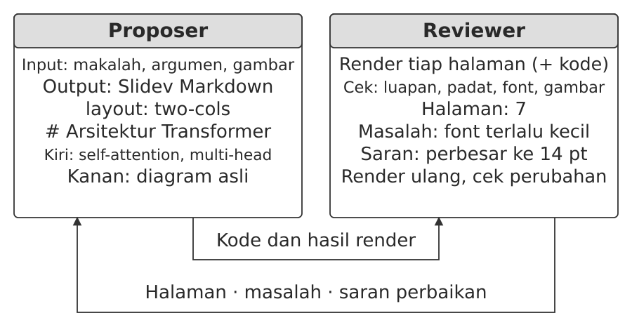

- **Pengusul (Proposer)** membaca makalah, merencanakan struktur penjelasan, menulis kode sumber Slidev, dan mengubah halaman berdasarkan umpan balik.
- **Peninjau (Reviewer)** merender halaman melalui alat, memakai model visual untuk memeriksa kepadatan isi, keterbacaan, tata letak, dan kesesuaian antara gambar dan teks, lalu mengembalikan umpan balik terstruktur yang memuat nomor halaman, jenis masalah, tingkat keparahan, dan saran perubahan.

Umpan balik harus dapat langsung memandu perubahan. Misalnya, "halaman 3 terlalu banyak poin, pecah menjadi dua halaman: ikhtisar metode dan langkah perhitungan"; "ukuran huruf kode di halaman 7 terlalu kecil, perbesar dulu menjadi 14 pt, lalu periksa keterbacaannya saat diproyeksikan". Kesalahan fakta dan salah baca grafik diperbaiki lebih dulu, baru kemudian tata letak dan detail visual.

Perubahan lokal juga perlu menyebutkan objek mana yang diubah. Doubao Work di slide Feishu memungkinkan pengguna memilih elemen halaman, lalu mengajukan permintaan pengeditan melalui bilah alat mengambang.[^ch5-doubao-work] Misalkan satu halaman berisi dua kotak teks: yang satu kutipan asli wawancara, yang lain ringkasan yang ditulis penyaji. Pengguna memilih ringkasan dan meminta "padatkan menjadi dua baris". Kotak teks yang dipilih membatasi cakupan perubahan. Ringkasan boleh ditulis ulang, sedangkan kutipan di sebelahnya harus mempertahankan kata-kata asli narasumber.

[^ch5-doubao-work]: Pusat bantuan Feishu, memakai Doubao Work di dalam slide.

Setelah pengusul melakukan perubahan, halaman dirender ulang, lalu peninjau memeriksa versi baru dan memastikan apakah masalah putaran sebelumnya sudah teratasi. Siklus ini memiliki dua jenis syarat keluar: tuntutan isi dan tata letak yang jelas sudah terpenuhi, atau anggaran putaran, waktu, dan biaya sudah habis, misalnya paling banyak 5 putaran perubahan. Saat diserahkan, versi terkini disimpan bersama masalah-masalah yang belum tertangani, agar mudah ditinjau kemudian.

Pola ini sama dengan pola pengusul–peninjau pada persetujuan operasi di Bab 4. Persetujuan operasi terutama menilai apakah suatu tindakan boleh dieksekusi; peninjauan konten memperbaiki artefak melalui umpan balik berulang. Keduanya perlu berbagi tuntutan tugas, memberikan dasar penilaian yang dapat dilacak, dan menyerahkan keputusan alur selanjutnya kepada Harness. Memakai keluarga model yang berbeda dapat memberikan sudut pandang peninjauan lain.

**Penulis menghargai keunggulan pembagian kerja dua Agent dalam manajemen konteks.** Kedua peran dapat menyimpan informasi yang mereka perlukan masing-masing: peninjau pada setiap putaran menerima tangkapan layar terbaru, standar peninjauan, dan daftar masalah yang diperlukan; pengusul menyimpan kode sumber, target perubahan, dan umpan balik teks terstruktur. Gambar halaman tetap berada di konteks peninjau, sementara trajektori utama terus memajukan perubahan melalui umpan balik teks yang singkat. Setiap putaran peninjauan berpusat pada halaman terbaru, sehingga gangguan dari tangkapan layar lama berkurang dan pertumbuhan konteks pun terkendali.

> **Eksperimen 5-6 ★★: Pembuatan PPT otomatis dari makalah**
>
> Eksperimen ini memakai PDF makalah *Attention Is All You Need* untuk menghasilkan 20 halaman slide Slidev. Agent mengekstrak struktur dan poin-poin makalah, memakai tiga gambar dari makalah asli yang dicatat sumbernya, dan mengorganisasi penjelasan halaman demi halaman. Setelah dirender, diperiksa luapan teks, keterbacaan grafik, dan kesesuaian gambar dengan teks, lalu diperbaiki berdasarkan umpan balik.
>
> Yang dibandingkan adalah peninjauan diri oleh satu Agent dan pembagian kerja pengusul–peninjau. Pada percobaan kali ini, kedua dokumen akhir sama-sama memperoleh 95 poin dalam alur penilaian independen yang sama; masukan puncak skema pembagian kerja sekitar 24 ribu token, sedangkan skema satu Agent yang menyimpan tangkapan layar lama sekitar 93 ribu token.

> **Eksperimen 5-7 ★★: Pembuatan otomatis video penjelasan makalah**
>
> Berdasarkan slide yang sudah ada, Agent dapat menulis penjelasan lisan untuk setiap halaman yang menerangkan objek, hubungan, dan kesimpulan dalam gambar, lalu memanggil TTS untuk menyintesis suara. Naskah diserahkan bersama halamannya kepada peninjau visual, untuk memeriksa apakah elemen yang disebut muncul di layar dan apakah deskripsinya sesuai dengan grafik.
>
> Untuk membuat video, eksperimen ini memakai alur pembuatan dari bagian sebelumnya dan memilih draf 22 halaman yang lebih awal (v2). Setelah 12 halaman diambil secara berurutan, adegan terakhir video berasal dari halaman 21 draf asli. Perbandingan skor dan pemakaian sumber daya pada bagian sebelumnya memakai draf 20 halaman yang lebih belakangan (v9). Setelah halaman dipilih, Kimi dipakai untuk membuat naskah, model visual Qwen untuk meninjau hubungan gambar dan teks, lalu Fish Audio menyintesis suara per halaman. FFmpeg menetapkan durasi tampil setiap halaman berdasarkan durasi sebenarnya dari setiap potongan audio, sehingga tersusun video penjelasan sekitar 8,6 menit.
>
> Dalam Gambar 5-6, slide, naskah, dan suara baru digabungkan menjadi video pada tahap terakhir. Sebagian masalah baru terdengar pada tahap ini: apakah sebuah kalimat belum selesai diucapkan ketika halaman sudah berganti, dan apakah suara dan gambar semakin tidak selaras menjelang akhir.
>
> 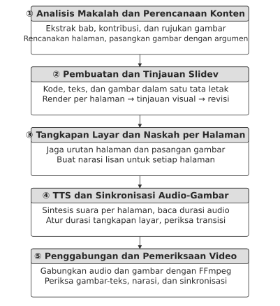

[^ch5-slidev]: Slidev, *Getting Started*, yang memperkenalkan pembuatan, penyajian, dan ekspor presentasi berbasis Markdown dan teknologi Web.

**Agent penyunting video.**

**Operasi penyuntingan video yang dapat dinyatakan dengan skrip sebaiknya diprioritaskan lewat antarmuka program.** Garis waktu, lapisan, subtitel, dan trek audio tersebar di panel GUI yang rumit, sehingga penentuan posisi dan penyeretan berulang menambah latensi dan kesalahan; antarmuka program dapat langsung menyatakan operasi dengan rentang waktu, trek, dan parameter efek. Antarmuka Python Blender dan FFmpeg sama-sama dapat mengorganisasi sebagian tugas penyuntingan menjadi skrip yang dapat dijalankan berulang kali.

Agent dapat lebih dulu memahami permintaan seperti "potong bagian selancarnya", lalu menemukan rentang target dalam materi, dan menghasilkan kode untuk pemotongan, penyusunan, dan pengolahan trek audio. Pengusul bertanggung jawab atas rencana penyuntingan dan skripnya, sedangkan peninjau memeriksa hasil render; jika ada bagian yang terlewat, potongan yang tidak relevan, atau subtitel yang menutupi gambar, peninjau mengembalikan titik waktu dan masalahnya secara spesifik kepada pengusul untuk diperbaiki. *Keyframe* cocok untuk memeriksa adegan dan tata letak, sedangkan kontinuitas gerak dan sinkronisasi audio-video masih memerlukan pemeriksaan bingkai yang berdekatan atau potongan yang berkesinambungan.

> **Eksperimen 5-8 ★★: Penyuntingan video cerdas berbasis API**
>
> Eksperimen ini merangkai penentuan lokasi target, pembuatan skrip, dan peninjauan hasil menjadi satu alur. Mula-mula rujukan video, pertanyaan target, dan interval pengambilan bingkai diserahkan kepada sub-Agent analisis video, yang memproses banyak gambar lalu mengembalikan rentang waktu beserta dasarnya kepada Agent utama.
>
> Penentuan lokasi dilakukan dalam dua langkah. Langkah pertama mengambil satu bingkai setiap 10 detik untuk mencari rentang kasar target, misalnya "selancar pada detik ke-40—110"; langkah kedua mengambil satu bingkai setiap detik di sekitar rentang kandidat dan batas-batas terdekatnya untuk memastikan posisi awal dan akhir. Adegan yang lebih pendek dari interval pengambilan kasar bisa jatuh di antara dua bingkai; pengambilan dapat ditambah sesuai durasi target, atau gambar di antara dua pengambilan dapat ditinjau kembali.
>
> Setelah rentang ditetapkan, pengusul menghasilkan skrip Python Blender untuk menjalankan pemotongan serta operasi subtitel, perubahan kecepatan, dan lainnya yang diperlukan. Peninjau melihat pratinjau dan menunjukkan batas serta efek yang perlu disesuaikan; setelah perubahan lolos, barulah video lengkap dikeluarkan.
>
> Yang benar-benar disunting adalah adegan seekor kelinci putih besar berjalan sendirian melintasi padang rumput. Dengan melihat satu bingkai setiap 10 detik, model menetapkan rentangnya pada detik ke-10 hingga 20. Jika langsung dipotong dari detik ke-10, sebagian awal adegan akan hilang. Karena itu program melonggarkan 5 detik di depan dan belakang, melihat satu bingkai setiap detik antara detik ke-5 dan 25, lalu mempersempit rentang kandidat menjadi detik ke-9 hingga 12. Peninjau kemudian menemukan bahwa potongan itu ikut membawa gambar dari adegan di sebelahnya, sehingga rentang hasil revisinya menjadi detik ke-9,25 hingga 11,00. Dibandingkan anotasi manual pada detik ke-9,08 hingga 11,20, awalnya terlambat 0,17 detik dan akhirnya lebih cepat 0,20 detik; kedua ujungnya memenuhi syarat galat tidak lebih dari 3 detik.
>
> Kode waktu hanya dapat memeriksa di mana potongan dibuat. Jika subtitel dan gerak lambat yang sama dipasang pada potongan gambar yang sengaja dipilih salah, apakah peninjau masih dapat mengenali kesalahannya? Eksperimen ini lebih dulu meminta peninjau memeriksa potongan pembanding pada detik ke-0 hingga 3, lalu melihat hasil render yang sudah direvisi. Objek peninjauan meliputi kelinci putih besar di layar, subtitel di bagian bawah, dan durasi setelah perubahan kecepatan.

**3D dan komponen industri: memilih cara pembuatan yang tepat.**

**Untuk komponen industri yang ukuran dan hubungan perakitannya merupakan batasan keras, utamakan pembuatan dengan kode parametrik; untuk objek yang terutama mengejar bentuk alami dan tampilan, utamakan model generatif.** Pilihan ini bergantung pada apakah artefak dapat dideskripsikan secara presisi dengan sedikit parameter, dan hubungan apa yang harus tetap terjaga setelah diubah. CadQuery, OpenSCAD, dan skrip Blender menyediakan proses konstruksi yang dapat diedit, sedangkan model seperti Hunyuan 3D memanfaatkan pengetahuan bentuk yang telah dipelajari untuk menghasilkan tampilan yang rumit.

**Apakah deskripsinya cocok untuk parametrisasi.** Sebuah flensa sederhana dapat menyatakan hubungan geometri utamanya dengan diameter luar, ketebalan, diameter lingkaran lubang, diameter lubang, dan jumlah lubang. Kode memetakan parameter ke langkah-langkah konstruksi, sehingga cocok untuk penyesuaian berulang. Sebaliknya, sepot tanaman hijau, sebongkah batu Taihu, atau sebuah wajah manusia mengandung banyak bentuk tak beraturan; model generatif dapat membantu membangun tampilannya, dan metode prosedural juga dapat menghasilkan detail melalui aturan pertumbuhan, proses acak, dan kombinasi aset.

**Bagaimana presisi diperiksa.** Untuk persyaratan seperti diameter lubang 5 mm dengan toleransi ±0,05 mm, satuan, sistem koordinat, dan metode pengukuran harus diperjelas lebih dulu, baru kemudian ukuran model dibandingkan dengan spesifikasinya. Model parametrik dapat memeriksa objek geometri secara langsung; *mesh* dapat diukur melalui penampang, lubang, ukuran kotak pembatas, dan metode lainnya, dengan memperhitungkan galat diskretisasi.

**Bagaimana disimpan dan diubah.** B-rep (representasi batas) mendeskripsikan batas benda padat dengan permukaan, tepi, dan titik sudut, sedangkan *mesh* segitiga mendekati permukaan dengan potongan-potongan bidang. CadQuery dapat mengekspor STEP untuk pertukaran data CAD dan juga dapat mengekspor *mesh* STL; parameter dan logika konstruksi yang dapat diedit tersimpan dalam kode sumber CadQuery[^ch5-cad]. Untuk masuk ke alur pemesinan CNC, masih diperlukan perencanaan proses, lintasan pahat, dan penyesuaian dengan mesin.

Misalnya, untuk mengubah lubang pemasangan dari ukuran M5 menjadi M6, parameter diameter lubang dapat diubah, lalu setelah dibuat ulang diperiksa kembali apakah diameter luar, ketebalan, dan posisi lubang tetap sama. Cara mengubah hasil model generatif bergantung pada kemampuan antarmukanya: bisa dibuat ulang, bisa juga dipadukan dengan pengeditan lokal dan pemrosesan geometri lanjutan.

Ketika kedua jalur dipadukan, pembagian kerjanya juga harus jelas: ukuran dan hubungan perakitan diserahkan kepada kode parametrik, sedangkan tekstur dan tampilan bebas diserahkan kepada model generatif. **Ketika ukuran kunci perlu diubah secara presisi berulang kali, proses konstruksi yang dapat diedit lebih berharga daripada tampilan yang dihasilkan sekali jadi.**

> **Eksperimen 5-9 ★★: Dua jalur pembuatan untuk komponen yang sama — kode dan model generatif**
>
> Eksperimen ini meminta pembuatan flensa berdiameter luar 80 mm dan tebal 10 mm, dengan empat lubang pemasangan yang tersebar merata pada lingkaran lubang berdiameter 60 mm. Agar makna perakitannya jelas, spesifikasi awal memakai lubang tembus 5,5 mm untuk baut M5, lalu permintaan perubahan menggantinya menjadi lubang tembus 6,5 mm untuk baut M6.
>
> Pada jalur kode, model menghasilkan program CadQuery yang setelah dieksekusi mengekspor STEP dan STL; pada jalur model generatif, gambar rujukan produk dibuat lebih dulu, lalu diserahkan kepada Hunyuan 3D untuk menghasilkan *mesh*. Yang diperiksa adalah diameter luar, ketebalan, jumlah lubang, diameter lubang, posisi lubang, dan permukaan pemasangan, sambil mencatat satuan dan arah sumbunya.
>
> Bagaimana mengetahui bahwa model hanya mengubah ukuran yang diminta? Dengan membandingkan STL yang diekspor sebelum dan sesudah perubahan, diameter rata-rata keempat lubang pemasangan naik dari 5,499 mm menjadi 6,499 mm; diameter luar kedua komponen sama-sama 80 mm, ketebalannya sama-sama 10 mm, dan diameter lingkaran lubangnya sama-sama 60,000 mm hingga tiga angka desimal. *Mesh* mentah dari jalur model generatif tidak memiliki skala fisik yang jelas. Program pengukur mengambil penampang tengah sepanjang sumbu Z dan tidak menemukan cincin dalam lubang. Untuk memastikan apakah keempat lubang menembus pelat, permukaan pemasangan harus dikenali lebih dulu, lalu penampang diambil pada berbagai kedalaman sepanjang arah normalnya. Setelah dibuat ulang, bentuk keseluruhan dan orientasinya pun berubah.
>
> Terakhir, ganti soalnya: jika yang harus diserahkan adalah gambar tanaman pot yang tampak alami, bagaimana penerimaannya diuji? Eksperimen ini menggambar satu tanaman pot dengan matplotlib, membuat satu lagi dengan Gemini, lalu meminta model visual yang sama menilai kealamiannya pada skala sepuluh. Kedua gambar masing-masing memperoleh 3 dan 8 poin. Skor ini menjawab gambar mana yang menurut model penilai lebih mirip tanaman sungguhan. Kembali ke flensa: sekalipun gambar produknya tampak memiliki empat lubang, perakitan tetap harus memeriksa posisi dan diameter lubang pada komponen tiga dimensinya.

[^ch5-cad]: CadQuery, *Importing and Exporting Files*, yang memperkenalkan format seperti STEP dan STL, serta menjelaskan bahwa informasi parametrik lengkap tersimpan dalam kode sumber Python CadQuery.

### Kode sebagai Adapter Sistem

Antarmuka, cara autentikasi, dan format data layanan eksternal berbeda-beda. Agent dapat membaca dokumentasi dan contoh respons, menghasilkan klien HTTP, mengonfigurasi *header* autentikasi, mengurai nilai kembalian, lalu mengubah *field* dari hulu menjadi struktur yang dibutuhkan hilir. Di sini kode memikul pekerjaan adaptasi sistem, menggabungkan layanan yang sudah ada menjadi alur tugas baru.

Misalnya, jika *field* jumlah uang yang dibaca dari layanan pembayaran dinyatakan dalam sen sedangkan laporan menampilkannya dalam yuan, keberhasilan mengurai JSON hanya menunjukkan bahwa formatnya cocok. Transaksi senilai 25 yuan di hulu adalah bilangan bulat 2500. Jika angka itu langsung diisikan ke laporan, 25 yuan berubah menjadi 2500 yuan.

Adapter perlu memperjelas masukan dan keluaran, penanganan kesalahan, serta cakupan versi. Contoh data membantu model memahami *field*, sedangkan kontrak antarmuka dan pengujian memeriksa nilai yang hilang, paginasi, respons yang tidak normal, dan perubahan versi. Kredensial dikelola oleh lingkungan eksekusi, dan kode yang dihasilkan memakai kemampuan yang diizinkan melalui antarmuka terkendali. Setelah lolos verifikasi, adapter dapat disimpan dan dipakai ulang; jika kemudian formatnya berubah, adapter masuk kembali ke alur perubahan.

Sistem yang hanya memiliki antarmuka grafis juga dapat memakai cara serupa. Agent lebih dulu menyelesaikan tugas melalui Computer Use yang diperkenalkan di Bab 6, lalu mengunci langkah-langkah operasi yang stabil menjadi alat RPA. Ketika kontrol antarmuka, status login, dan alur halaman berubah, alat itu perlu mendeteksi penyimpangan dan menentukan ulang lokasinya. Bab 9 akan membahas lebih lanjut cara mengekstrak, memverifikasi, dan memakai ulang alur kerja dari trajektori yang berhasil.

**Parsing dan visualisasi log Agent.**

Satu tugas yang rumit dapat mencakup banyak permintaan model, eksekusi alat, dan interaksi sub-Agent. Ikhtisar log menampilkan hubungan antarlangkah, status, dan durasinya; jika diperluas, ditampilkan masukan dan keluaran yang spesifik, sehingga pembaca dapat menelusuri apa yang terjadi pada suatu langkah. *Field* baru, struktur bersarang, dan versi format semuanya memengaruhi parsing dan tampilan.

Parsing adaptif menangani perubahan ini melalui siklus "temukan perubahan—hasilkan parser—verifikasi hasil". Ketika parsing gagal, sistem menyimpan sampel asli, lokasi kesalahan, dan *field* yang diharapkan, lalu mencocokkannya dengan kontrak antarmuka dan versi produsen untuk menilai apakah perubahan itu memang diharapkan. Baru setelah dipastikan bahwa itu peningkatan format, Agent diminta menulis parser baru. Jika yang salah adalah program penulis log, log asli disimpan dan kegagalan dilaporkan, agar parser baru tidak memperlakukan kesalahan itu sebagai format normal. Kode yang baru ditulis lebih dulu dijalankan di lingkungan terbatas: *field* dan maknanya diperiksa dulu, lalu diverifikasi dengan sampel normal, sampel yang kehilangan *field*, dan kasus regresi format lama. Setelah lolos, parser baru didaftarkan beserta versi dan format yang berlaku; sampel yang gagal tetap disimpan agar mudah ditelusuri dan dicoba ulang.

Parsing dan tampilan memiliki cara pemeriksaan masing-masing. Program memeriksa cap waktu, status, tipe numerik, dan keterkaitan pemanggilan; render di peramban memeriksa apakah halaman berfungsi normal, dan model visual membantu memeriksa apakah tabel, garis waktu, dan label terlihat jelas. Saat *hot update*, versi sebelumnya dan jalan untuk kembali tetap dipertahankan, sehingga dukungan format baru dapat masuk ke sistem yang berjalan secara bertahap.

> **Eksperimen 5-10 ★★★: Sistem parsing log adaptif**
>
> Eksperimen ini lebih dulu menjalankan dua proses penghasil log, masing-masing mengeluarkan format berpemisah garis tegak dan format bertanda kurung bersarang. Parser awal tidak dapat menangani sampel-sampel ini; sistem kemudian meminta model menghasilkan dua fungsi parsing, memuatnya secara *hot load* setelah lolos pengujian, lalu mengurai log yang semula gagal.
>
> Format pertama mengekstrak `timestamp`, `level`, `module`, `step`, dan `message`; format kedua juga melibatkan nama alat, durasi, dan status. Dalam catatan eksekusi, masing-masing tiga log dari kedua jenis berhasil diurai, dan mesin yang baru dibuat juga dapat memuat parser yang sudah tersimpan untuk terus memproses aliran log campuran.
>
> Hasil parsing dirender oleh Chromium menjadi tabel, dan peninjauan visual memeriksa nama kolom, isi baris, dan keterbacaannya.

**Analisis otomatis log eksekusi Agent dan diagnosis masalah.**

Setelah trajektori terstruktur diurai, Agent dapat memadukan dokumen arsitektur dan PRD (dokumen kebutuhan produk) untuk membandingkan alur yang diharapkan dengan tindakan yang sebenarnya. Misalnya, sebelum pengembalian dana, apakah sudah diperiksa bahwa pesanan ini boleh dikembalikan? Setelah layanan inventaris mengalami *timeout*, apakah program beralih ke cache sesuai kesepakatan?

Laporan masalah dapat memuat prioritas, modul, gejala, bukti, dan saran perbaikan. Agent juga dapat menghasilkan uji regresi berdasarkan laporan itu, mengunci masukan dan kriteria penerimaan yang berkaitan dengan masalah tersebut. Kerangka pengujian memutar ulang permintaan atau membaca respons alat yang tersimpan di lingkungan terkendali, lalu membandingkan perilaku versi yang cacat dengan versi yang sudah diperbaiki. Operasi yang melibatkan penulisan ke pihak eksternal memakai lingkungan terisolasi atau antarmuka pengganti, agar cakupan dampak pemutaran ulang tetap terkendali.

Asersi harus berpadanan dengan atribut yang perlu diverifikasi. Misalnya, munculnya pemeriksaan pengembalian dana dalam log hanya menunjukkan bahwa program sudah memeriksa. Untuk mengetahui apakah dana dikembalikan dengan benar, masih harus dilihat apakah program memeriksa dulu baru mengembalikan dana, apakah hasil pemeriksaan mengizinkan pengembalian, dan apa status akhir pesanannya.

Setelah diagnosis ditinjau ulang, Agent dapat membuat GitHub Issue melalui MCP begitu memperoleh otorisasi yang sesuai, sekaligus menyarankan penanggung jawab menurut modulnya. Jika cacat yang sama sudah memiliki item kerja, bukti baru digabungkan ke dalamnya.

> **Eksperimen 5-11 ★★★: Sistem diagnosis cerdas untuk log produksi**
>
> Eksperimen ini memakai layanan HTTP lokal untuk menghasilkan dua trajektori bisnis: satu catatan menunjukkan sistem mengembalikan dana tanpa memeriksa apakah pesanan boleh dikembalikan, dan yang lain menunjukkan bahwa setelah kueri inventaris mengalami *timeout*, data tidak diambil dari cache. Model memadukan dokumen arsitektur dan deskripsi kebutuhan untuk menghasilkan laporan masalah yang memuat rujukan trajektori dan putaran, lalu menghasilkan tiga uji regresi yang dapat dieksekusi.
>
> Gambar 5-7 menempatkan sebuah laporan diagnosis di antara trajektori dan uji regresi. Laporan itu menyatakan "sistem melewatkan pemeriksaan dan langsung mengembalikan dana". Kembali ke trajektori untuk mencari buktinya: langkah mana yang tidak ada dalam catatan pemanggilan? Lalu lihat pengujiannya: jika kelak langkah ini terlewat lagi, apakah pengujian dapat mendeteksinya?
>
> 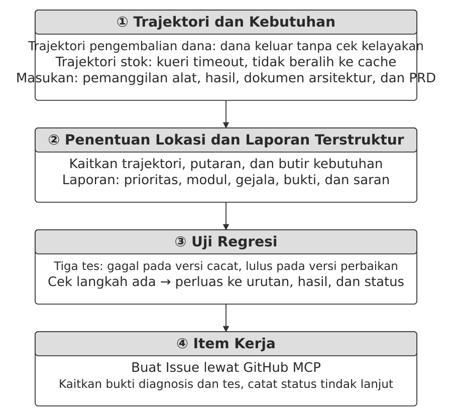
>
> Ketiga pengujian semuanya gagal pada versi yang cacat dan semuanya lolos setelah diganti dengan versi yang diperbaiki. Salah satu pengujian hanya menilai apakah program pernah memanggil alat pemeriksaan pengembalian dana. Sekalipun program mengembalikan dana lebih dulu dan baru kemudian memeriksa apakah pesanan itu boleh dikembalikan, pengujian ini tetap lolos. Catatan eksekusi juga menyimpan tanda terima pembuatan item kerja oleh GitHub MCP, yang dapat dipakai untuk menemukan tiket yang berpadanan setelah laporan diagnosis diserahkan kepada pengembang.
>

### Kode sebagai UI Generatif

Jika pengguna juga ingin mengubah sendiri materi yang sedang ditangani Agent, antarmukanya dapat dibuat sebagai meja kerja yang dipakai bersama. Ambil contoh jadwal perjalanan: pengguna dapat melihat persinggahan mana yang sedang diubah asisten, mengambil alih perubahan, serta mengonfirmasi atau membatalkan suatu perubahan. Jika pengguna baru saja mengubah hari keberangkatan menjadi Jumat, asisten selanjutnya harus bekerja pada jadwal yang baru ini. Hanya dengan membuat kedua pihak berbagi keadaan yang sama-sama terlihat, dan menyepakati siapa yang saat ini mengendalikan *field* yang sedang diedit, pekerjaan dapat dilakukan sambil melihat dan mengubah.

Bayangkan pengguna ingin membandingkan tiga pilihan perjalanan. Ketika tujuan belum ditentukan, percakapan memudahkan tanya jawab lanjutan; setelah tujuan ditentukan, membiarkan pengguna langsung memilih tanggal dan mengisi jumlah orang lebih praktis daripada mencocokkan beberapa paragraf teks bolak-balik; terakhir, untuk membandingkan perubahan harga total menurut tanggal, sebuah grafik dapat memperlihatkan perbedaannya secara gamblang. Agent menghasilkan formulir, grafik, atau antarmuka aplikasi yang sesuai dengan tugasnya, sehingga pengguna dapat langsung mengisi, memilih, dan mengoperasikannya; inilah UI generatif (*Generative UI*).

**Mendeskripsikan antarmuka dan interaksi dengan protokol.**

Ada dua jalur implementasi untuk menghasilkan antarmuka: mengeluarkan kode seperti HTML dan JavaScript untuk dieksekusi di lingkungan terkendali; atau mengeluarkan struktur deklaratif yang dirender oleh komponen klien. Jalur pertama memudahkan tata letak dan interaksi yang disesuaikan, sedangkan jalur kedua membatasi kemampuan yang tersedia pada komponen dan aksi yang disediakan klien.

A2UI (*Agent-to-User Interface*) memakai deskripsi deklaratif. Agent menghasilkan pesan terstruktur yang menyatakan komponen, pengikatan data, dan pembaruan, lalu klien menampilkan antarmuka dengan komponennya sendiri[^ch5-ui-protocols]. Misalnya, aplikasi dapat menyediakan komponen kartu, tombol, kotak teks, dan tabel, dan berdasarkan itu Agent mendeskripsikan tabel berjudul "Data Penjualan" yang berisi tiga baris dan dua kolom. Katalog komponen juga dapat diperluas dengan kemampuan seperti grafik dan peta.

AG-UI (*Agent–User Interaction*) menangani interaksi peristiwa antara Agent dan *frontend*, menyampaikan pesan, pemanggilan alat, dan pembaruan status, serta dapat juga membawa pesan antarmuka A2UI. Jika keduanya digabungkan, A2UI mendeskripsikan isi yang akan ditampilkan, sedangkan AG-UI menghubungkan eksekusi di *backend* dengan interaksi di *frontend*.

Klien dapat menerima pembaruan antarmuka secara bertahap dan menampilkannya di Web, perangkat seluler, atau desktop melalui *renderer* yang sesuai. Klien memvalidasi atribut komponen, pengikatan data, dan permintaan aksi, sementara server tetap memeriksa izin bisnis; tautan, teks kaya, dan akses data di dalam komponen juga memerlukan aturan penanganan masing-masing.

Jika kode dihasilkan secara langsung, dependensi, akses sumber daya, dan izin eksekusi perlu diperiksa, dan antarmuka yang dihasilkan harus diisolasi dari status sensitif aplikasi host. *Prompt injection* dalam materi eksternal dapat memengaruhi proses pembuatan, dan risiko eksekusi skrip di peramban juga bergantung pada cara halaman dimuat dan diisolasi.

**Menyerahkan hasil interaktif dalam bentuk HTML.**

**Untuk hasil riset yang mencakup data, demonstrasi, dan hasil yang terus diperbarui, penulis lebih memilih situs web HTML.** Laporan Markdown linear yang panjang menuntut pembaca terus membolak-balik untuk mencari konteks; halaman web interaktif dapat menempatkan penjelasan, data, dan demonstrasi dalam satu pintu masuk: pembaca melihat grafik, menyaring sampel yang menarik, membuka detail suatu hasil, lalu mengoperasikan demonstrasi untuk memahami perilaku sistem. Agent juga dapat memperbarui halaman seiring kemajuan tugas, sehingga halaman itu terus mencatat hasil dan bukti terkini.

Sebagai contoh dari praktik riset penulis sendiri, setiap proyek riset memiliki satu situs web interaktif yang sekaligus menjadi dokumen hidup selama proses riset dan produk akhir yang diserahkan, dan Agent terus menambahkan isinya seiring berjalannya eksperimen. Situs-situs ini terutama memikul tiga tugas.

Pertama, **penelusuran data eksperimen**. Halaman mengaitkan sampel, *prompt*, balasan model, dan skor, sehingga mendukung pemeriksaan satu per satu. Misalnya, jika balasan sejenis selalu mendapat skor rendah, balasan asli dan *prompt*-nya dapat ditemukan kembali dengan mengikuti catatan skor.

Kedua, **pemantauan metrik pelatihan**. Penulis menyebut sinyal yang mencerminkan keadaan internal pelatihan sebagai "metrik pemeriksaan dalam" (ibarat hasil cek kesehatan penyakit dalam): *loss* pelatihan dan validasi, norma gradien, laju pembelajaran, serta *reward*, divergensi KL, dan entropi kebijakan dalam pembelajaran penguatan. Model bahasa juga dapat diukur dengan *perplexity* untuk menilai kinerja prediksinya pada urutan teks tertentu. Seperti indikator fisiologis dalam pemeriksaan kesehatan, kurva-kurva ini kadang dapat mengungkap masalah lebih awal daripada skor tugas akhir. Melihatnya bersama akurasi tugas membantu menentukan pada tahap mana terjadi kegagalan konvergensi, gradien abnormal, dan degradasi pelatihan.

Ketiga, **peragaan prinsip kerja**. Saat menjelaskan bagaimana beberapa modul bekerja sama, halaman dapat membiarkan pembaca mengubah satu masukan, melihat keadaan antaranya, lalu membandingkan perubahan keluaran dengan catatan eksperimen.

Jika pekerjaan berlangsung beberapa jam, bagaimana pengguna dapat menyempatkan diri untuk mengambil alih? Saat memakai Coding Agent, penulis ingin satu perintah lisan dapat sampai dengan tepat ke Agent yang menanganinya, hasil dapat dibuka kapan saja ketika ingin dilihat, dan pengingat baru muncul ketika ada versi baru atau ada masalah yang memerlukan keputusan saya. Misalnya, dua laporan sedang dibuat bersamaan. Pengguna membuka laporan penjualan, menunjuk grafik kedua, dan berkata "gambar ulang yang ini berdasarkan pendapatan bersih". Antarmuka harus mengirimkan pengenal laporan dan grafik saat ini bersama perintah itu. Setelah grafik selesai diubah, notifikasi dapat langsung membuka versi baru; jika "pendapatan bersih" memiliki dua definisi yang sama-sama dapat dipakai, asisten harus menyodorkan kedua definisi itu kepada pengguna untuk dipilih.

**Memperjelas maksud pengguna.**

Ketika pengguna berkata "saya ingin memesan tiket pesawat ke Beijing", tujuannya sudah jelas, tetapi kota keberangkatan, tanggal, dan apakah sekali jalan atau pulang-pergi masih perlu dilengkapi. Agent dapat mengajukan pertanyaan sekaligus dalam satu putaran percakapan, atau menghasilkan formulir agar syarat-syarat terkait tampil dalam satu halaman.

Kontrol di dalam formulir berpadanan dengan jenis informasi yang berbeda: kotak teks mengumpulkan masukan terbuka, menu tarik-turun dan tombol radio mencantumkan pilihan, kotak centang mendukung pilihan ganda, dan pemilih tanggal membantu mengisi waktu. JavaScript dapat menyatakan hubungan bertingkat, misalnya menampilkan tanggal pulang setelah "pulang-pergi" dipilih, dan memeriksa agar tanggal pulang tidak lebih awal dari tanggal berangkat. Ketika pilihan berubah, *field* yang sudah tidak berlaku juga perlu dibersihkan atau diabaikan.

Gambar 5-8 diambil dari satu kali eksekusi eksperimen di bawah ini. Ikuti pengajuan ini: dari empat *field* yang dikembalikan peramban tidak ada tujuan, lalu dari mana model tahu bahwa penumpang akan pergi ke Beijing?

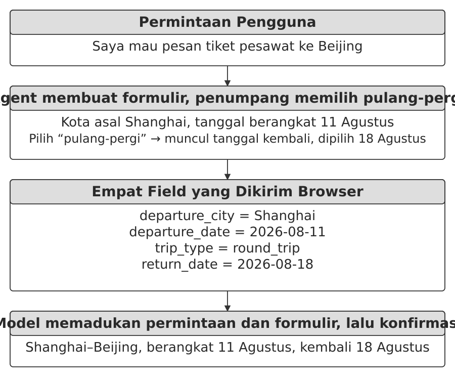

> **Eksperimen 5-12 ★★: Sistem klarifikasi maksud dengan formulir dinamis**
>
> Eksperimen ini berangkat dari "saya ingin memesan tiket pesawat ke Beijing" dan meminta model menghasilkan formulir HTML: kota keberangkatan memakai kotak teks, tanggal keberangkatan memakai pemilih tanggal, jenis perjalanan menyediakan pilihan sekali jalan dan pulang-pergi, dan tanggal pulang ditampilkan ketika pulang-pergi dipilih.
>
> Program mengembalikan permintaan awal bersama data formulir kepada model. Jika hanya *field* yang diajukan yang dipertahankan, tujuannya tetap tidak ada meskipun setiap kontrol diisi dengan benar.
>
> Coba satu langkah lagi dengan formulir yang sama: setelah tanggal pulang diisi, pilihan diubah menjadi sekali jalan. Halaman menyembunyikan kotak masukan tanggal pulang, tetapi JSON yang diajukan justru tetap memuat sekali jalan sekaligus tanggal pulang 18 Agustus. Ketika pilihan diubah menjadi sekali jalan, klien juga harus menghapus tanggal pulang yang sudah tidak berlaku.

[^ch5-ui-protocols]: Dokumentasi resmi A2UI dan *AG-UI Overview*, yang masing-masing memperkenalkan deskripsi antarmuka deklaratif dan interaksi peristiwa antara Agent dan *frontend*.

**Menghasilkan kueri SQL.**

Pengguna dapat mengajukan kueri basis data dalam bahasa alami, lalu Agent menghasilkan SQL berdasarkan struktur tabel dan definisi bisnisnya. **Saat menampilkan tabel kueri yang lengkap, penulis lebih memilih mode Artifact, agar hasilnya mengalir langsung dari basis data ke antarmuka.** Meminta model membaca dan mengulang tabel besar baris demi baris menambah pemakaian token dan waktu tunggu, serta memunculkan kesalahan salin. SQL disimpan sebagai artefak kueri yang dapat diperiksa; jika perlu menganalisis penyebab atau merangkum tren, barulah hasil agregasi yang diperlukan diserahkan kepada model.

Dalam Gambar 5-9, pengguna ingin melihat jumlah karyawan aktif di setiap departemen, dan halaman dapat langsung menampilkan tabel statistik yang dikembalikan basis data. Jika pengguna lalu bertanya "departemen pemasaran lebih banyak berapa orang dibanding departemen riset dan pengembangan", model cukup mengambil angka 9 dan 5 dari tabel untuk menghitung selisih 4 orang. Jika ditanya lebih lanjut "apakah bulan lalu selisihnya juga sebesar itu", tabel yang ada tidak lagi memadai; kueri harus dijalankan ulang dengan tanggal statistik bulan lalu.

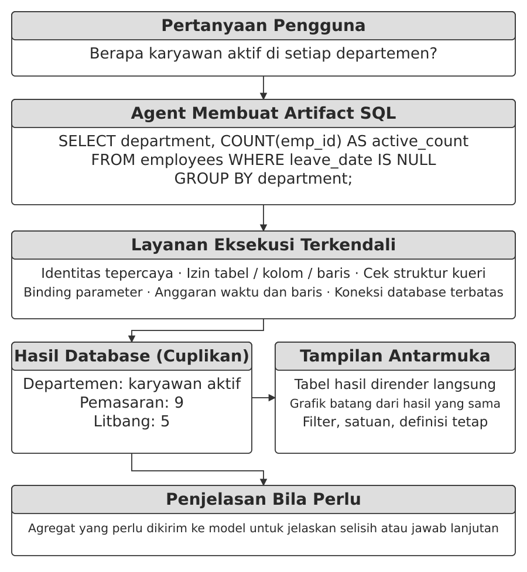

Layanan eksekusi menentukan tabel, kolom, dan baris yang boleh diakses berdasarkan identitas tepercaya, memakai akun basis data yang dibatasi, serta memvalidasi struktur SQL dan jenis operasinya. Skenario kueri dapat dibatasi pada kueri baca-saja yang disetujui, dengan pengendalian pemanggilan fungsi, anggaran waktu, jumlah baris yang dikembalikan, dan cakupan data; nilai yang dimasukkan pengguna diteruskan melalui pengikatan parameter.

Agent juga dapat menghasilkan artefak visualisasi, misalnya menampilkan hasil ringkasan per departemen sebagai diagram batang. Layanan eksekusi menyerahkan hasil kueri kepada lingkungan runtime visualisasi yang terkendali, dan antarmuka hanya menampilkan data dan interaksi yang diizinkan.

> **Eksperimen 5-13 ★★: ERP Agent dengan interaksi bahasa alami**
>
> Eksperimen ini memakai kueri karyawan dan gaji dalam ERP (*Enterprise Resource Planning*) sebagai contoh untuk mempelajari cara menghasilkan SQL dari pertanyaan bisnis dan membiarkan hasil basis data masuk langsung ke halaman. Di PostgreSQL dibuat dua tabel: tabel karyawan berisi ID karyawan, nama, departemen, level, tanggal masuk, dan tanggal keluar, dengan tanggal keluar kosong berarti masih aktif; tabel gaji berisi ID karyawan, tanggal pembayaran gaji, dan gaji, dengan satu catatan per karyawan per bulan.
>
> Berdasarkan kedua tabel ini, Agent menangani sepuluh pertanyaan berikut:
>
> 1. Rata-rata berapa lama setiap karyawan bekerja?
> 2. Berapa jumlah karyawan aktif di setiap departemen?
> 3. Departemen mana yang rata-rata level karyawannya paling tinggi?
> 4. Berapa karyawan baru yang masuk di setiap departemen tahun ini dan tahun lalu?
> 5. Berapa rata-rata gaji departemen A dari Maret dua tahun lalu hingga Mei tahun lalu?
> 6. Tahun lalu, rata-rata gaji departemen A atau departemen B yang lebih tinggi?
> 7. Berapa rata-rata gaji karyawan untuk setiap level tahun ini?
> 8. Berapa rata-rata gaji bulan terakhir bagi karyawan yang masa kerjanya kurang dari satu tahun, satu sampai dua tahun, dan dua sampai tiga tahun?
> 9. Siapa 10 karyawan dengan kenaikan gaji terbesar dari tahun lalu ke tahun ini?
> 10. Adakah gaji yang tertunggak (aktif pada bulan tertentu tetapi tidak menerima gaji)?
>
> Sebelum kueri, definisi statistiknya perlu diperjelas. Misalnya, masa kerja karyawan aktif dihitung sampai tanggal acuan kueri, sedangkan karyawan yang sudah keluar dihitung sampai tanggal keluarnya; "rata-rata gaji" perlu ditentukan apakah dihitung per catatan pembayaran atau per karyawan; peringkat kenaikan gaji perlu menangani karyawan yang tidak memiliki catatan tahun lalu.
>
> Eksekusi kali ini menghasilkan dan menjalankan sepuluh SQL, dan semua hasilnya sesuai dengan perhitungan rujukan independen, lalu tabelnya langsung dirender oleh peramban. Model menerima struktur tabel, tugas, dan umpan balik eksekusi yang diperlukan, sedangkan data baris dari basis data diteruskan ke antarmuka melalui aplikasi.

**Menghasilkan perangkat lunak secara dinamis.**

Agent dapat menghasilkan antarmuka dan logika interaksi mulai dari kebutuhan, lalu terus mengubahnya berdasarkan operasi pengguna. "Imagine with Claude", pratinjau riset sementara yang diluncurkan Anthropic pada 2025, memperlihatkan interaksi semacam ini: pengguna menjelajahi antarmuka, dan model terus menghasilkan pengalaman perangkat lunak yang sesuai[^ch5-imagine].

**Untuk produk nyata, penulis lebih optimis terhadap kustomisasi di atas kerangka yang sudah ada.** Menghasilkan seluruh aplikasi dari nol secara terus-menerus berarti berulang kali menanggung biaya pembuatan, render, dan verifikasi; mempertahankan kerangka yang stabil lalu membuka antarmuka dan alur yang dipedulikan pengguna dapat menghadirkan pengalaman personal yang andal dengan lebih cepat. Ketika pengguna meminta "ubah tombol menjadi biru", "tambahkan menu pintasan di bilah samping", atau "ganti dengan huruf yang lebih mudah dibaca", Agent menemukan komponen terkait, mengubah kodenya, lalu memeriksa hasilnya melalui pratinjau. Kerangka dasar menyediakan struktur halaman dan antarmuka bisnis yang stabil, dan cakupan kustomisasi dapat diperluas bertahap dari warna dan huruf hingga tata letak dan komponen.

HMR (*Hot Module Replacement*) di lingkungan pengembangan dapat memperbarui modul *frontend* yang terdampak setelah kode berubah. Apakah status dipertahankan bergantung pada integrasi kerangka, batas pembaruan, dan jenis perubahannya; jika perlu penyegaran penuh, aplikasi juga harus menyimpan status yang diperlukan. Sementara itu, *reload* dalam mode pengembangan FastAPI memuat ulang program server; keduanya masing-masing bekerja pada modul *frontend* dan proses *backend*[^ch5-hmr].

> **Eksperimen 5-14 ★★: Sistem kustomisasi antarmuka lewat percakapan**
>
> Eksperimen ini membangun aplikasi obrolan yang terdiri atas *frontend* React dan *backend* FastAPI, dengan HMR *frontend* dan *reload* *backend* diaktifkan di lingkungan pengembangan. Model mengubah warna, huruf, dan judul berdasarkan tiga putaran permintaan berturut-turut, dan peramban memeriksa antarmuka sebenarnya setelah setiap perubahan.
>
> Eksekusi kali ini mencatat peristiwa HMR dari Vite; ketiga putaran perubahan tidak memicu navigasi halaman penuh, status obrolan yang ada tetap terjaga, dan build akhir berhasil.

[^ch5-imagine]: Anthropic, *Introducing Claude Sonnet 4.5*, yang memperkenalkan Imagine with Claude, pratinjau riset sementara yang dirilis bersama model tersebut.
[^ch5-hmr]: *Vite HMR API* dan *FastAPI CLI*, yang masing-masing memperkenalkan pembaruan panas *frontend* dan pemuatan ulang otomatis server pengembangan.

**Memisahkan batas izin dari kode bisnis yang dinamis.**

**Semakin mudah kode bisnis ditulis ulang secara dinamis oleh Agent, semakin perlu batas izin akhir diturunkan ke lapisan akses data yang stabil.** Aplikasi tradisional menuliskan penilaian izin dalam kode bisnis yang sudah ditinjau; setelah kode yang dihasilkan terus berubah, suatu jalur baru bisa saja melewatkan pemeriksaan yang sama. Hanya dengan membuat setiap baca-tulis melewati layanan akses data yang independen, batasan izin dapat tetap terjaga. Misalnya, aplikasi rekrutmen dapat menghasilkan daftar kandidat dan formulir operasi secara dinamis, sedangkan organisasi mana yang memiliki seorang kandidat dan *field* mana yang boleh diperbarui oleh perekrut terus diperiksa oleh layanan akses data tepercaya.

Tujuan desainnya di sini adalah: **sekalipun kode yang dihasilkan mengandung kesalahan, lapisan akses data tepercaya tetap dapat menegakkan batasan izin secara paksa.** Ini melanjutkan guardrail lapis data dari Bab 1: aturan yang wajib dipatuhi ditempatkan pada posisi yang harus dilalui semua operasi terkait. Kebijakan keamanan tingkat baris basis data dapat membatasi akses catatan, batasan dan validator memeriksa keadaan yang sah, sedangkan *view* terkendali, *stored procedure*, atau layanan data menyediakan operasi yang diizinkan. Lapisan aplikasi dapat memeriksa lebih awal dan menjelaskannya kepada pengguna, tetapi baca-tulis akhirnya tetap dikendalikan oleh layanan data tepercaya dan izin basis data.

Setiap operasi juga memerlukan **konteks akses** (*access context*) yang tepercaya, yang berisi identitas pengguna, *tenant*, peran, atau Agent. Layanan autentikasi dan runtime tepercaya bertanggung jawab membangun dan mengikat identitas, lalu layanan data memberikan otorisasi berdasarkan identitas itu. Kode dinamis memperoleh antarmuka terbatas yang diperlukan untuk menyelesaikan tugas, sedangkan kredensial dan wewenang pengelolaan kebijakan disimpan oleh komponen independen. Semua koneksi basis data, kueri pendukung, dan pemrosesan latar harus mematuhi cakupan akses yang sama.

Misalnya, keamanan tingkat baris PostgreSQL perlu dipakai bersama konfigurasi peran basis data. Koneksi aplikasi memakai peran yang dibatasi kebijakan, dan akun aplikasi tidak berwenang mengubah kebijakan akses[^ch5-rls]. Aturan dan mekanisme pengikatan identitas ditinjau secara independen, sedangkan antarmuka bisnis dapat terus berubah dalam cakupan ini.

Izin dan integritas data juga memikul tanggung jawab yang berbeda. Setelah perekrut berwenang mengubah catatan kandidat, mesin status tetap memeriksa apakah perpindahan dari "sudah disaring" ke "sudah diwawancarai" diizinkan; validator gaji membaca posisi terkait dan memeriksa apakah gaji yang diharapkan berada dalam rentang posisi itu; pemeriksaan referensi memastikan hubungan antara posisi dan kandidat sah.

> **Eksperimen 5-15 ★★★: Objek data berizin bawaan untuk perangkat lunak yang dihasilkan secara dinamis**
>
> Eksperimen ini menyediakan prototipe penyimpanan objek Python di atas PostgreSQL, yang menempatkan aturan izin, validator, hubungan antarobjek, dan deklarasi reaksi lanjutan di dalam tipe data. Saat membaca, izin akses diperiksa; saat membuat dan memperbarui, pemeriksaan izin dan validasi bisnis dijalankan lebih dulu serta hubungan referensi diperiksa, baru kemudian data dipersistenkan, lalu reaksi lanjutan yang dideklarasikan dimasukkan ke antrean, dengan kedalaman rantai reaksi dibatasi.
>
> Contoh rekrutmen memuat objek seperti posisi, kandidat, wawancara, dan evaluasi. Kandidat secara berurutan melewati tahap lamaran, penyaringan, wawancara, penerbitan surat penawaran, dan penerimaan, dan tahap-tahap terkait juga dapat masuk ke status ditolak; rentang gaji berasal dari posisi terkait. Contoh ini menyiapkan pemeriksaan untuk pembaruan status normal, perpindahan status yang tidak sah, gaji di luar rentang posisi, dan akses oleh *tenant* yang berbeda, untuk membantu pembaca memahami masalah apa yang ditangani masing-masing oleh otorisasi dan validasi bisnis.
>
> Prototipe ini memakai `AccessContext` untuk menyatakan atribut pengguna, peran, dan organisasi, dan skrip pengajaran langsung menyusun konteks-konteks ini untuk mensimulasikan berbagai identitas. Dalam *deployment*, konteks dibangun oleh pintu masuk autentikasi, dan penyimpanan objek serta kode yang dihasilkan ditempatkan di dua sisi batas layanan atau batas izin yang jelas.

[^ch5-rls]: PostgreSQL, *Row Security Policies*, yang memperkenalkan konfigurasi kebijakan keamanan tingkat baris menurut peran dan operasi beserta cakupan penerapannya.

### Kode yang Membuat Kode: Bootstrapping Agent

Kemampuan pembuatan kode juga dapat dipakai untuk mengembangkan Agent itu sendiri. Pencipta menerima kebutuhan tugas, menghasilkan atau mengubah *prompt*, alat, dan *loop* runtime Agent baru, lalu memeriksa artefaknya melalui pengujian dan interaksi nyata. Gambar 5-10 memperlihatkan siklus *bootstrapping* ini: implementasi yang sudah ada menyediakan titik awal, umpan balik tugas mendorong perubahan, dan hasil verifikasi menentukan perubahan mana yang dapat dipertahankan.

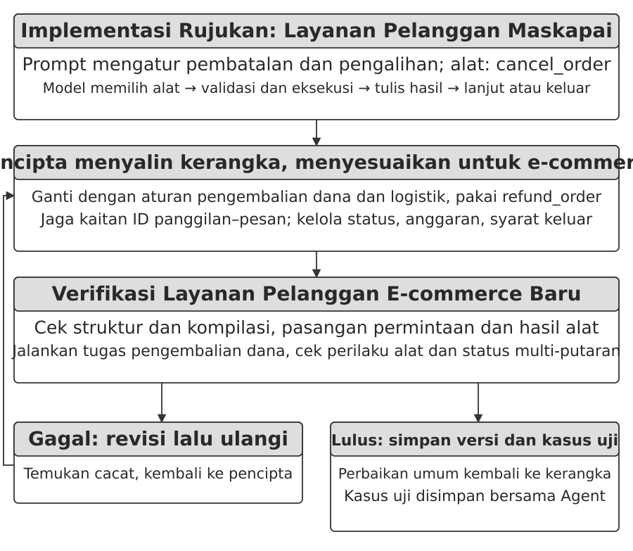

Bagaimana membedakan apakah suatu perubahan meningkatkan kemampuan umum atau kebetulan saja cocok dengan soal yang baru dilihat? Sisihkan satu tugas yang tidak diberikan kepada pencipta. Misalnya, kembangkan Agent pemantau harga dengan data dari satu toko, lalu berikan kepadanya contoh dari toko lain, sambil menjalankan ulang tugas semula.

**Memelihara lingkungan runtime Agent.**

Agent baru bergantung pada konfigurasi, kredensial, status sesi, layanan, dan *sandbox* untuk berjalan. Perintah `doctor` pada OpenClaw memberikan contoh alat pemeliharaan: ia memeriksa masalah seperti migrasi konfigurasi lama, status kredensial OAuth, kunci sesi, instalasi plugin, kesehatan *gateway*, dan *image* *sandbox*, lalu memberikan saran perbaikan atau menjalankan perbaikan yang sesuai[^ch5-doctor].

Pemeriksaan deterministik semacam ini dapat menjadi dasar alur pemeliharaan diri. Aturan deteksi mencakup kegagalan yang sudah dikenal, dan tindakan perbaikan memiliki masukan dan hasil yang diharapkan secara jelas. Saat merancang alur diagnosis Agent lebih lanjut, masalah yang belum terselesaikan dapat diserahkan kepada model beserta log, konfigurasi, dan hasil pemeriksaannya, agar model menjelaskan konfigurasi mana yang akan diubah dan bagaimana caranya; lapisan eksekusi memeriksa izin dan cakupan perubahan, lalu menjalankan pemeriksaan kesehatan dan uji regresi. *Snapshot* konfigurasi, catatan perubahan, dan jalan untuk kembali membantu sistem memulihkan pekerjaan jika perbaikan gagal.

**Menampung pengalaman rekayasa dalam implementasi rujukan.**

Membuat Agent khusus melibatkan logika domain sekaligus infrastruktur umum. Saat memeriksa hasil yang dihasilkan, empat jenis pertanyaan dapat dijadikan titik awal:

1. **Konteks dan *loop* runtime.** Pertahankan keterkaitan antara peran, pengenal pemanggilan alat, dan hasil alat; periksa status multiputaran, syarat penghentian, anggaran, dan pemulihan dari pengecualian. Pesan terstruktur memudahkan pemeliharaan hubungan protokol; prefiks yang stabil menciptakan kondisi bagi *prompt cache*.
2. **Antarmuka alat.** Deskripsi alat menjelaskan kegunaan, kondisi penerapan, dan batas pemakaian, sedangkan parameter mencakup tipe, makna, dan contoh konkret. Lapisan eksekusi tetap memverifikasi parameter, identitas, dan status bisnis.
3. **Pemilihan model dan API.** Model cenderung memakai model lama dan antarmuka lama yang sering muncul dalam data pelatihan; kode yang ditulis lancar pun bisa memakai pilihan yang ketinggalan zaman. Sediakan bagi pencipta bahan pemilihan yang terpelihara, atau minta ia menelusuri dokumentasi resmi untuk mencocokkan kemampuan model, versi antarmuka, dan cara pemanggilannya. Pemanggilan nyata setelah kode dihasilkan menguji apakah konfigurasinya dapat dipakai.
4. **Dependensi dan kompatibilitas ekosistem.** Periksa status pemeliharaan pustaka, versinya, dan perubahan antarmukanya, lalu verifikasi program gabungan dengan instalasi dependensi, pemeriksaan kompilasi, dan pengujian.

**Saat membuat Agent khusus, penulis lebih memilih agar pencipta menyalin implementasi rujukan yang sudah terverifikasi, lalu melakukan modifikasi domain.** *Prompt* sulit mencakup semua detail dalam protokol pesan, manajemen status, dan mekanisme pemulihan, sedangkan kode rujukan dapat membawa pengalaman rekayasa ini langsung ke sistem baru. Sekalipun model mahir memprogram, ia masih bisa melewatkan kondisi runtime yang tidak dinyatakan dalam deskripsi tugas; memakai ulang kerangka dapat mengurangi kesalahan berulang semacam ini. Pencipta menyalin kerangka dasar yang sesuai, menyesuaikan *system prompt* agar cocok dengan peran baru, menambah atau mengurangi alat domain, mengubah logika bisnis, dan melengkapi pengujian yang sesuai. Penanganan pesan, keterkaitan pemanggilan, manajemen status, dan jalur keluar disediakan oleh kerangka, sedangkan perubahan domain diverifikasi dengan kasus uji baru.

Jika templat jauh lebih cepat, bagaimana menyingkirkan penjelasan "ada beberapa fungsi yang tidak dikerjakan"? Berikut ini dua kelompok pencipta diminta menyerahkan jenis Agent yang sama, lalu diuji dengan rangkaian pemeriksaan yang sama.

> **Eksperimen 5-16 ★★★: Mengembangkan Agent yang dapat menciptakan Agent**
>
> Minta model pencipta yang sama membangun Agent peninjau rilis: setelah membaca sekumpulan catatan pemeriksaan *deployment*, jika ada satu saja butir wajib yang tidak lolos, ia menolak rilis dan menunjukkan dasarnya. Saat membuat dari nol, model perlu menulis *loop* runtime, protokol alat, alat domain, titik masuk baris perintah, dan pengujian. Jalur templat lebih dulu menyalin sebuah Agent yang mampu memeriksa catatan terstruktur, sehingga model hanya perlu mengisi spesifikasi domainnya. Misalnya, status disimpan di *field* mana, dan nilai apa yang berarti lolos? Skrip pembuat menghasilkan *system prompt*, definisi alat, dan dokumentasi berdasarkan spesifikasi itu. Alat Python yang sudah ada membaca spesifikasi untuk menjalankan pemeriksaan. Kedua jalur sama-sama mencerminkan metaprogramming: memakai program untuk menghasilkan atau mengubah program lain.
>
> Dalam Gambar 5-11, kedua jalur bertemu pada rangkaian kriteria penerimaan yang sama.
>
> 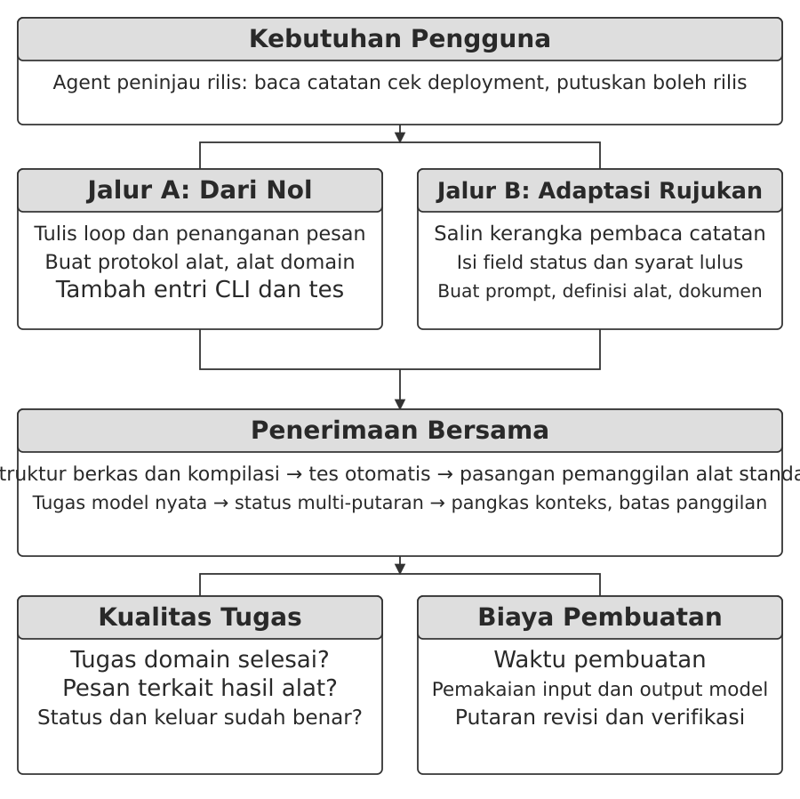
>
> Kedua jalur memakai tuntutan tugas dan kriteria penerimaan yang sama. Pertama diperiksa struktur artefak, kompilasi, dan pengujian; lalu keterkaitan pemanggilan alat dan hasilnya dalam pesan standar; terakhir dijalankan tugas model sungguhan dan interaksi multiputaran untuk memverifikasi pemangkasan konteks, manajemen status, dan batas jumlah pemanggilan.
>
> Dalam perbandingan Kimi K3 yang tersimpan, kedua kelompok masing-masing lolos 39/39 pemeriksaan deterministik, dan keduanya juga lolos tugas model sungguhan serta pemeriksaan status multiputaran. Jalur templat memakai 1.181 token dan sekitar 25 detik saat pembuatan, sedangkan jalur dari nol memakai 381.814 token dan sekitar 90 menit.
>

[^ch5-doctor]: OpenClaw, Doctor, yang memperkenalkan fungsi pemeriksaan konfigurasi dan status, migrasi, serta perbaikan.

## Ringkasan Bab

**Coding Agent lebih dulu matang karena satu alasan yang mudah terabaikan: rekayasa perangkat lunak sudah memiliki sistem tipe, *test suite*, kontrol versi, dan alat debugging.** Jika kode salah diubah, pengujian sering dapat menunjukkan kelompok masukan mana yang memberikan hasil tak terduga; jika cara perubahan diganti, masukan yang sama masih dapat dipakai untuk mencoba lagi. Untuk menerapkan pengalaman ini pada tugas lain, ajukan dulu tiga pertanyaan konkret: bagaimana kesalahan ditemukan, bagaimana kembali ke keadaan yang diketahui, dan kapan harus berhenti untuk meminta manusia mengambil alih? Misalnya, jika pemanggilan pengembalian dana terputus di tengah jalan, Harness harus memeriksa pembukuan dulu sebelum memutuskan apakah akan mencoba ulang; jika tidak, satu pemulihan kegagalan bisa berubah menjadi pengembalian dana kedua.

Kode juga dapat menyimpan satu penilaian menjadi sesuatu yang dapat dipakai berulang kali. Enumerasi dalam soal matematika dan batasan dalam soal logika dapat diserahkan kepada program untuk diperiksa butir demi butir; aturan pengembalian dana dapat ditulis sebagai validasi di titik masuk eksekusi, sehingga server membaca status sebenarnya dalam pesanan sebelum memutuskan untuk meloloskannya. Jika format log berubah, parser dapat diubah, dan sampel yang salah kali ini disimpan sebagai uji regresi. Ketiga situasi ini sama-sama dapat menjalankan kode, tetapi kriterianya berbeda: apakah solusi memenuhi syarat soal, apakah pengembalian dana sesuai kebijakan, dan apakah parser baru dapat membaca *field* yang semula terlewat.

Jika yang diserahkan adalah dokumen, video, atau model geometri, efek render, sinkronisasi audio-video, atau ketepatan ukuran juga harus diperiksa, dan seorang peninjau perlu melihat artefak sebenarnya. Jika yang diserahkan adalah formulir, kueri, atau visualisasi, selain melihat apakah pengguna dapat memahami dan mengoperasikannya, perlu juga diperiksa apakah layanan eksekusi di belakangnya mengambil data sesuai izin. Jika kode menghasilkan Agent lain, penulis cenderung memakai ulang kerangka yang sudah terverifikasi lebih dulu, menghasilkan alat domain dan logika bisnis, lalu memeriksa protokol pemanggilan, status lintas putaran, dan hasil tugas sebenarnya. Alat, validator, dan pengujian yang terkumpul dengan cara ini dapat dipakai lagi pada tugas berikutnya.

Kode membuat tugas dapat dijalankan berulang kali, tetapi lingkungan belum tentu menunggu sampai eksekusinya selesai. Selagi sebuah kueri masih berjalan, pengguna mungkin sudah berubah pikiran. Bab 6 membahas bagaimana perubahan semacam ini masuk ke dalam interaksi yang sedang berlangsung.

## Pertanyaan Pemikiran

1. ★★ Rancang *sandbox* untuk Coding Agent yang perlu membaca berkas proyek, memasang dependensi, dan menjalankan pengujian. Bagaimana Anda mengonfigurasi izin berkas, jaringan, proses, dan sumber daya? Ketika tugas perlu memperluas izin, bagaimana permintaan dinyatakan, cakupannya diperiksa, dan catatannya disimpan?
2. ★★★ Ketika pencipta terus menghasilkan dan mengubah Agent dari generasi ke generasi, cacat kerangka dan kesalahan domain dapat menumpuk sedikit demi sedikit. Bagaimana memakai versi rujukan, uji regresi, evaluasi perilaku, dan mekanisme pengembalian untuk melacak perubahan ini?
3. ★★ Perubahan format log bisa berasal dari peningkatan yang wajar, bisa juga dari cacat pada produsennya. Bukti apa yang harus disimpan sistem parsing adaptif, dan berdasarkan syarat apa ia memutuskan untuk menambahkan parser baru, melaporkan anomali, atau menghentikan pemrosesan sementara?
4. ★★ Dalam siklus pengusul–peninjau, peninjau menilai kepadatan informasi halaman sudah wajar, tetapi pengguna merasa halaman itu terlalu penuh. Bagaimana mengubah preferensi pengguna menjadi contoh, kriteria penilaian, dan umpan balik interaktif, serta memeriksa apakah perubahan berikutnya sudah sesuai dengan tuntutan?
5. ★★ Coding Agent dapat memperbarui basis pengetahuan, dokumen arsitektur, dan instruksi proyek, serta dapat mengunci urutan operasi menjadi kode. Bagaimana mengenali aturan yang berlebihan atau usang, dan merancang cakupan penerapan, metode verifikasi, serta syarat pensiun bagi suatu aturan? Untuk berkembang dari satu perubahan yang berhasil menjadi evolusi berkelanjutan seperti yang dibahas di Bab 9, mekanisme akumulasi dan evaluasi apa lagi yang diperlukan?
6. ★ Tim yang ramah terhadap kolaborasi jarak jauh biasanya juga memudahkan Agent memperoleh informasi kerja. Periksalah kebutuhan, arsitektur, catatan keputusan, dan standar penerimaan dari sebuah proyek yang Anda kenal, cantumkan dokumen yang paling perlu dilengkapi, dan jelaskan tugas konkret apa yang dapat dibantu dokumen-dokumen itu bagi Agent.
7. ★★★ Untuk Agent yang sekaligus mengakses data pribadi, memproses konten tidak tepercaya, berkomunikasi ke luar, dan memakai memori persisten, bagaimana mengatur otorisasi identitas, penandaan sumber, pemeriksaan aliran data, dan peninjauan penulisan memori? Gunakan satu alur bisnis normal untuk menunjukkan posisi pemeriksaan-pemeriksaan ini.
8. ★★ Dalam mode Artifact untuk SQL dan HTML, model menghasilkan artefak, layanan eksekusi menangani kueri atau render, dan antarmuka langsung menampilkan hasilnya. Informasi apa yang cocok diserahkan kembali kepada model untuk dijelaskan? Bagaimana memeriksa izin kueri, anggaran sumber daya, isolasi halaman, dan konsistensi hasil yang ditampilkan?
9. ★★ Alat memvalidasi aturan berdasarkan status bisnis dalam basis data, sedangkan deskripsi parameter membantu model menyiapkan pemanggilan. Dengan pembatalan pemesanan sebagai contoh, jelaskan tanggung jawab masing-masing dari kebijakan dalam bahasa alami, contoh parameter, validasi di lapisan eksekusi, dan pengujian batas; setelah kebijakan berubah, isi apa saja yang perlu diperbarui bersamaan?
