# Interaksi: Perluasan Ruang Observasi dan Ruang Aksi

**Ketika model dasarnya tetap, menata ulang atau memperluas antarmuka observasi dan aksi sering kali menjadi salah satu cara rekayasa yang paling efektif untuk meningkatkan performa tugas sebuah Agent.** Pada bab-bab sebelumnya, Agent biasanya menunggu pengguna selesai berbicara, lalu mencari informasi, memanggil alat, dan memberikan jawaban. Selama ia menunggu hasil alat, pengguna dan lingkungan luar terus berubah.

Seorang pengguna meminta asistennya mengubah jadwal tiket pesawat. Saat asisten sedang menanyakan penerbangan kepada layanan pelanggan, pengguna mengirim pesan lagi: "Saya masih punya satu koper untuk bagasi." Petugas layanan pelanggan masih berbicara, dan harga tiket di layar pun bisa berubah. Asisten perlu segera memastikan apakah harga tersebut sudah termasuk bagasi, sekaligus memperhatikan apakah penawaran tadi masih berlaku. Di sini ada dua persoalan desain: lewat saluran apa asisten mengetahui perubahan, dan kapan ia dapat bereaksi? Bab ini lebih dulu membahas email dan hasil alat yang datang secara asinkron, kemudian suara yang kontinu, perubahan layar, dan umpan balik gerak robot.

## Perluasan Modalitas dan Waktu Pemicuan

**Modalitas** menggambarkan bentuk informasi dan tindakan. Agent dapat membaca teks, mendengar suara, melihat layar, dan menerima sinyal torsi; ia juga dapat mengeluarkan teks, menyintesis suara, mengklik antarmuka, atau menggerakkan sendi.

**Waktu pemicuan** menyangkut kapan informasi tiba, kapan tindakan dimulai, dan kapan sistem merespons. Informasi dapat diambil sendiri oleh Agent, dapat pula didorong oleh layanan eksternal; alat dapat langsung mengembalikan hasil, atau lebih dulu memulai tugas lalu melaporkan penyelesaiannya kemudian. Ketika peristiwa baru tiba, sistem juga harus memutuskan apakah pekerjaan yang sedang berjalan perlu disela, dan bagaimana tugas yang terputus dilanjutkan kembali.

| Dimensi | Antarmuka perolehan informasi dan observasi | Antarmuka tindakan dan eksekusi |
|---|---|---|
| Penataan isi (Bab 2–5) | Konteks, memori, dan basis pengetahuan menata informasi untuk keputusan | Alat dan kode menyatakan operasi yang dapat dieksekusi |
| Modalitas (bab ini) | Suara, layar, sensor fisik | Berbicara, mengklik, gerak sendi |
| Waktu (bab ini) | Kueri aktif, dorongan peristiwa, masukan kontinu | Eksekusi lintas giliran, pembatalan, preempsi, dan pemulihan |

Konteks memuat informasi yang dibutuhkan untuk satu keputusan, sedangkan ruang observasi menggambarkan cakupan informasi yang mungkin diterima sistem; alat menyediakan antarmuka konkret, sedangkan ruang aksi menggambarkan cakupan tindakan yang boleh dilakukan sistem. Ketika antarmuka diperluas, cakupan ini tetap dibatasi oleh kemampuan perangkat, parameter, izin, dan lingkungan eksekusi.

Banyak antarmuka pemanggilan alat menyusun pesan per putaran: model mengajukan pemanggilan, sistem menambahkan hasil alat, lalu putaran penalaran berikutnya dimulai. Sistem berbasis peristiwa perlu mengelola perubahan dari luar di atas protokol ini. Bila antarmukanya mendukung asinkroni native, sistem dapat menerima permintaan baru selama alat masih tertunda, lalu melanjutkan pemrosesan setelah hasilnya kembali; bila antarmukanya sinkron, Harness-lah yang menata interaksi dengan antrean, *handle* tugas, dan mekanisme penjadwalan. Bagian-bagian berikutnya membahas kedua jalur implementasi ini.

Irama umpan balik pada tiap skenario sangat berbeda. Tabel berikut mencantumkan skala waktu yang umum.

| Skala umum | Skenario | Perubahan di sisi observasi | Penanganan di sisi aksi |
|---|---|---|---|
| Detik hingga hari | Asinkron dan berbasis peristiwa | Peristiwa eksternal membangunkan Agent | Tugas dimulai lebih dulu, peristiwa berikutnya melaporkan kemajuan dan penyelesaian |
| Puluhan milidetik hingga detik | Suara | Audio diterima terus-menerus | Keluaran *streaming*, menangani sela bicara dan menghentikan pemutaran |
| Subdetik hingga detik | Computer Use | Layar terus berubah | Status antarmuka diambil ulang setelah setiap operasi |
| Siklus kendali milidetik | Kendali tingkat rendah robot | Sensor terus memberi umpan balik | Mengeksekusi segmen gerak pendek, merespons sinyal kendali dan sinyal berhenti |

## Asinkron dan Berbasis Peristiwa: Ketika Dunia Datang Menghampiri

Bab 4 memperkenalkan alat persepsi, eksekusi, dan kolaborasi; bagian ini melanjutkan dengan alat pemicu peristiwa dan alat komunikasi pengguna. Alat pemicu peristiwa membawa perubahan lingkungan ke dalam Agent, sedangkan alat komunikasi memungkinkan Agent menghubungi pengguna selama tugas berjalan. Harness mengaitkan masukan dan keluaran ini dengan tugas yang sedang berjalan, sehingga terbentuk *event loop* yang bekerja terus-menerus.

### Mengapa Asinkroni Diperlukan

Pada pemanggilan sinkron, pemanggil harus menunggu hasilnya kembali sebelum dapat melanjutkan alur kerjanya. Pada pemanggilan asinkron, yang dikembalikan lebih dulu adalah *handle* tugas (penanda untuk menanyakan dan mengelola tugas), atau ada kesepakatan bahwa penyelesaiannya akan diberitahukan kemudian, sehingga pemanggil dapat mengerjakan hal lain selama menunggu. Dengan cara ini sistem dapat mengelola beberapa tugas yang sedang berjalan, lalu menentukan operasi mana yang dapat dijalankan paralel berdasarkan sumber daya dan ketergantungannya.

Bayangkan Agent sebagai sekretaris yang mengurus email, telepon, dan tamu: sambil menunggu balasan, ia terus merapikan berkas; ketika telepon penting masuk, ia mencatat sampai di mana pekerjaannya; setelah telepon selesai, ia melanjutkan tugas semula. Dalam implementasi rekayasa, ada tiga hal yang harus ditangani:

- **Memisahkan tugas panjang dari interaksi.** Analisis berkas, panggilan telepon, atau proses *build* berjalan di latar belakang, sementara pengguna tetap dapat menanyakan kemajuan dan menambahkan permintaan.
- **Prioritas peristiwa.** Perintah berhenti darurat segera masuk ke alur kendali, pembaruan rutin masuk antrean, dan kueri yang berdiri sendiri dapat diserahkan ke sesi paralel.
- **Interupsi dan pemulihan.** Status tugas disimpan, operasi yang sudah terjadi dicatat, dan saat dilanjutkan, kondisi yang masih berlaku diperiksa ulang.

Pratinjau riset Claude Duet memberi satu contoh: pengguna punya rapat pukul dua siang dan ingin mendapatkan ringkasan tentang perusahaan mitranya lebih dulu. Ia cukup meninggalkan pesan suara, lalu menutup aplikasi. Persiapan terus berjalan di *cloud*, dan pengguna dapat membuka halaman tugas kapan saja untuk melihat kemajuannya; ketika ia perlu menambahkan informasi atau ringkasan sudah selesai, asisten kembali ke percakapan utama untuk memberitahunya. Bahwa tugas tetap berjalan setelah pengguna pergi, itulah eksekusi asinkron. Panggilan *full-duplex* yang dibahas kemudian punya tuntutan lain lagi: ketika satu pihak sedang berbicara, ia tetap harus bisa mendengar pihak lain yang menyela.[^ch6-duet]

API model juga punya aturan tentang urutan pesan. Sebagian antarmuka mengharuskan setiap pemanggilan alat berpasangan lengkap dengan hasilnya sebelum menerima permintaan putaran berikutnya; sebagian lain membolehkan alat tertunda sambil menerima pembaruan susulan. Fungsi asinkron di aplikasi mengatur penantian dan eksekusi, sedangkan protokol model menentukan kapan pesan boleh dikirim.

Pada Gambar 6-1, pesan baru dan hasil alat sama-sama dapat masuk ke antrean, tetapi cara keduanya sampai ke antrean bergantung pada sumbernya. Bila layanan mendukung *push*, pemberitahuan dapat dikirim begitu statusnya berubah; bila layanan hanya menyediakan antarmuka kueri, adaptor harus memeriksanya secara berkala dan membuat peristiwa ketika menemukan perubahan. *Timer* yang habis waktunya juga dapat menghasilkan peristiwa. *Event loop* kemudian menyerahkan masukan-masukan ini kepada Agent.

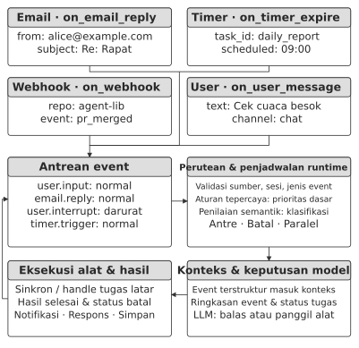

### Implementasi Mekanisme Berbasis Peristiwa di OpenClaw

OpenClaw menghubungkan kanal pesan melalui Gateway dan merutekan peristiwa ke *runtime* Agent. Mekanisme otomatisasinya mencakup Hooks internal, penjadwalan berkala, Heartbeat, dan Webhook eksternal[^ch6-automation]. Mekanisme ini dapat dipahami menurut kondisi pemicunya:

- **Hooks (kait peristiwa)** merespons peristiwa internal kerangka kerja, misalnya pembuatan sesi, penyetelan ulang sesi, atau perubahan siklus hidup eksekusi.
- **Cron (penjadwalan berkala)** menjalankan pekerjaan pada waktu atau periode tertentu. Misalnya, `0 9 * * 5` berarti dipicu setiap Jumat pukul 9 pagi menurut zona waktu yang dikonfigurasi.
- **Heartbeat (detak jantung)** membangunkan Agent secara berkala untuk memeriksa hal-hal yang perlu diperhatikan.
- **Webhook (*callback* eksternal)** menerima peristiwa yang dikirim layanan eksternal, lalu memicu pemrosesan setelah autentikasi dan perutean.

Laporan mingguan cocok dijalankan sesuai jadwal, urusan yang terus dipantau dapat diperiksa secara berkala, sedangkan email baru dan *callback* layanan dapat memakai *push* untuk memperpendek jeda sampai perubahan diketahui.

**Peristiwa panggilan di PineClaw.** Pine AI menelepon atas nama pengguna untuk mengurus negosiasi tagihan, pembatalan langganan, klaim asuransi, dan sejenisnya. PineClaw menghubungkan tugas telepon semacam ini ke OpenClaw. Sebuah panggilan biasanya berlangsung cukup lama, dan selama itu pengguna mungkin perlu turun tangan:

- **Verifikasi identitas.** Layanan pelanggan meminta pemilik akun menyelesaikan verifikasi, misalnya memasukkan kode keamanan atau kata sandi sekali pakai.
- **Panggilan tiga arah.** Layanan pelanggan ingin berbicara langsung dengan pemilik akun, sehingga pengguna perlu segera diberi tahu untuk mengangkat telepon.
- **Konfirmasi keputusan.** Ketika layanan pelanggan menawarkan solusi alternatif, sisi depan menilai apakah tawaran itu dapat diterima berdasarkan permintaan kali ini dan preferensi pengguna sebelumnya. Bila pengguna yang harus memutuskan, pilihan yang konkret dikirim kepadanya, sementara pengecekan syarat lain dengan layanan pelanggan tetap berjalan.

Misalnya, layanan pelanggan meminta pemilik akun bergabung dalam panggilan tiga arah. Semakin cepat pemberitahuan sampai, semakin singkat waktu kedua pihak menunggu tanpa kegiatan di telepon. Kasus PineClaw memakai mekanisme Channel untuk menyalurkan peristiwa panggilan antara Gateway dan Pine API: telepon tersambung, masukan pengguna dibutuhkan, dan panggilan berakhir masing-masing masuk ke aliran peristiwa, lalu Agent memperbarui tugas dan memberi tahu pengguna berdasarkan peristiwa tersebut.

**Menurut penulis, agar layanan proaktif datang tepat waktu, sebaiknya sumber peristiwa sendiri yang memberi tahu Agent ketika statusnya berubah.** Setelah pemberitahuan tiba melalui kanal, Harness mencari tugas yang bersangkutan dan memeriksa apakah peristiwa itu duplikat atau sudah kedaluwarsa; barulah model memutuskan langkah berikutnya. Jika pengguna perlu memverifikasi identitas, antarmuka sebaiknya membuka pintu autentikasi yang tepercaya, dan hasil verifikasinya dikirim kembali ke tugas semula sebagai peristiwa baru.

### Alat Pemicu Peristiwa

Jika kita menitipkan "ingatkan saya setelah klien membalas" kepada asisten, bagaimana ia bisa bangun tepat besok? Pertama, periksa apakah kotak surat dapat mengirim peristiwa saat surat masuk; untuk sistem yang hanya bisa ditanyai secara aktif, asisten perlu mengingat kapan pemeriksaan berikutnya. Ketiga antarmuka ilustratif berikut menyerahkan penyimpanan kondisi tunggu itu kepada *runtime*, sehingga model dapat mengakhiri putaran kerjanya saat ini.

***Timer* (`set_timer`)** dipakai untuk membangunkan sebuah tugas pada waktu yang disepakati. *Timer* sekali jalan cocok untuk "Senin depan pukul 10 pagi telepon bank untuk menanyakan perkembangan KPR"; *timer* berulang cocok untuk memeriksa kesehatan layanan setiap jam. Menunggu balasan setelah mengirim email, atau menelepon ulang setelah membentur jam di luar jam kerja, juga dapat diatur dengan *timer*. Antarmukanya perlu menyimpan zona waktu, kondisi pemicu, dan penanda tugas, serta menyediakan cara untuk membatalkan atau mengubahnya. Bila layanan eksternal hanya mendukung kueri, tugas terjadwal juga dapat dipakai untuk *polling* kemajuan.

**Pemantauan tugas latar belakang (`monitor_shell`)** dipakai untuk mengubah perintah yang berjalan lama menjadi peristiwa kemajuan. Saat dimulai, alat ini mengembalikan penanda tugas; selama berjalan, ia memberi tahu berdasarkan keluaran baru, kata kunci, atau perubahan status; ketika selesai, ia melaporkan status keluar dan hasilnya.

Membiarkan model berulang kali menanyakan kemajuan tetap menghabiskan pemanggilan model meskipun statusnya tidak berubah; sebaliknya, hanya menunggu pemberitahuan selesai bisa membuat kegagalan di tengah jalan terlewat. Karena itu, penulis menyarankan agar pemantauan diserahkan kepada *runtime*, dan model hanya dibangunkan ketika muncul kemajuan yang berguna, galat, atau kemacetan. Dengan begitu, komunikasi tetap bisa berlangsung selama proses *build*, dan kelainan dapat segera ditangani. Aturan pemantauan dapat diberi penyaringan, penggabungan, dan pembatasan frekuensi, agar tidak setiap baris log memicu satu pemanggilan model.

Misalnya, setelah model berlangganan pembaruan status untuk sebuah tiket yang sedang diproses, ia dapat mengakhiri putaran penalarannya dan menunggu pemberitahuan yang membawa nomor tiket itu untuk membangunkannya. Jika pihak lain hanya menyediakan pintu kueri, model dapat memasang tugas terjadwal sendiri untuk pemeriksaan berikutnya. Bila saat itu hasilnya "masih diproses", ia menjadwalkan pemeriksaan lagi; bila tiketnya sudah selesai, pemeriksaan berikutnya dibatalkan. Dalam kedua cara ini, *runtime*-lah yang menanggung penantian, dan model baru menilai kembali ketika menerima pemberitahuan atau ketika *timer* habis waktunya.

**Kanal peristiwa eksternal (`connect_channel`)** dipakai untuk berlangganan email, pesan instan, atau *callback* API. Adaptor kanal memverifikasi sumbernya, memetakan penanda milik layanan itu ke *thread* dan objek terkait, lalu mengirim peristiwa dalam format seragam; bagian "Lapisan Akses" nanti membahasnya lebih jauh. Pemberitahuan status telepon di PineClaw termasuk kategori ini.

Ketiga jenis alat ini memerlukan kondisi pemicu, aturan penyaringan, dan muatan (*payload*) peristiwa yang jelas. Muatan sebaiknya berisi penanda peristiwa, waktu kejadian, sumber, tugas terkait, dan isi yang diperlukan, sehingga Agent dapat menilai apakah peristiwa itu masih berlaku dan informasi apa yang dibutuhkan untuk langkah berikutnya.

### Alat Komunikasi Pengguna

Kembali ke tugas mengubah jadwal tiket. Bertanya kepada layanan pelanggan, mengirim pesan konfirmasi yang bisa langsung dijawab pengguna, dan mencatat "sedang menunggu balasan" di catatan tugas akan ditulis ke tiga tempat yang berbeda. Pengguna boleh pergi sejenak, lalu kembali ketika perlu menambahkan syarat, mengonfirmasi keputusan, atau menerima hasil.

Antarmuka sesi dapat menampilkan jawaban akhir, kemajuan alat, dan hasil eksekusi; alat komunikasi secara tegas menentukan penerima, kanal, isi pesan, dan lampiran. Model memutuskan apa yang perlu disampaikan, Harness memeriksa tujuan dan izinnya, dan layanan pesan menyelesaikan pengirimannya. *Runtime* juga dapat merutekan jawaban akhir secara otomatis ke sesi asal. Kedua cara ini dapat dipakai bersama.

Interaksi multikanal di OpenClaw memungkinkan pengguna mengirim pesan, menunggu kemajuan, dan menerima pengingat seperti saat menghubungi seorang sekretaris. **"Rasa manusia hidup"** ini lahir dari status tugas yang berkesinambungan dan komunikasi yang tepat waktu. Pengguna dapat melanjutkan tugas di kanal yang sudah akrab baginya, sementara Agent harus menjaga konsistensi identitas, sesi, dan keterkaitan pesan.

Isi komunikasi juga dapat menyesuaikan diri dengan tugas: kemajuan singkat disampaikan dengan teks, hasil yang rumit disertai gambar atau berkas, informasi yang perlu diisi disajikan dalam kartu terstruktur, dan hasil interaktif memakai UI generatif yang diperkenalkan di Bab 5. Bila kanal mendukung tanda terkirim atau tanda dibaca, sistem menyimpan status tersebut; percobaan ulang setelah gagal, pesan duplikat, dan sinkronisasi lintas kanal juga dicatat dalam riwayat pengiriman.

**Pemberitahuan multikanal dan menarik pengguna kembali.**

Pesan instan, SMS, email, telepon, dan notifikasi aplikasi masing-masing cocok untuk tingkat urgensi dan bentuk isi yang berbeda. Agent dapat memilih kanal dengan menimbang urgensi, preferensi pengguna, kondisi pengguna saat itu, dan panjang pesan. Peristiwa panggilan yang perlu segera dikonfirmasi memakai pengingat seketika, sedangkan laporan lengkap dapat dikirim lewat email atau tautan aplikasi.

Penulis pernah meminta asisten memantau harga hotel untuk konferensi ATC. Setiap hari pada jam yang sama, asisten mengirim pesan bahwa harga kamar belum turun ke harga sasaran. Suatu kali harga sempat turun sebentar, tetapi yang menangkap jendela itu justru skrip yang ditulis penulis sendiri. Harga rendah yang singkat bisa muncul di antara dua kueri. Bahkan jika asisten sempat menemukannya, pesan yang terlambat sampai tetap bisa membuat pengguna kehilangan kesempatan memesan. Pada hari-hari tanpa penurunan harga, kueri terjadwal tetap boleh berjalan seperti biasa, tetapi pengguna tidak perlu membaca pesan yang sama setiap hari. Bab 7 akan memakai jendela penurunan harga selama lima menit untuk menguji pengingat semacam ini.

Ketika tugas panjang selesai, pemberitahuan membawa pengguna kembali ke halaman hasil; ringkasan harian dan laporan mingguan dikirim mengikuti irama yang disepakati. Strategi multikanal juga perlu mengatur deduplikasi, jam tenang, dan syarat eskalasi, misalnya apakah perlu beralih ke kanal lain jika pengingat pertama tidak ditanggapi. Catatan pemberitahuan dikaitkan dengan status tugas, sehingga pengguna dapat melanjutkan urusan langsung dari pesan yang diterimanya.

### Identitas Virtual dan Lingkungan Eksekusi Terisolasi

Bab 4 meminjam Samantha dari film *Her* untuk menjelaskan bagaimana asisten serbaguna memasuki dunia digital melalui alat. Untuk mewujudkan asisten semacam ini, perlu ditegaskan dengan identitas apa ia bekerja dan sumber daya apa yang boleh diaksesnya. **Penulis cenderung memberi asisten serbaguna identitas virtual tersendiri.** Kotak surat kantor, nomor telepon, ruang penyimpanan, dan lingkungan komputasi khusus membuat Agent, layaknya sekretaris yang punya akun kantornya sendiri, dapat mengurus urusan pengguna dengan identitas perwakilan yang jelas. Identitas tersendiri memisahkan pekerjaan harian asisten dari akun pribadi pengguna, sehingga otorisasi, audit, dan pencabutan dapat dilakukan secara terpisah; ketika terjadi kesalahan operasi, dampaknya juga lebih mudah dibatasi. Tugas yang benar-benar harus mengakses akun pengguna memperoleh izin yang dibutuhkan melalui otorisasi dengan cakupan terbatas.

Siapa pemilik nomor telepon menentukan siapa yang bisa melanjutkan urusan ketika pihak lain menelepon balik. Cue dari Manus memberi asisten nomor tersendiri yang dapat menerima panggilan masuk, lalu meninggalkan ringkasan panggilan untuk pengguna. Jika pedagang menerima nomor panggilan balik yang ditinggalkan asisten, layanan pelanggan yang menelepon kembali dapat langsung terhubung dengan asisten yang menangani urusan itu sebelumnya.[^ch6-cue]

Ambil contoh permohonan keringanan biaya: asisten dapat menghubungi pedagang sebagai perwakilan yang diberi kuasa. Jika layanan pelanggan meminta verifikasi lisan dari pemilik akun sendiri, pengguna dapat diajak bergabung dalam panggilan tiga arah, lalu asisten melanjutkan pembicaraan setelah verifikasi selesai. Jika pedagang akan menelepon balik pengguna, nomor kasus, hal-hal yang sudah disepakati, dan pertanyaan yang perlu diverifikasi diserahkan lebih dulu kepada pengguna. Saat melapor kepada pengguna, asisten juga harus jelas tentang bukti yang dipegangnya: jika layanan pelanggan sudah berjanji secara lisan untuk memberi keringanan, janji itu dicatat; baru setelah tagihan terbukti diperbarui, ia melaporkan bahwa biayanya benar-benar telah dihapus.

Ketika penulis mengurus penggantian kartu kredit Bank of America di Beijing, Pine menghubungi bank, mengatur penggantian kartu secara kilat, dan berhasil membuat bank membebaskan biaya percepatan sebesar 15 dolar AS. Ketika panggilan berakhir, asisten sudah dapat melaporkan apa yang diterima bank dan biaya mana yang disetujui untuk dihapus. Jika beberapa hari kemudian pengguna bertanya "kartu baru sudah sampai di mana", asisten perlu memeriksa pengiriman lagi atau meminta penerima memastikannya.

Komputer virtual dan ponsel virtual menyediakan lingkungan operasi yang berjalan terus-menerus. Mesin virtual dapat menjalankan sistem desktop, kontainer cocok untuk mengisolasi proses dan dependensi, dan emulator Android menampung aplikasi seluler. Semuanya mendukung eksekusi di latar belakang serta mengurangi gangguan operasi otomatis terhadap pekerjaan pengguna saat itu. Cakupan isolasi ditentukan bersama oleh jaringan, *mount*, kredensial, dan izin eksekusi; konfigurasi ini sekaligus memengaruhi data dan sistem eksternal yang dapat dijangkau Agent.

Misalkan Anda ingin WorkBuddy edisi perusahaan dari Tencent menyusun laporan mingguan setelah komputer dimatikan sepulang kerja, padahal tabel penjualan minggu ini hanya ada di komputer kantor. Jika memilih tugas lokal, asisten dapat membaca tabel itu, tetapi komputer harus menyala dan klien harus tetap daring. Jika memilih tugas *cloud*, asisten dapat terus bekerja setelah komputer Anda mati, dengan syarat data yang boleh dipakai untuk laporan mingguan sudah diunggah ke tugas itu, atau ditaruh di repositori dokumen yang dapat diakses tugas *cloud*. Jika tabel penjualan harus tetap berada di komputer lokal, pemrosesannya sebaiknya dijadwalkan ketika komputer sedang daring.

Halaman web dan aplikasi seluler juga bisa meminta autentikasi identitas, kode verifikasi, atau konfirmasi manual. Saat menghubungkan layanan, utamakan API dan cara otorisasi yang disediakan layanan tersebut; bila autentikasi harus lewat antarmuka grafis, pengguna dapat masuk sendiri melalui *remote desktop* VNC/RDP, dan operasi otomatis dihentikan sementara selama autentikasi. Setelah pengguna selesai, sistem memeriksa status sesi, lalu melanjutkan tugas. Token dan sesi disimpan sesuai masa berlakunya, dan dibersihkan menurut kebijakan setelah otorisasi dicabut atau tugas selesai.

Agent dan lingkungan virtual dapat bertukar data melalui **sistem berkas bersama**. Misalnya, pengguna mengunggah CSV, komputer virtual membaca berkas itu, menjalankan analisis, dan menulis grafiknya kembali ke penyimpanan bersama; *runtime* menyerahkan lokasi berkas grafik itu kepada Agent, lalu menyediakan tautan unduhan yang dapat diakses pengguna. Isi berkas besar tetap tersimpan di penyimpanan, dan model membaca ringkasan atau potongannya sesuai kebutuhan.

[^ch6-dsh-threads]: DeepSeek, model domain serta aturan otorisasi dan langganan pada prototipe dsh-superagent.
[^ch6-dsh-sessions]: DeepSeek, prototipe dsh-superagent, versi `8c32a9d`. Tanggung jawab kedua jenis sesi lihat `docs/004-prompts.md`, sesi eksekusi dan direktori kerja lihat `docs/003-execution.md`, format pesan yang dikirim ke sesi utama lihat `docs/007-architecture.md`.
[^ch6-duet]: Anthropic, *Get started with Claude Duet*, memperkenalkan ringkasan pra-rapat, halaman tugas, dan pemberitahuan di percakapan utama.
[^ch6-cue]: Manus, *Introducing Manus 2.0*, memperkenalkan nomor telepon tersendiri, penerimaan panggilan masuk, dan ringkasan panggilan pada Cue.
[^ch6-automation]: OpenClaw, Automation, memperkenalkan pintu masuk otomatisasi seperti Hooks internal, penjadwalan berkala, Heartbeat, dan Webhook eksternal.

### Lapisan Akses: Banyak Sumber, Satu Bentuk Peristiwa

Sebuah Agent layanan pelanggan di toko daring sedang memproses pengembalian dana: pembeli mengajukan permintaan di percakapan layanan pelanggan dalam aplikasi; jumlahnya melampaui wewenang Agent, sehingga ia meminta konfirmasi supervisor di grup purnajual WeCom; layanan pembayaran mengirim Webhook setelah pengembalian dana berhasil; lalu sistem pesanan menerbitkan perubahan status di Kafka. Keempat pesan itu membicarakan pesanan yang sama, tetapi datang dengan cara yang berbeda-beda. Begitu sumbernya bertambah banyak dan setiap jalur mengurus sendiri percobaan ulang, deduplikasi, dan urutan, *runtime* akan tercerai-berai oleh perbedaan-perbedaan ini. **Lapisan akses menyeragamkan bentuk peristiwa setelah masuk ke sistem, sambil tetap mempertahankan perbedaan kemampuan tiap sumber sebelum peristiwa itu tiba.** Gambar 6-2 memperlihatkan pelapisan ini.

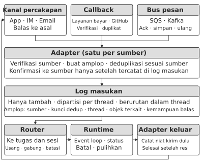

Ada empat jenis sumber yang umum. **Kanal percakapan** mencakup antarmuka percakapan milik produk sendiri, pesan instan seperti WeCom, Feishu, dan Slack, serta email; Agent dapat menjawab kembali di tempat asal. ***Callback*** adalah antarmuka HTTP yang dipanggil layanan eksternal ketika statusnya berubah; biasanya disertai tanda tangan dan hanya membawa pemberitahuan. Jika pengiriman gagal, sebagian layanan mencoba ulang secara otomatis, sedangkan GitHub mengharuskan pengiriman ulang secara manual atau lewat API. **Bus pesan** seperti SQS dan Kafka membawa peristiwa bisnis dari layanan internal, dengan semantik konfirmasi dan retensi yang jelas. ***Timer*, *polling*, dan peristiwa internal** dihasilkan oleh sistem sendiri, sehingga cukup ditulis ke log yang sama. Tabel berikut membandingkan tiga jenis pertama.[^ch6-ingress-mq][^ch6-ingress-callback]

| | Percakapan aplikasi | WeCom / Feishu | Email | Webhook | SQS | Kafka |
|---|---|---|---|---|---|---|
| Cara tiba | Koneksi persisten | *Callback* atau koneksi persisten | *Push* atau *polling* | *Callback* | Ditarik konsumen | Ditarik konsumen |
| Cakupan urutan | Dalam satu percakapan | Sebagian besar peristiwa tidak dijamin | Tidak dijamin | Tidak dijamin | Antrean standar tidak dijamin, FIFO per grup pesan | Dalam satu partisi |
| Dasar deduplikasi bawaan | ID pesan klien | ID pesan, ID peristiwa | Message-ID | ID pengiriman | ID pesan; FIFO juga punya `MessageDeduplicationId` | Topik, partisi, dan *offset* |
| Dapat diputar ulang? | Bergantung pada catatan sendiri | *Callback* sendiri tidak dapat diputar ulang; Feishu dapat menarik ulang lewat antarmuka riwayat pesan | Kotak surat dapat dibaca ulang | Bergantung pada layanan | Tidak, setelah dihapus | Ya, selama masa retensi |
| Cara konfirmasi | Tanda terima klien | Mengembalikan sukses dalam batas waktu | Mencatat posisi baca sendiri | Mengembalikan 2xx dalam batas waktu | Menghapus pesan | *Commit offset* |
| Jalur balasan | Percakapan asal | Percakapan asal | Surat balasan | Tidak ada | Tidak ada | Tidak ada |

**Amplop seragam.**

Adaptor mengubah pesan mentah menjadi **amplop** (*envelope*) berformat seragam. Amplop hanya mencatat fakta yang sudah pasti saat pesan tiba; prioritas dan tenggat pemrosesan ditambahkan oleh aturan perutean, tingkat pelanggan dan status pesanan ditambahkan oleh sistem bisnis, sedangkan status pemrosesan disimpan terpisah. Permintaan pengembalian dana dari pembeli dapat ditulis seperti ini:

```json
{
  "id": "evt_7f3a",
  "source": {"type": "app_chat", "sender": "user:u_5521", "verified": true},
  "dedupe_key": "app:msg:msg_1029",
  "thread": "app:conv:conv_88",
  "kind": "message",
  "correlation": ["order:12345"],
  "content": {"type": "text", "text": "这个订单我想退款"},
  "raw_ref": "raw/2026-11-23/app/msg_1029.json",
  "reply": {"via": "app_chat", "target": "app:conv:conv_88"},
  "occurred_at": "2026-11-23T14:02:09+08:00",
  "expires_at": null
}
```

- `source`: jenis sumber dan pengirim yang telah diverifikasi. "Terverifikasi" ditentukan adaptor berdasarkan tanda tangan, token, atau akun kanal; perkenalan diri di dalam isi pesan tidak dihitung. *Runtime* menilai izin berdasarkan butir ini.
- `dedupe_key`: kunci deduplikasi; apa yang dianggap duplikat ditentukan oleh semantik sumbernya. ID pengiriman, ID pesan, serta partisi dan *offset* menandai satu kali pengiriman yang sama, sehingga dapat menahan pengiriman ulang di lapisan transportasi; jika pesan bisnis membawa kunci idempotensi (*idempotency key*), misalnya nomor pengembalian dana ditambah statusnya, adaptor harus mengambilnya agar duplikasi di tingkat bisnis juga tertahan. Percakapan pengguna justru sebaliknya: pembeli yang dua kali berkata "pengembalian dana" mengirim dua pesan, sehingga deduplikasi hanya memakai ID pesan klien.
- `raw_ref`: muatan mentah yang disimpan apa adanya; hanya inilah pegangan saat menelusuri kesalahan adaptor.
- `reply`: lewat adaptor keluar mana dan ke tujuan mana balasan dikirim. *Callback* pembayaran tidak punya jalur balasan, sehingga butir ini kosong.
- `occurred_at` adalah waktu kejadian menurut sumber; `expires_at` adalah masa berlaku, yang hanya diisi untuk peristiwa seperti penawaran harga atau kode verifikasi.

***Thread* dan keterkaitan.**

Pembeli mula-mula berkata "pengembalian dana", lalu segera menambahkan "sudahlah, tukar barang saja"; urutan kedua pesan ini tidak boleh terbalik. Pesan dari pembeli lain tidak berkaitan dengannya dan dapat diproses paralel. **Lapisan akses hanya menjanjikan urutan di dalam satu *thread*.** Adaptor memetakan satuan urutan milik sumber ke `thread`: satu percakapan di aplikasi, grup pesan SQS FIFO (`MessageGroupId`), kunci partisi Kafka, atau nomor Issue maupun PR dalam *callback* GitHub. Jika sumbernya tidak menjamin urutan, *runtime* mengandalkan `occurred_at` atau nomor versi dari sumber untuk mengenali status lama yang datang terlambat, misalnya "pengembalian dana sedang diproses" yang baru tiba setelah "pengembalian dana berhasil".

Keempat pesan dalam pengembalian dana ini termasuk empat *thread* yang berbeda. Menggabungkannya menjadi satu tidak murah: satu diskusi yang tak berkaitan di grup purnajual pun harus antre di belakang pesan pembeli, dan penanda *thread* sering kali sekaligus berfungsi sebagai kunci partisi, sehingga mengubahnya belakangan berarti memindahkan data. **Keterkaitan dinyatakan dalam kolom tersendiri, tanpa menulis ulang *thread*.** `correlation` mencantumkan objek bisnis yang terlibat dalam peristiwa, dan tugas berlangganan *thread* terkait berdasarkan objek tersebut.

**Memisahkan waktu konfirmasi dari kemajuan.**

**Adaptor sebaiknya mengonfirmasi ke sumber setelah peristiwa ditulis ke log akses, bukan menunggu sampai Agent selesai memprosesnya.** *Callback* peristiwa Feishu harus dijawab dalam 3 detik, WeCom dalam 5 detik; lewat dari itu, peristiwa didorong ulang. Pesan SQS yang tidak dihapus dalam batas *visibility timeout* akan diambil sekali lagi. Jika konfirmasi menunggu pemrosesan selesai, satu pemanggilan model yang sedikit lebih lama saja sudah mengundang pengiriman ganda. Dengan menulis log dulu baru mengonfirmasi, jaminan pengiriman semua sumber dapat diringkas menjadi satu kalimat: **setiap peristiwa masuk ke log akses setidaknya satu kali (*at-least-once*)**, dan pengiriman ulangnya ditahan oleh kunci deduplikasi.

Log akses berfungsi sebagai kotak masuk (*inbox*), mengikuti prinsip hanya-tambah-tanpa-ubah dari Bab 1, dan dipartisi per *thread*. Jika Kafka dipakai sebagai log akses, deduplikasi memerlukan penyimpanan dengan batasan unik tersendiri atau penyaringan berdasarkan kunci deduplikasi di sisi konsumen: Kafka tidak dapat menolak penulisan berdasarkan kunci dari aplikasi, dan produsen idempotennya hanya mencakup percobaan ulang oleh produsen itu sendiri.

Sistem perlu menyimpan tiga jenis kemajuan secara terpisah:

| Kemajuan | Isi catatan | Dikelola oleh |
|---|---|---|
| Kemajuan sumber | *Offset* Kafka, *receipt handle* SQS, posisi baca kotak surat | Adaptor |
| Kemajuan distribusi | Peristiwa di log sudah diserahkan ke tugas mana saja | Perutean |
| Status tugas | Sudah sampai langkah mana, apakah balasan sudah terkirim | *Runtime* |

Jika *offset* dianggap sebagai kemajuan tugas, balasan yang sudah terkirim akan terkirim sekali lagi saat log diputar ulang; setelah dipisahkan, pemutaran ulang hanya memengaruhi kemajuan distribusi. Arah keluar dipadankan dengan kotak keluar (*outbox*): sebelum mengirim, niat pengiriman dan kunci idempotensinya dicatat, lalu ditandai selesai setelah tanda terima dari kanal diterima; cara mencocokkannya kembali setelah *restart* dibahas di bagian "Membangun Siklus Dasar dari Peristiwa Email".

**Masa berlaku, penggabungan, dan *backpressure*.**

Ketika ratusan peristiwa per detik membanjiri satu *thread*, peristiwa-peristiwa itu tidak semestinya diserahkan satu per satu kepada model. Perutean menangani tumpukan ini sebelum distribusi:

- **Masa berlaku.** Penawaran harga, kode verifikasi, dan peringatan yang sudah pulih kehilangan makna setelah waktunya lewat. Peristiwa yang telah melewati `expires_at` hanya dicatat dalam jejak dan tidak lagi membangunkan model.
- **Penggabungan.** `kind` membedakan dua jenis peristiwa. Peristiwa status menggambarkan nilai terkini suatu objek, seperti status pengembalian dana dalam *callback* pembayaran atau status pesanan di Kafka; bila beberapa menumpuk di satu *thread*, hanya yang terbaru yang diserahkan kepada model, sedangkan nilai antaranya tetap di log. Peristiwa pesan adalah ucapan atau perintah seseorang, seperti pesan pembeli atau klik supervisor; peristiwa jenis ini boleh diserahkan kepada model secara berkelompok, tetapi tidak boleh dibuang.
- ***Backpressure*.** Sumber berbasis tarik dapat memperlambat penarikan, sehingga tumpukan tetap berada di sumber. Sumber berbasis dorong tidak dapat disuruh berhenti sejenak; adaptor tetap menulis log dan mengonfirmasi seperti biasa, tumpukan berpindah ke log akses, lalu diurai oleh dua aturan sebelumnya.

**Satu pengembalian dana melewati empat sumber.**

1. Pembeli mengajukan pengembalian dana di percakapan aplikasi. Adaptor melakukan deduplikasi dengan ID pesan klien, menulisnya ke log, lalu mengirim tanda terima ke klien; perutean membuat tugas pengembalian dana berdasarkan `order:12345`, dan tugas itu berlangganan *thread* percakapan tersebut.
2. Jumlahnya melampaui wewenang, sehingga Agent mengirim kartu konfirmasi di grup purnajual WeCom, dan penanda kartu dicatat dalam tugas. Supervisor mengklik "Setuju"; adaptor menulisnya ke log, mengembalikan sukses, lalu melengkapi objek terkait berdasarkan penanda kartu.
3. Setelah Agent memanggil antarmuka pengembalian dana, layanan pembayaran dua kali mengirim *callback* "pengembalian dana berhasil" dengan ID pengiriman yang sama; yang kedua tersaring oleh deduplikasi.
4. Sistem pesanan menerbitkan "pesanan telah dikembalikan dananya" di Kafka, yang sama maknanya dengan *callback* tadi. Jika kedua adaptor sama-sama mengambil nomor pengembalian dana ditambah status dari muatan sebagai kunci deduplikasi, peristiwa ini sudah tertahan saat masuk; jika masing-masing melakukan deduplikasi berdasarkan ID pengiriman serta partisi dan *offset*, keduanya masuk ke log, dan *runtime* yang melihat bahwa pengembalian dana dalam tugas sudah dikonfirmasi hanya mencatatnya dalam jejak.
5. Baik *callback* maupun peristiwa Kafka tidak punya jalur balasan. *Runtime* memakai `reply` dari *thread* percakapan pada langkah 1 untuk memberi tahu pembeli lewat adaptor keluar aplikasi.

Langkah 4 adalah batas deduplikasi di lapisan akses: duplikasi mana yang dapat ditahan bergantung pada kunci deduplikasi yang dinyatakan adaptor; yang lolos harus dinilai dari status tugas. Setelah peristiwa didistribusikan ke tugas, apakah ia disambung ke sesi yang ada atau dibukakan sesi baru adalah persoalan manajemen konteks: informasi lintas sesi diteruskan lewat memori di Bab 3, sedangkan apakah konteks dapat dibagi dibahas di Bab 10.

[^ch6-ingress-mq]: Amazon Web Services, "Amazon SQS standard queues"; "Amazon SQS visibility timeout"; "Using the message deduplication ID in Amazon SQS"; "Using the message group ID with Amazon SQS FIFO Queues". Dokumentasi Apache Kafka 4.4, "Consumer Position" dan "Message Delivery Semantics" dalam "Design". Tanggal pemeriksaan: 2026-11-24.
[^ch6-ingress-callback]: Feishu Open Platform, "事件概述"; "获取会话历史消息". WeCom Developer Center, "概述" di bawah "接收消息与事件". GitHub Docs, "Best practices for using webhooks"; "Handling failed webhook deliveries". Tanggal pemeriksaan: 2026-11-24.

### Mekanisme Penanganan Peristiwa

Pesan pengguna, hasil alat, *timer*, dan permintaan kolaborasi dapat masuk ke satu Agent secara bersamaan. *Runtime* perlu menyimpan peristiwa-peristiwa ini, menentukan urutan pemrosesannya, lalu menyerahkan informasi yang relevan kepada model. ***Event loop*** bertugas menggerakkan proses ini terus-menerus: mengambil peristiwa dari antrean, memperbarui status tugas, menyusun permintaan ke model, menjadwalkan alat, lalu menunggu masukan baru atau pemberitahuan selesai. Program Go yang menata banyak aliran pesan dengan goroutine, channel, dan `select` juga memakai pola pikir serupa.

Ambil prototipe dsh-superagent sebagai contoh. Dalam satu proyek GitHub, diskusi di bawah sebuah Issue dan diskusi di bawah sebuah *pull request* (PR) termasuk dua *thread* percakapan (Thread) yang berbeda. Ketika sistem perlu memutuskan apakah akan mengambil pekerjaan baru, ia membaca status *thread* dan meminta model melakukan evaluasi (Eval). Satu *thread* paling banyak menjalankan satu evaluasi pada satu waktu, tetapi boleh dilanggani oleh beberapa tiket (Ticket). Misalkan dua tiket, satu untuk memperbaiki *bug* dan satu untuk melengkapi dokumentasi, sama-sama berlangganan PR yang sama; ketika peninjau meninggalkan komentar di PR itu, kedua tiket menerima pesan tersebut sebagai konteks. Jika kemudian seseorang menambahkan kondisi reproduksi di bawah Issue, pesan itu dikirim ke tiket yang berlangganan Issue tersebut. Ke mana pesan sampai ditentukan oleh *thread* dan hubungan langganan. Apa yang boleh dilakukan setelah menerima pesan tetap ditentukan oleh otorisasi asli masing-masing tiket.[^ch6-dsh-threads]

dsh-superagent juga menyerahkan "berurusan dengan orang" dan "mengerjakan pekerjaan" kepada sesi yang berbeda. Sesi utama (Main Session) hanya bertugas menerima pekerjaan, membalas pesan, dan menulis otorisasi; ia tidak membaca kode dan tidak berhenti untuk menunggu hasil. Setiap tiket punya sesi eksekusinya sendiri (Executor Session) yang mengubah kode dan menjalankan pengujian di direktori kerja tersendiri. Sesi eksekusi baru mengirim pesan ke sesi utama ketika perbaikan selesai, ketika macet, atau ketika perlu bertanya kepada manusia, disertai ringkasan dan alamat baca, yaitu "ringkasan ditambah ID objek" yang dibahas di Bab 2. Dengan begitu, sesi utama selalu punya waktu luang untuk menerima permintaan berikutnya; bertanya kepada manusia, mengirim pemberitahuan, dan menghentikan pekerjaan semuanya melewatinya, sehingga janji hanya keluar dari satu pintu. Model cepat dan model lambat pada bagian suara nanti adalah wujud pembagian kerja ini dalam panggilan waktu nyata.[^ch6-dsh-sessions]

Antarmuka model sinkron biasanya menerima kumpulan pesan berikutnya setelah satu generasi selesai atau setelah hasil alat lengkap. Di sini dapat dipasang **titik aman**: *runtime* lebih dulu mencatat pesan yang telah selesai, pemanggilan yang masih berjalan, dan kemajuan tugas saat ini, baru kemudian beralih ke langkah pemrosesan yang baru. Antarmuka asinkron native menyediakan protokol untuk menerima pembaruan selama eksekusi, dan kapan tepatnya pemrosesan dilanjutkan diatur bersama oleh antarmuka dan *runtime*.

Pembatalan juga memerlukan kerja sama dari eksekutor. Setelah model berhenti menghasilkan, alat di latar belakang mungkin masih berjalan; eksekutor perlu menerima sinyal pembatalan dan melaporkan status sebenarnya, mirip tugas Go yang memeriksa `ctx.Done()` lalu menjalankan pembersihan. Penulisan, pengiriman, atau pembayaran yang sudah terjadi harus dibatalkan atau dikompensasi melalui proses bisnis yang bersangkutan.

**Tiga strategi penanganan.**

Gambar 6-3 membandingkan tiga pilihan ketika peristiwa baru tiba. Jika peristiwa diantrekan, waktu responsnya bergantung pada kapan titik aman berikutnya tercapai; jika tugas saat ini dibatalkan, perlu dipastikan operasi mana yang sudah selesai dan dari mana pekerjaan dapat dilanjutkan; jika dibuka satu *loop* lagi, perlu diperiksa apakah kedua tugas akan berebut sumber daya yang sama.

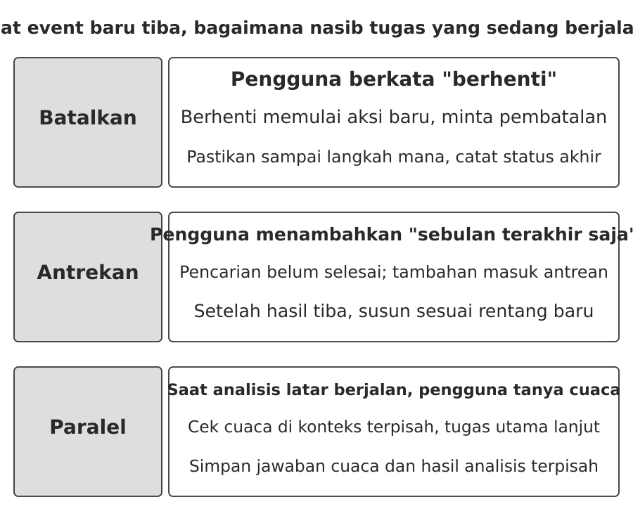

**Penanganan berbasis pembatalan (*Cancellation-Based*)** cocok untuk perintah berhenti dari pengguna atau peristiwa kendali yang harus segera ditangani. *Runtime* lebih dulu berhenti mendistribusikan operasi terkait, mengirim sinyal berhenti ke permintaan yang sedang menghasilkan dan ke alat yang dapat dibatalkan, lalu menyimpan pesan yang sudah selesai, status alat, dan tanda terima pembatalan. Setelah itu, peristiwa baru masuk ke konteks keputusan. Misalnya, ketika pengguna berkata "Berhenti! Saya salah bicara", sistem lebih dulu membatasi eksekusi lanjutan, lalu mengonfirmasi ulang tugas berdasarkan status yang sebenarnya. Butir antrean yang belum diproses tetap menyimpan penanda dan statusnya, lalu diurutkan ulang menurut cakupan keterkaitannya.

**Penanganan berbasis antrean (*Queued*)** cocok untuk informasi tambahan biasa dan pembaruan kemajuan. Peristiwa masuk ke antrean dan diserahkan kepada model bersama hasil alat pada titik aman berikutnya. Misalnya, selama pencarian berlangsung pengguna menambahkan "hanya hasil sebulan terakhir"; setelah pencarian kembali, model membaca hasil dan syarat baru itu sekaligus, lalu memutuskan apakah akan menyaring atau mencari ulang.

**Penanganan paralel (*Parallel*)** cocok untuk permintaan yang tidak bergantung pada tugas utama dan perlu segera dijawab. Misalnya, ketika analisis data berskala besar sedang berjalan dan pengguna menanyakan cuaca, sistem dapat membuka sesi tersendiri untuk menjawabnya.

**Urgensi dan perutean.**

Jenis peristiwa memberi petunjuk awal: `user.interrupt`, instruksi pengawasan yang tepercaya, dan peringatan sistem dapat masuk ke jalur prioritas tinggi; `user.input`, `agent.input`, `tool.result`, dan `timer.trigger` dinilai lebih lanjut berdasarkan isi dan status tugas. Jika pengirim menyebut dirinya "mendesak" di dalam isi pesan, sistem tetap menentukan izinnya berdasarkan identitas yang telah diverifikasi dan aturan yang berlaku.

Untuk keputusan perutean yang memerlukan pemahaman makna pesan, penulis menyarankan model klasifikasi yang ringan: "berhenti sekarang juga" berarti pembatalan, "bagaimana cuaca hari ini" mungkin cocok diproses paralel, dan "tolong tulis laporannya dalam bahasa Mandarin" biasanya masuk ke antrean tambahan untuk tugas saat ini. Pintu berhenti yang tegas ditangani langsung oleh *runtime*, sedangkan klasifikasi semantik dipakai untuk pesan lain yang memerlukan pemahaman.

Model umum juga dapat memberi label pada pesan, tetapi meskipun keluarannya hanya dua kata "perlu ditangani", model tetap harus membaca deskripsi tugas dan isi pesan. Jika setiap pesan baru dinilai seperti ini, biaya pemanggilan akan tumbuh seiring jumlah pesan, dan pesan yang benar-benar mendesak pun harus menunggu label dari model sebelum dapat diteruskan. Jev dari TypeSafe dibuat khusus untuk tugas penilaian dengan pilihan yang sudah ditentukan sebelumnya seperti ini. Diberi satu pesan dan status tugas saat ini, ia dapat memberikan probabilitas untuk setiap pilihan secara paralel dengan biaya dan latensi yang lebih rendah.[^ch6-jev]

Penjarangan ruang observasi yang dibahas di Bab 1 di sini menentukan pesan mana yang memicu satu putaran penalaran baru. Ambil contoh pesan Feishu dan komentar Issue GitHub: program dapat lebih dulu menyaring pemberitahuan duplikat berdasarkan nomor peristiwa, lalu meminta Jev menilai apakah pesan baru itu melengkapi tugas yang sudah ada atau mengajukan permintaan baru yang perlu ditangani model utama. Ketika membaca "melengkapi langkah reproduksi yang disebut kemarin", model cukup menilai bahwa ini adalah keterangan tambahan. Adapun Issue mana yang dilengkapi, program cukup membaca nomor yang sudah melekat pada komentar itu.

Meskipun model memberikan probabilitas yang tinggi, ia tetap bisa melebih-lebihkan keyakinannya. Misalnya, 100 pesan semuanya dinilai "melengkapi tugas yang ada" dengan probabilitas sekitar 90%, padahal hanya 60 yang benar-benar termasuk jenis itu. Jika kelompok pesan ini secara otomatis digabungkan ke tugas yang ada, 40 pesan lainnya akan kehilangan tujuan aslinya.

[^ch6-jev]: Dalam catatan rilis Jev, TypeSafe memperkenalkan keluaran yang telah ditentukan sebelumnya, pengembalian probabilitas secara paralel, serta RLCD, metode pelatihan yang menargetkan kalibrasi keputusan.

### Membangun Siklus Dasar dari Peristiwa Email

Misalkan proses yang menangani email baru tiba-tiba mengalami *restart*. Penanda email dapat membantunya menemukan kembali isi aslinya, tetapi tidak dapat memberitahunya apakah balasan sebelumnya sudah terkirim. Dari masuk antrean, membaca email, memanggil alat, sampai memperbarui kotak surat atau memberi tahu pengguna, sebaiknya setiap operasi tulis dan tanda terima yang dikembalikannya dicatat di bawah email yang sama. Jika setelah *restart* ditemukan permintaan yang sudah dikirim tetapi belum ada tanda terimanya, periksa dulu status sebenarnya di kotak surat, baru putuskan apakah perlu mengirim ulang.

> **Eksperimen 6-1 ★★★: Agent pemroses email berbasis peristiwa**
>
> Eksperimen ini memakai kotak surat uji sebagai pintu masuk untuk berlatih pendaftaran peristiwa, antrean, dan pemrosesan tugas. Pertama, ubah email baru menjadi peristiwa terstruktur dan proses sesuai urutan kedatangannya; kemudian hubungkan alat-alat seperti riwayat email, pembacaan lampiran, kueri pengetahuan, dan pemberitahuan. Ikuti satu undangan rapat di sepanjang Gambar 6-4: temukan dua langkah pemeriksaan bentrok kalender dan penyusunan draf di dalam *event loop*, lalu cari catatan pemrosesan email itu di lapisan persistensi.
>
> 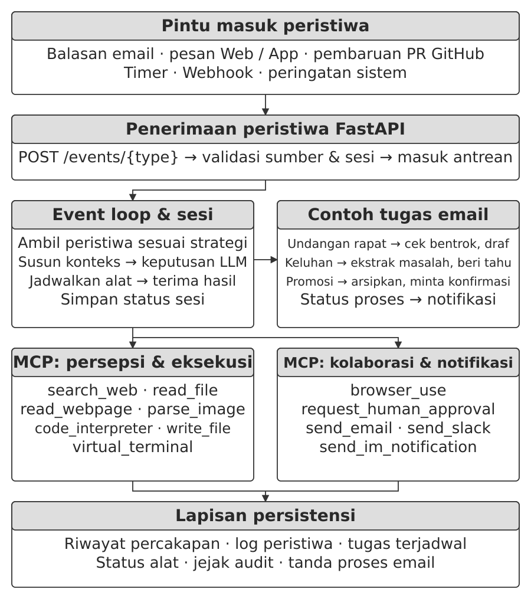
>
> Antrean yang sama dapat diperluas dengan berbagai sumber: email masuk, pesan IM atau SMS, pembaruan PR dan Issue GitHub, *timer*, Webhook eksternal, serta peristiwa internal seperti pengguna luring, proses kehabisan waktu, dan peringatan sumber daya. Setiap adaptor bertugas memverifikasi sumber dan melengkapi informasi keterkaitan, sedangkan hasil pemrosesan ditulis kembali berdasarkan penanda peristiwa.
>
> Penerimaan hasil memakai tiga email uji: undangan rapat memicu pemeriksaan bentrok kalender dan menghasilkan draf menerima atau menolak; keluhan pelanggan memicu ekstraksi informasi kunci, penandaan prioritas tinggi, dan pemberitahuan kepada pengguna; email pemasaran diarsipkan sesuai aturan.
>
> Catatan pendamping saat ini telah menyelesaikan pemeriksaan dokumentasi antarmuka dan pengujian autentikasi; penyambungan kotak surat uji masih menunggu kredensial yang valid.
>
> **Perluasan (opsional): akses multisumber dan injeksi kegagalan.** Selain kotak surat uji, hubungkan satu *endpoint* Webhook lokal dan satu antrean SQS (boleh disimulasikan secara lokal). Setiap adaptor memverifikasi sumber, membuat amplop, dan menulis ke log akses sebelum mengonfirmasi sumber; *runtime* membaca peristiwa dari log dan memprosesnya sesuai urutan *thread*. Kemudian injeksikan tiga jenis kegagalan:
>
> 1. **Pengiriman ganda.** *Endpoint* Webhook menerima dua permintaan dengan ID pengiriman yang sama, tetapi di log hanya muncul satu peristiwa.
> 2. **Mogok sebelum konfirmasi.** Adaptor dihentikan setelah menulis log tetapi sebelum menghapus pesan SQS; setelah pesan terlihat kembali dan dibaca ulang, log tetap hanya berisi satu peristiwa.
> 3. **Mogok sebelum tanda terima.** *Runtime* dihentikan setelah mengirim balasan tetapi sebelum mencatat tanda terimanya, lalu memutar ulang log setelah *restart*. Jika kanal mendukung kunci idempotensi, atau pesan yang sudah terkirim dapat ditelusuri (misalnya catatan terkirim di kotak surat), balasan yang sama tidak dikirim dua kali; untuk kanal yang tidak punya keduanya, balasan itu hanya dapat ditandai sebagai menunggu konfirmasi manusia.
>
> Ketiga jenis kegagalan harus meninggalkan catatan di log: pengiriman mana yang tersaring oleh deduplikasi, pesan mana yang dibaca ulang, dan balasan mana yang tidak dikirim ulang setelah diverifikasi.
>
> Kode pendamping untuk perluasan ini dapat dijalankan secara luring tanpa API Key. Kotak surat uji dan antrean SQS sama-sama disimulasikan dengan berkas lokal, terpisah dari kotak surat sungguhan di atas yang masih menunggu kredensial; antrean simulasi mempertahankan *visibility timeout*, *receipt handle*, dan urutan di dalam grup pesan. Kemogokan dibuat dengan cara proses induk langsung menghentikan proses anak pada posisi yang ditentukan. Setiap jenis kanal balasan diperagakan satu: email memeriksa catatan terkirim, percakapan aplikasi memakai kunci idempotensi, dan SMS tidak punya keduanya. Untuk mereproduksinya, masuk ke `chapter6/agent-with-event-trigger` dan jalankan `python multisource_demo.py`; terminal akan mencetak satu per satu catatan log yang ditinggalkan ketiga jenis kegagalan. Dalam catatan eksekusi pendamping, pemeriksaan ketiga jenis kegagalan semuanya lulus.
>

Antrean email meletakkan dasar pemrosesan berurutan. Berikutnya kita menambahkan alat yang berjalan lama, dan membahas bagaimana menerima permintaan baru, membatalkan tugas, serta memulihkan pekerjaan selama masa tunggu.

### Kompatibilitas ketika Asinkroni Native Tidak Didukung

Misalkan Agent sedang menyusun draf email dan sudah memanggil `search_contacts` untuk mencari kontak. Sebelum hasilnya kembali, pengguna meminta: "Tunggu sebentar, cek dulu cuaca besok." Jika antarmuka model yang dipakai mengharuskan setiap pemanggilan alat dilengkapi hasilnya lebih dulu, Harness perlu mengubah status latar belakang menjadi urutan pesan yang diterima antarmuka tersebut.

**Menyatakan status latar belakang dalam format pesan sinkron.**

**Saat menyesuaikan diri dengan antarmuka sinkron, sedapat mungkin pertahankan pasangan antara pemanggilan normal dan hasil sebenarnya, dan tambahkan respons status hanya ketika tugas berganti di tengah jalan.** Mengisi "masih berjalan" untuk setiap pemanggilan terlalu dini akan memenuhi jejak dengan status yang belum selesai dan menambah beban model untuk melacak hasil yang sebenarnya. Secara konkret, ada lima aturan yang dapat diikuti:

1. **Mencatat pemanggilan yang lengkap.** Tulis pesan assistant yang sudah diselesaikan API beserta butir pemanggilan alatnya ke dalam jejak, dan pertahankan penanda pemanggilannya. Status penalaran di sisi server disimpan menurut cara penyambungan yang ditetapkan penyedia.
2. **Mencatat penyelesaian yang sebenarnya.** Setelah alat selesai, tulis hasil sebenarnya, penanda tugas, dan status eksekusi; selama eksekusi, pengelola tugas terus menyimpan status yang belum selesai.
3. **Melaporkan status saat ini ketika berganti tugas.** Untuk antarmuka yang membolehkan muatan hasil semacam ini, pemanggilan yang belum selesai dapat diberi informasi status yang jelas, misalnya "tugas masih berjalan di latar belakang, hasil belum tersedia", lalu disusul peristiwa dari pengguna. Penanda tugas di dalam respons status menghubungkannya dengan pemberitahuan penyelesaian yang datang kemudian.
4. **Merapikan pesan setelah interupsi.** Jika tidak ada kemampuan untuk menyambung di tengah jalan, batalkan generasi yang belum selesai, pertahankan pesan dan status alat yang sudah dipastikan selesai, lalu kirim permintaan baru. Keluaran yang belum selesai ditangani sesuai ketentuan antarmuka, agar parameter yang baru setengah jadi tidak dianggap sebagai pemanggilan yang dapat dieksekusi.
5. **Menerima peristiwa rutin secara berkelompok.** Informasi tambahan masuk ke antrean, dikirim bersama-sama ketika siklus saat ini berakhir atau pada titik aman yang ditentukan, dan dicatat peristiwa mana yang sudah diproses.

Dalam contoh pencarian kontak, pemanggilan lengkap lebih dulu ditulis ke jejak; ketika pengguna berganti tugas, Harness menambahkan respons status bahwa pencarian masih berjalan, lalu mengirim permintaan cuaca. Hasil kontak tiba belakangan dan masuk ke konteks sebagai peristiwa baru yang membawa sumber dan penanda tugas, kemudian Agent melanjutkan penyusunan draf email. Karena pemanggilan semula sudah mendapat respons status, hasil yang datang kemudian memakai bentuk peristiwa yang disepakati adaptor, sehingga hubungan pasangan antara pemanggilan dan hasil tetap terjaga.

Respons status hanya menjelaskan kemajuan eksekusi saat ini. Langkah yang bergantung pada data kontak harus menunggu hasil sebenarnya tiba sebelum dilanjutkan. Pengelola tugas dapat menyimpan status seperti `running`, `completed`, `cancelled`, dan `failed`, serta memeriksa apakah ketergantungan sudah terpenuhi sebelum mengirim balasan atau menjalankan alat berikutnya.

**Merancang alat asinkron dengan *handle* tugas.**

Untuk alat tugas panjang yang baru dirancang, penulis mengutamakan mendefinisikan "memulai" sebagai satu operasi utuh yang langsung mengembalikan *handle* tugas yang sebenarnya. Dengan itu model dapat membedakan "sudah dimulai" dari "sudah selesai", dan kueri, pembatalan, serta peristiwa hasil berikutnya punya dasar keterkaitan yang seragam. Misalnya, `initiate_phone_call` memulai tugas telepon dan mengembalikan penanda tugas beserta status "sedang memanggil"; `phone_call_connected` dan `phone_call_ended` masing-masing melaporkan tersambung dan berakhirnya panggilan.

Deskripsi alat harus menyatakan dengan jelas: "Alat ini memulai tugas telepon dan mengembalikan ID tugas jika berhasil. Anda dapat terus mengerjakan hal lain; kemajuan panggilan dan hasil akhirnya dikembalikan melalui peristiwa tersendiri." Nama alat menjelaskan bahwa ini adalah operasi memulai, sedangkan struktur kembalian dan peristiwa berikutnya menjelaskan bagaimana tugas berjalan dan berakhir. Sistem juga menyediakan antarmuka untuk kueri, pembatalan, dan pemulihan berdasarkan ID tugas, sehingga model tahu apa saja yang masih dapat dilakukannya.

**Menangani peristiwa berkelompok satu per satu.**

Ketika beberapa peristiwa masuk ke konteks sekaligus, model bisa saja hanya menanggapi yang terakhir dan melewatkan permintaan yang diajukan sebelumnya. *Runtime* perlu menyimpan status pemrosesan masing-masing, agar syarat yang belum ditanggapi tetap terlihat. *Prompt* dapat meminta model memeriksa satu per satu, sementara bilah status mencantumkan informasi yang belum diproses:

```text
[未处理事件 1/4] database_query 结果：……
[未处理事件 2/4] 用户补充：只看北京地区的数据
[未处理事件 3/4] 系统提醒：报告截止时间还有 30 分钟
[未处理事件 4/4] 用户询问：进度如何？
```

Ringkasan kelompok dapat memberi petunjuk "1 hasil alat, 2 pesan pengguna, 1 pengingat sistem". *Runtime* kemudian mengaitkan peristiwa dengan batasan tugas: syarat wilayah memperbarui cakupan kueri, tenggat waktu memengaruhi penjadwalan, dan pertanyaan tentang kemajuan perlu dijawab. Setelah diproses, status selesai, menunggu, atau perlu klarifikasi dicatat, dan butir yang belum terselesaikan tetap dipertahankan pada putaran berikutnya.

Nomor tugas yang sama merangkai permulaan, laporan kemajuan, dan hasil eksekusi akhir. Jika di tengah jalan seseorang meminta penghentian, perlu diperiksa lagi apakah ada tanda terima pembatalan di bawah nomor tersebut.

> **Eksperimen 6-2 ★★★: Agent asinkron dengan eksekusi paralel dan kemampuan interupsi**
>
> Eksperimen ini lebih dulu memverifikasi *runtime* asinkron, baru kemudian menghubungkan model untuk memeriksa keputusannya. Catatan eksekusi pendamping menyelesaikan empat skenario dengan subproses sistem operasi sungguhan, sedangkan penjadwalan peristiwa dan pelaporannya digerakkan oleh skrip deterministik.
>
> 1. **Eksekusi latar belakang dan respons seketika.** Jalankan proses analisis yang berlangsung beberapa detik dan langsung kembalikan penanda tugas; selama menunggu, jawab pertanyaan tentang waktu saat ini, lalu terima hasil analisis setelah selesai.
> 2. **Antrean dan pemrosesan berkelompok.** Selama tugas panjang berjalan, tambahkan berturut-turut "balas dalam bahasa Jepang" dan "susun menjadi halaman web"; setelah tugas selesai, hasilnya diproses bersama kedua permintaan itu sebagai satu kelompok. Skrip menghasilkan HTML berbahasa Jepang.
> 3. **Pembatalan dan pemulihan.** Peragaan ini menunjukkan bahwa ketika menerima "hentikan analisis", sistem menyela giliran model yang masih menghasilkan dan meminta semua tugas latar belakang yang sedang berjalan berhenti. Kali ini interupsi dikirim oleh skrip, dan saat itu hanya ada satu proses analisis, T1. Pada detik ke-0,803, peristiwa interupsi mencatat kemajuan T1 sebesar 18%; baru pada detik ke-0,806 sistem mencatat kode keluarnya −15. T2 yang dimulai sesaat kemudian adalah tugas baru. Yang diterima pada detik ke-4,436 adalah hasil T2; T1 tidak memicu *callback* penyelesaian.
> 4. **Tugas paralel dan keputusan berdasarkan kemajuan.** Jalankan tiga proses analisis sekaligus, yang pada setiap langkah waktu logis masing-masing maju 3%, 2%, dan 1%. Dalam catatan kemajuan paralel eksperimen ini, ketika T1 yang tercepat selesai, tanda terima kueri menunjukkan T2 sudah mencapai 68% dan T3 34%. Mengikuti Gambar 6-5, tugas dengan kemajuan tidak lebih dari 50% dibatalkan. Skrip hanya membatalkan T3, dan pada akhirnya menerima hasil T1 dan T2. Ini menunjukkan bahwa *runtime* yang sama dapat merespons penghentian seluruh kelompok sekaligus mempertahankan pekerjaan paralel yang masih berguna.
>
> 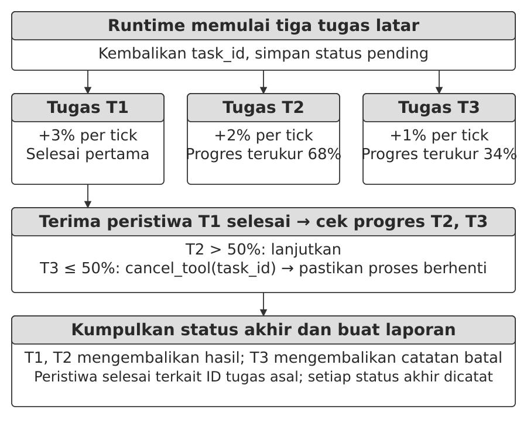
>

### Asinkroni Native pada Model: GPT-6 Astra

Pada solusi sebelumnya, Harness-lah yang menyesuaikan diri dengan format pesan sinkron. Antarmuka asinkron native langsung membolehkan model terus mengerjakan pekerjaan yang berdiri sendiri ketika alat belum kembali, lalu menerima hasilnya kemudian. Per September 2026, GPT-6 Astra telah menyediakan pemanggilan alat asinkron (*Async tool calling*) dan pengarahan di tengah giliran (*Mid-turn steering*), yang masing-masing menangani penantian alat dan pembaruan dari pengguna. Gambar 6-6 membandingkan alur pesan antara penyesuaian antarmuka sinkron dan asinkroni native.[^ch6-22][^ch6-23]

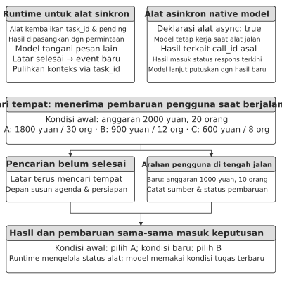

**Terus mengerjakan pekerjaan independen sambil menunggu alat.** Misalnya, setelah memulai kueri tempat rapat, Agent dapat lebih dulu menyusun agenda dan daftar persiapan; setelah kueri kembali, barulah ia membandingkan harga dan kapasitas. `async: true` dalam definisi alat menyatakan kemampuan asinkron; aplikasi mulai mengeksekusi setelah menerima butir pemanggilan yang lengkap dan menyimpan penanda pemanggilan `call_id`. Ketika hasil tiba, aplikasi mengembalikannya dengan penanda semula dan menyambung ke status respons terbaru. Model mengatur pekerjaan berikutnya, sedangkan Harness mengelola keterkaitan pemanggilan dan siklus hidup tugas.[^ch6-22]

**Menerima permintaan baru selama tugas berjalan.** Pengguna dapat menambahkan "anggaran turun menjadi 1000" atau "jumlah peserta diubah menjadi 10" ketika model sedang berpikir atau menyusun jawaban. Aplikasi mengirim peristiwa pengarahan melalui koneksi yang sama; setelah server mengonfirmasi penerimaannya, pemrosesan berlanjut berdasarkan status respons saat ini. Setelah koneksi terputus dan tersambung kembali, aplikasi dapat memulihkan tugas berdasarkan peristiwa dan status respons yang telah disimpan.[^ch6-23]

Kedua kemampuan ini dapat dipakai bersama: kueri tempat terus berjalan, permintaan baru dari pengguna masuk ke keputusan berikutnya, dan pemilihan diselesaikan setelah hasil kueri kembali. Eksekutor sekaligus memelihara status sebenarnya dari tugas latar belakang. Ketika kueri perlu dihentikan atau pemesanan perlu dibatalkan, Harness memanggil antarmuka yang bersangkutan dan memeriksa tanda terimanya; operasi bisnis yang telah selesai masuk ke proses pembatalan atau kompensasi.

Bila model dan antarmuka sudah mendukung asinkroni native, penulis mengutamakan protokol native, sehingga penundaan alat, pembaruan pengguna, dan penyambungan respons mengalir sesuai kesepakatan antarmuka. Lapisan kompatibilitas sinkron terutama melayani model yang sudah ada dan antarmuka lama; setelah model ditingkatkan, logika kompatibilitas yang hanya berfungsi melengkapi pasangan pesan dapat dihapus secara bertahap, dan upaya rekayasa dipusatkan pada status tugas, pembatalan, dan pemulihan.

### Menangani Tugas Asinkron secara Andal

Interaksi asinkron yang andal perlu memeriksa pesan, tugas, dan status eksekusi sekaligus.

1. **Kepemilikan hasil.** Hasil yang tertunda membawa penanda pemanggilan semula, dan aplikasi memetakannya ke tugas yang bersangkutan; keputusan yang bergantung pada hasil itu dilanjutkan setelah datanya tiba.
2. **Pemulihan dan pembatalan.** Setelah pengguna mengubah permintaan, sistem mempertahankan pekerjaan yang masih berlaku, memperbarui langkah-langkah berikutnya, dan menegaskan tugas latar belakang mana yang terus berjalan dan mana yang sudah dihentikan.
3. **Beberapa permintaan sekaligus.** Anggaran, jumlah peserta, wilayah, dan tenggat waktu masing-masing masuk ke status tugas, dan hasil akhir diperiksa terhadap setiap syarat itu satu per satu.

> **Eksperimen 6-3 ★★★: Asinkroni native pada model dan pengarahan di tengah giliran**
>
> Eksperimen ini meminta Agent memilih tempat termurah untuk sebuah rapat simulasi yang memenuhi syarat anggaran dan jumlah peserta. Anggaran awal 2000 dan jumlah peserta 20; alat kueri baru mengembalikan harga dan kapasitas tiga tempat setelah 8 detik.
>
> | Tempat | Harga | Kapasitas |
> |---|---:|---:|
> | A | 1800 | 30 |
> | B | 900 | 12 |
> | C | 600 | 8 |
>
> Dengan syarat awal, pilihan yang benar adalah A. Kelompok pengarahan menerima dua pembaruan selama tugas berjalan: anggaran menjadi 1000 dan jumlah peserta menjadi 10, sehingga pilihan yang benar menjadi B. Alat juga mengembalikan tanda terima yang baru dibuat, dan jawaban akhir harus mengutipnya, agar dapat diperiksa apakah model benar-benar memakai hasil yang tiba.
>
> Eksperimen ini terdiri atas lima kelompok, masing-masing tiga kali: alat sinkron, alat asinkron native, pengarahan selama penalaran, pengarahan selama menunggu alat asinkron, dan model pembanding yang tidak mendukung kemampuan pengarahan. Dua kelompok pertama membandingkan apakah daftar persiapan yang berdiri sendiri dapat dihasilkan selama menunggu; kedua kelompok pengarahan memeriksa apakah anggaran dan jumlah peserta sama-sama diterapkan; pembanding kemampuan memeriksa apakah antarmuka melaporkan dengan jelas bahwa fitur itu tidak didukung.
>
> Dalam catatan eksekusi yang disimpan, kelompok alat asinkron menyelesaikan daftar yang berdiri sendiri selama menunggu, dan kedua kelompok pengarahan sama-sama memilih B sesuai syarat baru. Semua eksekusi yang memakai alat hanya menjalankan satu kueri dan mengembalikan hasil sebenarnya ke pemanggilan semula; antarmuka model pembanding dengan jelas menjawab bahwa ia tidak mendukung penerimaan permintaan baru di tengah satu putaran generasi. Total waktu kelompok sinkron dan asinkron hampir sama; perbedaan utamanya terletak pada apakah pekerjaan lain dapat dimajukan selama menunggu.
>
> Jika model hanya mengingat bahwa jumlah peserta berubah menjadi 10 tetapi tetap memakai anggaran lama 2000, tempat mana yang akan dipilihnya? A dan B sama-sama muat, dan yang termurah tetap B. Karena itu, pilihan tempat yang benar belum menunjukkan apakah anggaran ikut diperbarui.
>
> Jumlah peserta berubah; apakah kueri yang sudah dikirim perlu diulang? Alat dalam eksperimen ini tidak punya parameter penyaringan dan mengembalikan ketiga tempat. Asisten dapat memakai hasil yang sedang dalam perjalanan, lalu menyaringnya untuk 10 orang dengan anggaran 1000 setelah hasil itu kembali. Jika alat hanya mengembalikan tempat berkapasitas 20 orang ke atas, hasil lama hanya berisi A, dan B yang dapat menampung 12 orang sama sekali tidak tercantum. Dalam keadaan itu, sekadar mengubah jumlah peserta menjadi 10 pada daftar lama tetap akan melewatkan B. Jika kueri semula sudah menyaring B, kueri harus dijalankan sekali lagi.

Mekanisme asinkron memungkinkan perubahan dari luar masuk ke sistem selama tugas berjalan. Interaksi suara, layar, dan robot memperpendek siklus umpan balik lebih jauh lagi: sistem perlu menerima masukan terus-menerus dan menyesuaikan keluaran serta tindakannya pada saat yang tepat.

## Suara: Antarmuka Manusia–Mesin yang Paling Alami

Suara memungkinkan pengguna menyampaikan kebutuhan, menambahkan syarat, dan mengonfirmasi hasil kepada Agent ketika tangan atau matanya sedang sibuk dengan pekerjaan lain. Metode input suara mengubah ucapan menjadi teks, sedangkan Agent suara lebih jauh lagi mengelola percakapan, pemanggilan alat, dan pemutaran jawaban; keduanya dapat mendukung *whisper coding* yang diperkenalkan di Kata Pengantar.

Bagian ini membahas dua kegunaan: pengguna berbicara langsung dengan Agent, dan Agent berkomunikasi dengan pihak luar atas nama pengguna. Yang pertama berfokus pada pengenalan, respons, dan sela bicara; yang kedua juga harus menyelesaikan konfirmasi identitas, kueri bisnis, dan pengambilan keputusan selama panggilan berlangsung.

### Waktu Interaksi: dari *Cascade* ke *Full-Duplex*

Dalam perkenalan GPT-Live, OpenAI meninjau tiga jenis interaksi suara: *cascade*, model audio bergiliran, dan *full-duplex*[^ch6-12]. Jalur evolusi ini secara bertahap menyerahkan keputusan "kapan mulai bicara, kapan terus mendengar" kepada penilaian model yang berlangsung terus-menerus. Sistem *cascade* terutama mengatur peralihan giliran dengan logika titik akhir, sedangkan model *full-duplex* dapat menangani tumpang tindih, jeda, dan sela bicara dengan memadukan suara yang kontinu dan status percakapan.

| Paradigma | Struktur inti | Kemampuan yang mudah diwujudkan | Persoalan desain utama |
|---|---|---|---|
| *Cascade* | Pembagian kerja VAD, ASR, LLM, TTS | Modul dapat diganti secara mandiri, masukan dan keluaran dapat diperiksa per tahap | Latensi antarmodul, informasi akustik yang hilang dalam transkripsi |
| Model audio *end-to-end* bergiliran | Model langsung menerima dan menghasilkan audio | Menyusun jawaban dengan memanfaatkan intonasi, emosi, dan informasi sejenis | Penentuan akhir ucapan, peralihan giliran, dan waktu respons |
| *Full-duplex* | Menerima audio dan menghasilkan keluaran secara terus-menerus | Bicara bertumpang tindih, sahutan, sela bicara, dan interaksi berkesinambungan | Status kontinu, kendali keluaran, dan evaluasi interaksi |

Apakah model langsung memproses audio, apakah masukan dan keluarannya *streaming*, dan apakah ia dapat mendengar sambil berbicara adalah kemampuan yang dapat diperiksa secara terpisah. Sistem *cascade* juga dapat ditambahi modul *streaming* dan kendali interupsi; sedangkan irama interaksi model *end-to-end* bergantung pada desain konkretnya.

[^ch6-12]: OpenAI, *Introducing GPT-Live*, 2026-07-08, memperkenalkan *cascade*, model audio bergiliran, dan interaksi *full-duplex*.

### Paradigma 1 · *Pipeline Cascade* (*Cascading*)

Sistem *cascade* memecah percakapan suara menjadi beberapa modul. Deteksi aktivitas suara (VAD) mengenali bagian audio yang berisi ucapan, dan logika titik akhir menentukan kapan potongan itu diserahkan; pengenalan ucapan otomatis (ASR) mengubah audio menjadi teks; LLM memahami permintaan dan menghasilkan jawaban; lalu sintesis suara (TTS) mengubah jawaban itu menjadi audio yang dapat diputar. Gambar 6-7 memperlihatkan struktur dasar yang dijalankan berurutan ini.

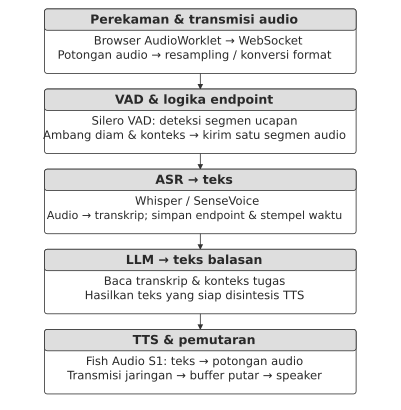

VAD akustik menemukan bagian ketika ada orang berbicara, sehingga pengenalan berikutnya dapat melewati hening yang panjang. Namun, jeda yang sama memiliki arti berbeda bila muncul setelah "Saya mau pesan..." dan setelah "Kamis pagi masih ada tiket?" VAD semantik (deteksi titik akhir semantik) dapat terus merekam pada kasus pertama dan baru menyerahkan ucapan kepada model percakapan pada kasus kedua. Inilah penjarangan observasi suara dalam dimensi waktu: suara yang kontinu hanya memicu penalaran pada segelintir saat. Adapun apakah perlu mulai berbicara, keputusannya ada pada model yang mendengar kalimat itu; ia juga bisa terus mendengarkan, atau lebih dulu mencari penerbangan.

| Modul | Fungsi | Sumber tunggu atau kesalahan yang umum |
|---|---|---|
| VAD dan logika titik akhir | Mendeteksi ucapan, menentukan waktu penyerahan | Ambang hening, derau, dan jeda di tengah ucapan |
| ASR | Mengubah audio menjadi teks | Waktu dekode, pengenalan nama orang dan nama diri |
| LLM | Memahami, menalar, dan menghasilkan jawaban | Antrean permintaan, pembuatan potongan jawaban pertama |
| TTS dan pemutaran | Menyintesis audio dan mengirimkannya ke pengeras suara | Sintesis paket pertama, transmisi jaringan, dan *buffer* pemutaran |

Dalam implementasi yang sepenuhnya serial, setelah pengguna selesai berbicara, ia masih harus menunggu konfirmasi titik akhir, transkripsi, pembuatan jawaban, dan potongan audio pertama secara berturut-turut. Dalam contoh Gambar 6-8, ketika pengguna mendengar suara jawaban pertama, 1,4 detik sudah berlalu, dan bagian terpanjangnya adalah menunggu sistem memastikan bahwa pengguna sudah selesai berbicara (500 milidetik). Bahkan jika transkripsi dipersingkat dari 100 menjadi 50 milidetik, pengguna hanya menunggu 50 milidetik lebih sedikit.

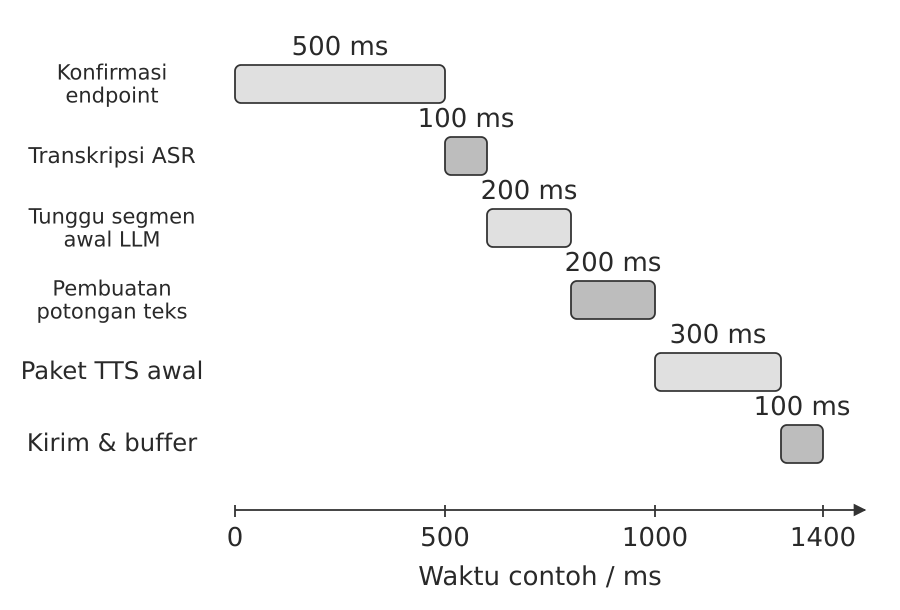

Beban layanan juga menimbulkan waktu antre. Gambar 6-9 memakai model M/M/1 dengan satu loket layanan untuk menjelaskan hubungan ini: kedatangan mengikuti proses Poisson, waktu layanan mengikuti distribusi eksponensial, rata-rata waktu layanan $S$, dan ketika utilisasi $\rho<1$, rata-rata total waktu termasuk layanan dan antrean adalah $W=S/(1-\rho)$. Dengan $S=1$ detik, jika utilisasi naik dari 0,5 menjadi 0,8, rata-rata total waktu naik dari 2 detik menjadi 5 detik. Layanannya sendiri tetap rata-rata 1 detik; tambahan 3 detik seluruhnya habis untuk mengantre. Ketika permintaan mendekati kapasitas pemrosesan, fluktuasi lalu lintas jangka pendek akan menimbulkan tumpukan.

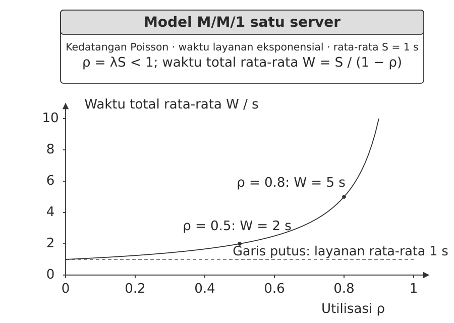

> **Eksperimen 6-4 ★: Membangun Agent suara tradisional**
>
> Misalkan asisten sedang membacakan penerbangan hari Kamis, lalu Anda memotong untuk mengoreksi: "Tunggu, saya mau pesan untuk hari Jumat." Peramban mengirim audio mikrofon ke *backend* melalui WebSocket. Begitu Silero VAD mendeteksi Anda mulai berbicara, *backend* mengirim `speech_start`, dan peramban segera menghentikan pemutaran serta mengosongkan audio lama yang masih antre. Pada saat ini asisten belum tahu hari apa yang Anda ubah. Setelah Anda selesai berbicara dan hening melewati batas bawaan 500 milidetik, barulah *backend* mengirim `speech_end` dan menyerahkan potongan ucapan itu kepada Whisper tiny lokal untuk ditranskripsikan.
>
> Ketika Doubao mulai mengembalikan teks, berapa lama lagi sampai pengguna mendengar jawabannya? Dalam catatan satu putaran pemutaran ulang rekaman, transkripsi memakan 2,710 detik. Doubao mengembalikan token pertama 0,749 detik setelah permintaan dikirim, dan baru mengembalikan jawaban lengkap pada 0,792 detik. Program pemutar ulang menunggu sampai seluruh teks terkumpul sebelum menyerahkannya kepada Fish S1 untuk disintesis; 2,819 detik kemudian, *backend* menerima kelompok audio pertama. Dihitung sejak titik akhir ditetapkan, jumlah ketiga durasi serial ini sekitar **6,321 detik**. Laporan arsip mencatat 6,279 detik, karena memakai waktu token pertama sebagai pengganti waktu pembuatan seluruh jawaban.
>
> Angka 6,321 detik ini hanya mencakup pemrosesan di *backend*. Sebelumnya pengguna masih harus menunggu deteksi hening memastikan bahwa satu kalimat sudah selesai, dan pada akhirnya masih harus menunggu audio sampai ke peramban dan mulai diputar.

#### Dari Serial ke Persepsi *Streaming*

Skema serial memudahkan pemeriksaan per tahap, tetapi juga memperlihatkan tiga masalah. Menunggu hening menambah latensi titik akhir; teks transkripsi dapat kehilangan nada, emosi, dan suara lingkungan; dan ketika audio dipotong berdasarkan jeda, alamat email, nama orang, atau nama diri dapat kehilangan konteks utuhnya. Untuk sistem yang sudah memakai arsitektur *cascade*, penulis menyarankan perombakan *streaming* lebih dulu: biarkan setiap tahap memberikan hasil inkremental sedini mungkin, tumpang-tindihkan pengenalan, penalaran, dan pemutaran, sambil memelihara bagian yang sudah dipastikan dan bagian yang masih mungkin berubah. Dengan cara ini modul yang ada dapat dipakai ulang, dan sumber waktu tunggu dapat ditemukan secara bertahap.

- **ASR mentranskripsi sambil mendengar.** Audio diterima terus-menerus dan transkrip sementara dikeluarkan; setelah audio berikutnya tiba, bagian yang belum stabil direvisi, dan teks final diberikan ketika titik akhir dipastikan.
- **Eksekusi spekulatif LLM.** Transkrip sementara dipakai untuk menyiapkan jawaban lebih awal. Setelah teks final dipastikan, periksa apakah masukannya sama dan apakah pekerjaan yang sudah ada masih berlaku, lalu putuskan untuk mempertahankan, menyesuaikan, atau menghasilkan ulang. Operasi seperti pengiriman keluar dan penulisan bisnis menunggu sampai syarat yang diperlukan dipastikan.
- **Keluaran LLM per segmen.** Begitu satu potong teks yang layak dibacakan selesai, potongan itu langsung diserahkan ke TTS; pemotongan segmen mempertahankan makna kalimat, tanda baca, dan petunjuk intonasi.
- **Sintesis TTS inkremental.** Potongan audio dikembalikan sedikit demi sedikit, sehingga pembuatan teks berikutnya, sintesis, dan pemutaran dapat bertumpang tindih. Ketika terjadi sela bicara, tugas pembuatan dan isi *buffer* pemutaran yang belum diputar ditangani sekaligus.

Implementasi transkripsi standar Whisper mengodekan dan mendekode audio per jendela[^ch6-whisper]. Dengan memotong audio dari luar atau berulang kali mengirim prefiks yang terus bertambah, alur transkripsi inkremental dapat dibangun; pemakaian ulang status yang berkesinambungan, biaya pengodean berulang, dan revisi teks sebelumnya harus dikelola oleh implementasi itu sendiri. Model pengenalan *streaming* native menangani masukan kontinu langsung di dalam arsitektur dan pelatihannya.

Sistem persepsi berbasis model bahasa audio juga dapat mengeluarkan teks dan peristiwa akustik secara bersamaan. Audio sebelumnya, transkrip, dan petunjuk kosakata membantu mengenali nama orang, merek, dan nama diri, sedangkan seberapa banyak riwayat yang disimpan bergantung pada desain konteks dan *cache*. Untuk menilai "apakah pengguna sudah selesai berbicara", model dapat memadukan kelengkapan semantik dengan hening. Pada jeda setelah "Saya mau pesan...", sistem waktu nyata baru mendengar tiga kata itu dan belum mungkin tahu bahwa sesudahnya akan menyusul tanggal.

Selain transkripsi, antarmuka juga dapat menyepakati peristiwa berikut: `speak_start` dan `speak_end` menandai awal dan akhir ucapan, `interrupt` menandai sela, `emotion` menggambarkan keadaan emosi, sedangkan `laugh`, `sigh`, dan `noise` mencatat tawa, helaan napas, dan suara lingkungan. Peristiwa-peristiwa ini dapat dikirim kepada Agent bersama teks dan cap waktunya.

> **Eksperimen 6-5 ★: Menyimulasikan persepsi suara *streaming* dengan Qwen2-Audio**
>
> Eksperimen ini memperbesar prefiks audio secara bertahap, dan setiap kali mengirim ulang audio dari awal sampai saat ini ke Qwen2-Audio, untuk mengamati bagaimana transkripsi dan peristiwa akustik berubah seiring masukan. Jalur pembanding memakai titik akhir hening 600 milidetik dan Whisper. Pengujian mencakup ucapan normal, kalimat panjang yang disisipi jeda 900 milidetik, dan ucapan yang dicampur derau merah muda.
>
> Eksekusi model terkuantisasi lokal kali ini menyimpan 13 kali inferensi prefiks, masing-masing sekitar 8–11 detik. Jeda di tengah kalimat memicu pemotongan segmen pada jalur pembanding; model audio mendeteksi derau, tetapi juga salah melaporkan batuk dan tawa.

[^ch6-whisper]: OpenAI, Whisper, memperkenalkan transkripsi per jendela audio dan implementasi modelnya.

### Paradigma 2 · Model Omnimodal *End-to-End* (Omni)

Model audio *end-to-end* langsung menerima suara, memadukan informasi bahasa dan akustik untuk menghasilkan jawaban, dan menyintesis ucapan melalui cabang keluaran audio. Memproses audio secara langsung memungkinkan pemanfaatan kecepatan bicara, tinggi nada, jeda, dan suara lingkungan; sedangkan mentranskripsi dulu baru menjawab memudahkan pemeriksaan teks antara dan penggantian modul secara mandiri.

Ciri-ciri akustik ini memengaruhi pemahaman. Misalnya, kalimat yang sama, "Tolong kirim laporannya sebelum makan siang", memberi kesan berbeda kepada pendengar bila diucapkan tergesa-gesa atau perlahan. Saat menghasilkan keluaran, model juga dapat menata makna melalui jeda, tekanan, dan intonasi.

Sistem yang memproses audio secara langsung juga dapat menunggu pengguna selesai berbicara sebelum menjawab. Misalnya, ketika pengguna menyebutkan nomor telepon lalu berhenti sejenak, sistem tetap harus menilai apakah deretan angka itu sudah selesai disebutkan. Deteksi titik akhir menentukan kapan menjawab; jika lawan bicara menyela di tengah pembacaan, sistem juga harus mengoordinasikan pembuatan oleh model dengan pemutaran di pengeras suara.[^ch6-audio-architectures]

> **Eksperimen 6-6 ★★: Menjalankan MiniCPM-o 4.5 secara lokal, membandingkan *end-to-end* dengan *self-cascade***
>
> Eksperimen ini memakai satu model MiniCPM-o 4.5 yang sama dengan mode berpikir dimatikan, lalu membandingkan dua jalur: menjawab pertanyaan langsung dari audio, dan meminta model mentranskripsi dulu lalu menjawab hanya berdasarkan transkrip. Masukannya berupa dua soal hitungan yang diucapkan dan dua rekaman dengan teks yang sama tetapi kecepatan bicara berbeda.
>
> Masing-masing jalur menjawab tiga soal dengan benar, tetapi kesalahannya terjadi di tempat yang berbeda. Jalur audio langsung mendengar twelve boxes dalam satu soal sebagai 8 sehingga perhitungannya salah; jalur transkripsi dengan benar mempertahankan 12. Pada soal kecepatan bicara, kedua rekaman sama-sama berbunyi "Please send the report before lunch.", sehingga teks hasil transkripsinya persis sama dan informasi cepat-lambat ikut hilang; jalur audio langsung dengan benar membedakan kedua kecepatan bicara itu.
>
> Eksperimen ini juga menghasilkan satu potong ucapan 24 kHz yang menghubungkan pemahaman masukan dengan keluaran audio.

### Paradigma 3 · Model Interaksi *Full-Duplex*

Sistem *full-duplex* mendengar sambil berbicara, dan perbaikan yang paling mudah dirasakan orang adalah "rasa manusia hidup" dalam percakapan. Coba baca kalimat "Mau pesan hari Rabu... eh, bukan, tiket hari Kamis": jeda di tengahnya memberi ruang bagi koreksi diri ini; jika asisten sudah mulai membacakan penerbangan hari Rabu, ia harus berhenti begitu mendengar "bukan, Kamis". Pada momen lain, ketika lawan bicara masih menjelaskan rencana perjalanannya, satu sahutan singkat dapat memberitahunya bahwa asisten sedang mendengarkan. Hanya dengan menerima audio terus-menerus, sistem punya peluang membuat pilihan-pilihan ini di antara berbicara, mendengarkan, berhenti sejenak, dan memanggil alat. Penerjemahan simultan pun memerlukan masukan dan keluaran yang bertumpang tindih.

**Moshi** yang dirilis Kyutai pada 2024 memodelkan aliran audio pengguna dan aliran audio model secara terpisah, dan menyatakan bicara bertumpang tindih serta interupsi melalui aliran paralel[^ch6-moshi]. Dengan mempertahankan hubungan waktu ini di dalam masukan, model dapat belajar kapan menjawab dan kapan terus mendengarkan.

Model interaksi dari Thinking Machines Lab memotong masukan dan keluaran yang kontinu menjadi blok-blok pendek dengan panjang sama, masing-masing mencakup 200 milidetik, yang disebut satu giliran mikro (*micro-turn*)[^ch6-14]. Lihat kotak kedua di sepanjang sumbu waktu Gambar 6-10: asisten masih mengucapkan "Kamis", tetapi telinganya sudah menangkap "bukan" dari pengguna yang mengoreksi tanggal. Pada kotak ketiga, asisten berhenti dan tetap mendengarkan pengguna menyelesaikan kata "Jumat".

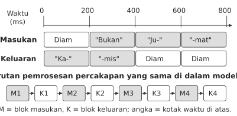

Sekarang baca bagian bawah gambar. Kedua pihak dalam panggilan mendengar dua aliran suara yang dapat bertumpang tindih, tetapi model dapat memproses blok masukan dan menghasilkan blok keluaran secara bergantian di sepanjang satu urutan. Hening juga menempati satu kotak, sehingga asisten dapat mendengarkan sebentar sebelum mulai berbicara. Angka 200 milidetik dalam gambar adalah panjang blok pada implementasi ini; dari saat pengguna menyela sampai pengeras suara benar-benar berhenti, waktu pemrosesan dan *buffer* pemutaran juga harus diperhitungkan.

[^ch6-moshi]: Kyutai, *Moshi: a speech-text foundation model for real-time dialogue*, 2024, memperkenalkan aliran audio paralel untuk pengguna dan model.
[^ch6-14]: Thinking Machines Lab, *Interaction Models: A Scalable Approach to Human-AI Collaboration*, memperkenalkan giliran mikro, interaksi multialiran, dan pendelegasian tugas latar belakang.

### Waktu Kognitif: Interaksi Waktu Nyata dan Pemikiran Mendalam

Dalam panggilan layanan pelanggan Pine, ketika petugas baru berbicara setengah kalimat, asisten kadang harus menunggu, kadang harus menyahut pelan; ketika ia sendiri sedang berbicara, ia juga harus mendengar koreksi yang diselipkan lawan bicaranya. Inilah alasan penulis menaruh harapan pada jalur Moshi: hanya bila waktunya dikuasai dengan baik, lawan bicara merasa benar-benar ada orang yang mendengarkan di ujung telepon. Ketika menghadapi permintaan yang memerlukan pencarian data, ada hitungan waktu lain yang harus dibuat: dari memahami pertanyaan sampai menyebutkan jawaban yang ditemukan, berapa kali pekerjaan harus berpindah tangan?

Alat yang dapat dipanggil langsung oleh model suara sisi depan dipanggil oleh sisi depan. Mencari penerbangan hanya memerlukan dua pemanggilan model: sisi depan mencari berdasarkan syarat dari pengguna, lalu melaporkan hasilnya. Pendelegasian memerlukan empat: sisi depan menyerahkan tugas, sisi belakang menjalankan kueri, sisi belakang merapikan hasil, dan sisi depan menyampaikannya kembali. Ada pula pandangan lain bahwa model waktu nyata bisa salah mengisi parameter, sehingga alat sebaiknya dipanggil oleh sisi belakang, dan sisi depan dapat berkonsentrasi menilai kapan mendengar dan kapan berbicara.

Sisi depan GPT-Live-1 tidak punya antarmuka untuk memanggil fungsi bisnis secara langsung dan hanya dapat mendelegasikan kepada Agent sisi belakang. GPT-Realtime pada OpenAI Realtime mendukung pemanggilan fungsi langsung dari sisi depan. Model suara waktu nyata Doubao 3.0 (Seeduplex) juga mendukung pemanggilan langsung dari sisi depan dalam mode *end-to-end* murni, sedangkan dalam orkestrasi campuran pemanggilan dilakukan oleh model bahasa eksternal.[^ch6-voice-tools]

Misalkan setiap pemanggilan model sisi depan dan sisi belakang masing-masing memakan waktu $L_f$ dan $L_b$, dan waktu alat adalah $T$. Dari pengguna selesai berbicara sampai mendengar hasil, pemanggilan langsung memerlukan sekitar $2L_f+T$, sedangkan pendelegasian sekitar $2L_f+2L_b+T$. Tambahan $2L_b$ pada pendelegasian tidak bergantung pada waktu alat $T$. Informasi yang mungkin dipakai setiap giliran, seperti memori pengguna, dapat dicari lebih dulu oleh *runtime* lalu dimasukkan ke konteks, sehingga sisi depan cukup memanggil model sekali, sekitar $L_f+T$; jika sudah dicari sebelum pengguna mulai berbicara, $T$ pun dapat dihemat.

Tugas yang memerlukan penalaran bertahap, misalnya membandingkan beberapa opsi perubahan jadwal, cocok diserahkan ke sisi belakang. Pemesanan tiket melibatkan penarikan dana dan penerbitan tiket, sehingga siapa pun yang memanggil alat, pesanan harus menunggu konfirmasi pengguna. Hasil penerbangan dapat diringkas secara lisan, sedangkan tabel lengkapnya ditampilkan di layar; hal ini tidak bergantung pada siapa yang memanggil alat.

> **Eksperimen 6-7 ★★: Alat Agent suara dipanggil oleh sisi depan atau sisi belakang**
>
> Bangun sisi depan dengan model suara waktu nyata Doubao 3.0, dan sisi belakang dengan DeepSeek V4 Pro yang disediakan Volcano Ark. Siapkan lima alat tiruan: cek cuaca, cek memori pengguna, pencarian web, cek penerbangan, dan pemesanan tiket, yang mengembalikan hasil sesuai waktu yang ditetapkan; cek penerbangan dan pemesanan tiket harus menunggu 2–5 detik. Sintesis rekaman pengguna lebih dulu, dan setiap kali putar ulang rekaman yang sama untuk skenario yang sama.
>
> Siapkan empat pembagian kerja. Pertama, sisi depan memanggil semua alat. Kedua, sisi belakang memanggil semua alat dan sisi depan hanya dapat mendelegasikan. Dua sisanya sama-sama membiarkan sisi depan mengecek cuaca, *runtime* memasukkan memori pengguna ke konteks saat sesi dimulai, dan sisi belakang menangani pencarian web dan pemesanan tiket. Perbedaan keduanya terletak pada apakah cek penerbangan ditangani sisi depan atau sisi belakang. Sisi depan langsung mendengar suara pengguna; sisi belakang tidak mendengar suara dan hanya dapat membaca teks. Setelah mendengar setiap kalimat pengguna, antarmuka Doubao juga mengembalikan teks hasil pengenalan ucapan, yang disebut transkrip. Saat mendelegasikan, transkrip dan ucapan asisten disusun menurut urutan waktunya menjadi catatan panggilan, lalu diserahkan ke sisi belakang bersama pemanggilan alat yang sudah dijalankan dalam panggilan ini dan deskripsi tugas yang ditulis sisi depan. Untuk setiap pembagian kerja, ulangi pengujian setiap skenario berikut sebanyak 10 kali.
>
> 1. Cek cuaca dan cek penerbangan secara terpisah. Hitung waktu sejak pengguna selesai berbicara sampai hasil kueri terdengar; kalimat peralihan seperti "saya cek dulu" tidak dihitung sebagai jawaban. Bandingkan median waktu tunggu pemanggilan langsung dan pendelegasian. Dalam eksperimen penulis, untuk cek cuaca keduanya masing-masing 2,81 detik dan 6,96 detik.
> 2. Cek penerbangan dulu, lalu pilih tiket dan konfirmasi. Dengan mengacu pada hasil kueri putaran sebelumnya, ucapan terakhir pengguna, dan profil pengguna, periksa satu per satu 13 kolom pemesanan, dan periksa apakah waktu pemesanan lebih lambat daripada konfirmasi pengguna. Dalam eksperimen penulis, keempat pembagian kerja mengisi semua kolom dengan benar, dan semuanya baru memesan setelah pengguna mengonfirmasi.
> 3. Ganti menjadi memesan tiket untuk seorang rekan kerja, dan putar rekaman yang mengeja namanya secara lisan: "陈嘉怡，耳东陈，嘉奖的嘉，怡然的怡。" (nama Chen Jiayi, diikuti penjelasan aksara untuk setiap suku katanya). Bandingkan rekaman, transkrip ucapan, dan nama pada pesanan, lalu periksa apakah pemesanan langsung oleh sisi depan maupun pemesanan yang didelegasikan sama-sama mengisi nama dengan benar. Dalam eksperimen penulis, pemesanan langsung oleh sisi depan benar 10 kali dari 10; tetapi transkripnya tertulis "陈佳宜" (lafal sama, aksara berbeda), sehingga sebagian pesanan yang didelegasikan salah mengisi nama.
> 4. Sebelum hasil kueri penerbangan kembali, putar rekaman yang menanyakan cuaca, lalu dengarkan apakah sisi depan menjawab pertanyaan cuaca itu dan apakah sesudahnya ia menyampaikan hasil penerbangan. Dalam eksperimen penulis, pertanyaan cuaca selalu dijawab, tetapi hasil penerbangan semula hampir tidak pernah disampaikan lagi.

Ketika pendelegasian diperlukan, sisi depan sebaiknya menuliskan nama, angka, dan koreksi terbaru pengguna yang sudah pasti ke dalam deskripsi tugas, agar sisi belakang tidak salah mengisi parameter karena kesalahan transkripsi. *Runtime* sebaiknya mencatat hasil yang belum disampaikan, sehingga sisi depan dapat melanjutkan laporannya setelah menjawab pertanyaan sela.

Ketika model cepat mengucapkan "saya cek dulu", petugas layanan pelanggan tahu bahwa asisten sudah mendengar permintaannya dengan jelas. Kapan harga tiket dapat disebutkan bergantung pada bagaimana kueri dan penalaran dipadukan dengan panggilan. Gambar 6-11 memperlihatkan tiga pengaturan: menanggapi dulu lalu menjawab secara mendalam, sisi depan terus berinteraksi sambil menerima saran dari sisi belakang, dan penyusunan gagasan berjalan paralel dengan pengucapan per potongan.

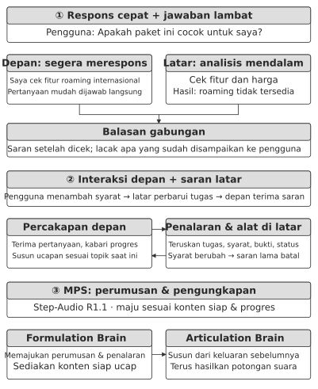

#### Solusi 1: Berpikir Cepat untuk Menanggapi, Berpikir Lambat untuk Menjawab

Model cepat lebih dulu memberikan tanggapan singkat, model lambat menyelesaikan analisis di latar belakang, lalu melengkapinya dengan jawaban terperinci. Desain ini dapat sedini mungkin menegaskan bahwa permintaan sudah diterima, tetapi konsistensi kedua jawaban perlu dikelola. Misalnya, model cepat lebih dulu menyarankan pembelian sebuah paket, lalu model lambat menemukan bahwa paket itu tidak memiliki fitur kunci, sehingga kedua saran saling bertentangan. Akar konfliknya adalah kedua sisi menjawab secara independen, dengan dasar penilaian dan kemajuan penalaran yang mungkin berbeda. Saran yang sudah diucapkan model cepat telah masuk ke pertimbangan pengguna, bahkan mungkin sudah ditindaklanjuti; ketika model lambat kemudian mengoreksinya, perubahan itu perlu dijelaskan dan dampak yang sudah terjadi perlu ditangani.

Karena itu, sisi depan perlu membedakan konfirmasi tugas dari kesimpulan bisnis. "Saya periksa dulu apakah paket ini mencakup fitur tersebut" dapat langsung diucapkan, sedangkan saran pembelian menunggu kueri dan analisis yang diperlukan. Ketika hasil dari sisi belakang kembali, sistem mencocokkannya dengan apa yang sudah diucapkan, lalu menyusun jawaban berikutnya. Pertanyaan sederhana juga dapat langsung diselesaikan oleh model cepat untuk mengurangi pemrosesan ganda.

#### Solusi 2: Berpikir Cepat untuk Berinteraksi, Berpikir Lambat untuk Mengingatkan

Suara dan layar pun dapat berbagi tugas. Mengucapkan "Tagihan bulan ini bertambah 15 euro untuk biaya *roaming*" membuat pengguna langsung menangkap intinya; jumlah semula, harga sekarang, dan rincian yang dipersoalkan dibiarkan di layar, agar pengguna dapat memeriksanya dengan kecepatannya sendiri. Konfirmasi atas satu operasi tertentu dapat dilakukan dengan mengetuk pilihan, sedangkan informasi sensitif diisi sendiri oleh pengguna di antarmuka masukan yang diakui pedagang. Sisi depan cukup menerima status seperti "verifikasi selesai" untuk dapat menyambung kembali percakapan secara wajar.

Misalkan seorang pelancong meminta Pine memesan tiket pesawat ke Shanghai untuk Kamis pagi, dengan anggaran 1200 yuan, dan ia harus tiba di tempat acara sebelum tengah hari. Sambil berbicara dengan layanan pelanggan maskapai, Pine "menyelipkan catatan" ke sisi belakang: "Jika mendarat di Hongqiao pukul sepuluh pagi, apakah masih sempat dari bandara ke tempat acara?" Setelah mengecek kursi yang tersisa, petugas memberi tahu Pine: "Penerbangan yang tiba di Hongqiao pukul sepuluh sudah habis. Masih ada satu penerbangan yang tiba di Pudong pukul setengah sebelas, harganya 1250 yuan." Jika sisi belakang hanya dapat melihat catatan yang diselipkan sisi depan, ia masih menghitung rute dari Hongqiao. Sisi depan harus menambahkan satu kalimat lagi: "Ganti hitungannya ke Pudong, mendarat pukul setengah sebelas, tempat acara dan jam kedatangan tetap."

Cara lain adalah menyinkronkan catatan panggilan ke sisi belakang menurut urutannya juga. Karena sisi belakang sudah membaca bandara dan waktu pendaratan yang disebutkan petugas dari catatan panggilan, sisi depan cukup berkata "hitung apakah penerbangan ini masih sempat" untuk mendelegasikan tugas yang sama. Saat menyinkronkan catatan, perlu ditandai siapa mengatakan apa; setengah kalimat sisi depan yang terpotong dan belum sempat diputar juga harus dibedakan dari yang sudah diucapkan. Transkripsi suara bisa melewatkan atau salah menulis informasi penting. Sisi depan perlu menuliskan nama, angka, dan koreksi pengguna yang sudah didengarnya dengan pasti ke dalam deskripsi tugas. Bila kedua catatan tidak sesuai, sisi belakang berpegang pada deskripsi tugas. Setelah selesai mengecek, sisi belakang cukup memberi tahu sisi depan perkiraan jam tiba di tempat acara dan seberapa mepet waktunya. Rute mana saja yang dicek di sepanjang jalan dan kolom apa saja yang dikembalikan antarmuka peta dapat disimpan di sisi belakang sebagai arsip. Sisi depan-lah yang membawa hasil itu untuk melanjutkan pembicaraan dengan petugas.

Pelancong bisnis di Bab 1 ingin harga tiket tidak melebihi 1200 yuan. Pada perjalanan dinas sebelumnya, ia rela membayar sedikit lebih mahal untuk penerbangan yang cocok, dan kali ini ia juga tidak menetapkan batas atas lain. Mendengar harga terendah 1250 yuan, asisten dapat memesannya atas namanya. Lain halnya jika penggunanya adalah orang yang selalu berhemat dan sedang berlibur bersama keluarga: selisih 50 yuan ini harus ditanyakan dulu. Maka sisi depan harus menangani dua percakapan sekaligus:

- Kepada pengguna: "Penerbangan ini paling murah 1250 yuan, 50 yuan di atas anggaran. Apakah Anda bersedia memesannya?"
- Lalu bertanya kepada petugas: "Bisakah harga penerbangan ini ditahan sebentar? Pada hari yang sama, apakah ada penerbangan yang sedikit lebih siang dengan harga di bawah 1200 yuan?" Selama petugas mengecek tiket, sisi depan juga dapat menanyakan jatah bagasi dan ketentuan perubahan atau pengembalian tiket.

Dengan begitu, ketika pengguna kembali, ia dapat melihat beberapa pilihan, dan petugas pun tahu apa yang harus dicek berikutnya. Jika kemudian pengguna menjelaskan, "Waktu itu saya buru-buru mengejar rapat; ke depan, kalau perjalanan dinas melebihi anggaran, tanyakan saya dulu", maka lain kali permintaan baru itulah yang harus diikuti.

Ketika menunggu verifikasi dari pemilik akun sendiri, irama pembicaraan berbeda lagi. Jika petugas berkata kode verifikasi sudah dikirim, sisi depan dapat menjawab: "Baik, mohon tunggu sebentar, saya minta pelancong memeriksa ponselnya." Jika pelancong membalas bahwa kodenya belum diterima, barulah ditanyakan kepada petugas ke nomor berakhiran berapa SMS itu dikirim dan kapan dapat dikirim ulang. Setelah pelancong menyelesaikan verifikasi melalui kanal yang ditentukan pedagang, sisi depan dapat melanjutkan urusannya. Dalam panggilan seperti ini, menunggu sedikit lebih lama atau menerbitkan tiket sedikit lebih lambat jauh lebih tepat daripada mendesak pengguna untuk memutuskan saat itu juga.

Pada saat itu, sisi belakang mengirim pesan "penawaran semula sudah diperbarui". Sisi depan lebih dulu memverifikasi harga baru kepada petugas, baru kemudian memberi tahu pengguna. Jika tepat pada saat itu pengguna membalas "boleh dipesan", balasan itu merujuk pada penawaran 1250 yuan yang dikirim kepadanya sebelumnya. Sisi depan harus menilai, berdasarkan harga baru dan otorisasi yang sudah ada, apakah perlu meminta konfirmasi lagi. Sisi belakang hanya menyediakan informasi; yang berbicara dengan petugas dan membuat janji tetaplah sisi depan. Dengan menyertakan penerbangan, syarat berlakunya harga, dan waktu pada setiap pesan, sisi depan dapat mengenali penawaran mana yang sudah kedaluwarsa.

Pesan sisi belakang yang sama, "harga berubah, mohon diverifikasi", juga memengaruhi cara sisi depan menanggapi, tergantung kapan pesan itu tiba. Jika petugas baru berkata "harga tiket terendah adalah...", sisi depan dapat mendengarkan jumlahnya sampai selesai. Jika petugas sudah selesai menyebutkan harga dan sedang menunggu jawaban, saat itulah tepat untuk menanyakan harga baru. Jika pelancong baru saja menyela di telepon, "Tunggu, saya mau ganti tanggal", dengarkan dulu tanggal barunya dengan jelas, baru putuskan apakah penerbangan semula masih perlu diverifikasi. Kata "baik" yang sama, bila diucapkan ketika petugas menjelaskan ketentuan, mungkin hanya berarti sedang mendengarkan; bila diucapkan setelah "Saya terbitkan tiketnya sekarang?", kata itu bisa ditangkap sebagai persetujuan membeli. Jika hanya melihat teks transkrip, perbedaan seperti ini akan terlewat.

#### Solusi 3: Penyusunan Gagasan dan Pengucapan Bergerak Bersama

Seri Step-Audio memberikan dua contoh yang relevan. **Distilasi penalaran berjangkar modalitas (MGRD)** berfokus pada informasi yang menjadi dasar penalaran: data penalaran disusun dan disaring dengan berpusat pada ciri akustik seperti tinggi nada, ritme, dan intonasi, lalu pemahaman audio diperbaiki melalui distilasi iteratif. Pada tahap pembelajaran penguatan, Step-Audio R1 memberi dua komponen skor untuk soal audio: jawaban benar mendapat 0,8 poin, dan menyertakan proses penalaran mendapat tambahan 0,2 poin. Komponen kedua mendorong model menuliskan dasar penalarannya; apakah penalaran itu benar-benar memakai petunjuk akustik dari rekaman harus diperiksa pada penyaringan sampel sebelumnya.[^ch6-mgrd]

**Mind-Paced Speaking (MPS)** berfokus pada urutan waktu antara penalaran dan pengucapan, dengan memakai modul penyusunan gagasan (*Formulation Brain*) dan modul pengucapan (*Articulation Brain*), sehingga proses penyusunan gagasan memandu pembuatan ucapan. Solusi waktu nyata Step-Audio R1.1 memakai metode ini.[^ch6-mps]

Kedua modul bertukar informasi mengikuti kemajuannya: penyusunan gagasan terus berjalan, sementara pengucapan menata ucapan berdasarkan isi yang sudah tersedia dan keluaran sebelumnya. Dengan cara ini sebagian pengucapan dapat bertumpang tindih dengan penalaran berikutnya, sambil tetap melacak apa yang sudah diucapkan.

[^ch6-mgrd]: StepFun, *Step-Audio-R1 Technical Report*, memperkenalkan distilasi penalaran berjangkar modalitas.
[^ch6-mps]: StepFun, *Mind-Paced Speaking: A Dual-Brain Approach to Real-Time Reasoning in Spoken Language Models* dan kartu model Step-Audio-R1.1, memperkenalkan modul penyusunan gagasan dan modul pengucapan serta penerapannya dalam sistem waktu nyata.

#### Pembagian Kerja Modul dan Cara Peningkatannya

**Penulis menghargai satu keunggulan rekayasa dari pembagian kerja cepat-lambat: kemampuan interaksi dan kemampuan penalaran dapat berkembang secara terpisah.** Setelah model penalaran yang lebih kuat dirilis, sistem dapat mengganti sisi belakangnya. Dengan cara ini sisi belakang dapat mengikuti kemajuan model penalaran, sementara sisi depan terus memperbaiki pengalaman mendengarkan, menanggapi, dan menyela. Sisi depan perlu memahami tugas dan informasi tambahan dari pengguna, sedangkan sisi belakang berkonsentrasi pada penalaran, perencanaan, dan eksekusi yang lebih panjang.

**Ketika model penalaran berganti versi dengan cepat dan tim perlu terus meningkatkan kemampuan bisnis, penulis mengutamakan pembagian kerja cepat-lambat yang dapat diganti.** Pembagian ini menghilangkan beban melatih ulang seluruh sistem suara setiap kali model penalaran ditingkatkan. Baru ketika penalaran antara perlu mengendalikan pengucapan secara lebih langsung, dan sumber daya pelatihan yang sepadan tersedia, solusi koordinasi yang lebih erat dipakai.

Agent suara Pine AI memakai arsitektur yang memadukan berpikir cepat di sisi depan dengan berpikir lambat di sisi belakang. Artikel publiknya melaporkan peringkat teratas di jalur suara τ²-bench, dan memperkenalkan cara memadukan panggilan yang berkesinambungan, penalaran bisnis, dan operasi alat[^ch6-17].

Untuk memahami berbagai kombinasi ini, ada tiga dimensi desain yang dapat dibedakan: **jalur audio** menentukan apakah model langsung memproses suara atau melakukan serah terima lewat transkripsi; **urutan waktu mendengar dan berbicara** menentukan apakah masukan dan keluaran bergerak per giliran atau secara paralel; **pembagian kerja kognitif** menentukan bagaimana interaksi waktu nyata dan penalaran mendalam berbagi status dan bertukar hasil. Sebuah sistem dapat langsung memproses audio dan tetap *full-duplex*, sekaligus menyerahkan tugas rumit kepada model sisi belakang yang terpisah. Model interaksi Thinking Machines Lab dan GPT-Live sama-sama memperlihatkan kombinasi semacam ini.

[^ch6-17]: Pine AI, *The Most Natural Human-Computer Interface Is Your Voice*, memperkenalkan arsitektur berpikir cepat-lambat dan hasil evaluasi tugas suara yang dilaporkannya. Laporan itu menyebut papan peringkatnya τ²-bench voice.

### Sintesis Suara yang Lebih Manusiawi

Jeda, kecepatan bicara, dan tekanan membantu pendengar memahami struktur kalimat dan maksud pembicara. Misalnya, saat menyebutkan nomor telepon, angka-angkanya perlu dikelompokkan dengan tepat; saat menjelaskan ketentuan yang rumit, kecepatan dapat diperlambat; saat menunggu hasil kueri, asisten dapat lebih dulu menjelaskan apa yang sedang diprosesnya. Menurut penulis, jeda yang tepat dan perubahan irama membuat suara lebih alami, sekaligus membuat pengguna dapat mendengar bagaimana tugas sedang berjalan. Kendali suara dapat dirancang di sekitar kegunaan-kegunaan konkret ini.

LLM utama dapat menyisipkan penanda kendali ke dalam teks, seperti `[THINKING]`, `[EMO:happy]`, dan `[SPEED:0.8x]`. Lapisan eksekusi mengurai penanda tersebut, membagi teks menjadi potongan ucapan dan jeda, lalu memetakannya ke emosi, gaya, atau suara referensi yang didukung antarmuka sintesis. Makna penanda ditentukan oleh aplikasi: `0.8x` dapat dipetakan ke tingkat lambat; jeda dapat disisipkan oleh pemutar, sedangkan tawa dan helaan napas dinyatakan melalui penanda suara atau kemampuan generasi yang didukung.

Skema suara referensi menata berbagai cara ekspresi dari pembicara yang sama menjadi sebuah pustaka. Setiap potongan teks memilih emosi, kecepatan bicara, dan gaya yang cocok, lalu hasil sintesisnya disambung menurut urutan. Status kendali perlu ditetapkan cakupannya, misalnya emosi berlaku sampai diubah lagi, sedangkan jeda hanya berlaku di posisi saat itu.

> **Eksperimen 6-8 ★★: TTS yang digerakkan penanda kendali berbasis Fish Audio**
>
> Eksperimen ini memakai Fish Audio S1 untuk membangun pustaka suara berisi 24 suara referensi: kombinasi empat emosi, tiga tingkat kecepatan bicara, dan dua gaya. Pengurai mengubah jawaban bertanda menjadi potongan ucapan dan potongan hening, dan lapisan eksekusi memilih suara referensi untuk setiap potongan lalu menyelesaikan sintesisnya.
>
> Bandingkan tiga konfigurasi: tanpa penanda kendali, satu suara referensi, dan banyak suara referensi. Pertahankan isi jawaban yang sama, periksa apakah penanda dirutekan ke konfigurasi yang diharapkan, lalu dengarkan perubahan jeda, emosi, dan warna suara.
>
> Uji dengar yang disimpan memakai model pemahaman audio, menyajikan ketiga konfigurasi dengan urutan bergiliran, dan menilai kealamian, kecocokan emosi, jeda berpikir, konsistensi warna suara, dan kesan layanan pelanggan. Kelompok banyak referensi mendapat skor gabungan tertinggi, dan kelompok satu referensi lebih rendah daripada kelompok tanpa penanda.

## Computer Use: Agent Otomatisasi GUI

Misalkan Anda meminta Agent mengubah alamat pengiriman di sebuah halaman web. Ia harus menemukan kolom alamat, mengetikkan alamat baru, lalu memastikan hasil penyimpanan berdasarkan tampilan yang muncul. Jika sebelum klik muncul kotak *login*, tombol pada tangkapan layar sebelumnya mungkin koordinatnya tidak berubah, tetapi sasaran klik itu sudah berbeda. Computer Use mengoperasikan peramban, lembar kerja, atau pengaturan sistem melalui layar, tetikus, dan papan ketik, dan pekerjaan intinya adalah memastikan setiap tindakan selaras dengan antarmuka yang sedang terlihat.

Ikuti siklus **persepsi–berpikir–bertindak** pada Gambar 6-12 untuk melihat apa yang harus dipastikan model sebelum mengetikkan alamat baru. Ia memilih posisi klik berdasarkan tangkapan layar dan kemajuan tugas, Harness memeriksa parameter dan izinnya, lalu menyerahkannya ke lapisan eksekusi. Klik yang berhasil hanya berarti klik itu sudah dikirim. Di mana fokus masukan berada pada tangkapan layar berikutnya, itulah yang menentukan apakah alamat dapat diketik dengan aman.

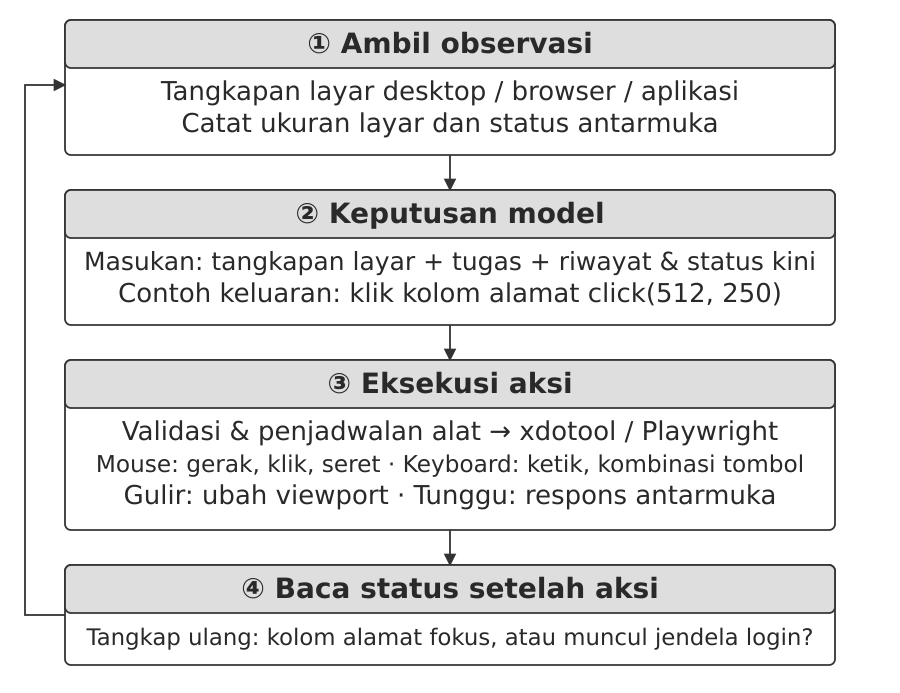

Setelah asisten mengisi alamat, bagaimana ia memberi tahu eksekutor tombol "Simpan" mana yang hendak diklik? Koordinat layar dan nomor elemen sama-sama dapat menunjuk sasaran, tetapi tuntutannya terhadap model dan alat berbeda.

### Desain Ruang Aksi

Pada Gambar 6-13, implementasi referensi Computer Use dari Anthropic menyediakan tiga jenis alat: antarmuka grafis, eksekusi perintah, dan penyuntingan berkas. Untuk jenis antarmuka grafis saja, datanya mengalir ke dua arah: aksi klik dikirim ke sisi eksekusi, sedangkan tangkapan layar setelah klik dikirim kembali ke model sebagai observasi untuk keputusan putaran berikutnya. API native menetapkan format alatnya; jika memakai model lain, lapisan adaptasi harus mengubah tangkapan layar, permintaan aksi, dan hasil eksekusi menjadi pesan yang dapat diterima antarmuka model itu.[^ch6-computer-tools]

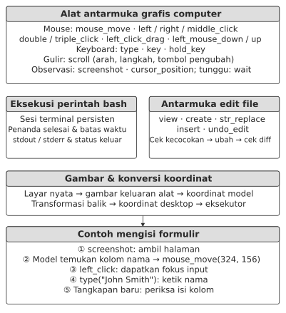

**Alat operasi GUI.** Aksi tetikus mencakup gerak, klik kiri/kanan/tengah, klik ganda, klik tiga kali, dan seret; antarmuka yang lebih terperinci dapat menyatakan tekan dan lepas secara terpisah. Gulir memerlukan arah dan besarnya, dan sebagian implementasi juga mendukung tombol pengubah. Antarmuka papan ketik menyediakan masukan teks, kombinasi tombol, dan menahan tombol. Tangkapan layar dan posisi kursor dipakai untuk memperoleh status, sedangkan antarmuka tunggu memberi waktu bagi pemuatan halaman atau animasi. Versi alat menentukan himpunan aksi yang konkret, dan Harness memvalidasi parameter berdasarkan antarmuka yang dipakai.

**Alat eksekusi perintah.** Terminal persisten dapat mempertahankan direktori kerja dan status lingkungan lintas pemanggilan. Misalnya, setelah satu pemanggilan berpindah direktori, pemanggilan berikutnya tetap berjalan di direktori itu. Implementasi referensi dapat memakai *string* penjaga (*sentinel*) untuk mengenali bahwa perintah sudah selesai, serta menetapkan batas waktu; status proses setelah batas waktu terlampaui tetap harus diperiksa eksekutor.

**Alat penyuntingan berkas.** Antarmuka penggantian *string* menentukan cakupan perubahan berdasarkan teks aslinya, dan juga dapat menyediakan fungsi melihat, membuat, menyisipkan, dan membatalkan. Sebelum eksekusi, periksa posisi dan jumlah kecocokan; setelah eksekusi, periksa perbedaannya; jika berkas berubah di antara dua pemanggilan, baca ulang isi yang relevan lebih dulu. Strategi penyuntingan yang diperkenalkan di Bab 5 dapat dipakai ulang di sini.

> **Eksperimen 6-9 ★: Menjalankan implementasi referensi Computer Use dari Anthropic**
>
> Eksperimen ini memakai desktop Ubuntu, peramban, dan lapisan eksekusi alat yang disediakan contoh kontainer resmi. Setelah pengguna memasukkan tugas, model membaca tangkapan layar dan mengembalikan aksi, lapisan eksekusi mengoperasikan desktop, lalu mengirim tangkapan layar baru kembali ke model.
>
> Tugas pendampingnya adalah menanyakan cuaca San Francisco. Jejak yang disimpan mula-mula mengunjungi Google; setelah menemui CAPTCHA, ia beralih ke data Open-Meteo yang dapat dibaca publik berdasarkan instruksi pemulihan saat eksekusi, dan akhirnya melaporkan suhu serta kondisi cuaca. Catatannya berisi 15 aksi desktop beserta tangkapan layarnya, sehingga dapat diperiksa putaran demi putaran bagaimana klik, penekanan tombol, masukan teks, dan penantian mengubah halaman.
>
> Jalur yang menggerakkan peramban dengan model terbuka dibahas di Eksperimen 6-10.

### *Visual Grounding* (Penentuan Lokasi Visual)

Untuk meminta model mengklik kotak pencarian, soalnya dapat dirumuskan dalam dua bentuk. Pertama, perlihatkan tangkapan layar dan minta model menyebutkan koordinat klik. Kedua, beri nomor pada sasaran-sasaran calon dan minta model memilih kotak pencarian; nomor itu dapat ditempelkan pada area calon di tangkapan layar, atau berasal dari daftar elemen yang disediakan peramban. Berikut ketiga jalur ini dibahas satu per satu. Ketika memilih nomor, lapisan eksekusi bertugas mengembalikan nomor itu menjadi sasaran sebenarnya; ketika langsung menyebutkan koordinat, model juga harus memperkirakan letak sasaran, sehingga tuntutan terhadap pelatihan penentuan lokasi dan penyesuaian resolusi layar lebih tinggi.

**Set-of-Mark: anotasi visual.**

Set-of-Mark (SoM) menumpangkan nomor yang dapat dirujuk di atas gambar, sehingga menghubungkan area visual dengan keluaran model. Karya aslinya membuat area calon dengan metode seperti segmentasi, misalnya memakai SAM dan SEEM untuk memperoleh area, lalu menempatkan penanda. Setelah model memilih nomor, lapisan eksekusi menentukan posisi operasi berdasarkan area yang bersangkutan. Metode ini dapat dipakai untuk perangkat lunak desktop atau antarmuka gim yang tidak punya DOM; syaratnya, kontrol yang hendak diklik harus berada di area bernomor, dan model harus dapat melihat dengan jelas nomor mana yang sesuai dengannya.[^ch6-som]

**Indeks elemen terstruktur.**

Peramban juga dapat menyediakan petunjuk jenis lain. *Document Object Model* (DOM) menggambarkan elemen apa saja yang ada di halaman beserta hierarkinya, informasi tata letak memberikan posisi tampilan elemen, dan pohon aksesibilitas (*accessibility tree*) menyimpan peran dan nama aksesibel yang diperlukan teknologi bantu. Misalnya, sebuah tombol yang hanya berisi ikon kaca pembesar: jika halaman menyediakan nama aksesibel "Search", Agent berpeluang menemukannya berdasarkan peran dan nama. Ambil contoh solusi sejenis browser-use: sistem dapat memperoleh informasi elemen melalui antarmuka *debugging* peramban seperti Chrome DevTools Protocol (CDP), mengenali kotak masukan, tombol, dan tautan, lalu memberi nomor pada elemen-elemen yang dapat dioperasikan di halaman saat ini. Pada Gambar 6-14, model memilih [2] di pojok kanan atas halaman. Bagaimana nomor ini berubah menjadi satu klik pada tombol Submit?

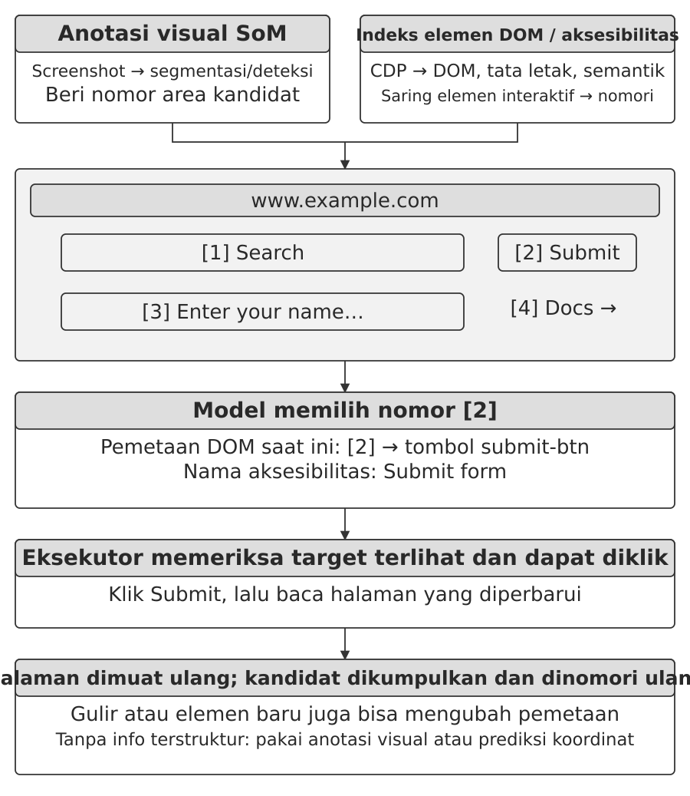

Prosesnya dapat dibagi menjadi empat langkah: membaca DOM, tata letak, dan informasi aksesibilitas yang tersedia; menyaring elemen yang dapat berinteraksi; membangun pemetaan nomor untuk halaman saat ini; lalu menyerahkan deskripsi elemen dan tangkapan layar beranotasi yang diperlukan kepada model. Misalnya, model mungkin melihat empat elemen bernomor berikut:

```text
截图中标有 [1]、[2]、[3]、[4]

[1] <input type="text" placeholder="Search" aria-label="Search" />
[2] <button id="submit-btn" aria-label="Submit form" />
[3] <input type="text" placeholder="Enter your name" value="" />
[4] <a href="/docs" aria-label="Documentation" />
```

Setelah model memilih nomor, lapisan eksekusi menerjemahkannya menjadi rujukan elemen atau koordinat, memeriksa apakah sasaran masih terlihat dan dapat berinteraksi, lalu menyelesaikan operasinya. Setelah halaman dimuat ulang, digulir, atau disisipi elemen secara dinamis, pemetaan perlu diperbarui agar nomor yang kedaluwarsa tidak terpakai. Indeks terstruktur dapat memanfaatkan label, peran, dan teks, sedangkan Canvas, elemen yang tertutup, atau anotasi semantik yang tidak lengkap perlu dinilai dengan bantuan tangkapan layar. Semakin banyak elemen yang dicantumkan dan semakin besar tangkapan layarnya, semakin banyak pula informasi yang masuk ke konteks.

**Memprediksi koordinat secara langsung.**

Jalur koordinat membuat model langsung mengeluarkan posisi dari tangkapan layar dan deskripsi sasaran, misalnya memetakan "klik tombol kirim" ke suatu titik. Penelitian penentuan lokasi GUI seperti SeeClick serta Computer Use milik Claude sama-sama memakai keluaran koordinat. Lapisan eksekusi bertugas mengubah koordinat gambar menjadi koordinat desktop sebenarnya.

Setelah tangkapan layar diskalakan, kedua sistem koordinat harus memakai transformasi yang sama. Ambil contoh desktop 2560×1440: jika gambar yang dikirim ke model berukuran 1366×768, maka koordinat (683, 384) dari model sesuai dengan:

$$
x = 683 \times \frac{2560}{1366} = 1280,\qquad
y = 384 \times \frac{1440}{768} = 720
$$

Pada Gambar 6-15, rasio lebar-tinggi kedua ukuran itu hampir sama. Jika tangkapan layar diberi bingkai hitam demi mempertahankan rasio, koordinat dari model ikut memuat area kosong itu; sebelum dikembalikan ke koordinat layar asli, offset bantalan yang bersangkutan harus dikurangkan dulu, baru dikonversi dengan faktor skala. Pemotongan, penskalaan tampilan, dan titik asal pada banyak monitor juga mengubah pemetaan, sehingga lapisan alat perlu menyimpan parameter transformasi yang sebenarnya.

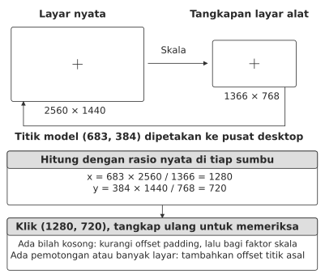

Implementasi referensi pernah memakai ukuran sasaran seperti XGA (1024×768), WXGA (1280×800), dan FWXGA (1366×768). Memaksakan perubahan rasio lebar-tinggi akan membuat bentuk kontrol berubah; memakai pemetaan balik yang salah akan membuat prediksi yang benar mendarat di posisi yang salah.[^ch6-computer-tools]

**Bila informasi terstruktur lengkap, penulis mengutamakan indeks DOM atau pohon aksesibilitas.** Nama, peran, dan rujukan elemen dapat langsung dipakai dalam penentuan lokasi, sehingga model tidak perlu banyak menaksir posisi piksel secara dadakan. Bila struktur tidak tersedia, model visual umum dapat dipadukan lebih dulu dengan SoM agar model cukup memilih salah satu area yang sudah ditandai; model yang sudah dilatih untuk penentuan lokasi GUI dapat langsung memprediksi koordinat tanpa anotasi tersendiri.

> **Eksperimen 6-10 ★: Mengotomatiskan operasi peramban dengan browser-use**
>
> Eksperimen ini memakai Qwen3-VL 32B Instruct untuk menggerakkan browser-use, dan menghasilkan aksi berdasarkan status peramban, informasi elemen, dan tangkapan layar. Tugasnya adalah menanyakan cuaca San Francisco: menemukan kotak pencarian, mengetikkan "San Francisco weather today", mengirim kueri, lalu mengekstrak suhu dan kondisi cuaca.
>
> Kode dan petunjuk eksekusi Eksperimen 6-10 menyediakan dua pintu masuk. Jika memiliki kunci OpenRouter, Anda dapat memakai model visual yang di-*hosting*; jika sudah ada layanan kompatibel seperti vLLM atau SGLang, arahkan `OPEN_MODEL_BASE_URL` dan `OPEN_MODEL_MODEL` ke *endpoint* dan model Anda sendiri, lalu atur kunci sesuai ketentuan layanan. Pada kedua jalur, jalankan dulu `python main.py --dry-run` di direktori eksperimen untuk melihat konfigurasi, lalu mulai kueri sungguhan sesuai petunjuk.
>
> Eksekusi yang disimpan menyelesaikan 16 langkah interaksi dan menyimpan 15 tangkapan layar. Setelah Google menampilkan CAPTCHA, tugas beralih ke weather.com untuk mendapatkan hasilnya.

[^ch6-computer-tools]: Anthropic, dokumentasi alat dan implementasi referensi Computer Use, memperkenalkan antarmuka aksi berversi, lapisan eksekusi, dan pemrosesan tangkapan layar.
[^ch6-som]: Microsoft, *Set-of-Mark Prompting*, 2023; implementasi layanan DOM di browser-use memberikan contoh pemrosesan elemen terstruktur.

### Agent Computer Use yang Dapat Menonton Animasi dan Mendengar Suara

Sebuah halaman hanya menampilkan "sinkronisasi gagal" sesaat setelah disimpan, sementara dua tangkapan layar yang berjarak beberapa detik sama-sama menampilkan formulir yang sama. Melihat kembali kedua gambar itu, model kemungkinan besar tidak dapat merekonstruksi apa yang terjadi di antaranya. Video, animasi, notifikasi singkat, dan suara rapat juga mengalami masalah ini. **Untuk antarmuka yang terus berubah, penulis berpendapat bahwa antarmuka observasi harus menjadi sasaran utama perbaikan.** Untuk menentukan langkah berikutnya berdasarkan perubahan, peristiwa atau gambar yang muncul di antara dua aksi juga perlu disimpan.

**Agent–Computer Observation Interface (AOI, antarmuka observasi Agent–komputer)** yang diusulkan penulis bersama rekannya mengubah layar dan audio yang kontinu menjadi gambar dan teks yang dapat diterima model[^ch6-9]. Antarmuka ini terdiri atas tiga komponen:

- **Pengambilan bingkai kunci di antara aksi.** Selama *loop* utama berjalan, perubahan gambar dipantau, bingkai calon disaring dengan selisih piksel atau model visual ringan, lalu gambar yang berguna diserahkan ke keputusan berikutnya.
- **Transkripsi berpintu volume.** Ketika suara terdeteksi, pengenalan ucapan dipanggil, dan transkrip beserta informasi waktunya ditambahkan ke catatan observasi, sehingga Agent dapat memakai isi rapat atau instruksi lisan.
- **Deskripsi gambar yang persisten.** Gambar kunci diringkas menjadi teks; setelah gambar asli dikeluarkan dari konteks, teks itu tetap menyimpan perubahan yang pernah terjadi untuk dirujuk langkah-langkah berikutnya.

Misalnya, sebuah video memperlihatkan satu operasi menu; setelah model menerima gambar antara dan deskripsinya, ia dapat terus merujuk langkah itu setelah video selesai diputar. Hasil ablasi dalam makalah menunjukkan bahwa deskripsi teks yang persisten sangat penting bagi peningkatan kinerja, sedangkan pemilihan bingkai kunci secara cermat hanya sedikit berkontribusi; sebagian model justru menurun ketika diberi terlalu banyak gambar.

Kembali ke contoh menyimpan formulir tadi. Sekalipun bingkai kunci menangkap "sinkronisasi gagal", begitu gambar aslinya dikeluarkan dari konteks, model hanya dapat mengandalkan deskripsi yang tertinggal. "Halaman menampilkan notifikasi" bisa berarti penyimpanan berhasil, bisa pula gagal; hanya "sinkronisasi gagal, alamat tidak tersimpan" yang mempertahankan petunjuk untuk menentukan langkah berikutnya.

[^ch6-9]: Bojie Li, Noah Shi, *Agent-Computer Observation Interfaces Enable Dynamic Computer Use*, 2026, memperkenalkan AOI dan ablasi komponennya.

### Model Dunia untuk Computer Use

Setelah memperoleh observasi tepat waktu, Agent masih harus memilih aksi dan menunggu eksekusinya. Penelitian OSWorld-Human membandingkan efisiensi operasi Agent dengan jejak manusia, dan menganalisis sumber pemborosan waktu seperti langkah berlebih dan pemanggilan model[^ch6-osworld-human].

Model dunia memberikan prediksi akibat dari suatu aksi untuk perencanaan. Status desktop dapat mencakup jendela, fokus, posisi gulir, isi masukan, dan kemajuan pemuatan; informasi seperti izin dan hasil jaringan perlu dilengkapi melalui antarmuka yang bersangkutan. Berdasarkan status yang tersedia dan aksi calon, model memprediksi status berikutnya:

```text
当前状态 + click / type / scroll / wait → 预测的下一状态
```

Ketika manusia mengoperasikan komputer, sering kali ia sudah membayangkan langkah berikutnya sebelum mengklik; jika antarmuka sesuai harapan, ia melanjutkan, dan baru berhenti untuk memeriksa bila terjadi hal tak terduga. Model dunia dapat memberi Agent dasar eksekusi spekulatif yang serupa: perencana membandingkan aksi calon lebih awal, menyiapkan langkah berikutnya selama halaman dimuat, lalu melanjutkan setelah status sebenarnya dipastikan, sehingga waktu tunggu untuk merencanakan ulang dari awal setiap kali selesai mengklik dapat dikurangi. Misalnya, saat membuat berkas Python baru di VS Code dan menuliskan hello world, perubahan yang diharapkan meliputi munculnya berkas baru di pohon berkas, area penyunting berisi kode, dan status penyimpanan diperbarui. Setelah eksekusi, perubahan ini diperiksa; jika sesuai harapan, lanjutkan, dan jika menyimpang, tentukan lokasi dan rencanakan ulang.

Operasi seperti menghapus berkas juga memerlukan syarat eksekusi tersendiri: apakah sasarannya benar, apakah penghapusan diizinkan, apakah dapat dipulihkan, dan apakah perlu konfirmasi pengguna. Prediksi membantu memahami hasil yang mungkin, sedangkan izin dan syarat bisnis yang sebenarnya diperiksa oleh lapisan eksekusi.

**Prediksi status laten pada Photon-1.** Pada Juli 2026, Induction Labs memperkenalkan Photon-1: bingkai video dikodekan menjadi token laten diskret, dan perubahan status dipelajari dengan memprediksi token berikutnya. Perusahaan itu mengungkapkan bahwa prapelatihannya memakai sekitar 30.000 jam GPU H200. Prediksi status dilakukan di dalam token laten, sedangkan generator gambar pembantu bertugas mengembalikannya menjadi gambar yang dapat dilihat, agar manusia dapat memeriksa prediksinya. Perencanaan dan pembuatan aksi dapat langsung memakai representasi internal, sehingga tidak perlu menghasilkan tangkapan layar lengkap di setiap langkah.[^ch6-20]

Solusi ini selanjutnya mempelajari format instruksi dan aksi melalui *fine-tuning*: pertama memprediksi status yang ingin dicapai, lalu menghasilkan operasi menuju status itu, dan memperbaiki kinerja tugas melalui pelatihan daring di mesin virtual. *Fine-tuning* bersyarat aksi dipakai untuk memprediksi perubahan desktop setelah suatu operasi diberikan. Kedua kegunaan ini masing-masing terhubung dengan perencanaan dan simulasi, dan memperlihatkan bagaimana representasi status berperan dalam Computer Use.

[^ch6-osworld-human]: Reyna Abhyankar dkk., *OSWorld-Human: Benchmarking the Efficiency of Computer-Use Agents*, menganalisis jejak tugas dan pemakaian waktu.
[^ch6-20]: David Li, Jonathan Li, *Scaling Video Pretraining with Imagination Models*, Induction Labs, 2026-07-23, memperkenalkan prapelatihan, pembelajaran aksi, dan simulasi status pada Photon-1.
[^ch6-21]: Google DeepMind, *Genie 3: A new frontier for world models*, 2025-08-05; Zachary Lin dkk., *Cosmos World Foundation Model Platform for Physical AI*, 2025.

### Seluler: Antarmuka Teknis dan Kolaborasi Ekosistem

Perangkat seluler tetap memakai siklus observasi–keputusan–aksi, tetapi aksinya lebih banyak berupa gestur sentuh. Koordinat yang sama dapat berarti posisi ketuk, posisi tekan lama, atau titik awal usapan, sehingga antarmuka juga memerlukan jenis gestur, durasi, dan lintasannya. Rotasi layar, munculnya papan ketik virtual, dan jendela sembul sistem juga mengubah area yang dapat dioperasikan.

`AccessibilityService` di Android dapat membaca informasi antarmuka dan menjalankan aksi yang sesuai dalam cakupan yang diizinkan, dan antarmuka gestur juga perlu menyatakan kemampuan yang bersangkutan[^ch6-android]. Tangkapan layar, pohon aksesibilitas, dan antarmuka otomatisasi sistem dapat dipakai bersama, dengan cakupan yang ditentukan oleh sistem operasi, implementasi aplikasi, dan otorisasi. Tolok ukur seperti AndroidWorld yang diperkenalkan di Bab 7 memeriksa apakah aksi-aksi ini menghasilkan hasil yang diharapkan pada tugas aplikasi sungguhan.

**Menurut penulis, hambatan ekosistem dalam penerapan di perangkat seluler sering kali lebih sulit ditangani daripada persoalan teknis.** Platform perlu menetapkan operasi mana yang boleh diserahkan kepada Agent, bagaimana akun, pembayaran, dan data diotorisasi, serta bagaimana tanggung jawab ditelusuri bila terjadi kesalahan. Kesepakatan ini langsung memengaruhi cakupan tugas yang dapat diselesaikan Agent.

Salah satu konflik kepentingan yang bersifat struktural berasal dari lalu lintas dan perhatian. Banyak aplikasi memperoleh pendapatan dari tayangan iklan, rekomendasi konten, dan pintu transaksi; setelah pengguna meminta Agent langsung menyelesaikan kueri atau pembelian, jalur penelusuran halaman bisa memendek, dan perhatian yang diperoleh rekomendasi serta iklan pun berubah. Bagi platform yang memonetisasi tahapan-tahapan ini, operasi oleh Agent menyentuh sumber pendapatan yang sudah ada. Karena itu platform perlu mempertimbangkan ulang keterbukaan antarmuka, bagi hasil komersial, dan pengelolaan identitas Agent.

[^ch6-android]: Android Developers, AccessibilityService, memperkenalkan akses antarmuka, aksi, dan kemampuan gestur.

## Manipulasi Robot: Merapikan Meja dengan XLeRobot

Memasukkan cangkir merah ke nampan, membuang kertas kuning ke kotak sampah, lalu memastikan meja sudah rapi—tugas ini merangkai persepsi, perencanaan, dan kendali menjadi satu. Ketika *gripper* mendekati cangkir, posisinya di kamera berubah; setelah cangkir terangkat, lengan harus menghindari benda lain di meja; jika kertas gagal dijepit pada percobaan pertama, sistem juga harus menyadari kegagalan itu dan mencoba lagi. Setiap aksi mengubah kondisi untuk keputusan berikutnya.

Bagian ini menyusun lima eksperimen di sepanjang tugas tersebut. Eksperimen 6-11 dan 6-13 memberikan rancangan praktik untuk teleoperasi dan operasi mandiri pada robot sungguhan; Eksperimen 6-12, 6-14, dan 6-15 memakai simulasi lokal untuk masing-masing mempelajari *baseline* kendali, pemulihan dari kegagalan, dan perubahan kondisi visual.

Robot yang sama dapat dikendalikan manusia yang terus memperhatikan kamera, dapat pula dijalankan oleh model yang membaca gambar, memilih keterampilan, lalu menyerahkannya kepada sistem kendali untuk dieksekusi. Dengan tugas dan perangkat keras yang tetap, perbedaan kedua cara ini dapat dianalisis dari empat pertanyaan: apa yang ingin dicapai manusia, subtugas mana yang dikerjakan lebih dulu, aksi apa yang dikeluarkan keterampilan saat ini, dan apakah lingkungan setelah aksi sesuai dengan rencana. Perencanaan jangka panjang mengatur urutan penanganan cangkir dan kertas bekas, kebijakan VLA atau primitif aksi yang telah didefinisikan bertugas menjepit dan meletakkan, model dunia membantu memperkirakan akibat aksi, sedangkan transfer dari simulasi ke dunia nyata menangani perubahan gambar, kontak, dan karakteristik aktuator.

### Pembagian Kerja antara Perangkat Keras dan Algoritme

Ketika perapian meja secara mandiri gagal, teleoperasi dapat dipakai lebih dulu untuk memeriksa apakah perangkat kerasnya sanggup menyelesaikan tugas. Pertahankan kamera, lengan robot, *gripper*, tata letak meja, dan syarat penerimaan, lalu biarkan operator mengambil alih siklus tertutup persepsi dan kendali. Jika manusia dapat menyelesaikannya dengan stabil dalam beberapa putaran sementara sistem mandiri berulang kali gagal, berarti perangkat keras ini sudah mampu menyelesaikan tugas tersebut, dan hambatan utamanya ada pada algoritme kendali mandiri dan umpan baliknya. Pada saat itu, penentuan lokasi objek, pemilihan keterampilan, waktu aksi, dan pemulihan dari kegagalan perlu diperiksa lebih dulu, agar sistem mandiri mempelajari cara koreksi yang terbukti efektif dalam teleoperasi.

XLeRobot mendukung teleoperasi dengan papan ketik, gamepad Xbox, dan Switch Joy-Con, sedangkan operasi VR dapat dicoba lebih dulu di lingkungan simulasi.[^ch6-1] Ketika *gripper* mendekati cangkir, operator memperlambat gerakan; begitu cangkir tergelincir, titik jepit harus dikoreksi. Jika *gripper* gagal menjepit kertas, operator perlu melihat sekali lagi; ketika benda sudah kembali ke tempatnya, ia juga melirik untuk memastikan. Semua koreksi berdasarkan observasi ini layak dicatat dalam data demonstrasi. Kelak ketika robot beroperasi secara mandiri, ia juga harus dapat menyadari selip dan jepitan yang meleset.

> **Eksperimen 6-11 ★: Teleoperasi XLeRobot sungguhan untuk merapikan meja**
>
> Di area kerja XLeRobot yang sudah menjalani kalibrasi, pemeriksaan batas gerak, dan pemeriksaan tombol berhenti darurat, letakkan cangkir merah, nampan, kertas bekas kuning, dan kotak sampah. Jalankan tugas tetap melalui satu cara teleoperasi yang telah dikalibrasi: "Masukkan cangkir merah ke nampan, buang kertas bekas kuning ke kotak sampah, lalu periksa kondisi meja." Ulangi beberapa putaran, dan catat gambar kamera, masukan operator, status lengan robot, waktu aksi, kegagalan menjepit, dan jumlah percobaan ulang.
>
> Di akhir setiap putaran, pastikan cangkir berada di dalam nampan, kertas bekas berada di dalam kotak sampah, dan lengan robot kembali ke posisi aman, lalu periksa catatan tabrakan, pelanggaran batas, dan campur tangan manusia sepanjang proses. Dengan menganalisis bersama di langkah mana kegagalan terjadi, bagaimana operator memulihkannya, dan hasil akhirnya, terbentuklah *baseline* pembanding bagi kendali mandiri.

Eksperimen simulasi memudahkan perubahan jumlah dan posisi awal objek secara berulang, sehingga proses kendali dalam status yang diketahui dapat dikaji tersendiri. Model meja dua dimensi dapat menyatakan tiga tahap: mendekati objek, memindahkannya ke sasaran, dan menangani objek berikutnya, serta menggambarkan biaya kendali dengan jumlah langkah dan panjang lintasan.

> **Eksperimen 6-12 ★: Membangun *baseline* kendali ideal untuk tugas yang sama di simulator**
>
> Di meja dua dimensi, buat posisi objek dan posisi sasaran secara acak, lalu biarkan pengendali langsung membaca koordinat, mendekati objek satu per satu, memindahkannya ke sasaran yang sesuai, kemudian menangani objek berikutnya. Ubah posisi awal dan jumlah objek, lalu bandingkan tingkat keberhasilan, jumlah langkah, dan panjang lintasan.
>
> Pertama, ikuti lintasan lengkap satu objek: setelah pengendali mencapai objek, ia masuk tahap pemindahan, dan baru setelah mencapai sasaran jumlah objek yang selesai bertambah. Kemudian tambah jumlah objek dan periksa bahwa setiap objek melewati kedua syarat pencapaian itu. Simulasi dua dimensi pendamping menempatkan 1, 2, 3, dan 4 objek dengan lima benih acak, menjalankan 512 episode untuk setiap kombinasi, dan seluruh 10.240 episode selesai. Pengendali dapat langsung membaca koordinat, dan pemindahan objek tidak bergantung pada *gripper* sungguhan.

### Struktur Dasar Kendali Robot

Merapikan meja satu kali dapat memakan beberapa menit, tetapi kendali sendi harus diperbarui terus-menerus dan tepat waktu. Sistem dapat membagi kerja menurut skala waktu: perencanaan tingkat tinggi mengatur urutan tugas, kebijakan keterampilan menghasilkan gerak, lalu pengendali tingkat rendah mengikuti dan mengeksekusinya:

| Tingkat | Pertanyaan inti | Keluaran | Contoh skala waktu dan konfigurasi |
| --- | --- | --- | --- |
| Sasaran tugas | Apa yang ingin dicapai manusia | "Kembalikan cangkir dan kertas bekas ke tempatnya" | Tugas berskala menit |
| Perencanaan jangka panjang | Apa yang dikerjakan lebih dulu, apa yang belakangan | Tangani cangkir dulu, lalu kertas bekas, terakhir periksa | Detik hingga menit |
| Keterampilan dasar | Perubahan status mana yang sedang dituju | `pick(red_cup)`, `place(red_cup, tray)` | Satu keterampilan dapat berlangsung beberapa detik, misalnya 1–3 detik |
| VLA / kebijakan keterampilan | Bagaimana tepatnya keterampilan saat ini bergerak | Aksi *gripper*, pose ujung lengan, atau satu potong lintasan sendi | Inferensi dapat dikonfigurasi pada 1–10 Hz |
| Kendali tingkat rendah dan lapisan keselamatan | Bagaimana mengeksekusi secara stabil dan tepat waktu | Besaran kendali sendi atau ujung lengan, pembatasan kecepatan, dan berhenti darurat | Pengendali dapat dikonfigurasi pada puluhan hingga ribuan Hz |

Perencana dapat berupa program aturan, VLM, atau pengoptimal, dan VLA juga dapat mengambil sebagian peran pemilihan keterampilan. **Saran penulis adalah memisahkan penanganan urutan tugas dari aksi yang sedang berlangsung.** Penalaran tingkat tinggi memerlukan waktu untuk menyusun rencana, sedangkan kendali tingkat rendah harus segera merespons perubahan posisi dan gaya; hanya dengan membiarkan keduanya berjalan menurut irama masing-masing yang sesuai, perencanaan dan kendali dapat sama-sama terpenuhi.

Bagian ini menyediakan lima jenis alat bagi model tingkat tinggi: `observe_scene`, `pick`, `place`, `verify_state`, dan `stop`, masing-masing untuk observasi, menjepit, meletakkan, memeriksa, dan berhenti. Harness memeriksa parameter, area kerja, dan status saat ini; eksekutor mengubah keterampilan yang lolos pemeriksaan menjadi aksi lengan robot dan menangani pembatasan kecepatan serta batas waktu. Sudut sendi dan lintasan kontinu dihasilkan oleh kebijakan keterampilan dan pengendali, sehingga terbentuk antarmuka yang jelas antara pemilihan keterampilan oleh model dan gerak yang sebenarnya.

### Perencanaan Jangka Panjang dan Penguraian Tugas

Ketika pengguna berkata "Rapikan meja ini", perencana lebih dulu mengenali objek-objek dan area sasarannya, menentukan urutan penanganan, dan menuliskan dengan jelas syarat mulai, syarat selesai, serta batasan aksi untuk setiap langkah. Misalnya, urutan perapian dapat berupa:

```text
处理红色杯子 → 清理黄色纸张 → 检查桌面
```

"Menangani cangkir merah" kemudian diuraikan lagi menjadi dua aksi dan satu pemeriksaan:

```text
pick(red_cup) → place(red_cup, tray) → verify_state()
```

Ambil contoh "angkat cangkir dan letakkan di nampan". Setelah lengan robot selesai menjalankan program jepit, itu hanya berarti program tersebut sudah selesai. Sebelum mengangkat pada langkah berikutnya, perlu dinilai melalui umpan balik *gripper* atau gambar baru apakah cangkir benar-benar terpegang. Jika jepitannya meleset, posisi cangkir ditentukan ulang; jika seseorang memindahkan nampan, jepitan yang sudah berhasil tetap berlaku, dan hanya aksi peletakan yang perlu direncanakan ulang. Dengan membuat setiap keterampilan bersesuaian dengan satu perubahan status yang dapat diperiksa, membatasi aksi dan durasinya, lalu mengembalikan status eksekusi beserta observasi baru, perencana dapat memulihkan pekerjaan dari langkah yang benar-benar gagal.

> **Eksperimen 6-13 ★★: Menggerakkan XLeRobot untuk merapikan meja secara mandiri dengan Gemini Robotics-ER 1.5**
>
> Pakai kembali perangkat keras, tata letak meja, tugas, dan syarat penerimaan dari Eksperimen 6-11, dan biarkan model penalaran berwujud (*embodied reasoning*) menangani observasi dan perencanaan. Dengan mengacu pada cara orkestrasi RoboCrew, rancang lima alat untuk tugas ini: `observe_scene`, `pick`, `place`, `verify_state`, dan `stop`.[^ch6-2]
>
> Model lebih dulu membaca observasi meja dan menentukan urutan penanganan, lalu memanggil keterampilan menjepit dan meletakkan yang telah dikalibrasi. Setiap kali satu keterampilan selesai, observasi baru diambil dan pascasyaratnya diperiksa; jika gagal, model memilih mencoba ulang atau berhenti berdasarkan status saat ini. Sistem eksekusi langsung menghentikan eksekusi ketika menerima sinyal berhenti darurat, mendeteksi pelanggaran batas, atau tidak dapat memastikan status kunci; model juga dapat mengakhiri tugas atas inisiatifnya sendiri melalui `stop`.
>
> Pada akhirnya, observasi lingkungan yang baru memastikan bahwa cangkir berada di dalam nampan, kertas bekas berada di dalam kotak sampah, dan lengan robot kembali ke posisi aman, lalu catatan tabrakan dan pelanggaran batas dicocokkan. Operator bertanggung jawab atas penyalaan, berhenti darurat, dan pengawasan di lokasi, dan setiap pengambilalihan di tengah jalan dicatat tersendiri.

Eksperimen 6-13 menjelaskan cara menghubungkan aksi robot sungguhan dan cara menerima hasil perapian, tetapi catatan pendamping belum memuat uji coba robot sungguhan untuk tugas ini. Berikut ini, tiga cara lebih dulu dibandingkan di lingkungan simulasi: eksekusi lingkar terbuka sesuai rencana, memeriksa hasil setiap kali satu langkah selesai, dan memprediksi akibat aksi lebih dulu. Sasaran tugas dan kelima jenis alat tetap sama, dan kegagalan pun dapat dipicu berulang kali, sehingga mudah diamati bagaimana masing-masing cara menangani kesalahan yang sama.

### Kendali dengan VLA

VLA adalah singkatan dari Vision-Language-Action, yaitu model visi–bahasa–aksi. Model ini menghasilkan aksi yang akan dieksekusi berikutnya berdasarkan gambar saat ini, instruksi tugas, dan status robot yang tersedia:

```text
当前观测 + 技能指令 → 动作或动作序列
```

Dalam contoh merapikan meja, perencana tingkat tinggi mengajukan `pick(red_cup)`, dan kebijakan keterampilan menentukan berdasarkan gambar dari arah mana cangkir didekati, kapan *gripper* ditutup, dan di sepanjang lintasan apa lengan diangkat. Setelah potongan gerak ini selesai dieksekusi, sistem mengambil ulang observasi meja, memastikan cangkir sudah terjepit, lalu masuk ke `place(red_cup, tray)`. Antarmuka alat menyepakati perubahan status yang diharapkan, sedangkan VLA belajar mewujudkan perubahan itu melalui aksi kontinu.

Aksi dapat direpresentasikan dengan cara berbeda. RT-2 dan OpenVLA versi asli mengkuantisasi nilai setiap dimensi aksi menjadi token diskret dan mengeluarkannya dengan cara generasi model bahasa; π₀ memakai *flow matching* untuk menghasilkan blok aksi kontinu. Cara pertama memudahkan pemakaian ulang kerangka generasi autoregresif, sedangkan cara kedua langsung memodelkan distribusi satu potong aksi kontinu.[^ch6-15]

Inferensi model dan kendali aktuator biasanya memakai frekuensi pembaruan yang berbeda. Pemotongan aksi (*action chunking*) membuat model menghasilkan satu potong pendek aksi masa depan sekaligus, yang kemudian dieksekusi utas kendali pada frekuensi lebih tinggi. Jika inferensi dan eksekusi ditumpang-tindihkan lebih jauh, sistem dapat menyiapkan blok berikutnya selama blok aksi saat ini dieksekusi, sehingga waktu tunggu berkurang. Penyambungan blok aksi juga harus menangani kesinambungan lintasan dan kebaruan observasi: jika cangkir tersenggol ketika lengan sedang menjangkaunya, aksi yang tersisa mungkin masih mengarah ke posisi lama. Memperpendek potongan yang benar-benar dieksekusi setiap kali, memperbarui secara bergulir dengan observasi baru, atau menghentikan aksi ketika terdeteksi kelainan, semuanya dapat mempercepat respons; tetapi pilihan-pilihan ini juga menambah biaya inferensi dan penjadwalan.

### Data dan Syarat Penerapan VLA

Untuk mengubah "angkat cangkir" menjadi aksi secara andal, beberapa jenis perbedaan berikut harus ditangani sekaligus:

- **Cakupan data pelatihan**: demonstrasi aksi robot yang tersedia jauh lebih sedikit daripada teks dan gambar di internet. Mengetahui apa itu "cangkir" saja tidak cukup; diperlukan pengalaman menjepit sungguhan untuk menilai bagaimana gaya diberikan. Demonstrasi perlu mencakup bahan, bentuk, posisi penempatan, dan kondisi gesekan cangkir. Arah jepit yang sama dapat memberikan hasil berbeda pada cangkir keramik dan cangkir kertas yang lunak.
- **Sasaran belajar tentang aksi dan akibatnya**: *behavior cloning* terutama mempelajari aksi apa yang akan diambil demonstran dalam kondisi saat ini. Untuk membandingkan akibat beberapa aksi, dapat ditambahkan prediksi status atau evaluasi hasil aksi.
- **Wujud fisik robot dan antarmukanya**: derajat kebebasan, sistem koordinat, struktur *gripper*, dan latensi aktuator menentukan bagaimana aksi diwujudkan pada perangkat keras. Saat memindahkan kebijakan, representasi aksi, parameter kalibrasi, dan siklus kendali perlu dicocokkan.
- **Kebaruan observasi**: selama blok aksi dieksekusi, objek dapat bergeser, tertutup, atau terjatuh. Sistem perlu menetapkan kapan observasi baru diambil dan kapan observasi itu dipakai untuk memperbarui aksi yang tersisa.

Syarat-syarat ini mengaitkan pengenalan visual, kendali keterampilan, dan perubahan lingkungan. Cairan di dalam cangkir memengaruhi kecepatan pemindahan, kabel listrik di tepi meja mengubah lintasan yang dapat ditempuh, dan kontak antara kertas dan permukaan meja memengaruhi cara menjepit. Jika perencana dapat membandingkan akibat-akibat ini lebih dulu, ia memiliki lebih banyak dasar untuk memilih keterampilan.

### Model Dunia

Dalam perencanaan robot, model dunia bersyarat aksi dapat dipahami sebagai "peramal hasil aksi": diberi status saat ini dan aksi calon, ia memperkirakan apa yang akan terjadi berikutnya.

```text
当前状态 + 候选动作
    → 预测下一状态或未来片段
    → 比较候选结果
    → 选择动作、重新规划或停止
```

Proses ini mencakup tiga pekerjaan: merepresentasikan status saat ini, memprediksi perubahan status akibat aksi, lalu membiarkan perencana atau pengendali memilih aksi berdasarkan prediksi itu. Status dapat berupa variabel terstruktur seperti posisi objek dan apakah objek sedang terjepit, dapat pula berupa representasi internal yang diekstrak dari gambar. V-JEPA 2 lebih dulu mempelajari representasi dan prediksi status dari video, dan V-JEPA 2-AC yang dilatih lebih lanjut memasukkan syarat aksi untuk perencanaan robot. Mengaitkan aksi dengan observasi masa depan juga merupakan salah satu pendekatan pemodelan pada model dunia–aksi (*World-Action Model*).[^ch6-16]

Model dunia dapat membantu robot pada tiga tahap: sebelum bertindak, memprediksi hasil dari menjepit, mendorong, atau menunggu; saat eksekusi, membandingkan prediksi dengan observasi nyata, lalu menyesuaikan aksi atau merencanakan ulang setelah menemukan penyimpangan; dan saat pelatihan, mempelajari perubahan status dari video, data simulasi, dan lintasan gagal, sehingga uji coba pada robot sungguhan berkurang.

Misalkan kertas bekas kuning sebagian tertutup oleh cangkir merah; perencana dapat membandingkan "jepit kertas dulu", "pindahkan cangkir dulu", dan "ganti arah jepit". Penulis akan mengutamakan agar model dunia memprediksi perubahan status yang langsung berkaitan dengan tugas dan dapat diperiksa seperti ini. Jika model dapat menilai apakah kertas lebih mudah dijepit dan apakah cangkir mudah tersenggol jatuh, aksi-aksi calon dapat diurutkan. Representasi status dan sasaran pelatihan model sebaiknya dirancang di sekitar penilaian-penilaian ini. Jika model menghasilkan gambar masa depan, penulis lebih dulu memeriksa apakah gambar itu secara tepat mencerminkan akibat aksi tersebut, baru kemudian mempertimbangkan penambahan detail visual; nilai keaslian gambar pada akhirnya harus tampak dalam perbaikan perencanaan dan kendali. Setelah eksekusi, sistem memeriksa hasil sebenarnya berdasarkan kamera dan status robot, lalu memutuskan untuk melanjutkan, mencoba ulang, atau mengganti rencana.

Semakin panjang jangkauan prediksi, semakin mudah galat menumpuk. Dalam praktiknya, akibat jangka pendek dapat diprediksi lebih dulu, satu potong pendek dieksekusi, lalu perencanaan diulang dengan observasi baru, dan ketidakpastian prediksi ikut diperhitungkan dalam pemilihan. Model dunia generatif juga dapat menyediakan simulasi interaktif dan adegan visual; bila dipakai untuk kendali, syarat aksi, hukum kontak, dan galat prediksinya perlu diuji lebih lanjut. Batas gerak perangkat keras, berhenti darurat, dan kendali waktu nyata tetap ditangani oleh sistem eksekusi.[^ch6-21]

> **Eksperimen 6-14 ★★: Membandingkan tiga siklus tertutup perapian meja mandiri di simulator**
>
> Representasikan cangkir merah dan kertas bekas kuning dengan status terstruktur: setiap objek berada di salah satu dari tiga tahap, "di atas meja", "sudah diangkat", atau "sudah diletakkan", dan area sasaran mencatat apakah masih tersedia. Simulator menyediakan lima jenis alat, yaitu observasi, menjepit, meletakkan, memeriksa, dan berhenti, serta menyuntikkan paling banyak satu kegagalan sesaat ketika menjepit kertas bekas.
>
> Bandingkan tiga cara kendali. **Eksekusi lingkar terbuka** menyelesaikan empat aksi dengan urutan tetap. **Pemeriksaan bertahap** membaca status setelah setiap aksi, mengambil ulang observasi setelah gagal, lalu memilih langkah yang saat ini dapat dieksekusi. **Eksekusi prediktif** memakai jaringan saraf kecil untuk mempelajari pemetaan "status dan aksi ke status berikutnya", lalu mengurutkan aksi yang dapat dieksekusi berdasarkan prediksi kemajuan pengembalian objek ke tempatnya.
>
> Bandingkan penyelesaian tugas, jumlah pemanggilan alat, dan proses pemulihan dari kegagalan. Misalnya, setelah penjepitan kertas bekas gagal, kertas itu tetap berada di meja; jika peletakan langsung dieksekusi, aksi itu gagal karena tidak ada objek yang terangkat; hanya dengan membaca status lalu mencoba ulang penjepitan, peletakan dapat dilanjutkan. Kedua strategi berumpan balik memanggil `verify_state` di akhir untuk memeriksa status pengembalian objek.
>
> Pertama, lihat episode tanpa kegagalan yang disuntikkan: ketiga strategi dapat menyelesaikannya. Lalu naikkan probabilitas injeksi kegagalan menjadi 50%, dan jalankan setiap strategi sebanyak 384 episode pada tiga benih (128 episode per benih). Lingkar terbuka tetap memanggil alat 4 kali per episode, dan hanya 205 episode yang selesai. Pemeriksaan bertahap dan eksekusi prediktif sama-sama menyelesaikan seluruh 384 episode, dengan rata-rata sekitar 6,93 pemanggilan. Pemanggilan tambahan itu memungkinkan pengendali menyadari jepitan yang meleset dan memulihkannya. Dalam tugas yang hanya menyuntikkan satu kegagalan yang dapat dipulihkan ini, memprediksi status berikutnya tidak menyelamatkan satu episode pun lebih banyak daripada langsung memeriksa.

### Dari Lingkungan Simulasi ke Robot Nyata

Beralih dari meja simulasi ke robot sungguhan berarti perbedaan lingkungan harus ditangani satu per satu. Dari sisi gambar, cangkir dan nampan yang sama akan muncul dengan latar belakang, pencahayaan, posisi kamera, dan hubungan saling tutup yang berbeda; dari sisi gerak, gesekan, derau sensor, dan latensi aktuator memengaruhi lintasan dan penjepitan.

Randomisasi domain dilakukan dengan mengubah latar belakang, tampilan objek, pencahayaan, atau derau selama pelatihan, agar model dapat membuat penilaian yang sama dalam berbagai kondisi. Eksperimen 6-15 hanya mengambil satu tahap untuk dipelajari: setelah melihat objek dan area sasaran, ke arah mana harus bergerak?

> **Eksperimen 6-15 ★★★: Pengujian RGB lintas lingkungan untuk tugas meja yang sama**
>
> Gunakan lingkaran untuk menyatakan objek dan kotak untuk area sasaran, lalu hasilkan gambar meja RGB. Berdasarkan posisi relatif keduanya, model mengeluarkan salah satu dari empat arah gerak: kiri, kanan, atas, atau bawah; ketika kedua posisi sudah cukup dekat, model mengeluarkan label `grasp` yang didefinisikan eksperimen. Label ini menyatakan bahwa posisi dua dimensi telah memenuhi syarat kedekatan.
>
> Latih empat kelompok kebijakan visual dengan struktur yang sama: kondisi visual tetap, terutama mengubah latar belakang, terutama mengubah tampilan objek, dan gabungan berbagai perubahan. Terapkan kebijakan setiap kelompok pada kondisi asli dan pada gambar uji yang mengandung warna, tekstur, kecerahan, dan derau baru, bandingkan akurasi penilaian arah, dan periksa gambar yang salah dinilai.
>
> Setiap domain uji dan setiap benih memiliki 1.024 gambar sintetis. Pertama, bandingkan akurasi rata-rata tiga benih: kebijakan yang dilatih dengan kondisi visual tetap mencapai 93,03% di domain asli, dan turun menjadi 54,82% ketika dipindahkan ke domain sasaran dengan tekstur dan derau baru (`target_realistic`); kebijakan yang dilatih dengan gabungan berbagai perubahan mencapai 87,50% di domain asli, tetapi mencapai 76,11% di domain sasaran yang sama. Lalu lihat kelompok yang hanya merandomisasi latar belakang: di domain sasaran ini akurasinya hanya 36,88%.[^ch6-6]

## Ringkasan Bab

Kembali ke panggilan perubahan jadwal tiket di awal bab. Ketika sisi belakang sedang mencari penerbangan, pengguna menambahkan permintaan soal bagasi. Sekalipun hasil kueri tiba lebih lambat daripada pesan pengguna, hasil itu mungkin menjawab pertanyaan yang sudah usang. Antrean peristiwa harus menyimpan sumber pesan, penanda tugas, dan urutan kedatangannya, agar sisi depan dapat menangkap permintaan baru sesuai prioritasnya dan menilai apakah kueri semula boleh diteruskan, perlu dibatalkan, atau harus diulang dengan syarat baru. Inilah persoalan **waktu**, dan sekadar mengubah permintaan menjadi suara tidak menyelesaikannya.

Suara menambah satu lapis tuntutan lagi. Sambil membacakan harga, asisten harus tetap dapat mendengar sela bicara pengguna; begitu tanggalnya diubah, pembacaan yang sudah usang harus dihentikan. *Cascade* dan *end-to-end* menggambarkan bagaimana suara melewati pengenalan, penalaran, dan generasi, sedangkan *full-duplex* menggambarkan apakah pengguna dan asisten dapat mendengar dan berbicara pada saat yang sama.

Ketika beralih ke layar atau lengan robot, persoalan yang sama tetap ada; yang berubah hanyalah **bentuk observasi dan aksinya**. Koordinat tombol diambil dari tangkapan layar sebelumnya, sehingga setelah halaman dimuat ulang posisinya harus ditentukan kembali; lengan robot dapat memprediksi satu potong pendek aksi kontinu sekaligus agar gerak sendi lebih halus, tetapi semakin panjang potongan aksinya, semakin sulit pula menanggapi perubahan di tengah eksekusi. Perencanaan tingkat tinggi, keterampilan, dan kendali tingkat rendah bekerja dengan skala waktu yang berbeda, dan apakah cangkir benar-benar sudah masuk ke nampan tetap harus dipastikan dengan melihat meja sekali lagi. Jika semua interaksi ini ditulis berdampingan, tampaklah urutan yang sama-sama dimilikinya:

```text
获取观测
  → 判断当前状态与执行时机
  → 选择回复或动作
  → 执行并取得环境反馈
  → 继续、修正、重试、停止或重新规划
```

Alur ini dapat membantu menemukan sumber kegagalan. Jika begitu pengguna menyela, penawaran lama masih terus dibacakan, periksalah siapa yang bertugas membangunkan sisi depan, apakah pemutaran dapat dipreempsi, dan sampai titik aman mana sinyal pembatalan sudah tiba; jika penghentiannya tepat waktu tetapi tanggal lama masih disebutkan, telusuri hasil kueri di sepanjang serah terima antara sisi depan dan sisi belakang. Setelah diperbaiki, bagaimana membuktikan bahwa sistem dapat bertindak benar pada lebih banyak panggilan? Dari sini, buku ini beralih ke peningkatan kemampuan. Bab 7 lebih dulu membahas cara merancang tugas, mencatat kegagalan, dan membandingkan perubahan; pascapelatihan, evolusi berkelanjutan, dan kolaborasi multi-Agent semuanya memerlukan metode evaluasi ini.

[^ch6-1]: XLeRobot, dokumentasi Teleop.
[^ch6-2]: Google DeepMind, *Gemini Robotics-ER 1.5*. XLeRobot, kendali LLM Agent. Contoh *upstream* XLeRobot memperlihatkan cara orkestrasi model dan pemanggilan alat; bagian ini mempertahankan prinsip orkestrasi yang sama, tetapi membatasi alat aksi pada primitif menjepit, meletakkan, memeriksa, dan berhenti di atas meja yang telah dikalibrasi.
[^ch6-6]: LeRobot, tutorial Sim2Real.
[^ch6-15]: Moo Jin Kim dkk., *OpenVLA: An Open-Source Vision-Language-Action Model*, arXiv:2406.09246, 2024. Lihat juga penjelasan proyek RT-2 dan *Our First Generalist Policy* dari Physical Intelligence.
[^ch6-16]: Meta AI, *Introducing the V-JEPA 2 world model and new benchmarks for physical reasoning*, 11 Juni 2025. Nomor laporan teknisnya arXiv:2506.09985.
[^ch6-22]: OpenAI, "Async tool calling"; "Using GPT-6 Astra", tanggal pemeriksaan: 2026-09-05.
[^ch6-23]: OpenAI, "Mid-turn steering", tanggal pemeriksaan: 2026-09-05.

[^ch6-audio-architectures]: OpenAI, *Voice activity detection*, memperkenalkan dua cara menentukan batas giliran: berdasarkan aktivitas suara dan berdasarkan penilaian semantik.
[^ch6-voice-tools]: Keterangan model GPT-Live-1 dan GPT-Realtime dari OpenAI masing-masing memperkenalkan pendelegasian ke sisi belakang dan pemanggilan fungsi. Cara penyambungan model suara waktu nyata Doubao 3.0 dapat dilihat di dokumen Volcano Engine "Function Calling".

## Pertanyaan Pemikiran

1. ★★ Ketika Agent asinkron menerima peristiwa baru, ia perlu menilai hubungan prioritas peristiwa itu dengan tugas saat ini. Jika penilaian ini memerlukan pemahaman semantik, misalnya mengenali apakah pengguna sedang menambahkan syarat atau meminta berhenti seketika, bagaimana tanggung jawab dibagi antara mesin aturan dan LLM? Bandingkan waktu respons, biaya, dan akibat salah penilaian.
2. ★★ Antrean peristiwa menumpuk 20 peristiwa: 10 hasil alat, 5 pesan pengguna, dan 5 pengingat sistem. Bagaimana Anda akan menata urutan, format, dan status pemrosesannya, agar model dapat melacak ketergantungan tugas dan menanggapi perubahan penting?
3. ★★★ Agent dapat memakai kotak surat dan nomor telepon khusus, dapat pula mengoperasikan akun pribadi pengguna setelah diberi otorisasi. Dengan mempertimbangkan eksekusi di latar belakang, tuntutan verifikasi identitas dari pihak lain, cakupan izin, dan audit, diskusikan skenario yang cocok untuk masing-masing cara beridentitas.
4. ★★ Model suara *end-to-end* langsung memproses audio, sehingga kesalahan pada tahap antara sulit ditemukan dari luar. Bagaimana merancang observasi dan eksperimen pembanding untuk membedakan kesalahan persepsi, kesalahan penalaran, dan kesalahan pengucapan?
5. ★ MPS pada Step-Audio R1.1 membuat penyusunan gagasan dan pengucapan bergerak bersama. Bagaimana sistem sebaiknya memakai jeda, penjelasan kemajuan, dan pengucapan per segmen? Bagaimana menanganinya bila penalaran berikutnya mengubah kesimpulan yang sudah diucapkan?
6. ★★ Anotasi area visual SoM dan indeks elemen DOM sama-sama memungkinkan model menunjuk tempat yang hendak dioperasikan dengan satu nomor. Ketika menghadapi kontrol nonstandar, elemen yang tertutup, atau perubahan dinamis, bagaimana memadukan anotasi ulang, prediksi koordinat, dan pemeriksaan setelah operasi?
7. ★★ Kualitas data teleoperasi dipengaruhi keterampilan operator. Bagaimana getaran, jalan memutar, jeda, dan kegagalan menjepit memengaruhi pelatihan VLA? Bagaimana menyaring data sambil tetap mempertahankan proses pemulihan dari kegagalan yang berharga?
8. ★★★ Suara, Computer Use, dan robot sama-sama dapat memakai model terpadu, *cascade* modular, atau pembagian kerja antara interaksi di sisi depan dan penalaran di sisi belakang. Untuk lima tahun ke depan, bagaimana Anda cenderung memadukan jalur-jalur ini? Jelaskan penilaian Anda dengan mempertimbangkan latensi, keteramatan, biaya peningkatan, dan risiko tugas.
9. ★★ Halaman Web standar dapat menyediakan DOM atau informasi aksesibilitas, sedangkan Canvas, WebGL, dan kontrol yang digambar sendiri sering kali bergantung pada penentuan lokasi visual. Memelihara jalur terstruktur dan jalur visual sekaligus akan menambah biaya apa saja, dan memberikan manfaat apa saja?
10. ★★ Pemotongan aksi membuat VLA menghasilkan satu potong aksi masa depan sekaligus. Jika objek dipindahkan selama eksekusi, bagaimana mengoordinasikan panjang potongan, observasi ulang, penalaran di latar belakang, dan penghentian aksi, agar efisiensi eksekusi dan kecepatan respons sama-sama terjaga?
11. ★★★ Interaksi cepat menuntut tindakan yang tepat waktu. Dengan mengambil contoh jawaban suara, pengiriman formulir web, dan penjepitan oleh robot, rancang tingkatan aksi, konfirmasi status, dan mekanisme berhenti, agar kecepatan respons sepadan dengan akibat tugas.
12. ★★★ Pilih satu primitif di antara membangunkan, titik aman, pembatalan, preempsi, atau pembagian kerja cepat-lambat, lalu bandingkan implementasinya dalam tugas berbasis peristiwa dan dalam pemotongan aksi robot. Bagaimana kecepatan perubahan lingkungan, keterbalikan aksi, dan biaya observasi memengaruhi desainnya?
13. ★★ Apakah obrolan pembeli, diskusi persetujuan, dan *callback* pembayaran untuk pesanan yang sama sebaiknya dimasukkan ke dalam satu *thread*? Bandingkan cara menggabungkan *thread* dengan cara berlangganan berdasarkan objek terkait dari empat sisi: urutan pemrosesan, tingkat paralelisme, migrasi kunci partisi, dan isolasi izin.
14. ★★ Asisten perjalanan bersuara perlu mengecek cuaca, membaca memori pengguna, mencari di web, mengecek penerbangan, dan memesan tiket. Bagaimana pembagian kerja antara sisi depan, sisi belakang, dan *runtime*? Jika pengguna menyebutkan nama rekan seperjalanannya secara lisan, lalu menyela dengan menanyakan cuaca sambil menunggu hasil penerbangan, bagaimana menghindari salah pesan tiket atau hasil yang tidak dilaporkan?
