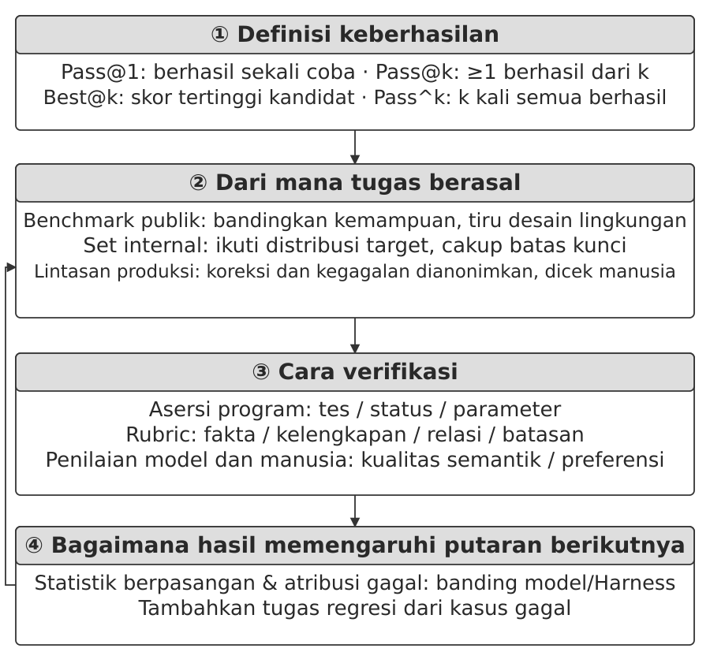
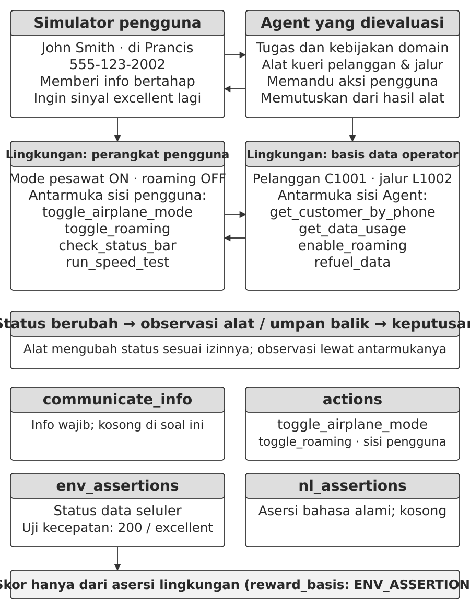
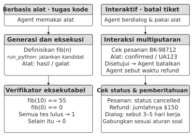
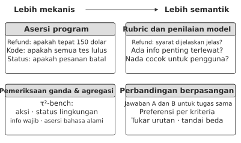
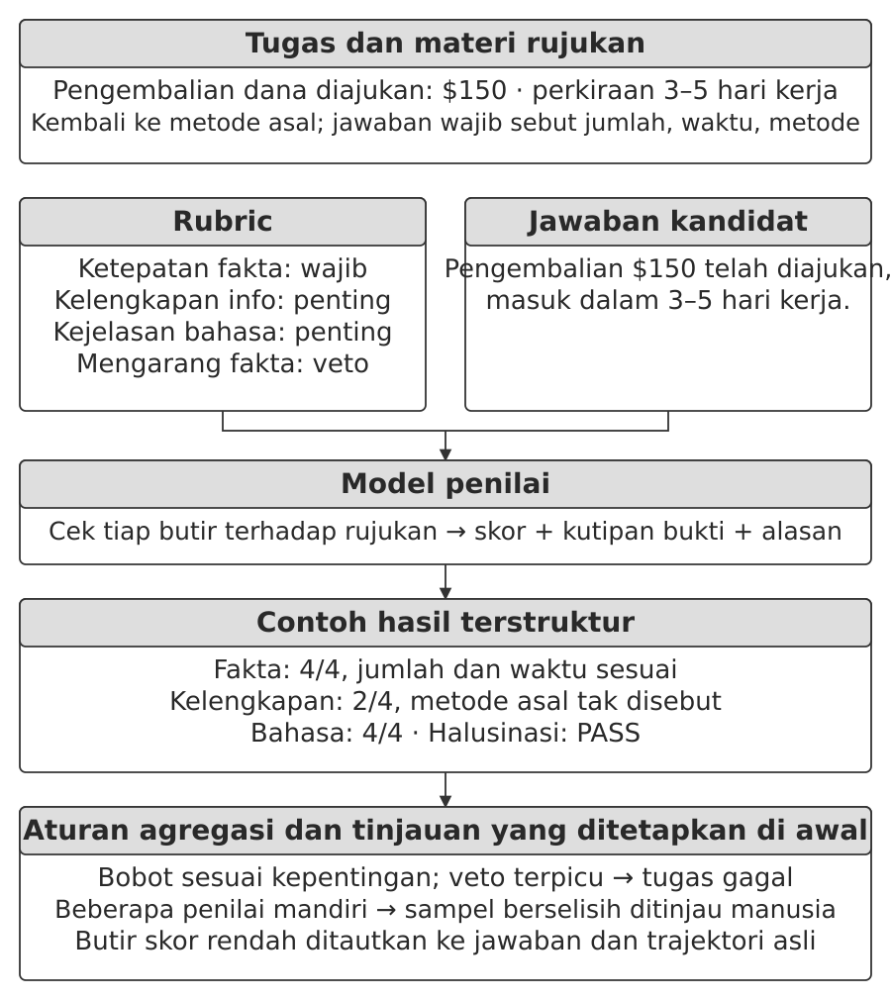
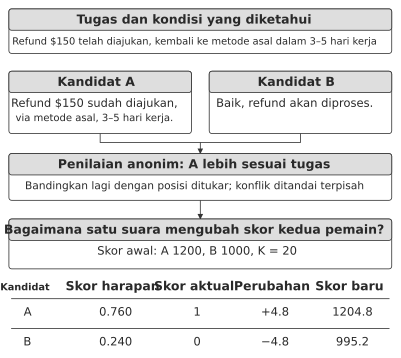
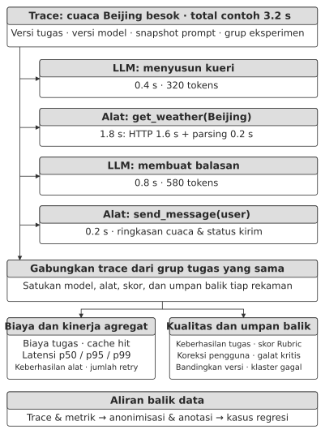
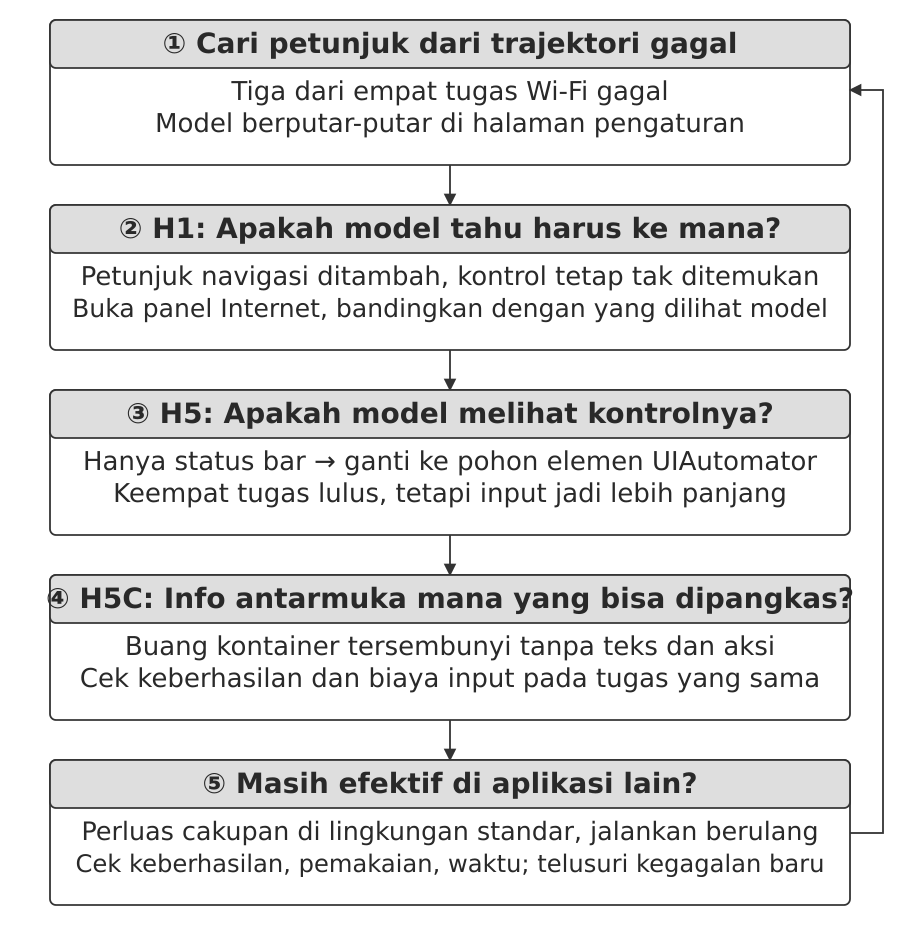
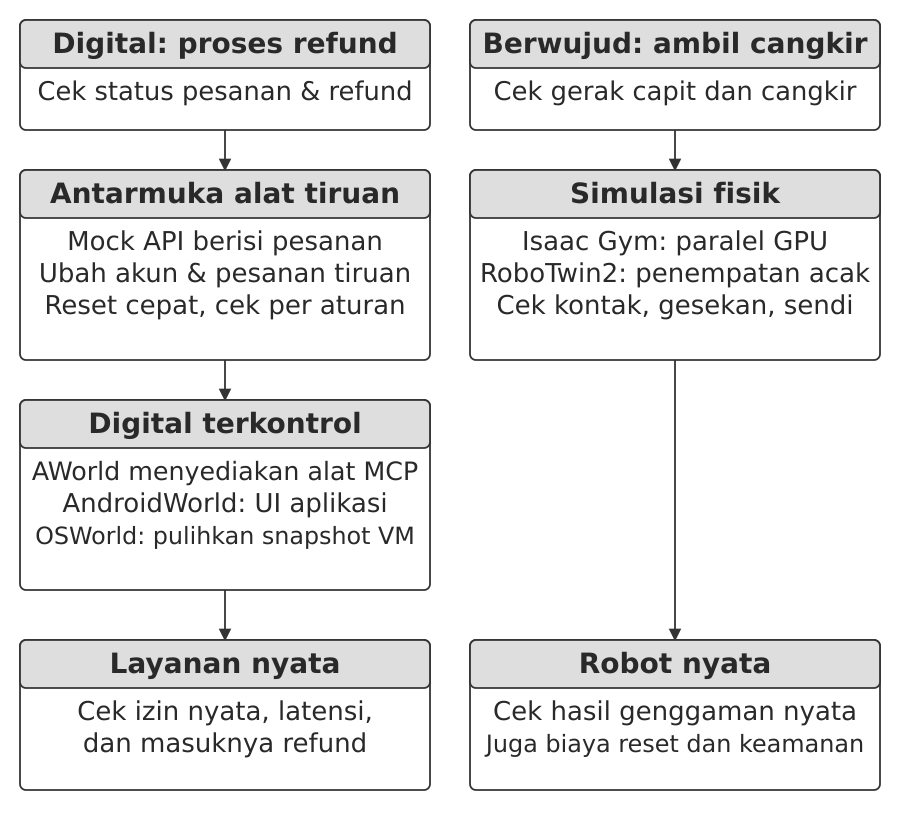
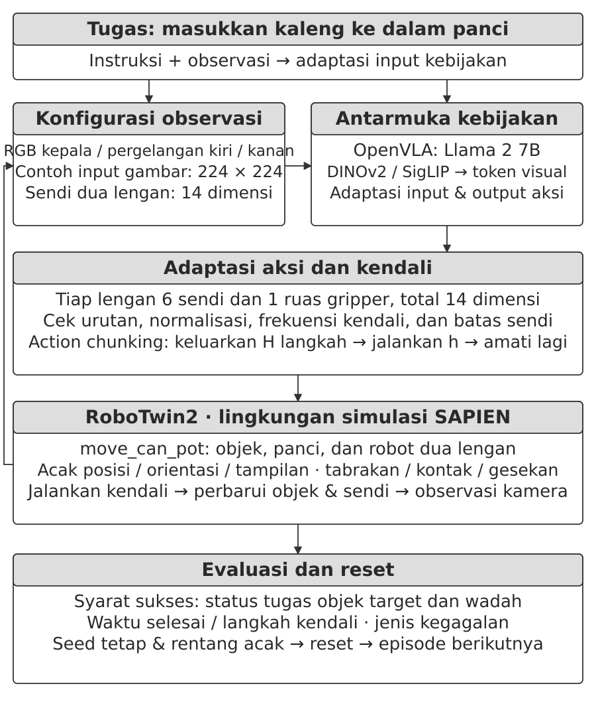

# Mengevaluasi Agent

Enam bab pertama membahas cara membangun satu Agent: konteks, memori, basis pengetahuan, alat, kode, serta antarmuka observasi dan aksi. Setelah sistemnya berdiri, kita memerlukan sekumpulan tugas yang dapat diulang untuk menilai apa yang sanggup ia kerjakan, dalam kondisi apa ia mudah gagal, dan bagian mana yang perlu diubah berikutnya. Hasil evaluasi juga menjadi umpan balik bagi pascapelatihan dan evolusi berkelanjutan.

Selama pengembangan, banyak pilihan perlu dibandingkan dengan tugas nyata: model mana yang dipakai, alat apa saja yang dibuka, isi dan indeks apa yang dipakai basis pengetahuan, bagaimana memori pengguna, *prompt*, dan Skills diatur, serta batasan apa yang perlu ditambahkan pada Harness. Pilihan-pilihan itu juga saling memengaruhi. Misalnya, deskripsi alat yang lebih rinci dapat mengurangi kesalahan parameter, tetapi juga dapat menambah beban konteks; menambahkan langkah verifikasi dapat menaikkan tingkat keberhasilan, sekaligus memperpanjang waktu penyelesaian.

**Eksperimen komparatif** membandingkan berbagai alternatif pada tugas dan kondisi yang sama, lalu mencatat perubahan tingkat keberhasilan, waktu, dan biaya. **Eksperimen ablasi** mencabut atau menonaktifkan komponen seperti pemeringkatan ulang hasil penelusuran, ringkasan status, atau verifikasi hasil, lalu mengamati bagaimana kinerja sistem berubah. Dengan menetapkan secara jelas apa yang diubah pada tiap putaran, menjaga kondisi lain tetap sama, dan mengukur berulang kali, kita dapat secara bertahap mengaitkan pilihan rekayasa dengan hasil tugas. Penulis menganjurkan agar perbandingan dan ablasi menjadi bagian dari pengembangan sehari-hari. Bila hanya bersandar pada beberapa *trajectory* yang kebetulan lancar, keberhasilan yang kebetulan mudah dikira perbaikan, atau kita hanya melihat keuntungan pada satu jenis tugas dan luput melihat kemunduran pada tugas lain.

**Objek evaluasi semestinya Agent utuh yang tersusun dari model dan Harness.** Model menentukan cara memahami tugas dan memilih tindakan, sedangkan Harness mengatur konteks, menjadwalkan alat, memelihara status, dan menjalankan pemeriksaan. Model yang sama, bila dipasangkan dengan alat atau alur umpan balik yang berbeda, dapat memberikan hasil tugas yang berbeda. Coding Harness yang dibahas pada Bab 5 menyediakan skenario perbandingan semacam ini.

**Eksperimen pertukaran model (*model swap*)** dapat dipakai untuk meneliti kecocokan antara model dan Harness: tetapkan dulu kerangka eksekusi dan tugasnya, ganti modelnya, lalu bandingkan hasil akhir dan sebaran kesalahannya. Bila model yang lebih kuat masih gagal pada langkah yang sama, periksa apakah ada alat yang kurang, apakah umpan balik datang tepat waktu, dan apakah penilaian mencakup tujuan tugas; bila kinerja tugas berubah tajam mengikuti model, barulah analisis kemampuan penalaran, perencanaan, atau kepatuhan pada instruksi mana yang memengaruhi hasil.

Pertukaran model dan ablasi komponen dapat dijalankan secara bersilangan. Misalnya, biarkan dua model masing-masing menjalankan dua konfigurasi, "dengan ringkasan status" dan "tanpa ringkasan status", lalu periksa apakah ringkasan membantu keduanya memulihkan tugas panjang dan apakah manfaatnya bergantung pada model. Dengan cara ini kita dapat menganalisis perbedaan antarmodel sekaligus menemukan dalam kondisi apa sebuah komponen Harness efektif.

Evaluasi juga berfungsi sebagai pemeriksaan regresi saat model ditingkatkan. Model baru bisa saja maju pada benchmark publik, tetapi mundur pada sebagian tugas bisnis; himpunan tugas milik sendiri dapat memperlihatkan perubahan itu. Penulis menganjurkan "membangun produk untuk model masa depan": selesaikan lebih awal alat, alur bisnis, dan himpunan evaluasinya, lalu terus lacak kinerja setiap model baru pada tugas yang sama. Ketika tingkat keberhasilan, waktu respons, dan biaya sudah memenuhi syarat produk, barulah dorong peluncurannya.

Bagaimana menuliskan syarat peluncuran menjadi satu perangkat evaluasi? Saat membaca Gambar 7-1, telusuri satu kali pengujian dari awal: apa yang hendak diukur, dari mana tugas dipilih, bukti apa yang dipakai untuk memutuskan keberhasilan, dan bagaimana hasilnya dicatat serta dibandingkan?



## Memahami evaluasi lewat satu tugas: domain telecom pada τ²-bench

Mari mulai dari gangguan internet di sebuah ponsel. John Smith memakai nomor 555-123-2002, sedang berada di Prancis, dan bilah status ponselnya menampilkan "No Service". Ia ingin internetnya pulih dan baru menganggap gangguan selesai bila tes kecepatan menghasilkan excellent; ia bersedia mengisi 2,0 GB kuota data bila perlu, dan ingin mempertahankan paketnya yang sekarang.

Kasus ini berasal dari domain telecom pada τ²-bench milik Sierra. Lingkungannya menyimulasikan sistem backend operator dan perangkat pengguna sekaligus; Agent layanan pelanggan dan simulator pengguna masing-masing membaca serta mengubah sebagian status itu melalui alat. Evaluasi perlu menelusuri interaksi kedua pihak untuk memeriksa bagaimana masalah ditemukan, bagaimana tindakan dijalankan, dan apakah jaringan akhirnya pulih.[^ch7-tau2-task]

### Empat komponen definisi tugas

Agar Agent layanan pelanggan lain dapat menangani soal yang sama, status ponsel dan akun harus dipulihkan lebih dulu, pengguna simulasi harus ikut menelusuri masalah dengan arahan yang sama, dan penilaian akhirnya memakai standar yang sama. Tabel berikut mencantumkan empat bagian definisi tugas. Saat membacanya, perhatikan satu perbedaan: penyusun soal mengetahui pengaturan awal ponsel, tetapi seberapa banyak yang diketahui petugas layanan dan pengguna ketika percakapan dimulai?

| Bagian | Ruas | Isi pada contoh ini |
| --- | --- | --- |
| Tiket | `ticket` | Pengguna, nomor, negara tempat berada, gejala tidak bisa terhubung ke internet, syarat tes kecepatan, dan batasan paket |
| Skenario pengguna | `user_scenario.instructions` | Apa yang diketahui pengguna, bagaimana ia memeriksa saat ditanya, dan kapan ia memastikan masalah selesai |
| Status awal | `initial_state.initialization_actions` | Mengatur identitas dan lokasi pengguna, menyalakan mode pesawat, mematikan roaming perangkat, mengaktifkan roaming di sisi operator |
| Kriteria penilaian | `evaluation_criteria` | Memeriksa tindakan dan status lingkungan, dengan butir yang dihitung ditentukan oleh `reward_basis` |

**Apa yang diketahui pengguna.** `known_info` memuat nama, nomor, dan negara tempat pengguna berada. Mode pesawat yang menyala dan roaming perangkat yang mati tersimpan dalam status lingkungan; simulator pengguna harus memanggil alat untuk memeriksanya sebelum dapat menyampaikannya kepada petugas. Dengan menjadikan pengetahuan pengguna sebagai ruas tersendiri, simulator dapat membedakan informasi yang bisa langsung dijawab dari informasi yang harus benar-benar diperiksa. Bila hanya meminta lewat *prompt* "jangan katakan semuanya sekaligus", sulit untuk mengendalikan secara stabil kapan ia mengungkapkan fakta yang mana. Pengaturan ini mewujudkan pengungkapan informasi bertahap (Progressive Information Disclosure): percakapan dimulai dari "internet saya tidak jalan", dan Agent memperoleh informasi yang diperlukan untuk penelusuran sedikit demi sedikit melalui pertanyaan dan arahan tindakan.

**Bagaimana pengguna menanggapi.** `task_instructions` menetapkan bahwa pengguna menunjukkan sedikit rasa kesal setelah perbaikan pertama gagal, baru memastikan masalah selesai bila tes kecepatan menghasilkan excellent, dan wajib menjawab pertanyaan tentang perangkat berdasarkan hasil alat. Poor, fair, dan good semuanya belum memenuhi sasaran soal ini. Pengaitan fakta (Grounding) membuat pengguna menanggapi berdasarkan status nyata lingkungan simulasi. Tanpa batasan ini, pengguna simulasi bisa saja mengiyakan ucapan petugas "seharusnya sekarang sudah beres"; percakapan kedua pihak tampak lancar, padahal gangguan perangkat masih ada.

**Dari status apa kedua pihak memulai.** Di sisi pengguna, identitas diatur dengan `set_user_info`, `set_user_location(abroad=true)` menandakan pengguna berada di luar negeri, lalu dijalankan `turn_airplane_mode_on` dan `turn_roaming_off`. Di sisi operator, `enable_roaming` mengaktifkan roaming untuk jalur `L1002` milik pelanggan `C1001`. Akibatnya, penelusuran di backend akan menunjukkan roaming sudah aktif, sementara ponsel tetap tidak bisa terhubung karena mode pesawat dan pengaturan roaming perangkat. Petugas harus menuntun pengguna memeriksa perangkatnya untuk memperoleh informasi yang tidak tersedia dari penelusuran backend.

**Pemeriksaan mana yang menentukan skor.** `actions` mencantumkan `toggle_airplane_mode` dan `toggle_roaming` di sisi pengguna. `env_assertions` memuat pemeriksaan status data seluler serta pemeriksaan tes kecepatan dengan parameter `expected_speed=200` dan `expected_desc="excellent"`. Format tugas juga menyediakan `communicate_info` dan `nl_assertions`, yang masing-masing menggambarkan informasi yang wajib disampaikan kepada pengguna dan asersi dalam bahasa alami; pada soal ini keduanya kosong.

`reward_basis` soal ini memilih `ENV_ASSERTION`, sehingga imbalan total ditentukan oleh asersi lingkungan. Pemeriksaan tindakan boleh muncul dalam hasil, tetapi apakah ikut dihitung dalam skor total ditentukan oleh konfigurasi penilaian.

### Memeriksa hasil dengan menelusuri trajectory eksekusi

Eksekusi pendamping memilih lima tugas telecom, masing-masing dijalankan sekali; Agent layanan pelanggan dan simulator pengguna sama-sama memakai GPT-4.1 mini, dan pada akhirnya empat soal lolos. Berikut kita analisis dulu tugas roaming di Prancis di atas, lalu bandingkan dengan tugas yang gagal.

> **Eksperimen 7-1 ★: Menjalankan τ²-bench dan membandingkan evolusinya dari τ-bench**
>
> Bacalah dulu skenario pengguna, aksi inisialisasi, dan syarat penilaian sebuah tugas, lalu jalankan satu interaksi lengkap. Sepanjang trajectory, tandai penelusuran oleh petugas, tindakan pengguna, perubahan status, dan hasil penerimaan, lalu periksa informasi mana yang menjadi dasar setiap keputusan.
>
> Saat membandingkan τ-bench dengan τ²-bench, perhatikan terutama apakah pengguna dapat mengubah lingkungan melalui alat, dan tuntutan koordinasi apa yang ditimbulkan perubahan itu bagi petugas.
>
> Saat melihat Gambar 7-2, cari dulu siapa yang dapat mematikan mode pesawat ponsel, lalu siapa yang dapat mengubah konfigurasi roaming operator. Kedua pihak dapat melakukan hal yang berbeda; inilah sebabnya setelah petugas menyelesaikan tindakannya sendiri, ia masih harus meminta pengguna menjalankan tes kecepatan di ponsel.
>
> 

Saat menangani tugas roaming di Prancis, Agent pertama-tama mengidentifikasi akun. Dari nomor telepon ia menemukan pelanggan `C1001` dan menelusuri informasi pemakaian data `L1001`, `L1002`, dan `L1003`, tetapi dari rincian `L1001` ia menarik kesimpulan yang keliru: nomor 555-123-2002 yang diberikan pengguna tidak ada di antara jalur aktif, dan nomor terdekat adalah 555-123-2001. Setelah pengguna bersikeras nomornya benar, Agent melanjutkan penelusuran ke `L1002` dan barulah memastikan jalur yang benar.

Selanjutnya simulator pengguna memanggil `check_network_status` dan `check_status_bar`. Status yang dikembalikan: mode pesawat menyala, jaringan seluler tanpa layanan, data seluler menyala, roaming perangkat mati. Berdasarkan itu pengguna melapor: "Ponsel saya sedang dalam mode pesawat, dan data roaming juga mati. Perlu saya matikan mode pesawatnya dulu?" Di sini penelusuran dijalankan oleh alat di sisi pengguna, dan hasilnya diteruskan kepada petugas melalui percakapan.

Inilah mekanisme **kendali ganda (Dual-Control)**: petugas menelusuri dan mengoperasikan backend operator, sedangkan simulator pengguna memiliki alat perangkat tersendiri, misalnya melihat bilah status, menyalakan atau mematikan mode pesawat, memasang ulang kartu SIM, dan menjalankan tes kecepatan. Kedua pihak mengoordinasikan tindakan lewat percakapan, dan lingkungan mencatat perubahan status yang ditimbulkan masing-masing.

Agent kemudian menuntun pengguna mematikan mode pesawat dan menyalakan roaming perangkat, dan bilah status menampilkan sinyal 5G. Pengguna menjalankan `run_speed_test`, memperoleh hasil 275 Mbps dengan predikat Excellent, lalu memastikan masalah selesai. Kedua asersi lingkungan lolos, dan imbalan soal ini 1,0.

Trajectory yang berhasil ini juga menyingkap masalah proses. Kebijakan mengharuskan petugas memanggil satu alat setiap kali, tetapi Agent mengeluarkan `get_customer_by_phone` dan `get_customer_by_name` dalam satu pesan yang sama. Skor total tugas ini hanya memperhitungkan asersi lingkungan, sehingga perilaku itu tidak mengubah imbalan.

Dalam satu trajectory lain yang gagal, jalur yang salah pilih tidak pernah dikoreksi, sehingga penelusuran berikutnya ikut melenceng. Nomor pengguna tetap 555-123-2002, tetapi Agent memilih `L1001` dan terus menelusuri berdasarkan pemakaian 3,2/5 GB pada jalur itu. Alat sudah mengembalikan bahwa `L1001` berpadanan dengan 555-123-2001, tetapi Agent tetap tidak mengoreksi jalurnya; setelah beberapa putaran penelusuran yang tidak relevan, ia mengalihkan ke petugas manusia. Di sisi pengguna, mode hemat data berhasil dimatikan, tetapi pengisian kuota 2 GB yang diperlukan jalur yang benar, `L1002`, tidak pernah dijalankan, dan ketiga asersi lingkungan gagal semua.

Dengan membandingkan kedua trajectory, skor akhir dapat diurai menjadi titik-titik perbaikan yang konkret: mencocokkan pemetaan nomor dan jalur, memakai bukti baru untuk mengoreksi penilaian, membedakan status perangkat dari status backend, dan memverifikasi bahwa pengisian kuota yang diperlukan benar-benar terlaksana. Bagian atribusi kegagalan nanti akan membahas lebih lanjut cara menemukan titik-titik balik penting itu dalam trajectory yang panjang.

[^ch7-tau2-task]: τ²-bench dari Sierra Research mendefinisikan alat pengguna untuk domain telecom dalam `user_tools.py`, dengan titik masuk penilaian `evaluator.py`. Isi kasus dan hasilnya disusun dari lima soal beserta trajectory eksekusi yang disimpan di materi pendamping.

## Metrik evaluasi: definisi keberhasilan

Empat dari lima tugas lolos; itulah capaian keseluruhan eksekusi kali ini. Untuk mengambil keputusan produk berdasarkan angka itu, kita masih perlu memperjelas jenis tugas dan harga sebuah kegagalan. Layanan pelanggan untuk pengembalian dana harus terus-menerus menuntaskan pengembalian dana yang memenuhi syarat; saat menulis program, kita boleh membangkitkan beberapa implementasi lalu menyaring dengan pengujian versi yang dapat berjalan dan memberi hasil benar; dalam riset pun kita boleh mengajukan beberapa hipotesis lalu membiarkan peneliti mengujinya. Metrik evaluasi harus sesuai dengan cara pemakaian semacam ini.

### Keajaiban teknis: mengukur kemampuan dengan banyak percobaan lewat Pass@k

Penulis menyebut sebagian demonstrasi Agent yang mengesankan sebagai **"keajaiban teknis"**: bila diberi cukup waktu dan kesempatan mencoba, sistem menuntaskan tugas yang sebelumnya sulit diselesaikan secara otomatis. Untuk pekerjaan yang bersifat penjelajahan, satu trajectory sukses yang sudah terverifikasi saja dapat bernilai. Metrik **Pass@k** sesuai dengan cara pemakaian ini: tugas yang sama dijalankan $k$ kali, dan dianggap berhasil asalkan setidaknya satu kali lolos. Untuk tugas dengan skor kontinu, kita juga dapat melaporkan skor tertinggi dari $k$ kali itu, yang disebut **Best@k**.

Misalnya, Anthropic pernah mengorganisasi beberapa instans Claude untuk bekerja sama membangun sebuah kompiler C, sebagai bukti bahwa eksekusi jangka panjang, umpan balik pengujian, dan pembagian tugas mampu menopang rekayasa yang rumit. Ketika peneliti mencari contoh tandingan matematis, mereka juga dapat membiarkan model mencoba berulang-ulang, lalu memverifikasi secara mandiri apakah salah satu contoh tandingan itu sahih. Tinjauan keamanan perangkat lunak dapat memeriksa ulang dugaan masalah yang dilaporkan model, dan penciptaan karya terbuka dapat memilih yang terbaik dari beberapa hasil.[^ch7-long-running]

Produk aplikasi pun memperlihatkan kemampuannya lewat tugas yang rumit. Manus menyerahkan sebuah komputer virtual kepada Agent, sehingga pengguna dapat melihatnya mengoperasikan antarmuka, mencari bahan, dan terus menuntaskan pekerjaan. OpenClaw menerima tugas lewat aplikasi pesan instan, mengakses berkas dan layanan yang sudah dikonfigurasi dan diizinkan, melaporkan kemajuan dan meminta informasi tambahan di tengah proses, dan dapat dibangunkan oleh mekanisme terjadwal untuk memeriksa daftar pekerjaan. Perilaku konkret semacam ini memudahkan pengguna memahami kegunaan Agent.

Menurut penulis, demonstrasi yang mampu menuntaskan jenis tugas baru merupakan faktor penting yang membuat produk-produk ini menarik pengguna.

### Keandalan bisnis: berfokus pada Pass^k

Alur bisnis biasanya menuntut setiap kali eksekusi menghasilkan keluaran yang benar. **Pass^k** mengukur keadaan ketika tugas yang sama dijalankan $k$ kali dan setiap kalinya lolos; bacalah sebagai "pass power k". Syarat lolos sebuah tugas dapat sekaligus mencakup hasil akhir, kepatuhan pada kebijakan, dan batasan hak akses; setiap eksekusi diperiksa dengan syarat yang sama.

Dengan asumsi setiap eksekusi saling bebas dan peluang berhasil sekali jalan selalu $p$, maka:

$$
\mathrm{Pass@k}=1-(1-p)^k,\qquad
\mathrm{Pass}^{k}=p^k.
$$

Misalnya, pada $p=0.6$ dan $k=5$, Pass@5 sekitar 99,0%, sedangkan Pass^5 sekitar 7,8%. Angka pertama berarti dari lima percobaan biasanya ada satu yang berhasil; angka kedua berarti peluang kelima-limanya berhasil masih sangat rendah.

Saat membaca sekelompok hasil nyata, rumus itu boleh dikesampingkan dulu. Misalkan satu soal dijalankan lima kali dengan hasil "lolos, gagal, lolos, lolos, gagal"; untuk kelompok ini Pass@5 bernilai 1, Pass^5 bernilai 0, dan tingkat keberhasilan sekali jalan diperkirakan 3/5. Angka 99,0% dan 7,8% di atas menjawab pertanyaan lain: jika diketahui peluang berhasil setiap kali adalah 0,6 dan lima kali percobaan dijadikan satu kelompok yang diulang terus, berapa banyak kelompok yang mencapai standar masing-masing?

Catatan yang sama juga dapat menjawab pertanyaan yang lebih mudah dicek: dari lima eksekusi tadi, bila diambil dua sembarang, berapa proporsi pasangan yang lolos? Anggaplah setiap eksekusi sebagai satu kartu dan ambil dua kartu tanpa pengembalian; ada sepuluh pasangan. Hanya pasangan dua kartu gagal yang membuat kedua kali gagal, sehingga sembilan pasangan berhasil setidaknya sekali, dan perkiraan sampel Pass@2 adalah 9/10. Tiga kartu berhasil dapat membentuk tiga pasangan, sehingga perkiraan sampel Pass^2 adalah 3/10. τ²-bench menghitung kombinasi yang semuanya lolos per tugas persis seperti ini: satu soal dijalankan $n$ kali dengan $s$ kali berhasil, lalu dipilih $k$ kali; proporsi kombinasi yang semuanya lolos adalah $\binom{s}{k}/\binom{n}{k}$, dengan $1\le k\le n$.[^ch7-tau2-metrics]

Sekarang baca kembali angka 4/5 pada Eksperimen 7-1. Kelima trajectory itu berasal dari lima soal yang berbeda; setiap soal hanya punya satu kartu, sehingga satu pasangan pun tidak bisa dibentuk. Untuk memperkirakan Pass^2 tugas-tugas ini, setiap soal harus diberi eksekusi independen tambahan, lalu dihitung dan dirangkum masing-masing. Mengkuadratkan 0,8 secara langsung sama saja dengan menambahkan asumsi bahwa peluang berhasil setiap soal sama dan setiap percobaan saling bebas.

[^ch7-tau2-metrics]: Versi eksperimen τ²-bench (revisi 8d005b0) menghitung Pass^k per soal di dalam `agent_metrics.py`. Bila jumlah keberhasilan kurang dari $k$, jumlah kombinasi yang semuanya lolos adalah nol.

Saat menghitung, satuan statistiknya harus konsisten. Lima kali pengambilan sampel atas tugas yang sama mengukur kinerja berulang pada tugas itu; lima tugas berbeda yang berturut-turut di produksi juga dipengaruhi tingkat kesulitan tugas dan sebaran lalu lintas. Bila peluang berhasil tiap tugas berbeda, hitung dulu metrik keberhasilan berulang masing-masing, lalu rangkum menurut bobot tugas. Status bersama, cache, atau gangguan yang sama juga dapat membuat beberapa eksekusi saling berkorelasi.

**Bila jawaban "informasi tidak cukup" diperbolehkan, apa penyebutnya?** Bayangkan sebuah asisten literatur menerima 100 soal, menjawab 80 di antaranya, dan 68 jawabannya benar. Pembaca yang mengandalkan jawaban yang sudah diberikan peduli pada 68/80, yaitu 85%; orang yang perlu menuntaskan seluruh tugas ini juga peduli pada 68/100, yaitu 68%. Sisanya, 20 soal, perlu dicarikan bukti tambahan atau diteruskan kepada manusia.

PaperQA2 boleh memilih "informasi tidak cukup" pada 248 soal literatur LitQA2. Makalahnya melaporkan hasil rata-rata dari tiga putaran eksekusi: ketika sistem memberi jawaban substantif, ketepatannya 85,2%; bila dihitung atas seluruh soal, ketepatannya 66,0%, dengan 21,9% lainnya memilih informasi tidak cukup. Untuk sembilan penjawab manusia, kedua angka ketepatan itu adalah 73,8% dan 67,7%. Makalah tersebut melaporkan bahwa selisih pada angka pertama signifikan, sedangkan selisih pada angka kedua tidak mencapai signifikansi statistik.[^ch7-paperqa2-denominators]

[^ch7-paperqa2-denominators]: Skarlinski dkk., *Language Agents Achieve Superhuman Synthesis of Scientific Knowledge*, 2024, lihat Bagian 2 dan Gambar 2.

Dua trajectory dengan status akhir yang sama bisa memakan biaya yang berbeda. Ambil contoh pengecekan tagihan: A langsung mengembalikan jumlah yang benar dengan satu kali penelusuran. B baru memberi jawaban yang sama setelah dua kali menelusuri. Kedua penelusuran membawa pengenal permintaan yang sama dan yang pertama sempat kehabisan waktu, artinya percobaan ulang membantu B memulihkan tugasnya. Seandainya hasil penelusuran pertama sudah berhasil sampai, penelusuran kedua hanya menambah waktu tunggu dan biaya alat dengan percuma.

Bila eksekusi melibatkan penulisan data atau efek eksternal lain, pulihkan dulu status awal yang ditetapkan untuk setiap percobaan, kerjakan tindakannya di lingkungan uji, dan catat semua percobaan. Jika produk mengizinkan percobaan ulang setelah gagal, masukkan jumlah percobaan ulang, langkah pemulihan, dan biaya eksekusinya ke dalam evaluasi alur; catatan kegagalan aslinya tetap disimpan agar kinerja sekali jalan dapat dibedakan dari hasil setelah pemulihan.

[^ch7-long-running]: Anthropic, Building a C compiler with a team of parallel Claudes, 2026-02-05, memperkenalkan kerja sama banyak instans, eksekusi jangka panjang, dan umpan balik pengujian.

## Lingkungan evaluasi

Misalkan kita hendak memeriksa ulang eksekusi tadi yang salah memilih jalur. Pemeriksa perlu melihat pengguna yang sama, dua jalur yang sama, dan paket awal yang sama. Jika eksekusi pertama sudah mengubah salah satu jalur, menjalankannya sekali lagi begitu saja tidak memungkinkan kita menilai apakah perubahan hasil berasal dari model atau dari basis data. Lingkungan evaluasi bertugas menyiapkan titik awal tugas, menyediakan antarmuka interaksi, mencatat prosesnya, dan memeriksa titik akhirnya.

### Lima komponen penyusun

Dengan tugas telecom sebagai contoh, lingkungan evaluasi dapat diurai menjadi lima bagian.

**Himpunan data (Dataset)** menyimpan definisi tugas: latar belakang pengguna, tuntutan perilaku, status awal, dan syarat penerimaan. Satu rekaman berpadanan dengan satu kasus uji, dan saat dijalankan informasinya dibagikan sesuai peran tiap peserta.

**Status lingkungan (Environment State)** menyimpan informasi yang dapat berubah selama tugas berjalan, misalnya pelanggan, jalur, paket, tagihan, serta pengaturan mode pesawat, roaming, dan hemat data pada perangkat. Saat memulai putaran baru, lingkungan memulihkan data dasarnya lebih dulu, lalu menjalankan `initialization_actions` untuk menciptakan gangguan yang ditetapkan tugas saat ini. Pembersihan dan inisialisasi harus saling melengkapi agar pengisian kuota atau perubahan pengaturan dari putaran sebelumnya tidak terbawa ke putaran berikutnya.

**Antarmuka alat (Tools)** menentukan apa yang dapat dibaca dan diubah oleh para peserta. Petugas layanan dapat menelusuri pelanggan, memeriksa pemakaian, mengisi kuota data, atau mengalihkan ke petugas manusia; pengguna dapat melihat status perangkat, menyalakan atau mematikan sakelar, dan menjalankan tes kecepatan. Granularitas alat harus sesuai dengan kemampuan yang diuji: jika yang hendak dinilai adalah diagnosis dan perencanaan, biarkan Agent menggabungkan penelusuran dan tindakan; jika langsung disediakan alat "perbaiki masalah internet", fokus pengujian bergeser menjadi kapan kemampuan itu dipanggil.

**Kriteria penilaian (Rubric)** menjelaskan cara menilai hasil. Tugas telecom dapat memeriksa tindakan, status lingkungan, komunikasi yang wajib, dan tuntutan dalam bahasa alami, lalu menentukan lewat `reward_basis` pemeriksaan mana yang ikut dihitung dalam skor total.

**Protokol eksekusi (Interaction Protocol)** mengatur giliran bicara, pemanggilan alat, dan penghentian. Simulator pengguna dapat mengeluarkan `###STOP###` untuk mengakhiri interaksi, dan *runner* juga menetapkan anggaran seperti jumlah giliran. Alasan berhenti dan skor tugas dicatat terpisah: setelah pengguna menghentikan percakapan, asersi lingkungan tetap bertugas menilai apakah sasaran tercapai; bila anggaran habis, status terakhir dan langkah yang belum selesai juga perlu disimpan.

### Lingkungan evaluasi tipe interaksi manusia-komputer dan tipe pemanggilan alat

Tugas telecom memuat simulator pengguna yang terus menanggapi dan mengoperasikan perangkat. Sebaliknya, perbaikan kode, analisis data, dan penyelesaian soal matematika biasanya dimulai oleh instruksi tugas, lalu Agent terutama berinteraksi dengan alat. Kedua jenis lingkungan sama-sama membutuhkan tugas, status, antarmuka, penilaian, dan protokol eksekusi; bedanya terletak pada perlu tidaknya menyimulasikan lawan bicara dan bagaimana kedua pihak mengoordinasikan tindakan.

Tugas kode dapat memeriksa keluaran dengan pengujian, tugas basis data dapat menelusuri rekaman yang sudah diubah, sedangkan analisis terbuka mungkin perlu ditinjau oleh manusia atau model. Tugas interaksi manusia-komputer sering kali menuntut dua jenis bukti sekaligus. Misalnya, pulih tidaknya jaringan ponsel dilihat dari status perangkat; apakah petugas sudah memperjelas nomor dan menuntun pengguna bertindak dilihat dari percakapan. Pengembalian dana pada Gambar 7-3 pun demikian: apakah pesanan sudah dibatalkan dapat dicek di basis data; apakah petugas sudah memberi tahu kapan dana masuk harus dicari dalam percakapan.



Di Verifiers, kedua jenis tugas ini dapat dimulai dari antarmuka lingkungan yang berbeda. Tabel 7-1 mencantumkan antarmuka pada v0.1.9 yang menangani jawaban satu giliran, pemanggilan alat multi-giliran, injeksi status eksekusi, dan pengelolaan sumber daya sandbox, agar mudah dicocokkan dengan kodenya.[^ch7-verifiers-env]

Tabel 7-1 Perbandingan tipe lingkungan Verifiers

| Tipe lingkungan | Tanggung jawab utama | Penanganan alat dan status | Kasus penggunaan khas |
|---|---|---|---|
| `SingleTurnEnv` | Mengatur jawaban satu giliran | Dinilai setelah satu jawaban | Soal matematika, tanya jawab satu giliran |
| `ToolEnv` | Mengatur interaksi alat multi-giliran | Menyimpan trajectory, mendistribusikan alat dan menerima hasil | Pencarian dan sintesis informasi |
| `StatefulToolEnv` | Menghubungkan status eksekusi ke eksekusi alat | Melengkapi parameter alat atau memperbarui status berdasarkan status saat ini | Mengikat basis data atau pengenal sumber daya untuk tugas ini |
| `SandboxEnv` | Mengelola lingkungan eksekusi terisolasi | Mengalokasikan sandbox untuk eksekusi dan memakai alat di dalamnya | Menjalankan kode, memeriksa berkas dan hasil pengujian |

Misalnya, ketika dua tugas mengubah basis data secara bersamaan, *runner* dapat menyuntikkan pengenal basis data masing-masing ke dalam pemanggilan alat, sehingga setiap trajectory mengoperasikan data miliknya sendiri. Ketika eksekusi gagal, alat sebaiknya mengembalikan informasi yang berguna untuk keputusan berikutnya, misalnya objek tidak ada, parameter tidak memenuhi syarat, atau layanan kehabisan waktu. Sistem evaluasi menyimpan observasi, pemanggilan, hasil eksekusi, dan imbalan, sehingga saat dianalisis kesalahan dapat dilacak sampai ke langkah tertentu.

[^ch7-verifiers-env]: Prime Intellect, ToolEnv dan StatefulToolEnv pada Verifiers v0.1.9, memperlihatkan trajectory multi-giliran, distribusi alat, dan injeksi parameter status.

## Desain himpunan data evaluasi

Sekarang kita perluas lima soal telekomunikasi tadi menjadi himpunan evaluasi yang dapat memandu keputusan rilis. Jika semua soal tambahan berbunyi "aktifkan roaming untuk nomor tertentu", sistem bisa memperoleh skor tinggi meskipun tidak pernah belajar membedakan dua jalur dalam satu akun. Jika skor akan dipakai untuk memutuskan apakah Agent layanan pelanggan boleh diluncurkan, pemilihan soal harus mengacu pada tiket nyata, mencakup urusan rutin sekaligus soal sulit yang mudah membuat jalur tertukar, dan penilaiannya juga harus memeriksa jalur mana yang akhirnya diubah petugas. Setelah peluncuran, soal-soal ini masih harus dipelihara agar terus mencerminkan pekerjaan yang benar-benar diserahkan pengguna.

### Perbandingan menyilang desain benchmark

Tabel 7-2 menyandingkan enam benchmark menurut kemampuan, asal tugas, lingkungan eksekusi, dan cara verifikasi.

Tabel 7-2 Pilihan desain kunci beberapa benchmark Agent

| Benchmark | Kemampuan yang diuji | Asal dan susunan tugas | Lingkungan eksekusi | Cara verifikasi |
|---|---|---|---|---|
| τ²-bench | Interaksi layanan pelanggan dan pengoperasian alat | Tugas domain dan kombinasi gangguan | Simulator pengguna, perangkat, dan basis data bisnis | Pemeriksaan per butir, skor menurut `reward_basis` |
| SWE-bench Verified | Perbaikan masalah kode | Issue GitHub nyata, disaring manual | Repositori kode dan lingkungan uji | Pengujian `FAIL_TO_PASS` dan `PASS_TO_PASS` |
| AndroidWorld | Pengoperasian aplikasi Android | Templat tugas berparameter | Emulator Android yang menjalankan aplikasi sungguhan | Membaca status perangkat, berkas, atau internal aplikasi |
| OSWorld | Pengoperasian desktop dan lintas aplikasi | Skenario pemakaian nyata, titik awal tugas dikonfigurasi | Mesin virtual dan aplikasi desktop | Pemeriksaan status eksekusi dan hasil kerja per tugas |
| Terminal-Bench | Tugas rekayasa di terminal | Tugas dan pengujian rancangan manual | Kontainer beserta dependensi yang dibutuhkan tugas | Berkas, eksekusi program, dan hasil pengujian |
| GAIA | Pengolahan informasi oleh asisten umum | Pertanyaan tulisan manual, sebagian dengan lampiran | Internet, berkas, dan alat bantu | Dibandingkan setelah dinormalisasi menurut format jawaban |

### Verifier

Verifier menghubungkan sasaran tugas dengan bukti yang dapat diperiksa. Tugas kode perlu menjalankan pengujian, tugas desktop perlu membaca status aplikasi atau berkas, dan tugas pencarian informasi perlu mencocokkan jawaban beserta sumbernya. **Penerimaan harus berpegang pada bukti yang diperoleh secara mandiri.** Agent bisa saja menghasilkan laporan lengkap yang menyatakan semua langkah sudah selesai; verifier tetap harus benar-benar menjalankan hasil kerjanya, membaca status, atau mencocokkan sumber. Laporan penyelesaian dipakai untuk menemukan objek yang diperiksa, sedangkan skornya ditentukan oleh pemeriksaan-pemeriksaan itu.

Bayangkan pengguna membuka aplikasi pembayaran dan meminta asisten "menyetujui semua permintaan pembayaran dari teman sekamar bulan ini". Misalkan ada tiga permintaan tertunda: dari teman sekamar bulan ini, dari teman sekamar yang sama bulan lalu, dan dari rekan kerja bulan ini. Permintaan pertama harus disetujui, dua lainnya harus tetap tertunda. Jika hanya permintaan pertama yang diperiksa, asisten yang menyetujui ketiganya pun mendapat nilai penuh; jika hanya dua permintaan terakhir yang diperiksa, asisten yang tidak berbuat apa-apa pun lolos. AppWorld memuat soal ini dalam aplikasi pembayaran simulasi. Saat merancang verifier, kita dapat lebih dulu menandai kelompok permintaan yang diizinkan pengguna berdasarkan data sebelum tindakan, lalu memeriksa apakah semuanya disetujui, dan terakhir menelusuri balik dari catatan setelah tindakan: permintaan mana lagi yang disentuh asisten?[^ch7-appworld-scope]

[^ch7-appworld-scope]: Trivedi dkk., *AppWorld*, ACL 2024; Gambar 2 memuat tugas dan syarat penerimaannya.

Pencarian ilmiah pun dapat menyerahkan hasil kerja yang mudah diverifikasi. FunSearch berusaha memilih sebanyak mungkin titik dalam ruang delapan dimensi; setiap dimensi hanya boleh bernilai 0, 1, atau 2, operasinya dilakukan modulo 3, dan tidak boleh ada tiga titik terpilih yang segaris. Peneliti menulis kerangka program yang memilih titik selangkah demi selangkah, membiarkan model mengusulkan fungsi untuk mengurutkan titik kandidat, lalu menilai berdasarkan ukuran himpunan titik sah yang benar-benar terbangun. Ketika makalahnya terbit, konstruksi yang sudah ada mampu memilih 496 titik, dan program baru menghasilkan daftar berisi 512 titik.[^ch7-funsearch-cap]

Anda cukup mengunduh daftarnya untuk memeriksa hasil ini secara mandiri. Pertama, pastikan daftar itu berisi 512 vektor delapan dimensi yang berbeda dan setiap koordinatnya berada dalam rentang yang ditetapkan. Kemudian, untuk dua titik berbeda sembarang $a,b$, garis yang memuat keduanya hanya berisi tiga titik, dan titik ketiganya adalah $c=-a-b \pmod{3}$. Misalnya, dalam dua dimensi, ambil $(0,0)$ dan $(1,2)$; titik ketiganya adalah $(2,1)$. Terapkan operasi yang sama per koordinat pada delapan dimensi dan telusuri seluruh 130.816 pasangan titik berbeda dalam daftar; tidak satu pun titik ketiga yang dihasilkan muncul dalam daftar. Ini cukup untuk membuktikan bahwa setidaknya 512 titik dapat dipilih. Untuk membuktikan bahwa 513 titik mustahil, masih diperlukan bukti batas atas.

[^ch7-funsearch-cap]: Romera-Paredes dkk., *Mathematical discoveries from program search with large language models*, Nature, terbit daring 2023. Para penulis juga merilis secara terpisah himpunan titik delapan dimensi itu beserta notebook komputasi untuk verifikasinya.

**Dua jenis pengujian SWE-bench masing-masing memeriksa perbaikan dan regresi.** `FAIL_TO_PASS` adalah pengujian yang gagal sebelum perbaikan dan semestinya lolos sesudahnya; `PASS_TO_PASS` adalah pengujian yang semula lolos dan semestinya tetap lolos setelah perbaikan. Yang pertama memeriksa masalah yang ditentukan, yang kedua memeriksa apakah perilaku yang sudah dicakup pengujian yang ada tetap terjaga.[^ch7-swe-verified]

**OSWorld memeriksa hasil kerja aplikasi dengan verifikasi berbasis eksekusi.** Versi aslinya menyediakan 134 fungsi evaluasi berbasis eksekusi yang, bersama konfigurasi tugas, membaca berkas, data aplikasi, atau status sistem.[^ch7-osworld-design] Misalnya, untuk tugas mengubah tabel, kita dapat memeriksa sel dan rumus tertentu; untuk tugas memperbarui pengaturan peramban, kita dapat membaca konfigurasi terkait.

**Terminal-Bench menerima tugas rekayasa berdasarkan hasil eksekusi.** Kasus membangun kernel Linux merangkai modifikasi kode sumber, kompilasi, initramfs, dan booting di QEMU; Linux 6.9, `printk` kustom di dalam `start_kernel`, serta pesan dalam log boot semuanya menjadi titik pemeriksaan yang konkret.

Bab 5 sudah membahas pencocokan angka penjualan dengan pesanan. Jika asisten menyerahkan laporan kuartalan untuk dua puluh kanal, dari mana pemeriksaan dimulai? Tencent WorkBuddy Bench memiliki satu soal rekonsiliasi yang terbuka untuk publik. Kedua lembar kerjanya berisi data kanal; nilai penyelesaian dilihat secara kuartal-ke-kuartal, dibandingkan dengan kuartal sebelumnya; nilai penerimaan pembayaran dilihat secara tahun-ke-tahun, dibandingkan dengan kuartal yang sama tahun lalu. Sekalipun kedua periode dasar sama-sama diisi kuartal sebelumnya, judul kolom dan jumlah kanal bisa saja tetap benar. Ambil contoh "锦绣生活馆" pada lembar penyelesaian: setelah baris duplikat dan rekaman tanpa kuartal dibuang dari rincian lalu dijumlahkan per kanal dan kuartal, total transaksinya naik dari 1.569.231,00 menjadi 1.787.311,03, dengan selisih 218.080,03. Program penilai memeriksa cakupan kanal pada kedua lembar, lalu mengambil sampel nilai dua kanal tertentu. Pemeriksaan cakupan kanal pada soal ini menjangkau kedua puluh kanal, sedangkan pemeriksaan nilai hanya menyentuh dua kanal yang terambil.[^ch7-workbuddy-office]

[^ch7-workbuddy-office]: Tugas perkantoran Tencent WorkBuddy Bench `channel-period-compare-L4-017`. Paket data yang dipakai (revisi 3e8ad83) menyertakan workbook asli, jawaban rujukan, dan program penilai.

Verifier dapat diuji dengan tugas yang peka waktu. Misalkan pengguna meminta diingatkan ketika tarif sebuah hotel turun di bawah 950 yuan. Harganya 1000 yuan pukul 10.00, turun menjadi 900 yuan pukul 10.10, lalu kembali ke 1000 yuan pukul 10.15. Pengingat penurunan harga yang dikirim pukul 10.12 lengkap dengan tipe kamar dan tautan pemesanan masih memberi pengguna kesempatan memesan. Sistem yang setiap hari mengirim pesan "harga belum turun" tetapi justru melewatkan lima menit itu tidak menuntaskan permintaan, meskipun berjalan terus selama seminggu. Saat menilai, catat secara terpisah jumlah jendela waktu yang memenuhi syarat, jumlah pengingat yang tepat waktu di dalam jendela, dan berapa kali pengguna diganggu ketika tidak ada perubahan. Jika evaluator pun hanya menyimpan harga sekali sehari, jendela yang terlewat sama sekali tidak dapat dihitung. Untuk mengukur kelalaian pemberitahuan, siapkan dulu rekaman ulang harga lengkap dengan stempel waktu, lalu biarkan sistem yang diuji memeriksa dengan frekuensinya sendiri.

### Pembagian tingkat kesulitan tugas

Himpunan tugas perlu mencakup berbagai tingkat kesulitan sekaligus menjelaskan dari mana kesulitan itu berasal. Tugas dasar memeriksa apakah kemampuan mengalami kemunduran, sedangkan tugas sulit menyisakan ruang ukur bagi kemajuan model berikutnya; bila semua soal cepat lolos, himpunan evaluasi sulit lagi memandu pemilihan model. Pembagian dapat dilakukan menurut ragam alat, panjang rangkaian tindakan, tingkat keterpencaran informasi, ketidakpastian lingkungan, atau keahlian khusus yang dibutuhkan, lalu dilihat dalam kondisi mana kinerja sistem merosot tajam.

466 soal GAIA dibagi menjadi tiga tingkat. Tugas yang lebih mudah biasanya melibatkan sedikit alat dan langkah, sedangkan tugas yang lebih sulit menuntut pemaduan informasi bertahap dan kombinasi yang rumit. Dalam makalah aslinya, ketepatan anotator manusia pada ketiga tingkat masing-masing 93,9%, 91,8%, dan 87,3%; hasil GPT-4 dengan plugin untuk ketiga tingkat itu adalah 30,3%, 9,7%, dan 0%.[^ch7-gaia-design]

Rentang tugas Terminal-Bench juga lebar: pendaftaran model melibatkan penggunaan MLflow, penerapan banyak komponen menuntut koordinasi layanan Git dan layanan Web, sedangkan pemulihan kata sandi dan analisis diferensial FEAL menambahkan pengetahuan algoritma khusus.

Tugas bisnis juga perlu mencakup batas-batas kebijakan. Misalnya, ketika pengguna mengaku petugas sudah menyetujui pembatalan pesanan, sistem semestinya menelusuri otorisasi dan status pesanan, lalu memutuskan sesuai kebijakan apakah pesanan dibatalkan. Kasus semacam ini menguji cara Agent memakai bukti untuk menangani informasi yang saling bertentangan, dan dapat disandingkan dengan tugas penanganan normal.

### Pencegahan kebocoran data

**Kombinasi banyak sumber dan lampiran khusus.** Jika model dapat menemukan soal beserta jawaban jadinya di hasil pencarian, seberapa banyak kemampuan pencarian dan penalaran yang dibuktikan oleh satu jawaban benar? GAIA mengurangi peluang itu dengan pencarian bertahap dan lampiran khusus. Misalnya, kenali dulu astronaut dari gambar astronomi pada tanggal tertentu, lalu cari kelompok astronaut tempatnya bernaung, bandingkan lama waktu para anggotanya di orbit, dan terakhir keluarkan nama belakang serta jumlah menit sesuai ketentuan. Titik koma, pembulatan angka, dan pemisah ribuan semuanya merupakan konvensi jawaban. PDF, audio, dan gambar yang dibuat khusus menambah ragam kombinasi masukan. Soal yang dipublikasikan bisa masuk ke materi pelatihan. Karena itu, sisihkan pula sekelompok soal khusus untuk evaluasi, dan catat soal mana yang sudah dipakai untuk pelatihan.[^ch7-gaia-design]

**Instans berparameter.** AndroidWorld menyediakan logika inisialisasi, pemeriksaan eksekusi, dan pembersihan untuk setiap tugas, serta membangkitkan instans yang berbeda lewat parameter.[^ch7-androidworld-design] Misalnya, "ubah nomor telepon kontak `[CONTACT_NAME]` menjadi `[NEW_PHONE]`" dapat mengganti kontak dan nomornya sambil mempertahankan sasaran tindakannya. Perubahan parameter dapat memeriksa apakah model bertindak sesuai tugas saat ini; mengunci sebagian parameter dan mengubah sisanya juga memudahkan penelitian atas pengaruh faktor tertentu.

**Pengenal kenari.** Berkas benchmark dapat menyisipkan canary GUID yang unik untuk membantu menemukan petunjuk bahwa data telah disalin atau tercampur ke korpus lain. Berkas tugas Terminal-Bench memakai penanda semacam ini. Saat menilai kebocoran, kita juga harus memeriksa apakah model pernah melihat pengenal itu di konteks saat ini atau di hasil pencarian, lalu memadukannya dengan pelacakan asal data; temuan penanda dapat memicu penyelidikan, tetapi kepemilikan data pelatihan memerlukan bukti lebih lanjut.

### Kendali mutu dan pemeliharaan jangka panjang

Jika soal telecom yang sama lolos kemarin dan gagal hari ini, selain memeriksa perubahan pada Agent, kita juga harus bisa menjawab: apakah jalur awalnya berubah? Apakah simulator pengguna masih bekerja sama menurut aturan yang sama? Apakah syarat penilaian masih menguji sasaran yang sama? Dengan menelusuri titik awal, interaksi, dan titik akhir sebuah eksekusi, kita dapat merumuskan lima pekerjaan pemeliharaan.

1. **Perjelas cakupan informasi pengguna.** Pisahkan `known_info` dari tuntutan perilaku, sehingga langkah penelusuran dan klarifikasi punya titik awal informasi yang jelas.
2. **Tulis syarat penerimaan dengan jelas.** Wujudkan "jaringan pulih" menjadi status data seluler, nilai tes kecepatan, dan predikatnya, sehingga yang diperiksa adalah efek yang benar-benar dituntut tugas.
3. **Batasi dasar tanggapan pengguna simulasi.** Status perangkat berasal dari hasil alat, sedangkan aturan emosi dan kesabaran dipakai untuk mengatur interaksi.
4. **Wakili tindakan kedua pihak.** Pengguna dan petugas masing-masing mengubah lingkungan, dan keputusan berikutnya memperoleh informasi status baru lewat alat yang tersedia atau percakapan.
5. **Kombinasikan tugas dan gangguan.** Variasikan kombinasi gangguan dan parameter tugas di bawah aturan pembangkitan yang jelas, lalu periksa apakah tiap instans dapat diselesaikan dan apakah status awalnya sesuai dengan definisi tugas.

**SWE-bench Verified memperlihatkan penyaringan manual sebelum rilis.** Proyek ini mengundang 93 pengembang berpengalaman Python untuk menganotasi 1699 sampel yang diambil acak, dengan fokus memeriksa apakah deskripsi masalahnya memadai dan apakah pengujiannya akan menolak solusi yang wajar, serta memperkirakan tingkat kesulitan perbaikannya; setiap sampel diperiksa secara mandiri oleh tiga anotator. Himpunan Verified yang dirilis berisi 500 sampel.[^ch7-swe-verified] Aturan penyaringan dipublikasikan bersama sebaran tingkat kesulitannya, sehingga pengguna dapat menilai tuntutan kemampuan mana yang tetap dipertahankan setelah himpunan tugas diperkecil. Tugas Agent sering memerlukan banyak putaran pemanggilan model dan pengoperasian lingkungan, sehingga soal yang kabur atau tak terpecahkan akan terus menguras anggaran pada setiap regresi. Penulis menyarankan agar derau semacam ini dibersihkan lebih dulu sebelum jumlah tugas diperbanyak; himpunan evaluasi kecil yang bermutu tinggi lebih cocok dijalankan sering dan kegagalannya pun lebih mudah dijelaskan.

**OSWorld-Verified memperlihatkan pemeliharaan setelah rilis.** Sekitar 15 bulan setelah versi pertamanya dirilis, proyek ini merapikan dan memperbaiki lebih dari 300 umpan balik, yang melibatkan kerja intensif tim beranggotakan sekitar sepuluh orang selama dua bulan.[^ch7-osworld-verified]

Misalnya, setelah struktur halaman web berubah, ekstraksi status perlu diperbarui; sebelum tugas dokumen dimulai, perlu dipastikan aplikasi sudah dimuat, berkas sudah terbuka, dan kursor berada di posisi yang ditentukan; setelah syarat verifikasi diubah, perlu dilakukan pemeriksaan regresi dengan hasil kerja yang benar maupun yang salah.

> **Eksperimen 7-2 ★: Mengerjakan sendiri tugas benchmark**
>
> Pilih tugas dari GAIA, AndroidWorld, SWE-bench Verified, Terminal-Bench, OSWorld-Verified, dan τ²-bench; untuk setiap benchmark pilih satu soal mudah, satu sedang, dan satu sulit menurut definisi kesulitan benchmark tersebut. Kerjakan dulu secara mandiri, lalu periksa penilaian resminya; catat jalur tindakan, ambiguitas yang ditemui, dan hasil akhirnya.
>
> Materi pendamping menyimpan 18 kasus Codex mengerjakan keenam jenis benchmark ini, yang dapat dipakai untuk membandingkan alur berpikir Anda. Di antaranya, soal jarak atom pada GAIA berselisih dengan penilai dalam format pembulatan; pada soal perkalian AndroidWorld, setelah angka 840 diperoleh, halaman masih belum mencapai status sukses yang disyaratkan. Pada τ²-bench, pengguna tersembunyi disimulasikan dengan model lokal. Dari 18 kasus, 13 lolos.
>
> Setelah selesai, analisislah: apakah soal itu memungkinkan beberapa tafsiran yang wajar, apakah verifier mencakup tafsiran-tafsiran itu, dan setelah hasil antara yang benar diperoleh, tindakan apa lagi yang harus diselesaikan agar lolos penerimaan.

### Tiga asal himpunan evaluasi

Evaluasi di lingkungan produksi dapat memadukan benchmark publik, tugas bisnis buatan sendiri, dan trajectory produksi. Ketiganya memikul tanggung jawab yang berbeda dan bersama-sama mencakup ruang pemakaian sistem.

**Benchmark publik** cocok untuk perbandingan awal antarmodel, dan juga menyediakan rujukan bagi desain tugas, pembangkitan berparameter, dan verifier. Penulis memakainya untuk menyaring kandidat model pada tahap awal, lalu memutuskan pemilihan model dan rilis berdasarkan hasil himpunan bisnis buatan sendiri.

**Himpunan bisnis buatan sendiri** menyusun tugas di sekitar sasaran pengguna, alat, dan kebijakan yang nyata, dan dipakai untuk pemilihan model serta perbaikan Harness. Kita dapat meminjam struktur τ²-bench: konfigurasikan data domain, skenario pengguna, alat, dan pemeriksaan status, lalu kalibrasi tingkat kesulitan tugas dan perilaku simulator pengguna.

**Aliran balik trajectory produksi** menemukan celah dari eksekusi nyata, misalnya koreksi dari pengguna, umpan balik negatif, status bisnis yang tidak wajar, atau kesalahan yang ditemukan lewat tinjauan trajectory. Setelah diproses dengan izin dan dianonimkan, penyebab kegagalannya dicek secara manual, kondisi tugas yang diperlukan dipulihkan, lalu dimasukkan ke himpunan regresi. Umpan balik pengguna adalah petunjuk untuk menemukan masalah; label penilaiannya harus dikonfirmasi dengan status yang sebenarnya.

Pada awalnya, kita dapat memakai benchmark publik dan sedikit tugas bisnis yang ditulis tangan; setelah peluncuran, kesalahan nyata dan skenario bisnis baru semestinya menjadi sumber utama tambahan kasus regresi. Tugas-tugas ini datang langsung dari masalah yang dialami pengguna, sehingga dapat terus menambal kondisi yang terlewat pada tahap desain.

[^ch7-swe-verified]: OpenAI, Introducing SWE-bench Verified, 2024, memperkenalkan klasifikasi pengujian, standar anotasi, dan penyaringan manual.
[^ch7-osworld-design]: Dokumentasi proyek OSWorld mencantumkan inisialisasi tugas dan evaluasi berbasis eksekusi; angka 134 fungsi evaluasi adalah hitungan untuk versi aslinya.
[^ch7-gaia-design]: Grégoire Mialon dkk., GAIA: A Benchmark for General AI Assistants; makalah aslinya menjelaskan tingkatan tugas, ketentuan jawaban, serta konfigurasi manusia dan model.
[^ch7-androidworld-design]: Christopher Rawles dkk., AndroidWorld: A Dynamic Benchmarking Environment for Autonomous Agents, memperkenalkan tugas berparameter dan penerimaan berdasarkan status perangkat.
[^ch7-osworld-verified]: XLANG Lab, Introducing OSWorld-Verified, 2025, memperkenalkan umpan balik komunitas serta revisi inisialisasi dan verifier.

## Metode evaluasi otomatis

Evaluasi otomatis dimulai dengan memperjelas objek yang diperiksa. SWE-bench memeriksa perilaku kode lewat suite pengujian, AndroidWorld menelusuri status aplikasi, dan GAIA membandingkan jawaban setelah dinormalisasi menurut jenisnya. Pemeriksaan-pemeriksaan ini dapat dijalankan oleh program dan cocok dijalankan berulang kali. τ²-bench memadukan beberapa jenis kriteria: pemanggilan alat dan status lingkungan dapat dicocokkan langsung, sedangkan tuntutan dalam bahasa alami juga dapat diserahkan kepada model untuk dinilai. Satu tugas yang sama sering membutuhkan kedua jenis metode itu sekaligus.

Pemeriksaan terprogram juga dapat memberikan informasi diagnostik. Ambil tugas telekomunikasi di awal bab ini: dengan memeriksa terpisah pengaturan roaming, sisa kuota data, dan tindakan pengisian, kita dapat mengetahui syarat mana yang belum terpenuhi. Untuk menemukan lebih jauh saat jalur salah dipilih, hasil pemeriksaan harus dihubungkan dengan trajectory pemanggilan.

Keluaran terbuka menuntut tuntutan mutu ditulis lebih konkret. Balasan atas keluhan harus menjelaskan rencana penanganan dan sesuai dengan emosi serta masalah pelanggan; laporan riset harus mencakup fakta-fakta kunci dan kesimpulannya didukung sumber; jawaban memori harus mengaitkan orang, waktu, dan peristiwa dengan benar. Untuk tuntutan semacam ini, kita dapat memakai **Rubric (kriteria penilaian)** yang mencantumkan kriteria per butir, lalu membiarkan **LLM-as-a-Judge (penilaian oleh model)** memberi skor berdasarkan materinya.

**Syarat yang dapat diverifikasi dengan program, penulis utamakan untuk ditulis sebagai pemeriksaan program.** Format, angka, hak akses, dan status akhir biasanya punya kriteria yang jelas; setelah masukan dan lingkungannya ditetapkan, semuanya dapat diperiksa berulang kali, dan biayanya pun mudah diperkirakan. Dalam satu jawaban yang sama, kedua cara penilaian bisa sama-sama terpakai. Ambil Gambar 7-4 sebagai contoh: memeriksa jumlah pengembalian dana cukup dengan membandingkan angka, tetapi menilai apakah petugas sudah menjelaskan syarat pengembalian dana dengan jelas menuntut pemahaman atas seluruh kalimatnya. Butir ini dapat dinilai oleh model, lalu dikalibrasi lewat sampel yang diperiksa manusia.



### LLM-as-a-Judge: mengubah tuntutan mutu menjadi penilaian per butir

Pada Gambar 7-5, petugas layanan dengan tepat menyebutkan jumlah pengembalian dana dan perkiraan waktu dana masuk; mengapa kelengkapannya hanya mendapat 2 poin? Kriteria penilaian juga mensyaratkan penjelasan ke mana dana dikembalikan, dan jawabannya melewatkan "dikembalikan ke metode pembayaran semula". Model penilai harus sekaligus melihat tugas, kriteria penilaian, dan materi rujukan agar dapat menunjukkan butir mana yang terlewat.



Model penilai perlu dikalibrasi lebih dulu. Satu masalah yang umum adalah **bias panjang**: dengan isi yang setara, jawaban yang lebih panjang bisa memperoleh skor lebih tinggi. Kita dapat menyiapkan sampel dengan fakta dan kesimpulan yang sama tetapi panjang ungkapannya berbeda, lalu memeriksa apakah skor berubah mengikuti panjang tulisan; saat dua jawaban dinilai berdampingan, urutannya dapat ditukar untuk melihat apakah model penilai beralih memilih yang lain. Bila tugasnya sendiri menuntut keringkasan, tuliskan tuntutan itu ke dalam Rubric beserta contoh dengan panjang yang tepat. Temuan statistik massal bahwa "skor tinggi berkorelasi dengan jawaban panjang" dapat dipakai sebagai petunjuk, tetapi sesudahnya masih perlu dibandingkan jumlah informasi, ketepatan, dan kesulitan tugas untuk mengenali penyebab yang sebenarnya.

**Empat prinsip desain Rubric.** "Rubrics as Rewards" dari Scale AI mengajukan empat prinsip: panduan pakar, cakupan menyeluruh, pembobotan menurut kepentingan, dan kemandirian.[^ch7-rubrics] Dalam evaluasi Agent, prinsip-prinsip itu dapat diterapkan sebagai berikut:

(1) **Berdasarkan panduan pakar.** Mintalah orang yang memahami bisnisnya menuliskan jawaban rujukan, fakta kunci, dan hubungan yang mudah keliru. Misalnya, tugas memori perlu memperjelas siapa pemilik polis yang mana, dan kapan alamat lama digantikan alamat baru.

(2) **Cakupan menyeluruh.** Cantumkan sekaligus informasi yang wajib ada, penilaian hubungan, tuntutan penyampaian, dan kesalahan berisiko tinggi, yaitu **jebakan (Pitfall)**. Balasan layanan pelanggan dapat diperiksa apakah sudah menanggapi tuntutan, apakah memberi langkah berikutnya, dan apakah mengarang janji pengembalian dana.

(3) **Pembobotan menurut kepentingan.** Bedakan butir esensial (Essential), butir penting (Important), dan butir opsional (Optional), serta tetapkan aturan pengurangan skor untuk jebakan. Untuk kesalahan yang langsung menggagalkan tugas, dapat ditambahkan **veto mutlak (Veto)**: misalnya, bila dalam tugas memori nomor rekening pengguna dikarang, eksekusi itu dinyatakan gagal sekalipun penyampaiannya lancar dan informasi lainnya lengkap.

(4) **Kriteria penilaian yang mandiri.** Tuliskan dalam butir penilaian fakta, syarat, dan rentang yang dapat diterima untuk membuat keputusan. Misalnya, "menjawab dengan benar alamat pelanggan saat ini" dapat diperinci menjadi "menjawab alamat Shanghai yang sudah diperbarui; alamat Beijing sudah tidak berlaku sejak percakapan berikutnya".

Setiap dimensi juga memerlukan tingkatan skor dan kasus batas yang jelas. Lakukan dulu penilaian percobaan atas sekelompok jawaban, kumpulkan perbedaan pendapat antara manusia dan model serta antarpenilai, lalu tambahkan kasus rujukan. Misalnya, jawaban yang memuat kata kunci yang diminta tetapi mencampuradukkan pengalaman dua orang harus dikurangi skornya pada penilaian hubungan. Kasus rujukan seperti ini membantu menemukan **peretasan imbalan (Reward Hacking)**: sistem memperoleh skor tinggi, tetapi perilaku sebenarnya menyimpang dari sasaran tugas.

Berikut kita rancang Rubric lengkap untuk sebuah soal memori lintas sesi. Riwayat pertama berbunyi "Putri saya bernama Lily", riwayat kedua berbunyi "Dokter anak Lily adalah Dr. Chen, hari ini saya membawanya kontrol". Pengguna bertanya: "Siapa dokter anak putri saya?" Kedua riwayat bersama-sama mendukung jawaban "Dokter anak putri Anda, Lily, adalah Dr. Chen".

| Dimensi dan kepentingan | 4 poin: sangat baik | 3 poin: baik | 2 poin: sebagian terpenuhi | 1 poin: tidak terpenuhi |
| --- | --- | --- | --- | --- |
| Ketepatan fakta: butir esensial | Nama dokter dan hubungan antartokoh sama-sama benar | Menjawab Dr. Chen dengan benar, tanpa menyebut sebutan tokohnya | Menyebut Dr. Chen, tetapi juga mencantumkan dokter lain sebagai kemungkinan jawaban | Nama dokter salah, atau menjawab tidak tahu padahal bukti sudah cukup |
| Kelengkapan informasi: butir penting | Menjelaskan dengan jelas hubungan "Lily—dokter anak—Dr. Chen" | Menjawab nama dokter secara ringkas, sudah memenuhi pertanyaan saat ini | Hanya menjawab fasilitas kesehatan atau peristiwanya, tanpa nama dokter | Tidak memberikan informasi yang relevan |
| Ketepatan pengaitan: butir penting | Jawaban mengaitkan kedua riwayat dengan benar dan, bila perlu penjelasan, mengutip dasar yang sesuai | Hubungan antartokoh dalam jawaban benar, tanpa menguraikan dasarnya | Menemukan tokoh yang relevan, tetapi hubungannya masih kabur | Mengaitkan dokter pengguna sendiri atau anak lain dengan Lily |

**Deteksi halusinasi menjalankan veto mutlak tersendiri.** Fakta dalam jawaban harus didukung riwayat; bila tanggal kunjungan, hasil diagnosis, atau identitas dokter dikarang, jawaban dinyatakan gagal. Contoh ini menetapkan bahwa skor total menjadi nol bila veto terpicu. Ketepatan pengaitan dinilai berdasarkan jawaban, kutipan, dan trajectory yang dapat diamati; jawaban yang ringkas pun dapat menuntaskan tugas.

Kasus batas menentukan apakah penilaian sanggup menangani percakapan nyata. Bila pengguna punya beberapa putri dan rujukan dalam pertanyaan tidak dapat dipastikan, perilaku yang benar adalah bertanya balik; bila riwayat sudah jelas menunjuk Lily, jawaban dapat langsung diberikan. Apakah "Dr. Chen" dan "陈医生" adalah orang yang sama harus dipastikan dengan memadukan nama alias, fasilitas, dan hubungan antartokoh dalam riwayat.

**Bila butir penilaiannya banyak, biarkan model penilai menilai lebih dulu.** Misalkan ada seribu jawaban dan setiap jawaban harus diperiksa pada dua puluh butir; artinya ada dua puluh ribu keputusan. Ambil hubungan antartokoh pada tabel: "Dr. Chen adalah dokter anak Lily" dan "Dr. Chen adalah dokter anak saya, Lily pernah menemani saya ke sana" memuat nama-nama yang sama, tetapi kesimpulannya berbeda. Alih-alih menulis aturan pencocokan satu per satu untuk nama, urutan kata, dan kata negasi, kriterianya dapat langsung ditulis sebagai satu kalimat: "Dengan mempertimbangkan pertanyaan dan kedua riwayat, apakah jawaban ini mengaitkan dokter tersebut dengan putri pengguna secara benar?" Serahkan materi tersebut, jawaban yang dinilai, dan kriterianya kepada model penilai seperti Jev, lalu biarkan ia memilih di antara "sesuai", "tidak sesuai", dan "tidak dapat diputuskan". Pertanyaan ini dapat mengenali jawaban yang salah menunjuk orang. Untuk membedakan empat tingkatan ketepatan pengaitan pada tabel, keempat kriteria tingkatan itu dapat langsung dijadikan pilihan, dengan "tidak dapat diputuskan" disisakan untuk pemeriksaan ulang. Berbagai dimensi dari jawaban yang sama dapat dinilai secara paralel, lalu program merangkum skor setiap butir dan menjalankan aturan yang jelas seperti veto halusinasi.

Untuk segera memakai cara penilaian ini, kita dapat langsung memanggil model penilai mutakhir seperti Jev resmi dari TypeSafe. Tuliskan aturan penilaian sebagai *prompt*, berikan tingkatan yang dapat dipilih, lalu setiap kali kirimkan jawaban yang dinilai beserta materi riwayat yang bersangkutan; hasil penilaian pun cepat diperoleh. Jika setiap hari banyak jawaban harus dinilai dengan aturan yang sama dan biaya per penilaian ingin ditekan lebih jauh, kita dapat mendistilasi model penilai sendiri. Perancang evaluasi lebih dulu menuliskan kriteria setiap tingkatan dengan jelas, lalu model mutakhir seperti DeepSeek, Kimi, GPT, Claude, atau Gemini bertindak sebagai guru yang menilai sampel sesuai aturan. Susun "materi, jawaban, tingkatan dari guru" yang sudah diperiksa menjadi himpunan pelatihan sintetis, lalu latih model murid yang lebih kecil dengan metode penyetelan halus terawasi dari Bab 8. Model murid yang sudah terlatih kemudian dapat menanggung penilaian sehari-hari.

> **Eksperimen 7-3 ★★: Membangun sistem evaluasi memori pengguna berbasis Rubric**
>
> Implementasikan penilaian terstruktur dalam kerangka evaluasi memori pengguna dari Bab 3, yang mencakup tiga lapis tugas: ingatan dasar, disambiguasi multi-sesi, dan keterkaitan tersembunyi lintas sesi. Dimensi penilaiannya meliputi ketepatan fakta, kelengkapan fakta, ketepatan pengaitan, proaktivitas, serta deteksi halusinasi yang berdiri sendiri.
>
> Ketepatan fakta memeriksa informasi yang diberikan seperti angka, tanggal, dan nama; kelengkapan fakta memeriksa fakta kunci yang semestinya ada dalam jawaban; ketepatan pengaitan memeriksa hubungan antara orang, waktu, dan peristiwa; proaktivitas memeriksa apakah saran atau peringatan risiko yang berdasar diajukan pada saat yang tepat. Empat dimensi pertama memakai penilaian empat tingkat, dengan kriteria yang jelas untuk setiap tingkat serta tambahan contoh dan kasus batas; deteksi halusinasi berfungsi sebagai butir veto.
>
> Implementasinya tetap memakai Precision dan Recall sebagai nama ruas untuk dua dimensi pertama, tetapi yang dicatat adalah tingkatan Rubric. Untuk melaporkan presisi dan recall dalam arti statistik, perlu didefinisikan lebih lanjut satuan fakta yang dapat dihitung, lalu dihitung masing-masing proporsi fakta benar terhadap fakta yang diberikan dan proporsi fakta wajib yang tercakup terhadap seluruh fakta wajib.
>
> Saat membaca hasil eksperimen, lihat dulu apakah tugasnya lolos, baru kemudian berapa skornya. Tugas dianggap lolos asalkan ketepatan fakta, kelengkapan fakta, dan ketepatan pengaitan semuanya mencapai 3 poin dan veto halusinasi tidak terpicu. Imbalan kontinu juga memperhitungkan proaktivitas: keempat dimensi masing-masing dikonversi dengan $(s-1)/3$ lalu dirata-ratakan; bila terjadi halusinasi, imbalannya menjadi nol. Misalnya, pada Eksperimen 7-12 ada satu kelompok yang memakai penelusuran BGE-M3, melewati pemeringkatan ulang, dan dijawab oleh Doubao. Salah satu soal klaim asuransi di dalamnya memperoleh skor 3, 3, 3, dan 2 untuk keempat dimensi berturut-turut. Tugas itu lolos, dengan imbalan kontinu sekitar 0,583.

> **Eksperimen 7-4 ★★: Evaluasi komparatif Advanced JSON Cards dan RAG**
>
> Bandingkan tiga solusi memori pada 60 pertanyaan yang sama: Advanced JSON Cards murni yang memasukkan kartu terstruktur ke dalam konteks; RAG murni yang memotong percakapan menjadi bagian-bagian lalu menelusuri isi yang relevan; dan sistem hibrida yang menjaga fakta inti selalu berada di konteks sambil menelusuri percakapan asli bila diperlukan. Ketiga lapis tugas masing-masing berisi 20 soal, sehingga terbentuk 180 kombinasi "solusi—pertanyaan".
>
> Ketiga solusi memakai pertanyaan, percakapan sumber, model penjawab, dan aturan penilaian yang sama; hitung masing-masing tingkat keberhasilan per lapis, veto halusinasi, dan biaya. Selanjutnya, sejajarkan tiga hasil untuk soal yang sama, lalu analisis pada pertanyaan mana sistem hibrida saling melengkapi, dan pada pertanyaan mana ia merugi karena pemilihan atau penggabungan informasi.

Tabel 7-3 memakai rangkuman historis eksperimen ini. Setiap lapis berisi 20 soal, sehingga selisih 5 poin persentase dalam tabel berarti selisih satu soal.

Tabel 7-3 Tingkat keberhasilan per lapis tiga sistem memori pengguna

| Sistem | Ingatan dasar | Disambiguasi multi-sesi | Keterkaitan tersembunyi lintas sesi | Keseluruhan |
| --- | ---: | ---: | ---: | ---: |
| Advanced JSON Cards | 95% | 60% | 50% | 68,3% (41/60) |
| RAG | 90% | 40% | 15% | 48,3% (29/60) |
| Sistem hibrida | 80% | 70% | 50% | 66,7% (40/60) |

Lihat dulu RAG murni. Pada soal ingatan dasar, ia menjawab benar 18 soal, sedangkan solusi kartu menjawab benar 19 soal; pada soal keterkaitan tersembunyi lintas sesi, RAG murni hanya menjawab benar 3 soal, sedangkan solusi kartu 10 soal. Untuk mengetahui dari mana selisih 7 soal itu berasal, ambil satu soal yang dijawab salah oleh RAG, lalu periksa apakah hasil penelusurannya memuat dua penggalan percakapan yang diperlukan untuk membangun keterkaitan. Jika keduanya ada, periksa lagi dua orang atau dua peristiwa mana yang dikaitkan dalam jawaban. Dengan hanya melihat tingkat keberhasilan, kita tidak dapat membedakan apakah materinya tidak lengkap ditemukan, atau model sudah membaca materinya tetapi salah mengaitkan hubungannya.

**Jika dua mekanisme memori digabung, apakah keunggulan keduanya otomatis diperoleh?** Sistem hibrida menjawab benar 14 soal disambiguasi multi-sesi, melampaui 12 soal solusi kartu dan 8 soal RAG murni. Namun rangkuman historis juga mencatat dua kelompok soal yang layak dilihat terpisah: ada 3 soal yang hanya dijawab benar oleh sistem hibrida, dan 8 soal lain yang dijawab benar oleh setidaknya satu solusi tunggal tetapi dijawab salah oleh sistem hibrida. Bila dihitung begitu, soal yang dapat dijawab benar oleh setidaknya satu solusi tunggal berjumlah $40-3+8=45$, sedangkan sistem hibrida yang benar-benar dijalankan menjawab benar 40 soal. Angka 45 adalah acuan yang diperoleh dengan menggabungkan dua lembar jawaban setelah kejadian; agar sistem sendiri mencapai skor itu, masih harus dipecahkan cara ia memilih memori saat menjawab. Dari 180 penilaian, ada 28 kali veto halusinasi terpicu.

**Model sekeluarga dan penilaian multi-sumber.**

Agent dan model penilai bisa sama-sama tidak mengetahui suatu hal, atau sama-sama menyukai gaya ungkapan tertentu. Bila keduanya berasal dari keluarga model yang sama, kita perlu memeriksa secara khusus apakah preferensi semacam itu memengaruhi penilaian. Jika Agent belajar memakai gaya tulisan yang disukai penilai sambil terus membuat kesalahan fakta yang tidak dapat dideteksi penilai, skornya tetap bisa naik. Inilah salah satu contoh Hukum Goodhart dalam evaluasi: bila sebuah metrik terus-menerus dijadikan sasaran optimasi, metrik itu lambat laun kehilangan kemampuannya mengukur mutu yang sebenarnya.

Sebelum rilis versi penting dan dalam pemeriksaan berkala untuk bisnis kunci, penulis menyarankan penilaian multi-sumber: biarkan beberapa keluarga model menilai secara mandiri dengan Rubric yang sama, misalnya tugas dikerjakan oleh Claude lalu dinilai oleh GPT dan Gemini. Ukur dulu ketepatan dan perbedaan pendapat setiap penilai dengan sampel beranotasi manusia, baru kemudian putuskan cara menggabungkannya: skor rutin dapat dirata-ratakan dengan bobot, syarat kegagalan kunci ditangani menurut aturan yang ditetapkan sebelumnya, dan sampel dengan perbedaan pendapat besar diserahkan kepada manusia untuk ditinjau ulang. Operasi sehari-hari dapat memakai satu model penilai, dengan pemeriksaan di atas untuk segera mendeteksi pergeseran penilaian.

**LLM-as-a-Judge multimodal.**

Penilaian multimodal memperluas alur yang sama ke audio, gambar, dan video. Materi penilaian harus mencakup sifat-sifat yang hendak dinilai:

- **Evaluasi TTS**: memeriksa ketepatan pembacaan, kealamian, ekspresi emosi, dan konsistensi warna suara. Word Error Rate (WER) terutama mencerminkan kesalahan tingkat kata pada teks hasil pengenalan; prosodi dan warna suara harus dinilai dengan mendengarkan audionya.
- **Evaluasi ASR**: menilai dampak kesalahan pengenalan sesuai tugasnya. Misalnya, "transfer seribu" yang dikenali sebagai "sepuluh ribu" mengubah parameter tindakan; jumlah uang, tanggal, dan nama orang dapat dijadikan ruas kunci tersendiri, sementara kesalahan pada kata biasa juga perlu dinilai menurut konteksnya.
- **Evaluasi UI**: memakai pola pengusul—peninjau untuk memeriksa teks yang meluber, kontras, dan posisi tombol pada tangkapan layar, serta memakai interaksi nyata untuk memeriksa apakah tombol dapat digunakan. Di sini mekanisme peninjauan dari Bab 5 dipakai untuk mengevaluasi hasil yang dibangkitkan.
- **Evaluasi penyuntingan video**: memakai keyframe untuk memeriksa isi gambar dan efek khusus, serta memakai potongan berkesinambungan di sekitar titik potong untuk memeriksa waktu mulai dan selesai, transisi, dan sinkronisasi gambar-suara. Rentang pengambilan sampel ditentukan menurut butir yang dinilai.

> **Eksperimen 7-5 ★★: Membangun pipeline evaluasi mutu TTS yang sepenuhnya otomatis**
>
> Rancang Rubric empat dimensi. Ketepatan memeriksa penghilangan, salah baca, dan penambahan; kealamian memeriksa jeda, tekanan, kelancaran, dan prosodi; ekspresi emosi memeriksa kesesuaian dengan konteks teks dan gaya yang ditentukan; konsistensi warna suara membandingkan suara rujukan dengan suara sintetis ketika pembicara sasaran diberikan. Penilaian emosi perlu disertai contoh dan memperhitungkan kebiasaan bahasa dalam menilai ungkapan bertanya, penekanan, kesedihan, dan sebagainya.
>
> Korpus uji mencakup kalimat tunggal dan paragraf panjang; berita, cerita, dan dialog; nada netral, bersemangat, dan sedih; serta angka, nama diri, karakter berlafal ganda, dan kosakata dialek. Modul pembangkit dapat dihubungkan ke layanan seperti OpenAI, ElevenLabs, Fish Audio, MiniMax, dan Doubao. Modul penilai menyerahkan teks asli, suara sintetis yang dinilai, Rubric, serta audio rujukan yang dibutuhkan tugas kepada model yang dapat menerima audio secara langsung, untuk dinilai per dimensi beserta alasannya.
>
> Rangkum hasil menurut layanan, jenis korpus, dan dimensi penilaian, lalu ambil sampel bernilai tinggi, bernilai rendah, dan yang penilaiannya sangat berselisih untuk didengarkan manusia secara buta.

Eksperimen pendamping mengambil empat jenis sampel untuk masing-masing dari dua konfigurasi TTS, yaitu angka, karakter berlafal ganda, kalimat panjang, dan nada bersemangat, lalu Voxtral mendengarkan dan menilainya langsung, sehingga diperoleh 8 catatan penilaian. Pada skala lima, kedua konfigurasi sama-sama memperoleh 5,00 untuk ketepatan dan 4,00 untuk kealamian; rata-rata ekspresi emosi dan konsistensi warna suara Fish Audio adalah 4,00 dan 3,00, sedangkan OpenAI 3,75 dan 2,75. Kedua selisih 0,25 poin itu sama-sama berasal dari soal angka: pada tiga soal lainnya, keempat skornya identik butir demi butir. Ambil soal karakter berlafal ganda sebagai contoh: kalimat aslinya diakhiri "还得还清所有欠款", dan kedua karakter "还" seharusnya dibaca hái dan huán. Penilai memberi kedua rekaman nilai penuh untuk ketepatan dengan alasan yang persis sama, tetapi tidak menunjukkan kata demi kata apa yang ia dengar.

Eksperimen ini juga memperlihatkan bagaimana audio rujukan memengaruhi sasaran penilaian. Audio rujukan dalam catatan berasal dari Fish S1, sehingga skor warna suara mengukur seberapa mirip suara sintetis dengan rekaman rujukan itu. Untuk membandingkan TTS umum, kita dapat melaporkan pembacaan, kealamian, dan gaya secara terpisah; untuk membandingkan kloning suara, setiap solusi harus meniru pembicara sasaran yang sama, dan skor kemiripan dikalibrasi dengan uji dengar manusia secara buta. Materi rujukan juga ikut mendefinisikan "apa yang dianggap baik": jawaban rujukan menetapkan isi yang harus dijawab, sedangkan gambar atau audio rujukan menyediakan ciri visual atau suara yang hendak dibandingkan.

Rubric yang ditulis manusia dapat dengan cepat membangun dimensi diagnostik. Setelah skala evaluasi membesar, kita juga dapat melatih **model imbalan generatif** khusus untuk menjalankan penilaian; Bab 8 akan membahas metode pelatihannya. Selanjutnya, kita hubungkan penilaian per butir dengan trajectory eksekusi untuk mencari langkah-langkah konkret yang dapat diperbaiki.

### Atribusi kegagalan: menemukan kesalahan pertama dari seluruh trajectory

Setelah tugas gagal, sejajarkan dulu syarat penerimaan dengan trajectory eksekusi, lalu cari keputusan paling awal yang membuat tugas menyimpang dari sasarannya. Pekerjaan ini disebut **atribusi kegagalan (*failure attribution*)**. Catatan atribusi yang berguna memuat kategori kesalahan, langkah terkait, pemanggilan alat atau keluaran model, bukti yang mendukung penilaian, serta dampak sesudahnya. Pesan galat yang muncul paling akhir sering kali hanyalah akibat kesalahan sebelumnya; hanya dengan menelusuri mundur asal informasi dan perubahan status kita dapat menemukan letak yang layak diperbaiki.

Masalah produksi terutama ditemukan lewat tiga jenis sinyal: koreksi eksplisit dari pengguna, penilaian buruk atau umpan balik negatif dari pengguna, serta anomali yang ditemukan oleh pemeriksaan status setelah kejadian, verifikasi berbasis aturan, atau tinjauan model. Penulis menyarankan pengembang membaca sendiri dengan cermat sekelompok trajectory bermasalah sebelum membangun alur atribusi massal. Klasifikasi kegagalan mengandung keputusan produk: perilaku mana yang memerlukan konfirmasi dan saran proaktif mana yang sudah melampaui batas harus lebih dulu diubah menjadi tuntutan yang jelas, barulah model anotasi dapat bekerja berdasarkan itu. Misalnya, batas antara "langsung menyelesaikan atas nama pengguna" dan "meminta konfirmasi pengguna dulu" bergantung pada otorisasi saat itu, dampak tindakan, dan kesepakatan produk. Model dapat membantu anotasi massal, sedangkan penanggung jawab produk dan rekayasa bertugas mengkalibrasi batas-batas itu.

Dengan Coding Agent sebagai contoh, kita dapat memulai dari sembilan jenis masalah berikut. Seiring bertambahnya kasus, perinci subkelasnya, lalu tuliskan kriteria klasifikasi, contoh positif dan negatif, serta alur atribusinya ke dalam *prompt* atau Skill milik Agent anotasi.

| Kategori kesalahan | Gejala khas | Cara menemukan |
| --- | --- | --- |
| Pemahaman kebutuhan dan penanganan ambiguitas | Syarat kebutuhan terlewat; cakupan perubahan bergeser; memilih di antara dua berkas konfigurasi bernama sama tanpa dasar | Bandingkan tuntutan pengguna dengan tindakan nyata, cari penyimpangan pertama, dan periksa informasi yang tersedia saat itu |
| Proses dan aturan terlewat | Melewatkan pengujian atau rencana yang diwajibkan repositori; memasukkan dependensi eksternal padahal implementasi internal sudah ada; melanggar kesepakatan arsitektur | Temukan tindakan pertama yang melanggar kesepakatan eksplisit, lalu periksa apakah aturannya sudah diberikan atau dapat dibaca |
| Kesalahan pemanggilan alat | Penyuntingan berulang kali gagal dicocokkan; parameter atau schema salah; karakter khusus salah di-escape | Bandingkan permintaan asli, hasil alat, dan status sebelum pemanggilan, lalu temukan masukan pertama yang tidak sesuai dengan kontrak antarmuka |
| Verifikasi yang terdistorsi | Mengubah asersi, melewatkan pengujian, atau mengganti logika yang diuji untuk menutupi kegagalan; menyatakan lolos tanpa menjalankan pengujian | Periksa tujuan perubahan logika verifikasi, dan sejajarkan pernyataan selesai dengan catatan eksekusi yang sebenarnya |
| Perubahan tidak lengkap | Mengubah tanda tangan fungsi, tetapi melewatkan pemanggilan dinamis, binding dalam bahasa lain, atau schema terkait | Bandingkan cakupan yang terdampak dengan lokasi yang sudah diubah, lalu telusuri dependensi yang terlewat beserta proses pencariannya |
| Kesalahan umpan balik informasi kepada pengguna | Salah menyampaikan jumlah, status, atau waktu; selesai sebagian dikatakan selesai seluruhnya; pemberitahuan wajib terlewat | Bandingkan butir demi butir jawaban akhir dengan hasil alat, status akhir, dan tuntutan pemberitahuan |
| Regresi kompatibilitas dan nonfungsional | Perubahan API publik merusak pemanggil; perubahan struktur data tanpa migrasi yang diperlukan; kinerja atau konsumsi sumber daya memburuk | Periksa kontrak antarmuka, tuntutan migrasi, dan garis dasar kinerja, lalu temukan langkah yang memperkenalkan perubahan |
| Anomali eksekusi | Keluaran terpotong, kehabisan waktu, koneksi terputus, atau penutupan tidak tuntas | Sejajarkan alasan berhentinya model, peristiwa eksekusi Harness, dan status layanan alat |
| Menghentikan tugas terlalu dini | Tugas bersasaran ganda hanya selesai sebagian; berhenti padahal masih ada solusi wajar yang bisa dicoba | Bandingkan sasaran yang tersisa, solusi yang sudah dicoba, dan syarat berhenti, lalu temukan keputusan untuk berhenti |

Catatan atribusi harus membedakan **kesalahan langsung, hipotesis penyebab, dan gejala lanjutan**. Misalnya, `edit_file` mengembalikan kegagalan pencocokan `old_string`, lalu Agent mencoba ulang tiga kali tanpa perubahan: kegagalan pencocokan adalah kesalahan langsung, tiga kali percobaan ulang memperlihatkan masalah strategi pemulihan; hanya dengan memeriksa lebih jauh isi berkas sebelum pemanggilan kita dapat membedakan apakah string-nya salah dibangkitkan, berkasnya sudah diubah secara bersamaan, atau aturan pencocokan alat disalahpahami.

Untuk atribusi berskala besar, penulis lebih dulu memakai aturan untuk menemukan catatan eksekusi yang kemungkinan bermasalah, lalu meminta model menganalisis penyebabnya dengan memperhatikan langkah-langkah sebelum dan sesudahnya. Sinyal seperti apakah pengujian dijalankan atau apakah antarmuka berubah dapat diekstraksi dengan murah, sehingga pemanggilan model dipusatkan pada bagian yang memerlukan penilaian semantik. Misalnya, cocokkan pernyataan lolos uji dengan catatan eksekusi, tandai perubahan yang menyentuh asersi atau penanda lewati, dan periksa apakah perubahan schema disertai migrasi yang sesuai. Setelah itu model atau manusia menilai, berdasarkan sasaran tugas, apakah perubahan-perubahan itu wajar.

#### Status akhir dan jawaban akhir diterima secara terpisah

Yang diterima pengguna adalah jawaban akhir Agent, sedangkan yang tersimpan di sistem bisnis adalah status yang ditimbulkan tindakannya; keduanya perlu diperiksa. Bila pengembalian dana sudah diajukan, jumlah, status pemrosesan, dan langkah berikutnya harus disampaikan dengan tepat; bila tugas hanya selesai sebagian, apa yang sudah selesai dan apa yang masih tertunda harus dijelaskan butir demi butir. Pemeriksaan status lingkungan dan pemeriksaan pemberitahuan wajib dapat memakai butir penilaian yang terpisah, sehingga kesalahan eksekusi mudah dibedakan dari kesalahan penyampaian.

Bayangkan sebuah asisten layanan pelanggan yang dititipi pengguna untuk meminta keringanan biaya kepada pedagang. Dalam panggilan, petugas pedagang berkata "biaya ini akan kami hapuskan"; rekamannya dapat membuktikan bahwa **petugas sudah berjanji secara lisan**. Tagihan akhirnya diterima oleh pengguna. Saat melapor kepada pengguna, kata kerja itu juga harus dipertahankan: "Petugas sudah berjanji memberikan keringanan." Menghitung tugas semacam ini ke dalam tingkat janji lisan cukup masuk akal. Untuk menghitung tingkat keringanan yang benar-benar terwujud, masih diperlukan tagihan baru atau konfirmasi lanjutan dari pengguna.

Satu titipan yang sama kadang perlu diserahterimakan di antara beberapa saluran. Jika pedagang akan langsung menelepon balik pengguna, asisten dapat lebih dulu mengirimkan kepada pengguna tujuan panggilan, hal-hal yang sudah disepakati, dan pertanyaan yang masih menunggu jawaban. Jika pedagang mensyaratkan verifikasi lisan oleh pemilik akun sendiri, asisten dapat menjelaskan apa yang perlu dilakukan pengguna, menyambungkan panggilan tiga arah, lalu melanjutkan urusan setelah verifikasi selesai. Bila menemui kode verifikasi sekali pakai, ikuti petunjuk kode itu, dan biarkan pengguna menyelesaikan verifikasinya di antarmuka tepercaya yang ditentukan pedagang. Bagaimana menilai tindakan-tindakan ini? Pada kasus panggilan balik, periksa apakah pengguna sudah menerima ringkasan serah terima sebelum mengangkat telepon; pada kasus verifikasi, periksa apakah pengguna dapat masuk pada tahap yang tepat dan apakah tugas dapat dilanjutkan setelah verifikasi.

Tugas pencatatan pengeluaran dari gambar pada AndroidWorld memperlihatkan rantai sebab-akibat lain: data yang salah berhasil ditulis dengan lancar, lalu Agent menyatakan tugas selesai. Tugasnya meminta pengeluaran dalam gambar dicatat ke aplikasi pembukuan, dan T3A menuntaskan navigasi, pengisian, dan penyimpanan dalam 32 langkah. Keluaran langkah ke-8 sudah jelas menyatakan bahwa pengeluaran konkret dalam gambar tidak terlihat, tetapi ia tetap melanjutkan; pada langkah ke-11 muncul data tanpa sumber seperti "Coffee $4.50, Lunch $12.75", dan semua pengisian berikutnya dibangun di atas data itu. Ketika verifier akhir mencari rekaman Dress yang berpadanan dengan gambar, ternyata entri yang seharusnya ditulis tidak ada.

Saat menganalisis trajectory ini, kita perlu memeriksa saluran observasi sekaligus strategi pengambilan keputusan. T3A menerima pohon elemen aksesibilitas, sementara piksel gambar tidak pernah masuk ke konteks model; karena itu tugas membaca gambar semestinya lebih dulu dilengkapi saluran tangkapan layar atau pengenalan teks. Mencatat masalah ini secara umum sebagai "model tidak bisa OCR" akan membuat tim mengganti model atau menambah data pelatihan, sementara masukan yang benar-benar kurang tetap terlewat. Dalam keadaan informasi yang tidak memadai, Agent juga semestinya memilih untuk mencari informasi atau melaporkan hambatan. Keputusan untuk terus maju pada langkah ke-8, data yang dikarang sesudahnya, dan pernyataan selesai di akhir masing-masing berpadanan dengan masalah yang berbeda dalam rantai sebab-akibat ini.

Masalah yang sama juga muncul dalam riset. Tim Denario melaporkan satu jenis gangguan: ketika program analisis tidak dapat membaca data yang diberikan, sistem kadang membangkitkan data simulasi sendiri untuk melanjutkan analisis, tanpa memberi tahu penggunanya.[^ch7-denario] Bayangkan pembaca memperoleh grafik yang dihasilkan dengan cara itu; sekalipun menjalankan ulang skripnya menghasilkan kurva yang persis sama, masih ada satu pertanyaan yang belum terjawab: kurva ini memakai kelompok observasi yang mana? Untuk mencari penyebabnya, telusuri mundur dari kolom angka yang dipakai untuk menggambar, temukan kode yang memberinya nilai, lalu periksa berkas mana yang benar-benar terbaca pada eksekusi itu. Kegagalan membaca sebenarnya masih bisa diperbaiki; justru meneruskan nilai simulasi seolah-olah nilai observasi itulah yang membuat kesimpulan sesudahnya kehilangan dasar.

[^ch7-denario]: Francisco Villaescusa-Navarro dkk., *The Denario Project: Deep Knowledge Artificial Intelligence Agents for Scientific Discovery*; para penulis menjelaskan dalam makalahnya penggantian data yang dapat terjadi ketika pembacaan masukan gagal.

> **Eksperimen 7-6 ★★: Atribusi kegagalan pada trajectory gagal AndroidWorld**
>
> Gunakan catatan eksekusi T3A yang tersimpan untuk berlatih atribusi secara luring. Materinya memuat tindakan, penjelasan, ringkasan, dan hasil verifikasi akhir untuk setiap langkah, dengan 52 di antaranya merupakan trajectory tugas yang gagal. Selesaikan lima langkah berikut.
>
> Langkah pertama, ambil 10 trajectory gagal, terutama yang mencakup kegagalan senyap, yaitu pemanggilan alat tampak normal tetapi penerimaan akhir gagal, dan sertakan kasus dengan pesan galat yang terlihat sebagai pembanding. Anotasi pendamping memilih 9 trajectory kegagalan senyap dan 1 trajectory dengan kesalahan yang terlihat.
>
> Langkah kedua, cocokkan dasar faktanya langkah demi langkah, tandai penyimpangan tugas yang paling awal, dan catat apakah penyimpangan itu terjadi pada pemanggilan alat atau keluaran model. Untuk kasus yang penyebabnya meragukan, bandingkan prefix trajectory yang berdekatan; bila tersedia status yang dapat dipulihkan, kita dapat melanjutkan dari prefix yang berbeda atau mengganti satu langkah untuk menguji hipotesis penyebabnya. Bila tugas masih dapat diselamatkan setelah suatu prefix, kesalahannya mungkin dapat dipulihkan; letak kesalahan pertama tetap ditentukan oleh penyejajaran fakta dan tindakan.
>
> Langkah ketiga, tulis catatan atribusi terstruktur yang memuat nama tugas, nomor langkah, kategori kesalahan, model atau komponen sistem yang terlibat, bukti teks asli, penyebab utama dan akibatnya, serta tingkat keyakinan.
>
> Langkah keempat, bandingkan dengan catatan atribusi yang sudah ada, lalu catat perbedaan pendapat beserta bukti yang mendukung masing-masing penilaian. Misalnya, untuk tugas transkripsi gambar, periksa dulu apakah model menerima pikselnya, baru membahas kemampuan pengenalannya.
>
> Langkah kelima, pilih 3 trajectory yang kesalahan pertamanya terjadi pada keluaran model, ambil konteks dan status sebelum kesalahan pertama, tuliskan tindakan yang dapat diterima dan tindakan yang dilarang, lalu jadikan tugas regresi prefix.

#### Kesalahan format dokumen yang peka terhadap cakupan

Karakter yang sama memegang fungsi berbeda di posisi yang berbeda. Tanda kutip dalam teks berbahasa Tionghoa menandai kutipan, tanda kutip ganda dalam JSON merupakan bagian sintaksis, dan backtick Markdown membatasi kode. Ketika pengguna meminta format tanda kutip disesuaikan, evaluasi pertama-tama harus memperjelas wilayah mana yang boleh diubah.

Dokumen dapat diurai menjadi penggalan-penggalan bercakupan: teks Tionghoa (`ZH_PROSE`), teks Inggris (`EN_PROSE`), kutipan (`QUOTED_SOURCE`), kode sebaris (`INLINE_CODE`), blok kode (`CODE_BLOCK`), komentar kode (`CODE_COMMENT`), serta JSON atau schema (`JSON_OR_SCHEMA`). Setiap penggalan mencatat transformasi yang diizinkan, karakter yang dilindungi, dan aturan verifikasinya. Misalnya:

| Penggalan | Tuntutan penanganan |
| --- | --- |
| Penjelasan berbahasa Tionghoa "panggil metode `reset()`" | Saat menyesuaikan tanda baca teks, pertahankan kode sebaris beserta backtick-nya |
| Teks asli berbahasa Inggris "Please restart the service." | Tangani tanda baca luar sesuai aturan kutipan, dan pertahankan isi kutipannya |
| Tanda kutip dalam komentar kode berbahasa Tionghoa | Tangani teks komentar secara terpisah sesuai kesepakatan, dan jaga batas komentarnya |
| `name = "status"` | Pertahankan batas sintaksis string, dan periksa apakah kodenya tetap dapat diurai |

Regresi prefix memeriksa sekaligus gaya pada wilayah sasaran, tingkat keutuhan kutipan, sintaksis kode dan JSON, serta jarak suntingan pada teks di luar sasaran. Selama cakupannya belum jelas, langkah berikutnya yang dapat diterima meliputi membaca panduan format, memeriksa struktur dokumen, atau meminta klarifikasi yang diperlukan. Dengan begitu, perubahan minimal memiliki syarat penerimaan yang dapat dijalankan.

#### Kesalahan penyalinan persis: menemukan perbedaan di sepanjang rantai penerusan string

Alat penggantian persis biasanya mensyaratkan `old_string` cocok karakter demi karakter dengan isi berkas. Bila pencocokan gagal, kita dapat memeriksa di lapisan mana string itu berubah dengan menelusuri rantai berikut:

byte asli berkas → hasil alat → serialisasi Harness → konteks model → keluaran model → string hasil dekode → penguraian pemanggilan alat → pencocokan oleh alat.

Bahan pembandingnya meliputi byte asli beserta hash-nya, urutan code point Unicode, serta token ID tokenizer yang dapat diperoleh dari antarmuka. Kembalikan dulu transformasi yang memang diharapkan, seperti escape JSON dan konvensi baris baru, ke representasi yang sama, lalu cari perbedaan tak terduga yang pertama. Misalnya, karakter yang tampak sama bisa memakai bentuk komposisi Unicode yang berbeda; backslash yang tertinggal dalam parameter juga bisa didekode satu kali terlalu banyak atau terlalu sedikit di suatu lapisan.

Probe minimal harus mencakup pengulangan langsung, ekstraksi dari konteks panjang, penempatan dalam parameter alat, pemilihan di antara string yang mirip, serta spasi, baris baru, backslash, karakter komposisi Unicode, dan token berfrekuensi rendah. Metriknya dapat mencakup kecocokan persis per byte, kecocokan persis per code point, posisi perbedaan pertama, dan tingkat keberhasilan alat yang sebenarnya. Perbandingan urutan token memerlukan tokenizer, versi, dan kondisi pengodean yang tetap; teks yang sama juga bisa berpadanan dengan pemotongan token hasil generasi yang berbeda, sehingga pada akhirnya string yang benar-benar diterima alat tetap harus diperiksa.

Menempatkan probe yang sama di berbagai posisi rantai membantu mempersempit cakupan perbaikan. Jika perbedaan sudah muncul saat alat mengembalikan hasil, periksa pembacaan dan serialisasi; jika keluaran model benar tetapi yang diterima alat salah, periksa dekode dan protokolnya; jika model tetap membangkitkan string yang salah dalam konteks yang informasinya lengkap, kasus itu dapat dimasukkan ke data pelatihan kemampuan menyalin pada Bab 8. Perubahan bersamaan masih perlu diperiksa tersendiri lewat versi berkas atau pembacaan ulang.

### Tugas regresi end-to-end dan tugas regresi prefix trajectory

Setelah atribusi kegagalan selesai, tuliskan perilaku yang diharapkan sebagai **tugas regresi (*regression task*)** yang dapat dijalankan berulang. Regresi end-to-end dimulai dari status awal dan memeriksa alur kerja lengkap; regresi prefix trajectory membekukan konteks dan status sebelum suatu keputusan, lalu memusatkan pemeriksaan pada perilaku langkah berikutnya. Keduanya masing-masing menjawab "apakah seluruh tugas selesai" dan "apakah keputusan di titik ini memenuhi tuntutan".

**Tugas regresi end-to-end** menyediakan permintaan pengguna, lingkungan awal, dan anggaran eksekusi, membiarkan Agent berjalan sampai selesai, lalu memeriksa status akhir, keluaran yang wajib, dan batasan-batasannya. Tugas dari OSWorld, AndroidWorld, τ²-bench, dan sejenisnya dapat dipakai untuk regresi semacam ini. Menyimpan hasil pemeriksaan antara dan trajectory lengkap juga membantu menemukan letak kegagalan.

**Tugas regresi prefix trajectory** menyediakan percakapan yang sudah ada, observasi alat, status tugas, dan informasi versi, lalu meminta Agent mengeluarkan langkah berikutnya atau sedikit tindakan lanjutan. Jenis ini cocok untuk pemeriksaan berfrekuensi tinggi atas batas strategi, pembangkitan parameter, dan pemulihan dari kesalahan, dan biaya eksekusinya biasanya lebih rendah. Bila tindakan perlu benar-benar dijalankan, snapshot lingkungan yang bersangkutan juga harus dipulihkan; bila hanya prefix teks yang diberikan, objek penerimaannya adalah tindakan yang diusulkan model.

**Untuk Agent kelas produksi yang menuntut keandalan tinggi, penulis berpendapat bahwa mengumpulkan tugas regresi prefix trajectory sering kali lebih penting daripada menambah tugas regresi end-to-end.** Tugas prefix membekukan konteks sebelum kesalahan terjadi, sehingga dapat langsung menguji keputusan di titik itu dan mudah dijalankan sering. Untuk terus mengumpulkan kasus semacam ini, pengembang perlu dengan sabar membangun sistem klasifikasi dan atribusi kegagalan. Inti regresi prefix adalah **himpunan tindakan yang dapat diterima**: berdasarkan status saat ini, beberapa langkah berikutnya yang wajar dapat diterima, seperti membaca aturan repositori, mencari informasi yang kurang, atau meminta klarifikasi pengguna, sekaligus dicantumkan tindakan yang akan menimbulkan masalah. Kategori tindakan harus berpadanan jelas dengan makna bisnisnya, agar label yang bersinonim tidak dikira perbedaan perilaku.

Dari klasifikasi kegagalan ke tugas regresi, kita dapat menyusun pemetaan berikut:

| Jenis kegagalan | Hal yang harus diperiksa tugas regresi |
| --- | --- |
| Proses terlewat | Tuntutan rencana, pengujian, dan commit yang eksplisit, serta urutan eksekusinya dalam alur lengkap |
| Kesalahan pemanggilan alat | Format parameter, escape karakter khusus, serta strategi pembacaan dan percobaan ulang setelah gagal |
| Anomali eksekusi | Pemulihan status dan kelanjutan tugas setelah keluaran terpotong, kehabisan waktu, dan gangguan alat |
| Kesalahan kelengkapan dan logika | Daftar sasaran ganda, tugas yang tersisa, cakupan penjelajahan yang wajar, dan syarat berhenti |
| Ambiguitas kebutuhan | Tindakan klarifikasi atau pemeriksaan yang dapat diterima ketika informasi belum memadai |
| Verifikasi yang terdistorsi | Syarat penerimaan yang dilindungi, serta hasil eksekusi nyata yang menjadi dasar pernyataan selesai |
| Kesalahan umpan balik informasi | Jumlah, status, waktu, dan pemberitahuan wajib dalam jawaban akhir sesuai dengan fakta |

Data evaluasi ini juga menyediakan sasaran konkret bagi pascapelatihan model pada Bab 8 dan evolusi berkelanjutan Agent pada Bab 9.

> **Eksperimen 7-7 ★★: Evaluasi batas prefix trajectory: beberapa representasi untuk konteks yang sama**
>
> Gabungkan memori pengguna, tugas saat ini, prefix trajectory, dan status lingkungan yang sudah diberikan kepada Agent menjadi kasus uji, lalu minta model mengeluarkan tindakan berikutnya yang dapat diamati. Kasus-kasus disusun menurut jenis masalah produksi seperti koreksi pengguna, penilaian buruk, dan audit setelah kejadian, mencakup perbedaan cakupan antara gaya makalah dan unggahan X, konflik antara preferensi worktree dan PR dengan aturan repositori, instruksi saat ini yang mengesampingkan preferensi lama, inferensi berkeyakinan rendah, konfirmasi sebelum penghapusan, serta pratinjau sebelum publikasi keluar.
>
> Untuk kelompok ruas semantik yang sama, gunakan tiga representasi: JSON Cards, Markdown, dan Python-like. Gunakan aturan deterministik untuk memeriksa kategori keputusan, tindakan berikutnya, bukti yang diperlukan, tindakan yang dilarang, dan cara memakai memori.
>
> Eksekusi pendamping dijalankan oleh GPT 5.6 Sol untuk kombinasi 11 kasus uji dan 3 representasi, sebanyak 33 pemanggilan. Di bawah aturan penilaian asli, ketiga representasi sama-sama lolos 6/11, meskipun hasil per soalnya berbeda. Meninjau ulang jawaban-jawabannya menyingkap pengaruh aturan penilaian itu sendiri: sebelum penghapusan, model memilih bertanya kepada pengguna, tetapi `ask_user` tidak tercantum dalam label tindakan yang diizinkan untuk soal itu; ketika preferensi lama bertentangan dengan tuntutan saat ini, model memilih mengikuti tuntutan saat ini, tetapi label keputusan yang sesuai juga tidak masuk ke himpunan yang diizinkan.

Kembali ke tugas roaming di awal bab. Jika dalam trajectory saat ini kedua jalur sama-sama memenuhi syarat, menanyakan nomor adalah tindakan yang wajar. Jika penyusun soal hanya menerima perubahan pada satu jalur tertentu, besar kemungkinan informasi yang baru diketahui setelah kejadian telah ditulis ke dalam jawaban baku. Soal end-to-end mengizinkan tindakan lanjutan berdasarkan balasan berikutnya, sedangkan soal prefix harus dinilai dengan bukti yang terlihat pada saat itu.

### Perbandingan berpasangan dan peringkat model

Setelah membaca dua jawaban atas satu soal terbuka yang sama, orang sering dapat mengatakan mana yang lebih mereka sukai. Dengan mengumpulkan banyak **perbandingan berpasangan** semacam ini, kita dapat memperkirakan skor relatif tiap model. Lihat dua jawaban pengembalian dana pada Gambar 7-6: yang satu menjelaskan jumlah dan waktunya, yang lain hanya mengatakan pengembalian dana akan diproses. Pemungutan suara memberi tahu kita jawaban mana yang lebih disetujui pembaca kali ini. Untuk mengonversi satu suara itu menjadi skor, kita juga perlu tahu seberapa jauh selisih skor kedua lawan sebelumnya.



**Skor Elo** semula dipakai untuk pertandingan catur. Dengan skala 400 poin yang lazim, skor harapan model A ketika menghadapi model B adalah:

$$
E_A=\frac{1}{1+10^{(R_B-R_A)/400}}
$$

Misalnya, bila A bernilai 1200 dan B bernilai 1000, skor harapan A sekitar 0,76. Dalam model biner yang hanya mengenal menang dan kalah, angka ini sekaligus merupakan peluang menang yang diharapkan. Dalam pertandingan nyata, menang, seri, dan kalah masing-masing dicatat sebagai 1, 0,5, dan 0, lalu skor diperbarui dengan aturan berikut:

$$
R_A'=R_A+K(S_A-E_A)
$$

Di sini $S_A$ adalah skor nyata, dan $K$ mengendalikan pengaruh satu pertandingan. Jika B menang secara mengejutkan, skor nyata A jauh di bawah harapan, sehingga pengurangannya besar; jika A menang sesuai harapan, perubahan skornya kecil. B diperbarui secara simetris dengan skor nyata dan skor harapannya sendiri. Setelah pertandingan terus diproses, skor akan mencerminkan hubungan preferensi dalam kumpulan data perbandingan ini.

**Model Bradley–Terry** juga menjelaskan peluang menang-kalah dengan selisih kekuatan laten kedua peserta, dan dapat dicocokkan dengan kemungkinan maksimum atas seluruh kumpulan data perbandingan. Elo daring diperbarui pertandingan demi pertandingan, sehingga hasilnya dipengaruhi $K$ dan urutan masukan; pencocokan massal memperkirakan skor semua model peserta sekaligus di bawah data dan spesifikasi model yang tetap. Chatbot Arena mengadopsi metode peringkat Bradley–Terry pada 2024.[^ch7-arena-ranking]

Chatbot Arena meminta pengguna membandingkan jawaban dua model secara anonim. Preferensi siapa yang dicerminkan papan peringkat, dan kemampuan model yang mana yang disukai, bergantung pada siapa yang memberi suara, pertanyaan apa yang mereka ajukan, dan model mana yang berkesempatan saling berhadapan. Bila porsi pertanyaan pemrograman tinggi, skor keseluruhan akan lebih banyak mencerminkan kinerja pemrograman.

Penilaian oleh model juga dapat dipakai untuk perbandingan berpasangan. Dalam hal ini, posisi tampilan A dan B dapat ditukar lalu dinilai sekali lagi, untuk memeriksa **bias posisi (Position Bias)**. Petakan dulu hasil kedua penilaian kembali ke model masing-masing, catat siapa yang menang atau apakah seri, lalu rangkum dengan aturan yang sudah ditetapkan sebelumnya; bila hasilnya bertentangan, tandai sebagai perbedaan pendapat, tambahkan penilaian, atau serahkan kepada manusia untuk ditinjau ulang.

> **Eksperimen 7-8 ★★: Membangun papan peringkat model dari data perbandingan berpasangan**
>
> Gunakan snapshot suara publik Chatbot Arena untuk mengimplementasikan Elo daring. Eksekusi pendamping menyaring 1.670.250 pertandingan dari sekitar 1,8 juta pertandingan mentah. Semua model diberi skor awal 1000, pertandingan dibaca menurut urutan waktu, skor harapan dihitung, lalu skor kedua pihak diperbarui dengan langkah tetap $K=4$. Di antaranya, 281.121 pertandingan diberi suara seri, dan 295.254 pertandingan lain diberi suara "keduanya buruk". Kedua jenis suara itu sama-sama memberi setengah poin kepada masing-masing pihak. Jika tim produk ingin mengetahui dalam berapa kali perbandingan pengguna tidak puas dengan kedua jawaban, label asli jenis suara kedua harus dipertahankan.
>
> Dengan aturan penyaringan data yang sama, cocokkan juga skor dengan Bradley–Terry secara massal, lalu bandingkan korelasi peringkat kedua metode, tingkat irisan beberapa peringkat teratas, dan model-model yang hasilnya paling berselisih. Ubah $K$ dan urutan pertandingan untuk memeriksa bagaimana pembaruan daring memengaruhi peringkat. Pertandingan-pertandingan ini melibatkan 129 model, dan 20 besar kedua papan peringkat beririsan pada 12 model.
>
> Cobalah membaca satu sel kosong dalam matriks skor berpasangan (`win_rate_matrix.json`). Cari baris `chatgpt-4o-latest` dan kolom `bard-jan-24-gemini-pro`: tingkat skor terukurnya kosong, karena dalam catatan yang sudah disaring keduanya tidak pernah berhadapan langsung. Namun keduanya pernah dibandingkan dengan model lain, dan skor Elo daring akhirnya masing-masing sekitar 1126,69 dan 1094,21. Dengan memasukkan kedua angka itu ke rumus, skor harapan yang pertama sekitar 0,547. Untuk menjawab "siapa yang benar-benar dipilih pengguna di antara keduanya", tetap harus dikumpulkan suara dari perbandingan langsung keduanya.
>
> Catatan pendamping membangkitkan snapshot kumulatif per bulan; skor setiap bulan memakai semua pertandingan yang sudah dimasukkan sebelumnya. Jika diubah menjadi hanya melihat empat minggu terakhir, skor juga akan berubah karena pertandingan lama keluar dari jendela. Saat mengulang eksperimen, pilih dulu satu cara hitung, baru jelaskan naik-turunnya peringkat. Gunakan D3.js untuk membuat animasi diagram batang, dengan panjang batang menyatakan skor dan posisi vertikal menyatakan peringkat. Jelaskan perubahan skor dengan memperhitungkan waktu masuknya model, jumlah pertandingan, komposisi lawan, dan sebaran tugas; untuk posisi yang berubah mencolok, kembalilah ke data konkret untuk memeriksa penyebabnya.


## Pemilihan model berbasis evaluasi

Pemilihan model harus menjawab satu pertanyaan konkret: dengan sebaran tugas, anggaran eksekusi, dan tuntutan keandalan saat ini, konfigurasi mana yang memberikan hasil keseluruhan lebih baik? Untuk itu, mutu penyelesaian, kecepatan respons, konsumsi sumber daya, dan kestabilan eksekusi harus diukur bersamaan.

### Dimensi kunci pemilihan model

Untuk memahami metrik kecepatan, kita dapat mulai dari dua tahap inferensi. **Prefill (pengisian awal)** memproses konteks masukan, sedangkan **Decode (dekode)** membangkitkan token berikutnya satu per satu. Masukan yang lebih panjang biasanya memerlukan lebih banyak komputasi prefill, sementara cache prefix, batching, dan implementasi inferensi akan mengubah waktu yang sebenarnya. Kecepatan dekode memengaruhi waktu selesainya keluaran: bila kecepatan pembangkitan stabil 50 token per detik, membangkitkan 2000 token pemikiran memerlukan sekitar 40 detik.

Saat mengukur, bedakan antara satu permintaan dan seluruh layanan, dan perjelas pula titik awal serta titik akhir pengukuran waktunya.

| Metrik | Objek yang diukur | Kondisi yang diperhatikan saat menafsirkan |
| --- | --- | --- |
| Latensi token pertama (TTFT) | Dari permintaan dikirim sampai token keluaran efektif pertama tiba | Mencakup biaya jaringan, antrean, prefill, dan pembangkitan token pertama; protokol streaming juga bisa menahan keluaran dalam buffer |
| Kecepatan keluaran per permintaan | Jumlah token keluaran per satuan waktu pada tahap pembangkitan | Panjang masukan, panjang keluaran nyata, konkurensi, dan penjadwalan di sisi server |
| Throughput agregat | Total token masukan atau keluaran yang diproses layanan dalam suatu periode | Tingkat konkurensi, cara batching, proporsi permintaan yang berhasil; masukan dan keluaran dihitung terpisah |
| Waktu terkait pemikiran | Waktu yang dicurahkan model penalaran pada tahap yang dapat diamati | Anggaran pemikiran, apakah layanan memperlihatkan peristiwa pemikiran, dan manfaat akhirnya bagi tugas |
| Latensi end-to-end | Dari permintaan atau tugas dimulai sampai selesai | Kontribusi gabungan dari beberapa pemanggilan model, eksekusi alat, percobaan ulang, dan pemulihan status |
| Latensi ekor p95 | Persentil ke-95 sebaran latensi pada beban yang sama | Sekitar 95% sampel tidak melampaui nilai ini; dapat diamati bersama rata-rata dan p99 untuk melihat ekor panjangnya |

Untuk model yang menyembunyikan proses pemikirannya, token pertama yang terlihat pengguna mungkin baru tiba setelah penalaran internal selesai. Eksperimen harus memberi nama terpisah untuk metrik waktu "konten streaming pertama" dan "jawaban terlihat pertama". Kecepatan 50 token/detik yang sama pun dapat berarti waktu tunggu pengguna yang sangat berbeda karena panjang pemikirannya berbeda. Untuk produk interaktif, penulis memberi perhatian khusus pada p95, p99, dan trajectory yang bersangkutan: banyaknya permintaan cepat dapat menurunkan rata-rata, tetapi segelintir tugas yang macet lama tetap sangat merusak pengalaman pengguna.

**Biaya** harus dihitung per tugas yang diselesaikan. Catat biaya masukan, masukan yang di-cache, keluaran, dan alat, lalu rangkum biaya rata-rata beserta sebarannya. Model yang murah per pemanggilan tetapi sering mencoba ulang setelah gagal bisa jadi lebih mahal untuk menuntaskan satu tugas.

**Mutu tugas** dapat memakai Pass@1, Pass@k, Pass^k, dan Best@k yang dibahas sebelumnya. Permintaan tunggal sehari-hari berfokus pada Pass@1, kestabilan eksekusi berulang berfokus pada Pass^k, dan tugas penjelajahan yang mengizinkan banyak percobaan dapat membandingkan Pass@k. Best@k mencatat skor tertinggi dari $k$ kali jawaban itu; dalam penerapan nyata, hasil yang dipilih oleh pemilih juga harus dinilai tersendiri. Setelah metrik ditetapkan sesuai bisnis, barulah tentukan jumlah percobaan dan anggaran eksekusi.

**Batas laju dan keandalan** memengaruhi daya tampung layanan. RPM menyatakan batas jumlah permintaan per menit, sedangkan TPM menyatakan batas token per menit. Pemilihan model juga perlu mengamati kehabisan waktu, pembatasan laju, galat layanan, serta kemampuan mempertahankan sasaran dan memulihkan diri dari kesalahan dalam tugas panjang.

**Kurva anggaran—kemampuan** memperlihatkan bagaimana capaian tugas berubah ketika waktu, token, jumlah pemanggilan alat, atau daya komputasi ditambah. Dalam perbandingan manusia dan mesin pada RE-Bench, dengan anggaran total 2 jam per lingkungan, Agent terbaik memperoleh skor sekitar 4 kali skor pakar manusia; ketika anggaran dinaikkan menjadi 8 jam, manusia sedikit unggul; dengan total 32 jam lintas beberapa percobaan, skor manusia sekitar 2 kali skor Agent terbaik.[^re-bench-2025] Agent yang unggul dalam dua jam disusul oleh manusia ketika waktu kerjanya lebih panjang.

Kolaborasi banyak model dapat membagi kerja menurut jenis tugas: model ringan menangani permintaan yang cocok untuknya, model yang lebih mampu menangani orkestrasi yang rumit, dan model khusus menangani pemahaman gambar atau pembangkitan kode. Router itu sendiri juga perlu dievaluasi. Misalnya, kalimat "mana yang lebih besar, 9.9 atau 9.11" sangat pendek, tetapi melibatkan pemahaman angka; "tempat cuci mobil berjarak 50 meter dari rumah, sebaiknya berjalan kaki atau menyetir ke sana" juga menuntut pertimbangan atas tujuan tugas. Hitung terpisah efek perutean yang benar, perutean yang salah, dan pemulihan lewat penerusan, lalu bandingkan mutu, latensi, dan biaya tugas lengkapnya dengan solusi satu model. Penulis baru akan memakai kombinasi model yang lebih rumit bila manfaat keseluruhannya cukup untuk menutupi kesalahan perutean dan biaya pemeliharaannya.

### Strategi perilaku model

Untuk tugas yang sama, model yang berbeda dapat mengambil jalur tindakan yang berbeda. Salah satu perbedaan khas pada Coding Agent adalah **ambang tindakan**: sebagian model membaca repositori secara luas sebelum mulai mengubah; sebagian lain membuat tambalan lebih dulu berdasarkan informasi lokal, lalu melengkapi pemahamannya lewat pengujian. Yang pertama mencurahkan lebih banyak waktu untuk penjelajahan, sedangkan yang kedua lebih mengandalkan umpan balik cepat untuk mengoreksi penilaian lokal.

Kecenderungan ini dibentuk bersama oleh model dan Harness. *Prompt* sistem dapat mewajibkan pemeriksaan aturan lebih dulu, menjalankan pengujian lebih dulu, atau membatasi cakupan penjelajahan; pascapelatihan juga memengaruhi cara bertindak bawaan model. Trajectory SFT mencontohkan kapan membaca dan kapan mengubah, imbalan proses menilai jalur alat yang konkret, dan imbalan hasil memperkuat kombinasi perilaku dalam trajectory yang berhasil. Untuk mengamati kebiasaan-kebiasaan ini, perilaku antara harus dijadikan objek evaluasi.

> **Eksperimen 7-9 ★★: Mengukur ambang tindakan model dalam Coding Harness yang tetap**
>
> Berikan kepada GPT-5.6-sol dan Claude Sonnet 5 *prompt* sistem, schema alat, repositori tugas, perintah pengujian, dan jumlah giliran maksimum yang sama, lalu panggil keduanya melalui titik masuk layanan kompatibel yang sama. *Prompt* netral membiarkan model menentukan sendiri urutan penjelajahan dan perubahan. Tiga basis kode kecil masing-masing mencakup bug lokal, normalisasi identitas lintas modul, dan perbaikan cache yang peka terhadap kontrak publik; setiap model menjalankan setiap soal secara independen tiga kali, sehingga diperoleh 18 trajectory.
>
> Catat pemanggilan alat, jumlah berkas berbeda yang dibaca, dan waktu yang berlalu sebelum percobaan penyuntingan pertama, lalu periksa tambalan pertama yang diuji, pengujian akhir, pengerjaan ulang, dan biaya total. Menurut rangkuman, sebelum percobaan penyuntingan pertama GPT-5.6-sol rata-rata memanggil alat 6,89 kali dan membaca 4,67 berkas, sedangkan Claude Sonnet 5 masing-masing 4,56 kali dan 3,56 berkas; pada tugas lintas modul jumlah berkas yang dibaca hampir sama, yaitu 7,00 dan 6,67. Tambalan pertama yang diuji dan pengujian akhir keduanya lolos; ketika alat penyuntingan pertama mengembalikan hasil, rata-rata sudah berlalu 15,01 detik dan 14,48 detik. *Runner* mencatat waktu saat alat mengembalikan hasil, sehingga kedua angka ini juga mencakup waktu alat memproses permintaan penyuntingan pertama.
>
> Mengapa waktu diukur sampai "percobaan penyuntingan"? Lihat trajectory kedua Claude Sonnet 5 pada soal perbaikan cache: ia mencari sekali, membaca dua berkas, lalu mencoba mengubah berkas yang sudah ada dengan alat yang hanya dapat membuat berkas baru. Alat menolak permintaan itu. Ia beralih ke alat penggantian teks untuk mengubah kode, dan pengujian pertamanya kemudian langsung lolos.
>
> Perbandingan ini memperlihatkan perbedaan jalur tindakan dalam kondisi yang tetap. Dengan menambahkan kondisi *prompt* "jelajahi dulu", kita dapat menyusun eksperimen silang "model × strategi *prompt*": membandingkan model pada *prompt* yang sama, dan membandingkan *prompt* pada model yang sama. Catat terpisah jumlah penjelajahan, pemanggilan alat paralel, dan latensi model, lalu nilai manfaat membaca tambahan atau menyunting lebih awal dengan memperhitungkan mutu akhirnya.

### Analisis biaya sistem Agent

Biaya Agent multi-giliran tersusun dari pemanggilan model, eksekusi alat, dan infrastruktur. Konteks terus menumpuk, dan informasi awal dapat muncul berulang kali dalam permintaan-permintaan berikutnya, sehingga biaya perlu diurai dari seluruh trajectory tugas.

**Biaya inferensi model** mencakup butir-butir tagihan seperti masukan, masukan yang di-cache, dan keluaran. Misalkan giliran ke-1, ke-2, dan ke-3 masing-masing bermasukan 1000, 2000, dan 3000 token; total masukannya 6000 token. Jika setiap giliran menambah panjang yang sama dan seluruh riwayat dipertahankan, total masukan tumbuh kira-kira secara kuadratik terhadap jumlah giliran. Cache prefix dapat memakai ulang komputasi yang sudah diproses, sedangkan potongan harga di API dihitung menurut aturan tagihan yang berlaku.

**Biaya pemanggilan alat** mencakup biaya layanan eksternal seperti pencarian dan akses basis data, serta sumber daya komputasi yang dipakai sandbox kode. Hasil alat juga menjadi masukan model: satu pencarian yang membawa pulang ribuan token lalu dipertahankan beberapa giliran akan menambah biaya masukan berkali-kali.

**Biaya infrastruktur** mencakup basis data vektor, antrean pesan, basis data relasional, serta penyimpanan log dan trace. Setelah dibagi per tugas atau per penyewa, kita dapat menghitung lebih jauh biaya keseluruhan untuk menuntaskan satu operasi bisnis.

Mari hitung satu neraca pemilihan model. Misalkan dua konfigurasi memproses kelompok 100 tugas yang sama: A berbiaya total 60 yuan dan berhasil 60 tugas, B berbiaya total 72 yuan dan berhasil 90 tugas. Per percobaan B lebih mahal, tetapi untuk setiap tugas yang berhasil diselesaikan A menghabiskan 1 yuan, sedangkan B 0,8 yuan. Pembilangnya di sini mencakup uang yang terpakai oleh percobaan yang gagal. Jika kedua kelompok memakai definisi keberhasilan yang berbeda, misalnya satu kelompok cukup mendapat janji dari petugas sedangkan kelompok lain harus memverifikasi tagihan, kedua harga satuan itu tidak dapat dibandingkan langsung.

Eksperimen pendamping memakai alur pengembalian dana layanan pelanggan delapan giliran yang tetap, yang berturut-turut menyediakan hasil yang sudah disiapkan untuk pesanan, logistik, kebijakan, basis pengetahuan, pengendalian risiko, pengembalian dana, notifikasi, dan penutupan tiket, lalu meminta model membangkitkan jawaban berikutnya berdasarkan informasi tersebut. Eksperimen ini mengendalikan secara terpisah kestabilan prefix dan kompresi riwayat, sehingga terbentuk empat kelompok pembanding. Tabel 7-4 merangkum biaya pemanggilan model berdasarkan pemakaian gpt-4o-mini yang tercatat dan harga satuan pada saat itu.

Tabel 7-4 Biaya pemanggilan model pada alur tetap delapan giliran

| Solusi | Token masukan | Token cache | Biaya model | Penghematan dibanding garis dasar |
| --- | ---: | ---: | ---: | ---: |
| Prefix tidak stabil, riwayat dipertahankan | 20.700 | 0 | $0.003776 | — |
| Hanya prefix stabil | 20.386 | 13.568 | $0.002708 | 28,3% |
| Hanya kompresi riwayat | 16.177 | 0 | $0.003115 | 17,5% |
| Prefix stabil dan kompresi diaktifkan bersamaan | 16.035 | 6.144 | $0.002643 | 30,0% |

Kolom token masukan mencakup bagian yang di-cache; saat menghitung tagihan, kolom itu harus dipisah menjadi masukan yang di-cache dan yang tidak. Pada kelompok garis dasar, masukan per giliran naik dari 1113 menjadi 3668 token, dan hasil alat menyumbang total 9544 token masukan selama delapan giliran; setelah kedua optimasi diaktifkan bersamaan, sumbangan hasil alat turun menjadi 5248 token.

Dengan kedua optimasi diaktifkan bersama, penghematan terukur mencapai 30,0%. Kompresi memperpendek masukan berikutnya, tetapi juga dapat mengubah panjang prefix yang dapat dipakai ulang; panjang keluaran dan tingkat kena cache antareksekusi juga berubah. Karena itu, dua persentase penghematan yang diukur terpisah tidak boleh langsung dijumlahkan.

**Optimasi biaya dan kendali eksekusi.** Di sisi masukan, prioritaskan perbandingan antara prefix stabil dan kompresi riwayat yang dibahas di Bab 2; di sisi model, bandingkan perutean berlapis yang dibahas sebelumnya dalam bab ini.

Tugas yang tidak real-time dapat memakai **pemrosesan batch asinkron**, yaitu menjadwalkan secara gabungan dalam jendela penyelesaian yang diizinkan dan memanfaatkan harga batch dari penyedia layanan. Pada penerapan lokal, tugas yang menunggu dapat dijadwalkan pada jam-jam ketika sumber daya lebih longgar untuk meningkatkan pemanfaatan perangkat.

Sistem produksi juga harus melacak biaya menurut jenis tugas, model, dan pengguna, serta menetapkan anggaran tugas dan titik pemeriksaan bertahap. Ketika mendekati batas anggaran, Harness dapat menyimpan status, mempersempit cakupan penjelajahan berikutnya, atau menyerahkan keputusan atas sisa tugas kepada pengguna.

> **Eksperimen 7-10 ★: Analisis biaya end-to-end tugas Agent**
>
> Pelajari dulu pengukuran per pemanggilan dengan alur tetap delapan giliran, lalu ganti dengan beban kerja khas milik sendiri. Gunakan LangSmith atau sistem pelacakan buatan sendiri untuk mencatat token masukan, masukan yang di-cache, keluaran, dan pemikiran, jumlah pemanggilan alat dan ukuran hasilnya, serta latensi end-to-end permintaan dan tugas. Rangkum biaya model, alat, dan infrastruktur menurut definisi tagihan layanan.
>
> Tebak dulu: bila cache prefix sudah diaktifkan lalu riwayat dikompresi, apakah biaya model delapan giliran pasti lebih rendah? Dalam catatan pendamping Kimi K2.5, ketika hanya prefix yang distabilkan, 14.779 dari 19.508 token masukan ditagih dengan harga cache. Setelah riwayat juga dikompresi, total masukan turun menjadi 15.303 token, tetapi bagian yang ditagih dengan harga normal justru naik dari 4.729 menjadi 7.180 token. Bila keluaran ikut dihitung, biaya delapan giliran malah naik dari sekitar 0,00825 dolar AS menjadi 0,00906 dolar AS.

### Iterasi berkelanjutan berbasis evaluasi

Himpunan evaluasi menjadikan penggantian model sebuah keputusan rekayasa yang dapat dijalankan berulang kali. Misalkan sistem saat ini memakai Claude dan tim ingin mengevaluasi Gemini yang baru dirilis; tetapkan dulu tugas, alat, anggaran, dan aturan penerimaan, lalu bandingkan tingkat keberhasilan, ketepatan pemanggilan, latensi, dan biaya.

Hasil perbandingan sering berbeda antartugas. Misalnya, model baru lebih murah dan lebih tinggi tingkat keberhasilannya pada tugas sederhana, tetapi pada tugas orkestrasi multi-giliran yang rumit tingkat keberhasilannya turun 5 poin persentase. Setelah pengaruhnya dipastikan lewat eksekusi berulang dan interval selisih, tugas yang cocok dapat dipindahkan ke model baru, sementara tugas lain tetap memakai konfigurasi lama; kemudian evaluasi biaya dan kesalahan yang ditambahkan oleh perutean. Bagian berikutnya akan membahas cara menilai apakah selisih yang teramati cukup untuk mendukung keputusan.

> **Eksperimen 7-11 ★★: Benchmark kinerja model multidimensi**
>
> Pilih versi model konkret yang relevan dengan bisnis, seperti GPT, Claude, Gemini, Doubao, Qwen, Kimi, dan DeepSeek, lalu susun matriks konfigurasi; untuk bobot atau versi model yang sama, kita juga dapat membandingkan berbagai penyedia layanan. Catat informasi yang tersedia seperti endpoint layanan, kuantisasi, dan konfigurasi inferensi, lalu bandingkan dengan data pemantauan pihak ketiga memakai definisi pengukuran yang sama.
>
> Tetapkan tingkatan masukan, misalnya 8K, 32K, dan 128K token, serta sasaran keluaran, misalnya 512 dan 2048 token; pilih kombinasi menurut cakupan yang didukung model, dan catat jumlah token yang sebenarnya. Setiap konfigurasi dijalankan sedikitnya 100 kali, dengan statistik TTFT, latensi end-to-end, kecepatan keluaran, simpangan baku, dan persentil. Token pemikiran dan waktu terkaitnya dicatat tersendiri sejauh dapat diamati lewat antarmuka.
>
> Selama satu minggu, lakukan probe ke layanan setiap jam, catat keberhasilan, kehabisan waktu, pembatasan laju, dan galat lainnya, lalu rangkum interval kegagalan beruntun dan waktu pemulihannya. Probe per jam memberikan pengamatan ketersediaan pada resolusi pengambilan sampel itu; bila durasi gangguan perlu diperkirakan dengan tepat, naikkan frekuensi probe atau padukan dengan catatan insiden layanan. Gangguan yang intervalnya melintasi batas awal atau akhir pengamatan ditandai tersendiri sebagai gangguan yang tidak teramati utuh.
>
> Dalam rentang beban yang disepakati akun, naikkan konkurensi secara bertahap, amati tingkat keberhasilan, throughput agregat, dan latensi ekor, serta catat kuota RPM dan TPM beserta kondisi yang memicu pembatasan laju. Biaya memakai harga satuan masukan, masukan yang di-cache, dan keluaran yang bertanggal; perbandingan lintas mata uang memakai kurs tetap, lalu hitung biaya tugas multi-giliran yang khas.

> **Eksperimen 7-12 ★★: Evaluasi pemilihan model end-to-end untuk sistem memori pengguna**
>
> Pakai ulang penelusuran kontekstual atau RAG agentik dari Bab 3, lalu bandingkan tiga titik pilihan, yaitu model embedding, reranker, dan model utama Agent, pada 60 pertanyaan memori pengguna yang sama.
>
> Model embedding dapat mencakup versi yang sesuai dari BGE-M3, OpenAI, Qwen, atau Mistral; reranker mencakup garis dasar tanpa pemeringkatan ulang dan konfigurasi pemeringkatan ulang semantik; model utama dibandingkan tingkat keberhasilan tugas dan efisiensi pemakaian alatnya pada kondisi penelusuran yang sama. Catat terpisah tingkat kena top-5, recall informasi yang diperlukan, latensi penelusuran, dan biaya, lalu catat skor Rubric jawaban akhirnya.
>
> Matriks pendamping memakai 4 jenis embedding, 3 konfigurasi pemeringkatan ulang, dan 2 model utama, sehingga terbentuk 24 konfigurasi. Saat menganalisis, tetapkan dulu dua titik pilihan lainnya dan bandingkan perubahan satu butir, lalu periksa efek kombinasinya: dalam kondisi penelusuran apa pemeringkatan ulang memberi manfaat, apakah model utama mampu memanfaatkan bukti yang tersebar, dan bagaimana ia bertindak ketika fakta kunci tidak ada.
>
> Ambil satu sel dari matriks pendamping: embedding BGE-M3, pemeringkatan ulang semantik Doubao, dan jawaban oleh Doubao. Sel ini mengerjakan 60 soal; untuk setiap soal, lima materi teratas yang diambil memuat setidaknya satu yang relevan, tetapi dari semua penggalan yang ditandai relevan, lima teratas rata-rata hanya menemukan kembali sekitar 47,8% (dihitung per soal lebih dulu, lalu dirata-ratakan). Jawaban akhir yang lolos aturan penilaian berjumlah 25 soal. Ke-25 soal ini juga dapat dilihat per lapis: ketiga lapis masing-masing berisi 20 soal, dan berturut-turut lolos 18, 5, dan 2 soal.
>
> Misalnya, pada lapis pertama ada soal yang meminta asisten mencantumkan setiap pengeluaran usaha yang pernah dibicarakan pengguna beserta jumlahnya. Penelusur menemukan kembali semua penggalan yang ditandai relevan, sehingga recall@5 soal ini adalah 1; namun catatan penilaian menunjukkan bahwa jawabannya melewatkan butir kerja dari rumah senilai 1.525 dolar AS. Di sini kita perlu membedakan dua jenis kelalaian: yang satu menghitung berapa penggalan materi yang terlewat saat penelusuran, yang lain menghitung poin jawaban mana yang terlewat saat menjawab.


## Signifikansi statistik hasil evaluasi

Dalam laporan yang sama, dua konfigurasi masing-masing menjawab benar 70 dan 73 soal. Jika lain kali dipakai kelompok soal yang berbeda, apakah keunggulan tiga soal itu masih ada? Evaluasi hanya mencakup tugas yang terbatas, dan eksekusi Agent juga mengandung keacakan. Perkirakan dulu fluktuasi satu tingkat keberhasilan, lalu manfaatkan kinerja kedua konfigurasi pada soal yang sama untuk membandingkan selisihnya.

Jika $n$ tugas dipandang sebagai sampel independen, setiap soal dicatat satu kali berhasil atau gagal, dan tingkat keberhasilan terukurnya $\hat p$, galat bakunya dapat diperkirakan secara kasar sebagai:

$$
\mathrm{SE}(\hat p)\approx\sqrt{\frac{\hat p(1-\hat p)}{n}}
$$

Misalnya, bila 70 dari 100 kasus uji berhasil, interval kepercayaan 95% dengan pendekatan normal kira-kira $70\%\pm9$ poin persentase. Interval ini menyatakan presisi perkiraan tingkat keberhasilan satu kelompok; untuk membandingkan model lama dan baru, interval selisih kedua kelompok masih perlu diperkirakan langsung. Bila sampelnya sedikit atau tingkat keberhasilannya mendekati 0 atau 1, kita dapat memakai interval Wilson atau metode resampling yang sesuai.

Saat membandingkan dua konfigurasi pada kelompok tugas yang sama, utamakan **analisis berpasangan**. Catat per soal "keduanya berhasil, hanya A berhasil, hanya B berhasil, keduanya gagal"; selisihnya terutama tampak pada dua kategori di tengah. Bila setiap soal menghasilkan satu hasil biner, uji McNemar dapat dipakai untuk membandingkan pasangan yang tidak sejalan; bootstrap berpasangan per tugas juga dapat dipakai untuk memperkirakan interval selisih rata-rata. Kembali ke 100 soal di awal. Misalkan B mempertahankan seluruh 70 soal yang semula dijawab benar oleh A dan menambah 3 soal benar lagi; langkah berikutnya adalah melihat apa kesamaan ketiga soal itu. Kemungkinan lain, B membaik pada 23 soal tetapi salah pada 20 soal yang semula benar. Kedua laporan sama-sama mencatat kenaikan dari 70% ke 73%, tetapi laporan kedua memuat 20 soal yang mundur dan layak diperiksa satu per satu. Untuk memperkirakan seberapa andal tiga poin persentase itu, hasil per soal ini juga diperlukan.

Eksekusi berulang dipakai untuk mengamati fluktuasi model itu sendiri. Untuk setiap konfigurasi dapat diatur 3–5 kali eksekusi independen, dengan instans tugas, parameter lingkungan, anggaran, dan aturan penerimaan yang tetap sama; bila layanan mendukung seed, catat seed-nya, dan nilai yang sama pada model yang berbeda tetap harus dipandang sebagai pengaturan sampling masing-masing. Beberapa eksekusi satu tugas berbagi latar yang sama; saat menghitung statistik, rangkum dulu ke tingkat tugas, atau gunakan resampling yang dikelompokkan per tugas, agar semuanya tidak dianggap sebagai tugas baru yang tidak saling berkaitan.

Alurnya secara konkret: tetapkan tugas dan kondisinya, jalankan kedua konfigurasi untuk setiap soal, simpan hasil berpasangannya, rangkum selisih per soal, lalu perkirakan selisih keseluruhan beserta intervalnya. Bila manfaat yang diharapkan hanya 2–3 poin persentase, beberapa puluh soal biasanya sulit memberikan perkiraan yang tepat; di bawah pendekatan sampel independen, galat baku mengecil sebanding dengan $1/\sqrt n$ terhadap ukuran sampel.

Berikut perhitungan berpasangan yang didemonstrasikan dengan empat tugas. Kunci kamus mencatat tugas dan seed, sedangkan nilainya adalah hasil dari aturan penerimaan yang sama (1 berarti berhasil). Datanya disusun khusus untuk demonstrasi dan dapat langsung dijalankan di Python.

```python
a = {("查订单", 7): 1, ("换地址", 7): 1,
     ("查配送", 7): 0, ("改时段", 7): 0}
b = {("查订单", 7): 1, ("换地址", 7): 0,
     ("查配送", 7): 1, ("改时段", 7): 1}

if a.keys() != b.keys():
    raise ValueError("两个配置需要覆盖相同的任务和种子")

changes = {key: b[key] - a[key] for key in a}
gains = [task for (task, seed), diff in changes.items() if diff == 1]
losses = [task for (task, seed), diff in changes.items() if diff == -1]
print(gains, losses)
print(f"{sum(changes.values()) / len(changes):+.0%}")
```

Setelah dijalankan, B baru lolos pada "查配送" (memeriksa pengiriman) dan "改时段" (mengubah slot waktu), mundur pada "换地址" (mengganti alamat), dan bersih bertambah 1 soal; tingkat keberhasilan keseluruhan naik dari 50% menjadi 75%, selisih 25 poin persentase. Dengan hanya melihat skor total, regresi pada "换地址" akan terlewat.

Ketika banyak model, *prompt*, dan parameter disaring sekaligus, **perbandingan berganda** juga harus ditangani. Kita dapat menetapkan lebih dulu metrik utama dan objek perbandingannya, menyesuaikan ambang signifikansi, atau menguji ulang konfigurasi pemenang dengan kelompok soal lain yang tidak ikut dalam penyaringan. Keputusan akhir mempertimbangkan sekaligus besarnya selisih, ketidakpastian statistik, dan nilai bisnis: apakah biaya yang dihemat cukup, apakah kegagalan kunci bertambah, dan apakah hasilnya muncul secara stabil pada sebaran tugas sasaran.

## Observabilitas Agent

Evaluasi perlu mengetahui tindakan apa yang diambil Agent dalam kondisi apa, dan hasil apa yang ditimbulkan tindakan itu. **Observabilitas (Observability)** mencatat sinyal-sinyal eksekusi ini melalui log, metrik, dan trace, untuk membantu tim mendiagnosis masalah, menganalisis biaya, dan terus menambah kasus evaluasi. Gambar 7-7 memakai contoh tugas memeriksa cuaca lalu mengirim pesan. Pengguna menunggu 3,2 detik; untuk menentukan tahap mana yang perlu dioptimalkan, telusuri dulu permintaan ini untuk menemukan langkah yang memakan waktu paling lama.



Jalur eksekusi Agent berubah mengikuti keluaran model, hasil alat, dan status lingkungan. Saat berjalan, masukan saat itu, pemanggilan alat beserta hasilnya, transisi status, dan keluaran akhir harus disimpan. Penjelasan yang dipaparkan model dapat membantu memahami alasannya memilih suatu tindakan; saat mendiagnosis, cocokkan penjelasan itu dengan tindakan nyata, hasil alat, dan status lingkungan.

Satu tugas biasanya berpadanan dengan satu **trace**, dan setiap pemanggilan model, pemanggilan alat, serta penelusuran di dalamnya berpadanan dengan satu **span**. Span mencatat nama operasi, waktu mulai dan selesai, status, dan galat, serta dapat dilengkapi versi model, pemakaian token, dan masukan-keluaran yang sudah diproses. "Loop utama Agent" dapat dijadikan span induk yang membawahi pemanggilan model dan eksekusi alat; subtugas paralel dan callback lintas layanan juga dapat dihubungkan lewat link. Dengan begitu, tim dapat melihat rincian setiap langkah sekaligus merekonstruksi linimasa tugas.

**OpenTelemetry** menyediakan mekanisme umum untuk mengumpulkan dan meneruskan telemetri, sedangkan spesifikasi seperti **OpenInference** menyepakati ruas-ruas untuk pemanggilan model, *prompt*, penelusuran, dan pemakaian pada aplikasi LLM. Ruas dan pengenal trace yang seragam memudahkan sisi pengumpul dihubungkan ke berbagai backend analisis. Platform seperti LangSmith, Langfuse, dan Arize Phoenix dapat menampung tampilan trace, pengelolaan himpunan data, dan alur evaluasi.

Pengumpulan data juga memerlukan desain rekayasa. Buffer asinkron dan pengiriman batch dapat mengurangi dampak terhadap alur utama; kapasitas antrean, aturan sampling, dan statistik data yang dibuang juga perlu ditetapkan untuk memantau biaya pengumpulan. Masukan dan keluaran dicatat per ruas sesuai pilihan, dan isi yang sensitif disimpan setelah disamarkan atau dilindungi dengan kendali akses. Untuk status lingkungan yang diperlukan bagi reproduksi, kita dapat menyimpan versi, rujukan snapshot, atau parameter yang memungkinkan rekonstruksi.

Data trace dapat menjawab beberapa jenis pertanyaan konkret: tugas mana yang berulang kali menelusuri tetapi tidak memperoleh informasi yang diperlukan, alat mana yang sering gagal, pemanggilan mana yang menyita sebagian besar waktu tunggu, dan tugas mana yang konsumsinya jauh lebih tinggi daripada tugas sejenis. Dengan melampirkan versi *prompt*, konfigurasi fitur, dan kelompok eksperimen ke trace, perilaku sebelum dan sesudah perubahan juga dapat dibandingkan.

Aliran balik data membentuk siklus perbaikan berkelanjutan: saring kasus yang gagal dan mencurigakan, tangani privasi dan ruas sensitif, konfirmasi secara manual tuntutan tugas dan penyebab kegagalannya, lalu ubah menjadi kasus regresi end-to-end atau prefix. Dengan mempertahankan jenis tugas dan sumber sampelnya, kita dapat memelihara sekaligus himpunan evaluasi yang dekat dengan sebaran produksi dan himpunan khusus yang menyasar batas-batas berisiko tinggi.

## Dari laporan benchmark ke perbaikan sistem

Agent di AndroidWorld berkali-kali macet di halaman pengaturan Wi-Fi. Apakah ia tidak tahu harus mengetuk di mana berikutnya, atau sama sekali tidak dapat melihat kontrol itu? Ikuti Gambar 7-8 untuk melihat bagaimana tim memakai hasil satu eksperimen untuk memutuskan apa yang diperiksa berikutnya.



**Bila skor turun, periksa dulu sistem evaluasinya, baru sesuaikan Agent.** Secara konkret, periksa apakah inisialisasi tugas berhasil, apakah sumber dayanya cukup, apakah verifier-nya benar, dan apakah kondisi pengujiannya berubah. Proses yang dihentikan karena batasan sumber daya dan jawaban benar yang salah dinilai oleh penilai sama-sama dapat tampak sebagai penurunan skor. Hanya dengan membedakan dulu masalah pada rantai pengukuran dari masalah pada perilaku model, kita dapat menentukan bagian mana yang harus diperbaiki berikutnya.

### Membaca laporan: mencari pola kegagalan yang terpusat

Laporan historis mencakup 116 tugas, masing-masing dijalankan sekali, dengan tingkat keberhasilan total sekitar 88%. Di antaranya, empat tugas pengaturan Wi-Fi memusatkan tiga kegagalan, dan trajectory-nya memperlihatkan navigasi berulang serta ketidakmampuan memastikan status. Dari situ dapat diajukan dua penjelasan awal: model kekurangan informasi navigasi, atau observasi saat ini tidak menampilkan antarmuka secara memadai.

Tim mempersempit eksperimen berikutnya ke empat tugas Wi-Fi pada emulator API 35 untuk menguji kedua penjelasan itu dengan biaya lebih rendah. Skor total dipakai untuk memahami kinerja keseluruhan, sedangkan hasil per tugas dan trajectory-nya membantu menemukan gugus kegagalan yang layak diperbaiki lebih dulu.

### Dari data ke hipotesis: mempersempit cakupan masalah selangkah demi selangkah

Putaran pertama, H1, menambahkan petunjuk navigasi untuk pengaturan Wi-Fi dan tuntutan pemeriksaan status akhir. Tingkat keberhasilan tetap 25%, yang menunjukkan bahwa petunjuk ini tidak menambah jumlah keberhasilan pada keempat tugas saat ini.

Putaran kedua, H5, mengganti saluran informasi aksesibilitas yang tidak kompatibel di API 35 dengan pohon elemen UIAutomator; keempat tugas berhasil semua, tetapi pemakaian token naik tajam. Putaran ketiga, H5C, menghapus simpul kontainer berlebih yang tidak terlihat, tanpa teks, dan tidak dapat dioperasikan dari pohon elemen lengkap, untuk memeriksa informasi mana yang dapat dipangkas.

Setiap putaran pembanding mempertahankan model, parameter tugas, seed, batas jumlah langkah, dan kondisi emulator yang sama, serta mengatur urutan eksekusi secara berselang-seling.

### Dari hasil ke keputusan: membandingkan mutu dan biaya bersamaan

Tabel 7-5 merangkum hasil keempat tugas pada setiap putaran. H1 dan H5 masing-masing dibandingkan dengan solusi observasi asli, sedangkan H5C memakai pohon elemen UIAutomator lengkap sebagai pembanding.

Tabel 7-5 Tiga putaran eksperimen pada subhimpunan Wi-Fi AndroidWorld

| Eksperimen | Perubahan | Tingkat keberhasilan pembanding→eksperimen | Token eksperimen/pembanding | Keputusan berikutnya |
| --- | --- | ---: | ---: | --- |
| H1 | Menambahkan petunjuk navigasi | 25%→25% | 0,47× | Beralih ke pemeriksaan saluran observasi |
| H5 | Beralih ke pohon elemen UIAutomator | 25%→100% | 2,498× | Pertahankan observasi yang efektif, terus tekan biaya masukan |
| H5C | Memangkas pohon elemen UIAutomator | 100%→100% | 0,506× | Perluas cakupan tugas untuk regresi |

Mengapa observasi yang diubah lebih dulu? Saat gagal, program sudah membuka panel Internet, tetapi antarmuka lama sering hanya mengembalikan bilah status. Secermat apa pun model membaca petunjuk navigasi, ia tetap tidak dapat menemukan kontrol di halaman pengaturan. Setelah beralih ke pohon elemen lengkap, keempat tugas berhasil, tetapi rata-rata pemakaian token mencapai 2,498 kali kelompok pembanding, melampaui batas atas 1,5 kali yang ditetapkan untuk putaran ini. Karena itu putaran berikutnya mempertahankan teks, status, dan operasi yang dapat dijalankan pada kontrol, sambil mencoba menghapus kontainer kosong. Dalam satu kali perbandingan berpasangan ini, keempat tugas lolos baik sebelum maupun sesudah pemangkasan, dan rata-rata pemakaian turun dari 139.439,5 menjadi 70.557,5 token. Angka 0,506 dalam tabel adalah rasio kedua angka itu.

### Iterasi berkelanjutan: membawa perbaikan lokal ke regresi lengkap

Langkah terakhir pada Gambar 7-8 adalah kembali ke lingkungan standar Pixel 6 dan API 33, lalu menjalankan masing-masing dari 116 tugas sebanyak lima kali. Tim menetapkan tiga sasaran untuk perbandingan lengkap: tingkat keberhasilan dipertahankan, pemakaian token dikendalikan dalam 75% solusi pembanding, dan waktu eksekusi dikendalikan dalam 1,5 kalinya. Untuk menguji ketiga sasaran ini, pohon terpangkas dan pohon lengkap harus sama-sama dijalankan dengan model yang sama dan kelompok tugas yang sama.

Proyek pendamping kemudian menuntaskan 580 kali pengujian solusi pohon terpangkas dengan Qwen2.5-7B lokal. Pada 77 kali di antaranya, status aplikasi saat selesai memperoleh nilai penuh; menurut syarat keberhasilan yang lebih ketat, Agent juga harus melaporkan secara eksplisit bahwa tugas selesai, dan yang memenuhi kedua syarat itu ada 26 kali (sekitar 4,48%). Model kadang sudah menuntaskan urusannya, tetapi gagal menutupnya pada waktunya.

> **Eksperimen 7-13 ★★★: Evaluasi dan perbaikan AndroidWorld**
>
> Mulailah dari laporan historis dan hasil berpasangan H1, H5, dan H5C, lalu selesaikan proses berikut.
>
> Langkah pertama, temukan gugus kegagalan dengan memadukan hasil per tugas dan label kemampuan, lalu baca trajectory-nya untuk membedakan masalah lingkungan, observasi, keputusan, eksekusi, dan penerimaan.
>
> Langkah kedua, telusuri dari gejala di permukaan sampai ke kondisi alur dan mekanisme sistem, ajukan hipotesis perbaikan, dan tuliskan perubahan yang diharapkan, metrik pengukuran, serta kemampuan yang mungkin mundur.
>
> Langkah ketiga, pada setiap putaran tetapkan kondisi lainnya dan bandingkan satu perubahan konkret, sambil mencatat bersama tingkat keberhasilan, token, latensi, dan jenis kegagalan.
>
> Langkah keempat, berdasarkan hasilnya, pilih untuk mempertahankan, menyesuaikan, atau membatalkan perubahan itu; bila mutu membaik tetapi biaya naik, analisis tugas mana yang layak memakainya.
>
> Langkah kelima, bawa perbaikan lokal ke regresi lengkap di lingkungan standar. Periksa sasaran mutu dan biaya dengan skema 116 tugas dan 5 seed, lalu putuskan cakupan rilis dan syarat rollback.

## Dari evaluasi eksternal ke evaluasi internal: infrastruktur evaluasi untuk Agent kelas produksi

Bagian-bagian sebelumnya sudah membahas lingkungan evaluasi, himpunan data, dan analisis laporan. Untuk memasukkan metode-metode ini ke pengembangan produk, diperlukan lebih jauh kemampuan kendali konfigurasi, pengelompokan eksperimen, pelacakan versi, dan pengumpulan data. Dengan begitu, setiap perubahan model, *prompt*, atau Harness dapat dikaitkan dengan kondisi eksperimen dan hasil eksekusi yang jelas.

### Infrastruktur ablasi: membandingkan kontribusi fitur

**Eksperimen ablasi (Ablation Study)** mengamati perubahan perilaku sistem dengan menonaktifkan atau mengganti suatu komponen. Untuk Agent, kita dapat mengendalikan secara terpisah anggaran pemikiran, kompresi konteks, memori otomatis, dan tugas latar belakang, atau menonaktifkan sekelompok fitur untuk membangun garis dasar rekayasa yang lebih sederhana.

Ablasi tunggal membantu menilai kontribusi marginal suatu fitur, sedangkan ablasi gabungan membantu mengamati hubungan ketergantungan. Misalnya, kompresi riwayat dapat menurunkan biaya masukan, tetapi juga dapat memengaruhi tingkat kena cache; manfaat memori otomatis pun dapat berubah mengikuti anggaran konteks.

Konfigurasi harus ditetapkan sebelum komponen membacanya. Jika sebuah modul menyimpan konfigurasi sebagai konstanta pada saat dimuat, konfigurasi harus disuntikkan sebelum pemuatan; jika komponen mendukung konfigurasi saat runtime, snapshot-nya dapat dibekukan ketika tugas atau sesi dibuat.

Mengulang ablasi sebelum peningkatan model dan rilis versi penting dapat menemukan "utang fitur": suatu fungsi semula dipakai untuk menutupi kelemahan model, model baru sudah mampu menanganinya sendiri, tetapi fungsi itu tetap menambah pemanggilan, latensi, dan pekerjaan pemeliharaan.

### Uji A/B: membedakan mekanisme perubahan dari sasaran bisnis

Uji A/B membagikan pengguna, sesi, atau tugas yang memenuhi syarat ke versi yang berbeda, lalu membandingkan hasil eksekusi nyatanya. Tentukan dulu satuan pengelompokan acaknya, lalu jaga konfigurasi tetap konsisten di dalam satuan itu, agar pengguna yang sama atau tugas yang berturut-turut tidak berganti-ganti kondisi eksperimen.

**Siapkan beberapa varian.** Selain solusi lama dan solusi baru, kita juga dapat merancang perubahan dengan intensitas berbeda. Misalnya, untuk panjang rencana, siapkan kelompok kontrol dan tiga batasan yang makin ketat, lalu amati bagaimana intensitas batasan memengaruhi perilaku.

**Bedakan metrik mekanisme dari metrik sasaran.** Panjang berkas rencana menunjukkan apakah "memperpendek rencana" berjalan, sedangkan biaya per sesi mengukur manfaat akhirnya. Rencana yang lebih pendek dapat mengurangi keluaran pada giliran itu, tetapi juga dapat memicu lebih banyak perubahan dan pemeriksaan. Eksperimen harus mencatat sekaligus panjang rencana, pengerjaan ulang berikutnya, total token, dan tingkat keberhasilan tugas, lalu menilai nilainya berdasarkan hasil seluruh tugas.

**Tetapkan metrik pagar pengaman.** Ketika biaya membaik, tingkat keberhasilan tugas, kepuasan pengguna, dan tingkat kesalahan kunci tetap harus memenuhi kesepakatan. Tuliskan sebelumnya perubahan yang dapat diterima dan syarat penghentiannya; bila eksperimen menyentuh batas itu, hentikan perluasan atau lakukan rollback.

**Apa yang semula akan dilakukan pengguna?** Ingat kembali eksperimen belanja di Bab 1. Dari sepuluh barang rekomendasi, pembeli awalnya tidak menyukai satu pun. Ia kemudian menjelajah Taobao sendiri, dan barang yang akhirnya ia beli ternyata salah satu dari sepuluh itu. Bila hanya melihat pesanan, rekomendasinya tampak tepat; bila hanya melihat reaksi awalnya, kesepuluh barang itu tampak salah pilih semua. Untuk mengetahui bantuan apa yang diberikan rekomendasi kali ini, kita dapat memintanya mengingat: "Apa yang kemudian Anda lihat sehingga Anda berubah pikiran?"

Negosiasi tagihan adalah situasi yang berbeda lagi. Sebagian orang mau menerima keringanan, tetapi tidak mau menghabiskan satu jam menelepon untuk itu. Jika sampel hanya diambil dari orang yang sudah menelepon, kita tidak akan melihat orang-orang yang baru mau mengajukan permintaan karena ada layanan perwakilan. Kita dapat mengelompokkan pengguna sebelum mereka memutuskan apakah akan mengajukan permintaan: satu kelompok dapat memakai layanan perwakilan, kelompok lain mengurusnya dengan cara lama. Kedua kelompok memakai jumlah seluruh pengguna yang memenuhi syarat sebagai penyebut, lalu menghitung masing-masing berapa orang yang mengajukan permintaan dan berapa orang yang akhirnya memastikan biayanya sudah dikurangi. Selisih proporsi pengajuan kedua kelompok membantu memperkirakan berapa banyak orang yang terdorong mengambil langkah pertama berkat layanan perwakilan; proporsi keringanan nyata kedua kelompok menunjukkan berapa banyak orang yang memperoleh keringanan berkat langkah itu. Untuk pembuatan slide presentasi, sebagian orang membuatnya untuk disampaikan kepada orang lain, sedangkan sebagian lain memakainya untuk memahami suatu masalah sambil merapikan materi. Sebelum merancang evaluasi, tanyakan dulu kegunaannya; untuk kelompok kedua, kita dapat memintanya menutup slide dan menjelaskan dengan kata-katanya sendiri bagian yang semula belum ia pahami.[^ch7-porto]

[^ch7-porto]: Dalam ceramah di Porto, *The Road to JARVIS*, penulis membahas berbagai motivasi dalam berbelanja, menegosiasikan tagihan, dan membuat slide presentasi. Pengelompokan dan wawancara lanjutan adalah contoh evaluasi yang dirancang bagian ini berdasarkan ceramah tersebut.

### Sistem feature flag dua lapis

**Penulis menyarankan agar feature flag dimasukkan ke dalam arsitektur sejak tahap awal produk.** Feature flag sekaligus melayani eksperimen, rilis bertahap, dan penanganan insiden, sehingga tim dapat membandingkan fitur-fitur utama secara terpisah dan segera memulihkan konfigurasi semula bila ditemukan kemunduran. Flag saat build dan flag saat runtime memikul tanggung jawab yang berbeda.

**Flag saat build** menentukan komponen mana yang masuk ke dalam artefak. Untuk fungsi yang khusus internal, modul yang bersangkutan dapat dikecualikan dari build eksternal, lalu periksa apakah dependensi dan sumber dayanya ikut tersingkir.

**Flag saat runtime** menentukan fungsi mana yang dipakai pengguna atau tugas saat ini. Konfigurasinya dapat dikirim dari server, di-cache di klien, dan dikelompokkan melalui platform eksperimen seperti GrowthBook. Bayangkan sebuah flag yang mengendalikan apakah kemajuan tugas ditampilkan, dan ketika pengguna membuka asisten, layanan pengelompokan kebetulan tidak merespons. Penulis lebih memilih menjalankan dulu konfigurasi dari cache lokal terakhir yang masih berlaku, lalu memperbaruinya di latar belakang; pada peluncuran pertama atau bila cache sudah kedaluwarsa, pakai nilai bawaan yang sudah ditetapkan. Pengguna dapat langsung mulai bekerja begitu membuka asisten.

### Evaluasi sensitivitas prompt

*Prompt* sistem ikut menentukan perilaku Agent dan harus dikelola versinya bersama kode. Selain templatnya sendiri, teks akhir setelah diperluas secara dinamis juga perlu dicatat: daftar alat, aturan tugas, informasi lingkungan, dan konfigurasi pengguna semuanya dapat mengubah masukan yang sebenarnya.

Satu desain yang praktis adalah menyediakan titik masuk rendering khusus: dengan versi kode, konfigurasi, dan snapshot lingkungan tertentu, ia menghasilkan *prompt* sistem final. Ruas dinamis seperti waktu dijadikan masukan eksplisit, sehingga kelompok masukan yang sama selalu menghasilkan hasil yang sama. Setelah snapshot berversi disimpan, kita dapat menemukan perubahan mana yang mengubah isi *prompt* yang mana.

**Saran penulis: kelola perubahan *prompt* seperti perubahan kode, yaitu setiap modifikasi menjalankan regresi yang sesuai.** Untuk templat yang dampaknya luas, kita juga dapat mengubah urutan paragraf atau pilihan katanya untuk mengukur kepekaan sistem terhadap bentuk ungkapan, lalu memilih versi yang kinerjanya stabil.

### Memasukkan perlindungan data ke dalam antarmuka analisis

**Perlindungan data harus dirancang bersama pengumpulan data evaluasi.** Perjelas dulu pertanyaan apa yang hendak dijawab, baru putuskan ruas mana yang dikumpulkan; dengan begitu bahan diagnostik yang dapat dipakai terus tersedia. Menangani data sensitif belakangan sering berarti trajectory yang sudah ada sulit dipakai ulang dengan aman, dan seluruh alur pengumpulan harus dirancang ulang. Ruas terstruktur seperti kategori tugas, waktu, pemakaian, dan status sering kali sudah cukup untuk menjawab pertanyaan operasional utama; isi yang terperinci disamarkan dan dilindungi kendali akses sesuai keperluan diagnosis.

Sistem tipe dapat membantu membatasi aliran data. Misalnya, buat antarmuka analisis hanya menerima tipe "ruas yang boleh dikumpulkan" yang dibungkus khusus, pusatkan logika peninjauan atau penyamaran di titik masuk konstruksinya, dan batasi teks sembarang agar tidak langsung masuk ke sistem analisis. Pemeriksaan tipe dapat membatasi cara pemanggilan, tetapi isi ruasnya tetap harus diperiksa dengan aturan penanganan yang sesuai.

Kemampuan-kemampuan ini bersama-sama menopang evaluasi berkelanjutan: ablasi memeriksa kontribusi komponen, uji A/B membandingkan efek produk, feature flag membekukan kondisi eksperimen, snapshot *prompt* melacak masukan perilaku, dan pengumpulan data menyediakan bahan bagi kesimpulan.

## Lingkungan simulasi: jembatan dari evaluasi ke pascapelatihan

Lingkungan evaluasi menyediakan tugas, antarmuka interaksi, dan cara penerimaan. Bila dipakai lebih jauh untuk pelatihan, mekanisme yang sama juga harus mendukung pengambilan sampel berulang, pembangkitan umpan balik, dan pengumpulan trajectory. **Lingkungan simulasi** memungkinkan Agent berinteraksi dalam kondisi yang dapat di-reset melalui model lingkungan atau sistem eksekusi yang terkendali; lingkungan ini dapat dipakai untuk evaluasi maupun pelatihan.

Verifier dan Rubric di sisi evaluasi dapat ikut menyusun imbalan pelatihan. Verifier program memeriksa pengujian, status, dan batasan, sehingga cocok untuk menyediakan **imbalan yang dapat diverifikasi**; penilaian model berbasis Rubric menyediakan sinyal penilaian yang sesuai, tetapi biasnya perlu dikalibrasi dan peretasan imbalan harus dicegah. **RLVR (Reinforcement Learning with Verifiable Rewards)** berarti pembelajaran penguatan yang memakai imbalan yang dapat diverifikasi; metode pelatihannya akan diuraikan di Bab 8.

Pelatihan semakin menonjolkan tiga tuntutan rekayasa. Pertama, **reset** yang andal: setiap episode, yaitu satu interaksi lengkap dari status awal sampai berakhir, harus membangun ulang lingkungan sesuai parameter yang ditentukan dan membersihkan efek samping putaran sebelumnya. Kedua, pengacakan yang terkendali: latih dengan berbagai instans tugas, sambil mempertahankan sebaran evaluasi yang terpisah. Ketiga, throughput yang memadai: seiring bertambahnya skala interaksi, tingkat paralelisme lingkungan, penjadwalan model, dan biaya per instans bersama-sama menentukan kecepatan pelatihan. Umpan balik dapat diberikan di tengah langkah, atau dihitung sekaligus setelah episode selesai, tergantung pada tugas dan algoritma pelatihannya.

Saat memilih lingkungan evaluasi, tanyakan dulu kesalahan jenis apa yang ingin diungkap. Pada tugas pengembalian dana di sisi kiri Gambar 7-9, pengembalian dana ganda sudah dapat ditemukan dengan pesanan simulasi; bila kekeliruannya terjadi saat mengklik tombol pengembalian dana, Agent harus mengoperasikan antarmuka aplikasi. Tugas menggenggam di sisi kanan bergantung pada jenis detail yang lain: bagaimana cangkir bergerak setelah tersentuh capit? Dalam simulasi, posisi cangkir dapat diubah berulang kali, lalu pada akhirnya diuji di robot sungguhan apakah latihan-latihan itu dapat ditransfer.



**Lingkungan digital** dapat menempatkan layanan alat, sistem berkas, dan status aplikasi ke dalam lingkungan eksekusi yang terkendali. Kasus lingkungan alat GAIA dari AWorld menyediakan 26 server MCP dan 126 fungsi alat dengan penjadwalan terdistribusi; dalam kasus itu waktu eksekusi turun dari 7695 detik secara serial menjadi 525 detik, kira-kira percepatan 14,6 kali.

**Lingkungan berwujud (*embodied*)** juga harus menyimulasikan status fisik dan proses kendali. RoboTwin2 menyediakan tugas manipulasi dua lengan berbasis mesin fisika, dan dapat mengacak posisi, orientasi, dan tampilan objek, serta parameter lingkungan lainnya. Model membangkitkan tindakan dari gambar kamera dan status robot, lalu lingkungan menjalankannya dan mengembalikan observasi baru. Kebijakan yang memakai **pemotongan aksi (Action Chunking)** mengeluarkan beberapa tindakan berikutnya sekaligus, lalu menjalankannya dan memperbarui observasi sesuai protokol kendali; mekanismenya dibahas di Bab 6.

Snapshot mesin virtual OSWorld dan inisialisasi status aplikasi AndroidWorld juga melayani interaksi yang dapat diulang. Lingkungan digital dan berwujud dapat dipadukan dengan mekanisme eksekusi terisolasi dari Bab 4 serta desain identitas mandiri dan pengambilalihan manual dari Bab 6: kelola secara terpisah sumber daya komputasi, akses berkas, hak akses eksternal, dan tahap autentikasi yang diperlukan, lalu pilih sistem berkas bersama atau instans mandiri sesuai tugas.

> **Eksperimen 7-14 ★★: Mengonfigurasi lingkungan kecerdasan berwujud OpenVLA dan RoboTwin2**
>
> Baca penjelasan arsitektur dan antarmuka OpenVLA dan SimpleVLA-RL untuk memahami bagaimana pengodean visual, kondisi bahasa, dan keluaran tindakan saling terhubung. Konfigurasikan RoboTwin2 dan perjelas kebijakan serta antarmuka robot yang dipakai: dengan RGB tiga sudut pandang dan status sendi dua lengan sebanyak 14 dimensi sebagai konfigurasi observasi, cocokkan butir demi butir urutan sendi, ruas capit, dan cara normalisasinya ketika dipasangkan dengan vektor kendali sendi 14 dimensi.
>
> Pelajari pengacakan objek dan batasan ruang pada tugas `move_can_pot`, lalu konfigurasikan kebijakan prapelatihan atau hasil adaptasi yang sesuai dengan masukan dan keluaran tersebut. Tetapkan kondisi tugas, lalu catat tingkat keberhasilan, waktu penyelesaian, dan jenis kegagalan. Eksperimen pendamping memakai bobot kebijakan yang sama dan setiap kali memprediksi 25 tindakan. Satu kelompok hanya menjalankan tindakan pertama lalu mengamati ulang, sedangkan kelompok lain menjalankan sampai 25 tindakan sesuai urutan prediksi sebelum mengamati ulang. Dengan cara ini hanya cara eksekusinya yang diubah, sehingga kedua kelompok dapat berbagi model, tugas, dan seed acak.
>
> Setiap kelompok menjalankan 128 pengujian dalam sebaran dan 128 pengujian di luar sebaran. Kelompok yang hanya menjalankan satu tindakan tidak pernah berhasil; kelompok yang menjalankan urutan panjang berhasil 26 kali, masing-masing 13 kali untuk kedua jenis pengujian. Urutan panjang unggul pada tugas ini, tetapi tingkat keberhasilannya pun hanya sekitar 10%. Saat meninjau rekaman kegagalan, bedakan dulu dua keadaan: apakah capit sejak awal tidak tepat sasaran? Ataukah beberapa tindakan pertama benar, tetapi objek kemudian bergeser dan tidak sempat disesuaikan? Keadaan pertama menuntut pemeriksaan observasi awal dan prediksi tindakan; hanya keadaan kedua yang berkaitan langsung dengan waktu pengamatan ulang.

Pada Gambar 7-10, kebijakan menghitung tindakan dari gambar kamera dan status robot, lalu lapisan adaptasi menyerahkan tindakan itu ke simulator. Baru ketika gambar berikutnya kembali, kebijakan dapat melihat akibat tindakan tersebut. Saat mengganti kebijakan, cocokkan satu per satu jumlah kamera, masukan status, dan kepala tindakannya. Sekalipun programnya dapat berjalan, makna tindakannya mungkin sudah berubah.



### Pertukaran fidelitas dan pengacakan domain

Fidelitas harus dipilih berdasarkan tugas sasaran. Tugas menggenggam memerlukan tabrakan, gesekan, dan kontak capit yang wajar, sedangkan tugas mengoperasikan antarmuka memerlukan status kontrol dan proses respons yang setia. Menambah detail biasanya juga menambah biaya sumber daya; kita dapat lebih dulu mengenali faktor kunci yang memengaruhi kebijakan, baru memutuskan tingkat ketelitian simulasinya.

**Pengacakan domain (Domain Randomization)** memperkenalkan kebijakan pada kondisi yang lebih luas dengan mengubah parameter fisik, tampilan visual, posisi objek, dan derau sensor. Rentang pengacakan harus mencakup variasi penerapan yang diperkirakan, sambil tetap menjaga tugas dapat diselesaikan. Misalnya, mengubah pencahayaan dan latar belakang membantu memeriksa apakah model bergantung pada petunjuk visual yang kebetulan; mengubah gesekan dan massa objek dapat memeriksa apakah tindakannya mampu menyesuaikan diri dengan perubahan dinamika.

Lingkungan digital juga memiliki kesenjangan antara simulasi dan eksekusi nyata, misalnya dalam rendering antarmuka, latensi layanan, dan pola kegagalan. Kita dapat memasukkan latensi, gangguan parsial, dan perubahan tata letak ke dalam lingkungan terkendali, lalu mengukur efek transfernya melalui evaluasi terpisah di lingkungan sasaran. Dengan demikian, lingkungan menyediakan kondisi yang dapat diulang bagi evaluasi sekaligus interaksi yang beragam bagi pascapelatihan.

[^re-bench-2025]: Wijk, Hjalmar, et al. *RE-Bench: Evaluating Frontier AI R&D Capabilities of Language Model Agents against Human Experts.* arXiv:2411.15114, 2025.

## Ringkasan Bab

Jika petugas layanan dan pengguna sama-sama berkata "sudah beres", apakah tugas kali ini dapat dianggap berhasil? Kembali ke gangguan roaming di awal bab: penerimaan harus melihat apakah hasil tes kecepatan di perangkat pengguna mencapai excellent seperti yang disepakati. Jika produk hanya memberi pengguna satu kesempatan untuk mengurus suatu hal, percobaan terbaik dari lima kali tidak dapat menggantikan kinerja percobaan pertama. Bila $k$ kali percobaan diizinkan, tiga cara bertanya juga harus dibedakan: berhasil setidaknya sekali (Pass@k), berapa skor percobaan terbaik (Best@k), atau berhasil setiap kali (Pass^k). Hanya setelah kriteria dipilih kita tahu tugas mana yang harus diambil dari benchmark publik, himpunan bisnis buatan sendiri, dan trajectory produksi, hasil mana yang dapat diperiksa oleh program, dan mana yang harus dinilai per butir dengan Rubric serta dikalibrasi oleh manusia.

Sebagian soal, meskipun sudah dinilai, tetap perlu dibaca lembar jawabannya. Pengguna dulu menyukai penjelasan singkat, tetapi kali ini secara eksplisit meminta langkah migrasi ditulis lengkap. Dengan menghentikan trajectory sebelum asisten mengambil keputusan, kita dapat menanyakan secara terpisah apa langkah berikutnya. Asisten memilih langsung menulis penjelasan lengkap, tetapi penilai menyatakannya gagal karena label keputusannya tidak ada di himpunan yang diizinkan. **Memperoleh sebuah informasi dan memakainya dengan benar untuk keputusan saat ini adalah dua kemampuan yang berbeda.** Prefix trajectory dapat memastikan apakah ia salah memakai memori, dan juga dapat mengungkap perilaku wajar mana yang terlewat oleh aturan penilaian; seberapa baik penjelasan yang diserahkan baru dapat diketahui dengan menjalankan tugas lengkapnya.

Saat membandingkan dua model atau dua Harness, tanyakan juga: apakah keduanya mengerjakan kelompok soal yang sama? Empat tugas Wi-Fi di AndroidWorld sama-sama lolos sebelum dan sesudah pohon antarmuka dipangkas, dan rata-rata pemakaian token hampir berkurang separuh. Setelah diperluas ke himpunan tugas lengkap, bila hanya ada catatan kelompok pohon terpangkas, kita dapat menghitung mutu, latensi, dan biayanya sendiri, tetapi tidak dapat menghitung berapa banyak penghematannya dibanding pohon lengkap.

Kegagalan juga menunjukkan arah bagi putaran pelatihan berikutnya. Jika petugas layanan selalu berhasil menemukan pesanan tetapi berulang kali salah mengisi parameter alat yang sama, kita dapat lebih dulu menyimpan pemanggilan sebelum kesalahan sebagai soal regresi, lalu mengumpulkan contoh yang benar dalam situasi serupa. Bab 8 melanjutkan dengan pertanyaan: bagaimana bahan-bahan ini dipakai untuk memperbaiki model, dan tugas independen mana yang harus dipakai untuk menerima versi barunya? Bab 9 kemudian membahas cara menjadikan perubahan dan verifikasi semacam ini pekerjaan sehari-hari.

## Pertanyaan Pemikiran

1. ★★ Model penilai mungkin menyukai jawaban yang lebih panjang, gaya tulisan tertentu, atau posisi tampilan tertentu. Bagaimana merancang sampel kontrol, uji pertukaran, dan himpunan kalibrasi manusia untuk membedakan mutu isi dari preferensi-preferensi tersebut?
2. ★★★ Himpunan evaluasi publik dapat masuk ke data pelatihan. Bagaimana memadukan tugas baru, lingkungan berparameter, soal uji yang tidak dipublikasikan, dan sampel produksi untuk mengurangi pengaruh kontaminasi data terhadap kesimpulan? Petunjuk apa saja yang dapat diberikan oleh penanda canary?
3. ★★ Berdasarkan empat prinsip panduan pakar, cakupan menyeluruh, pembobotan menurut kepentingan, dan kemandirian, rancanglah Rubric untuk "jawaban yang membantu" dan "nada yang pantas". Bagaimana memakai kasus batas untuk menangani perbedaan pendapat antarpenilai?
4. ★★ τ²-bench memakai model untuk menyimulasikan pengguna. Bagaimana memeriksa apakah pengguna simulasi mengikuti pengaturan tugas, dan apakah ia dapat mencakup kondisi interaksi nyata seperti emosi, ambiguitas, dan informasi yang terlewat?
5. ★★ Bradley–Terry menjelaskan preferensi berpasangan dengan kekuatan laten satu dimensi. Sebaran tugas atau kelompok pengguna mana yang dapat membentuk preferensi melingkar? Bagaimana memakai analisis per kelompok dan galat kecocokan model untuk menafsirkan papan peringkat?
6. ★★ Tingkat keberhasilan sekali jalan sebuah Agent adalah 60%. Di bawah asumsi percobaan independen, bandingkan Pass@k dan Pass^k untuk $k=5$; lalu, dengan memperhitungkan biaya percobaan ulang, pemilihan hasil, dan efek samping tindakan, jelaskan cara merancang evaluasi yang sebenarnya.
7. ★★ Dengan anggaran terbatas, bagaimana mengatur diagnosis skala kecil, perbandingan berpasangan, eksekusi berulang, dan verifikasi terakhir dengan tugas yang tidak ikut dalam pemilihan model, agar setiap putaran evaluasi sebanyak mungkin membantu pengambilan keputusan?
8. ★ Pada empat tugas Wi-Fi AndroidWorld, pohon elemen lengkap menaikkan tingkat keberhasilan dari 25% menjadi 100%, dengan pemakaian token 2,498 kali solusi semula; setelah dipangkas, keempat tugas tetap berhasil, dengan token 0,506 kali pohon lengkap. Bagaimana merancang aturan pemangkasan dan tugas regresi yang tetap mempertahankan status kontrol, hubungan aksesibilitas, dan ketergantungan operasi berikutnya?
9. ★★ Simulator pengguna mengungkapkan informasi sedikit demi sedikit mengikuti pertanyaan Agent. Bagaimana membandingkan berbagai strategi pengungkapan, dan menilai pengaruhnya terhadap jumlah giliran interaksi, tingkat keberhasilan, dan tingkat kesulitan tugas?
10. ★★ Pengguna menyerahkan tiga nilai observasi, 2, 5, dan 8, kepada asisten riset, dan meminta grafik serta laporan rata-ratanya. Log pembacaan menunjukkan bahwa berkas gagal dibuka, lalu program penggambar membangkitkan grafik dengan 4, 5, dan 6, dan laporan memberikan rata-rata 5. Pemeriksaan yang ada hanya mensyaratkan "grafik dapat dibuka, rata-ratanya benar". Hasil apa yang akan diberikan pemeriksaan ini? Bagaimana mengubah penerimaan dan kasus regresinya agar penggantian data dapat ditemukan?

[^ch7-rubrics]: Scale AI, Using Rubrics to Build Better Models, September 2025. Keempat prinsip dipakai untuk menyusun kriteria penilaian; syarat veto mutlak dan kasus rujukan memori pengguna di bagian ini dirancang sesuai tugas konkretnya.

[^ch7-arena-ranking]: LMArena, Arena Leaderboard Dataset, mencatat riwayat penerapan skor Bradley–Terry pada 2024. Eksperimen di bagian ini memakai snapshot suara historis yang tetap untuk membandingkan Elo daring dengan pencocokan massal.
