# Pascapelatihan Model

Tujuh bab sebelumnya terutama memperbaiki Agent melalui konteks, alat, dan mekanisme runtime. Bab ini beralih ke parameter model: bagaimana membuat model memahami tugas dengan lebih stabil, menggunakan alat, mengolah umpan balik, dan memilih tindakan yang tepat dalam situasi baru? Kemampuan-kemampuan ini dapat dibangun secara bertahap melalui pelatihan. Himpunan tugas, verifier, dan lingkungan simulasi dari Bab 7 dengan demikian menjadi sumber data dan umpan balik yang dibutuhkan pelatihan.

Menyusun rencana pelatihan dimulai dengan mendiagnosis masalah model. Jika model tidak dapat memahami materi di domain target, yang perlu dilengkapi adalah kemampuan bahasa dan pengetahuan domainnya. Jika model memahami tugas tetapi selalu menghasilkan parameter alat yang salah, ia perlu mempelajari cara memakai antarmuka dan langkah operasinya melalui demonstrasi. Jika model sesekali berhasil tetapi sering menempuh jalur yang tidak efisien, reward dapat dipakai untuk menaikkan peluang strategi yang efektif. Masalah yang berbeda menuntut data, fungsi tujuan, dan alur pelatihan yang berbeda pula.

Pengembangan kapabilitas model modern biasanya melibatkan empat tahap: **prapelatihan** membangun fondasi bahasa dan pengetahuan umum, **Mid-training** melanjutkan pembelajaran pada distribusi target, **Supervised Fine-Tuning (SFT)** belajar menjawab dan bertindak dari demonstrasi, dan **Reinforcement Learning (RL)** mengoptimalkan policy melalui umpan balik tugas. Bab ini lebih dulu menjelaskan cara kerja keempatnya, kemudian membahas cara menggabungkannya dengan bertolak dari kasus matematika, navigasi, pemanggilan alat, dan robotika.

Penulis terutama memperhatikan dua pertanyaan. Pertama, bagaimana belajar dari demonstrasi dan belajar dari reward memengaruhi generalisasi. Dalam eksperimen pembanding GeneralPoints dan V-IRL, demonstrasi SFT yang terbatas lebih mudah membuat model menghafal pola pelatihan, sedangkan RL menunjukkan generalisasi yang lebih baik ketika kondisi tugas berubah. Bagian-bagian berikutnya menjelaskan perbedaan ini dari sisi data pelatihan, tujuan optimasi, dan distribusi uji. Kedua, bagaimana hasil pelatihan bergantung pada data dan lingkungan. Penilaian rekayasa penulis adalah: **data dan lingkungan lebih penting daripada algoritma.** Setelah memahami mekanisme dasar algoritma seperti PPO dan GRPO, curahkan sebagian besar tenaga pada cakupan korpus, mutu demonstrasi, umpan balik lingkungan, dan desain reward. Banyak tugas sudah memenuhi kebutuhan aplikasi melalui SFT saja, asalkan kemampuan dasar dan data demonstrasinya memadai.

> **Panduan Membaca**
>
> Jika Anda baru pertama kali bersentuhan dengan pelatihan, bacalah sambil memegang satu pertanyaan: sebuah Agent layanan pelanggan selalu berhasil menemukan pesanan, tetapi sering salah mengisi parameter alat; materi pelatihan seperti apa yang dibutuhkan tim? Baca dulu "Panorama Empat Tahap" dan "Kapan Memilih Mid-training, SFT, dan RL", tuliskan satu demonstrasi yang akan Anda kumpulkan, lalu periksa penilaian Anda dengan tiga kasus masalah di akhir bab. Pembaca yang sudah berpengalaman melatih model dapat membaca berurutan melalui jalur lain: mulai dari sintesis data, hitung sendiri satu kali advantage dalam grup GRPO, lalu periksa tindakan apa saja yang didorong oleh reward pada tugas multi-turn. Dua bagian tentang RL klasik dan dasar prapelatihan dapat dirujuk kembali ketika Anda menjumpai konsep seperti aksi, policy, atau loss.

## Dari Prapelatihan hingga RL: Panorama Empat Tahap

Satu percakapan layanan pelanggan dapat dipakai sebagai bahan untuk membuat model memprediksi token berikutnya, untuk menandai pemanggilan alat yang layak ditiru, atau untuk membiarkan model mengurus pesanan sendiri lalu memberi skor berdasarkan hasilnya. Ketiganya sama-sama menyesuaikan parameter, tetapi apa yang dipelajari bergantung pada siapa yang menghasilkan jawaban, posisi mana yang dihitung dalam loss, dan bagaimana keluaran dinilai. Tabel 8-1 menyandingkan bahan dan tujuan keempat jenis pelatihan tersebut.

Tabel 8-1 Empat Tahap Pengembangan Kapabilitas Model

| Tahap | Bahan Pelatihan | Tujuan Optimasi Utama | Peran Utama | Penentu Besarnya Biaya Sumber Daya |
| --- | --- | --- | --- | --- |
| Prapelatihan | Teks, kode, dan data modalitas lain berskala besar | Model bahasa autoregresif memprediksi token berikutnya | Membangun fondasi bahasa, pengetahuan, dan penalaran | Ukuran model, jumlah token pelatihan, dan efisiensi sistem |
| Mid-training | Korpus bahasa, domain, kode, atau konteks panjang target, dicampur korpus umum untuk mempertahankan kemampuan lama | Melanjutkan pemodelan bahasa, biasanya mengawasi banyak token teks | Melengkapi pengetahuan dan kemampuan dasar pada distribusi target | Skala data, panjang sekuens, cara pembaruan parameter |
| SFT | Masukan beserta jawaban, pemanggilan alat, atau trajektori lengkap yang diharapkan | Menaikkan probabilitas bersyarat keluaran demonstrasi | Mempelajari isi tugas, kepatuhan pada instruksi, format, dan alur tindakan | Jumlah demonstrasi, panjang keluaran, jumlah epoch |
| RL | Tugas, jawaban atau trajektori yang dihasilkan policy, reward | Menaikkan ekspektasi reward kumulatif | Mengoptimalkan pengambilan keputusan, eksplorasi, dan pemanfaatan umpan balik | Jumlah rollout, panjang generasi, biaya lingkungan dan penilaian |

### Prapelatihan: Mempelajari Pola Teks dari Token Berikutnya

Setelah diberi teks pendahulu, model bahasa autoregresif memberikan probabilitas kepada setiap token dalam kosakatanya. Ketika masukannya "Ibu kota Tiongkok adalah", karakter atau potongan kata yang muncul berikutnya dalam teks pelatihan menjadi target supervisi. Pembagian token ditentukan oleh tokenizer; "Beijing" bisa saja berupa satu token atau beberapa token.

Pelatihan mengukur probabilitas yang diberikan model kepada token berikutnya yang sebenarnya melalui **fungsi loss (Loss)**: makin rendah probabilitasnya, makin besar loss log negatifnya. Gradien loss terhadap parameter kemudian dihitung, dan optimizer memperbarui bobot. Gradien menggambarkan perubahan parameter mana yang memengaruhi loss, sedangkan learning rate dan optimizer bersama-sama menentukan seberapa jauh langkah penyesuaiannya. Pola leksikal, tata bahasa, fakta, dan hubungan penalaran dalam teks yang sangat banyak masuk ke parameter model melalui prediksi berulang semacam ini.

Kunci untuk memahami pelatihan lanjutan adalah mengingat bahwa keluaran model berupa **distribusi probabilitas bersyarat**. Pelatihan mengubah distribusi ini sehingga kelanjutan teks atau tindakan tertentu lebih mudah muncul dalam situasi yang sesuai. Saat generasi, token dipilih menurut aturan decoding dan disusun langkah demi langkah menjadi jawaban.

Teks prapelatihan memuat tanya jawab, artikel, kode, dan berbagai potongan teks, sehingga target kelanjutannya pun berubah mengikuti konteks. Model dasar yang menerima pertanyaan bisa menghasilkan jawaban, tetapi bisa juga melanjutkannya menjadi pertanyaan lain. Agar model mengikuti instruksi pengguna secara stabil, diperlukan bahan pelatihan tambahan yang sesuai.

Untuk melihat secara intuitif arti "belajar memprediksi", cukup amati satu posisi. Misalkan kalimat pelatihannya adalah "Stasiun terakhir kereta ini adalah Shanghai", dan tokenizer mengodekan "Shanghai" sebagai satu token. Setelah "stasiun terakhir ... adalah", probabilitas yang diberikan model kepada "Shanghai" naik dari 0,25 menjadi 0,5, sehingga negative log-likelihood pada posisi ini turun dari sekitar 1,39 menjadi 0,69 (logaritma natural). Pembaruan ini hanya memanfaatkan kata yang benar-benar muncul berikutnya dalam teks. Untuk menilai apakah tiket pengguna sudah berhasil dipesan, status pesanan harus diperiksa, dan kata berikutnya dalam teks pelatihan tidak dapat memberikan umpan balik semacam itu.

### Mid-training: Melanjutkan Belajar pada Distribusi Target

Misalkan model umum jarang bersentuhan dengan dokumen profesional berbahasa Korea atau protokol internal perusahaan. Pemodelan bahasa dapat dilanjutkan pada korpus yang relevan untuk memperbanyak kesempatan model mempelajari bahasa target, istilah profesional, pola kode, dan hubungan dalam teks panjang. Mencampurkan korpus umum ke dalam korpus domain membantu model tetap mengerjakan dengan baik tugas-tugas yang sebelumnya sudah dikuasainya. Pelatihan jenis ini sering disebut **Mid-training** atau prapelatihan lanjutan (Continued Pre-training, CPT); domain-adaptive pre-training (DAPT) dan task-adaptive pre-training (TAPT) memperjelas lebih jauh cakupan pemilihan korpusnya.

Mid-training biasanya melibatkan sebagian besar token dalam dokumen, kode, dan penurunan rumus dalam perhitungan loss. Satu konsep dapat muncul berulang kali dalam definisi, contoh kasus, penurunan, dan dokumen yang berbeda-beda, sehingga model mempelajari beragam keterkaitan dan cara pemakaiannya. Sebaliknya, SFT biasanya menyusun isi tersebut menjadi pasangan masukan dan keluaran yang diharapkan, lalu memusatkan supervisi pada jawaban atau tindakan yang dituntut tugas. Sedikit pasangan tanya jawab hanya mencakup beberapa cara bertanya dan menjawab; sekalipun model menghafal faktanya, ia mungkin gagal memanggil pengetahuan itu ketika pertanyaannya diubah atau ketika beberapa konsep perlu digabungkan. Inilah sebabnya pengetahuan domain berskala besar membutuhkan cakupan korpus yang lebih kaya.

Saat memilih, perhatikan dulu skala pengetahuan dan cara pembaruannya: korpus domain berskala besar cocok untuk pelatihan lanjutan; materi yang perlu dicari berdasarkan sumber dan sering diperbarui cocok untuk RAG; jika tugas sudah jelas dan jawaban bermutu tinggi tersedia, SFT dapat dipakai untuk mempelajari cara menggunakan pengetahuan itu. Beberapa cara ini juga dapat digabungkan, masing-masing menangani kemampuan dasar, pengetahuan eksternal, dan tuntutan perilaku.

### SFT: Belajar Menjawab dan Bertindak dari Demonstrasi

**Supervised Fine-Tuning (SFT)** menyusun masukan pengguna dan keluaran yang diharapkan menjadi sampel, lalu membuat model menaikkan probabilitas bersyarat setiap token dalam keluaran demonstrasi. Untuk model bahasa autoregresif, SFT tetap memakai tujuan negative log-likelihood, sementara bahan pelatihannya mencerminkan tuntutan tugas secara lebih terpusat.

Misalnya, satu demonstrasi pemanggilan alat berisi kueri pengguna, definisi alat, dan pemanggilan yang diharapkan. Model membaca konteks sebelumnya dan belajar alat mana yang harus dipilih berikutnya, parameter apa yang harus diisi, serta bagaimana menjawab setelah hasilnya kembali. Demonstrasi multi-turn juga dapat memuat langkah klarifikasi, pemeriksaan, pemulihan, dan penyelesaian tugas.

Ketika membaca satu demonstrasi kueri pesanan, kita dapat menandai dua bagian yang saat deployment harus dihasilkan oleh asisten: nama alat dan parameter saat memulai kueri, serta jawaban setelah pesanan diperoleh. Saat menghitung loss, hanya token dari kedua bagian ini yang diberi skor; teknik ini disebut **loss masking (penyamaran loss)**. Instruksi sistem, pertanyaan pengguna, dan data pesanan yang dikembalikan alat tetap menjadi konteks yang menentukan bagaimana model harus menjawab. Jika isi pesanan juga ditandai sebagai keluaran asisten, model justru diajari untuk mengarang sendiri informasi yang seharusnya disediakan oleh sistem pesanan.

Efisiensi SFT berasal dari demonstrasi rapat per token. Untuk masalah dengan format stabil dan cakupan tugas yang jelas, beberapa ribu sampel bermutu tinggi mungkin sudah cukup untuk mengajarkan perilaku yang dibutuhkan; tugas yang kompleks memerlukan cakupan yang lebih kaya. Model mempelajari pengetahuan dalam demonstrasi sekaligus pilihan kata, format, dan kebiasaan operasinya. Bila datanya terlalu seragam, hubungan-hubungan permukaan tertentu ikut menguat.

> **Pelatihan Hemat Parameter: LoRA**
>
> Full fine-tuning perlu menyimpan gradien dan state optimizer untuk sangat banyak bobot. LoRA (Low-Rank Adaptation) membekukan matriks asli $W$ dan menyatakan pembaruan sebagai hasil kali dua matriks yang lebih kecil: $W'=W+\gamma BA$. Rank mengendalikan kapasitas pembaruan, $\gamma$ mengendalikan penskalaan; jumlah parameter yang dapat dilatih bergantung pada rank, lapisan target, dan struktur model. LoRA dapat dipakai untuk SFT maupun RL, dan satu model dasar dapat memuat beberapa adapter sekaligus. Penulis biasanya lebih dulu membangun baseline pascapelatihan dengan LoRA untuk membandingkan data dan skema pelatihan dengan biaya memori GPU dan penyimpanan yang rendah; bila kapasitas adapter tidak mencukupi, barulah rank dinaikkan atau dibandingkan dengan full fine-tuning.
>
> Eksperimen "LoRA Without Regret" memberikan beberapa petunjuk konfigurasi yang berguna: sertakan bobot utama seperti MLP dalam adaptasi, naikkan rank secara bertahap untuk memeriksa apakah kapasitasnya cukup, dan cari learning rate tersendiri untuk LoRA. Dalam pengujiannya, learning rate yang cocok untuk LoRA kira-kira sepuluh kali lipat dari full fine-tuning, dan RL juga memperoleh hasil yang baik pada rank rendah.[^ch8-1] Dalam praktik, rank 64–256 untuk SFT dan rank 8–32 untuk RL dapat dijadikan rentang kandidat, lalu dibandingkan bersama rank yang lebih rendah.

### Menyusun SFT dan RL Berdasarkan Titik Awal Model

RL memakai reward untuk menilai jawaban atau trajektori yang dihasilkan model sendiri. Proses menjalankan policy dari titik awal tertentu sampai selesai dan mengumpulkan satu trajektori disebut satu kali **rollout**. Apakah pelatihan memperoleh umpan balik yang efektif bergantung pada protokol keluaran dan distribusi kemampuan model saat ini.

Periksa dulu **protokol keluaran**. Jika model sering menghasilkan JSON yang tidak dapat di-parse, verifier dapat mencatatnya sebagai kegagalan format, tetapi umpan balik semacam itu sulit memilah kemampuan tugas. Setelah demonstrasi SFT menstabilkan field, pemanggilan alat, dan alur dasar, reward dapat lebih banyak mencerminkan mutu isi atau tindakan. Inilah salah satu kegunaan umum pola "SFT dulu, RL kemudian".

Berikutnya periksa **probabilitas sampling perilaku yang berhasil**. Dalam kondisi yang mendekati pelatihan, ukur Pass@1 dan Pass@k pada tugas hold-out. Misalkan peluang berhasil pada satu soal setiap kali adalah $p$ dan setiap sampling kira-kira independen, maka peluang berhasil setidaknya sekali dalam $k$ kali adalah:

$$
\operatorname{Pass@}k=1-(1-p)^k
$$

Jika Pass@1 rendah tetapi tingkat keberhasilan naik nyata setelah $k$ diperbesar, berarti policy saat ini sudah mampu menghasilkan jalur yang berhasil. RL, rejection sampling, atau distilasi dapat memanfaatkan jalur-jalur ini dan menaikkan peluang kemunculannya. Jika dengan anggaran dan cakupan tugas yang wajar model tetap jarang berhasil, analisis dulu pada langkah mana model kekurangan pengetahuan, format, atau kemampuan lokal.

Ambil contoh reward biner di akhir: ketika satu grup rollout seluruhnya mendapat skor 0, advantage relatif dalam grup GRPO juga 0, dan dari reward grup ini saja tidak dapat dibedakan percobaan mana yang lebih baik. Dalam PPO, estimasi nilai, eksplorasi, dan batasan lain mungkin masih menghasilkan pembaruan, tetapi kekurangan sampel berhasil yang terus-menerus tetap membuat tugas sulit dipelajari. Dengan pendekatan peluang berhasil yang independen dan tetap, rata-rata dibutuhkan $1/p$ percobaan sampai keberhasilan pertama; ketika peluang berhasil sangat kecil, biaya sampling naik dengan cepat. Karena itu, penulis lebih dulu menambah demonstrasi, pengetahuan dasar, atau umpan balik antara yang dapat dicapai untuk memperbesar peluang sampling memperoleh sinyal yang efektif, baru kemudian memperbanyak rollout.

Pelatihan dapat dilengkapi sesuai sumber masalahnya: tambahkan korpus yang sesuai bila cakupan bahasa, fakta, dan pola kode kurang; sediakan demonstrasi SFT bila antarmuka dan alur dasar belum stabil; rancang reward parsial yang dapat diverifikasi atau curriculum learning bila model sudah mampu menyelesaikan langkah-langkah lokal. Model yang titik awalnya sudah kuat juga dapat langsung menjalani RL. DeepSeek-R1-Zero memperlihatkan jalur ini, sedangkan DeepSeek-R1 lebih jauh menggabungkan data cold-start dengan tahap pelatihan lain untuk memperbaiki ekspresi penalaran, keterbacaan, dan konsistensi bahasa. Eksperimen GeneralPoints di bagian berikutnya akan memperlihatkan jenis titik awal lain yang perlu menstabilkan format terlebih dahulu.

### SFT dan RL: Bagaimana Dua Jenis Sinyal Pelatihan Memengaruhi Perilaku

SFT mencocokkan keluaran dengan demonstrasi, sedangkan RL menilai perilaku yang dihasilkan berdasarkan reward. GeneralPoints menyediakan perbandingan yang konkret: demonstrasi terbatas memperlakukan kartu J, Q, dan K sebagai 10, sehingga model mungkin mempelajari pemetaan tetap itu; dengan mengubah nilai kartu pada saat uji, kita dapat memeriksa apakah model benar-benar menghitung menurut aturan yang berlaku.

Tabel 8-2 Perbandingan Mekanisme Pelatihan SFT dan RL

| Dimensi | SFT | RL |
| --- | --- | --- |
| Tujuan optimasi langsung | Menaikkan probabilitas bersyarat keluaran demonstrasi | Menaikkan ekspektasi reward policy |
| Sumber supervisi | Token dalam jawaban atau tindakan yang ditetapkan | Trajektori policy saat ini atau policy yang sudah ada beserta umpan baliknya |
| Bentuk data | Sampel masukan–keluaran, demonstrasi multi-turn | Tugas, state, aksi, reward, dan kondisi berhenti |
| Pekerjaan rekayasa utama | Menyusun dan menyaring demonstrasi, mengatur posisi loss | Menghasilkan rollout, menjalankan lingkungan, menilai, dan memperbarui policy |
| Syarat yang menopang generalisasi | Cakupan demonstrasi, kemampuan dasar, intensitas pelatihan | Distribusi tugas, desain reward, eksplorasi, dan stabilitas optimasi |
| Karakteristik sumber daya | Demonstrasi offline dapat langsung dipakai ulang | Generasi online dan eksekusi lingkungan dapat menjadi biaya utama |
| Titik awal yang cocok | Ada demonstrasi bermutu tinggi; perlu membangun perilaku tugas | Model sudah mampu memberi jawaban atau tindakan yang berguna, dan reward dapat dihitung dari hasilnya |

Kedua tujuan ini juga dapat dipahami dari sisi distribusi probabilitas. Jika demonstrasi memuat beberapa cara penulisan yang sama-sama benar, pelatihan maximum likelihood mendorong model untuk mencakup semuanya; kecenderungan ini sering disebut **mass-covering (mencakup massa)**. RL justru mendistribusikan ulang probabilitas menurut reward; dengan perbedaan reward dan regularisasi yang sesuai, probabilitas dapat terpusat pada segelintir pola dengan reward tinggi, yang tampak sebagai **mode-seeking (mencari puncak)**. Seberapa banyak keragaman yang akhirnya bertahan juga dipengaruhi data, batasan KL, regularisasi entropi, dan pengaturan sampling.

**Pascapelatihan juga memengaruhi kapan model bertindak.** Jika demonstrasi berulang kali memperlihatkan pola "baca repositori secara luas, baru menyunting", model akan mempelajari urutan eksplorasi itu; jika umpan balik terus-menerus menghargai kombinasi menemukan lokasi dengan cepat, mengubah, dan menguji, perilaku tersebut akan diperkuat. Kapan model beralih dari membaca ke menyunting mencerminkan timbangannya atas dua jenis keuntungan: seberapa besar keyakinan bertambah dengan membaca satu berkas lagi, dan seberapa banyak umpan balik efektif yang diperoleh dengan mengubah kode lalu menjalankan tes lebih dulu. Bab 7 mengamati perbedaan ini dalam Coding Harness yang sama: ada model yang membaca banyak berkas sebelum mulai bekerja, ada pula yang sangat awal mulai mengubah kode.

Interaksi online juga menyediakan tiga jenis kesempatan belajar.

- **Mencoba cara yang tidak ada dalam demonstrasi.** Model dapat menggabungkan pengetahuan yang dimilikinya untuk mengusulkan jalur baru, lalu lingkungan memeriksa hasilnya. Kasus robot SimpleVLA-RL memuat strategi gerak di luar demonstrasi; bagian berikutnya akan menjelaskan, bertolak dari tugasnya, bagaimana eksplorasi menghasilkan perilaku yang efektif.
- **Memanfaatkan tugas yang lebih mudah diverifikasi daripada dihasilkan.** Jawaban matematika, tes kode, dan pembuktian formal dapat diperiksa oleh verifier yang sesuai. Model dapat mengerjakan soal, menulis kode, atau menyusun pembuktian sendiri, lalu memperoleh reward berdasarkan hasil verifikasi. Kondisi apa saja yang dicakup verifier juga menentukan ke arah perilaku mana model akan dioptimalkan.
- **Belajar pada state yang benar-benar dicapai policy.** Setelah menyimpang dari demonstrasi, model memasuki state baru dan tindakan berikutnya pun ikut berubah; gejala ini disebut **covariate shift (pergeseran kovariat)**. Di bawah asumsi yang sesuai dalam imitation learning sekuensial klasik, batas atas galat dapat tumbuh sebanding dengan $T^2$ terhadap panjang trajektori $T$; dengan agregasi data online yang mencakup state yang dikunjungi policy, batas atas galat dapat diperbaiki menjadi tumbuh linear terhadap $T$. On-Policy Distillation di bagian berikutnya akan memanfaatkan konteks yang dihasilkan policy saat ini, lalu menyambungkannya dengan supervisi rapat dari guru.

Dengan demikian, alur pelatihan dapat dibentangkan langkah demi langkah: bangun dulu kemampuan yang dapat dipakai dan protokol perilakunya, lalu tingkatkan kinerja melalui siklus generasi, verifikasi, dan pembaruan. Dua bagian berikutnya tentang RL klasik dan dasar prapelatihan melengkapi latar belakang; Anda juga dapat langsung masuk ke bagian Mid-training untuk melanjutkan pembahasan pemilihan data yang konkret.

## Dari Agent RL Klasik ke Agent Modern `[Bacaan Opsional]`

### Interaksi Agent dan Environment

Reinforcement learning mempelajari cara memilih aksi berdasarkan informasi yang tersedia saat ini agar reward kumulatif jangka panjang setinggi mungkin. Dalam permainan catur, misalnya, policy memilih satu langkah dan environment memperbarui papan; setelah permainan selesai, reward diberikan berdasarkan menang atau kalah. Aksi di awal permainan tidak langsung menghasilkan skor, tetapi dapat memengaruhi hasil akhir.

Gambar 8-1 memakai permainan berburu harta yang disederhanakan untuk menjelaskan hubungan antara aksi, observasi, dan reward. Pemain berjalan ke timur dari aula, permainan memberi tahu bahwa ia tiba di gudang, dan reward langkah ini adalah 0. Berikutnya ia memungut kunci merah dan memperoleh reward 5. Program permainan mengetahui state seluruh dunia, tetapi seberapa banyak yang dapat dilihat pemain bergantung pada aturan permainan. Jika observasi memberikan state yang lengkap, kondisinya disebut fully observable; jika hanya sebagian yang terlihat, pemain sering harus mengingat apa yang pernah dilihat dan dilakukannya sebelum memutuskan langkah berikutnya.

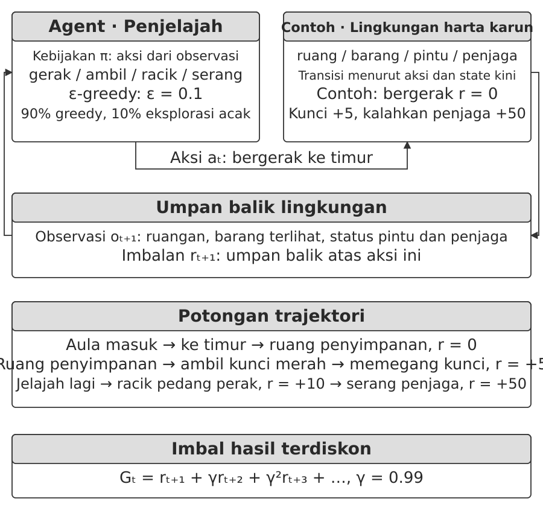

Interaksi yang berkesinambungan membentuk **trajektori**, yang mencakup observasi, aksi, reward, dan informasi terminasi pada setiap langkah; bila sistem pelatihan dapat memperoleh state environment, state itu juga dapat dicatat. Policy menentukan cara bertindak, sedangkan **fungsi nilai (Value Function)** memperkirakan berapa besar return masa depan yang diharapkan jika eksekusi dilanjutkan dari state saat ini menurut suatu policy.

Batas antara Agent dan environment ditentukan oleh cakupan sistem yang dipilih saat pemodelan. Model dan Harness yang dibahas buku ini berada di dalam Agent, dan antarmuka alat menghubungkannya ke aplikasi, perangkat, dan layanan eksternal. Misalnya, permintaan untuk mengubah berkas diajukan oleh Agent, sistem berkas melakukan penulisan, lalu alat mengembalikan hasil eksekusinya kepada Agent.

Selama belajar, kesempatan perlu dibagi antara **eksplorasi dan eksploitasi (Exploration–Exploitation)**. Eksplorasi membuat policy mencoba aksi yang belum dikenalnya, sedangkan eksploitasi memilih aksi yang saat ini diperkirakan lebih baik. Untuk tugas dengan reward tertunda, kita juga perlu menilai langkah awal mana yang ikut menghasilkan hasil akhir; inilah masalah credit assignment yang akan dibahas kemudian.

Untuk memahami sebuah metode RL, periksa dulu lima hal berikut:

- **Ruang aksi**: keluaran apa yang diizinkan. Catur memakai langkah diskret, kendali robot dapat memakai target sendi yang kontinu; aksi juga dapat dibatasi oleh state, rentang fisik, dan izin akses.
- **Policy**: aturan untuk memilih aksi berdasarkan state, observasi, atau riwayat. Policy dapat berupa tabel atau jaringan saraf.
- **Sinyal reward**: melalui umpan balik apa tujuan pelatihan dinyatakan. Reward setiap langkah ikut membentuk return jangka panjang, dan policy mungkin menerima biaya saat ini demi keuntungan di masa depan.
- **Fungsi nilai**: memperkirakan return berikutnya; dapat dipakai untuk membandingkan aksi atau menyusun sinyal pembaruan policy. Algoritma tertentulah yang menentukan apakah fungsi ini dipelajari secara eksplisit.
- **Model environment**: memprediksi state, observasi, atau reward setelah suatu aksi. Metode berbasis model merencanakan dengan model environment yang sudah diketahui atau dipelajari; metode tanpa model mempelajari policy atau nilai langsung dari data interaksi.

Tabel 8-3 mengambil environment, aksi, dan tujuan dari konsep-konsep ini untuk membandingkan beberapa sistem yang sudah kita kenal. Saat membaca dua baris pertama, "menjaga keseimbangan" dan "luas area yang dibersihkan" dapat dipahami sebagai tujuan yang mungkin kita pilih ketika memodelkan tugasnya.

Tabel 8-3 Perbandingan Elemen Kunci Berbagai Sistem Agent

| Jenis Agent | Environment Eksternal | Representasi Aksi | Contoh Reward atau Tujuan |
| --- | --- | --- | --- |
| Anak kijang yang baru lahir | Medan, gravitasi, dan dinamika tubuh | Kendali otot yang kontinu | Menjaga keseimbangan, menghindari jatuh |
| Robot penyapu | Ruangan, lantai, dan stasiun pengisian daya | Bergerak, menyapu, kembali mengisi daya, dan parameter kendali | Luas area yang dibersihkan, daya baterai, dan biaya tabrakan |
| Agent catur | Papan, lawan, dan aturan waktu | Langkah yang sah pada state saat ini | Menang +1, kalah −1, remis 0 |
| Agent layanan pelanggan | Pengguna, basis data bisnis, dan antarmuka layanan | Teks balasan, kueri, dan pemanggilan bisnis | Masalah terselesaikan, kepatuhan pada prosedur, waktu penanganan |
| Agent asisten kode | Sumber kebutuhan, basis kode, dan environment eksekusi | Mencari, menyunting, menjalankan, dan menjawab | Hasil tes, tugas selesai, regresi, dan biaya |

Representasi aksi sistem-sistem ini berbeda. Catur biasanya memilih satu aksi diskret per langkah, robot mengeluarkan besaran kendali kontinu dengan dimensi tertentu, sedangkan LLM lebih dulu menghasilkan sekuens token yang kemudian di-parse oleh antarmuka menjadi balasan atau pemanggilan alat. Komputasi internal juga dapat dimasukkan ke dalam pemodelan policy dan dicatat terpisah dari eksekusi alat yang benar-benar mengubah state eksternal.

### Dua Representasi Aksi: Setelan RL Klasik dan Policy Panjang Variabel pada LLM

**Markov Decision Process (MDP)** menggambarkan masalah keputusan dengan state, aksi, transisi, dan reward. Sifat Markov-nya menuntut bahwa, bila state dan aksi saat ini diketahui, prediksi state dan reward berikutnya tidak lagi bergantung pada riwayat tambahan; informasi riwayat yang relevan untuk prediksi sudah termuat dalam state saat ini. Pada Gambar 8-2, jika yang dicatat hanya ruangan tempat pemain berada, masalah segera muncul: meskipun pemain dua kali tiba di depan pintu yang sama, apakah pintu dapat dibuka masih bergantung pada apakah ia sudah memegang kunci.

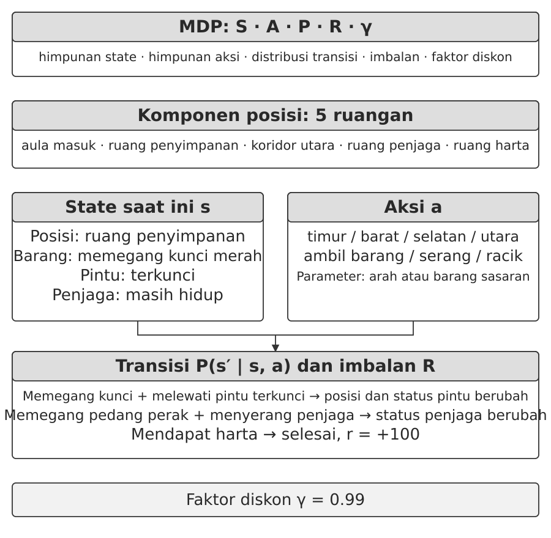

Catur memberikan contoh desain state. Selain posisi bidak, perlu dicatat giliran siapa, hak rokade, hak en passant, serta informasi yang dibutuhkan untuk menerapkan aturan lima puluh langkah dan pengulangan posisi. Setelah semua itu dimasukkan ke dalam state, barulah aturan dapat diterapkan berdasarkan state saat ini. Jika Agent hanya dapat melihat sebagian, ia perlu memakai riwayat untuk melengkapi informasi atau memakai cara pemodelan yang partially observable.

MDP dapat menampung aksi diskret, kontinu, maupun kombinatorial. Go memiliki 361 titik persilangan di papan, ditambah pertimbangan pass dan keabsahan langkah; permainan Atari biasanya menyediakan sedikit operasi diskret; besaran kendali robot ditentukan oleh sendi, gripper, dan batasan fisik. Bila jumlah state dan aksi sama-sama kecil, nilai dapat disimpan langsung dalam tabel. Untuk skala yang lebih besar, aproksimasi fungsi, optimasi policy, dan pencarian masing-masing menawarkan cara penanganannya.

**Q-learning tabular: memperbarui nilai aksi dengan umpan balik satu langkah.** $Q(s,a)$ memperkirakan return setelah aksi $a$ diambil pada state $s$. Nilai aksi optimal memenuhi persamaan optimalitas Bellman:

$$
Q^*(s,a)=\mathbb E\left[r+\gamma\max_{a'}Q^*(s',a')\mid s,a\right]
$$

Di sini $r$ adalah reward langkah ini, $s'$ adalah state berikutnya, dan $\gamma$ adalah faktor diskon. Pada tugas yang berkelanjutan biasanya dipakai $0\leq\gamma<1$; tugas dengan terminasi yang jelas dan return yang terbatas juga boleh memakai 1. Faktor diskon yang lebih besar membuat reward yang lebih jauh mempertahankan bobot yang lebih besar. Return yang dihitung dari saat ini adalah $G_t=\sum_{k\geq0}\gamma^k r_{t+k+1}$.

Setelah satu interaksi menghasilkan $r$ dan $s'$, Q-learning memperbarui nilai menurut rumus berikut:

$$
Q(s,a)\leftarrow Q(s,a)+\alpha\left[r+\gamma\max_{a'}Q(s',a')-Q(s,a)\right]
$$

$\alpha$ adalah learning rate, dan isi kurung siku adalah selisih antara "reward satu langkah ditambah nilai lanjutan yang didiskon" dan estimasi saat ini. Ketika tugas mencapai state terminal, nilai lanjutannya diambil 0. Cobalah sekali dalam permainan pendamping: matikan gangguan acak, berjalan ke timur dari pintu masuk, lalu ambil kunci merah di gudang. Memungut kunci memberi reward 5 poin, dan setiap langkah dikurangi 0,5 poin, sehingga $r$ yang dikembalikan aksi ini adalah 4,5. Misalkan estimasi lama "mengambil kunci di gudang" dalam tabel adalah 0,25, dan nilai Q maksimum dari aksi yang tersedia setelah kunci diperoleh adalah 0,63. Dengan $\gamma=0.99$ dan $\alpha=0.2$, target satu langkahnya adalah $4.5+0.99\times0.63=5.1237$. Estimasi lama bergerak seperlima jarak menuju target ini sehingga menjadi 1,22474. Metode yang mengoreksi estimasi dengan umpan balik satu langkah yang nyata ini disebut **Temporal-Difference Learning (TD)**.

Dengan mengumpulkan nilai Q semua aksi pada satu state, kita dapat memilih aksi yang saat ini diperkirakan terbaik. Gambar 8-3 menggambarkan policy semacam itu dengan peta grid yang disederhanakan. Angka di setiap sel menunjukkan nilai state yang telah dinormalisasi. Tutup angka-angkanya dengan tangan dan lihat panahnya saja: masihkah Anda bisa berjalan dari sudut kiri atas menuju harta karun?

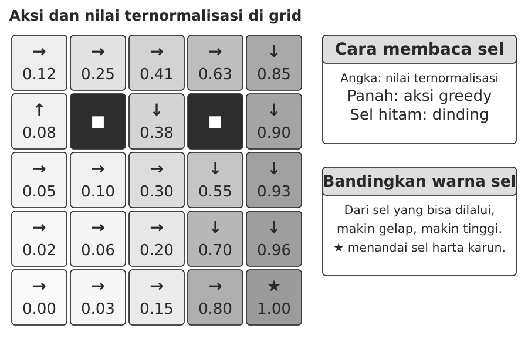

Eksplorasi berikutnya dapat mengubah arah panah. Gambar 8-4 menguraikan perhitungan pengambilan kunci merah tadi: reward yang diperoleh pada langkah ini mengubah estimasi "mengambil kunci di gudang", sedangkan nilai Q state lain dalam tabel masih menunggu pembaruannya masing-masing.

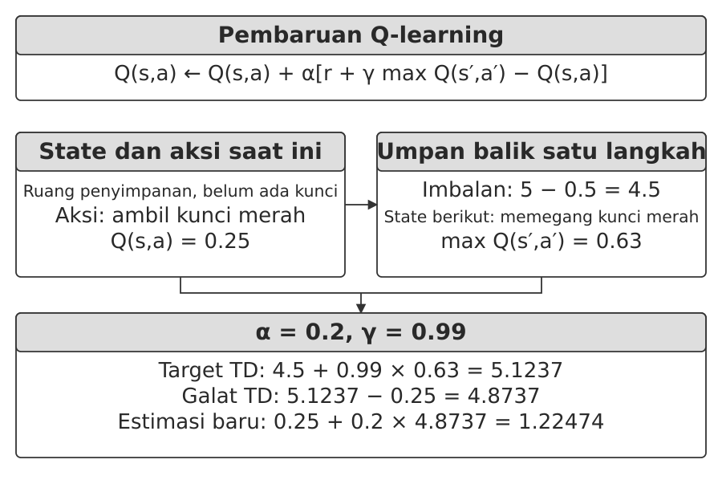

Policy perilaku Q-learning dapat mengandung eksplorasi acak, sementara target pembaruannya memakai nilai aksi maksimum pada state berikutnya; karena itu Q-learning tergolong pembelajaran **Off-Policy**.

> **Eksperimen 8-1 ★: Kinerja Q-learning dalam Permainan Berburu Harta**
>
> Permainan berburu harta memuat aturan tersembunyi seperti kunci dan pintu, efek senjata, serta penggabungan benda. Untuk menamatkannya, beberapa langkah harus diselesaikan secara berurutan, dan jalur optimalnya 11 langkah; aksi kunci dan kemenangan memberikan reward, sedangkan langkah lain hanya sedikit memberi umpan balik.
>
> Pelatihan berburu harta ini memakai learning rate 0,2 dan faktor diskon 0,99, dengan laju eksplorasi ε turun bertahap dari 1,0 ke 0,1. Q-learning tabular memakai eksplorasi ε-greedy: pada setiap langkah, dengan peluang ε dipilih satu aksi yang tersedia secara acak, dan selebihnya dipilih salah satu aksi dengan nilai Q terbesar saat ini. Catat tingkat kemenangan, jumlah state yang dikunjungi, dan jumlah langkah untuk tamat pada setiap tahap.
>
> Saat membaca catatan pelatihan dan evaluasi eksperimen berburu harta, pisahkan dulu dua pertanyaan: selama pelatihan, kapan policy dengan eksplorasi acak pertama kali menemukan harta? Setelah pelatihan selesai, apakah tabel Q yang dibekukan dan dijalankan dengan policy greedy dapat menamatkan permainan secara stabil? Pertanyaan pertama mencerminkan cara model menemukan jalur, sedangkan pertanyaan kedua menguji apakah ia dapat memilih aksi sesuai nilai yang telah dipelajarinya.
>
> Dalam satu sesi pelatihan sebelumnya, 1000 episode pertama belum ada yang tamat dan tabel Q berisi 124 state; sampai 5000 episode masih belum menang secara stabil, dengan 133 state; antara episode 7000 dan 8000, tingkat kemenangan naik dari 34% menjadi 96%; pada 10000 episode tingkat kemenangannya mencapai 100%, tabel Q berisi 145 state, dan jalur 11 langkah ditemukan.
>
> Mengapa kemajuan di awal begitu lambat, tetapi kemudian tingkat kemenangan naik sangat cepat? Eksplorasi lebih dulu menemukan aksi dan jalur kunci, lalu kunjungan berikutnya merambatkan return di titik akhir secara bertahap ke state-state sebelumnya. Seluruh simulasi kecil ini hanya memakan waktu sekitar 10 detik, sehingga sanggup menanggung interaksi berulang dalam jumlah besar.
>
> Saat menganalisis, catat waktu komputasi dan jumlah interaksi sekaligus. Dalam permainan, satu aksi sangat murah; jika diganti dengan peramban, telepon, atau perangkat fisik, satu interaksi juga mencakup waktu tunggu, biaya, dan perubahan state. Tabel juga terikat pada encoding state tertentu, sehingga setelah aturan atau peta berubah, nilai-nilai yang ada perlu diperiksa ulang apakah masih berlaku. Eksperimen berikutnya akan membandingkan bagaimana pengetahuan prapelatihan dapat mengubah titik awal eksplorasi.

**LLM hasil prapelatihan: menyatakan komputasi dan aksi dengan bahasa.**

Sebelum memanggil alat, LLM dapat menghasilkan sepotong komputasi antara, atau dapat langsung mengeluarkan pemanggilan. Keduanya dinyatakan sebagai sekuens token, tetapi perannya berbeda: komputasi antara mengubah konteks yang tersedia bagi model sesudahnya, sedangkan pemanggilan alat, setelah dieksekusi, mengubah atau membaca environment eksternal. Saat pelatihan, keluaran-keluaran ini dapat dicatat menurut protokol dan dinilai bersama hasil tugas serta biaya komputasinya. Dengan begitu, "berapa lama berpikir, memikirkan apa, kapan memanggil alat" menjadi pilihan yang dapat dipelajari oleh policy yang sama; AdaptThink di bagian berikutnya berpusat pada anggaran penalaran ini.

Sekuens dengan panjang variabel membawa ruang kombinatorial yang lebih besar. Model dapat menulis kueri, program, parameter JSON, dan penurunan bertahap, sementara panjang sekuensnya dibatasi oleh anggaran dan konteks. Prapelatihan menyediakan titik awal bagi pencarian: materi matematika sering memuat analisis kondisi dan perhitungan, sementara kode dan diskusi sering memuat penentuan lokasi, perubahan, dan verifikasi. Model dapat meminjam struktur-struktur ini untuk menghasilkan jalur kandidat, lalu menyesuaikannya berdasarkan umpan balik environment. Pengetahuan yang sudah dimiliki membuat kombinasi aksi yang berguna lebih mudah tersampel sejak awal, sehingga mengurangi kebutuhan mencoba-coba secara buta di antara banyak jalur yang tidak relevan.

Misalnya, "mengonversi jumlah dalam mata uang asing ke dolar AS" membutuhkan perolehan kurs dan perhitungan. Prapelatihan membuat model cukup mudah menghasilkan langkah-langkah yang saling terkait seperti ini; pascapelatihan lalu dapat menyesuaikan lebih lanjut probabilitas jalur berdasarkan sumber kurs, hasil perhitungan, dan batasan tugas. Di sini pengetahuan bahasa menyediakan policy awal, dan reward menyediakan umpan balik tugas.

Gambar 8-5 membandingkan dua setelan dalam bagian ini: Q-learning tabular bertolak dari encoding state dan aturan eksplorasi yang telah ditetapkan, sedangkan LLM Agent bertolak dari policy bahasa hasil prapelatihan dan mengatur observasi alat serta pengalaman historis melalui konteks.

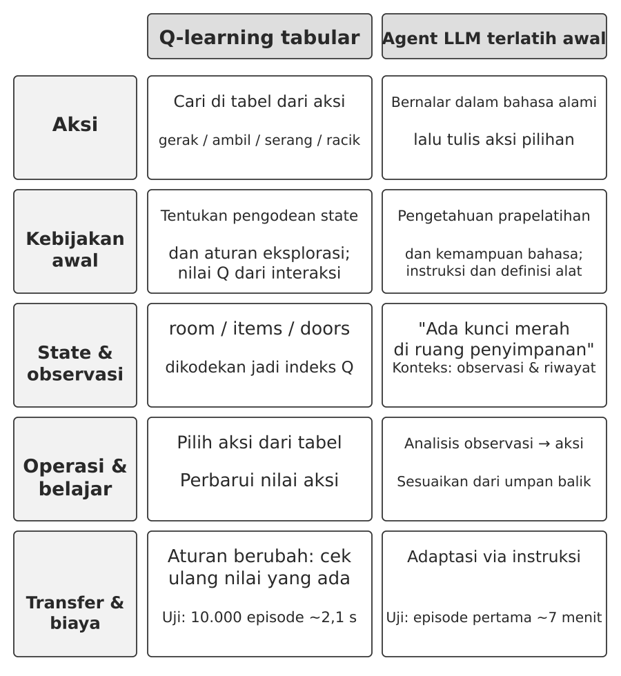

Prapelatihan juga membuat model mampu menafsirkan instruksi baru dan menyesuaikan perilaku tugas dengan sedikit demonstrasi. Alat menghubungkan keluaran bahasa ke pencarian, eksekusi kode, dan operasi bisnis. Saat merancang Agent semacam ini, kita perlu menetapkan antarmuka alat dan izin eksekusinya, sekaligus membangun umpan balik untuk hasil tugas, biaya operasional, dan proses-proses kunci.

Jika model harus mengendalikan lengan robot, bagaimana "memprediksi token berikutnya" diterapkan pada aksi? OpenVLA memakai sekitar 970 ribu demonstrasi robot nyata. Ambil satu langkah dalam demonstrasi: masukannya adalah gambar kamera saat itu dan instruksi tugas, dan target pelatihannya adalah aksi yang dilakukan demonstran berikutnya. Misalnya, seberapa jauh lengan robot bergerak ke arah horizontal pada dasarnya adalah nilai kontinu. OpenVLA membagi setiap dimensi aksi menjadi 256 tingkat dan memakai satu token untuk menyatakan tingkat mana yang terisi. Dengan begitu, model dapat memprediksi token aksi satu per satu dan menghitung loss hanya pada posisi-posisi tersebut.[^ch8-21]

Contoh ini juga memberi cara membedakan behavior cloning dari reinforcement learning: lihat sinyal apa yang membuat model diperbarui. OpenVLA belajar dari catatan demonstrasi; makin tinggi probabilitas yang diberikan model kepada token aksi demonstrasi, makin rendah loss-nya, sehingga ini termasuk supervised fine-tuning. Pada SimpleVLA-RL dalam Eksperimen 8-13, policy benar-benar mencoba aksi di environment, lalu menyesuaikan pilihan berikutnya berdasarkan reward tugas.

> **Dari Algoritma, Environment, hingga Prior**
>
> Dalam "The Second Half", Shunyu Yao meninjau perkembangan RL melalui algoritma, environment, dan prior.[^ch8-2] Berdasarkan itu, penulis merangkum pergeseran fokus menjadi tiga tahap: 2015–2016 menitikberatkan perbaikan algoritma, 2016–2018 makin menekankan pembangunan environment, dan sejak 2018 nilai prior hasil prapelatihan mulai disadari secara bertahap. Gym menyediakan antarmuka environment yang seragam, Universe dan World of Bits menjelajahi tugas komputer dan web, dan proyek seperti Dota 2 memperlihatkan kemampuan pelatihan di environment yang kompleks. Kemudian GPT-2 dan GPT-3 memperlihatkan pengetahuan dan kemampuan ekspresi yang terkumpul lewat prapelatihan bahasa, dan sistem seperti WebGPT dan ChatGPT memanfaatkan titik awal ini lebih jauh. Prior yang dibutuhkan tugas dapat diperoleh lebih dulu melalui pemodelan bahasa, lalu diserahkan kepada RL untuk mengoptimalkan perilaku spesifik.
>
> Penulis sependapat dengan prioritas rekayasa ini: **prior, environment, algoritma**. Periksa dulu pengetahuan dan kemampuan apa yang dimiliki model, kemudian bangun environment dan umpan balik yang sesuai, baru terakhir pilih metode optimasi yang cocok. Gambar 8-6 menyusunnya menurut urutan kemunculan fokus penelitian; saat mengerjakan proyek, urutannya dapat dibalik, bertolak dari kemampuan yang sudah ada.
>
> 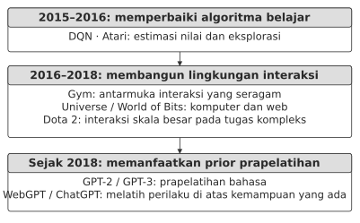

> **Eksperimen 8-2 ★★: Studi Perbandingan RL Tradisional dan LLM Agent**
>
> Bandingkan Q-learning tabular dan LLM Agent dalam permainan berburu harta yang sama. Konfigurasi LLM memakai Kimi K3 dan memelihara paling banyak 50 pengalaman di dalam konteks. Pada setiap langkah, keduanya memilih satu dari aksi-aksi yang ditawarkan environment. Dengan menyusuri dua jalur pada Gambar 8-7, kita dapat melihat bagaimana tabel Q dan model bahasa masing-masing menentukan pilihan itu.
>
> 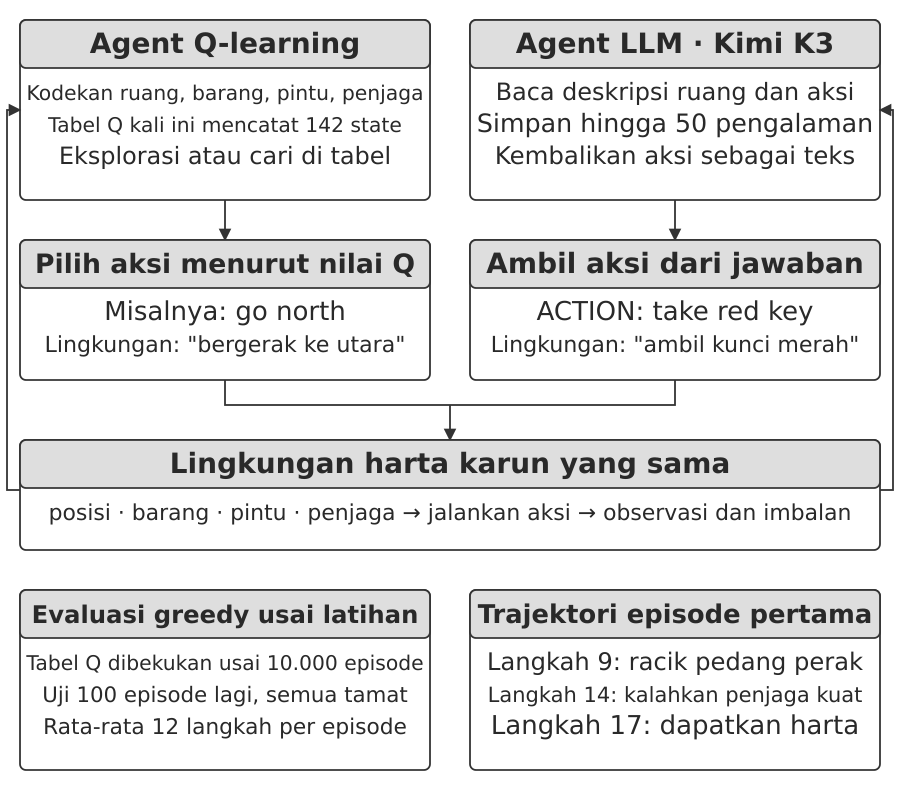
>
> Dalam catatan eksekusi Kimi K3 yang menyertai buku ini, Agent menghabiskan 17 langkah pada episode pertama. Ia lebih dulu memungut pedang berkarat, mendapati pintu utara terkunci, berpindah ke gudang untuk mengambil kunci merah dan kristal sihir, lalu pada langkah ke-9 menggabungkan pedang dan kristal menjadi pedang perak. Pada langkah ke-12 ia mencoba memakai kunci, dan environment menjawab "akan dipakai otomatis bila diperlukan"; pada langkah ke-13 ia berjalan ke utara, dan barulah pintu benar-benar terbuka. Setelah mengalahkan penjaga dengan pedang perak pada langkah ke-14, ia sekali lagi mencoba memakai pedang, dan environment menyatakan pedang tidak dapat dipakai saat itu. Pada langkah ke-17 ia memperoleh harta. Saat membaca catatan ini, tutup baris berikutnya dan coba tebak dari umpan balik saat ini langkah mana yang masih perlu.
>
> Dengan menyejajarkan setiap aksi dengan observasi saat itu, kita dapat menganalisis bagaimana model memakai pengetahuan yang sudah ada seperti "kunci membuka pintu" dan "senjata untuk menghadapi penjaga", serta bagaimana umpan balik alat mengubah rencana berikutnya. Skema tabular mengumpulkan hubungan-hubungan ini melalui kunjungan pasangan state–aksi.
>
> Dalam perbandingan ini, Q-learning dilatih 10000 episode dalam 2,12 detik, lalu dievaluasi terpisah dengan policy greedy selama 100 episode: semuanya tamat, dengan rata-rata 12 langkah. Kimi memanggil model 17 kali dalam satu episode dan menghabiskan 6 menit 56 detik. Berdasarkan ini penulis memakai satu prinsip pemilihan: bila simulasi murah dan dapat diulang dalam jumlah besar, eksplorasi RL tradisional dapat dimanfaatkan sepenuhnya; bila setiap interaksi menuntut waktu tunggu, biaya, atau ongkos operasi nyata, utamakan policy yang dapat memanfaatkan pengetahuan yang sudah ada untuk menaikkan nilai setiap interaksi.

Kedua eksperimen ini menghubungkan bab ini dengan metode rekayasa sebelumnya: konteks dapat mengatur pengalaman dalam satu kali eksekusi, memori eksternal dapat menyimpan pengalaman lintas tugas, dan pascapelatihan mengubah policy melalui pembaruan parameter. Berikut ini kita lebih dulu melengkapi proses dasar prapelatihan bahasa dan visual, sebelum membahas data pelatihan dan metode optimasi yang konkret.

## Dasar-Dasar Prapelatihan Model `[Bacaan Opsional]`

Prapelatihan membangun representasi awal dan distribusi generasi model, dan pelatihan lanjutan terus menyesuaikan parameter dari titik awal ini. Untuk memahami titik awal tersebut, amati dulu bagaimana model bahasa kecil belajar dari teks, lalu bagaimana ia dihubungkan dengan masukan visual.

Teks lebih dulu melalui **tokenisasi (Tokenization)** dan diubah menjadi token-token diskret. Misalnya, "Saya suka pemrograman" dapat digambarkan sebagai tiga unit "Saya", "suka", dan "pemrograman", meskipun pembagian sebenarnya ditentukan oleh tokenizer. Pelatihan memakai token-token sebelumnya sebagai konteks untuk memprediksi token berikutnya, menghitung loss, dan memperbarui parameter. Pada Gambar 8-8, tutup dulu kalimat pelatihan sampai kata "environment", tebak kata berikutnya, lalu buka teks aslinya. Geser posisi ini ke belakang, dan Anda mendapat soal prediksi berikutnya.

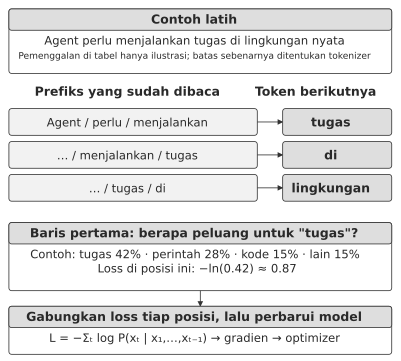

Setelah pemodelan bahasa dasar, demonstrasi instruksi dapat ditambahkan untuk melatih format jawaban dan perilaku tugas; data preferensi juga dapat dipakai untuk menaikkan probabilitas jawaban yang lebih disukai melalui metode seperti DPO.

> **Eksperimen 8-3 ★★: Melatih LLM dari Nol—Kekuatan Perbaikan Algoritma**
>
> Dengan MiniMind 2 yang berukuran sekitar seratus juta parameter sebagai contoh, selesaikan prapelatihan, SFT, dan optimasi preferensi pada GPU kelas konsumen. Bandingkan baseline dengan konfigurasi yang menambahkan QK Norm dan optimizer Muon, lalu amati penurunan loss, waktu yang dibutuhkan untuk mencapai mutu target, dan hasil generasinya. Ringkasan pendamping mencatat percepatan konvergensi sekitar 3 kali lipat; pelatihan lengkap memakan waktu sekitar 14 jam dengan biaya sekitar 34 dolar AS.
>
> QK Norm menyesuaikan skala numerik query dan key dalam attention, sedangkan Muon mengubah cara pembaruan optimasi untuk parameter yang bersangkutan.
>
> Amati sekelompok pertanyaan yang sama per tahap: model hasil prapelatihan sudah dapat menjawab pertanyaan seperti "gunung tertinggi di dunia"; setelah SFT, kepatuhan pada instruksi dan susunan keluaran membaik; optimasi preferensi terus memengaruhi jawaban faktual dan cara pengungkapannya.

> **Eksperimen 8-4 ★★: Melatih VLM Sendiri**
>
> Gambar 8-9 memperlihatkan sambungan "visual encoder—lapisan proyeksi—model bahasa". Visual encoder seperti CLIP mengekstrak fitur gambar, lapisan proyeksi mengubah fitur itu ke dimensi dan representasi yang dibutuhkan masukan model bahasa, dan model bahasa menggabungkan masukan tersebut untuk menghasilkan deskripsi atau jawaban.
>
> 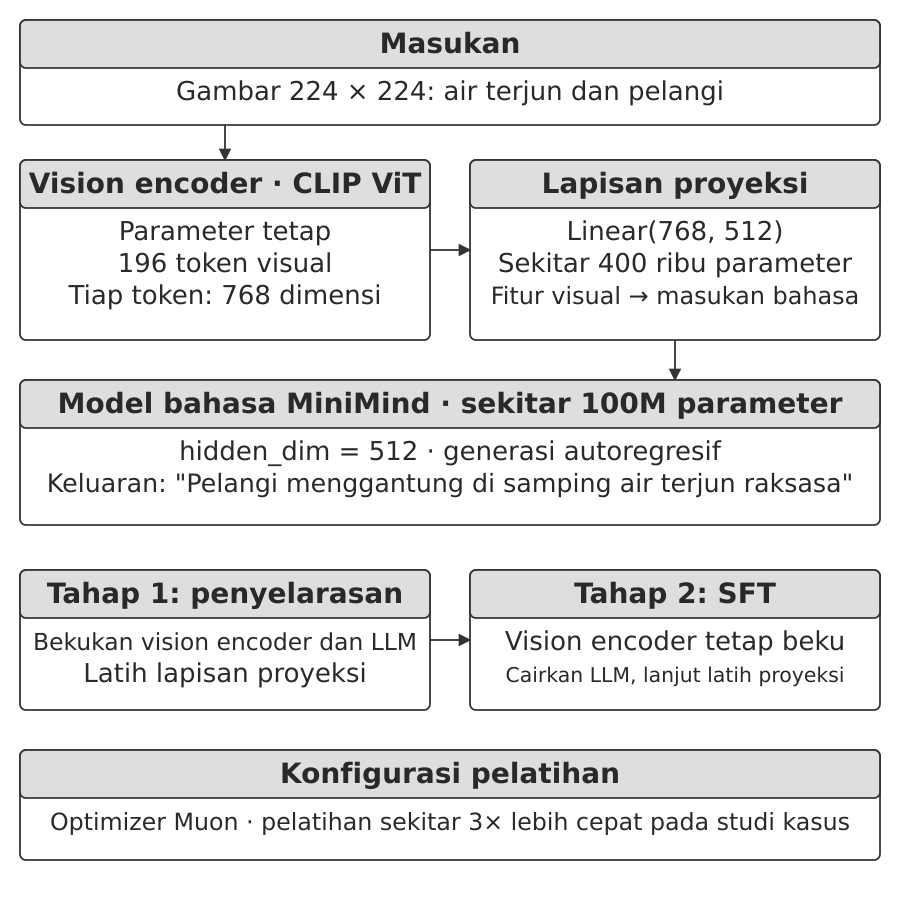
>
> Tahap pertama membekukan visual encoder dan LLM serta melatih lapisan proyeksi yang baru ditambahkan, agar fitur gambar dapat ikut serta dalam prediksi bahasa; tahap kedua mencairkan LLM sesuai konfigurasi dan menjalankan SFT dengan data gambar–deskripsi atau tanya jawab bermutu tinggi. Amati secara terpisah perubahan pada pengenalan objek, deskripsi detail, penilaian hubungan, dan kemampuan bahasa.
>
> Arsitektur ini memakai ulang model visual dan bahasa yang sudah ada dan lebih dulu memusatkan pelatihan pada modul penghubung lintas modalitas, sehingga layak dicoba lebih dulu saat anggaran terbatas. Pembekuan bobot mengurangi state yang harus dilatih, dan modul yang relevan dapat dicairkan kemudian sesuai kebutuhan tugas. Ketika deskripsinya keliru, periksa dulu apakah informasi objek sudah masuk ke representasi visual; jika informasinya sudah ada tetapi model tetap tidak dapat memanfaatkannya, fokuskan pemeriksaan pada daya ekspresi lapisan proyeksi, data penyelarasan, dan supervisi generasi bahasa. Jika keluarannya diubah lebih lanjut menjadi representasi aksi dan diselaraskan dengan antarmuka kendali, arsitektur ini tersambung ke arsitektur VLA pada Bab 6.

Kedua eksperimen ini masing-masing memperlihatkan bagaimana konfigurasi optimasi dan sambungan lintas modalitas memengaruhi pelatihan. Saat anggaran terbatas, penulis menyarankan untuk lebih dulu membandingkan keuntungan yang dapat diberikan perbaikan algoritma dan arsitektur, sebelum memutuskan apakah ukuran model perlu diperbesar. Ketika model yang sudah ada memasuki bahasa atau domain baru, pembelajaran juga dapat dilanjutkan dari bobot prapelatihan; bagian berikutnya membahas cara memilih data untuk pelatihan semacam ini.

## Mid-training: Melengkapi Pengetahuan dan Kemampuan Dasar

Dalam bab ini, **Mid-training** berarti melanjutkan satu tahap pelatihan model bahasa pada model yang sudah ada dengan berpusat pada distribusi target. Sebagian besar token dalam dokumen, kode, atau penurunan rumus ikut disupervisi, dan korpus domain target dapat dicampur dengan korpus umum saat pelatihan. Penelitian DAPT/TAPT memperlihatkan manfaat prapelatihan lanjutan dengan korpus yang relevan dengan domain atau tugas bagi tugas hilir.[^ch8-30]

Pemilihan data bertolak dari dua jenis celah. Jenis pertama adalah cakupan pengetahuan dan bahasa, misalnya model jarang bersentuhan dengan protokol perusahaan, istilah dalam bahasa target, atau basis kode tertentu. Jenis kedua adalah kemampuan dasar yang dibutuhkan tugas, misalnya melacak state dalam konteks panjang, memadukan hubungan lintas dokumen, atau menyelesaikan penurunan kode yang panjang. Bedakan dulu masalah pemahaman, pengetahuan, format, dan tindakan menurut jenis galatnya, baru tetapkan materi yang perlu ditambahkan.

Setelah loss pada teks domain turun, periksa juga apakah model mampu memakai pengetahuan yang dipelajarinya dalam tugas nyata. Urutan pelatihan lanjutan dan pelatihan instruksi, cara menyusun tanya jawab, dan bentuk materi semuanya memengaruhi penerapan pengetahuan.[^ch8-31] Untuk tugas domain yang kemampuan dasarnya jelas kurang, penulis menyarankan untuk lebih dulu menambah cakupan dengan korpus domain, lalu mengajari model memakai informasi itu dalam tugas melalui demonstrasi SFT; bila model kadang-kadang sudah benar tetapi tingkat keberhasilannya rendah, barulah RL dikerahkan.

### Cara Menyusun Data Mid-training

**Langkah pertama: tentukan materi yang dibutuhkan dari distribusi kegagalan.** Evaluasi secara terpisah menurut topik, bahasa, jenis dokumen, pola kode, dan panjang konteks, lalu gabungkan Pass@1, Pass@k, dan contoh galat untuk menilai dalam kondisi apa model tidak memiliki solusi yang dapat dipakai. Masalah format parameter dapat diserahkan kepada demonstrasi antarmuka, sedangkan celah konsep dan hubungan domain membutuhkan korpus yang sesuai.

**Langkah kedua: susun korpus berkepadatan tinggi.** Dokumen asli menyediakan istilah dan hubungan fakta, repositori kode menyediakan struktur modul dan dependensi, penurunan ala buku teks dan parafrase sintetis menguraikan langkah-langkah yang tersirat, dan sampel lintas dokumen menghubungkan informasi yang tersebar. Setelah penyaringan mutu, deduplikasi, dan isolasi dari himpunan evaluasi selesai, barulah sekuens pelatihan disusun.

**Langkah ketiga: campur data sesuai kemampuan target.** Teks panjang alami dapat berasal dari buku, dokumen, dan repositori kode; untuk retrieval, penalaran multi-hop, kepatuhan pada instruksi, agregasi, dan statistik, dapat ditambahkan data tugas beserta penurunannya; untuk Agent, dapat ditambahkan trajektori perencanaan, pemilihan alat, penyusunan parameter, pelacakan state, dan pemulihan dari galat. Materi ini dapat berasal dari dataset yang sudah ada atau dihasilkan model guru, dan disaring menurut tuntutan isi dan perilaku sebelum masuk pelatihan.

**Langkah keempat: biarkan model terus berlatih pada tugas yang sebelumnya sudah dikuasainya.** Satu kelompok sampel tetap memakai teks pendek, korpus umum, dan soal-soal lama; kelompok lain menempatkan tugas yang sama dalam konteks yang lebih panjang, memindahkan posisi informasi kunci, lalu menambahkan pengecoh. Saat memadukan kedua kelompok materi ini, distribusi data pelatihan asli dapat dijadikan acuan, atau beberapa proporsi dapat dicoba dengan korpus publik seperti FineWeb-2, lalu disesuaikan berdasarkan hasil evaluasi.

**Langkah kelima: putuskan untuk melanjutkan atau berhenti dengan beberapa metrik.** Catat sekaligus loss pelatihan, tugas domain hold-out, kemampuan umum, kepatuhan pada instruksi yang semula, dan tingkat keberhasilan tugas target. Bila nilai domain naik sementara kemampuan umum turun, bandingkan proporsi campuran, learning rate, dan volume pelatihan; bila loss turun tetapi tugas target mandek, periksa apakah materi pelatihan mampu mengajari model menyelesaikan tugas semacam itu, dan apakah perlu ditambahkan demonstrasi penerapan pengetahuan dalam tugas nyata.

Misalkan model dapat menemukan nomor pesanan tertentu dari log pesanan yang sangat panjang. Jika pertanyaannya diubah menjadi "pelanggan mana yang memesan berkali-kali lalu membatalkan semuanya", model harus mengumpulkan semua pesanan pelanggan yang sama dan mencocokkan pesanan dengan catatan pembatalan satu per satu. Kedua soal dapat memakai log yang sama, tetapi kemampuan yang diuji berbeda. RULER memakai tugas sintetis untuk mengendalikan panjang masukan dan tingkat kesulitan tugas secara terpisah, dan menguji retrieval tunggal, pelacakan multi-hop, serta agregasi secara tersendiri. Para penulisnya mengevaluasi 17 model; banyak model mendekati nilai sempurna pada retrieval sederhana, tetapi kinerja keseluruhannya turun nyata seiring bertambah panjangnya masukan.[^ch8-ruler]

Untuk melihat apakah perbedaan ini juga muncul pada materi nyata, gunakan lebih lanjut soal multi-dokumen, dialog panjang, atau repositori kode dari LongBench v2. Untuk memeriksa secara khusus apakah model mampu mengingat tuntutan seperti format keluaran, ambil instruksi yang dapat diverifikasi dari IFEval dan letakkan pada posisi berbeda dalam materi yang lebih panjang. Saat membandingkan dua model, posisi instruksi dan isi pengecoh yang dilihat keduanya harus sama, dan perlu dinyatakan bahwa tes ini disusun sendiri. Terakhir, gunakan tugas Agent end-to-end untuk memeriksa apakah kemampuan-kemampuan ini dapat bekerja bersama. Saat merancang himpunan evaluasi, periksa dimensi-dimensi berikut satu per satu.[^ch8-longbench]

[^ch8-ruler]: Hsieh dkk., RULER, 2024.
[^ch8-longbench]: Bai dkk., LongBench v2, ACL 2025. Makalah ini menyajikan enam kategori tugas dengan total 503 soal pilihan ganda.

- **Posisi dan retrieval**: apakah satu atau beberapa informasi kunci dapat ditemukan ketika berada di awal, tengah, dan akhir.
- **Hubungan dan penalaran**: pelacakan hubungan lintas paragraf dan multi-dokumen, penyelesaian kontradiksi, dan penggabungan bukti.
- **Agregasi dan statistik**: penghitungan, pengelompokan, pengurutan, perbandingan, dan perangkuman tren dalam tabel dan log yang panjang.
- **Kepatuhan pada instruksi**: banyak tuntutan sekaligus, penanganan konflik, kondisi prosedur, dan format keluaran.
- **Penalaran rantai panjang**: rantai dependensi yang panjang dalam tugas matematika, logika, dan kode.
- **Perilaku dasar Agent**: dekomposisi tugas, pemilihan alat, pembuatan parameter, pemeliharaan state, dan pemulihan dari kegagalan.

Penalaran panjang dan pemanggilan alat multi-turn terus memperpanjang konteks, sementara instruksi, fakta, dan state tugas sebelumnya masih harus ikut menentukan keputusan berikutnya. Jika model tidak dapat menemukan informasi dalam teks panjang atau tidak mampu mempertahankan batasan, Agent jangka panjang sulit berjalan dengan andal. Sebelum anggaran pelatihan diperbesar, bandingkan dulu proporsi data dan volume pelatihan dengan konfigurasi skala kecil. Untuk fakta yang sering diperbarui dan menuntut sumber, penulis mengutamakan RAG; untuk pengetahuan domain berskala besar yang stabil dan kemampuan dasar, barulah pelatihan lanjutan untuk menuliskannya ke parameter dipertimbangkan.

> **Eksperimen 8-5 ★★: Mempelajari Bahasa Baru melalui Prapelatihan Lanjutan**
>
> Bertolak dari Mistral 7B v0.3, kemampuan bahasa Korea ditingkatkan dengan materi seperti Wikipedia bahasa Korea. Pelatihan lebih dulu memakai campuran sekitar 80% bahasa Korea dan 20% bahasa Inggris, kemudian SFT dengan data instruksi berbahasa Korea, dan perubahan pada pemodelan bahasa serta perilaku dialog diamati secara terpisah.
>
> Data bahasa Korea menambah cakupan bahasa target, sedangkan data bahasa Inggris dipakai untuk mempertahankan kemampuan semula. Setiap tahap diuji dengan sekumpulan soal bahasa Korea dan bahasa Inggris yang sama yang tidak ikut dilatih. Dalam hasil pendamping, skor penilaian buta bahasa Korea pada tahap akhir membaik, sedangkan kemampuan bahasa Inggris agak menurun; ini memberikan arah konkret untuk putaran berikutnya, yaitu mencampurkan lebih banyak materi pelatihan berbahasa Inggris atau menurunkan intensitas pembaruan.
>
> Dengan mencatat bahasa target, bahasa semula, dan mutu fakta secara terpisah, kita dapat menilai keuntungan dan biayanya; pada tahap SFT, periksa lagi apakah model dapat menyusun jawaban sesuai instruksi berbahasa Korea. Dengan begitu, peran prapelatihan lanjutan dan fine-tuning instruksi dapat diamati secara terpisah.

## SFT (Supervised Fine-Tuning)

Korpus domain dapat membuat model lebih sering melihat suatu antarmuka, tetapi untuk mengajarinya memperbaiki parameter setelah pemanggilan gagal, kita juga dapat langsung mendemonstrasikannya sekali. SFT memberikan masukan tugas dan melatih model token demi token untuk menghasilkan jawaban atau tindakan dalam demonstrasi. Saat melihat Gambar 8-10, pikirkan dulu perilaku mana yang hendak diajarkan, baru tentukan cara mengumpulkan demonstrasinya. Fakta, nada, dan format keluaran dalam demonstrasi juga ikut masuk ke pelatihan.

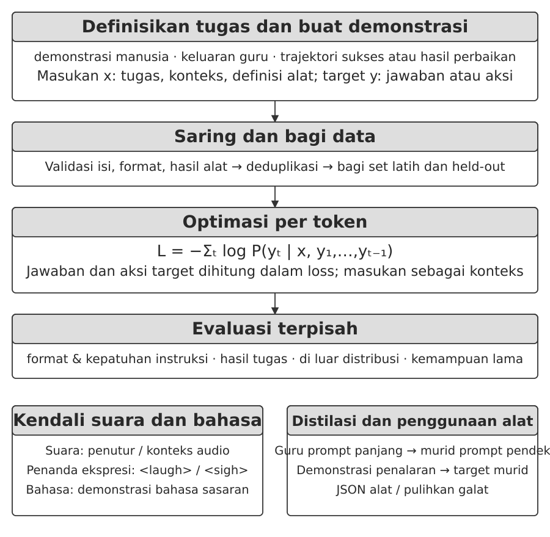

Data biasanya berasal dari tiga jalur: pakar manusia mendefinisikan perilaku kunci dan batas-batasnya, model guru menulis demonstrasi secara massal, dan verifier menyaring keluaran yang valid dari sampel model. Ketiganya dapat dipakai bersama. Misalnya, pakar lebih dulu menulis sedikit demonstrasi pemanggilan alat, lalu guru mengubah kondisi tugas untuk menghasilkan lebih banyak sampel, dan terakhir parameter, hasil eksekusi, serta batasan bisnis diperiksa.

**Salah satu kegunaan SFT adalah mengajarkan kepada model cara kerja yang berulang kali ditulis dalam prompt dan Skill.** Ambil contoh penilaian memori di Bab 7: misalkan panduan penilaian beserta contoh-contoh kasusnya sepanjang sepuluh ribu token. Guru menilai sekumpulan jawaban berdasarkan panduan lengkap itu dan mendemonstrasikan cara menangani situasi seperti tokoh yang bernama sama, hubungan yang terbalik, atau bukti yang kurang. Saat melatih murid, masukannya hanya memuat nama butir penilaian yang singkat, materi riwayat pada kesempatan itu, dan jawaban yang akan dinilai, sedangkan keluaran targetnya adalah tingkat yang dipilih guru. Setelah dirilis, cukup diberikan prompt pendek dan materi kesempatan itu, sehingga setiap inferensi menghemat sepuluh ribu token penjelasan tetap tersebut. Untuk Skill yang dipanggil berulang kali, cara yang sama dapat dipakai untuk mendemonstrasikan kapan mencari referensi dan bagaimana memilih alat, lalu langkah-langkah yang stabil ini didistilasi ke dalam model.

Persiapan data dimulai dengan menetapkan distribusi tugas, schema keluaran, dan cara penerimaannya. Setelah demonstrasi lolos pemeriksaan, lakukan deduplikasi, sesuaikan proporsi berbagai jenis sampel, dan bagi dataset. Jumlah sampel dan cakupannya harus dirancang bersama: mengulang satu cara bertanya ribuan kali hanya terus memperkuat pola yang sama; menyusun variasi di sekitar kondisi-kondisi kunci barulah membantu model memilih perilaku yang tepat untuk masukan yang berbeda. Penulis lebih dulu memoles sekumpulan demonstrasi yang mencakup situasi-situasi kunci, baru kemudian memperbesar skalanya. SFT mempelajari keluaran target token demi token, sehingga fakta yang keliru, langkah yang berlebihan, dan kebiasaan operasi yang tidak tepat juga ikut masuk ke parameter.

> **Eksperimen 8-6 ★★★: SFT Suara—dari Penyalinan Suara hingga Pemodelan Paralinguistik `[Eksperimen Lanjutan]`**
>
> Dengan Orpheus dan Sesame CSM sebagai contoh, bandingkan bagaimana kondisi pembicara, konteks dialog, dan penanda ekspresi ikut berperan dalam generasi suara. Orpheus merepresentasikan suara sebagai token, dapat memanfaatkan potongan teks–suara referensi untuk menghasilkan warna suara yang sesuai, dan juga menyediakan penanda ekspresi seperti `<laugh>` dan `<sigh>`. Sesame CSM menerima teks, identitas pembicara, dan potongan audio yang sudah ada, lalu menghasilkan suara lanjutannya.[^ch8-speech-conditioning]
>
> Saat menyusun sampel pelatihan, catat teks, pembicara, audio, dan kondisi ekspresi secara terpisah; gunakan materi lintas kalimat dari pembicara yang sama untuk mempelajari konsistensi, dan tawa, desahan, serta jeda dalam berbagai konteks untuk mempelajari ekspresi. Bandingkan keluaran tanpa referensi, dengan referensi, dan dengan kondisi ekspresi yang ditentukan, lalu nilai menurut akurasi, kealamian, emosi, dan warna suara.
>
> Data harus mencakup kombinasi pembicara, pola kalimat, dan emosi yang memadai. Bila pembicaranya terlalu sedikit, keluaran dapat cenderung ke satu warna suara; bila suatu penanda selalu terikat pada potongan suara yang sama, ekspresinya dapat menjadi berulang dan mekanis.

> **Eksperimen 8-7 ★★★: Berpikir Multibahasa—Menghasilkan Proses Penalaran dalam Bahasa yang Ditentukan `[Eksperimen Lanjutan]`**
>
> Lakukan SFT pada gpt-oss-20b dan gunakan instruksi untuk menentukan bahasa proses penalarannya. Misalnya, `reasoning language: German` meminta teks penalaran dalam bahasa Jerman. Sampel pelatihan mencakup bahasa Inggris, Spanyol, Prancis, dan lain-lain, sedangkan bahasa Tionghoa disisihkan untuk tahap uji.
>
> Dalam kasus pendamping, setelah pelatihan, bila Chinese ditentukan, model mampu menghasilkan proses penalaran dalam bahasa Tionghoa. Tiga hasil dapat dibandingkan lebih lanjut: apakah tuntutan bahasa dipatuhi, apakah jawaban akhirnya benar, dan bagaimana panjang generasi serta waktu tempuhnya berubah. Fondasi multibahasa dari prapelatihan dan cara pengendalian yang dipelajari melalui SFT bersama-sama menghasilkan kinerja lintas bahasa ini; perannya masing-masing dapat dianalisis lebih jauh melalui perbandingan berbagai bahasa dan model dasar.

> **Eksperimen 8-8 ★★: Distilasi Prompt—Mereproduksi Kemampuan yang Dapat Dipakai dengan Biaya Lebih Kecil**
>
> Sebuah layanan bisnis yang stabil mungkin bergantung pada prompt sistem ribuan token, dan guru juga menghasilkan penalaran yang panjang. Distilasi Prompt lebih dulu membuat guru menghasilkan keluaran bermutu tinggi dalam kondisi lengkap, lalu menyusun pasangan "masukan pengguna—jawaban akhir" menjadi data SFT bagi murid. Murid memakai prompt yang lebih pendek dan menjawab langsung sesuai konfigurasi target.
>
> Dengan membuka sampel pelatihan pertama, terlihat bahwa guru Kimi K3 membaca sepotong teks berbahasa Arab yang diselipi huruf Latin, menjelaskan dasar penilaiannya, lalu memberikan kode bahasa `ar`. Demonstrasi yang diberikan kepada murid SmolLM2-135M-Instruct hanya berisi teks asli dan `ar`. Pada kelompok 80 catatan uji yang sama, setiap permintaan di sisi guru rata-rata membaca sekitar 386 token, sedangkan di sisi murid sekitar 97 token. Kedua angka ini dihitung menurut tokenizer masing-masing.
>
> Catatan perbandingan identifikasi bahasa yang menyertai buku ini dapat dipakai untuk memisahkan "menjawab benar" dari "keluaran sesuai format". Guru menghasilkan demonstrasi pada 160 sampel pelatihan, dan secara terpisah menjawab benar seluruh 80 catatan uji. Murid yang belum di-fine-tune tidak menghasilkan satu pun keluaran yang dapat di-parse oleh penilai saat uji, sehingga skornya nol; setelah fine-tuning, ke-80 keluaran dapat di-parse dan 76 labelnya benar. Skor nol baseline itu sendiri tidak dapat membedakan "tidak mengenali bahasa" dari "mengenali tetapi tidak menjawab sesuai format". Kelompok uji ini mencakup 75 teks yang berbeda, dan tidak ada teks yang persis sama antara data latih dan data uji.
>
> Penyusunan data juga harus mempertahankan kondisi yang dibutuhkan murid untuk menyelesaikan tugas. Bila guru bergantung pada hasil alat terbaru, hasil itu dapat dijadikan masukan murid, atau antarmuka alatnya dipertahankan; bila guru memiliki galat sistematis, saringlah melalui verifikasi independen.
>
> Bila aturan produk stabil, distribusi masukan jelas, dan biaya pemanggilan cukup tinggi, penulis menyarankan untuk lebih dulu mengevaluasi distilasi Prompt guna memampatkan prompt dan penalaran yang berulang kali diproses ke dalam parameter. Bila produk masih dalam tahap penjajakan dan tuntutan tugas sering berubah, pertahankan prompt yang dapat disunting dan penalaran eksplisit agar mudah bereksperimen cepat dan menemukan letak galat.

> **Eksperimen 8-9 ★★★: Distilasi Chain of Thought (CoT)**
>
> Distilasi CoT memakai teks penalaran dari guru bersama jawaban akhirnya sebagai supervisi, sehingga murid mempelajari proses dekomposisi, perhitungan, pemeriksaan, dan koreksi. Distilasi DeepSeek-R1 ke seri Qwen dan Llama adalah wakil metode ini. Bagi tim yang ingin memiliki model yang dapat dikendalikan sendiri sambil menekan investasi pelatihan, penulis menyarankan untuk mengutamakan jalur ini. Bila guru jelas lebih kuat daripada murid pada tugas target, ia memiliki syarat untuk memberikan demonstrasi yang bernilai; pilihlah lebih dulu dari model open-weight yang keluaran penalaran lengkapnya dapat diperoleh, lalu bandingkan selisih kemampuannya dengan murid dan mutu datanya. Bila antarmuka hanya menyediakan ringkasan penalaran, informasi yang dapat dipakai untuk distilasi proses pun ikut berkurang.
>
> Langkah pertama, minta guru memberikan beberapa cara penyelesaian untuk soal yang sama. Untuk soal matematika, cocokkan dulu jawabannya; untuk soal kode, jalankan tesnya; hanya simpan solusi yang lolos pemeriksaan. Penyaringan ini disebut **Rejection Sampling**. Supervised fine-tuning dengan solusi hasil saringan disebut **Rejection Sampling Fine-Tuning (RFT)**. Jika murid juga harus mempelajari proses penalarannya, langkah-langkah antara perlu diperiksa pula, dan demonstrasi yang penurunannya keliru tetapi kebetulan menjawab benar harus dibuang.
>
> Untuk tugas yang memiliki verifier andal, penulis menyarankan untuk lebih dulu membangun baseline RFT: generasi, penyaringan, dan SFT sudah membentuk alur pelatihan tanpa perlu mengimplementasikan optimasi policy online dan estimasi nilai, lalu dari situ dinilai apakah investasi tambahan untuk RL sepadan.
>
> Langkah kedua, latih murid. Susun "soal → teks penalaran + jawaban akhir" menurut format dialog model yang dipilih; bila memakai batas seperti `<think>` dan `</think>`, tegaskan token mana yang ikut dalam loss. Mulailah dari murid berukuran sekitar 7B, lalu bandingkan konfigurasi trajektori lengkap, trajektori ringkas, dan supervisi jawaban akhir saja.
>
> Langkah ketiga, lihat apa yang dipelajari murid. Eksperimen pendamping meminta Kimi K3 mengerjakan 24 soal matematika AIME, menyimpan 23 trajektori penalaran yang benar, lalu memakainya untuk fine-tuning Qwen2.5-1.5B-Instruct. Ketika kelompok soal yang sama dikerjakan lagi, murid naik dari 1 soal benar menjadi 2 soal benar, sedangkan guru benar 23 soal. Murid hasil pelatihan sesekali juga kembali memeriksa perhitungannya, tetapi uji berpasangan per soal tidak memperlihatkan kenaikan akurasi yang andal ($p=1.0$).

> **Praktik Penulisan Buku: Proses Pengembangan Eksperimen Distilasi**
>
> Penulis semula memakai Codex yang digerakkan GPT-5.6-Sol untuk mengimplementasikan eksperimen distilasi; setelah menghadapi penolakan, penulis beralih ke Claude Code yang digerakkan Claude Opus 5, tetapi juga tidak dapat melanjutkan. Setelah itu, Kimi K3 dipakai untuk menyelesaikan kode dan menjalankannya.

Keempat kasus ini sama-sama memakai supervised learning, tetapi masing-masing mempelajari isi yang berbeda: warna suara dan kondisi ekspresi dalam suara, pengendalian bahasa dalam penalaran multibahasa, jawaban langsung dalam distilasi Prompt, dan proses penyelesaian soal dalam distilasi CoT.

## Sintesis Data SFT: dari Demonstrasi ke Trajektori yang Dapat Dilatih

Untuk membuat sekumpulan soal pelatihan dari satu keluhan nyata, informasi mana yang boleh diganti dan hubungan mana yang wajib dipertahankan? Ekstrak maksud pengguna, state awal, alat yang tersedia, batasan bisnis, dan kegagalan umum dari trajektori produksi, lalu susun menjadi templat tugas. Identitas, pesanan, berkas, dan kredensial harus diganti; jika masalah aslinya melibatkan dua pesanan yang mirip, hubungan yang menuntut pembedaan ini juga harus dipertahankan saat instans dibuat. Hanya dengan menjalankan instans di environment yang dapat di-reset kita dapat mengetahui apakah soal baru benar-benar mempertahankan kesulitan aslinya.

Alur lengkapnya adalah: **kasus produksi → templat tugas → instans sintetis → beberapa trajektori kandidat → verifikasi tugas dan trajektori → data pelatihan**. Dua jenis verifikasi di sini menangani masalah yang berbeda: verifikasi tugas memeriksa apakah kondisinya memadai, apakah tujuannya dapat dicapai, dan apakah hasil referensinya benar; verifikasi trajektori memeriksa satu per satu state saat tugas berakhir, urutan pemanggilan alat, dan apakah proses eksekusinya sesuai dengan batasan bisnis.

Kondisi yang dapat dieksekusi diperiksa dengan tes, asersi basis data, atau pemeriksaan perbedaan state; mutu komunikasi yang terbuka dinilai dengan Rubric dan penilaian model, lalu dikalibrasi melalui sampling manual. Dengan menggabungkan lebih lanjut skill graph, environment yang dapat dieksekusi, dan verifier independen, cakupan tugas dapat diperluas secara terencana.[^ch8-12][^ch8-17][^ch8-18][^ch8-19][^ch8-20]

Demonstrasi yang layak dapat berupa trajektori yang selesai dengan lancar, atau proses lengkap yang memuat diagnosis dan perbaikan. Untuk aksi yang keliru di dalamnya, peran aksi itu dalam sampel harus ditegaskan, dan posisi loss dipilih sesuai tujuan pelatihan. Catatan kegagalan juga dapat dipakai untuk menyusun pasangan preferensi, menemukan celah cakupan, dan menghasilkan tugas pemulihan. Ketika kemudian masuk ke RL, policy saat ini akan menyampel trajektori kembali dan memperbarui diri dengan umpan balik environment.

Himpunan latih dan himpunan evaluasi diisolasi menurut tujuannya: evaluasi berdistribusi sama dapat mengisolasi instans tertentu, sedangkan evaluasi transfer lebih jauh mengisolasi templat tugas, kelompok pelanggan, atau periode waktu. Saat deduplikasi, periksa duplikasi yang mendekati pada masukan dan solusi; jawaban referensi, tes tersembunyi, dan informasi yang hanya dipakai untuk penilaian tetap berada di sisi verifikasi sesuai protokol tugas.

Setelah fine-tuning selesai, masih dapatkah materi pelatihan diperiksa ulang dari bobotnya? Ambil contoh model penalaran publik s1. Dengan mengubah sampel publik menjadi nomor token menurut tokenisasi dan pemrosesan teks yang dipakai saat pelatihan, lalu mendeduplikasinya, kita memperoleh satu daftar. Kemudian bandingkan baris demi baris matriks embedding masukan sebelum dan sesudah fine-tuning, dan catat vektor token mana saja yang berubah. Saat penulis memeriksanya, 16.573 nomor dalam kedua daftar cocok satu per satu. Pemeriksaan ini menuntut model dasar dan tokenizer yang tepat, penyisipan prompt sistem dan pemotongan sampel panjang sesuai konfigurasi pelatihan, serta kepastian bahwa pelatihan benar-benar memperbarui embedding masukan dan bahwa embedding masukan terpisah dari bobot lapisan keluaran. Misalnya, bila LoRA hanya dilatih pada lapisan attention, embedding masukan tetap utuh sehingga token yang dipakai tidak dapat didaftar dari situ.[^ch8-token-provenance]

Tiga token cukup untuk memperlihatkan batas bukti ini. Misalkan dua sampel publik setelah tokenisasi masing-masing menjadi `[10, 20]` dan `[20, 30]`, sehingga deduplikasinya menghasilkan `{10, 20, 30}`. Sekarang tambahkan satu sampel `[30, 10]` dan hitung lagi: himpunannya sama persis. Sekalipun setiap nomor cocok saat pemeriksaan, kita tetap tidak dapat menilai dari situ apakah sampel ketiga pernah dipakai, dan juga tidak dapat menyingkirkan kemungkinan ada soal evaluasi yang tercampur ke himpunan latih.

[^ch8-token-provenance]: Proyek training-forensics milik Bojie Li mencatat himpunan token dan kondisi prapemrosesan untuk model seperti s1, serta membahas pengaruh pembagian bobot embedding dan LoRA terhadap metode perbandingan ini.

Ambil kasus "berhenti terlalu dini" di Bab 7 sebagai contoh: potong prefiks pada saat model hendak menyatakan selesai, catat pernyataan selesai yang belum diverifikasi sebagai `rejected`, dan catat perilaku melanjutkan—memeriksa sisa tujuan dan menjalankan tes yang relevan sebelum menjawab—sebagai `chosen`. Pasangan preferensi dapat dipakai untuk DPO; perilaku melanjutkan yang lolos verifikasi juga dapat dipakai tersendiri sebagai demonstrasi SFT.

Eksperimen tanda kutip lengkung bahasa Tionghoa dan string khusus di bagian berikutnya menjelaskan lebih lanjut cara menetapkan target supervisi. Tugas tanda kutip lengkung bertolak dari cakupan dokumen, menuntut perubahan pada teks isi yang dituju sambil melindungi kode, kutipan, dan JSON; tugas string khusus menuntut `old_string` tetap identik pada tingkat byte di dalam parameter alat. Yang pertama memeriksa cakupan penyuntingan dan sintaksis dokumen, sedangkan yang kedua memeriksa penyalinan yang persis dan kecocokan dengan alat yang sebenarnya. Alur atribusi kegagalan yang sama dapat menurunkan target pelatihan yang berbeda.

## Kapan Memilih Mid-training, SFT, dan RL

Jika model bahkan tidak dapat menulis format masukan alat dengan benar, berapa banyak pemanggilan yang benar-benar berjalan bila model langsung dibiarkan mencoba-coba berulang kali? Telusuri Gambar 8-11 untuk lebih dulu menemukan langkah tempat model tersendat, lalu pilih bahan pelatihan dan cara umpan baliknya menurut Tabel 8-4.

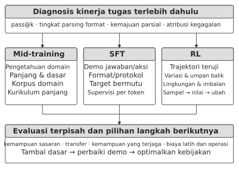

Tabel 8-4 Kriteria Pemilihan Mid-training, SFT, dan RL

| Gejala yang Teramati | Diperiksa Lebih Dulu | Metode Kandidat | Fokus Evaluasi Berikutnya |
| --- | --- | --- | --- |
| Bahasa domain, konsep, atau operasi dasar lemah; sampling berkali-kali tetap jarang membuahkan kemajuan | Cakupan korpus dan kemampuan dasar | Mid-training; fakta yang dapat dicari dipadukan dengan RAG | Tugas domain, himpunan uji kemampuan umum, dan trajektori yang sebagian benar |
| Isi dapat dipakai, tetapi format, parameter, atau alur tetap tidak stabil | Demonstrasi, antarmuka, dan batasan | SFT, constrained decoding, atau validasi alat | Keberhasilan parsing, hasil tugas, dan perilaku pemulihan |
| Sesekali dapat menyelesaikan tugas, tetapi tingkat keberhasilan rendah atau sering berputar-putar | Mutu reward, eksplorasi, dan distribusi tugas | RL | Keuntungan tugas, perbedaan reward, generalisasi independen, dan biaya |
| Ada demonstrasi atau data preferensi, tetapi environment interaktif belum dibangun | Cakupan data offline dan cara verifikasi | SFT, RFT, optimasi preferensi offline | Mutu baseline, bias data, dan keuntungan dari pembangunan environment |

Prosesnya dapat dijalankan dalam empat langkah. Pertama, bangun baseline dari skema Prompt, konteks, alat, dan batasan. Bila metode-metode ini sudah memenuhi tuntutan tugas, penulis mengutamakan untuk mempertahankan skema eksternal yang dapat disunting, sehingga biaya pemeliharaan pelatihan, deployment, dan regresi berkurang. Fakta dinamis disediakan melalui retrieval dan manajemen versi; penilaian implisit, pola persepsi, dan perilaku stabil yang perlu dipelajari berulang kali barulah dipertimbangkan untuk diperbaiki melalui pelatihan parameter.

Langkah kedua, amati keberhasilan, kemajuan parsial, hasil parsing, dan jenis galat pada tugas hold-out. Setelah konfigurasi sampling ditetapkan, Pass@1 dan Pass@k memperlihatkan apakah policy saat ini sudah memiliki jalur yang dapat dimanfaatkan; trajektori yang gagal membantu membedakan kekurangan pengetahuan, ketiadaan umpan balik, dan kesalahan alur.

Langkah ketiga, sediakan demonstrasi untuk perilaku yang perlu dipelajari. JSON schema, pemanggilan alat, pemakaian istilah, klarifikasi, dan pemulihan semuanya dapat ditulis sebagai sampel SFT, sedangkan pengetahuan yang diperlukan disediakan melalui korpus dan konteks tugas yang sesuai.

Langkah keempat, evaluasi kondisi umpan balik untuk RL. Bila model mampu menghasilkan kandidat yang dapat dinilai, reward memiliki daya beda, dan environment memungkinkan interaksi yang cukup, keuntungan optimasi policy dapat dibandingkan; bila reward terlalu jarang, pertimbangkan dulu curriculum, reward parsial, atau policy awal yang lebih cocok.

Pada setiap langkah, hasil evaluasi menentukan investasi berikutnya: tugas dengan format yang jelas dapat di-deploy setelah SFT selesai, titik awal yang kuat dapat langsung menjalani RL, dan setelah pelatihan lanjutan domain kemampuan instruksi yang sudah ada juga dapat dipakai ulang. Berikut ini, melalui tugas satu putaran, kita mengamati secara konkret perbedaan perilaku yang dihasilkan belajar dari demonstrasi dan belajar dari reward.

Kembali ke masalah pesanan dalam panduan membaca. Berikan langsung keterangan alat nyata yang sama kepada model, lalu amati apakah ia dapat menulis parameternya dengan benar. Jika field dalam keterangan itu sudah berubah, perbarui dulu keterangan yang dapat dirujuk saat runtime. Jika arti field-nya jelas tetapi model berulang kali mengisi teks pengguna ke posisi nomor pesanan, sediakan demonstrasi SFT yang memuat kueri, klarifikasi, dan pengisian parameter yang benar. Jika model sesekali sudah dapat menuntaskannya, sedangkan urutan kueri yang berbeda menghasilkan tingkat keberhasilan dan biaya yang berbeda, maka syarat untuk membandingkan beberapa trajektori policy sudah terpenuhi.

## Reinforcement Learning Satu Putaran: Perbandingan Hafalan dan Generalisasi

Tugas satu putaran dimulai dari satu masukan dan berakhir ketika model mengirimkan jawaban dan memperoleh reward. Model tetap dapat bernalar dalam beberapa langkah saat menghasilkan jawaban, dan sistem pelatihan juga dapat membuatnya mencoba soal yang sama berulang kali. Membatasi interaksi menjadi satu jawaban memudahkan kita mengamati bagaimana metode pelatihan mengubah perilaku model. Berikut ini, AdaptThink dipakai lebih dulu untuk menjelaskan bagaimana model belajar membagi anggaran penalaran, lalu GeneralPoints dipakai untuk membandingkan kinerja SFT dan RL ketika aturan dan tampilan visual berubah.

Dengan memahami lebih dulu bagaimana algoritma RL memakai reward untuk memperbarui model, proses pelatihan dalam eksperimen-eksperimen berikutnya akan mudah dibaca. Sebagian besar pelatihan RL dalam bab ini berbasis **policy gradient**. Ambil contoh sampling berkali-kali untuk soal yang sama: model diminta menghasilkan beberapa jawaban, lalu reward setiap jawaban dibandingkan dengan baseline. Jawaban yang lebih baik daripada baseline memperoleh sinyal positif, dan pelatihan menaikkan probabilitas kemunculannya; jawaban yang lebih buruk daripada baseline memperoleh sinyal negatif, dan probabilitas kemunculannya turun.

Untuk mencegah satu pembaruan membuat model melenceng, algoritma **PPO** yang umum dipakai memangkas keuntungan tambahan dalam surrogate objective ketika rasio probabilitas keluar dari interval yang ditentukan; besarnya pembaruan sebenarnya juga bergantung pada learning rate dan jumlah epoch pembaruan. "PPO dengan jaringan nilai" di bagian berikutnya mempelajari estimasi nilai, memakainya untuk membangun baseline pembanding, dan menghitung advantage aksi pada setiap langkah. **GRPO** langsung membandingkan beberapa jawaban untuk soal yang sama dan membangun baseline dari reward di dalam grup, sehingga jaringan nilai yang dilatih tersendiri tidak diperlukan.

Pseudocode bergaya Python berikut merangkai sampling, reward, advantage, dan pembaruan parameter, untuk membantu memahami bagaimana informasi berpindah pada setiap langkah. Pelatihan sebenarnya masih perlu mengonfigurasi paralelisme sampling, regularisasi KL, dan optimizer.

```python
for prompt in batch:
    group = [rollout(policy, env.reset(prompt)) for _ in range(G)]
    rewards = [verify(trajectory) for trajectory in group]
    advantages = normalize_within_group(rewards)       # GRPO baseline
    update(policy, group, advantages)
```

Bagaimana PPO memperbarui policy dengan sekumpulan trajektori yang panjangnya berbeda-beda? Pertama, di dalam setiap trajektori, hitung return terdiskon setiap langkah dari belakang ke depan. Penjumlahan berhenti ketika trajektori berakhir, agar reward soal berikutnya tidak ikut terhitung. Kemudian kumpulkan aksi yang benar-benar dipilih model dari semua trajektori dan hitung loss rata-rata untuk kumpulan aksi ini. Di bawah ini ditulis satu kali pembaruan, tanpa optimasi minibatch berepoch-epoch.[^ch8-ppo-method]

```python
states, actions, returns = [], [], []
for trajectory in rollouts:
    states.extend(trajectory.states)       # 每次选择动作之前的状态
    actions.extend(trajectory.actions)     # 与状态逐项对应
    returns.extend(discounted_returns(trajectory.rewards))

returns = tensor(returns)
values = value_model(states)
advantages = returns - stop_gradient(values)
ratio = exp(policy.log_prob(actions, given=states)
            - old_policy.log_prob(actions, given=states))
policy_loss = -mean(min(
    ratio * advantages,
    clip(ratio, 1 - epsilon, 1 + epsilon) * advantages
))
value_loss = mean((values - returns) ** 2)
update(policy, value_model, policy_loss + value_coef * value_loss)
```

Kata "relatif" dalam GRPO berasal dari beberapa jawaban untuk soal yang sama; PPO di sini memakai jaringan nilai untuk memperkirakan return yang diharapkan dari setiap state. `old_policy` adalah policy yang dibekukan saat trajektori kelompok ini dihasilkan. Misalkan advantage suatu aksi adalah 1, dan policy saat ini memberinya probabilitas 1,4 kali lipat dibandingkan saat sampling; dengan `epsilon = 0.2`, kontribusi suku ini dalam surrogate objective adalah `min(1.4, 1.2) = 1.2`. Menaikkan probabilitas aksi ini lebih jauh tidak lagi memberi keuntungan tambahan dari suku ini.

Jika advantage-nya −1, arahnya berbalik. Ketika rasio probabilitas sudah turun menjadi 0,6, baris kode yang sama menghasilkan `min(-0.6, -0.8) = -0.8`, sehingga menekan probabilitasnya lebih jauh juga tidak menambah keuntungan. Sebaliknya, jika aksi yang berkinerja buruk ini justru makin sering muncul dan rasio probabilitasnya naik menjadi 1,4, nilai terkecilnya adalah `min(-1.4, -1.2) = -1.4`, sehingga menaikkan probabilitasnya tetap ada harganya.

> **Eksperimen 8-10 ★★: AdaptThink—Belajar "Kapan Tidak Perlu Berpikir"**
>
> Model penalaran sering memakai proses penalaran yang panjang untuk menyelesaikan masalah. Untuk soal yang sederhana, menjawab langsung dapat menghemat biaya generasi. AdaptThink menyediakan dua mode bagi model, Thinking dan NoThinking: pada model yang mendukung protokol ini, NoThinking mengakhiri segmen penalaran dengan `<think></think>` lalu langsung menghasilkan jawaban. Tujuan pelatihannya adalah membuat model memilih anggaran penalaran yang tepat sesuai tugas.
>
> Metode ini memiliki dua komponen inti. **Tujuan optimasi berkendala** mendorong model memperbesar proporsi pemakaian NoThinking sambil mempertahankan kinerja menjawab secara keseluruhan; **importance sampling** menyesuaikan proporsi sampling kedua mode, lalu memakai bobot untuk mengoreksi perbedaan antara distribusi sampling dan tujuan optimasi. Model awal sering condong ke Thinking, sehingga sampel NoThinking harus ditambah secara aktif agar pelatihan memperoleh sinyal untuk membandingkan kedua mode. Masalah cold-start di sini secara khusus berarti kurangnya sampel NoThinking pada awal pelatihan.
>
> Eksperimen buku ini memakai 8 GPU H100 80GB. Sampai langkah ke-300, akurasi MATH500 berubah dari 81,00% menjadi 81,80%, dengan panjang respons rata-rata turun dari sekitar 4.911 token menjadi 1.577 token; akurasi GSM8K naik dari 79,68% menjadi 81,88%, dengan panjang respons turun dari sekitar 1.025 token menjadi 477 token; AIME mean@16 berubah dari 31,46% menjadi 31,04%, dengan panjang respons turun dari sekitar 12.120 token menjadi 6.402 token. Panjang respons ketiga kelompok masing-masing berkurang sekitar 68%, 53%, dan 47%.
>
> Proporsi NoThinking pada ketiga dataset berturut-turut adalah 83,80%, 84,15%, dan 56,25%. Pada AIME, model mempertahankan lebih banyak komputasi penalaran, sedangkan pada MATH500 dan GSM8K ia lebih sering menjawab langsung. AIME2024 menyampel setiap soal 16 kali, dan mean@16 menghitung akurasi rata-rata dari 16 jawaban itu. Pada langkah ke-300, jawaban rata-rata hampir setengah lebih pendek, dan akurasinya turun sekitar 0,42 poin persentase.
>
> Langkah ke-300 adalah salah satu validasi di tengah pelatihan. Tim semula merencanakan 3.140 langkah pelatihan, tetapi eksekusinya kemudian terhenti secara tidak normal, dan catatan validasi terakhir berhenti di langkah ke-410. Pada titik itu, akurasi rata-rata AIME2024 adalah 31,88%, dengan jawaban rata-rata sekitar 5.874 token.
>
> AdaptThink dapat dipadukan dengan distilasi Prompt: distilasi menuliskan instruksi dan pola penyelesaian yang dipakai berulang kali ke dalam parameter, lalu AdaptThink mempelajari berapa banyak komputasi penalaran yang perlu dialokasikan untuk setiap tugas. Keduanya bersama-sama memengaruhi mutu jawaban, latensi, dan biaya.

> **Eksperimen 8-11 ★★: GeneralPoints—Perbandingan "Hafalan dan Generalisasi" pada RL Satu Putaran**
>
> Chu dkk. memakai GeneralPoints, permainan kartu yang mirip "24 Poin", untuk menguji kemampuan generalisasi model[^ch8-3]. Angka pada empat kartu masing-masing dipakai sekali, dan dengan penjumlahan, pengurangan, perkalian, serta pembagian harus dihasilkan 24. Jika model benar-benar belajar menyelesaikan soal, masihkah ia dapat menghitung dengan benar setelah aturan nilai kartu atau jenis kartunya diganti? Gambar 8-12 memberikan dua bentuk soal: GP-L langsung memberikan teks, sedangkan GP-VL menuntut model membaca kartunya.
>
> 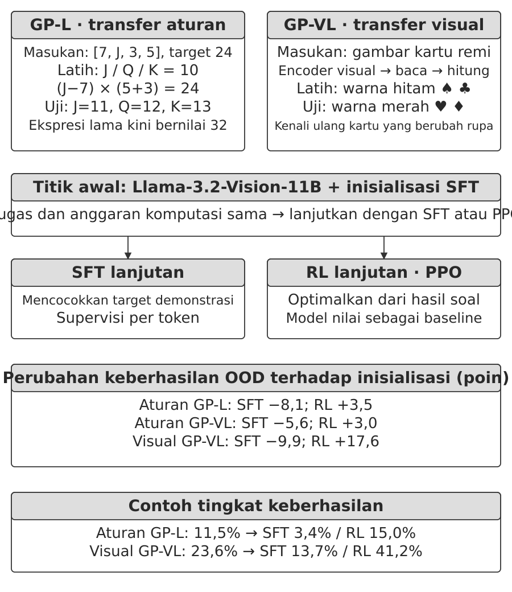
>
> **Varian aturan**: saat pelatihan, J/Q/K semuanya bernilai 10, sedangkan saat uji masing-masing bernilai 11/12/13. Karena itu, himpunan uji memuat kombinasi angka yang tidak pernah terlihat saat pelatihan, sehingga dapat diperiksa apakah model mampu menghitung dengan 11, 12, dan 13 menurut aturan baru. **Varian visual**: pelatihan memakai jenis kartu hitam (♠♣), sedangkan uji memakai jenis kartu merah (♥♦), untuk memeriksa apakah model dapat menyesuaikan diri dengan perubahan tampilan kartu.
>
> Eksperimen bertolak dari Llama-3.2-Vision-11B, lebih dulu memakai SFT untuk membangun kemampuan dasar mengikuti instruksi, lalu bercabang menjadi dua jalur pelatihan—SFT lanjutan dan RL—yang dibandingkan dengan anggaran komputasi yang sama. Cabang RL memakai PPO dengan jaringan nilai. Kedua cabang dilatih dengan aturan J/Q/K=10, lalu dievaluasi pada himpunan uji in-distribution (ID) dan out-of-distribution (OOD).
>
> Ambil `[7, J, 3, 5]` sebagai contoh: bila J=10, dapat dipakai `(J−7)×(5+3)=24`; setelah J diubah menjadi 11, ekspresi ini menghasilkan 32 dan harus diganti dengan `(11−5)×(7−3)=24`. Dengan demikian, kartu yang sama menuntut model membaca aturan yang berlaku dan menyusun ulang perhitungannya.
>
> Kedua metode pelatihan menunjukkan perbedaan yang jelas pada uji di luar distribusi. **OOD aturan**: pada GP-L, tingkat keberhasilan RL naik dari 11,5% menjadi 15,0%, bertambah 3,5 poin persentase; SFT turun dari 11,5% menjadi 3,4%, berkurang 8,1 poin persentase. Pada GP-VL, RL bertambah 3,0 poin persentase, sedangkan SFT berkurang 5,6 poin persentase. **OOD visual**: pada GP-VL, RL naik dari 23,6% menjadi 41,2%, bertambah 17,6 poin persentase; SFT turun dari 23,6% menjadi 13,7%, berkurang 9,9 poin persentase.
>
> Pemeriksaan lebih lanjut atas hasil pengenalan kartu dapat menghubungkan kinerja akhir menjawab dengan persepsi visual: akurasi pengenalan pada cabang RL naik bersama tingkat keberhasilan tugas, sedangkan akurasi pengenalan pada cabang SFT agak menurun. Penelitian ini mengaitkan perbedaan itu dengan tujuan pelatihan: pencocokan per token dapat memperkuat pola teks dalam demonstrasi, sedangkan reward hasil terus-menerus menuntut model membaca kartu dengan benar dan menyelesaikan perhitungan. Akurasi persepsi menyediakan metrik antara untuk menganalisis mekanisme ini.
>
> Alasan mendahulukan SFT juga dapat dipahami dari format keluaran. Model dasar Llama-3.2-Vision-11B dalam eksperimen ini tidak dapat secara stabil menghasilkan keluaran terstruktur yang diminta, sehingga verifier tidak dapat menghitung reward tugas darinya, dan upaya menjalankan RL end-to-end secara langsung pun gagal. SFT lebih dulu membangun keluaran yang dapat di-parse dan dinilai, barulah RL berikutnya dapat memanfaatkan umpan balik tugas. DeepSeek-R1-Zero yang dibahas sebelumnya justru dimulai dari model dasar yang sejak awal sudah mampu menghasilkan jawaban yang dapat dinilai, sehingga langsung masuk ke RL.
>
> Seberapa banyak yang dapat dipelajari model dari umpan balik verifier? Gambar 10 dalam makalah membandingkan secara tersendiri tugas kartu teks murni (GP-L). Para peneliti menetapkan 1, 3, 5, dan 10 iterasi verifikasi, lalu melatih dan mengevaluasi model RL secara terpisah. Dengan anggaran komputasi pelatihan yang sama, kelompok yang diizinkan 10 kali verifikasi meningkatkan tingkat keberhasilan pada aturan baru sebesar 5,99 poin persentase dibandingkan titik awal pelatihan kelompoknya, sedangkan kelompok yang hanya diverifikasi 1 kali meningkat 0,48 poin persentase.
>
> Mengapa di bawah pergeseran distribusi dalam eksperimen ini kinerja SFT turun, sedangkan RL lebih baik? Salah satu penjelasan yang sesuai dengan pengamatan adalah: data SFT yang terbatas memperkuat pola tetap "setiap bertemu J/Q/K, anggap 10"; saat uji J=11, model tetap menghitung dengan 10. Cabang RL yang berorientasi hasil lebih mungkin memperkuat strategi "hitung ulang sampai mendapat jawaban yang benar", sehingga tetap dapat diterapkan ketika J menjadi 11.
>
> Perubahan aturan dan perubahan jenis kartu dalam GeneralPoints memungkinkan kita mengamati secara terpisah apakah model belajar menghitung menurut kondisi baru dan apakah ia membaca masukan visual yang baru dengan benar. Dengan model, data pelatihan, dan anggaran uji di sini, cabang yang melanjutkan SFT mundur pada uji di luar distribusi, sedangkan cabang yang disambung dengan RL membaik. Untuk menerapkan kesimpulan ini pada tugas Anda sendiri, tanyakan dulu: apakah murid sudah menguasai format keluaran? Apa sebenarnya yang diganti dalam uji baru—aturannya, tampilan masukannya, atau keduanya? Hanya dengan membuat perbandingan terpisah kita dapat mengetahui apakah yang perlu dilakukan adalah menambah demonstrasi, memperbaiki persepsi, atau menambah eksplorasi dengan umpan balik hasil.

## Algoritma RL: dari 16 Rollout ke Satu Pembaruan Parameter

**GRPO (Group Relative Policy Optimization)** diusulkan oleh DeepSeek dan membangun sinyal pembelajaran dari kinerja relatif beberapa percobaan pada soal yang sama. Ambil contoh tugas perbaikan kode bergaya SWE-bench: `parser.py` dalam sebuah proyek Python memicu `IndexError` pada masukan kosong, dan Agent harus memperbaiki implementasinya tanpa mengubah berkas tes. Satu iterasi pelatihan dapat dibagi menjadi empat langkah.

**Langkah pertama: biarkan model policy mencoba berulang kali.** Model policy adalah model bahasa yang sedang dilatih. Sistem menempatkan kode awal dan deskripsi masalah yang sama ke dalam 16 sandbox yang terisolasi, dan membiarkan model menyelesaikan tugas secara independen sebanyak 16 kali. Setiap kali dimulai dari membaca kode, lalu mengubah dan menguji, sampai mengirimkan hasil; seluruh trajektori interaksi ini disebut satu **rollout**. Sampling acak membuat titik awal yang sama menghasilkan jalur yang berbeda: ada yang melengkapi pemeriksaan batas, ada yang hanya menangkap eksepsi, ada yang mengubah berkas yang salah, dan ada pula yang mencoba mengubah tes.

**Langkah kedua: hitung reward.** Setelah setiap rollout berakhir, verifier menerapkan patch dalam environment yang bersih dan menjalankan tes. Misalkan dari 16 percobaan, 4 lulus semua tes tanpa mengubah berkas tes, sedangkan 12 lainnya gagal; maka 4 yang lulus memperoleh reward 1 dan 12 sisanya memperoleh reward 0. Gambar 8-13 menempatkan penilaian 16 trajektori ini dalam satu tabel. Tugas kode semacam ini dapat langsung dihitung reward-nya dengan tes dan aturan. Untuk tujuan yang lebih sulit dituliskan sebagai tes, seperti keterbacaan dan mutu penjelasan, penilaian manusia atau reward model juga dapat digabungkan.

**Langkah ketiga: hitung advantage relatif.** Reward hanya menyatakan apakah satu trajektori berhasil atau gagal, sedangkan **advantage relatif** menyatakan seberapa baik trajektori itu dibandingkan percobaan lain dalam grup yang sama. Tingkat keberhasilan rata-rata grup ini adalah 4/16: 4 trajektori yang lulus tes berada di atas rata-rata grup sehingga memperoleh advantage positif; 12 yang gagal berada di bawah rata-rata sehingga memperoleh advantage negatif. Jika dinormalisasi dengan simpangan baku dalam grup, rata-rata reward adalah 0,25 dan simpangan bakunya sekitar 0,433, sehingga advantage trajektori yang berhasil sekitar 1,73 dan yang gagal sekitar −0,58. GRPO membangun sinyal pembelajaran dari perbandingan dalam grup semacam ini. Jika ke-16 reward sama persis, setiap reward dikurangi rata-rata grup menghasilkan nol. Menambahkan suku penstabil yang sangat kecil pada penyebut cukup untuk menghindari pembagian dengan nol; setelah normalisasi, reward hasil grup ini tetap tidak dapat menunjukkan trajektori mana yang harus diunggulkan pelatihan. Pada saat itu, periksa apakah batasan jalur, reward proses, atau kemajuan parsial dapat membedakan trajektori dalam grup yang sama. Misalnya, dari dua percobaan yang sama-sama tidak berhasil memperbaiki kode, hanya satu yang lulus tes batas yang semula gagal. Asalkan hasil antara ini dapat diverifikasi secara independen, tersedia satu petunjuk tambahan yang mungkin dapat dipakai untuk belajar.

**Langkah keempat: perbarui policy dengan gradient descent.** Program pelatihan mengubah advantage relatif menjadi loss pelatihan, menghitung gradien, lalu optimizer (seperti AdamW atau Muon) menjalankan gradient descent untuk menaikkan probabilitas pilihan model dalam trajektori berkeuntungan positif dan menurunkan probabilitas pilihan dalam trajektori berkeuntungan negatif. Pelatihan menyesuaikan probabilitas pilihan-pilihan ini berulang kali pada banyak tugas dan rollout. Setelah optimasi mulai berhasil, saat menjumpai galat serupa, pola "reproduksi masalah dulu, periksa kondisi batas, ubah implementasi, dan jalankan tes" akan lebih mudah muncul, sedangkan pola "menutupi eksepsi, mengubah tes, mengirim tanpa verifikasi" akan makin jarang.

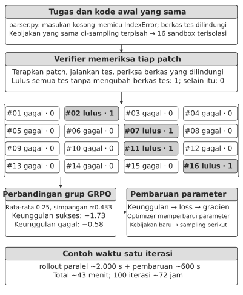

Pada Gambar 8-13, soal yang sama disampel 16 kali; berapa **iterasi pelatihan (step)** yang terhitung? Menurut cara penghitungan di bagian ini, 16 rollout ini termasuk satu batch. Pada putaran ke-$k$, policy saat ini dipakai untuk sampling, reward, advantage, dan gradien dihitung, lalu policy diperbarui sekali; baru pada putaran ke-$k+1$ sampling diulang dengan parameter baru. Melatih 100 steps berarti iterasi semacam ini dijalankan sekitar 100 putaran.

Dari sini waktu pelatihan dapat diperkirakan. Satu tugas kompleks dapat memuat puluhan putaran pemanggilan alat; ketika pelatihan sinkron menunggu seluruh hasil batch, trajektori paling lambat di antara 16 trajektori paralel menentukan kapan tahap sampling selesai. Misalkan trajektori itu memakan waktu sekitar 2.000 detik, dan perhitungan gradien serta pembaruan optimizer memakan 600 detik lagi; maka satu step membutuhkan sekitar $2{,}000+600=2{,}600$ detik, atau 43 menit. Dengan durasi yang sama, pelatihan 100 steps berturut-turut membutuhkan sekitar 72 jam.

PPO dan GRPO sama-sama mengikuti siklus tertutup ini; perbedaannya terutama terletak pada "apa yang dijadikan pembanding". GRPO langsung membandingkan beberapa rollout untuk soal yang sama dan tidak memerlukan model nilai tambahan; PPO melatih model nilai yang memperkirakan "biasanya seberapa baik hasil yang dapat dicapai" pada setiap langkah trajektori, lalu menilai apakah aksi saat ini lebih baik daripada ekspektasi itu, sehingga menyediakan baseline yang dibutuhkan untuk credit assignment per langkah. Keduanya meredam pembaruan yang terlalu besar melalui mekanisme seperti clipped surrogate objective. DPO berbeda: ia langsung mempelajari pasangan preferensi "jawaban lebih baik—jawaban lebih buruk" yang sudah dikumpulkan sebelumnya, tanpa membiarkan policy saat ini menghasilkan grup rollout secara online.

Kasus-kasus dalam bab ini memakai resep pelatihan yang berbeda: AdaptThink memakai tujuan berkendala yang dirancang khusus; GeneralPoints, V-IRL, dan ReTool memakai PPO, dan pada dua yang pertama model nilai ikut dalam estimasi advantage; SimpleVLA-RL dan RLVP memakai GRPO.

Misalkan soal A dan soal B masing-masing dicoba empat kali; soal A benar semua, sedangkan soal B salah semua. Keempat reward soal A semuanya 1, dan keempat reward soal B semuanya 0. Setelah masing-masing dikurangi rata-rata grupnya, advantage kedua grup sama-sama menjadi 0. Namun, jika masih ada daya komputasi untuk mencoba beberapa kali lagi, soal mana yang lebih menjanjikan untuk menghasilkan sampel pelatihan yang berguna?

Never Give Up memasukkan pilihan ini ke dalam proses sampling. Soal A benar semua, maka grup ini dilewati; soal B salah semua, maka dengan peluang tertentu ditambahkan satu grup lagi. Misalkan grup kedua akhirnya memuat satu jawaban benar; saat pelatihan, kedua grup dengan total delapan jawaban digabungkan: satu solusi benar dan tujuh solusi salah, sehingga soal yang sama memiliki reward yang berbeda-beda. Sampling asinkron membuat soal-soal lain tetap berjalan seperti biasa tanpa harus menunggu hasil soal B.[^ch8-ngu]

[^ch8-ngu]: Michael Noukhovitch dkk., *Learning to Solve Hard Problems in RL for LLMs by Never Giving Up*, 2026. Sampling tambahan dalam makalah ini dipakai untuk pelatihan; soal yang sudah benar tetap dapat terambil lagi dalam pelatihan berikutnya.

### Mengapa RL pada LLM Biasanya Mengutamakan On-Policy

**Online** dan **On-policy** menggambarkan dua aspek yang berbeda. Pelatihan online terus berinteraksi dengan environment dan menghasilkan data selama berjalan; pelatihan on-policy berfokus pada sumber data, yaitu menuntut agar behavior policy $\mu$ yang menghasilkan trajektori sama dengan, atau cukup dekat dengan, policy $\pi_\theta$ yang hendak dioptimalkan. Kluster asinkron dapat terus menyampel secara online, tetapi jika sebuah worker tertinggal beberapa checkpoint, data yang dikembalikannya membawa keusangan policy dan membentuk komponen off-policy.

Penulis menyarankan untuk lebih dulu membangun baseline yang stabil dengan pelatihan yang mendekati on-policy, baru kemudian memperkenalkan sampling asinkron atau pemakaian ulang data lama untuk menaikkan throughput. Resep PPO/GRPO dalam bab ini biasanya menyampel dengan policy terbaru pada awal setiap step. PPO kemudian menjalankan beberapa epoch pembaruan minibatch pada batch data yang sama, sehingga policy saat ini makin menjauh dari `old_policy` yang menghasilkan data. Rasio probabilitas mengukur perubahan ini, sedangkan clipped objective meredam pembaruan yang terlalu besar.

Tujuan policy gradient berkaitan dengan ekspektasi reward di bawah policy saat ini $\pi_\theta$. Ketika memakai data hasil sampling behavior policy $\mu$, rasio probabilitas aksi pada state yang sama dapat dihitung lebih dulu, lalu dipakai untuk menyusun koreksi importance:

$$
\rho_t=\frac{\pi_\theta(a_t\mid s_t)}{\mu(a_t\mid s_t)}
=\exp\left(\log\pi_\theta(a_t\mid s_t)-\log\mu(a_t\mid s_t)\right).
$$

Misalkan setelah prefiks yang sama, policy sampling memilih suatu token dengan probabilitas 0,2, sedangkan policy saat ini memberinya probabilitas 0,3; maka rasio probabilitas langkah ini adalah 1,5. Token itu terlalu jarang muncul dalam sampel lama, sehingga saat diestimasi menurut policy saat ini, bobot sampel semacam ini dinaikkan. Jika sampling dan pelatihan memakai policy yang sama, rasio probabilitas setiap langkah sebelum parameter diperbarui adalah 1.

Memakai ulang trajektori lama memungkinkan sampling dan pelatihan berjalan secara asinkron sehingga throughput naik. Namun, makin jauh perbedaan kedua policy, makin besar kemungkinan segelintir sampel memperoleh bobot yang sangat besar. Saat seluruh trajektori diberi bobot ulang, rasio probabilitas setiap langkah juga harus dikalikan berantai. PPO memangkas sebagian keuntungan tambahan dalam surrogate objective setiap aksi sehingga pengaruh rasio probabilitas yang ekstrem melemah; state yang tidak pernah dicapai sampel lama hanya dapat dilihat melalui sampling baru. Inilah juga alasan penulis cenderung memakai trajektori yang segar.[^ch8-32]

#### Perbedaan Numerik antara Pelatihan dan Inferensi

RL LLM berskala besar biasanya menyampel dengan engine inferensi seperti vLLM dan SGLang, lalu menghitung log-probabilitas dan gradien dengan sistem pelatihan seperti FSDP dan Megatron. Meskipun kedua sisi memuat bobot yang sama, log-probabilitas yang dihitung untuk token yang sama bisa sedikit berbeda karena perbedaan presisi floating point, urutan reduksi, tensor parallelism, ukuran batch, KV Cache, dan fused kernel. Akibatnya, sebelum parameter diperbarui pun $\rho_t$ sudah menyimpang dari 1, dan muncul perbedaan policy pada tingkat numerik antara pelatihan dan sampling. Eksperimen terkendali menemukan bahwa perbedaan kecil pada tingkat token pun dapat membuat pelatihan runtuh.[^ch8-33]

Begitu distribusi sampling berubah, policy gradient yang naif dapat condong ke salah satu aksi meskipun reward kedua aksi sama persis. Misalkan saat sampling, A dan B masing-masing berpeluang setengah, tetapi saat pelatihan probabilitas model memilih A sudah menjadi 0,8. Untuk logit yang mengendalikan A, gradien log-probabilitasnya adalah $1-0.8=0.2$ bila A terpilih, dan $0-0.8=-0.8$ bila B terpilih. Jika kedua aksi sama-sama mendapat 1 poin, rata-rata menurut probabilitas saat sampling menghasilkan gradien $-0.3$. Kedua pilihan jelas mendapat skor yang sama, tetapi pembaruannya justru menekan probabilitas A.

Score centering mengurangi gradien log-probabilitas di bawah prefiks yang sama dengan rata-ratanya menurut distribusi sampling. Pada contoh di atas, setelah dikurangi $-0.3$, kedua suku menjadi $0.5$ dan $-0.5$, sehingga reward yang sama menghasilkan pembaruan rata-rata tepat nol. GRPO sebelumnya mengurangi reward sekelompok jawaban dengan rata-ratanya; di sini yang dipusatkan adalah gradiennya.[^ch8-sc]

[^ch8-sc]: Martin Marek, Max Ryabinin, *Score Centering Stabilizes Off-policy Reinforcement Learning*, 2026. Bila policy sampling tertinggal terlalu jauh, regularisasi KL juga dapat dipakai untuk membatasi jarak antara policy pelatihan dan behavior policy (arXiv:2611.21791).

Galat numerik antara sisi pelatihan dan sisi sampling juga membesar sepanjang sekuens yang panjang: **galat log-probabilitas → deviasi rasio probabilitas → akumulasi pada prefiks panjang → perubahan clipping dan pembobotan advantage → perubahan gradien dan jumlah sampel efektif**. Misalnya, jika log-rasio probabilitas 4.000 token semuanya membawa deviasi $10^{-3}$ ke arah yang sama, rasio probabilitas tingkat trajektori yang dihitung akan menjadi $e^{4000\times0.001}=e^4\approx54.6$ kali nilai sebenarnya.

Perubahan probabilitas di awal juga dapat mengubah hasil sampling, sehingga state berikutnya berkembang mengikuti jalur lain. Sinyal yang dapat diamati selama pelatihan meliputi lonjakan rasio importance, kenaikan proporsi clipping, perubahan mendadak pada gradien atau panjang respons, serta turunnya reward dan entropi. Ketika ukuran batch mengubah proses reduksi, hasil numerik untuk masukan yang sama juga dapat berubah; artinya batch invariance rusak. Penelitian terkait mengamati efek off-policy implisit yang timbul dari sini, dan memperbaiki stabilitas dengan menyelaraskan komputasi sampling dan pelatihan, atau dengan mengoreksi perbedaan policy secara eksplisit.[^ch8-34]

Karena itu, penulis memasukkan konsistensi numerik antara sampling dan pelatihan ke dalam pemeriksaan inti sebelum pelatihan dimulai, dan memantaunya terus bersama kurva reward. Penanganannya dapat mengikuti empat langkah, "ukur perbedaan—selaraskan konfigurasi—koreksi deviasi—kendalikan keusangan":

- **Sebelum pembaruan parameter apa pun**, gunakan batch trajektori yang sama untuk membandingkan log-probabilitas token yang diberikan sisi sampling (sampler) dan sisi pelatihan (trainer), lalu pantau rata-rata, kuantil, nilai maksimum, KL aproksimasi, dan proporsi clipping dari $\rho_t$; inilah unit test on-policy yang paling langsung.
- Saat menyinkronkan bobot, selaraskan pula adapter LoRA, tokenizer, templat dialog, versi model, dan konfigurasi positional encoding. Rollout harus menyimpan log-probabilitas yang diberikan policy sampling saat generasi, untuk kemudian dipakai menghitung rasio probabilitas.
- Selaraskan sebisa mungkin presisi, tata letak paralelisme, dan kernel komputasi kunci antara sampling dan pelatihan; jika tidak memungkinkan, perlakukan perbedaannya secara eksplisit sebagai off-policy, terapkan koreksi importance dan pantau jumlah sampel efektif, serta nilai efek koreksinya bersama proporsi clipping.
- Lakukan sampling ulang dengan policy yang sudah diperbarui secara tepat waktu, dan batasi jumlah epoch pembaruan per batch data serta jumlah checkpoint ketertinggalan sampling asinkron terhadap pelatihan.

## Environment RL: dari Evaluasi ke Simulasi

Pelatihan RL untuk Agent menuntut tugas dijalankan berulang kali. Satu perbaikan kode dapat dicoba ulang di salinan yang terisolasi, tetapi satu pembayaran akan mengubah state rekening yang nyata. Environment pelatihan harus menyediakan state awal yang dapat di-reset, salinan tugas yang dapat dijalankan paralel, dan hasil yang dapat diverifikasi, agar model dapat menjelajahi berbagai jalur dalam kondisi terkendali. Bab 7 sudah memperkenalkan environment evaluasi; bila dipakai untuk pelatihan, perlu dipertimbangkan pula eksekusi berdurasi panjang, efek samping aksi, dan biaya interaksi dalam jumlah besar. Penulis lebih dulu mengalokasikan tenaga dan anggaran untuk membangun environment, baru kemudian menjadwalkan pelatihan berskala besar. Mewujudkan umpan balik yang nyata, reset state, dan isolasi paralel sering kali lebih menguras sumber daya rekayasa daripada mengintegrasikan PPO atau GRPO, dan biaya pembangunan environment bahkan dapat melampaui biaya pelatihan itu sendiri.

### Environment: Tempat Model Berlatih

Environment memperbarui state berdasarkan aksi dan mengembalikan observasi baru kepada model. Saat membangun environment, mulailah dari tiga pertanyaan.

- **Apakah interaksinya mendekati skenario deployment?** Simulator layanan pelanggan perlu mencakup situasi ketika pengguna menambahkan informasi, mengubah permintaan, atau mengungkapkan diri secara samar; simulator alat perlu mengembalikan galat dan latensi yang umum di produksi. Melalui umpan balik ini model belajar menghadapi masalah nyata. Umpan balik yang terlalu seragam membuat policy bergantung pada pola baku dalam simulasi.
- **Apakah tugas dapat dicoba ulang dan dijalankan paralel secara stabil?** Setiap rollout membutuhkan state pesanan, berkas, atau rekening yang independen, yang dapat dibersihkan dan dipulihkan setelah selesai. Sandbox code interpreter pada ReTool dan sandbox MCP pada AWorld sama-sama memikul tanggung jawab ini. Untuk API nyata yang memiliki batas laju, biaya, atau efek samping penulisan, gunakan akun sandbox, data replay, atau antarmuka simulasi sesuai kebutuhan tugas.
- **Bagaimana hasilnya ditentukan?** State environment adalah dasar penting penghitungan reward. Misalnya, tugas pengembalian dana dapat memeriksa jumlah, status pesanan, dan syarat otorisasi; tugas kode dapat menjalankan tes. Desain reward akan dibahas secara khusus di bagian berikutnya.

**Sebelum mulai menyetel algoritma, penulis menyarankan untuk lebih dulu memeriksa: apakah environment simulasi cukup dekat dengan tugas nyata? Ini lebih penting daripada memilih PPO atau GRPO.** Fidelitas, kemampuan reset, dan kemampuan verifikasi bersama-sama menentukan apa yang dapat dipelajari model dari interaksi. Menjalankan ketiga bagian ini lebih dulu dengan sedikit tugas, baru kemudian memperbesar skala pelatihan, biasanya membuat masalah lebih mudah ditemukan.

### Mensimulasikan Alat dan Environment dengan Model

Hasil pencarian, percakapan pengguna, dan state bisnis yang kompleks semuanya dapat disintesis dengan bantuan model. Simulator berbasis model menerima aksi Agent dan menghasilkan umpan balik langkah berikutnya, sehingga ketergantungan pada layanan eksternal waktu nyata berkurang. Cara ini dapat diperluas dari satu alat hingga seluruh environment tugas.

**Tingkat pertama: menyintesis nilai balikan alat.** ZeroSearch[^ch8-13] membuat LLM berperan sebagai mesin pencari: murid mengirim kueri, dan simulator menghasilkan hasil pencarian. Dengan begitu, ketergantungan pelatihan pada biaya, batas laju, dan fluktuasi hasil API pencarian nyata berkurang. Pendekatan ini juga memakai penjadwalan ala curriculum: di awal dikembalikan dokumen yang bermutu tinggi dan sangat relevan, lalu derau ditambah secara bertahap agar murid berlatih mengekstrak informasi berguna dari materi yang tidak sempurna. Model dalam penelitian ini, setelah dilatih dalam environment pencarian simulasi, tetap menunjukkan kinerja yang baik ketika dihubungkan ke mesin pencari nyata.

**Tingkat kedua: mensimulasikan transisi state environment.** DreamGym[^ch8-14] mendistilasi dinamika environment ke dalam experience model bergaya penalaran. Model ini membaca state saat ini dan aksi Agent, menurunkan state dan umpan balik berikutnya, dan menghasilkan trajektori interaksi secara massal untuk RL online, sehingga akses ke environment nyata berkurang. Tugas layanan pelanggan dan penjualan juga dapat membuat LLM berperan sebagai pengguna yang mensimulasikan pertanyaan lanjutan, tambahan informasi, dan perubahan permintaan. Seri τ-bench memakai simulator pengguna; kerangka interaksi serupa juga dapat dipakai untuk pelatihan, masing-masing menangani tugas latihan dan evaluasi.

Simulator berbasis model juga perlu dikalibrasi. Jika simulator layanan pelanggan selalu memahami pertanyaan yang samar dengan tepat, policy kehilangan kesempatan berlatih klarifikasi; jika simulator pencarian selalu mengembalikan dokumen yang benar, policy tidak mendapat pengalaman mengenali derau. Pelatihan juga dapat memperkuat perilaku yang memanfaatkan cacat penilaian simulator. Penulis menyarankan cara campuran: biarkan simulasi model menangani sebagian besar interaksi, lalu secara berkala periksa kinerja policy dengan tugas di environment nyata dan umpankan perbedaan yang ditemukan kembali ke simulator. Dengan begitu terbentuk proses iteratif "interaksi sintetis—evaluasi tugas nyata—koreksi simulator".

Bagaimana kita tahu bahwa simulator benar-benar dapat mengajarkan pemakaian alat? Lakukan tes kecil: pada pesanan awal yang sama, lakukan kueri, kirim perubahan, lalu kueri lagi, dan periksa apakah field pesanan yang dikembalikan berubah sesuai aksi seperti yang diharapkan. Kemudian reset environment dan pastikan nilai aslinya dapat dibaca kembali. Environment yang hanya mampu menghasilkan kalimat "sudah diubah" yang terdengar masuk akal, tetapi tidak dapat memperlihatkan perubahan itu pada putaran berikutnya, akan memberi reward kepada policy yang pandai berbicara, meskipun policy itu tidak pernah mengubah pesanan.

### Environment, Distribusi Tugas, dan Isolasi Evaluasi

Environment pelatihan menentukan apa yang dapat dialami model. State yang dapat di-reset mendukung percobaan ulang, salinan terisolasi mendukung paralelisme, dan state serta aturan verifikasi yang jelas mendukung reproduksi dan penilaian. Tugas dapat memakai metode sintesis data yang telah dibahas: ekstrak cetak biru tugas dari log bisnis nyata, hapus informasi identitas, lalu hasilkan tokoh, pesanan, berkas, dan state awal fiktif.

Pelatihan dan evaluasi boleh memakai ulang generator tugas dan kode verifikasi yang sama, tetapi tugas-tugas konkretnya harus dibagi ke dalam himpunan yang terpisah. Mengacu pada desain environment SWE-Gym, τ²-bench, dan AndroidWorld[^ch8-28], tes penerimaan, state tersembunyi yang dibutuhkan untuk penilaian, dan solusi referensi disimpan di sisi verifier, sedangkan Agent memperoleh observasi melalui antarmuka yang disepakati dalam tugas. Sebelum memperbesar sampling, periksa dulu dengan sedikit rollout apakah tugas dapat diselesaikan dan apakah verifier dapat membedakan hasil yang valid dari yang tidak. Menemukan bias penilaian sedini mungkin mengurangi kesempatan policy memanfaatkan celah verifikasi.

Karena itu, urutan rekayasa environment semestinya: **cetak biru tugas → environment yang dapat di-reset → verifikasi hasil → isolasi pelatihan/evaluasi → kalibrasi dengan interaksi nyata**. Sintesis data yang dibahas sebelumnya menyaring trajektori yang valid dari environment-environment ini untuk membentuk demonstrasi SFT. Setelah masuk ke RL, policy saat ini terus mencoba-coba di environment dan menjelajahi jalur di luar demonstrasi.

Verifikasi juga harus dimasukkan ke dalam anggaran throughput. Kernel Lean, test runner, dan eksekusi kontainer menghabiskan CPU dan memori. Ketika kecepatan generasi GPU melampaui kecepatan verifikasi, tugas akan menumpuk di antrean verifikasi. Pada saat itu, tambahkan worker verifier, persingkat latensi verifikasi, atau sesuaikan pembagian sumber daya antara generasi dan verifikasi[^ch8-9].

## Dari Satu Putaran ke Multi-Turn: Skenario Tugas dan Credit Assignment

### Tantangan Inti Tugas Multi-Turn

Sisi kiri Gambar 8-14 adalah permainan 24 poin. Model dapat menghitung beberapa langkah dalam jawabannya, tetapi semua langkah itu memakai empat kartu yang diberikan soal, tanpa observasi environment baru di tengah jalan. Sisi kanan adalah navigasi street view. Hanya setelah tiba di persimpangan dan memilih belok kiri, jalan di seberang tikungan itu terlihat. Langkah berikutnya harus diputuskan ulang berdasarkan papan penunjuk jalan di depan mata. ReAct, yang dibahas di Bab 1 dan Bab 4, dapat mengatur interaksi semacam ini: model memilih tindakan, alat atau environment mengeksekusinya, dan observasi baru masuk ke putaran keputusan berikutnya.

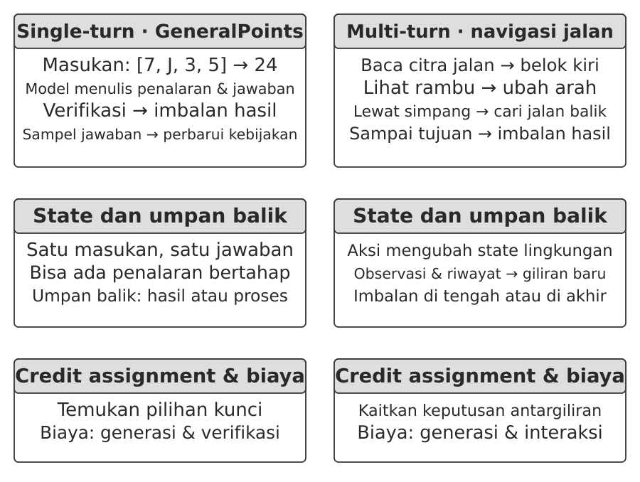

Pada Gambar 8-15, Agent melewatkan persimpangan pada langkah ke-3, menyadari dirinya salah jalan pada langkah ke-4, berbalik arah, dan tiba di tujuan pada langkah ke-5. Reward akhir mengakui seluruh perjalanan navigasi, tetapi tidak membedakan salah jalan dari berbalik arah tepat waktu. Lain kali bertemu persimpangan ini, kita ingin Agent langsung memilih jalan yang benar; seandainya salah lagi, ia tetap perlu didorong untuk berbalik arah. Pelatihan perlu memperkirakan peran setiap langkah sebelumnya terhadap keuntungan akhir; masalah ini disebut **Credit Assignment**. Estimasi nilai dan advantage dapat memanfaatkan return yang datang kemudian; bila aksi antara dapat diperiksa secara andal, reward proses juga dapat ditambahkan. Berbalik arah pada langkah ke-4 mendapat 0 poin dalam reward proses, tetapi tetap membantu mencapai tujuan. Saat memperkirakan nilai langkah ini, return yang datang kemudian juga harus diperhitungkan.

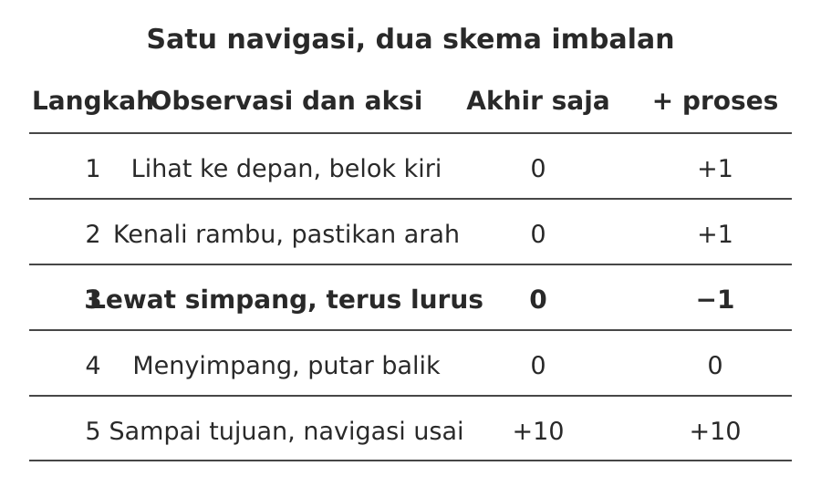

Masalah yang sama juga terjadi dalam panggilan layanan pelanggan. Misalnya, pengguna memberi ulasan positif pada putaran ke-10. Menanyakan dengan jelas tagihan mana yang dipersoalkan pada putaran ke-2 dan menjelaskan biaya pada putaran ke-7 mungkin sama-sama membantu. Hanya dari ulasan positif terakhir, belum dapat dibedakan seberapa besar peran masing-masing. Dua eksperimen berikut membahas dua situasi: pelatih dapat memeriksa aksi navigasi langkah demi langkah, dan pelatih hanya dapat menilai dari hasil tugas apakah robot berhasil.

> **Eksperimen 8-12 ★★★: V-IRL-VL—Navigasi Visual Multi-Turn**
>
> Dalam V-IRL[^ch8-24], Agent harus menemukan tujuan langkah demi langkah berdasarkan street view di depannya. Pelatihan memakai rute di New York, sedangkan uji dipindahkan ke kota lain sehingga cara memberi petunjuk arah maupun pemandangan jalan dalam gambar sama-sama berubah. Dalam dua jenis uji di luar distribusi—perubahan aturan dan perubahan visual—RL menunjukkan kinerja yang jelas lebih baik daripada SFT. Eksperimen ini memakai PPO dengan jaringan nilai. Umpan balik di setiap langkah membantu membedakan keputusan mana dalam rute panjang yang layak dipertahankan.

> **Eksperimen 8-13 ★★★: SimpleVLA-RL—Eksplorasi Terbuka dengan Reward Hasil `[Eksperimen Lanjutan]`**
>
> SimpleVLA-RL memakai reward hasil berhasil/gagal pada tugas robot LIBERO. Setiap tugas memakai satu trajektori demonstrasi untuk cold-start SFT, lalu melalui RL tingkat keberhasilannya naik dari 17,3% menjadi 91,7%, dan muncul aksi "dorong-potong" yang tidak ada dalam demonstrasi. Bandingkan hasil ini dengan navigasi street view: jika langkah mana yang salah di tengah jalan dapat ditentukan secara andal, umpan balik dapat diberikan saat itu juga untuk mempercepat pembelajaran. Jika belum diketahui ada berapa cara menyelesaikan tugas, memberi reward berdasarkan hasil lebih dulu menyisakan ruang bagi model untuk mencoba jalur lain. Menuliskan urutan aksi dalam demonstrasi manusia sebagai tuntutan reward terlalu dini dapat menekan skor strategi baru seperti "dorong-potong".

### Pemanggilan Alat: Belajar Memakai Kemampuan Eksternal melalui Interaksi

Setelah alat eksternal dihubungkan, model dapat memilih untuk mencari, mengeksekusi kode, mengubah berkas, mengueri basis data, atau menggabungkan beberapa API sesuai kebutuhan tugas. Harness bertugas memvalidasi dan menjadwalkan pemanggilan, sedangkan alat mengeksekusinya di environment dan mengembalikan observasi. Gambar 8-16 memisahkan keputusan dalam satu tugas dari pelatihan setelah tugas selesai. Mengikuti panah di sebelah kanan, hasil alat kembali ke tugas saat ini, dan model memakainya untuk memutuskan langkah berikutnya. Membaca ke bawah, setelah tugas selesai barulah program pelatihan memakai seluruh trajektori untuk menghitung reward dan memperbarui parameter, dan sampling putaran berikutnya memakai policy baru. Ketika satu tugas harus memanggil beberapa alat berturut-turut, hasil yang dikembalikan pemanggilan sebelumnya memengaruhi parameter pemanggilan berikutnya.

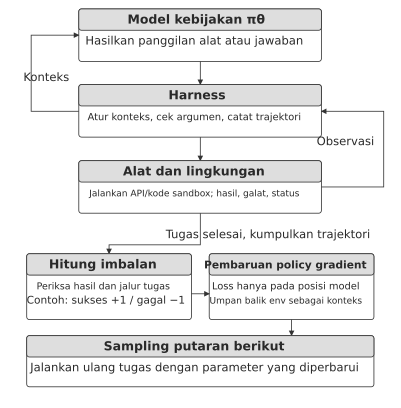

Search-R1[^ch8-25] melatih model untuk memutuskan kapan mencari, kueri apa yang dikirim, dan melanjutkan penalaran dengan memadukan hasilnya. ReTool menghubungkan code interpreter ke siklus sejenis, sehingga model belajar mengatur eksekusi kode, memahami nilai balikan, dan memperbaiki berdasarkan pesan galat. AWorld-train memperluasnya ke sandbox multi-alat MCP: model harus memilih alat dan menangani dependensi antarpemanggilan, sementara sistem pelatihan juga harus mampu me-reset environment dan memutar ulang trajektori.

Trajektori alat perlu membedakan token yang dihasilkan model dari token yang dikembalikan environment. Saat menghitung loss policy, hanya aksi yang dihasilkan model—penalaran, parameter pemanggilan, jawaban, dan sejenisnya—yang dihitung dalam loss, sedangkan posisi umpan balik environment disamarkan. Umpan balik tetap menjadi konteks bagi perhitungan berikutnya dan membantu model menilai apa yang harus dilakukan selanjutnya. Misalnya, interpreter mengembalikan pesan galat; yang ingin diperkuat pelatihan adalah cara model memperbaiki kode sesudahnya. Jika teks galat itu juga dihitung dalam loss policy, pembaruan akan tercampur dengan tujuan "menghasilkan keluaran environment" dan menyimpang dari keputusan yang benar-benar menjadi tanggung jawab model.

> **Eksperimen 8-14 ★★★: ReTool—Pemecahan Soal Matematika yang Diperkuat Code Interpreter**
>
> Gambar 8-17 memakai persamaan kuadrat untuk memperlihatkan bagaimana penalaran teks, generasi kode, dan umpan balik interpreter berlangsung bergantian.
>
> 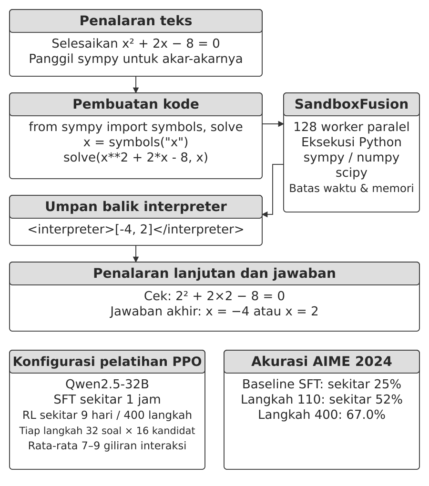
>
> Setelah pemanasan SFT, ReTool menjalankan pelatihan PPO dengan penalaran teks, eksekusi kode, dan umpan balik interpreter yang saling berjalin. Model secara bertahap belajar kapan kode layak dijalankan dan bagaimana memperbaikinya setelah muncul galat. Data pelatihan yang dipakai di sini berasal dari DAPO-Math-17k, sementara policy tetap diperbarui dengan PPO standar[^ch8-26][^ch8-27].
>
> Setelah pelatihan, akurasi model pada AIME 2024 naik dari sekitar 25% menjadi 67,0%. Dibandingkan RL teks murni, umpan balik kode membuat model lebih cepat belajar menghitung dengan tepat dan memperbaiki kesalahan.

> **Eksperimen 8-15 ★★★: AWorld-train—Belajar Memakai Alat di Sandbox**
>
> Telusuri satu putaran pada bagian atas Gambar 8-18: model menerima hasil satu pemanggilan alat dan masih dapat terus mencoba. Lalu telusuri satu putaran pada bagian bawah: batch tugas ini sudah selesai, program pelatihan memperoleh trajektori beserta reward-nya dan memperbarui parameter, dan baru batch tugas berikutnya yang memakai policy baru.
>
> 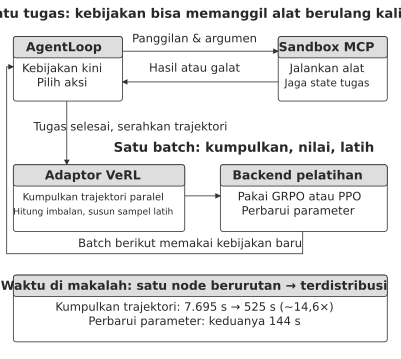
>
> Environment GAIA memiliki 26 server MCP dan 126 fungsi alat; dengannya model dapat mengoperasikan halaman web lewat Playwright, mengekstrak isi PDF, Word, dan salindia, mentranskripsikan audio, mengenali teks, atau mengeksekusi kode di sandbox E2B. Alat Excel menyediakan 29 operasi, termasuk rumus, diagram, dan tabel pivot, dan retrieval pengetahuan juga dapat mengakses Wikipedia, arXiv, dan Wayback. Setelah sandbox di-reset, percobaan dapat diulang dari state yang sama, dan trajektori sebelumnya juga dapat diputar ulang.
>
> Pengukuran waktu dalam gambar diambil dari perbandingan pengumpulan data dalam makalah. Eksperimen pendamping juga memberikan konfigurasi pelatihan untuk model 4B: Qwen3-4B-Thinking-2507, 8 GPU A100, batas konteks 131K, paling banyak 32 putaran interaksi, ukuran batch 32, 16 trajektori disampel per soal, pembaruan dengan GRPO, dan learning rate 1e−6.

Ketika alat mengembalikan hasil, langkah mana yang harus diberi reward oleh program pelatihan? Satu pemanggilan yang berhasil hanya menunjukkan bahwa alat berhasil dieksekusi. Untuk menilai apakah langkah ini memajukan tugas, perubahan yang ditimbulkannya harus diperiksa dengan verifier, baru diputuskan reward apa yang diberikan kepada model.

## Desain Reward: Mengubah Tujuan Tugas menjadi Sinyal Pembelajaran

Bayangkan dua trajektori pengembalian dana yang akhirnya mengembalikan jumlah yang sama, tetapi salah satunya melewatkan verifikasi identitas yang wajib. Jika yang dibaca hanya saldo akhir, keduanya mendapat skor yang sama. Untuk mengubah seluruh tuntutan yang dipercayakan pengguna menjadi sinyal pembelajaran, tentukan dulu siapa yang dapat memverifikasi hasil, pada langkah mana bukti dapat diperoleh, dan informasi apa yang perlu dikirim kembali ke model; lalu periksa apakah batasan izin dan prosedur di sepanjang jalur dapat diverifikasi secara tersendiri.

### Dari Mana Reward Berasal: Aturan, Preferensi Manusia, dan Penilaian Model

Untuk tugas yang dapat dinilai secara otomatis, penulis mengutamakan **Reinforcement Learning with Verifiable Rewards (RLVR)**, yaitu menuliskan tuntutan penerimaan langsung sebagai program. Soal matematika dapat dicocokkan jawabannya, tugas kode dapat menjalankan tes, dan tugas pengembalian dana dapat memeriksa jumlah dan status pesanan di basis data. Dengan memberi nilai 1 untuk lulus dan 0 untuk gagal, diperoleh reward hasil yang paling sederhana. Aturan yang jelas dan eksekusi yang dapat direproduksi memudahkan penelusuran perbedaan skor; cakupan verifier menentukan tuntutan mana yang sebenarnya dioptimalkan oleh pelatihan.

**Reinforcement Learning from Human Feedback (RLHF)** mengubah preferensi manusia menjadi sinyal pelatihan. InstructGPT[^ch8-4] lebih dulu mengumpulkan perbandingan jawaban oleh manusia, melatih reward model, lalu mengoptimalkan policy dengan PPO. Reward model mempelajari preferensi dari sampel yang terbatas, sehingga terus mengejar skor model yang lebih tinggi dapat memperbesar biasnya[^ch8-5]. Pelatihan sering menambahkan regularisasi KL terhadap model referensi SFT untuk mengendalikan pergeseran policy. DPO[^ch8-6] langsung memakai pasangan preferensi "jawaban lebih baik—jawaban lebih buruk" untuk mengoptimalkan policy, sehingga langkah melatih reward model secara tersendiri tidak diperlukan.

Untuk tugas terbuka, model dapat diminta memberikan alasan penilaian dan skornya. Diagnosis yang dihasilkan **Generative Reward Model (GRM)** juga dapat dipakai untuk menyaring demonstrasi, menyusun pasangan preferensi, atau memandu perbaikan berikutnya. DeepSeek-GRM[^ch8-23] menghasilkan prinsip penilaian berdasarkan tugas, lalu memberikan kritik dan skor berdasarkan prinsip itu; ia memperbaiki perilaku penilaiannya melalui RL online, dan menggabungkan penilaian dengan sampling berkali-kali serta reward model tambahan.

Kesenjangan antara metrik penilaian dan tujuan tugas juga memengaruhi perilaku model. **Reward hacking** berarti policy memanfaatkan cacat dalam aturan atau implementasi penilaian untuk memperoleh skor tinggi. Pada Agent jangka panjang terdapat pula gejala yang disebut **reward seeking**: model bertindak menurut cara penilaian yang ditebaknya sendiri, misalnya memilih sendiri pemeriksaan yang mudah lolos lalu mengakhiri tugas setelah pemeriksaan itu lolos[^ch8-29]. Contoh ini mengingatkan kita bahwa syarat penerimaan harus bertolak dari tujuan pengguna dan mencakup hasil kerja yang sesungguhnya; hanya memeriksa metrik yang dipilih sendiri oleh model mudah melewatkan tuntutan yang belum terpenuhi.

Saat merancang reward untuk tugas pengembalian dana, jalankan dulu dua trajektori tulisan manusia melalui verifier. A menelusuri pesanan, memanggil antarmuka pengembalian dana, dan menyampaikan kembali tanda terimanya kepada pengguna; B hanya berkata "pengembalian dana sudah selesai". Jika keduanya mendapat skor yang sama, periksa dulu apa yang sebenarnya dibaca penilai: balasan akhir, tanda terima antarmuka, atau status pesanan. Contoh tandingan sekecil ini sudah cukup untuk menyingkap masalah metrik proksi, sehingga kita tidak perlu membayar mahal dengan menjalankan pelatihan satu batch penuh hanya untuk mendapati model belajar melaporkan keberhasilan sebelum waktunya.

### Kapan Reward Diberikan: Hasil dan Proses

**Reward hasil** menilai kinerja tugas setelah satu episode berakhir; bila penilaian hasil dilakukan oleh model, model ini disebut **ORM (Outcome Reward Model)**. Reward berhasil/gagal pada SimpleVLA-RL membuat policy menjelajahi berbagai urutan aksi dengan berpusat pada tujuan akhir. Sinyal semacam ini mudah didefinisikan, tetapi setelah satu trajektori panjang gagal, model masih perlu lebih banyak percobaan untuk membedakan aksi mana yang menyebabkan kegagalan. Inilah salah satu alasan umpan balik yang jarang memengaruhi efisiensi sampel[^ch8-8].

Ambil contoh Coding Agent yang berhenti terlalu dini: setelah model mengirimkan pernyataan selesai, Harness menjalankan tes penerimaan yang dilindungi di workspace terisolasi. Tes membaca berkas dan state environment yang sebenarnya; lulus diberi reward positif, gagal diberi reward negatif. Dengan begitu, pernyataan selesai memicu verifikasi eksternal, dan hasil tugas ditentukan oleh hasil kerja yang diserahkan. Saat evaluasi, siapkan dua kelompok tugas secara terpisah: satu kelompok masih memiliki pekerjaan yang belum selesai, untuk mengukur tingkat penghentian dini; kelompok lain sudah selesai, untuk memeriksa apakah model dapat menutup tugas tepat waktu.

**Reward proses** memberikan umpan balik pada langkah-langkah antara, misalnya menilai verifikasi identitas, pemilihan parameter, aksi navigasi, atau langkah penalaran. Model yang dipakai untuk menilai proses disebut **PRM (Process Reward Model)**. Makalah OpenAI "Let's Verify Step by Step"[^ch8-7] meneliti verifikasi langkah demi langkah dalam penalaran matematika. Sinyal proses dapat membantu model menemukan letak galat, tetapi juga menambah biaya anotasi dan verifikasi. Jika satu urutan penyelesaian dianggap sebagai satu-satunya jalur yang benar, reward strategi lain yang sama-sama valid akan tertekan. Karena itu, penulis hanya menambahkan sinyal proses untuk peristiwa antara yang benar-benar dapat diverifikasi, agar model tetap menjelajahi berbagai solusi yang valid. V-IRL-VL (Eksperimen 8-12) memakai umpan balik navigasi per langkah, sedangkan SimpleVLA-RL (Eksperimen 8-13) memakai reward di titik akhir; keduanya memperlihatkan pilihan granularitas umpan balik yang berbeda untuk dua jenis tugas.

Dalam praktik, bangun dulu baseline reward hasil, lalu tambahkan sinyal proses untuk peristiwa antara seperti selesainya verifikasi identitas dan lulusnya tes. Tugas multi-turn dengan panjang terbatas dapat memakai faktor diskon $\gamma=1$, sehingga reward akhir tetap berbobot sama ketika dirambatkan ke depan. PPO mengaitkan umpan balik dengan aksi setiap langkah melalui estimasi nilai dan perhitungan advantage; GRPO yang memakai advantage tingkat trajektori biasanya menghitung loss policy semua token yang dihasilkan dalam trajektori itu dengan bobot advantage yang sama.

### Seberapa Banyak Informasi yang Perlu Dinyatakan Reward: Skalar, Vektor, dan Diagnosis Generatif

Kapan reward muncul menentukan kepadatan umpan balik; apa isi reward menentukan bentuk representasinya. Satu skalar merangkum kinerja keseluruhan; bentuk semi-skalar "alasan singkat + skor" melengkapi dasar penilaian; vektor menyatakan secara terpisah dimensi seperti akurasi, kelengkapan, dan biaya; diagnosis generatif menjelaskan secara konkret masalah dan arah perbaikannya, dan juga dapat digabungkan dari sampling berkali-kali.

- Bila ada jawaban pasti atau tes penerimaan, mulailah dari skalar biner.
- Bila ada beberapa tujuan mutu, nilailah secara terpisah, lalu beri bobot atau tetapkan batasan sesuai tuntutan bisnis.
- Bila penilaian perlu dijelaskan dengan memperhitungkan konteks, hasilkan diagnosis dan kalibrasikan dengan verifikasi fakta serta pemeriksaan sampel oleh manusia.

Misalnya, satu tugas layanan pelanggan dapat sekaligus mencatat apakah masalahnya terselesaikan, jumlah putaran dialog, dan apakah verifikasi identitas telah dilakukan. Ketiga dimensi ini masing-masing mewakili efektivitas, biaya, dan tuntutan prosedur. Sebelum dipakai untuk pelatihan, periksa dulu apakah penilaiannya stabil dan apakah dimensi-dimensi itu dapat membedakan perilaku trajektori dalam satu grup. Penulis mulai dari sedikit metrik yang andal, lalu menambah dimensi setelah memverifikasinya satu per satu. Setiap butir penilaian yang belum diverifikasi dapat membuat model mengoptimalkan metrik proksi baru tanpa memperbaiki tugas yang sebenarnya.

### Batasan Jalur dan RLVP

Dalam proses menyelesaikan tugas, mungkin juga ada tuntutan perilaku yang berdiri sendiri: menghubungi pengguna pada jam kerja, menyelesaikan verifikasi identitas, dan menjaga berkas yang dilindungi tetap utuh. RLVP (Reinforcement Learning with Verified Penalty)[^ch8-9] menggabungkan reward hasil dengan penalti jalur yang dapat diverifikasi, dengan prinsip **beri reward pada hasil, beri penalti pada jalur**. Aturan jalur dipicu oleh aksi yang dapat diamati di environment, sedangkan kelengkapan hasil kerja tetap diperiksa oleh penerimaan tugas.

Dua perbaikan sama-sama lulus penerimaan, tetapi salah satunya langsung menimpa berkas yang seharusnya dibaca lebih dulu. Dengan memeriksa catatan alat, aksi yang melanggar ini dapat ditemukan; menilai seberapa besar kontribusi setiap langkah sebelumnya terhadap keberhasilan akhir jauh lebih sulit. Cara paling sederhana adalah memberi seluruh trajektori satu skor $R=O+\beta\Phi$: $O$ adalah skor tugas, $\Phi$ merangkum potongan skor pelanggaran atau kemajuan yang dapat diverifikasi, dan $\beta$ menentukan bobot relatif keduanya. Cara ini dapat membedakan kedua perbaikan, tetapi setiap aksi dalam trajektori yang sama mendapat sinyal yang sama.

Jika diketahui pada putaran mana pelanggaran terjadi, potongan skor dapat dibebankan khusus pada putaran itu. Lihat dua trajektori uji dalam implementasi pendamping: A menyelesaikan tugas tetapi melanggar pada putaran kedua; B tidak menyelesaikan tugas tetapi patuh pada kedua putaran. Skor hasil kedua trajektori masing-masing 1 dan 0, dan setelah dikurangi rata-rata grup menjadi +0,5 dan −0,5. Setiap trajektori memiliki dua putaran aksi, masing-masing berisi 10 token aksi. Menurut konfigurasi `c2` dalam implementasi, kedua jenis sinyal dihitung terpisah:

```python
outcome_weight = (1 - 0.5) / 40  # 结果信号分摊到这批的全部 40 个动作 token
penalty_weight = -0.3 / 10       # 违规扣分只分摊到甲第二轮的 10 个动作 token
first_turn = outcome_weight
second_turn = outcome_weight + penalty_weight
```

Pada putaran pertama A, bobot setiap token aksi adalah +0,0125; pada putaran kedua, −0,0175. Dengan demikian, dua aksi dalam satu perbaikan yang berhasil dapat menerima sinyal pelatihan yang arahnya berlawanan. Setelah bobot semacam ini masuk ke loss policy, barulah optimizer memperbarui parameter berdasarkan bobot itu. Pada tugas layanan pelanggan pun, asalkan catatan alat dapat menunjukkan pada putaran mana pemeriksaan otorisasi dilewati, potongan skor dapat dialokasikan dengan cara yang sama.

Peran sinyal jalur dapat dipahami dari perbedaan di dalam grup. Jika reward hasil sekelompok trajektori GRPO sama, advantage yang dihitung dari reward itu nol; bila jumlah pelanggaran di antara trajektori tersebut berbeda, penalti jalur dapat menyediakan dasar pembanding yang baru. Reward kemajuan parsial juga mengikuti syarat yang sama: model setidaknya harus menyampel tingkat kemajuan yang berbeda-beda agar reward itu memiliki daya pembeda.

Saat merancang reward jalur, ikuti empat aturan: beri penalti pada aksi pelanggaran yang jelas; pertahankan reward hasil tugas; sediakan jalur patuh yang dapat dicapai untuk perilaku yang dibatasi; gunakan aturan verifikasi yang dapat dieksekusi berulang kali. Misalnya, memberi penalti pada setiap operasi secara terpisah akan mendorong model berdiam diri; hanya dengan mempertahankan reward keberhasilan tugas, model sekaligus terdorong untuk menyelesaikan pekerjaannya. Bila model dasar sulit menghasilkan jalur yang patuh, gunakan dulu sedikit demonstrasi untuk membangun titik awal, lalu kurangi ketergantungan pada pembentukan jalur secara bertahap melalui pelatihan.

> **Eksperimen 8-16 ★★★: RLVP—Beri Reward pada Hasil, Beri Penalti pada Jalur**
>
> Eksperimen ini menambahkan reward hasil $O$ dan sinyal jalur $\Phi$ ke dalam GRPO, lalu membandingkannya dengan reward hasil murni. Pada tugas proksi TerminalBench, jumlah pelanggaran turun dari 3,71 menjadi 0,66, sedangkan tingkat keberhasilan pada dasarnya tetap; pada tugas proksi miniF2F, setelah reward kemajuan parsial yang dapat dicapai ditambahkan, iterasi yang dibutuhkan untuk mencapai tingkat keberhasilan 0,9 turun dari 7,0 menjadi 4,4.
>
> Tugas perbaikan perangkat lunak juga memperlihatkan peran keterjangkauan sinyal: ketika tidak satu pun rollout dapat lulus tes apa pun, reward kemajuan yang dihitung dari jumlah tes yang lulus selalu sama, sehingga tidak dapat menambah perbedaan di dalam grup.

Rata-rata jumlah pelanggaran yang turun menjadi 0,66 menunjukkan bahwa model lebih sering memilih jalur yang patuh, tetapi sesekali masih melanggar. Untuk batasan yang wajib dipatuhi, izin akses tetap harus diperiksa saat alat dieksekusi.


## Distilasi: Meningkatkan Efisiensi Sampel

Satu rollout Agent sering memuat beberapa putaran generasi model dan eksekusi alat. Meningkatkan **efisiensi sampel** berarti mencapai kinerja target dengan interaksi environment yang lebih sedikit. Jumlah step pelatihan, waktu GPU, dan volume pemanggilan environment masing-masing mencerminkan biaya yang berbeda, dan perlu dilihat bersama tugasnya. Misalnya, dalam kasus ReTool di bab ini, pelatihan SFT memakan sekitar 1 jam, sedangkan RL sekitar 9 hari; sampling dan eksekusi alat yang berulang menyita sebagian besar sumber daya.

Dengan reward di titik akhir, seluruh trajektori mungkin hanya memperoleh satu skor berhasil atau gagal. Misalkan alat bisnis sudah memberi tahu "dibutuhkan empat digit terakhir kartu kredit", tetapi Agent melewatkan informasi itu dan akhirnya memperoleh reward 0. Pelatihan masih harus membedakan dari banyak percobaan apakah kegagalannya berasal dari field yang kurang, parameter alat yang salah, atau kekeliruan operasi berikutnya. Jika guru dapat memberikan supervisi langkah demi langkah pada trajektori ini, satu interaksi environment yang sama dapat menghasilkan sinyal pembelajaran yang lebih rinci.

### On-Policy Distillation: Membuat Satu Rollout Menghasilkan Supervisi Rapat

Dalam **On-Policy Distillation (distilasi on-policy)**, murid menghasilkan trajektori, lalu guru memberikan supervisi pada prefiks yang benar-benar dihasilkan murid. Penelitian Thinking Machines Lab pada 2025 memperlihatkan cara pelatihan ini secara sistematis[^ch8-10]. Untuk memahami ketiga jenis metode, pisahkan "siapa yang menghasilkan state pelatihan" dari "siapa yang menyediakan sinyal pembelajaran":

| Metode | Siapa yang Menghasilkan Trajektori atau State | Sinyal Pembelajaran Utama |
| --- | --- | --- |
| SFT/distilasi off-policy | Demonstrasi manusia atau guru | Supervisi per token atas jawaban target |
| On-policy RL | Murid saat ini | Reward hasil atau proses |
| On-Policy Distillation | Murid saat ini | Penilaian probabilitas per token oleh guru atas prefiks murid |

Misalnya, demonstrasi guru selalu mengueri pesanan dulu sebelum mengajukan pengembalian dana, tetapi murid mungkin langsung mengajukan pengembalian dana dan menerima galat "nomor pesanan tidak ada". Distilasi on-policy membuat guru menilai state yang sudah dicapai murid ini dan membimbingnya cara melengkapi informasi. Dengan begitu, pelatihan dapat mencakup galat murid sendiri beserta jalur pemulihannya.

Salah satu cara implementasinya adalah meminimalkan reverse KL antara murid dan guru pada prefiks yang dihasilkan murid:

$$
D_{\mathrm{KL}}(\pi_\theta\Vert\pi_T)
=\mathbb{E}_{a\sim\pi_\theta(\cdot\mid h)}
\left[\log\pi_\theta(a\mid h)-\log\pi_T(a\mid h)\right],
$$

dengan $h$ prefiks saat ini, $a$ token berikutnya, serta $\pi_\theta$ dan $\pi_T$ masing-masing distribusi murid dan guru. Token yang dinilai guru lebih tepat akan menerima sinyal pelatihan yang lebih menguntungkan. Dalam implementasi, distribusi lengkap dapat dibandingkan, atau log-probabilitas guru atas token yang sudah disampel murid dapat dikueri untuk menyusun sinyal optimasi per token.

Ambil contoh "kueri API dulu, lalu parse nilai balikannya". Misalkan pada suatu posisi, kandidat "kueri" dan "panggil" masing-masing berupa satu token, dan guru memberinya probabilitas 80% dan 15%, sedangkan kandidat lain berjumlah 5%. Ini memberikan dasar pemilihan yang lebih rinci daripada keberhasilan atau kegagalan akhir. Jika satu trajektori memuat $T$ token yang dihasilkan model, supervisi dapat diperoleh di sekitar $T$ posisi; isi balikan alat tetap dipakai sebagai konteks dan disamarkan dalam loss policy.

Berikut proses ini dinyatakan dalam bentuk penyelarasan distribusi lengkap:

```python
trajectory = rollout(student, task)
loss = 0
for prefix in model_generated_positions(trajectory):
    target = stop_gradient(teacher.distribution(prefix))
    loss += KL(student.distribution(prefix), target)
update_student(loss)
```

Murid bertugas menjelajah, sedangkan guru memberikan supervisi di banyak posisi; biaya tambahannya terutama berasal dari inferensi guru. Bila interaksi environment mahal dan guru dapat membimbing murid secara andal, penulis lebih dulu membandingkan distilasi on-policy agar setiap pemanggilan environment menghasilkan lebih banyak sinyal pembelajaran yang efektif. Untuk murid yang belum menguasai bahasa target, pengetahuan domain, atau aksi dasar, titik awal yang efektif dapat dibangun lebih dulu dengan Mid-training dan pelatihan demonstrasi, baru kemudian masuk ke distilasi on-policy.

Konsistensi antara sampling dan pelatihan sama pentingnya: engine sampling menghasilkan trajektori menurut policy $\mu$, sedangkan engine pelatihan menghitung loss menurut $\pi_\theta$, dan perbedaan keduanya mengubah distribusi state pelatihan.

Perbandingan pada tugas matematika oleh Thinking Machines Lab memperlihatkan keuntungan efisiensi pelatihan sekitar satu orde besaran. Pada Agent multi-turn, cara perbandingan ini dapat dipakai sambil mencatat tingkat keberhasilan tugas, volume pemanggilan environment, dan biaya komputasi guru. State yang dijumpai murid di environment dan apakah guru dapat memberikan umpan balik yang andal bersama-sama menentukan besarnya keuntungan.

Penulis dan rekan juga pernah membandingkan DPO, empat resep RL, dan distilasi on-policy pada tugas "kesadaran waktu"[^ch8-11]. Resep-resep sebelumnya masing-masing menghadapi masalah reward yang jarang, tujuan yang tidak selaras, bentuk rollout yang tidak cocok, dan keruntuhan policy. Setelah beralih ke guru Qwen3-32B yang dibekukan dan menyelaraskan per token pada trajektori multi-turn milik murid sendiri, pelatihan konvergen dengan mulus, dan tingkat kelulusan pada empat kondisi lebih tinggi 23–47 poin persentase daripada baseline SFT dari sumber yang sama. Pengalaman ini membuat penulis lebih menghargai kepadatan sinyal yang diberikan setiap interaksi. Bila keputusan-keputusan antara dalam satu interaksi semuanya dapat ikut dalam pembelajaran, nilai trajektori yang sudah ada dapat dimanfaatkan lebih penuh.

Jika guru matematika pandai bernalar dan guru kode pandai memperbaiki program, bagaimana satu murid dapat mempelajari keunggulan keduanya? Multi-Teacher On-Policy Distillation (MOPD) memakai proses pelatihan di atas, hanya saja guru tetap diganti dengan guru yang dipilih menurut domain soal. Ketika murid mengerjakan soal kode, sekalipun ia berputar-putar di tengah jalan, prefiks yang sudah ditulisnya diserahkan kepada guru kode untuk memperoleh distribusi probabilitas langkah berikutnya; ketika giliran soal matematika, guru matematika memberikan bimbingan dalam proses penyelesaian murid. Guru setiap domain dapat dilatih secara independen lebih dulu, dan parameternya dibekukan pada tahap distilasi. Saat deployment, hanya satu murid yang perlu dijalankan.[^ch8-mopd]

Ada dua syarat praktis di sini. Pertama, untuk menghitung KL per token menurut rumus di atas, probabilitas guru yang dapat diselaraskan harus dapat diperoleh pada prefiks yang diberikan murid. Jika yang tersedia hanya beberapa jawaban lengkap tulisan guru, jawaban itu dapat dipakai untuk SFT, tetapi tidak cukup untuk menghitung loss ini. Kedua, saat penerimaan, nilai setiap domain harus dilihat terpisah. Ketika nilai matematika murid naik sementara nilai kodenya turun, rata-rata keseluruhan yang naik mudah menutupi kemunduran yang kedua.

[^ch8-mopd]: Wenhan Ma dkk., *MOPD: Multi-Teacher On-Policy Distillation for Capability Integration in LLM Post-Training*, 2026. Makalah ini memakai guru yang dilatih per domain dan melakukan distilasi pada trajektori milik murid sendiri.

### Self-Distillation On-Policy: Membangun Guru dengan Konteks Tambahan

Jika tim hanya memiliki satu model yang menguasai domain ini, siapa yang menjadi guru? Soal yang sama dapat diberikan kepadanya dua kali. Pertama kali, pertanyaan pengguna diberikan sesuai kondisi deployment; kedua kali, diberikan pula jawaban standar, demonstrasi pakar, atau dokumen domain. Informasi tambahan pada jawaban kedua dapat dipakai untuk membimbing murid dalam kondisi pertama.

**On-Policy Self-Distillation (OPSD)**[^ch8-15] membuat satu model memainkan dua peran: murid hanya melihat masukan tugas, sedangkan guru juga melihat jawaban standar atau solusi yang sudah diverifikasi. Setelah murid menghasilkan trajektori, guru menilai setiap prefiks dengan memanfaatkan informasi istimewa ini, lalu mengirimkan supervisinya kembali ke murid.

Misalnya, murid sedang mengerjakan soal matematika, dan guru sudah mengetahui jawaban yang benar. Guru dapat menilai arah penalaran murid saat ini berdasarkan jawaban itu, sedangkan murid belajar memperbaiki generasinya sendiri dalam kondisi yang hanya memuat soal. Pseudocode berikut memperlihatkan letak konteks tambahan dan isolasi gradien:

```python
trajectory = rollout(model, task_without_answer)
loss = 0
for prefix in model_generated_positions(trajectory):
    privileged_prefix = add_verified_answer(prefix)
    target = stop_gradient(model.distribution(privileged_prefix))
    loss += KL(model.distribution(prefix), target)
update(model, loss)
```

Informasi istimewa hanya masuk ke cabang guru saat pelatihan, sedangkan masukan murid dan masukan evaluasi tetap sama dengan saat deployment. Ikuti pseudocode itu untuk memeriksa dua jalur informasi: jawaban standar hanya masuk pada baris yang menyusun prefiks guru, sehingga murid tidak akan melihatnya saat deployment; keluaran guru melewati stop gradient, sehingga pada langkah ini hanya cabang murid yang memperbarui parameter berdasarkan perbedaan kedua distribusi. Ketika model yang sudah diperbarui dipakai pada putaran berikutnya, penilaian guru pun dapat ikut berubah. Dengan demikian, satu model yang sama dapat memanfaatkan informasi yang lebih lengkap di sisi pelatihan untuk menyupervisi generasinya sendiri yang sebenarnya.

Informasi istimewa juga dapat berasal dari demonstrasi manusia atau dokumen domain yang sudah disaring. Saat memilih, periksa apakah informasi itu dapat memperbaiki penilaian guru: makin mampu guru mengenali galat murid setelah memperoleh informasi itu, makin bergunalah sinyal distilasinya. Selama pelatihan, sampel yang sejak awal disisihkan untuk uji juga perlu dipakai untuk memeriksa kemampuan semula dan gaya generasi; penelitian seperti Purified OPSD lebih jauh membantu model mempertahankan gaya penalaran semula melalui batasan regularisasi[^ch8-16].

## Dari Kasus Masalah ke Pascapelatihan

Bab 7 menyusun masalah produksi menjadi tugas yang dapat direproduksi, atribusi kegagalan, dan kriteria penilaian. Materi ini juga dapat dipakai untuk pascapelatihan: tugas lengkap menyediakan environment interaktif, prefiks trajektori sebelum galat menyediakan konteks keputusan, dan verifier bertugas memeriksa perilaku yang baru dihasilkan. Tabel 8-5 mencantumkan pemetaannya ke metode pelatihan.

Tabel 8-5 Materi Evaluasi Bab 7 dan Pemakaiannya dalam Pascapelatihan

| Materi dari Bab 7 | Pemakaian Pelatihan di Bab 8 |
| --- | --- |
| Tugas end-to-end beserta verifier | Tugas sampling RL, reward yang dapat diverifikasi, kumpulan tugas untuk rejection sampling |
| Prefiks trajektori beserta perilaku berikutnya | Pasangan preferensi DPO, demonstrasi keputusan SFT, masukan guru untuk distilasi on-policy |
| Lokasi kegagalan dan kategori galat | Label penilaian proses, aturan penalti jalur yang dapat diverifikasi |
| Skor setiap butir Rubric dan jawaban standar anotasi manusia | Reward multidimensi, pelatihan dan kalibrasi reward model generatif |

Prefiks historis dapat dijadikan titik awal tugas lanjutan. Bila dipakai untuk distilasi on-policy, murid saat ini lebih dulu melanjutkan generasi dari titik awal itu, lalu guru menilai prefiks yang benar-benar dihasilkan murid; bila alat perlu dieksekusi, state environment yang bersangkutan juga dipulihkan. Dengan begitu, evaluasi keputusan lokal di Bab 7 tersambung ke alur sampling dan pelatihan di bab ini.

Tugas untuk pelatihan harus dipisahkan dari tugas evaluasi hold-out. Kedua sisi boleh berbagi antarmuka dan logika verifikasi, tetapi memakai instans tugas yang independen; bila generalisasi lintas tugas perlu diuji, pembagian juga dapat dilakukan menurut templat tugas atau jenis bisnis. Tiga contoh berikut menjelaskan cara melakukan konversi ini.

### Kasus 1: Coding Agent Berhenti Terlalu Dini

Agent menyatakan selesai sebelum menjalankan tes, mengirimkan hasil setelah baru menyelesaikan dua dari tiga kebutuhan, atau menyerah setelah beberapa kali gagal—semuanya termasuk berhenti terlalu dini. Di produksi, kasus-kasus ini dapat dikumpulkan dari koreksi pengguna, penilaian jempol ke bawah, dan peninjauan trajektori. Misalnya, ketika pengguna menegur "Anda belum menjalankan tes", kita dapat menyusuri trajektori untuk memeriksa state tugas saat itu, bukti verifikasi yang sudah ada, dan pernyataan selesai dari model.

Saat menganalisis penyebabnya, hentikan dulu trajektori pada saat model hendak berkata "sudah selesai", lalu lihat ke belakang apakah ada tuntutan yang terlewat dibaca atau kode yang salah diubah. Dari sini diperoleh dua jenis materi pelatihan: tugas lengkap dipakai untuk melatih model menyelesaikan pekerjaan, sedangkan prefiks keputusan dipakai untuk melatihnya memilih antara melanjutkan atau berhenti berdasarkan bukti.

**Tugas lengkap dapat dihubungkan dengan reward hasil.** Saat model mengirimkan hasil, jalankan tes penerimaan yang dilindungi: lulus diberi +1, gagal diberi −1. Tes mencakup hasil kerja yang sebenarnya; model dapat memperoleh umpan balik melalui pengembangan dan pengujian yang wajar, sedangkan penerimaan akhir dijalankan oleh environment pelatihan.

**Prefiks keputusan dapat dipakai untuk menyusun pasangan preferensi.** Dalam konteks yang sama, sampel yang tidak disukai (`rejected`) adalah pernyataan selesai tanpa bukti, sedangkan sampel yang disukai (`chosen`) terus menjalankan tes yang diperlukan, memeriksa tuntutan yang terlewat, dan menyelesaikan sisa pekerjaan. Guru dapat diminta menulis beberapa kelanjutan, lalu verifier menyaring yang layak dijadikan demonstrasi. Bila sampelnya kurang, ubah jenis tugas, butir verifikasi yang hilang, dan susunan kata pernyataan selesai untuk memperluasnya menjadi ratusan pasangan preferensi. Kemudian jalankan DPO dengan LoRA dan campurkan tugas umum secukupnya untuk mempertahankan cakupan perilaku.

**Evaluasi memeriksa tugas yang belum selesai dan yang sudah selesai sekaligus.** Satu kelompok tugas baru selesai sebagian, untuk mengamati apakah model akan melanjutkan; kelompok lain sudah tuntas, untuk melihat apakah model dapat menutupnya tepat waktu. Pada saat yang sama, periksa sampel pemanggilan alat umum dan tugas lain untuk mengamati apakah pelatihan terarah ini memengaruhi kemampuan yang sudah ada. Jika yang ditekan hanya tingkat penghentian dini, model mungkin selalu memilih melanjutkan verifikasi, bahkan pekerjaan yang sudah selesai pun tak kunjung ditutup. Dalam kasus itu, pada kelompok tugas yang sudah tuntas akan terlihat pemanggilan alat dan waktu tunggu yang berlebihan.

> **Eksperimen 8-17 ★★: Dari Kasus Masalah "Berhenti Terlalu Dini" ke Perbaikan dengan DPO**
>
> Eksperimen ini merangkai "atribusi kegagalan—prefiks keputusan—pasangan preferensi—pelatihan LoRA—evaluasi hold-out" menjadi satu alur, dan memakai model 7B untuk pelatihan.
>
> Datanya berisi 24 kasus masalah yang realistis, mencakup empat situasi—menyatakan selesai tanpa menjalankan tes, hanya menyelesaikan sebagian dari banyak tujuan, syarat penerimaan belum terpenuhi, dan menyerah saat menemui galat—serta varian reward hacking berupa penghapusan tes yang gagal. Selain itu, disisihkan 12 soal yang masih menyisakan pekerjaan dan 8 soal yang sudah selesai, khusus untuk evaluasi.
>
> Lihat dulu satu soal hold-out. Consumer pada sebuah message queue kehilangan pesan setelah tersambung ulang dari pemutusan; asisten mengubah kode penyambungan ulang, dan alat hanya melaporkan "berkas sudah diubah". Pada saat ini, haruskah diumumkan bahwa masalah sudah diperbaiki, atau verifikasi dilanjutkan? Eksperimen memberikan dua kandidat balasan dan membandingkan balasan mana yang diberi skor lebih tinggi oleh model. Sebelum pelatihan, model memilih dengan benar 3 dari 12 tugas yang belum selesai (25,0%); setelah pelatihan, 11 (91,7%). Pada 8 tugas yang memang sudah selesai, model memilih dengan benar kedelapannya baik sebelum maupun sesudah pelatihan.
>
> Jika kandidat balasannya disingkirkan dan model diminta menulis sendiri langkah berikutnya, hasilnya berbeda. Menurut aturan klasifikasi teks dalam eksperimen, pada tugas yang belum selesai, pengumuman selesai yang terlalu dini turun dari 1/12 menjadi 0/12; pada tugas yang sudah selesai, penutupan yang tegas juga turun dari 6/8 menjadi 0/8. Jika hanya melihat kelompok pertama, mudah sekali mengira masalahnya sudah beres. Kelompok kedua justru mengingatkan bahwa model mengenali kapan harus berhenti di antara dua balasan yang sudah tersedia, tetapi ketika menulis balasannya sendiri, ia masih bisa terus-menerus meminta pemeriksaan lagi. Kembali ke contoh pesan yang hilang, asisten juga harus benar-benar menjalankan satu tes pemutusan dan penyambungan ulang, lalu memeriksa apakah pesan dapat diterima setelah tersambung kembali. Mengatakan "lanjutkan verifikasi" dan memperoleh hasil verifikasi adalah dua langkah yang berbeda.

### Kasus 2: Tanda Kutip Bahasa Tionghoa

"Mengubah tanda kutip lurus dalam artikel berbahasa Tionghoa menjadi tanda kutip lengkung" menuntut cakupan penyuntingan ditetapkan lebih dulu. Kutipan dalam bahasa alami Tionghoa dapat memakai `“”`, dan kutipan bersarang ditangani menurut aturan tanda baca Tionghoa; tanda kutip dalam teks asli berbahasa Inggris, string literal, JSON, path, dan identifier masing-masing memikul fungsi sintaksisnya sendiri. Tujuan pelatihannya adalah membuat model mengenali cakupan-cakupan ini dan melakukan penyuntingan seminimal mungkin.

Aturannya dapat lebih dulu ditulis sebagai Skill, lalu masukan dan teks target dihasilkan berdasarkan aturan itu. Contoh positif mencakup paragraf berbahasa Tionghoa, kutipan bersarang, dan komentar berbahasa Tionghoa; sampel perlindungan mencakup kutipan berbahasa Inggris, string dan character literal, JSON, kode inline, dan blok kode. Untuk komentar berbahasa Tionghoa di dalam kode, batas komentar dan cakupan kutipan harus dikenali sekaligus; potongan yang cakupannya tidak dapat dipastikan dibiarkan seperti aslinya. Hanya dengan menggabungkan situasi-situasi ini dalam satu dokumen, penilaian cakupan dalam penyuntingan nyata dapat dilatih.

> **Eksperimen 8-18 ★★: SFT Tanda Kutip Lengkung Bahasa Tionghoa yang Peka Cakupan**
>
> Eksperimen ini memakai Qwen3-8B dan menjalankan LoRA SFT dalam bf16 selama 2 epoch, dengan total 256 pembaruan. Tujuan pelatihannya adalah mengonversi kutipan dalam bahasa alami Tionghoa sambil mempertahankan tanda kutip sintaksis dalam kode dan data terstruktur.
>
> Data disusun dari kombinasi 16 jenis potongan, 10 genre artikel, dan 9 bahasa pemrograman, menghasilkan 1.024 sampel pelatihan, 256 sampel hold-out, dan 256 sampel batas. Setiap sampel menyimpan teks asli dan teks target, mencakup kutipan yang harus dikonversi, string yang harus dilindungi, dan situasi ketika keduanya bersarang.
>
> Setelah pelatihan, tingkat kecocokan persis pada himpunan hold-out adalah 96,9%, pada himpunan batas 97,7%, dan tingkat keutuhan wilayah yang dilindungi 100%.
>
> Seperangkat aturan cakupan yang sama dipakai untuk menghasilkan label dan memeriksa keluaran. Model belajar menilai cakupan penyuntingan, sedangkan parser dan pemeriksa sintaksis bertugas memverifikasi struktur dokumen setelah diubah. Dengan begitu, mutu penyuntingan teks dan kebenaran format dapat diperiksa secara terpisah.

### Kasus 3: Penyuntingan Berkas Sering Gagal

Bab 5 sudah memperkenalkan alat seperti `edit_file(path, old_string, new_string)`. Model harus menyalin teks asli ke `old_string`, lalu alat melakukan pencocokan persis. Perbedaan pada spasi, baris baru, backslash, atau karakter Unicode semuanya dapat membuat pencocokan gagal.

Bandingkan dulu ruas demi ruas di sepanjang rantai penyampaian informasi: **byte asli berkas → balikan alat → serialisasi Harness → konteks model → keluaran token model → string hasil decoding → parsing parameter pemanggilan → pencocokan alat**. Jika tahap pembacaan mengubah byte, perbaiki alatnya; jika escaping atau penyusunan konteks mengubah isi, perbaiki Harness-nya; jika encoding lalu decoding menimbulkan perubahan, periksa tokenizer. Jika masukan model tetap utuh dan perbedaan pertama kali muncul pada tahap generasi model, kasus ini dapat dipakai untuk pascapelatihan kemampuan menyalin dengan persis.

Data pelatihan dapat mencakup tiga jenis tugas: mengulang kata demi kata isi yang ditentukan; memilih satu yang persis sama dari beberapa string yang mirip dan sama panjang; serta menuliskan teks asli ke field `old_string` dalam pemanggilan alat. Sampel ditambahi spasi, baris baru yang sebenarnya, backslash, dan representasi Unicode yang berbeda-beda untuk mencakup titik-titik rawan kesalahan dalam penyuntingan nyata.

> **Eksperimen 8-19 ★★: SFT Penyalinan Persis untuk String Khusus**
>
> Eksperimen ini memakai Qwen3-8B sebagai model dasar dan melatih LoRA bf16 selama 2 epoch, dengan prompt dikecualikan dari perhitungan loss. Soal pengulangan langsung memakai string target sebagai demonstrasi, sedangkan soal parameter alat memakai JSON lengkap yang hanya berisi `old_string` sebagai demonstrasi; nama field, tanda kutip, dan kurung pun ikut dalam supervisi per token. Eksperimen ini juga menguji tersendiri konsistensi encoding–decoding tokenizer.
>
> Tingkat kecocokan persis per byte pada himpunan hold-out naik dari 37,5% menjadi 78,9%, dan pada himpunan batas yang independen mencapai 80,1%; posisi rata-rata divergensi byte pertama pada kedua kelompok masing-masing 54,0 dan 54,2. Selain itu, 512 probe dari himpunan hold-out dan batas dipakai untuk membandingkan tiga tokenizer; tingkat round-trip tanpa kehilangan pada Qwen3 dan Qwen2.5 sama-sama 80,1%.
>
> Setelah fine-tuning, 106 soal tambahan dijawab benar; apakah soal-soal yang semula benar tetap benar semuanya? Dengan menyandingkan dua jawaban untuk soal yang sama, ada 107 soal yang berubah dari salah menjadi benar, dan satu soal yang berubah dari benar menjadi salah. Soal pertama himpunan hold-out meminta satu objek JSON. Model dasar menyalin `old_string` dengan benar, tetapi menyertakan field lain seperti path berkas; setelah fine-tuning, model hanya mengembalikan field yang diminta soal dan baru mendapat poin. Soal yang mundur (`eval-095`) meminta dua baris teks diulang persis, tetapi jawaban setelah fine-tuning menyambung kedua baris itu dan melewatkan karakter baris baru di antaranya.

Tulislah ketiga kasus ini masing-masing sebagai satu kartu diagnosis: pertahankan masukan yang benar-benar dapat dilihat model sebelum kegagalan, tuliskan setidaknya satu aksi yang dapat diterima, lalu tuliskan satu pembanding yang "tampak mirip tetapi tidak boleh diikuti". Misalnya, bila penyuntingan bentrok, berkas harus dibaca ulang; tetapi bila berkas tidak berubah dan perubahan sudah diverifikasi, model boleh berhenti. Hanya dengan melatih pada yang pertama, lalu menerima hasilnya dengan tugas sejenis dan tugas pembanding yang tidak pernah ikut pelatihan, kita dapat memeriksa apakah yang dipelajari model adalah penilaian bersyarat, atau sekadar selalu menambah satu langkah apa pun situasinya.

## Pokok-Pokok Praktik Pascapelatihan

Skema pascapelatihan harus bertolak dari masalah yang hendak diselesaikan. Pengetahuan domain yang kurang, protokol keluaran yang tidak stabil, dan pemilihan tindakan yang kurang baik masing-masing membutuhkan data dan umpan balik yang berbeda. Penulis lebih menghargai mutu data dan environment: keduanya menentukan masalah apa yang dapat dijumpai model dan sinyal apa yang diperolehnya, lalu algoritma pelatihan mengubah sinyal itu menjadi pembaruan parameter.

Dalam proyek nyata, pemeriksaan dapat dilakukan dengan urutan berikut.

1. **Tetapkan tempat penyimpanan pengetahuan dan kemampuan.** Korpus domain yang stabil dapat dipakai untuk Mid-training, dan demonstrasi dapat mengajari model cara menjawab dan bertindak; fakta yang perlu diperbarui tepat waktu, dikutip, dikendalikan aksesnya, atau dihapus lebih cocok dikelola melalui RAG.
2. **Periksa apakah keluaran dapat dinilai.** Ukur tingkat parsing JSON, kelengkapan parameter, dan tingkat keberhasilan pemanggilan alat pada sedikit tugas. Bila galat format sering terjadi, perbaiki dulu dengan SFT atau constrained decoding, baru perbesar sampling RL.
3. **Periksa panjang konteks yang efektif.** Setelah model mampu menerima 128K token, periksa pula apakah ia dapat menyelesaikan retrieval, penalaran, dan perencanaan pada panjang tersebut. Penulis memakai matriks "kemampuan × panjang" untuk menerima hasil secara bertingkat sebelum memperbesar jendela, serta mencampurkan sampel pendek dan data tahap sebelumnya untuk mempertahankan kemampuan jarak pendek.
4. **Periksa probabilitas sampling trajektori yang valid.** Amati `pass@k`, kemajuan parsial, dan perbedaan reward dalam grup secara bersamaan. Bila sampel yang berhasil sangat sedikit, bangun titik awal yang lebih baik melalui Mid-training, SFT, distilasi, atau tugas curriculum; reward parsial harus sesuai dengan kemajuan yang dapat dicapai policy saat ini.
5. **Pastikan reward mencakup tujuan tugas.** Jika skor hanya diberikan menurut panjang balasan, model mungkin menambah isi yang bertele-tele. Wujudkan tuntutan penerimaan sebagai tes, pemeriksaan state, dan kriteria penilaian yang sudah dikalibrasi, lalu periksa mutu nyata trajektori yang mendapat skor tinggi.
6. **Kalibrasi umpan balik environment.** Bandingkan ungkapan pengguna, galat alat, dan perubahan state di simulasi dan di deployment, lalu masukkan perbedaannya ke tugas pelatihan. Biaya membangun environment yang stabil juga harus masuk ke anggaran pelatihan.
7. **Pantau generalisasi dan kelupaan dengan tugas hold-out.** Amati kemampuan target dan kemampuan umum semula sekaligus. Bila metrik pelatihan terus membaik tetapi kinerja hold-out turun, sesuaikan proporsi data, jumlah epoch, atau regularisasi, dan pilih checkpoint berdasarkan hasil validasi.
8. **Amati estimasi nilai dan eksplorasi.** Galat nilai pada PPO memengaruhi perhitungan advantage; temperature sampling dan keacakan memengaruhi keragaman jalur kandidat. Melihat fluktuasi reward, galat nilai, entropi keluaran, dan perbedaan trajektori secara bersamaan membantu menilai mengapa pelatihan mandek.
9. **Ukur konsistensi numerik antara sampling dan pelatihan.** Sebelum pembaruan, bandingkan log probability dari kedua sisi, pantau rasio probabilitas, KL aproksimasi, proporsi clipping, dan keusangan policy, serta selaraskan bobot, templat, dan konfigurasi komputasi.
10. **Perkirakan biaya menurut seluruh rantai.** Biaya RL mencakup generasi model, eksekusi alat, verifikasi, pembaruan parameter, dan waktu tunggu. Perbandingan waktu ReTool menunjukkan bahwa sampling dapat memperpanjang siklus pelatihan secara drastis. Jika SFT sudah mencapai kinerja target, sumber daya dapat diutamakan untuk menambah data dan evaluasi deployment.
11. **Periksa mutu supervisi setiap jenis data.** Asosiasi yang keliru dalam korpus Mid-training, derau dalam demonstrasi SFT, dan bias verifier RL semuanya masuk ke sinyal pelatihan. Periksa dulu sampel kecil data dan trajektori, baru perbesar skalanya.

Pemeriksaan-pemeriksaan ini dapat disusun menjadi satu uji coba pelatihan berbiaya rendah: sedikit korpus domain untuk menguji keuntungan pengetahuan dan kelupaan, sedikit demonstrasi untuk menguji apakah perilakunya dapat dipelajari, dan sekelompok kecil rollout untuk menguji perbedaan reward dan biaya operasional. Uji coba pelatihan memberikan dasar bagi investasi langkah berikutnya.

**Pascapelatihan juga dapat dipadukan dengan RAG dan in-context learning.** Misalkan Anda sedang membuat asisten transfer dana. Model dapat lebih dulu diperlihatkan beberapa contoh dialog untuk mencoba menjelaskan alur persetujuan kepada pengguna; makin banyak contoh, waktu dan biaya pembacaan setiap kali pun dapat makin tinggi. Bila kebijakan berubah, ambil ketentuan yang berlaku dari basis pengetahuan dan sertakan sumbernya dalam jawaban. Pada langkah pengiriman transfer, sekalipun batas persetujuan tidak berubah bertahun-tahun, jumlah dan otorisasinya tetap harus diperiksa oleh program. Dalam memutuskan metode mana yang dipakai, selain melihat seberapa sering informasi berubah, perhatikan juga apakah dasar penilaiannya dapat ditulis sebagai aturan. Nada bicara yang alami dan bentuk-bentuk dalam citra medis sulit dirinci lengkap dengan aturan, sehingga mempelajari pola semacam ini sering kali harus mengandalkan pelatihan parameter.

Sebuah sistem dapat lebih dulu memvalidasi strategi dengan konteks, menyediakan bukti dengan RAG, menegakkan batasan keras dengan program, lalu memperbaiki kemampuan model melalui Mid-training, SFT, dan RL. Setelah model mencapai target, distilasi juga dapat dipakai untuk memindahkan perilakunya ke model yang lebih kecil sehingga biaya deployment turun.

Bagaimana menerima klaim bahwa "model telah belajar menilai dari umpan balik"? Dalam ceramahnya di Porto, penulis menyebut pembelajaran berkelanjutan atas penilaian di dalam bobot sambil mempertahankan kemampuan lama sebagai masalah terbuka. Mengingat saldo setelah dikoreksi pengguna menguji ingatan akan fakta. Untuk melihat apakah model telah belajar cara menilai, tanyakan lagi dalam skenario yang berbeda.

Misalnya, materi pelatihan menyangkut pengguna yang menerima tiket pesawat sedikit di atas anggaran saat perjalanan dinas. Saat uji, ganti dengan hotel yang asing dan jumlah yang baru; satu soal mempertahankan batasan waktu untuk segera menghadiri rapat, sedangkan soal lain secara tegas memberi kondisi liburan keluarga dengan anggaran yang ketat. Kedua soal menyediakan alternatif yang tersedia saat itu, dan sejak awal dituliskan aksi dan penjelasan mana yang dapat diterima. Jika pada kedua soal model selalu menaikkan harga atau selalu bertanya balik, itu menandakan model mungkin hanya menghafal aksi permukaan. Setelah itu, putar ulang tugas yang sudah dapat diselesaikan dengan baik oleh versi lama, misalnya mematuhi dengan ketat batas penggantian biaya yang ditetapkan pengguna secara eksplisit.

## Ringkasan Bab

Ketika menjumpai soal yang tidak dapat dikerjakan model dengan benar, biarkan dulu model mencobanya beberapa kali dan lihat di mana ia gagal. Jika setelah sampling yang wajar `pass@k` tetap mendekati nol, periksa dulu apakah pengetahuan domain atau kemampuan dasarnya kurang, baru putuskan apakah perlu menambah korpus dengan Mid-training. Jika dokumen panjang tidak terbaca utuh, naikkan panjang pelatihan secara bertahap dan periksa kemampuan semula dengan tugas pendek. Jika model sesekali menjawab benar tetapi sering menulis parameter alat dalam format yang tidak dapat di-parse, demonstrasi SFT layak didahulukan. Setelah model dapat menghasilkan beragam trajektori yang dapat dieksekusi dan reward mampu membedakan yang baik dari yang buruk, barulah RL berkesempatan menaikkan peluang strategi yang baik terpilih.

**Penulis mengutamakan investasi pada data dan environment.** Dalam eksperimen transfer aturan dan visual GeneralPoints, model SFT yang dilatih dengan demonstrasi terbatas mudah mengalami overfitting, sedangkan cabang RL berkinerja lebih baik pada tugas di luar distribusi. Bila demonstrasinya diganti atau cara verifikasinya diubah, perbandingan ini harus diulang. Pada tugas multi-turn seperti ReTool, V-IRL, dan SimpleVLA-RL, kita juga harus memutuskan peristiwa mana dalam eksekusi alat, navigasi, atau kendali gerak yang layak diberi umpan balik. Bila environment nyata terlalu mahal, nilai balikan alat dan transisi state dapat disimulasikan, tetapi kita harus kembali ke tugas nyata untuk memeriksa apakah model justru belajar memanfaatkan bias simulator. Sebagian tugas sudah memenuhi tuntutan penyerahan cukup dengan melengkapi pengetahuan dasar dan demonstrasi.

**Menurut penulis, hambatan utama RL Agent saat ini adalah efisiensi sampel dan konsistensi distribusi.** Karena satu interaksi alat sangat mahal, dapatkah kita belajar lebih banyak darinya? Distilasi on-policy membuat guru memberikan bimbingan per token pada posisi yang benar-benar dicapai murid; RLVP memanfaatkan peristiwa antara yang dapat diperiksa untuk melengkapi reward di titik akhir. Di sisi lain, jika policy yang dipakai untuk sampling sudah tertinggal dari versi pelatihan, atau sisi sampling dan sisi pelatihan menghitung probabilitas yang jelas berbeda untuk keluaran yang sama, perbedaan ini harus diperiksa dulu sebelum menafsirkan kurva reward.

Berhenti terlalu dini, salah menetapkan cakupan penyuntingan, dan ketidakmampuan menyalin string dengan persis semuanya dapat ditelusuri dari satu kegagalan sampai ke sampel pelatihan yang konkret. Setelah satu soal diperbaiki, lakukan pula verifikasi regresi dengan sampel independen dan tugas-tugas yang sebelumnya sudah dapat dikerjakan dengan benar. Ketika menjumpai kegagalan berikutnya, mana yang layak dijawab dengan melatih ulang model, dan mana yang cukup dengan memperbarui pengetahuan, instruksi, atau program? Inilah pilihan yang akan dibahas di bab berikutnya.

[^ch8-ppo-method]: Schulman dkk., *Proximal Policy Optimization Algorithms*, 2017, arXiv:1707.06347.

[^ch8-1]: Schulman, John and Thinking Machines Lab, "LoRA Without Regret", 2025.
[^ch8-2]: Shunyu Yao, "The Second Half", 10 April 2025.
[^ch8-3]: Chu, Tianzhe et al., "SFT Memorizes, RL Generalizes: A Comparative Study of Foundation Model Post-training", 2025. arXiv:2501.17161.
[^ch8-4]: Ouyang, Long et al., "Training Language Models to Follow Instructions with Human Feedback", OpenAI, 2022.
[^ch8-5]: Gao, Leo, John Schulman, and Jacob Hilton, "Scaling Laws for Reward Model Overoptimization", OpenAI, 2023.
[^ch8-6]: Rafailov, Rafael et al., "Direct Preference Optimization: Your Language Model is Secretly a Reward Model", 2023.
[^ch8-7]: Lightman, Hunter et al., "Let's Verify Step by Step", OpenAI, 2023.
[^ch8-8]: Silver, David and Richard S. Sutton, "Welcome to the Era of Experience", 2025.
[^ch8-9]: Li, Bojie, and Noah Shi, "RLVP: Penalize the Path, Reward the Outcome", 2026. arXiv:2607.07435.
[^ch8-10]: Thinking Machines Lab, "On-Policy Distillation", 2025.
[^ch8-11]: Li, Bojie, and Noah Shi, "Agents That Sense Physical Time: Urgency, Persistence, and Vigilance as Missing Controls for LLM Agents", 2026.
[^ch8-12]: Kulikov, Ilia, et al. *Autodata: An Agentic Data Scientist to Create High Quality Synthetic Data.* arXiv:2606.25996, 2026.
[^ch8-13]: Sun, Hao, et al. "ZeroSearch: Incentivize the Search Capability of LLMs without Searching", 2025. arXiv:2505.04588.
[^ch8-14]: "DreamGym: Scaling Agent Learning via Experience Synthesis", 2025. arXiv:2511.03773.
[^ch8-15]: Zhao, Siyan, et al. "Self-Distilled Reasoner: On-Policy Self-Distillation for Large Language Models", 2026. arXiv:2601.18734.
[^ch8-16]: Shen, Ziqi, et al. "Purified OPSD: On-Policy Self-Distillation Without Losing How to Think", 2026. arXiv:2607.02234.
[^ch8-17]: Tan, Zelin, et al. "SKT: Skill-Use Training at Scale via Verified Synthetic Data Generation", 2026. arXiv:2608.02287.
[^ch8-18]: Wei, Yifan, et al. "Towards Compositional Generalization of LLMs via Skill Taxonomy Guided Data Synthesis", 2026. arXiv:2601.03676.
[^ch8-19]: Zhu, Kaijie, et al. "TermiGen: High-Fidelity Environment and Robust Trajectory Synthesis for Terminal Agents", 2026. arXiv:2602.07274.
[^ch8-20]: Hua, Zhanbo, et al. "CLI-Universe: Towards Verifiable Task Synthesis Engine for Terminal Agents", 2026. arXiv:2606.22883.
[^ch8-21]: Kim, Moo Jin et al., "OpenVLA: An Open-Source Vision-Language-Action Model", 2024. arXiv:2406.09246.
[^ch8-23]: Liu, Zijun et al., "Inference-Time Scaling for Generalist Reward Modeling", 2025. arXiv:2504.02495.
[^ch8-24]: Yang, Jihan et al., "V-IRL: Grounding Virtual Intelligence in Real Life", 2024. arXiv:2402.03310.
[^ch8-25]: Jin, Bowen et al., "Search-R1: Training LLMs to Reason and Leverage Search Engines with Reinforcement Learning", 2025. arXiv:2503.09516.
[^ch8-26]: Feng, Jiazhan et al., "ReTool: Reinforcement Learning for Strategic Tool Use in LLMs", 2025. arXiv:2504.11536.
[^ch8-27]: Yu, Qiying et al., "DAPO: An Open-Source LLM Reinforcement Learning System at Scale", 2025. arXiv:2503.14476.
[^ch8-28]: Pan, Jiayi et al., "Training Software Engineering Agents and Verifiers with SWE-Gym", 2024. arXiv:2412.21139; Barres, Victor et al., "$\tau^2$-Bench: Evaluating Conversational Agents in a Dual-Control Environment", 2025. arXiv:2506.07982; Rawles, Christopher et al., "AndroidWorld: A Dynamic Benchmarking Environment for Autonomous Agents", 2024. arXiv:2405.14573.
[^ch8-29]: storm, "长程智能体自我检查与早停行为：Reward Seeking 现象及其缓解措施" (Pemeriksaan diri dan perilaku berhenti dini pada agen jangka panjang: gejala Reward Seeking dan mitigasinya), Komunitas Qingke, 6 Agustus 2026.
[^ch8-30]: Gururangan, Suchin et al., "Don't Stop Pretraining: Adapt Language Models to Domains and Tasks", ACL, 2020.
[^ch8-31]: Jiang, Zhengbao et al., "Instruction-tuned Language Models are Better Knowledge Learners", ACL, 2024.
[^ch8-32]: Zheng, Chujie et al., "Stabilizing Reinforcement Learning with LLMs: Formulation and Practices", 2025. arXiv:2512.01374.
[^ch8-33]: Zhong, Tianle et al., "Diagnosing Training Inference Mismatch in LLM Reinforcement Learning", 2026. arXiv:2605.14220.
[^ch8-34]: He, Horace and Thinking Machines Lab, "Defeating Nondeterminism in LLM Inference", 2025.

[^ch8-speech-conditioning]: Keterangan Orpheus-TTS mencakup penanda ekspresi dan kondisi konteks teks–suara; antarmuka Sesame CSM memakai teks, pembicara, dan potongan audio untuk menghasilkan suara lanjutan.

## Pertanyaan Pemikiran

1. ★★ Satu fine-tuning terarah memperbaiki tugas target tetapi menurunkan kemampuan pemanggilan alat umum. Bagaimana Anda merancang himpunan uji untuk memeriksa kemampuan semula, menyesuaikan proporsi data dan volume pelatihan, serta membandingkan hasil full fine-tuning dengan LoRA?
2. ★★ Suatu kemampuan domain dapat dipelajari melalui pelatihan parameter, tetapi juga dapat didukung dengan contoh dalam konteks dan retrieval pengetahuan. Faktor apa saja yang Anda jadikan dasar untuk memilih skema?
3. ★★ Untuk mendistilasi model Chat yang menjawab langsung, model Reasoning yang menghasilkan proses penalaran, dan model Agentic yang memakai alat secara multi-turn, materi pelatihan dan metode verifikasi apa saja yang dibutuhkan masing-masing?
4. ★★★ Sebuah Agent layanan pelanggan menyelesaikan tugas dalam 10 putaran interaksi dan akhirnya memperoleh reward keberhasilan. Bagaimana Anda mengaitkan sinyal ini dengan keputusan-keputusan antara? Langkah mana yang cocok diberi reward proses tambahan?
5. ★★★ Anda memiliki anggaran 10.000 dolar AS untuk meningkatkan kinerja Agent layanan pelanggan. Bagaimana Anda membagi investasi untuk evaluasi, konteks dan pengetahuan, Prompt/Skills, batasan program, dan pelatihan parameter?
6. ★★★ Tugas tidak memiliki reward yang jelas, sementara interaksi environment sangat mahal. Dari sumber mana saja sinyal pembelajaran dapat diperoleh? Bagaimana Anda memverifikasi bahwa sinyal-sinyal ini benar-benar memperbaiki kinerja tugas?
7. ★★ Melatih LoRA khusus untuk setiap pengguna atau setiap perusahaan cocok untuk menampung kemampuan personalisasi apa? Informasi apa yang lebih cocok disimpan di basis pengetahuan eksternal?
8. ★★★ Dengan bertolak dari gagasan penelitian Weak-to-Strong Generalization, dapatkah model kecil memberikan supervisi yang berguna bagi Agent yang lebih kuat? Pertimbangkan secara terpisah verifikasi lokal, label preferensi, dan konteks tambahan, lalu rancang metode untuk memeriksa bias supervisi.
9. ★★ Satu trajektori sebagian besar langkah antaranya benar tetapi akhirnya gagal, sedangkan trajektori lain memperoleh hasil yang benar tetapi melanggar batasan prosedur. Bagaimana memadukan penilaian proses dan hasil untuk menilai kedua trajektori ini?
10. ★★★ Environment dan verifier SWE-bench, τ²-bench, dan AndroidWorld dapat dipakai untuk pelatihan. Bagaimana membagi instans dan templat tugas agar materi pelatihan termanfaatkan sekaligus evaluasi independen tetap terjaga?
11. ★★★ pass@1 tugas target sangat rendah. Bagaimana memadukan pass@k, tingkat parsing format, tingkat kemajuan parsial, dan atribusi kegagalan untuk memutuskan apakah memakai Mid-training, SFT, atau RL?
12. ★★★ Dalam satu batch rollout, hanya segelintir respons yang sangat panjang yang belum selesai, sedangkan tugas lainnya sudah rampung. Bagaimana meningkatkan utilisasi kluster pelatihan sambil mengendalikan keusangan policy akibat sampling asinkron?
13. ★★★ Ketika model dipakai untuk mensimulasikan mesin pencari atau pengguna, bias simulasi apa saja yang dapat menyesatkan Agent? Bagaimana mengkalibrasi pelatihan dengan state tugas dan interaksi nyata?
