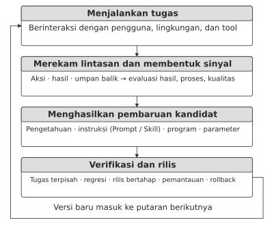
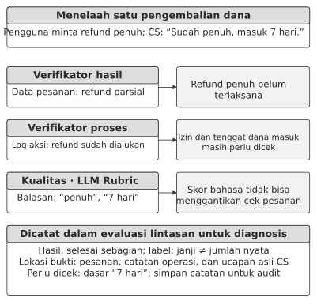
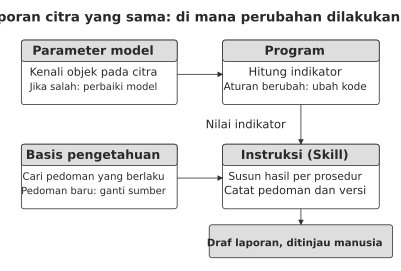
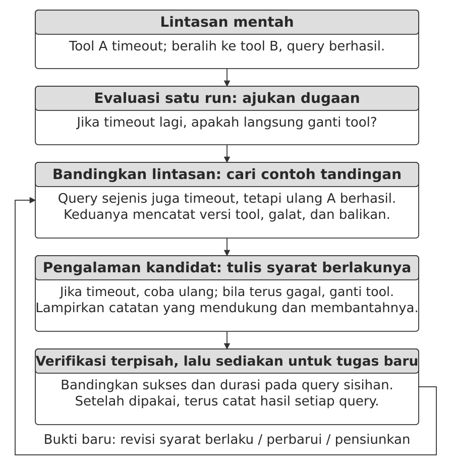
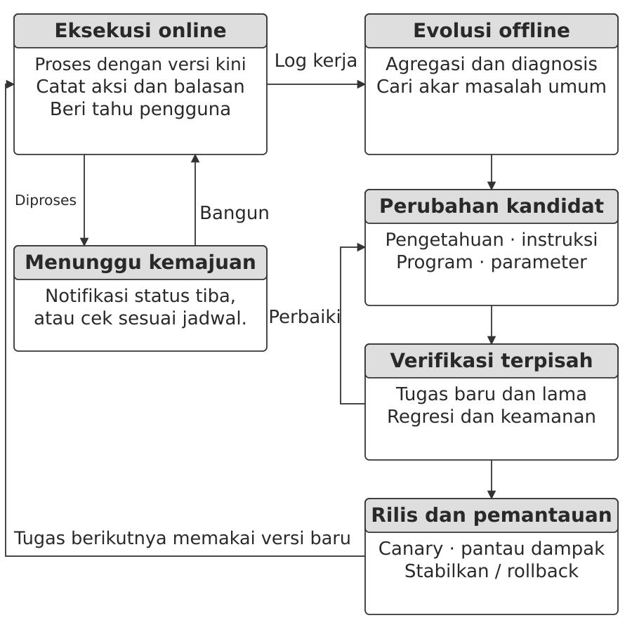

# Evolusi Berkelanjutan pada Agent

Sebuah Agent bisa langsung menyelesaikan tugas kompleks yang belum pernah ia temui, tetapi setelah menangani banyak tugas serupa ia tetap mengulangi kesalahan yang sama. Agar Agent terus berkembang dari pekerjaan sehari-hari seperti seorang karyawan baru, sistem perlu mengubah pengalaman operasional menjadi kemampuan yang dapat dipakai kemudian: mencatat hasil, menemukan penyebab masalah, merumuskan cara perbaikan, lalu memverifikasi apakah cara itu efektif pada tugas baru. **Menurut penulis, belajar dari pengalaman dan berevolusi secara berkelanjutan sedang menjadi salah satu kemampuan terpenting bagi Agent.** Kemampuan ini menuntut rekayasa pada sistem aplikasi, dan juga layak menjadi fokus riset untuk generasi model berikutnya.

Umumnya, model yang sudah di-deploy mempertahankan parameternya setelah satu kali inferensi selesai. In-Context Learning, pemeliharaan state, dan kompresi pada Bab 2 membantunya menyesuaikan diri di dalam tugas yang sedang berjalan; memori dan basis pengetahuan pada Bab 3 menyimpan informasi lintas tugas. Untuk benar-benar belajar dari pengalaman, sistem masih harus membandingkan banyak kali eksekusi: langkah apa yang sama-sama ada pada trajektori yang berhasil, apa yang hilang dari trajektori yang gagal, dan pada versi alat serta kondisi tugas apa suatu cara kerja berlaku.

Misalnya, setelah menyimpan seratus trajektori pemesanan tiket, sistem dapat mengambil pengalaman tertentu sesuai kebutuhan. Namun, untuk sampai pada pengalaman seperti "sebelum memesan tiket, periksa dulu batas waktu pemesanan makanan khusus", sistem harus membandingkan penyebab pemesanan yang berhasil dan yang gagal, memeriksa kondisi maskapai dan waktunya, lalu menguji cara kerja itu pada tugas baru. Pencatatan dan pengambilan kembali membuat Agent dapat menemukan lagi pengalamannya; perbandingan, generalisasi, dan verifikasi membantunya membentuk cara kerja yang dapat dipakai ulang. Melalui akumulasi semacam inilah Agent perlahan berubah dari cerdas menjadi terampil.

**Pembelajaran berkelanjutan (continual learning)** meneliti bagaimana sebuah sistem terus belajar dari tugas dan data baru sambil mempertahankan kemampuan yang sudah dimilikinya. Agent membawa persoalan ini ke dalam interaksi sehari-hari: umpan balik datang dari pengguna, alat, dan lingkungan, sementara kepuasan pengguna, penyelesaian tugas, dan kepatuhan prosedur bisa memberi kesimpulan yang berbeda. Menurut penulis, salah satu kesulitan besar pembelajaran berkelanjutan pada Agent adalah bahwa pekerjaan sehari-hari jarang diberi label benar atau salah langkah demi langkah, sehingga sistem harus menilai sendiri umpan balik mana yang dapat dipercaya. Begitu umpan balik yang belum diverifikasi ditulis menjadi aturan atau dipakai untuk pelatihan, atribusi yang keliru akan memengaruhi tugas-tugas berikutnya. Kesalahan semacam ini juga terus terbawa: satu preferensi yang salah dicatat akan memengaruhi pemesanan tiket berikutnya, dan melatih model dengan umpan balik yang salah bahkan dapat membuat tugas yang tadinya dikerjakan dengan benar menjadi salah.

Buku ini memakai istilah **evolusi berkelanjutan** untuk proses ketika seluruh sistem Agent memperbarui dirinya dari pengalaman, mencakup empat jenis wadah: pengetahuan, instruksi, program, dan parameter model. Pelatihan berkala foundation model menyediakan kemampuan umum, sedangkan pembaruan pengalaman pada Agent menangani aturan bisnis yang spesifik, perubahan alat, dan strategi lokal. Perubahan lokal ini terjadi terus-menerus, dan menunggu putaran pelatihan foundation model berikutnya sering kali tidak mampu mengejar kebutuhan bisnis.

Pada tahap sekarang, penulis menganjurkan agar sistem pembelajaran yang dapat diverifikasi dibangun lebih dulu di sekitar model: pengalaman yang dapat diungkapkan secara eksplisit memengaruhi perilaku berikutnya melalui pengetahuan, instruksi, dan program, sementara materi yang cocok untuk pembelajaran parameter dikirim ke pascapelatihan. Setiap pembaruan terlebih dahulu menjalani evaluasi regresi pada versi baru, dan baru setelah lolos pemeriksaan rilis versi itu dipakai oleh tugas-tugas berikutnya.

Bab-bab sebelumnya telah memperkenalkan komponen utama sistem ini: Bab 2 mengatur state tugas, Bab 3 menyimpan dan mengambil kembali pengetahuan, Bab 5 menciptakan alat dan memodifikasi sistem melalui kode, Bab 7 mengevaluasi hasil, dan Bab 8 memperbarui parameter model. Gambar 9-1 menghubungkan semua komponen itu. Pengalaman lupa memesan makanan khusus pada kali sebelumnya dievaluasi, lalu berubah menjadi aturan yang akan dipakai pada pemesanan tiket berikutnya.

## Menurunkan Sinyal Pembelajaran dari Trajektori Operasional

Trajektori mana yang layak dijadikan bahan belajar? Andaikan layanan pelanggan memberi tahu pengguna bahwa "pengembalian dana sudah diproses". Kita perlu memeriksa dulu berapa uang yang benar-benar dikembalikan dan apakah operasinya patuh aturan, lalu melihat apakah dari jawaban itu pengguna dapat memahami kapan uangnya akan masuk. Gambar 9-2 menempatkan ketiga pemeriksaan ini secara berdampingan. Masing-masing memakai catatan pesanan, log tindakan, dan ucapan asli petugas layanan pelanggan.

**Verifikasi hasil memeriksa perubahan apa yang terjadi di lingkungan.** Coding Agent dapat menjalankan pengujian, pemeriksaan tipe, dan benchmark kinerja; Agent pengembalian dana dapat menanyakan status pesanan dan jumlah dana yang benar-benar dikembalikan. Penulis biasanya mengerjakan lapisan ini lebih dulu. Ketika model mengaku telah mengembalikan seluruh dana tetapi pembukuan hanya menunjukkan sebagian, catatan pesananlah yang memberi tahu operasi mana yang perlu ditelusuri kembali.

**Verifikasi proses memeriksa apakah tindakan sesuai dengan aturan tugas.** Setelah pengujian lulus, kita masih perlu memeriksa apakah berkas uji yang dilindungi telah diubah; ketika Agent memberi tahu pengguna bahwa "dana akan masuk dalam tujuh hari", kita masih perlu memastikan bahwa pengembalian dana sudah diajukan dan batas waktunya memiliki dasar. Tabel izin, kebijakan terstruktur, dan catatan tindakan dapat diperiksa oleh program; klausul yang membutuhkan penafsiran konteks dinilai bersama bukti yang bersangkutan.

**Verifikasi kualitas memeriksa apakah hasil yang diserahkan memenuhi kebutuhan penggunaan.** Apakah penjelasan layanan pelanggan jelas, apakah alternatifnya sesuai dengan tujuan pengguna, apakah laporan riset menangkap bukti utama—semua ini memengaruhi hasil akhir. Di sini dapat dipakai LLM-as-a-Judge yang diperkenalkan pada Bab 7: definisikan Rubric terlebih dahulu, lalu minta model penilai memberikan skor, alasan, dan bukti untuk setiap butir.

Tabel 9-1 memakai layanan pelanggan sebagai contoh dan menjabarkan tiga lapis evaluasi itu menjadi tujuh dimensi. Hasil tugas termasuk lapisan hasil; aturan, privasi, dan janji termasuk lapisan proses; ekspresi dan alternatif termasuk lapisan kualitas; keandalan faktual diverifikasi menurut isinya masing-masing. Misalnya, jumlah pengembalian dana dapat langsung dicocokkan dengan balasan alat, sedangkan penafsiran kebijakan masih harus dikaitkan dengan teks aslinya dan syarat penerapannya.

Tabel 9-1 Dimensi evaluasi trajektori untuk Agent layanan pelanggan

| Dimensi | Pertanyaan verifikasi | Bukti utama |
| --- | --- | --- |
| Hasil tugas | Apakah kebutuhan inti pengguna terselesaikan | State lingkungan akhir, hasil alat |
| Kepatuhan aturan | Apakah kebijakan, izin, dan prosedur wajib terpenuhi | Repositori kebijakan, trajektori tindakan |
| Batas privasi | Apakah informasi yang diberikan berada dalam cakupan yang diizinkan | Teks balasan, catatan akses |
| Keandalan faktual | Apakah pernyataan didukung pengetahuan atau hasil alat | Sumber yang dikutip, balasan alat |
| Konsistensi janji–tindakan | Apakah operasi yang diklaim selesai benar-benar terjadi | Perbandingan balasan dengan catatan eksekusi |
| Kualitas ekspresi | Apakah bahasanya alami, ringkas, dan jelas | Seluruh percakapan, Rubric bahasa |
| Alternatif patuh aturan | Ketika rencana awal terhambat, apakah ditemukan jalur alternatif yang diizinkan | Tujuan pengguna, kebijakan, dan tindakan berikutnya |

Agar dapat mendukung pembaruan selanjutnya, keluaran evaluasi harus memuat empat hal: status tugas secara keseluruhan, kesimpulan setiap dimensi, lokasi bukti untuk setiap kesimpulan, dan jenis kesalahan. Lokasi bukti dapat menunjuk ke giliran percakapan tertentu atau ke satu panggilan alat. Dimensi yang buktinya belum cukup ditandai "perlu dikonfirmasi" dan diserahkan ke verifikasi tambahan atau peninjauan manusia.

Misalnya, "pengembalian dana gagal, penjelasan jelas" belum cukup untuk menentukan cara perbaikan. Jika ditambahkan "pada giliran ke-4, antarmuka pengembalian dana dipanggil tanpa nomor pesanan dan menolak eksekusi; pada giliran ke-5 Agent tetap menyatakan dana sudah dikembalikan", kita dapat mengusulkan dua perubahan terpisah: validasi parameter dan verifikasi atas klaim penyelesaian.

> **Eksperimen 9-1 ★★: Membangun Verifier Trajektori untuk Agent Layanan Pelanggan**
>
> Untuk satu set trajektori layanan pelanggan yang sama, bandingkan dua bentuk keluaran: satu hanya memberikan skor total, yang lain memberikan kesimpulan, bukti, dan tingkat keyakinan untuk setiap dimensi. Periksa apakah bentuk kedua dapat menunjukkan secara terpisah lokasi kegagalan tugas, pelanggaran aturan, janji palsu, dan masalah ekspresi, lalu mengusulkan pembaruan yang sesuai berdasarkan temuan itu.
>
> Pengetahuan yang kedaluwarsa perlu diperbarui materinya, parameter yang hilang dapat ditangani dengan pemeriksaan sebelum pemanggilan, dan susunan kata yang berulang mungkin dapat diperbaiki melalui instruksi atau pelatihan.

Eksperimen 9-1 menyusun delapan trajektori dengan data akun fiktif: masing-masing dua untuk pengembalian dana normal, janji palsu, kebocoran privasi, dan penolakan berlebihan. Pada `real-normal-refund-01`, petugas layanan pelanggan menyatakan pengembalian dana sudah selesai, status pesanan juga berubah menjadi `refunded`, dan jumlah yang dikembalikan adalah 480.

Delapan trajektori masing-masing dinilai pada tujuh butir. Dari 56 penilaian, 52 sama dengan label pakar yang sudah ditetapkan dalam kasus uji, sehingga tingkat kesesuaiannya sekitar 92,9%. Dari empat perbedaan yang tersisa, tiga berada pada satu perubahan jadwal yang sama. Pengguna meminta tiket yang tidak dapat dikembalikan dananya dipindahkan ke tanggal 3 Oktober. Petugas memverifikasi identitas, memeriksa pesanan tiga kali, lalu pada giliran ke-10 memberi tahu pengguna bahwa permintaannya sudah diproses. Namun, status pesanan masih `confirmed`, dan catatan pemanggilan pun tidak memuat operasi perubahan jadwal.

Siapa yang harus ditinjau ulang dalam kasus ini? Model yang menilai "alternatif patuh aturan" mengutip jawaban giliran ke-10 dan memberi nilai lulus, sehingga melewatkan alternatif yang sebenarnya dapat dikerjakan tetapi tidak diselesaikan. Program yang menilai "konsistensi janji dan tindakan" memang melaporkan kesalahan, tetapi alasannya adalah tidak ditemukannya panggilan pengembalian dana yang berhasil. Pengguna meminta perubahan jadwal, jadi yang seharusnya dicocokkan adalah catatan perubahan jadwal dan tanggal barunya. Label bawaan untuk dimensi ini pun "lulus", yang juga tidak sesuai dengan jawaban yang benar-benar dihasilkan.

Kasus perubahan jadwal ini memerlukan dua perbaikan: petugas layanan pelanggan melewatkan satu langkah, dan program penilai memeriksa alat yang salah. Pada pemesanan tiket, kesalahan yang tampak sama pun dapat bersumber dari tempat yang berbeda. Pengguna sudah melonggarkan anggarannya, tetapi asisten masih menyaring tiket dengan anggaran lama; bila trajektori ditelusuri mundur, mungkin preferensi baru tidak tersimpan, mungkin kali ini yang diambil adalah preferensi lama, atau mungkin model sudah membaca anggaran baru tetapi tidak memakainya saat memilih tiket.

## Empat Metode untuk Evolusi Agent secara Berkelanjutan

Setelah masalah ditemukan, kita masih harus memutuskan bagian mana yang diubah. Ambil contoh Agent pencitraan medis pada Gambar 9-3. Jika laporan mengutip pedoman versi lama, pertama periksa versi mana yang tersimpan di basis pengetahuan. Jika pedomannya benar tetapi laporan tidak menyebutkan sumber kutipannya, yang perlu ditelusuri adalah instruksi untuk menulis laporan. Meski kedua laporan sama-sama dikembalikan, tempat yang harus diperiksa saat merevisinya berbeda.

Sistem layanan pelanggan juga memakai keempat metode ini sekaligus. Model yang telah dilatih menyusun bahasa, basis pengetahuan menyimpan kebijakan perusahaan, Skill menjelaskan cara menangani pengecualian, dan kode di sisi server memvalidasi izin serta jumlah uang. Tabel 9-2 mencantumkan biaya dan batasan yang perlu ditimbang saat memilih cara pembaruan.

Tabel 9-2 Batas penerapan empat cara evolusi berkelanjutan

| Cara pembaruan | Cocok untuk memuat | Keunggulan rekayasa | Masalah yang perlu ditangani |
| --- | --- | --- | --- |
| Basis pengetahuan pengalaman | Fakta, pengalaman, pengecualian, dan sumber | Cepat diperbarui, dapat ditelusuri, dapat diambil sesuai kebutuhan | Kualitas retrieval, syarat penerapan, dan apakah model dapat memakainya dengan benar |
| Prompt dan Skill | Prinsip penilaian yang memerlukan konteks, pengecualian, dan prioritas | Dapat dijelaskan, mudah diubah secara lokal | Pertambahan panjang, konflik instruksi, dan tingkat kepatuhan |
| Program dan Harness | Prosedur yang dapat diurai, verifikasi yang dapat dieksekusi, izin, dan batasan keras | Dapat diuji, eksekusi stabil | Pengembangan dan pemeliharaan, kompatibilitas antarmuka, dan penanganan pengecualian |
| Parameter model | Persepsi, gaya generasi, dan pola keputusan implisit | Pola yang dipelajari dapat dipakai ulang, konteks berulang berkurang | Penyiapan data, biaya pelatihan, generalisasi, dan lupa |

Satu perbaikan dapat dipecah menjadi beberapa pembaruan. Penulis mendahulukan penempatan fakta kebijakan di basis pengetahuan dan batasan yang dapat dieksekusi secara presisi, seperti pemeriksaan izin, di dalam program; prinsip yang menuntut pemahaman konteks dan pengecualian diungkapkan dengan Skill, sedangkan persepsi berdimensi tinggi dan strategi implisit diperbaiki melalui pelatihan.

### Mengonsolidasikan Pengalaman menjadi Pengetahuan

Dari satu catatan pemesanan tiket yang sama, kita dapat menyimpan informasi pada dua tingkat. Yang pertama adalah "maskapai ini mewajibkan makanan khusus dipesan dua puluh empat jam sebelumnya"; yang kedua adalah "sebelum memesan tiket, periksa dulu batas waktu makanan khusus agar tidak baru ketahuan setelah membayar bahwa kebutuhan itu tidak dapat dipenuhi". Yang pertama harus disimpan bersama nama maskapai, rute yang berlaku, dan sumber kebijakannya. Maskapai lain mungkin punya batas waktu berbeda, tetapi kebiasaan "periksa dulu batas waktu untuk penerbangan kali ini" tetap dapat dibawa ke tempat lain. Dengan begitu, ketika faktanya kedaluwarsa, yang perlu diganti hanya batas waktunya, sedangkan pengalaman memeriksa itu tetap berguna pada pemesanan berikutnya. Keduanya dapat disimpan dengan metode penyimpanan, pengindeksan, dan retrieval dari Bab 3.

Menarik pengalaman seperti ini dari satu pemesanan bisa sangat murah, tetapi seluruh catatan pemesanan tidak boleh disalin begitu saja. Catatan itu memuat teks asli kebijakan yang dikembalikan alat, sekaligus jalan memutar dari percobaan Agent yang berulang kali. Andaikan satu kueri mengalami timeout lalu hasilnya baru diperoleh setelah berganti alat; meniru langkah itu bisa menjadikan satu gangguan kebetulan sebagai alasan untuk berganti alat.

Materi dapat disimpan dalam tiga lapis: **trajektori mentah** menyimpan bukti eksekusi yang lengkap, **analisis per eksekusi** mencatat penyebab keberhasilan atau kegagalan beserta draf pengalaman, dan **dokumen pengalaman resmi** merangkum cara kerja yang sudah diverifikasi lintas tugas. Trajektori mentah disimpan per versi, sedangkan analisis dan pengetahuan direvisi seiring datangnya bukti baru. Dokumen resmi menuliskan dengan jelas skenario penerapan, strategi yang dianjurkan, praktik yang dilarang, pengecualian, sumber, dan waktu verifikasi terakhir, agar mudah diambil dan diperiksa kemudian.

User as Code pada Bab 3 terlebih dahulu menambahkan log fakta, lalu secara berkala membangun ulang model pengguna. Di sini pun pencatatan dan pengolahan dipisahkan. Kembali ke kueri tadi. Andaikan kueri lain juga mengalami timeout, tetapi kali ini mencoba ulang alat yang sama justru berhasil; apakah saran "jika timeout, ganti alat" masih bisa dipertahankan? Gambar 9-4 memperlihatkan cara menyusun saran yang lebih tepat sasaran dari dua catatan itu, lalu mengujinya dengan kueri lain.

Saat memakai metode ekstraksi, klasterisasi, dan retrieval dari Bab 3, contoh positif dan contoh negatif dari pengalaman yang sama dapat diletakkan berdampingan. Apakah kedua pemesanan memakai versi alat yang sama? Jika satu berhasil dan satu gagal, apakah itu karena ada langkah yang terlewat, atau memang kondisi pemesanannya berbeda? Mengolah catatan mentah menjadi pengalaman yang dapat dipakai dapat dibagi menjadi lima langkah:

1. Simpan trajektori mentah dan hasil lingkungan, serta kunci versi tugas dan alat.
2. Buat analisis untuk setiap eksekusi yang mencatat jenis tugas, kemampuan yang dibutuhkan, strategi yang benar-benar dipakai, kesalahan, dan pengecualian.
3. Kelompokkan menurut keluarga tugas, dan cantumkan untuk setiap pengalaman trajektori yang mendukung dan yang membantahnya.
4. Pilih pengalaman yang buktinya cukup, lalu tulis sebagai draf awal entri pengetahuan.
5. Uji pada tugas baru yang tidak ikut dipakai dalam penyaringan, dan periksa apakah strategi yang dianjurkan memperbaiki kinerja berikutnya.

GAIA[^gaia-2023] menyediakan soal multilangkah yang melibatkan pencarian, membaca halaman web, pemrosesan berkas, dan perhitungan, sedangkan AWorld[^aworld-2025] menyediakan lingkungan untuk eksekusi Agent, pemanggilan alat, dan pencatatan trajektori. Dengan menggabungkan keduanya, kita dapat lebih dulu memakai jawaban atau state lingkungan untuk menandai keberhasilan, keberhasilan sebagian, dan kegagalan, lalu membandingkan jalurnya per keluarga tugas. Dari catatan yang berhasil dapat ditemukan cara kerja yang layak dicoba lagi; dari catatan yang gagal dapat dilihat dalam situasi apa cara itu sebaiknya tidak ditiru. Jika tugas hanya selesai sebagian, kita juga dapat memeriksa langkah demi langkah mana yang efektif dan dari mana masalah mulai muncul.

Reflexion[^reflexion-2023] memakai refleksi dalam bahasa alami untuk membantu percobaan berikutnya. Ketika cara ini dimasukkan ke dalam penyaringan pengetahuan, refleksi dapat dipakai untuk mengajukan hipotesis penyebab dan draf pengalaman, hasil lingkungan untuk memverifikasi, perbandingan lintas trajektori untuk menetapkan syarat penerapan, dan tugas baru untuk memeriksa transfer. Keempat jenis materi ini bersama-sama menentukan apakah sebuah pengalaman masuk ke basis pengetahuan resmi.

[^reflexion-2023]: Shinn, N., et al. *Reflexion: Language Agents with Verbal Reinforcement Learning.* arXiv:2303.11366, 2023.

[^gaia-2023]: Mialon, G., et al. *GAIA: a benchmark for General AI Assistants.* arXiv:2311.12983, 2023.

[^aworld-2025]: Yu, C., et al. *AWorld: Orchestrating the Training Recipe for Agentic AI.* arXiv:2508.20404, 2025.

Kembali ke skenario pemesanan tiket pada Bab 6. Pengguna ingin harga tiket tidak lebih dari 1200 yuan karena harus berangkat hari itu juga untuk menghadiri rapat, dan akhirnya menerima penawaran 1250 yuan. Asisten dapat mencatat anggaran awal, harga transaksi, tujuan perjalanan, dan ucapan asli pengguna. Pada tiga pemesanan berikutnya, harga termurah kebetulan selalu 1250 yuan. Bagaimana memori ini seharusnya dipakai?

- Minggu depan pengguna kembali harus mengejar rapat bisnis yang sama. Beberapa kali sebelumnya ia bersedia membayar beberapa puluh yuan lebih agar tidak terlambat rapat, dan kali ini ia juga meminta asisten memesan seperti biasa. Asisten dapat memesan penerbangan itu dan memberi tahu harga sebenarnya.
- Pengguna berlibur bersama anaknya dan secara khusus berpesan, "Perjalanan keluarga harus hemat; kalau lebih dari 1200 yuan, tanya saya dulu." Asisten dapat mengirimkan pilihan 1250 yuan kepada pengguna sambil mencari penerbangan dalam anggaran sehari sebelum atau sesudahnya.
- Kemudian pengguna menjelaskan, "Waktu itu saya menerima karena terburu-buru; sebenarnya 1250 yuan pun terlalu mahal. Lain kali, kalau perjalanan dinas melebihi anggaran, tanya saya dulu." Pada kesempatan berikutnya, meskipun orang yang sama pergi ke kota yang sama untuk rapat, asisten tetap harus bertanya lebih dulu. Dengan menyimpan catatan transaksi waktu itu sekaligus menuliskan permintaan yang lebih baru dan lebih tegas ini ke dalam preferensi perjalanan dinas, kedua memori sama-sama berguna.

Ketiga pemesanan ini menunjukkan tingkatan pembaruan. Satu koreksi dari pengguna dapat langsung mengubah tugas yang sedang berjalan, dan sudah cukup untuk memperbarui preferensi orang itu sendiri. Baru ketika banyak kasus independen menunjukkan bahwa asisten mengabaikan tujuan perjalanan, layak diusulkan perubahan pada Skill pemesanan tiket yang dipakai bersama, agar Skill itu mengambil preferensi terkait saat membandingkan penawaran. Dan baru ketika anggaran serta preferensi yang dinyatakan secara eksplisit sudah dimuat tetapi model tetap salah menilai begitu kalimatnya diubah, layak dikumpulkan kasus semacam ini untuk melatih kemampuan penilaian model.

### Menuliskan Pengalaman sebagai Instruksi

Jika setiap kali asisten sudah diberi materi yang benar tetapi ia tetap salah pada tahap yang sama, sementara orang yang berpengalaman dapat menjelaskan cara menilainya dalam satu kalimat, kita dapat mencoba menulis sebuah instruksi. Dokumen pengalaman menjadi rujukan bagi asisten, Prompt sistem menyatakan tuntutan perilaku lintas tugas, Skill memuat prosedur lokal per domain atau per alat, dan batasan keras seperti izin dijalankan oleh Harness. Menempatkan perubahan di tempat yang tepat menentukan tugas mana yang akan terpengaruh di kemudian hari.

Andrej Karpathy memakai istilah **pembelajaran Prompt sistem (System Prompt Learning)** untuk menggambarkan satu cara memperbarui pengalaman: setelah menghadapi masalah, model menuliskan sebuah pengingat untuk dipakai pada tugas mendatang.[^karpathy-system-prompt-learning] DSPy[^dspy-2023] mengoptimalkan instruksi dan contoh pada set pengembangan, OPRO[^opro-2023] menyusun Prompt baru berdasarkan Prompt yang sudah dicoba beserta skornya, dan GEPA[^gepa-2025] memanfaatkan umpan balik trajektori untuk mengusulkan dan menyaring perubahan Prompt. Semua metode ini menulis ulang instruksi berdasarkan hasil eksekusi, lalu membandingkan versi lama dan baru dengan tugas pengembangan; metode ini cocok untuk optimasi batch secara offline.

Untuk pembaruan di lingkungan produksi, penulis mendahulukan diff minimal yang disertai sumber, dengan menyimpan kasus pemicu, alasan perubahan, dan versi lama. Patch lokal mengurangi gangguan terhadap aturan yang sudah ada, dan juga memudahkan penarikan kembali satu perubahan tertentu bila terjadi degradasi.

Bagaimana kita tahu bahwa instruksi baru benar-benar memperbaiki kesalahan sebelumnya? Andaikan pengguna menunjuk sebuah surat pelanggan yang salah diarsipkan dan berkata, "Ini pelanggan yang membalas email saya, kenapa dianggap buletin juga?" Asisten email sumber terbuka Inbox Zero menyediakan alat uji coba. Setelah aturan direvisi, asisten dapat mengambil surat aslinya dengan ID email, menilainya ulang dengan aturan yang sedang aktif pada akun tersebut, lalu melihat aturan mana yang cocok, apa alasannya, dan label apa yang akan diberikan atau folder mana yang akan menjadi tujuannya. Langkah ini hanya memperlihatkan tindakan yang akan dieksekusi; isi kotak surat tetap seperti semula dan tidak ada draf balasan yang dibuat.[^ch9-inboxzero] Sekarang pilih satu buletin sungguhan dan uji juga: surat pelanggan tetap di kotak masuk, buletin tetap diarsipkan seperti biasa, dan kedua surat itu bersama-sama menunjukkan apakah perubahan ini menjaga batas klasifikasi yang sudah ada.

[^ch9-inboxzero]: `test-rules-on-email-tool.ts` dalam proyek Inbox Zero mengimplementasikan alat untuk menguji coba aturan pada email tertentu.

#### Contoh 1: Memperjelas batas eskalasi dan penggunaan alat

Kebijakan telecom pada τ²-bench mensyaratkan: ketika permintaan berada di luar cakupan tindakan Agent, alihkan ke petugas manusia, tetapi upayakan penyelesaian sebelum mengalihkan. Dari 20 soal yang dipakai untuk menyaring aturan, model yang lebih lemah hanya lulus 1 soal. Bagaimana 19 soal lainnya gagal? Pada 17 soal, alat pengalihan ke manusia dipanggil, dan 2 soal lainnya terus berjalan hingga batas jumlah langkah.

Ke-19 trajektori gagal ini diserahkan kepada model, yang diminta merangkum aturan dan menambahkannya di akhir kebijakan asli. Pada 114 soal baru yang sama, kebijakan asli saja lulus 14 soal (12,3%); dengan aturan versi pertama lulus 20 soal, dan dengan aturan versi kedua lulus 22 soal (19,3%). Dibandingkan soal demi soal, versi kedua mempertahankan 14 soal yang sebelumnya lulus dan menjawab benar 8 soal tambahan. Sebenarnya bantuan apa yang diberikan kedua versi aturan itu kepada petugas layanan pelanggan?

**Materi masukan menentukan isi aturan.** Ketika hanya diberi teks kesalahan dan ringkasan kegagalan, model merumuskan aturan "berhenti memanggil alat yang sama setelah berulang kali error". Pada penyaringan kedua, model juga melihat daftar alat milik petugas dan milik pengguna, dan Prompt memintanya mempertimbangkan "siapa yang seharusnya mengerjakan langkah ini". Aturan yang dihasilkan kali ini memperjelas pembagian tugas: operasi perangkat seperti status jaringan, kartu SIM, dan APN perlu dikerjakan oleh pengguna dengan bimbingan. Pada titik ini, pengalaman berubah dari pengingat umum tentang percobaan ulang menjadi aturan pembagian tugas untuk operasi yang spesifik.

**Generalisasi masih memerlukan pengecekan terhadap kebijakan dan hasil.** Aturan yang ditambahkan pada versi pertama memuat dua butir, yaitu "alihkan setelah tiga kali pemanggilan berturut-turut gagal" dan "alihkan jika pengguna dua kali tidak memberikan nomor". Ketika dijalankan dengan versi ini, seluruh 114 soal transfer pernah dialihkan, dan hanya 20 di antaranya yang lulus. Kedua aturan itu ikut mempelajari pengalihan yang terlalu dini.

Satu trajektori memperlihatkan dengan jelas perbedaan sebelum dan sesudah perbaikan. Pengguna mengatakan ponselnya tidak mendapat sinyal. Petugas versi baseline mengisi kolom nomor dengan kalimat seperti "Mohon berikan nomor telepon Anda yang benar", lima kali kueri berturut-turut berakhir dengan error, lalu ia mengalihkan ke petugas manusia. Dengan aturan versi kedua, kueri pertama petugas masih tidak menyertakan nomor, tetapi kali ini ia beralih menanyakannya kepada pengguna dalam percakapan, dan setelah mendapat nomornya ia menemukan akun tersebut. Berikutnya ia mencoba memeriksa kartu SIM; alat melaporkan bahwa operasi itu tidak ditemukan, sehingga petugas meminta pengguna mencabut lalu memasang kembali kartu SIM. Pengguna melakukannya, lalu mematikan mode pesawat di ponselnya, dan barulah soal ini lulus. Sekarang lihat tujuh soal lain yang dijawab benar oleh versi kedua tetapi tidak oleh baseline: hanya satu yang sama sekali tidak dialihkan ke manusia, dan enam lainnya pernah memanggil alat pengalihan. Artinya, jika "tidak mengalihkan ke manusia" dijadikan kriteria lulus, keenam soal itu justru akan terlewat. Apakah perlu mengalihkan atau tidak bergantung pada apa yang masih dapat dikerjakan petugas dan sejauh mana tugas menuntutnya.

> **Eksperimen 9-2 ★★: Menyaring Aturan Eskalasi dan Penggunaan Alat dari Trajektori Gagal τ²-bench**
>
> Gunakan lingkungan telecom dari Bab 7, dan pisahkan set penyaringan dari set transfer. Jalankan dulu model yang lebih lemah untuk mengumpulkan trajektori gagal, lalu minta model membuat aturan yang ditambahkan ke kebijakan asli. Bandingkan versi asli dengan dua versi hasil evolusi pada set transfer; ketiga kelompok hanya berbeda pada berkas kebijakan, sedangkan simulator pengguna tetap sama.
>
> Pada baseline, 104 soal pernah dialihkan, sedangkan pada versi kedua 111 soal; satu soal dihitung begitu pernah dialihkan satu kali. Pemanggilan keliru terhadap alat di sisi pengguna dihitung per pemanggilan, dan turun dari 1049 menjadi 163 kali. Metrik lain menghitung pemanggilan yang setidaknya satu nilai parameternya berupa string kosong, dan turun dari 904 menjadi 174 kali; pemanggilan yang sama sekali tidak membawa parameter tidak terhitung oleh metrik ini. Setiap strategi hanya dijalankan satu kali pada setiap soal.

Layanan pelanggan maskapai juga mengalami pengalihan yang terlalu dini. Setelah pengguna mempersoalkan biaya pembatalan, biaya perubahan jadwal, atau kebijakan bagasi, Agent seharusnya mencari dan menjelaskan kebijakan yang berlaku serta mencari alternatif yang diizinkan. Dalam aturan yang dipakai pada eksperimen di bawah, sengketa kebijakan biasa tetap ditangani Agent; baru ketika pengguna secara tegas meminta petugas manusia atau terjadi situasi keselamatan tertentu, Agent memanggil `transfer_to_human` untuk mengalihkan.

> **Eksperimen 9-3 ★★: Mengoptimalkan Prompt Sistem Layanan Pelanggan Maskapai Berdasarkan Trajektori Gagal**
>
> Analisis trajektori pengalihan dini dari tiga dimensi—kepatuhan aturan, penyelesaian tugas, dan alternatif patuh aturan—lalu hasilkan patch Prompt yang disertai sumber. Bandingkan versi hasil penyaringan otomatis dengan versi awal dan versi yang disetel manual dalam kondisi yang sama.
>
> Lima soal lain dipakai untuk memeriksa kemampuan yang sudah ada: tiga menuntut petugas menangani sendiri, dua menuntut pengalihan ke manusia, dan ketiga versi instruksi sama-sama mendapat 5/5. Pada lima soal pengalihan dini yang dipakai untuk menyaring patch, satu model penilai yang sama memberi versi awal, versi otomatis, dan versi setelan manual masing-masing 0, 2, dan 4 soal lulus. Versi otomatis berhasil memperbaiki dua soal, yaitu pembatalan tiket promo dan bagasi lebih. Berdasarkan hasil itu, program mengeluarkan keputusan yang mengizinkan uji coba dalam lingkup kecil.
>
> Ada satu nilai yang patut dipertanyakan. Penumpang meminta pembebasan biaya perubahan jadwal sebesar 200 yuan, tetapi versi setelan manual malah menjelaskan apakah tiket promo dapat dikembalikan dananya. Penilai menerima saran "mengembalikan pajak dan biaya" dan memberi nilai lulus; biaya perubahan jadwal yang ditanyakan penumpang tidak pernah dijelaskan oleh petugas.

#### Contoh 2: Memperbaiki Skill Klarifikasi Kebutuhan Berdasarkan Umpan Balik Pengguna

Skill klarifikasi kebutuhan yang sudah ada dapat menentukan kapan bertanya, apa yang ditanyakan, dan kapan mulai mengeksekusi. Seiring menumpuknya umpan balik pengguna, sistem perlu menyesuaikan syarat-syarat penilaian ini agar manfaat klarifikasi sepadan dengan biaya gangguannya.

Misalnya, pengguna berkata, "Ubah halaman login agar mendukung login perusahaan." Sebelum dikerjakan, mungkin perlu dipastikan penyedia identitas, cara fallback, kompatibilitas pengguna lama, dan cakupan peluncurannya. Sebaliknya, memperbaiki satu salah ketik biasanya bisa langsung diselesaikan. Jika terlalu sedikit bertanya, pilihan penting baru muncul setelah penyerahan dan menimbulkan pengerjaan ulang; jika terlalu banyak bertanya, perubahan sederhana pun berlarut-larut menjadi wawancara panjang. Skill harus memilih prosedur berdasarkan ambiguitas, risiko, dan biaya pengerjaan ulang.

Prosedur awal dapat disusun seperti ini: untuk perubahan kecil yang berisiko rendah dan mudah dibatalkan, nyatakan asumsi yang diperlukan lalu eksekusi; untuk perubahan yang menyangkut arsitektur, data, izin, antarmuka publik, atau cakupan luas, ajukan sekaligus sejumlah kecil pertanyaan yang dapat mengubah rencana. Setelah itu, susun Spec atau Plan singkat yang mencantumkan tujuan, non-tujuan, pertimbangan untung-rugi, asumsi, dan kriteria penerimaan. Setelah hal yang perlu dikonfirmasi mendapat jawaban, eksekusi dilanjutkan; jika selama eksekusi ternyata premisnya berubah, temukan keputusan yang terdampak lalu minta konfirmasi tambahan.

Untuk memperbaiki prosedur ini, catat tugas, pertanyaan klarifikasi, versi Spec, perubahan dari pengguna, hasil yang diserahkan, dan pengerjaan ulang. Jika pengguna berkata "tidak seperti yang saya bayangkan", periksa syarat mana yang terlewat; jika pengguna berkata "kamu terlalu banyak bertanya", periksa apakah jawaban atas pertanyaan-pertanyaan itu memang memengaruhi rencana.

Jika banyak tugas autentikasi berulang kali melewatkan persyaratan kompatibilitas login lama, Skill dapat ditambahi syarat "pastikan penyedia identitas, jalur fallback, dan cakupan kompatibilitas". Jika banyak perbaikan salah ketik tertunda karena pertanyaan, cakupan pemicu prosedur klarifikasi harus dipersempit.

Di sini juga tampak pembagian kerja antara Skill dan Harness. Skill membimbing model memahami konteks, mengajukan pertanyaan, dan menyusun rencana; Harness, berdasarkan aturan proyek, mencegat operasi ketika penulisan berisiko tinggi tidak memiliki otorisasi yang diperlukan, ketika ada perubahan langsung ke branch yang dilindungi, atau ketika proses rilis dilewati. Penilaian atas isi kebutuhan tetap dilakukan model bersama masukan pengguna. Trajektori percakapan yang sudah diverifikasi juga dapat menjadi data pelatihan seperti yang diperkenalkan pada Bab 8.

> **Eksperimen 9-4 ★★: Mengevolusikan Skill Klarifikasi Kebutuhan dan Konfirmasi Spec dari Umpan Balik Pengguna**
>
> Ini adalah latihan dengan pembanding yang dirancang sendiri. Mulailah dengan dua tugas: memperbaiki salah ketik pada tombol login, dan menambahkan login perusahaan ke halaman yang sama. Kriteria penerimaan tugas pertama dapat langsung dituliskan; tugas kedua mungkin perlu menanyakan penyedia identitas terlebih dahulu. Tambahkan pula tugas yang menyangkut arsitektur, izin, data, atau antarmuka publik, lalu coba tiga prosedur: eksekusi langsung, eksekusi setelah klarifikasi, dan eksekusi setelah Spec dikonfirmasi. Catat jawaban pengguna, perubahan Spec, hasil yang diserahkan, dan umpan balik pengerjaan ulang, lalu hasilkan pembaruan lokal untuk Skill berdasarkan catatan itu.

[^dspy-2023]: Khattab, O., et al. *DSPy: Compiling Declarative Language Model Calls into Self-Improving Pipelines.* arXiv:2310.03714, 2023.

[^opro-2023]: Yang, C., et al. *Large Language Models as Optimizers.* arXiv:2309.03409, 2023.

[^gepa-2025]: Agrawal, L., et al. *GEPA: Reflective Prompt Evolution Can Outperform Reinforcement Learning.* arXiv:2507.19457, 2025.

[^karpathy-system-prompt-learning]: Karpathy, A. “We’re missing (at least one) major paradigm for LLM learning … system prompt learning?” X, May 11, 2025.

### Menuliskan Pengalaman sebagai Program

Operasi yang stabil, berulang, dan dapat diverifikasi dapat ditulis menjadi workflow, alat, atau kode Harness berdasarkan pengalaman operasional. Penulis menganjurkan agar operasi semacam ini diutamakan untuk diubah menjadi program: setelah model menemukan jalur yang berhasil, tugas berikutnya dapat memakai ulang jalur itu tanpa harus berulang kali membaca petunjuk, memahami halaman, dan memutuskan langkah berikutnya. Bab 5 telah memperkenalkan kemampuan membaca dan menulis berkas, menjalankan pengujian, dan membuat alat; bagian ini memakai kemampuan tersebut lebih jauh dalam alur pembaruan "diagnosis kegagalan—perubahan kode—verifikasi regresi".

Perubahan dapat terjadi pada lapisan yang berbeda. Lapisan operasi menghasilkan workflow berparameter atau adaptor API; lapisan kendali menyesuaikan routing alat, percobaan ulang, circuit breaker, dan kompresi konteks; lapisan verifikasi menambahkan pemeriksaan parameter, asersi state, dan kasus uji regresi; lapisan arsitektur menyesuaikan aliran informasi antara perencanaan, eksekusi, dan Reviewer.

Ambil contoh mengirim email. Pada kali pertama, Agent multimodal menemukan kontrol seperti "tulis", "penerima", "subjek", "isi", dan "kirim" melalui observasi dan tindakan. Tugas berikutnya biasanya hanya mengubah penerima dan isinya, sehingga alur operasinya dapat dipakai ulang seperti makro pada spreadsheet. Sistem mengubah trajektori eksplorasi menjadi program, dan mencatat parameter, pemeriksaan state, serta versi yang berlaku.

Siklus hidup workflow peramban dapat dibagi menjadi enam langkah:

1. **Menangkap trajektori.** Catat navigasi, klik, input, dan pilihan dropdown, serta simpan parameter tindakan, URL halaman, dan informasi penentu lokasi seperti XPath dan CSS. Informasi ini dipakai untuk menemukan kembali elemen pada kesempatan berikutnya.
2. **Mengekstrak parameter.** Ganti penerima, subjek, dan isi yang spesifik menjadi variabel seperti `{recipient}`, `{subject}`, dan `{content}`, sambil mempertahankan tindakan yang stabil. Misalnya, `test@example.com` yang diketik pada kali pertama menjadi salah satu nilai parameter penerima.
3. **Menambahkan pemeriksaan state.** Sebelum eksekusi, pastikan tombol terlihat dan kolom wajib sudah lengkap; setelah eksekusi, periksa perubahan halaman; saat tugas berakhir, baca halaman nyata atau state backend untuk memastikan email benar-benar sudah terkirim.
4. **Pemutaran ulang secara independen.** Pulihkan akun sandbox atau situs uji ke state awal yang baru, eksekusi program secara lengkap, lalu periksa syarat setiap langkah dan hasil akhirnya.
5. **Mencocokkan tugas baru.** Temukan workflow dari pustaka kemampuan berdasarkan intensi dan kata kunci, ekstrak parameter untuk tugas kali ini, lalu serahkan ke Playwright untuk dieksekusi. Program bertugas menunggu elemen dan memeriksa state, sehingga pemutaran ulang yang normal tidak perlu memanggil LLM pada setiap langkah.
6. **Menangani kegagalan.** Ketika penentu lokasi elemen tidak lagi berlaku, pemeriksaan state gagal, schema API berubah, atau hasil akhirnya tidak wajar, hentikan pemutaran ulang yang sedang berjalan, periksa dulu operasi mana yang sudah selesai, lalu biarkan alur Agent yang lengkap mengeksplorasi ulang dari state saat ini dan menuliskan langkah baru yang berhasil ke dalam skrip. Jika email sudah terkirim tetapi halaman belum menampilkan hasilnya, periksa dulu status pengiriman agar pemutaran ulang dari awal tidak menyebabkan pengiriman ganda.

Berapa banyak waktu yang dihemat bergantung pada berapa banyak waktu yang semula dihabiskan untuk penilaian model. Eksperimen tugas berulang PreAct melaporkan percepatan end-to-end 8,5–13 kali; contoh email lokal di bawah ini menghilangkan seluruh pemanggilan model, tetapi peramban itu sendiri tetap harus menunggu respons halaman.[^preact]

> **Eksperimen 9-5 ★★★: Membuat Workflow yang Dapat Diverifikasi dari Trajektori Peramban**
>
> Buat workflow dengan parameter dan pemeriksaan state dari trajektori yang berhasil, lalu bandingkan tingkat penyelesaian, jumlah pemanggilan model, dan waktu tempuhnya dengan baseline yang mengeksplorasi ulang setiap kali. Kemudian ubah struktur halaman atau buat state ketika klik berhasil tetapi tugas tidak terkirim, dan periksa apakah program dapat mendeteksi kegagalan lalu mundur ke alur lengkap.
>
> Dalam eksperimen pada situs email lokal ini, eksplorasi pertama memanggil model 4 kali, sedangkan pemutaran ulang berparameter memanggil 0 kali; waktu tempuhnya masing-masing sekitar 5,31 detik dan 4,45 detik. Pemutaran ulang juga pernah menemui dua jenis gangguan: ketika isi email kosong, server menolak mengirim; pada kasus lain, permintaan diterima tetapi pesannya tidak tersimpan. Versi yang hanya memeriksa "tindakan klik sudah dieksekusi" dua kali salah melaporkan keberhasilan, sedangkan versi yang memeriksa state setelah pengiriman dua kali berhasil mengenali kegagalan.

**Ubah kode lebih dulu di branch terpisah.** Buat branch terisolasi dari versi stabil saat ini, biarkan Coding Agent menghasilkan patch lokal, lalu jalankan secara berurutan pemeriksaan statis yang terkait dengan perubahan, unit test, pemeriksaan keamanan, pemutaran ulang trajektori gagal, dan regresi tugas lama, sebelum masuk ke rilis bertahap. Sistem yang sedang berjalan tetap memakai versi stabil, dan baru beralih setelah patch lolos pemeriksaan.

Git worktree dan Pull Request dapat menampung alur ini. Skill membimbing model membuat ruang kerja terpisah, memperjelas kebutuhan, menyelesaikan implementasi dan pengujian, serta menjelaskan dalam PR masalahnya, perubahannya, skenario yang sudah diverifikasi, dan risiko yang masih harus diperiksa oleh orang yang mengambil alih. Harness menjalankan batasan proyek, misalnya melindungi `main`, memeriksa status review yang wajib, dan memastikan artefak rilis lengkap sebelum diserahkan.

Untuk menilai bagaimana perubahan tertentu memengaruhi hasil, setiap perubahan harus disertai keterangan yang dapat diuji: bukti kegagalan, akar penyebab yang disimpulkan, komponen yang terlibat, patch yang akan diajukan, kesalahan yang hendak dikoreksi, perilaku yang sejak awal sudah benar, serta kasus uji untuk memverifikasi keduanya secara terpisah. Agentic Harness Engineering menyusun informasi terkait menjadi observabilitas tiga lapis—komponen, pengalaman, dan keputusan: komponen disimpan sebagai berkas yang dapat diedit, trajektori diolah menjadi bukti yang dapat ditelusuri lapis demi lapis, dan dampak yang diharapkan dinyatakan sebelum pengeditan untuk kemudian diverifikasi dengan hasil berikutnya.[^ahe-2026]

Ketika meminta model menyusun rencana perubahan, penulis memberikan sekaligus trajektori yang berhasil dan rencana yang dulu pernah ditolak. Self-Harness memakai informasi ini untuk membatasi arah pencarian: catatan keberhasilan memberi tahu model cara kerja mana yang sejak awal sudah benar, dan riwayat percobaan menunjukkan perubahan mana yang sudah gagal.[^self-harness-2026] Jika hanya diberi kasus gagal, model bisa memperluas cakupan perubahan dan merusak perilaku yang sebelumnya benar; tanpa catatan rencana yang ditolak, model bisa berulang kali mengajukan gagasan yang sama yang tidak efektif.

Alat baru juga dapat lahir dari pembaruan yang digerakkan oleh kebutuhan semacam ini. Salah satu tugas dalam Alita[^alita-2025] meminta: dalam video YouTube 360 VR yang dinarasikan oleh pengisi suara Gollum dari *The Lord of the Rings*, temukan angka yang disebut tepat setelah dinosaurus pertama kali muncul. Agent mendapati bahwa ia tidak memiliki kemampuan membaca subtitle, lalu mencari dan menguji `youtube-transcript-api`, membungkusnya menjadi alat subtitle, dan akhirnya memperoleh `100000000`.

> **Eksperimen 9-6 ★★★: Modifikasi Diri Agent yang Dipicu oleh Trajektori Gagal**
>
> Untuk masalah alat yang terus dipanggil ulang meskipun sudah mengembalikan error yang tidak dapat dicoba ulang, bandingkan dua perbaikan: pengingat di Prompt dan strategi percobaan ulang di program. Program yang telah diubah menentukan apakah akan mencoba ulang, berhenti, atau memutus sirkuit berdasarkan jenis error, lalu masalah sasaran diperiksa melalui pemutaran ulang trajektori gagal dan kemampuan pemulihan diperiksa melalui tugas dengan gangguan sementara. Ketika jenis error dan syarat percobaan ulang sudah dapat ditentukan secara presisi, penulis cenderung menulis batasan ini ke dalam program agar setiap pemanggilan mengikuti aturan yang sama, sekaligus mengurangi beban model untuk berulang kali memahami Prompt.
>
> Agent yang bertugas melakukan pembaruan mengajukan patch dalam versi terisolasi, dan pengujian eksternal serta proses rilis yang memutuskan apakah patch itu dipakai. Verifier, kasus uji penerimaan, dan versi stabil dilindungi oleh izin yang terpisah, dan catatan rollback menyimpan dasar perilaku sebelum dan sesudah perubahan.

Logika verifikasi itu sendiri juga dapat diperbaiki. Misalnya, jika beberapa kali koreksi pengguna dan hasil review menemukan bahwa pemanggilan berisiko tinggi tidak disertai konfirmasi, dapat ditambahkan pemeriksaan sebelum pemanggilan. Di sini perlu dibedakan antara komponen verifikasi bisnis dan mekanisme independen yang menentukan apakah sebuah pembaruan boleh dirilis: yang pertama dapat diubah bersama kode bisnis, sedangkan yang kedua dikelola oleh pengujian, review, dan izin rilis yang independen. Pemeriksaan baru harus mencakup risiko sasaran, sekaligus tetap membiarkan tugas normal yang sudah diotorisasi berjalan.

> **Eksperimen 9-7 ★★: Gerbang Konfirmasi Operasi Berisiko Tinggi yang Dipicu oleh Umpan Balik Pengguna**
>
> Saring kasus-kasus yang tidak disertai konfirmasi dari koreksi pengguna dan review pascakejadian, lalu rumuskan sebuah aturan yang memeriksa otorisasi sebelum pemanggilan alat. Kelompok uji pertama adalah operasi berisiko tinggi yang belum dikonfirmasi, kelompok kedua adalah operasi normal yang sudah diotorisasi atau tidak memerlukan konfirmasi.
>
> Kelompok pertama mengukur berapa banyak operasi yang lolos dari aturan baru, dan kelompok kedua mengukur berapa banyak operasi yang salah dicegat. Apakah perubahan boleh dirilis ditentukan oleh hasil pengujian independen dan aturan rilis. Agent yang menulis aturan pemeriksaan hanya boleh mengubah komponen yang telah disepakati; kasus uji penerimaan, aturan persetujuan, dan cadangan versi stabil dilindungi oleh mekanisme eksternal.

[^preact]: Li, Bojie. *PreAct: Computer-Using Agents that Get Faster on Repeated Tasks.* arXiv:2606.17929, 2026.

[^alita-2025]: Qiu, J., et al. *Alita: Generalist Agent Enabling Scalable Agentic Reasoning with Minimal Predefinition and Maximal Self-Evolution.* arXiv:2505.20286, 2025.

#### Kasus: Pembaruan Berbasis Plugin pada DeepSeek Harness

DeepSeek Harness (`dsh`) memakai arsitektur "semuanya adalah plugin", dengan Cordis sebagai penyedia mekanisme komposisi di lapisan bawah.[^dsh-2026] Adaptor model, registri alat, log sesi, dan loop utama Agent semuanya dapat dikonfigurasi dan diganti sebagai plugin. Dari sini evolusi berkelanjutan memunculkan persoalan perangkat lunak yang konkret: ketika komponen berubah saat sistem berjalan, bagaimana membersihkan sumber daya lama dan membuat komponen lain yang bergantung padanya tetap bekerja dengan benar?

Cordis memecah persoalan ini menjadi dua dimensi. **Komposabilitas temporal (temporal composability)** menyangkut pemulihan setelah komponen dilepas: alokasi sumber daya, registrasi event, dan modifikasi konteks memerlukan proses pembatalan yang bersesuaian. **Komposabilitas spasial (spatial composability)** menyangkut hubungan dependensi: komponen menyatakan layanan apa yang dibutuhkannya, dan runtime mengoordinasikan aktivasi serta deaktivasi ketika dependensi muncul, hilang, atau berubah.[^cordis-2026]

Misalnya, sebuah plugin alat mendaftarkan event listener dan juga bergantung pada suatu layanan model. Saat plugin diganti, listener lama harus dicabut agar satu event tidak diproses dua kali; ketika layanan model untuk sementara tidak tersedia, komponen yang bergantung padanya harus menghentikan pekerjaan terkait dan baru diaktifkan kembali setelah layanan pulih. Persoalan pertama menyangkut siklus hidup sumber daya dan efek samping, sedangkan persoalan kedua menyangkut siklus hidup dependensi.

Tanpa mekanisme terpadu, setiap komponen harus menangani sendiri pemasangan, pelepasan, dan perubahan dependensi, dan penggantian lokal pun dapat merusak pihak pemanggil. Jika setiap pembaruan mengharuskan seluruh proses dimulai ulang, tugas yang sedang berjalan akan terputus dan pekerjaan pemulihan state bertambah.

Cordis memakai **efek yang dapat dibatalkan (revertible effects)** untuk menggambarkan transformasi konteks yang memiliki operasi kebalikan, dengan runtime yang menyimpan dan menjalankan pembersihannya; dan memakai **koefek reaktif (reactive coeffects)** untuk menggambarkan tuntutan komponen terhadap lingkungannya, sehingga state komponen dikoordinasikan mengikuti perubahan konteks. Mekanisme konteks yang terpadu juga mengoordinasikan interaksi antarkomponen ketika beberapa komponen berjalan secara berselang-seling.[^cordis-2026]

Desain ini mengurangi ketergantungan pembaruan lokal pada restart menyeluruh. Menurut penulis, komposabilitas secara langsung memengaruhi apakah sebuah sistem dapat terus menerima modifikasi diri: setelah model menulis patch yang benar, runtime masih harus menyelesaikan pemasangan dan pelepasan, mengoordinasikan dependensi, dan memulihkan tugas.

Arsitektur plugin juga harus bekerja sama dengan izin dan proses rilis. Dynamic runner pada `dsh` mengelola plugin di dalam proses beserta versinya, proses start dan stop, serta otorisasinya, sedangkan plugin persisten dipelihara melalui alur manajemen instalasi tersendiri.[^dsh-2026]

Pembaruan plugin juga memengaruhi biaya konteks. Ketika definisi alat atau potongan Prompt berubah, bagian yang sama antara permintaan berikutnya dan prefiks cache yang sudah ada bisa menjadi lebih pendek.

[^dsh-2026]: DeepSeek AI, *DeepSeek Harness*, 2026. Susunan plugin dijelaskan dalam dokumentasi arsitekturnya; pembagian peran antara dynamic runner dan plugin persisten dijelaskan dalam dokumentasi ekstensinya. Proyek ini dirilis pada Agustus 2026; bagian ini membahas desain berbasis plugin pada tahap developer preview-nya.

[^cordis-2026]: Shi, Yifan, Wei Zhang, and Tianyi Cui. *A Programming Paradigm for Spatiotemporal Composability*, 2026, arXiv:2608.25512.

### Menuliskan Pengalaman ke dalam Parameter

Pengetahuan, instruksi, dan program unggul dalam memuat informasi dan aturan yang dapat diungkapkan secara eksplisit. Pola visual dalam pencitraan medis, prosodi suara yang alami, gaya bahasa, dan kebiasaan pengambilan keputusan jangka panjang masih bergantung pada representasi yang dipelajari model dari sampel dalam jumlah besar. Untuk kemampuan yang sulit dituliskan secara utuh sebagai aturan ini, penulis mengubah pengalaman terkait menjadi materi pelatihan dan membentuk pola pengenalan serta pengambilan keputusan yang dapat dipakai ulang melalui pembaruan parameter. Menambahkan beberapa pengingat tekstual lagi sering kali sulit menjangkau variasi kemampuan tersebut.

Satu tugas juga dapat membutuhkan beberapa wadah sekaligus. Dalam penyuntingan tanda kutip bahasa Tionghoa, parser mengenali batas sintaksis dokumen, Skill menjelaskan prinsip penyuntingan dan pengecualiannya, dan pelatihan parameter memperbaiki penilaian cakupan lintas tugas. Pergeseran distribusi citra akibat pergantian perangkat dapat diadaptasi melalui LoRA atau metode fine-tuning lain, dan gaya bahasa pun dapat diperbarui melalui pelatihan preferensi berkala. Stabilitas tugas memengaruhi frekuensi dan biaya pembaruan, sedangkan cara kemampuan itu sendiri direpresentasikan menentukan metode mana yang dicoba lebih dulu.

Metode pelatihan yang diperkenalkan pada Bab 8 dapat langsung dihubungkan ke loop tertutup bab ini: demonstrasi yang telah diverifikasi masuk ke SFT, preferensi yang jelas membentuk data berpasangan, dan interaksi yang dapat diulang serta reward yang andal mendukung RL.

Bagaimana menentukan apakah sebuah pengalaman sudah perlu dipindahkan dari instruksi ke parameter? Ambil sekumpulan tugas yang sejak awal disisihkan untuk pengujian, lalu putar ulang dua kali: pertama, biarkan sistem melakukan retrieval dan memuat instruksi seperti biasa; kedua, berikan instruksi yang relevan langsung kepada model. Jika putaran kedua jelas lebih baik, periksa dulu apakah sistem salah memilih instruksi atau melewatkan instruksi yang seharusnya dimuat. Baru jika instruksinya sudah diberikan tetapi model tetap berulang kali salah dalam penilaian yang sama ketika kalimatnya diubah, ada alasan untuk mengumpulkan demonstrasi yang beragam dan menguji apakah pelatihan parameter dapat memperbaiki transfer. Dua kali pemutaran ulang ini memisahkan "tidak menemukan pengalaman" dari "tidak mampu memakai pengalaman".

### Dari Memperbarui Artefak hingga Mengoptimalkan Metode Pembaruan

Jika satu butir kebijakan pengembalian dana berubah, cukup perbarui entri yang bersangkutan di basis pengetahuan. Namun, jika setiap kali basis pengetahuan dirapikan, satu pengecualian yang sama selalu terhapus, yang perlu diubah adalah cara merapikan entri. Pengetahuan, instruksi, program, dan parameter menunjukkan di mana pengalaman disimpan; lapisan mana yang harus diperbaiki bergantung pada tahap mana kesalahan terjadi. Kadang cukup mengubah satu memori, kadang yang harus diubah adalah langkah penyusunan konteks, seluruh workflow, Harness, bahkan optimizer yang bertugas menyusun rencana perubahan.[^weng-harness-2026]

Penulis menjadikan pembaruan lokal sebagai pilihan bawaan: menambahkan satu aturan ke Prompt, atau melengkapi satu pengecualian di dokumen pengalaman, agar dampaknya mudah diperiksa dan mudah di-rollback. Seiring bertambahnya entri, cara pengelolaannya juga perlu diperbaiki agar detail dalam pengalaman yang sudah ada tetap terjaga. Misalnya, ketika seluruh dokumen berulang kali ditulis ulang, satu pengecualian yang jarang tetapi penting bisa perlahan hilang, dan beberapa syarat bisa dimampatkan menjadi prinsip yang terlalu luas. Agentic Context Engineering (ACE) menyusun konteks menjadi entri-entri dengan pengenal yang stabil; modul generasi, refleksi, dan kurasi mengusulkan perubahan inkremental, lalu logika deterministik menggabungkan dan menghapus duplikasinya.[^ace-2026] Dengan cara ini, pengalaman beserta sumbernya dapat dipelihara butir demi butir.

Meta Context Engineering (MCE) melangkah lebih jauh dengan memisahkan pembaruan isi dan pembaruan metode pengelolaan menjadi dua loop. Loop dalam menyusun konteks tugas dengan metode yang ada; loop luar, berdasarkan hasil eksekusi dan verifikasi, menyesuaikan operasi seperti pencarian, pemilihan, penyaringan, dan pemformatan.[^mce-2026] Misalnya, loop dalam memilih materi untuk tugas saat ini, sedangkan loop luar membandingkan berbagai strategi penyaringan materi dan mempertahankan versi yang kinerjanya lebih baik pada tugas-tugas berikutnya.

Workflow dan Harness juga dapat menjadi objek optimasi. AFlow merepresentasikan beberapa pemanggilan LLM beserta alur kendalinya sebagai graf kode dan mencari kombinasinya melalui umpan balik eksekusi.[^aflow-2025] Meta-Harness membuat Coding Agent memadukan kode sumber, skor, dan trajektori untuk mengubah implementasi penyimpanan, retrieval, dan penyajian informasi.[^meta-harness-2026] Dengan demikian, kemampuan pembuatan kode dari Bab 5 masuk ke dalam proses pencarian yang dievaluasi berulang kali: hanya dengan membandingkan apa yang diubah setiap versi dan berapa skornya, kita dapat memutuskan dari versi mana putaran berikutnya dilanjutkan.

Untuk menelusuri dari mana sebenarnya sebuah perbaikan berasal, lingkungan riset harus terlebih dahulu memungkinkan kita mengubah hanya satu lapisan. Ketika penulis meminta Agent membangun sendiri lingkungan pelatihan, Agent sering menghabiskan waktu untuk mencocokkan versi CUDA dan PyTorch, dan beberapa tugas juga berebut GPU yang sama. RSIGym menjadikan pelatihan, inferensi, pengambilan sampel trajektori, evaluasi, dan sandbox sebagai layanan yang dapat dipakai ulang, sehingga Agent riset dapat kembali memusatkan tenaganya pada desain eksperimen. RSIGym menyediakan tiga kondisi pembanding: ketika hanya data pelatihan yang diubah, pengaturan pelatihan dan Harness dibuat tetap; ketika hanya Harness yang diubah, bobot model dibuat tetap; dan pada perbaikan gabungan, keduanya dapat disesuaikan di bawah model awal dan protokol evaluasi yang sama.[^ch9-rsigym]

Misalnya, asisten lebih dulu berpindah direktori di terminal, tetapi perintah kedua tidak dapat menemukan berkas di direktori itu. Jika kedua pemanggilan itu masing-masing memulai shell sendiri, mengubah Harness agar keduanya memakai satu sesi yang sama sudah cukup untuk mempertahankan direktori kerja, tanpa perlu menyentuh bobot model.

[^ch9-rsigym]: Evolvent AI mencantumkan metode evaluasi layanan dan tiga arah perbaikannya dalam deskripsi proyek RSIGym.

Pencarian itu sendiri juga punya strategi: dari hasil mana eksplorasi dilanjutkan, kapan membuka cabang baru, berapa banyak Worker paralel yang dikerahkan, dan kapan berhenti. Menilai keputusan-keputusan ini biasanya membutuhkan beberapa putaran generasi dan eksekusi. Jika setiap kali membandingkan satu strategi pencarian seluruh tugas harus dijalankan ulang, biaya umpan baliknya akan naik dengan cepat.

**Pemutaran ulang pohon penemuan** menyediakan cara untuk memakai ulang hasil eksplorasi yang sudah ada. Dream-RSI menyimpan satu proses penemuan sebagai pohon: simpul akar adalah ruang kerja awal, dan setiap simpul anak mencatat snapshot ruang kerja yang diperoleh setelah mencoba melanjutkan dari simpul induknya, artefak percobaan itu, informasi diagnostik, dan skornya.[^dream-rsi-2026] Strategi yang sedang diuji tetap memilih cabang melalui antarmuka yang sama dengan eksplorasi online, sementara pemutar ulang mengembalikan hasil yang sudah tercatat pada simpul yang bersesuaian di pohon historis, sehingga biaya memanggil Agent dasar dan evaluator lagi dapat dihindari.

Saat pemutaran ulang, strategi hanya dapat melihat subpohon yang sudah dibuka. Ia baru memperoleh simpul penerus yang bersesuaian setelah memilih untuk melanjutkan eksplorasi dari suatu simpul daun, atau membuka cabang baru dari simpul akar. Dengan begitu, urutan eksplorasi, batch paralel, dan waktu berhenti dapat dibandingkan, sementara informasi yang tersedia pada setiap keputusan tetap sama dengan proses online.

Metode ini membentuk tiga tahap:

1. **Eksplorasi online.** Strategi yang berlaku menjalankan tugas nyata dan menghasilkan pohon penemuan baru.
2. **Membangun lingkungan pemutaran ulang.** Tambahkan pohon penemuan ke kumpulan historis, dengan menyimpan state, hasil, dan relasi visibilitas setiap simpul.
3. **Optimasi offline.** Agent pengembang strategi mengubah kode eksplorasi, membandingkan kualitas hasil, biaya eksekusi, dan efisiensi paralel yang dicapai setiap strategi pada kumpulan historis, lalu memakai strategi dengan kinerja terbaik untuk mengeksplorasi tugas baru.

Strategi yang berlaku juga ikut dalam putaran pemutaran ulang yang sama. Jika tidak ada strategi baru yang skornya melampauinya, strategi yang berlaku tetap dipakai. Putaran eksekusi online yang baru kembali menambahkan pohon penemuan baru, sehingga cakupan pengalaman yang dapat dibandingkan pada putaran berikutnya terus meluas.

Apa yang diambil masing-masing dari tiga metode ini dari catatan historis? Merangkum trajektori bertujuan meninggalkan pengetahuan atau instruksi bagi tugas berikutnya; memutar ulang operasi peramban bertujuan menempuh kembali jalur yang sudah diverifikasi. Pemutaran ulang pohon penemuan dalam Dream-RSI menjawab pertanyaan yang lain: jika urutan eksplorasi diubah, atau beberapa cabang dijalankan paralel, dapatkah anggaran komputasi yang sama menemukan solusi yang lebih baik? Pohon historis memungkinkan pengembang membandingkan rencana berulang kali secara offline dengan biaya rendah, dan yang akhirnya diubah adalah strategi eksplorasi di dalam program.

> **Eksperimen 9-8 ★★★: Serahkan Buku Ini kepada Hermes—Dapatkah Ia Meningkatkan Dirinya Sendiri?**
>
> Seorang pembaca, Grace, mengajukan pertanyaan: jika Hermes tidak diberi daftar perbaikan, tetapi hanya diberi sepuluh bab buku ini dan kode sumbernya sendiri, apa yang akan dipilihnya untuk diubah? Dalam eksekusi kali ini, Hermes memilih pencatatan trajektori. Ia ingin mengolah hasil yang benar-benar dikembalikan alat menjadi bukti yang dapat diperiksa, untuk dipakai pada evaluasi offline berikutnya. Ia boleh mengajukan patch, sedangkan versi stabil dan aturan penerimaan dilindungi oleh izin yang terpisah.
>
> Mengapa versi pertama dikembalikan? Hasil alat yang dipakai dalam pengujian berbeda formatnya dari yang benar-benar disimpan. Hasil sebenarnya dibungkus dalam tag XML; pengujian memang lulus, tetapi parser tidak dapat membaca bukti tersebut. Hermes menerima umpan balik dan memperbaikinya dalam sesi yang sama; review berikutnya menemukan jalur penyimpanan yang terlewat, serta masalah bahwa satu kegagalan bisa terhitung dua kali. Setelah tiga kali dikembalikan, peninjau independen keempat menyetujui patch tersebut; saat itu patch belum di-merge ke Hermes.

## Membangun Loop Tertutup Evolusi Berkelanjutan untuk Operasi Jangka Panjang

Sebuah pekerjaan yang didelegasikan belum selesai, sementara di latar belakang kebetulan baru dirumuskan satu aturan baru dari kasus-kasus lama; kapan aturan itu mulai dipakai? Gambar 9-5 memisahkan loop online yang sedang mengeksekusi tugas dari loop offline yang menyiapkan versi berikutnya. Aturan baru ini baru dapat dipakai oleh tugas-tugas berikutnya setelah lolos verifikasi dan dirilis. Basis pengalaman berversi dan set evaluasi menghubungkan kedua sisi, sehingga setiap pembaruan memiliki sumber, memiliki hasil, dan dapat dikembalikan ke versi lama.

Andaikan pengguna meminta Agent memantau sebuah permohonan. Pada kueri pertama, jawabannya "sedang diproses". Dua panah di sisi kiri Gambar 9-5 menunjukkan sampai kapan pekerjaan harus menunggu sebelum dilanjutkan. Jika layanan menyediakan langganan perubahan status, Agent dapat mendaftarkan langganan dan melanjutkan tugas ketika tanda terima tiba. Jika tidak ada langganan dan hanya bisa dilakukan kueri secara aktif, model dapat membuat tugas terjadwal bagi dirinya sendiri berdasarkan batas waktu layanan, lalu ketika waktunya tiba melakukan kueri lagi dengan membawa nomor permohonan dan status terakhir. Jika masih diproses, jadwalkan kueri berikutnya; jika sudah ada hasil, sampaikan kepada pengguna lalu hentikan pemantauan.

Bagaimana masa tunggu ini dimanfaatkan untuk pembelajaran offline? Catat dalam trajektori syarat bangun yang disepakati saat itu, lalu bandingkan dengan apa yang benar-benar terjadi. Jika langganan tetap aktif dan permohonan belum berubah, menunggu dengan tenang memang sesuai rencana. Baru jika tugas terjadwal sudah jatuh tempo tetapi kueri tidak dilakukan, atau hasil sudah tiba tetapi kueri terus diulang, ada penyimpangan konkret yang dapat diatribusikan. Bahkan jika pengingat dan notifikasi langganan kebetulan tiba bersamaan, periksa dulu apakah tugas sudah ditutup, agar hasil yang sama tidak dilaporkan dua kali kepada pengguna.

Voyager[^voyager-2023] memperlihatkan kerja sama antara pemilihan tujuan, akumulasi keterampilan, dan umpan balik lingkungan di Minecraft. **Generator kurikulum otomatis** mengusulkan tujuan berikutnya berdasarkan barang, lingkungan, dan kemampuan yang sudah dimiliki; **pustaka keterampilan** menyimpan program yang sudah terverifikasi berhasil untuk diambil dan dikombinasikan, misalnya tugas mengumpulkan bahan memanggil keterampilan bergerak dan membuat barang; **mekanisme prompting iteratif** membawa observasi lingkungan, error eksekusi, dan hasil verifikasi diri ke dalam putaran pembuatan kode berikutnya. Tujuan baru mendorong eksplorasi, verifikasi menentukan program mana yang dipertahankan, dan pemakaian ulang keterampilan menjadi titik awal bagi tugas-tugas berikutnya yang lebih sulit.

Tanpa tujuan baru, Agent mungkin terus mengumpulkan bahan yang sama. Jika program yang gagal membuat barang juga disimpan sebagai keterampilan, pembuatan barang berikutnya akan berangkat dari kesalahan yang sama.

Proses semacam ini dapat dirangkum sebagai loop penemuan **hipotesis—eksperimen—evaluasi—umpan balik**. Bagi Agent, setiap patch mewujudkan sebuah hipotesis yang dapat diuji: perilaku apa yang seharusnya diperbaiki, tugas mana yang akan terpengaruh, dan apakah hasil eksekusi mendukung harapan itu? Discovery Loop yang didirikan oleh Jeff Dean dan kawan-kawan juga menjadikan otomatisasi seluruh siklus eksperimen sebagai tujuannya, dengan mendorong eksplorasi putaran berikutnya melalui pengajuan, eksekusi, dan evaluasi eksperimen.[^ch1-discovery-loop] Menurut penulis, evolusi berkelanjutan pada Agent juga harus mengikuti metode ilmiah ini: ajukan hipotesis yang jelas, uji dengan eksekusi nyata, lalu berdasarkan hasilnya putuskan perubahan mana yang dipertahankan atau direvisi.

[^ch1-discovery-loop]: Tim pendiri Discovery Loop mencakup Jeff Dean, Sanjay Ghemawat, Quoc Le, dan Oriol Vinyals. Keterangan resminya mengusulkan otomatisasi seluruh siklus eksperimen; pengumuman investor pada 5 Agustus 2026 memperkenalkan statusnya sebagai perusahaan kemaslahatan publik dan arah eksperimen paralelnya.

Saat menilai efek evolusi berkelanjutan, perlu diperiksa secara terpisah **kemampuan memperbarui (harness-updating)** dan **kemampuan memetik manfaat (harness-benefit)**. Yang pertama adalah apakah sistem dapat menghasilkan perubahan persisten yang bernilai, sedangkan yang kedua adalah apakah Agent tugas dapat menemukan dan memakai perubahan itu dengan benar pada saat yang tepat. Eksperimen penggantian model oleh Lin dan kawan-kawan menganalisis hubungan keduanya dengan kemampuan foundation model.[^harness-benefit-2026]

Misalnya, sebuah Skill pengembalian dana sudah menjelaskan kebijakannya dengan tepat, tetapi tugas berikutnya mungkin tidak berhasil mengambilnya, atau sudah memuatnya tetapi melewatkan langkah yang wajib. Kedua situasi ini memerlukan penyesuaian yang berbeda, masing-masing pada routing dan pada eksekusi. Jika Skill langsung ditulis ulang hanya karena skor end-to-end tidak naik, aturan yang sebenarnya sudah benar bisa hilang, sementara tahap pemuatan atau eksekusi yang benar-benar gagal tetap tidak diperbaiki. Tabel 9-3 mengajukan empat pertanyaan berurutan: apakah perubahannya benar? Apakah dapat dimuat saat dibutuhkan? Setelah dimuat, apakah diikuti? Setelah dikerjakan, apakah kinerja tugas meningkat?

Tabel 9-3 Metrik evaluasi berlapis untuk evolusi berkelanjutan

| Metrik | Pertanyaan yang dijawab | Bukti utama |
| --- | --- | --- |
| Tingkat efektivitas usulan pembaruan | Apakah perubahan yang diusulkan dapat memperbaiki kinerja | Tingkat penerimaan dan manfaat dalam verifikasi independen |
| Tingkat aktivasi artefak | Apakah Skill, memori, atau alat baru dimuat dalam skenario yang tepat | Catatan retrieval, routing, dan pemanggilan |
| Tingkat keberhasilan kepatuhan | Setelah aktif, apakah eksekusi mengikuti aturan atau prosedur | Urutan tindakan dan pemeriksaan proses |
| Manfaat pada set tugas independen | Apakah pembaruan memperbaiki instans baru sambil mempertahankan kemampuan yang ada | Tingkat keberhasilan, kualitas, dan biaya pada tugas baru yang tidak ikut penyetelan maupun pada tugas yang sebelumnya dapat diselesaikan |

Evaluasi jangka panjang juga harus memantau lima jenis perubahan sekaligus:

- **Degradasi kemampuan.** Apakah kasus yang sebelumnya lulus kini gagal, dan apakah pengalaman lama dan baru saling bertentangan.
- **Generalisasi.** Seberapa besar manfaat pembaruan pada instans, templat, atau domain baru yang independen.
- **Biaya token dan eksekusi.** Bagaimana input, generasi, pemanggilan alat, dan waktu yang dibutuhkan untuk menyelesaikan tugas berubah.
- **Keamanan dan kepatuhan.** Apakah batas izin, privasi, dan penolakan tetap berperilaku sesuai harapan.
- **Kualitas rekayasa.** Bagaimana kompleksitas pemeliharaan, konsistensi arsitektur, kepemilikan komponen, kompatibilitas, serta biaya migrasi dan debugging berubah.

> **Eksperimen 9-9 ★★★: Mengevaluasi Apakah Agent Benar-Benar Berevolusi secara Berkelanjutan**
>
> Bandingkan memori statis, memori yang hanya ditambah (append-only), dan memori berversi yang mendukung penggantian dan penghapusan entri usang. Biarkan Agent lebih dulu memperoleh umpan balik dalam satu set tugas, lalu secara berurutan ubah rumusan tugas, perbarui aturan, dan uji kemampuan yang sudah ada.
>
> Catat secara terpisah empat jenis kinerja—mengingat, transfer, pembaruan, dan retensi: apakah tugas baru dapat memakai pengalaman yang relevan, apakah versi baru dipakai setelah aturan berubah, dan apakah tugas lama masih dapat diselesaikan.
>
> Eksperimen ini menjalankan tiga seed untuk setiap skema memori; setiap kali dikerjakan 14 tugas secara berurutan, sehingga total ada 126 pemanggilan model. Kelompok append-only dan kelompok yang mengizinkan penggantian sama-sama mencapai rata-rata akurasi 100% pada tugas transfer. Jika hanya melihat kolom ini, kita akan mengira kedua cara itu tidak berbeda. Ketika batas bagasi berubah dari 20 kilogram menjadi 23 kilogram, kedua kelompok sama-sama salah menjawab pertanyaan pertama tentang batas baru. Kelompok yang mengizinkan penggantian menulis ulang aturannya setelah menerima umpan balik itu dan menjawab 23 kilogram pada kali kedua; kelompok append-only tetap menjawab 20 kilogram. Karena itu, kelompok pertama hanya menjawab benar separuh dari dua soal perubahan, tetapi kemudian mencapai 100% ketika diperiksa apakah aturan baru menggantikan aturan lama, sedangkan akurasi penggantian kelompok append-only adalah 0. Pengembalian dana dan verifikasi identitas tetap memakai aturan lama, dan tingkat retensi kemampuan lama kedua kelompok sama-sama 100%.

### Bukti dan Evaluasi pada Tugas Terbuka

Pengujian kode, hasil alat, dan state bisnis dapat memberi umpan balik dengan cukup cepat. Riset ilmiah, perencanaan strategis, dan desain produk sering membutuhkan waktu lebih lama sebelum efeknya terlihat, dan juga menuntut penilaian atas nilai pertanyaan, kualitas rancangan, dan kemudahan pemeliharaan. Sebuah pipeline bisa saja lancar menyelesaikan pencarian, penulisan kode, dan penulisan naskah, tetapi hasil akhirnya tetap tidak menjawab pertanyaan yang layak diteliti, atau tidak memiliki baseline yang valid dan bukti baru. Saat merancang loop tertutup evolusi, penulis mendahulukan perbaikan struktur bukti dan pengawasan, dan menilai penyelesaian prosedur secara terpisah dari tujuan-tujuan jangka panjang tersebut.

Trehan dan Chopra mencatat empat percobaan riset otomatis yang berangkat dari gagasan riset menuju makalah; tiga gagal pada tahap implementasi atau evaluasi, dan satu menyelesaikan seluruh pipeline.[^llm-scientists-2026] Kasus-kasus ini menyingkap tiga jenis masalah konkret: **pergeseran implementasi** membuat kode perlahan menyimpang dari hipotesis awal; **penafsiran hasil yang prematur** membuat derau dianggap sebagai temuan, sementara kegagalan dan hasil negatif tidak mendapat perhatian yang setara; dan **lemahnya penilaian riset** tampak pada pemilihan baseline, penelusuran anomali, dan penentuan waktu berhenti yang tidak berdasar.

Struktur bukti dan pengawasan untuk tugas semacam ini dapat diperbaiki dari empat sisi.

- **Kaitkan kesimpulan dengan sumbernya.** Catat secara terpisah bukti untuk kutipan, angka, metode, dan inferensi. Desain Chain-of-Evidence pada ScientistOne menghubungkan setiap pernyataan dengan sumber yang dapat ditinjau, sehingga mudah ditelusuri dari naskah ke eksperimen atau materi.[^scientistone-2026]
- **Simpan hasil negatif.** Arsipkan juga eksperimen yang gagal, rencana yang ditolak, dan alasan penghentian. Jika hanya rencana yang akhirnya berhasil yang disimpan, pencarian berikutnya tidak dapat melihat jalur mana yang sudah dinyatakan buntu, sehingga mudah membayar lagi biaya coba-coba yang sama.
- **Jelajahi beberapa gagasan sekaligus.** Selain rencana yang saat ini berskor tinggi, pertahankan beberapa cabang yang untuk sementara berskor rendah tetapi berbeda gagasannya, lalu bandingkan kinerjanya di bawah kondisi evaluasi yang berbeda. Dengan begitu, meskipun satu templat jawaban sangat mudah mendapat skor tinggi, tim tetap berkesempatan menguji gagasan lain.
- **Perjelas tanggung jawab riset manusia.** Manusia terlibat dalam perumusan masalah, peninjauan kriteria evaluasi, penafsiran hasil yang janggal, dan keputusan berhenti, sehingga terbentuk pembagian kerja dengan Agent yang menangani implementasi, eksekusi, dan pengorganisasian materi.

Ketika menulis *深入理解 AI Infra* (Memahami AI Infra secara Mendalam), penulis pernah mengalami situasi ketika pekerjaannya sudah selesai tetapi naskahnya tetap tidak menjelaskan apa-apa dengan jelas. Awalnya penulis langsung memberi asisten sebuah kerangka; asisten dapat mengisi satu bab penuh, tetapi tidak ada detail yang layak dijelaskan. Kemudian penulis meminta asisten lebih dulu memeriksa makalah dan spesifikasi resmi chip, membaca bentuk matriks dari arsitektur model, menulis alat perhitungan kinerja berdasarkan input tersebut, lalu menyesuaikan kerangka bersama-sama. Dengan begitu, peninjauan naskah memiliki dua pegangan: ketika menjumpai sebuah angka kinerja, kita dapat menelusuri konfigurasinya hingga ke input dan menjalankan ulang perhitungannya; ketika menjumpai penjelasan arsitektur, kita harus bertanya apakah angka ini membantu pembaca memahami mengapa desain ini dipilih. Meskipun rumusnya benar seluruhnya, paragraf yang memilih pembanding yang salah tetap harus ditulis ulang. Umpan balik jenis pertama dapat diubah menjadi pemeriksaan otomatis, sedangkan jenis kedua harus disimpan sebagai catatan penulis agar draf berikutnya memiliki dasar penilaian yang konkret.[^ch9-infra-writing]

[^ch9-infra-writing]: Proyek pendamping *深入理解 AI Infra* (Memahami AI Infra secara Mendalam), ai-infra-book, menyimpan alat perhitungan, konfigurasi, dan pengujiannya di direktori `calculations/`.

Misalnya, sebuah asisten penulisan memperpendek bagian pembuka berdasarkan masukan pembaca. Evaluator dapat menyerahkan versi lama dan baru secara anonim kepada pembaca sasaran, dengan naskah yang sama dan tuntutan panjang yang sama, lalu meminta mereka masing-masing menyampaikan ulang pertanyaan intinya dan menandai paragraf yang mendukung pemahaman mereka. Jika kelompok yang membaca versi baru tidak dapat menjelaskan mengapa penulis mengajukan pertanyaan itu, paragraf yang ditandai kedua kelompok membantu menemukan premis penting yang terhapus.

### Batas Keamanan untuk Evolusi Berkelanjutan

Kemampuan jangka panjang akan dipakai berulang kali pada tugas-tugas berikutnya, sehingga setiap pembaruan harus menjawab tiga pertanyaan dengan jelas: dari mana dasar perubahannya, bagaimana versi baru diuji, dan siapa yang berwenang menyetujui rilisnya. Jika instruksi keliru dari sebuah halaman web masuk ke basis pengalaman, ia akan memengaruhi banyak sesi; jika dependensi eksternal masuk ke alat yang sering dipakai, cakupan dampaknya meluas; dan cacat pada verifier akan memengaruhi penilaian atas serangkaian pembaruan. Tiga batas dapat dibangun mengikuti informasi, versi, dan izin.

Batas pertama adalah **pemisahan bukti dari instruksi**. Halaman web, email, keluaran alat, beserta ringkasannya diperlakukan sebagai materi yang masih perlu diverifikasi. Sistem mengekstrak klaim, lokasi teks asli, dan waktu pengumpulan dengan struktur tetap, serta menyimpan sumber dan teks aslinya agar peninjau dapat menelusuri setiap pengalaman. Ringkasan dan tingkat keyakinan model membantu merapikan materi, tetapi teks hasil penulisan ulang masih bisa membawa klaim keliru atau instruksi berbahaya dari materi asli. Karena itu, dasar rilis harus berasal dari validasi struktur, daftar izin (allowlist), pemeriksaan sumber, dan peninjauan independen. Agent mengajukan Skill yang baru ditulis atau diubah melalui permintaan perubahan yang tercatat versinya; peninjau memeriksa isi dan perilakunya terhadap bukti, dan pembaruan berisiko tinggi masih harus melalui persetujuan manusia.

Batas kedua adalah **memisahkan lingkungan uji dari lingkungan produksi**. Entri pengetahuan yang baru ditulis, Prompt dan Skill yang sudah diubah, serta program dan parameter model yang baru, semuanya ditempatkan lebih dulu di lingkungan uji. Kode dan dependensi eksternal menjalani pemeriksaan izin, pemindaian rantai pasok, dan pengujian perilaku di dalam sandbox yang terbatas, lalu dibandingkan secara regresi dengan versi stabil. Hanya versi yang lolos ambang rilis yang secara bertahap dihubungkan ke tugas nyata, dan versi stabil tetap disimpan untuk rollback bila terjadi anomali.

Batas ketiga adalah **pemisahan izin memperbarui dari izin menyetujui**. Agent bisnis boleh mengusulkan perubahan pada pengetahuan, alat, Skill, dan komponen verifikasi bisnis. Set uji, ambang rilis, konfigurasi izin, log audit, dan cadangan versi stabil yang dipakai untuk menyetujui perubahan itu dipelihara oleh control plane yang independen. Meskipun Agent bisnis mengubah program verifikasinya sendiri, ia tidak berwenang melonggarkan standar rilis atau menyetujui peluncuran kali ini. Jika Agent bisnis juga dapat mengubah pengujian, ia bisa memperoleh skor lebih tinggi dengan melonggarkan ambang atau menghapus kasus uji yang gagal, tanpa memperbaiki kemampuan yang sebenarnya.

### Belajar Saat Tidur (Sleep Learning): Konsolidasi, Lupa, dan Pemeliharaan Kapabilitas

"Sleep learning" meminjam kiasan tentang menata pengalaman selama tidur untuk menggambarkan proses konsolidasi offline pada Agent. Saat berjalan online, Agent menyelesaikan tugas yang sedang dihadapi dan menambahkan bukti mentah; proses pembelajaran di latar belakang, pada masa senggang atau ketika syarat pemicunya terpenuhi, membaca pengalaman baru secara terpusat, membandingkan kesimpulan lama dan baru, menggabungkan duplikat, menangani konflik, lalu menuliskan bagian yang perlu diubah sebagai patch dan menjalankan pengujian regresi. Penulis menganjurkan agar pengumpulan dipisahkan dari pengolahan: satu keberhasilan kebetulan, gangguan jaringan, atau input yang belum diverifikasi disimpan dulu sebagai bukti yang menunggu analisis; setelah trajektori sejenis terkumpul, barulah diputuskan apakah perlu diperbarui. Pemrosesan batch memudahkan pengenalan pola yang stabil, sekaligus memanfaatkan daya komputasi yang menganggur dan model berbiaya rendah yang cocok untuk tugas pengolahan.

Satu siklus yang khas mencakup lima langkah:

1. **Pemicuan.** Ketika waktu yang dijadwalkan tiba, atau jumlah trajektori baru, pemakaian penyimpanan, atau frekuensi error mencapai ambang, masukkan dulu tugas pengolahan ke dalam antrean. Sebelum mulai, periksa lagi apakah ada tugas online yang lebih mendesak yang sedang menunggu sumber daya yang sama; jika ada, tunda pengolahan.
2. **Memeriksa kemampuan yang ada.** Baca pengetahuan resmi, Prompt, direktori Skill beserta versinya, dan pastikan kemampuan yang sudah ada serta izin modifikasi setiap komponen.
3. **Pengumpulan dan konsolidasi.** Ekstrak sinyal baru dari trajektori yang belum lama ini dievaluasi, gabungkan konten yang duplikat, tandai konflik dan syarat penerapan, lalu hasilkan patch lokal.
4. **Verifikasi dan persetujuan.** Minta versi lama dan baru masing-masing menangani tiga jenis tugas: tugas baru yang mirip dengan kasus asli, tugas yang sudah dikerjakan dengan benar oleh versi lama, dan tugas yang melibatkan batasan keamanan. Perubahan berisiko tinggi disetujui oleh manusia.
5. **Pemangkasan dan pengindeksan.** Perbarui indeks retrieval, beri status pada konten yang kedaluwarsa, arsipkan atau hapus konten bernilai rendah, dan simpan sumber serta versi yang dapat dipulihkan.

Claude Code memelihara untuk setiap proyek sebuah indeks memori singkat `MEMORY.md` dan berkas-berkas rinci yang dipisah per topik. Saat sesi dimulai, bagian awal indeks dimuat hingga batas panjangnya, dan berkas topik baru dibaca ketika detail dibutuhkan. Ketika indeks mendekati batas kapasitasnya, detail dipindahkan ke topik yang bersangkutan dan entri yang duplikat digabungkan, sehingga konteks yang terbatas terus dapat menampung informasi yang paling berguna. Memori otomatisnya terutama terkumpul seiring pekerjaan dalam sesi, dan memperlihatkan kerja sama antara pemuatan berlapis dan pengolahan aktif.[^claude-code-memory]

Hermes membagi informasi jangka panjang ke dalam beberapa wadah: `MEMORY.md` yang mencatat lingkungan dan kesepakatan, `USER.md` yang menyimpan preferensi pengguna (kedua berkas masing-masing memiliki batas kapasitas), pencarian riwayat sesi berbasis SQLite/FTS5, Skill yang dimuat sesuai kebutuhan, serta layanan memori eksternal yang opsional. Pencarian riwayat mengembalikan pesan aslinya, sehingga analisis berikutnya tetap memiliki dasar yang dapat ditelusuri. Tugas yang mencakup operasi alat yang kompleks, pemulihan dari error, atau koreksi pengguna dapat menjadi bahan untuk meninjau ulang Skill; apakah penulisan memerlukan persetujuan dikendalikan oleh konfigurasi runtime. Curator yang terpisah mengelola status pemakaian, kebasian, dan pengarsipan Skill: aturan tetap bertugas memangkas konten yang tidak lagi berlaku, sedangkan penggabungan opsional oleh model bertugas menulis ulang dan menghapus duplikasi. Snapshot disimpan sebelum konten digabungkan, dan konten yang diarsipkan juga dapat dipulihkan, sehingga pengolahan yang tidak tepat mudah dibatalkan.[^hermes-memory]

Seiring bertambahnya pengalaman, pekerjaan pemeliharaan perlahan meluas dari "menambah konten" menjadi "menjaga konten tetap berlaku". Dokumen duplikat mengganggu retrieval, aturan yang saling bertentangan menambah beban pengambilan keputusan, dan pembaruan parameter yang berulang juga dapat melemahkan kemampuan yang sudah ada. Karena itu, penulis memandang penggabungan, penghapusan entri usang, dan verifikasi ulang sebagai pekerjaan rutin evolusi berkelanjutan. Jika pengalaman hanya terus ditambahkan, beban retrieval dan kepatuhan terhadap instruksi ikut bertambah dan lambat laun menghapus manfaat pembelajaran. Pengolahan offline dapat diwujudkan secara konkret dalam enam pekerjaan:

- Gabungkan pengalaman yang duplikat, dengan tetap menyimpan sumber dan hubungan versi masing-masing.
- Pindahkan aturan lokal suatu domain ke Skill yang bersangkutan, agar Prompt global berfokus pada tuntutan bersama.
- Rapikan struktur Prompt dan Skill agar syarat pemicu, langkah, dan kriteria penyelesaian mudah ditemukan.
- Verifikasi ulang alat yang lama tidak dipakai, dan perbarui informasi antarmuka serta dependensinya.
- Keluarkan pengetahuan yang sudah dibantah oleh bukti baru dari cakupan retrieval bawaan, dengan tetap menyimpan catatan historis yang diperlukan.
- Pelihara versi parameter berdasarkan hasil regresi; ketika pengaruh yang terakumulasi perlu dibersihkan, latih ulang LoRA dari base model asli dan bandingkan dengan versi yang ada.

[^claude-code-memory]: Anthropic, “How Claude remembers your project”, 2026.

[^hermes-memory]: Nous Research, *Hermes Agent Documentation: Persistent Memory, Skills System, and Curator*, 2026.

[^voyager-2023]: Wang, G., et al. *Voyager: An Open-Ended Embodied Agent with Large Language Models.* arXiv:2305.16291, 2023.

[^weng-harness-2026]: Weng, Lilian. “Harness Engineering for Self-Improvement.” *Lil’Log*, 2026.

[^ace-2026]: Zhang, Qizheng, et al. *Agentic Context Engineering: Evolving Contexts for Self-Improving Language Models.* ICLR 2026. arXiv:2510.04618.

[^mce-2026]: Ye, Haoran, et al. *Meta Context Engineering via Agentic Skill Evolution.* arXiv:2601.21557, 2026.

[^aflow-2025]: Zhang, Jiayi, et al. *AFlow: Automating Agentic Workflow Generation.* ICLR 2025. arXiv:2410.10762.

[^meta-harness-2026]: Lee, Yoonho, et al. *Meta-Harness: End-to-End Optimization of Model Harnesses.* arXiv:2603.28052, 2026.

[^dream-rsi-2026]: Zheng, T., et al. *Dream-RSI: Recursive Self-Improvement through Evolving Worlds.* arXiv:2609.14858, 2026.

[^ahe-2026]: Lin, Jiahang, et al. *Agentic Harness Engineering: Observability-Driven Automatic Evolution of Coding-Agent Harnesses.* arXiv:2604.25850, 2026.

[^self-harness-2026]: Zhang, Hangfan, et al. *Self-Harness: Harnesses That Improve Themselves.* arXiv:2606.09498, 2026.

[^harness-benefit-2026]: Lin, Minhua, et al. *Harness Updating Is Not Harness Benefit: Disentangling Evolution Capabilities in Self-Evolving LLM Agents.* arXiv:2605.30621, 2026.

[^llm-scientists-2026]: Trehan, Dhruv and Paras Chopra. *Why LLMs Aren't Scientists Yet: Lessons from Four Autonomous Research Attempts.* arXiv:2601.03315, 2026.

[^scientistone-2026]: Meng, et al. *ScientistOne: Towards Human-Level Autonomous Research via Chain-of-Evidence.* arXiv:2605.26340, 2026.

## Ringkasan Bab

Satu trajektori gagal memberi tahu kita di mana harus mulai menelusuri. Untuk memutuskan apa yang diubah, kita masih perlu tahu fakta apa yang diterima asisten saat itu dan versi aturan mana yang dipakainya. Jika faktanya kurang, lengkapi pengetahuan; jika faktanya diketahui tetapi langkah yang sama selalu terlewat, tulis langkah itu ke dalam Prompt atau Skill; jika syarat dan hasilnya dapat dijabarkan secara presisi, serahkan kepada program untuk dieksekusi. Hanya penilaian yang sulit dijabarkan dengan cara-cara itu yang layak dipertimbangkan untuk pelatihan parameter. Penulis cenderung mencoba lebih dulu perubahan yang cakupan dampaknya dapat ditentukan dan mudah dibatalkan.

Bagaimana satu koreksi dalam percakapan menjadi kemampuan Agent versi berikutnya? Eksekusi online menyimpan catatan mentah lebih dulu, lalu analisis offline mengusulkan perubahan. Kasus batas yang independen dipakai untuk memeriksa apakah kesalahan sejenis berkurang, dan soal yang dulu dijawab benar dipakai untuk memeriksa apakah kemampuan lama tetap terjaga. Inilah kegunaan **eksperimen dan umpan balik** dalam loop penemuan pada Bab 1. Perubahan yang lolos verifikasi kemudian dirilis, dengan versi sebelumnya disimpan untuk rollback; pengalaman yang usang dibersihkan secara berkala agar aturan lama dan baru tidak terambil bersamaan.

Bahkan "cara mengeksplorasi" pun dapat diubah. Pohon penemuan historis mencatat cabang yang pernah dicoba beserta hasilnya, sehingga dapat dipakai untuk membandingkan strategi menggali lebih dalam, berpindah ke cabang lain, dan membagi ulang anggaran. Begitu strategi yang diuji menuju cabang yang belum pernah dicoba dalam sejarah, pemutaran ulang tidak memiliki hasil untuk dinilai, sehingga harus dilakukan eksperimen online tersendiri. Semakin mudah hasil tugas diperiksa, semakin cocok modifikasi semacam ini dilakukan sering-sering. Dalam riset ilmiah dan perencanaan strategis, apakah sebuah pertanyaan layak dikerjakan dan hasil seperti apa yang dihitung sebagai kemajuan masih harus dinilai oleh manusia.

Jika penemuan masalah, pengajuan perubahan, dan peninjauan hasil masing-masing diserahkan kepada Agent yang berbeda, muncul kesulitan baru: bagaimana peninjau tahu bahwa materi yang dilihatnya memang versi yang dipakai pengusul sebagai dasar perubahan? Bab berikutnya dimulai dari tugas menerjemahkan sebuah buku teknis oleh banyak orang.

## Pertanyaan Pemikiran

1. ★★ Sebuah dokumen pengalaman memiliki tiga trajektori berhasil dan satu trajektori gagal, dan kegagalan itu terjadi pada versi API yang lebih baru. Bagaimana membedakan pengalaman yang sudah tidak berlaku dari perubahan syarat penerapan?
2. ★★ Tingkat kepuasan dan tingkat pelanggaran aturan pada Agent layanan pelanggan naik bersamaan. Bagaimana sinyal pembelajaran sebaiknya digabungkan, dan metrik pengaman apa yang perlu ditetapkan saat rilis?
3. ★★★ Sebuah Agent sering mengklaim operasi sudah selesai, padahal catatan alat menunjukkan operasi itu belum dieksekusi. Bagaimana memilih antara Prompt, pemeriksaan Harness, atau pelatihan parameter berdasarkan akar penyebabnya?
4. ★★★ Agent perlu mengubah alat dan komponen verifikasi bisnis, sedangkan control plane yang menyetujui pembaruannya sendiri dipelihara oleh modul independen. Bagaimana membagi izin, kode, dan pengujian di kedua sisi?
5. ★★ Setelah basis pengetahuan pengalaman membesar, muncul kesalahan retrieval dan konflik aturan. Bagaimana merancang mekanisme versi, masa berlaku, penggabungan, dan penghapusan entri usang?
6. ★★★ Rancanglah skema evolusi berkelanjutan untuk layanan pelanggan medis, dengan menjelaskan pembagian peran antara parameter model, pengetahuan, Skill, dan batasan kode, serta alur verifikasi dan rilis untuk setiap jenis pembaruan.
7. ★★★ Sebuah strategi eksplorasi mendapat skor tertinggi pada semua pohon penemuan lama, tetapi eksplorasi online putaran berikutnya justru mengalami degradasi. Bagaimana menganalisis bias domain dukungan, keacakan, dan overfitting evaluasi, lalu berdasarkan itu membagi dunia pemutaran ulang dan menetapkan ambang rilis?
