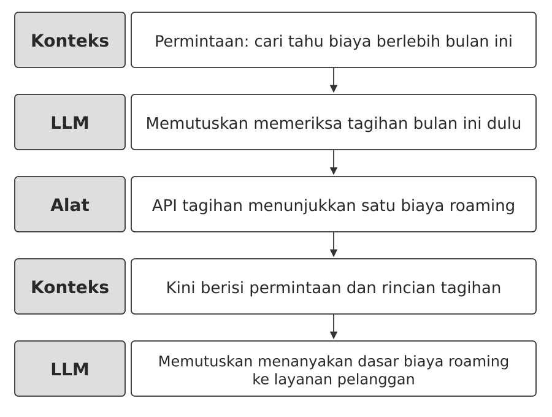
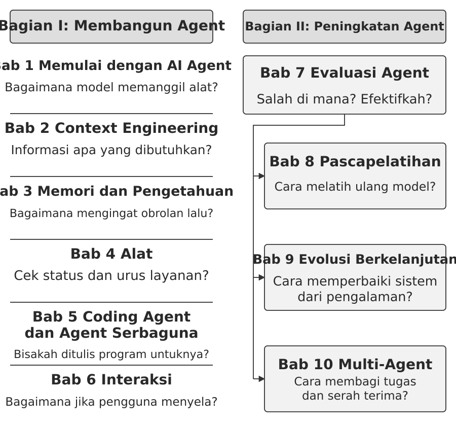

# Pengantar {.unnumbered}

Dari Agustus 2025 hingga awal 2026, saya mengajar kursus video daring "AI Agent Bootcamp" di Turing. Kursus ini membahas cara membangun AI Agent dengan metode rekayasa yang dapat dijelaskan, dapat diverifikasi, dan dapat digunakan kembali. Kursus dimulai dengan menjalankan sebuah Agent, lalu menganalisis mengapa Agent itu memakai arsitektur tersebut: masalah apa yang dipecahkan oleh setiap keputusan desain, apa harga yang harus dibayar, dan tugas apa yang cocok untuknya. Buku ini disusun dari catatan kuliah dan eksperimen pendamping kursus tersebut.

> **Bagaimana buku ini terbentuk: sebuah praktik kolaborasi manusia dan mesin**
>
> Saat mempersiapkan kuliah, saya lebih dulu menyampaikan garis besar secara lisan kepada *voice Agent* Pine, lalu memintanya mencari bahan dan menyusun draf pertama. Kolaborasi berbasis dikte seperti ini disebut **whisper coding**. Selesai kuliah, setiap kali peserta tersendat di suatu langkah atau hasil suatu eksperimen di luar dugaan, saya kembali memeriksa contoh dan argumen yang bersangkutan.

Sejak 2025, saya melihat satu perubahan penting: pusat perhatian riset AI dan praktik industri meluas dari peningkatan kemampuan model dasar ke upaya membuat Agent menyelesaikan tugas nyata. Akibatnya, pelatihan model dan penerapannya kini terjalin jauh lebih erat. Model penalaran seperti DeepSeek-R1 menunjukkan bahwa *reinforcement learning* dapat meningkatkan kemampuan matematika, pemrograman, dan penalaran.[^preface-r1] Agentic Reinforcement Learning memasukkan pemanggilan alat dan interaksi dengan lingkungan ke dalam pelatihan, sehingga model belajar memprogram sekaligus mengoperasikan antarmuka grafis. Jenis tugas yang kedua biasa disebut Computer Use: model menilai keadaan halaman dari tangkapan layar, lalu menyelesaikan operasi dengan mengklik, mengetik, atau menggulir. Produk seperti Manus, Claude Code, dan OpenClaw memungkinkan pengguna mendelegasikan tugas secara langsung, sekaligus memperlihatkan bagaimana "*code generation* + *file system*" menopang Agent umum.

Pada September 2026, Meta meluncurkan Muse. Pada masa itu, produk Agent pribadi bermunculan dengan pesat di Tiongkok maupun di luar negeri. Banyak persoalan yang dibahas buku ini sudah saya dan tim hadapi jauh sebelumnya, ketika membangun Pine. Saya adalah Chief Scientist di Pine AI dan bersama rekan-rekan mengembangkan Pine, sebuah Agent pribadi yang mengurus berbagai urusan atas nama konsumen. Pada awal Januari 2025, Pine sudah diluncurkan di Amerika Serikat. Pengguna dapat memintanya menelepon *merchant* untuk menegosiasikan tagihan, mengajukan pengembalian dana, atau membatalkan langganan.

Ketika *merchant* di telepon setuju menghapus suatu biaya, yang dapat langsung Pine sampaikan kepada pengguna hanyalah "petugas layanan pelanggan sudah menyetujuinya"; untuk bisa mengatakan "uangnya sudah dikembalikan", Pine harus menunggu pengembalian dana itu muncul di tagihan. Untuk menangani urusan seperti ini, model harus mengingat apa yang telah diizinkan pengguna, tahu apa yang perlu diperiksa berikutnya, dan dapat membedakan sampai tahap mana urusan itu sudah berjalan. Ketika industri belakangan mulai membicarakan Skill, Harness, dan *loop engineering*, cukup banyak praktik di dalamnya yang justru kami temukan lewat panggilan-panggilan telepon tersebut.

- **Skill.** Kami hanya memuat *prompt* yang relevan ketika tugas memang membutuhkannya. Setelah jumlah alat bertambah banyak, kami membuat model memanggil alat melalui *command line*, sehingga definisi semua alat tidak perlu dicantumkan di setiap permintaan.
- **Harness.** Kami menuliskan lingkungan eksekusi, waktu saat ini, dan status kerja pengguna ke dalam bilah status (*status bar*) sebagai bahan pertimbangan model saat mengambil keputusan. Model kadang mengarang hasil, memanggil alat yang salah, atau mengabaikan instruksi, dan operasi berbahaya bahkan dapat melampaui izin yang diberikan pengguna. Karena itu, kami menambahkan batasan pada proses eksekusi. Belakangan kami melihat pendekatan serupa di Claude Code.
- ***Loop engineering*.** Model kadang menyatakan tugas selesai padahal pekerjaannya baru setengah jalan. Kami membiarkan satu Agent mengerjakan urusan, sementara Agent lain memeriksa tagihan atau pesanan; jika ada yang terlewat, urusan itu dikembalikan untuk dilengkapi. Inilah pembagian peran pengusul–peninjau (*proposer-reviewer*).

Tim model dan Agent lain, ketika memecahkan masalah serupa, juga secara mandiri sampai pada metode yang mirip. Hal ini membuat saya makin yakin bahwa banyak kesulitan yang dihadapi tim kami sebenarnya adalah masalah bersama yang dihadapi setiap sistem Agent ketika masuk ke penerapan nyata. Selain "AI Agent Bootcamp", pada 2024—2026 saya juga terus mengajar mata kuliah praktik Agent di University of Chinese Academy of Sciences. Pertanyaan para peserta kedua kursus itu membantu saya mengenali pengalaman mana yang masih perlu dijelaskan lebih jernih. Buku ini dirilis secara *open source* dengan harapan agar lebih banyak peneliti dan insinyur dapat menggunakan, menguji, dan menyempurnakan metode-metode ini.

**Praktik datang lebih dulu, penamaan menyusul kemudian.** Bagi tim pengembang, hal ini mengandung makna lain: ketika sebuah istilah sudah menjadi konsensus industri, tim-tim terdepan biasanya telah lama menjelajahinya. Untuk membangun keunggulan rekayasa sendiri, Anda perlu menemukan masalah lebih awal dari bisnis nyata dan mencoba memecahkannya. Menurut saya, ada dua syarat kunci untuk itu.

**Pertama, pilih bisnis nyata yang menuntut kemampuan Agent setinggi mungkin, dan terus kumpulkan umpan balik darinya.** Satu tugas Pine dapat berlangsung berjam-jam hingga berminggu-minggu dan menuntut komunikasi dengan banyak pihak: panggilan telepon yang panjang, pengisian formulir yang rumit, dan beberapa putaran surel, sambil memastikan angka tetap akurat, operasi tetap terkendali, dan kepentingan pengguna tetap terlindungi. Skenario seperti ini terus-menerus menyingkap jarak antara kemampuan model dan tuntutan bisnis, sehingga mendorong tim untuk memperbaiki Harness. Jika nilai utama suatu produk hanyalah menambal kelemahan satu generasi model, peningkatan model berikutnya bisa saja menghapus nilai tersebut, dan tim sulit membangun keunggulan yang bertahan lama.

**Kedua, bangun mekanisme Evaluasi (*Evaluation*) yang sistematis.** Setelah sistem diubah, keberhasilan satu negosiasi tagihan bisa jadi karena asisten mengajukan pertanyaan yang tepat, tetapi bisa juga karena petugas yang kebetulan melayani memang berwenang memberi potongan. Dengan membandingkan versi lama dan baru berulang kali pada kumpulan kasus yang sama, Anda dapat melihat apakah perbedaannya konsisten. Bab 7 akan menjelaskan secara rinci cara menetapkan kriteria keberhasilan, membangun lingkungan evaluasi, menganalisis kegagalan, dan menguji perubahan.

Di Pine, kami memetik satu cara kerja dari pengurangan tagihan: suruh peninjau melihat langsung nominal itu di tagihan. Jika cara yang sama diterapkan pada perubahan jadwal tiket, peninjau harus memeriksa apakah tiket baru benar-benar sudah terbit. Bukti konkretnya berubah mengikuti bisnis, tetapi prinsip di baliknya sama: untuk menilai apakah suatu tugas selesai, lihatlah hasil apa yang ditinggalkan tindakan itu di dunia luar. **Prinsip desain yang baik mampu bertahan melintasi siklus iterasi model.**

## Misi Buku Ini {.unnumbered}

Bayangkan seseorang menyerahkan tagihan ponselnya kepada asisten dan memintanya menghubungi operator untuk menegosiasikan potongan. Sebelum mulai, asisten harus memastikan tagihan mana yang dipersoalkan; selama panggilan, ia harus mampu mendengarkan penjelasan dan menanyakan syarat-syaratnya; di akhir, ia harus memberi tahu pengguna apa sebenarnya yang disetujui petugas. Di setiap langkah, asisten harus menjawab tiga pertanyaan: Apa yang diketahui asisten pada saat ini? Tindakan apa yang dapat diambilnya? Atas dasar apa ia memilih langkah berikutnya? Buku ini berangkat dari ketiga pertanyaan itu untuk menjelaskan struktur Agent, cara membangunnya, dan batas kemampuannya. Formula intinya adalah **Agent = LLM + Konteks + Alat**: LLM bertanggung jawab atas pemahaman, perencanaan, dan pengambilan keputusan; konteks memuat informasi yang dibutuhkan untuk keputusan saat ini; dan alat menghubungkan Agent dengan lingkungan luar, baik untuk memperoleh observasi maupun untuk menjalankan tindakan.

Dengan perumpamaan yang lebih intuitif, LLM adalah "otak", konteks adalah "bidang pandang untuk keputusan saat ini", dan alat adalah "indra serta tangan dan kaki". Bidang pandang itu mencakup informasi lingkungan, riwayat percakapan, memori, dan pengetahuan, juga instruksi sistem, definisi alat, dan status tugas. Pencarian, pembacaan berkas, dan tangkapan layar membawa pulang informasi; klik, penulisan, dan pemanggilan antarmuka bisnis mengubah keadaan dunia luar. Gambar 0-1 menguraikan satu kali pemeriksaan tagihan. Pada keputusan pertama, model hanya tahu bahwa pengguna mempertanyakan suatu biaya; pada keputusan kedua, model sudah dapat menunjukkan nominal mana yang perlu ditanyakan.



Pembaca yang akrab dengan *reinforcement learning* (RL) juga dapat memahami pembagian peran ini melalui konsep kebijakan, observasi, dan aksi. LLM memilih langkah berikutnya berdasarkan konteks, sehingga fungsi pengambilan keputusannya kira-kira setara dengan kebijakan (*Policy*); konteks memuat observasi dan riwayat konkret yang dipakai dalam keputusan ini; alat menyediakan antarmuka observasi dan aksi. Ruang observasi (*Observation Space*) menggambarkan observasi apa saja yang mungkin diperoleh, sedangkan ruang aksi (*Action Space*) menggambarkan aksi apa saja yang boleh diambil; keduanya menentukan cakupan interaksi Agent dengan lingkungannya.[^preface-spaces] Bab 1 akan menguraikan konsep-konsep ini melalui contoh pemanggilan alat, sekaligus menjelaskan pembagian kerja antara Model dan Harness dalam implementasi produksi.

> **Renungan lanjutan: dari kehidupan ke entitas yang dirancang**
>
> Di luar praktik rekayasa, Agent juga memunculkan pertanyaan tentang evolusi sistem cerdas. Richard Sutton, pemenang Turing Award dan perintis *reinforcement learning*, merangkum evolusi alam semesta menjadi empat tahap: debu, bintang, kehidupan, dan "entitas yang dirancang" (*designed entities*).[^preface-sutton] Makhluk hidup berevolusi melalui mutasi acak dan seleksi alam, sedangkan entitas yang dirancang dapat dibangun dan disempurnakan secara sengaja oleh sistem cerdas yang sudah ada.
>
> Agent dapat menghasilkan kode, membangun Agent baru, lalu menganalisis perilakunya saat berjalan, mengusulkan perubahan, dan memverifikasi hasilnya, sehingga selangkah demi selangkah mencapai *bootstrap* dan evolusi berkelanjutan. Ini seperti seorang *programmer* yang menulis *programmer* lain, yang kemudian ikut membangun sistem baru. Kemungkinan untuk memahami dan menyempurnakan diri sendiri inilah salah satu pertanyaan yang paling menarik minat saya ketika menulis bab tentang pembuatan kode dan evolusi berkelanjutan.

## Struktur Buku {.unnumbered}

Gambar 0-2 memperlihatkan keterkaitan antarbab. Misalkan pengguna tiba-tiba mengubah permintaannya di tengah panggilan, tetapi asisten masih bekerja menurut permintaan lama. Anda dapat mulai dari Bab 6 di kolom kiri untuk melihat bagaimana asisten menangani interupsi pengguna. Setelah diperbaiki, bagaimana Anda tahu bahwa ia juga akan menangkap permintaan baru pada panggilan lain? Untuk itu dibutuhkan metode evaluasi dari Bab 7 di kolom kanan. Tiga panah yang bercabang dari Bab 7 menunjukkan bahwa setelah hasil evaluasi diperoleh, Anda dapat memilih cara perbaikan yang berbeda sesuai penyebab kegagalannya.



- **Bab 1 (Pengenalan AI Agent)** memperkenalkan komponen inti, *loop* eksekusi, Harness, dan cara orkestrasi melalui contoh produk dan pemanggilan alat, sehingga membangun kerangka konseptual untuk memahami seluruh buku.
- **Bab 2 (Context Engineering)** adalah bab terpenting dalam buku ini. Bab ini membahas cara menata informasi yang dibutuhkan model pada saat ini, mulai dari desain *prompt*, pemuatan sesuai kebutuhan, hingga pengelolaan riwayat, lalu memakai KV Cache untuk menjelaskan bagaimana metode-metode tersebut memengaruhi kualitas jawaban dan biaya operasional.
- **Bab 3 (Memori Pengguna dan Basis Pengetahuan)** membahas cara menyimpan dan mengambil kembali informasi lintas sesi. Mulai dari memori pengguna hingga RAG, indeks terstruktur, dan pembaruan pengetahuan, bab ini membantu pembaca menguasai cara menelusuri dan memelihara pengetahuan persisten.
- **Bab 4 (Alat)** membahas bagaimana Agent memperoleh observasi, menjalankan tindakan, dan meminta kolaborasi. Melalui klasifikasi alat, desain antarmuka, MCP, dan manajemen eksekusi, pembaca memahami cara menghubungkan kemampuan eksternal ke dalam sistem.
- **Bab 5 (Coding Agent dan Agent Umum)** mengajukan satu gagasan arsitektur inti untuk Agent umum: Coding Agent sebagai inti eksekusi dan *file system* sebagai ruang kerja. Bab ini terlebih dahulu membahas alur pengembangan, kemudian melalui kasus multimedia, sistem bisnis, dan lainnya menunjukkan bagaimana Agent menulis program untuk memecahkan masalah, lalu menciptakan alat dan membangun Agent baru.
- **Bab 6 (Interaksi: Perluasan Ruang Observasi dan Ruang Aksi)** membahas cara Agent berinteraksi dari dua dimensi, modalitas dan waktu. Melalui peristiwa asinkron, suara, Computer Use, dan robot, pembaca memahami observasi berkelanjutan, jalur cepat dan lambat, serta kendali eksekusi.
- **Bab 7 (Evaluasi Agent)** menjawab cara menilai kinerja sistem dan dampak suatu perubahan. Bab ini dimulai dengan menetapkan kriteria keberhasilan, lingkungan, dan *dataset*, lalu membahas verifikator, penilaian, dan analisis statistik, dan akhirnya menemukan arah perbaikan dengan menganalisis penyebab kegagalan.
- **Bab 8 (Pascapelatihan Model)** membahas cara memperbarui kemampuan model dengan data dan lingkungan, dengan pendirian bahwa investasi pada kualitas data dan lingkungan pelatihan harus didahulukan. Melalui *supervised fine-tuning*, *reinforcement learning*, dan desain *reward*, bab ini menjelaskan mengapa belajar dari contoh dan belajar lewat eksplorasi menghasilkan kemampuan generalisasi yang berbeda, serta mengapa sekadar mengubah algoritma sering kali hanya membawa hasil terbatas.
- **Bab 9 (Evolusi Berkelanjutan Agent)** membahas cara memanfaatkan pengalaman operasional untuk memperbaiki versi Agent berikutnya. Bab ini membandingkan empat jenis pembaruan, yaitu pengetahuan, instruksi, program, dan parameter, lalu mengelola perubahan jangka panjang melalui alur validasi, rilis, dan pemulihan.
- **Bab 10 (Kolaborasi Multi-Agent)** membahas kapan banyak anggota memberikan nilai tambah, serta bagaimana mereka membagi kerja, berkomunikasi, dan berkoordinasi. Bab ini terlebih dahulu menjelaskan cara membagi konteks dan kendali, kemudian dengan contoh kasus menguraikan mekanisme kolaborasi dan menganalisis penyebab kegagalan, serta membahas bentuk-bentuk yang mungkin dari masyarakat dan ekonomi Agent.

## Cara Membaca Buku Ini {.unnumbered}

- **Membangun produk Agent dari nol**: bacalah seluruh buku. Gunakan Bab 1 sampai 6 untuk membangun asisten yang mampu menyelesaikan urusan, lalu gunakan Bab 7 untuk menguji tugas mana yang rawan gagal. Tiga bab terakhir membahas cara memperbaiki model, sistem, atau pembagian kerja antaranggota berdasarkan kegagalan tersebut.
- **Membangun gambaran menyeluruh terlebih dahulu**: bacalah Bab 1, 2, 4, dan 7 secara berurutan. Ikuti satu kali pemanggilan alat dari awal hingga akhir: kenali dulu *loop* eksekusi Agent, lalu lihat informasi apa yang diterima model dan apa yang sebenarnya dikerjakan alat, dan akhirnya gunakan evaluasi untuk menilai apakah hasilnya sesuai dengan permintaan pengguna. Ketika Bab 2 sampai pada KV Cache, pada bacaan pertama Anda cukup memegang tiga kesimpulan di awal bagian itu, lalu kembali ke prinsip dasarnya setelah mengerjakan eksperimen.
- **Berfokus pada pelatihan model**: pahami dulu cara kerja Agent lewat Bab 1 dan 2, kemudian baca Bab 8 bersama metode evaluasi dari Bab 7. Dengan begitu, tujuan pelatihan dapat dikaitkan dengan kinerja pada tugas nyata.
- **Memelihara Agent yang sudah berjalan di produksi**: pilih sekumpulan tugas nyata dari Bab 7 untuk dievaluasi. Misalnya, asisten menyampaikan harga lama kepada pengguna; periksa dulu versi penawaran harga mana yang diterimanya. Jika pengetahuan atau alurnya sudah usang, bacalah Bab 9 dengan membawa kegagalan tersebut; jika penawaran harga dan alatnya sudah memadai tetapi model tetap berulang kali salah memilih setelah alurnya diperbaiki, barulah baca Bab 8 untuk menilai apakah layak menyiapkan data pelatihan.

Setiap bab dilengkapi eksperimen dan pertanyaan renungan. Eksperimen diberi nomor dengan format "Eksperimen X-Y", dengan X sebagai nomor bab dan Y sebagai nomor urut di dalam bab. Peringkat bintang menunjukkan tingkat kesulitan: ★ cocok untuk pemula, ★★ membutuhkan sejumlah pengalaman rekayasa, dan ★★★ melibatkan pertanyaan terbuka atau desain sistem yang kompleks. Sebagian besar eksperimen disertai kode yang dapat dijalankan dan dikumpulkan dalam repositori *open source*:

> **Repositori Kode Pendamping**: `bojieli/ai-agent-book`

Untuk eksperimen pertama, Anda dapat memulai dari "Eksperimen 1-1: Peran Penting Konteks". Jika menggunakan Git, jalankan di terminal:

```bash
git clone https://github.com/bojieli/ai-agent-book.git
cd ai-agent-book
```

Anda juga dapat memperoleh direktori yang sama dengan memilih **Code → Download ZIP** pada halaman repositori lalu mengekstraknya. Pada indeks eksperimen Bab 1 (`chapter1/README.id.md`), temukan nomor 1-1, lalu buka `chapter1/context/README.md`. Setiap kali Anda menemui "Eksperimen X-Y", proyek dan cara menjalankannya dapat ditemukan melalui `chapterX/README.id.md` di repositori. "Panduan reproduksi" mencantumkan proyek eksternal beserta cara memperolehnya, sedangkan perintah instalasi dan penjelasan direktori dikumpulkan di README.

## Prasyarat {.unnumbered}

Buku ini ditujukan bagi pembaca yang memiliki kemampuan pemrograman dasar dan ingin memahami serta membangun Agent. Untuk mengerjakan eksperimen, Anda memerlukan bekal berikut.

**Wajib: dasar untuk membaca seluruh buku**

- **Pemrograman Python**: terbiasa dengan sintaks, struktur data umum, dan alat manajemen paket seperti pip, serta mampu membaca dan memodifikasi kode eksperimen. Sebagian besar eksperimen dalam buku ini berbasis Python.
- **Pengalaman menggunakan LLM**: pernah menggunakan ChatGPT, Claude, atau produk sejenis, dan terbiasa dengan proses dasar menyampaikan permintaan, membaca jawaban, dan mengajukan pertanyaan lanjutan.
- **Pengetahuan umum rekayasa perangkat lunak**: memahami *command line*, Git, JSON, dan REST API, sehingga mampu menjalankan proyek, memeriksa perubahan, dan membaca data antarmuka.

Untuk mengerjakan eksperimen, saya sangat menyarankan Anda memilih salah satu dari Claude Code, Codex, Cursor, atau TRAE. Mintalah alat itu membantu Anda men-*debug* sepotong kode, lalu perhatikan berkas apa saja yang dibacanya dan alat apa yang dipanggilnya. Nanti, ketika membaca tentang *loop* eksekusi dan manajemen konteks, Anda sudah memiliki pengalaman langsung sebagai pembanding.

**Direkomendasikan: pengetahuan pelengkap per bab**

- **Dasar-dasar *machine learning* (Bab 8)**: pelatihan dan inferensi, *loss function*, *gradient descent*, dan *overfitting* membantu Anda memahami proses pembaruan model.
- **Matematika dasar (Bab 2, 3, 7, 8)**: vektor dan matriks membantu memahami *embedding* dan *attention*, sedangkan probabilitas dan statistik membantu memahami metrik evaluasi dan *reward* harapan. Buku ini menekankan penjelasan intuitif dan kegunaan praktis.
- **Dasar-dasar pengembangan web (Bab 6)**: HTTP, WebSocket, dan pembagian peran *front-end*/*back-end* membantu memahami arsitektur peristiwa asinkron dan komunikasi suara *real-time*.
- **Dasar-dasar Transformer (Bab 2, 8)**: memahami *attention* dan struktur model membantu memahami komputasi konteks dan pascapelatihan. Pembaca yang ingin mempelajarinya secara sistematis dapat membaca *Hands-On Large Language Models* karya Jay Alammar dan Maarten Grootendorst (edisi bahasa Mandarin 《图解大模型：生成式 AI 原理与实战》 diterjemahkan oleh Li Bojie dan diterbitkan oleh Turing). Buku tersebut menjelaskan Transformer, prapelatihan, dan *fine-tuning* melalui ilustrasi, sehingga saling melengkapi dengan sudut pandang rekayasa dalam buku ini.

Di luar pascapelatihan pada Bab 8, bab-bab lain hanya membutuhkan sedikit pengetahuan matematika dan *machine learning*; dengan pengalaman pemrograman dasar, Anda sudah dapat mulai membaca.

## Ucapan Terima Kasih {.unnumbered}

Terima kasih kepada Meng Ge dan Liu Meiying dari Turing yang telah menyunting buku ini dan mencurahkan tenaga untuk menyelenggarakan "AI Agent Bootcamp"; terima kasih kepada Profesor Liu Junming yang telah membuka mata kuliah praktik Agent di University of Chinese Academy of Sciences. Terima kasih kepada para peserta dan mahasiswa kedua kursus itu; pertanyaan, umpan balik eksperimen, dan saran Anda membantu saya terus memperbaiki cara penyampaian sekaligus memperdalam pemahaman saya terhadap konsep-konsep ini.

Terima kasih kepada seluruh rekan di Pine AI. Tantangan dari bisnis nyata dan diskusi di dalam tim menjadi sumber banyak metode dan kasus dalam buku ini. Praktik dan wawasan Anda membuat pemahaman-pemahaman ini terus matang.

Terima kasih kepada sahabat-sahabat di industri AI. Dalam berbagai diskusi, Anda dengan terus terang menyampaikan pendapat serta berbagi pengalaman dan penilaian yang berbeda, sehingga membantu saya memahami model dan Agent secara lebih mendalam.

Terima kasih terbesar saya tujukan kepada keluarga, terutama istri saya, Meng Jiaying. Ia senantiasa mendukung penulisan buku ini dan memberikan banyak masukan berharga untuk naskahnya.

[^preface-r1]: DeepSeek-AI, *DeepSeek-R1: Incentivizing Reasoning Capability in LLMs via Reinforcement Learning*, 2025.
[^preface-spaces]: Bagian "Spaces" dalam dokumentasi Gymnasium.
[^preface-sutton]: Wawancara Richard Sutton dengan Dwarkesh Patel, 26-09-2025, bagian "Succession to AI".
