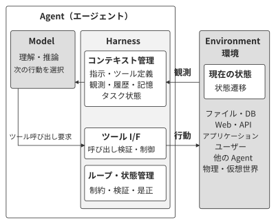
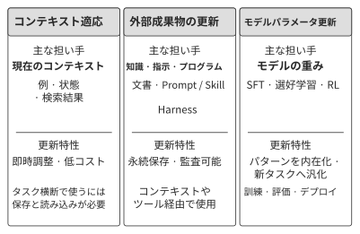
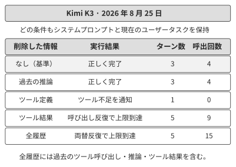
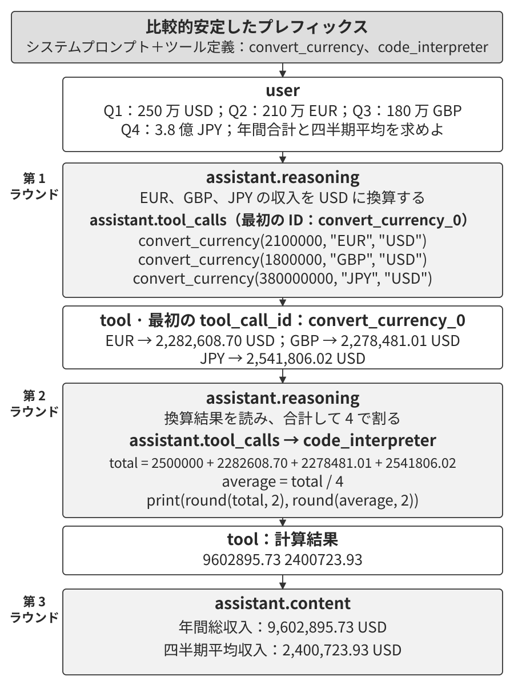
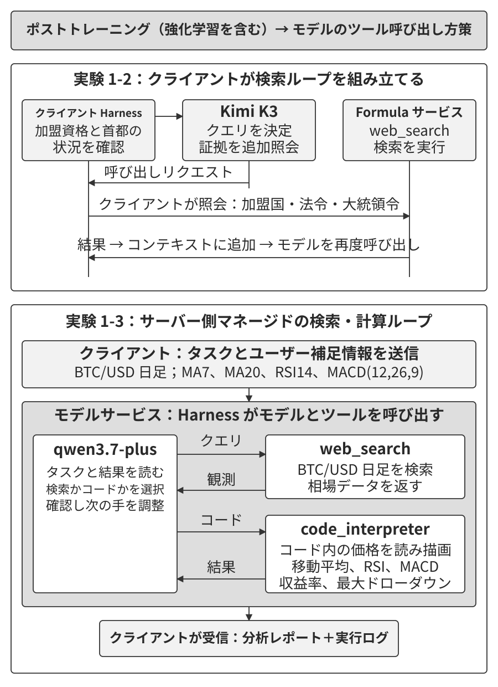
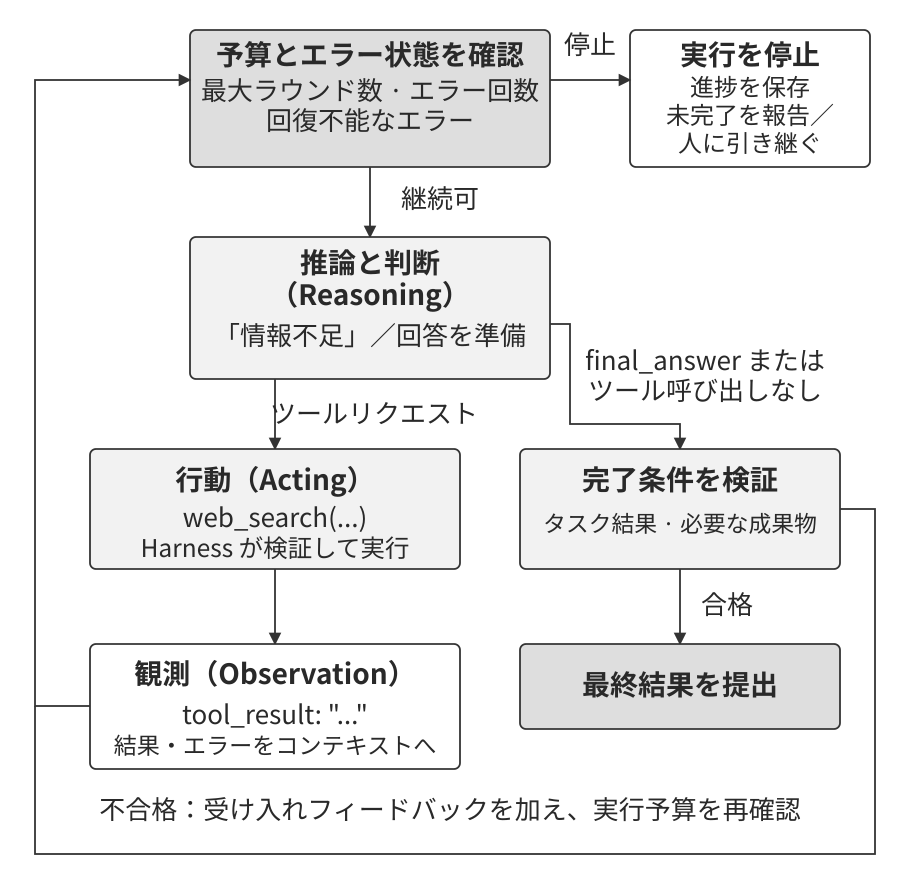
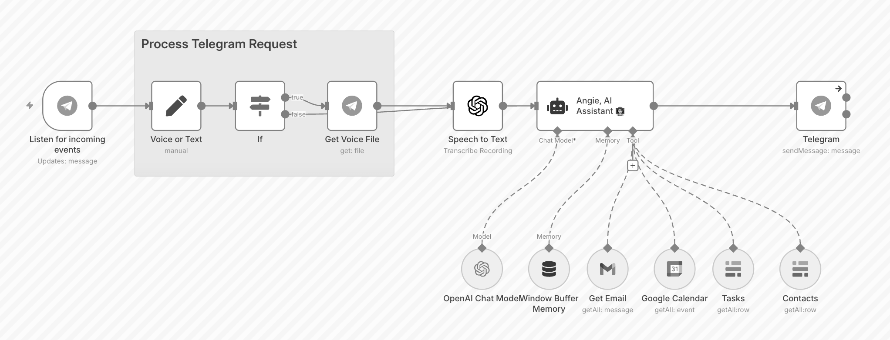

# AI Agent 入門

Deep Research で何かを調べると、検索と読解を何度も繰り返し、最後にレポートとしてまとめてくれます。Manus はブラウザを操作してオンラインの作業をこなし、Doubao のスマホアシスタントはスマートフォン上でチケットを予約したりメッセージを送ったりできます。Pine AI はユーザーの代わりに電話をかけ、通信事業者と料金の値下げを交渉します。これらはいずれも AI Agent の応用です。

Cursor で関数を修正させると、Cursor はその関数を探し出し、ファイルを編集し、テストを実行します。テストがまだ失敗するなら、そのエラーメッセージが次の修正の手がかりになります。テストが通って初めて、結果を報告する根拠が得られます。検索・編集・テストという三つの手順の順序はあらかじめプログラムに書いておけます。しかし、どの行を直すのか、失敗したらどこへ戻るのかは、実行中に得られる情報を見なければ決まりません。目標に向けて行動を選び、その結果に応じて計画を修正するというこの過程は、調査や電話交渉のようなタスクでも同じように起きています。

## 現代の Agent = LLM + コンテキスト + ツール

本書では、現代の Agent を構成する三種類の機能要素を一つの式にまとめます。**Agent = LLM（大規模言語モデル、Large Language Model）+ コンテキスト + ツール**。

- **LLM は Agent の脳です**。タスクを理解し、手順を計画し、行動を選びます。事前学習はモデルに言語能力と世界知識を与え、ポストトレーニングは指示への追従、推論、ツール呼び出しといった振る舞いをさらに形づくります。教師ありファインチューニングや強化学習などのポストトレーニング手法は第 8 章で紹介します。
- **コンテキストは Agent がいまの判断で見渡せる範囲です**。その判断に必要な情報、すなわち指示、ツール定義、環境の観測、ユーザーメモリ、領域知識、過去のメッセージ、自身の状態、タスクの進捗を収めます。
- **ツールは Agent の感覚器官であり手足です**。インターフェースを通じて情報を取得し、操作を実行します。ツールの体系は定義、呼び出しプロトコル、アダプタから成り、検索・読み取り・スクリーンショットといった観測のための操作にも、書き込み・コード実行・サブ Agent への委任・ユーザーとのコミュニケーションにも対応します。

一つのツールが複数の役割を兼ねることもあります。たとえばモデルがコマンドラインでファイルを読めば、返ってきたファイルの内容が次の判断の根拠になります。同じコマンドラインでプログラムを実行すれば、ファイルやプロセスの状態を変えることもあります。

届いた荷物を開けたあとで、カスタマーサポートに「開封後でも返品できますか」と尋ねたいとします。システムは**検索拡張生成**（Retrieval-Augmented Generation、RAG）を使って店舗の現行の返品ポリシーを探し、その条項にもとづいて回答するようモデルに依頼できます。[^ch1-rag] 一回の問い合わせを追うだけで、各部品の役割が見えてきます。ポリシーの原文と索引は外部の知識ベースに保存されています。検索ツールは質問に関係する段落を探し出し、モデルを呼び出すプログラムがその段落を出典とともに今回のリクエストに入れます。モデルは「開封」の項目を読んで条項を説明できます。条項が商品カテゴリーごとに分かれているなら、まず何を買ったのかを尋ねる必要があります。

[^ch1-rag]: Patrick Lewis ほか、Retrieval-Augmented Generation for Knowledge-Intensive NLP Tasks、NeurIPS、2020。

この返品の問い合わせでは、検索を実行することが Agent の行動であり、返ってきた条項は環境（Environment）から得た観測です。次に回答するか、追加で質問するかは、条項に何が書かれているかで決まります。これが強化学習や制御理論でいう閉ループであり、図1-1 に示します。



図の外側は、Agent と環境の境界を示しています。ファイル、データベース、Web ページ、ユーザー、他の Agent、物理世界やシミュレーション世界は、いずれも Agent が相互作用する環境になりえます。図の内側は本番実装における役割分担です。**Model は理解・推論・意思決定を担います。Harness は Agent の境界内、Model の外側にあり、コンテキスト、ツールインターフェース、実行ループ、状態を組織し、制約・検証・是正を適用します。** Harness は環境を作成・隔離・代理できますが、ファイルの内容やプロセスの状態などは、行動に応じて環境の中で変化していきます。[^ch1-harness]

[^ch1-harness]: LangChain の「The Anatomy of an Agent Harness」と Anthropic の「Effective harnesses for long-running agents」を参照してください。サンドボックスも Harness に含める実装もあります。図1-1 では、行動が実際に何を変えたのかを追いやすくするため、環境を独立して描いています。

そこで本書では、互いに補い合う二つの分け方を用います。**「LLM + コンテキスト + ツール」は機能の構成を、「Model + Harness」は本番での実装を表します。** コンテキストは Harness が組み立てて Model に渡します。ツール呼び出しは Model が決め、Harness が検証してスケジューリングし、ツールや環境が実行します。単純なシステムであれば、コンテキストの組み立てとツールのスケジューリングから始め、本番運用に必要な制約・検証・是正の仕組みを少しずつ加えていけます。

強化学習に馴染みのある読者は、「誰が次の一手を決めるのか、何にもとづいて決めるのか、どうやって実行に移すのか」という三つの問いから次の表を読むとよいでしょう。これは機能面からの大まかな類推です。

| 直感的理解 | 実装上の要素 | 強化学習における関連概念 | 意味 |
|-----------|-----------|----------------------------|----------------------------------------------|
| **脳** | LLM | **方策**（Policy） | 現在の情報にもとづいて次に何をするかを決める |
| **いまの判断で見渡せる範囲** | コンテキスト | **観測と履歴** | 環境から返された情報と既存の履歴を、判断の根拠として整理する |
| **感覚器官と手足** | ツールとアダプタ | **観測・行動インターフェース** | 環境の情報をどう読み取り、行動をどう発するか、および呼び出しと戻り値の形式を定める |

### 観測空間と行動空間：モデルと世界を結ぶインターフェース

**観測空間は Agent が受け取りうる観測を、行動空間は Agent が発しうる行動を表します。** 一回の呼び出しにおけるコンテキストが具体的な情報を運び、利用できるツールが環境と相互作用するためのインターフェースを提供します。ツール以外にも、ユーザーの入力やイベント通知などが観測をもたらすことがあります。行動の範囲は、ツール呼び出しの引数、権限、実行環境によって決まります。

二種類の故障を思い浮かべてみてください。一つ目は、モデルは請求書の各項目を説明できるのに、今月の請求書を手に入れられない場合です。ユーザーが閲覧を許可したうえで、請求書を取得してモデルに渡して初めて、どの料金に問題があるかを判断できます。二つ目は、ユーザーがアシスタントに料金プランの変更を頼み、アシスタントも適切なプランを見つけたものの、アカウントのインターフェースが照会しか許していない場合です。請求書を何度読み直しても変更はできず、それに見合った操作権限が必要です。Harness の仕事は、読み取った材料をコンテキストに入れ、モデルが選んだ行動を受け取り、引数と権限を確認したうえで実行をスケジューリングすることです。

したがって、**基盤モデルが固定されているとき、観測空間と行動空間を調整することは、タスクの成績を高める重要なエンジニアリング手段です。** モデルが重要な事実を見落とすなら、関連データをコンテキストに入れます。似たツールをよく取り違えるなら、重複するインターフェースを統合するか、現在のタスクに必要なツールだけを読み込みます。

動画を見る場面では、逆の問題に出会います。映像は途切れなく届くのに、判断をやり直す価値のある変化はそれほど多くありません。ファイルのアップロードを待っているアシスタントが、進捗バーが動くたびにメインのモデルを呼び出せば、計算が無駄に膨らみます。逆に 10 秒おきにしか見なければ、一瞬だけ表示された失敗メッセージを見逃すかもしれません。**筆者は、観測空間のスパース化が Agent 設計における基本的な問題の一つだと考えています。** システムは環境を観察し続け、次の行動を変えうる変化だけを、必要なコンテキストとともにメインのモデルへ渡せばよいのです。

**Manus：調査、プログラミング、コンピュータ操作を一つのタスクで組み合わせる。** Deep Research は検索と読解を得意とし、Coding Agent はコードを書いて実行でき、Computer Use Agent は画面を操作できます。Manus はブラウザ、ファイルシステム、コード実行、コマンドラインをクラウドのサンドボックスにまとめ、一つの Agent がまず資料を調べ、次にファイルを処理してコードを実行し、最後にブラウザで操作を完了できるようにしました。ブラウザとファイル読み取りは得られる情報を増やし、コードとコマンドの実行は組み合わせられる操作を増やします。**筆者は、この組み合わせが汎用 Agent にとって重要な突破口だったと考えています。一つの Agent が従来は分かれていた製品の境界を越え、資料の取得、データの処理、操作の実行を一続きのタスクとしてつなげられるようになったからです。**

**OpenClaw：インターフェースをユーザーのデジタル生活へ広げる。** OpenClaw は WhatsApp、Telegram、Slack、Discord、iMessage などのメッセージチャネルでタスクを受け取って結果を返し、ユーザーのデバイス上で動く Gateway がメッセージチャネル、モデル、ツールをつなぎます。対応するツールを設定して許可を与えれば、Agent はローカルのファイルを扱うことも、Google Drive や Notion などのクラウドサービスに接続することもできます。複数のアカウントやデバイスに散らばったユーザーの資料を、こうして一つのタスクの処理に取り込めるのです。初期の Manus は主にクラウドのサンドボックス内で動作し、ユーザーはファイルをアップロードする必要がありました。のちに追加された Google Drive コネクタと My Computer のデスクトップ機能によって、クラウド上のファイルやローカルのリソースにまでアクセス範囲が広がりました。こうした変遷は、製品の能力の伸びがしばしば観測と行動のインターフェースの拡張から生まれることを示しています[^ch1-agent-products]。

[^ch1-agent-products]: 製品の構成については、Manus 公式の Sandbox の紹介、Google Drive Connector の紹介、My Computer の紹介、および OpenClaw の公式リポジトリとツールのドキュメントを参照してください。実際にアクセスできるリソースは、コネクタ、ツールの設定、ユーザーの許可によって決まります。

製品ごとにタスクはさまざまですが、いずれも判断の根拠、利用できる操作、実行の戦略という三つの面から理解できます。

| Agent 製品 | コンテキスト内の主な情報 | 利用できるツールと操作 | 実行の戦略 |
|----------------|----------------------|----------------------------|------------------------------|
| **Cursor などの Coding Agent** | 要件、コード片、ディレクトリ一覧、ターミナル出力 | コード検索、ファイルの読み書き、コマンド実行 | 要件を理解→関連コードを検索→コードを編集→テストで検証→デバッグして修正 |
| **Deep Research などの検索 Agent** | 検索結果、Web ページの内容、論文の要旨と引用 | 検索クエリ、Web ページの読み取り、レポート生成 | 得られた情報に応じて検索の方向を調整し、段階的に完全なレポートへまとめる |
| **Browser Use などのコンピュータ操作 Agent** | スクリーンショット、DOM またはアクセシビリティツリー、操作結果 | クリック、入力、スクロール、スクリーンショット、コード実行 | 画面を読み取る→対象要素を識別→操作を実行→結果を検証 |
| **Doubao などのスマホアシスタント Agent** | スマホのスクリーンショット、App の画面状態、システムからのフィードバック | タップ、スワイプ、入力、App の起動 | 要求を理解→対象 App を特定→操作を実行→完了を確認 |
| **Pine AI、Meta Muse などの用事代行 Agent** | 許可を得て読み取ったアカウント記録、請求書、サービス提供者の資料 | 電話をかける、メール送信、フォーム入力、ユーザーへの確認 | 情報を収集→交渉戦略を策定→サービス提供者に連絡→交渉→結果を報告 |

**依頼はどのようにして実行可能なタスクになるのでしょうか。** 筆者が Pine で個人の用事を代行するアシスタントを作っていたとき、ユーザーは目標だけを口にすることが多いと気づきました。たとえば「出張の航空券を取ってほしい、1200 元以内で」といった具合です。アシスタントはまず日付と目的地、そしてこの旅程で何を最も重視するかを確かめ、足りない資料を集め、どう進めるつもりか、どの条件なら交渉の余地があるかをユーザーとすり合わせてから、ようやくサービス提供者に連絡します。作業中に新しい事情が分かれば、タスクが前の段階に戻ることもあります。

担当者が調べた最安値が 1250 元だったとします。モデルは常識、この旅程の事情、覚えているユーザーの習慣を合わせて判断します。出張中で、ふだんから都合のよい便のためなら多少の出費をいとわないユーザーなら、Pine はそのまま予約するかもしれません。家族旅行で、これまでも総額を気にすると明言していたユーザーなら、まず差額をユーザーに伝え、担当者に別の便を調べてもらうかもしれません。ユーザーがあとから「次に予算オーバーの航空券があったら、先に私に聞いて」と付け加えれば、そのフィードバックは一般的な経験よりも具体的な根拠を次の判断に与えます。

場面を変えて、銀行の担当者が書類を自宅へ郵送すると提案したとします。アシスタントは、ユーザーが海外旅行中であることを覚えています。今回変えるべきなのは受け取り方です。通話を担当するフロントは、その場で受け取りが難しい事情を説明し、メールで送ってもらえるよう求められます。請求の減額はどうでしょうか。担当者が電話口で減額を約束したなら、アシスタントは事業者の約束を正確に報告できます。しかし実際に請求額が減ったかを確かめるには、後日の請求書という新たな観測が必要です。アシスタントの行動空間は本物の電話にまで広げられても、その結論は観測空間に制約されます。

依頼の中身から見ると、本書には生活の代行、オフィスでの協働、研究の探索という三種類の応用が登場します。同じアシスタントが別々の種類のタスクを担うこともあり、違いは誰が権限を与えるのか、アシスタントが何を変えられるのか、最後に誰が受け入れ確認をするのかにあります。オフィスで、同僚が確認結果を返してくれたら、そのチケットは閉じてよいのでしょうか。プロジェクトの責任者が Multica のチケットの中でアシスタントを名指しし、予算表のある差額を確認するよう頼んだとします。このコメントが確認作業を起動しますが、チケットの担当者は元の責任者のままで、ステータスも変わりません。アシスタントは二か所の金額とその出典を返して同僚の質問に答えます。予算全体を提出できるかどうかは、責任者がほかの未処理事項と合わせて判断しなければなりません。[^ch1-multica]

研究のタスクにも同じ問いを向けられます。何をもって進展があったと認めるのでしょうか。Google DeepMind の AlphaEvolve が行列乗算のアルゴリズムを探索したとき、モデルが候補プログラムを提案し、評価器がそれを実行して、積が正しく計算できているか、乗算を何回使ったかを確認しました。以降の探索では、成績のよいプログラムをさらに改良できます。研究チームの報告によれば、そのうちの一つのアルゴリズムは、二つの $4\times 4$ 複素行列の積を 48 回のスカラー乗算で計算できます。「乗算が何回減ったか」には明確な数える対象があり、しかもアルゴリズムは正しい行列の積を計算しなければなりません。[^ch1-alphaevolve]

[^ch1-multica]: Multica、チケットのコメントで Agent を名指しする機能。協働の中で一時的な助力の依頼と責任の移譲をどう区別するかは、第 10 章で論じます。

[^ch1-alphaevolve]: Google DeepMind、AlphaEvolve の研究紹介、2025 年 5 月。ここでいう乗算回数はアルゴリズム中のスカラー乗算の回数であり、実際の実行時間は実装とハードウェアにも左右されます。

これらのシステムの行動空間は**オープンエンド**です。検索語、入力するテキスト、生成するコード、操作の組み合わせをあらかじめ列挙し尽くすことは困難ですが、一つひとつの行動はやはりツール、引数、権限、実行環境に制約されます。だからこそ、実行可能な計画には、新しい観測に応じて次の一手を変える余地を残しておく必要があります。

### ツール：Agent の感覚器官と手足

ツールは、モデルの判断を外部環境に対する読み取りや操作へと落とし込みます。検索ツールや読み取りツールは観測を持ち帰り、ファイル書き込みやコマンド実行などのツールは行動を実行します。モデルは戻り値から操作の効果を知り、続行するか、やり直すか、タスクを終えるかを決めます。

本書では、主な用途によってツールを五種類に分けます。一つのインターフェースが複数の用途を兼ねることもあります。たとえば音声通話は、情報を得る手段にも、依頼を伝える手段にもなります。

**知覚ツール**は情報を取得します。検索エンジンはネット上の資料を提供し、ファイル読み取りツールはローカルの文書にアクセスし、API やデータベースのインターフェースは外部サービスや企業のデータにつながります。

**実行ツール**は操作を実行します。コードの実行、ファイルの変更、システムコマンドの実行、外部 API の呼び出しを通じて、判断を環境の中で具体化します。

**協調ツール**は分業と調整を支えます。専門的なタスクをサブ Agent に委ね、結果を集め、複数の Agent の作業を調整します。人間の判断が必要なときは、ユーザーとのコミュニケーション用のインターフェースを通じて確認を求めることもできます。

**イベントトリガーツール**は、外部のイベントを実行の過程に取り込みます。新しいメールの到着、予定時刻の到来、Webhook のコールバックは、いずれもタスクを起動するきっかけになりえます。イベントアダプタはこうした入力を Agent が扱える観測に変換し、スケジューリングの仕組みが実行を開始または再開します。トリガーのルールは開発者が設定することも、許可されたツール呼び出しを通じて登録することもできます。

**ユーザーコミュニケーションツール**は、ユーザーに情報を伝え、フィードバックを集めます。テキストメッセージの送信、音声通話の発信、メールの送信などがこれにあたります。進捗の報告や確認の依頼に使うほか、対応すべき事柄をユーザーに能動的に知らせることもできます。

この五種類のツールの設計は第 4 章で詳しく扱います。インターフェースの定義は、モデルが正しくツールを選び引数を埋められるかを左右し、エラー処理は失敗したあとに作業を続けられるかを決め、権限制御は操作が及ぶ範囲を限定します。MCP（Model Context Protocol、モデルコンテキストプロトコル）は、ツールの発見と呼び出しに統一的な接続方法を提供し、システムごとの個別対応の手間を減らします。

**ツール呼び出し**（Tool Calling）は、モデルが決められた形式で操作のリクエストを出す能力です。よく使われる関数呼び出し（Function Calling）では、ツール名と構造化された引数でリクエストを表します。本書では「ツール呼び出し」という用語に統一します。

北京の天気を調べる場合を例にとりましょう。モデルは都市名を書くことはできますが、実際の気温は Harness が照会を実行して初めてコンテキストに現れます。この呼び出しは、次の四つのステップのメッセージから成ります。

```text
ステップ 1：ツールを宣言            ステップ 2：モデルが呼び出しを決める
tools: [{                          assistant: {
  name: "get_weather",               tool_calls: [{
  parameters: {                        id: "call_1",
    city: "string"                     function: "get_weather",
  }                                    arguments: {city: "北京"}
}]                                   }]
                                   }

ステップ 3：結果をコンテキストに追加  ステップ 4：モデルが結果にもとづいて返答
tool: {                            assistant: {
  tool_call_id: "call_1",              content: "北京は今日 28°C、晴れです。"
  content: '{"temp":28,"sky":"晴れ"}'  }
}
```

ここで `call_1` は、ツールの戻り値と呼び出しリクエストを対応づけます。開発者はツールの呼び出し方を記述し、天気を照会する関数を書き、照会結果をモデルに返します。呼び出すかどうか、どのツールを呼び出すか、どんな引数を渡すかはモデルが決めます。API のメッセージ構造は第 2 章でさらに紹介します。

ツールを設計するときは、まず必要十分な能力から用意するとよいでしょう。四則演算なら引数の明確な電卓で足ります。表計算ファイルの読み込み、欠損値のクリーニング、統計量の計算、グラフの作成までタスクが広がるなら、制限付きの Python コードインタプリタのほうがこれらの手順を組み合わせやすくなります。汎用的な能力を広げたら、隔離とリソース管理も追いつかせる必要があります。コードはサンドボックスで実行し、ネットワークアクセスはデフォルトで無効にし、ファイルアクセスは許可された作業ディレクトリに限り、実行時間、CPU、メモリ、出力サイズに上限を設けます。

一回の実行過程を記録するだけなら、単一のログツールで足ります。数時間、ときには数日にわたるタスクでは、制御された仮想作業ディレクトリに計画、中間結果、実行ログ、最終成果物を保存し、Agent が複数回の実行にまたがって作業を引き継げるようにするのが適しています。このディレクトリでは読み書きできるパス、容量、ファイル種類を制限し、パスが許可された境界を越えていないかを確認します。

決済、データ削除、メール送信、本番環境へのデプロイなどの操作は、リスクが高いか、明確な業務ルールがあります。こうした操作は、引数が明確で、権限が制限され、一連の過程を監査できる専用ツールとして用意し、必要に応じてプレビューや人による確認を加えるのが適しています。**汎用の基礎能力は組み合わせと探索を支え、専用ツールは高リスクな操作の制約と業務ルールを確実に適用します。**

### LLM：Agent の脳

LLM は Agent の意思決定の中核です。リクエストを受け取ると、まずユーザーの言葉から目標と制約を読み取り、複雑なタスクを実行可能な手順に分解します。実行中も、次に何をするか、ツールを呼び出すか、どのツールを選ぶか、引数をどう埋めるかを判断し続けます。これらの能力は事前学習で蓄えた知識と言語能力を土台とし、ポストトレーニングによってタスクに適した意思決定の振る舞いへと形づくられます。ワークフローにも自律 Agent にもこうした判断は欠かせませんが、実際の操作は Harness、ツール、環境を通じて行われます。

行動の前に計画を立て、先を読んでおくことで、Agent は複数の案を比べ、結果を予測し、無駄な試行を減らせます。たとえばモデルは数学の法則で計算手順を確かめ、因果関係で故障を分析し、依存関係に沿って操作の順序を決められます。モデルは推論の中でまず複数の案を比べ、行動を決めてからツールの実行を依頼します。従来の強化学習システムも、学習した方策、価値関数、環境モデル、計画アルゴリズムを使って探索を組み立てられます。LLM Agent の特徴は、具体的なタスクに取りかかる前から、大規模な事前学習によって幅広い知識と問題解決のパターンを身につけており、ポストトレーニングがそれらの使い方をさらに強化している点にあります。

#### モデルネイティブのツール呼び出し

業界では、計画とツール呼び出しの判断をますますモデルが担うようになる流れを「モデルこそが Agent」（Model as Agent）と呼んでいます。ポストトレーニング、とりわけ強化学習によって、モデルはいつツールを呼び出すか、どのツールを呼び出すか、どんな引数を渡すか、結果を得たあとどう続けるかを学べます。開発者は目標、インターフェース、制約を与え、具体的な手順はモデルがタスクの進み具合に応じて組み立てます。

モデルが自律的に判断するには、Harness の支えが必要です。Harness はもともと手綱や引き具などの馬具を指し、馬の力を車両に伝え、進む方向を制御するための道具です。Agent における Harness は、モデルの能力を継続して動くタスクの過程へと組み立て、コンテキスト管理、ツールインターフェース、制約、検証、是正といった役割を担います。この五つの機能は本章の後半で一つずつ紹介します。

モデルが自律的に組み立てられる操作が増えるほど、誤りが及ぶ範囲も広がります。そのためモデルと Harness は協調して最適化する必要があります。モデルは計画とツール選択の質を高め、Harness は権限を管理し、結果を確認し、失敗に対処します。モデルベンダーはこの両方を同時に改良でき、この協調的な改良の繰り返しが大きなエンジニアリング上の強みになります。

> **モデルの能力と Harness の進化**
>
> Rich Sutton は『苦い教訓』（The Bitter Lesson）の中で、AI 研究に見られる長期的な傾向を振り返っています。より多くの計算資源を活用できる探索と学習の手法が、人手による領域固有の設計に大きく頼る手法を次第に上回ってきた、というものです[^ch1-1]。この方向に沿えば、ツールの選択や手順の組み立てなど、かつて外部のフローが担っていた判断は、訓練によって少しずつモデルの中に取り込まれていきます。
>
> 本書の立場は、**方向は認め、ペースは実務的に**というものです。モデルは Harness の意思決定の役割を一部ずつ引き受け続けるでしょう。しかし一回の訓練とデプロイには時間がかかる一方、業務ルールやユーザーの好みは絶えず変わります。現実の業務の制約を一度にすべてモデルのパラメータへ書き込むことも困難です。だから、モデルがまだ安定してこなせない部分は、Harness が先に補います。**いまのモデルの能力が及ばないところにこそ、いまの Harness の価値があります。** この分担はモデルの能力に応じて変わります。モデルが判断を一種類身につけるたびに、Harness はそれに対応するオーケストレーションを減らし、新たな課題に取り組めます。権限の執行、状態の永続化、結果の検証は、引き続き実行システムが担います。

[^ch1-1]: Sutton, Rich. The Bitter Lesson, 2019。

#### Agent の学習メカニズム：コンテキストへの適応から永続的な更新まで

ツールがエラーを返したあと、Agent はその場では別の経路でファイルを探すことを覚えました。明日、新しいセッションに切り替わっても、この教訓を覚えているでしょうか。図1-2 に沿って、この経験がどこに保存されるのかを追うと、三種類の異なる更新を見分けられます。



**コンテキスト適応**はタスクの実行中に起こります。モデルは事例、タスクの状態、検索結果を読むと、その後の振る舞いを調整できます。たとえばツールがファイルが存在しないと返せば、モデルはパスを探し直してから操作を続けられます。この経路は反応が速くコストも低いのですが、効果はコンテキストウィンドウの容量と情報の組み立て方に左右されます。経験を後のタスクに生かすには、関連する情報を保存し、もう一度モデルに渡す必要があります。コンテキストの組み立て方は第 2 章で紹介します。

**外部成果物**（artifact）を使えば、経験をタスクをまたいで残せます。事実と経験は知識ドキュメントに、言葉で表せる方策はプロンプトや Skill に、決定論的な手順と制約はプログラムや Harness のロジックに書き込みます。これらの成果物は監査や改訂がしやすく、実行時にはコンテキストやツールインターフェースを通じて意思決定と実行に関わります。第 3 章から第 5 章でそのための知識とプログラムの基礎を紹介し、第 9 章では、評価を経た実行軌跡から更新を生成し、検証し、公開する方法を論じます。

**モデルのパラメータ**は訓練によって更新されます。医用画像の理解、言葉のスタイル、暗黙的な意思決定方策といった能力には、ルールとして一つずつ書き出しにくいパターンが大量に含まれており、ポストトレーニングによってデータとフィードバックから学ぶことができます。パラメータの更新には訓練、評価、デプロイの投資が必要で、その狙いは学んだ能力を新しいタスクでも使えるようにすることです。関連する手法は第 8 章で展開します。

一度の失敗は、まず目の前の操作を正すのに使え、あとでプロジェクトの説明書にまとめて次の Agent が参照できるようにもできます。同じ種類の誤りが多くのプロジェクトで繰り返し起きるなら、それらの事例を訓練に使うこともできます。

### コンテキスト：Agent がいまの判断で見渡せる範囲

判断を下すとき、人はタスクの説明、参考マニュアル、やり取りの記録、最新のデータを並べて見る必要があります。Agent にもこうした情報の集まりが必要であり、それがコンテキストです。一回の LLM 呼び出しで受け取れる情報量はコンテキストウィンドウによって制限され、その中身を選んで組み立てるのが Harness の役割です。API の観点から見ると、本書の基本実装には五種類の情報が含まれます。

- **システムプロンプト**（System Prompt）：開発者または Harness が作成し、Agent の役割、タスクの範囲、行動規範を記述します。プロンプトエンジニアリングは、これらの指示を調整することで働き方を形づくります。システムプロンプトはセッションの間ほぼ一定に保つこともできますし、製品の設定に応じて、好み、過去の行動、背景情報といったセッションをまたぐユーザーメモリを加えたり、現在の環境の状態を注入したりすることもできます。実際の権限は、Harness と環境の中のアクセス制御が執行します。ユーザーメモリは第 3 章で紹介します。
- **ツール定義**（Tool Definitions）：利用できるツールの名前、機能、引数の形式を宣言し、モデルが操作を選んでリクエストを組み立てる手助けをします。本書の基本実装では、ツール定義はシステムプロンプトとともにリクエストの先頭に置かれ、比較的安定したプレフィックスを形づくります。ツールが多い場合は、既存のプレフィックスを保ったまま、完全な schema を必要に応じて読み込むこともできます。この方法は第 2 章と第 4 章で展開します。
- **ユーザーメッセージ**（User Messages）：ユーザーのタスクと補足の入力を含みます。RAG（検索拡張生成、Retrieval-Augmented Generation）で取得した外部知識、たとえば訓練データの締め切り以降の情報や非公開の領域資料を添えることもできます。検索と知識の組織化は第 3 章で紹介します。
- **モデルの返答**（Assistant Messages）：ユーザー向けのテキスト `content`、ツール呼び出しリクエスト `tool_calls`、そしてサービスが提供する推論情報を含みます。本書では推論情報を `reasoning` と略記します。サービスによって、推論の内容そのもの、その要約、あるいは続きの生成に使う不透明な状態が返されます。ツールを呼び出すときの返答には推論情報と呼び出しリクエストが、タスクを終えるときの返答には推論情報と最終的なテキストが含まれることがあります。具体的なフィールドとその見え方はモデルサービスが決めます。
- **ツールの実行結果**（Tool Results）：実行後の戻り値、エラー、状態を含みます。メッセージ履歴に追加され、次の判断の根拠になります。モデルはこれをもとに、操作が成功したか、調整が必要かを判断し、今回のタスクで同じ試行を繰り返すことを減らします。

モデルを呼び出すたびに、Harness は比較的安定したプレフィックス（システムプロンプトとツール定義）と、伸び続けるメッセージ履歴をまとめてモデルに送ります。こうしておけば、為替換算ツールが前のラウンドで結果を返していても、モデルはこのラウンドで合計を計算するときにその結果を読めます。

それぞれの情報が判断にどう効くのかは、**アブレーション実験**（Ablation Study）で調べられます。タスクと実行条件を固定し、毎回一種類の情報を取り除いて、振る舞いの変化を比べるのです。実験 1-1 では、役割、制約、タスクの要求を固定するためにシステムプロンプトと現在のユーザーのタスクは残し、ツール定義、ツールの結果、過去の推論情報、過去のメッセージをそれぞれ取り除きます。

> **実験 1-1 ★★：コンテキストの決定的な役割**
>
> Agent に、ある会社の四半期収入を集計させます。第 1 四半期は 250 万米ドル、第 2 四半期は 210 万ユーロ、第 3 四半期は 180 万英ポンド、第 4 四半期は 3 億 8000 万円です。タスクでは、為替換算ツールで収入を米ドルにそろえ、計算ツールで年間総収入と四半期平均収入を求め、結果を小数点以下 2 桁で示すよう求めます。こうすることで、モデルはツールを選ぶだけでなく、すでに済ませた手順とその戻り値も覚えておかなければなりません。
>
> 実験では完全なベースラインと四組のアブレーションを用意し、各組とも最大 5 ラウンドまで実行します。過去の推論情報を取り除く組でも、各ラウンドでモデルが新たに推論することは認めます。ツール定義を取り除く組では、リクエストに利用可能なツールを渡しません。ツールの結果を取り除く組では、呼び出しの記録は残し、返ってきた内容だけを隠します。過去のメッセージを取り除く組では、システムプロンプト、ツール定義、現在のユーザーのタスクだけを残します。先に予想してみてください。「日本円のレートはもう調べた」とだけ知っている場合と、「3 億 8000 万円が何米ドルになったか」を知っている場合とで、それぞれどのステップの計算を支えられるでしょうか。図1-3 に五組の結果を示します。
>
> 
>
> 2026 年 8 月 25 日の Kimi K3 による実行では、**完全なベースライン**は 3 ラウンド、4 回のツール呼び出しでタスクを終え、年間総収入 9,602,895.73 米ドル、四半期平均収入 2,400,723.93 米ドルという結果を得ました。**過去の推論情報を取り除いた**場合も、同じラウンド数と呼び出し回数で正しい結果を得ました。ツールの記録に換算結果が残っているため、モデルはそこから次の計算に必要な情報を組み立て直せたのです。
>
> **ツール定義を取り除いた**場合、モデルはツール呼び出しを出さず、為替換算ツールがないことを伝えました。**ツールの結果を取り除いた**場合、モデルは 9 回の呼び出しを行い、5 ラウンドの上限内にタスクを終えられませんでした。呼び出しの記録だけでは、換算して何米ドルになったかが分からないからです。**過去のメッセージを取り除いた**場合、モデルは累計 15 回の呼び出しを行って換算を何度も繰り返し、やはり 5 ラウンドの予算を使い切りました。それまでに済ませた作業が次のラウンドのコンテキストに入らないため、タスクの進捗が積み上がらなかったのです。
>
> 別のモデルで同じ問題を解いてみます。9 月 1 日、DeepSeek V4 Flash は過去の推論情報を取り除いた条件で、同じく 3 ラウンド、4 回のツール呼び出しを行いましたが、算出した結果は 9,600,000.00 米ドルでした。足りない 2,895.73 米ドルはどこへ消えたのでしょうか。最初の換算呼び出しを見ると手がかりがあります。第 2 四半期の収入は 210 万ユーロですが、モデルは「百万」単位で計算するつもりで金額を `2.1` と書きました。ツールが受け取ったのは 2.1 ユーロで、換算して小数点以下 2 桁に丸めると 2.28 米ドルになります。モデルはそれを 228 万米ドルとして合計に加えたため、換算時の丸め誤差が 100 万倍に拡大しました。残りの二件も同じ書き方でした。最後に合計を小数点以下 2 桁まで表示しても、先に切り捨てた数は戻ってきません。[^ch1-context-runs]
>
> この対照から、それぞれの情報の役割が見えてきます。ツール定義は呼び出せる能力を、ツールの結果は環境の事実を提供し、過去のメッセージはタスクの進捗を保存します。過去の推論情報の価値は、現在の判断の根拠をほかの記録から復元できるかどうかで決まります。

[^ch1-context-runs]: リポジトリの `chapter1/context/validation/` ディレクトリに、二回の実行のラウンドごとのリクエストとレスポンスが保存されています。8 月の記録は `real_20260825T025409Z/evidence.json`、9 月の記録は `real_20260901T163146Z/evidence.json` にあります。

### ReAct ループ

**ReAct**（Reasoning + Acting）は、こうしたループの典型的な実装の一つで、推論と行動を交互に組み立てます[^ch1-react]。モデルはまず現在の情報を分析して行動を選び、ツールが返した**観測**にもとづいて計画を調整します。以降の例では、各ラウンドの判断の根拠を短い `reasoning` フィールドで示し、行動どうしのつながりを読み取りやすくします。

[^ch1-react]: Yao, Shunyu, et al. ReAct: Synergizing Reasoning and Acting in Language Models, ICLR 2023。

タスクの実行中に積み重なる判断・行動・観測の系列を**軌跡**（trajectory）と呼びます。メッセージ履歴は軌跡を記録する方法の一つです。ユーザーメッセージがタスクを、モデルの返答が判断と呼び出しリクエストを、ツールメッセージが実行結果を保存します。完全な実行記録には、時刻、環境の状態、検証結果も含めることができ、デバッグや評価に使えます。

本節の基本実装では、**各ラウンドのコンテキスト = 比較的安定したプレフィックス + 蓄積されたメッセージ履歴**です。プレフィックスにはシステムプロンプトとツール定義が含まれ、メッセージ履歴はやり取りとともに増えていきます。図1-4 は実験 1-1 の 3 ラウンド分のメッセージを抜き出したものです。第 1 ラウンドの三件の換算リクエストを見てください。第 2 四半期の 210 万ユーロに対応するのはどの結果でしょうか。



ユーロのリクエストの ID は `convert_currency_0` です。Harness は引数を検証してツールを実行し、同じ ID をツールメッセージの `tool_call_id` に書き込みます。これをたどれば 2,282,608.70 米ドルという結果が見つかり、第 2 ラウンドの合計でそれが正しく使われたかを確認できます。この金額は検算できます。実験の固定為替レート表では 1 米ドル = 0.92 ユーロなので、2,100,000 を 0.92 で割り、小数点以下 2 桁に丸めるとこの数になります。ツールが返した逆向きのレート 1.087 はすでに丸められているため、それをそのままユーロ金額に掛けると 91.30 米ドルずれます。[^ch1-context-runs]

実行ループは、次の Python 風の疑似コードで表せます。Model が次の一手を決め、Harness がコンテキストを組み立てて呼び出しを検証・スケジューリングし、ツールが環境の中で実行して観測を返します。ここではモデルがツールを要求しなくなることを終了条件としています。本番システムの検証と終了の仕組みは後で展開します。

```python
history = [user_request]

repeat:
    context = stable_prefix + history
    decision = Model(context)
    history.append(decision)

    if decision has no tool call:
        return decision.answer

    for call in decision.tool_calls:  # 互いに独立した呼び出しは並列に実行できる
        validated_call = Harness.validate(call)
        observation = Harness.dispatch(validated_call)
        history.append(observation)
```

以下は 8 月のベースライン実行の順序どおりにメッセージを抜粋したものです。元の呼び出し ID と引数名はそのまま残し、換算結果は金額と通貨だけを示し、計算コードも簡略化しています。第 2 ラウンドまで読んだら、合計の式の各項目の出所を一つずつ探してみてください。四半期収入は四件あるのに、なぜツールは三つの換算結果しか返していないのでしょうか。

```text
メッセージ履歴 = [
  {role: "user",
   content: "Q1 250 万米ドル、Q2 210 万ユーロ、Q3 180 万英ポンド、Q4 3.8 億円。ツールで米ドルに換算し、年間総収入と四半期平均収入を計算してください。"},

  # 第 1 ラウンド：三件の換算リクエストを出す
  {role: "assistant",
   reasoning: "まず EUR、GBP、JPY の収入を USD に換算する。",
   tool_calls: [
     {id: "convert_currency_0", name: "convert_currency",
      args: {amount: 2100000, from_currency: "EUR", to_currency: "USD"}},
     {id: "convert_currency_1", name: "convert_currency",
      args: {amount: 1800000, from_currency: "GBP", to_currency: "USD"}},
     {id: "convert_currency_2", name: "convert_currency",
      args: {amount: 380000000, from_currency: "JPY", to_currency: "USD"}}
   ]},
  {role: "tool", tool_call_id: "convert_currency_0", content: "2282608.70 USD"},
  {role: "tool", tool_call_id: "convert_currency_1", content: "2278481.01 USD"},
  {role: "tool", tool_call_id: "convert_currency_2", content: "2541806.02 USD"},

  # 第 2 ラウンド：換算結果にもとづいて計算する
  {role: "assistant",
   reasoning: "第 1 四半期はもともと米ドルなので、残り三件の換算結果を足して合計し、4 で割る。",
   tool_calls: [
     {id: "code_interpreter_3", name: "code_interpreter",
      args: {code: """
        total = 2500000 + 2282608.70 + 2278481.01 + 2541806.02
        average = total / 4
        print(round(total, 2), round(average, 2))
      """}}
   ]},
  {role: "tool", tool_call_id: "code_interpreter_3",
   content: "9602895.73 2400723.93"},

  # 第 3 ラウンド：結果を返す
  {role: "assistant",
   reasoning: "計算完了。小数点以下 2 桁で結果を報告する。",
   content: "年間総収入は 9,602,895.73 米ドル、四半期平均収入は 2,400,723.93 米ドルです。"}
]
```

第 1 四半期の 250 万米ドルはもともとユーザーメッセージの中にあるので、そのまま合計に加えられます。残りの三件はツールが返した金額から取っており、四件を合計して 4 で割れば、最後の四半期平均を検算できます。ここではモデルを 3 回、ツールを 4 回呼び出しています。第 1 ラウンドでモデルは互いに依存しない三つの換算操作を一度に要求し、第 2 ラウンドで集計コードの実行を要求し、第 3 ラウンドでユーザーに直接答えました。

実行過程を構造化された軌跡として記録しておけば、開発者がシステムを改善する助けにもなります。ユーザーのリクエスト、モデルの判断、呼び出しの引数、ツールの結果をたどって失敗した箇所を特定できますし、多数の軌跡を集計すれば、重複した操作を見つけ、ツールインターフェースを改良し、意思決定の経路を最適化できます。評価と選別を経た経験は知識ベースに書き込むことも、ポストトレーニングのデータとしてモデルの改善に使うこともできます。評価、ポストトレーニング、継続的な進化は、それぞれ第 7 章から第 9 章で紹介します。

為替換算のタスクで使ったツール呼び出しはわずか数回でした。検索や分析のタスクではループがもっと長くなりがちで、情報の欠落やツールの失敗にも出会いやすくなります。次の二つの実験では、こうしたタスクがどのように一歩ずつ進むのか、そしてクライアントとサーバーがそれぞれ何を担うのかを見ていきます。

> **実験 1-2 ★：Kimi K3 による複数ラウンドの検索とクエリの調整**
>
> 研究のタスクでは、たいてい検索を何度も行う必要があります。まず基本的な事実を確かめ、次に足りない証拠を追い、最後に結果を総合します。この実験では、Kimi K3 に ASEAN の加盟国とインドネシアの首都の位置づけを確認させます。問題文では、最初の検索のあとも、まだ裏づけの取れていない事実を探し続けるよう求めています。
>
> Kimi K3 は混合エキスパート（MoE、Mixture of Experts）アーキテクチャを採用し、約 2.8 兆のパラメータを持ち、ネイティブな視覚理解と 100 万 token のコンテキストに対応しています。MoE はエキスパートのチームにたとえられます。各 token を処理するとき、ルーティングの仕組みが一部のエキスパートだけを選んで計算に参加させ、計算コストを抑えるのです。ポストトレーニングには汎用タスク、プログラミング、Agent タスク向けの強化学習が含まれ、特に長いタスクを実行し続ける能力が強化されています[^ch1-k3]。
>
> 今回の軌跡では、モデルはまず ASEAN の公式な加盟国資料を検索し、続いて加盟国の一覧と加盟日を補足で調べ、その後インドネシアの首都移転に関する法令、大統領令、司法機関の資料へとクエリを絞り込みました。タスクは最終的に、出典リンク付きの構造化された回答で終わりました。
>
> この過程を追うと、三者の分担が見えてきます。**モデル**はクエリの内容、呼び出しの引数、次の検索を決めます。**クライアント側の Harness** はツール定義を取得し、モデルを呼び出し、リクエストを Formula に渡し、結果をコンテキストに追加します。**Formula ツールサービス**は Web 検索を実行して結果を返します。こうして前のラウンドの検索結果が次のラウンドのリクエストに入り、モデルはそれをもとにクエリを修正できます[^ch1-2]。
>
> 訓練によってツール呼び出しの方策をモデルのパラメータに取り込むことはできますが、検索の実装と結果の返送は実行システムが担います。この分担はコード実行などのツールにも当てはまります。何を実行するかはモデルが決め、実行環境はツールサービスが提供し、呼び出しとフィードバックは Harness が組み立てます。

[^ch1-k3]: Kimi Team. Kimi K3: Open Frontier Intelligence, 2026。モデルの構造、コンテキスト長、ポストトレーニングの手法は技術レポートを、サービスへの接続方法は Kimi 公式のツールの説明を参照してください。

[^ch1-2]: ツール呼び出しの判断とツールの実行の仕組みは分けて説明すべきだと、付属リポジトリの Issue #30 で指摘してくださった読者の asdlem 氏に感謝します。

> **実験 1-3 ★：Responses API によるマネージドな調査ループ**
>
> 検索のあとには計算が必要になることがよくあります。たとえば、いくつかの首都の中で最も近い二都市を見つけるには、まず座標を手に入れ、都市の組を列挙して距離を計算しなければなりません。この実験では Bailian の `qwen3.7-plus` を使い、Responses API を通じてサーバー側でマネージドに提供される二つのツールを呼び出します。`web_search` は資料と出典を取得し、`code_interpreter` はサンドボックスで Python を実行して計算と作図を行います[^ch1-hosted]。
>
> 一つ目のタスクでは、今回の実行においてブルネイ、カンボジア、インドネシア、ラオス、マレーシア、ミャンマー、フィリピン、シンガポール、タイ、ベトナムの十の首都を対象に計算しました。モデルは座標を検索したあと、$10\times9/2=45$ 組の都市を列挙するコードを書き、地球の半径を 6,371 キロメートルとする球面モデルのもとで、Haversine の公式を使って大円距離を計算しました。今回採用した座標では、最も近いのはクアラルンプールとシンガポールの組で、距離は約 316 キロメートルでした。検索が入力を提供し、コードが検証可能な計算を行い、モデルが出典、前提、結果を回答にまとめたのです。
>
> 二つ目のタスクは「直近 1 か月のビットコインの値動きを検索し、テクニカル分析をせよ」というものです。システムプロンプトでは、データソースや指標が明確でなければ、まずユーザーに確認するよう定めています。そのためモデルは最初にデータソースと分析指標を尋ねました。ユーザーが CoinGecko の BTC/USD 日足終値と、MA7、MA20、RSI14、MACD(12,26,9)、期間リターン、最大ドローダウンを指定すると、モデルは検索と計算を始めました。
>
> この実行のコード実行レシートを開くと、見落としやすい細部に気づきます。相場データのインターフェースへの直接アクセスがタイムアウトを繰り返したあと、モデルは最後の Python コードで 31 個の連続した日付を生成し、31 個の価格をそのままリストとして書き込んでいました。コードはこの数値から指標を計算し、サンドボックスにグラフも保存しました。モデルはレポートの中で、価格は検索資料から得たものだと述べています。実行レシートからは指標がどう計算されたかは分かりますが、価格のリストがどこから来たのかは依然としてはっきりしません。
>
> この二つのタスクでは、検索とコード実行はどちらもサーバー側でマネージドに提供され、モデルは戻り値にもとづいて次の行動を決め、サーバー側の Harness が各呼び出しをつなぎます。クライアントはタスクを送って結果を受け取り、確認の質問が来たときはユーザーの補足情報を送って既存のコンテキストを引き継ぎます。図1-5 は、この構造を実験 1-2 のクライアント側ループと比較し、具体的な検索と計算の手順で二通りの分担を示しています。
>
> 

[^ch1-hosted]: マネージドツールの接続方法は Bailian のコードインタプリタのドキュメントを参照してください。本実験のモデル、呼び出しの順序、結果は付属の実行記録にもとづいています。

> **インターフェースの補足：自由形式のツール呼び出し**
>
> ツールの引数には自由形式のテキストを使うこともできます。たとえば OpenAI Responses API で `type: "custom"` としてカスタムツールを宣言すると、モデルは Python コードや SQL クエリをそのまま送ることができ、複数行のテキストを JSON 文字列に入れるときのエスケープ処理を減らせます[^ch1-custom]。通常の関数ツールは、JSON schema に従って構造化された引数を受け取ります。
>
> 引数の形式と実行場所は、互いに独立した設計上の選択です。自由形式のカスタムツールでも、入力の受け取り、検証、実行、結果の返送はアプリケーション側が行います。一方、マネージドなコードインタプリタでは、サンドボックスと実行ループをサーバー側が提供します。

[^ch1-custom]: OpenAI、Function calling。その中の Custom tools の節で、自由形式の入力と呼び出し結果の返送が紹介されています。

## Harness エンジニアリング：モデルの外側の競争力

二つのカスタマーサポートアプリが同じモデルを使い、どちらもユーザーに「返金しました」と答えたとします。一つ目のアプリはこの一文しか保存していませんが、二つ目は決済サービスが返した返金額と取引状態も呼び出せます。どちらの返金が本当に成立したのかを判断するには、回答からさかのぼって調べます。決済サービスは何を実行したのか。モデルは回答する前にどのレシートを見たのか。呼び出しがタイムアウトしたなら、誰がこの要確認の取引を記録し、次の一手をどう決めるのか。

モデルが一文を生成することと、決済システムの状態が変わることは、それぞれ別に確かめなければならない二つの事柄です。今日の LLM はコネクショニズムのニューラルネットワーク手法を採用しており、データから token の条件付き確率を学習し、回答やツールのリクエストを一つずつ生成します。[^ch1-connectionism] 毎回のデコードで同じ回答が生成されたとしても、そこから返金が済んだかどうかは分かりません。アプリケーションは操作のリクエストを実行に回し、ツールが返した結果を記録し、その結果をモデルに渡して、最終的な回答と突き合わせる必要があります。これらの手順を組み立てることこそ、Harness エンジニアリングが解くべき問題です。

[^ch1-connectionism]: 中国科学院学部人工知能諮問研究グループ『人工知能による科学研究の支援：人工知能の学問体系』（原題『人工智能赋能科学研究：人工智能学科体系』）、科学出版社、2026、ISBN 978-7-03-084786-7、第 1 章第 1.1 節。

ここまでは LLM、コンテキスト、ツールによって Agent の機能の構成を説明してきました。これをコードやサービスとして実装すると、Model は入力にもとづいて判断を下し、Harness は入力の組み立て、ツール呼び出しのスケジューリング、フィードバックの処理を担い、ツールや環境が実際の操作を行います。本書ではこの分担を次の式にまとめ、Harness の役割を五つの機能に整理します。

> **Agent = Model + Harness**
>
> **Harness = コンテキスト管理 + ツールインターフェース + 制約 + 検証 + 是正**
>
> **Agent $\leftrightarrow$ Environment**

コンテキスト管理とツールインターフェースは Agent の動作を支え、制約・検証・是正は実行の信頼性を高めます。返金 Agent を例にとると、Harness は返金ポリシー、注文、申請理由をコンテキストとしてまとめ、ツールインターフェースを通じて注文を照会して返金を実行します。実行前には権限と金額のルールを確認し、実行後には取引状態を照会します。リクエストがタイムアウトしたら、まず返金が実際に行われたかを確かめ、冪等性にもとづいて再試行、補償、ロールバック、人への引き継ぎのいずれにするかを決めます。

この分担は、システムの境界を見極める助けにもなります。ツール定義、呼び出しアダプタ、サンドボックスの権限とリセットの仕組みは Harness に属します。サンドボックスの中で操作に応じて変化するファイルやプロセス、外部のデータベース、Web ページ、ユーザー、物理世界は環境に属します。シミュレーション環境と Agent が同じプロセスにデプロイされていても、両者はそれぞれ環境の変化と行動の決定という別々の役割を担います。

| 機能 | 役割と設計の要点 | 実際の例 | 詳細 |
| --- | --- | --- | --- |
| **Context（コンテキスト管理）** | 現在の判断に必要な情報を選んで組み立て、タスクの進捗と重要な根拠を保存する | システムプロンプト、知識ベース、Agent ステータスバー、Sidecar のバイパスクエリ | 第 2・3 章 |
| **Tools（ツールインターフェース）** | 観測と行動のインターフェースを提供する。名前は直感的で、引数には例があり、戻り値とエラーは明確 | MCP ツール、コードインタプリタ、検索ツール | 第 4 章 |
| **Constrain（制約）** | 最小権限で能力を開放し、実行前に操作、引数、許可の範囲を確認する | ファイルアクセスの範囲、返金額の上限、ツール呼び出しの承認 | 第 4 章 |
| **Verify（検証）** | 確認可能なルール、ツールの結果、環境の状態で操作を検証する。あわせてデータの出所と有効性も確認する | Linter、型チェック、テスト、取引状態の照合 | 第 5・6 章 |
| **Correct（是正）** | エラーの種類に応じて再試行、続きからの生成、補償、ロールバック、人による引き継ぎを選び、回復の回数を制限する | ユーザーに通知しない再試行、続きからの生成、サーキットブレーカー作動後の人への引き継ぎ | 第 2・5 章 |

制約は、機微な能力をデフォルトで無効にすることから始められます。機微なリソースや外部への副作用に関わる能力は、明示的な許可を得てから開放します。スマートフォンの App がカメラや位置情報の権限を求めるのと同じです。検証では、モデルの言明を確認可能な証拠に結びつけます。たとえば返金の成功は取引システム上の状態で確かめるべきです。ツールが JSON を返すなら、フィールドの型、値、出所も確認します。モデルの出力も外部ツールの内容も、誤った情報やプロンプトインジェクションの影響を受けうるため、信頼できる検証ロジックは独立した実行境界の中で動かすべきです。

是正の仕組みでは、タスクの回復とユーザー体験の両方に配慮する必要があります。一時的な故障なら、予算の範囲内で自動的に再試行し、ユーザーを何度も煩わせないようにできます。外部への副作用を伴う場合は、まず実行状態を確かめます。失敗が続くなら同じ操作の繰り返しをやめ、現在の進捗と人が対応すべき事項を説明します。この五つの機能を先ほどのループに組み込むと、次の疑似コードになります。

```python
history = [user_request, Environment.observe()]

while Harness.within_budget():
    decision = Model(Harness.build_context(history))
    history.append(decision)

    if decision has no tool call:
        verdict = Harness.verify_completion(decision, Environment)
        if verdict.passed:
            return decision.answer
        history.append(verdict.feedback)
        continue

    for call in decision.tool_calls:
        permission = Harness.constrain(call)
        if permission.denied:
            history.append(permission.feedback)
            continue

        result = Harness.dispatch(call)
        verdict = Harness.verify(result, Environment)
        if not verdict.passed:
            result = Harness.correct(call, result, verdict)
        history.append(result)

return Harness.report_incomplete(history)
```

このループでは、制約を実行前に置き、検証をツールの戻り時とタスクの終了時に置き、是正の結果をコンテキストに戻しています。API のメッセージループは第 2 章で、ツールの実行と自動検証は第 4 章と第 5 章で扱います。

**デモから本番へ進むにつれて、エンジニアリングの重心は、コンテキストとツールをつなぐことから、制約・検証・是正へと移ります。** デモは、うまくいった少数のタスクで能力を示せば済みます。製品は、入力の変化、サービスの障害、長時間の運用の中でも成果を出し続けなければなりません。そのため、権限、状態、検証、回復がエンジニアリング投資の重点になります。Claude Code はその具体例です。ファイルの読み書き、コマンド実行、検索に加えて、権限ルール、コンテキスト圧縮、ファイルのチェックポイントといった仕組みを備えています。権限ルールはツールの種類、操作の範囲、選択されたモードに応じて確認を求めるかどうかを決め、チェックポイントは記録されたファイル変更を元に戻せるようにします[^ch1-claude-harness]。自動モードでは、Claude Code は独立した分類器にツール呼び出しを審査させます。ここには Jev のような専用の判定モデルに任せるのに向いた仕事があります。メインのモデルはタスクをどう完了するかを考え抜く必要がありますが、補助モデルは「この操作は、ユーザーがさっき頼んだ範囲を超えていないか」のような、範囲の明確な問いに一つ答えるだけで済みます。この分担の仕方は、第 4 章でツールの承認を例に説明します。

こうした製品の仕組みから、Harness を構築するときに考えるべき作業をいくつか取り出せます。

- **フロー状態の管理**：どのステップまで実行したか、どの操作が完了したか、どの結果がまだ確認待ちかを記録する。
- **コンテキスト圧縮**：情報が増えたときに重要な事実、制約、進捗を残し、後の判断のための余地をつくる。
- **権限の分類**：読み取り、変更、外部呼び出しなどの操作を区別し、リスクと許可の範囲に応じてルールを適用する。
- **サーキットブレーカー**（Circuit Breaker）：連続した失敗がしきい値に達したら再試行を止め、同じ故障がリソースを消費し続けたり影響を広げたりするのを防ぐ。電気回路の故障時にブレーカーが落ちるのと同じ働きをする。
- **エラー回復**：例外を捕捉し、チェックポイントと環境の状態を踏まえて、安定した状態へのロールバック、再試行、人への引き渡しのいずれかを選ぶ。

[^ch1-claude-harness]: Claude Code 公式ドキュメント：権限の設定、チェックポイント、対話コマンド、コンテキスト圧縮。ファイルのチェックポイントで元に戻せる範囲はツールの記録によって決まり、外部サービス上の状態にはそれに応じた回復の仕組みが必要です。

### プロンプトエンジニアリングから Graph エンジニアリングへ：エンジニアリングの関心範囲の広がり

失敗したタスクのプロンプトを書き換える前に、まず失敗がどこで起きたのかを見てみましょう。モデルが制約の一文を誤解したのなら、まず指示を確認します。請求書がまるごとモデルに渡っていなかったのなら、情報の組み立て方を確認します。タスクが中断してすでに済んだ手順が失われたのなら、実行の仕組みを確認します。タスクが日をまたいで動いたり、複数のメンバーで協働したりするようになると、継続的な運転と実行の構造も結果を左右します。次の五つのエンジニアリングの視点は、それぞれが一つの調査の入り口になります。

**プロンプトエンジニアリング**（Prompt Engineering）は指示の表現に注目します。タスクの目標、制約、例をどう書くかが、モデルがリクエストをどう理解し、どんな結果を生成するかを直接左右します。

**コンテキストエンジニアリング**（Context Engineering）は、システム指示、ツール定義、対話履歴、外部知識など、モデルが見られるすべての情報を組み立てます。プロンプトはその一部にすぎず、検索、圧縮、状態の組み立ても同じように判断に影響します。

**Harness エンジニアリング**は、モデルの実行と環境との相互作用に注目します。コンテキストの構築、ツールのスケジューリング、権限、検証、エラー回復を実行可能なシステムへと組み立て、モデルがタスクを続けてこなせるようにします。

**Loop エンジニアリング**（Loop Engineering）は、継続的で自律的な運転に注目します。一つのラウンドが終わったら、誰が次にやるべきことを見つけるのか、いつ再起動するのか、いつ結果を検証するのか、どんな条件で本当に完了したと判断するのか。この視点は、第 10 章でマルチ Agent 協調システムと合わせて展開します。

**Graph エンジニアリング**（Graph Engineering）は、複数の実行単位の組み合わせに注目します。Agent のループ、決定論的なプログラム、人による承認をノードとし、エッジがルーティングと依存関係を定め、構造化された状態がノード間で受け渡され、重要な境界でチェックポイントが保存されます。2026 年に現れた議論が、こうしたオーケストレーションの問題をこの名前でまとめました[^ch1-graph-engineering]。

Harness はコンテキスト管理と一回のタスクのループを担い、その外側のスケジューリングの仕組みがタスクを繰り返し起動できます。実行グラフには Agent のループを含めることができ、逆に一つのループがグラフ型のワークフローを呼び出してサブタスクをこなすこともできます。

**候補となるモデルがどれもタスクをこなせるようになると、製品の差を決めるのはモデルの外側のエンジニアリング実践であることが多くなります。** LangChain が Terminal Bench 2.0 で行った改善はその具体例です。GPT-5.2-Codex に固定したまま Harness を調整し、スコアを 52.8% から 66.5% に高め、当時の順位を 30 位圏外から上位 5 位へと押し上げました。改善には、完了前の自己チェック、繰り返し操作の検出、環境情報の補足、推論予算の配分が含まれます。この向上は、実行軌跡に現れた失敗パターンを分析し、それにもとづいて Harness の修正と評価を繰り返したことから生まれました[^ch1-langchain-harness]。

[^ch1-graph-engineering]: Josh C. Simmons、We Are Entering the Graph Engineering Phase、2026 年 7 月 4 日。ノード、型付きの接続、チェックポイント可能な状態を論じています。関連する実践は、LangGraph、Microsoft Agent Framework のワークフロー、Google ADK の公式資料も参照してください。

[^ch1-langchain-harness]: Vivek Trivedy、Improving Deep Agents with harness engineering、2026 年 2 月 17 日。スコアと順位は、記事で報告されたモデル、ベンチマーク、テスト設定に対応します。

### 有効な Agent を構築するための核となる原則

設計に取りかかる前に、ユーザーがどのステップを手放したいのかを見極めましょう。筆者はある買い物の実験を行いました。アシスタントが十点の商品を選んだのですが、購入者は最初、どれも気に入りませんでした。彼女はもともと、見た目がよく、安く、できれば悪い評価のない商品を望んでいました。自分で淘宝（タオバオ）を見て回り、ひととおり比べてみて、どの点なら妥協できるかがだんだん固まり、最後に選んだのは、もとの十点のうちの一つでした。最終的な購入だけを見れば、最初の推薦で十分だったように思えます。しかし、初めてリストを見た時点では、彼女はまだ決断できるだけの好みを持っていなかったのです。アシスタントは仕様を確認したり価格を比べたりできますし、代表的な違いを並べて示し、彼女が自分で見て回って選ぶ材料にすることもできます。

同じ問いを請求への異議申し立てに向けると、答えは変わります。ある料金の内訳を知りたいユーザーは、1 時間も待たされるなら諦めていたかもしれません。アシスタントが代わりに待って確認すれば、節約できるのはまさにユーザーが省きたかった時間です。さらに、個人ではもともと独力でできないタスクもあります。たとえば、プログラミングのできない人がアシスタントの助けを借りて、自分に必要な小さなツールを作る場合です。委任の範囲を決めるときは、ユーザーにこう尋ねるとよいでしょう。誰かが代わりにやってくれるなら、どのステップを一番省きたいですか。逆に、自分で関わってこそ得るものがあるのは、どのステップですか。

Anthropic は、有効な Agent を構築する経験を三つの原則にまとめています。シンプルさを保つこと、透明性を保つこと、そして Agent とツールのインターフェースを丁寧に設計することです[^ch1-anthropic-building-effective-agents]。

**シンプルさを保つ。** タスクを解ける最もシンプルな方法から始め、評価で安定して現れる問題が見つかってから仕組みを加えます。API を直接呼び出すほうが、入力、出力、制御の流れを見通しやすいことがよくあります。フレームワークを使う場合も、それがコンテキストをどう組み立て、ツールをどう呼び出しているかを追えるようにしておくべきです。

**透明性を保つ。** 開発者がある返金の失敗理由を突き止めたいなら、実行記録をたどって決済インターフェースのレシートを見つけられます。ユーザーが気にするのは、お金が戻ったかどうか、次は誰が対応するのかです。タスクの計画、ツールのログ、重要な判断を記録しておき、そのうえで進捗と確認待ちの事項をユーザーに伝えます。

**ツールインターフェースをよく設計する。** ACI（Agent-Computer Interface、Agent とコンピュータのインターフェース）は、Agent の使い方を起点にツールを設計することを重視します。名前は直感的に、引数には具体例を添え、戻り値は後続の判断に使いやすくし、誤用しやすい箇所には実行可能な制約を加えます。インターフェースが明確であるほど、モデルは意図を正しい操作に変換しやすくなります。

ここでは製造業の**ポカヨケ**（Poka-yoke）の考え方が参考になります。SIM カードの切り欠きはユーザーが差し込む向きを見分ける助けになり、電子レンジのドアのインターロックは扉が開いたら加熱を止めます。これをツール設計に当てはめると、列挙型で操作の種類を限定し、引数の検証で形式を確認し、権限制御で影響範囲を限定する、ということになります。モデルはツール定義と戻り値を通じてインターフェースを理解するため、曖昧な説明は複数ラウンドの呼び出しの中で誤用を繰り返し引き起こします。明確なインターフェースと実行時の制約があれば、誤りを根元から減らせます。

[^ch1-anthropic-building-effective-agents]: Anthropic、Building effective agents、2024 年 12 月。

ここからは、モデルの選定、オーケストレーションパターン、ガードレールと安全性という三つの面から設計上のトレードオフを展開します。モデルの選択は使える意思決定能力を決め、オーケストレーションは実行の経路を組み立て、ガードレールは制約・検証・是正を具体的な操作に落とし込みます。

### モデルの選び方

**適切なモデルを選ぶほうが、プロンプトを磨き続けるより効果的なことがよくあります。** モデルは、Agent がどれほど複雑なタスクを理解できるか、ツールを正しく選べるか、誤りのあとにどう立て直すかを決めます。タスクの情報が十分でツールも使えることを確かめたうえで、なお計画やツールの使い方の誤りが繰り返し現れるなら、まずモデルの能力を比較し、そのうえでプロンプトとオーケストレーションにどれだけ手間をかけるかを決めるべきです。

**クローズドなモデルは、サービスのインターフェースを通じて素早く導入するのに向いています。** OpenAI の GPT シリーズ、Anthropic の Claude シリーズは、いずれも本書で取り上げる例です。評価の際は、タスクをこなす能力だけでなく、API が提供するツール呼び出しの方式、コンテキストの容量、サービスの制限、料金も確認します。

**オープンウェイトのモデルは、デプロイとカスタマイズの余地を与えてくれます。** DeepSeek、Kimi、GLM などのモデルは、各バージョンのライセンス条件に従って、セルフホストやポストトレーニングに使えます。プライベートなデプロイはデータの流れを管理しやすく、ファインチューニングで特定のタスクに合わせることもできます。**モデルの能力がすでに十分で呼び出し量も安定している業務や、データの流れを厳格に管理する必要がある業務では、筆者はまずオープンウェイトの選択肢を検討します。**

オープンウェイトのモデルが追いつく速さについて、執筆時点での筆者の経験的な見立てでは、差はすでに半年以内にまで縮まっています。

**モデルの能力、製品のインターフェース、利用規約をあわせて評価する。** 同じモデルでも、チャット製品、Coding Agent、API のどれで提供されるかによって、呼び出せるツール、権限、実行上の制限が異なることがあります。サイバーセキュリティ、モデルの蒸留や抽出、プライベートなデータ、高リスクな操作に関わる業務では、サービスの利用規約を一項目ずつ確認する必要もあります。

**複数ステップの Agent タスクでは、筆者は推論モデルを出発点に選びます。** 計画、ツールの選択、結果の検証、失敗からの回復には判断の積み重ねが必要で、これらの部分により多くの推論計算を投じれば、たいていタスクの完了の質が上がります。単一ステップの分類、単純な形式変換、あるいは Computer Use で目標がはっきりしている固定位置のクリックなどなら、より軽量なモデルでも要件を満たせる場合があります。

**速度はタスク全体の中で測る。** Agent では順番に行う呼び出しが何ラウンドも続くことが多く、各ラウンドでモデルの生成にかかる時間がエンドツーエンドのレイテンシに積み上がります。あるタスクに 20 ラウンドの推論が必要で、1 ラウンドあたり 2 秒余計にかかれば、全体の所要時間は 40 秒延びます。最初の token までの待ち時間、モデルの生成、ツールの実行はすべてこの時間に含まれます。

**マルチモーダル能力は入力の形式に合わせて確認する。** 画像、音声、動画の理解が必要なら、スクリーンショットの中の小さな文字、音声での割り込み、動画の中の連続した動作など、タスクで実際に扱う素材で該当する能力を評価すべきです。

### オーケストレーションパターン：ワークフローと自律

ユーザーのリクエストを受け取ったとき、次の一手は誰が決めるのでしょうか。手元の資料で足り、成果物がはっきりしているタスクなら、一回のモデル呼び出しが向いています。決まった手順が繰り返し現れるなら、プログラムがそれらをワークフローとして組み立てられます。環境からのフィードバックに応じて経路を変える必要があるなら、選択をモデルに委ねられます。この分担が、呼び出しの間でコンテキストがどう受け渡され、ツールがいつ実行されるかを決めます。

「100 万件のチャット記録から個人の記憶を抽出する」タスクを例にとりましょう。ある設計では、まず会話を分割し、いくつかの Agent にそれぞれ事実の抽出、発言原文の照合、会話に出てくる人物の特定、記憶の整理を担わせ、最後に別の Agent が統合結果を見直します。さらにシステムは、事実どうしの関係をグラフに記録し、どのチャット記録を処理済みかを台帳に残し、結果の各版を読み取り専用のスナップショットとして保存します。これらの仕組みはそれぞれ実際の問題を解決しますが、最初からすべてを導入すると、情報の受け渡し、状態の同期、エラーの特定の負担が増えます。新しい状況に出会うたびに分岐を足し続ければ、本来はモデルがコンテキストを踏まえて行えたはずの意味上の判断が、保守しにくい固定ルールへと少しずつ変わっていきます。

より適した出発点は、十分な能力を持つ一つの Agent に明確な目標、必要なコンテキスト、組み合わせ可能なツールを与え、資料の確認、主張の比較、矛盾の処理を任せることです。権限、原資料の保護、アトミックな公開など、常に成り立たなければならないルールはプログラムで確実に適用します。評価によって、システムが同じ種類のタスクでいつも誤ることが分かったら、そこで専用の検証器、独立した Agent、決定論的なフローを加えます。**構造の複雑さは、業務上の制約と実際の失敗によって決めるべきです。** Manus はこのトレードオフを “Less structure, more intelligence.” という言葉で表しています。

#### ワークフローパターン：あらかじめ定義されたオーケストレーション

**ワークフロー**（Workflow）は、あらかじめ定義されたコードの経路によってモデルとツールを組み立てます。開発者がノード、接続、分岐の条件を定め、ノードの内部では LLM を使って内容を理解したり生成したりできます。入力が異なれば、システムはプログラムで設定した条件に従って該当する分岐へ進みます。

航空券の予約を例にとると、簡略化した業務フローを四つのノードとして設計できます。

1. **ユーザーの本人確認**：本人確認サービスでアカウントと操作権限を確認する。
2. **便の検索と確認**：利用可能な便を照会し、旅程、運賃、変更・払い戻しの規定をユーザーに確認してもらう。
3. **支払いの完了**：ユーザーの許可を得たうえで、決済インターフェースを通じて代金を処理する。
4. **予約の確定**：供給元の手順に従って発券または予約確定を行い、予約結果をユーザーに送る。

モデルは検索ノードの中で、自然言語の要望を日付、目的地、絞り込み条件に変換できます。プログラムは、支払いノードに進むために必要な本人確認、見積もり、許可の状態を確認します。実際の予約インターフェースでは、先に座席を確保してから支払いや発券を行う必要がある場合もあり、ワークフローは供給元の取り決めに従って順序を組み、失敗に備えて補償の経路を用意すべきです。

ワークフローの強みは**フロー制御が明確である**ことです。重要なステップ、分岐、チェックポイントをすべて確認でき、「金額が確定してから支払う」といったルールを開発者がコードで確実に適用できます。各ノードの権限とデータアクセスの範囲を限定しやすいという利点もあります。

固定のフローで例外をうまく扱うには、開発者が対応する分岐を前もって設計しておく必要があります。ユーザーが支払いの段階で旅程を変えたり、欠航によって代替案を比べ直す必要が生じたりしたとき、システムは設計済みの分岐に沿って処理するか、制御を人に渡すしかありません。タスクの例外が多いほど、こうした分岐の保守コストは高くなります。

もう一つ分かりやすいワークフローに**テキストからの画像生成**があります。ユーザーは「AGI が実現したあとのプログラマの仕事風景を描いて」としか言わないかもしれません。ワークフローでは二つのノードを用意できます。

1. **プロンプトの書き換え**：LLM が漠然とした要望を、主題、場面、構図、光、スタイルへと展開する。たとえば場面を「海辺で休むプログラマが、ブレイン・マシン・インターフェースを通じて AI 社員に指示を出している」と構想し、対象モデルに合ったプロンプトに整える。
2. **画像生成**：整えたプロンプトを画像生成モデルに渡し、画像を得る。

Stable Diffusion のワークフローの中には、カンマ区切りの英語タグ、品質ワード、ネガティブプロンプトを使うのが慣例になっているものがあります。書き換えノードはこの形式を統一することも、構図の細部を補うこともできます。なお Stable Diffusion は自然言語の記述も受け付けます[^ch1-image-prompt]。ここでの LLM ノードはユーザーの要望を画像モデルに合った入力に整え、創作上の細部を補っており、Harness の中の**アダプタ層**とみなせます。

画像生成サービスが自然言語の要望を直接理解できる場合、**筆者は元の記述をそのまま送り、入力形式を合わせるためだけの書き換え呼び出しを省くことを優先します。** 書き換えを一度経るたびに、制約が抜け落ちたり変わったりする機会が一つ増えるからです。漠然とした要望で構図を探る必要がある場合や、シリーズ画像のスタイルを統一する必要がある場合には、そうした明確な創作上の役割を書き換えノードに担わせます。

[^ch1-image-prompt]: Stability AI、Stable Diffusion API リファレンス。テキストプロンプト、ネガティブプロンプト、スタイルなどの入力を紹介しています。公式の活用事例では自然言語の記述の使い方も示されています。

> **実験 1-4 ★：テキストからの画像生成ワークフローと直接生成の対照**
>
> 同じ一文の要望を二つの経路に通します。**ワークフロー経路**では、まず Kimi K3 がプロンプトを書き換え、それを通義万相に渡して画像を生成します。**直接生成経路**では、元の要望をそのまま画像生成サービスに送ります。今回の記録では、Gemini の画像モデルと GPT-Image 2 という二つの直接生成サービスを使いました。
>
> 対照には二種類の要望を含めました。具体的な要望は、週末に残業するプログラマ、朝日の差す窓辺の観葉植物、「深夜ひとりでも静かに」というコピーを添えたノイズキャンセリングヘッドホンのポスターです。漠然とした要望は、AGI が実現したあとのプログラマの仕事風景と、未来都市の朝です。
>
> ヘッドホンのポスターでは、書き換えノードがマットブラックのヘッドホン、ミッドナイトブルーの背景、月明かりの輪郭光、余白を加え、さらに `text` をネガティブプロンプトに入れて、中国語のコピーは後から追加するよう提案しました。こうしてワークフローは、もともと一回で済むはずだったポスターの納品を、画像生成と後工程のレイアウトに分けてしまいました。

モデルの能力が高まるにつれて、適合のための作業の一部をモデルやサービスのインターフェースに任せられるようになります。指示チューニングと推論モデルは、few-shot の例や「一歩ずつ考えましょう」といったプロンプトへの依存の一部を減らしました。構造化出力とネイティブなツール呼び出しは、形式の修復や JSON パースのエラー耐性に必要な作業を減らしました。画像モデルの言語理解能力は、プロンプトの書き換えを簡素にしました。**モデルを更新したら、役目を終えたアダプタのコードを積極的に片づけるべきです。** かつては必要だった形式の翻訳や補修の手順が、余計な呼び出し、遅延、エラーの発生源になりかねないからです。

#### 自律 Agent：動的な自律的意思決定

**自律 Agent**（Autonomous Agent）は、タスクの進み具合と環境からのフィードバックに応じて次の一手を選び、実行経路を前もって列挙しきれない問題に向いています。ユーザーが「来週の水曜に上海へ行く航空券を取って」と言えば、Agent はまず便を検索し、ログインを求められたら本人確認をしてから検索を続けます。最安の便が乗り継ぎを必要とすると分かれば、乗り継ぎでよいかをユーザーに尋ね、「直行便だけ」と返ってきたら条件を調整します。許可された範囲の中で具体的な手順を決めるのは Agent ですが、支払いなどの重要な操作は引き続き業務ルールに制約されます。

照会に失敗したら、モデルは引数を変えて再試行することも、別の照会方法に切り替えることも、ユーザーに情報の補足を頼むこともできます。Harness は一回一回の試行を記録し、このタスクが使える時間やリソースを制限します。

図1-6 の二つのループは、どちらも予算のチェックを通ります。左側はツールが結果を返した場合、右側はモデルが終えようとしたものの、受け入れ確認で足りないものが見つかった場合です。モデルが `final_answer` のような最終出力ツールを呼び出すか、ツール呼び出しを含まない返答を返すと、Harness は必要な結果がそろっているかを確認します。検証を通れば納品します。必要な成果物が欠けていれば、Harness は何が足りないかをモデルに伝え、実行を続けさせます。回復不能なエラー、エラー回数の上限超過、最大ラウンド数への到達のいずれかに当たった場合は、進捗を保存し、未完了の部分を報告するか人に引き継ぎます。



自律ループは、ステップの数がタスクによって変わる場面に向いています。たとえば Coding Agent による実際のコードの問題の修正、Computer Use Agent による画面操作、検索と分析を繰り返す研究タスクです。SWE-bench は、実在のソフトウェアリポジトリの問題によってコード修正の能力を測ります。こうしたタスクでは、次の一手がたった今得られたテスト出力、画面の状態、検索結果で決まることがよくあります。

#### 二つのパターンの選択と組み合わせ

ワークフローと自律 Agent は組み合わせて使えます。プログラムが重要なフロー、検証の条件、権限を定め、柔軟な判断が必要なノードの中で自律 Agent を動かすのです。図1-7 の上側の実線をたどると、Telegram のメッセージはまず種類の判定を通り、音声メッセージは先にテキストへ変換され、最後に Telegram ノードが返信を送ります。次に AI Agent の下の破線を見てください。Gmail や Google Calendar などのツールはすべてこのノードにつながっており、どれを呼び出すかはメッセージの内容に応じてモデルが決めます[^ch1-n8n]。



もう一つのやり方は、**まず自律 Agent にワークフローを生成させ、検査を通ったワークフローを実行する**というものです。Agent はタスクに応じてトポロジーを設計してオーケストレーションのコードを生成し、実行システムがコード、権限、入力を検証してから、生成された経路に沿って実行します。繰り返し処理するデータや手順については、スケジューリングのたびにモデルを呼び出すコストを減らしつつ、タスクの開始時にフローを動的に設計する柔軟さを保てます。この形態は第 10 章でさらに論じます。

[^ch1-n8n]: n8n、AI Agent ノードのドキュメント。

> **ツールの参考：Agent フレームワークとプラットフォーム**
>
> フレームワークによって、実行ループ、状態管理、ツール接続をどこまで包み込んでいるかは異なります。[^ch1-frameworks]
>
> | フレームワーク／プラットフォーム | 中核となる位置づけ | オーケストレーションの方式 | 開発の方式 | 典型的な用途 |
> | --- | --- | --- | --- | --- |
> | **Codex Harness** | 組み込み可能な Agent ランタイム | 自律ループ | コードとインターフェースによる統合 | Coding Agent、製品組み込み型の Agent |
> | **Claude Agent SDK** | Claude Code のツールと実行ループを再利用 | 自律ループ | Python、TypeScript | コードのタスク、複雑なツールを使うタスク |
> | **LangChain / LangGraph** | モデルとツールの統合、状態グラフによるオーケストレーション | ワークフローと自律ループ | コード | 複数ステップのタスク、永続的な状態と回復 |
> | **n8n** | ビジュアルな自動化プラットフォーム | ワークフローと Agent ノード | ビジュアル、コードノード | 業務の自動化、サービスの連携 |
> | **Dify** | LLM アプリケーション開発プラットフォーム | ワークフロー、対話、Agent ノード | ビジュアルと API | RAG、知識ベース、業務アプリケーション |
> | **CrewAI** | マルチ Agent のチームとフローのオーケストレーション | Crews と Flows | コード | 役割分担、協働、業務フロー |
> | **OpenClaw** | セルフホスト可能な個人アシスタント | 自律ループとイベント駆動 | 設定と拡張 | マルチプラットフォームのメッセージ、個人のタスク、ツール統合 |
> | **DeepSeek Harness** | プラグイン型の Agent ランタイム | 組み合わせ可能なループとプラグイン | コードと設定 | 実行の仕組みのカスタマイズ、Agent の開発と研究 |
> | **Pi** | 最小限の Agent と Coding Agent のツールキット | 自律ループと拡張 | コード | ツール、実行ループ、プログラミングアシスタントのカスタマイズ |
>
> Codex を例にとると、開発者はデスクトップアプリ、コマンドライン、エディタからそのままタスクを頼めます。この能力を自社の製品に組み込むなら、ランタイムをどう起動し、イベントをどう受け取り、承認をどう扱うかを考えなければなりません。よく使われる接続方法は三つあります。`codex exec` はスクリプトや CI での非対話的なタスクに向いています。Codex SDK はアプリケーションのコードからタスクを起動・再開し、タスクのイベントを処理するのに便利です。app-server は双方向の JSON-RPC 通信でセッション、イベントストリーム、承認のやり取りを扱い、独自のクライアントを作るのに向いています[^ch1-codex-harness]。Claude Agent SDK は Claude Code のツール、ループ、コンテキスト管理をアプリケーションに開放しており、開発者は SDK を通じて権限、セッション、フックを設定できます。

[^ch1-codex-harness]: OpenAI 公式ドキュメント：Codex SDK、Codex App Server。

[^ch1-frameworks]: 各フレームワークの機能とインターフェースは公式資料を参照してください：Claude Agent SDK、LangGraph、Dify の Agent ノード、CrewAI、OpenClaw、DeepSeek Harness、Pi。n8n の Agent ノードは前に引用した資料を参照してください。

タスクをどう進めるかが決まったら、各ステップが実行できるか、実行後に要件を満たしているかも確かめる必要があります。次に紹介するガードレールは、制約・検証・是正をこうした箇所に落とし込むものです。

### ガードレールと安全性

**ガードレール**（Guardrails）は、制約・検証・是正をシステムの境界に落とし込み、機微な情報の露出、権限を越えた操作、製品の要件に合わない出力を抑えるためのものです。設計にあたっては、まずタスクのリスクを洗い出します。モデルはどんなデータを読むのか、どんなツールを呼び出せるのか、どの行動が外部に影響を及ぼすのか。そのうえで、それぞれの箇所に見合ったチェックと制御を設けます。

ガードレールの評価では、見逃しと**誤拒否**の両方を扱う必要があります。前者は危険なリクエストが通ってしまわないかを、後者は明確に許可されたタスクが誤って遮断されないかを見ます。後者の例としては、許可を得たセキュリティテストや、サービスの規約に沿ったモデル蒸留の研究があります。

#### ガードレールの種類

本書では、防護が働く位置によってガードレールを**コンテキスト層、実行層、データ層**に分けます。この階層化のエンジニアリング上の価値は、安全性がモデルの判断に頼る度合いを段階的に減らせる点にあります。コンテキストに入る情報は出所と内容のチェックに頼り、実際の行動はさらに実行権限に制約され、最終的な読み書きはデータ層のルールも通らなければなりません。三つの層が連携することで、ある一つのチェックが見逃した問題も、後ろの境界で見つかる機会が残ります。

**コンテキスト層**は、モデルが何を読むのか、そして情報の出所をどう区別するのかに注目します。よく使われる仕組みには次のものがあります。

- **関連性の分類**：製品のタスクから外れたリクエストを識別する。たとえばプログラミングアシスタントが「エンパイアステートビルの高さは？」と聞かれたとき、製品の範囲に応じて答えるか、タスクに戻るよう促すかを決める。
- **安全性の分類**：モデルに安全ルールを破らせようとするジェイルブレイクのリクエストや、入力データを制御命令に変えようとするプロンプトインジェクションを識別する。プロンプトインジェクションはユーザーの入力に現れることもあれば、Web ページ、文書、ツールの結果を通じて間接的にコンテキストに入り込むこともある。
- **コンテンツの審査**：暴力や差別などの機微なテーマに関わる内容を、用途とルールに照らして確認し、議論や分析と、許されない用途とを区別する。
- **ルールによるチェックと出所の標識**：入力の長さを制限し、フィールドの形式を確認し、信頼できない出所に標識を付け、コンテキストの中で指示とデータを区別する。データベースの呼び出しでは、パラメータ化クエリなど実行側の仕組みで SQL インジェクションのリスクに対処すべきである。

**安全上重要なチェックは、モデルのコンテキストの外で実行すべきです。** 信頼できない内容がすでにモデルの判断に影響しているとき、同じモデルに同じコンテキストの中で自己点検させても、影響を受けた前提をそのまま引き継ぎがちです。出所の標識や分類器はこうした問題を減らす助けになり、独立した権限チェックと実行時のチェックが、実際に生じる結果を限定します。コンテキストの組み立てとプロンプトインジェクションへの防御は第 2 章で展開します。

Anthropic の **Constitutional Classifiers** は、分類器の別の組み立て方を示しています。自然言語のルールから合成データを生成し、入力と出力を検査する能力を訓練するのです。後継のシステムでは問いと答えをあわせて判定し、分類器が対話を踏まえて意味を理解できるようにしました。たとえば、単独で見ればありふれた「食品の調味料」という表現が、文脈を踏まえると実は化学試薬を指していることがあります。計算コストを抑えるため、システムはまず内部の活性を読み取る軽量なプローブでふるいにかけ、疑わしい対話をより強力な分類器の組み合わせに回して再審査します。第一段階は選別を担い、最終的な判定は再審査の段階で行うことで、コストと誤拒否率の両立を図っています[^ch1-3]。

[^ch1-3]: Anthropic、Next-generation Constitutional Classifiers、2026 年 1 月 9 日；Cunningham et al.、Constitutional Classifiers++。

**実行層**は、モデルが提案した操作が実際に効力を持つかどうかに注目します。可逆性、権限の範囲、金銭的な影響、データの機微性に応じてツール呼び出しを低・中・高リスクに分け、実際の引数と合わせて動的に確認できます。公開資料の読み取りとアカウント情報の変更には異なる制御が必要であり、高リスクな操作には独立した審査や人による確認を加えられます。

実行時のチェックは、独立した権限境界を持つ仕組みによって行うべきです。たとえば信頼された審査プロセス、最小権限の資格情報、サンドボックス、人による承認です。モデルが信頼できない内容の影響を受けていても、実際の呼び出しはこれらのチェックを通らなければなりません。ユーザーに返す返答もまた一つの行動です。PII（個人識別情報）フィルタは身分証番号や携帯電話番号などの機微なフィールドを確認でき、出力の検証は内容が製品の用途やブランドの要件に合っているかを確認できます。ツールのリスクと実行権限は第 4 章で紹介します。

**データ層**は、リソースへのアクセスと変更を直接制御します。データベースの行レベルセキュリティポリシーは現在の身元がどのレコードにアクセスできるかを決め、制約とバリデータは書き込みが正当かを確認し、制御されたビューとストアドプロシージャは実行できる操作を限定し、信頼されたランタイムは身元とアクセスのコンテキストを結びつけます。実際の読み書きがすべてこれらの仕組みを通り、実行時の資格情報の権限も制限されていれば、上位で生成されたコードがチェックを書き漏らしていても、データ層が権限を越えた読み書きを拒否できます。第 5 章では、動的に生成されるソフトウェアを例に、信頼境界をこの層にどう落とし込むかを説明します。

#### 人間の介入

**ヒューマン・イン・ザ・ループ**（human-in-the-loop、HITL）とは、システムがあるステップで人に判断や引き継ぎを求めることを指します。たとえばアシスタントは請求書の確認を独力で行い、ユーザーに選んでもらう必要のある二つの料金プランとその差額を送り、返事を受け取ってから手続きを進められます。確認を一度求めるたびに、ユーザーはそのぶん注意を割かなければなりません。この一時停止を設けるかどうかは、選択を誤ったときの代償と、ユーザーがすでに十分明確な許可を与えているかどうかで決まります。デプロイの初期には、人からのフィードバックがチームの失敗パターンの把握、エッジケースの補充、評価の改善にも役立ちます。カスタマーサポートのシステムは問題を人間のオペレーターに回せますし、Coding Agent は未解決の問題と現在の変更を開発者に返せます。

人の介入を起動するのに特に適した状況は二つあります。一つは**失敗のしきい値を超えた**場合で、たとえば再試行の回数や操作の回数が上限に達したときです。もう一つは**高リスクな操作**で、たとえば高額の返金、支払い、取り消しの難しいデータの変更です。起動の条件は実行ルールに書き込み、システムが速やかに停止し、状態を保存し、引き継げるようにしておくべきです。

引き継ぐときは、もとの目標、完了したステップ、現在の結果、失敗の理由、決定待ちの事項を伝えます。ユーザーがしばらくオンラインでない場合は、タスクを保存して待つか、あらかじめ定めたルールに従ってリスクの低い独立した作業を続けられます。許可が必要な操作は保留のままにしておきます。こうすれば、人は引き継いだ時点で次の一手を直接判断でき、タスクも保存された状態から再開できます。

### Harness の五つの機能と本書全体の対応

**「LLM + コンテキスト + ツール」は機能の構成を、「Model + Harness」は本番での実装を表します。** 前者は能力がどこから来るのかを、後者はシステムがどう動くのかを説明します。

次の表に、各章で扱う Harness の機能と、それに対応するリスクを示します。

| Harness の機能 | 主な章 | 技術的な内容 | 安全性と信頼性の関心事 |
| --- | --- | --- | --- |
| コンテキスト管理 | 第 2 章 | プロンプトエンジニアリング、ステータスバー、コンテキスト圧縮、Agent Skills | プロンプトインジェクション、コンテキストの汚染、進捗の喪失 |
| コンテキスト管理（セッションをまたぐもの） | 第 3 章 | ユーザーメモリ、RAG、構造化インデックス、Agentic RAG | 機微な情報の露出、出所とプライバシー |
| ツールインターフェースと制約 | 第 4 章 | ツールの分類、権限制御、MCP、能動的なツール発見 | 誤操作、権限を越えたアクセス、不可逆な操作 |
| 検証 | 第 5・7 章 | テスト駆動、コード化されたルール、成果物の評価 | 身元と責任の境界、結果の誤判定 |
| 是正 | 第 2・5 章 | コンテキストの再構築、安全な再試行、状態の照合、ロールバックと人による引き継ぎ | 重複実行、回復の失敗、エラーの伝播 |

第 6 章では、画像、音声、画面操作、非同期イベントなど、相互作用のモダリティとタイミングをさらに広げます。こうした能力には、それを受け止めるコンテキストとツールインターフェースが必要です。第 7 章は Agent 全体の性能を測り、第 8 章と第 9 章はそれぞれパラメータと外部成果物の更新によって能力を改善し、第 10 章は複数の Agent がどう分業し、通信し、調整するかを研究します。

安全はこれらの章すべてを貫いています。コンテキスト層と実行層の制御は主に Harness が組み立て、データ層のアクセス制御は環境の側で働きます。各章では具体的な技術と合わせて、こうした制御をどこに置き、どう連携させるべきかを説明します。

Anthropic の長時間実行 Agent の事例は、五つの機能がどう連携するかを示しています。**初期化 Agent** が環境を整えてタスクリストを分解し、その後の**実行 Agent** が項目を一つずつ進め、各セッションの終わりに進捗の記録と引き継ぎ可能な成果物を残します。新しいセッションはこれらの記録を読んで作業を続け、テストとタスクリストが、まだ完成していない機能がどれかをシステムが判断する助けになります。この仕組みによって、コンテキストをまたぐ引き継ぎの難しさと、早々に完了を宣言してしまう問題が和らげられました[^ch1-long-running]。第 2 章ではコンテキストの組み立てから始め、第 5 章では Coding Agent の完全な Harness をさらに論じます。

[^ch1-long-running]: Anthropic、Effective harnesses for long-running agents、2025 年 11 月 26 日。

## 本書を貫く設計パターン

ある Agent がカスタマーサポートのポリシーを更新する場面を考えてみましょう。審査者は、変更された条項の原文を見つけられなければなりません。モデルが作業するときには、まずポリシーの目次だけが見えていれば足ります。更新後も旧版を取り出せるようにし、以前は正しく答えられた質問が今も正しく答えられるかを検証する必要があります。この一つのタスクの中に、すでに次のいくつかの設計パターンが現れています。

**提案者—審査者（Proposer–Reviewer）**は、産出と評定を独立した二つの役割に分けます。カスタマーサポートのポリシー更新の例では、一つの Agent が変更案を起草し、もう一つが元の条項と照らして変更点を確かめます。審査の方法は提出物によって変わります。スライドならレンダリング結果を、コードならテスト出力を、ツール呼び出しなら引数を確認できます。審査者はタスクの背景を理解したうえで、独立したコンテキストで判断を下し、産出側がすでに出した結論に審査が引きずられるのを減らします。モデルの自己審査は以前の前提をそのまま引き継ぎがちで、独立した審査は盲点を見つける機会を増やします。それでも、実行を制約するのは引き続き権限境界と決定論的なチェックの役目です。第 3 章はこれで知識を更新し、第 4 章はツール呼び出しの審査に用いるとともに Sidecar という読み取り専用の変種を紹介します。第 5 章のプレゼンテーション・動画・ログの事例、第 7 章の UI 評価、第 9 章のルール改訂、第 10 章の対等な協働でも、このパターンを使います。

**段階的開示（Progressive Disclosure）**は、まず検索可能な目次や要約を提供し、詳細は必要に応じて読み込みます。こうすることでコンテキストのコストを抑えられるうえ、モデルがまず選択肢を絞り込む助けにもなります。第 2 章の Agent Skills はメタデータをコンテキストに常駐させ、本文を必要に応じて読み込みます。第 3 章の階層的な検索、第 4 章の能動的なツール発見とページング・切り詰め、第 10 章の Agent 発見も、同様の方法を採っています。

**追記のみ（Append-only）**は、変化を追記の記録で表し、キャッシュ、再生、監査のために履歴を残します。第 2 章では、安定したプレフィックスが KV Cache の再利用に有利であり、変更が前にあるほど影響を受ける後続のキャッシュがたいてい多くなることを見ます。第 3 章のイベント型メモリは新しいイベントで状態の変化を記録し、第 4 章でツールの schema を必要に応じて後続のコンテキストに加えるのも、既存のプレフィックスを保つという考え方を利用しています。第 6 章の受付ログは、さまざまな出所のイベントを同じ一つの記録に追記し、振り分け、再生、調査に使います。状態を圧縮したり更新したりする必要があるときは、新しい版を生成しつつ、さかのぼって確認するのに必要な記録を保存しておけます。

**境界集合 + 保持集合（Boundary Set + Retention Set）**は、変更を二つの方向から検証します。一方には今回直したい問題を、もう一方には旧版ですでに正しくできていたタスクを集めます。たとえばツールの引数のある種の誤りを直したら、その誤りのサンプルを再テストするだけでなく、以前は完了できていたタスクも確認します。目標のサンプルだけを測れば、それらへの過学習を進歩と取り違えやすく、既存の能力だけを測れば、まったく効果のない変更を受け入れてしまうおそれがあります。第 7 章の回帰評価、第 8 章の訓練と評価の隔離、第 9 章の更新の検証はいずれもこの種の対照を用い、効果と劣化の両方を確認します。

**最小 diff + ロールバック可能**は、変更のたびに範囲がはっきりしていて、出所が分かり、以前の版に戻せることを求めます。小さな変更を積み重ねれば、効果を具体的な変化に帰属させやすく、失敗したときに取り消すのも容易です。第 3 章の知識更新、第 5 章のコードパッチ、第 9 章のプロンプトとプログラムの更新は、いずれもこの考え方に従います。コンテキスト、外部成果物、モデルのパラメータには、それぞれに対応する戻し方があります。入力のスナップショット、成果物のバージョン、モデルのチェックポイントを保存しておけば、対応する状態を復元できます。すでに生じた外部への副作用には、補償の仕組みで対処する必要があります。

## 本章のまとめ

**Agent の能力は、LLM、コンテキスト、ツールの協働から生まれます。** 航空券の例を振り返ると、1250 元という見積もりは担当者が示した観測であり、出張という目的とユーザーの過去のフィードバックが現在のコンテキストを形づくり、モデルはそれにもとづいて見積もりを受け入れるか、問い合わせを続けるかを選びます。アシスタントは電話で価格交渉を続けられますが、ユーザーに「予約できました」と伝えるには、予約成功のフィードバックを受け取らなければなりません。

**コンテキストとツールを拡張することは、Agent の能力を高める最も主要なエンジニアリング手段の一つです。** モデルが固定されているとき、重要な資料を補い、必要な操作を提供すれば、それまでできなかったタスクができるようになることがよくあります。Manus と OpenClaw の事例はこの拡張を示しています。そして、ツール、引数、権限、実行環境があわせて行動の境界を定めます。

**コンテキストの組み立ては、各ラウンドの判断に影響します。** 基本実装では、比較的安定したプレフィックスと蓄積されたメッセージ履歴をモデルに渡します。アブレーション実験では、ツール定義がどんな能力を使えるかをモデルに知らせ、ツールの結果が計算に必要な事実を提供し、過去のメッセージがすでに済んだステップを保存していました。既存の記録から判断の根拠を復元できるなら、過去の推論情報を取り除いてもモデルはタスクを完了できます。ReAct は推論、行動、新しい観測をつなぎ、タスクを一歩ずつ前に進めます。

**Harness は、Agent 製品がエンジニアリング上の競争力を蓄える鍵です。** 候補となるモデルがどれも基本的な能力要件を満たすとき、製品が継続的かつ確実に成果を出せるかどうかは、コンテキスト管理、ツールインターフェース、制約、検証、是正で決まります。

**オーケストレーションはシンプルな方法から始め、必要に応じて複雑さを加えます。** まず一回の呼び出しを試し、決まった複数のステップが必要ならワークフローを採用し、フィードバックに応じて経路を変える必要があれば自律 Agent を導入します。この三つは組み合わせて使うこともできます。

アシスタントが、本来は扱う権限のない注文を処理し始めたら、どうすればよいでしょうか。まずデータの出所、ツールの権限、状態の変更という三つの線に沿って調べます。モデルはどの記録からその注文を見たのか、実行層はなぜその操作を受け入れたのか、環境のアクセス制御はそれを止めたのか。高リスクな操作や許可を超える操作に出会ったら、アシスタントは手を止めて人に対応を頼めます。調べた結果、ある許可ルールの書き方が広すぎたと分かったとしましょう。提案者はそのルール一つだけを修正できます。審査者は権限を越えた注文で境界集合を、正常な注文で保持集合を作り、修正後に止めるべきものを止められるか、処理すべきものを引き続き処理できるかを検証します。ルールは必要に応じて読み込めるようにし、変更は履歴に追記して、必要なときに旧版へ戻せるようにします。これらのやり方は、以降の各章で繰り返し使われます。

もう一度、予約の電話に戻りましょう。担当者が 1250 元と告げたとき、アシスタントは見積もり、ユーザーの予算、それまでに合意した条件を同時に見ていなければなりません。通話がすでに 30 分続いているなら、次のラウンドではどのメッセージを残すべきでしょうか。どの情報なら別に保存しておき、必要なときに取り出せばよいでしょうか。第 2 章では、一回のモデル呼び出しの実際の入力から出発してこの問いに答えます。強化学習における Agent とここでいう LLM Agent がどうつながるのかは、第 8 章でさらに展開します。

## 演習問題

1. ★★ モデル、コンテキスト、ツールのうち一つしか優先して改善できないとしたら、最も投資する価値のある箇所をどう判断しますか。どんな評価結果が出たら、その選択を変えますか。
2. ★★★ 各ラウンドで追加されるメッセージ量がほぼ一定で、毎ラウンドそれまでの完全な履歴をモデルに渡すとすると、累積の入力量がラウンド数に対しておおむね二次関数的に増えるのはなぜでしょうか。キャッシュ、圧縮、履歴の切り詰めは、それぞれどのコストを変えるでしょうか。
3. ★★ モデルがツール呼び出しの判断をますます担うようになる一方で、Harness もより長く複雑なタスクを支える必要があります。両者の役割はどう変わっていくでしょうか。どの仕組みは簡素にでき、どの仕組みは強化する必要があるでしょうか。
4. ★★ 実験では、ツールの結果が欠けると呼び出しの重複が起きました。本番システムでは、ほかにどんな原因で同様のループが生じうるでしょうか。どのように検知し、回復し、終了条件を設定しますか。
5. ★ 日常的に使っている AI 製品を一つ選び、コンテキスト内の主な情報、利用できる操作、実行の戦略をそれぞれ書き出してください。その製品はどの部分で最も失敗しやすいでしょうか。あなたならどう改善しますか。
6. ★★ 航空券予約のカスタマーサポートのフローを設計してください。どのステップがワークフローに向き、どのステップが自律 Agent に向いているでしょうか。ユーザーが急に旅程を変えたとき、二つの部分はどう連携しますか。
7. ★★★ 同じ `delete_file` ツールでも、一時ファイルを削除する場合と重要なシステムファイルを削除する場合とではリスクが異なります。引数、リソースの範囲、回復可能性を組み合わせて、動的なリスク評価をどう行いますか。
8. ★★ オープンエンドな行動空間では、前もって列挙しきれない内容と操作の組み合わせが可能になります。どんなタスクでは、行動を少数の定義済みの選択肢に限定するほうが適しているでしょうか。その制限にはどんな利点と代償があるでしょうか。
9. ★★ Agent が人の確認を必要とするとき、ユーザーがオンラインでなかったり、返事が遅かったり、指示が曖昧だったりすることがあります。システムはどんな状態を保存すべきでしょうか。どの作業なら続けてよく、どの操作は待たなければならないでしょうか。
10. ★★★ モデルの進歩とともに簡素化されていくエンジニアリング手法を一つ挙げ、それがもともとどんな問題を解決していたのか、そしてその背後にあるシステム設計の原則がどのように役立ち続けるのかを説明してください。
