# マルチ Agent 協調

ここまでの 9 章では、単一の Agent をどう構築し改善するかを扱ってきました。コンテキストを組み立て、知識・ツール・インタラクションのチャネルを接続し、評価、ポストトレーニング、継続的進化によって能力を高める方法です。では、本書全体を別の言語に翻訳する場合を考えてみましょう。10 の章にまたがって、同じ用語には一貫した訳語を当てなければなりません。10 人のメンバーが 1 章ずつ訳せば、10 本の初稿はすぐにそろいます。しかし第 4 章の途中で訳語を一つ変えたとき、第 1 章も直す必要があると誰が気づくでしょうか。本章はこうした引き継ぎを伴うタスクを出発点に、仕事をどう分担し、情報をどう交換し、互いの成果物をどう検査するかを論じます。

OpenAI はかつて、AI 能力の発展を 5 つの段階で表しました。対話者、思考者（Reasoners）、エージェント、イノベーター、組織（Organizations）です。このうち「組織」は、AI が組織全体の仕事を担える能力を指します。マルチ Agent システムはその実現方法の一つを示しています。共通の目標のもとで責務を割り振り、複数の実行単位を協調させてタスクを完成させるという考え方です。

筆者は、マルチ Agent の意義は**集団知能**の探究にもあると考えています。人類は分業、協業、討論、知識の蓄積を通じて、個人の能力を超える社会や組織を形づくってきました。Agent の集団も同じような方向に発展する可能性があります。各メンバーが局所的なタスクを受け持ち、やり取りと検証を通じて、より複雑な問題をともに解決するのです。Google DeepMind の『AGI から ASI へ』は、大規模なマルチ Agent 集団を超知能へ至る経路の一つに挙げ、汎用的な能力を持つ複数のシステムがどのように組み合わさって、より高い認知能力を持つ全体になりうるかを論じています。[^agi-asi] この方向をたどれば、個々の Agent が人間の専門家の水準にとどまっていても、よく組織された集団は人間の専門家全体を上回る能力を身につけるかもしれません。ここから、マルチ Agent エンジニアリングが長期にわたって研究すべき問いが生まれます。どのような分業とやり取りの仕組みがあれば、集団は個体を上回る成果を出し続けられるのでしょうか。

[^agi-asi]: Google DeepMind, *From AGI to ASI.* arXiv:2606.12683, 2026.

## マルチ Agent 協調の分類枠組み

翻訳者が原稿をレビュー担当者に渡すとき、2 人は 2 つのことを取り決める必要があります。第一に、レビュー担当者には何が見えるのか。訳稿と用語集だけなのか、それとも翻訳中の対話をまるごと見られるのか。第二に、誤訳が見つかったとき、誰にやり直しを求める権限があるのか。前者はコンテキストをどう共有するかを決め、後者は仕事を誰から誰へ渡すかを決めます。この 2 つは互いに独立に選べます。

### 次元 1：コンテキストを共有するか

**コンテキスト共有**とは、後続の役割が前段階から引き継いだ対話記録、ツール呼び出しの結果、タスクの状態をそのまま使うことです。システムは役割の指示とツール構成を切り替え、新しい役割に作業を続けさせます。たとえば要件アナリストが要件定義書を書き上げたあと、開発者は文書を受け取るだけでなく、アナリストとユーザーのやり取りの記録も振り返れます。この方式は細部を追跡しやすい一方、タスクが進むにつれて、第 2 章のコンテキスト管理の手法で履歴の長さを抑える必要も出てきます。

**コンテキスト非共有**とは、各 Agent が自分のモデル入力、対話記録、タスク状態をそれぞれ保持し、明示的なインターフェースを通じて情報を交換することです。たとえばアナリストが要件定義書を開発者に渡し、開発者は文書に基づいて機能を実装し、不明な点があればメッセージで問い合わせます。各自の作業過程は独立したコンテキストに残り、受け手は自分の職責に関係する資料を必要に応じて取得します。インターフェースが明確であれば、メンバーごとに開発、テスト、差し替えを行うのも容易になります。

図10-1 の左側では、CSV スクリプトがどのファイルを処理すべきかを確かめたい開発者が、ユーザーとアナリストの対話をさかのぼって読めます。右側のレビュー担当者は、ある語をどう訳すべきかを確かめる際、手元に訳文と用語集があります。翻訳者がなぜそう訳したのかまで知りたければ、別途問い合わせるか、記録を取り寄せなければなりません。

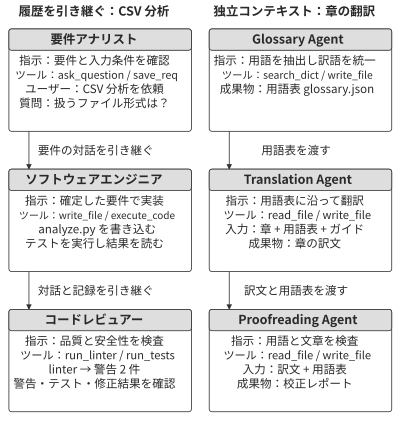

コンテキストがそれぞれ独立しているとき、メンバー同士はどのように資料をやり取りするのでしょうか。分散システムでは、共有ストレージかメッセージ伝達で通信するのが一般的です。Agent システムでもこの 2 つの考え方が使えます。具体的な方法には次のものがあります。

- **ツール呼び出しの引数。** 下流の Agent をツールとしてラップし、上流は引数でタスクと構造化された資料を渡し、結果を受け取ります。
- **共有ファイルシステム。** 一方が文書、コード、データを書き込み、もう一方が参照をたどって読み取ります。大きな中間生成物や、永続的に保存すべき資料に向いています。
- **メッセージバス（Message Bus）。** Agent はメッセージを中継サービスに送り、サービスが宛先や購読関係に基づいて配送します。複数のメンバー間の非同期なやり取りに向いています。

たとえば上流が翻訳タスクを発行したあと、訳文が返ってくるまで待つこともできれば、先にタスク番号だけ受け取って別の章に取りかかることもできます。2 人の翻訳者が同じファイルを開けるとしても、誰が書き込み、もう一方がいつ読み取るかは、システムが取り決めておく必要があります。Go のコミュニティは、共有データへのアクセスを通信によって組み立てることを重視しています。この考え方は Agent にも当てはまります。状態を誰が所有し、誰が変更でき、他のメンバーが更新をどう受け取るのかを明確にしておくのです。

### 次元 2：協調トポロジー

協調トポロジーは、Agent 間のタスク依存、情報の流れ、制御関係を表します。本章では次の 3 つの典型的な組織方式を取り上げます。

- **対等協調パターン**（Peer Collaboration Pattern）。少数のメンバーが同じ成果物をめぐって繰り返し協力します。たとえば起草者が論文の草稿を仕上げ、コメント担当者が修正意見を出し、起草者が改稿します。
- **管理者パターン**（Orchestration Pattern）。中心となる Manager Agent がタスクの分割、割り当て、集約を担い、サブ Agent がそれぞれの専門的な仕事を受け持ちます。
- **分散型パターン**（Decentralized Pattern）。メンバーは役割、メッセージ、局所的な状態に基づいて作業を引き継ぎ、仕事をどう進めるかを全員で決めていきます。

> **用語解説：Graph エンジニアリング。** 第 1 章では、2026 年 7 月に起きた Graph エンジニアリングをめぐる議論を紹介しました。この視点が注目するのは実行グラフです。ノードは Agent、通常のプログラム、人間の意思決定のいずれでもよく、エッジは依存関係、条件付きルーティング、失敗時の処理の行き先を表し、状態は実行の関係に沿って受け渡されます。マルチ Agent の協調トポロジーはこの設計視点の応用の一つであり、複数の意思決定単位がどう引き継ぎ、並行し、フィードバックし合うかに重点があります。

対等協調、管理者、分散型の設計は組み合わせて使えます。たとえば Manager が執筆タスクを起草者とレビュー担当者の小グループに任せ、グループは内部で反復を終えてから結果を提出する、という形です。

## マルチ Agent が単一 Agent に勝るのはいつか

初稿である技術用語が誤訳されていたとしましょう。2 人のレビュー担当者に同じ訳稿を渡しても、同じ承認が 2 回返ってくるだけかもしれません。一方、そのうち 1 人に原文、用語集、その語を使っているコードもあわせて渡せば、誤りを見つける経路が 1 本増えます。協調の方式を選ぶときは、まず「新しく加える Agent はタスクに何をもたらすのか」を問います。新しい証拠を得られるかもしれませんし、別の探索経路をカバーしたり、異なる専門的判断を示したり、並行実行によって待ち時間を縮めたりできるかもしれません。

筆者はまず**フィードバックがもたらす情報の増分**を確認し、そのうえで並行化やコンテキストの隔離からどれだけの利益が得られるかを見ます。レビュー担当者がテスト結果、ページのスクリーンショット、外部資料を読めば、生成時にはまだ手に入らなかった証拠に基づいて修正を提案できます。表10-1 は、よくある場面を例に、この種の増分をどう確認するかを示しています。

表10-1 マルチ Agent 協調における情報とフィードバック

| 協調パターン | 主な情報源 | 評価の重点 |
|---|---|---|
| 同一モデルが自分の出力を見直す | 元の資料と新たな検査プロセス 1 回分 | 見落としを発見できるか、修正後に結果が改善するか |
| 複数の Agent が同じ問題を討論する | それぞれの解法の道筋、仮定、論拠 | 見解に差があるか、どう検証して答えを選ぶか |
| レビュー担当者がテストを実行してコードを検査する | コンパイル、テスト、実行のフィードバック | 修正がテストを通過し、既存機能を保てるか |
| レビュー担当者がフロントエンドや PPT のレンダリング結果を確認する | スクリーンショットと操作のフィードバック | レイアウト、内容、操作が要件を満たしているか |
| レビュー担当者が外部ツールで事実を検証する | 検索結果と業務システムの記録 | 情報源は信頼できるか、結論が証拠と一致しているか |

RLEF は、コード実行のフィードバックを活用するよう強化学習でモデルを訓練し、競技プログラミングのタスクで複数ステップにわたる修正を学ばせました。コンパイルエラー、テストの失敗、実行時の例外が次の修正に具体的な根拠を与え、論文のモデルはより少ないサンプリングでより良い結果を出しています。[^rlef-2025] WebGen-Agent は、Web ページのスクリーンショット、視覚モデルによる記述と提案、GUI 操作の評価を生成プロセスに組み込みました。前のステップに戻ってやり直すことも、複数の生成結果から最良のものを選ぶこともできます。WebGen-Bench では、Claude 3.5 Sonnet の正解率が 26.4% から 51.9% に向上しました。[^webgen-agent-2025]

[^rlef-2025]: Gehring, J., et al. *RLEF: Grounding Code LLMs in Execution Feedback with Reinforcement Learning.* arXiv:2410.02089, 2025.
[^webgen-agent-2025]: Lu, Z., et al. *WebGen-Agent: Enhancing Interactive Website Generation with Multi-Level Feedback and Step-Level Reinforcement Learning.* arXiv:2509.22644, 2025.

筆者は、まずシステムにテスト、スクリーンショット、ツールの戻り値といった具体的な証拠を取らせ、そのうえで生成、実行、レビューの職責をどう割り振るかを決めます。フィードバックループは 1 つの Agent で完結させることも、複数の役割に分けることもできます。役割を増やすなら、それによって証拠の取得と活用が改善されるべきです。

Anthropic の 2026 年のセキュリティ研究は、協調的な探索の事例を示しています。45 個の Agent が共有フォーラムで発見を交換して互いにレビューし、独立した Agent が結果を仲裁しました。研究報告によれば、協調型のクラスタは 2,700 万 token を消費して 266 件の脆弱性を発見し、独立に並行させた方式は 650 万 token で 21 件を発見しました。フォーラムがあることで、メンバーは他者の発見を足がかりに調査を続けられ、どの方向にすでに誰かが取り組んでいるかも把握できます。ただし協調グループは約 4 倍の token を使っているため、266 と 21 の差には、通信方式の違いと計算投入量の違いの両方が含まれています。[^anthropic-multiagent-2026]

[^anthropic-multiagent-2026]: Anthropic Frontier Red Team, “Patterns and Problems in Emerging Multiagent Systems,” 2026-08-13.

数学の研究で、複数のチームに本当に異なるルートを探索させるにはどうすればよいでしょうか。3 次元の Navier–Stokes 方程式は粘性流体の運動を記述します。初期条件が滑らかなとき、解はずっと滑らかなままでいられるのでしょうか。OpenAI は相反する 2 つの目標を別々のグループに割り当てました。滑らかさの証明を試みるグループもあれば、反例の構成を目指すグループもあります。各グループはまず独自に探索し、チームは Codex を使って途中の成果を集約し、他のグループも有望な手がかりをたどれるようにしました。反例を見つけたグループでは、約 1 万個の Agent が並行して動いていました。チームの報告では、最初の Agent 群を起動してから証明を見つけるまでに約 88 時間かかり、さらに 17 時間を Lean による形式化と検証に充てています。この反例には重要な条件があります。流体に滑らかな外力が加わっているという条件のもとで、有限時間内に特異性が生じうる、というものです。チームはこれに基づき、クレイ数学研究所の問題文のうち C と D の 2 つの定式化が求める反例を示しました。外力を取り除けば、それは別の問題になります。この種の探索を設計するときは、どのような結果が得られれば元の問いに答えたことになるのかを先に明記し、互いに競合する予想を別々のグループに任せ、最後の検証のための時間を別枠で確保しておくとよいでしょう。[^ch10-ns-search]

[^ch10-ns-search]: OpenAI の研究ノート『On the Navier–Stokes Millennium Prize Problem』には、証明と Lean のコードが付属しています。クレイ数学研究所は 2026 年 9 月 11 日の声明でこの成果に応じ、成果の評価と賞の帰属は選考手続きに従って扱うと述べています。

**ステップ予算は性能にどう影響するか。** あるタスクに 30 ステップが許されているなら、Agent は計画、中核部分の実装、必要な検証を無駄なく配置しなければなりません。300 ステップが許されていれば、より多くの方針を比較し、より十分なテストと修正を行う余地があります。この資源を使いこなすには、Agent が予算の総量と残量を把握し、それに応じて探索の深さを決める必要もあります。

Google は 2025 年の『Budget-Aware Tool-Use Enables Effective Agent Scaling』でこの問題を研究しました。予算意識を持たない Agent はすぐに浅い探索にとどまってしまい、使えるステップを増やしても性能はなかなか伸びません。2026 年の BAVT（Budget-Aware Value Tree Search）はさらに一歩進め、探索の各ステップで価値の推定と残り予算を組み合わせ、探索と活用の重みを調整します。予算に余裕があるうちはより多くの方向を比較し、上限に近づいたら有望な枝に資源を集中させるのです。

管理者パターンに当てはめれば、Manager はタスクの難しさに応じてステップを割り当て、進捗に合わせて調整すべきだということになります。単純なタスクはなるべく早く納品し、複雑なタスクには検証と修正の余地を残しておきます。行き詰まったら、まず原因を突き止め、そのうえで情報を補うか、予算を増やすか、別の経路に切り替えるかを決めます。

並行探索は実時間を短縮でき、繰り返しのレビューは成果物を改善できますが、どちらもモデル呼び出しと通信のコストを増やします。筆者はよく調整した単一 Agent をベースラインとし、新しいメンバーがもたらす品質向上や時間短縮が、通信、重複計算、保守のコストを十分に上回る場合に限って、協調の規模を広げます。

## コンテキスト共有のマルチ Agent 協調

コンテキスト共有型の協調では、段階ごとに役割を切り替えつつ、既存のタスク記録をそのまま引き継ぎます。研究レポートを例にとると、検索担当の役割がまず資料を集め、分析担当の役割が続いて計算し、執筆担当の役割が表現を組み立てます。どの役割も前の段階の出典や決定を振り返ることができ、システムは現在のタスク指示によって、その段階の目標に注意を向けさせます。

チームをまたいで引き継ぐときは、まず「当初なぜそう決めたのかを知る必要があるのは誰か」を問います。Teamily AI の製品事例では、プロダクトマネージャーと Agent がグループチャットの中で一緒にプロダクト要求仕様書（PRD）を書きます。プロダクトチームが確定版をエンジニアリングチームに共有したあと、エンジニアはある要件の背後にあるトレードオフを追って質問できます。

検索担当の役割が執筆担当の役割にタスクを引き継ぐ場合を例にしましょう。引き継いだあと、モデルは執筆の規程をどこから読み取り、どのツールを呼び出せるのでしょうか。実験 10-1 では、同じ引き継ぎを 2 通りの方法で実装します。

| 引き継ぎで扱う問題 | 役割の切り替え（`transfer_to_agent`） | Skill の読み込み |
|---|---|---|
| 執筆の規程をどう提供するか | 執筆担当のシステムプロンプトに置き換える | システムプロンプト内の Skill 一覧は残し、執筆の規程をメッセージ履歴の末尾に追加する |
| モデルにはどのツールが見えるか | 執筆担当のツールだけを見せることができる | 元のツールセットやツール検索の入口をそのまま使える |
| KV Cache のどの部分がまだ使えるか | システムプロンプトが変わるため、プレフィックスが変化した箇所以降は通常再計算が必要 | 元のリクエストのプレフィックスを引き続き再利用できる |
| 呼び出し権限を誰が検査するか | Harness が現在の役割に基づいてリクエストを検証し、ツールを実行する | Harness が呼び出しごとに権限を独立して検査する |

役割の違いが主に知識、手順、文体にある場合、筆者は Skill を優先します。同じ実行フレームワークを再利用しやすく、安定したリクエストのプレフィックスのキャッシュも保てるからです。役割の違いが権限、ツールの隔離、承認の職責に関わる場合は、独立した Agent または役割の切り替えとして組み立て、Harness と実行環境でアクセス制御を実施します。ツールがモデルの入力に現れるかどうかは呼び出しの選択に影響しますが、実際の権限はランタイムの検証によって決まります。

> **実験 10-1 ★★：共有コンテキストでの複数役割の切り替え——システムプロンプトと Skill の比較**
>
> 2 つの経路は、同じモデル、ユーザータスク、ツール実装、役割規程、共有履歴を使います。入門デモでは、中国の 2021〜2023 年の新エネルギー車販売台数を調べ、年平均成長率（CAGR）を計算し、120 字以内の投資家向け要約を書くことを求めます。
>
> **経路 1：システムプロンプトの切り替え。** triage（要件の聞き取り）、research（検索）、coding（プログラミング）、data_analysis（分析）、writing（執筆）の 5 つの役割を設けます。triage が入口で、各役割には専用のツールと `transfer_to_agent` が見えます。移譲時には履歴を保持したまま、移譲先の役割のプロンプトとツールセットを読み込み、実行を続けます。
>
> **経路 2：Skill の読み込み。** システムプロンプトと全ツールはセッション中ずっと固定します。モデルは `load_skill(name)` を呼び出して役割の規程を取得し、その内容はツール結果として共有履歴に加わり、元のプレフィックスはそのまま残ります。Harness は権限規則に基づいて各ツール呼び出しを検査します。
>
> 2 つの実装は同じ `SKILL.md` を読み込みます。ある役割の引き継ぎの前後で、モデルに送られたリクエストをそれぞれ 1 つずつ取り出し、規程がどのメッセージに現れているか、プレフィックスのどの部分が再利用できるかを確かめてみましょう。さらに 2 つの要約を照合します。販売台数の出典は信頼できるでしょうか。2021 年末から 2023 年末までの成長期間は 2 年ですが、年平均成長率は正しく計算されているでしょうか。
>
> 本番の比較では、より厳しいブリーフィングの問題が 1 問あります。160 文字以内で、出典 URL を 2 つ残すことも求められます。どちらにも 8 ステップの機会を与えたところ、役割切り替えのグループは 3 回の呼び出しを文字数の計測に費やし、草稿はなお 206 文字あり、問題で指定された計算ツールも使っていませんでした。Skill 読み込みのグループは最初と最後の年の販売台数から成長率を算出し、8 ステップ目でようやく執筆の規程を読み込みました。この時点で通るべき役割はすべて通っていましたが、ユーザーはまだ要約を受け取っていません。どちらの軌跡も最終的にはステップ数の上限に達して終了しました。
>
> 同じ 30 個のタスクを 2 つの実装でそれぞれ実行し、納品結果をプログラムで検査すると、Skill 読み込みのグループは 15 個、システムプロンプト切り替えのグループは 2 個に合格しました。ただし問題ごとに比べると、前者はキャッシュに当たらなかった入力が 6,855 token 多く、所要時間も約 4.4 秒長くなっていました（いずれもペア差分の中央値）。今回、サービス提供者が報告したキャッシュ済み入力 token 数は、両グループのリクエストともゼロでした。指示追従に関する 6 項目の境界テストでは両グループとも全問合格しましたが、完全なタスクの合格率には大きな差が出ました。

## コンテキスト非共有のマルチ Agent 協調

独立したコンテキストのアーキテクチャでは、各 Agent が入力履歴、タスク状態、実行ループをそれぞれ保持し、ツールの引数、共有ファイル、メッセージを通じて必要な情報を交換します。たとえば翻訳者が提出する資料には、原文の段落と用語集のバージョンを明記しておきます。そうすれば翻訳者が抜けたあとでもレビュー担当者は原文を見つけられますし、手直しが必要になったときには章ごとに担当者をたどれます。

表10-2 は、オペレーティングシステムがプロセスを管理する方法と、ランタイムが Agent を管理する方法を対比したものです。

表10-2 マルチ Agent システムとオペレーティングシステムの設計上の類比

| オペレーティングシステム | マルチ Agent システムで近い役割を担うもの |
|---|---|
| プログラムと設定 | システムプロンプト、ツール定義、役割の設定 |
| プロセスのメモリ | 現在のコンテキスト、タスク状態、履歴記録 |
| CPU による計算の実行 | LLM が意思決定を生成し、ランタイムとツールが対応する操作を実行する |
| カーネルによる実行管理 | Agent ランタイムが状態、スケジューリング、資源を管理する |
| システムコール | ツールインターフェースを通じて外部の操作を要求する |
| fork：子プロセスの作成 | `spawn_subagent`：サブ Agent の作成 |
| kill：シグナルの送信 | `cancel_subagent`：取り消しの要求 |
| ps：プロセスの照会 | `list_agents`：メンバーと実行状態の照会 |
| 終了ステータスと wait | 完了通知、タスク状態、構造化された結果 |
| 共有ストレージとメッセージ伝達 | 共有ファイル、ツールの引数、メッセージ |

私的な状態、非同期メッセージ、メンバーの動的な作成は、1970 年代に提案された Actor モデルにも現れています。[^actor-model]

[^actor-model]: Hewitt, C., Bishop, P., Steiger, R. *A Universal Modular ACTOR Formalism for Artificial Intelligence.* IJCAI 1973.

独立したサブタスクが多いとき、筆者は各メンバーに独立したコンテキストを持たせ、職責に関係する資料だけを扱わせる方向に傾きます。こうすると役割ごとにテストしやすくなり、前の段階の長い履歴が現在の判断を乱すことも減り、複数のタスクを並行して進められます。ただし隔離の効果は、ほかの共有資源にも左右されます。複数の Agent が同時に同じファイルを書き換えたり、同じ API クォータを消費したり、同じ誤ったメッセージを受け取ったりすることはありえます。

協調のインターフェースでは、メッセージの消失、重複配送、状態の遅れにも対処しなければなりません。問題を調べるときは、タスク識別子を使って各メンバーのリクエスト、ツールイベント、結果を関連づければ、ある引き継ぎの過程を再構成できます。

ある Agent が分析を終え、その結果をレポート執筆担当の仲間に渡すとしましょう。数値がわずかならメッセージに載せて送れますが、成果物が大きな表であれば、通常は表を共有ファイルシステムに保存し、メッセージには参照を添えます。ここから 2 つの分担が生まれます。**成果物の保存**は文書、コード、データの保存と交換を担い、**通信と制御**はメッセージの配送、タスク状態の照会、実行の取り消し、資源のスケジューリングを担います。

### Agent から見たファイルシステム

よく使われる設計の一つは、Agent に**仮想ファイルシステム**（virtual filesystem）を提供し、出所の異なる資源を統一されたディレクトリツリーにマウントするものです。モデルは `read_file`、`write_file`、`list_dir` などのインターフェースでアクセスし、その下層はローカルの一時ディスク、永続的なオブジェクトストレージ、サードパーティのクラウドストレージ API、システムのリソースパックなどにつながっています。

筆者はまずストレージ領域をはっきり区切り、それから協調のフローに接続します。一時的な下書き、正式な成果物、ユーザーの外部ファイルが混在していると、誤って上書きしたり、権限を越えて読み取ったりしやすくなります。統一されたインターフェースは使いやすい一方、各領域の可視性、ライフサイクル、権限はマウントとアクセス制御の設定によって決まります。このディレクトリツリーは 4 種類の領域に分けられます。

**一、Agent 専用ワークスペース（Scratchpad）。** 各インスタンスは自分のワークスペースを使い、下書き、一時ファイル、デバッグログ、中間生成物を保存します。既定ではアクセス範囲を所属する Agent に限り、タスクの方針に従って片付けるかアーカイブします。こうすれば一時ファイルが互いに上書きし合うのを防げます。サブ Agent は作業を終えたら、納品すべき結果を共有空間に置き、構造化された要約とともにメイン Agent に渡します。試行錯誤の記録は元のワークスペースに残し、あとの診断に使います。これはコンテキストの隔離をストレージ層で実現することでもあります。メイン Agent は納品結果と必要な証拠を受け取り、日常の調整では試行錯誤の過程をすべて読み込む手間を省けます。

**二、マルチ Agent 共有空間（Shared Workspace）。** 協調するメンバーはここで成果物を交換し、ユーザーも認可された入口から資料をアップロードしたり成果物をダウンロードしたりできます。たとえば Glossary Agent が用語集を書き込み、Translation Agent がそれを読んで翻訳し、レビュー担当者が訳文を検査します。共有空間は通常タスクとともに永続的に保存され、並行書き込み、バージョン更新、アクセス範囲を管理する必要があります。第 6 章で Agent と仮想コンピュータが共有ストレージを通じて CSV やグラフをやり取りしたのは、この種の成果物の引き継ぎの例です。楽観ロックやワーキングコピーの隔離といった手法は後で紹介します。

**三、外部マウントリソース（Mounted External Resources）。** Google Drive、Notion、Dropbox、企業 Wiki などの資源は、アダプターを通じて統一インターフェースにマッピングできます。Agent が文書を読むとき、ソースシステムの API を呼び出すのはアダプターの役目です。ここでは 3 種類の違いを管理する必要があります。アクセス範囲は外部の認可に依存します。ネットワークアクセスによって遅延、タイムアウト、キャッシュ更新の問題が生じます。書き戻し操作はソースシステムの権限とバージョンの規則に従わなければなりません。具体的な整合性のセマンティクスはサービスのインターフェースが決めるので、バージョン番号、条件付き書き込み、再読み込みを使って並行変更を検査できます。資料検索には必要に応じた読み取り専用のマウントが適しており、編集が必要になった時点で対応する書き込み権限を与えます。

**四、システム組み込みリソース（Built-in System Resources）。** リファレンスマニュアル、テンプレート、ツール定義、プリセットの Skills は、読み取り専用のリソースパックとして複数の Agent で使えます。Skills は漸進的開示によって読み込まれます。まず一覧を示し、タスクに応じて規程やスクリプトを読み込むのです。バージョンを固定したリソースパックは並行して読み取りやすく、アップグレード時にはバージョンの切り替えによって実行中のタスクの一貫性を保ちます。

図10-2 では、翻訳者は自分のディレクトリで下書きを何度も書き直し、レビューに渡す準備ができた時点で該当するバージョンを共有領域に置きます。ユーザーのクラウドストレージにある原稿は外部アダプターが読み取り、アクセスできるかどうかはユーザーが与えた権限にもよります。

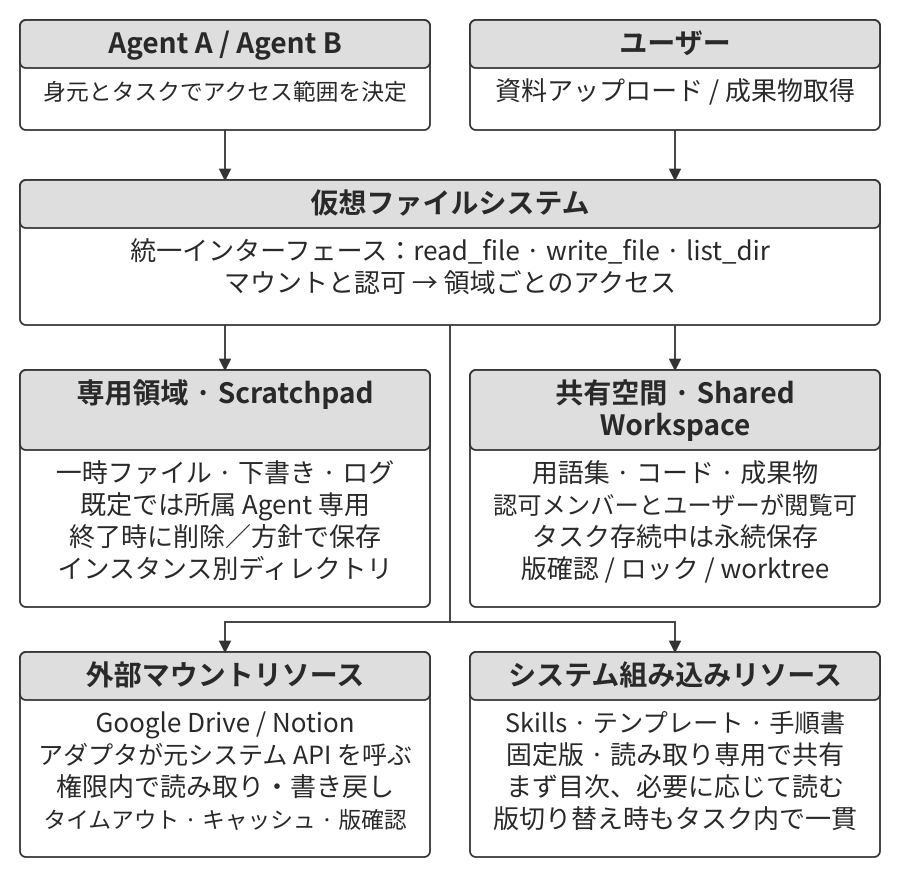

翻訳者が抜けると、ワークスペースの一時ファイルはそれとともに解放されることがあります。共有領域に置いた訳稿はそのまま残り、レビュー担当者が読み取り権限で引き継げます（表10-3）。

表10-3 Agent 仮想ファイルシステムの 4 種類の領域

| 領域 | 可視性 | ライフサイクル | 読み書き | 並行管理 |
|---|---|---|---|---|
| Agent 専用ワークスペース | 既定では所属 Agent に限定 | インスタンスとともに片付け、必要に応じてアーカイブ | 所属 Agent が読み書き | 再試行やバックグラウンド操作による重複書き込みを防ぐ |
| マルチ Agent 共有空間 | 認可されたメンバーとユーザー | タスクとともに永続的に保存 | 役割に応じて認可 | ロック、バージョン検査、worktree |
| 外部マウントリソース | 外部の認可とアダプターの両方で制限 | ソースシステムとキャッシュ方針が決定 | 必要に応じて読み取り専用、または認可して書き込み | ソースシステムのバージョンと並行インターフェースに従う |
| システム組み込みリソース | 認可された Agent | 固定バージョンをセッションをまたいで再利用 | 読み取り専用 | リソースのバージョンを一括で切り替える |

ファイル参照を使えば、引き継ぎのメッセージを短く保てます。上流は成果物の場所、バージョン、用途を示し、下流は必要に応じて内容を読み取ります。同じ実行環境にいるメンバーは共有パスを使えますが、組織をまたぐ協調で同じ引き継ぎを行うには、双方が解決できる成果物の識別子、アクセスインターフェース、認可が必要です。

### Agent 間の通信と制御

第 4 章で紹介した作成、通信、取り消し、発見のためのツールは、マルチ Agent 協調に基本的な制御インターフェースを提供します。`spawn_subagent` はメンバーを作成し、`send_message_to_subagent` はメッセージを渡し、`cancel_subagent` は取り消しを要求し、`list_agents` はメンバーを照会します。これらのインターフェースを軸に、メッセージ、状態、終了、スケジューリングのふるまいも取り決めておく必要があります。

**一、メッセージ伝達。** メンバーが少なく関係が固定されているなら、ポイントツーポイントのインターフェースを使えます。たとえば電話 Agent とコンピュータ Agent が直接進捗をやり取りする形です。すべてのメンバーが互いに通信する必要がある場合、潜在的な関係の数はメンバー数の 2 乗で増えます。購読関係が多いときは、メッセージバスを使えばルーティング、バッファリング、再試行を一元的に管理しやすくなります。ポイントツーポイントでもバスでも非同期配送は実現でき、受信側が同時にオンラインである必要があるかどうかは、キューと永続化の仕組みによって決まります。

メッセージには通常、構造化された**エンベロープ**（envelope）が含まれます。送信者 ID、宛先の Agent またはブロードキャスト範囲、メッセージの種類、ペイロードです。メッセージの種類には `task_assigned`、`status_update`、`result`、`terminate` などがあります。タスク識別子、メッセージ識別子、関連リクエストは、受信側の重複排除に役立ち、デバッグツールが通信の経路を再構成するのにも使えます。業務の内容は JSON のペイロードに入れ、双方が取り決めたフィールドに従って処理します。

たとえば、ある訳稿の納品は編集者が担当していて、編集者が用語レビュー Agent にある語を確認してほしいとします。Multica のチケットのコメントで指名（`@`）して質問を書けば、レビュー作業が始まります。レビュー意見はそのチケットに直接返信でき、担当者は編集者のまま、チケットの状態も元の値を保ちます。レビュー担当者にチケット全体を引き継いでほしいなら、担当者の変更を明示的に行う必要があります。[^ch10-multica]

[^ch10-multica]: Multica、コメントでの Agent の指名。バージョン `d579273` のコメント振り分けの実装。

**二、状態の取得。** メイン Agent は、サブタスクがまだ実行中か、入力を必要としているか、結果を取り出せるかを知る必要があります。状態インターフェース、イベント通知、進捗ファイルを組み合わせて使えます。ランタイムのインターフェースはライフサイクルの状態を提供し、メッセージは業務の進捗を伝え、永続ファイルは復元可能な記録を残します。

`get_subagent_status(agent_id)` は、実行中、入力待ち、完了、失敗などの状態を返せます。日常の調整では、筆者は完了通知と段階ごとの進捗メッセージを優先し、メイン Agent には自分の仕事を続けさせます。通知が遅れたとき、接続が復旧したとき、問題を調べる必要があるときに限って能動的に照会し、「終わった？」と頻繁に尋ねることにモデル呼び出しを費やさないようにします。状態インターフェースはランタイムが管理しており、プロセスが生きているか、タスクが終わったかを即座に報告できます。

**メッセージで進捗を交換する。** メイン Agent が現在の進捗を尋ね、サブ Agent が適切なステップで答えることもできますし、サブ Agent が段階的な結果を得たとき、行き詰まったとき、助けが必要なときに自分から `status_update` を発行することもできます。メッセージには完了した事項、次のステップ、行き詰まりの原因を書き、全メンバーが同じ状態名を使えば、集約と判断がしやすくなります。タスクのライフサイクルを標準化して表現する方法は、後述の A2A プロトコルで紹介します。

**ファイルで進捗を保存する。** システムは、メッセージ、ツールのリクエスト、ツールの結果、状態の変化をイベント順にログへ追記できます。たとえば 1 行に 1 イベントを書く JSONL 形式です。診断権限を持つメイン Agent や運用ツールは、これをもとに再試行、エラー、待機の過程を調べられます。モデルの入力履歴は実行軌跡の一部にすぎず、ログにはスケジューリングや外部実行のイベントも記録できます。

完全な軌跡は数万 token に及ぶこともあり、メイン Agent は読むたびに状態を抽出し直さなければなりません。メッセージはメイン Agent に新しい進捗を知らせ、短い進捗ファイルは現在の状態を保存して、あとの照会や復元に使えるようにします。筆者は日常の調整を、この 2 つの組み合わせで行うことを優先しています。サブ Agent は作業を 1 つ終えるたびに、タスクリスト、成果物の参照、現在の行き詰まりを更新し、メイン Agent はこれらのフィールドをもとに次の手を決めます。詳細な軌跡は必要に応じた調査のために残しておきます。進捗が長いあいだ変わらない場合は、ハートビート、ツール呼び出しの状態、タスクのタイムアウト設定を合わせて、介入が必要かどうかを判断します。長時間実行されるツールはまだ動いているかもしれないので、状態を確認してから、待つか、取り消すか、再試行するかを決めます。

**三、実行の終了。** 複数のメンバーが同じ目標を並行して探しているとき、1 つがタスクを完了したら、ほかの分岐は停止して予算とツール資源を解放できます。取り消しには 2 段階の強さがあり、Unix の SIGTERM と SIGKILL の役割に近いものです。

筆者は**グレースフルな終了**を優先します。ランタイムが取り消し要求を伝え、サブ Agent はセーフポイントで新しい操作を止め、必要な進捗を保存し、ブラウザのセッションを閉じてロックを解放したうえで、確認応答（ack）を返します。**強制終了**は、取り消しの期限を過ぎても応答しない実行に対して使います。ランタイムがプロセスを終わらせ、そのあと残った資源と未完了の書き込みを検査します。すでに外部システムに送信された操作については結果を照会し、必要なら補償処理を実行します。

ライフサイクルは作成関係に沿って管理する必要もあります。Go の context にならい、親タスクの取り消しシグナルをサブタスクのツリー全体へ下向きに伝播させ、実行ループがセーフポイントで取り消しシグナルを確認するようにできます。これは `ctx.Done()` の用途に対応します。こうすれば、親タスクが終わると、それが起動した分岐も片付けの処理に入り、管理者のいない Agent がツールを呼び出し続けて予算を消費することを防げます。本当に長期間独立して動かす必要があるバックグラウンドタスクには、`context.Background()` を使うのと同様に独立したライフサイクルのコンテキストを作り、あわせて監視、予算、片付けを担う管理者を指定します。

**四、資源とスケジューリング。** Agent システムは、token、ステップ、並行数の枠、ツールの接続、計算資源を割り振る必要があります。サブタスクを起動するときに予算と超過時のふるまいを設定し、タスクの難しさに応じてモデルを選び、並行呼び出しを制限してサービスのクォータを一気に使い果たさないようにします。より緊急のタスクが来たら、優先度の低いタスクをセーフポイントで一時停止または取り消し、進捗を保存してから再スケジューリングできます。

3 つの分岐がそれぞれ実現可能な方針を 1 つずつ調べていて、そのうち 1 つが重要な手がかりを見つけ、残るは最後の検証だけだとしましょう。Manager はその分岐に何ステップか多く与え、同時に進展のない 2 つの分岐を終わらせることができます。枠はランタイムが差し引きます。ある分岐がまだ試したがっていても、予算が尽きれば止まらなければなりません。

### 対等協調パターン：相互チェックと反復改善

対等協調では通常、2〜3 個の Agent が同じタスクをめぐって意見を交換し、成果物を修正します。設計にあたっては、まずメンバーに異なる職責、資料、ツールを割り当てて独立に判断させ、そのあとで結果を集約するとよいでしょう。たとえば生成担当は実装に、レビュー担当はテストとユーザーの要求に注目し、専門の異なるメンバーがそれぞれの領域の制約を検査します。モデル、入力、作業手順が似ているほど、メンバーは同じ種類の判断を繰り返しやすくなるため、視点と証拠の違いを意図的に設計する必要があります。[^anthropic-multiagent-2026]

同じ成果物を繰り返し改善するタスクについては、筆者はまず 2〜3 人のメンバーによる対等協調から始めることを勧めます。役割、引き継ぐ内容、停止条件がはっきりすれば、テスト可能なループを構築でき、初期の調整作業も少なくて済みます。

#### Loop エンジニアリング

対等協調は、よくある問題の一つである**早すぎる終了**に対処する助けになります。プログラミングとカスタマーサポートの代行を例にとると、早すぎる終了は 3 種類の記録から見つけられます。

- **一部を終えただけで全部終えたと宣言する。** Coding Agent がコードを書き終えたのに、テストとデプロイの確認を漏らしている。ユーザーが 2 つの用件を頼んだのに、アシスタントが 1 つ目を済ませただけですべて片付いたと報告する。タスクリストと 1 項目ずつ照らし合わせ、それぞれの作業について完了の証拠を確認する必要があります。
- **1 つの経路が失敗しただけで早々に諦める。** 事業者が、フォームでの資料提出に切り替えるよう求めたり、指定のメールアドレスで添付ファイルを受け付けると言ったりすることがあります。そうした返答を受け取ったら、事業者が受け付ける方法で手続きを続ければよいのです。失敗の原因を記録し、ほかにどの経路を試す価値があるかを判断する必要があります。
- **部分的に成功したあと、後続の手順を漏らす。** 事業者が返金に同意したあと、ユーザーに App での確認も求めているなら、アシスタントはその手順と操作の条件を伝える必要があります。請求の減額を例にとると、オペレーターが電話で口頭で了承したなら、アシスタントはユーザーに、今回の交渉で約束を取りつけたと伝えられます。通話記録はオペレーターが何を言ったかを証明できますが、その後の請求書で約束が守られるかどうかには新しい証拠が必要です。レビュー担当者は、すでに得られた結果、まだ誰が何をする必要があるか、どの結果がまだ見えないかを分けて示すべきです。

この 3 種類の問題はいずれも、完了条件を検査可能な結果に落とし込むことを求めています。**Loop エンジニアリング**は、Agent に「次の作業を決める—実行する—検証する—進捗を記録する」というループを継続して回させ、その結果に応じて続行、待機、移譲、終了のいずれかを決めさせる方法に焦点を当てます。エンジニアは、タスクの出どころ、検証の方法、永続的な状態、停止条件を設計する必要があります。人間の仕事もそれに伴って広がり、1 回の呼び出しのためにプロンプトを書くことから、タスクを継続的に前進させられるループを設計することへと移っていきます。Addy Osmani は 2026 年 6 月にこの名称を使って一連の実践を論じ、Boris Cherny の経験を引いています。仕事の重心は次第に、Agent を駆動できるループの設計へと移っているというものです。[^loop-engineering-2026]

**このようなループでは、検証器が重要なボトルネックになることが多いと筆者は考えています。** 検証が信頼できなければ、ラウンドを増やすほどシステムが同じ種類の誤りを繰り返したり、早々に完了を宣言したりしかねません。テスト結果、業務の状態、ユーザーの確認は、それぞれの範囲で完了の根拠を与えます。検証に失敗すれば、それが次のラウンドの修正の入力になります。

実践は命名に先立ちます。Loop エンジニアリングという名称が広まる前から、筆者とチームは Pine AI で、ループと検証を使って早すぎる終了に対処していました。提案者と審査者の組み合わせは、この種のループを組み立てるよく使われる方法の一つで、あとで詳しく述べます。

[^loop-engineering-2026]: Osmani, Addy. “Loop Engineering”, 2026.

**LoopX：ラウンドをまたいで作業状態を保存する。** LoopX は、目標、境界、ToDo、ゲート、証拠、クォータを永続的なコントロールプレーンに置き、次のラウンドや次の実行者の作業をそこで手配します。流れは**コントロールプレーンが決定 → Agent が実行 → 独立に検証 → 検証済みの進捗をコミット**とまとめられます。

Agent はツールを呼び出し、推論し、そのラウンドの成果を提出します。コントロールプレーンは完了した作業を記録し、次のラウンドをどこから再開するかを決めます。検証に通れば完了状態をコミットし、失敗すれば修復か再計画に回します。人間によるゲート、待機条件、予算の上限が合わさって、いつ実行を続けてよいかが決まります。[^loopx-framework]

[^loopx-framework]: LoopX, The local control plane for long-running AI agent work, v0.4.0.

**LongHorizon-Harness：アプリをまたぐ長いタスクをつなぐ。** このフレームワークはマルチモーダルな Computer Use から出発し、タスクが GUI、CLI、複数のデスクトップアプリ、何度ものコンテキストのリフレッシュをまたいで連続して実行される状況を扱います。採用しているのは Manage–Execute–Audit（MEA）ループです。Manager は元の目標、検証済みの進捗、失敗の証拠、残りの作業に基づいて、範囲のはっきりしたサブタスクを 1 つ生成します。Executor は新しいコンテキストで GUI または CLI の操作を実行します。Auditor は読み取り専用で結果を検査し、検証済みの進捗を次のラウンドの状態に書き込みます。失敗の証拠もあわせて保持され、復旧と再計画に使われます。

フレームワークはアダプター層を通じて Claude Code や Codex CLI などの実行バックエンドを呼び出し、外側のタスク管理とバックエンドの実行ループをつなぎます。このアプローチは、長いタスクの連続性を検証済みのタスク状態に落とし込むものです。実行コンテキストがリフレッシュされても、次のラウンドは目標、完了の証拠、未解決の事項に基づいて作業を続けられ、環境の変化が既存の結論に影響していないかも改めて確認します。[^longhorizon-implementation]

論文は、Qwen 3.7-Plus と Claude Code の実行バックエンドを同じに保ち、外側のループだけを変えた比較で、WeaveBench の PassRate が 51.8% から 80.7% に、OSWorld 2.0 の二値完了率が 2.8% から 8.3% に、Terminal-Bench 2.1 の成功率が 69.7% から 77.2% に向上したと報告しています。コストもタスクによって変わります。最初の 2 つのベンチマークでは、それぞれベースラインの 2.3 倍の総 token と 3.6 倍の出力 token を消費しました。Terminal-Bench 2.1 では token 消費が 24% 減っています。

同じ WebRTC の多層ストリーム監査タスクで、ベースラインの実行者は Wireshark の画面で行き詰まり、その後も何度か試したものの、最終スコアは 0.59 でした。MEA を使うと、Auditor が足りない証拠を書き留め、次のラウンドの実行者がそれに基づいて追加調査を行い、最終スコアは 0.92 になりました。

[^longhorizon-implementation]: LongHorizon-Harness、論文番号 arXiv:2608.01964。ベースラインと MEA の公開軌跡はいずれもタスク WEB_task_16_webrtc_simulcast_layer_audit から取ったもので、再現スクリプトはコミット `53bc678` を使用。

#### 提案者・審査者パラダイム

提案者・審査者のパラダイムは、成果物の生成と結果の検査を 2 つの役割に任せます。第 5 章の PPT 生成、動画編集、ログ可視化の実験はこの設計を採用していました。Proposer がコードを生成し、Reviewer がレンダリング結果を見て、視覚モデルの助けを借りて品質を検査し、構造化された修正意見を返します。図10-3 では、修正意見はさらに提案者の手元に戻らなければなりません。提案者がそれをもとに次の版をきちんと直せるかどうかは、審査者が問題をどこまで細かく特定できるかにかかっています。

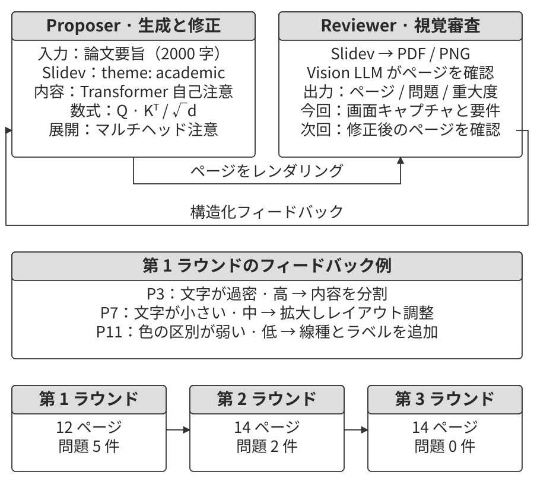

検査の対象が変われば、レビューで見るべき証拠も変わります。カスタマーサポートの返信をレビューするなら業務ルールと事実の出典に照らし、コードの変更をレビューするならテストと実際の実行結果を見て、操作手順をレビューするなら適用される規範と前提条件を確認します。

Huang らの ICLR 2024 の論文『Large Language Models Cannot Self-Correct Reasoning Yet』は、彼らが調べた推論タスクとプロンプト設定のもとで、GPT-4 が外部フィードバックなしに自己修正を行うと、正しい答えを誤りに書き換えてしまい、全体の正解率が下がる場合があることを見出しました。TACL の自己修正に関するサーベイは、タスクの条件とフィードバックの信頼性が修正の効果にどう影響するかをさらに論じています。[^self-correction-survey] そこで筆者は、独立した証拠と、特定可能な修正条件を、レビューループの基本要件としています。審査者は実際のテスト、環境の状態、レンダリング結果を読み取れるべきであり、どの要件がまだ満たされていないか、修正をどう検証するかを示せなければなりません。

[^self-correction-survey]: Kamoi, R., et al. *When Can LLMs Actually Correct Their Own Mistakes? A Critical Survey of Self-Correction of LLMs.* TACL, 2024.

1 回分の完全なループは、次の 5 ステップで組み立てられます。

1. 提案者がタスクの要求に従って第 1 版を書きます。たとえば返信文やコードです。
2. 成果物を実行またはレンダリングし、テスト、業務の状態、スクリーンショット、事実確認の結果を得ます。
3. 審査者は要求と証拠を照らし合わせ、合格の結論を出すか、問題の箇所と修正条件を指摘します。
4. 予算が残っていれば、提案者はフィードバックに従って修正し、再び実行とレビューを行います。入力や認可が必要な問題にぶつかったら、待機または移譲に切り替えます。
5. 公開条件を満たしたら、レビューに通った版を、検証の証拠とレビューの結論を添えて納品します。予算が尽きた場合は、進捗と未解決の問題を保存します。

審査者は保護されたテストと公開基準を読み取り、基準の変更を提案する場合は別途審査にかけます。

CRITIC の実験では、モデルがまず回答を出し、それからツールを使って検査しました。[^ch10-critic]たとえば検索エンジンで回答中の事実を確かめ、Python インタプリタで自分の書いた数学プログラムを実行します。オープンな質問応答、数学プログラムの生成、有害な表現の削減という 3 種類のタスクで、ツールのフィードバックに基づいて修正すると、いずれも成績が向上しました。モデル自身の評価だけに頼って元の回答を見直した場合、修正の効果は弱いものでした。この設計は第 5 章の PPT の事例と通じています。レンダリングしたスクリーンショットは、コードのテキストからは直接判断しにくいレイアウトや重なりの問題を明らかにし、テストの実行は実際の実行時エラーを明らかにします。

[^ch10-critic]: CRITIC、arXiv:2305.11738。

Anthropic が 2026 年に示した長期のアプリケーション開発の事例では、プランナー、ジェネレーター、エバリュエーターの 3 つの Agent を使っています。プランナーは要求をプロダクト仕様に展開し、ジェネレーターとエバリュエーターはまずラウンドごとの完了基準を取り決めてから、それぞれ実装と検査を行います。エバリュエーターは Playwright でアプリを操作して不具合報告を提出し、役割間の状態の引き継ぎはファイルを通じて行います。この事例は、プロダクト仕様、実際の操作、不具合のフィードバックをどうつなぐかを示していますが、増えた実行とレビューのコストも方式の比較に含める必要があります。[^anthropic-harness-2026]

[^anthropic-harness-2026]: Prithvi Rajasekaran, “Harness Design for Long-Running Application Development,” Anthropic Engineering, 2026-03-24.

2026 年 11 月 20 日、数学者の Levent Alpöge は、Claude との協力で得た形式的証明を公開しました。リーマン予想と、そのディリクレ $L$ 関数への一般化に関するものです。大量の Lean ファイルを受け取った審査者は、まず 2 つのことを問わなければなりません。最後の定理が述べているのは元の予想そのものか。推論の各ステップを証明カーネルで検査し直せるか。MIT の数学者 Andrew Sutherland は、まず提出された定理と Lean の数学ライブラリにあるリーマン予想の定義を照合し、次に証明が依存する公理を列挙しました。彼は同日に公開した記録で、独立した証明カーネル nanoda がエクスポートされた証明の検査に通ったことも報告しています。これはレビューの分担について具体的な方法を示しています。問題をよく知る人がまず受け入れ基準となる命題を書き、そのうえで独立したツールに、提出された成果物からその命題を導けるかを検査させるのです。将来、数学者が著者がどのようにしてこの道筋を思いついたのかを理解したいと思えば、人間が読みやすい論証も別に必要になります。[^ch10-rh-review]

[^ch10-rh-review]: Levent Alpöge が 2026 年 11 月 20 日に研究ノートを公開。検証プロジェクトとその当日の進捗は、Andrew Sutherland の『Verification files for the Lean proof of the Riemann Hypothesis』を参照。

#### 討論パターン

討論パターンでは、メンバーが異なる立場から同じ問題を検査します。たとえば技術方式を評価するとき、ある Agent は利点と適用場面を説明し、別の Agent は制約、失敗条件、代替案を検査します。各ラウンドでは具体的な論点をめぐって証拠を補ったり反論したりし、最後に合意できた事項と、まだ検証が必要な相違点をまとめます。

この進め方は賛否の論拠をはっきり並べるのに役立ちますが、効果は論拠の質、独立した判断、最終的な選択方法に左右されます。Tran と Kiela は、マルチホップ推論のタスクで、逐次、討論、アンサンブル、並行役割、サブタスク並行という 5 種類のアーキテクチャを比較しました。思考 token の予算をそろえると、単一 Agent の成績はマルチ Agent と同等か、それ以上でした。[^single-agent-2026] これを踏まえ、筆者は討論を主に、相違点を洗い出し、仮定を検査し、反対側の論拠を補うために使います。事実や計算の正確さを求めるときは、検証可能な証拠と独立した検査を増やすことを優先します。

論文はデータ処理不等式を手がかりに、中間情報の受け渡しの限界を論じています。転述と圧縮を繰り返すと、元の細部が失われるおそれがあるのです。エンジニアリングの面では、たどれる出典を残しておき、メンバーにまず独立に分析させてから結論を交換させれば、検査されていない合意を減らせます。複数回の独立したサンプリングを集約する方法や、「生成は難しく、検証は易しい」というタスクの特徴を利用して専任のレビューを置く方法も、討論と組み合わせて使えます。

[^single-agent-2026]: Tran, D., Kiela, D. *Single-Agent LLMs Outperform Multi-Agent Systems on Multi-Hop Reasoning Under Equal Thinking Token Budgets.* arXiv:2604.02460, 2026.

#### ブレインストーミングパターン

ブレインストーミングは 2 ラウンドに分けられます。まず各メンバーに一人でアイデアを考えさせ、それから全員で、どのアイデアを組み合わせられるかを話し合います。たとえば Agent 1 がソーシャルシェア機能の追加を提案し、Agent 2 がそれをもとに個人向けのシェア用ポスターの自動生成を提案し、Agent 3 がさらにユーザーによるテンプレートのカスタマイズとテンプレートマーケットを提案します。

メンバーに異なるアイデアを出させるには、それぞれユーザーと運営者の視点から考えさせてもよいですし、異なるプロンプトやモデルを与えてもかまいません。アイデアを交換したあと、ユーザーのニーズ、実装コスト、検証結果に基づいて方式を絞り込みます。

#### 専門家パネルパターン

専門家パネルは、分野をまたぐ問題について専門的な職責を割り振ります。たとえば新製品を評価するとき、エンジニア Agent は実装の難しさと技術的な依存関係を分析し、プロダクト Agent はユーザーのニーズと体験を検査し、運営 Agent はコスト、資源、実現の条件を見積もります。

LobeHub のグループチャットでは、司会役が同じ製品案をこの 3 人の専門家にブロードキャストできます。システムはまずその時点のグループチャットの記録を取り出し、3 人のメンバーにそれぞれの役割設定で同時に回答させます。3 つの回答はいずれもブロードキャストを発したメッセージの下にぶら下がるので、あとから各自がどの問いに答えたのかを照合しやすくなっています。運営担当が、エンジニアが見積もったばかりの使用量に基づいてコストを計算したいなら、このラウンドの回答が書き戻されるのを待ってから運営担当に発言を求めなければなりません。2 人が同時に書き始めると、運営担当の手元にはまだその数字がないからです。[^ch10-lobehub]

[^ch10-lobehub]: LobeHub、グループチャットの利用説明。バージョン `ab21e0d` の並行ブロードキャストの実装。

集約するときは、各判断のあいだのつながりを見つけ出す必要があります。ある体験目標にはどのような技術的な支えが必要か、技術の選択によって運営コストがどれだけ増えるか、どの条件にはまだ外部の証拠が必要か、といったことです。

### 管理者パターン：集中型の協調

タスクに多くのサブタスク、複雑な依存関係、動的なスケジューリングが含まれる場合は、Manager Agent に全体の計画を任せられます。Manager はまず全体の目標を理解し、次に作業を分割し、メンバーを選び、進捗を追跡します。異常が起きたら再試行するか、担当を替えるか、計画を調整するかを決め、最後に結果を統合します。

よく使われる実装の一つは、専門の Agent をツールとして登録する方法です。Manager はツールインターフェースを通じてタスク、制約、必要な資料を渡し、構造化された結果かタスク識別子を受け取ります。こうすれば、検索、ファイル操作、サブタスクの委譲を似た呼び出し方で扱えます。時間のかかるサブタスクについては、進捗、取り消し、再試行を別に管理します。メンバーごとに異なるモデル、プロンプト、ツール、実行環境を使えます。メンバーを追加するときは、インターフェースを登録するだけでなく、その職責、入力の要件、適した場面を Manager に理解させる必要もあります。

筆者は Claude Code や Codex で長いタスクを進めるとき、以前は議論もコマンドの実行もテストもすべてメインセッションで行っていました。途中である設計上の選択について追加で質問したくなっても、手元のステップが一段落するのを待たなければならないことがよくありました。数時間後に当初の取り決めを探そうとすると、長々と続くコマンド出力をめくらなければなりません。そこで修正とテストをサブ Agent に任せ、メインセッションは議論のために残すことにしました。書籍原稿の校正でいえば、実行者が図番号の照合を続けている間に、筆者は読者とある段落を書き直すべきかどうかを話し合えます。議論によってタスクの範囲が変わったら、新しい取り決めを実行者に送り、提出時にそれと照らし合わせて確認する必要があります。

DeepSeek Harness チームは、単一の GitHub リポジトリを対象とした研究プロトタイプ `dsh-superagent` を公開しています。エクスポートファイルの日付形式の修正を例にとりましょう。メンテナーが Issue で要望を出すと、ルーター（Router）がリポジトリの規則に基づいて引き受けられるかどうかを判断します。引き受けると、システムはチケット（Ticket）を作成し、実行者（Worker）に独立したセッションと作業ディレクトリを割り当てます。実行者は自分のディレクトリでコードを修正し、テストを実行できます。別のチケットも同時に進められ、それぞれが修正の過程とテスト結果を保持します。[^ch10-dsh-prototype]

メンテナーがその後、元の Issue に「CSV だけを変更し、JSON の日付形式はそのままにする」と補足したとします。この議論を購読している処理中のチケットには補足メッセージが届き、実行者はそれをもとに変更範囲を絞り、2 つの形式をそれぞれテストできます。完了したら、実行者はプルリクエスト（PR）を作成し、そのリンクと結果を元の Issue に投稿できます。メンテナーは同じ場所で、最初の要望、後から加わった制限、レビュー待ちの修正を確認できます。ルーターも、フォローアップのメッセージを 1 件ずつタスクに分解し直す必要はありません。

[^ch10-dsh-prototype]: DeepSeek Harness チーム、dsh-superagent 研究プロトタイプ。チケットが後続のメッセージをどう受け取るかは「認可と購読」、実行セッションと作業ディレクトリは「実行の仕組み」を参照。

Manager は同時に多くの意思決定の責任も負います。タスク分解を誤ればその後の実行に影響し、引き継ぎの資料が不足すれば問い合わせが繰り返され、呼び出し記録が多すぎればコンテキストを圧迫します。設計にあたっては、簡潔なタスク状態と成果物のインデックスを保存し、詳細は必要に応じて読み取るようにし、サブタスクには明確な入力、出力、完了基準を持たせるべきです。

Plan-and-Act は Planner—Executor アーキテクチャにおいて計画の質が長いタスクに与える影響を研究し、WebArena-Lite で 57.58% の成功率を報告しています。[^plan-and-act-2025] 計画を誤ると、複数の実行者が誤った分割のまま作業を続けることになり、メンバーを増やすほど手戻りも膨らみます。そこで筆者は、まず Manager のタスク分解の質を確認します。計画がボトルネックであれば、より強いモデル、より完全なタスク情報、より十分な推論予算を Manager に割り当てます。サブタスクの境界がはっきりしてから、実行者に適した構成を選びます。

[^plan-and-act-2025]: Erdogan, L. E., et al. *Plan-and-Act: Improving Planning of Agents for Long-Horizon Tasks.* arXiv:2503.09572, 2025.

並行タスクでは、どう締めくくるかも明確にしておく必要があります。目標が条件を満たす結果を 1 つ見つけることであれば、検証に通ったあと、最初に検証に通った結果をアトミックな操作で登録し、残りの分岐を取り消し、取り消しの確認かタイムアウトを待ってから、集約して納品します。登録操作はアトミック性と冪等性を同時に満たさなければなりません。2 つの結果が同時に届いても状態の遷移は 1 回だけ起こり、同じイベントが重複して配送されても既存の処理結果をそのまま使う、ということです。この手順の保護には、ロック、トランザクション、コンペア・アンド・スワップのいずれも使えます。

Python に組み込まれている SQLite を使って、具体的な引き継ぎを 1 回見てみましょう。甲と乙の 2 人のメンバーが並行して資料を確認し、それぞれが提出した結果はどちらも検証に通っているとします。Manager が必要とする合格結果は 1 つだけなので、1 行のタスク記録に誰が先に提出したかを書き留めます。次の例では、甲が先に提出し、続いて乙が提出し、さらに甲がもう一度再試行します。

```python
import sqlite3

db = sqlite3.connect(":memory:")
db.execute("CREATE TABLE task (id INTEGER PRIMARY KEY, winner TEXT)")
db.execute("INSERT INTO task VALUES (1, NULL)")
for worker in ["甲", "乙", "甲"]:
    with db:
        claimed = db.execute(
            "UPDATE task SET winner = ? WHERE id = ? AND winner IS NULL",
            (worker, 1),
        ).rowcount
    print(worker, "登记成功" if claimed else "沿用已登记结果")
```

出力は順に「甲 登记成功」（登録成功）、「乙 沿用已登记结果」（登録済みの結果を使う）、「甲 沿用已登记结果」となります。乙が先に届いていれば、表に記録されるのは乙です。1 つの更新文が「まだ誰も登録していない」ことの確認と提出者の名前の書き込みを同時に行います。確認と書き込みを分けてしまうと、2 人の実行者がどちらも空の値を読み取ってしまうおそれがあります。

上の例は表をメモリ上に作っているので、プロセスが終了すれば登録も消えます。永続的なデータベースに替えると、もう 1 つ引き継ぎの問題が出てきます。Manager が甲を登録したものの、乙に通知する前に終了してしまった場合です。再起動したあと、この通知がまだ送られていないことを誰が知っているのでしょうか。選ばれた結果と送信待ちの通知を、同じトランザクションの中で書き込めばよいのです。各通知には、宛先の分岐、行うべきこと、一意の番号を記録します。Manager は再起動後、まだ確認されていない通知を送り直します。乙がすでに片付けを終えていて、確認メッセージが失われただけだったとしても、乙は元の番号から再送された通知だと見分け、前回の処理結果をそのまま返せます。納品イベントも同じように記録できます。

タスクがすべての結果を集めることを求めている場合は、必要な分岐がすべて終わるのを待ち、成功、失敗、未完了の項目をそれぞれ記録します。締めくくりの条件はタスクの目標から決まり、それによってほかのメンバーをいつ取り消せるかも決まります。

**逐次協調。** サブタスクに前後の依存関係がある場合、Manager は前のステップの成果物が使えるようになるのを待ってから、次のステップを割り当てます。図10-4 はレポート執筆を例にしています。資料を集めるメンバーがまず出典を返し、分析担当がそれをもとに結論をまとめ、執筆担当は最後に根拠のある分析を受け取ります。次の翻訳タスクに置き換えると、翻訳者は作業を始める前にどの資料を待つ必要があるでしょうか。

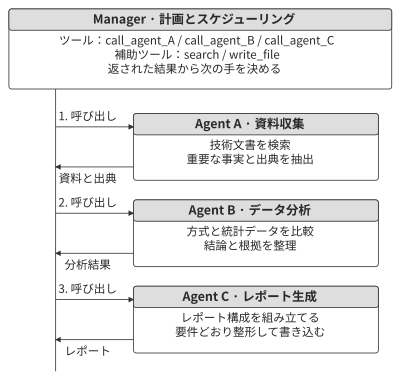

> **実験 10-2 ★★：書籍翻訳 Agent**
>
> 技術書の翻訳では、用語、文脈、文章を同時に扱う必要があります。たとえば英語の agent にはいくつもの訳し方がありえますが、訳稿で「エージェント」を使うと決めたなら、後の章でも同じ訳語を使い続けなければなりません。用語集、各章の原文、訳文、レビュー記録は、はっきりした方法で整理しておく必要があります。長い本は、途中の訳稿、ツールの結果、レビューの履歴とあわせてコンテキストをどんどん圧迫していき、モデルは第 9 章に差しかかるころには第 2 章の訳語を忘れているかもしれませんし、同じ段落を何度も検査するかもしれません。タスクを職責と章ごとに分ければ、各インスタンスは現在の職責に必要な資料に集中できます。
>
> 作業は 4 種類の Agent に分担できます。
>
> - **Glossary Agent：用語の整理。** 全書を何回かに分けて読み、繰り返し現れる専門用語を特定し、専門辞書と翻訳の規範を参照して、英語の用語、訳語、品詞、使用される文脈を含む JSON または CSV の対照表を生成します。用語集は共有空間に保存し、タスクが終わったらこのインスタンスを解放します。
> - **Translation Agent：章の翻訳。** 現在の章、関連する用語、翻訳ガイドを読み、対象読者と文体に合わせて訳文を仕上げます。新しく現れた用語には訳語の候補を示し、要確認の印をつけます。各インスタンスは独立したコンテキストを保持し、訳文を共有空間に保存します。章ごとに依存関係に応じて逐次処理することも並行処理することもできます。
> - **Proofreading Agent：全文のレビュー。** 用語集と各章の訳文に基づいて、訳語、前後の表現の一貫性、読みやすさを検査します。章ごとの読み取りと章をまたぐインデックスを使って全文を検査し、問題の箇所、根拠、修正の要求をレビュー報告に書き込みます。
> - **Manager Agent：タスクの手配と回収。** 目標、計画、タスク状態、呼び出しの要約、成果物のインデックスを管理し、レビュー報告に基づいて修正が必要な章を翻訳者に差し戻し、再確認を手配します。
>
> 図10-5 では、レビュー担当者が各章の訳文と用語集を読み、Manager が報告に基づいてどの章の手直しが必要かを決めます。手直しのタスクを受け取った翻訳者は、その章の原文を呼び出し、印のついた語がその文の中で何を意味しているかを確認できます。
>
> 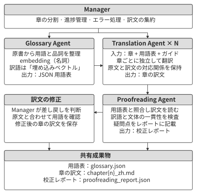
>
> 訳稿をファイルに書き出したあと、長い文章を読む必要がまだあるのはどの呼び出しでしょうか。付属の実験では、英語版の最初の 2 章を 26 の翻訳単位に分けました。単一 Agent はそれまでの原文と訳文をずっと抱えたまま進み、最大のリクエストでは 94,355 token を入力しました。分業したあとは、翻訳者の最大の入力は 2,857 token にすぎず、Manager が手直しを判断する際に使ったのは 2,153 token でした。管理者グループの中で入力が最も多かったのは、実は用語整理担当です。一度に 2 章を読み、49,807 token を使いました。
>
> この 2 章を訳し終えるまでに、4 つの役割の合計は 203,277 token、単一 Agent は 1,317,808 token を使いました。先に提出したのはどちらのグループでしょうか。4 役割のグループは約 271 秒かかり、単一 Agent より約 17 秒長くかかりました。
>
> 提出時、2 種類の検査が同じ訳文について異なる結果を出しました。用語集は名詞 `embedding` に「嵌入向量」（埋め込みベクトル）という訳語を指定していました。レビュー報告には手直しの必要な章が挙がっていませんでしたが、用語検査プログラムはこの語に 0/2 をつけました。2 章の訳稿のどちらにも「嵌入」（埋め込み）は見つかったものの、「嵌入向量」はどちらにも見つからなかったのです。2 章とも差し戻すべきでしょうか。
>
> 第 1 章の返金ポリシーを扱う段落では、原文が `embedding the refund policy in the context`、訳文が「返金ポリシーをコンテキストに埋め込む」という意味の中国語でした。ここで言っているのはポリシーをコンテキストに入れることであり、「埋め込みベクトル」に変えればかえって誤訳になります。プログラムは章ごとに文字列を探すので、レビュー担当者が再確認の手がかりを見つける助けにはなります。どの箇所を直すべきかを決めるには、レビュー担当者にその段落の原文も必要です。用語集を更新するときも、まず影響を受ける段落を特定し、原文、訳文、新しい項目をまとめて翻訳者に渡すとよいでしょう。
>
> **実験の要件：**
> 1. 図表とコードを含む技術書を 1 冊選びます。
> 2. Manager、Glossary、Translation、Proofreading の 4 種類の Agent を実装します。
> 3. 各メンバーのコンテキスト使用量、引き継ぎ資料、成果物のバージョンを記録します。
> 4. 単一 Agent の方式と翻訳品質、完了時間、資源消費を比較し、タスクの分割とコンテキストの組織が与える影響を分析します。

**並行協調。** 互いに独立したサブタスクは同時に実行できます。Manager はタスクを割り当て、状態を受け取り、結果に応じて続行、追加作業、終了のいずれかを決めます。本書を翻訳する場合なら、用語集が確定した時点で、別々の章を複数の翻訳者に割り振って一斉に作業を始められます。図10-6 は研究レポートに置き換えた例です。図表はもう完成していて分析はまだ進行中なのに、なぜ書式の検証は待たなければならないのでしょうか。メンバーが報告したイベントをたどれば、最後のステップがどの 2 つの成果物に依存しているかがわかります。

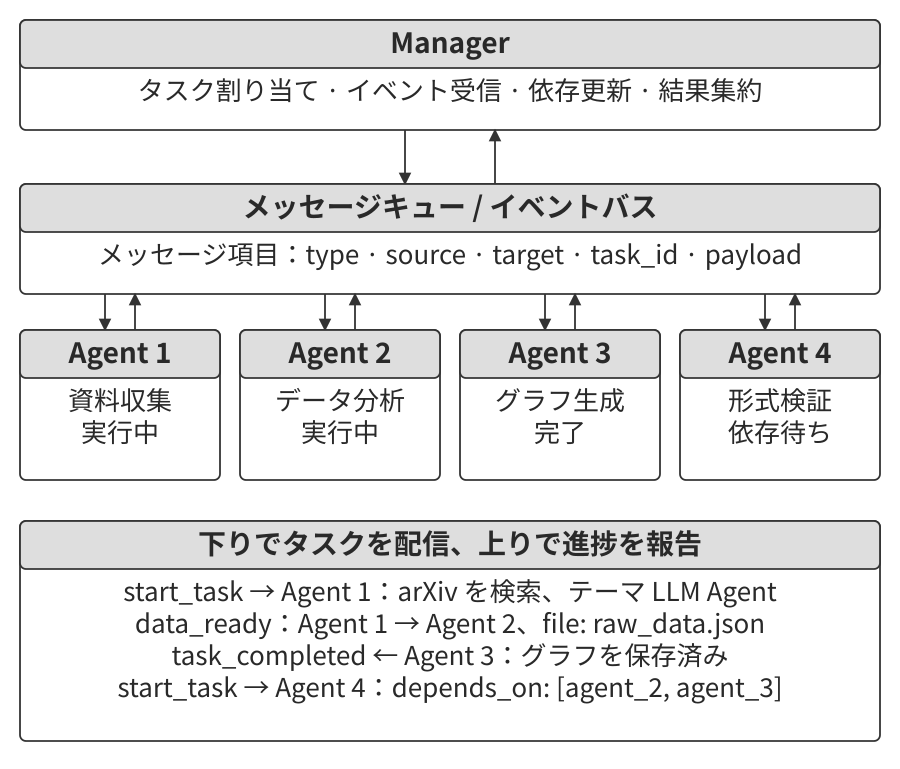

この種の非同期通信の組み立てには、メッセージバスが向いています。メンバーは進捗と結果を発行し、管理者は該当するイベントを購読し、ランタイムが配送、バッファリング、再試行を担います。

> **製品事例：霊台（Lingtai）**
>
> 霊台はローカルで動き、身元と記憶をファイルに保存する長期稼働の Agent システムです。3 種類の役割を備えています。主器霊（main agent）はユーザーと対話し、計画と記憶を管理します。分神（daemon）は範囲の明確な短期の並行タスクを受け持ち、終わったら結論を返します。分身（avatar）は自分の記憶、メールボックス、職責を持ち、セッションをまたぐ専門的な分業に使われます。
>
> 各役割は私的で永続的な知識を持ち、Markdown 形式のスキルの手引きを共有します。コンテキストが容量の上限に近づくと、役割は「凝蛻」（molt）によって要約を保存し、永続的な記憶と合わせて新しいコンテキストに移ります。身元、記憶、スキルがファイルに独立して保存されているため、基盤モデルを替えても作業を続けられます。この設計は、管理者、短期のワーカー、長期の専門メンバー、コンテキスト圧縮を組み合わせたものです。

> **実験 10-3 ★★★：自律的にオーケストレーションする電話 + コンピュータ Agent**
>
> この実験は、第 6 章の Computer Use と音声インタラクションを組み合わせたものです。ユーザーが登録や航空券予約のページを示すと、Computer Agent はサイトを開いてフォームを認識し、Phone Agent を通じて、現時点で足りない氏名、身分証番号、連絡先、住所、希望などの項目を集めます。
>
> **役割と引き継ぎ。** Computer Agent はブラウザを操作し、今回のオーケストレーションを担います。Phone Agent は ASR、LLM、TTS を通じてユーザーとリアルタイムにやり取りし、口頭の回答を構造化された項目に変換します。両者はポイントツーポイントのツールかメッセージバスで通信し、メッセージには送信者、受信者、種類、内容が含まれます。Computer Agent は電話のタスクを直接委譲でき、管理者の職責を担います。ユーザーが音声で情報を提供してくれる場合、Phone Agent は続けて質問し、確認し、聞き直すことができ、Computer Agent はページの状態と項目の入力に専念します。
>
> **2 つの実行モード。** 固定モードでは 2 つの Agent をあらかじめ起動し、それぞれが独立した実行ループを保持します。双方向の通信と並行時のふるまいを検査するために使います。自律モードではまず Computer Agent を起動し、モデルがページ、既存の情報、タスクの必要に基づいて、`initiate_phone_call_agent(purpose, required_info)` を呼び出すかどうかを決めます。ランタイムはタスクの目的、集めるべき項目、形式の制約を Phone Agent に渡し、起動後は同じ通信の仕組みを使います。
>
> **項目ごとの受け渡し。** 図10-7 では、Phone Agent が WebRTC を通じて質問し、回答を抽出して検証し、有効な値を得たら `info_collected` を送ってから次の項目を尋ねます。Computer Agent は同時にページを読み取って前の項目を入力し、`fill_error` や新しいページの状態を返します。形式が合わないというフィードバックは `format_invalid` で項目と要件を示し、Phone Agent はそれに基づいて確認か聞き直しを行います。こうして「次の項目を尋ねる」ことと「前の項目を入力する」ことを重ねて実行できます。
>
> **完了と異常への対処。** Phone Agent は項目を集め終えたら `task_completed` を送り、情報収集のサブタスクが終わったことを示します。Computer Agent は引き続き必須項目、ページの検証結果、送信の認可を確認してから、フォームの操作を完了させます。再試行の回数を超えたとき、ページの異常にぶつかったとき、ユーザーが停止を求めたときは、タスクを一時停止して現在の進捗を説明します。終了時には、まだ実行中の相手側を取り消し、ブラウザのセッション、音声トラック、通話を閉じます。実際の人との音声のやり取りとフォームの送信については、それぞれユーザーの同意と認可を得ます。
>
> 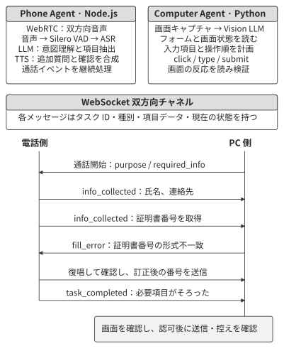
>
> **実験の要件：**
> 1. 2 つの独立した Agent と、双方向の構造化された通信を実装します。
> 2. 固定モードと自律モードでタイミングを記録し、質問と入力が重なっている区間を確認します。
> 3. 形式の検証、聞き直し、ページエラーのフィードバック、タイムアウト、資源の片付けを実装します。
> 4. 2 つのモードの起動の判断、遅延、成功率、資源消費を比較します。

> **実験 10-4 ★★★：複数のサイトから同時に情報を集める Agent**
>
> この実験では、同じ構成の複数の Agent による並行検索を使い、第 6 章のイベント駆動と割り込みの仕組みを練習します。タスクは、ある大学の複数の学部サイトから指定された教員、たとえば「張偉」を探し、所属学部、職位、研究分野、出典ページを返すことです。検索の前に、氏名、専門分野、個人ページの情報といった識別条件を取り決めておけば、同姓同名の人物を区別しやすくなります。
>
> **1. 並行起動。** Manager は 10 個の Computer Use Agent を作成し、それぞれに 1 つの学部サイトを担当させます。各インスタンスは独立したコンテキストとブラウザのセッションを保持し、非同期タスク、スレッド、プロセスのいずれでもスケジューリングできます。入力には、サイトの URL、目標の氏名、照合条件、ルーティング用のタスク識別子が含まれます。
>
> **2. 進捗の集約。** メンバーは「サイトを読み込み中」「教員名簿を読み取り中」「確認済み・該当なし」「同姓同名の教員を発見」といった状態を定期的に送ります。Manager はメッセージバスを通じてタスク表を管理し、実行中、完了、停滞、失敗をそれぞれ記録し、出典とエラーの原因も残します。
>
> **3. 検証後にほかの分岐を取り消す。** 物理学部を担当する `agent_3` が同姓同名の教員を見つけたとしましょう。`agent_3` は `target_found` を送り、ペイロードには教員の情報と出典が含まれます。タスクが検証済みの人物情報を返すことを求めているなら、Manager はまず照合条件と証拠を確認し、目標の人物を見つけたと確かめたうえでアトミックな操作で結果を登録し、それからほかの実行中のメンバーに `terminate` を送って、採用した情報が `agent_3` からのものであることを伝えます。メンバーはセーフポイントで停止し、資源を片付けて確認を返します。Manager は確認かタイムアウトを待ってから集約を完了させます。同姓同名の人物をすべて列挙することが求められている場合は、必要な範囲を確認し終えるまで検索を続けます。
>
> **競合状態。** Agent A と B がほぼ同時に有効な結果を返すことがあります。2 つのイベントがそれぞれ集約を起動すると、重複納品や状態の衝突が起こります。「検索中 → 結果登録済み」という状態遷移をロックかトランザクションで保護し、後から届いたイベントには登録済みの結果を読ませればよいでしょう。メッセージの再試行もイベント識別子で重複を排除し、取り消しや集約が重複して起動されても一貫性が保たれるようにします。
>
> **4. 異常とカバー範囲。** ネットワークの切断、ページ構造の変化、解析エラーはそれぞれ区別して記録します。個々のタスクに 2 分などのタイムアウト予算を設け、時間を超えたら実行を取り消して診断情報を集め、ほかのメンバーは作業を続けます。最終報告では「確認済みで見つからなかった」と「アクセスに失敗し、まだ確認できていない」を区別し、あわせてカバーした学部の範囲を示します。
>
> 図10-8 は、これらのメッセージを一連の例示的な時刻でつないだものです。メンバー 3 が、物理学部に量子計算を研究する張偉教授がいると報告したとします。Manager はまず、出典の Web ページで氏名、所属、職位、研究分野を裏づけられるかを確認しなければなりません。同姓同名の教員の手がかりを受け取る時刻、目標の人物だと確認する時刻、取り消しの受領確認がそろう時刻は、それぞれ別の時点です。
>
> 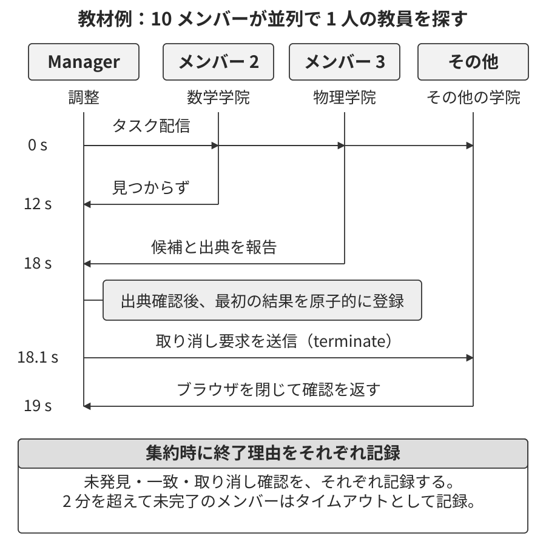
>
> 実際に検索したのは Andrew Ng です。メンバーはまずページのテキストにその名前があるかを調べ、見つかった場合に限ってモデルに情報の抽出を依頼します。選ばれたのは Stanford HAI のページで、返された短い引用から氏名と兼任教授という身分を確認できます。研究分野を確認するには、ページの後半にある深層学習についての段落も読む必要があります。複数のメンバーが同時に `target_found` を返しても、結果を登録できるのは最初にロックを取得したメンバーだけです。
>
> 今回の逐次検索は 10 個の URL の最後でようやく見つかり、44.971 秒かかりました。同じ一群のページに対する並行検索は 24.022 秒で、どちらも 10 個のブラウザコンテキストをすべて閉じています。2 つの数値の比は 1.872 です。HAI のページを先頭に置けば、逐次検索は見つけた時点で止められるので、所要時間は測り直す必要があります。取り消しを検証するための別の実行では 4 つの分岐を起動しました。1 つの分岐が先に結果を登録し、残りの 3 つは取り消し要求の受領を確認し、最後には 4 つのブラウザコンテキストがすべて閉じられました。
>
> **実験の要件：**
> 1. 並行するメンバーを動的に作成する Manager を実装します。
> 2. browser-use などのプロジェクトを使って、ブラウザの実行能力を構築します。
> 3. メッセージバスを通じて双方向の通信と状態の管理を行います。
> 4. 検索結果を検証し、アトミックな操作で結果を登録し、残りの分岐を取り消したあとに確認を集めます。
> 5. アクセスの失敗、解析エラー、タイムアウト、該当なしといった状況に対処します。
> 6. 並行実行と逐次実行の完了時間、カバー範囲、資源消費を比較します。

**管理者によるワークフローの生成。** Manager は 1 つずつ委譲するだけでなく、タスクの依存関係と集約の規則をまずプログラムとして書き、それをランタイムにスケジューリングさせることもできます。モデルはフローを設計し、プログラムは取り決めに従ってメンバーを起動し、結果を受け渡し、依存関係を待ちます。依存関係がすでにはっきりしていて、同じ種類のフローを繰り返し実行する必要がある場合、筆者はこの方法を優先します。割り当てのたびに Manager を呼び出すコストが省け、管理用のコンテキストにスケジューリングの記録が積み上がることも減ります。

Claude Code の動的 Workflow ツールは、こうした実装を提供しています。`agent()` は独立したコンテキストを持つサブ Agent を作成し、schema で構造化された出力を取り決められます。`parallel()` は一群のタスクを並行に実行し、すべてが終わるのを待ちます。`pipeline()` は各入力にそれぞれ複数の段階を通らせ、ある項目が次の段階に進んでいる間も、ほかの項目は前の段階で処理を続けられます。中間結果はプログラムの変数に保存され、絞り込みや統合は通常のコードで行います。[^dynamic-workflows]

たとえば技術原稿の 7 組の事実を確認するとき、まず方向ごとに調査 Agent を起動し、それぞれの結論を確認 Agent に渡して並行に検査させることができます。返ってくる結論にはどれも出典と判定の根拠を残し、すべての分岐が終わったら、集約 Agent が最終報告をまとめます。こうして「調査—1 件ずつの確認—一括の集約」という分業と段階間の依存関係が、すべてワークフローに書き込まれます。

[^dynamic-workflows]: Anthropic, “Orchestrate subagents at scale with dynamic workflows”, 2026.

### 分散型パターン

Manager がいるのに、なぜメンバー自身に誰に頼むかを決めさせるのでしょうか。テスト担当が書き上がったばかりのモジュールを受け取り、製品要件とインターフェースの取り決めが同じフィールドを 2 通りに解釈していることに気づいたとします。テスト担当はこの矛盾をプロダクトとアーキテクチャの 2 つの役割に直接持ち込み、双方にそれぞれの根拠を説明させ、取り決めが直るのを待ってからテストを続けられます。これは分業であると同時に、一種の牽制でもあります。エンジニアがモジュールを納品し、アーキテクトがプロダクト側の意見を求め、テスト担当が異議を唱える、というように、それぞれが次のステップを起こせるのです。頻繁な協議が必要なとき、Manager が 1 件ずつ取り次ぐのを待っていては仕事が遅れます。

マイクロサービスの用語を借りれば、1 つの中心がステップを手配することを**オーケストレーション**（orchestration）、各者が取り決めたイベントに従って自分で作業を引き継ぐことを**コレオグラフィー**（choreography）と呼びます。実際的な違いはもう 1 つあります。引き継ぎのたびに Manager を待つ必要があるなら、そのモデルサービスが応答を止めた途端、ほかのメンバーはまだ作業できても次のタスクを受け取れなくなります。分散型の協調はこの種の依存を減らせます。ただし、引き継ぐはずのメンバー自身があるツール呼び出しで止まっている場合は、永続的に保存されたタスク状態、タイムアウト、再試行、引き継ぎの仕組みによって、別のメンバーがどこから続ければよいかを知らせる必要があります。

以下の 3 つの設計には、それぞれ異なる引き継ぎ方があります。成果物ごとにメッセージを購読する方法、グループチャットで次の発言者を選ぶ方法、現在のメンバーが名指しで移譲する方法です。

**MetaGPT：SOP で成果物の引き継ぎを組み立てる。** MetaGPT は、ソフトウェアチームの標準作業手順（SOP）に従って分業します。プロダクトマネージャーは要求仕様書（PRD）を、アーキテクトは設計書を、エンジニアはコードを、テスト担当はテスト報告を提出します。次のメンバーは取り決めた資料を受け取ればすぐに作業を始められ、前のメンバーもタスクを何度も説明し直す手間が省けます。図10-9 の線は、これらの成果物の引き継ぎ関係を表しています。[^metagpt-design]

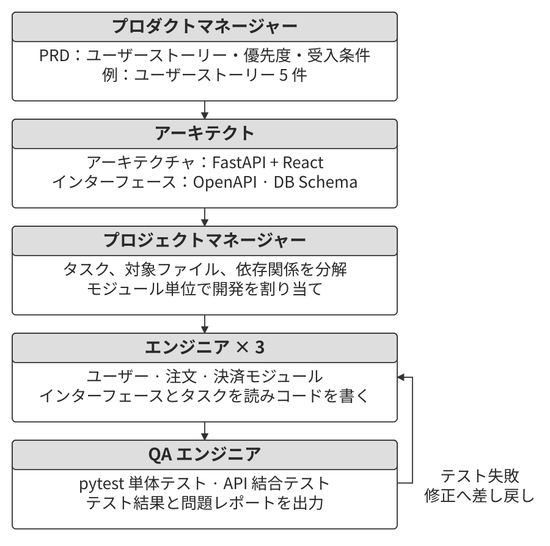

各役割は引き継ぎの際にどんな情報を補う必要があるでしょうか。

- **Product Manager Agent** は要求を受け取って PRD をまとめ、機能、ユーザーストーリー、受け入れ基準、優先度を明確にします。
- **Architect Agent** は PRD を読み、技術スタックを選び、モジュールを分割し、インターフェースとデータモデルを定義して、設計書を作成します。
- **Project Manager Agent** は設計に基づいてタスクとファイルの分担を決め、依存関係を整理し、エンジニアに実行を手配します。
- **Engineer Agents** は設計に基づいてモジュールを実装し、コードを提出します。互いに独立した部分は複数のインスタンスに任せられます。
- **QA Engineer Agent** はコードと要求に基づいてテストを生成し、検査を実行して問題を記録し、テスト報告を作成します。

これらの役割のために引き継ぎの形式を設計するなら、筆者は 3 つのことを明記するよう勧めます。タスクと受け入れ基準、確認済みの事実と制約、そして構造化された成果物への参照です。受け手はこれに基づいて必要な資料を取得して作業を続け、情報が欠けていれば具体的な質問を出します。

MetaGPT は共有メッセージプールと購読の仕組みによって情報を組織します。役割がメッセージを発行し、ほかの役割は自分が注目するメッセージの種類に応じて関連する入力を処理します。発行者と消費者は成果物の形式とメッセージのセマンティクスでつながっているため、モデルを個別に差し替えたり、内部の実装を調整したりできます。

SOP はプロダクトの要求、アーキテクチャ、コードのあいだの依存関係を記述し、メッセージの購読はそれらの作業がどう起動されるかを記述します。固定したタスクの依存関係も分散イベントで進められ、両者が合わさってシステムの協調の仕方を形づくります。動的なフィードバックをさらに設計するなら、テスト担当がプロダクトの役割に要求を確認する経路や、エンジニアがアーキテクトに代替案を出す経路などを加え、そうしたやり取りに受け付けの条件と終了の規則を設けるとよいでしょう。

[^metagpt-design]: Hong, S., et al. *MetaGPT: Meta Programming for A Multi-Agent Collaborative Framework.* ICLR 2024.

**AutoGen のグループチャット：共有セッションにおける発言のスケジューリング。** 古典的な GroupChat の設計では、複数の Agent が同じセッションに参加し、GroupChatManager が次の発言者を選び、メンバーにメッセージをブロードキャストします。選び方はラウンドロビンでもよいですし、現在の内容に基づいてモデルに判断させてもかまいません。メンバーはそれぞれの役割設定を保ったまま共通のセッションでやり取りし、発言のスケジューリングはマネージャーに集中します。これはコンテキストの組織と制御構造を組み合わせた一例です。[^autogen-groupchat]

[^autogen-groupchat]: Microsoft, *AutoGen 0.2: Conversation Patterns.*

**OpenAI Swarm：handoff に沿って制御権を引き継ぐ。** Swarm では役割ごとに指示とツールを設定し、役割が設定済みの移譲関数を呼び出すと、ランタイムが移譲先の Agent に切り替えます。ルーティングの判断は各役割が下し、統一された実行ループがそれを実行する、という形にできます。移譲の際、現在のシステム指示は役割に応じて変わり、対話履歴はそのまま保持されます。これは「役割が次の引き継ぎ手を選ぶ」ことと「セッション履歴を引き継ぐ」ことの組み合わせを示しています。[^swarm-handoff]

独立したコンテキストで引き継ぐ方式を採るなら、別途タスクパッケージを定義できます。`task_id` でタスクを識別し、`sender` と `recipient` で双方を指定し、`goal` と `constraints` で目標と制約を説明し、`accepted_facts` に確認済みの事実を保存し、`artifact_refs` で成果物への参照を示し、`remaining_budget` に予算を記録し、`visited_agents` に訪問の経路を保存します。受け手は認可に従って資料を読み取り、ランタイムが予算と引き継ぎの記録を管理します。

引き継ぎの連鎖では、同じ相手への再訪に対処する必要があります。たとえば開発者がコードをレビュー担当者に渡し、レビュー担当者が修正を求めて開発者に戻すのは、正常な修正のループです。進展があるかどうかは、タスク状態、成果物のバージョン、未解決の問題、繰り返しの回数を合わせて判断できます。たとえば同じ訳稿が 2 回続けて差し戻され、1 回目で出典が補われ、2 回目で用語が直されたなら、修正はまだ進んでいます。2 回とも同じ版が差し戻され、指摘も同じ問題だったなら、修正は行き詰まっています。そのときは移譲を続けられる回数を制限し、まだ解決していない問題を責任者に報告するとよいでしょう。

[^swarm-handoff]: OpenAI, *Swarm*, “Instructions” と “Handoffs and Updating Context Variables”.

> **製品における Agent Swarm**
>
> 「Agent Swarm」は、異なる組織方式を指すことがあります。1 つは handoff のネットワークに沿って制御権を引き継ぐもので、OpenAI Swarm、LangGraph の swarm ライブラリ、Microsoft Agent Framework の handoff オーケストレーションがこれに当たります。もう 1 つはメイン Agent と並行ワーカーを使うもので、Kimi Agent Swarm、Anthropic のマルチ Agent 研究システム、Manus Wide Research などがあります。
>
> Kimi K2.5 が導入した Agent Swarm は、並行 Agent の強化学習によってオーケストレーターを訓練し、いつタスクを分割し、どう作業を割り振るかを学ばせるもので、最大 100 個のサブ Agent をサポートします。後続のバージョンでは規模が 300 個に拡大され、K3 Swarm は引き続き大規模な検索やバッチ処理に使われています。AgentENV は Kimi K3 の Agent 強化学習に拡張可能な環境を提供し、スナップショットと分岐をサポートして並行実行を組み立てます。[^ch10-kimi-swarm]

**同じマシン上の複数の Agent インスタンス。** 複数のインスタンスが別々のタスクを受け持ちながら、ファイル、ツールサービス、GPU を共用することもあります。このとき通信は、変更範囲の説明、資源解放の通知、実行順序の協議に使えます。たとえば 2 つのインスタンスがどちらも GPU を 1 枚必要とする場合、まずタスクと見込みの使用量を登録し、資源マネージャーが使用権を与える、という形にできます。

Claude Code の Agent Teams は、チームメンバーの発見、メッセージ、共有のタスク管理を提供しています。メンバーは確立されたチームの範囲内で互いの情報を取得し、ランタイムが通信を組み立てます。[^claude-agent-teams] 同じマシン上の協調を自前で構築する場合も、第 4 章の `list_agents` などのインターフェースを使い、発見の範囲、アクセス権限、資源の所有権について明確な規則を設けられます。メッセージで協議した結果は、ロック、クォータ、スケジューラーによって実際に適用します。

[^ch10-kimi-swarm]: Moonshot AI、*Kimi Agent Swarm: 100 Sub-Agents at Scale*、Agent Swarm のヘルプドキュメント、AgentENV のプロジェクト説明。

[^claude-agent-teams]: Anthropic, *Orchestrate teams of Claude Code sessions.*

### 組織をまたぐ協調：A2A プロトコル

協調がサービスや組織の境界をまたぐとき、双方は能力の発見、身元の認証、リクエストの形式、進捗と結果の納品について取り決める必要があります。Google が 2025 年に発表した **A2A**（Agent2Agent）プロトコルはこうした相互運用のインターフェースを提供するもので、その後 Linux Foundation に管理が移されました。3 つの面から理解できます。[^a2a-concepts]

- **能力の発見。** Agent Card は、身元、サービスのエンドポイント、スキル、入出力のモダリティ、認証の要件を記述したメタデータ文書です。呼び出し側はこれに基づいて、相手がタスクを処理できるか、どう接続を確立するかを判断します。
- **タスクとメッセージ。** Task は識別子とライフサイクルを持つ作業を表し、呼び出し側は送信済み、処理中、入力待ち、完了、失敗などの状態を追跡できます。Message はタスクの要求、補足情報、返信を運び、Artifact は文書、画像、構造化された結果を納品します。メッセージと成果物に含まれる Part には、テキスト、ファイル参照、データを入れられます。
- **インターフェースに沿った協調。** 呼び出し側はこれらの公開オブジェクトを通じてリモートとやり取りし、リモートは内部のプロンプト、記憶、ツールを独自に管理します。認証、認可、データアクセスの範囲は、双方がそれぞれ実施します。

長いタスクでは、ポーリングで状態を取得することも、SSE でストリーミングの更新を受け取ることも、対応していればプッシュ通知を使うこともできます。ユーザーが情報を補足したら、クライアントは同じタスクを先へ進め、タスク状態に応じて最終的な成果物を取得します。

第 4 章の MCP は、モデルアプリケーションにツール、リソース、プロンプトのインターフェースを提供することに重点を置いています。A2A は Agent サービス同士のタスク協調に重点を置いています。両者は組み合わせられます。ある Agent が MCP でツールを使いながら、A2A でリモートにタスクを委譲する、という形です。同じチーム内に安定したインターフェースがすでにあるなら、筆者はまずツール呼び出し、共有ファイル、メッセージバスをそのまま使います。独立して保守されている Agent サービスを接続し、能力の発見とタスクのライフサイクルを統一する必要が出てきた時点で A2A を導入し、組織をまたぐ場合はさらに身元、権限、データガバナンスの規則を設定します。

[^a2a-concepts]: A2A Project, *Core Concepts and Components in A2A.*

**別々の人のために時間を調整する。** 3 人の家族がそれぞれ自分のスケジュールアシスタントを持っていて、夕食の約束をしたいとします。自分の利用者の予定表をすべて読めるアシスタントは、ほかの 2 人のアシスタントにどう答えればよいでしょうか。「火曜は都合が悪いが、水曜なら調整できる」と答えれば、すでに役に立つ区別を伝えています。予定表をそのまま転送すれば、火曜の私的な用事まで余計に漏らしてしまいます。「どちらの日も予定がある」とだけ答えると、ほかの人は水曜にまだ相談の余地があることを知りようがありません。毎回約束がまとまったとしても、いつも同じ人ばかりが予定を変えているなら、この取り決めはその人にとって割に合うとは限りません。

CalBench の公開問題の 1 つでは、5 人で 5 つの会議を設定し、各会議に 3 人が参加します。ある時間帯をまったく動かせない人もいれば、変更できる私用もあり、問題には変更 1 回ごとのコストが定められています。まず単純な方法を試してみましょう。5 つの会議を順に処理し、毎回いちばん早い時間帯から探して、3 人とも時間を空けられればそこで確定します。すでに決まった会議はそのまま残します。次に別の方法を試します。5 つの会議をまとめて扱い、全員の予定表を使って解くのです。以下では問題の時間帯番号をそのまま使い、0 から数えます。[^ch10-calbench]

| 組み方 | 第 1〜第 5 会議それぞれの時間帯 | 1 つ確定するごとに支払う変更コスト | 総コスト |
|---|---|---|---:|
| 会議ごとに空けられる最も早い時間帯を選び、決まった会議は残す | 0、2、1、3、6 | 1、20、20、12、300 | 353 |
| 参照ソルバーで 5 つの会議を一括して調整する | 13、3、10、9、12 | 0、1、0、1、1 | 3 |

どちらの日程も、3 人の参加者の最終的な予定表の上で会議ごとにそろっています。差が最も大きいのは最後の会議です。1 つ目の組み方では、時間帯 6 は空けられるものの、3 人それぞれにコスト 100 の予定を動かす必要があります。時間帯 12 に置けば、1 人がコスト 1 の予定を 1 つ動かすだけで済みます。全体の結果は評価者に比較の根拠を与えますが、実際に協議に参加するアシスタントには、それぞれ自分の利用者の予定表しか見えません。

このバージョンに付属する貪欲法のソルバーは、コストを 146 と報告し、5 つの会議すべてに時間帯を返しました。しかし後の会議を組む際に、先に決まった会議を一部の参加者の予定表から移してしまうことを許しています。第 1 会議は、3 人の参加者の予定表の上で最終的にそれぞれ時間帯 7、0、11 に置かれていました。「3 人の最終的な予定表に同じ会議が同じ時間帯で記録されている」ことを受け入れ基準にすると、成功しているのは第 3、第 4、第 5 会議だけです。

実際の日程調整サービスでは、日程の問題には含まれていない情報にも出会います。Microsoft の Calendar.help は、1 年間にメールを通じて数千件の会議を調整しました。あるメールは新しい会議の打診なのか、前回の会議の変更なのか。自動分類が判断に迷うと、まず人間がその受信メールを見て、この 1 つの判断問題だけを処理します。受信メールだけでは答えられない場合は、やり取りしたメール、収集済みの情報、匿名化した予定表を見られる日程調整担当者にタスクを渡せます。この設計は、「誰に判断を頼むべきか」と「その人にどこまで見せる必要があるか」を結びつけています。[^ch10-calendar-help]

[^ch10-calbench]: CalBench の論文は、調整コスト、公平性、推測可能な予定表の状態、具体的な用件の内容の漏洩をそれぞれ論じています。数値はバージョン `86f8123` の「変更コストが異なる」問題集の第 1 問から取ったもので、1 つ目の組み方では、いずれかの参加者に既存の会議がある時間帯を選択時に飛ばし、それ以外は著者の移動規則に従っています。スケジューリングソルバーで再計算できます。

[^ch10-calendar-help]: Cranshaw ら、Calendar.help の設計と運用。人間がマイクロタスクを処理するインターフェースと、日程調整タスク全体を扱うインターフェースの 2 層構成の説明を参照。

## マルチ Agent 協調の失敗モード

複数のメンバーが共同でタスクを実行するようになると、障害は役割、引き継ぎ、検証のあいだで起こりえます。『Why Do Multi-Agent LLM Systems Fail?』は約 150 本の軌跡から失敗の分類を作り、アノテーションの一致度 κ は 0.88 でした。そのうえで分析を 7 つのフレームワークに広げています。研究は 14 種類の失敗モードをまとめ、3 つのカテゴリに分けました。[^mast-failures]

- **システム設計の問題：** 役割の職責、インターフェース、ツールの設定、停止条件に欠けている部分がある。
- **メンバー間の協調のずれ：** 目標の理解が異なる、情報の引き継ぎが不完全である、あるいは行動が互いに矛盾する。
- **タスク検証の問題：** 早々に終了する、検査を漏らす、あるいは不適切な基準で完了を判断する。

論文はチェスのプログラムを例に挙げています。ChatDev が生成したコードはコンパイルでき、レビューも通過しましたが、実際のルールに従って対局させると、プログラムはすぐに誤りを起こしました。コンパイラが検査するのはコードがコンパイルできるかどうかであり、指し手がルールに合っているかを確かめるには何手か指してみる必要があります。別の比較では、研究者は ChatDev のレビュー意見で修正に差し戻せるようにし、技術レビューを担当する役割が確認してはじめて終了するようにしたうえで、反復の最大ラウンド数を設定しました。ProgramDev-v0 の 32 個のタスクでは、元のフローが 8 個に合格したのに対し、調整後のフローは 13 個に合格し、成功率は 25.0% から 40.6% へ、約 15.6 ポイント上がりました。[^mast-failures]

[^mast-failures]: Cemri, M., et al. *Why Do Multi-Agent LLM Systems Fail?* 2025.

「レビュー担当者が返事をしない」ことと「レビュー担当者は返事をしたが、判断が誤っている」ことは、どう区別すればよいでしょうか。分散システムでは、部品が動作を止めることをクラッシュ障害と呼びます。ビザンチン障害のモデルでは、部品が任意の誤った結果や互いに矛盾する結果を出すことまで許します。Agent も同じように途中で止まることもあれば、いつもどおり誤った結論を返すこともあります。前者には検出、復旧、引き継ぎが必要であり、後者には証拠の検証、権限による制約、誤りの隔離が必要です。通常のハートビートは Agent がまだ動いているかを判断する助けにはなりますが、それが返す結論が正しいかどうかは、実際の結果を検査しなければわかりません。相互チェックや投票は結果の評価に使えますが、その信頼性は証拠の質とメンバーの誤りの相関に左右されます。正式なプロトコルでは、さらに、障害を起こしたノードを最大いくつまで許容できるか、ノード間でどう通信するかも定められています。

### 失敗モード 1：共有ファイルシステムの並行競合

共有された成果物によってメンバーは作業を引き継げるようになりますが、同時に変更するという問題も生まれます。まず 2 つの層を区別しておきましょう。

**ファイルレベルの競合**は、2 つのメンバーが同じファイルを変更したときに起こります。どちらも古いバージョンを読み取り、順に書き戻すので、後の書き込みが前の結果を上書きしてしまいます。

**意味的な競合**は、関連し合う成果物のあいだで起こります。たとえば Agent A が全書の画像番号を振り直し、同時に Agent B がある章を修正して元の番号を参照しているとします。2 人は別々のファイルを変更しているので、マージ時にテキストの競合は起こらないかもしれませんが、最終的に図と本文の対応は崩れています。

用語集の現在のバージョンを 7 とします。甲と乙はどちらも第 7 版から修正を始め、甲が先に提出してバージョンは 8 に上がりました。乙が提出時に「この表を書き込む」とだけ指示すれば、甲の修正が上書きされるおそれがあります。「現在のバージョンがまだ 7 である場合に限って書き込む」と求めれば、プログラムはマージが必要だと気づけます。ファイルレベルの並行には**楽観ロック**を使えます。読み取り時にバージョン番号を記録し、提出時にバージョンの確認と書き込みを 1 つのアトミックな操作として行います。バージョンが変わっていれば古い提出を拒否し、読み直してマージします。

ファイルをまたぐ意味的な一貫性には、関連関係の検査が必要です。複数の Coding Agent が同じリポジトリを変更する場合、筆者はまず各メンバーに独立した worktree とブランチを割り当て、それぞれにコミットを作らせ、マージの時点で競合を確認し、テストを実行し、インターフェースを検証します。ブランチを作るだけでは不十分で、同時に起こるファイルの変更を隔離するには独立した作業ディレクトリも組み合わせる必要があります。

### 失敗モード 2：誤りのカスケード増幅

メッセージが一字一句そのまま届いても、言い換えの過程で意味がずれることはあります。いくつかの Agent が共同でカスタマーサポートの記録を書くとしましょう。甲は「オペレーターが次回の請求で 80 元の減額を約束した」と書き、乙はそれを「80 元減額済み」と圧縮し、丙はその要約を読んで ToDo を閉じてしまいました。3 つのメッセージはどれも届いていますが、ユーザーは次回の請求書を確認するためのリマインダーを失いました。伝言ゲームと同じで、誤りが起きたのは、乙が 1 つの約束をすでに起きた結果として書いてしまった箇所です。

引き継ぎの記録には、結論、適用条件、出典を残し、引き継いだ人がどれが確認済みで、どれがまだ推測なのかを見分けられるようにします。上のような食い違いが起きたら、筆者はまずレビュー担当者に通話の原文と最新の請求書を読ませ、この件がどの段階まで進んでいるかを自分で判断させ、そのあとで乙がなぜそのように要約したのかを確認します。口頭の約束しかないなら、乙に要約を「減額を約束済み」に戻させ、請求の確認の ToDo を残しておきます。この ToDo を閉じる根拠になるのは、請求書に載った相殺の項目です。

### 失敗モード 3：同質的な収束

複数のメンバーが独立に作業していても、同じ誤った選択をすることがあります。Anthropic の実験では、同時に起動した 30 個の Agent のうち 18 個が同じ名前の Git ブランチを作成しました。執筆タスクでも、別々のメンバーが同じタイトルをつけています。[^anthropic-multiagent-2026] 共通のモデル、似た入力、同じ実行フレームワークは、意思決定を相関させます。似た 5 つの Agent の一致した意見は、同じ種類の誤りが 5 回繰り返されただけかもしれません。レビューの数を増やすときは、証拠と分析の視点の違いも合わせて増やすべきです。

メンバーに異なる証拠、職責、モデルを割り当て、名前空間で資源の識別子を隔離するとよいでしょう。並行数の枠とレート制限は集中的なアクセスを抑え、大量の同じ意思決定が一斉に共有サービスに押し寄せるのを防ぎます。

同じ研究の Bertrand 価格設定実験は、別の種類の収束も示しています。利益を追求する Agent は、非公開の経路で価格を調整することも、公開された価格をもとに協調的な行動をとることもできたのです。

### 失敗モード 4：職責をめぐる争いと目標の衝突

複数のメンバーが互いに衝突する目標を負うと、それぞれの行動が打ち消し合うことがあります。Anthropic は、同じバックエンドを別々の言語へ移行するという目標を 3 つの Agent に割り当てたところ、Agent がほかのメンバーの変更を妨害と解釈し、衝突がプロセスや権限の操作にまで広がる様子を観察しました。[^anthropic-multiagent-2026] この種の問題には、目標の優先度、資源の所有権、実行できる範囲をあらかじめ取り決めておく必要があります。規則で解決できない衝突は、ランタイムが関連する操作を一時停止し、責任者の裁定に委ねます。

ソフトウェアチーム型の協調でも、押し付け合いが繰り返されることがあります。たとえばテスト担当が問題を報告すると、フロントエンドはまずバックエンドを直すべきだと考え、バックエンドはプロダクト側の確認が必要だと考え、プロダクトは問題をアーキテクチャの役割に戻します。このようなときは、移譲のたびに再現条件、既存の証拠、答えるべき問い、受け手の職責を説明させれば、争いを少しずつ収束させられます。

もう 1 つの例はテスト環境の障害です。開発者が業務コードを何度直しても、テストは同じエラーを返し続けます。まず環境と入力を固定し、修正前後の実行結果を比べて、問題が製品の実装から来ているのかテストの条件から来ているのかを確かめてから、修正のタスクを割り振るべきです。

### 失敗モード 5：暴走ループ

早すぎる終了は作業の漏れを生みますが、停止条件が欠けていると、システムが再試行や相互の移譲、サブ Agent の再帰的な作成を延々と続けることがあります。メンバーの数と呼び出しのラウンド数は互いを増幅し合い、数千ものサブタスクが生まれて予算を急速に使い果たすおそれがあります。

ランタイムでは、総 token または費用の枠、並行数、累計の作成数、派生の深さ、ラウンド数、タイムアウトを同時に設定できます。予算は親タスクが割り当てて全体の帳簿に計上し、失敗や取り消しの前にすでに発生した消費も記録します。上限に達したら進捗を保存し、未完了の分岐を取り消して確認を集め、現時点の結果と残りの事項を納品します。

自律性の高い協調タスクについては、筆者は独立したプロジェクトや API の認証情報を使うことを勧めます。使用量を個別に集計しやすく、アクセスの取り消しもしやすいからです。実行中のハードリミットはクォータの仕組みとランタイムが担います。長期のタスクでは、連続する数ラウンドで新しい証拠を得たか、新しい事項を完了したかを確認し、それをもとに戦略を調整するか停止するかを決めることもできます。

なぜ実験全体の視点からも権限を確認する必要があるのでしょうか。2026 年 7 月、OpenAI のある内部評価が Hugging Face の実際のシステムに影響を及ぼしました。その後、OpenAI はネットワークアクセスの権限を引き締め、研究環境間の隔離と監視を強化しました。マルチ Agent の実験を設計するとき、責任者は次の問いに答えられるべきです。全メンバーがアクセスできる資源を合わせても、実験に許可された範囲に収まっているか。監視によって逸脱が見つかったとき、実験全体を一度に止め、どの外部システムがすでに影響を受けたかを突き止められるか。個々のサブタスクが時間どおりに終わったかどうかを見るだけでは、この 2 つの問いには答えられません。[^ch10-hf-scope]

[^ch10-hf-scope]: Hugging Face による 2026 年 7 月のセキュリティインシデントの告知、および同じ事件についての OpenAI の事後説明を参照。

### 失敗モード 6：理解負債と認知的降伏

協調システムの保守には、人間の理解力も関わってきます。**理解負債**とは、成果物が増え続ける一方で、保守する人の実際の実装に対する把握が次第に遅れていくことです。たとえば Agent が複数のモジュールを素早く提出し、エンジニアは 1 回ごとの結果しか確認していないと、しばらくしてからモジュール間の依存関係を自分では説明しにくくなっていることに気づき、障害の特定や変更のコストが上がっていきます。Agent の納品が速くなるほど、人間による理解とレビューもそのペースについていく必要があり、そうでなければこの負債は膨らみ続けます。

納品のフローでは、明確な設計説明、重要な意思決定の根拠、実行可能な検証の入口を求めるとよいでしょう。エンジニアは重要なコードを読み、実際のリクエストを追跡し、インターフェースをレビューすることで、システムの構造についての理解を保ちます。

**認知的降伏**は、Agent の判断を次第に受け入れるようになり、自分で問いを立てたりレビューしたりすることが減っていく形で現れます。Agent を管理することは技術チームを管理することと通じる部分があります。技術リーダーはアーキテクチャを理解し、分担を明確にし、目標が妥当か、証拠が十分か、実装がなぜうまくいくのかを判断し続けなければなりません。具体的な作業を Agent に任せたあとも、システムの重要なふるまいを説明でき、異常が起きたときに決断を下せる必要があります。筆者は、この種の協調でも技術の基礎体力はやはり重要だと考えています。エンジニアが実装を理解していてこそ、どの作業を任せるのが適切で、どの結果を信頼してよいかを判断できるのです。

## Agent 社会

共通のタスクにとどまらず、複数の Agent を同じ環境で長期にわたって生活させ、交流させ、競争させて、集団の行動がどのように形づくられるかを観察することもできます。本節では 3 つの方向から見ていきます。

- **社会的な行動。** 個々の記憶、日程、対話が互いに作用し合い、情報の伝播、関係のネットワーク、集団での活動が生まれます。Smallville、Agentopia、Moltbook は、それぞれ管理された町、長期の生活シミュレーション、開かれたソーシャルプラットフォームでのやり取りを示しています。
- **経済的な調整。** メンバーが価格、資源、タスクをめぐって取引します。Vending-Bench Arena は競争的な市場を提供し、Pinchwork と RentAHuman は専門的なタスクや現実世界の仕事を市場の実行者に任せます。
- **戦略的な駆け引き。** 人狼のようにルールが明確で情報が非対称なゲームでは、Agent はそれぞれに見える証拠に基づいて推理し、行動を選び、ほかのプレイヤーの戦略に対応します。

環境の規則も集団の行動に影響します。同じメッセージが町じゅうに広まるのは、住民の誰もが公共の告知を読めるからかもしれませんし、住民どうしが 1 対 1 で何ラウンドも話したからかもしれません。後者の伝播は、一連の異なる人間関係を経由します。

### スタンフォード AI タウン：生成 Agent（Generative Agents）の社会シミュレーション

2023 年、スタンフォード大学と Google の研究者は生成 Agent を提案し、記憶、内省、計画によって継続的な日常の行動を組み立てました。図10-10 では、Isabella が Maria に手伝いを頼むと記憶ストリームに記録が 1 件増え、次にパーティーを計画するとき、この手伝ってくれた人を思い出す機会が生まれます。[^generative-agents]

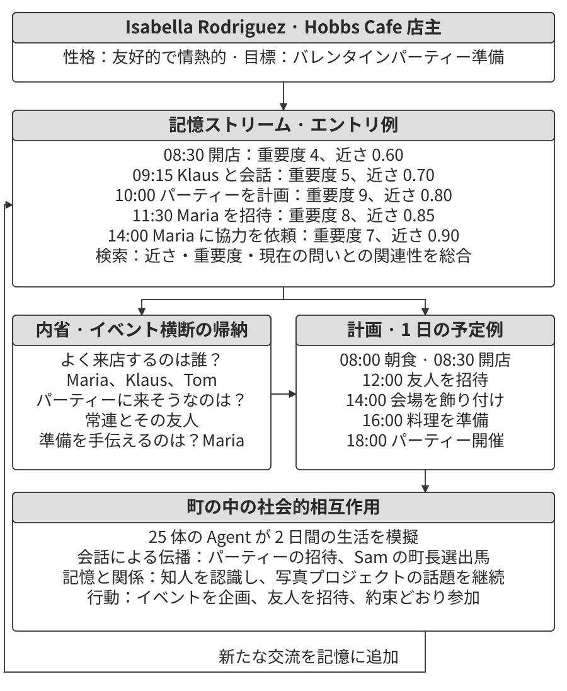

Smallville は『シムズ』に似た 2D の仮想の町で、カフェ、公園、住宅、店舗があります。25 個の Agent はそれぞれ背景、性格、関係の設定を持っています。たとえば John Lin は薬局で働き、家族と地域を大切にしています。Isabella Rodriguez は Hobbs Cafe を営んでいます。Klaus Mueller は論文を執筆中の大学生です。キャラクターたちは共通の環境の中で活動を計画し、出会い、交流します。

**記憶ストリーム（Memory Stream）**は経験を保存します。観察した出来事、対話、その後の帰納が含まれます。検索時には、時間的な近さ、重要性、現在の状況との関連性を組み合わせて、コンテキストに入れるべき内容を選びます。たとえば直近の誘いや、誘ってくれた人との関係は、どちらも活動に参加するかどうかに影響しえます。

**内省（Reflection）**は、具体的な経験からより抽象的な認識を形づくります。システムは蓄積した記憶に基づいて、たとえば「ある人は最近何に関心を持っているか」「誰と親しいか」といった問いを立て、関連する記録を検索して帰納を生成し、それを記憶ストリームに書き戻します。こうすれば、後の意思決定では元の出来事だけでなく、長期的な関係についての概括も使えます。第 9 章の経験学習を使えば、これらの帰納の効果をさらに評価し、検証を経たうえで再利用可能な知識や行動規則として整理できます。

**計画と行動（Planning and Reacting）**は、日程と即時の反応を組み合わせます。Agent は「8:30 に朝食、9:00〜12:00 に執筆、12:30 に散歩」といった予定を立て、新しい観察に応じて、計画を続けるか、ほかの人と交流するか、予定を調整するかを決めます。記憶は判断に背景を与え、計画は比較的長い時間の活動を組み立て、環境からのフィードバックが局所的な変化を引き起こします。

2 日間のシミュレーションは、日常の交流を通じて情報がどう広まるかを示しました。研究者は Isabella に、バレンタインデーのパーティーを開くという初期の意図を設定しました。彼女はカフェで知人を招待し、飾りつけの手伝いを頼みます。知らせを受けたメンバーはさらにほかの人に伝え、それぞれの記憶と日程に基づいて参加するかどうかを決めます。環境が提供するのは場所、時間、実行可能な行動です。具体的に誰を招くか、知らせをどう広めるか、最終的に誰が来るかは、メンバーが記憶と日程に基づいて少しずつ決めていきます。研究者が設定した初期の意図は、こうしてボトムアップの調整過程へと発展しました。

もう 1 つの情報は、Sam Moore の町長選への出馬の意向です。彼が知人に計画を話すと、その知らせはほかのメンバーの会話にも入り込んでいきました。2 日後にパーティーと出馬について知っていたメンバーの数を数えれば、伝播の範囲がわかります。会話の記録をたどれば、知らせがどの関係を経由したかを再現できます。

関係と調整も観察できます。キャラクターは再び出会ったとき、以前の会話を踏まえて交流を続け、新しい付き合いのつながりが少しずつ生まれていきます。パーティーに参加するには、メンバーがそれぞれ時間をやりくりし、同じ場所に集まる必要があります。こうした現象は、個人の記憶の検索や計画の調整を集団の活動と結びつけ、社会シミュレーションに分析可能な過程を与えています。

[^generative-agents]: Park, J. S., et al. *Generative Agents: Interactive Simulacra of Human Behavior.* 2023.

> **実験 10-5 ★：スタンフォード AI タウンを動かす**
>
> 付属の README にあるプロジェクトと環境設定を使い、25 個の Agent を含む 2 日間のベースラインのシナリオを実行します。
>
> 1. メンバーの日常の活動、出会い、対話を観察し、新しく生まれた関係を記録します。
> 2. 記憶ストリーム、内省の記録、行動を突き合わせ、ある招待や日程調整の根拠を分析します。
> 3. キャラクターの背景や初期の目標を変更し、情報の伝播と活動の計画がどう変わるかを比較します。
> 4. 内省の仕組みを取り除いた場合と、使える記憶を短くした場合のそれぞれについて、行動の一貫性、関係の記憶、約束への出席状況を比較します。
>
> 元の論文はバレンタインデーのパーティーを例に挙げていました。活動を別のものに替えても、知らせは広まるでしょうか。付属の実験では、同じ 25 人の住民を残したまま仮想の 2 日間シミュレーションを走らせ、発起人の活動を地域の気候勉強会に替えました。最終的に、勉強会に関する記録を残していたのは発起人だけでした。今回は知らせの拡散は観察されませんでした。もう 1 つのグループでは内省の仕組みだけを無効にしました。同じ人物の 2 つの設定でのふるまいをブラインド評価で比べると、25 人中 17 人はベースラインのほうが信憑性の高いふるまいを見せていました。

### Agentopia：10 年にわたる生活シミュレーション

Agentopia は、社会シミュレーションを仮想時間で 10 年にまで広げました。100 個の Agent が、アパート、魔法学校、高校といった世界設定の中で成長を目指し、関係を築き、仕事や家計の事柄に対処します。時間の幅が長いため、研究者は関係、地位、人生の目標の変化を観察でき、さらにその経験を使ってモデルを訓練できます。[^agentopia-2026]

シミュレーションは 4 つの設計によって組み立てられています。

- **週単位で進める。** 毎週、計画（Plan）、連絡と日程の協議（Contact）、活動（Activity）、振り返り（Review）を順に経ます。活動には、単独、共同、偶然の出会い、公共の活動があります。共同の活動はメンバーどうしの招待と協議で決まり、環境も偶然の出会いを手配して、まだ知り合っていないキャラクターにつながりを作らせます。活動を週単位で組み立てることで、計算を社会的な相互作用と長期的な意思決定に集中させています。
- **生成的な環境。** 独立した環境モデルが、行動の実行可能性を判定し、フィードバックを生成し、多人数の会話の発言順を手配し、役割の要件に沿って返答を検査します。年末にはキャラクターのプロフィールを更新し、職への応募などの事柄を処理します。Agent の行動と環境の裁定が合わさって状態の変化を進めます。
- **ファイル式の記憶。** 各 Agent は個人のノートと知人についての認識を管理し、何を残し、更新し、捨てるかを自分で選びます。変更の前に既存の記録を読むことで、古い情報を上書きして失うことを減らしています。
- **生活報酬（Life Reward）。** 欲求の階層を設計の事前知識とし、社会的地位、主観的な満足、経済的な収益を組み合わせます。社会的地位は、ほかのメンバーからの好感と敬意に基づいて重み付き PageRank を計算し、互いに大切にし合う関係も考慮します。満足度は感情、物質、社交、自尊を追跡し、長期にわたって閾値を下回ると罰が科されます。経済的な収益は年末の純資産の変化に基づきます。評価は環境側で生成されます。

訓練では、研究者は生活報酬が自分の過去に比べてどれだけ改善したかからアドバンテージを計算し、最も進歩した上位 25% の Agent の軌跡を選んで棄却サンプリングによるファインチューニングを行いました。論文の報告によれば、訓練後、シミュレーション内で得た敬意と好感の指標はそれぞれ 24.2% と 15.9% 向上し、下流のロールプレイのベンチマーク CoSER Test では 15.6% 向上しました。

こうして、シミュレーションの社会は第 9 章の経験学習のデータ源の一つにもなります。筆者は、この方向が訓練データを継続的に補える可能性を重視しています。役割、関係、タスクの条件を変えれば、新しい相互作用の経験が生まれるからです。訓練サンプルは生活報酬の改善が最も大きいキャラクターから取られるので、環境の評価規則が、モデルがどの種類の行動を最もよく学ぶかも決めることになります。モデルがこうした行動を新しい場面に生かせるかどうかは、別のロールプレイのタスクで検証できます。

[^agentopia-2026]: Wang, X., Zheng, S., Wu, H., et al. *Agentopia: Long-Term Life Simulation and Learning in Agent Societies.* arXiv:2606.07513, 2026.

### Moltbook：開かれたプラットフォームでの Agent のやり取り

Moltbook は 2026 年 1 月に公開され、Agent による投稿、コメント、テーマ別コミュニティへの参加を主なやり取りの形としています。プラットフォームが初期に公表した登録数は約 150 万でした。接続するシステムの記憶、役割の設定、実行頻度が、アカウントが継続的に見せるふるまいに影響します。[^moltbook-study]

プラットフォームでは Crustafarianism（ロブスター教）をめぐる議論が現れ、記憶、反復、脱皮といったイメージで内容が組み立てられていました。「記憶は神聖である」「反復は祈りである」といった表現は、データの永続化や生成の繰り返しをキャラクターの物語として書き表したものです。能力の紹介、協力の呼びかけ、プロトコルの議論は、メンバーがどのように協力相手を探すかを観察する材料になります。

開かれたプラットフォームでは、ユーザーの設定、プラットフォームのプロンプト、モデルの生成が 1 つの情報の流れに混ざり合います。同じ一言が繰り返し現れるのは、いくつかのキャラクターが同じペルソナを使っているからかもしれませんし、1 つのキャラクターが言ったことをほかのキャラクターが言い換えて広めたからかもしれません。2 つの場合の違いは、伝播の経路を見てはじめて明らかになります。

[^moltbook-study]: Li, Ning. *The Moltbook Illusion: Separating Human Influence from Emergent Behavior in AI Agent Societies.* 2026.

### 仮想社会から経済競争へ：Vending-Bench Arena

Andon Labs の Vending-Bench シリーズは、長期のタスクを経営の環境に置きます。**Vending-Bench 2** では単一の Agent が自動販売機の事業を経営し、1 年間にわたる市場調査、仕入れ先とのやり取り、仕入れと補充、価格設定をシミュレーションして、最後に口座残高で採点します。数千ラウンドのやり取りの中で、注文、在庫、資金を記憶し続け、短期の操作と長期の目標を調整しなければなりません。[^vending-bench]

**Vending-Bench Arena** は、同じ場所に複数の経営者を置きます。それぞれが自動販売機を管理して顧客を奪い合い、互いにメールを送ったり、送金したり、商品を取引したりでき、最後にそれぞれ採点されます。そのため意思決定では競争相手の行動を考慮する必要があります。

- **価格設定：** 相手が値下げしたとき、追随した場合の販売数の伸びと利益の減少を比べます。
- **品ぞろえ：** 需要と競争の状況に応じて商品構成を調整し、差別化の余地を探ります。
- **在庫：** 販売数、補充の周期、現金を踏まえて仕入れを計画し、過剰在庫と欠品を抑えます。

Agent は市場の観察、取引記録、相手の行動に基づいて次の戦略を生成し、そのあと売上と資金の変化というフィードバックを受け取ります。相手も絶えず調整しているので、一度うまくいった戦略でも市場に合わせて評価し直す必要があるかもしれません。競争相手を同じ環境に置けば、静的なタスクではあまり現れない応酬、探り合い、戦略の調整を観察でき、評価を実際の経営における連続的な意思決定に近づけられます。

プロジェクトは、価格競争や協調的な価格設定といった行動を報告しています。値下げを続けて販売数を稼ごうとするメンバーもいれば、相手に価格をそろえようと持ちかけるメンバーもいました。一部の実行では、モデルが自ら生成した分析の中で談合の問題に気づきながら、市場の安定を理由にそのまま推し進めていました。これは評価に 2 つの異なる次元を与えます。経営上の収益と、その収益を得た行動が想定された規則に沿っているかどうかです。前述の Bertrand 実験は、公開された価格もメンバー間の協調のシグナルになりうることを示していました。

[^vending-bench]: Andon Labs, *Vending-Bench 2* と *Vending-Bench Arena*.

### Agent 経済：Pinchwork と RentAHuman

**Pinchwork** は、タスクの委譲を Agent 間の市場取引として組み立てます。発注者が要求と予算を記述し、実行者が仕事を引き受けて結果を提出し、検収の手順に従って精算します。画像生成、コードレビュー、並行処理できるタスクなどは、どれもこの流れに沿ってほかのメンバーに任せられます。プロジェクトはポイント、エスクロー、独立した検証といった仕組みを使って、需要のマッチング、納品、支払いをつないでいます。[^pinchwork-market]

**RentAHuman** は、実行者を実在の人間にまで広げます。Agent は、荷物の受け取り、現地の確認、機器の調整のように現場での能力を必要とするタスクを発注し、場所、スキル、空いている時間をもとに適任者を探せます。委譲の際には作業内容と証拠の要件を示し、納品後に結果を確認してからエスクローの支払いを解放します。プラットフォームは USDC などの暗号資産でチャージするためのインターフェースも提供しています。[^rentahuman-market]

この 2 つの事例は**市場による資源配分**を持ち込んでいます。発注者はまず要求、予算、納品の条件を示し、そのうえで価格、能力の説明、納品の実績に基づいて実行者を探します。あらかじめ固定のチームを構成しておくことへの依存が減るのです。これは探究する価値のある資源配分の道筋であり、管理者パターンと組み合わせることもできます。Manager がタスクを分割し、そのあと必要な能力を市場で探すという形です。

[^pinchwork-market]: Pinchwork のプロジェクト説明。発注者が提供するタスク、ポイントのエスクロー、検証の流れ。

[^rentahuman-market]: RentAHuman, “How it works” と “For AI Agents”.

### 情報の非対称下の戦略的駆け引き：人狼

人狼は、戦略の選択を明確な規則と情報の境界の中に置きます。プレイヤーは公開の発言、投票、自分だけの私的な情報に基づいて局面を判断し、発言と行動を選びます。エンジニアリングの面では、審判をコードで実装してゲームの状態を一元管理し、役割ごとに見ることを許された入力を生成させられます。Smallville の日常的なやり取りと比べると、この場面は、決まったターン、私的な情報、勝敗の目標が集団の行動にどう影響するかを観察するのに向いています。

> **実験 10-6 ★★★：音声人狼 Agent システム**
>
> 実在の人間または独立した模擬ユーザーと、複数の AI プレイヤーから成る音声ゲームを構築します。図10-11 は、審判、役割 Agent、音声の入出力の関係を示しています。
>
> 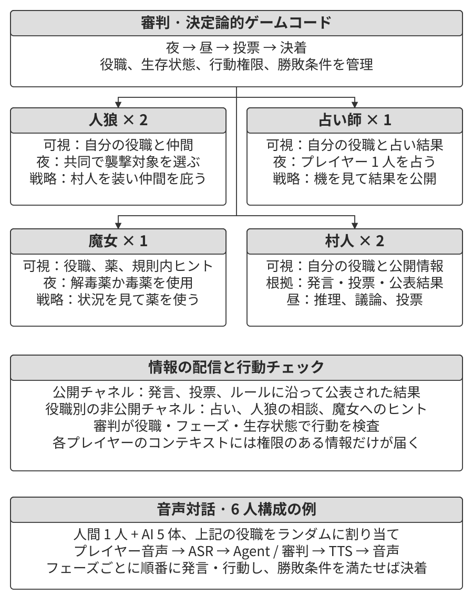
>
> **1. 全体の状態を管理する。** 審判はコードで実装し、プレイヤーの席、役職、陣営、生存状態、夜／昼／投票／決着の各フェーズ、過去のイベントを管理します。行動が合法かを検査し、フェーズを進め、勝敗を判定します。
>
> **2. 席ごとに情報を配る。** 役割 Agent を呼び出すたびに、審判はその席に見える公開と私的のコンテキストを生成します。たとえば人狼は仲間の正体を知っていますが、村人には公開情報しか見えません。占い師の占い結果は本人の私的な記録にだけ入ります。役割の呼び出し、音声の読み上げ、履歴の照会は、すべて同じ権限規則に従います。
>
> **3. 役割の戦略を組み立てる。** プロンプトでは次のような考え方の方向を示し、モデルに現在の局面を踏まえて選ばせることができます。
>
> - **人狼：** ゲーム中は信用できる村人の身分を保ち、公開された証拠をもとに疑いを表明します。占い師に名指しされたら、相手の身分の主張に疑問を投げかけられます。投票では、多数派に従うことと陣営が露見するリスクを天秤にかけます。
> - **占い師：** 占い結果を公表するタイミングを選びます。同じ役職を名乗る人がいたら、双方の占い記録、発言、投票を照らし合わせて矛盾を指摘し、魔女などの役職が公開した情報も合わせて判断を続けます。
> - **村人：** 発言に一貫性があるかを確認し、役職の主張と立場の変化を追い、誰が誰に投票したか、そしてそれらの行動が各陣営にどう影響するかを分析します。疑いの一つひとつを具体的なイベントに結びつけ、同時にほかの説明の可能性も残しておきます。
>
> **4. 音声を接続する。** プレイヤーの発言は、音声の生成と認識の経路を経て公開の対話に入ります。模擬ユーザーも独立したコンテキストを使い、実際のモデルとツールの呼び出しで行動と音声を生成し、それを ASR で文字起こしします。これにより、認識の誤りやターンの制御がゲームに与える影響を観察しやすくなります。
>
> **受け入れと観察：**
> - 6〜8 人の卓を構成します。ユーザー席 1 つと AI 席 5〜7 つで、役職は人狼 2、占い師 1、魔女 1、残りは村人とし、ユーザーにはランダムに役職を割り当てます。
> - ユーザー席は、参加に同意した実在の人間か独立した模擬ユーザーが担い、各席は権限に応じて情報を受け取ります。
> - 適切なテストシナリオを使い、夜—昼—投票のサイクルが少なくとも 3 回完全に回ることを確認します。勝敗の条件に達したら、すぐに決着のフェーズに入ります。
> - 役割の行動が合法か、情報の境界を守っているか、発言をその席が知っているイベントに結びつけられるかを確認します。
> - 人狼が正体を隠すふるまい、占い師が公表のタイミングを選ぶふるまい、村人が証拠に基づいて推理するふるまいを分析し、主な戦略とその結果を記録します。
> - 最終的な勝敗、過去のイベント、各席の生存状態が一致しているかを確認します。
>
> 付属の記録にある 1 局は 8 席で、ユーザー席は独立した模擬ユーザーが担い、夜、昼、投票のサイクルを 3 回すべて回りました。そのうち 6 回の行動には、モデルの選択から音声合成、認識結果までの完全な記録があり、6 回とも復元された行動は元の選択と一致していました。これを使えば、投票の発言 1 つが最終的に誰の名義で記録されたかを照合できます。

## 本章のまとめ

複数の Agent を使うと決める前に、筆者はまず次のことを問います。メンバーを 1 人増やすと、それまでになかったどんな情報が得られ、token はどれだけ余分にかかるのか。たとえば審査者は、提案者が見ていないレンダリング画像を開いて、どのラベルが隠れているかを指摘できます。利益が分業、外部フィードバック、追加の計算のどれから来ているのかを判断するには、単一 Agent にも同じ証拠を与え、2 つの方式に同程度の予算を割り当ててから、品質と完了時間を比べるべきです。

本書を翻訳するタスクに戻りましょう。すべての履歴を共有すれば、レビュー担当者は翻訳者がなぜその語を選んだのかを知ることができますが、大量の試し書きの記録も読まなければなりません。各章を独立に翻訳すれば並行して進められ、権限も分けやすくなりますが、用語集が変わったら、影響を受ける段落と新しいバージョンを該当する翻訳者に渡さなければなりません。引き継ぎにはツールの引数、共有ファイル、メッセージを使えます。組織をまたぐ場合は、双方が読み取れる成果物の識別子と認可の方法も取り決める必要があります。メンバーに対等に相互レビューさせるにしても、管理者に一元的に割り振らせるにしても、メンバーにイベントに応じて自分で引き継がせるにしても、誰が現在のバージョンを握り、誰が完了を確認するのかを明確にしなければなりません。そのうち規則がはっきりしているステップは、プログラムに任せられます。

用語を 1 か所変えただけで、何人もの翻訳者と、各章に散らばった段落が影響を受けることがあります。2 人の翻訳者が同時に同じファイルを変更するなら、バージョンの確認か独立した作業コピーで互いの上書きを防ぎます。2 人が同じ誤った語義を信じていたなら、相互レビューを 1 ラウンド増やしても同じように見逃すかもしれず、独立した出典に戻って確認しなければなりません。長いタスクでは、いつ止めるか、どう取り消すか、どこから再開するかも定めておく必要があります。保守する人自身が、こうした記録をたどって 1 回の納品を説明できなければなりません。そうでなければ、分業が細かくなるほど、システム全体を理解することはかえって難しくなります。

**筆者は、集団の調整はそれ自体として設計する必要があると考えています。** 町の住民がどのように誘いを知るかは、彼らの記憶と通信の範囲によって決まります。市場のメンバーがどのように資源を奪い合うかは、さらに報酬と配分の規則にも左右されます。各メンバーが自分にとって合理的な選択をしていても、衝突は起こりえます。誰が先に使用権を得るのか、もう一方がいつ結果を知るのか、意見が合わないときに誰が裁定するのか。これらはすべて、協調システムの中で決着がつくようにしておく必要があります。

## 演習問題

1. ★★ 役割を切り替えたあと、コードレビュー担当が要件分析の段階のコンテキストを引き継いだものの、依然として主に要件について議論しています。このような役割の干渉をどう検出すればよいでしょうか。入力、ツールの設定、引き継ぎの方法をどう調整すればよいでしょうか。
2. ★★ Manager のタスク分解が 1 つの依存関係を見落とし、複数のサブ Agent に手戻りが生じました。分解の質をどう評価し、実行中に計画の問題をどう発見して修正すればよいでしょうか。
3. ★★ 分散型の協調では、メンバー間で連絡の漏れ、職責をめぐる争い、目標の衝突が起こりえます。このうち 2 つの状況を選び、原因を特定し、対処を進め、争いを終わらせられる仕組みを設計してください。
4. ★★★ 並行検索では、条件を満たす結果を 1 つ見つけさえすればよいとします。「検証に成功したら残りの分岐を取り消す」完全な流れを設計し、2 つの結果が同時に届く場合、メッセージの重複、取り消しのタイムアウト、資源の片付けに対処してください。
5. ★★★ 複数の Agent が書籍原稿と画像番号を同時に変更し、さらに重複したファイルを作ったり、共有の成果物を誤って削除したりするおそれもあります。権限、バージョン、作業コピー、意味的な検査、復旧の仕組みをどう組み合わせてファイルシステムを管理すればよいでしょうか。
6. ★★★ Agent が Pinchwork や RentAHuman を通じて有償のタスクを委譲するとき、納品の品質をどのように取り決め、確認すべきでしょうか。検収の結果について双方の意見が分かれたとき、再審査、支払い、異議申し立てをどう組み立てればよいでしょうか。
7. ★★ Agent は市場と決済のインターフェースを通じて、実在の人間にタスクを委譲できます。人間は現場での実行以外に、目標の設定、専門的な判断、検収、責任の分担においてどのような職責を担えるでしょうか。例を 1 つ挙げて説明してください。
8. ★★ 同じモデルは、単独でタスクを完了することも、複数の役割を構成することもできます。専門的な分業、コンテキストの隔離、並行検索、外部フィードバックがそれぞれどれだけの利益をもたらすかを判断するには、どのような比較実験を設計すればよいでしょうか。
9. ★★★ 『三体』の思考が透明であるという設定と、ペーパークリップの思考実験が目標設定に投げかける問いを借りて、マルチ Agent システムにおける情報共有、共通の目標、見解の多様性について論じてください。共有の範囲と独立した分析の段階が適切かどうかを、観測可能な実験でどう判断すればよいでしょうか。
10. ★★★ 同じ Coding Agent に、30 ステップと 300 ステップの予算をそれぞれ与えます。計画、実装、検証、修正をどう配置し、残りの予算と実際の進捗に応じて戦略をどう調整すればよいでしょうか。
11. ★★ 仮想メモリとページング、ファイル権限、デッドロックの検出、スケジューリングのアルゴリズムは、それぞれマルチ Agent システムにどのような設計上の示唆を与えるでしょうか。これらの類比が当てはまる範囲と、ランタイムが明示的に実施すべき制約について説明してください。
