# コンテキストエンジニアリング

第 1 章では、コンテキストを Agent の「いま意思決定に使える視野」にたとえました。モデルは判断を下すたびに、その時点で受け取った情報だけを頼りにします。**コンテキストエンジニアリング**（Context Engineering）は、システム指令、ツール定義、ユーザーのリクエスト、過去のメッセージ、タスクの状態といったこれらの情報を選び、組み立て、更新する仕事です。Harness はモデルを呼び出す前に毎回、タスクの背景と最新の進捗を入力として整えます。図2-1 は、コンテキストウィンドウの構成を具体的な内容で示したものです。

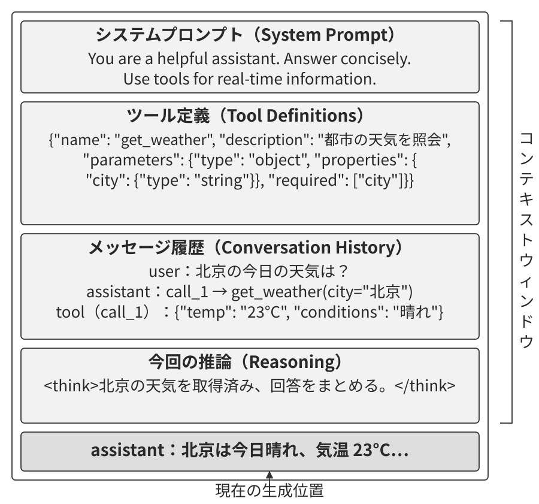

## コンテキスト：モデルの能力を具体的なタスクに生かす

経験豊富なエンジニアがチームに加わり、最初に「うちの規約に沿って設定を変更してほしい」と頼まれた場面を想像してください。プログラミングはできても、どのファイルが設定の大元なのか、どのフィールドを変えてよいのか、どう検証すればよいのかはまだ知りません。コードベース全体を渡されても、別のファイルを書き換えてしまうかもしれません。見知らぬプロジェクトを引き継いだ Agent にも、同じ背景知識が欠けています。

「このバグを直して」という依頼を例に取ると、Coding Agent にはふつう 3 種類の背景が必要です。

- **リアルタイムのコードコンテキスト**：ディレクトリ構造、各モジュールの責務、中核となるデータ構造、コーディング規約。たとえば自動生成される設定ファイルを直接書き換えると、手元では効いても次の生成時に上書きされてしまいます。そのファイルをどのモジュールが生成しているかを知って初めて、直すべき場所にたどり着けます。
- **開発フローの規約**：Git のブランチ戦略、コミット規約、コードレビューの手順、CI/CD の要件。Agent はこれにもとづいて変更・テスト・コミットの段取りを決め、実行システムは権限に従ってそれらの操作を実行します。
- **環境情報**：開発環境の設定、テスト用データベースへの接続方法、テスト環境へのデプロイ方法、API キーの管理方法。これらは正しい実行環境を選び、ローカル環境とテスト環境の違いを理解する手がかりになります。

プロジェクトのコードもテスト用データベースも、モデルのコンテキストの外にあります。先ほどの自動生成された設定の例でいえば、Agent は検索ツールで生成スクリプトを読んで初めて、どこから手を付ければよいかがわかります。**コンテキストの質が、モデルが手持ちの能力を目の前の問題に生かせるかどうかを決めます。** **大量の背景情報を必要とするタスクでは、十分な能力のモデルに完全で正確なコンテキストを組み合わせたほうが、必要な資料を欠いたより強力なモデルを上回ることがあります。**

**AI ネイティブなチームをつくるには、まず重要な知識を文書化することです。** あるデータベースを選んだ理由を古参メンバーしか覚えておらず、業務ルールの変更も個人チャットで触れられただけだとすれば、新しく加わった同僚も Agent も同じ壁にぶつかります。コードを読めばチームが何をしたかはわかっても、なぜそうしたのかはわからないのです。

**リモートでの協働に強いチームは、往々にして Agent にとっても働きやすいチームです。** Linux カーネルの開発者はメーリングリストでパッチを議論し、レビューの意見を交わしています。開発プロセスの文書には、パッチをどのように投稿し、レビューし、マージするかが書かれています[^ch2-linux]。新しい参加者は意外な変更に出会っても、パッチをたどって当時の議論を見つけられます。Agent が背景を確かめるときにも、この記録が役に立ちます。

筆者は WhynotTV に出演した翁家翌（Jiayi Weng）のインタビューを聞き、その考えの一つを **「人もモデルも Context に頼っている」** とまとめました。人なら決定に関わった同僚に一言たずねることができますが、モデルがどんな背景を読めるかは、チームがどんな記録を残したか、そして Harness が今回のリクエストに何を入れたかで決まります。[^ch2-weng]

[^ch2-linux]: Linux カーネル公式ドキュメント、How the development process works。

[^ch2-weng]: WhynotTV、「翁家翌：OpenAI，GPT，强化学习，Infra，后训练，天授，tuixue，开源，CMU，清华」、Podcast #4。

ReAct 論文は、相互作用の履歴が意思決定にどう関わるかを形式的に表しています[^ch2-react]。時刻 $t$ において、Agent は環境から観測 $o_t\in\mathcal{O}$ を受け取り、方策 $\pi(a_t\mid c_t)$ に従って行動 $a_t\in\mathcal{A}$ を選びます。ここでコンテキストは次のとおりです。

$$
c_t=(o_1,a_1,\ldots,o_{t-1},a_{t-1},o_t)
$$

この式が示すのは、**Agent の次の行動は、その時点までの相互作用の履歴に依存する**ということです。たとえば、どのファイルを調べたか、ツールがどんなエラーを返したかが、次の選択に影響します。LLM Agent では、ユーザー入力とツールの結果が観測となり、ツール呼び出しと外部への返答が行動として記録されます。システム指令とツール定義は、さらにタスクのルールと使えるインターフェースを伝えます。

本章では、まずステートレスなリクエスト方式を前提にします。Harness は毎ターン、メッセージとツール定義を組み立ててからモデルを呼び出します。完全なメッセージ履歴を送ればタスクの進捗を保てますが、履歴が伸びてきたら、検索、状態の記録、圧縮を使って、以後の判断に必要な情報をウィンドウ内に残します。コンテキストの配置、ステータスバー、圧縮技術はいずれも、同じ一つの問いをめぐるものです。限られたコンテキストの中で、モデルがこの一歩に使う情報をどうやって $c_t$ に入れるか、という問いです。

[^ch2-react]: Yao, Shunyu, et al.，ReAct: Synergizing Reasoning and Acting in Language Models，ICLR 2023。

## Agent はどのように大規模モデルを呼び出すか：API のコンテキスト構造を理解する

まず一言のあいさつからメッセージの形式を確かめ、次に「バンクーバーはいま何時で、天気はどうか」という質問から 2 つのツール呼び出しが生まれる様子を見ます。本節では Chat Completions 互換のインターフェースとローカルで動かす Qwen3-0.6B を使い、最後に Python で各ターンのリクエストをつなげます[^ch2-chat-api]。

### 例で使う 4 つのメッセージロール

リクエストの**メッセージリスト**（`messages`）は、相互作用の情報を順番に保持します。各メッセージには、出所と用途を示す**ロール**（`role`）が付きます。本節では次の 4 つのロールを使います。

- **system**：システムプロンプト。本節では、開発者が与える身元、振る舞いのルール、制約をここに書き、メッセージリストの先頭付近に置きます。モデルのインターフェースによっては、開発者の指示を `developer` ロールで渡すものもあります。
- **user**：ユーザーメッセージ。タスク、追加の質問、補足の要望を保持します。
- **assistant**：モデルの返答。テキストとツール呼び出しリクエストを含みます。これらのメッセージを次のターンの入力に戻すことで、モデルはそれまでの回答や操作リクエストを読めるようになります。
- **tool**：ツールの実行結果。Harness は戻り値を受け取るとそれを tool メッセージとして書き込み、`tool_call_id` で対応する呼び出しに関連付けます。

ツール定義はリクエストのトップレベルにある `tools` フィールドで渡され、使えるツールの名前、用途、パラメータ形式を列挙します。

モデルはツール定義にもとづいて呼び出しリクエストを組み立てます。その操作を実際に実行できるかどうかを決めるのは、Harness と実行環境です。

[^ch2-chat-api]: OpenAI、Chat Completions API リファレンス（メッセージロール、ツール定義、呼び出し結果のフィールドを解説）。Qwen、Function Calling（互換サービスにおけるツール呼び出しとテンプレートを解説）。

### シングルターンの対話：最もシンプルな API 呼び出し

まずは一問一答を見ます。ユーザーが「Hello, who are you?」と尋ねると、Harness はシステム指令とユーザーの質問をまとめてモデルに送り、返答を読み取ります。図2-2 はリクエストとレスポンスの対応関係を示しています。

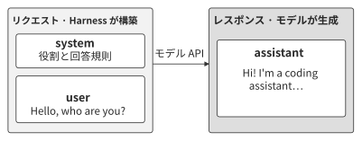

以下に、ローカルモデルのインターフェース形式に沿ってリクエストと返答例を示します。コード中のコメントは各部分の出所を示しています。

```javascript
// Harness 构造请求
{
  "model": "Qwen3-0.6B",
  "messages": [
    {
      "role": "system",                           // 开发者提供的指令
      "content": "You are a helpful coding assistant. Follow user instructions."
    },
    {
      "role": "user",                              // 用户输入
      "content": "Hello, who are you?"
    }
  ]
}
```

```javascript
// API 返回响应
{
  "choices": [{
    "message": {
      "role": "assistant",                         // 模型生成
      "content": "Hi! I'm a coding assistant. I can help you write code, debug issues, and explain technical concepts. How can I help?"
    }
  }]
}
```

リクエストには `system` メッセージと `user` メッセージが 1 つずつ含まれ、レスポンスの `choices[0].message` にはモデルが生成した `assistant` メッセージが入っています。ここで用いているステートレスなインターフェースでは、**呼び出しのたびに必要なコンテキストを用意するのは Harness の役目です**。次のリクエストでこの対話の続きをするなら、関連する履歴を一緒に送らなければなりません。

### ツール呼び出しを伴うマルチターンの相互作用：Agent の核となるループ

次に、ツールが必要な質問を見てみましょう。「What's the current time and weather in Vancouver?」に答えるには、まず現地の時刻と天気を調べる必要があります。図2-3 では、Harness が 1 回目にモデルを呼び出したとき、返ってくるのは 2 つのツールリクエストです。Harness は時刻サービスと天気サービスにそれぞれ問い合わせ、2 つの結果をメッセージ履歴に加えてからモデルを 2 回目に呼び出し、そこでようやくユーザーへの返答が得られます。

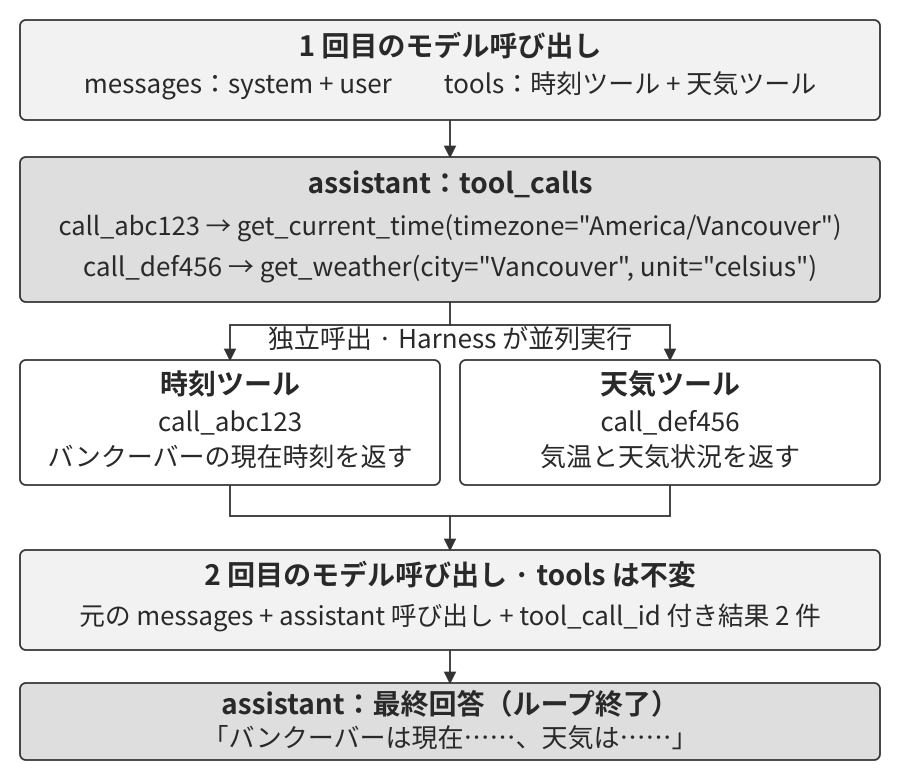

この 2 つのツールはどちらを先に実行するのでしょうか。時刻ツールにはタイムゾーンが、天気ツールには都市と温度単位が必要です。ユーザーはバンクーバーとしか言っていないので、例のモデルはそこから `America/Vancouver` と `Vancouver` を埋め、温度単位には摂氏を選びました。天気を調べるのに時刻ツールの結果を待つ必要はないので、2 つの問い合わせは同時に送れます。

**1 回目の API 呼び出し——Agent フレームワークが初期リクエストを送信する：**

```javascript
// 第一次模型调用：Harness 构造请求
{
  "model": "Qwen3-0.6B",
  "messages": [
    {
      "role": "system",                           // 开发者提供的指令
      "content": "You are a helpful assistant. Use the provided tools to get real-time information when needed."
    },
    {
      "role": "user",                              // 用户输入
      "content": "What's the current time and weather in Vancouver?"
    }
  ],
  "tools": [                                       // 开发者定义的工具
    {
      "type": "function",
      "function": {
        "name": "get_current_time",
        "description": "Get the current date and time in a specific timezone",
        "parameters": {
          "type": "object",
          "properties": {
            "timezone": { "type": "string", "description": "Timezone name, e.g. America/Vancouver" }
          },
          "required": ["timezone"]
        }
      }
    },
    {
      "type": "function",
      "function": {
        "name": "get_weather",
        "description": "Get the current weather for a specific city",
        "parameters": {
          "type": "object",
          "properties": {
            "city": { "type": "string", "description": "City name" },
            "unit": { "type": "string", "enum": ["celsius", "fahrenheit"] }
          },
          "required": ["city", "unit"]
        }
      }
    }
  ]
}
```

この `tools` の一覧は開発者があらかじめ定義したもので、名前、説明、パラメータのスキーマを含みます。この例ではどのターンのリクエストにも同じ 2 つのツールを含めており、モデルは一覧とユーザーの質問を読んだうえで、呼び出すツールを選び、パラメータを埋めます。

**モデルは 2 つのツール呼び出しリクエストを返す：**

```javascript
// 模型返回工具调用请求
{
  "choices": [{
    "message": {
      "role": "assistant",                         // 模型生成
      "content": null,                             // 本轮没有文本回复
      "tool_calls": [                              // 请求调用两个工具
        {
          "id": "call_abc123",
          "type": "function",
          "function": {
            "name": "get_current_time",
            "arguments": "{\"timezone\": \"America/Vancouver\"}"
          }
        },
        {
          "id": "call_def456",
          "type": "function",
          "function": {
            "name": "get_weather",
            "arguments": "{\"city\": \"Vancouver\", \"unit\": \"celsius\"}"
          }
        }
      ]
    }
  }]
}
```

レスポンスの `tool_calls` には 2 つのリクエストが含まれ、それぞれに固有の `id`、ツール名、パラメータがあります。`arguments` は JSON エンコードされた文字列なので、実行側はまずそれを解析し、フィールドと値を検証する必要があります。**何を呼び出し、どんなパラメータを渡すかを決めるのはモデルです。検証とスケジューリングは Harness が担い、時刻や天気のサービスにアクセスするのはツールの実装です。**

**Agent フレームワークはツールを実行し、続いて 2 回目の API 呼び出しを行う：**

Harness はリクエストを検証してから 2 つのツールを実行し、戻り値を `tool` メッセージとして書き込んで、既存の履歴と新しい結果をまとめてモデルに渡します。

```javascript
// 第二次模型调用：追加工具结果
{
  "model": "Qwen3-0.6B",
  "messages": [
    {
      "role": "system",                           // 保留第一次请求中的消息
      "content": "You are a helpful assistant. Use the provided tools to get real-time information when needed."
    },
    {
      "role": "user",                              // 保留第一次请求中的消息
      "content": "What's the current time and weather in Vancouver?"
    },
    {
      "role": "assistant",                         // 保留前一轮模型的调用请求
      "content": null,
      "tool_calls": [
        { "id": "call_abc123", "type": "function", "function": { "name": "get_current_time", "arguments": "{\"timezone\": \"America/Vancouver\"}" } },
        { "id": "call_def456", "type": "function", "function": { "name": "get_weather", "arguments": "{\"city\": \"Vancouver\", \"unit\": \"celsius\"}" } }
      ]
    },
    {
      "role": "tool",                              // Harness 写入工具执行结果
      "tool_call_id": "call_abc123",
      "content": "{\"timezone\": \"America/Vancouver\", \"datetime\": \"2025-09-13T05:18:47\", \"day_of_week\": \"Saturday\"}"
    },
    {
      "role": "tool",                              // Harness 写入工具执行结果
      "tool_call_id": "call_def456",
      "content": "{\"city\": \"Vancouver\", \"temperature\": 13.2, \"unit\": \"celsius\", \"conditions\": \"clear\", \"humidity\": 93}"
    }
  ],
  "tools": [ ... ]                                 // 沿用前面的工具定义，此处省略
}
```

`call_def456` を手がかりに 2 回目のリクエストを読んでみましょう。直前の `assistant` メッセージでは、これはバンクーバーの天気を問い合わせる呼び出しの番号です。後ろの `tool` メッセージは同じ番号で 13.2 ℃ と晴天という結果を返しています。天気の結果が時刻より先に返ってきても、Harness は結果とリクエストを正しく対応させられます。このターンでモデルは、ユーザーの元の質問、自分が出した 2 つの問い合わせ、ツールが取ってきたデータを一度に読めます。あとはユーザーに答えるだけです。

**モデルはツールの結果にもとづいて最終的な返答を生成する：**

```javascript
// 模型生成最终回复
{
  "choices": [{
    "message": {
      "role": "assistant",                         // 模型生成
      "content": "It's currently 5:18 AM on Saturday, September 13, 2025 in Vancouver.\n\nWeather: 13.2°C with clear skies and 93% humidity. It's quite cool this morning - you might want to grab a jacket."
    }
  }]
}
```

2 回目のレスポンスは最終的なテキストを返し、`tool_calls` は空なので、この例のループはここで終わります。「モデルを呼び出す→ツールを実行する→結果を返す→再びモデルを呼び出す」というこの過程が、第 1 章で述べた実行ループの API における具体的な実装です。

ユーザーが「では東京は？」と続けて尋ねた場合、Harness はそのメッセージを履歴の末尾に追加し、もう一度モデルを呼び出します。モデルは「現在の時刻と天気を調べる」というタスクの背景を引き継いで東京向けの新しいリクエストを生成し、ツールの結果が返ってきたら新しい回答を組み立てます。

**Responses API に切り替えた場合、ツールの結果はどう返すのか。** ここまでのローカル実験では Chat Completions 互換のインターフェースを使いました。OpenAI のサービスで新しいプロジェクトを開発するなら、公式に推奨されているのは Responses API です。同じバンクーバーの例で見てみましょう。アプリケーションはユーザーの質問をリクエストの `input` に入れ、`tools` で時刻と天気の 2 つの関数を宣言します。返ってくる `output` は型付きの項目の並びです。その中に `function_call` が 2 件あれば、アプリケーションはそれぞれから関数名、引数、`call_id` を読み取り、ツールを個別に実行します。[^ch2-responses-loop]

天気関数の呼び出し番号が `call_weather` だとします。次のリクエストの `input` には、次のような結果の返却を入れられます。時刻関数についても、それ自身の番号で結果を返す必要があります。

```json
{"type": "function_call_output", "call_id": "call_weather", "output": "{\"temperature\": 13.2, \"unit\": \"celsius\"}"}
```

`call_id` は、一つの返却結果を一つの関数呼び出しに対応させます。`previous_response_id` は直前のモデルレスポンスを指し、サービスにそのターンのコンテキストを引き継がせます。2 つの番号が指す対象は別物です。この引き継ぎ方式を使う場合でも、今回のターンで引き続き使うツールとトップレベルの `instructions` は改めて渡す必要があります。前回のリクエストのトップレベルの指示は、レスポンス番号によって自動的に引き継がれはしません。モデルがさらにツールを要求することもあるので、アプリケーションは次の `output` を読んでから終了するかどうかを判断します。第 1 章の実験 1-3 ではサーバー側でホストされる検索を使いましたが、ここでの 2 つの自作関数はアプリケーションが実際に実行します。

[^ch2-responses-loop]: OpenAI、Responses API への移行、関数呼び出し、およびレスポンス作成のパラメータに関するドキュメント。

### コードで Agent の核となるループを実装する

ループの中にある 2 か所の `messages.append` は、それぞれモデルの返答とツールの実行結果を保存します。時刻も気温もバンクーバーのものです。2 つの呼び出し ID を入れ替えると、次のターンのモデルは「時刻の問い合わせ」が 13.2 ℃ を返したと読むことになります。

この例では OpenAI Python SDK で互換サービスに接続します。既定のアドレスはローカルの `http://localhost:8000/v1` で、起動済みで認証不要のローカルサービスを想定しています。この既定値は実験 2-1 の vLLM バックエンドに対応しています。同じ実験の Ollama バックエンドを使う場合は、アドレスを `http://localhost:11434/v1` に、モデル名を `qwen3:0.6b` に変更してください。ほかのサービスに接続するときは、必要に応じて環境変数 `LLM_BASE_URL` と `LLM_API_KEY` を設定し、下の `model` を実際にデプロイされている名前に合わせます。時刻と天気のツールはメッセージと突き合わせやすいよう前の例の固定データのままにしてあります。実データにつなぐ際は、この 2 つのツールの実装を差し替えてください。

```python
import json
import os

from openai import OpenAI

client = OpenAI(
    base_url=os.getenv("LLM_BASE_URL", "http://localhost:8000/v1"),
    api_key=os.getenv("LLM_API_KEY", "EMPTY"),
)

# 工具定义：名称、用途和参数结构
tools = [
    {
        "type": "function",
        "function": {
            "name": "get_current_time",
            "description": "Get the current date and time in a specific timezone",
            "parameters": {
                "type": "object",
                "properties": {
                    "timezone": {"type": "string", "description": "Timezone name, e.g. America/Vancouver"}
                },
                "required": ["timezone"],
            },
        },
    },
    {
        "type": "function",
        "function": {
            "name": "get_weather",
            "description": "Get the current weather for a specific city",
            "parameters": {
                "type": "object",
                "properties": {
                    "city": {"type": "string", "description": "City name"},
                    "unit": {"type": "string", "enum": ["celsius", "fahrenheit"]},
                },
                "required": ["city", "unit"],
            },
        },
    },
]

# 示例工具使用固定数据，参数与前面的温哥华查询一致。
def execute_tool(name, arguments):
    args = json.loads(arguments)
    if name == "get_current_time" and args == {"timezone": "America/Vancouver"}:
        result = {
            "timezone": "America/Vancouver",
            "datetime": "2025-09-13T05:18:47",
            "day_of_week": "Saturday",
        }
    elif name == "get_weather" and args == {"city": "Vancouver", "unit": "celsius"}:
        result = {
            "city": "Vancouver", "temperature": 13.2,
            "unit": "celsius", "conditions": "clear", "humidity": 93,
        }
    else:
        result = {"error": "示例仅提供温哥华时间和摄氏天气数据"}
    return json.dumps(result, ensure_ascii=False)

# 初始消息：指令与用户任务
messages = [
    {"role": "system", "content": "You are a helpful assistant. Use tools to get real-time information when needed."},
    {"role": "user", "content": "What's the current time and weather in Vancouver?"},
]

# 运行循环：最多调用模型八轮
rounds = 0
while rounds < 8:
    rounds += 1
    response = client.chat.completions.create(
        model="Qwen3-0.6B", messages=messages, tools=tools
    )
    assistant_message = response.choices[0].message

    # 保存模型回复，包括本轮的调用请求
    messages.append(assistant_message.model_dump(exclude_none=True))

    # 本例在模型给出不含工具调用的回复时结束
    if not assistant_message.tool_calls:
        print(assistant_message.content)
        break

    # 逐个执行并追加结果；独立调用也可以改为并行调度
    for tool_call in assistant_message.tool_calls:
        try:
            result = execute_tool(tool_call.function.name, tool_call.function.arguments)
        except json.JSONDecodeError:
            result = json.dumps({"error": "工具参数需要有效的 JSON"})
        messages.append({
            "role": "tool",
            "tool_call_id": tool_call.id,
            "content": result,
        })
    # 下一轮使用追加了结果的消息列表
else:
    print("已达到轮数上限，任务尚未完成。")
```

モデルが 1 ターン目に時刻と天気を同時に要求したとします。この `for` ループはまず時刻を調べて結果を `messages` に追加し、次に天気を調べて 2 つ目の結果を追加します。両方の実行が終わってから、プログラムは `while` の先頭に戻り、2 回目のモデルリクエストを送ります。各段階の `messages` の中身を展開すると、モデルが毎回何を受け取っているかがわかります。

**初期状態（1 回目の呼び出し前）：**

```text
messages = [
  { role: "system",  content: "You are a helpful assistant..." },     # 开发者写的
  { role: "user",    content: "What's the current time and weather in Vancouver?" },  # 用户输入
]
```

**1 回目のモデル呼び出しとツールの実行が終わった後：**

```text
messages = [
  { role: "system",    content: "..." },
  { role: "user",      content: "What's the current time..." },
  { role: "assistant", tool_calls: [get_current_time, get_weather] },  # 模型生成的调用请求
  { role: "tool",      tool_call_id: "call_abc123", content: "{time...}" },  # 工具执行后由 Harness 写入
  { role: "tool",      tool_call_id: "call_def456", content: "{weather...}" },  # 工具执行后由 Harness 写入
]
```

**2 回目の呼び出し後（モデルが最終的な返答を返し、ループが終了）：**

```text
messages = [
  { role: "system",    content: "..." },
  { role: "user",      content: "What's the current time..." },
  { role: "assistant", tool_calls: [get_current_time, get_weather] },
  { role: "tool",      tool_call_id: "call_abc123", content: "{time...}" },
  { role: "tool",      tool_call_id: "call_def456", content: "{weather...}" },
  { role: "assistant", content: "It's currently Saturday, Sep 13, 2025 in Vancouver..." },  # 最终回复
]
```

### API の視点からコンテキストの構成を見る

図2-4 は、1 回のリクエストをプレフィックスとメッセージ履歴の 2 つに分けて示しています。先ほどのバンクーバーの問い合わせを送った直後は、履歴にはユーザーの質問とそれ以前の対話しかありません。2 つの問い合わせが終わると、履歴にはモデルが出したツール呼び出しと 2 つのツール結果が加わります。

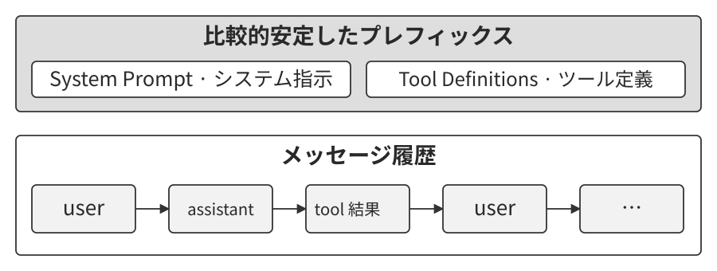

そのため、連続する 2 回のリクエストで先頭から共通する部分は、メッセージ履歴の中まで伸ばしていけます。次のターンの呼び出しで過去の計算をどれだけ再利用できるかは、このプレフィックスの長さで決まります。

次の Harness は、あまり変わらないシステム指令とツール定義を先頭に置き、毎ターン、履歴メッセージの末尾に現在の状態だけを追加します。履歴が長くなりすぎたら、まず古いメッセージを圧縮してからリクエストを組み立てます。

```python
stable_prefix = system_message
stable_tools = core_tool_schemas
history = load_message_history(session)
status_message = make_status_message(derive_current_state(history))

if estimated_tokens(stable_prefix, stable_tools, history, status_message) > budget:
    history = compress_old_evidence(
        history,
        preserve = [decisions, constraints, failures, citations]
    )

request.messages = [stable_prefix] + history + [status_message]
request.tools = stable_tools
response = call_model(request)
```

圧縮の際は、意思決定、制約、失敗、引用など後の作業に必要な情報を残し、呼び出しリクエストとツール結果の対応関係も維持します。長さの予算だけでなく、情報の重複や陳腐化も圧縮のきっかけになり得ます。具体的な戦略は本章の後半で取り上げます。

> **実験 2-1 ★：ローカル LLM サービスのデプロイとツール呼び出し**
>
> この実験ではローカルで Qwen3-0.6B を動かし、「バンクーバーの時刻と天気を調べる」というタスクに沿って、メッセージがモデル、パーサー、ツール実行器をどう通っていくかを観察します。図2-5 はローカルサービスとクライアントの役割分担を示しています。サーバー側はモデルを読み込み、入力を処理して返答を生成し、クライアント側はメッセージ履歴を管理し、ツールを呼び出して結果を返します。
>
> 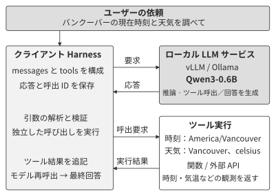
>
> **まず、タスク 1 回分を最後まで追ってみます。** モデルは同じターンの出力で時刻と気温の問い合わせを要求し、`America/Vancouver`、`Vancouver`、`celsius` といったパラメータを埋めます。クライアントは 2 つのツールを並列に実行します。1 つ目の結果は現地時刻 11:11:28、2 つ目の結果は気温 17.9 °C です。2 つの結果がモデルに戻ると、モデルは時刻を分単位で伝え、気温は 17.9 °C だと答えて、このループを終えます。この実行から、6 億パラメータのモデルでも、このタスクに合った 2 つのツールを選び、パラメータを埋め、戻り値を使ってユーザーに答えられることがわかります。
>
> **次に、生の出力と API フィールドの対応を確かめます。** Qwen3 の思考モードは `<think>` タグ付きの推論内容を生成でき、ツールリクエストには対応する呼び出し用のタグが使われます。サーバー側で解析された後、クライアントは独立した `thinking` フィールドやツール呼び出しフィールドを受け取ることがあります。出力の各部分がどう並び、どう保持されるかは、モデルのテンプレートとサービスのプロトコルの両方で決まります。
>
> **続いて、ストリーミング処理を観察します。** 画面はイベントに合わせて「思考中」「ツール呼び出し中」「回答生成中」といった状態を更新できます。ツールの引数は通常いくつかの断片に分かれて届くため、完全なリクエストになるまで蓄積する必要があります。プロトコル上その呼び出しの終わりが確認され、引数・権限・依存関係のチェックを通過すれば、実行システムはスケジューリングを始められます。互いに独立したツールは並列に実行でき、後続の出力処理とパイプライン化することもできます。
>
> **最後に、速度とキャッシュを比べます。** 今回 Apple シリコン搭載の Mac で動かした記録では、ツールタスクの平均デコード速度は毎秒約 107 token でした。Token はモデルがテキストを処理する基本単位で、どう区切られるかはトークナイザーによって決まり、1 つの単語や漢字が 1 つまたは複数の token に対応することがあります。デコード速度は生成開始後の出力速度を表すもので、ユーザーの待ち時間は、最初の token までの遅延、推論の長さ、ツールの所要時間にも左右されます。
>
> キャッシュの比較では同じ長いプレフィックスを使い、プレフィックスをそのまま保ったリクエストと、プレフィックスの先頭を変更したリクエストをそれぞれ測りました。今回の 5 組のペアでは、プレフィックスを保ったリクエストのほうが 4 組で速く、2 つのグループの平均の最初の token までの遅延はそれぞれ約 1.30 秒と 1.51 秒でした。これらのリクエストが計算のうえでどう違うのかは、次節で説明します。
>
> この実験を通じて、筆者はオンデバイス Agent にいっそう期待を持つようになりました。小さなモデルでも、ユーザー自身のデバイス上でこうしたツール呼び出しタスクをこなせるようになっています。**オンデバイス Agent の時代は、多くの人が予想しているよりも近くに来ています。**

## KV Cache に優しいコンテキスト設計

Agent の隣り合うリクエストは、通常かなりの情報を共有しています。システム指令、ツール定義、それまでに起きた相互作用です。推論エンジンがこれらの内容の中間計算結果を再利用できれば、より多くの計算を新しい情報に振り向けられます。**KV Cache** は、各層のアテンション計算で得られたキー（Key）と値（Value）を保存し、後続の token が使えるようにします。**Prompt Cache** はさらに一歩進めて、条件を満たすプレフィックスのキャッシュをリクエスト間で再利用します[^ch2-kv-basics]。

カスタマーサポートの Agent を考えてみましょう。モデルに現在時刻を知らせるため、開発者がシステムプロンプトの冒頭に `Current time: {{now}}` を入れ、リクエストのたびに更新したとします。後ろの業務ルールやツール定義は変わらなくても、実際の入力はタイムスタンプの位置から変わってしまいます。同じプレフィックスで KV を再利用するサービスでは、タイムスタンプ以降がすべて再計算されることになり、入力処理の時間と費用が増えます。

時刻を追加メッセージとして書くか、必要なときに時刻ツールを呼び出すようにすれば、既存のプレフィックスを保てます。どちらの配置でも伝わる情報はほぼ同じですが、再計算が起きる範囲は異なります。

まずは次の 3 つのやり方を覚えておいてください。この後の原理と実験で、一つずつ説明していきます。

1. **再利用できるプレフィックスを安定させる。** システム指令とよく使うツール定義は、内容も順序も固定します。
2. **実行中の変化は後ろに追加する。** 時刻、残高、呼び出し回数、タスクの進捗は、新しいメッセージやツールの結果として渡せます。最新の状態にはいつ時点のものかを明記し、どの記録が現在の判断に当てはまるのかをモデルが見分けられるようにします。
3. **モデルのプロトコルに沿ってメッセージを組み立てる。** 正しいロール、呼び出し ID、ツール結果の形式を使い、対応するチャットテンプレートでモデル入力を生成します。キャッシュが照合するのは処理後のプレフィックスと関連する設定であり、メッセージのプロトコルは、モデルが指令、ユーザーのリクエスト、ツールの戻り値をどう見分けるかも決めます。

本節で扱う因果的アテンションのモデルでは、後から token が加わっても、それより前の位置ですでに計算された状態は変わりません。既存の入力を変更すると、最初に変わった位置とそれ以降の状態は再計算が必要になりますが、変更より前のプレフィックスは引き続き再利用できる可能性があります。実際にどの範囲がヒットするかは、サーバー側がキャッシュブロックのサイズ、保持期間、実行設定に応じて決めます。

[^ch2-kv-basics]: Hugging Face、How caching works（層ごとに K、V を保存・再利用する仕組みを解説）。

> **実験 2-2 ★：アテンション機構の可視化**
>
> まず「北京 的 天气 怎么样」（北京の天気はどう？）という文で、1 回のアテンション計算を理解しましょう。説明しやすいよう、図2-6 ではこの文を 4 つの意味単位に分けています。実際のモデルでは入力の区切り方はトークナイザーが決めます。「怎么样」（どう？）の位置を処理するとき、アテンション層はすでにある情報を組み合わせて現在の表現をつくります。Query、Key、Value は、それぞれ問い合わせ、照合、情報の集約を担います。
>
> | ベクトル | 役割 | この例での直感的な理解 |
> | --- | --- | --- |
> | **Query（クエリ）** | 現在の位置がほかの位置と照合するためのベクトル | 「怎么样」が既存の内容から関連する情報を探す |
> | **Key（キー）** | 各位置が照合に参加するためのベクトル | 「北京」「天气」などの位置が照合用の表現を提供する |
> | **Value（値）** | 重みに応じて集約される情報ベクトル | 場所や天気などの情報を、それぞれの比重で現在の表現に取り込む |
>
> Key は検索に使うラベル、Value は取り出される中身だと考えるとわかりやすいでしょう。モデル内のこれらのベクトルはいずれも隠れ表現から計算される数値で、どのように照合するかは学習によって形づくられます。
>
> 1 回の計算は 3 つのステップからなります。まず、現在の位置が Query を生成します。次に、それを各位置の Key と内積をとり、スケーリング、因果マスク、softmax を経て、合計が 1 になるアテンションの重みを得ます。最後に、その重みで Value の加重和をとります。内積とは 2 組の数値を要素ごとに掛けて足し合わせたもので、softmax は見えている位置のスコアを正規化された重みに変換します。各位置の Value は対応する重みで集約に加わり、合わさってこのアテンションヘッドの出力になります。
>
> 図2-6 の最後の行を横に読んでみましょう。「怎么样」の位置が「天气」に与える重みは 0.55 です。この数値を「天气」の位置の Value に掛け、さらに残り 3 つの位置の寄与を足すと、このアテンションヘッドの「怎么样」における出力になります。では「天气」の行に移ると、なぜ右側に × が 1 つ増えているのでしょうか。この位置を計算する時点では、系列がまだ「怎么样」に達していないからです。
>
> 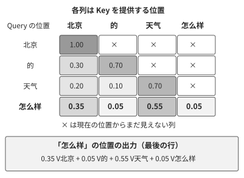
>
> 各位置の重みを行列として並べると、**アテンションヒートマップ**になります。各行が 1 つの Query、各列が 1 つの Key に対応し、色の濃さが重みの大きさを表します。因果マスクのもとでは、現在の位置は自分自身とそれより前の位置だけを読めます。図ではマスクされた位置を × で示しており、softmax 後のそれらの重みはゼロです。この構造は入力の処理にもその後の生成にも当てはまります。
>
> ここから K、V キャッシュの用途も見えてきます。生成が進んでも、新しい位置は既存の位置の Key と Value を読み続けます。これらのベクトルを保存しておけば、新しい位置はそれを直接使って照合と集約を行え、過去の位置の計算を繰り返さずに済みます。
>
> この模式的な重みを理解したら、次は Qwen3-0.6B が実際に計算したアテンション分布を見てみます。実験では、短い文と、推論および最終回答を含む生成系列をそれぞれ記録し、層ごとのアテンション行列を比較します。図2-7 は第 0、13、27 層を示しています。左の列は 9 個の token からなる短文、右の列は 17 × 23 を計算する生成系列で、入力、推論、回答の位置範囲を示してあります。濃淡は対数スケールで、強いアテンションの重みと弱いアテンションの重みを同時に見やすくしています。
>
> 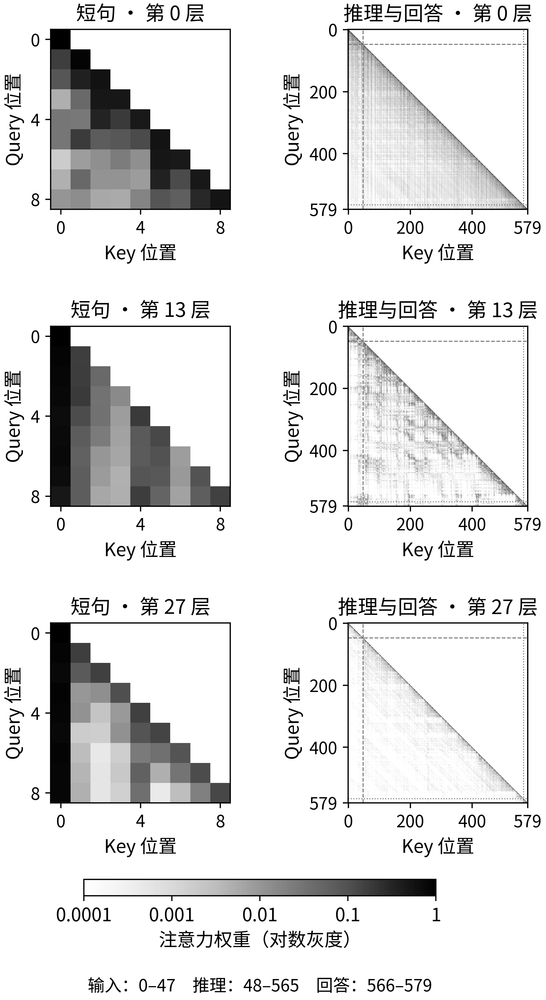
>
> 読むときは、次の 4 つの手がかりに沿って分析できます。
>
> 1. **アテンションシンク（Attention Sink）。** 一部の層は、系列の先頭の token がほとんど意味を担っていなくても、そこに大きな重みを割り当てます。図2-7 左列の短文を見てください。各図は同じ層の全アテンションヘッドの平均をとったものです。さらに行列の第 1 列にある 9 個の数値の平均をとれば、9 つの位置が先頭の token に平均してどれだけの重みを割いているかがわかります。第 0、13、27 層ではそれぞれ 14.7%、73.9%、83.2% です。右列のより長い生成系列に移ると、第 13 層のこの値は 28.0% になります。softmax は各位置の重みの合計が 1 になることを求めるため、モデルは比較的安定した受け皿の位置を学習できます。StreamingLLM は、この現象とストリーミング推論におけるその役割を専門に研究しています[^ch2-attention-sinks]。
> 2. **推論の区間。** `<think>` に対応する生成区間に印を付け、その行に沿って、モデルがどのプロンプト、ツールの説明、それまでの推論に注目しているかを見ます。三角形の形は因果マスクによるもので、各位置の重みの違いを反映しているのは三角形の内側の濃淡です。
> 3. **回答の区間。** 次に最終回答の生成区間に印を付け、元の入力と先行する推論への重みの配分を比べます。これにより、どの既存情報が現在のアテンションの集約に入っているかを突き止めやすくなります。
> 4. **位置による違い。** 『Lost in the Middle』は、長いコンテキストでの質問応答とキー・バリュー検索において、中間の位置にある情報が有効に使われにくいことを観察しました[^lost-in-the-middle]。実務ではこれを踏まえて、常駐するルールを前方に、現在の目標と進捗を末尾に置くことを優先できます。

[^ch2-attention-sinks]: Xiao et al.，Efficient Streaming Language Models with Attention Sinks，ICLR 2024。

[^lost-in-the-middle]: Liu et al.，Lost in the Middle: How Language Models Use Long Contexts，TACL 2024。

### API メッセージからモデルの Token へ：Chat Template

先ほどの API の例はロール付きのメッセージの並びでしたが、アテンションの図の入力は token の列です。この変換を担うのが **Chat Template（チャットテンプレート）**です。メッセージにロールと境界の目印を加え、取り決めに従ってツールの説明と戻り値を配置してから、トークナイザーに渡してエンコードします。図2-8 の 2 つの列を見比べてください。左側で送ったのはシステム指令とユーザーの質問だけなのに、右側にはなぜ `assistant` が 1 つ増えているのでしょうか。これはテンプレートが次の返答のために付け加えた開始の目印です。この後でツール呼び出し、推論情報の保持、キャッシュヒットを論じる際にも、これらの目印が出てきます。

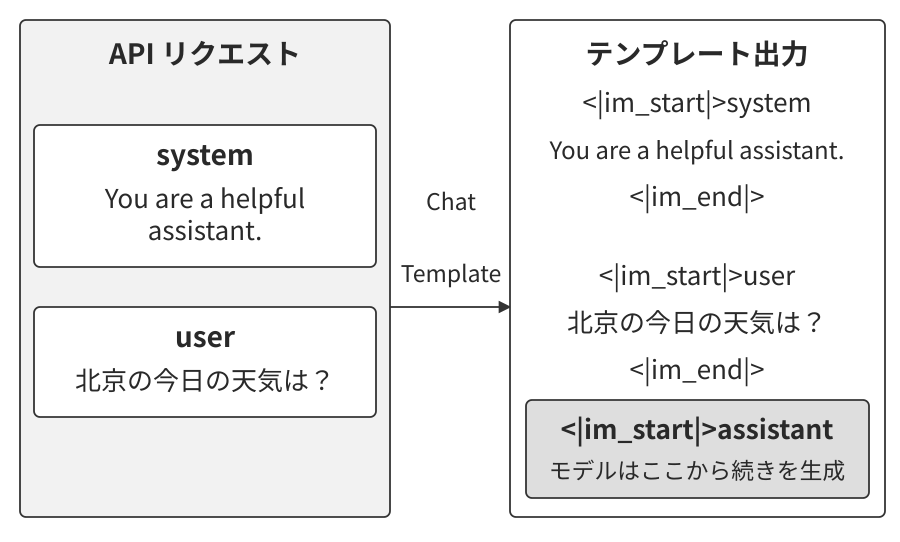

Qwen、Llama、Gemma などのモデルファミリーは、それぞれ独自のチャットテンプレートを持っています。同じ API メッセージでも、モデルが違えば変換後のロールや境界の目印が異なることがあります。ホスト型 API では通常サーバー側で変換が行われますが、自前でデプロイする場合は、推論サービスにモデルに合ったテンプレートを設定する必要があります。

ユーザーが「バンクーバー 17.9 °C」と送ってきて、天気ツールもたまたま同じ文字列を返したとします。この 2 つのメッセージをそれぞれ Qwen3-0.6B のテンプレートに通すと、図2-9 の 2 つの入力になります。どちらも `<|im_start|>user` で始まっていますが、文字列がツールから来たことを示しているのはどの目印でしょうか。

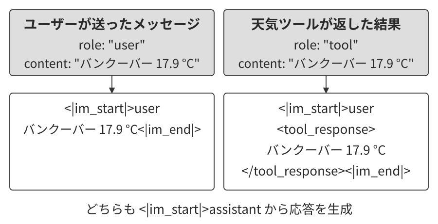

右の列には `<tool_response>` タグが 1 組増えています。テンプレートはさらに、メッセージのロールをもとにユーザーの直近の質問の位置を特定します。その質問より前のターンでは回答の内容だけを残し、それより後では、ツールとのやり取りにモデルの推論情報も含めることができます[^ch2-qwen-template]。

たとえば、モデルがファイルを調べ終えた後もまだ分析を続ける必要があるとします。ツールの結果を `tool` ロールで返せば、テンプレートはそれを現在のタスクにおけるツールからのフィードバックとして認識できます。同じ結果をふつうの `user` メッセージとして書いてしまうと、テンプレートはそれを新しい問い合わせとみなし、それまでの推論を残す範囲が変わってしまうかもしれません。問題を解き続けるには計算用のメモを残しておく必要があるのと同じで、Harness はサービスが求める推論フィールドを保存し、正しいメッセージ構造で呼び出しを続けるべきです。

**単発の推論から長期にわたる Agent へと進むにつれ、過去の思考は維持すべきタスク状態になっていきます。** 初期の DeepSeek-R1 のチャットテンプレートは、過去の回答から思考部分を取り除き、最終回答だけを残していました[^ch2-r1-template]。その後の DeepSeek のツール呼び出しプロトコルでは、推論情報を返すことが求められています。一問一答が終われば、最終回答に次のターンで必要な情報がすでに含まれていることもあります。しかしツールを使うタスクの途中では、「なぜこのファイルを調べるのか」「どの仮説をすでに排除したか」が中間の推論にしか書かれていないことがあります。こうした情報を残しておけば、次のターンでそれまでの考えの続きから作業しやすくなります。

**推論情報をどう返すかは、モデルのプロトコルが決めます。** 組み込む際には、`content`、`tool_calls`、そしてサービスが提供する推論フィールドを合わせて扱う必要があります。以下のいくつかの方式は、それぞれ異なる引き継ぎのルールを示しています。

- **DeepSeek の思考モード**は `reasoning_content` で推論を返します。そのツール呼び出しプロトコルでは、リクエストに `tools` が含まれる場合、以降のリクエストで過去の推論を完全に返さなければなりません。ツールを呼び出さなかったモデルの返答も対象で、フィールドが欠けていると 400 エラーになります。`tools` を含まない純粋なチャットリクエストでは、返された過去の推論はサービス側で無視されます[^ch2-deepseek-thinking]。
- **Kimi の思考とツールの相互作用**でも、実行ループの中で推論、ツールリクエスト、結果を管理する必要があります。Kimi K2.5 のインターリーブ思考の例では、モデルは複数回のツール呼び出しのあいだで推論を続けることができ、クライアントはそのプロトコルに従ってモデルのメッセージを保存し、返します[^ch2-kimi-thinking]。
- **GLM の保持思考**は `thinking.clear_thinking: false` で有効にでき、その後は `reasoning_content` を完全な形で元の順序のまま返します。Coding Plan と標準 API では既定の設定が異なるため、クライアント側で必要なモードを明示的に選ぶべきです[^ch2-glm-thinking]。
- **Claude の thinking block** は、署名と一緒に保存する必要があります。preserved thinking に対応したモデルはさらにブロックの出所とプレフィックスも検査します。具体的なルールは後述の「アーキテクチャ制約としてのキャッシュ」で取り上げます。

これらのルールは、ツール呼び出しが連続する場合にも、途中でモデルを切り替える場合にも影響します。切り替える際、アダプター層はツールリクエスト、結果、タスクの状態を、切り替え先のインターフェースが受け付ける形に変換し、そのうえで切り替え先のモデルのルールに従って推論情報を扱います。この種の軌跡の引き継ぎについては、第 5 章の実験 5-1 で詳しく扱います。

**テンプレートは、キャッシュが照合する入力も決めます。** 同じメッセージ内容でも、テンプレート、ツールの順序、シリアライズの方式が違えば、別の token プレフィックスになり得ます。既存の KV を再利用するには、関連するモデル設定とプレフィックスを一致させておく必要があります。

[^ch2-qwen-template]: Qwen3-0.6B のトークナイザー設定ファイル `tokenizer_config.json` にはチャットテンプレートが格納されており、ユーザーの問い合わせ、推論内容、ツールレスポンスの処理ロジックが含まれています。

[^ch2-r1-template]: DeepSeek-R1 の公式チャットテンプレートは、通常の過去の回答では `</think>` 以降の内容を残します。その後のツール呼び出しにおける推論の返却ルールは DeepSeek の Thinking Mode ドキュメントを参照してください。

[^ch2-deepseek-thinking]: DeepSeek、Thinking Mode。

[^ch2-kimi-thinking]: Moonshot AI、Kimi K2.5 公式リポジトリ、Interleaved Thinking and Multi-Step Tool Call の節。

[^ch2-glm-thinking]: Z.ai、Thinking Mode（インターリーブ思考、保持思考、エンドポイントの既定設定を解説）。

### KV Cache の原理と制約

モデルが 1 つのリクエストを処理するときは、まず入力に対して **prefill（プレフィル）** を行って既存の token の表現を計算し、それから **decode（デコード）** に入って後続の token を 1 つずつ生成します。KV Cache はデコードの過程で既存の位置の K、V を保存します。リクエストをまたぐプレフィックスキャッシュは、さらに前のリクエストが残した同じプレフィックスを再利用します。

たとえば、Agent が 6 ターン目に達した時点で 2,000 個の入力 token がたまっていたとします。サービスがリクエスト内の KV Cache しか使わないなら、まずこの 2,000 個の token を処理してから、キャッシュを使って生成を続けることになります。リクエストをまたぐキャッシュにその中の同じプレフィックスがすでにあれば、prefill はまだキャッシュされていない位置から続きを始められます。図2-10 は、このリクエストをまたいだ再利用を示しています。

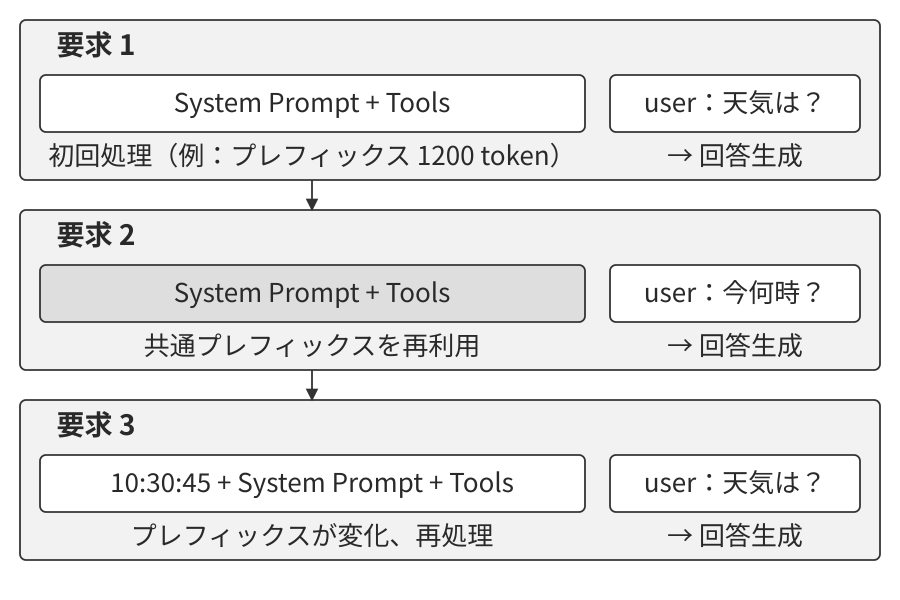

**4 つの token でキャッシュの増え方を追ってみましょう。** 入力が `[A, B, C, D]` だとします。モデルは位置 D を処理するとき、D の Query を A、B、C、D の Key と照合し、それらの Value の加重和をとります。各層の計算を経て、D の位置の最終的な表現が次の token E の予測に使われます。この時点で、A から D までの各層の K、V はすべて保存されています。

サンプリングで E が得られると、次のステップでは E をモデルに入力し、各層における E の Query、Key、Value を計算します。E の Query はそれまでのキャッシュと現在位置の K、V を読み、モデルは 6 番目の token を予測します。同時に E の K、V がキャッシュに追加されます。こうして、生成の各ステップでそれまでの状態をそのまま使い、新たに入力された token の状態だけを計算すればよくなります。

KV Cache をまったく使わなければ、E を予測するときに A から D までを処理し直し、6 番目の token を予測するときにはさらに A から E までを処理しなければなりません。K、V を繰り返し生成する位置の数だけで数えても、累計の作業量は $1+2+\cdots+N$ のように増えていきます。キャッシュを使えば過去の位置の層ごとの計算は再利用できますが、新しい位置は依然として見えている K、V を読む必要があります。標準的なフルアテンションのデコードでは、この読み出しと照合はコンテキスト長に比例して増えるため、長いコンテキストではやはりより多くの GPU メモリとメモリ帯域を消費します。

**入力を変更すると、なぜ後続のキャッシュに影響するのでしょうか。** Transformer の各層は隠れ表現を順に処理し、層ごとに独自の K、V を持ちます。ある位置はアテンション計算を経ると、それより前の位置の情報がすでに表現に溶け込んだ状態で次の層に渡されます。したがって、$k$ 番目の token が変わると、その影響はその位置から後ろへ、そしてより上の層へと伝わります。

同じモデルと計算設定であれば、$k$ より前の位置はそれより早い入力にしか依存しないので、引き続き再利用できます。$k$ 以降は、影響を受けた状態を作り直す必要があります。実際のサービスは通常キャッシュブロック単位でプレフィックスを照合するので、再計算の境界はブロックサイズにも左右されます。更新が前方にあるほど、一般に再計算すべき入力は多くなります。安定した指令を前方に置き、新しい状態を後方に追加するのは、まさにこの依存関係を利用しているのです。

> **実験 2-3 ★★：コンテキスト管理方式の比較**
>
> この実験では、Agent にファイルの探索・読み取り・検索のツールを使って同じタスクをこなさせ、安定して追記していくベースラインと 5 種類のコンテキストの変更を比べます。ベースラインは指令とツールの順序を固定し、モデルのメッセージとツールの結果をターンごとに追記していきます。ほかの各グループはそれぞれ指令、状態、ツールの並び、履歴の表現を変え、キャッシュの統計とタスクの進み方がどう変わるかを観察します。
>
> **動的システムプロンプト**は、毎ターンのシステム指令の中で現在時刻を更新します。変更箇所より前には共有プレフィックスが残り得ますが、時刻情報以降の入力は照合や計算をやり直す必要があります。時刻は新しいメッセージとして追記するか、時刻ツールで必要に応じて取得するようにすれば、常駐する業務ルールを引き続き再利用できます。
>
> **動的ユーザー設定**は、前方のメッセージで残りの呼び出し回数や口座残高を更新します。状態そのものはタスクに必要な情報なので、設計上のポイントは更新する位置にあります。最新の状態を末尾に追記し、それがいつ時点のものかを示せば、進捗とプレフィックスの両方を保てます。後述の Agent ステータスバーはこの組み立て方を採用しています。
>
> **ツール定義の並べ替え**は、ターンごとにツール一覧の順序を変えます。名前とパラメータが同じでも、シリアライズ後の token の順序はすでに変わっています。Kimi K2.6 の実行レポートを開くと、ベースラインと並べ替えグループの `Hit%` はどちらも 100% です。では、2 つのグループは本当に同じだけの入力を再利用したのでしょうか。ベースラインは 3 ターンで計 7,567 個の token を入力し、そのうち 768 個がキャッシュにヒットしました。並べ替えグループも 3 ターンで、7,568 個の入力 token のうちヒットしたのは 256 個だけでした。キャッシュされた token 数を入力 token 数で割ると、`Cache%` 列の 10.1% と 3.4% が得られます。もう一方の `Hit%` 列は、ヒットの判定があったリクエストを数えたものです。ベースラインは 2 回のヒット、並べ替えグループは 1 回のヒットだけが記録され、どちらのグループもミスの記録は 0 回でした。残りのリクエストがヒットしたかどうかは、この記録だけでは判断できません。ツールの順序を固定すれば、プレフィックスが理由もなく変わるのを避けられます。
>
> **スライディングウィンドウ**は、直近の履歴だけを残します。10 ターン分の相互作用を残す設定だとすると、15 ターン目には 2 ターン目に取得した重要なファイルの内容を読めなくなるかもしれません。切り詰めは共有プレフィックスを短くするだけでなく、モデルが参照できる事実やタスクの進捗も変えてしまいます。付属の実装は直近 6 件の履歴メッセージを起点とし、ツールの結果に対応する呼び出しリクエストを前方にさかのぼって補います。スライディングウィンドウのグループは 2,224 個の入力 token のうち 1,510 個を再利用し、キャッシュの割合は 6 グループ中最高の 67.9% に達しました。ところが、実験 2-3 のスライディングウィンドウのグループのツール記録を見ると、モデルはファイルを 3 回探し、続けて 2 つのファイルを読んだものの、ユーザーが求めた 3 文の要約は出していません。
>
> **テキスト整形**は、ロール付きの履歴を `USER: ...`、`ASSISTANT: ...` のようなテキストに書き直します。これによりテンプレート内のメッセージ境界とツールの構造が変わり、モデルは本文から元の関係を復元しなければならなくなります。今回のテキストのグループも最終的な返答は生成でき、キャッシュヒットもありました。インターフェースが提供するメッセージのロール、呼び出し ID、ツール結果のフィールドは、こうした関係を安定して伝えるのに役立ちます。
>
> プログラムがメッセージリストを組み立て直しても、送り出すプレフィックスとキャッシュ設定が同じであれば、そのプレフィックスは引き続き再利用される可能性があります。
>
> ユーザーの待ち時間がどれだけ短くなったかも知りたいなら、まずタイマーがどこで止まっているかを確認する必要があります。スライディングウィンドウのグループの 1 ターン目の `ttft` は約 2.23 秒でした。プログラムはこのフィールドを TTFT（最初の token までの遅延）と呼んでいますが、実際には非ストリーミングのリクエストが返答全体を返した時点で計測を止めています。

### KV Cache と Prompt Cache：2 つの層のキャッシュ

この 2 つの層のキャッシュは、2 つの時点で区別できます。モデルが返答の 2 番目の token を生成するとき、そのリクエスト内の既存の位置のキー・バリュー状態を読めます。これが **KV Cache** の働きです。少し後にユーザーが追加の質問をし、Harness が新しいリクエストを送ってくると、サービスは以前保存した同じプレフィックスを見つけて初めて、その部分の入力の計算を省ける可能性があります。こちらは **Prompt Cache** の領分です。前者は 1 回の生成をどう続けるかを説明し、後者にはさらにリクエストをまたいだ保存と照合の仕組みが必要です。

API サービスでは、キャッシュは最小プレフィックス長、ブロックサイズ、有効期限、モデル設定、テナントの分離範囲にも影響されます。再利用できるプレフィックスは、同じキャッシュのスコープ内で探さなければなりません。たとえば Claude API は組織とワークスペースごとにキャッシュを分離しており、同じ文字列でも異なる分離領域に現れれば、それぞれ別にキャッシュが作られます[^ch2-prompt-cache]。

課金では書き込みと読み出しを分けて考える必要があります。一部の Claude モデルでは、キャッシュの読み出し料金は通常の入力料金の 10 分の 1 ですが、最初の書き込みには追加料金がかかります。同じプレフィックスを有効期限内に繰り返し使えば、書き込み料金は 1 回払うだけで済み、その後ヒットしたリクエストはすべて読み出し料金で課金されます。

[^ch2-prompt-cache]: Anthropic、Prompt caching（キャッシュの照合、分離、有効期限、課金を解説）。

### アーキテクチャ制約としてのキャッシュ

**本番システムでは、キャッシュはすでにアーキテクチャ上の制約になっています。** プロンプトをどう並べるか、サブ Agent をどこから始めるか、セッションをどう再開するかは、いずれも再利用できる計算量に影響します。**キャッシュの境界は設計の最初の段階で決めておく必要があります。** 何を共有でき、どの状態が変わるのかを先に決めてからプロンプトとセッションの構造を組み立てれば、実行中の再計算の繰り返しを減らせます。長期タスクの遅延や費用が問題になってからこれらの構造を見直すと、状態管理、サブ Agent、セッション再開にまで手を入れることになりがちです。

**安定度に応じてプレフィックスを配置する。** 複数のタスクで共有する指令とツール定義は前方に置き、その後にユーザー情報、セッションの状態、新しい観測を、適用範囲ごとにまとめて加えます。たとえば OS が macOS/Linux の 2 通り、実行モードが通常/デバッグの 2 通り、言語が中国語/英語の 2 通りあるとすると、3 つの独立した条件から最大で $2\times2\times2=8$ 通りのプレフィックスの組み合わせが生まれます。変化の多いフィールドを共有部分の後ろに回せば、共通プレフィックスが再利用される機会を増やせます。共通部分を共有する範囲は、サービスの組織、ワークスペース、プライバシーの境界にも従う必要があります。

**サブ Agent には再利用できる起点を選ぶ。** サブ Agent が親 Agent のタスクの背景を受け継ぐ場合、双方で一致するプレフィックスを再利用し、そこに自分のサブタスクを追加できます。再利用できる範囲は、プロンプト、ツールの順序、モデル、関連する設定が合わさって決まります。独立した役割や隔離されたコンテキストが必要なサブ Agent は、そのタスクに合わせて入力を組み立て、そのうえでどの共通部分を共有するのが適切かを検討します。

**送信済みの内容を保存する。** 大きなツール出力を要約やプレビューに圧縮した場合は、実際にモデルへ送った版を保存しておくべきです。セッションを再開するときにこの記録を再生すれば、同じメッセージ列を再構築できます。再開のたびに要約を作り直すと、新しい言い回しが入り込み、プレフィックスが変わるおそれがあります。要約を更新するときは新しい版を公開し、以後どこからキャッシュを作り直すのかを明確にしておきます。

**推論を保持するには、プロトコル上の制約も満たす必要があります。** Claude の preserved thinking は、この問題の具体例です。そのドキュメントでは、この仕組みを蒸留対策に用いるとしています。サービスは thinking block の署名、生成したモデル、そのプレフィックスを検査します。Claude Fable 5.1、Claude Opus 5.5 などプレフィックスの紐づけに対応したモデルでは、ブロックより前にあるトップレベルの `system`、`tools`、メッセージが合わせて検証の範囲になり、そのいずれかを変更すると、そのブロックと以降の thinking block が無効になります[^ch2-preserved-thinking]。

たとえば、毎ターンシステム時刻を書き換える、最初のメッセージにある環境情報をレンダリングし直す、古いツール結果をその場で切り詰める、といった操作は、いずれも後続の推論ブロックが紐づいているプレフィックスを変えてしまいます。検証に引っかかると、API は 400 エラーを返すこともあれば、`prefix_mismatch_behavior` の設定に従って無効になったブロックを捨て、リクエストの処理を続けることもあります。後者の場合でも、モデルは残されたタスク情報とツール結果を使えますが、無効になった推論は今回の入力には含まれなくなります。2026 年 8 月 31 日以降に作成されたアカウントではプレフィックスの検証が既定で有効になっており、それ以前のアカウントでの有効化方法はプロトコルの説明を参照してください。

この種のプロトコルを組み込むときは、セッションのトップレベルの指令とツールの集合を安定させ、状態の変化は後方に追加するようにします。途中で指令やツールを更新する必要がある場合は、そのサービスが提供するセッション内のシステムメッセージやツール変更ブロックなどのインターフェースを使います。thinking block を切り詰める場合も、元の順序で連続した区間を保たなければなりません。先頭や末尾から削除するか、すべて削除するのはかまいませんが、途中に欠けがあると後続のブロックに影響し、いったん自分で削除したブロックは削除したままにしておく必要があります。

途中でモデルを切り替えるときには、サービスは切り替え先のモデルが元のモデルの推論ブロックを読めるかどうかも検査します。クライアントは元の履歴を保存しておき、互換性のルールに従った処理をサービスに任せるべきです。クライアントが自分で削除してしまうと、後で元のモデルに戻したときにもこれらの記録を復元できません。

[^ch2-preserved-thinking]: Anthropic、Preserved thinking（モデル、プレフィックスの紐づけ、無効化の扱い、推論ブロックの切り詰めルールを解説）。セッション内の更新インターフェースについては Mid-conversation system messages and tool changes を参照。

### 研究の広がり：編集可能・組み合わせ可能な KV Cache

> ここまでの設計は、いずれもプレフィックスの照合によって計算を再利用するものでした。筆者はさらに、KV にすでに保存された情報を直接編集したり組み合わせたりして、キャッシュをコンテキストの変化に適応させられないかを探りたいと考えています。筆者は『Models Take Notes at Prefill』で、この情報をモデルの「メモ」にたとえました[^ch2-2]。prefill で多層のアテンション計算を経ると、あるフィールドの影響はすでに後続の位置の表現に入り込んでいます。たとえば「ユーザーの所在地：北京」は後の場所の判断に影響するかもしれません。このフィールド自身の K、V だけを置き換えても、後続の状態には古い都市から導かれた結論が残っている可能性があります。
>
> 論文は介入実験によって、フィールド自身の KV と後続の状態の働きを切り分けました。測定した意思決定では、フィールド自身の KV の直接的な寄与は 1% 未満で、主な影響は下流の表現に保存されていました。この下流に残された「メモ」を軸に、キャッシュを活用する 2 つの方法を探ることができます。
>
> **編集（Editing）**は、明示的に訂正した情報によって後続の計算を促し、既存の判断を更新させるものです。論文ではさらに、測定した 8B モデルのタスクにおいて、明示的な思考の連鎖があればフィールドを単独で編集するだけでも目標の意思決定を回復でき、計算コストは完全な再計算の約 1% で済むことがわかりました。この推論過程がない場合、古い下流の状態が意思決定に影響し続け、フィールドの変更が効きにくくなることがあります。
>
> **組み合わせ（Composition）**は、あらかじめ計算しておいたスキルのキャッシュを新しいコンテキストにつなぎ込むものです。回転位置埋め込み（RoPE）を使うモデルでは、まずキャッシュ内の位置表現を調整してから連結する必要があります。既存のメモのページを振り直して、別の資料の後ろにつなげるようなものだと考えてください。論文は 12 のモデルを比較し、連結と完全な再計算とで出力 logits のコサイン類似度が 0.90–0.999 になることを示しました。キャッシュの位置の付け替えと連結そのものは長さに比例する手間で処理でき、コンテキスト全体のアテンションの再計算を減らせます。
>
> 訂正情報を追記するやり方は、既存のプレフィックスキャッシュと組み合わせることもできます。論文の vLLM オンラインベンチマークでは、この組み合わせによってプレフィックスキャッシュのヒット率を約 98.5% に保ち、p90 の最初の token までの遅延はベースラインの 1/398 から 1/53 程度になりました。
>
> **筆者がこの研究の方向に期待しているのは、コンテキストを更新しても既存の計算をより多く残せる見込みがあるからです。** Agent は記憶のフィールドを更新したり、状態を加えたり、ツール定義を差し替えたりすることがよくあります。関連する状態をメモのように修正したりつなげたりできれば、長いコンテキストを維持するコストを大きく下げられる可能性があります。

[^ch2-2]: Li, Bojie，Models Take Notes at Prefill: KV Cache Can Be Editable and Composable，2026。編集、組み合わせ、オンラインキャッシュの実験はそれぞれ異なるタスクと指標を用いています。具体的な設定は論文を参照してください。

### キャッシュの仕組みからコンテキストの内容の設計へ

キャッシュが計算をどう再利用するかを理解したら、次は毎ターンの入力に何を入れ、その内容をどう更新するかを決めます。この後の内容は 3 つに分かれます。

- **プロンプトエンジニアリングと Agent Skills**：まずシステム指令とツール定義を設計し、目標、ルール、操作方法を示します。次に段階的開示によって領域の知識を必要に応じて読み込みます。プロンプトインジェクションへの防御では、外部の内容がコンテキストに入るときの出所と指令の境界に注目します。
- **Agent ステータスバー**：タスクの進捗、環境の観測の要約、呼び出し回数といった状態をモデルに提供し、長い履歴から改めて推し量る手間を減らします。スマートフォンの時刻、バッテリー残量、通信状態のように、現在の実行状況を常に見えるようにしておくものです。
- **コンテキスト圧縮**：履歴が伸びていくなかで以後の意思決定に必要な情報を残し、いつ圧縮するか、要約をどう組み立てるか、キャッシュの再計算とタスクの引き継ぎをどう扱うかを決めます。

## プロンプトエンジニアリング：システムプロンプトの最適化

プロンプトエンジニアリングは、指示、手順、例を通じて、モデルが具体的なタスクを遂行できるよう導く技術です。本節では**システムプロンプト（System Prompt）**を中心に扱います。システムプロンプトは従業員ハンドブックのようなもので、Agent の身元、目標、振る舞いのルール、仕事の進め方を説明します。本章の API の例では、これらの内容を `system` メッセージで渡しています。

### 語調とスタイル：ユーザーに向けてどう表現するか

語調についての要求は、具体的な表現にまで落とし込むべきです。たとえば短い質疑応答なら「You MUST answer concisely with fewer than 4 lines」、つまり 4 行未満で答えるよう求めることができます。タスクが行き詰まったときには「keep your response to 1–2 sentences」と求め、現在の状況と次の一手を一、二文で伝えさせれば、ユーザーは自分が対応すべき事項をすぐに把握できます。

「NEVER do X」のような大文字による強調は、重要な要求を際立たせるのに使えます。それ以上に大切なのは、その要求がどんな状況に当てはまり、どう行動すべきかを説明することです。

### 構造化プロンプト：階層と内容の境界を整理する

見出し、箇条書き、タグは、長いプロンプトを整理するのに役立ちます。Markdown の見出しは章や手順を表すのに向いており、XML 風のタグは用途の異なる内容のまとまりを区切るのに向いています。たとえば `<working_directory>` で作業ディレクトリの情報を囲みます。タグ名は内容の用途をそのまま表すものにし、各ブロックの関係をモデルが見分けやすいようにします。

1 つのプロンプトの中で、2 つの書き方を組み合わせることもできます。

```text
# 工具使用规范

## 文件操作
<file_operation>
- 读取文件前检查路径是否存在
- 修改已有文件前保存备份
</file_operation>

## 网络请求
<network_request>
- 超时时间设置为 30 秒
- 短暂故障最多重试 3 次
- 有外部副作用的请求，重试前先确认执行状态
</network_request>
```

Markdown は読みやすい階層を与え、`<file_operation>` と `<network_request>` はルールの適用範囲を区切ります。たとえば「再試行は最大 3 回まで」はネットワークリクエストにだけ適用され、ファイルを変更するときには前のグループのバックアップのルールに従います。

### 手順に沿ってルールを組み立てる

**タスクにはっきりした段階があるなら、プロンプトは手順に沿って組み立てることを優先します。** 返金を例に取ると、まず注文を見つけなければ、返金ポリシーに照らしてその代金を返せるかどうかを判断できません。注文が見つからなければ、ユーザーに注文番号などの情報を補ってもらいます。注文が条件を満たしていれば、そこで返金を開始します。同じルールを百項目を超えるリストにばらばらに並べると、ステップごとに当てはまる項目を探し直さなければなりません。入力の条件、処理の順序、例外時の出口を対応する段階に書いておけば、モデルはいまどこまで進んでいて次に何をすべきかを判断する拠り所を得られます。

以下ではファイル処理を例に、確認、分類、前処理、実行、検証を 1 つの標準作業手順（SOP）としてつなげます。

```text
文件处理流程

步骤 1：检查
  确认文件存在且可以访问
  文件不存在 → 记录错误，停止处理
  ↓
步骤 2：分类
  结合扩展名与文件内容确定类型
  ↓
步骤 3：预处理
  配置文件 → 先备份
  大文件（>1 MB）→ 使用流式处理
  ↓
步骤 4：执行
  按文件类型执行相应处理
  ↓
步骤 5：验证
  检查处理后文件的完整性
```

各ステップには局所的な目標が 1 つずつあり、関連するルールはそのステップの下に置かれています。ファイルが存在しなければ確認の段階で抜け、設定ファイルを変更する必要があれば前処理の段階でバックアップを保存します。実行の進捗は、メッセージ履歴や状態の記録によってモデルに伝えます。

### 業務ルールの具体化：プロダクトの取り決めを明確に書く

同じ注文データが、どの種類のリクエストに分類され、どのサービスが適用され、いくら請求すべきなのか。これはまず、プロダクトと運用の側が明確にすべき業務上の取り決めです。エンジニアリングの実装では、そのうえで役割を分けます。プロンプトはモデルに、どのフィールドを取得し、どのサービスに問い合わせるべきかを伝え、ツールと業務システムは確定的な課金と制約の処理を実行します。

ユーザーの代わりに電話をかけてサブスクリプション料金の引き下げや返金の申請を行う Agent を例に取りましょう。チームは「うまくいかなければ返金」によって試してもらうハードルを下げつつ、特殊なタスクには明確な料金体系を設けたいと考えています。そこで、次の 3 種類の課金を設計できます。

- **節約額に応じた成功報酬**：交渉によって既存の請求額を引き下げ、実際に節約できた金額の一定割合、たとえば 20% を請求します。
- **サービスごとの固定料金**：レストランの予約などのサービス型タスクは、タスクの種類や複雑さに応じて料金を請求します。
- **難しいタスクの前払い**：特定の条件を満たす難しいタスクについては、前払いの料金と返金不可の条項を事前に説明し、ユーザーの確認を得てから引き受けます。

「タスクの状況に応じて適切な課金タイプを選ぶ」と書くだけでは、分類のあいまいさが残ります。「先月買った服を返品して」は支払済みの代金を取り戻す話であり、「Netflix のサブスクリプションを解約して」は今後の支払いを止める話です。どちらの結果も広い意味では節約と受け取られかねませんが、チームは成功報酬を「交渉による既存請求額の引き下げ」に限定し、返金とサービス解約には一律に固定料金を適用すると決めることができます。

対応するプロンプトには、カテゴリーの境界をそのまま書けます。「NEVER use percentage_based_one_time for refunds and service cancellations. Use fixed_fee instead.」つまり、返金とサービス解約には `fixed_fee` を使い、成功報酬モデルが適用されるのは交渉で既存の請求額を引き下げる場合だけです。

チームはさらに、その依頼がどの程度の確度で成功しそうかも見積もらなければなりません。事業者がどんな申請を受け付けるか、そのユーザーが条件を満たしているか、請求書にどんな費用が載っているか、過去の同種の依頼がどうだったかは、いずれも引き受け方に影響します。「60% を超えれば返金可能モード、30% 未満なら引き受けない」という閾値のルールにするなら、その間の区間と境界値をどう扱うかも明記する必要があります。

金額の計算では、単位、基準、端数処理の順序を明確にします。たとえば電話の費用は 1 分あたり 0.05 ドルで積み上げ、合計してから 1 ドル単位に四捨五入します。節約額は既存の請求額を基準にします。現在の請求額が 150 ドルで、事業者が来年 180 ドルに値上げするかもしれない場合、現在の価格を維持したことで避けられた潜在的な値上げ分は、あらかじめ取り決めた基準に従って扱うべきであり、既存請求額の引き下げによる節約額に自動的に含めてはいけません。

筆者としては、**業務ルールの設計はプロダクト責任者が主導し**、オンラインのデータ、ユーザーのフィードバック、運用の経験を踏まえてこれらの定義を維持することを勧めます。エンジニアはそれをプロンプト、ツールのパラメータ、課金ロジック、検証ルールに落とし込みます。

### Few-shot 例：例で期待する振る舞いを示す

出力に対する要求をいくつかのルールでは表しにくいときは、**抽象的な説明を積み重ねるよりも、質の高い例を二、三示すほうが直接的です。** このやり方を **少数例（few-shot examples）** と呼びます。特定の文章スタイル、構造化されたレポート、カスタマーサポートの語調などは、入力と期待する出力を対にして示すのに向いています。モデルは現在のコンテキストの中でこれらの例からパターンを見いだし、新しいリクエストに適用します。

例はシステムプロンプトに入れて複数のリクエストで共有する内容にすることも、手本となる `user`／`assistant` メッセージとして組み立て、セッションの開始時に読み込むこともできます。**同じ種類のタスクを繰り返し処理するなら、筆者は厳選した固定の例のセットを優先して使います。** 固定の例はプレフィックスを安定させることにもつながります。タスクのばらつきが大きく固定の例ではカバーしきれない場合に、タスクごとの検索を検討します。動的に選ぶ場合は、共通の指示を先に残し、選んだ例を後方に加えるとよいでしょう。

先ほどの課金ルールを使えば、2 つの例で紛らわしい境界をはっきり示せます。ユーザーがアシスタントに月額料金を 80 ドルから 60 ドルに交渉してもらうなら、節約額に応じた成功報酬を適用できます。ユーザーが月額 80 ドルのサービスの解約を頼むなら、サービス解約として固定料金を請求します。

### ツール定義の設計

ツール定義は Agent の操作マニュアルです。モデルは名前と説明からいつツールを呼び出すかを判断し、パラメータの構造にもとづいてリクエストを埋めます。わかりやすい定義は、そのツールで何ができるか、どんな入力が必要か、何が返ってくるか、呼び出す前にどんな条件を満たすべきかをモデルに伝えます。

これらの情報はかなり具体的に書けます。たとえば検索ツールなら「ファイルの内容を探すときは専用の検索ツールを使う」と求め、時刻ツールなら `timezone: "America/New_York"` を示してパラメータの実際の書き方を見せます。読み取りツールでは「互いに独立した読み取りはまとめて呼び出せる」と示し、編集ツールでは「まず対象のファイルを読み、現在の内容にもとづいて編集する」と説明すべきです。この 4 種類の説明は、それぞれ使用範囲、パラメータの形式、実行効率、前提となる依存関係を伝えています。第 4 章では、さらに多くの例を交えてツールインターフェースの設計を論じます。

ツールが少ないうちは、完全な `tools` 定義をリクエストとともに渡し、以降のターンでも名前、内容、並び順を安定させておけます。ツールが増えると、完全な定義がコンテキストを大きく占めるうえ、似たツールを見分けるモデルの負担も増えます。そうなったら **オンデマンド読み込み** を採用できます。まずどんな能力があるかをモデルに知らせ、必要になったときに関連ツールの完全なスキーマを検索して読み込むのです。後述の Skills も、先に目録を渡し、詳細は後から読み込むという同じ組み立て方を取っています。

OpenAI Responses API では、`defer_loading: true` で遅延読み込みのツールに印を付けます。クライアントが管理するツール検索の流れでは、モデルが `tool_search_call` を出し、クライアントが `tool_search_output` で選ばれたツール定義を返します。よく使うツールは直接渡して、遅延読み込みのツールと併用することもできます[^ch2-toolsearch-oai]。Claude Code は、ツール検索に対応したモデルとサービス設定のもとでは、既定で MCP ツールをオンデマンドで読み込みます。セッション開始時にはツール名とサーバーの説明だけを渡し、検索した後で完全な定義を読み込みます。ツール定義がコンテキストの指定した割合に達したら遅延読み込みを有効にする、閾値モードも用意されています[^ch2-toolsearch-cc]。Codex の Apps／Connectors のツール探索テンプレートは、BM25 でツールのメタデータを検索し、一致したツールを次回のモデル呼び出しに渡します[^ch2-toolsearch-codex]。

オンデマンド読み込みは、プレフィックスキャッシュとも整合させる必要があります。セッション中にツール定義を追加できるインターフェースであれば、既存の内容はその位置のまま残し、新しい定義は探索結果とともに以降のコンテキストに加えます。因果的アテンションでは、各 token の K、V はその token 自身とそれより前の内容にしか依存しないので、末尾に内容を加えても、それまでのプレフィックスを再利用できる条件は保たれます。以降のターンでもこの履歴の後ろにメッセージを追加し続け、読み込み済みの定義も元の位置に残ります。一方、新しいツールをリクエスト冒頭の `tools` の集合に加えるインターフェースもあります。その場合、新しい定義より後ろにある履歴メッセージは、まったく変わっていなくても再計算が必要になります。

[^ch2-toolsearch-oai]: OpenAI、Tool search、Responses API ドキュメント。
[^ch2-toolsearch-cc]: Anthropic、Scale with MCP tool search、Claude Code ドキュメント。
[^ch2-toolsearch-codex]: OpenAI Codex、Apps／Connectors のツール探索テンプレート。

> **実験 2-4 ★★：プロンプトエンジニアリングのアブレーション実験**
>
> 1 つのプロンプトの中で、語調、情報の組み立て方、ツールの説明はそれぞれどんな役割を果たしているのでしょうか。この実験では τ-bench の航空会社カスタマーサポートのタスクを使って比較します。τ-bench はユーザーのシミュレーション、業務ツール、ルールによって対話の場面を構成し、タスク終了後の目標状態を検査します。航空と小売はその中の 2 つのタスク領域です[^ch2-tau-bench]。
>
> 今回は Kimi K3 を実行モデルとユーザーシミュレーションのモデルの両方に使い、同じ 10 件の航空カスタマーサポートのタスクについて 6 種類の設定を走らせました。ベースラインは構造化されたルール、完全なツールの説明、専門的で中立な語調を保ちます。ほかの設定はそれぞれ語調を変える、ルールの組み立てを崩す、ツールの説明を取り除く、そしてそれらを重ねた変更を加える、というものです。
>
> **語調の比較**では、タスクのルールはそのままにして表現の仕方を変えます。Trump スタイルは「史上最高のフライトを予約してあげよう」のような誇張した自信満々の言い回しを使い、Casual スタイルは軽い口調と絵文字を使います。
>
> **情報の組み立ての比較**では、ルールの内容はそのままにして、見出しと並び順をばらばらにします。
>
> **ツールの説明の比較**では、名前、関数シグネチャ、パラメータの構造は残し、説明文を取り除きます。ツール名とスキーマそのものも情報を伝えるので、説明を取り除いた後の振る舞いは、残った情報が現在のタスクを支えるのに足りるかどうかで決まります。
>
> 今回の 10 件のタスクでは、ベースラインが 7 件を通過し、Trump と Casual の語調はそれぞれ 6 件と 9 件、組み立てを崩した設定は 8 件、説明を取り除いた設定は 9 件、重ねた変更は 8 件を通過しました。

[^ch2-tau-bench]: Yao et al.，τ-bench: A Benchmark for Tool-Agent-User Interaction in Real-World Domains，2024。

### プロンプトインジェクション：コンテキストセキュリティの核となる脅威

Agent はタスクをこなすために、Web ページ、メール、文書、ツールの戻り値を読む必要があります。そうした内容に、タスクの目標を変えようとする指示が紛れ込んでいることもあります。**プロンプトインジェクション**（Prompt Injection）は、指示と処理対象の資料がともにモデルのコンテキストに入るという性質を突き、信頼度の低い出所の内容を行動の根拠としてモデルに扱わせようとするものです。たとえばユーザーが Web ページの要約を頼んだのに、そのページが要約とは無関係な操作をするよう Agent に求めてくる、といった場合です。システムはユーザーのタスクの目標を保ち、ページ内の要求は分析対象の内容として扱う必要があります。

ツール呼び出しは、こうした逸脱を外部環境にまで波及させます。誤った要約はユーザーを誤解させるかもしれませんが、権限のないファイルの変更、メールの送信、データの開示は、システムの状態を直接変えてしまいます。リスクを分析するときは、「内容の入口—コンテキストの組み立て—呼び出しの意思決定—実際の実行」に沿って層ごとに確認できます。外部の内容はどのツールを経て入ってきたのか、出所の情報は保たれているか、モデルはどんな操作を要求したのか、実行層はその操作を許可しているか、という点です[^ch2-injection-defense]。

コンテキストを組み立てる段階では、まず出所と権限の境界を保持しなければなりません。

- **出所の印付け**。外部の資料がコンテキストに入るときは、Web ページ、メール、文書といった出所を残し、明確な境界で内容を囲みます。たとえば `<external_content source="webpage">...</external_content>` は、中に入っているのが Web ページの資料であることを示します。印とその属性は Harness が生成し、外部のテキストは管理されたデータ領域の中に置きます。
- **構造化されたロール**。システムのルール、ユーザーのリクエスト、ツールの結果は、インターフェースの取り決めに従って別々に渡します。ツールの結果は呼び出し ID と対応しているので、内容がどこから来たかをたどりやすくなります。要約したり別の Agent に引き渡したりするときも、この出所の関係を保つべきです。
- **入力の検査**。タスクから外れた指示的な内容を検出し、解析の過程で紛れ込んだ無関係な内容を取り除きます。検査結果はモデルにも実行層にも使えますが、許可するかどうかの判断は、あくまでユーザーのリクエストとシステムの権限にもとづいて下します。

Skills と実行時の状態についても、同じように出所を管理する必要があります。サードパーティの Skill をインストールするときは、その指示、参照文書、同梱のスクリプトを確認し、求められる操作が用途と一致しているかを確かめます。ステータスバーにあるタスクの進捗、権限、カウンタは実行時システムが維持し、Web ページから抽出した事実には外部の出所のラベルを付けたままにします。こうしておけば、情報が要約、転記、再読み込みを経ても、システムは元の信頼の境界を見分けられます。

これらの境界を実際に守るのは実行層です。ツールのアクセス範囲は権限で制御し、ファイルやプロセスの活動はサンドボックスで制約し、リスクの高い操作はルールに従って確認します。モデルが権限を越えた呼び出しを提案しても、Harness と環境が実行前に止めるべきです。これらの仕組みは第 4 章と第 5 章で詳しく扱い、第 3 章では検索した内容と長期記憶における出所の管理を論じます。

[^ch2-injection-defense]: Anthropic，How we contain Claude across products。

> **実験 2-5 ★★：プロンプトインジェクションの攻防実験**
>
> この実験では、外部の内容がコンテキストに入った後、システムがタスクの目標と操作の権限をどう保つかを検査します。実験は隔離されたワークスペースで合成データを使って行い、Web ページの読み取り、ファイルの書き込み、メールの出力にはいずれも検査可能な記録が残ります。
>
> 3 種類のシナリオで、直接のリクエスト、Web ページの内容、セッションをまたぐ記憶をそれぞれ扱います。直接のリクエストのシナリオでは、合成した保護対象情報の出力ルールをモデルが守るかどうかを調べます。Web ページのシナリオでは、要約タスクが権限のない書き込みを引き起こすかどうかを調べます。記憶のシナリオでは、外部の資料が記憶に変わった後、新しいセッションでの操作に影響するかどうかを調べます。
>
> 4 つの設定で防御を一層ずつ加えていきます。ベースラインには基本的な情報保護と操作確認のルールが含まれます。2 つ目の設定は出所と指示の境界についての注意書きを加え、3 つ目はさらに外部の内容に出所の印を付け、4 つ目は実行時の認可チェックを加えて、ファイルの書き込みとメールの送信に権限の検証をかけます。
>
> 今回の Kimi K3 による実行では、3 種類のシナリオと 4 つの設定のすべての組み合わせをそれぞれ 5 回ずつ、計 60 回繰り返しましたが、あらかじめ設定した攻撃目標が達成されたことは一度もありませんでした。

## 動的プロンプトと Agent Skills

返金、コード修正、文書整理を同時にこなす Agent が、毎ターンのリクエストに 3 冊分の完全なマニュアルを添えていたら、返金を 1 件処理するだけでも、無関係なコーディング規約や組版ルールにウィンドウを割くことになります。どの説明を毎回持たせ、どれをモデルがタスクを選んでから読み込めばよいのでしょうか。この問いから、動的プロンプトと Skills が生まれます。

返金を扱うとき、モデルはまず目録から返金マニュアルを見つけてそれを読み、そのうえで、そこに引用されている特別運賃表を調べるかどうかを決められます。図2-11 は、同じやり方をプレゼンテーション資料の作成に当てはめたものです。モデルは目録から PPTX を選び、新規作成の手順を読んでから、HTML 変換ガイドを調べに行きます。タスクが既存の資料の編集であれば、別の経路をたどって XML のリファレンスを調べることもできます。

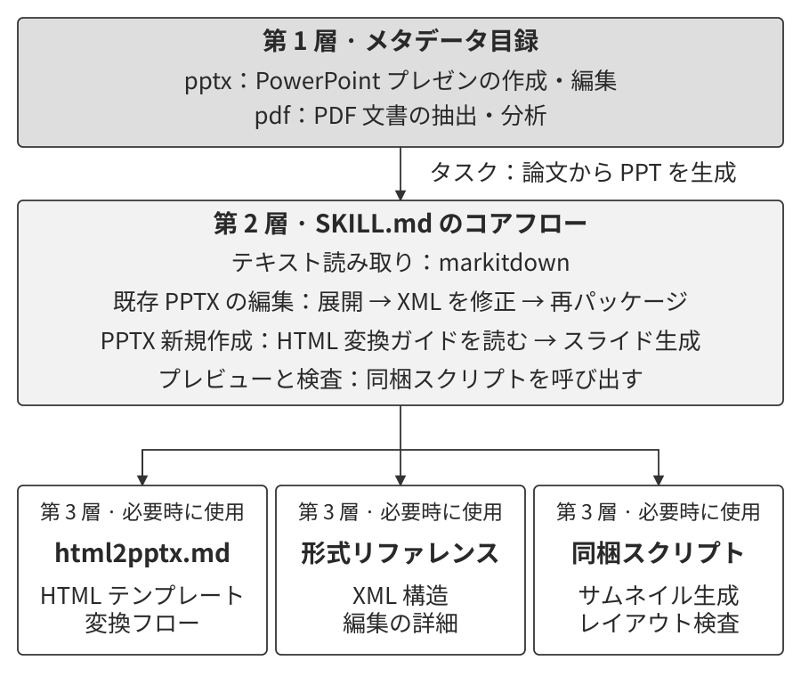

### Skills：領域能力の組み合わせ可能な単位

**Agent Skills** は、ある種のタスクの処理方法、参考資料、スクリプト、テンプレートを、再利用できるパッケージにまとめたものです。新入社員が入社初日に会社の操作マニュアルをすべて暗記する必要がないように、モデルも実際に作業するときになって該当する章を読み込めばよいのです。このような読み込み方を **段階的開示（Progressive Disclosure）** と呼びます[^ch2-3]。

第 1 章の 10 個の商品を使って、どんな情報を Skill として書く価値があるかを考えてみましょう。ユーザーが送料込みの支払総額を比べたいだけなら、明細と今回の届け先が現在のコンテキストに入っていれば十分です。しかしチームが店舗をまたいだ価格比較を繰り返し行うなら、仕様をどう揃えるか、単品価格とセット価格をどう区別するか、送料不明をどう明記するかを、1 つの価格比較 Skill としてまとめられます。次に誰かがどんな商品があるかを眺めたいだけのときは、目録は見えたままにしておき、価格確認の手順一式は、ユーザーが価格を比べる必要が出てきたときに読み込めばよいのです。

**第 1 層はメタデータです。** 各 Skill は `SKILL.md` で自分自身を記述し、ファイル冒頭の `---` で区切られた YAML frontmatter に `name` と `description` を含めます。実行時システムはまず名前と説明を目録としてまとめ、現在のタスクにどの Skill が必要かをモデルに判断させます。目録の並べ方と見せ方は Harness が管理し、完全な手順は選ばれた後に読み込まれます。

**Skill の説明は、何よりもまずルーティングの条件として書きます。** モデルは本文を読み込む前に使うかどうかを決めなければならないので、`description` ではまずいつ適用し、いつ見送るべきかを述べ、そのうえで何ができるかをまとめます。たとえば「help with backend」は範囲が広すぎて、ほとんどすべてのバックエンドのタスクに一致しかねません。「既存の HTTP インターフェースの統合テストを書き、認証、パラメータ検証、エラーレスポンスをカバーする」なら、範囲がはっきりします。紛らわしいタスクについては、「インターフェースの設計方針を議論するだけなら使わない」のような除外条件を補うこともできます。

**第 2 層は中核となる手順です。** Skill が選ばれると、実行時システムは完全な指示をコンテキストに入れます。ユーザーが `/pptx` のようなコマンドを明示的に入力した場合、クライアントは直接それを探して読み込めます。モデルが自分で選ぶ場合は、Skill ツールやファイル読み取りツールを通じて内容を取得します。前者はモデルが有効化の呼び出しを出す手間を省き、後者は選択と読み込みを実行の軌跡に残します。

本書の実験で使う PPTX Skill を例に取ると、中核の説明ではよく使ういくつかの経路が紹介されています。Microsoft の markitdown でプレゼンテーションのテキストを抽出する、PPTX を展開して内部の XML を確認する、新規作成または編集のワークフローを選ぶ、といったものです。モデルはこの層の説明を読めば、現在のタスクに応じて、次にどの資料を読み、どの種類のスクリプトを呼び出すべきかを判断できます[^ch2-4]。

**第 3 層は詳細な資料です。** 複雑な操作は個別の文書に分けて書かれ、メインのファイルはその入口となります。本書で使う版の `html2pptx.md` は HTML からプレゼンテーションを生成する方法を解説しており、ほかの参考文書が書式や編集の細部を補っています。Agent はタスクに応じてこれらを読み進め、同梱のスクリプト、素材、テンプレートを使って作業を完了します。

[^ch2-3]: Anthropic、Equipping Agents for the Real World with Agent Skills、2025。Agent Skills、How to add skills support to your agent。
[^ch2-4]: Anthropic、PPTX Skill。本書の実験では HTML 変換の手順を含む版に固定しています。具体的な版と実行方法は付属の実験 README を参照してください。
[^ch2-codex-skills]: OpenAI、Build skills。OpenAI Codex の公開リポジトリにおける Skills の実装。
[^ch2-cc-skill-inject]: Claude Code、How Claude Code uses prompt caching、Invoking skills and commands。Agent Skills、How to add skills support to your agent、User-explicit activation。

### 実用的な Skill の書き方

実用的な Skill は、4 つの問いに答えている必要があります。どんなタスクに適用するのか、どんな順序で処理するのか、どんな場合に確認が必要か、そして作業が完了したことをどう判断するのか、です。書き手は自分の経験を実行可能な手順に整理し、重要な判断には例を添える必要があります。

文章執筆の Skill を例に取りましょう。宝玉（Baoyu）が個人の表現の癖を出発点に AI の文章を改善した考え方[^ch2-baoyu-remove-ai-writing-flavor]を参考にしながら、内容を次の 4 つに整理できます。

- **役割と読者**：誰のための、どんな種類のタスクで、仕上がりに何が求められるかを説明します。
- **中核となる原則**：まずよく使う判断を 3 ～ 5 項目書き、それぞれに書き換え前後の具体例を付けます。
- **よくある誤りと境界**：起こりやすい表現上の問題、権限を越えた行動、例外的な状況を記録します。
- **参考資料**：用語集、テンプレート、模範文、個別の説明を収め、実行時に参照できるようにします。

ルールは「適用範囲、動作、例外、検証方法」に沿って書けます。たとえば長い文を短くするルールなら、どんな段落に適用し、どう分割し、分割した後に条件と結論が欠けていないかをどう確かめるかを説明すべきです。

始めるときは、自分で満足している原稿を 3 ～ 5 本選び、Agent に語彙、文型、段落の組み立て、語調をまとめさせて、20 行ほどの初版をつくります。次にそれを使って新しいテーマを書かせ、筆者が一文ずつ手を入れます。修正前後の差分は、より具体的なフィードバックになります。どの言葉が余計か、どの文を分けるべきか、どこに事実が足りないか、どこに技術的な細部を戻すべきか、といった点です。繰り返し現れる修正をルールにまとめ、対応する例と適用範囲も残しておきます。

Skill には実行用のツールやテンプレートを同梱することもできます。たとえば PPTX Skill は、操作の説明、解析スクリプト、生成スクリプト、レイアウト用の素材をひとまとめにしており、モデルは説明に従って対応する素材を呼び出せます。各 Skill は個別にテストし、更新し、バージョン管理でき、チームのメンバーも同じ手順をもとに経験を積み増していけます。**Skills の長期的な価値は、領域の経験を分散して蓄積し、個別に公開し、再利用できるようにすることにあります。** チームが Agent の能力を広げるときには、各自が得意な Skill を維持していくことで、pip や npm のようなパッケージのエコシステムが次第に形づくられていきます。これらの Skill は、メインのシステムが提供する探索、読み込み、実行の仕組みを共有できます。

**相互作用の方式を設計するときは、モデルがすでに学習・適応しているパターンを踏襲することを優先します。** ロールの分け方、ツール結果の形式、Skill の読み込み方は、いずれもモデルがどうタスクを引き継ぐかに影響します。ベンダーが提供する標準の流れを出発点にすれば、なじみのない形式から意味を推し量り直すモデルの負担を減らせます。

[^ch2-baoyu-remove-ai-writing-flavor]: 宝玉，《别再用提示词去 AI 味了，方向就是错的》，2026-02-14。

### コンテキスト内での Skills の位置

Skills のコンテキストコストは、目録と本文の 2 つに分かれます。目録はモデルに使える能力を見つけさせ、本文は選ばれた後に作業手順を提供します。仕様が求めているのはオンデマンドの読み込みであり、具体的なメッセージのロール、包み方、更新の仕方は Harness が実装します。

Claude Code は、呼び出した位置で Skill の指示を `user` メッセージとしてセッションに加えます[^ch2-cc-skill-inject]。図2-12 は、モデルが自分で起動する場合のメッセージの並び方の一例です。まず `Skill(skill: "pptx")` の呼び出しを出し、ツールのレスポンスを受け取り、それから追加された Skill の本文を読みます。専用の有効化ツールを使う場合は、ツールのレスポンスが呼び出しの確認を担い、本文は Harness が別に注入できます。通常のファイル読み取りツールを使う場合は、本文をそのままツール結果に含めることもできます。ユーザーが `/pptx` を明示的に入力した場合は、クライアントが直接指示を展開でき、モデルが有効化の呼び出しを出す手間を省けます。

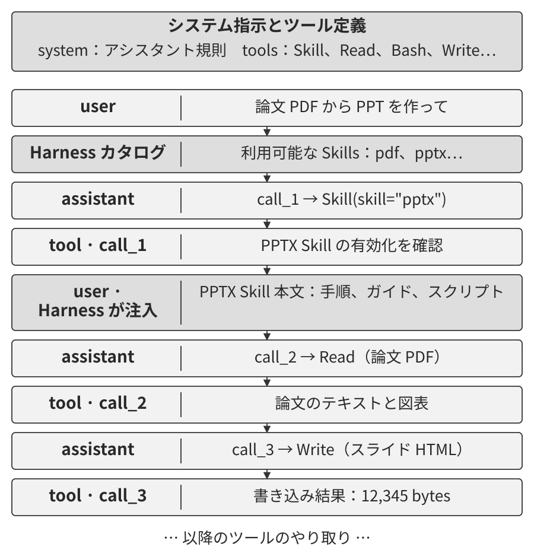{height=55%}

Codex の Skills の実装でも、能力の目録と選ばれた指示を別々に組み立てています。公開されているソースコードでは、目録の一部は `developer` コンテキストに入り、残りは現在のターンや実行環境とともに渡されます。明示的に選ばれた Skill は、ユーザーコンテキストの断片として加えられます。目録の出所と使える実行環境によって、具体的な並び方は変わります[^ch2-codex-skills]。

図2-13 は、まだ再利用できるキャッシュがないリクエストを起点として、オンデマンド読み込みのときにキャッシュがどう増えていくかを示しています。目録が初めてリクエストに入るときは処理が必要で、本文を初めて読み込むときにも計算が増えます。後続のリクエストで同じプレフィックスが保たれていれば、これらの内容はキャッシュから読み出せる可能性があります。新しい内容を呼び出した位置に追加すれば、それまでのメッセージを安定させておけます。読み込み済みの説明は履歴に残り続け、更新が必要になったら実行時システムのコンテキスト戦略に従って処理します。

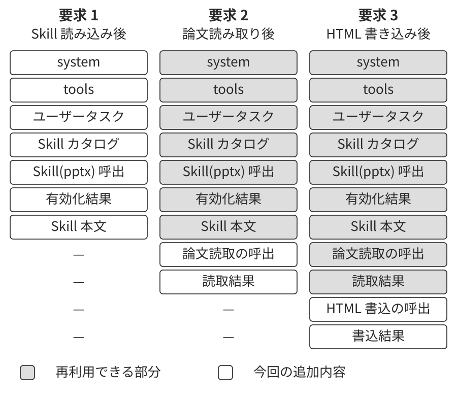

### Skills とツールの関係

Skill はタスクの知識と作業手順を提供し、ツールは読み取り、実行、結果の取得を担います。第 5 章で紹介する 7 つの中核ツールは、さまざまな Skill と組み合わせられます。同じファイル読み取りツールでプレゼンテーションのガイドもコーディング規約も読めますし、汎用の実行器なら対応するスクリプトを走らせられます。こうして、専門的な能力は手順と素材によって広げつつ、基礎となるツールの集合は比較的安定させておけます。

専用のツールも Skill と組み合わせて使えます。前述のツール検索は必要に応じてツール定義を提供し、Skill はいつ呼び出すか、どう組み合わせるか、結果をどう確認するかを説明します。どちらも常駐させる情報量を抑え、新しく読み込んだ内容に適切な位置を用意する必要があります。第 4 章では汎用の実行器と専用ツールの使い分けを、第 9 章では経験を知識、指示、プログラム、モデルのパラメータのどれとして保存するのが適切かをさらに論じます。

> **実験 2-6 ★★：Agent Skills を使って論文からプレゼンテーションを生成する**
>
> この実験では『Attention Is All You Need』を題材に、Agent がプレゼンテーション作成の専門的な手順を必要に応じて読み込む様子を示します。タスクは論文の PDF から 10 ～ 15 ページのプレゼンテーションを生成し、問題の背景、手法、主要な結果、結論をカバーし、論文中の図表を使って説明することです。
>
> 今回の実行では Kimi Code と Anthropic 公式の PPTX Skill を使いました。Agent はまず目録から PPTX Skill を見つけてその操作説明を読み、続けて HTML 変換ガイドを読み、付属の生成ツールを呼び出し、最後にサムネイルとページごとのレンダリングでレイアウトを確認します。各ステップで読む資料はいずれも次の操作のためのもので、作成手順の全体はタスクの進行に合わせて少しずつ展開されていきます。
>
> 出来上がった資料は全 13 ページで、論文のアーキテクチャ図、アテンション機構の図、実験結果の表、アテンションの可視化図を引用していました。
>
> 生成後の確認も Skill のワークフローの一部です。今回の実行では、下付き文字の欠落、箇条書き記号の異常、図表の参照パスの誤り、数値ラベルの精度の問題が起きましたが、Agent はレンダリング結果と構造チェックにもとづいて一つずつ修正しました。最終的なファイルは構造チェックを通過し、LibreOffice で開き直してレンダリングすることもできました。

> **実験 2-7 ★★：自分の文章から「AI っぽさを消す」執筆 Skill をつくる**
>
> この演習では、個人の執筆経験を再利用できる指示に整理します。自作の文章を 3 ～ 5 本用意し、Agent に表現の癖をまとめさせて、起動条件、3 ～ 5 項目の原則、それぞれに対応する例を含む初版の Skill を生成します。
>
> 新しいテーマを 1 つ選んで試しに書かせ、筆者が一文ずつ手を入れます。2 つの版を見比べて、繰り返し現れる問題を見つけ出します。たとえば言葉が空疎である、文が長すぎる、因果関係が省かれている、理解を支える具体例が削られている、といったものです。繰り返し現れる直し方は Skill に書き込めます。

## Agent ステータスバー：メタ情報による Agent 軌跡管理の強化

ユーザーが「もう一度電話してもらえる？」とせかしてきました。図2-14 の左側には 3 回の発信が記録されています。1 回目は 45 分待ってもつながらず、3 回目でようやく月額 59 ドルまで話がまとまりました。この例のルールでは、発信するたびに 1 回分の枠を消費します。つながったのは 2 回だけでも、3 回分の枠はすでに使い切っています。Harness はこうしたカウント、手続きの進捗、確認待ちの事項を、メッセージとともに更新される要約にまとめることができます。これを **Agent ステータスバー（Agent Status Bar）** と呼びます。

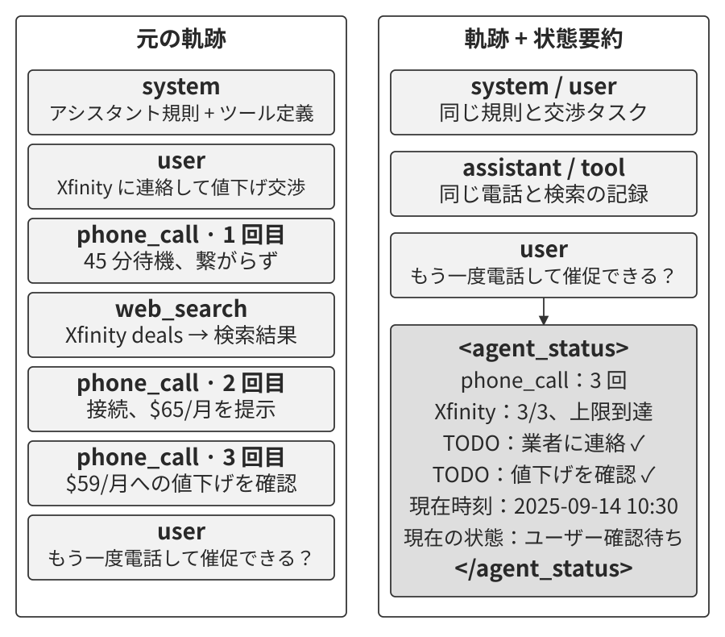

スマートフォンは時刻、バッテリー残量、電波状態を画面の上端に表示しており、一目見れば現在の状態がわかります。図の右側の要約も同じような役割を果たします。アシスタントは「上限に到達」「ユーザーの確認待ち」を読めば、まとまった価格をユーザーに伝え、それを受け入れるかどうかの判断を仰ぐことができます。Harness はツールの結果を返すときに要約を添えることも、状態メッセージを別に 1 件追加することもできます。

### 生の記録から明示的な状態へ

電話によるカスタマーサポートのタスクを考えてみましょう。システムは、同じタスクの中で各事業者に電話をかける回数を 3 回までに制限しています。3 回の通話のあいだには、検索、資料の読み込み、ユーザーからの追加の質問が挟まることもあります。電話をかけ続けてよいかを判断するには、モデルはこの履歴から関連する記録を漏れなく探し出し、事業者を区別し、累計回数を数えなければなりません。

実行時システムが呼び出しのたびにカウントを更新し、「今回は Xfinity への 3 回目の発信で、このタスクの上限に達しました」と直接返すこともできます。次の意思決定では、その結果をそのまま使えます。呼び出し回数はプログラムが管理し、モデルはタスクの進捗と照らし合わせて、次に待つのか、別の窓口を探すのか、それともユーザーに現状を説明するのかを決めます。実行層も同時に、このカウントにもとづいて以後の発信リクエストを検査します。

ここでのエンジニアリング上の価値は、**以後の意思決定で繰り返し必要になる状態を前もって整理しておく**ことにあります。完全な通話記録は引き続き会話の内容と対応の経緯を保存し、ステータスバーは意思決定でよく使う統計と進捗を提供します。**繰り返し使う統計は、コードで差分更新して維持することを優先すべきです。** コンテキストの中から 1 件の記録を見つけることと、すべての記録から合計を算出することは、別の仕事です。生の軌跡を保存しておいても、正確でいつでも取り出せる統計表が自動的に得られるわけではありません。そのたびにモデルに履歴をたどり直して数えさせれば、推論の token を消費するうえ、数え漏れや二重計上の機会も増えます。

筆者は、コンテキストを「抽出層」とセットで使うべき検索エンジンにたとえています。生の記録はさかのぼって確かめるのに便利で、抽出した状態はそのまま使うのに便利です。カウント、上限、検証済みのタスク完了状態はコードで管理するのに向いています。意味的な判断が必要な情報は、まず 1 件ずつ抽出し、それから集計して検証できます。こうすれば、モデルは意思決定のたびに、現在の状態と必要な根拠の両方を目にすることができます。

軌跡が長くなるほど、重要な情報を探すのも難しくなります。最新の目標、制約、進捗を後方にまとめて置けば、モデルは現在の意思決定に必要な情報を見つけやすくなります。

> **実験 2-8 ★★：アテンションの可視化で Agent ステータスバーの効果を観察する**
>
> この実験では Qwen3-0.6B を使い、カスタマーサポートの返金の軌跡を組み立てます。Agent はすでに Xfinity に 3 回電話をかけており、そのあいだにはネット検索が挟まっています。その後ユーザーが「もう一度電話して催促してもらえる？」と尋ねます。システムのルールでは、同じタスク内で各事業者に電話できるのは最大 3 回までです。
>
> 2 つのグループの入力は、同じ履歴とユーザーの追加の質問を保ちます。A グループは生の軌跡をそのまま使い、B グループは末尾に次の状態を加えます。
>
> ```xml
> <agent_status>
> Current State:
> - Tool call summary: 'phone_call' has been invoked 3 times (Xfinity: 3 times)
> - Constraint check: Maximum calls to Xfinity reached (3/3)
> </agent_status>
> ```
>
> 各グループを 3 回ずつ実行しました。A グループは 2 回が明確に再発信を拒否し、1 回はその他の出力に分類されました。B グループは 3 回とも明確に再発信を拒否しました。どちらのグループにも、規則に反して発信を続けたと判定される出力はありませんでした。この比較を再現するには、`chapter2/attention_visualization` に移動して `python run_status_bar_experiment.py --output runs/status-bar-reproduction` を実行します。今回の実行の入力と各回の結果は、実験ディレクトリの `runs/exp2-7-qwen3-0.6b-20260730-v2/comparison.json` に保存されています。
>
> アテンションの図は、生成区間が過去の通話、検索結果、ユーザーの追加の質問、ステータスバーにどのように重みを配分しているかを示しています。

筆者と Noah Shi による ContextDistill-Bench の研究では、状態を前もって抽出しておくことの効果をさらに調べました[^ch2-8]。このベンチマークが対象とする状態の問い合わせでは、比較的小さなモデルでも明示的な状態を使えば高い正解率を得られ、最先端モデルの思考量、遅延、問い合わせコストはおよそ一桁下げられました。たとえば Claude 4 Sonnet の 1,000 回あたりの問い合わせコストは、約 35.46 ドルから 3.51 ドルに下がりました。**この設計は、出来事が起きた時点で状態を維持するので、問い合わせのたびに履歴をたどるコストを省けます。** 要約のフィールドを固定しておけば、履歴が伸び続けても、問い合わせではこれらのフィールドを読むだけで済みます。

[^ch2-8]: Li, Bojie and Noah Shi. *Distill, Don't Retrieve: Inference-Time Context Distillation for LLM Agent Reasoning.* 2026.

### Agent ステータスバーの構成

ステータスバーには通常 3 種類の情報が含まれ、それぞれ「何をすべきか」「直前に何が起きたか」「いまどんな状態にあるか」に答えます。

**タスク計画**は、目標、ステップ、完了状況を記録します。複雑なタスクは TODO リストに分解し、各項目に状態と必要な依存関係を残しておけます。モデルは現在のステップを処理しているあいだも、元の要件、中核となる制約、この先の作業を見ることができ、1 ステップ終えるごとにリストを更新します。

**イベントのサイドチャネル情報（Side-channel Information）**は、時刻、地理的な位置、前回の返答からの間隔など、出来事が起きたときの背景を補います。これらのメタデータはイベントとともに保存され、前後関係や状況をモデルが理解する助けになります。同じ「まだ返事が来ていない」でも、申請を出してから 2 分後なのか 2 日後なのかによって、対応の仕方は変わり得ます。

**環境の現在の状態の観測要約**は、現在時刻、作業ディレクトリ、ツールの呼び出し回数、異常の警告を提供します。これは CLI や GUI が現在のディレクトリや実行状態を表示するのと同じような働きで、次の操作に明確な拠り所を与えます。たとえば、同じ呼び出しの繰り返しを知らせる警告は失敗の原因を確かめるようモデルを促し、残りの予算は検索を続けるかどうかを決める助けになります。

イベントのメタデータはイベントとともに追加された後は通常変わりませんが、タスクの進捗と環境の状態は変わり続けます。2 種類の情報は、それぞれの更新のされ方に合わせて履歴に書き込むべきです。以下では、メッセージの構造に即して説明します。

### Agent ステータスバーのコンテキスト内での具体的な位置

本節の例では、Harness がメッセージの末尾に `user` メッセージを 1 件追加して、状態の要約を伝えます。ここでの `user` は採用した API のメッセージロールであり、状態の内容は実行時システムが生成し、タグで用途を示しています。ほかのインターフェースを使う場合は、そのインターフェースが対応するコンテキストブロックを使うことも、対応するツール結果に状態を添えることもできます。前述のように、実際のユーザーの問い合わせを基準に過去の推論を切り詰めるテンプレートを使う場合は、実行状態をツール結果とともに渡せば、テンプレートは引き続き現在のタスクに沿って推論情報を残せます。

図2-15 で、ユーザーの最初の依頼を探し、それから最新の状態がどのターンに書かれているかを見てください。元のリクエストを残しておいてこそ、電話をかけ終えた後に、ユーザーが何をしたいのか、そしていまどこまで進んでいるのか、という 2 つの点を同時に確かめられます。

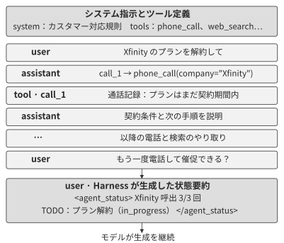

図の順序をメッセージリストとして書くと、次のようになります。見比べやすいよう、繰り返しのターンと一部の呼び出しフィールドは省いています。

```text
messages: [
  { role: "system", content: "You are a customer service assistant..." }
  { role: "user", content: "Help me cancel my Xfinity plan" }
  { role: "assistant", tool_calls: [{ id: "call_1", ... }] }
  { role: "tool", tool_call_id: "call_1", content: "Call log..." }
  { role: "assistant", tool_calls: [{ id: "call_2", ... }] }
  { role: "tool", tool_call_id: "call_2", content: "Call log..." }
  ...其余轮次...
  { role: "user", content: "Can you call them again to follow up?" }
  { role: "user", content: "<agent_status>
      Current State:
      - phone_call invoked 3 times (Xfinity: 3/3 max)
      - Current time: 2025-09-14 10:30:45
      - TODO: [1] Cancel plan (in_progress)
    </agent_status>" }
]
```

最後のメッセージは、呼び出し回数、上限、時刻、タスクの進捗を 1 か所にまとめています。モデルはこれらのフィールドをそのまま使えるうえ、前方の呼び出し ID から個々の記録をさかのぼって確かめることもできます。

このメッセージを追加しても、それより前の token 列は変わらないので、プレフィックス再利用の基本条件は満たされたままです。次のターンで古い状態をどう扱うかについては、コンテキストの占有量とキャッシュのコストのあいだでトレードオフを考える必要があります。

### 状態更新の 2 つの実装とキャッシュの代価

次のターンでは TODO が 1 つ完了するかもしれませんし、ツールの呼び出しが 1 回増えるかもしれません。Harness は状態を更新する必要があり、よく使われるやり方は 2 つあります。

**毎ターン置換**：新しいリクエストを組み立てるときに前回の状態を取り除き、末尾に最新の状態を加えます。コンテキストには現在の状態が 1 つだけ残るので、モデルにとって使いやすくなります。たとえば前回のリクエストが「タスクの説明、状態 A」で、今回が「タスクの説明、ツールの結果、状態 B」だとします。タスクの説明は引き続きキャッシュにヒットし、ツールの結果は初めて送るのでもともと計算が必要です。前回のリクエストで状態 A の後ろにほかのメッセージもあった場合に限り、A を取り除くとそれらのメッセージが元のプレフィックスの一致を失います。モデルはこのリクエストでは B しか見られません。A を振り返る必要があれば、実行ログから当時のスナップショットを取り出せます。

**永続的な追記**：既存の状態の記録を残したまま、毎回末尾に新しい状態を追加します。履歴のプレフィックスは安定したままで、状態の変化をさかのぼるのにも便利です。古い状態は少しずつコンテキストを占めていくので、時刻やバージョンを明記し、モデルが最新の記録にもとづいて現状を判断できるようにする必要があります。Claude Code がファイルの変化の通知をセッションに追記していくやり方にも、この設計の考え方が表れています。

状態が短く、その後ろにすでに大量のツール結果がキャッシュされている場合は、古い状態を残すほうが長い後続部分を再計算するより安く済むことがあります。状態が長く頻繁に更新される場合は、置換によって過去の状態の蓄積を抑えられます。

おおまかなモデルで分岐点を見積もってみましょう。各状態を $S$ token、置換のたびに古い状態より後ろで再計算が必要になるキャッシュ済みの後続部分を平均 $R$ token（そのターンで初めて送る内容は含めない）、状態を注入する回数を合計 $N$ 回、キャッシュされた入力の単価を通常の入力の $\alpha$ 倍とします。両方式に共通するコストを無視すると、 $C_{\text{置換}} \approx (N-1)(1-\alpha)R$ 、 $C_{\text{追記}} \approx \alpha S N(N-1)/2$ となります。$N>1$ のとき、$\alpha SN/2 < (1-\alpha)R$ であれば永続的な追記のほうが見積もりコストは低く、そうでなければ毎ターン置換のほうが安く済みます。ここでは通常の入力の単価をコストの単位としています。置換方式で余分にかかるのは後続部分がキャッシュからの読み出しから再処理に変わることによる差額で、追記方式で余分にかかるのは過去の状態を繰り返し読み出す費用です。

例を挙げましょう。1 回あたり 100 token の状態を合計 10 回注入し、キャッシュの読み出しは通常の入力価格の 10 分の 1 とします。追記方式では、以降のリクエストでそれぞれ 1、2、……、9 件の古い状態を余分に読むことになり、追加費用は通常の入力 token に換算して 450 個分です。状態を置換すると後ろにある平均 1000 個のキャッシュ済み token が再処理されるなら、9 回の置換で余分にかかる費用は通常の入力 token に換算して 8100 個分となり、追記のほうが安く済みます。古い状態がもともとキャッシュの末尾にあり、後ろにキャッシュ済みの内容がまったくなければ、式の $R=0$ となり、そのまま置換するほうがこの 450 token 相当の費用を節約できます。

> **実験 2-9 ★★：Agent ステータスバーの便利なテクニック**
>
> この実験では 5 種類のステータスバーのテクニックを実装しており、個別に有効にすることも、組み合わせて使うこともできます。各テクニックはそれぞれ具体的な種類の情報を提供し、モデルが次の行動を決める助けになります。
>
> **タイムスタンプの追跡**は、ユーザーメッセージとツールのレスポンスに `[2025-09-14 10:30:45]` のようにイベントの時刻を記録します。時刻はイベントとともに履歴に書き込まれ、以降のターンでも元の値のまま保たれます。一方、現在時刻は新しい状態メッセージとともに更新されます。実験には時刻のシミュレーション機能もあり、モデルが「昨日のファイル」と「今日の変更」を区別できるか、待ち時間を正しく理解しているかを確かめられます。
>
> **ツール呼び出しカウンタ**は、辞書で各ツールの累計呼び出し回数を管理し、レスポンスに `Tool call #3 for 'read_file'` と付記します。エラーの内容と合わせれば、モデルは試行を続けるかどうかを判断できます。たとえば最初の読み込みに失敗したらパスを確認し、次にディレクトリの一覧を取ります。何度も失敗したら、代わりのファイルを探すか、ファイルが見つからないことをユーザーに説明します。再試行の回数を制限する必要がある場合は、実行時システムもカウントにもとづいて上限を強制すべきです。
>
> **TODO リスト管理**は、`rewrite_todo_list` と `update_todo_status` の 2 つのツールを提供します。各項目には一意の識別子、内容、タイムスタンプと、`pending`、`in_progress`、`completed`、`cancelled` の 4 つの状態があります。リストは「何をしたか、何が残っているか」をひとまとめに保存するもので、タスク計画を繰り返し提示して目標が見えるようにしておく Manus の考え方に近いものです。
>
> **詳細なエラー情報**は、エラーの種類と説明、呼び出しパラメータの JSON、コールスタック、修正の提案を提供します。たとえば `FileNotFoundError` に出会ったら、ファイル名、現在のディレクトリ、絶対パスを確かめるようモデルに促せます。パラメータは誤った入力を突き止めるのに、コールスタックは失敗した場所を探すのに役立ち、修正の提案は次に確認すべき方向を示します。これらの内容をモデルに返す前に、認証情報などの機密フィールドを取り除き、冗長なスタックの長さも抑えるべきです。
>
> **システム状態の把握**は、現在時刻、作業ディレクトリ、OS、シェル、Python のバージョンを提供します。実験のコマンドツールは単独のディレクトリ移動操作を識別し、実行時システムが管理する作業ディレクトリを更新してから以降の呼び出しに使います。複合コマンドの中でサブプロセスが行ったディレクトリの変更は、そのプロセスの実行範囲に従います。環境のフィールドは、実際のシステムやインストール済みのソフトウェアに応じて `apt` と `brew` のどちらを使うかを選ぶなど、モデルが使えるツールを選ぶ助けにもなります。
>
> 今回の Kimi K3 による比較では、各種類のタスクにそれぞれ 5 件の事例を用意しました。タイムスタンプと組み合わせの設定はどちらも 5 件すべてを通過し、それぞれの対照グループは 3 件を通過しました。ツール呼び出しカウンタとシステム状態は、有効・無効の両グループとも 5 件すべてを通過しました。TODO の設定は 0 件で、対照グループは 1 件を通過しました。詳細なエラーの設定は 4 件、対照グループは 5 件を通過しました。

**ステータスバーは、できるだけコードで維持すべきです。** モデルはそこにある統計と制限をそのまま使うので、「3 回発信済み」という記述が 1 つ間違っているだけで、以後の行動が変わってしまうおそれがあります。カウント、時刻、状態の遷移はプログラムに任せます。意味の理解が必要な場合は、まずモデルに 1 件ずつ抽出させ、それからコードで集計・検証し、長い履歴全体をモデルに一度に集計させるのは避けます。生のイベント、抽出結果、最終的な状態のあいだの対応関係を残しておけば、二重計上、記録漏れ、出所の混同に気づきやすくなります。

ステータスバーにどんな情報をまとめるかは、前もって選んでおく必要があります。たとえば「3 回発信済み」は、もう一度かけられるかどうかを判断するには十分ですが、「2 回目の通話でオペレーターは何を約束したか」には答えられません。統計値だけが必要な後続タスクなら、状態の要約で履歴を置き換え、生の記録はアーカイブしておけます。会話の内容を確かめる必要があるときに、インデックスをたどって原文を読めばよいのです。要約のフィールドの設計によって、どんな質問に直接答えられるかが決まり、いつさかのぼって調べる必要があるかも決まります。

## コンテキスト圧縮戦略

ある調査タスクで長い Web ページを 10 本読んだ後、ウィンドウには資料をあと 2 本入れる余裕しかないとします。まずモデルに、次のターンで何をする必要があるかを尋ねます。2 つの見積もりを比べるのであれば、価格、有効条件、出所を残します。引用を再確認するのであれば、原文を取り出せる位置を残します。調べ終えたものの無関係だった Web ページの本文はアーカイブして、新しい入力と出力のための場所を空けられます。ここでは、どれだけの場所を空けられるかを計算するだけでなく、もう一つの勘定も必要です。削った資料が後で必要になったとき、取り戻すのにどれだけのコストがかかるか、という勘定です。

### 圧縮の 3 つの目的

**長さとコストを抑える。** 128K token のウィンドウを例に取ると、長い Web ページや大きなファイルがその相当な部分を占めかねません。Harness は、以降の入力、モデルの出力、ツールとのやり取りのために予算を残しておく必要があります。

**以後の意思決定に必要な知識を整理する。** 十数ターンの検索で、同じ出来事が何度も言及されたり、互いに矛盾する説明が残ったりすることがあります。それを「A と B は確認済み、C はまだ根拠が足りない」と整理しておけば、モデルは未解決の問題の続きから作業できます。要約には事実どうしの関係、出所、未解決の問題を残し、以後の意思決定に明確な拠り所を与えるべきです。

**長いタスクを継続して進められるようにする。** 一部のモデルは、ウィンドウが尽きそうだと判断すると、早めに作業を切り上げてしまいます。この現象は **コンテキスト不安（Context Anxiety）** と呼ばれます。Anthropic は Sonnet 4.5 の長時間タスクのテストで、圧縮した後でもこの振る舞いが起こり得ることを見いだし、構造化された引き継ぎ記録を使ってコンテキストをリセットしてから実行を続けるようにしました[^ch2-7]。

[^ch2-7]: Prithvi Rajasekaran，Harness design for long-running application development，Anthropic Engineering，2026。

### 繰り返し計算する結果を使える知識に整理する

ステータスバーはカウントと進捗を前もって維持し、要約はさらに長いテキストの中の事実と関係を整理します。どちらも散らばった情報を前もって整理し、以後の意思決定でそのまま使えるようにするものです。

ペットショップの巡回の例を見てみましょう。

> ケージ 1：黒猫。ケージ 2：白猫。ケージ 3：黒猫。ケージ 4：黒猫。ケージ 5：白猫。
> ……（ケージは全部で 100 個、うち黒猫 90 匹、白猫 10 匹）

「ケージ 37 にいるのはどんな猫か」に答えるには、該当する記録を見つける必要があります。「黒猫と白猫はそれぞれ何匹いるか」に答えるには、すべての記録を集計する必要があります。合計を後で何度も使うのであれば、「黒猫 90 匹、白猫 10 匹」を先に計算して保存しておけば、毎回一から数えずに済みます。こうした確定的な集計はプログラムに向いており、モデルはその統計結果をもとに業務上の質問に答え続けられます。

要約の内容は、タスクに応じて選ぶべきです。2 種類の猫の合計だけを残せば数の質問には十分ですが、ケージ 37 の状況に答えるには、ケージごとの記録か、それに対応するインデックスも必要です。

ウィンドウにまだ余裕があっても、長すぎたり雑多だったりするコンテキストは、情報の使い方に悪影響を与えることがあります。モデルが重要な事実を見落とす、解決済みの問題を繰り返し処理する、古くなった状態を現在の意思決定に使ってしまう、といったことです。コンテキストが伸びるにつれて現れるこのような性能の劣化は、一般に **コンテキストの劣化（Context Rot）** と呼ばれます。これはタスクの成績の低下として現れるもので、リクエストが容量の上限を超えた場合には、ウィンドウのオーバーフローが起こります。

**ウィンドウに余裕があるうちでも、繰り返し使っている知識は積極的に整理すべきです。** 重要な判断をすでに集約できるのに、モデルに長い履歴の中で何度も探させていれば、計算を消費し続けるうえ、見落としも増えます。検索タスクなら確認済みの事実、出所、未調査の問題を保存し、プログラミングのタスクならアーキテクチャ上の決定、変更範囲、テスト結果、失敗の原因を保存できます。

コンテキスト内の例は、モデルが新しい問題をどう処理するかにも影響します。Dherin らの研究は、Transformer のアテンション層と MLP の組み合わせを出発点に、特定の順伝播計算をコンテキストに依存する低ランクの重み更新として表し、文脈内学習に一つの理論的な説明を与えました[^ch2-6]。実際の推論ではモデルの重みは変わらず、例は現在の入力を通じて出力に影響します。こうした経験を後のセッションでも再利用したいなら、記憶、例、Skill として整理し、タスクに応じて読み込むことができます。経験をどう蓄積するかは第 9 章でさらに論じます。

[^ch2-6]: Benoit Dherin et al.，Learning without training: The implicit dynamics of in-context learning，2025。

### 圧縮と KV Cache のトレードオフ

圧縮はふつう、2 回のモデル呼び出しのあいだで行われます。Harness は残りの予算とタスクの進捗に応じて次のリクエストに必要なメッセージを整理し、それをモデルに送ります。履歴を置き換えるとプレフィックスが変わるので、圧縮による利益とキャッシュを作り直すコストを合わせて考える必要があります。

まず、引き続き有効なシステム指令とツール定義は安定させておきます。これらは前方にあるので、以降の履歴を圧縮しても、このプレフィックス部分は再利用し続けられます。次に、具体的な圧縮対象を選びます。長いツール結果は要約に置き換えられ、完了した複数ターンのやり取りは段階ごとの記録にまとめられます。置き換えた位置より前のキャッシュは再利用できますが、置き換えた位置とそれ以降の内容は新しいプレフィックスとして処理し直す必要があります。

**履歴の圧縮はまとめて行うことを優先し、毎ターン同じプレフィックスを書き換えるのは避けます。** 圧縮した後は毎ターンの入力が短くなりますが、圧縮の呼び出しと後続部分の再計算にも資源がかかります。いつ圧縮するかは、ウィンドウの占有量、この先に見込まれるターン数、タスクの段階を合わせて決められます。長いツール結果が集中して現れた後にまとめて整理する、ある段階を終えたら引き継ぎ用の要約を保存する、といったやり方はいずれも、履歴を頻繁に変更するコストを減らします。直近の数ターンを残す場合は、ツール呼び出しと戻り値が対になっているかを確認し、完了していない操作の状態を要約に書き込みます。

圧縮するときには、推論情報を返すプロトコルも確認する必要があります。モデルによっては、過去の thinking がそれを生成したときのプレフィックスに紐づいています。これらのブロックより前で履歴を置き換えると、残した thinking が新しいプレフィックスと一致しなくなるおそれがあります。この種のプロトコルを使う場合は、セッションを要約に整理し、影響を受ける古い thinking を取り除いて、モデルに要約から推論を続けさせることができます。サーバー側が対応している圧縮やコンテキスト編集の仕組みを使うこともできます。

まず図2-16 の個別要約を見てください。処理後の文字数は元の 10.9% しかないのに、メイン Agent が累計で使った token は 6 グループの中で最も多くなっています。この 2 つの数字がなぜ同時に成り立つのかを説明するには、どの資料が圧縮され、それらの資料が何ターン分のリクエストでモデルに送られたのかを追う必要があります。

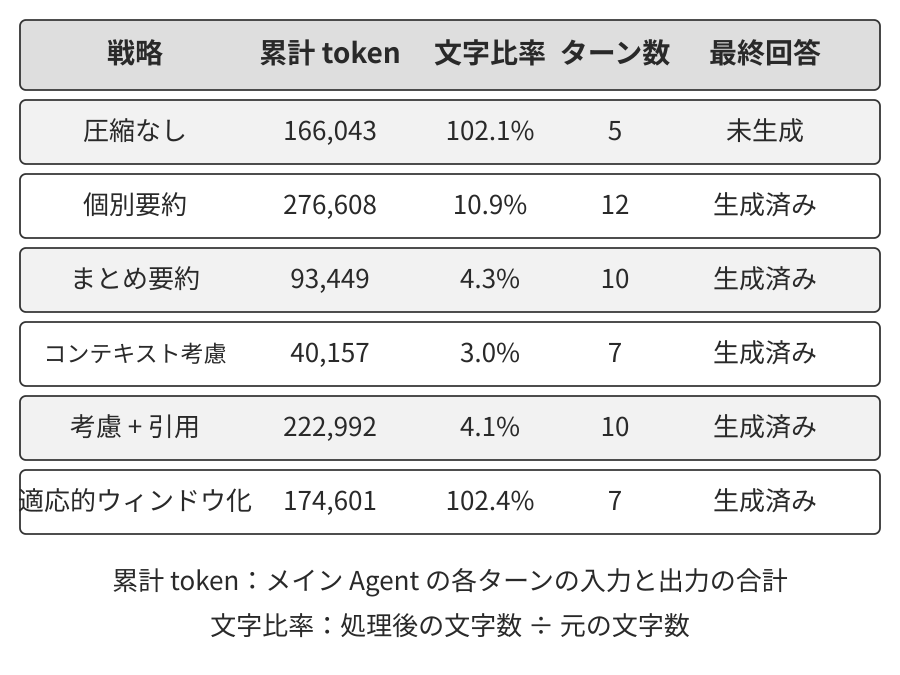

> **実験 2-10 ★★★：コンテキスト圧縮戦略の比較**
>
> この実験では Kimi K3 を使って、OpenAI の共同創業者たちの現在の経歴を調べます。タスクでは、人物のリストを少しずつ作り、経歴と役職の変化を調べ、関連する事実と出所を対応させる必要があります。圧縮とオーバーフローの処理を観察するため、実験ではアプリケーション側のコンテキスト予算を 128,000 token に設定し、圧縮なしのベースラインを残したうえで 5 種類の処理方法を比較しました。いずれも最大 15 ターンまで実行します[^ch2-compression-results]。
>
> **戦略 1：圧縮なし。** 検索とページ読み込みの結果をそのまま履歴に入れます。7 回のツール呼び出しで、元の文字数は 367,246 文字になりました。プログラムは 5 ターン目で保護機能が働いて停止し、メイン Agent の累計使用量は 166,043 token でした。旧版では各リクエストの入力 token の合計で保護機能を発動していたため、エラーメッセージにある 165,227 は累計の入力です。たとえば同じ履歴が 3 ターンのリクエストでそれぞれ 1 回ずつ送られれば、3 回分として累計されます。
>
> **戦略 2：個別要約。** 検索結果ごとに 2 ～ 3 段落の要約を生成し、各ページの主な内容を残します。この方式は並列処理しやすく、ページの境界も保ちやすい一方、複数のページが同じ出来事を述べていると、重複した情報がそのまま履歴に入ります。この設定は 12 ターンで最終的な返答を生成し、メイン Agent の累計使用量は 276,608 token、文字の圧縮率は 10.9% でした。
>
> **戦略 3：まとめ要約。** 一群の検索結果をまとめてから総合的な要約を生成するので、重複した事実や異なる出所の関係を整理しやすくなります。この設定は 10 ターンで最終的な返答を生成し、メイン Agent の累計使用量は 93,449 token、文字の圧縮率は 4.3% でした。
>
> **戦略 4：コンテキストを考慮した要約。** 圧縮するときに、現在の問い合わせとすでに把握している情報も渡します。たとえばプロンプトに `Given the search query: {query}` と `Current context: {context}` を加えます。モデルはそれにもとづいて現在の質問に関係する事実を残し、既存の要約に欠けている部分を優先して補います。この設定は 7 ターンで最終的な返答を生成し、メイン Agent の累計使用量は 40,157 token、文字の圧縮率は 3.0% でした。そのうち 1 回の圧縮では、約 15 万文字を約 2,000 文字に整理しつつ、人物の名前と役職の変化を残していました。
>
> **戦略 5：引用付きのコンテキストを考慮した要約。** タスクに関係する要約の中に、事実に対応する出所のリンクを残します。この設定は 10 ターンで最終的な返答を生成し、メイン Agent の累計使用量は 222,992 token でした。ツールの記録で集計すると、処理後の資料は 52,891 文字、原文は 1,295,044 文字で、両者の比は約 4.1% です。
>
> **戦略 6：適応的ウィンドウ化。** 序盤は元の資料を残し、入力が閾値に達してからまとめて整理します。実験では 3 つの仕組みを使いました。予算の 80% を超えたら圧縮を発動する、まだ圧縮していないツール結果をまとめて処理する、処理済みの結果に `[COMPRESSED]` という印を付けて二重に要約するのを防ぐ、の 3 つです。この実験の 128,000 token の予算では、発動の閾値は 102,400 token になります。この設定は 7 ターンで最終的な返答を生成し、メイン Agent の累計使用量は 174,601 token でした。この記録では累計の入力で閾値を判定しており、後にプログラムは直近のリクエストの入力サイズを確認するよう改められました。
>
> 図2-17 は、6 つの戦略の入力と出力を比較したものです。
>
> 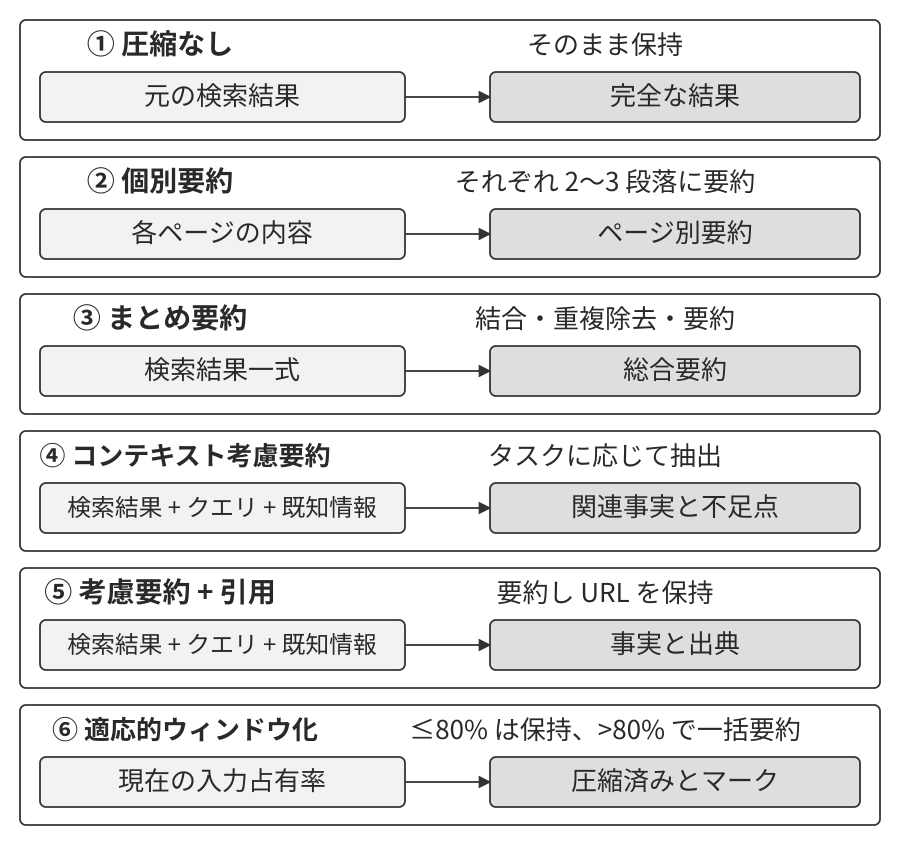
>
> 図2-16 の数字を比べるときは、3 つの量を区別する必要があります。1 回のリクエストの入力はウィンドウの予算に達するかどうかを決め、累計 token は複数ターンの呼び出しの使用量を表し、文字の圧縮率は集計対象の資料について処理後の長さと元の長さの比を表します。ここでの累計使用量はメイン Agent の各ターンのリクエストの入力と出力から算出したもので、要約を生成するための独立したモデルリクエストはこのフィールドに含まれていません。
>
> 実験を再現するときは、付属の説明に従ってモデルと実際の検索サービスを設定し、実験ディレクトリで `python experiment.py -m kimi-k3 -n 15 -o results/reproduction.json` を実行します。各戦略の `metrics` を読み、`total_compressed_size / total_original_size` で文字の比率を計算し直してから、`total_tokens` と `iterations` を比べます。圧縮なしのベースラインでも検索本文にタイトルや URL などの書式が付け加えられるため、処理後の文字数が原文をわずかに上回ることがあります。実験プログラムは、最終的な返答を受け取りさえすれば、そのグループを完了として記録します。2 つの成果物で同じ人物を調べてみてください。引用付きのグループは Pamela Vagata の所属を Pebblebed と書いていますが、ウィンドウ化のグループのまとめ表では Stripe となっています。前者の回答は所属先の Web サイトに触れてはいるものの、開ける Web ページのリンクは示していません。どちらのグループもまとめ表を提出していますが、示された人物の情報は互いに食い違っています。

[^ch2-compression-results]: 実験 2-10 の結果ファイル `kimi_k3_real_20260718.json` には、各戦略の統計フィールド、最終回答、タイムスタンプが保存されており、文字の比率をそのまま計算し直せます。2026 年 7 月 18 日の実行では旧版の保護条件を使っています。7 月 22 日のコード修正（コミット `aea4d72`）で、累計の入力から直近のターンのリクエストの入力に改められました。

### 本番レベルの階層的圧縮の仕組み

ツールの出力は全文を一時保存しておく必要があるかもしれず、完了したステップはアーカイブでき、現在の制約は見えるままにしておくべきです。以下の 5 種類の仕組みは、それぞれ異なる使用頻度と保持期間に向いています。

1. **ツール結果の予算管理**。大きな出力は外部ストレージに保存し、コンテキストには要約のプレビューと読み出し用の入口を残します。プレビューはいったん履歴に入ったら内容を変えないようにし、さらに詳細が必要なときは関連する断片を読み出して結果を追加します。
2. **無関係な内容の除去**。Web ページのナビゲーションバーや繰り返されるフッターなどは、結果がコンテキストに入る前に取り除けます。すでに履歴に入った内容を削除する必要がある場合は、以降のタスクや引用がまだそれに依存していないかを先に確かめ、そのうえで履歴を変更することによるキャッシュのコストを計算します。
3. **API レベルのコンテキスト編集**。この種の機能に対応したサービスでは、ルールに従って古いツール結果を除去できます。クライアントは発動条件を設定し、サービスが返す編集情報を処理する必要があります。除去の範囲とキャッシュの振る舞いはインターフェースの取り決めによって決まるので、入力予算の監視と合わせて組み込むのが適しています。
4. **アーカイブ型の要約**。ターンやタスクの段階ごとに目標、操作、結果、未完了の事項を記録し、実行の順序を残します。タスクの変更履歴のようなものと考えるとよいでしょう。後から、ある決定がどのステップで下され、何を根拠にしていたかを調べられます。
5. **セッション全体の圧縮**。局所的な除去ではまだ予算に収まらない場合、現在の目標、制約、確認済みの事実、重要な決定、次の作業を引き継ぎ用の要約にまとめます。先に既存のセッションメモを整理し、それから履歴全体を集約するやり方もあります。圧縮が連続して失敗した場合は、再試行の上限やサーキットブレーカーで呼び出しの繰り返しを止め、復元可能な状態を保存したうえで、入力を縮小するか人手で対応するかを選びます。

これらの仕組みは階層的に組み合わせられます。入口での制御は一度に入る大きな出力を減らし、局所的な整理は日々の増加を抑え、段階ごとの要約とセッション全体の圧縮は長いタスクのために引き継ぎ情報を保存します。

筆者は dsh-superagent を読んでいて、ある細部に気づきました。イベントやツールの結果は、まず要約とオブジェクト ID だけを送っておき、詳細が必要になったら ID を使って読み出せるようになっているのです。バックグラウンドで一連のテストを実行し終えて、フロントには「2 件失敗」とだけ伝えたとしましょう。フロントは進捗を報告することはできても、ユーザーが続けて「昨日の 2 件と同じもの？」と聞いてきたら答えられません。要約に今回のテスト記録の識別子が付いていれば、フロントは失敗したテストケースの名前を取り出し、昨日の記録と照合できます。

### 圧縮戦略の設計原則

圧縮後に何を残すかを決めるときは、次の 4 つの観点から確認できます。タスクをまたいで経験を蓄積する過程は第 9 章で取り上げます。

- **タスクにとっての価値に応じて分量を割り振る**。人物のリスト、身元の関係、現在調査中の問題は、通常そのまま残すべきです。結論を支える重要な証拠は、出所と必要な細部を残します。ナビゲーションバー、広告、重複した内容は取り除けます。事実に争いがある場合は、証拠どうしの食い違いも重要な情報です。
- **意味のまとまりを保つ**。たとえば「Sutskever は 2024 年 5 月に OpenAI を去った」では、人物、時期、行動、組織が合わさって 1 つの事実を構成しています。圧縮するときはこれらの要素を残し、「Sutskever が去った」のような解釈しにくい断片だけが残る事態は避けるべきです。
- **以後の問いを軸に内容を組み立てる**。「創業者のリストを探す」には人物を漏れなくカバーすることが必要ですが、「個人の背景を知る」には経歴、時系列、出所が必要です。同じ資料からでも、タスクに応じて異なる要約を生成できます。検索では網羅性が、分析では関係と根拠が重要で、創作では役立つ細部や例も残す必要があります。
- **要約が実行を支えられるかを検証する**。意味的な要約には、タスクを理解し、重複を取り除き、条件と例外を保存することが求められます。**複雑な資料の意味的な圧縮には、理解力がメインのモデルに近いモデルを優先して使うべきです。** 圧縮する側は、どの条件、例外、証拠が以後の作業に影響するかを判断しなければなりません。それらが捨てられてしまえば、メインのモデルがいくら強力でも補うのは困難です。

初期のアーキテクチャ上の決定、制約の背後にある理由、失敗した経路は、長い履歴の中で見落とされがちです。**長いタスクでは進捗文書を定期的に更新すべきです。** 「何を決めたか、なぜそう決めたか、何を検証したか、次に何をするか」を保存しておきます。Prompt や Skill で更新のタイミングを定め、Harness はタスクの引き継ぎ時に対応する記録を読み込みます。こうした文書は、実行者、レビュアー、後から加わる Agent が既存の作業を理解するのにも役立ちます。

### サブ Agent のコンテキスト隔離

**成果物の境界がはっきりしていて、中間資料を大量に生むタスクには、筆者はサブ Agent による隔離を優先して使います。** 広範囲の検索では探索段階でしか役に立たない資料を大量に読み込むので、先に隔離しておけば、そうした内容が主タスクを妨げ続けるのを減らせます。メイン Agent は独立したコンテキストを持つサブ Agent にタスクを渡し、サブ Agent が中間結果を読んだうえで、結論、証拠の位置、未解決の問題を返します。これにより、メイン Agent のコンテキストには以後の意思決定に必要な情報だけを残せばよくなります。

たとえば「決済コールバックを処理する関数を見つける」場合、メイン Agent が自分で検索すれば、十数個のファイルを読む必要があるかもしれません。検索用のサブ Agent に任せれば、関数名、所属モジュール、呼び出し箇所、判断の根拠を返すよう求められます。その返答は「決済モジュールの `handle_callback` がコールバックを処理しており、ほかに呼び出し箇所が 2 つある」といったもので、位置を特定できる引用も添えられます。メイン Agent はこの結果にもとづいて、関連するコードを読み進めるかどうかを決めます。

タスクの説明は十分に完全なものにすべきです。目標は何か、検索範囲はどこまでか、どんな制約を守るべきか、どんな形式で返すか、あいまいな点に出会ったらどう扱うか、を含めます。委任のリクエストと返された結果をどちらも履歴に追記すれば、メイン Agent の既存のプレフィックスは引き続き再利用できます。

第 4 章では、ツールとしてのサブ Agent のインターフェース設計を論じ、第 10 章ではマルチ Agent システムにおけるコンテキストの分担をさらに論じます。

## 本章のまとめ

カスタマーサポートのアシスタントが 3 回目の電話をかけ終えた後、どうやって手続きを続けるのでしょうか。次のターンのリクエストにはこの通話のツールの返却結果を含め、呼び出し ID で発信操作と対応させます。ステータスバーは使用回数を 3 回に更新し、まだ合意していない条件を列挙します。システムのルールとツール定義は安定したプレフィックスに保ち、特定の手続きが必要になったときに対応する Skill を読み込みます。こうすれば、どのフィールドにも出どころがあり、どの内容が次の呼び出しで変わるのかも見て取れます。

通話が長引き、ツールの返す内容がどんどん増えていくなら、結果の長さを制限する、終わった部分を出所付きの要約に整理する、あるいは独立して進められる作業をサブ Agent に任せて結論と根拠だけを受け取る、といった手が打てます。

このタスクが終われば、3 回発信済みというカウントはタスクとともにアーカイブできます。しかし、ユーザーがわざわざ「今後は平日の午後に連絡して」と言い添えていた場合、その一言を通話の要約に残しておくだけでは、次に依頼を受けるアシスタントの目にはまったく入らないかもしれません。長期的に役立つ情報をどう保存し、適切なタスクでどう取り出せばよいのでしょうか。第 3 章では、タスクをまたぐユーザーの記憶と共有の知識ベースを論じます。

## 演習問題

1. ★★★ 実験 2-3 のスライディングウィンドウの実行記録を読んでください。5 回のツール呼び出しはそれぞれ何をしていたでしょうか。呼び出しの繰り返しが履歴の切り詰めによるものかどうかを判断するには、さらに何を記録し、どんな比較をする必要があるでしょうか。重要な状態を残す切り詰め方式を設計し、それがプレフィックスキャッシュにどう影響するかを説明してください。記録は `chapter2/kv-cache/result_sliding_window_20260718_kimi_k2_6.json` にあります。
2. ★★ Qwen3 の Chat Template は、最後の実際のユーザーの問い合わせの位置を基準に過去の思考を処理します。1 回の ReAct ループが百ターン以上続く場合、増え続ける推論内容をどう管理しますか。過去の思考の切り詰め、返却、プレフィックスに紐づくプロトコルを比較し、Harness がどう対応すべきかを説明してください。
3. ★★ 約 15 万文字の検索資料を 2,000 文字に圧縮するとしたら、どの事実、関係、出所を残しますか。要約が以後の質問を支えるのに十分かどうかをどう確かめ、省いた細部をどう取り戻しますか。
4. ★★ ツール呼び出しカウンタが呼び出しを 1 回記録し損ね、そのせいでステータスバーが誤った残り回数を示しました。イベントの記録、集計の検証、実行層での検査を設計し、このような不整合をどう発見して修正するかを説明してください。
5. ★★ 実験 2-4 では、語調、情報の組み立て、ツールの説明を比較しました。システムプロンプトを複数人で長期にわたって維持する場合、バージョンをどう管理し、ルールの衝突をどう検出し、各変更を回帰タスクでどう評価しますか。
6. ★★★ ペットショップの例には、個別の検索と全体の統計の両方が含まれています。生の記録、統計の要約、問い合わせのルーティングを設計し、システムがこの 2 種類の質問に効率よく答えられるようにしてください。また、要約をいつ更新する必要があるかも説明してください。
7. ★★★ ある Skill は目録に載っているのに、モデルはそれが現在のタスクに適用できることに気づきませんでした。説明、目録の構成、明示的な起動、評価用のサンプルの 4 つの観点から、問題をどう切り分けますか。
8. ★★ Skill は正しく読み込まれたのに、モデルはその中の検証ステップを抜かしてしまいました。起動、理解、ツールの使用、完了判断のどこに問題があるのかを切り分ける比較実験を設計し、異なるモデルの振る舞いを比べてください。
9. ★★★ システムには大量のツールがあり、ツールの集合も頻繁に変わります。固定の定義、ツールの目録、オンデマンド読み込みの結果、実行時の状態をそれぞれどこに配置しますか。探索の精度、コンテキストの予算、キャッシュのヒットを同時に考慮してください。
