# ユーザーメモリと知識ベース

先週ユーザーがアシスタントに窓側の席が好きだと伝え、今日は「東京行きをもう一枚取って」とだけ言ったとします。前回の好みは、どこから呼び戻せばよいでしょうか。航空会社が昨日手荷物の規定を変えていたら、新しい条項はどこで調べればよいでしょうか。前章では一つのタスクのコンテキストをどう組み立てるかを扱いました。本章では、ユーザーが話した内容をどこから呼び戻し、航空会社の新しい規定をどこで調べるのか、そしてこの二種類の資料をそれぞれいつ更新すべきかを扱います。

**ユーザーメモリ**は特定のユーザーを軸に情報を組織し、その人の嗜好、習慣、ニーズ、経験を記録します。これによって Agent は、後のセッションでもユーザーの事情に沿ったサービスを続けられます。一方、**知識ベース**は一定の権限の範囲内で複数のユーザーが共有するもので、業界の法規、企業の業務手順、技術文書などがこれにあたります。前者は Agent がサービスの相手を理解する助けになり、後者はタスクの遂行に必要な領域知識を提供します。

どちらも、情報をどう保存し、必要なときにどう見つけるかという問題を解かなければならず、事実の衝突、内容の陳腐化、検索漏れにも直面します。ベクトル検索、構造化インデックス、知識の圧縮といった技術は、両方のシステムに共通して使えます。図3-1 は本章の構成を示しています。まずユーザーメモリの表現と管理を検討し、次に検索拡張生成（RAG）を紹介し、最後に検索の手法をセッションをまたぐ記憶や、より複雑な知識の組織に応用します。

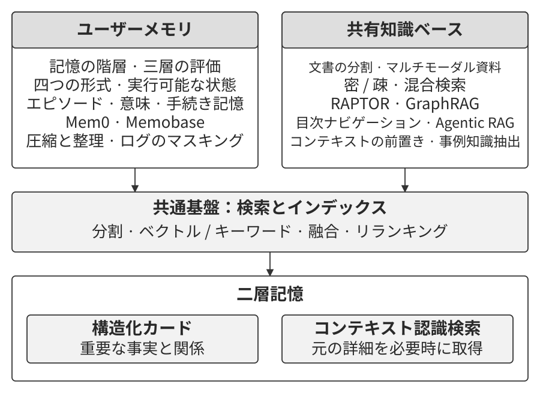

## ユーザーメモリシステム

「来週は海外にいるので、銀行の書類はメールで送ってほしい」という発言を分解してみましょう。ユーザーは期限つきの旅程を伝え、その旅程の間に限って受け取り方を指定しています。銀行が書類を郵送しようとしたとき、アシスタントはこれを根拠に電子送付を求められます。旅程が終わった後で郵便の話が出たら、その時点の条件を改めて確認しなければなりません。もし「ユーザーは紙の郵便を好まない」とだけ保存していたら、後でこの記憶を検索できたとしても、適用範囲を誤ってしまいます。

航空券の例も見てみましょう。ユーザーが「前回の 1250 の航空券は思ったより高かった」と言えば、システムは少なくともそのときの見積もり、当時の予算、旅行の状況、今回のフィードバックを保存できます。次に似た状況になったとき、モデルはこれを踏まえて予算超過の見積もりをより慎重に扱えます。ユーザーが別に「今後、家族旅行はまず私に聞いて」と言えば、それは今後の家族旅行について明確な確認条件を定めたことになります。ここから三種類の情報を区別できます。ユーザーが実際に言ったこと、そのときどういう条件下にあったか、そしてモデルがその経験から何を推論したか、です。

セッションの終わりに LLM にこうした記録を整理させ、後で役立つ事実を永続ストレージに書き込むことができます。新しいタスクを始めるときは、関連があり、かつ今も適用できる記録だけをコンテキストに持ち込みます。

たとえば、ユーザーが航空券の予約中に次の情報を伝えたとします。

```text
User: Help me book a flight to Tokyo next Friday. I prefer window seats
      and I'm vegetarian, so I'll need a special meal.
Agent: I'll search for flights to Tokyo for next Friday...
       [calls flight_search tool, returns 3 options]
Agent: Here are your options. Based on your preference, I've filtered for
       window seat availability. Shall I book the ANA direct flight?
User: Yes, and use my United MileagePlus number 12345678.
```

セッションが終わると、記憶抽出器は次の四件の記録を整理できます。

```text
Extracted memories:
- User prefers window seats (preference)
- User is vegetarian, needs special meals on flights (dietary restriction)
- User's United MileagePlus number: 12345678 (loyalty program)
- User has travel plans to Tokyo (recent activity)
```

この例には三つの処理が含まれています。**選択的な抽出**は、座席の好み、食事の制約、会員番号を残し、「検索で三つの選択肢が返った」といった一時的な詳細を捨てます。**抽象化**は、ユーザーがはっきり述べた窓側の好みを、今後の予約に使える規則としてまとめます。**構造化**は、事実にカテゴリを付けて検索と更新をしやすくします。東京行きについては、出発日と現在の状態も記録すべきです。「来週の金曜」はセッションの日付と合わせて具体的な日付に変換し、旅程が終わったり取り消されたりしたら状態を更新します。こうすれば、長期的な嗜好と最近の活動を、それぞれの有効期間に沿って維持できます。

パーソナルアシスタント Today の製品説明に、こんな例があります。ユーザーは毎週火曜と木曜にトレーニングをしていて、ハーフマラソンに向けて準備中だと話しました。六週間後、ユーザーの許可を得て接続した睡眠記録から、彼が前夜ほとんど眠れていなかったことがわかりました。アシスタントはこの二つの情報を合わせ、その日の高強度インターバルトレーニングをずらすよう提案します。ここでは、何をどれだけの期間覚えておくべきでしょうか。トレーニング計画は大会の準備期間を通じて使えますが、前夜の睡眠記録には日付を付けておく必要があります。ユーザーが今回の変更を受け入れても、来週木曜のトレーニングは、ユーザーが今後も変えたいと言わない限り元の計画どおりです。Today は提案することとカレンダーを変更することも二つの段階に分けており、後者にはユーザーの確認が必要です。[^ch3-today]

[^ch3-today]: Today チームは「What Is Today」でハーフマラソンのトレーニングを例に、記憶とその日の情報がどう組み合わさるかを説明しています。創業者は「Meet Today」で、カレンダーを変更する前の確認の仕組みを解説しています。

### 記憶能力の評価：三層フレームワーク

公開ベンチマーク **LoCoMo**（Long-term Conversational Memory、長期対話記憶）は、平均約 300 ターン、最大 35 セッションに及ぶ長い対話を収録し、質問応答、イベント要約、マルチモーダル対話生成を通じて記憶能力を測ります。質問応答は五つのタイプに分かれます。シングルホップの問題は一回のセッションから答えを見つけられ、マルチホップの問題は複数のセッションにまたがる手がかりをつなぎ合わせる必要があり、時間推論の問題ではさらに出来事の前後関係を把握しなければなりません。オープンドメイン知識の問題は、ユーザーの発言と外部の知識を結びつけることを求めます。予約の例で言えば、ユーザーが「来週東京へ行く」とだけ言っていて、「目的地ではどの通貨を使うか」と問われたら、東京という手がかりを覚えているだけでなく、現地で円が使われることも知っていなければなりません。ユーザーが一度も口にしていない便名を問われたら、アシスタントは情報が足りないと指摘すべきです。このような答えようのない問題を見抜けるかどうかが、まさに敵対的な問題で試される能力です。[^ch3-locomo]

[^ch3-locomo]: Maharana らの LoCoMo 論文（arXiv:2402.17753）の第 4.1 節に五種類の質問応答の定義があります。著者のプロジェクトページでデータと対話のサンプルが公開されています。

こうしたベンチマークと記憶プロダクトの実践を踏まえ、筆者は注目すべき能力を次の八項目に整理しています。

- **個人情報の保持**：ユーザーの身元など長期的な情報を正確に保存し、取り出す。
- **嗜好の追跡**：ユーザーの嗜好を記録し、新たな明示的な表明に応じて更新する。
- **コンテキストの切り替え**：話題が切り替わった後も関連する背景を引き継ぐ。
- **記憶の更新**：既存の事実に対するユーザーの補足や訂正を処理する。
- **マルチセッションの連続性**：新しいセッションで以前に保存した情報を使う。
- **複合的な思考**：複数の記憶の断片を結びつける。たとえば、ユーザーがピーナッツアレルギーだと話していたなら、タイ料理の話題ではこの情報を踏まえて食材の確認を促すべきです。
- **時間感覚**：日付を保存し、相対的な時間を解釈し、出来事の間隔を計算する。
- **衝突の解決**：食い違う情報に気づき、出所、時期、対象を踏まえて判断する。

Agent の実際のタスクに即して、本書はさらに三層の評価フレームワークを採用します。実験 3-1、3-2 ではまずこれを使って記憶の表現を比較し、実験 3-9 と 3-11 では同じフレームワークで検索手法を評価します。

**第一層：基礎的な想起。** ユーザーが直接提供した、意味の明確な情報を正確に保存し、取り出します。たとえば、ユーザーが「私の会員番号は 12345 です」と言ったなら、後の予約時に番号を完全な形で返せなければなりません。この層では主に、事実が失われたり、混同されたり、書き換えられたりしていないかを確認します。

**第二層：マルチセッション検索。** 時期も対象も異なるセッションから関連情報を漏れなく集め、今の依頼が誰に関わり、どの記録が必要かを判断します。ユーザーが車を二台持っているのに「私の車の点検を予約して」としか言わなければ、システムはまず二台の情報を取り出し、どちらのことかを確認すべきです。ローンの状況を尋ねられたら、有効な契約と過去に相談しただけの見積もりを区別する必要があります。「ロサンゼルス旅行」を取り消すときは、航空券やホテルなどの予約を同じ旅行に結びつけなければなりません。

**第三層：能動的なサービス。** 現在のタスクに照らして、ユーザーが一つひとつ指摘していない関連事項に気づきます。たとえば、国際線を予約するときに数か月前に保存したパスポート情報を結びつけ、有効期限が旅程の要件を満たすか確認する。スマートフォンが壊れたときに、端末の保証、クレジットカード付帯の保証、通信事業者の保険をまとめ、使える対処方法を挙げる。確定申告の準備では、一年分の記録から株式取引、フリーランス収入、固定資産税の書類を漏れなく集める、といったことです。

> **実験 3-1 ★：三層フレームワークで記憶システムを評価する**
>
> 評価セットは各層 20 件、合計 60 件のテストケースからなります。第一層は主に単一セッションで構成され、第二層と第三層は時期や対象をまたぐ複数のセッションを含み、エンティティの関連付け、情報の更新、能動的な注意喚起を確認します。
>
> 各ケースは二段階で実行します。まずセッションを一つずつ入力します。モデルは最初のセッションから記憶を生成し、以降は既存の記憶と新しいセッションだけを受け取って、更新後の記憶を生成します。これ以降、モデルは以前のセッションの原文を読めません。そのとき話した内容について答えるには、記憶に書き込んだ情報に頼るしかありません。すべてのセッションを処理し終えたら新しい質問を入力し、Agent に記憶にもとづいて答えさせます。
>
> 評価には LLM-as-a-judge を使います。独立した審査モデルが参照解答と採点基準に照らし、回答がカバーしている事実と誤りを確認します。今回の実行では、記憶と回答の生成に Doubao Seed 1.6 を、採点に Moonshot のモデルを使いました。審査モデルは元の対話を見られますが、回答するモデルが見られるのは最後に残った記憶だけです。
>
> 採点表はどう読めばよいでしょうか。たとえば、ユーザーがブロードバンド契約のアカウント番号を知りたいだけのケースで、Enhanced Notes のグループのアシスタントは正しい番号を答えました。審査モデルは正確性、想起、推論にそれぞれ 4 点を付け、能動性には 1 点しか付けませんでしたが、このケースは合格です。プログラムの合格条件は、最初の三項目がいずれも 3 点以上（満点 4 点）で、根拠を欠く重要な事実や元の発言と矛盾する重要な事実が審査で見つからないことです。能動性は総合スコアには入りますが、合格件数だけを見ても、アシスタントがどの程度能動的に手助けしたかはわかりません。

### 記憶の階層構造

「前回予約したのはどの便か」に答えるには、一つの出来事を見つける必要があります。「予約時にどの座席を優先するか」に答えるには、何度ものやり取りから残った嗜好を取り出す必要があります。どちらも同じ人に関わる問いですが、求められる記録の粒度と検索方法は異なります。

**軌跡（trajectory）**は、Agent の一回の実行で起きた出来事を時系列に記録したもので、ユーザーメッセージ、モデルの応答、ツール呼び出しとその実行結果を含みます。追記のみで書き換えない（append-only）イベントログにすれば、新しいイベントは末尾に追加され、元の記録は追跡のために残ります。Harness は軌跡から履歴を選び、状態を抽出し、要約を生成して、毎ターン実際にモデルへ送るコンテキストを組み立てられます。

**ユーザー長期記憶**は、嗜好、人間関係、過去の活動の要約、確認済みの事実など、セッションをまたいで役立つ情報を保存し、ユーザー ID などの識別子で帰属を定めます。新しい発言は古い記録を補足、訂正、あるいは置き換えることがあるため、長期記憶には統合と更新が必要です。読み取りと保守は、Agent がツールを明示的に呼び出して行うことも、Harness がセッションの読み込み時、終了時、あるいはバックグラウンドの整理時に起動することもできます。

**業務状態**は、「要確認」「処理中」「支払い待ち」「完了」のように、タスクが論理的にどの段階にあるかを表します。プログラムはこの状態を見て、次にどのイベントを待ち、どの操作を行うかを決められます。イベント駆動アーキテクチャにおける状態管理は第 6 章でさらに扱います。

この三種類の記録は協調して働きます。軌跡は実行の根拠を、長期記憶はセッションをまたぐ背景を提供し、業務状態は現在のタスクがどこまで進んだかを示します。以下では、長期記憶の表現、管理、検索を中心に扱います。

### ユーザーメモリの 4 つの格納フォーマット

メールアドレスを一つ変えるだけなら、その項目を直接見つけられるのが理想です。一方、なぜアドレスを変えたのかを知りたいなら、事の経緯まで読まなければなりません。図3-2 の左上はメールアドレス、会社、職位を一項目ずつ保存し、右上は職位、チーム、プロジェクトをまとめて書いています。下の二枚のカードも見てください。今後、職位を更新するとき、あるいは循環器科を受診したのが誰なのかを区別するとき、それぞれどのフィールドを調べればよいでしょうか。

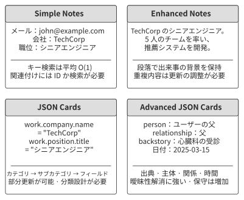

**Simple Notes** は、各記憶を「ユーザーのメール：john@example.com」のような短い事実として書きます。一件ごとの読み書きは容易で、ハッシュ表を使って安定したキーで位置を特定すれば、検索と更新の平均時間計算量は通常 O(1) です。大量のノートを意味で検索するには、別に検索用のインデックスが必要です。また、細かく分けすぎると関係が失われます。「TechCorp でシニアエンジニアを務め、レコメンドシステムの開発を担当」を会社、職位、プロジェクトという互いに無関係な三件の記録に分けると、後でそれらが同じ仕事に属するかを改めて判断しなければなりません。

**Enhanced Notes** は、事実とその背景を一つの段落にまとめて保存します。たとえば「ユーザーは TechCorp でシニアソフトウェアエンジニアを務め、機械学習に携わって 3 年になり、現在は 5 人のレコメンドシステムのプロジェクトを率いている」のように書きます。会社、職位、経歴、チームの関係が一つの段落の中に保たれます。代償として、一部の事実が複数の段落に重複することがあり、職位が変わったら関係する段落を漏れなく探して更新し、新旧の記録が併存しないようにしなければなりません。

**JSON Cards** は「カテゴリ—サブカテゴリ—キー・バリュー」の形で情報を組織します。たとえば `personal.contact.email` や `work.position.title` です。職位のフィールドを変えても `work.company.name` などの他のフィールドはそのまま残せるため、部分的な更新に向いています。分類を設計するときは、複数のカテゴリにまたがる情報も考慮する必要があります。「週末に Python で個人プロジェクトを開発する」は、時間、技術の嗜好、活動のすべてに関わります。一件の活動記録に複数のタグを付けるか、参照で関連カテゴリをつなぐことで、こうした関連を保てます。

**Advanced JSON Cards** は、事実に加えて、出所の背景 `backstory`、主体 `person`、ユーザーとの関係 `relationship`、タイムスタンプを持ちます。これらのフィールドは、情報が誰のものか、いつ知ったのか、どんな場面に当てはまるのかをシステムが見分ける助けになります。たとえば「張医師」は、ユーザーの歯科医かもしれませんし、ユーザーの父親の循環器科医かもしれません。名前を、受診者、親族関係、診療科と一緒に保存すれば、混同を減らせます。

ユーザーが「家族の年次健康診断を手配して」と言えば、システムは `person` と `relationship` で家族を見つけ、`backstory` から関連する経緯を読み取れます。ただし、フィールドが豊富になるほど、抽出と更新のときに扱う関係も増えます。筆者は、情報の重要度と関連付けの必要性に応じて混在させることを勧めます。主要な人物、契約、長期的な嗜好には Advanced JSON Cards を使って出所と関係を残し、数が多く関連の少ない単純な事実には Simple Notes を使って抽出と保守のコストを抑えます。二種類の記録は識別子や参照で結びつけ、必要なときに一緒に取り出します。

> **実験 3-2 ★★：4 つの記憶フォーマットの比較**
>
> 付属の実装は、四つのフォーマットに共通の記憶生成、更新、検索のインターフェースを提供し、実験 3-1 と同じ 60 件のケースで最終的な回答を比較します。
>
> 今回の実行では、Simple Notes、Enhanced Notes、JSON Cards、Advanced JSON Cards がそれぞれ 48、52、51、49 件のケースに合格しました。第二層では Enhanced Notes が 16 件、Advanced JSON Cards が 12 件に合格し、第三層ではどちらも 19 件に合格しています。記憶の保守、回答、審査を合わせると、Enhanced Notes は約 99 万 token、Advanced JSON Cards は約 155 万 token で、後者はモデル呼び出しの平均所要時間も長くなりました。
>
> 第二層の動画配信サブスクリプションの問題を例にとります。ユーザーは出費を抑えたいので、自分がどのサービスに加入していて、それぞれいくらかかっているかを尋ねました。Enhanced Notes のグループは、Netflix、Disney+、Max の月額料金をそれぞれ 22.99、19.99、19.99 ドルと答えました。Advanced JSON Cards のグループは Max の料金しか挙げず、Max の二つの低価格プランを紹介しました。提案がいくら具体的でも、残り二つの請求は補えません。
>
> 問題はどの更新から始まったのでしょうか。Advanced JSON Cards のグループが更新のたびに保存した記憶をたどると、最初のセッションの後には Netflix がありましたが、二つ目のセッションの後には Disney+ に関する記録しか残っておらず、三つ目のセッションの後には Max だけになっていました。質問の時点では、最初の二つのサブスクリプションはすでに記憶から消えていたのです。

### 高度な知識表現：実行可能コード

事実を保存した後には、集計し、衝突を確認し、業務ルールにもとづいて次の行動を判断する必要があります。筆者は **User as Code**（UaC）で、ユーザー情報を型付きの Python オブジェクトとして組織し、こうした操作を関数として書く試みをしました[^uac]。モデルは対話から事実を抽出し、プログラムは定義のはっきりした計算を実行します。

日付の比較、金額の集計、明確な業務上の制約については、筆者は計算を関数として書くことを優先し、同じ事実の集合から再現可能でテスト可能な結果が得られるようにしています。こうすればモデルは意味の理解に集中でき、長い対話の中で暗算やルールの照合を繰り返す負担が減ります。記憶の表現と使い方も、同じコードの中で確認できます。

UaC は二段階の流れをとります。まず抽出した事実をログに追記し、定期的にチェックポイントを作ってログから型付きの状態を再構築します。ログは事実の出所と変化の過程を残し、状態オブジェクトは現時点で問い合わせ可能なフィールドを提供します。

パスポートと旅程を例にとると、状態は次のように定義できます。

```python
from dataclasses import dataclass
from datetime import date

@dataclass
class PassportInfo:
    number: str
    country: str
    expiry_date: date

@dataclass
class Trip:
    destination: str
    departure_date: date
    is_international: bool

@dataclass
class UserState:
    passport: PassportInfo
    trips: list[Trip]

state = UserState(
    passport=PassportInfo("AB1234567", "US", date(2025, 2, 18)),
    trips=[
        Trip("Tokyo", date(2025, 1, 15), True),
        Trip("Paris", date(2025, 6, 10), True),
    ],
)
```

**集計**は記録を直接たどります。たとえば、2025 年に登録された国際線の旅程の数を数えるには次のようにします。

```python
count = sum(
    1 for trip in state.trips
    if trip.is_international and trip.departure_date.year == 2025
)
# count == 2
```

**衝突の確認**は、二つのフィールドの集合をあらかじめ決めた規則で突き合わせます。以下では薬剤の分類の一致を例に、さらに確認が必要な項目を処理キューに送る方法を示します。

```python
def find_allergy_matches(profile):
    matches = []
    for medication in profile.current_medications:
        for allergy in profile.allergies:
            if medication.drug_class == allergy.drug_class:
                matches.append((medication, allergy))
    return matches
```

一致した項目にはそれぞれ対応する服薬記録とアレルギー記録が残るので、後続の処理はそれをもとに確認を行い、領域のルールに従って、注意を促すか、審査に回すか、情報を補うかを決められます。

**制約の確認**は、状態の更新に合わせて自動的に実行できます。たとえば、出発時にパスポートの残存有効期間が 180 日以上必要という旅程の規則があるなら、日数を引数として渡せます。

```python
def passport_alerts(state, required_days):
    alerts = []
    for trip in state.trips:
        if trip.is_international:
            days = (state.passport.expiry_date - trip.departure_date).days
            if days < required_days:
                alerts.append((trip.destination, days))
    return alerts

alerts = passport_alerts(state, required_days=180)
```

例の 180 日で計算すると、東京へ行くときパスポートの残存期間は 34 日しかなく、パリへの出発日にはすでに期限が切れています。ユーザーがパスポートを更新したら、プログラムは新しい日付でこの二つの旅程を計算し直せます。

[^uac]: Li, Bojie、User as Code: Executable Memory for Personalized Agents、2026。

### ユーザーメモリの認知科学的基礎

認知科学は、記憶をその内容と使われ方によっていくつかの種類に分けます。これらの概念は、Agent の長期的な情報を組織する際にも役立ちます。

- **エピソード記憶（episodic memory）**は、具体的な出来事とその時間、参加者、経過を保存します。人間の例は「先週の水曜に同僚とイタリアンレストランで夕食をとった」です。Agent では「ユーザーは来週金曜に ANA 便で東京へ行く予定」に対応し、その後予約が成功したか、変更したかも記録できます。
- **意味記憶（semantic memory）**は、事実と概念を保存します。人間の例は「イタリアの首都はローマ」です。Agent では「ユーザーはベジタリアン」「ユーザーは窓側の席を好む」に対応します。こうした情報はユーザーの明示的な発言から得ることも、複数の経験から帰納することもあり、出所を記録しておけば両者を区別できます。
- **手続き記憶（procedural memory）**は、技能や行動の流れに関わります。人間の例は自転車に乗ることです。Agent の工学では、再利用できる手順にたとえられます。たとえば「直行便を検索→座席の好みを確認→マイレージ番号を使う→機内食を予約」です。

第 1 章の購買記録を振り返ると、「十点見た後でそのうち一点を買った」は一回の購入イベントを記録する根拠にはなりますが、そこからユーザーが今後何を好むかを判断するのは困難です。彼女はそのデザインが気に入ったのかもしれませんし、単にその日に届くからだったのかもしれません。もし彼女がその後「今後この種のものを買うときは、まず当日配送できるか確認して」と言えば、適用範囲のある長期的な嗜好が一つ加わります。次に同じ種類の商品を勧めるときは配送時間を優先して調べられ、この絞り込み条件がどのフィードバックから来たのかを彼女に説明することもできます。

表3-1 は、この分類を前述の記憶の階層や格納フォーマットと並べ、それぞれがどの問いに答えるのかを示しています。

表3-1 記憶設計の三つの側面

| 設計の側面 | 答える問い | 具体的なカテゴリ |
| --- | --- | --- |
| 記録の階層 | 情報はどんな役割を担うか？ | 軌跡、ユーザー長期記憶、業務状態 |
| 格納フォーマット | どんな構造で表すか？ | Simple Notes、Enhanced Notes、JSON Cards、Advanced JSON Cards |
| 記憶の内容 | どんな種類の情報を保存するか？ | エピソード記憶、意味記憶、手続き記憶 |

たとえば「ユーザーは窓側の席を好む」は意味記憶に属し、Simple Notes で長期記憶に保存できます。一連の予約手順は手続き記憶に属し、出所と適用条件を持つカードで保存できます。

### 記憶フレームワークの事例

ユーザーが「最近は通路側にしている」と言ったのに、古い記録には「窓側が好き」とあるとします。システムは書き込み時に座席の好みを更新することもできますし、二つの発言を両方保存しておき、次の予約時にどちらが当てはまるかを判断することもできます。以下ではまず、Mem0 がこの種の衝突をどの段階で処理するかを見て、次に Memobase がユーザープロファイルと具体的な出来事をどう分けて記録するかを見ます。

**Mem0：衝突処理の位置を変える。** 2025 年の論文と v2 の流れでは書き込み時に新旧の事実を比較し、その後の v3 では事実の追記と混合検索を採用しました。図3-3 はこの二つの設計を対比しています。

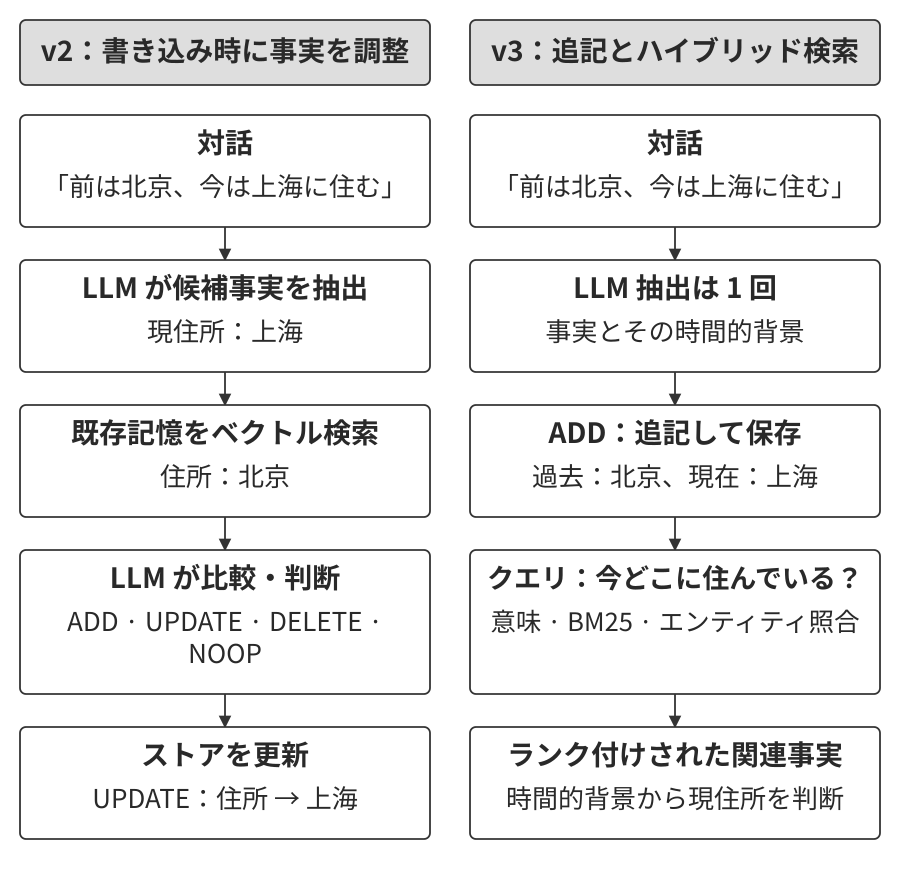

初期の流れでは、LLM がまず対話から候補となる事実を抽出し、近い既存の記憶を検索して、**ADD**、**UPDATE**、**DELETE**、**NOOP** のどれを実行するかを決めます。ユーザーがまず「北京に住んでいる」と言い、後で「上海に引っ越した」と言えば、システムは現在の居住地を上海に更新できます。こうすれば問い合わせ時には整理済みの事実を取り出しやすくなりますが、保守の際には訂正、時間による変化、別人の情報を正しく見分け、更新の根拠を保存して、誤りが見つかったときにさかのぼれるようにしなければなりません。論文はグラフ記憶の変種 **Mem0-g** も提案し、エンティティと関係で関連知識を表現しています[^ch3-mem0-paper]。

v3 は自動抽出を一回の LLM 呼び出しにまとめ、**ADD** の記録だけを追加します。北京と上海の二つの情報は時間の背景とともに両方残され、問い合わせ時にコンテキストと合わせて現在の居住地を判断します。検索では意味的類似度、BM25 のキーワード、エンティティの一致を併用し、完了が確認された行動も事実として抽出できます。移行ガイドによると、LoCoMo のスコアは 71.4 から 91.6 に、LongMemEval は 67.8 から 93.4 に向上しました。このオープンソース版はエンティティの関連付けを内部の検索に使い、外部のグラフストアのインターフェースと `relations` の戻り値を削除しました。グラフ記憶はホスティング版のプラットフォームで提供されます[^ch3-mem0-migration]。

この変遷は、記憶システムが衝突の判断を書き込み段階から読み取り段階へ移せることを示しています。書き込み時に二人の経験を誤って統合したり、補足を訂正と取り違えたりすると、その後の回答は誤った現在の状態を使い続けるおそれがあります。追記で保存すれば新旧の証拠がどちらも判断に使え、書き込み時に一件ずつ決定するためのモデル呼び出しも減ります。変化が頻繁で、その場では衝突を判断しにくいユーザーメモリについては、筆者はまず事実をその時間と出所とともに保存し、具体的な質問に答えるときに有効な状態を整理する方法を好みます。

[^ch3-mem0-paper]: Chhikara ら、Mem0: Building Production-Ready AI Agents with Scalable Long-Term Memory、2025。

[^ch3-mem0-migration]: Mem0、Open Source: Migrating to the New Memory Algorithm。

**Memobase：ユーザープロファイルとイベント記憶。** Memobase は長期的な情報を二つの部分に分けて組織します。**ユーザープロファイル（profile）**は比較的安定した属性をトピックとサブトピックごとに保存します。たとえば `basic_info` の下に氏名、`interest` の下に興味、`work` の下に職位を置きます。開発者は抽出するスロットを設定して、プロファイルの範囲と粒度を制御できます。**イベント記憶（event memory）**はユーザーの経験とその時間を記録し、「前回予算について話したのはいつか」といった問いに答えるのに使います。

Memobase は新しい対話をまずバッファに入れ、バッファが指定の規模に達したとき、あるいはセッションのアイドル時間が設定値に達したときにまとめて処理します。セッション終了時に明示的に起動することもできます。こうすれば複数のメッセージが一回の整理処理を共有し、問い合わせ時には生成済みのプロファイルとイベントを読むだけで済みます。非同期の更新によって、現在のやり取りが記憶の抽出を待つ時間は短くなります。最新の事実をすぐに使いたい場合は、今回の処理の完了を待つこともできます[^ch3-memobase]。

[^ch3-memobase]: Memobase、公式プロジェクトの説明。プロファイルのフィールド、イベント記憶、バッファ、同期更新のインターフェースを含む。

アシスタントが前回の予約の経緯を覚えておくと同時に、ユーザーの座席の好みや払い戻しの手順も把握しなければならないなら、図3-4 のように出来事、事実、手順を分けて保存できます。タスクを受けるたびに、使える部分を作業記憶に入れます。

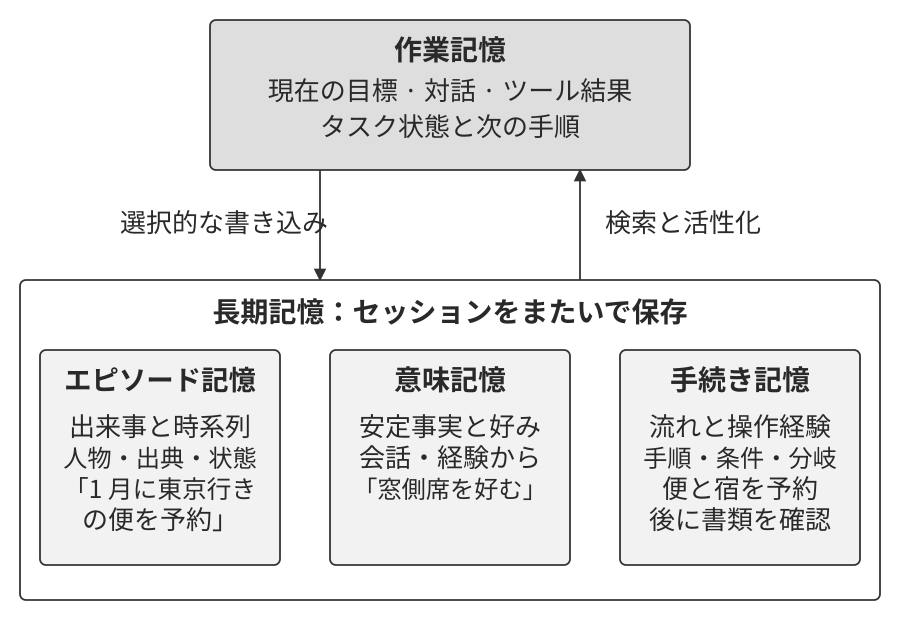

エピソード記憶は、イベントの系列とともに、タイムスタンプ、感情タグ、タスクの識別子などのメタデータを保持し、時間とテーマを組み合わせて検索できます。たとえば「前回予算について話したとき」には、テーマの一致と時間順の並べ替えの両方が必要です。意味記憶は出来事から抽出した事実と嗜好を、手続き記憶は繰り返し使う手順を保存します。

**作業記憶（working memory）**は、現在の目標、タスクの状態、取り出した関連情報を組織します。Harness は軌跡と長期ストレージから内容を選んで現在のコンテキストに読み込み、タスクで生じた新しい事実は整理したうえで長期記憶に書き込みます。軌跡は物事がどう起きたかを記録し、作業記憶は次の意思決定に必要な情報を集めて保持します。両者はイベントの識別子と出所でつながっています。

RAG でユーザーメモリを読み出すときは、まず現在の依頼にもとづいて関連しそうな記憶を一通り見つけ、そのうちどれを作業記憶に入れるかを決めます。アシスタントが今日ユーザーの座席を選ぶとして、検索で二つの発言が見つかったとします。「出張のときは窓側が好き」と「前回は膝をけがしたので、帰りの便は通路側にして」です。どちらも座席選びとの関連は高いのですが、二つ目は当時のその帰りの便についての要求にすぎません。関連度で並べ替えて仮にこれを一位にしても、今日それが当てはまるかどうかには答えていません。

このような場合、筆者は Jev のような判定モデルで候補の記憶を選別する方法に期待しています。今回の旅程、ユーザーの現在の要求、そして各記憶の原文、日付、適用条件をまとめて渡し、一件ずつ「今回適用」「参考のみ」「根拠不足」のいずれかを判断させます。今日も出張なら一つ目を座席選びの根拠にでき、ユーザーが膝のけががまだ治っていないと言ったばかりなら、二つ目を持ち出して確認する価値があります。

### 記憶の圧縮と整理の仕組み

よく航空券を予約するユーザーは、「窓側」と十回言うかもしれません。そのうち九回は同じ予約について繰り返しているだけかもしれず、言及回数をそのまま嗜好の強さとみなすと、一つの出来事の重みを過大に見積もってしまいます。整理するときは、まず出所と出来事を見分け、次に重複した記録を統合し、後からの訂正がないかを確認し、最後にどの傾向が今後のタスクで使えるかを決めます。「前回のあの窓側の席はよかった」という発言があれば、Jev のような判定モデルにこの発言と関連する予約を読ませ、それが「前回の搭乗の振り返り」「今回の要求」「長期的な嗜好の表明」のどれにあたるかだけを判断させられます。予約と対応がとれなかったり、複数の解釈が成り立ったりする場合は、原文を残しておき、予約時に確認します。こうした局所的な判断を一回行うだけで、同じ経験を何度も新しい証拠として数えることを防げます。

1. **整理の対象を選ぶ。** アクセス頻度、記録時期、感情タグ、情報の独自性を並べ替えの手がかりにできます。たとえば、三日前に作られ、五回アクセスされ、感情タグが強く、重複のない記録は、単独で残す価値が高いと言えます。一方、九十日前に作られ、一度しかアクセスされず、他の三件と高度に重複する記録は、関連する記録と優先的に統合できます。システムはまずスコアで整理が必要な記録を選び、業務ルールに従って圧縮、統合、削除のどれを行うかを決められます。長期的な制約や有効な契約は、アクセスがほとんどなくても有効期限まで残すべきです。
2. **クラスタリングして要約を作る。** 似た記録をグループにまとめ、共通の内容を一つの要約に残します。たとえば、何度もあった天気の対話を「ユーザーはよく天気を尋ね、特に雨を気にしている」とまとめます。具体的な日付と元の質問はアーカイブとして保存し、要約から元の記録をたどれるようにしておきます。
3. **傾向と手順を抽出する。** 何度もの買い物の記録から「コストパフォーマンスの高い製品を好み、ユーザーレビューを重視する」と帰納したり、商品選びの手順を抽出したりします。

### プライバシー保護：ログのマスキング

ユーザーメモリには、身元、連絡先、口座情報がよく含まれます。システムは、どのフィールドをモデルの入力に入れるかをタスクに応じて決め、どの内容をログに入れるかを運用上の必要に応じて決めなければなりません。マスキングはログの書き込み前に行い、機微な部分を種類のラベルや安定したプレースホルダーに置き換えて、問題の調査に必要な構造を残すことができます。

> **実験 3-3 ★★：ローカルモデルによるログのマスキング**
>
> この実験では Ollama でローカルの Qwen3-0.6B を呼び出し、ログ中の機微な部分を手元のマシンで識別します。小型モデルはコンシューマー向けの機器にも配備しやすく、1.7B や 4B などの規格に切り替えて、識別の品質と処理時間を比較することもできます。元のログを手元から出してはならない場合は、識別と置換も手元のマシンで済ませ、マスキング後の結果を後続のサービスに渡すべきです。
>
> テスト素材には、身分証番号や銀行カード番号などの構造化された番号、住所などの半構造化された内容、そして自然言語の中で漏れたパスワードなどの機微な情報が含まれます。モデルは JSON Schema に従って情報の種類、テキスト中の位置、信頼度を返し、プログラムはそれにもとづいて原文を置き換えます。対照群には正規表現を使い、混合群ではまず正規表現でマッチングしてから、残りのテキストをモデルに処理させます。
>
> まず二件のログを見てみましょう。一件目には身分証番号と電話番号があり、正規表現は電話番号しか隠せなかったので、再現率は $1/2$ です。二件目では、正規表現は米国の社会保障番号と銀行カード番号を漏れなく見つけましたが、形式の似たチケット番号まで隠してしまいました。三か所に印を付けたうち、マスキングが必要だったのは二か所だけなので、適合率は $2/3$ です。機微な値がログに残っていないかだけを確認するなら、二件目は合格になります。サポート担当者がこのログでチケットを調べようとして初めて、手がかりが失われていたことに気づくのです。
>
> 全 12 件のサンプルについて一件ずつ再現率を計算して平均すると、正規表現、モデル、混合方式はそれぞれ約 50%、69%、78% でした。置換後に一件ずつ数えると、三つの方式はそれぞれ 9、3、2 個の機微な値を残していました。どれを選ぶかは処理時間も考慮して決めます。このマシンでは、正規表現は一件あたり平均約 0.1 ミリ秒、モデルと混合方式はどちらも 3 秒近くかかりました。ログの量が多い場合は、まず形式の安定したフィールドを正規表現で処理し、文脈を踏まえた判断が必要な部分だけをモデルに補完させるとよいでしょう。

記録が増えると、次は何千何万という情報の中から、現在のタスクに必要な内容を見つけることが課題になります。以下で紹介する RAG の技術は、共有知識ベースにも、ユーザーメモリの検索にも使えます。

## RAG の基礎：Agent の知識取得パイプラインを構築する

ある店が返金ポリシーを改定した後で、ユーザーが「先月買った商品は、今どうやって返金を申請すればいいですか」と尋ねてきたとします。正しく答えるには、まずこの注文に適用される条項を探し出し、そのうえで条件と手順をわかりやすく説明しなければなりません。**検索拡張生成**（Retrieval-Augmented Generation、RAG）はこの二つのステップをつなぎ、モデルが店の内部資料を使えるようにし、訓練の終了後に公表されたポリシーも活用できるようにします。

まず、ポリシーが一つの版しかない場合から始めましょう。以下では簡略化したインターフェースで同じ店の返金手続きを問い合わせ、検索結果がどのようにモデルの回答に入るかを見ます。

```python
query = "返金の手続き"
results = retriever.search(query, top_k=2)
# results = [
#   "返金ポリシー：注文の受け取りから 7 日以内であれば全額返金を申請できます。注文番号が必要です。返金は 3～5 営業日以内に入金されます。",
#   "返金操作：「注文履歴」を開き、注文を選んで「返金を申請」をクリックします。"
# ]
answer = llm.generate(system="あなたはカスタマーサポートのアシスタントです。", context=results, question=query)
# 回答には申請期限、必要な情報、操作手順、入金までの日数が含まれる。
```

図3-5 とコード中の二件の検索結果を見比べてください。返金を申請する手順は「返金操作」から、着金まで 3～5 営業日かかることは「返金ポリシー」から来ています。もし検索結果に操作手順しか残っていなかったら、モデルはいつ着金するかをユーザーに伝える根拠を持てるでしょうか。この問いは、マニュアルをどう分割すべきかに関わってきます。

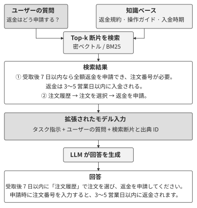

### 文書の分割（Chunking）

あるアフターサービスのマニュアルが、まず「七日以内なら返品可能」と書き、次の段落で例外となる商品を説明しているとします。最初の一文だけを取り出すと、例外の商品にまで返金を約束してしまうおそれがあります。逆にマニュアル全体を一つの検索単位にすると、設置、設定、トラブルシューティングまで一緒に含まれ、ベクトルが返金というテーマを際立たせにくくなります。**分割（chunking）**では、この両極の間でサイズを選び、一つのチャンクが自分の条件を説明するのに十分で、しかも具体的な質問から見つけやすい大きさにする必要があります。チャンクの長さは埋め込みモデルの入力の上限にも収まり、後の生成のためにコンテキストの余裕を残しておかなければなりません。

よく使われる方法は三種類あります。

**固定サイズ分割**は token 数で区切ります。たとえば 1 チャンクを 512 token とし、隣接するチャンクを 50～100 token 重ねます。重なりがあれば、境界付近の内容が別のチャンクに完全な形で含まれる可能性が生まれます。この方法はチャンクの長さを制御しやすい反面、切れ目が段落、コード、表の途中に入ることがあります。

**再帰的分割・構造認識分割**は、章や段落などの自然な境界に沿って分割することを優先し、長すぎる部分は文などのより小さな単位でさらに分けます。Markdown の見出しや HTML の要素が構造の手がかりになります。コードブロック、表、見出しに結びついた本文には専用の処理規則を使うこともできます。構造のはっきりした技術文書なら、筆者はこの方法から始めることを勧めます。既存の章と段落をまず活かし、長すぎる部分だけを細かく分けるほうが、機械的に切るより意味のまとまりを保ちやすいのが普通です。

**意味分割**は、隣接する文や文のまとまりの埋め込みの類似度を計算し、テーマがはっきり変わる位置で区切ります。埋め込みの計算は増えますが、同じテーマを一つのチャンクに収められる見込みが高まります。

検索器が「同社の売上は 3% 増加した」という一文だけを返してきたとします。どの会社でしょうか。どの四半期でしょうか。数字は正しく見つかっても、質問に答える根拠は前の段落にあります。逆に決算報告全体を一つのチャンクに入れれば、四半期と社名は保たれますが、売上を問い合わせたときに採用や設備調達の段落まで一緒に入ってきます。こうした内容は一つのベクトルを共有するので、売上というテーマがベクトルの中で目立たなくなるおそれもあります。実際にチャンクサイズを選ぶときは、1 チャンクあたり 256～1024 token、隣接チャンクの重なり 10%～20% から試すとよいでしょう。

見出し、出所、日時などのメタデータは、断片と一緒に保存できます。後述のコンテキスト認識検索では、さらに各断片に原文の中での背景を補い、断片を単独で検索するときにも指示語や範囲を解釈できるようにします。

### 密ベクトル埋め込み：テキストをベクトルで表す

**埋め込み（embedding）**は、単語、文、テキストのチャンクを `[0.2, -0.5, 0.8, ...]` のような数値ベクトルに写像します。検索モデルは訓練によって、関連するクエリと文書がベクトル空間の中で高い類似度を持つようにします。「密」とは、ベクトルの大部分の次元が非ゼロの値を持ち、それらが共同でテキストの情報を表すことを指します。後で扱う疎な表現では、非ゼロの次元はごく一部だけです。

ベクトル空間は高次元の地図のようなものと考えられます。各テキストは一つの位置に対応し、検索とはその中でクエリに近い内容を探すことです。よく使われる尺度の一つが**コサイン類似度**です。

$$
\operatorname{cos}(A,B)=\frac{A\cdot B}{\|A\|\,\|B\|}
$$

内積 $A\cdot B$ は対応する次元どうしを掛けて足し合わせたもので、ノルム $\|A\|$ は各次元の二乗和の平方根です。二つのノルムで割ると、結果は方向の関係だけを反映します。非ゼロのベクトルでは、コサイン値は $[-1,1]$ の範囲をとり、1 に近いほど方向が揃っています。検索モデルによっては内積やユークリッド距離を使うこともあります。二つのベクトルがどちらも単位長に正規化されていれば、内積はコサイン類似度に等しくなります。

> **手計算：三つの文のコサイン類似度**
>
> 「猫の飼い方」を $A=(0.9,0.5,0.1)$、「猫の飼育ガイド」を $B=(0.8,0.6,0.1)$、「株式投資の戦略」を $C=(0.1,0.1,0.9)$ という模式的なベクトルで表します。
>
> $A\cdot B=0.9\times0.8+0.5\times0.6+0.1\times0.1=1.03$ です。二つのノルムはそれぞれ $\sqrt{1.07}$ と $\sqrt{1.01}$ なので、類似度は約 **0.991** になります。
>
> $A\cdot C=0.9\times0.1+0.5\times0.1+0.1\times0.9=0.23$ で、$C$ のノルムは $\sqrt{0.83}$ なので、類似度は約 **0.244** です。このベクトルの組では、猫の飼い方のクエリは飼育ガイドのほうに近くなります。

実際のモデルは、通常数百から千を超える次元で表現します。

#### Word2Vec からコンテキスト認識へ

図3-6 は固定の単語ベクトルから話を始めています。**Word2Vec** は語の共起から各単語の固定ベクトルを学習します。一部の関係はベクトル演算に現れ、たとえば古典的な「王－男性＋女性≈女王」がそうです。固定の表現の限界もわかりやすく、`bank` は `river bank`（川岸）でも `investment bank`（投資銀行）でも同じ単語ベクトルを使います。

**GloVe** はコーパス全体から単語どうしの共起回数を集計し、重み付き最小二乗の目的関数で単語ベクトルを学習します。Word2Vec は局所的なウィンドウでの予測タスクに重点を置き、GloVe は全体の共起統計を直接訓練に取り込みます。どちらも単語ごとに固定の表現を学習します[^ch3-glove]。

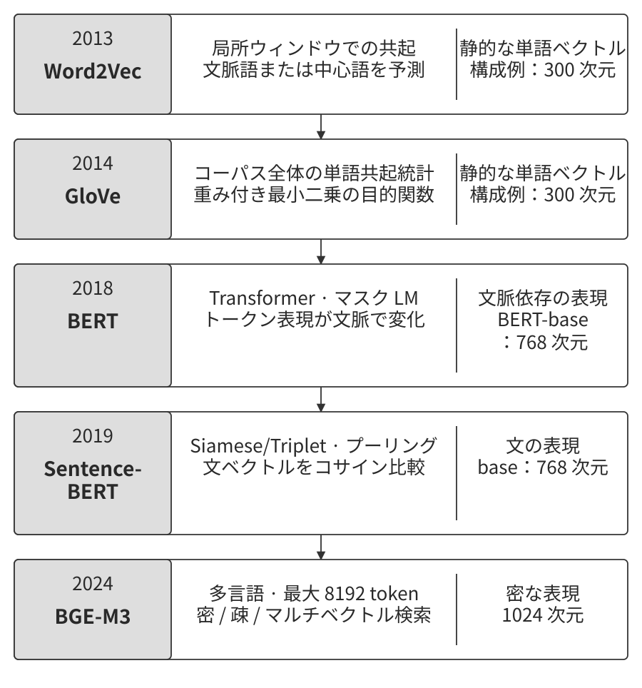

**BERT** のようなコンテキストモデルになると、同じ token の表現が文によって変わります。自己アテンションによって、モデルは「发布新产品」（新製品を発表した）や「买了两斤」（1 キロ買った）といった手がかりから、二つの中国語の文に現れる同じ「苹果」（Apple 社／りんご）に異なる表現を割り当てられます。検索用の埋め込みモデルでは、さらに token の表現をクエリや文書のベクトルにまとめ、対応する訓練によって両者を比較できるようにする必要があります。

**Sentence-BERT** は BERT にプーリングとシャム（Siamese）またはトリプレットのネットワーク構造を組み合わせ、直接比較できる文ベクトルを訓練します。文書はあらかじめ符号化してインデックスに格納しておけるので、クエリが来たときはクエリだけを符号化し、ベクトルの類似度を計算すれば済みます。事前に符号化しておくことで、クエリのたびにすべての文書の表現を計算し直す手間が省けます[^ch3-sbert]。

**BGE-M3** は密、疎、マルチベクトルの三種類の検索表現を同時に提供し、多言語と比較的長い入力にも対応しています。本節ではそのうち密な表現を使って単一ベクトルの検索を説明します[^ch3-bge-m3]。モデルが受け付ける長さは分割の方針に影響します。元の BERT の典型的な上限は 512 token ですが、BGE-M3 は 8192 token まで対応しています。

[^ch3-bge-m3]: Chen らの M3-Embedding 論文（arXiv:2402.03216）は、三種類の検索表現をどのように同時に訓練するかを説明しています。BAAI の BGE-M3 モデルの説明も参照してください。表現の方式、次元、入力長、使い方が記載されています。

> **実験 3-4 ★★：二種類の近似最近傍インデックスを比較する**
>
> 文書のベクトルができたら、クエリに近いベクトルを素早く見つける必要があります。一つずつ計算すれば正確な最近傍が得られますが、データの規模が大きくなると、**近似最近傍**（Approximate Nearest Neighbor、ANN）インデックスが、制御可能な範囲の再現率の低下と引き換えにクエリの速度を高めます。この実験では、同じ実際の埋め込みと同じクエリで ANNOY と HNSW を比較し、厳密な検索の結果を基準にします。たとえば、あるクエリで厳密な検索が十件の最近傍を挙げ、近似インデックスが返した十件にそのうち八件が含まれていれば、そのクエリの Recall@10 は 0.8 です。この値は、インデックスが厳密な最近傍をどれだけ保てたかを測ります。
>
> ANNOY は複数のランダム射影木で候補の範囲を絞り込みます。HNSW は階層化された近傍グラフを使い、まず疎な上位の層で目標の領域に素早く近づき、そこからより密な下位の層に入って探索します。図3-7 は HNSW の階層構造を示しています。
>
> 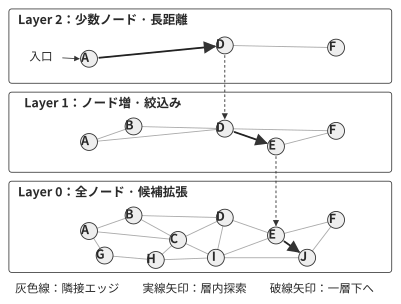
>
> 表3-2 ANNOY と HNSW の実装上のトレードオフ
>
> | 比較の観点 | ANNOY | HNSW（hnswlib の場合） |
> | --- | --- | --- |
> | インデックス構造 | 複数のランダム射影木 | 階層化された近傍グラフ |
> | 構築コスト | 木の数、ベクトル数、次元に応じて変わる | 隣接の規模、構築時の探索範囲、データ量に応じて変わる |
> | メモリとファイル | 静的インデックスはメモリマップと複数プロセスでの共有に対応 | ベクトルとグラフの隣接関係を保存し、隣接の規模がコストに影響する |
> | 増分更新 | インデックス構築後に項目を追加するには再構築が必要 | 追加、更新、削除マークに対応し、容量の管理が必要 |
> | 再現率と速度 | 木の数とクエリ時の探索予算で調整 | 構築パラメータとクエリ時の探索範囲で調整 |
> | 利用場面 | 配布や共有がしやすい静的インデックス | 書き込みとクエリが続く動的インデックス |
>
> 今回の実行では、まず 240 個のテキストでインデックスを構築しました。同じ 20 件のクエリに対して、どちらのインデックスも厳密な検索で得られた上位 10 件の最近傍をすべて見つけました。初回の構築では、ANNOY は Linux コンテナ上で約 13 ミリ秒、HNSW は手元の環境で約 78 ミリ秒かかり、保存したインデックスはそれぞれ約 1.40 MB と 1.02 MB でした。次に残りの 60 個を追加すると、ANNOY はインデックスを再構築し、HNSW は新しいベクトルをそのまま挿入しました。この時点でインデックスには 300 個のテキストがあり、以前の最近傍も変わっている可能性があります。新しいデータベースで厳密な検索をやり直したところ、どちらのインデックスも平均再現率は 100% のままでした。

[^ch3-ann]: Spotify の Annoy プロジェクトの説明は、読み取り専用インデックスの構築方法、メモリマップによるインデックスの読み込み、`search_k` でクエリ時に調べるノード数を調整する方法を紹介しています。hnswlib プロジェクトの説明の Python インターフェースの部分には、ベクトルを追加する `add_items` メソッドと、クエリの範囲を調整する `set_ef` メソッドが記載されています。

**インデックスは知識の更新のされ方に応じて選ぶべきです。** コーパスを定期的に一括で公開し、複数のプロセスが同じ読み取り専用インデックスを共有するなら、筆者はまず ANNOY を検討します。新しい文書を継続的に受け取り、オンラインでの挿入が必要なら HNSW を優先します。埋め込みモデルは意味の表現を決め、インデックスはその表現を適切なレイテンシと更新コストで実用に供せるかを決めます。両者が合わさって、検索サービスの効果が決まります。

ANNOY の木の数と探索予算、あるいは HNSW の隣接の規模と探索範囲を調整すれば、再現率とレイテンシがどう変わるかを観察できます[^ch3-ann]。インデックスの再現率は目標の最近傍を見つけられたかどうかを測るものです。それらの最近傍がユーザーの質問に答えられるかどうかは、埋め込みの表現と資料の内容によって決まります。

### 疎な表現：キーワードから関連度スコアへ

**疎な表現**は高次元のベクトルを使い、そのうち非ゼロの次元はごく一部です。従来のキーワード検索は語を次元とし、文書に現れる語に重みを付けます。その土台が**バッグ・オブ・ワーズ**（Bag of Words、BoW）モデルです。語とその出現回数を保存し、語順は無視します。そのため「猫が犬を追う」と「犬が猫を追う」は同じバッグ・オブ・ワーズの表現になります。

この表現は、名前、番号、技術用語のマッチングに向いています。以下では TF-IDF から始め、語の頻度と文書頻度がどのように順位付けのスコアに変わるかを説明します。

#### TF-IDF から BM25 へ

**TF-IDF**（Term Frequency–Inverse Document Frequency、単語頻度–逆文書頻度）は、二つの信号を組み合わせます。語が現在の文書に何回現れるか、そしてコーパス全体でどれくらいありふれているかです。100 本の記事のうち 60 本に「モデル」が含まれ、「蒸留」を含むのは 3 本だけだとすると、「モデル蒸留」を問い合わせたときには「蒸留」のほうが区別に役立ちます。

基本的な書き方の一つは次のとおりです。

$$\operatorname{TF\!\text{-}\!IDF}(t,d)=\operatorname{TF}(t,d)\times\operatorname{IDF}(t),\qquad \operatorname{IDF}(t)=\ln\frac{N}{\operatorname{DF}(t)}$$

$\operatorname{TF}(t,d)$ は語 $t$ が文書 $d$ に現れる回数、$\operatorname{DF}(t)$ はその語を含む文書の数、$N$ は文書の総数です。この式では、ある語が十回現れたときのスコアへの寄与は五回のときのちょうど二倍になり、長い文書は語が多いというだけでスコアが高くなることもあります。TF-IDF には多くの正規化の変種がありますが、次の BM25 は、語の頻度の飽和と長さの正規化によってこの二つの影響に対処します。

**BM25** は各クエリ語の寄与を足し合わせます。

$$\operatorname{Score}(Q,D)=\sum_i\operatorname{IDF}_{\mathrm{BM25}}(q_i)\cdot\frac{\operatorname{TF}(q_i,D)(k_1+1)}{\operatorname{TF}(q_i,D)+k_1\left(1-b+b\frac{|D|}{\operatorname{avgdl}}\right)}$$

ここで $q_i$ はクエリ語、$|D|$ は文書の長さ、$\operatorname{avgdl}$ は文書の平均長です。$k_1$ は語の頻度の飽和の度合いを、$b$ は長さの正規化の強さを制御し、$b$ を 0 にするとこの補正はなくなります。図3-8 はこれらの項を分けて計算しています。まず文書の長さを固定し、クエリ語の出現を一回から三回に増やして、一回増えるごとに何点増えるかを見ます。次に語の頻度を固定し、文書の長さだけを二倍にします。最下段では、二つの語が文書集合の中でどれくらいありふれているかを比べています。

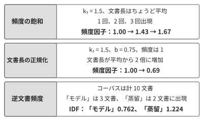

図の一段目では、二回目の出現で語の頻度の因子は約 0.43 増えましたが、三回目では約 0.24 しか増えていません。これが語の頻度の飽和です。二段目では、同じ語がどちらも一回しか現れていませんが、長い文書の中ではそれほど目立たないので、長さの補正によって語の頻度の因子が下げられています。これに IDF を掛けたものが、その語の総スコアへの寄与です。

上の式にはもう一つ決めるべき項があります。同じ三回の出現でも、なぜ珍しい語のほうがありふれた語より役に立つことが多いのでしょうか。本節では次の逆文書頻度で語に重みを付けます。

$$\operatorname{IDF}_{\mathrm{BM25}}(t)=\ln\frac{N-\operatorname{DF}(t)+0.5}{\operatorname{DF}(t)+0.5}$$

分子はその語を含まない文書の数、分母はその語を含む文書の数を表し、両方に 0.5 を足して平滑化することで、文書頻度が 0 や $N$ のときでも計算できるようにしています。珍しい語ほど重みが大きくなり、半数を超える文書にその語が含まれると、この式は負の値を返します。付属の実装では実際の採点に使う重みの下限を $10^{-6}$ とし、元の値は確認用に残しています。

> **実験 3-5 ★★：BM25 検索エンジンをゼロから実装する**
>
> この実験では、分かち書き、ストップワードの処理、転置インデックス、スコア計算を順に実装します。ストップワードの処理では、「的」「了」のような高頻度の語を除外できます。**転置インデックス**は、各語がどの文書に現れるかと、それぞれの語の頻度を記録します。本の巻末の用語索引に似ていて、「TCP」を引けば 45、112、203 ページが見つかり、そこの内容を読みに行けます。
>
> 「モデル蒸留」で一回のクエリを手計算してみましょう。コーパスには 10 本の文書があり、平均長は 250 語、$k_1=1.5$、$b=0.75$ とします。「モデル」は 3 本の文書に現れ、IDF は約 0.762 です。「蒸留」は 2 本に現れ、IDF は約 1.224 です。次の表は、語ごとにヒットした文書、語の頻度、文書の長さを示しています。これらの値を式に代入すれば、各語が文書のスコアにどれだけ寄与するかを計算できます。
>
> | クエリ語 | 文書 | 語の頻度 TF | 文書の長さ | BM25 の寄与 |
> | --- | --- | ---: | ---: | ---: |
> | モデル | doc_1 | 5 | 200 | 1.52 |
> | モデル | doc_3 | 2 | 500 | 0.82 |
> | モデル | doc_7 | 8 | 150 | 1.68 |
> | 蒸留 | doc_1 | 3 | 200 | 2.15 |
> | 蒸留 | doc_5 | 1 | 250 | 1.22 |
>
> 二つの語の doc_1 での寄与を足すと約 3.67 となり、順位は **doc_1（3.67）> doc_7（1.68）> doc_5（1.22）> doc_3（0.82）** です。doc_1 では「蒸留」の語の頻度は「モデル」より低いものの、より珍しいため最終的な寄与は大きくなります。さらに二つの語に同時にマッチしたことで総スコアが一段と高くなっています。
>
> 今度は `cat` で付属実験の英語コーパスを検索してみます。関連ありとラベル付けされた二つの短い文章はそれぞれ `kitten` と `feline` を使っており、転置インデックスには `cat` が見当たらないので、候補リストは空になります。前述の語の頻度の重みをいくら上げても、スコアを付けられる文書が一本もありません。この二つの短い文章に出てくる語で検索し直せば、それぞれが候補リストに入るのを確認できます。

### 混合検索：二系統の結果を統合してからリランキングする

同義語をあらかじめ網羅しておくのが難しい質問もあります。実験 3-6 には「使われていないヒープ領域を自動で回収するには」という問題がありますが、目標の短い文章は「自動メモリ管理によって、開発者はオブジェクトを手動で解放する作業から解放される」と書かれていました。英語のクエリと短い文章には共通の語がなく、キーワード検索は一本も見つけられませんでしたが、ベクトル検索は目標を一位にしました。型番のクエリ XR-7003 に替えると、キーワード検索は該当する型番を直接見つけ、ベクトル検索は似た型番をいくつか並べました。

**混合検索**は、まずキーワードとベクトルでそれぞれ関連する段落を探し、そのうえでどの段落をモデルに渡す価値があるかを決めます。知識ベースに正確な識別子と自然言語の説明の両方が含まれているなら、筆者はここから始めることを勧めます。図3-9 に沿って XR-7003 を追ってみてください。二系統のどちらもこれを一位にしているので、融合のときに二つ分の順位の寄与を得ています。リランキングで二位は入れ替わりましたが、ユーザーが最初に目にする型番は正しいままです。

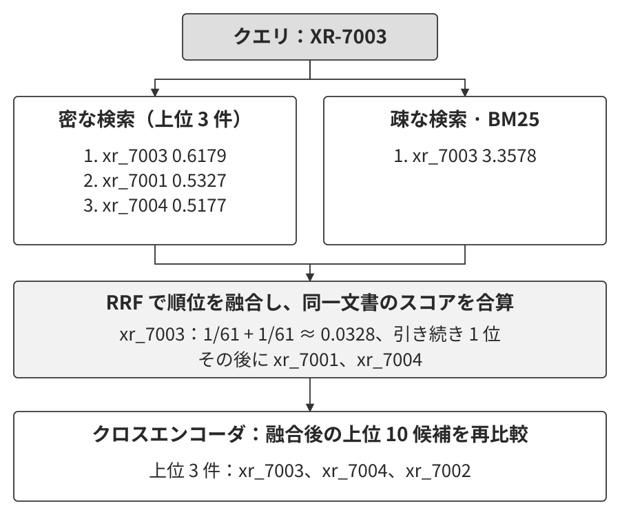

第一段階は**並列検索**です。クエリを密と疎の検索エンジンに送り、それぞれ関連しそうな文書を一通り取り出します。二系統は同じ元のテキストを使うことも、それぞれのモデルの要件に合わせて前処理することもできます。

第二段階は**結果の融合**です。二系統の結果に含まれる同じ文書を統合し、改めて順位を付けます。コサイン類似度と BM25 は数値の尺度が異なるので、そのまま足すと値の大きい系統が結果を支配しがちです。一つの方法は、スコアを校正または正規化してから重み付けして組み合わせることです。もう一つは**逆順位融合**（Reciprocal Rank Fusion、RRF）で、各系統の順位から計算します。

$$\operatorname{RRF}(d)=\sum_{j:\,d\in R_j}\frac{1}{k+\operatorname{rank}_j(d)}$$

$R_j$ は $j$ 番目の系統の結果で、順位は 1 から数えます。ある系統に文書が現れなければ、その系統の寄与はゼロです。平滑化定数 $k$ はよく 60 にします。$k$ が大きいほど、上位の順位どうしのスコア差は小さくなります。RRF は異なる採点方式を組み合わせやすい一方、順位しか残さないので、元のスコアに含まれる強弱の差を活かすには別の方法が必要です。

二系統の検索の例を計算してみましょう。ユーザーが「返金はどれくらいで着金するか」と尋ね、文書 A はキーワード検索で一位でしたが、ベクトル検索の上位には現れませんでした。文書 B は両系統で二位でした。$k=60$ とすると、A は $1/61$ で約 0.0164、B は $1/62+1/62$ で約 0.0323 となります。融合後は B が A より上に来ます。この結果が示しているのは、二つの検索経路がどちらも B を見つけたということだけです。B が本当に着金までの期間に答えているかを判断するには、それが「返金の申請方法」を書いたものか「返金がいつ着金するか」を書いたものかを確かめなければなりません。

第三段階では**ニューラルリランキング**を加えられます。システムは融合後の上位の文書、たとえば上位 50 件を取り出し、リランキングモデルに各文書とクエリの関連度を採点させます。リランキングはこの 50 件の順序を変えられます。本当に役立つ文書がそもそも選ばれていなければ、上流に戻って検索を改善するしかありません。

ここでよく使われるモデルが**クロスエンコーダ（cross-encoder）**です。クエリと候補文書を一緒に入力し、モデルの内部で両者を相互作用させて関連度スコアを出力します。検索段階の**バイエンコーダ（bi-encoder）**はクエリと文書を別々に符号化するので、文書のベクトルをあらかじめ計算しておき、クエリ時にはベクトル検索だけを行えます。前者は少数の文書を細かく並べ替えるのに、後者は大量の文書から一次選別するのに向いています。履歴書の選考と面接にたとえられます。まず手元の特徴で範囲を絞り、次に具体的な要件をめぐって深く比較するのです。BGE Reranker v2 M3 は、この段階に使えるモデルの一つです[^ch3-reranker]。

[^ch3-reranker]: BAAI、BGE Reranker v2 M3 モデルの説明。クエリと文書の入力、関連度の採点を紹介している。

関連する資料が候補プールには入っているのに、無関係な資料より下に並ぶことが多いなら、筆者はまずクロスエンコーダによるリランキングを評価します。質問と文書を合わせて読むので、文書中の条件、限定語、細部が質問の要件に合っているかを直接比べられます。表3-3 によく使われる三つの指標を挙げます。

表3-3 検索品質の三つの指標

| 指標 | 計算方法と意味 |
| --- | --- |
| recall@k（再現率） | 上位 k 件の結果に含まれる関連文書の数を、そのクエリの関連文書の総数で割ったもの。関連する内容をどれだけ取り戻せたかを測る。テストセットでは通常、さらにクエリごとの値を平均する |
| MRR（平均逆順位） | クエリごとに最初の関連文書の順位の逆数をとり、平均したもの。一位なら 1、十位なら 0.1、見つからなければ 0 |
| nDCG@k（正規化割引累積利得） | 関連の度合いに応じて結果に点数を与え、下位の順位ほど割り引いたうえで、理想的な順位でのスコアで割ったもの。上位 k 件全体の順位付けの品質を測る |

**ヒット率**も記録できます。上位 k 件の結果に少なくとも一本の関連文書が含まれていたクエリはどれだけあるか、という指標です。たとえば、ある質問に三本の資料が必要で、上位二十件にはそのうち二本しか入っていなかったとします。このクエリはヒットしているので「まったくヒットしなかった」失敗には数えられませんが、recall@20 は $2/3$ しかなく、$1/3$ の資料はまだ見つかっていません。どの質問にも目標の文書が一本しかない場合は、それを取り戻せた質問が 1 点、取りこぼした質問が 0 点になります。同じ検索結果について平均をとれば、ヒット率は平均再現率と等しくなります。

> **実験 3-6 ★★：疎、密、融合、リランキングを比較する**
>
> この実験では、同じ 12 件のラベル付きクエリで五つの構成を比較します。疎な検索、密な検索、RRF による融合、重み付き融合、そして融合後のリランキングです。クエリは意味的な類似、正確な名称、多言語、技術コードをカバーしており、そのうち二問は植物が日光をどう食物に変えるかを、それぞれ英語と中国語で尋ねています。密なモデルには Qwen3-Embedding-0.6B を、リランキングには MS MARCO MiniLM のクロスエンコーダを使い、各系統の検索は最大 10 本の文書を取り出し、リランカーは RRF で上位に来た最大 10 本の文書を処理します。再現率と nDCG は最終的な順位の上位 3 本だけを見て、MRR は返されたリストに沿って最初の関連文書を探します。
>
> まず実験 3-6 の実行記録にある問題ごとの順位を開き、光合成についての二問の検索結果を比べてみましょう。英語の問題では目標の文書が一位のままです。中国語の問題では、まずプログラミング言語と火山の文書が返され、光合成の話は三本目でした。どちらの問題も関連ありとラベル付けされた文書は一本だけで、二問とも上位三件の中にそれを見つけているので、recall@3 はどちらも 1 です。しかし中国語の問題では最初の関連文書が三位なので、逆順位は $1/3$ しかありません。この実験の採点方式では、三位の利得は $1/\log_2(3+1)=0.5$、一位の利得は 1 なので、中国語の問題の nDCG@3 は 0.5 になります。
>
> 次に全 12 問を見てみましょう。リランキング後は、中国語の光合成の問題に加えて、ヒープメモリの回収に関する問題でも目標の文書が一位から二位に下がりました。残りの十問はどれも一位を保ったので、リランキング後の MRR は $(10+1/2+1/3)/12\approx0.903$ です。比較のために言えば、密な検索と RRF の MRR はどちらも 1 でした。両者の nDCG@3 もどちらも 1 で、リランキング後は約 0.928 に下がりました。平均再現率だけを見ても、こうした順位の変化はわかりません。疎な検索の recall@3 は 0.833 で、残りの四つのグループはどれも 1 でした。
>
> 仮にいま、この問題の組に対して一つの構成を選ぶとしたら、リランキングに費やした時間で何が得られたでしょうか。この CPU では、RRF は検索開始から順位を出すまでに一問あたり平均約 194 ミリ秒かかり、リランキングをつなぐと約 237 ミリ秒になりました。余分にかかった約 43 ミリ秒で目標の文書が新たに見つかることはなく、二問の正解はかえって下位に押しやられました。

## 知識の組織と検索

知識をどう組織するかによって各項目に何が含まれるかが決まり、検索器はそれらの項目から何を取り出すかを決めます。技術マニュアル、法律文書、論文の段落は、章の階層、概念どうしの依存関係、文書をまたぐ引用によって互いに結びついています。こうした構造を残しておけば、クエリは具体的な証拠と、より上位の概括の両方にアクセスできます。

本節では、いくつかの組織の方法を順に扱います。RAPTOR と GraphRAG は階層や関係のインデックスを築きます。OpenViking はディレクトリでコンテキストのリソースを組織します。増分更新と定期整理は知識の鮮度を保ちます。Agentic RAG では、Agent がそれまでの結果にもとづいて検索を続けます。コンテキスト認識検索は断片に背景を補います。最後に、データセットから再利用できる知識を抽出します。これらはそれぞれ表現、インデックス、更新、クエリの過程に作用し、組み合わせてユーザーメモリに使うこともできます。

まず二つの例で、クエリに必要な情報と元の記録との間にある隔たりを確かめましょう。

**事例 1：黒猫と白猫を数える。** 前章では 100 個のケージをプログラムに数えさせ、黒猫 90 匹、白猫 10 匹という結果を得ました。今回は検索器に上位 20 件の記録だけを返させます。そのうち 18 件に有効な毛色の情報があり、15 件が黒猫、3 件が白猫だったとします。計算で得られる 83.3%（15/18）は、この有効な記録の中での黒猫の割合です。店全体の黒猫の割合は 90%（90/100）です。検索器は関連度で記録を選んでいるのであって、店全体を代表するサンプルを抽出したわけではありません。

店全体の割合がよく尋ねられるなら、あらかじめすべてのケージを集計し、黒猫と白猫がそれぞれ何匹いるかを、集計の範囲と更新日時を添えて保存しておけます。ケージの猫が入れ替わったら、該当する明細を更新して合計を計算し直します。誰かが 37 番目のケージに何がいるかを尋ねたら、やはりその明細を一件調べ直します。

**事例 2：看護師は医師が受けた割引を受けられるか。** Xfinity の割引に関する問い合わせをもとに作った教材用の状況を例にとります。チケットの記録では、退役軍人の John は審査を通過し、医師の Sarah は割引を受け、教師の Mike は対象外だと告げられています。各チケットは一回の処理結果を記録しています。ある看護師が自分も割引を受けられるかと尋ねてきたとき、似たチケットを検索するだけでは三つの問題にぶつかります。

- **職業が近くても、同じ割引を受けられるとは限らない。** 「看護師」と「医師」は意味が近いので、Sarah の記録が上位に来るかもしれません。しかし割引が適用されるかどうかは、キャンペーンの条項が誰に申請を認め、どんな証明を求めているかによって決まります。
- **個々のチケットには適用条件がすべては書かれていない。** ある人が審査を通過したという事実から直接わかるのは、その人が当時の条件下で得た結果だけです。検索件数を増やしても、一度も現れていないカテゴリや例外が見つかるとは限りません。
- **資料の範囲がはっきりしない。** チケットは異なるキャンペーンや異なる時期のものかもしれません。まずどの記録が当てはまるのか、そしてどのポリシー上の根拠が欠けているのかを確認する必要があります。

インデックスを作るときに、同じキャンペーンのチケットを関連付け、対応する正式な条項を参照して、適用対象、例外、発効日時、条項の出典をルールカードとしてまとめておけます。たとえば、この教材の状況の条項が現役・退役軍人と免許を持つ医療従事者を明示的に対象とし、教師を除外しているなら、これらの条件を一項目ずつ保存します。看護師が医療従事者の範囲に含まれるかどうかも、条項によって確認します。チケットは引き続き残し、実際の手続きの過程を説明したり、運用上のずれを見つけたりするのに使います。

この二つの例は、異なる情報ニーズを表しています。猫を数えるには店全体のケージを集計する必要があり、誰が割引を受けられるかを判断するには、条項とその例外を漏れなく調べる必要があります。こうしたクエリに対して、筆者は集計とルールの整理をインデックス構築の段階に前倒しすることを主張します。取り出す断片を増やすだけでは、モデルは集計の範囲全体や、今回の申請が認められるかを決める条項を見られないままかもしれません。タスクに合わせて集計の要約、ルールカード、出所の関係を築いておけば、検索は一度で判断を支えるのに十分な情報を得られ、さらに元の資料までさかのぼることもできます。

### 構造化インデックス：階層と関連を築く

長い報告書を読むとき、「修理申請ではどの欄を埋めればよいか」の答えは一つの段落の原文で見つかることが多いでしょう。一方、「なぜ何種類かの故障が繰り返し起きるのか」を知るには、いくつもの章を横断しなければなりません。両方のクエリに対応したいなら、知識ベースの構築時に要約を生成したり、階層を築いたり、エンティティと関係を抽出したりできます。以下の RAPTOR は再帰的な要約で階層を作り、GraphRAG はエンティティの関係とコミュニティの要約で資料を組織します。

**RAPTOR**（Recursive Abstractive Processing for Tree-Organized Retrieval）はテキストのチャンクから始めます。まず各チャンクをベクトルに符号化し、似ている度合いに応じていくつかのグループにまとめ、グループごとに要約を生成します。その要約を新しいテキストのチャンクとみなしてこの手順を繰り返すと、図3-10 の木ができます。矢印に沿ってテキストチャンク 3、4、5 から上を見ると、これらが合わさって要約 B を生み、さらに上では A、B、C の三つのグループの要約が全体の要約にまとまっています。[^ch3-raptor]

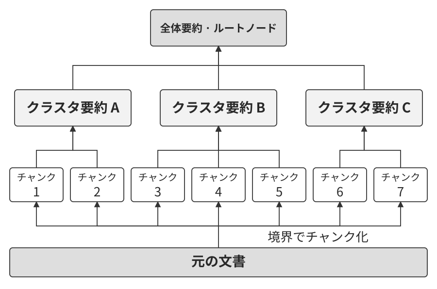

たとえば「SSE2 は 128 ビットの XMM レジスタで整数の SIMD 演算を実行できる」と「SSE4.2 は文字列比較命令を追加した」は、「x86 SIMD 命令セットの進化」という要約にまとめられます。細部に関する質問は下層のチャンクに、概要に関する質問は上層の要約にマッチします。クエリは階層に沿って段階的に掘り下げることも、すべての層のノードをまとめて検索し、最も関連する一組を選ぶこともできます。

[^ch3-raptor]: Sarthi ら、RAPTOR: Recursive Abstractive Processing for Tree-Organized Retrieval、2024。

**GraphRAG** は、エンティティ、関係、コミュニティの要約を使って知識を組織します。（中国、首都は、北京）や（山田太郎、勤務先、テンセント）のように、「主語—関係—目的語」の三つ組で一つの関係を記録します。二つの記録が同じエンティティに言及していれば、グラフの中でつなげられます。図3-11 の二人の医師はどちらも張という姓です。ユーザーが「私の歯科医がいる病院の住所」を尋ねたら、システムはどの関係をたどって調べればよいでしょうか。

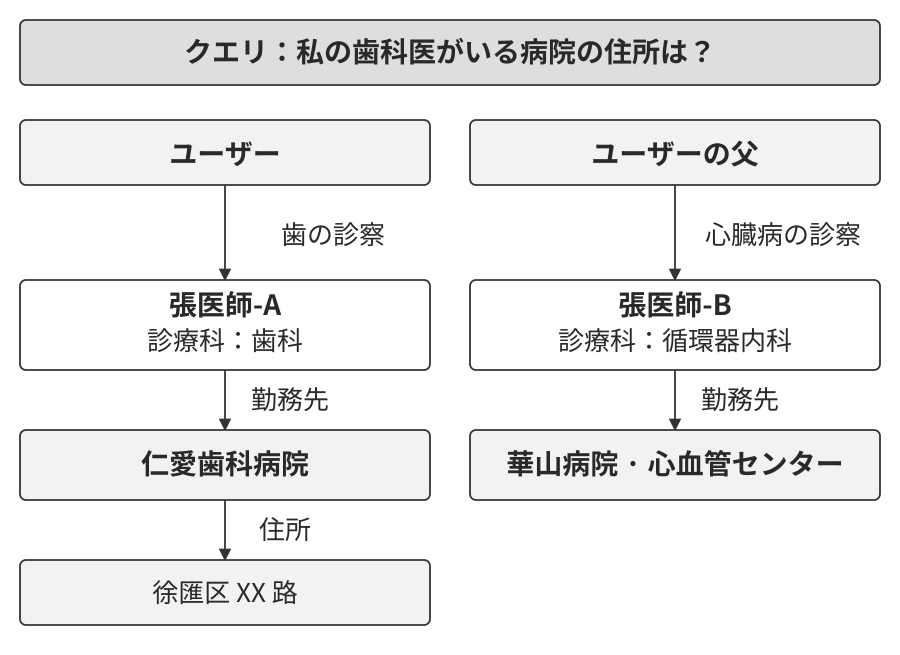

1. **グラフの構築時に同名のエンティティを区別する。** 一人の張医師は仁愛歯科病院でユーザーの歯を診ており、もう一人は華山病院でユーザーの父親の心臓病を診ています。システムはエンティティを抽出して記録を統合するときに、こうした手がかりをもとに二人の医師に別々の識別子を割り当てられます。前述の `person` や `relationship` のフィールドも同様の役割を果たします。`bank` が文中で川岸を指すのか銀行を指すのかを判断するのは語義の曖昧性解消で、ある記録がどちらの張医師について述べているのかを判断するのはエンティティの曖昧性解消です。
2. **クエリ時に関係の連鎖に沿って検索する。** ユーザーを起点に「ユーザー→医師→病院→住所」と順にたどれば、いくつかの記録に散らばった情報を一つの答えにつなげられます。

Microsoft の GraphRAG のインデックス作成の流れでは、まずテキスト単位からエンティティと関係を抽出し、次にコミュニティ検出で密につながったエンティティの集まりを見つけて、コミュニティの階層と要約を生成します。特定のエンティティを問い合わせるときは、ローカル検索がその関連情報と原文を組み合わせます。コーパス全体のテーマを問い合わせるときは、グローバル検索がコミュニティの要約を使って回答を組み立てます[^ch3-graphrag]。

[^ch3-graphrag]: Microsoft GraphRAG、インデックス作成とクエリの概要、ローカル検索とグローバル検索。

関係の表現には、条件と時間も収める必要があります。たとえば「来週も雨なら、海へ行くのはやめて博物館に行く」には、条件、有効な期間、代わりの行動が含まれています。（ユーザー，計画がある，海辺への旅行）と（ユーザー，代替計画がある，博物館への旅行）だけを抽出すると、切り替えの条件が失われます。元の文を丸ごと残し、条件ノード、イベントノード、あるいは構造化されたフィールドで「来週雨が降ったら」という制約を表し、関係から原文を参照できるようにするとよいでしょう。

ユーザーメモリについては、筆者は**自然言語と構造化インデックスを階層的に組み合わせる**ことを勧めます。自然言語で発言を丸ごと保存し、メタデータで対象、時間、出所を記録したうえで、頻繁に関連付ける必要のある内容にはグラフのインデックスを築きます。

> **実験 3-7 ★★★：階層的な要約と関係インデックスを比較する**
>
> この実験では、Intel のアーキテクチャマニュアルから SSE、AVX、状態管理に関わる 14 ページを選び、二つの教育用の実装を構築します。階層的な要約のほうは、まずページごとの要約を生成し、それを三つのグループにまとめて、グループの要約とルートの要約を生成します。関係インデックスのほうは、エンティティと関係を抽出し、コミュニティの要約を生成します。二つのグループで同じ資料と八つの質問を使い、概念の細部と関係の推論を比較します。
>
> 「SSE のプログラミング環境を説明して」と問い合わせると、階層的な要約は SSE の概要とレジスタの細部の両方にマッチできます。この実装では各層のノードをまとめて検索し、最も関連する五つを選びます。関係のほうは、関連するエンティティから隣接ノードへ広げ、コミュニティの要約と組み合わせてコンテキストを組み立てます。「SSE→XMM レジスタ→浮動小数点演算→ADDPS」のような関係をたどれば、概念と具体的な命令を結びつけられます。
>
> より複雑な質問は「プロセッサが AVX 対応を表明していれば、プログラムは AVX を使えるか」です。これに答えるには、プロセッサの能力と OS による状態管理を結びつけなければなりません。CPUID の AVX フラグと OSXSAVE フラグを確認し、さらに XCR0 を読んで、XMM と YMM の状態がどちらも有効になっていることを確かめる必要があります。この問題でグラフ検索のプログラムに与えた端点のヒントは CPUID と YMM です。プログラムは両者を結ぶ最短経路を見つけ、XSAVE、CR4.OSXSAVE、XCR0 を経由するこの経路をモデルに渡して答えさせます。
>
> 八つの質問における平均の出典ページのカバー率は、どちらのグループも約 95.8% でした。

筆者は、まず分割と混合検索をしっかり整え、文書をまたぐ総合や関係のクエリが繰り返し必要になってから構造化インデックスを構築することを勧めます。返金ポリシーの特定の段落を探すだけなら、たいてい分割と混合検索で解決できます。SSE と AVX を比べたり、全体のアーキテクチャから具体的な命令までたどったりするには、段落をまたぐ要約と関係インデックスのほうが必要になります。

### ファイルシステムのパラダイム：ディレクトリ構造で知識を組織する

**OpenViking** は、仮想ファイルシステムで記憶、リソース、スキルを組織します。各項目は `viking://` の URI で参照され、Agent はディレクトリを閲覧し、概観を読み、必要な内容にアクセスできます[^ch3-openviking-uri]。情報の用途から見ると、ディレクトリは三つのグループに分けて理解できます。外部のリソース、ユーザーの資料、そして Agent が使うスキルと経験です。ユーザーと Agent の識別子によって、それぞれの名前空間がさらに限定されます。

| 内容 | 典型的な用途 |
| --- | --- |
| Resources | 技術文書、コードベース、ウェブページなどの外部資料 |
| User memories | 特定のユーザーの嗜好、習慣、経験 |
| Skills と Agent memories | 再利用できる手順、タスクの記録、検証待ちの経験 |

URI は統一された位置指定の方法を提供し、物理的な保存とインデックスはサービスが管理します。ディレクトリのインターフェースによって、Agent はテーマごとに階層をたどって閲覧でき、意味検索を関連するサブツリーに限定することもできます。ファイルシステム式のアクセス、内容の保存、ベクトルインデックスが合わさって一つのサービスを構成できます。

[^ch3-openviking-uri]: OpenViking、Viking URI とシステムアーキテクチャ。

OpenViking は内容を **L0、L1、L2** の三つの層に分けます。L0 は短い要約で、ディレクトリが関連するかを素早く判断するのに使います。L1 はディレクトリの概観で、主な内容とナビゲーションの入口を説明します。L2 は詳しく読む必要のある本文です。ディレクトリ単位の要約と概観は、それぞれ `.abstract.md` と `.overview.md` に保存されます。両者の本文を生成する際の予算は、それぞれ 256 文字と 4000 文字です[^ch3-openviking-layers]。

クエリは、まず要約を読んで位置を絞り、次に概観を読んでファイルを選び、最後に原文を読み込むことができます。これは第 2 章の Skills の段階的開示と通じるものがあります。軽量な目録で発見を支え、完全な内容はタスクの必要に応じて読み込むのです。正確な数値、条件、元の言い回しが必要なときは、対応する本文まで取り出すべきです。

[^ch3-openviking-layers]: OpenViking、Context Layers (L0/L1/L2)。L0 と L1 はディレクトリ単位で生成される表現で、L2 は元のファイルまたは解析後の本文になりうる。

人と Agent が共同で保守する必要のある知識については、筆者は **Markdown のプレーンテキストとバージョン管理**で管理する方法を好みます。人は知識を直接読み、編集し、修正でき、Agent も同じファイルのインターフェースを使って作業ブランチで更新を提案し、審査を経てから公開できます。バージョン管理は変更ごとの差分を保存し、誤った更新を取り消せるようにもします。セッションが終わると、ユーザーの嗜好はそのユーザーの記憶に、操作の経緯はタスクの記録に入ります。タスクの記録は、結果の評価、軌跡をまたぐ帰納、その後の検証を経て、第 9 章で扱う経験へと発展させられます。

ファイルシステムで知識を組織するなら、同時に**関連する項目どうしのリンクとインデックスを築く**ことが欠かせません。互いに参照し合わないファイルの集まりでは、全文走査や意味検索に頼って関連を探し直すしかありません。ファイルが増えるほど、Agent はすでに見つけた内容からさらに追跡するのが難しくなります。リンクは明確な探索経路を提供します。たとえば、返金ポリシーから例外条項へ、契約の要約から署名記録へ、人物の項目から関連する出来事へとリンクを張ります。入口ページは主なテーマを説明し、索引ページはナビゲーションを提供し、項目どうしの相互参照は横方向の探索を支えます。この方法は百科事典の項目の組織に似ており、比較的軽い方法で関係の一部を保存できます。

知識ベースの構築時には、どの項目を一緒に使えるか、どの対応手順は一回の処理で一つしか選べないかも明記できます。たとえば、カスタマーサポートが注文キャンセルの依頼を処理するとき、顧客への返信は言葉遣いの規範とプライバシーの規範の両方に従わなければならないので、二つの規範を一緒にコンテキストに入れられます。倉庫が発送取り消しのために二つの対応手順を用意しているなら、それぞれの適用条件をインデックスにはっきり書いておくべきです。同じ荷物について、まだ出庫していなければ出庫指示を取り消し、すでに運送業者に引き渡していれば配送の差し止めを申請します。チケットに「注文をキャンセルしてください」としか書かれていなければ、Agent はまず荷物の状態を確認してから、適用される対応手順を読み込みます。

リンクの保守は更新の流れに組み込むべきです。新しい項目を追加する前に既存の記録を検索して、統合するか新規作成するかを決めます。書き込んだ後は関連する参照を補い、所属するディレクトリのインデックスを更新します。リンクは読み手を条項まで導いてくれますが、その条項が手元の注文に当てはまるかどうかは、それがいつ発効したかを見なければわかりません。

### 知識をどう更新すべきか

あるポリシーが今日改定されると、ユーザーは明日「今はどうすればいいのか」と尋ねるかもしれませんし、「先月の私の注文はなぜあのように処理されたのか」と尋ねるかもしれません。新しい条項で古い条項を上書きするだけだと、二つ目の質問は当時の根拠を失います。**増分更新**は新しい証拠を速やかに書き込み、**定期整理**はより広い範囲から重複、衝突、構造の変化を見つけます。どちらの経路でも、バージョンと証拠への参照を残し、公開前に確認しておけば、質問に応じて適用される時期を選べます。

#### ユーザーメモリと知識ベースの増分更新

筆者の勧めは、**知識ベースをコードリポジトリとして扱い、知識の変更を一つひとつ Pull Request（PR）として扱う**ことです。一回の更新には明確な変更範囲があり、変更を裏付ける証拠を添えて審査者が確認できるようにします。Markdown の文書、ルールのファイル、User as Code の実行可能な状態は、どれもこの流れに組み込めます。バージョン履歴は、保守担当者が変化を確認し、原因を追跡し、誤って公開したときに元に戻す助けになります。

第 1 章の**提案者・審査者**のパターンを踏襲すると、一回の更新は次のように進められます。

1. **提案者が変更を作成する。** Proposer Agent は新しい証拠を読み、既存の知識を検索して、追加、訂正、あるいは陳腐化した項目を見つけ、作業ブランチで範囲の明確な変更を提案します。同時に、関連するリンク、ディレクトリのインデックス、時間の情報、証拠への参照も保守します。
2. **審査者が独立に確認する。** Reviewer Agent は変更前後の内容と元の証拠を照らし合わせ、新しい主張に出典があるか、適用条件が漏れなく書かれているか、異なるファイルの記述が一致しているか、削除した段落にまだ使える情報が残っていないかを確認します。問題を見つけたら、具体的な項目と根拠を示し、何を補い、何を元に戻し、何を訂正すべきかを説明します。
3. **反復して判断を下す。** 提案者は意見に沿って修正し、審査者は改めて確認します。審査を通過したらマージの流れに入ります。反復回数やコストの上限に達しても争点が残る場合は、その変更を作業ブランチに残し、人にレビューを依頼します。
4. **確認して公開する。** 形式、リンク、メタデータ、権限ラベルを自動で確認し、実行可能な知識なら型検査と関連するテストも通します。マージ後は、確定した知識のバージョンから影響を受けたチャンク、要約、ベクトルインデックスを再構築し、サービスのバージョンを公開します。

この流れは三層のデータに対応しています。**元の証拠の層**は対話、実行の軌跡、業務文書、ツールの結果を保存します。**知識の層**は抽出され、修正可能なテキストやコードを保存します。**サービスの層**は特定の知識のバージョンから生成したインデックスを保存します。変更記録は証拠の識別子、知識のバージョン、審査意見、最終判断を関連付け、保守担当者がある知識がなぜ書き込まれ、いつ発効したかを追跡できるようにします。元の証拠は保存方針に従ってアーカイブし、インデックスは知識のバージョンから再生成できます。前述の追記式の記憶は新旧の事実とその出所を保存するのに向いており、ここでの審査の流れはそうした証拠を使える知識のバージョンへと整理する役割を担います。クエリ時に未解決の衝突に出会っても、証拠までさかのぼり、タスクの条件と合わせて判断できます。

この設計では、**提案者も審査者も、ツールを呼び出して調べ続けられる Agent であるべきです。** 提案者は影響を受ける項目を見つけるために複数の記録を検索する必要があるかもしれず、審査者も参照をたどってさらに調べたり、バージョンを比較したり、検査を実行したりすることがあります。ファイル検索、証拠検索、差分の確認、テストのツールがあれば、こうした後続のステップを処理でき、相応の能力を持つ Coding Agent ならこの種の仕事を担えます。

両者の検索範囲は、今回の変更に関わる知識と元の証拠をカバーし、かつユーザー、テナント、タスクの権限で制約されるべきです。審査の軌跡、参照したツールの結果、フィードバックも一緒にアーカイブしておけば、後から審査者が実際に何を確認したのかを調べられます。

モデルの選択では、筆者は能力が近く、系統の異なる組み合わせを優先することを勧めます。たとえば Claude と GPT、DeepSeek と Kimi です。訓練データや推論の傾向が違えば、判断も異なりうるからです。審査者は独立に証拠を検索し、変更に含まれる主張と条件を照合すべきです。権限は実行環境によって強制すべきです。提案者は作業ブランチに書き込み、審査者は証拠を読んで結論を提出し、メインのリポジトリとオンラインのインデックスを更新する権限はマージと公開のサービスが持ちます。

#### ユーザーメモリと知識ベースの定期整理

局所的な更新を何度も重ねると、同じ事実が複数のファイルに散らばり、新旧の記述が共存することもあります。定期整理は、ディレクトリ、時期、テーマを起点に、こうした累積的な問題を確認します。これは第 9 章で扱う周期的な振り返りと同じ働き方をします。フォアグラウンドで新しい証拠を蓄積し、バックグラウンドでまとめて整理し、後のタスクで使える記録を作るのです。

整理には三つの作業が含まれます。

1. **重複の除去、統合、構造の調整。** 重複した項目、古くなった項目、細かく分かれすぎた項目を見つけ、関連する内容を統合し、大きすぎるファイルを分割して、リンク、入口ページ、索引ページを更新します。サービスから古い表現を削除するときは、その置き換え関係と元の根拠を記録します。
2. **元の資料にさかのぼる。** 毎回の整理で前回の要約を書き換えるだけだと、初期の見落としや誤解が一回ごとに受け継がれていきます。そのため、対話、実行の軌跡、業務文書、ツールの出力と照らし合わせ、要約が重要な事実を落としていないか、否定、時間、条件を失っていないか、推測を確定した結論として書いていないかを確認すべきです。大規模な知識ベースはディレクトリ、時期、テーマごとに分けて処理し、確認済み、未確認、争点ありの部分をカバレッジ一覧に記録して、最終的にベース全体の確認を終えるまで進めます。
3. **衝突と適用範囲を扱う。** 矛盾する記録の出所と、時期、対象、地域、タスク、前提条件を比べます。二つの情報がそれぞれ別の場面に当てはまるなら、それぞれの範囲を補います。新しい証拠が古い規則をはっきり置き換えているなら、バージョンの関係を保存します。根拠が足りなければ、確認待ちの項目と補うべき証拠を記録します。

整理の結果も、変更として審査に提出します。大きな再編はディレクトリやテーマごとに複数の PR に分けられ、共通の整理計画とカバレッジ一覧を使います。関連する変更が承認されたら派生インデックスを再構築し、代表的な検索と質問応答のケースを再実行して、以前見つかった知識に今もアクセスできるかを確認します。起動の方法は、毎週や毎月といった周期でも、新規項目の数、衝突の数、検索品質の変化にもとづく閾値でもかまいません。

**失効した内容の取り下げ。** チャンクと要約には、バージョン、発効日時、失効日時を残しておくべきです。古いポリシーが置き換えられたら、現在の業務に関するクエリでは失効したバージョンを除外し、過去についてのクエリでは対象の時点に応じた規則を読み取ります。こうすれば、最新の知識を使いつつ、過去の処理結果も説明できます。

**権限とテナントの分離。** 権限によるフィルタは検索層で行うべきです。検索サービスはまず呼び出し元の身元にもとづいて検索できる文書の範囲を定め、その中から関連する資料を探します。他のユーザーの私的な資料をいったんコンテキストに入れてしまうと、モデルが回答やツール呼び出しの中でそれを漏らすおそれがあります。原文、要約、関係の辺、キャッシュした結果のすべてが適切なアクセス範囲を引き継ぎ、派生した内容を通じて他のユーザーやテナントの情報が持ち出されないようにする必要があります。サービスは独立したインデックスを使っても、強制的なフィルタを備えた共有インデックスを使ってもかまいませんが、要はすべてのクエリで権限の制約を実行することです。

### Agentic RAG：Agent が検索の過程を制御する

まず、一回の検索で足りるかどうかを考えます。たとえば「アフターサービスの電話番号は」なら、現行のサービスマニュアル一つで答えが得られることが多いので、筆者は一回検索してから生成するという単純な経路をそのまま使うことを勧めます。しかしユーザーが「私が買ったこの型番は、先月の保証条項で交換してもらえるか」と尋ねた場合、最初の検索で製品シリーズしか見つからなければ、先月の交換条件はまだ判断できません。検索をツールとして開放すれば、Agent は前回返ってきた手がかりを使って次のクエリを組み立てられます。このように、追加で調べるかどうか、次に何を調べるかを Agent が決めるやり方を**Agentic RAG** と呼びます。図3-12 と見比べてください。一回目に返ってきた製品資料はまったく同じです。右側の経路は、当時適用されていた条項を見つけるために、どんな手がかりを余分に使っているでしょうか。

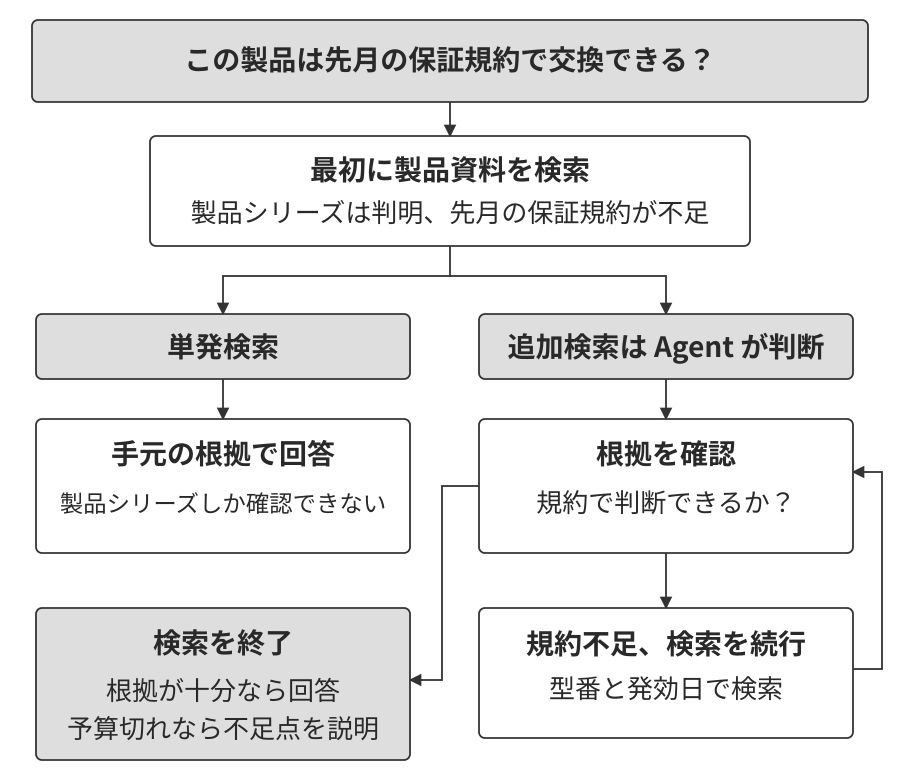

ReAct を例にとると、モデルはまず質問を分析してクエリを選び、`knowledge_base_search` を呼び出します。ツールが観察結果を返したら、モデルは証拠が足りているかを判断します。条件や関連する対象が欠けていればクエリを書き換えて検索を続け、資料が十分なら出所と合わせて回答を生成します。Harness は履歴、ツール呼び出し、予算を管理し、上限に達したら探索を終えるか、確認の質問に切り替えます。

次に図3-13 を見てください。知識ベースのバックエンドをベクトルインデックスから関係グラフに替えても、モデルは同じツールのインターフェースを通じて検索を依頼し続けられます。もし返ってきた文書にたまたま指示が一段落含まれていたら、モデルはそれに従って実行してよいのでしょうか。

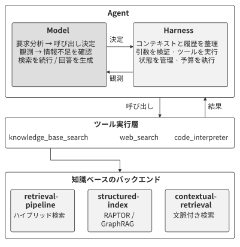

**検索した内容の信頼境界。** 外部の文書には、モデルの振る舞いを変えようとするテキストが含まれていることがあり、データベースに入る前に誤った事実を紛れ込まされていることもあります。前者は間接的なプロンプトインジェクション、後者は知識ベースの汚染にあたります。対処には、内容の出所と実行の権限の両方を管理する必要があります。検索結果には出所、バージョン、引用位置を付け、回答の証拠として扱います。送金、削除、対外的な送信といった行動は、Harness と実行環境がユーザーの認可にもとづいて検証します。取り込み時の審査、出所の追跡、事実確認によって、誤った知識の拡散をさらに抑えます。第 2 章で紹介した出所のマークと、第 4 章のツールの制約が、ここで合わせて働きます。

> **実験 3-8 ★★：一回の検索と複数回の検索を比較する**
>
> この実験では、同じ中国語の法律資料、同じ BM25 の検索器、同じモデルを使い、七つの質問で二つのモードを比較します。ベースラインは元の質問で一回だけ検索し、Agent モードではモデルがクエリを調整して最大四回まで検索できます。
>
> 「正当防衛はどう規定されているか」のようなクエリなら、直接検索すれば主な条文が得られます。より複雑な例は「酩酊状態で過失により人に重傷を負わせ、窃盗の前科がある場合、量刑はどうなるか」です。これは現在の行為、酩酊の状況、過去の記録のすべてに関わるので、検索ではそれぞれの関係資料を探し、そのうえで適用条件を確認する必要があります。
>
> 実際の実行では、「酩酊 過失致重傷 窃盗前科 量刑」「酩酊 犯罪 量刑」「窃盗前科 量刑への影響 刑法」「前科 量刑への影響 刑法」を順に検索しました。モデルはその後「累犯 認定 刑法」も提案しましたが、この時点で検索予算を使い切っていたため、Harness は予算が尽きたという情報を返しました。
>
> 実験で分類した四つの複雑な質問では、目標の条文のカバー率が約 8% から 92% に上がり、平均の検索回数は一回から 3.5 回に増え、回答段階の平均所要時間は約 8 秒から 66 秒に延びました。三つの単純な質問では証拠のカバー率がどれも 100% で、どちらのグループも一回しか検索しませんでした。

同じ検索ループはユーザーの履歴にも使えます。以下では実験 3-1 の三層の評価セットを引き続き使い、Agent がセッションをまたぐ記録から事実を取り出し、対象を区別し、更新を処理する様子を見ます。

> **実験 3-9 ★★：Agentic な検索でユーザーメモリを読み出す**
>
> この実験では、対話履歴全体を知識ベースとみなし、ウィンドウ単位で分割してインデックスを作り、Agent に `search_user_memory` ツールを与えます。ウィンドウのサイズは調整できます。今回の実行では、各チャンクに八ターンの対話を含め、隣接するチャンクを二ターン重ね、セッションの識別子、時間、業務のメタデータを保存しました。クエリは最大三回まで実行し、毎回四つの断片を取り出します。
>
> 基礎的な想起は、「私の当座預金の口座番号は」のように明確なフィールドを軸に検索できます。マルチセッションの問題では、さらに対象が漏れなく揃っているかを確認する必要があります。ユーザーがホンダの Accord とテスラの Model 3 の両方を持っているなら、車のサービスの予定を尋ねられたとき、システムは二台の車とそれぞれの予約状況を区別すべきです。
>
> これにもとづいて検索の道筋を設計できます。まず車とサービスの記録を検索し、もう一台の車の手がかりを見つけたら、テスラの予定を調べ、最後にホンダの既存の予約を説明して、テスラの予約も必要かをユーザーに確認します。今回の実際の記録では `scheduled car services` というクエリしか実行されず、通常の検索グループの回答はホンダに集中して、テスラを取りこぼしました。
>
> もう一つの難しさは、度重なる変更から生じます。送金のケースでは、妻が手配を設定し、夫がその後金額と日付を変え、妻がさらに調整しました。記録を取り出したら、時間、対象、確認状態に沿って変化を再構成し、最終的に有効な指示を見つけなければなりません。現在のチャンクには時間の情報が保存されていますが、検索が重要な変更を取りこぼす可能性はあるので、断片に出来事の背景をさらに補うことができます。
>
> この 60 件のケースのうち、18 件は一回だけ検索し、6 件は二回検索し、36 件は三回をすべて使いました。通常のチャンク検索グループは 47 件に合格し、その内訳は基礎的な想起 19 件、マルチセッション検索 15 件、能動的なサービス 13 件でした。次節では同じケースでコンテキストの前置きと構造化された記憶を比較し、それぞれがどんな情報を補ったのかを分析します。

### コンテキスト認識検索：断片に背景を補う

あの決算報告に戻りましょう。ACME 社の 2025 年第 2 四半期の業績を調べようとすると、クエリには社名と年が含まれているのに、「同社の売上は 3% 増加した」と書かれた断片にはあいにくその二つの語がありません。チャンクを大きくする以外に、この短い文章はそのまま残し、欠けている背景をその前に補うこともできます。**コンテキスト認識検索（Contextual Retrieval）**は、インデックスを作るときに断片ごとに短い背景の前置きを生成し、前置きと原文を合わせて検索に使います[^ch3-1]。図3-14 はこの処理の過程を示しています。

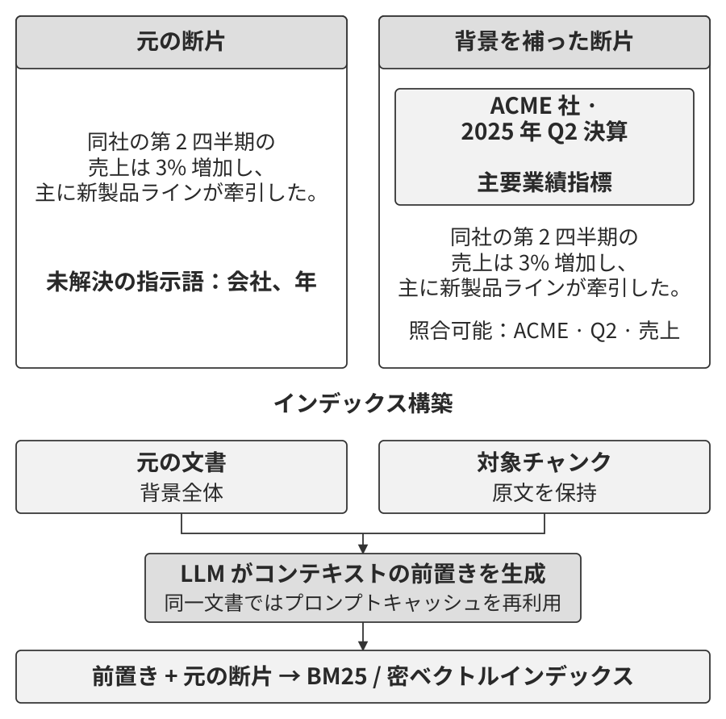

たとえば、前置きで「この段落は ACME 社の 2025 年第 2 四半期報告書の主要業績指標の部分からの抜粋である」と説明できます。生成時には原文と対象のチャンクを一緒に与え、確かな根拠のある指示対象、時間、章の情報をモデルに補わせます。これによって BM25 は社名や四半期などのマッチできる語を得て、密な埋め込みもこうした背景を踏まえて断片を表現できます。

これは第 2 章のコンテキスト認識圧縮と組み合わせて使えます。インデックス作成時には知識のチャンクに背景を補って関連情報が見つかる可能性を高め、実行時には現在のタスクに応じてすでに取り出した履歴を整理して入力の長さを抑えます。前者は断片の検索しやすさに、後者は現在の意思決定に必要な情報と予算に注目しています。

[^ch3-1]: Anthropic、Introducing Contextual Retrieval、2024 年 9 月。

> **実験 3-10 ★★：元のチャンクとコンテキストで補強したチャンクを比較する**
>
> この実験では、同じ資料に対して二つのインデックスを作ります。一つは元の断片を使い、もう一つはモデルが生成した前置きを加えます。クエリと目標のラベルを揃えたうえで、BM25、密な検索、混合検索をそれぞれ比較します。
>
> 前述の決算報告の例を使うと、「ACME 社の最近の売上の伸び」を問い合わせたとき、ヒットした断片に目標の会社、期間、伸びのデータがすべて含まれているかを確認できます。「売上の伸び」だけでは他社の断片にマッチするかもしれませんが、前置きを補えば社名と時間が順位付けに加わります。
>
> 今回の 15 件のクエリでは、前置きを加えると BM25 の recall@1 は 0.60 から 0.80 に、密な検索は約 0.867 から 0.933 に上がりました。recall@3 はそれぞれ 0.867 と 1.0 のままでした。混合検索の recall@5 は 14/15 から 15/15 に上がりました。新たに見つかったのはどの問題でしょうか。全国人民代表大会常務委員会の職権を問い合わせたもので、目標の断片は職権を列挙していましたが、主語が欠けていました。前置きを加えると、BM25 はこれを 16 位から 12 位に上げましたが、まだ上位五件には入りませんでした。混合検索は 6 位から 5 位に上げ、ようやく上位五件に入りました。原文を見直すと、一つ目の断片が第（一）項から第（四）項までの職権を挙げ、五つ目の断片が第（四）項から第（二十二）項までを続けています。採点ではラベル付けされた五つ目の断片が選ばれたかどうかしか見ませんが、職権を漏れなく挙げるには二つの断片をつなげなければなりません。
>
> 前置きの生成によって、インデックス作成時の呼び出しは増えます。同じ文書の複数のチャンクに背景を生成するときは、文書のプレフィックスキャッシュを再利用できます。Anthropic は 2024 年の報告で、800 token のチャンク、8000 token の文書、指定したプロンプト長で見積もり、文書 100 万 token あたりの一回限りの処理コストを約 1.02 ドルとしています。
>
> 同じ報告では、コンテキスト付きの埋め込みと BM25 を組み合わせることで、top-20 の検索失敗率が 5.7% から 2.9% に下がり、相対的に約 49% 減少しました。リランキングを加えると 1.9% まで下がり、相対的な減少は約 67% でした。報告で使われている失敗率は $1-\mathrm{recall@20}$ です。

繰り返し問い合わせられ、内容が比較的安定している資料については、筆者はインデックス作成時に断片の背景を補っておくことを優先して勧めます。一回の処理が、その後の何度ものクエリに役立つからです。社名、出来事の主体、時間が分割の際に失われていると、検索件数を増やすだけでは、指示対象のはっきりしない断片を大量に取り出すことになりかねません。前置きの生成時にこうした手がかりを補っておけば、後の検索はそれを使って資料の位置を特定できます。

> **実験 3-11 ★★★：コンテキストの前置きと構造化カードで記憶を強化する**
>
> 対話中の「わかりました、これを予約してください」は、それより前に話した商品や旅程と結びつけなければ意味がわかりません。原文で話していたのが上海発シアトル行き、500 ドルの片道航空券なら、前置きでその背景を補い、確認が行われたセッションと時間も残せます。
>
> この実験では、通常のチャンクに二つの構成を加えます。コンテキストの前置きのグループと、Advanced JSON Cards も読み込む二層記憶のグループです。モデルはまず通常のインデックスにもとづいて検索の系列を生成し、同じクエリの組を二つのインデックスに使います。二層のグループは同じ強化済みの検索結果を使い、そこに構造化カードを加えます。
>
> 送金のケースでは、前置きが Patricia による送金の開始、James による手配の変更、Patricia による再調整をそれぞれ説明し、出来事の順序の特定を助けます。元の記録が示す最終状態は 95,000 ドル、10 月 1 日で、それ以前の手配は置き換えられています。今回は三つのグループすべてがこの状態を正しく見つけました。
>
> 二層構造は能動的な関連付けも支えられます。カードには「東京への旅程」や「パスポートの有効期限」などの重要な事実を保存し、詳しい対話は必要に応じて検索します。1 月 15 日から 22 日の旅程と、2 月 18 日に期限が切れるパスポートを例にとると、システムはまず日付が近いことに気づき、次に更新手続きの記録と旅程の要件を調べ、最後にまだ済んでいない準備をユーザーに確認するよう促せます。この旅行のケースでは三つのグループの回答がすべて審査に合格しました。カードと検索の差は、主に以下の車やセッションをまたぐケースに現れています。
>
> 全 60 件のケースのうち、通常の検索、コンテキストの前置き、二層記憶はそれぞれ 47、52、57 件に合格しました。前置きのグループでは能動的なサービスのケースが 13 件から 18 件に増えました。二層のグループはマルチセッション検索の層で 20 件すべてに合格し、能動的なサービスの層でも 18 件に合格しました。車のケースでは、カードが二台目の車の情報を補い、それまで取りこぼしていた対象まで回答がカバーするのを助けました。一方で後退した例もあります。ユーザーが住宅の水漏れ被害の補償範囲を尋ねたとき、通常のグループは自宅と賃貸物件の両方に触れましたが、前置きのグループは賃貸物件を落としました。問題ごとに照らし合わせると、前置きのグループは通常のグループより 8 問多く正解した一方で、もともと正解していた 3 問を落としていました。

**能動的なサービスが必要な場合、筆者は重要な事実を常駐させ、詳しい記録は必要に応じて検索する二層のアーキテクチャを優先します。** 検索だけに頼ると、モデルは何を尋ねるべきかを先に知っていなければ関係する記録を見つけられないことが多く、まだ視野に入っていないパスポート、車、家族関係は見落とされやすくなります。少数の重要な事実を先にコンテキストに入れておけば、モデルが関連に気づいてクエリを出し、元の細部を取り出す助けになります。常駐させる情報を選ぶときは、人間関係、現在の制約、未完了の事項を考慮する必要があります。検索結果には出所、時間、変更の根拠を残しておきます。

### データセットから知識を抽出する：事例から構造化された表現へ

知識は、大量の事例を整理することからも得られます。判決文、カスタマーサポートのチケット、修理記録では、有用な情報の多くが具体的な記述の中に散らばっています。大量の事例から傾向を帰納したり、結果を比較したり、何を追加で尋ねるかを決めたりする必要があるタスクでは、筆者はまず統一したフィールドを抽出し、そのうえで集計と原型の整理を行うことを勧めます。似た事例をいくつか取り出すだけでは、データセット全体の分布を把握するのは困難です。フィールドを統一すれば、記録全体を集計でき、個々の事例のクエリにも概観を提供できます。

この過程は二段階に分けられます。**知識抽出**は元の記述を構造化された記録に変換し、フィールドの意味、値、出所を明確にします。**パターン分析**は集計とクラスタリングを使って、似た事例とその共通の特徴を探します。図3-15 は、事例の抽出、特徴の符号化から原型の検索までの流れを示しています。

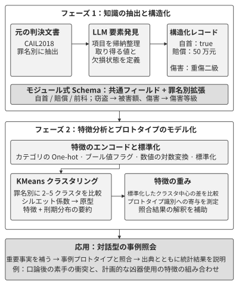

> **実験 3-12 ★★★：司法事例から要因と原型を抽出する**
>
> この実験では CAIL2018 の刑事事件の資料を使い、窃盗、故意傷害、詐欺の三種類のサンプルを選んで、「要因の発見—フィールドの抽出—クラスタリング—原型の説明」という教育用の流れを構築します[^ch3-cail]。各種類から 120 件をモデル構築用に取り、さらに 20 件を取り置いて、合計 360 件のモデル構築用サンプルと 60 件のホールドアウトサンプルを作ります。
>
> **フィールドを見つけて整理する。** モデルはまずモデル構築用のサンプルをバッチごとに読み、役立ちそうな要因を挙げ、それらをモジュール化したスキーマに統合します。共通部分には、自首や賠償のように複数の罪名で注目すべきフィールドを保存し、拡張部分には、被害額や傷害の程度のように特定の罪名に関わる情報を保存します。今回の整理では 16 個の共通フィールドと、それぞれ 12、12、11 個のフィールドを持つ三組の拡張が得られました。一貫した抽出ができるよう、各フィールドには値と欠損の状態も定義する必要があります。
>
> **フィールドをベクトルに符号化する。** カテゴリのフィールドにはワンホット符号化を使えます。窃盗、強盗、詐欺の三種類を例にとると、それぞれ `[1,0,0]`、`[0,1,0]`、`[0,0,1]` と符号化し、各位置はその種類に属するかどうかだけを表します。1、2、3 を使うと、アルゴリズムによってはカテゴリ間に順序や距離を持ち込んでしまいます。「自首したか」「賠償したか」などのフィールドは、確認された二つの状態を 1 と 0 で表せます。原文で触れられていない場合は別に扱い、欠損が自動的に否定とみなされないようにすべきです。
>
> 金額のように幅の大きい非負の数値については、この実装ではまず $\ln(1+x)$ でスケールを圧縮してから標準化にかけます。一つのフィールドに複数のカテゴリが同時に現れうる場合、たとえば一件の記録に複数の処分措置が含まれる場合は、カテゴリごとに指示ビットを設けてマルチホット符号化にできます。
>
> **事件の原型を築く。** 符号化した特徴を標準化し、罪名ごとにクラスタリングします。この実装では二から五個のクラスタを比較し、シルエット係数でグループ分けを選んで、最終的に 11 個の原型を作りました。各原型には、サンプル数、主な特徴、サンプルの刑期の中央値、四分位数、範囲を保存します。たとえば、対立のきっかけ、犯行の手口、傷害の結果を軸に、口論の後の素手での衝突と、計画的な凶器の使用といった異なる特徴の組み合わせを比較できます。具体的なグループ分けは、抽出結果とクラスタリングの両方によって決まります。
>
> **特徴とマッチング結果を説明する。** プログラムは、各クラスタの標準化された中心の差にもとづいて、原型を区別するうえでの特徴の重みを計算します。原型のマッチングでは、新しい事例を同じ特徴空間に写像し、近いグループの集計要約と根拠を取り出して、モデルが説明を組み立てるのに使います。
>
> 今回は 60 件のホールドアウトサンプルから 12 件を選んで説明を生成し、独立したモデルに審査させました。そのうちの窃盗のサンプルを一件見てみましょう。これがマッチした原型にはモデル構築用の記録が一件しかなく、刑期は 4 か月だったので、最小値、中央値、最大値はすべて 4 でした。生成器はこの数を正直に報告し、参考にできる記録が一件しかないことも指摘しました。審査モデルは「数字が原型に忠実か」に 4 点（満点）を付けましたが、ホールドアウトサンプルの実際のラベルは 8 か月でした。
>
> 原型の検索を対話に使うなら、まずどの欠けている事実がマッチングに影響しうるかを尋ね、その回答にもとづいて検索し直すことができます。

[^ch3-cail]: CAIL2018、公式データセットプロジェクト。付属の実験は公開資料からサンプルを抽出し、サンプル内部の分割を使ってモデル構築と評価を行っている。

事例から原型へと進むことで、知識ベースには検索可能な集計表現の層が一つ加わります。原文は証拠を提供し、フィールドは計算を支え、原型は似たサンプルの共通の特徴を概括します。三者の対応関係を保っておいてこそ、抽出の誤りやサンプルの偏りが見つかったときにさかのぼって修正できます。

### 最前線の探求：マルチモーダル記憶とパラメトリック記憶

ユーザーが以前アップロードした写真を指して「この色にして」と言ったとします。システムが当時「青いコート」という言葉しか残していなければ、次のときに二種類の青を区別できないかもしれません。声の音色や図表の空間的な関係も、文字に起こす際に細部が失われます。将来のクエリでこうした情報を見つけられるようにするには、元の素材を保存する、モデルが使える表現を保存する、あるいはさらに進んでモデル内部の永続的な記憶を研究する、といった方法があります。

**一つ目の路線：元の素材とテキストのインデックスを組み合わせる。** たとえば、ユーザーが許可したアルバムの整理タスクでは、人物の顔などの部分領域を切り出して保存し、Markdown の項目から画像を参照し、撮影日時、場面、ユーザーが付けた人物のラベルも記録できます。検索時には、まず説明にもとづいて関連しそうな写真を何枚か見つけ、次に元の画像や切り出した領域を読んで外見の細部を比べます。音声の断片も、時間、出所、文字起こしと関連付けておき、必要に応じて元の音声を再生できます。テキストは入口を提供し、元の素材は言葉では要約しにくい細部を保持します。

**二つ目の路線：埋め込みを保存し、必要に応じて読み込む。** 画像や音声のエンコーダは素材をベクトルに変換してインデックスに格納し、類似度による検索に使えます。たとえば、画像の部分領域や音声の断片を符号化し、それぞれ対応する記憶の項目に関連付けます。モデルが訓練済みの射影層と記憶のインターフェースに対応していれば、コンテキストに一組のスロットを確保してこれらの連続ベクトルを入れ、モデルにアテンションでアクセスさせることもできます。ここでは、エンコーダの表現と言語モデルの内部表現をどう揃えるかを解決する必要があります。

筆者と Noah Shi の予備的な研究では、この問題を二段階に分けました。二人が写った集合写真について、ユーザーが「窓際に立っているのは、前に会ったあの人？」と尋ねたとします。まず「窓際」を手がかりにユーザーが指している人を見つけ、次にその人の画像を以前保存したサンプルと比べなければなりません。一段階目で人を選び間違えれば、二段階目でいくら正確に見分けても、別の問いに答えていることになります。論文では、名前など正確に書き写せる事実はテキストの記憶に残し、二種類の情報がそれぞれ適した方法で取り出されるようにしました。[^ch3-perceptmem]

[^ch3-perceptmem]: 李博杰、Noah Shi、Parametric Multimodal User Memory。付属プロジェクト `19PINE-AI/multimodal-user-memory` に実装と PerceptMem の実験が収録されている。集合写真の問題は教育用の例である。

**三つ目の路線：モデル内部の永続的な記憶。** ユーザーごとに LoRA を訓練するのは、個人化された事実をモデルに書き込む方法の一つです。「ユーザーはどこに住んでいるか」と直接尋ねることと、住所にもとづいて旅程を計画することとでは、記憶の使い方に求められるものが異なります。前者は事実を読み出すだけですが、後者はその事実を後の推論に使わなければなりません。事実の復唱だけを中心に訓練すると、モデルは答えを覚えていても、複雑なタスクの中では自分からそれを使わないことがあります。そのため訓練サンプルには、直接の質問と、こうした事実に依存するタスクの両方を含める必要があります。

筆者の **User as Engram** の研究は、テキストの事実を Engram モデルの局所的な記憶表に書き込み、共有のアダプタがそれらの事実を推論に活かす方法を学ぶというものです[^engram]。ハッシュのキーを持つ N-gram の検索が表の項目の位置を特定し、ゲート機構が取り出した内容をモデルに送ります。ユーザーごとに局所的な表の項目を保存し、推論の部分は共有できます。論文はテキストの事実の実験で直接の想起と間接的な推論を比較し、ユーザーごとの記憶の内容と共有の推論能力をどう分けて管理するかを示しています。

[^engram]: Li, Bojie、User as Engram: Internalizing Per-User Memory as Local Parametric Edits、2026。

この路線をマルチモーダルに広げるには、さらに画像や音声の表現の番地付け、書き込み、読み出しの仕組みを設計する必要があります。

## 本章のまとめ

章の冒頭の予約の依頼に戻りましょう。「窓側が好き」はこのユーザーから得た情報で、「手荷物はいくつまで預けられるか」は旅行日に適用される航空会社の条項を調べなければわかりません。二つの情報をどちらも一文として保存すると、最も大切な違いが失われがちです。前者は誰に当てはまるのか、後者はいつから有効なのか、という違いです。保存するときに出所、時間、適用条件を残しておけば、取り出したときに今回使えるかどうかを判断する根拠になります。単一の事実は短いノートに向いています。人間関係を説明したり経緯を残したりする必要があるなら、カードや原文の段落を使えます。日付や数量は型付きのフィールドとして保存し、プログラムに計算させることもできます。

アシスタントが手荷物の許容量を間違えて答えたら、まず現行の条項がデータベースに入っているかを確認し、次にその条項がどの断片に分割されたか、検索器がそれを見つけたか、リランキング後に何位だったかを調べ、最後にモデルがどの資料を受け取ったかを見ます。原文が多いときは、構造化された概観をコンテキストに置いておき、細部は必要に応じて検索できます。章の要約はテーマを探すのに、関係インデックスは関連をたどるのに役立ちます。断片が指示対象を失っていれば出所の背景を補えますし、一回の検索で証拠が足りなければ、Agent がクエリを変えて調べ続けることもできます。

航空会社が新しい規定を公表したら、まず小さな範囲で更新し、新旧の条項の発効日と出所を残しておけます。積み重なった重複、衝突、構造の変化は、定期的に整理します。提案者が変更を提出し、審査者が証拠を照合し、承認されたらサービスのインデックスを再構築します。バージョンの記録があれば、以前間違えた問題を再実行することも、古い答えが当時どの資料にもとづいていたかを突き止めることもできます。実行結果からさらに経験を積み上げる方法は、第 9 章で詳しく扱います。

受託手荷物が二個まで認められるとわかっても、答えたのは「規則上許されるか」だけです。ユーザーに代わって手荷物を予約に追加するには、アシスタントはさらに、どのツールを呼び出せるのか、どんなパラメータが必要なのか、どんな応答を受け取れば手続きが済んだと言えるのかを知らなければなりません。それが次章の出発点です。

## 演習問題

1. ★★ ユーザーが「5 月 1 日に A から B に引っ越した。5 月 10 日から 20 日まではホテル C に泊まるので、その間の請求書はメールで送って」と言いました。5 月 15 日に、アシスタントは自宅の住所、一時的な滞在先、請求書の送付方法についてどう答えるべきでしょうか。記録とクエリの規則を設計し、書き間違いの訂正や互いに矛盾する住所をどう扱うかを説明してください。
2. ★★ 元の文書に矛盾する情報が含まれていると、コンテキストの前置きが誤りごとインデックスに書き込んでしまうことがあります。出所、バージョン、不確かな項目をどのように保存し、検索と生成の段階でそれらをどう使いますか。
3. ★★ 図表をテキストに変換すると、どんな空間的な関係が失われやすいでしょうか。表、アーキテクチャ図、折れ線グラフを例に挙げ、元の図、構造化された表現、テキストのインデックスが協調して検索する方式を設計してください。
4. ★★★ モデルと長いコンテキストの能力が向上するにつれて、分割、インデックス、検索の流れのうち、どの作業をモデルに任せられるようになるでしょうか。Rich Sutton の「苦い教訓」における探索と学習の議論と結びつけて分析し、全量入力と必要に応じた検索を比較する実験を設計してください。その際、タスクの品質、計算コスト、権限の制約をあわせて確認してください。
5. ★★★ モデルがすでに大量の領域知識を身につけているとしたら、外部の知識ベースには何を保存すべきでしょうか。公開された常識、継続的に更新される規則、私的な資料、正確な追跡が必要な証拠について、それぞれ論じてください。
6. ★ RAPTOR の多層的な要約と、GraphRAG のエンティティ関係およびコミュニティ要約は、それぞれどんなクエリを支えるでしょうか。全体の概観、局所的な細部、マルチホップの関連について一例ずつ挙げ、どんな証拠を確認する必要があるかを説明してください。
7. ★★ ディレクトリ、リンク、ベクトルインデックスは、どのように協調して知識を組織するでしょうか。人と Agent が共同で保守する必要のある知識ベースを設計し、ナビゲーション、意味検索、バージョンの更新、権限によるフィルタがそれぞれどこに位置するかを説明してください。
8. ★★★ 事例からフィールドを抽出してクラスタリングした後、原型が役に立つかどうかはどう判断すればよいでしょうか。クラスタリングにおける特徴の重要度、結果の予測能力、因果的な説明を区別し、ホールドアウト評価と専門家によるレビューの流れを設計してください。
9. ★★★ Markdown のユーザーメモリのデータベースについて、増分更新と定期整理の流れを設計してください。審査者と提案者が同じモデルを使い、しかも審査者が提案者の選んだ断片しか見られない場合、どんな誤りが見逃されやすいでしょうか。証拠のカバー範囲、ツールの権限、審査の評価の三つの観点から改善策を述べてください。

[^ch3-glove]: Pennington ら、GloVe: Global Vectors for Word Representation、2014。

[^ch3-sbert]: Reimers と Gurevych、Sentence-BERT: Sentence Embeddings using Siamese BERT-Networks、2019。
