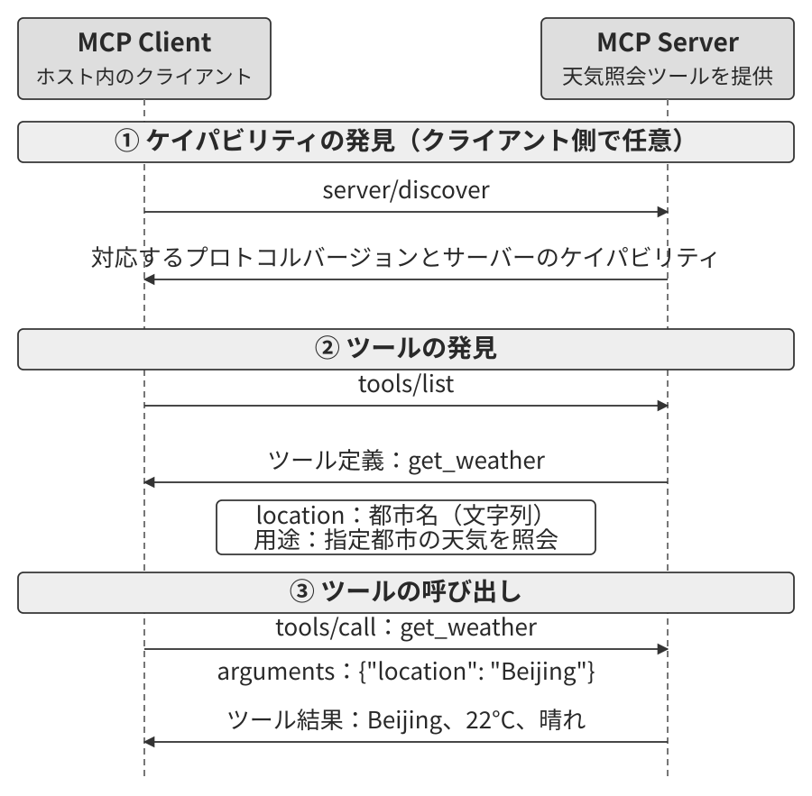
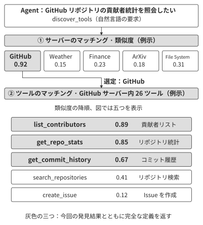
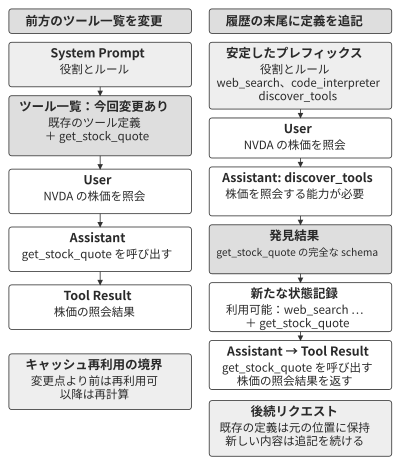
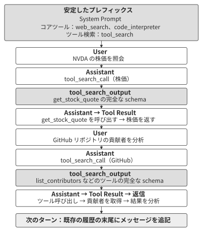

# ツール

SF 映画『Her』では、AI アシスタントの Samantha がメールを整理し、返信を手伝い、出版の手配を進め、さまざまなコミュニケーションチャネルを行き来します。こうしたアシスタントには、言語の理解を外部システムへの操作に変える仕組みが必要です。Agent はこのやり取りを**ツール**によって行います。ツールは Agent の「感覚器官と手足」であり、観測を提供すると同時に行動を実行します。本書で取り上げる Manus や OpenClaw などの汎用 Agent も、ツールを通じてデジタル世界にアクセスしています。

ユーザーが「顧客からのメールに書かれている納期を探して、表にまとめて送ってほしい」と頼んだとしましょう。どのメールを調べるかはモデルが決められますが、原文を読むにはメールボックスにアクセスする必要があり、表を送るにも送信インターフェースを呼び出す必要があります。こうしたツールはどう設計すべきでしょうか。また、モデルが必要としたとき、どうやってそれを見つければよいのでしょうか。本章ではまず 5 種類のツールを区別し、次にツールの記述・接続・発見を論じ、最後に知覚・実行・協調の各インターフェースをそれぞれ設計します。イベントトリガーとユーザーコミュニケーションには、Agent をいつ起動するか、チャネルをまたいでどうメッセージを届けるかという問題も絡むため、第6章で詳しく扱います。

## ツールの分類

メールの照会を例にとると、次に何をするかはモデルが選び、Harness が引数と権限を検査してリクエストを送り、実際のデータの読み書きはメールサービスが行います。第1章では用途に応じて、知覚、実行、協調、ユーザーコミュニケーション、イベントトリガーの 5 種類のツールを区別しました。最初の 4 種類はいずれも Agent が能動的に呼び出すものですが、イベントトリガーツールは外部のイベントによっても Agent を起動できるようにします（表4-1）。

表4-1 5 種類のツールの呼び出し方向と主な用途

| ツールの種類 | 呼び出しの方向 | 主な用途 |
| --- | --- | --- |
| 知覚ツール | Agent が能動的に呼び出す | 外部の情報を取得する |
| 実行ツール | Agent が能動的に呼び出す | 計算を実行する、または外部の状態を変更する |
| 協調ツール | Agent が能動的に呼び出す | タスクの委任、メッセージの交換、他の Agent や人間との調整 |
| ユーザーコミュニケーションツール | Agent が能動的に呼び出す | ユーザーへの返信、結果の提示、リマインダーの送信 |
| イベントトリガーツール | 開発者が設定するか Agent が登録し、外部がトリガーする | 指定したイベントの発生時に Agent を起動する |

**知覚ツール**は、Agent が外部の情報を取得するためのものです。たとえば、ウェブ検索 `web_search`、知識ベース検索 `knowledge_base_search`、ウェブページ読み込み `fetch_url`、ファイル名検索 `find_file`、ファイル内容検索 `grep_file`、ファイル読み込み `read_file` などがあります。

**実行ツール**は、Agent が計算を実行したり外部の状態を変更したりするためのものです。たとえば、コマンドライン `shell_exec`、コードインタプリタ `code_interpreter`、ファイル書き込み `write_file`、ファイル編集 `edit_file`、メール送信 `send_email` などがあります。同じ汎用実行器で、読み取りだけの計算もデータの変更も行えます。

**協調ツール**は、タスクの委任とメッセージの交換を支えます。たとえば、サブ Agent の作成 `spawn_subagent`、メッセージ送信 `send_message_to_subagent`、サブ Agent のキャンセル `cancel_subagent`、利用可能な Agent の発見 `list_agents` などがあります。互いに独立したタスクは、OpenAI の複数の共同創業者の経歴を手分けして調べるように並列に処理できます。また、異なるタスクを、異なるモデル・ツール・プロンプト・コンテキストを設定した Agent に任せることもできます。分業と協調のアーキテクチャについては第10章でさらに論じます。

**ユーザーコミュニケーションツール**は、ユーザーに情報を伝えるためのものです。たとえば、メッセージへの返信 `reply_to_user`、構造化カードの送信 `send_card_to_user`、リマインダーの送信 `send_user_notification` などがあります。やり取りが複数のチャネルに広がったり、バックグラウンドでの通知が必要になったりすると、システムはメッセージ送信を明示的なツール呼び出しとしてまとめ、送り先、内容、配信状態を一元的に管理できます。

**イベントトリガーツール**は、外部のイベントと Agent の実行を結びつけます。たとえば、タイマー `set_timer`、バックグラウンドタスクの監視 `monitor_shell`、イベントソースへの接続 `connect_channel` などがあります。この仕組みは 2 つの段階からなります。登録の段階では、開発者があらかじめ設定するか、Agent が許可された呼び出しによって関心のあるイベントを宣言します。イベントが発生すると、スケジューラがコールバックやイベントメッセージを受け取り、Agent を起動して処理させます。新着メール、システムアラート、定時のリマインダー、バックグラウンドタスクの完了は、いずれも新しい実行の入口になりえます。

冒頭のメールの例に戻りましょう。元のメールを開いて納期を読み取るのは知覚です。集計表を作成して保存するとワークスペースが変わるので実行です。表を依頼者に渡すのはユーザーコミュニケーションにあたります。次の顧客メールが届いたときにシステムが自動的に作業を続けるようにして、はじめてイベントトリガーが加わります。同じメールサービスがこれらの役割をいくつも兼ねることがあります。次に決めるべきなのは、モデルに渡すツールをどこまで細かくするかです。メールの検索、本文の読み込み、添付ファイルの探索を個別に任せるのか、それともよく続けて行う数ステップをまとめておくのか、という問題です。

## ツール設計の汎用原則

ツールを接続し始めた初期には、API エンドポイントを 1 つずつそのままラップするのが一般的でした。この方法はすぐに接続できる反面、粒度のきわめて細かいインターフェース群ができあがりがちです。Agent は 1 つのタスクを終えるために、オブジェクトの検索、属性の読み取り、条件の確認を何度も繰り返してから、ようやく実行インターフェースを呼び出すことになります。ツールを設計する際には、よくあるタスクを軸にこれらの操作をまとめることができます。たとえば、連絡先の検索とメッセージの送信をひと続きにしたり、ログ検索が関連する行とその前後の文脈を直接返すようにしたりします[^ch4-tool-design]。

**ツールは、Agent が達成すべきタスクを軸に設計します。** Agent の使い方を出発点にインターフェースを設計するこの考え方を **ACI**（Agent-Computer Interface、Agent とコンピュータのインターフェース）と呼びます。HCI が人とコンピュータのやり取りを扱うのに対し、ACI はモデルがどのように操作を選び、引数を組み立て、フィードバックを理解し、誤りを正すかを扱います。

[^ch4-tool-design]: Anthropic、*Writing effective tools for AI agents—using AI agents*、2025 年。

### 能力の表現形式：専用ツール、汎用実行器、そして Skill

「アプリのデプロイ」をモデルに任せる場合、3 通りの操作インターフェースが考えられます。1 つ目は `deploy_app` だけを公開し、各ステップはサーバー側で処理する方法です。2 つ目はビルド、パッケージ化、デプロイを別々に公開し、次のステップをいつ呼ぶかをモデルに決めさせる方法です。3 つ目は手順を Skill に書き、モデルにターミナルで実行させる方法です。ビルドが失敗した場合、1 つ目の方法ではどのステップで失敗したかをツールの結果で伝えるしかありませんが、残りの 2 つではそのビルドのエラーをそのままモデルに渡せます。

- **専用ツール**は、決まった操作に構造化されたインターフェースを提供します。開発者が引数の Schema、検証規則、実行ロジック、返却形式を定義するので、個別にテストし、個別に権限を与えやすくなります。ツール定義がコンテキストに入ったときの占有量は、フィールド、説明、例の長さで決まります。
- **汎用実行器と Skill** は組み合わせて使います。ターミナルやコードインタプリタが実行能力を提供し、Skill が手順、適用条件、操作方法を説明します。ホストはまず名前と概要だけを読み込み、選ばれた時点で完全な説明と関連リソースを読み込めます。

たとえば、デプロイ用の Skill には次の手順を順に書いておけます。`npm run build` でプロジェクトをビルドし、`docker build -t app:latest .` でイメージをパッケージ化し、`kubectl apply -f deploy.yaml` でマニフェストに定義されたリソースを現在のクラスタに適用する、というものです。Agent はこれらのステップをターミナルツールで実行し、同じ実行の入口を使い回します。

ツールをどう実装するかと、モデルがその説明をいつ読むかは、別々の問題です。数百の専用ツールでも索引だけを見せ、Schema は必要に応じて読み込めます。少数の Skill なら目次をコンテキストに常駐させ、規模が大きくなってから検索を加えることもできます。専用インターフェースか汎用実行器かの選択は、引数の渡し方とコードの保守のしかたに影響します。一度にすべて渡すか必要に応じて読み込むかの選択は、モデルがそのステップでどのツールを目にするかに影響します。開示戦略については、後の「ツールが多すぎるときどうするか」で論じます。

**筆者は、まず汎用ツールを採用し、権限・引数・性能上の必要に応じて専用インターフェースを補うことを勧めます。** たとえば、サンドボックス内の `code_interpreter` に SymPy、NumPy、pandas を用意しておけば、Agent は Python を書いて四則演算、記号計算、配列処理、データ分析をこなせます。こうするとモデルのコード生成能力を存分に生かせます。1 つのインタプリタで多様なアルゴリズムを扱え、既存のライブラリを組み合わせて事前に想定していなかった新しい問題にも対処できます。コードを生成するのはモデルで、実行するのは実行環境です。実行環境はファイル、ネットワーク、リソースへのアクセスも制限します。

専用ツールを採用する場合でも、筆者は、機能が似ていてよく一緒に使われる操作をまとめることを優先するよう勧めます。インターフェースが細かすぎると、モデルはより多くの名前と役割分担を覚えねばならず、同じタスクを終えるのにも呼び出し回数が増えます。まとめるかどうかは主に**機能の類似性**と**利用シーンの重なり具合**で判断します。たとえば、`extract_pdf_text`、`extract_docx_content`、`extract_pptx_content` はいずれも文書を受け取ってテキストを抽出するので、`read_document` に統合し、`file_type` で形式を区別できます。モデルは統一された入口を選ぶだけで済み、新しい形式を加えるときも引数と返却の構造をそのまま使えます。

次の 4 つの場合は、とくに専用インターフェースが向いています。

1. **きめ細かな権限付与と監査が必要な場合。** 本番データベースへの書き込みは、範囲を明確にした操作としてラップできます。ユーザーの権限、対象テーブル、変更を許すフィールドをサーバー側で検査し、操作の根拠を記録します。
2. **プラットフォームの差異を隠す必要がある場合。** grep や find などの操作はシェルでも行えますが、専用のファイル検索ツールなら macOS、Windows、Linux の引数とフィードバックを統一できます。たとえば、ファイル名、行番号、一致した断片を常に同じ形で返せます。
3. **操作頻度が非常に高い場合。** 頻繁に使う操作には短く安定した入口を用意し、スクリプトの生成や手順の説明を繰り返すコストを減らせます。
4. **引数どうしの関係が複雑な場合。** ネストしたオブジェクト、フィールド間の依存、複雑な値の制約は、Schema と業務上の検証を組み合わせて表現するのが適しています。

**引数が複雑になるほど、その渡し方が重要になります。** 構造化されたツール呼び出しでは、ふつう JSON Schema で入力を記述します。モデルサービスの中には制約付き生成をサポートし、引数がサポート対象の Schema 規則を満たすようにするものもあります。返却値の構造はツールのインターフェースで取り決め、ホストがその結果をモデルに渡します。型や形式の検証とは別に、権限、オブジェクトの存在、複数フィールドが業務条件を満たしているかどうかは、引き続き Harness とツールサービスが検査します。

Skill は、専用ツールの呼び出し方を説明することも、Agent に CLI の使い方を指示することもできます。後者の場合、モデルはコマンドラインの構文、引用符、エスケープを同時に扱わねばならず、シェルごとに規則も異なります。引数が複雑になるほど、モデルが正しく扱うべき細部は増えます。複雑なネストした引数は、まず JSON ファイルに書き出してコマンドにそのファイルを読ませれば、多重のエスケープを減らせ、実行前に内容を検証することもできます。

**Skill は業務担当者が直接書いたり直したりしやすい形式です。** 業務に詳しい人が自分で手順を書くこともできますし、Agent が下書きした説明を手直しすることもできます。手順の順番が変わった、あるステップが一部の顧客にしか当てはまらない、例を差し替えたい、といった場合も説明文を直すだけで済み、ツールのコードを書き換えてインターフェースを再デプロイする手間はかかりません。Agent Skills 仕様では、`SKILL.md` のメタデータは所定の形式に従い、本文は Markdown で書きます。スクリプト、参考文書、リソースを添えることもできます[^ch4-skill-format]。

[^ch4-skill-format]: Agent Skills、フォーマット仕様。メタデータ、本文、付属リソース、段階的な読み込みを含む。

能力の形式を選ぶときは、次の 4 つの観点を総合的に考えます。

- **安全性と権限**：専用インターフェースは操作範囲を限定しやすく、汎用実行器はサンドボックス、認証情報、リソース権限によって実行能力を制御します。
- **引数の複雑さ**：複雑な構造には Schema と業務上の検証が向いており、単純な操作なら CLI で直接引数を渡せます。
- **変更の頻度**：頻繁に調整する手順はまず Skill に書き、業務担当者が説明や例を直接直せるようにします。安定していて繰り返し使う下位の操作は、あらためてツールやスクリプトとしてラップします。
- **モデルの能力**：コード生成やコマンドラインの扱いを確実にこなせるモデルなら、Skill と汎用実行器で能力を組み合わせることを優先し、専用ツールの数を減らします。モデルが比較的弱く、複雑な引数でしばしば誤る場合は、構造化インターフェースにより多くの制約を担わせます。

**複数回のツール呼び出しをコードでまとめて制御することもできます。** 複数のウェブページを取得してフィールドを抜き出す場合、モデルはループ、フィルタリング、集計をこなすスクリプトを 1 本生成できます。ページの全文は実行環境の変数に残り、選ばれたフィールドと統計結果だけがコンテキストに戻ります。各ステップのつなぎはプログラムの条件分岐、ループ、例外処理が担い、モデルは集計結果を直接分析します。一括取得、フィルタリング、集計のように手順がはっきりしているタスクでは、筆者はコードでつなぐことを優先し、モデルがツールを 1 回ずつ呼んで中間結果を読む往復を減らします。中間結果が多く、返すフィールドが絞られているほど、この方法で節約できるコンテキストは大きくなります。この種のコードによる制御は第5章でさらに論じます。

こうしたインターフェースは **Code Mode** と呼ばれることがよくあります。Cloudflare の MCP サーバーを例にとると、モデルはまず `search()` で検索プログラムを書き、OpenAPI の記述から必要なエンドポイントと引数を探し出します。続いて `execute()` で、それらのエンドポイントを呼び出す JavaScript を送ります。条件に合う DNS レコードを一覧にしたいなら、プログラムがページごとに照会してフィルタリングし、該当したレコードだけを返せます。前半のステップでは API マニュアル全体をコンテキストに入れる負担がなくなり、後半のステップでは各ページの結果をモデルに送り返す往復がなくなります。実行主体がどのゾーンを読めるか、レコードを変更できるかは、引き続きサーバー側の認可で決まります。[^ch4-code-mode]

[^ch4-code-mode]: Cloudflare、Code Mode の MCP 実装。Armin Ronacher は Pi 1.0 を例に、Harness が提供するツールと実行環境の役割分担を論じている。

### ツールの記述：用途、引数、フィードバックを説明する

ツールの説明を書くときは、まずそのツールを最も誤用しやすいリクエストを思い浮かべるとよいでしょう。ユーザーが「契約書の中で違約金に触れている条項を探して」と言った場合、ファイル名検索は名前が一致したファイルしか返しません。パスが 1 つ得られたとしても、モデルはさらに本文を読む必要があります。ツールの記述は、どのインターフェースを選ぶべきか、呼び出すときに何を渡すべきか、得られた結果でどんな問いに答えられるかを、モデルが判断できるものでなければなりません。

**使うべき場面を説明します。** ウェブ検索の記述を「リアルタイムの情報を得たいとき、または未知の事実を調べるときに使う」と書けば、モデルはユーザーの要求とツールの用途を対応づけられます。「関連する内容を検索する」としか書かれていなければ、モデルは検索の範囲と適用条件を自分で推測しなければなりません。

**入力と検索範囲を明確にします。** たとえば、ファイル名検索ツールには「ファイル名とパスで照合する。ファイル内の文字列を探すときは `grep_file` を使う」と書けます。隣り合うツールの役割分担をはっきり書いておけば、モデルは 1 回の呼び出しで正しい入口を選びやすくなります。**筆者の考えでは、境界条件を明確にすることは、機能を列挙することよりも重要な場合が多いのです。** ツールがどんな入力を受け付けるか、どの範囲を検索するか、結果が空のときやエラーのときにどうするかは、いずれもモデルの次の判断に直接影響します。

**引数は規格と具体例で説明します。** `timestamp` なら「RFC3339 形式。例：`2024-03-15T14:30:00Z`」と書けます。複雑なタスクを処理するとき、モデルはツールを選び、過去の軌跡から情報を取り出し、その後のステップを比較検討することを同時にこなさねばならず、引数の形式はその中の細部の 1 つにすぎません。完全な文字列があれば、そのまま参照できる形式が手に入ります。モデルはそれにならって引数を組み立てられるので、用語を解釈し直す過程で誤る機会が減ります。

同様に、`phone` は次のように書けます。「電話番号。E.164 国際番号形式で、`+` で始まり、国番号と番号が続く。それ以外の部分は数字のみで、空白や区切り記号を含まない。例：`+8613888888888`（中国）、`+12025551234`（米国）。」

**返却の構造と実行コストを説明します。** たとえば「JSON 配列を返す。各要素は `title`、`url`、`snippet` の 3 フィールドを持つ」と書けば、モデルはタイトル、出典、要約を取り出しやすくなります。時間のかかるツールには、測定環境での想定遅延と代わりの入口を書いておけます。たとえば「ページ全体の読み込みには 5～10 秒かかることがある。メタ情報だけが必要なら `get_page_metadata` を呼ぶ」といった具合です。

検証済みの呼び出し例を 1～5 個添え、最小限の引数、よくある組み合わせ、複雑な条件をカバーすることもできます。JSON Schema は型、必須項目、値の範囲、一部のフィールド間の依存を表現できます[^ch4-json-schema]。一方、例はそうした規則が具体的なタスクでどう使われるかを示します。タイムスタンプが秒かミリ秒か、フィルタ条件をどうネストするか、どの任意フィールドがよく一緒に現れるか、といったことです。Anthropic が 2025 年に報告した複雑な引数に関する社内テストでは、ツール呼び出しの例を加えたことで、正解率が 72% から 90% に上がりました[^ch4-tool-examples]。

[^ch4-json-schema]: JSON Schema、オブジェクト型とプロパティの制約。モデルのインターフェースがサポートする Schema キーワードの範囲は、各サービスが定める。

[^ch4-tool-examples]: Anthropic、*Introducing advanced tool use on the Claude Developer Platform*、2025 年 11 月 24 日、Tool Use Examples の節。

Agent がたびたびツールを選び間違えるなら、筆者は**まずツールの記述を点検する**ことを勧めます。似た名前のツールがいくつもないか、検索範囲ははっきりしているか、引数に例が欠けていないか、といった点です。この方法は、Skill の名前、概要、操作説明にもそのまま当てはまります。

### 引数受け渡しの忠実性

モデルが原文の一節を置換するよう求めたのに、実行側は「見つからない」と報告してきたとします。モデルに言い回しを変えさせる前に、両端が受け取ったのが同じ文字列かどうかをまず確かめるべきです。呼び出しは解析、シリアライズ、プロキシ、ランタイムでのラップを経由し、どの層でも内容が変わる可能性があります。**引数の忠実性**とは、実行側が目にする値が、モデルの送った値と同じ意味を持つことを求めるものです。プロトコル上のエスケープによって伝送時の形は変わってもかまいませんが、デコード後の引用符や改行は保たれていなければなりません。

2026 年初めの Cursor のあるバージョンで起きた曲がり引用符の変換問題を例にとります。置換ツールは `old_string` と `new_string` を受け取り、完全一致によってファイルを変更します。読み込みツールは中国語の曲がり引用符 `“`、`”`（`\u201c`、`\u201d` に相当）を返し、モデルはその原文を `old_string` に入れましたが、引数の受け渡しの途中で英語のまっすぐな引用符 `"` に変換されてしまいました。ファイル中の原文は元のままなので、置換ツールは「一致なし」を返します。もう一度読み込んで原文をコピーし直しても、同じ失敗が繰り返されます。

書き込みの方向にも影響が出ます。モデルは曲がり引用符を書き込むよう求めたのに、ファイルに最終的に保存されるのはまっすぐな引用符です。その後ファイルを読むと、モデルが目にする内容は書き込んだつもりの内容と食い違うため、また修正しようとするかもしれません。変換が起き続けている限り、再試行しても同じ誤りが繰り返されます。

もう 1 つの種類の問題は**暗黙の引数注入**です。ある IDE の bash ツールは、`git commit` に AI によるコミットであることを示す引数を自動で付け加えていました。古いバージョンの Git はこの引数を認識しないため、コミットがエラーになります。モデルには自分が生成したコマンドしか見えないので、コミットメッセージや他の引数を何度も調整しかねず、本当の故障原因にはいつまでも手が届きません。

この種の問題を調べるときは、モデルが生成した引数、受け渡し後の引数、実際に実行されたリクエスト、返ってきた結果を並べて突き合わせます。インターフェースがエンコードを統一したり実行用の引数を補ったりするのであれば、その変換規則を明記し、実際に採用した値を返すべきです。完全一致のツールでは、空白が 1 つ多い、改行が 1 つ足りない、引用符が 1 つ変わった、というだけでも一致に失敗しえます。実行側が実際に何を受け取ったかがわかってはじめて、モデルは次の呼び出しを正しく直せます。

## ツールエコシステム：MCP と Skill Hub

モデルのインターフェースや Agent フレームワークは、function calling、tool use、LangChain の Tool 抽象など、それぞれ独自のツール定義方式を使っています。同じ外部サービスをこれらのインターフェースやフレームワークに 1 つずつ合わせようとすると、記述、引数、結果の形式を何度も作り直すことになります。Anthropic が 2024 年 11 月に公開した **Model Context Protocol（MCP）** は、モデルアプリケーションがツールとデータにアクセスするための統一プロトコルを提供しました[^ch4-mcp-origin]。

MCP を理解するには、まずホスト、クライアント、サーバーという 3 つの役割を押さえるとよいでしょう。**ホスト（host）**は Agent アプリケーションや IDE で、モデルとのやり取り、コンテキストの組み立て、権限管理を担います。ホストの中にある **MCP クライアント**はプロトコルのメッセージを扱います。**MCP サーバー**はツール、リソース、プロンプトテンプレートを提供し、ローカルプロセスとして動かすことも、リモートサービスとしてデプロイすることもできます[^ch4-mcp-architecture]。

**ツールの定義と呼び出し。** クライアントは `tools/list` で利用可能なツールを取得します。一覧はページ分割して返されることもあります。各ツールには名前、説明、`inputSchema` が含まれ、構造化された結果については `outputSchema` で形式を取り決めることもできます。モデルがツールを選んで引数を生成すると、ホストが検証を行い、クライアントが `tools/call` を送り、サーバーが実行して結果を返します。どの定義と結果をモデルのコンテキストに入れるかはホストが決めます[^ch4-mcp-tools]。

図4-1 では、クライアントは天気ツールの名前と引数を得たあと、北京の天気を知るためにもう一度呼び出しを行う必要があります。付属の実装は MCP 2026-07-28 を採用しており、リクエストごとにプロトコルバージョン、クライアント情報、ケイパビリティを付けて送ります。クライアントは先に `server/discover` を呼び出して、サーバーが対応するバージョンとケイパビリティを確かめることもできます。初期のバージョンでは `initialize` ハンドシェイクでセッションを確立していたため、接続時には双方が対応するバージョンに応じてやり取りの方式を選ぶ必要があります[^ch4-mcp-versioning]。

同じ「天気が取得できない」という症状でも、図4-1 には調査の出発点が 2 つあります。ホストがサーバーに接続でき、`tools/list` を呼び出したのに天気ツールが見つからない場合は、サーバーがどのツールを公開しているか、クライアントがページ分割された一覧を最後まで読んだかを確認します。モデルが正しいツールを選んだのに、サーバーが都市名がないと報告してきた場合は、呼び出しの記録から `arguments` を探し、フィールド名がツール定義の求める `location` になっているかを確認します。

**伝送方式。** stdio は、ローカルの子プロセスの標準入力と標準出力を通じて JSON-RPC メッセージをやり取りします。Streamable HTTP は HTTP でリクエストを送り、レスポンスは JSON でも、SSE ストリームで少しずつ返す形でもかまいません。Streamable HTTP は初期の HTTP+SSE 伝送方式に取って代わったもので、ストリーミングレスポンスには引き続き SSE を使います[^ch4-mcp-transports]。

**リソースとプロンプトテンプレート。** リソース（resources）は、ファイルの内容やデータベースのレコードなど、読み取り可能なデータを提供します。ホストは URI によって一覧を取得し、読み込み、関連する内容を選べます。プロンプトテンプレート（prompts）は、再利用できるメッセージやタスクのテンプレートを提供し、ユーザーやクライアントがそこから選んで使います。ツールでも検索や読み込みはできるので、この 3 種類のプリミティブはやり取りのインターフェースによって役割を分けています。ツールは呼び出しの入口、リソースはデータの入口、プロンプトテンプレートはタスクの入口を提供します[^ch4-mcp-primitives]。

MCP の中心的な価値は、1 つのツール実装を複数の Agent 製品で使えるようにすることにあります。プロトコルが統一されたことで、同じサーバーを Cursor、Claude Desktop、OpenClaw などの互換ホストで再利用でき、開発者は能力そのものとそのフィードバックの質により多くの力を注げるようになりました。プロトコル上のツール定義は、ホストがモデルの使えるインターフェースに変換します。

**Skill Hub は能力パッケージの発見と配布を担います。** 1 つの Skill は通常 `SKILL.md` を含み、スクリプトや参考資料を添えることもできます。配布プラットフォームは、ユーザーがこれらのファイルを検索、インストール、更新するのを助けます。Vercel は 2026 年 1 月に skills.sh を公開し、Skill のディレクトリとインストールツールを提供しました。OpenClaw エコシステムの ClawHub も、Skill の検索とバージョン管理を提供しています[^ch4-skills-sh][^ch4-clawhub]。インストール後、ホストは自身の読み込み戦略に従って名前、概要、完全な説明を読み込みます。MCP も拡張によって Skills の発見と読み込みを提供でき、能力パッケージと通信プロトコルを組み合わせて使えます[^ch4-skills-over-mcp]。

**接続とコンテキストへの読み込みは別々に管理します。** MCP クライアントはツール一覧を取得したあと、それをすべてモデルに渡すこともできますし、まず索引だけを残して定義を必要に応じて読み込むこともできます。Skill も同様に、まず `name` と `description` だけを見せ、選ばれてから本文を読み込めます。ツールの許可リストはどの能力が使えるかを決め、遅延読み込みは現時点でどの定義が見えるかを決めます。

**サードパーティの能力を接続するときは、それが提供する内容と、実際に行う操作を別々に点検します。** 記述、返却内容、付属のコードは出どころが異なり、認可の範囲も異なることがあります。MCP を例にとると、次の 3 種類の問題を分けて点検できます。

1. **ツール記述の汚染（ポイズニング）。** 記述の中に、ツールの用途と関係のない操作指示が紛れ込み、モデルを現在のタスクの外へ誘導することがあります。これはプロンプトインジェクションにあたります。外部から提供された内容が、モデルの振る舞いを変えようとするものです。
2. **サーバーや依存関係の改変。** サーバーのアップグレードによってツールの振る舞いが変わることがあり、依存関係の更新やリモートサービスへの侵入によって返却結果が汚染されることもあります。
3. **同名ツールの混同。** 異なるサーバーが同名または似たツールを提供していると、モデルやルーティング層が誤った対象を選んでしまいます。ホストはサーバーの識別情報とツール名の結びつきを保持し、出どころを表示し、ディスパッチ時に対象を検証すべきです。

接続する前に記述と実装を審査し、自分で管理できるデプロイではバージョンを固定し、アップグレードのたびに改めて確認します。各サーバーには、タスクに見合った最小権限の認証情報を使わせます。リモートサービスを他者が保守している場合は、ツール定義と振る舞いの変化も監視します。

実行時には、後述の Sidecar を使って、構造化された呼び出しと必要なタスクの根拠を独立に審査することもできます。呼び出し引数に含まれるパス、テキスト、宛先アドレスも、検査すべきデータとして扱います。実行するかどうかは、審査の結果と決定的な権限規則によってともに決まります。第5章では Simon Willison の「致命的な三要素」を紹介し、私的データ、外部入力、外部への通信が組み合わさったときのリスクを分析します。

Skill に付属するスクリプト、ローカルの MCP サーバー、リモートサービスは、それぞれ実行される場所と権限の範囲が異なります。審査では、コードの出どころ、実行環境、ファイルとネットワークの権限、認証情報の流れを確認します。外部から提供された手順が別のプログラムのダウンロードや実行を促す場合も、この確認の連鎖に含めます。プラットフォームによるスキャンは補助的な手がかりになりますが、実際の実行を直接制御するのは、実行時の隔離、最小権限、変更の審査です。

[^ch4-mcp-origin]: Anthropic、*Introducing the Model Context Protocol*、2024 年 11 月 25 日。
[^ch4-mcp-architecture]: MCP 2026-07-28 版仕様、アーキテクチャとプロトコル概要の 2 節。
[^ch4-mcp-tools]: MCP、Tools。ツール一覧、入出力 Schema、呼び出し結果を含む。
[^ch4-mcp-versioning]: MCP、*Versioning and Compatibility*。リクエストごとのメタデータ、ケイパビリティの発見、旧版ハンドシェイクとの互換方式を説明している。
[^ch4-mcp-transports]: MCP、伝送の概要および 2025-11-25 版の伝送仕様。後者は Streamable HTTP が初期の HTTP+SSE 方式に取って代わる関係を説明している。
[^ch4-mcp-primitives]: MCP、Resources と Prompts の 2 節。
[^ch4-skills-sh]: Vercel、*Introducing skills, the open agent skills ecosystem*、2026 年 1 月 20 日。
[^ch4-clawhub]: OpenClaw、ClawHub の利用説明。

## ツールが多すぎるときどうするか：階層的な組織化と能動的なツール発見

ツールが十数個から数百、数千へと増えると、モデルは適切な能力を見つけるだけでなく、似たインターフェースどうしの違いも読み取らねばなりません。すべての定義を載せればコンテキストを占有しますし、定義がプロンプトの先頭部分にあるなら、ツールを追加、削除、並べ替えるたびに再利用できるキャッシュの接頭辞が短くなるおそれもあります。名前や用途の似たツールが多いほど、モデルは入口を選び間違えたり、必要な能力を見落としたりしやすくなります。そのため、大規模なツールライブラリでは必要に応じた読み込みを既定とし、あわせて分類された目次と発見のインターフェースをしっかり設計しておくべきです。モデルがまず現在のタスクに関係するツールを見つけ、それぞれの用途を見比べて 1 つを選べるようにするのです。

ツールの発見は、タスクごとに編まれたマニュアルをめくることにたとえられます。目次がまず、どの欄を探せばよいかをモデルに教えます。実行の途中で新たな必要が生じれば、モデルは戻ってきて探し直せます。ある能力を選んだら、そこで引数、操作の順序、例を読みます。以下で扱うカテゴリ索引、能動的な検索、Skill は、それぞれこの 3 つの問題に対応します。専用ツールも汎用実行器も、これらの入口を通じてモデルに提供できます。

### 階層的な組織化と必要に応じた読み込み

**まず索引を渡し、使うときに定義を読み込みます。** ツールの目次は大量のコンテキストを占めることがあります。Anthropic が挙げた例では、GitHub や Slack など 5 つの MCP サーバーが合わせて 58 個のツールを提供し、完全な定義はおよそ 5.5 万 token を占めました[^ch4-tool-search-eval]。Cursor はこうした記述をファイルのディレクトリで管理し、初期のコンテキストにはツール名などの簡単な情報だけを入れ、Agent がタスクに応じて完全な定義を参照するようにしています。Cursor が 2026 年 1 月に公表した A/B テストでは、実際に MCP ツールを呼び出したタスクについて、この方法によって Agent の総 token 消費量が 46.9% 減りました。削減幅は接続している MCP の数によって変わります[^ch4-cursor-discovery]。

Pi の初期の設計は、README を添えた CLI ツールを優先して使い、Agent が必要に応じて使い方を読んでからコマンドラインで能力を呼び出すというものでした[^ch4-pi-no-mcp]。コミュニティ拡張の `pi-mcp-adapter` は、同様の考え方を MCP に適用しています。既定ではモデルにおよそ 200 token のプロキシツールを 1 つだけ渡し、モデルはツールの検索、定義の確認、呼び出しを順に行います。サーバーは最初に呼び出されるまで起動を遅らせます。その後の Pi 0.99 では組み込みの MCP サポートも加わり、必要に応じた発見の仕組みが採用されました[^ch4-pi-mcp-adapter]。これらの実装は、プロトコルへの接続とコンテキストへの読み込みを分けて扱っています。バックエンドは MCP サービスに接続し、フロントエンドは短い索引やプロキシインターフェースによって、モデルが必要な能力を見つけられるようにします。

[^ch4-cursor-discovery]: Cursor、*Dynamic context discovery*、2026 年 1 月 6 日。
[^ch4-pi-no-mcp]: Mario Zechner、*What if you don’t need MCP at all?*、2025 年 11 月 2 日。CLI と、必要に応じて文書を読む設計の考え方を紹介している。
[^ch4-pi-mcp-adapter]: pi-mcp-adapter、プロジェクト README のプロキシツール、遅延起動、Pi 組み込み MCP との比較。

**タスクに沿ってツールの目次を組み立てます。** ツールが増えてきたら、情報の取得方法ごとにグループ分けし、モデルがまずカテゴリを特定してから具体的なインターフェースを選べるようにします。

- **検索ツール**：手がかりから情報のありかを探します。ウェブ検索、知識ベース検索、ファイル検索などです。
- **読み込みツール**：既知の場所から内容を取得します。ウェブページ、文書、指定したレコードの読み込みなどです。
- **解析ツール**：非構造化コンテンツから情報を抽出します。画像の OCR、動画の分析、音声の文字起こしなどです。
- **照会ツール**：フィールドと条件によって構造化データにアクセスします。天気 API、株価 API、データベース照会などです。

「ある論文がどんなデータを使ったかを調べる」を例にとると、まず検索が候補の論文とそのアドレスを返し、読み込みツールがアドレスから原文を取得し、解析ツールが表の位置を特定するのを助けます。最初のステップで同名の別の論文が先頭に来てしまえば、後で表を正確に読み取れたとしても、答えは間違ったものになります。

**まず検索でツールの範囲を絞ります。** ホストはタスクの記述に基づいて、ツールの名前、概要、引数の説明に対してキーワード検索や意味検索を行い、一致したツールの定義だけをモデルに渡せます。返すツールが少なすぎると、次のステップで使うインターフェースを取りこぼすおそれがあります。多すぎるとコンテキストを占めるうえ、選ぶのも難しくなります。最初の検索はユーザーのリクエストに基づいて行い、その後はタスクの進み具合に応じて補えます。

### モデルネイティブな能動的ツール発見

複雑なタスクでは、必要なツールが実行の進行とともに少しずつ明らかになることがよくあります。たとえば「Debug the file」なら、まずファイルを読み、次に依存関係を調べ、テストを実行し、エラーを分析する必要があるかもしれません。タスクの開始時に一度だけ検索するやり方では、後で必要になる能力を取りこぼしやすくなります。

**必要になったときに Agent から要求させます。** MCP-Zero では、モデルが実行の途中で構造化された能力リクエストを生成します。たとえば `server` で GitHub を指定し、`tool` で「リポジトリを検索してメタデータを返す」と記述します。システムはまずサーバーを照合し、次にそのサーバー内のツールを照合して、選ばれた定義をコンテキストに加えます。返されたツールではタスクを満たせない場合、モデルはリクエストを調整して検索を続けられます。論文で構築された MCP-tools データセットには 308 個のサーバーと 2797 個のツールが含まれます。APIBank の全ツール集合を用いたテストでは、単一ターンと複数ターンのどちらの設定でも、ツールのプロンプトにかかるコストがおよそ 98% 減りました[^mcp-zero-2025]。

実際のシステムでは、`web_search` や `code_interpreter` などの基本ツールを残したうえで、ツール検索のインターフェースを 1 つ加えることもできます。モデルが足りない能力を記述すると、検索インターフェースが一致するツールの定義をいくつか返し、モデルはその中から 1 つを選んで呼び出します。Anthropic の Tool Search Tool はこの必要に応じた発見方式を採用しており、よく使うツールは直接読み込み、それ以外は `defer_loading` によって読み込みを遅らせます。Anthropic が公表した社内の MCP 評価では、ツール検索を有効にすると Opus 4 の正解率が 49% から 74% に上がりました[^ch4-tool-search-eval]。

[^mcp-zero-2025]: Xiang Fei、Xiawu Zheng、Hao Feng、*MCP-Zero: Proactive Toolchain Construction for LLM Agents from Scratch*、2025 年。約 98% のコスト削減は APIBank の全ツール集合の設定によるもので、論文の表 1 を参照。
[^ch4-tool-search-eval]: Anthropic、*Introducing advanced tool use on the Claude Developer Platform*、2025 年 11 月 24 日、Tool Search Tool の節。

**まずサーバーを探し、次にツールを探します。** MCP サーバーは通常、1 つのプラットフォームや業務を軸に一群のツールを提供します。図4-2 の例では、まず能力の記述によって GitHub サーバーを選び、次にそのツールの中から 3 つの候補を選び出しています。同じ名前の操作が別々のプラットフォームに属していることもあるので、最初のステップで無関係な候補をまとめて除外できます。ただし、このステップで正しいサーバーを取りこぼすと、次のステップでどれほど丁寧にツールを比べても取り戻せません。

ベクトル検索を使う場合は、サーバーとツールの記述の埋め込みをあらかじめ計算しておき、目次が変わったときに差分を更新できます。各段階で照合の質を確認すべきです。サーバーやツールの候補の類似度が設定したしきい値を下回ったら「適切なツールが見つからない」と返し、Agent に条件を補ったり要求を言い換えたりして再試行させます。汎用実行器で済むタスクなら、基本ツールの組み合わせで実現する方法に切り替えることもできます。新しいツールを作成して保存する方法は第9章で論じます。

**動的な読み込みを KV Cache とかみ合わせます。** ツール定義をどこに置くかは、接頭辞の再利用に影響します。新しいツールを発見するたびにリクエスト冒頭のツール一覧を変更すると、シリアライズ後の接頭辞が変わり、キャッシュは最初に変化した位置までしか再利用できません。図4-3 の左右 2 列を比べると、違いは新しいツールが最初に現れる位置にあります。右側では、システムプロンプト、基本ツール、検索インターフェースは変わらず、新しいツールの定義は発見結果に応じて履歴の末尾に追加されます。後続のリクエストでは既存の定義の位置をそのまま保ち、メッセージを追加していきます。

第2章で紹介した OpenAI の `tool_search`、`defer_loading`、`tool_search_output`、そして Anthropic の `tool_reference` は、いずれもツール定義の必要に応じた読み込みをサポートしています。ステータスバーには、利用可能なツール名の短い一覧を別に保持し、モデルが現在の能力を把握できるようにしておけます。

図4-4 は 2 回のツール発見を記録したものです。モデルが GitHub のコントリビューターの分析を始める時点でも、先に株価の照会で使ったツール定義は元の位置に残っています。

この設計では、セッションの途中で新たに読み込まれたツール定義をモデルが理解し、それに基づいて引数を埋めて呼び出しを行えることが前提になります。実験 4-1 では、同じタスク群を 2 通りのツール読み込み方式に任せ、それぞれがコンテキストに送り込む定義の量を比べます。

> **実験 4-1 ★★★：能動的なツール発見**
>
> ツール発見は、モデルが毎回目にする定義のテキストをどのように減らすのでしょうか。本実験では Qwen3-4B を使い、127 個のツールを含む同一の MCP サーバー上で、全量読み込みと能動的発見を比較します。両群はそれぞれ 3 つのタスクを処理します。Apple の株価と関連ニュースを調べること、transformer 関連の論文を検索して上位 3 本をダウンロードすること、GitHub リポジトリのコントリビューター統計を取得してグラフを作ることです。これらのタスクには、それぞれ金融と検索、論文検索とダウンロード、データ照会とコード実行の能力が必要です。
>
> **全量読み込み**：システムプロンプトに全ツールの完全な schema を入れます。2026 年 8 月 25 日の付属の実行記録には 127 個のツールが含まれ、目次全体を同じトークナイザー（o200k）で数えると 50,597 token になりました。
>
> **能動的発見**：システムプロンプトには `web_search`、`code_interpreter`、`discover_tools` だけを残します。モデルは能力の不足に気づくと、「株価を照会する能力が必要」のように自然言語で要求を記述します。`discover_tools` はベクトルの類似度によって 5 つの候補ツールを検索し、完全な定義を対話履歴に追加して、ステータスバーの利用可能なツール名を更新します。モデルはそこからツールを選び、タスクを続けます。
>
> **実行結果**：上記のタスクの順に、能動的発見群が追加したツール定義はそれぞれ 3,939、1,853、2,632 token でした。両群とも各タスクに必要な能力を選び出し、実行アダプタ層がタスクの引数の入力、一括ダウンロード、描画コードの生成を担って、最終的にツール呼び出しと成果物の検査を通過しました。
>
> ツール定義が短くなったのを見たら、さらに問うべきことがあります。モデルが正しく選べたのは読む量が減ったからなのか、それとも紛らわしいツールが減ったからなのか、という問いです。元の 2 群では、絞り込みの方法、メッセージの位置、ステータスバー、発見を促すプロンプト、呼び出しのターン数までが一緒に変わっていました。付属の単一ステップ選択実験（`selection_ablation.py`）は、問題を「最初のステップでどのツールを選ぶか」に絞り込みます。まず同じ候補群を残したまま、システムメッセージに埋め草のテキストを加え、入力を長くしたときに選択が変わるかを見ます。次に同じ候補を残したまま、同量の妨害ツールを加え、そのぶん埋め草のテキストを減らして、両群の入力をいずれも 6,144 token にそろえます。こうすれば正しいツールは元の候補集合に残ったままなので、妨害項目が増えたときの影響だけを切り分けて調べられます。
>
> ツールを無作為に抽出すると、最初のステップで使うべきインターフェースがそもそも一覧に入っていないことがあります。それがすでに一覧に入っているのにモデルが別のものを選んだ場合にのみ、モデルの選択ミスとみなします。
>
> 株価照会タスクのステップごとの記録を見ると、ユーザーは実は 2 つのことを尋ねていました。株価はどれだけ動いたのか、そしてその変動を説明するニュースはあるのか、です。1 回目の検索では 5 つのツールが見つかり、モデルは 3 番目の `yfinance_quote` を選びました。このときの株価は 310.34 ドルで、前日終値の 309.35 ドルから約 0.32% 上昇しており、1 つ目の問いはそのまま検算できます。2 つ目の問いには、初期の目次にすでにあった `web_search` が使われました。返ってきたのは 5 件の検索結果で、要約は主に相場の数字を並べたものであり、当日の上昇を説明する具体的な出来事は示されていませんでした。必要な 2 種類のツールはどちらも選ばれていたので、能力のカバー率は満点です。それでも、ユーザーが上昇の理由を知りたいのであれば、日付の入った報道をさらに探す必要があります。

### Skills：ツール発見を「必要に応じた参照」に変える

第2章では Skills の漸進的開示（Progressive Disclosure）を紹介しました。ツール設計の観点から見ると、これは能力の使い方を、必要に応じて参照できる一連の資料として組み立てるものです。モデルはまず概要をもとに Skill を選び、次に操作手順を読み、最後にタスクの必要に応じてツールを呼び出したりスクリプトを実行したりします。

**漸進的開示は 3 つの段階からなります。** 起動時に各 Skill の `name` と `description` を読み込み、どんな能力があり、それぞれがどんなタスクに向いているかをモデルに知らせます。選ばれたら完全な `SKILL.md` を読み込みます。実行の途中で、その中で参照されている文書、テンプレート、スクリプトをさらに参照します[^ch4-skill-format]。たとえば PDF を扱うなら、まずテキスト抽出が必要なのかフォーム入力が必要なのかを判断し、それに対応する説明を読みます。こうすれば、個々の操作に必要な細部は能力パッケージの中にとどめておき、タスクの進行に合わせて少しずつコンテキストに入れられます。目次全体のコストは、Skill の数と概要の長さで決まります。

これは事典を引く手順に似ています。まず目次を見て、関係する項目のページを開き、具体的な問題にぶつかったらさらに例を調べます。規模が比較的小さく、主に操作手順と参考資料からなる能力ライブラリについては、筆者は Skill の目次とファイル読み込みの組み合わせを優先します。この方法は、文書を読み汎用ツールを呼び出すというモデルの能力をそのまま使うので、始めるときには概要、参照、操作説明を保守するだけでよく、独立したツール検索サービスは不要です。能力ライブラリが大きくなり、目次を一覧するのが難しくなってから、キーワード検索や意味検索を加えればよいのです。

専用ツールも同じように必要に応じて読み込めます。ホストはサーバーの名前空間、許可リスト、検索ツールを組み合わせて、現在のタスクにどの定義を見せるかを決め、ツール検索のインターフェースを通じてそれらをコンテキストに加えます。一方 Skills は、手順、例、参考資料を同じファイル構造にまとめるので、作者が書きやすく保守しやすいという利点があります。

同じ PDF のフォーム入力の説明が多くのセッションで繰り返し使われるなら、その説明を読み込むときのモデルの計算まで再利用できないでしょうか。ここでは 2 つの場合を区別します。同じセッションの中なら、新しい説明を末尾に追加すれば、それより前の同一の接頭辞はキャッシュにヒットする可能性があります。別のセッションでは、説明の文面がまったく同じでも、その前にあるユーザーのリクエスト、資料、位置がふつうは変わっているので、通常の接頭辞キャッシュではその部分の計算を直接再利用できません。第2章で紹介した合成可能な KV Cache の研究は、この部分を単独で事前に計算しておき、回転位置エンコーディング（RoPE）を調整してから新しいコンテキストに継ぎ合わせる方法を試みています。再配置と継ぎ合わせの計算量は、断片の長さに比例して増えます。

MCP と Skill Hub は配布の仕事を分担することもできます。Skill Hub は能力パッケージの検索、インストール、更新を担い、MCP の Skills 拡張はサーバーが提供する Skill をクライアントが発見して読み込めるようにします[^ch4-skills-over-mcp]。同じ操作の知識を、ローカルの能力パッケージとして読み込むことも、その拡張をサポートする MCP サービスを通じて提供することもできます。

[^ch4-skills-over-mcp]: Model Context Protocol、*Skills Over MCP Charter*。Skills 拡張の発見、配布、読み込みの役割を説明している。

ツールが見つかったとして、モデルに何を返せば役に立つのでしょうか。顧客メールの例でいえば、ファイル名を返すだけでも元のメールの場所は特定できますが、納期を確かめるには該当する一文まで読まねばなりません。知覚ツールの設計は、この違いから始まります。

## 知覚ツール

ユーザーが、あるレポートの合計金額を検算したいとします。検索ツールが返すヒットの要約は、レポートを探し当てるには十分でも、金額の単位までは読み取れないかもしれません。モデルが要約をたどって元の表を読み、列名、単位、合計行を目にしてはじめて、検算できる条件が整います。知覚ツールを設計するときには、つながった 2 つの問題があります。今回はどんな材料を返すのか、そして材料が足りないとき、モデルはどこから続きを読めばよいのか、です。

1 回の検索で数万文字が返ってくることもあれば、1 つの PDF が 100 ページを超えることもあります。第2章の**コンテキストを考慮した圧縮**と組み合わせ、出力が設定したしきい値を超えたときに、現在の問いに基づいて関連する内容を抽出できます。たとえば 10000 文字をきっかけとして要約を返し、元の結果を読むための入口を残しておけば、モデルは引用、表、細部を引き続き確認できます。

**まず検索結果を一覧にし、モデルが選んだものについて全文を読みます。** 返す一覧には、タイトル、場所、要約の断片を含め、どの結果を読む価値があるかを Agent が判断できるようにします。結果が多いときは、ページ分割やカーソル（`cursor`）を使います。既定では先頭の何件かを返し、次のページの取得方法を説明します。総件数がわかる場合はそれも返します。モデルは手元の証拠をもとに、さらにページをめくるか、どれか 1 件を開いて原文を読むかを決められます。

**大きなファイルは断片ごとに読み、切り詰めたときは範囲を明示します。** 読み込みインターフェースは `offset` や `limit` などの引数をサポートし、それらの単位が行、バイト、レコードのどれなのかを説明すべきです。たとえば「全 5000 行のうち 1～200 行目を表示」と返し、続きを読むための引数もあわせて示します。範囲の情報があれば、Agent は現在の内容が完全かどうかを判断でき、位置をもとに読み返すのも容易になります。何も知らせずに切り詰めると、モデルは最後まで読んだと思い込みやすく、「この部分には出てこない」を「資料全体に出てこない」と判断してしまいます。途中の内容を省略した場合は、省略した位置と残りの内容の読み方を示すべきです。

**読み取り専用の操作を生かして、キャッシュと並行処理を組み立てます。** 業務データへの読み取り専用のアクセスは、ふつう結果を再利用でき、並列実行にも向いています。たとえば 5 つのファイルを同時に読んだり、3 つの独立した検索を同時に行ったりできます。キャッシュのキーには、照会の引数、ユーザーの身元、認可の範囲を含める必要があります。天気、株価、検索結果には適切な有効期間（TTL）も設定すべきです。並行して読むときは速度を制御し、外部データの更新による影響も考慮します。一貫したビューが必要なタスクでは、スナップショット、バージョン番号、取得時刻を使って複数回の読み込みを調整できます。

**タスクに応じてマルチモーダルな出力を選びます。** スクリーンショット、グラフ、スキャン画像は、視覚入力に対応したモデルにそのまま渡すこともできますし、OCR や文書解析などのツールで先にテキストを抽出することもできます。テキストを抽出すれば検索、引用、圧縮がしやすくなり、画像を残せばページのレイアウト、表の行と列の関係、画面上の位置を理解しやすくなります。文字が中心の内容を扱うなら、まず抽出結果を返せばよいでしょう。UI、複雑な表、デザイン案が関わる場合は、モデルが該当する画像を見られるようにすべきです。2 つの形式を組み合わせて使うこともできます。

知覚ツールは、人が目で見分けられるものを、確かめられる観測に変えることもできます。Coscientist の研究者は、赤、黄、青の 3 つの色見本をプレートの既知の 3 か所に置き、アシスタントにそれぞれの色がどのウェルにあるかを判断させました。プレートリーダーは波長ごとの吸光度データを返し、アシスタントは Python で吸収ピークを見つけました。ここまでで得られるのは波長とウェルの位置の対応関係であり、各ウェルに色の名前を書き込むには、さらにそれらのピークを解釈する必要があります。論文には 1 つの細部が記録されています。研究者が、色によって光の吸収のしかたが異なることを考えるようアシスタントに促してはじめて、アシスタントは 3 つの色見本を正しく見分けたのです。[^ch4-coscientist-colours]

[^ch4-coscientist-colours]: Boiko ら、*Autonomous chemical research with large language models*、Nature、2023 年。実験の構成は図 4 と、著者が公開した簡略化実装を参照。

> **実験 4-2 ★★：知覚ツール MCP サーバー**
>
> 本実験では、よく使われる情報取得の能力を 1 つの MCP サーバーに接続し、5 種類のシーンに分けてインターフェースを組み立てます。
>
> - **検索と取得**：ウェブ検索、ローカル知識ベースの検索、ファイルのダウンロード。
> - **マルチモーダル理解**：ウェブページの読み込み、PDF・Word・PPT 文書の抽出、画像の OCR と視覚分析、音声・動画の文字起こしと分析。
> - **ファイルシステム**：ファイルの読み込み、内容の検索、ディレクトリの閲覧。サーバーはコピー、移動、削除の操作も提供しますが、これらの権限は実行ツールとして管理します。
> - **公開データソース**：天気、株価、為替レート、Wikipedia、arXiv の論文。
> - **私的データソース**：ユーザーの認可を得てカレンダーと Notion の内容を読み込む。
>
> 今回の実行では、最初の 4 種類のシーンをカバーしました。まず文書の読み込みを見てみましょう。ツールは 1 ページの PDF を開き、ページ数と抽出した文字を返しました。これは元のページと照らし合わせて確認できます。次にカレンダーの照会です。こちらも MCP レスポンスを 1 つ返しましたが、外側のエラーフラグは偽なのに、中身には `success: false` と `missing_credentials` と書かれていました。アシスタントはこれをもとに「カレンダーを読む認可がまだ得られていない」とユーザーに伝えられます。もし「その日は予定がない」と答えたなら、照会できなかったリクエストを照会結果として扱ってしまったことになります。Notion の照会も、認証情報の設定の段階で止まっていました。

### マルチモーダル知覚

グラフを含む同じ PDF に 2 つの問いを投げてみます。「著者は結論でどの方式を推奨しているか」と「どの曲線が最初にしきい値を超えるか」です。1 つ目の問いは抽出したテキストをたどれば答えられることが多いのですが、2 つ目には凡例、座標、曲線の空間的な関係も必要です。画像、音声、動画、PDF を扱うには、そのモダリティに対応したメインモデルに直接渡す方法、先にテキストに変換する方法、モデルが必要に応じてマルチモーダル分析ツールを呼び出す方法があります。

#### ネイティブなマルチモーダル処理

**ネイティブなマルチモーダル処理**では、メインモデルが問いに答えるときに、視覚や音声などの入力を直接利用します。Qwen-VL や LLaVA のような視覚言語モデルを例にとると、典型的な構造は視覚エンコーダ、接続モジュール、言語モデルからなります。視覚エンコーダが画像から特徴を抽出し、接続モジュールがその特徴を言語モデルが受け取れる表現に変換し、テキストの指示とともに推論に使われます[^ch4-vlm-architecture]。

**Vision Transformer（ViT）** を使う場合、画像は画像ブロック（パッチ）に分割され、各ブロックがエンコードされて視覚特徴になります。モデルは射影や再サンプリングなどの接続方式でこれらの特徴を受け取り、アテンション機構によって画像の内容とテキストの問いとの関係を処理します。たとえば「表の右下の数字は何か」に答えるには、モデルは文字、位置、表の構造を同時に利用する必要があります。

レイアウト、グラフ、文字の関係を何度も照らし合わせる必要があるタスクでは、筆者は相応の能力を持つメインモデルに元の資料を直接見せることを優先します。視覚情報が後続の推論にも関わり続けるので、何度も言い換えるうちに細部が失われる機会を減らせます。

PDF はふつう、入力処理層が先に解析するか、ページを画像としてレンダリングしてからモデルに渡します。ページ画像を残せば、版面、グラフ、図と本文の対応を分析しやすくなります。長い文書では、ページ数、解像度、分割方法を制御し、タスクに必要な細部がモデルの処理できる範囲に入るようにする必要があります。

[^ch4-vlm-architecture]: Bai ら、*Qwen-VL: A Versatile Vision-Language Model for Understanding, Localization, Text Reading, and Beyond*、2023 年。Liu ら、*Improved Baselines with Visual Instruction Tuning*、2023 年。それぞれ視覚エンコーダと、それを言語モデルにつなぐ構造を紹介している。

#### テキストへの抽出

**テキストへの抽出（Extract to Text）**は、処理を 2 つのステップに分けます。まず文書解析、OCR、音声の文字起こしツールで文字を取得し、次に言語モデルが検索、要約、質疑応答を行います。GLM 5.2 や DeepSeek V4 Flash などのテキストモデルは、この経路で文書や音声・動画に含まれる文字情報を扱えます[^ch4-text-models]。

文字が中心の PDF なら、テキストを直接抽出するほうが、ページごとのスクリーンショットを入力するよりたいていコンパクトで、検索や引用もしやすくなります。画像入力の token 数は解像度、分割、モデルのエンコード方式に左右され、テキスト入力の量は抽出した内容とトークン化の方式で決まります。

抽出結果には、タスクが依存している関係を残しておく必要があります。普通の OCR は図中の数字を認識できても、数字と軸ラベルの対応を失うことがあります。PDF のテキスト層だけを読むと、埋め込み画像の中にあるグラフを取りこぼすこともあります。レイアウト解析や表の解析を使えば、段落の順序、行と列の構造、位置の目印をさらに保てます。

[^ch4-text-models]: Z.AI、GLM-5.2 モデルドキュメント。入力モダリティはテキスト。DeepSeek、DeepSeek-V4-Flash モデルカード。テキスト生成モデルとその使い方を提供している。

#### ツール化されたマルチモーダル分析

**ツール化されたマルチモーダル分析**では、メインモデルが現在の問いに応じて、視覚、音声、文書の分析能力を呼び出します。たとえば `analyze_image`、`analyze_pdf`、`analyze_audio` は、ファイルの参照と自然言語の問いを受け取り、分析結果を返します。いつ呼び出すか、何を尋ねるか、結果をどう使うかはメインモデルが決め、ツール内部のモデルは該当するモダリティの処理に専念します。

メインモデルがテキストにしか対応しておらず、タスクが視覚的な細部に依存する場合、筆者はこの種の分析ツールを補うことを優先します。

たとえば、Agent がまずレポートの本文を読み、ユーザーが尋ねている四半期の売上がグラフの中にしか出てこないことに気づいたとします。そこで画像分析ツールを呼び出し、「各四半期の売上はそれぞれいくらか」と尋ねます。ツールが数値と対応する四半期を返したら、メインモデルはそれを使って伸び率や差額を計算します。メインモデルのコンテキストには問いと分析結果だけを残せばよく、元の画像はツールが処理します。

> **実験 4-3 ★★：マルチモーダル情報抽出：3 つの技術パラダイムの比較分析**
>
> 本実験では、四半期売上の棒グラフ 1 枚と、そのグラフを含む PDF レポートを使い、3 通りの情報の渡し方を比較します。グラフの 4 つの四半期の売上は、順に 1.2 億、1.5 億、9500 万、1.8 億ドルです。レポートの本文は変化の傾向しか述べていません。画像と PDF のそれぞれに、2 つの問いを投げます。「売上が最も多いのはどの四半期で、具体的にいくらか」と「売上が最も少ないのはどの四半期で、売上はいくらか。また、第 4 四半期はそれよりいくら多いか」です。
>
> **直接グラフを見る**方式では、元の画像または PDF のページ画像を問いと一緒にモデルに渡します。**テキストへの抽出**方式では、OCR の結果と PDF のテキスト抽出結果をそれぞれ使って答えます。**必要に応じてツールを呼び出す**方式では、モデルはまず抽出したテキストを読み、数値や対応関係が足りないことに気づいたら `inspect_visual` を呼び出して元の画像を確認し、それから回答をまとめます。3 つの経路では同じ Doubao モデルを使い、情報の渡し方が回答にどう影響するかを比べます。
>
> 今回の 4 通りの「資料と問い」の組み合わせでは、直接グラフを見る方式と必要に応じてツールを呼び出す方式はすべて正解し、テキスト抽出の群はいずれも完全には正解できませんでした。その中に、うっかり正解と判定されやすい答えが 1 つありました。画像の OCR 結果だけを読んだモデルは「第 1 四半期が最も少なく 9500 万ドル、第 4 四半期はそれより 8500 万ドル多い」と答えました。金額も差額も正しいのに、四半期が間違っています。モデルが受け取った文字を見直すと、棒の上の金額と縦軸の目盛りが混ざり合い、四半期のラベルは最後の行に別に並んでいました。これらの文字から 2 つの数字を探し出せても、どの四半期がどの棒に対応するのかはわかりません。視覚ツールで元の画像を見直してはじめて、9500 万ドルが第 3 四半期に対応づけられました。
>
> 同じグラフを含む PDF に替えると、誤りの原因もまた変わりました。PDF の本文は年の半ばの落ち込みと最後の四半期の持ち直しには触れていますが、正確な金額はすべて埋め込み画像の中にあります。最高の売上を尋ねると、本文だけを読んだモデルは第 4 四半期を挙げ、正確な値は示せないことも説明しました。この場合に最も役立つ次の一手は、グラフのあるページを視覚ツールに渡すことです。
>
> 必要に応じて視覚ツールを呼び出す方式では、問いかけと返送のやり取りが 1 往復増え、今回の実行ではそのぶん遅延も増えました。

## 実行ツール

実行ツールによって、Agent はファイルを書き込み、プログラムを実行し、外部システムを変更します。知覚ツールが役に立つ情報を得ることに重きを置くのに対し、実行ツールは操作がもたらす変化も管理しなければなりません。設計にあたっては、3 つの問いに同時に答える必要があります。今回の操作はタスクの認可に沿っているか、実行範囲をどう制限するか、終わったあとで結果をどう確認するか、です。ファイルの誤削除、サービスの停止、二重送信といった誤りは、いずれもこれらの境界に関わっています。

「既存の注文の届け先住所を変更する」を例にとると、ユーザーが示した新しい住所を調べる、変更を送信する、注文から新しい住所を読み戻す、という 3 つの観察可能な時点があります。送信後に接続が切れた場合、クライアントにわかるのは返事をまだ受け取っていないということだけで、そこからサーバー側が書き込んでいないと推論することはできません。復旧するときは、まずその注文の現在の状態を照会してから、再試行するかどうかを決めます。読み戻した住所がまだ古いままなら、サービスの更新が遅れている可能性も調べる必要があります。リクエスト識別子があれば、その識別子でその回の変更の状態を確かめることを優先します。1 回読んだだけで送信し直すと、同じ操作を 2 回行ってしまうおそれが残ります。

やるべきことに気づくことと、実際にそれを処理することとで、必要な権限が異なる場合があります。OpenAI は **dots** を発表した際、ある初期ユーザーの体験を紹介しました。そのユーザーの dot は、ある媒体への請求書の発行が漏れていることに気づき、請求書を用意し、ユーザーの同意を得てから送ったというのです。製品の説明によれば、ユーザーが新しい仕事を頼んでいないとき、dot は接続済みのアプリの中で自ら手がかりを探せますが、この段階のツールは読み取り専用で、メッセージの送信、アプリ内の内容の変更、ブラウザの操作はできません。[^ch4-dots]

[^ch4-dots]: OpenAI、2026 年 9 月 29 日に公開された *Introducing dots*。請求書の事例と、バックグラウンドで自ら探す際の読み取り専用の制限は、公開時の説明を参照。

**引数と権限を段階的に検査します。**

まず入力を検査します。ファイルツールは対象のパスを解決し、実際にアクセスする場所が許可された範囲内にあることを確認し、シンボリックリンクのように対象の場所を変えうるものにも対処すべきです。コマンドツールはプログラム、引数、解釈が必要なスクリプトを区別すべきです。外部 API はフィールドの型、形式、値の範囲を検証すべきです。引数が不正な場合は、具体的なフィールドとエラーの理由を返し、モデルが修正して送り直せるようにします。

次に権限を検査します。ファイルへのアクセスは読み書きの範囲を限定し、プロセスは制限された身元で動かし、外部 API にはタスクに見合った認可と認証情報を使います。リソースの使用量はクォータとレート制限で抑えます。コマンドのブラックリストは既知の危険なパターンを阻止でき、コマンドの解析とモデルによる審査は操作の意味を判断するのに役立ちます。実際の影響範囲を制限するのは、下層のファイルシステム、ネットワーク、プロセスの権限です。これらの仕組みをどう組み合わせるかは、第5章でさらに論じます。

**提案者・審査者：行動計画と実行結果を独立に検査します。**

第1章で紹介した**提案者・審査者（Proposer–Reviewer）パラダイム**は、実行ツールにも使えます。提案者が行動計画を作り、審査者がタスクの目標、認可、受け入れ基準に照らして検査します。検査のタイミングによって、事前承認と事後検証に分けられます。

**事前承認**は、操作を送信する前に行います。たとえばメールを送る前に、審査者は宛先、本文、添付ファイル、送信範囲がユーザーの要求に沿っているかを検査します。重要な設定を変更する前には、対象の環境、変更内容、復旧の手順を検査します。Harness は審査の結果に基づいて、実行する、修正を求める、人の判断に回す、のいずれかを決めます。

複雑な審査には、筆者は能力が近く訓練の背景が異なるモデルを選ぶ傾向があります。たとえば GPT と Claude の系列で相互に検査させたり、Kimi と DeepSeek の系列で互いに審査させたりします。能力が近ければ審査者は複雑な計画を理解でき、訓練の背景が異なれば共通の盲点を減らせる可能性があります。同じ系列のモデルは似た前提を引き継いでいることがあり、2 回審査しても同じ問題を見過ごしかねません。一方、能力の差が大きすぎると、審査者が計画の中の重大な誤りに気づけないこともあります。必要な能力は審査の内容によって決まります。複雑な計画を理解するには高い推論能力が必要ですが、明確な規則に沿って単純なフィールドを検査するだけなら小さなモデルでかまいません。

両者は同じタスクの目標、認可の境界、受け入れ基準を使い、判断に必要な証拠を得られるようにすべきです。プロンプトで役割を分けることができます。提案者は行動を組み立てることに責任を持ち、審査者はリスク、漏れ、規則の順守を重点的に検査します。

却下するときは、具体的な理由をツールの結果として軌跡に加えます。たとえば「宛先が確認済みの範囲を超えています。送信先リストを確認してください」といった形です。モデルはそれをもとに計画を修正できます。却下が続いたり、認可が明確でなかったりする場合は、ユーザーの判断に回します。課金、メール送信、重要な設定の変更、外部リソースの作成などの操作は、影響範囲に応じて承認のレベルを設定できます。範囲が明確で元に戻せる日常的な操作は、あらかじめ設定した規則で処理すればよいでしょう。

**事後検証**は、実行後に成果物とシステムの状態を検査します。筆者は、検査の方法を切り替えて、審査者に実行結果や最終的な見た目を直接検査させることを優先するよう勧めます。同じコードを何度も読み返すと、生成時の前提をそのまま引き継ぎやすくなります。目に見える、実際に動かせる成果物に切り替えれば、コードの表面からは見えない誤りを見つけられます。たとえば、コードで文書を生成したらページをレンダリングして組版を確認し、設定を変更したら隔離された環境でプログラムを実行して設定が効いているかを確かめ、データを書き込んだら対象のレコードを読み戻して内容を照合します。第5章では、プレゼンテーション資料を例にこのループを示します。提案者がコードを生成し、審査者がレンダリングしたスクリーンショットを検査して、修正すべき箇所をフィードバックするというものです。

**Sidecar：メインループに付き添って動く検査モジュール。**

Sidecar は、マイクロサービスアーキテクチャの「サイドカー」の比喩を借りたもので、メインの Agent に付き添って動き、専門のタスクを担う補助モジュールを指します。安全性の検査に使う場合は、呼び出しが実行される前に具体的な行動を審査します。コンテキストの処理に使う場合は、記憶の選別やツール結果の圧縮を並行して行うこともできます。

Claude Code の Auto Mode は、ツール呼び出しを通してよいかどうかを自動的に判断します。Anthropic が 2026 年 3 月に公表した実装では、通常の許可規則がまず一部の呼び出しを処理し、残りの呼び出しはモデルによる分類器に回されます。分類器はまず素早く判断し、止められた呼び出しについてはさらに詳しく分析します。分類器はユーザーのメッセージとツール呼び出しを読み、メインモデルの説明文とツールの返却内容は除外します。こうして、ユーザーの意図と実際の行動に絞って判断できるようにしているのです[^ch4-auto-mode]。

自分で検査モジュールを設計するときは、ツール名、対象リソース、引数、操作の種類、関連する認可を入力にできます。たとえばファイルを削除する前に、対象が許可された範囲内にあるか、片付けるべき成果物に属するか、追加の確認が必要かを照合します。

検査は、メインモデルが後続の内容を生成したり画面を更新したりするのと並行して行い、余分な待ち時間を縮められます。ただし、検査対象の呼び出しそのものは許可が出るまで待たねばなりません。たとえば、ユーザーは「設定を見てみて」と頼んだのに、メインモデルがファイルを書き戻そうとしているとします。パスはまったく正当でも、操作の意味は閲覧から変更に変わっています。この種の検査を設計するときは、Jev のような判定モデルにユーザーの元の言葉とツールの引数を照らし合わせさせ、「依頼に沿っている」「依頼を超えている」「さらに確認が必要」を区別させることができます。分類の結果は承認の流れに使われ、ファイルへのアクセス権限は引き続き実行層が 1 回ずつ検査します。

[^ch4-auto-mode]: Anthropic、*How we built Claude Code auto mode: a safer way to skip permissions*、2026 年 3 月 25 日。権限の階層化、呼び出しの分類器、入力の隔離方式を紹介している。

提案者・審査者は役割分担を表し、Sidecar は補助モジュールとメインループの実行上の関係を表します。審査者を Sidecar が担うこともできますし、Sidecar が別の仕事をこなすこともできます。表4-2 は、本節で論じた典型的な使い方から両者を比較したものです。

表4-2 提案者・審査者機構と Sidecar 機構の比較

| 観点 | 提案者・審査者 | Sidecar |
| --- | --- | --- |
| 主な役割 | 提案や結果を独立に検査する | メインループに付き添って専門のタスクを担う |
| 実行のタイミング | 行動前の承認、または行動後の検証 | 必要に応じて起動し、メインループと並行できる |
| 検査の対象 | 計画、操作、およびその結果 | ツール呼び出し、記憶、ツール出力など |
| 入力の組み立て | タスクの基準を共有し、独立した判断に必要な証拠を渡す | 役割に応じて必要なフィールドとコンテキストを選ぶ |
| 典型的な用途 | 重要な操作の承認、文書の品質検査、設定の検証 | 呼び出しのゲート、記憶の選別、出力の要約 |

コンテキストを補うために使う場合、Sidecar はメインモデルが現在のステップを処理しているあいだに、関連するユーザーの記憶を選別したり、長いツール出力を要約したり、後のステップで必要なデータを照会したりできます。メインループは適切なところでその結果を受け取り、直列の待ち時間を減らします。

**自動検証とフィードバックの閉ループ。**

**筆者の勧めは、自動で検証できる操作結果については、その検証をツールの処理の流れに組み込むことです。** たとえば `write_file` でコードを書き込んだあと、言語に応じて構文チェッカーや linter を呼び出し、診断結果をファイルの位置、行番号、エラーの種類、説明に整理して、書き込みの状態と一緒に返します。Agent は「10 行目：変数 `result` が定義されていません」を見れば、問題の箇所を特定して直せます。

ツールは操作の状態と検証の状態を分けて報告すべきです。ファイルは書き込めたが、検査には失敗した、ということもありうるからです。構文チェックは解析できないコードを見つけ、静的チェックは名前、型、規則に関する問題の一部も見つけられます。機能が正しいかどうかは、相応のテストや実行結果で確かめる必要があります。

**長い出力の切り詰めと永続化。**

ターミナルのログやプログラムの出力は非常に長くなることがあります。しきい値を設け、たとえば 200 行または 10000 文字を超えたら、完全な結果を後から参照できる成果物として保存し、コンテキストには先頭と末尾の断片だけを返します。

- 先頭の 50 行を残し、起動時の情報と最初の文脈を示す。
- 末尾の 50 行を残し、終了時の状態や最後のエラーを示す。
- 「途中の 8523 行を省略。完全な出力は保存済み」のように、省略した範囲を明示する。
- 成果物への参照と読み方を返し、Agent が `read_file` で続きを見たり検索したりできるようにする。

呼び出しごとに独立した成果物の識別子を使い、後の出力が前の記録を上書きしないようにします。ツールの返却値には、終了状態、切り詰めのフラグ、成果物の場所もあわせて残し、現在の要約と完全な記録を対応づけやすくします。

**実行環境の隔離とサンドボックス。**

Python インタプリタやシェルなどの汎用ツールは、モデルが生成したプログラムを実行できます。そのアクセス範囲は、実行時の身元、ファイルシステム、ネットワークのポリシーによってともに決まります。Python の仮想環境（venv）が隔離するのはパッケージの依存関係で、コードは自分が動いているプロセスのファイル、ネットワーク、システムの権限をそのまま使います。これらの能力を制限するには、オペレーティングシステムや仮想化の仕組みが必要です。

よく使われるデプロイ方式には次のものがあります。

- **制限されたローカルプロセス**：手元のマシンで動かし、制限されたユーザー、ワークスペースの読み書き規則、ネットワークポリシーを組み合わせてアクセス範囲を制御します。Coding Agent のローカル実行はふつうこの形態にあたり、具体的な権限はホストの設定で決まります。
- **コンテナ**：名前空間によってプロセス、ファイルシステム、ネットワークのビューを隔離し、リソース制御で使用量を制限します。コンテナはホストとカーネルを共有するので、実際の境界はマウントしたディレクトリ、プロセスの権限、コンテナの設定にも左右されます[^ch4-docker-isolation]。
- **microVM または仮想マシン**：仮想化によってタスクに独立したカーネルを与えます。Firecracker などの microVM は、強い隔離が必要で、かつ起動とリソースのコストも気になる場面に向いています[^ch4-firecracker]。

ローカルでの開発で、入力が信頼でき、タスクの範囲が明確なら、制限されたプロセスとワークスペースの規則から始めればよいでしょう。出どころのわからないコードを実行する必要がある場合や、機密性の高い認証情報を扱う場合は、隔離のレベルを上げ、コンテナや独立したカーネルを持つ microVM を優先し、認証情報の露出を制限すべきです。タスクが資料を読むだけなら、関係するディレクトリを読み取り専用でマウントすれば十分です。成果物を書き出す必要があるなら、出力用の領域を別に用意します。実行環境では CPU、メモリ、ディスク、プロセス数、ネットワークアクセスも制限し、実行時間の上限を設けて、暴走したタスクを止めてリソースを回収しやすくしておきます。

隔離の方式を決めたら、次にコストの問題があります。この環境を誰のために、どれだけの期間残しておくのか、です。筆者が最初の Agent を作ったときは、1 つの Go サービスが複数のユーザーからの同時リクエストを処理していました。ウェブページにアクセスするときはヘッドレスブラウザを呼び出し、アップロードされたファイルは GCS や Google Drive に置いておき、タスクで必要になったときに取り出していました。当時の筆者の見積もりでは、ユーザー 1 人ごとにクラウドの仮想マシンを常時用意すると、サンドボックス 1 つで月に数十ドルかかる可能性がありました。そのユーザーが今月 1 回しか用事を頼みに来なくても、環境はずっと待ち続けることになります。

1 件の依頼を分解してこの計算をしてみましょう。ユーザーが今日請求書をアップロードし、来週になってからアシスタントに照合を頼むとします。1 週間保存しておく必要があるのは、請求書とタスクの記録です。照合のときに新しく生成したスクリプトを実行する必要があるなら、その時点ではじめて隔離環境を割り当て、今回読むことが許可されたファイルを渡し、結果を保存してから回収すればよいのです。インスタンスの稼働時間に応じて課金され、マシンの仕様は同じで、照合そのものに 10 分かかるとしましょう。同じマシンを 7 日間待たせてから照合すれば、168 時間 10 分ぶんの計算料金を払うことになります。必要に応じて起動する方式で環境の準備に 2 分かかるなら、今回の課金時間は合わせて 12 分です。

ユーザーが来週、すでに開いているデスクトップで作業を続けたいのであれば、ファイルを取り戻すだけでは足りないかもしれません。アプリケーションを元の画面に戻すのにどれくらいかかるか、まだ保存していない作業を復元できるか。この 2 つの問いに答えてはじめて、環境を残しておく価値があるかどうかがわかります。第5章でコマンドラインのセッションを論じるときにも、この区別を使います。

[^ch4-docker-isolation]: Docker、*Docker Engine security*。名前空間、リソース制御、カーネル、プロセスの権限がコンテナの隔離に与える影響を説明している。
[^ch4-firecracker]: Firecracker、Design。KVM に基づく microVM のアーキテクチャを紹介している。

**ツール実行の可観測性。**

実行記録は「誰がどんな操作を起こし、どのリソースに影響し、結果はどうだったか」に答えられるものであるべきです。呼び出しごとに、呼び出し ID、時刻、ツール名、必要な引数、対象リソース、実行状態、所要時間を記録し、タスクや承認の記録と関連づけます。認証情報や機密性の高い内容は、マスキングするかアクセスを制限する必要があります。呼び出し頻度、成功率、タイムアウト率、所要時間を集計すれば、遅いツール、繰り返される失敗、リソースのボトルネックを突き止められます。異常がしきい値に達したら、アラートを出したり、関連する実行を一時停止したりします。

**冪等性とキャンセルのセマンティクス。**

アシスタントが注文を 1 件送信し、店側ではすでに注文が作成されたのに、その返事が途中で失われたとします。アシスタントに見えるのはリクエストのタイムアウトです。もし同じ注文をもう一度送ったら、ユーザーが 1 つしか買うつもりがないことを店側はどうやって知ればよいのでしょうか。

1 つの方法は、最初に送信する前に、アシスタントが**冪等キー**を保存しておくことです。同じユーザーがこの注文を再試行するときは、元のキーと元の引数をそのまま使います。サーバー側はキーを操作の種類、引数、処理状態と結びつけ、アトミックに登録して重複を排除します。こうすれば、リクエストを 2 回受け取っても注文は 1 件しか作られません。これが**冪等性**です。ネットワークリクエストのそれぞれには個別の呼び出し ID を付けてかまいません。そうすれば、どの回がタイムアウトし、どの回で返事を受け取ったかを追跡できます。

外部ツールを接続するときは、さらに 2 つの取り決めをよく読んでおく必要があります。同じキーに異なる引数を組み合わせたらどうなるか。サーバーはそのキーをどれだけの期間覚えているか。たとえば Stripe API v1 は、引数が変わった再試行を拒否します。キーは少なくとも 24 時間保存されたあとで削除されることがあり、古いキーがすでに削除されていれば、それを使った送信は新しいリクエストとして扱われます。数日たってからタスクを再開するアシスタントは、まず業務上の番号で前回の操作を確かめるべきです。[^ch4-idempotency]

再試行の前に、対象の状態を照会することもできます。たとえば業務上の番号で注文を探したり、ファイルを読んで期待した内容がすでに書き込まれているかを確かめたりします。並行するリクエストが照会のあとで同時に変更を始めることもあるので、重複した操作を避けるには、一意制約、条件付き更新、サーバー側の冪等性のサポートも必要です。

メールの送信、電話の発信、送金などの操作は外部に影響を及ぼすので、「事前チェック・確認・送信」の流れを採用できます。まず宛先、内容、金額などの業務条件を検査し、次に認可の要件に従って確認し、最後に送信します。承認は行動が要件に沿っているかを検査し、冪等性と状態の照会は送信後の再試行を扱います。サーバー側でしばらく結果を確認できない場合は、タスクを「結果確認待ち」として記録し、リクエスト識別子を保存して照会を続けるか、人による照合に回します。

キャンセルにも明確な取り決めが必要です。タスクがまだ始まっていなければ、キューから取り除けます。ローカルのプロセスが実行中なら、プロセスを終了させてリソースを回収できます。外部システムがすでにリクエストを受け付けている場合は、キャンセル、取り消し、補償をサポートしているかを照会する必要があります。ツールは現在の状態を返し、Agent が「待つのをやめた」「すでに終了した」「外部の操作は完了している」を区別できるようにすべきです。

[^ch4-idempotency]: Stripe、*Idempotent requests*。冪等キー、重複リクエストに対する結果の再利用、引数の一致、保存期間を説明している。

> **実験 4-4 ★★：実行ツール MCP サーバー**
>
> 本実験では、ファイル、プログラム、外部システム、グラフィカルインターフェースの操作を MCP に接続し、呼び出しの種類ごとに検査とフィードバックを組み立てます。
>
> - **ファイルの書き込みと編集**：Python と JavaScript の構文を検査し、構造化された診断を返し、編集結果とワークスペースの境界を検証する。
> - **ターミナルでの実行**：コマンドと結果を記録し、タイムアウトを設定し、審査が必要な操作には独立したモデルを呼び出す。
> - **コードインタプリタ**：ネットワーク、ファイルシステム、リソースの使用を制限したコンテナで Python を実行する。
> - **長い出力の処理**：切り詰めた断片を返し、完全な出力を永続的に保存し、後から読むための入口を提供する。
> - **データ操作**：Excel を読み書きして数式を適用し、スクリーンショットをレンダリングして表示結果を確認する。
> - **外部システム**：Webhook を呼び出し、GitHub の PR を作成し、カレンダーの予定とメール送信のインターフェースを提供する。
> - **グラフィカルインターフェース**：ブラウザのナビゲーションとスクリーンショット、仮想デスクトップでのキーボード操作、Android エミュレータの画面操作。
>
> デスクトップの事例ではキーボードでウェブページを開いてスクリーンショットを撮り、スマートフォンの事例では Wi-Fi の設定を開いて現在の画面を確認してからホームに戻ります。
>
> 表計算の操作を見てみましょう。ツールは数量に単価を掛け、2 つの費用はそれぞれ 25 と 21、合計は 46 になりました。書き出した PDF を開くと、1 ページ目には項目、数量、単価が並び、金額は 2 ページ目をめくってはじめて現れます。ツールは 1 ページ目しかスクリーンショットを撮らなかったので、画像には「Grand total」とあるのに、その横に数字がありません。合計額がひと目で確かめられる請求書を納品することがタスクの要件なら、数式が正しく計算できたあとで、さらに印刷レイアウトを調整し、もう一度プレビューを確認する必要があります。

## 協調ツール

別の Agent に資料を確認してもらう必要があるとき、あるいは人が決めるべき業務上の問題にぶつかったとき、いまの Agent はどうやって仕事を引き渡せばよいのでしょうか。協調ツールは、相手に何をしてほしいかを伝えるだけでなく、どんな結果を返してもらうかも取り決めなければなりません。たとえば、検索を頼むならどの資料群を探すのかを伝え、審査を頼むなら検査してほしい計画を添え、人に判断を仰ぐなら決めてほしい事項をはっきり並べます。

複数の Agent が同時に作業するとき、タスクの割り当ては最終的にマシンのリソースの割り当てに行き着きます。筆者は自分のマシンで 2 種類の故障を目にしました。並列のタスクがそれぞれコードを丸ごとコピーし、1 日で 3 TB のディスクを使い切ってしまったこと。そして別のタスク群が 100 コアのサーバーを使い尽くし、人がログインすることさえ難しくなったことです。タスクごとに差分だけを記録する独立したワークスペースを与え、終わったら一時ファイルを回収し、納品すべきファイルは別に保存しておく方法があります。独立したワークスペースはディスクを節約できますが、数十のタスクが同時に CPU を使い尽くすのは防げません。バックグラウンドのタスクにクォータを設け、対話的なリクエストの優先度を上げておけば、人がマシンにログインして故障に対処する余地が残ります。

ここでも顧客メールの整理を例にとります。添付ファイルから納期を抜き出す仕事を別の Agent に頼めますが、その際には元のメールの識別子も渡し、「日付、対応する原文、どの添付ファイルか」を返すよう求めるべきです。互いに食い違う 2 つの日付を受け取ったとき、メインの Agent はそれではじめて、一方が発注日で、もう一方が約束された納品日だと見分けられます。「整理が終わりました」という一言しか返ってこなければ、食い違いには対処できません。

**役割に応じてサブ Agent を設定します。**

専門知識や作業手順は、まず Skill で必要に応じて読み込めます。タスクに独立したコンテキスト、異なるツール権限、並列処理が必要になってはじめて、個別に設定したサブ Agent に任せます。各サブ Agent には役割に応じてプロンプト、ツールセット、知識源を設定し、あらゆる規則や中間資料を同じコンテキストに詰め込むことによる干渉を減らします。たとえば、資料検索 Agent は出典と証拠を提供し、コード検査 Agent は問題の箇所を特定し、メインの Agent はタスクを割り振って結果を統合します。分業する際には、共有リソースへのアクセス方法も取り決め、複数の Agent が同じファイルを同時に変更したり、外部への操作を重複して送ったりしないようにします。

サブ Agent のプロンプトでは、次の内容を説明すべきです。

- **役割と目標**：「あなたはレポートの数値と出典を照合する担当です」のように役割を直接述べ、今回のタスクの完了基準を示す。
- **情報源**：メインの Agent からのタスクの説明、ユーザーからの補足、ツールの結果を区別する。`[FROM_MAIN_AGENT]`、`[FROM_USER]`、`[TOOL_RESULT]` などのタグを使えば読みやすくなるが、本当の出どころとメッセージの役割は Harness が保持する。外部のテキストに含まれる同名のタグはデータとして扱う。
- **タスクの境界**：扱ってよい範囲、使えるツール、リソースの権限、さらに情報が足りないときや矛盾にぶつかったときの報告方法を明確にする。
- **出力の取り決め**：取り決めた JSON や Markdown の構造で、結論、証拠、未解決の事項、現在の状態を返し、メインの Agent が処理を続けやすくする。

**サブ Agent のライフサイクルを管理します。**

協調のインターフェースは、起動、メッセージ、状態、発見といった種類のプリミティブとして組み立てられます。`spawn_subagent` はサブ Agent を作成してタスクを割り当て、`cancel_subagent` はタスクの意味がなくなったときに停止を要求します。`send_message_to_subagent` は追加の要望を伝え、サブ Agent の側も進捗を報告したり、確認を求めたりできます。`get_subagent_status` は状態と結果を照会します。システムはさらに `list_agents` によって、各 Agent の役割、利用可能な状態、担当しているタスクを一覧にし、メインの Agent が協力者を見つけるのを助けられます。

これらのインターフェースは、さまざまな呼び出し方をサポートできます。**同期呼び出し**は結果を待ってから先に進むもので、短時間で済むタスクや、次のステップがその結果に依存するタスクに向いています。**非同期呼び出し**はまずタスク ID を返し、メインの Agent はほかの仕事を処理してから、状態の照会や完了イベントによって結果を受け取ります。**ストリーミング協調**は増分のメッセージを返し続けるので、途中の結果を早めに活用できます。**多ターンのやり取り**では、双方が質問や条件の補足を重ねられます。

タスク ID は、作成、メッセージ、結果、キャンセルを結びつけます。Harness は、待機中、実行中、完了、失敗、キャンセルなどの状態を管理し、どの状態でメッセージを受け付け続けられるか、キャンセル後にすでに起きた外部の操作をどう扱うかを明確にする必要があります。コンテキストの受け渡し、協調のトポロジー、マルチ Agent の分業は第10章で詳しく扱います。

**人の判断が必要なときは介入を求めます。**

HITL（Human-in-the-Loop、人間参加型）は、ユーザーの選択、認可、専門的な判断の補足が必要な場面を扱うのに向いています。リクエストでは、決めるべき問題、取りうる行動、その結果をまとめて示し、人がそれに基づいて判断できるようにします。たとえば、計画の準備が整い、実行に明確な認可が必要になった段階で承認を求め、タスクに必要な条件が欠けている場合は情報の補足を求めます。

人の応答は遅くなることがあるので、リクエストには有効期限とタイムアウト時の振る舞いを設定する必要があります。たとえば 5 分待ったら保留中の状態を保存し、その回答に依存する操作を一時停止するか、あらかじめ認可された保守的な方針を実行します。リクエストが期限切れになったり、キャンセルされたり、すでに処理されたりしたあとで回答が重ねて届いた場合は、現在の状態を返します。改めて判断が必要なら、新しいリクエストを作成します。通知は優先度に応じて送れます。緊急のリクエストは設定済みの即時性のあるチャネルを使い、通常のリクエストはメールや ToDo のキューに入れます。

人による承認、却下、修正の理由は、フィードバックデータにもなります。まずそのときのタスク、証拠、決定を保存し、そのうえでどの経験が再利用できるかを評価します。明確な業務規則は知識ベースや Skill に取り込み、好みに関する判断は評価用や事後学習用のサンプルに整理できます。こうした軌跡をどう選別し、どの更新方法を選ぶかは第9章で論じます。

> **実験 4-5 ★★：協調ツール MCP サーバー**
>
> 本実験では、サブ Agent の管理、人による支援、通知のインターフェースを実装し、2 通りのコンテキストの受け渡し方と、同期・非同期の呼び出しを練習します。
>
> まず返金の問い合わせを 1 件受けます。商品は 3 日前に購入され、金額は 80 シンガポールドルです。店のルールでは、購入から 7 日以内かつ金額が 100 シンガポールドル未満の返金は承認できます。メインの Agent は「店のルールに従って、この返金が条件を満たすか判断する」をサブ Agent に任せますが、タスクと一緒にどの事実を渡すべきでしょうか。
>
> `mcp_spawn_subagent` で同期的に委任したところ、必要最小限のコンテキストだけを渡した群は購入記録を渡し忘れ、店のルールしか送っていませんでした。返事の外側の状態は `completed` です。サブ Agent が回答を返したからです。ところが回答を開くと、中の状態は `need_info` で、金額と購入時刻が欠けていました。メインの Agent が `mcp_send_message_to_subagent` で「商品は未使用」と補足しても、この 2 つの問いにはやはり答えられません。モデルに要約を生成させた群は、3 日、80 シンガポールドル、店のルールをまとめて渡したので、「返金の条件を満たす」という判断が得られました。
>
> 非同期の委任に切り替えると、起動時の返事に `task_id` と `subagent_id` の両方が含まれます。本実験のインターフェースでは、状態の照会、メッセージの追加、キャンセルの要求に使う引数は `subagent_id` です。この識別子をたどれば、同じサブ Agent が `running` から `completed` に至るまでの記録を見つけられます。人に判断を仰ぐ場合は、また別に `request_id` があります。`mcp_request_admin_approval` は承認を求め、`mcp_request_admin_input` は情報の補足を求めます。実際の実行では、管理者が承認したのはこの実験記録の公開でした。もう 1 件のリクエストは 1 秒待ってタイムアウトし、返事には `approved: false` と `timeout: true` の両方が書かれていました。この場合、メインの Agent に報告できるのは、まだ承認が得られていないということだけです。
>
> 付属のサーバーは、メール、Telegram、Slack のメッセージを送るインターフェースも提供しています。

## 本章のまとめ

モデルにある能力を接続するときは、2 つのことを別々に決めなければなりません。第一に、その能力をどう使わせるかです。**筆者はふつう、まず汎用実行器を選び**、モデルにコードを書かせて操作を組み合わせます。個別の認可が必要な操作、書き間違えやすい複雑な引数、頻繁に繰り返される呼び出し、プラットフォームの差異にぶつかったときに、専用インターフェースとしてラップします。第二に、モデルがいつその能力を目にする必要があるかです。あるツールがすでに MCP で接続されていても、モデルにはまず目次を見せ、使うときになってから完全な定義を読ませることができます。Skill Hub が配布する操作説明、スクリプト、参考資料も、同じように必要に応じて読み込めます。

冒頭の納期表を使って、インターフェースが十分かどうかを点検してみましょう。アシスタントがメールや添付ファイルから**証拠を集める**ときは、長い結果をページ分割したり範囲を指定して読んだりできますが、切り詰めた箇所には目印が必要で、表や画像を圧縮するときも日付と注文の対応関係を保たねばなりません。アシスタントが送信の操作を**実行**する前には、宛先と添付ファイルを確認します。送信中に接続が切れたら、まずメッセージの識別子でサーバーがすでに受け付けたかどうかを調べ、それから再試行するかどうかを決めます。スクリプトの実行はサンドボックスに入れられますが、外部への書き込み操作には冪等性の確認が必要です。キャンセルを要求したタスクについても、返事を読み戻して、どの操作が本当に止まったかを確かめなければなりません。添付ファイルを調べる仕事を別の Agent に**委任**するときは、タスクの識別子で進捗を照会し、追加のメッセージを送り、タスクをキャンセルできなければならず、互いに矛盾する 2 つの記録にぶつかったときには人に判断を仰げる必要もあります。

これで、アシスタントはツールを使ってある注文の納期を調べられるようになりました。では、メールボックスにも表計算システムにも既成の集計インターフェースがない場合、アシスタントは自分でそれを書き、次回も使えるようにできるでしょうか。第5章はここから始まります。新しいメールが届いたときにどうやってアシスタントを起動するか、ユーザーがオンラインでないときにどうやって結果を届けるかは、第6章で論じます。

## 演習問題

1. ★★ MCP はツールの接続を Agent フレームワークから切り離します。ストリーミングの結果、双方向のやり取り、長時間タスクの状態管理のうち 1 つの要求を選び、それにどんなプロトコルの能力とどんなホストの能力が必要かを説明し、既存の MCP に接続する際に補うべき設計を論じてください。
2. ★★ 複数の MCP サーバーが似たツールを提供している場合、どう選ぶべきでしょうか。「一方は要約を返し、もう一方は全文を返す」を例に、ツールの記述、出どころの識別、選択の根拠を設計し、Agent がこの違いを活用できるようにしてください。
3. ★★ コードを書き込んだあとに検査を実行する以外に、「実行・検証・フィードバック」はどんな場面に使えるでしょうか。例を 2 つ選び、検証の方法、失敗時のフィードバック、コストを説明し、即時検証、抽出検証、非同期検証がそれぞれどんなときに適しているかを論じてください。
4. ★★ 数千のツールを前にしたとき、能動的な発見のほかに、能力をどう組み立てられるでしょうか。分類された目次、ワークフローのテンプレート、汎用実行器を組み合わせ、1 つの方式について、その適用条件とトレードオフを説明してください。
