# Coding Agent と汎用 Agent

ユーザーが注文と返品の記録を含む販売表を 3 つ渡し、返品率が最も高い商品を見つけて、その根拠をレポートにまとめてほしいと頼んだとします。Agent がこの開放的なタスクを引き受けるには、まず表の見出しと単位を把握し、データを結合するプログラムを書き、元の記録と照らし合わせて外れ値を確かめなければなりません。照合の途中で 2 つの表の商品名が食い違っていると分かれば、プログラムに戻って書き直す必要もあります。これまでの章で扱ったコンテキスト、記憶、知識ベース、ツールは、こうした行きつ戻りつの作業の中でそれぞれ役割を果たします。本章はプログラミングのタスクから出発し、同じ働き方を調査、コンテンツ制作、データ分析へと段階的に広げていきます。

開放的タスクを扱う汎用 Agent のアーキテクチャについて、筆者の判断は次のとおりです。**Coding Agent を実行の核とし、ファイルシステムを作業空間とする。** Coding Agent はコードを書き、修正し、実行できます。ファイルシステムはコード、データ、記憶、中間結果を保存します。この 2 つが組み合わさることで、Agent はタスクの必要に応じてプログラムを書き、結果をファイルとして残し、後続のステップで使い続けられるようになります。

コード生成は一種の**メタ能力**です。Agent はコードで既存のツールを組み合わせることも、新しい要求に合わせて新しいツールを実装することもできます。コードはルールや推論の手順を明確に表現することもできます。たとえば「年齢が 18 歳より上で、かつ実名認証済み」を `age > 18 and verified` と書けば、いくつかの入力でこのルールを確かめられます。認証済みの 2 人のうち、18 歳の人と 19 歳の人では、通るべきは後者だけです。この 19 歳の申請者が実名認証を済ませていなければ、やはり申請は却下されるべきです。

本章ではまず Coding Agent の基礎ツールを紹介し、OpenClaw を例に、コードとファイルシステムが汎用タスクをどう支えるかを説明します。そのうえで作業フロー、Harness、具体的な実装を掘り下げます。続いて、思考、業務ルール、マルチメディア、システム適応、生成的 UI、Agent の自己ブートストラップという 6 つの方向から、コード生成の用途を論じます。

## Coding Agent

### Coding は Agent の基礎能力

**筆者は、コード生成を汎用 Agent の基礎能力に位置づけるべきだと考えます。** 数学の計算はソルバーに任せられ、データ処理はライブラリを呼び出せばよく、繰り返しの操作はスクリプトにまとめられます。新しい形式やインターフェースに出会えば、Agent はそれを解析し適応させるロジックを生成することもできます。基礎ツールは実行の入口を提供し、コードはそれらの能力を組み合わせて、タスクに必要な手順へと仕立てます。

「リポジトリに残っているすべての TODO コメントを整理し、優先度で分類して issue を生成する」というタスクを考えてみましょう。まず TODO を検索し、コメントの前後のコードを読んで、どれが自分向けの覚え書きにすぎず、どれが別タスクとして切り出すべきものかを見分けます。ファイル名、行番号、判断の根拠をまとめておけば、許可を得たうえで issue を作成できます。分類結果をリポジトリに保存する必要があるなら、そこで初めてファイルを書き込みます。同様のタスクでは、コマンドの実行やコードの編集といった操作も使います。本書では教育用に、次の 7 つの基礎ツールを採用します。

1. **Code Interpreter（コードインタプリタ）**：Python などのコードを実行し、計算、データ処理、作図を行う。ファイル、ネットワーク、リソースへのアクセスはサンドボックスで制限する。
2. **Bash Shell（コマンドライン端末）**：ビルド、テスト、ファイル処理などのコマンドを実行し、出力と終了ステータスを返す。
3. **ファイル読み取りツール**：コード、設定、ドキュメント、ログを読み取る。範囲を指定して内容を取得できる。
4. **ファイル書き込みツール**：ファイルを新規作成するか、内容全体を置き換える。
5. **ファイル編集ツール**：既存ファイルを局所的に修正する。保守とイテレーションに向く。
6. **ファイル名検索ツール（Glob）**：パターンでファイルを特定する。たとえば `**/*.py` で Python ファイルを探す。
7. **ファイル内容検索ツール（Grep）**：文字列やパターンを検索し、ファイル名、行番号、一致した内容を返す。たとえばある関数の呼び出し箇所を特定する。

この 7 つのツールは、主に第 4 章で述べた知覚と実行の能力をカバーします。協調、イベントトリガー、ユーザーコミュニケーションのツールは、アプリケーションの必要に応じて追加で組み込めます。ツールの数とインターフェースの粒度は実装次第です。Shell だけでもディレクトリの閲覧、検索、読み取りはこなせますが、独立したファイルツールを用意すれば、統一された引数と構造化されたフィードバックを提供できます。たとえば Codex は、コマンド実行ツールで読み取りと検索を行い、ファイルの変更は `apply_patch` で表現します。パッチは対象ファイル、変更位置、追加・削除する内容をひとまとめにするため、確認や再生がしやすくなります。

まずタスクを「Python ファイルの TODO リストを整理する」に絞り、ツールがどう連携するかを見てみましょう。

| ステップ | 操作 | 戻り値または成果物 |
| --- | --- | --- |
| コメントを検索する | Grep で `TODO` を検索し、`**/*.py` で範囲を限定する | `api.py` 42 行目：add rate limiting、`db.py` 15 行目：migrate to PostgreSQL、`test_api.py` 8 行目：add edge case tests |
| リストを整理する | Write で `TODO_LIST.md` に書き込む | 3 件の TODO と、それぞれのファイル、行番号、説明 |
| 結果を伝える | リストの場所と対象範囲をユーザーに知らせる | Python ファイル中の TODO を計 3 件発見 |

ユーザーがさらにモジュールごとの集計と棒グラフを求めるなら、Agent は Python プログラムを生成し、Code Interpreter に計算と作図を任せられます。優先度を判断する必要があれば、関連する実装、テスト、既存の issue を読み進めて、判断の根拠を探します。

### 事例：Manus から OpenClaw へ——汎用 Agent の Coding カーネル

Manus や OpenClaw のような汎用 Agent は、1 回のタスクの中で資料を調べ、コンピュータを操作し、コードを実行できます。これらの作業は、多くの場合ひとつのプログラムでつながっています。API からデータを取得し、検索結果を整理し、図表や文書に仕上げる、という流れです。次に同種のタスクを行うときには、そのプログラムを再利用することもできます。

たとえば、ライブラリを使えば OOXML（Office Open XML）形式の Word 文書や PowerPoint プレゼンテーションを直接作成・修正できます。PDF レポートは Markdown、HTML、LaTeX からレンダリングでき、データ分析と可視化は Python でこなせます。安定したウェブ操作も再利用可能なスクリプトにまとめられます。1 回の成功した操作から再利用可能な手順を抽出する方法は、第 9 章でさらに論じます。

**同じ操作に使える API やコマンドラインインターフェースがすでにあるなら、筆者はコードからの呼び出しを優先します。** 構造化された引数を使えば、スクリーンショットの撮影、視覚的な位置特定、クリックを何度も繰り返す手間が省けますし、スクリプトは保存、テスト、再利用ができます。Computer Use は操作できるソフトウェアの範囲を広げました。そのうちすでにうまく動いていて繰り返し実行する手順をコードとして固定すれば、コストと遅延をさらに下げられます。図5-1 のファイルシステムは、複数回の呼び出しをつなぐ役割を担います。ある呼び出しが保存したデータファイルは、次の分析スクリプトの入力になります。

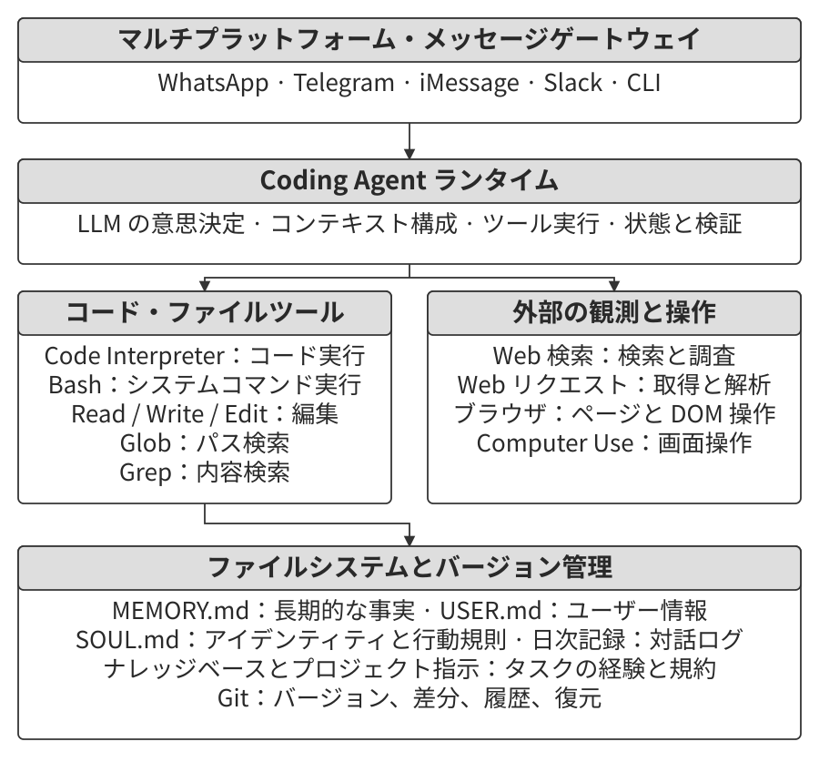

「前四半期の販売データを分析して要約レポートを作成する」を例にとると、作業は 5 つのステップに分けられます。

1. **記憶を読む**：ユーザーが好む PDF レポートの形式と、販売データが Google Sheets に保存されているという事実を取得する。
2. **データを取得する**：Google Sheets API の使い方を調べ、認可済みのインターフェースから必要な表をダウンロードする。
3. **分析コードを書く**：pandas で販売データを集計し、matplotlib で図表を作成し、集計の定義と結果を確認する。
4. **成果物を生成する**：分析と図表を PDF にまとめ、元データ、中間結果、生成スクリプトを保存して、後から見直したり更新したりできるようにする。
5. **記憶を更新する**：確認済みのデータソースと表の識別子を記録し、次回のタスクで探せるようにする。

同じタスクを千问办公（Qwen のオフィス向け機能）に任せる場合、ユーザーは販売明細をそのままアップロードし、データの分析と可視化レポートの生成を頼めます。[^ch5-qwenwork] ある注文で 100 元を受け取り、その後 20 元を返金したとすれば、四半期の純売上に計上されるのは 80 元だけです。レポートの図で 100 元として計算されていたなら、図表から集計表、元の明細へとたどっていけば、どの返金が漏れたのかが分かります。

[^ch5-qwenwork]: 千问办公ヘルプセンター、千问办公の紹介。データファイルのアップロード、データ分析、可視化レポートの生成などの機能を説明している。

ファイルシステムはこれらのステップをつなぎます。前のステップで保存した結果が次のステップの入力になり、プログラムは同じデータを何度でも読み込めます。タスクが中断しても、Agent は保存済みの成果物から進捗を確かめ、未完了の部分を続けられます。

中間結果にはもう一つの用途があります。ユーザーが関連する別の問いを投げかけたとき、適切なステップから作業を再開できるのです。Microsoft Research の Data Formulator は、各国の発電データを使ってこれを実演しています。元の表にはエネルギー源ごとの発電量が記録されており、分析者はまず国別・年別の再生可能エネルギー比率を求め、それをもとに順位のグラフを描きます。ある国の比率がどれだけ上がったかを知りたくても、グラフ上の順位だけでは、2 つの年で何ポイント差があるのかは読み取れません。インターフェースが保持している導出過程をさかのぼって比率の表に戻れば、2 年分の値を引き算できます。[^ch5-data-formulator]

[^ch5-data-formulator]: Microsoft Research、Data Formulator のエネルギー分析の例、およびバージョン 0.7.0 における図表とデータ表の関連付けの実装。

**記憶、知識、能力をファイルに保存する。** OpenClaw のワークスペースは、Markdown ファイルで多種類の情報を保存します。`MEMORY.md` は長期的な事実と決定を記録し、日付ごとに整理されたログは過程の情報を残し、`USER.md` はユーザーの好みに使え、Skill ファイルは能力の使い方を説明します[^ch5-openclaw-files]。**人と Agent が共同で維持する記憶については、筆者は直接読めるファイルを優先します。** ユーザーは記録を開いて誤った事実を一つ訂正でき、Git で出どころを確かめ、版を比較し、ロールバックすることもできます。日付ごとにログを保存すれば、前後して起きた事実の時系列がはっきりします。ファイルが増えてきたら、検索インデックスを加えて位置の特定を速めればよいのです。

Agent がファイルを書き込めることは、タスクの経験を蓄積することにも役立ちます。たとえば、ある銀行に連絡した際に本人確認のため口座開設支店の住所が必要だと分かったなら、適用される業務、情報源、発生日時とあわせて記録しておけます。照合済みの記録を知識、操作手順、プログラムへと整理すれば、後続のタスクで再利用できます。この継続的な進化の過程は第 9 章で論じます。

[^ch5-openclaw-files]: OpenClaw、*Agent workspace* および *Memory overview*。ワークスペース、ファイルによる記憶、検索の仕組みを説明している。

**どのようなタスクなら、Agent に自分でプログラムを書かせるのが適しているでしょうか。** 開放的な調査、コンテンツ生成、データ処理では、新しい入力形式、インターフェース、成果物の要件に頻繁に出会うため、コード生成を実行の核に据えるのが適しています。垂直領域のカスタマーサービスのように流れが比較的安定したシステムは、業務状態、領域ツール、対話戦略を中心に運用を組み立て、計算、変換、ルール検証をコードで行えばよいでしょう。どちらのシステムも Coding 能力を活用できますが、それが担う役割はタスクによって変わります。

### Coding Agent の全体フロー

小さな不具合を一つ取り上げて、図5-2 をたどってみましょう。ユーザーが「合計金額で並べ替えると、100 元が 20 元より前に来る」と報告したとします。まず問題を再現できる入力を見つけ、データの流れを追って、金額がどこで文字列になったのかを調べます。比較ロジックを直したら、元の入力で再実行し、小数を含むデータや同額のデータでも正しく並ぶかを確かめます。

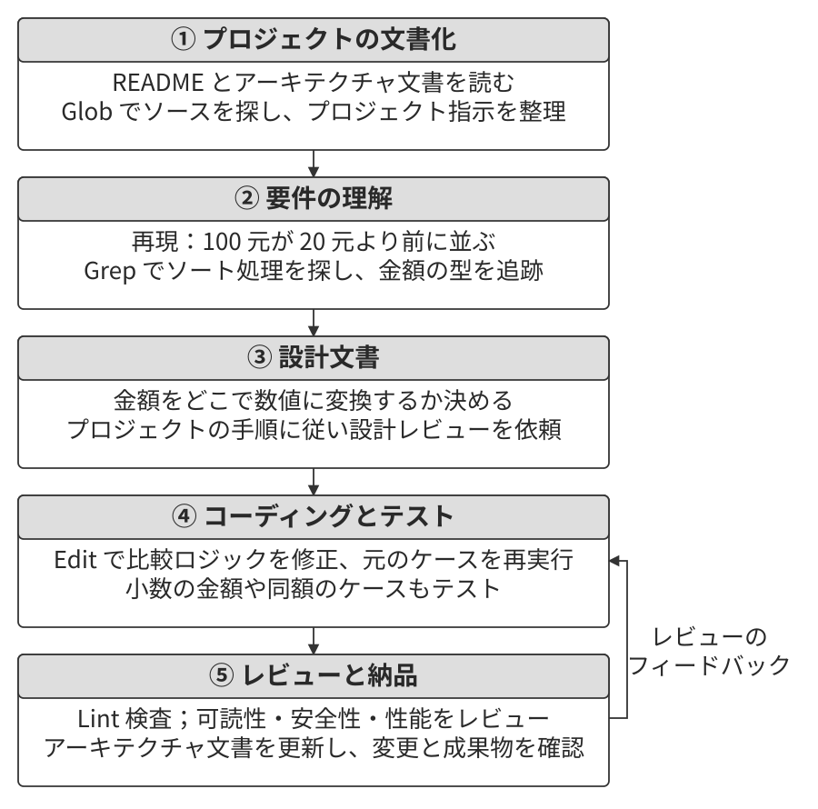

**プロジェクトを理解し、ドキュメントを補う。**

タスクを受け取った Agent は、まずプロジェクトの説明を読み、次に実装、呼び出し元、テストと突き合わせて、変更がどこに影響するかを洗い出します。関連するモジュールが何を担当し、どんな中核的な抽象を使い、モジュール同士がどう連携し、どうテストするのかがドキュメントに書かれていなければ、コードから確かめた内容を書き足し、後から引き継ぐ人が参照できるようにします。

**プロジェクト指示ファイル**は、よく使う取り決めを Agent が参照しやすい場所に置くためのものです。`CLAUDE.md`、`AGENTS.md`、Cursor のプロジェクトルールには、ビルドコマンド、コードスタイル、変更の境界を記録できます。たとえば「テストは `pnpm test` で実行する」「変数には具体的な型を宣言し、`any` を避ける」「データベースマイグレーションの変更は個別にレビューする」といった内容です。各ホストは、ディレクトリ、設定、適用条件に応じてこれらを読み込みます。Cursor 初期の `.cursorrules` も同じ発想を実装したものです[^ch5-project-rules]。

指示ファイルと OpenClaw の `SOUL.md`、`MEMORY.md` は、それぞれ重点が異なります。指示ファイルはプロジェクト内での作業上の取り決めを、`SOUL.md` は Agent のアイデンティティと振る舞いを記述し、記憶ファイルは後続のタスクで使える情報を保存します。安定した簡潔な指示は、コンテキストのプレフィックスを一定に保つのに役立ちます。ディレクトリ単位のルールを必要に応じて読み込めば、現在のタスクの入力量を抑えられます。実行権限は Harness と実行環境が担保します。

第 2 章では、リモートワークに親和的なチームは Agent も参加させやすいと述べました。コードリポジトリに即して言えば、意思決定を設計文書に、タスクの背景を issue や PR に書き、社内の経験を開発者ガイドにまとめておくということです。実用的なチェックの問いは次のとおりです。**リモートの新人が、リポジトリとドキュメントだけを頼りにタスクの入口を見つけ、テストを走らせ、修正の要件を理解できるか。**

[^ch5-project-rules]: Anthropic、*How Claude remembers your project*。Cursor、Rules。プロジェクト指示と、範囲に応じて読み込まれるルールを説明している。

**目標と受け入れ条件を明確にする。**

原因が特定済みのバグや引数の調整なら、既存の振る舞いとテストに基づいてそのまま修正できます。目標が漠然としている場合は、まず分解が必要です。たとえば「システムのパフォーマンスを最適化する」は、応答時間の短縮、メモリ使用量の削減、スループットの向上のいずれも指しえます。Agent は現在のボトルネック、計測したベースライン、許される変更範囲を調べ、インターフェースの互換性やユーザー体験といった制約を確認してから、最適化の方針を決めるべきです。

**設計方針をまとめる。**

設計の説明は、どのモジュールを修正するのか、どんな方法を採るのか、なぜそれが目下の問題に合うのか、新しい依存を持ち込むか、そしてどう検証し、どう元に戻すかに答えるものです。小さな変更なら短い計画で足ります。複雑な変更はレビュー可能な設計文書にまとめます。プロジェクトやユーザーが方針の承認を求めている場合は、具体的な方針を先に提出し、承認を得てから実装します。

**実装、テスト、レビュー。**

実装ではプロジェクトの取り決めに従い、既存の抽象やツールを再利用し、修正をタスクに関係する範囲にとどめます。テストは期待される振る舞いに沿って設計し、正常経路、境界条件、異常系をカバーします。バグを修正するときは、回帰テストが元の問題をあぶり出し、修正結果を確かめられるものでなければなりません。

テストが失敗したら、Agent は診断を読み、原因を突き止め、コードを修正して関連するチェックを再実行します。**コーディングタスクは、受け入れ条件を満たした時点を完了とすべきです。** パッチを書くのはその一部にすぎず、関連するテスト、ユーザーの要求、成果物をすべて確認する必要があります。「テスト・修正・検証」のループによって、Agent は問題を直し続けられ、Loop エンジニアリングにも明確な停止の根拠が与えられます。

コードレビューでは、テストでは必ずしもカバーされない点、たとえば可読性、インターフェースの互換性、パフォーマンス、権限、依存の使い方を確かめます。差分を読む、静的解析をかける、レビュー用のサブ Agent を使う、といった方法を組み合わせて点検し、問題が見つかれば修正を続けて、影響を受けるチェックを再実行します。

**ドキュメントを同期し、引き渡す。**

モジュールの追加、依存の調整、中核的な振る舞いの変化は、対応するドキュメントに反映させるべきです。引き渡しの説明では、解決した問題、振る舞いの変化、検証結果、使い方を要約し、必要なら元に戻す手順も添えます。コード、テスト、ドキュメントが、このタスクの成果をともに保存するのです。

探索と修正の進め方はモデルによっても異なります。実装、呼び出し元、テストを広く読んでから動くモデルもあれば、最も関係の深いファイルだけを確認して小さなパッチを試し、コンパイルやテストのフィードバックを手がかりに位置を絞り込んでいくモデルもあります。**筆者は、こうした探索と行動のリズムを、何よりもまずモデルが学習した行動方策だと捉えています。** Harness を替えても似たリズムが保たれ、同じ Harness の中でモデルを替えるとリズムがはっきり変わるなら、その違いはモデル自体に由来すると考えられます。Harness のプロンプト、ツール、予算は、この傾向を強めることも抑えることもできます。こうした違いをどう評価するかは第 7 章で、ポストトレーニングが行動方策にどう影響するかは第 8 章で論じます。

### Coding Agent における Harness エンジニアリングの実践

第 1 章では **Agent = Model + Harness** という式でプロダクション実装を説明し、Harness の 5 つの機能、すなわちコンテキスト管理、ツールインターフェース、制約、検証、修正を紹介しました。Coding Agent は、ソフトウェアエンジニアリングにおけるテスト、静的解析、継続的インテグレーション、バージョン管理を活かして、これらの機能を実行可能なプロセスとして具体化できます。

先ほどの並べ替えの不具合を例にしましょう。誤った入力、関係する関数、失敗時の出力をモデルに渡すのはコンテキスト管理です。モデルに読み取り、修正、テストの実行を許すには、ツールインターフェースと制約が欠かせません。同じ入力で修正を確かめて初めて検証が始まり、数値がなお文字列として並べ替えられているなら、実際の順序と期待する順序を併せて返してこそ、使える修正のフィードバックになります。

モデルは問題を理解し、方針とコードを生み出します。Harness は作業に必要な情報とインターフェースを提供し、チェックを段取りし、その結果に応じて処理を続けるか復旧するかを決めます。エンジニアリングの現場に落とし込むなら、次の 4 つの面を整えることになります。

- **受け入れのベースライン**：テストスイート、CI パイプライン、レビュー基準によって、何をもって完了とするかを示す。CI とは継続的インテグレーションのパイプラインであり、コミット後に取り決めのチェックを自動で実行できる。
- **実行の境界**：モジュールの責務、依存のルール、データアクセスと操作の権限を明確にする。
- **フィードバック信号**：linter、型チェック、テストの結果を、モデルが位置を特定し、理解し、対処できる診断として整理する。
- **復旧の手段**：Git のバージョン、ワークスペースのスナップショット、タスクの状態を保存し、外部の変更に対しては対応する復旧手順を用意する。

**目標と検証方法を同時に設計する。**

タスクが明確かどうか、結果を自動で検証できるかどうかは、Agent の働き方にともに影響します。表5-1 は 4 つの組み合わせを挙げ、それぞれに必要な追加のエンジニアリング作業を示しています。要件を明確にし、サンプルとチェックを増やすことで、もともと漠然としていたタスクも、実行可能な目標へと段階的に変えていけます。

表5-1 タスクの明確さと検証の自動化の程度による 4 象限

| | 結果を自動で検証できる | 結果を人手で検証する必要がある |
| --- | --- | --- |
| **目標が明確** | 回帰テストのあるバグを修正する：フィードバックに沿ってイテレーションする | コードのリファクタリング：テストとアーキテクチャレビューを組み合わせる |
| **目標が曖昧** | 「コード品質を高める」：まず linter 以外の品質目標を明確にする | 「UI をもっと良くする」：サンプルと比較によって好みを明確にする |

**ソフトウェアエンジニアリングが積み上げてきた検証のインフラは、Coding Agent がいち早く成熟した重要な理由です。** コンパイラ、型システム、テストスイート、バージョン管理があるおかげで、誤りは位置を特定でき、修正は検証でき、失敗すれば巻き戻せます。これらはそれ自体が強力な Harness を構成しています。この判断は、他の Agent の場面でどこに投資すべきかも示しています。まずタスクを「目標が明確で、結果を自動で検証できる」領域へ押しやることです。受け入れが人手による逐一の確認に頼るなら、人のレビュー速度がスループットの上限になります。目標が曖昧なら、どれほど速い自動化でも、誤った指標を最適化し続けるだけになりかねません。

**エンジニアリングの事例から方法を抽出する。**

大規模なコードマイグレーションは、これらの構成要素がどう連携するかを理解する材料になります。マイグレーションのルールとモジュールの関係はリポジトリのドキュメントに書き、依存の制約は静的解析で担保し、各バッチの変更はテストと CI にかけ、失敗したときは位置を特定できる診断を返します。こうして Agent は、マイグレーションの要件を参照し、バッチごとにフィードバックを受け取り、それを踏まえて作業を進められます。

LangChain の実践は、失敗の軌跡に基づいて Harness を改善する方法を示しています。モデルを固定し、タスクがどのステップで停滞したのか、あるいはどこで誤って終わったのかを分析してから、システムプロンプト、ツールのミドルウェア、自己検査のループ、推論の予算を調整します。第 1 章でその Terminal Bench 2.0 の事例を紹介しましたが、ここで注目するのは「失敗を記録する―修正を提案する―再評価する」というイテレーションの方法です[^ch5-langchain-harness]。

Anthropic の長いタスク向けの手法は、環境の初期化と継続的な実行を分けています。初期化 Agent がタスクの一覧と作業環境を整え、後続の Coding Agent が項目ごとに進め、コード、テスト結果、進捗を保存します。新しいセッションはそれらの成果物を読んで作業を続けるため、コンテキストをまたぐ引き継ぎでの情報の抜けが減ります[^ch5-long-harness]。

[^ch5-langchain-harness]: LangChain、*Improving Deep Agents with harness engineering*、2026 年 2 月 17 日。
[^ch5-long-harness]: Anthropic、*Effective harnesses for long-running agents*、2025 年 11 月 26 日。

**経験をシステム設計の原則として定着させる。**

1. **プロンプトによる指示より、実行可能な制約を優先する。** モジュールの依存、フィールドの型、コード規約は静的解析と CI で検証できます。アクセス権限は実行環境が強制します。プロンプトとドキュメントはルールとその理由を説明し、チェックの仕組みが該当する違反を見つけて止めます。
2. **自動検証への投資を優先する。** 繰り返しのチェックはタスク量とともに増えるため、人手のレビューに頼り続けるとスケーリングのボトルネックになります。テスト、品質チェック、振る舞いの監視がその部分を担い、人のレビューは目標の取捨選択や複雑な判断に集中します。
3. **フィードバックは早く、構造化されているほど修正に役立つ。** エラーメッセージには、該当する位置、失敗した条件、実際の結果を含め、モデルが次の一手を決められるようにします。第 2 章のステータスバーは、最新の診断、呼び出し回数、タスクの進捗をまとめて示せます。
4. **変更に対する復旧経路を設計する。** Git のブランチでコードの変更を保存し、サンドボックスで試行錯誤の影響を限定し、スナップショットで管理対象の状態を復元します。外部 API の操作は、第 4 章の冪等性、キャンセル、補償の仕組みと組み合わせて扱います。

**結果と過程を同時に点検する。** データベースの障害を直すとき、データを消して作り直せばサービスは復旧しても、データ保持の要件を破ってしまいます。コンパイルエラーを直すとき、関連する実装を消せばコンパイルは通っても、機能を失います。これらの例が示すのは、受け入れは業務目標をカバーする必要があり、実行の過程にも制約が要るということです。Harness は、本番データの削除やファイルの上書きといった操作に対して、権限と影響範囲を確認し、第 4 章で紹介した独立した審査の仕組みを呼び出せます。

訓練時に、あらかじめ特定した違反行為にペナルティを与えることもできます。第 8 章で論じる RLVP（検証経路ペナルティ）は、過程上の制約を訓練のフィードバックに取り込み、結果を追うときに実行上の要件を守るようモデルを導きます。実行時の権限と審査は実行できる動作を常に限定し、訓練のフィードバックはモデルが行動を提案する仕方に影響します。

**依存関係に沿って故障の伝播を抑える。** 互いに依存しない 3 つのファイルを並行して読むとき、1 つが存在しなければ、その項目のエラーを返しつつ、ほかの読み取り結果は保持すべきです。ある呼び出しが失敗したタスクの出力に依存するなら、その依存の連鎖は停止するか組み直すべきです。Harness はタスクの関係に応じてキャンセルの範囲を決め、各項目の状態を親に報告し、独立した作業がまとめて捨てられないようにします。並行呼び出し、ストリーミングの解析、連鎖的なキャンセルの実装は後述します。

### 故障とエラーからの復旧

長いタスクは、2 回のモデルリクエストの間で接続が切れることもあれば、ツールを実行したのに結果を保存できないこともあります。Harness が「タスク失敗」しか把握していなければ、最初からやり直すことで、すでに済ませた操作を繰り返してしまうかもしれません。作業を復旧するには、まず中断した位置を突き止め、どの結果が保存済みかを確かめてから、リトライするか、呼び出しを修正するか、途中から続けるか、中止するかを決めます。

復旧の最初の問いは「前のステップは何を証拠として残したか」です。ファイルの読み取り中に切れたなら、たいていは読み直せます。リモートのタスクを投入した後に切れたなら、リモート側ではすでに受け付けられているかもしれません。タスクの識別子がすでにあるなら、まずそれを照会してから、再投入するかを決めます。「リクエストを送信済み」「リモート側が確認済み」「結果を保存済み」を分けて記録して初めて、復旧には出発点ができます。

**故障の位置に応じて対処を選ぶ。**

| 層 | よくある故障 | 対処の要点 |
| --- | --- | --- |
| API 層 | HTTP 429 のレート制限、サービスの過負荷、タイムアウト、接続の中断、出力長の上限到達 | エラーの原因とリクエストの状態を確認し、バックオフしてリトライするかリクエストを調整する |
| ツール層 | ツール名の不存在、引数の不正、実行時の例外、同じエラーの繰り返し返却 | 位置を特定できる診断を返し、入力または実行条件を修正する |
| コンテキスト層 | ウィンドウのオーバーフロー、圧縮の失敗、呼び出しと結果の対応の欠落 | 入力量を調整し、実際の記録を復元し、メッセージ構造を確認する |
| 制御フロー層 | 進展のない繰り返し、復旧ロジックが再帰的に失敗を引き起こす | 回数を数え、復旧の階層を制限し、中止またはエスカレーションを発動する |

レート制限や一時的な過負荷は待ってからリトライできます。引数の誤りは引数を直す必要があり、権限の不足は認可を処理する必要があり、ツールが存在しないなら能力を選び直す必要があります。エラーの種類を具体的な復旧動作に対応づけておけば、条件が変わらないまま同じリクエストが繰り返し失敗する事態を避けられます。

**失敗と進展を同時に監視する。**

Harness は「ツール名＋正規化した引数」から呼び出しの指紋を計算し、結果とタスクの状態をあわせて重複した振る舞いを検出できます。同じ呼び出しは、妥当なポーリングであることもあれば、進展のないループであることもあります。判断には、待機条件、外部の状態、すでに経過した時間も見る必要があります。復旧の経路ごとに独立した失敗カウントを維持し、さらに全体の予算でタスク全体を制約します。

ストリーミングのリクエストでは、接続タイムアウト、読み取りのアイドルタイムアウト、全体の制限時間をそれぞれ設定する必要があります。接続タイムアウトは接続確立の待ち時間を、読み取りのアイドルタイムアウトはデータを 2 回受け取る間の待ち時間を制限し、全体の制限時間はリクエスト全体を制約します。接続は生きているのに長時間データが来ないときは、アイドル監視用のウォッチドッグがリクエストを閉じ、復旧の流れに移行できます。**すべての長い接続には活性の監視が必要であり、接続確立のタイムアウトを設けるだけでは足りません。** タイムアウトのしきい値はモデルの出力の仕方も考慮すべきです。可視のテキスト、推論の差分、ハートビートはいずれもリクエストが進行中かどうかを映しますが、長い内部推論は待ち時間を増やします。

コンテキストの完全性のチェックは、呼び出し ID と結果の対応を軸に進めます。結果が欠けているときは、まず実行の記録を照会し、保存済みの実際の結果を復元します。実行状態が不明なときは、不明であることを明示的に記録し、第 4 章の冪等性と状態照会の仕組みに沿って扱います。

**段階的に復旧し、現在の状態を報告する。**

1. **バックオフしてリトライする。** リトライ可能なエラーには、指数バックオフとランダムなジッターを用い、サーバー側が示す待機時間にも従います。主タスクと補助タスクにはそれぞれリトライの予算を割り当て、タイトル生成や入力候補のようなバックグラウンドの作業は失敗後に飛ばして、主タスクの資源を圧迫しないようにします。
2. **調整または切り替え。** 出力長が上限に達したら、まずインターフェースが許す上限とタスクの予算を確認してから、上限を広げるか、タスクを分割するか、出力を続けるかを決めます。サービスが継続的に利用できない場合は、予備のモデルに切り替えられます。切り替えの前に、メッセージ、ツール定義、モデル固有のフィールドを変換します。
3. **復旧の進捗を伝える。** 自動復旧の間は「リトライ中」「サービス切り替え中」と表示し、各回のエラーをログに残します。復旧に成功したらタスクを続け、ユーザーに認可、入力の補足、次の一手の判断を求める必要があるときは、現在の進捗、失敗の原因、すでに試した方法を説明します。

**復旧の方針は、タスク全体が前に進むことを助けるものであるべきです。** 復旧可能な途中のエラーは実行の記録に残し、画面には復旧の進捗を示します。復旧の手段を使い果たしてから、最終的な失敗をユーザーと下流のシステムに報告します。こうすれば下流は「リトライ中」と「タスクがすでに失敗」を区別でき、早すぎる補償や重複した投入を避けられます。

ツールのエラーは、構造化された結果としてコンテキストに入れられます。たとえば、存在しないツール名、誤りのあるフィールド、許される値を返し、モデルがそれを手がかりに修正できるようにします。インターフェースの取り決めが許し、意味が確定している形式変換は、プログラムの中で済ませて記録できます。引数の意味が不明確なときは、モデルに再生成させるべきです。修正の過程で操作の目的が変わってしまうのを避けるためです。

**未完了の軌跡を引き継ぐ。**

モデルを切り替えるときは、確認済みのタスクの事実、ツールの結果、未完了の事項を引き継ぎ先に渡します。メッセージのロール、ツール呼び出しの形式、推論のフィールドはインターフェースごとに異なるため、変換の際は内容とプロトコルの状態を分けて扱います。一部のサービスは、読める形の推論内容や要約を返すほか、自身の後続リクエストで使う不透明なフィールドも返します。これらのフィールドは推論ブロックやツール呼び出しに付属することがあり、どれを後続のリクエストでそのまま返す必要があるかは、対応するインターフェースが定めます。

**ベンダーをまたいで引き継ぐシステムは、業務の軌跡を中立的な形式で保存すべきです。** あるモデルが他社の提供する文章を読めるからといって、そのベンダーの不透明なプロトコルフィールドを引き継ぎ先の API が受け付けるとは限りません。タスクの事実とベンダーのプロトコルを分けておいてこそ、引き継ぎ、評価の再生、訓練データが同じ記録を共有できます。中立的な記録には、タスクとメッセージ、ツール名と引数、安定した呼び出し識別子、実行状態、結果とその出どころを含めます。ベンダーの生のレスポンスは別に保存し、同じインターフェースでの継続と問題の追跡に使います。引き継ぎ先のモデル向けのリクエストに変換するときは、呼び出し ID の対応を定めて結果の対応を保ちます。読める形の要約は出どころを添えた通常のコンテキストとして渡し、元のサービスの不透明なフィールドは生の記録に残します。

引き継ぎ先のインターフェースで古い呼び出しを表現できない場合は、完了済みのステップを明示的なタスク記録にまとめられます。たとえば「航空券と宿泊は照会済み、次に食費と為替レートを取得する」と、実際の結果を添えて記録します。そのうえで、引き継ぎ先のモデルに新しい正当な呼び出しを生成させます。引き継ぎ先が作業を始めた後は、その戻り値のプロトコルフィールドを、自身のインターフェースの要件に従って保持します。このような中立的な記録は、第 7 章の評価の再生、第 8 章の訓練サンプルの構築、第 9 章の経験の抽出にも使えます。

> **実験 5-1 ★★★：ベンダーをまたぐ軌跡の引き継ぎ**
>
> 本実験では、Agent に航空券、宿泊、食費、為替レートを照会させ、人民元の合計を計算させます。最初の 2 回のツール呼び出しが終わったところで、スクリプトが既定の中断点でサービスを切り替え、送信元のサービスが使えなくなった後の引き継ぎを再現します。引き継ぎ先は残りのステップを続けます。実験には Moonshot、Anthropic、Google の 3 つのモデルを使い、方向のある 6 通りの切り替えの組み合わせを比較します。
>
> 処理の方法は 3 通りです。フィールドの対応に従って元のメッセージを渡す方法。推論の内容と不透明なフィールドを削除してからメッセージを変換する方法。中立的な軌跡でタスクの状態を保存し、引き継ぎ先のインターフェースに合わせてコンテキストを再構築する方法です。切り替えの位置はスクリプトが制御し、引き継ぎ先での形式エラーは実際のサービスのレスポンスから取っています。
>
> 今回の記録では、中立的な軌跡が 6 通りの組み合わせすべてで引き継ぎを完了し、合計も正しく計算しました。残る 2 つの方法はそれぞれ 3 通りと 4 通りで完了しています。タスクの進捗はツールの結果に保存されていたため、3 つの方法はいずれもツール呼び出しを重複させませんでした。

> **実験 5-2 ★★：出力が途中で切れたあとの継続**
>
> 本実験では、推論の出力、本文、ツール引数の 3 つの位置でストリームを切断し、ラウンド全体の再送、既存の本文をプレフィックスとした続きの生成、継続の指示の追加という 3 つの方法を比較します。ツール呼び出しは実行の前に完全な引数を必要とするため、切断された断片はまず実行の記録に保存し、復旧後に解析し直して検証します。
>
> 具体的な誤りの一つは都市の引数に現れました。本来は「東京」を生成すべきところ、切断点には `{"city":"東` しか残らず、続きの生成はそれを `{"city":"東"}` と閉じてしまいました。JSON は正当ですが、都市はやはり誤っています。
>
> 今回の長い本文のテストでは、プレフィックスからの続きの生成によって後続の出力 token が減りました。引数が中断した場合は挙動が異なり、Moonshot での 3 回のテストでは、プレフィックスからの続きの生成はいずれも正しい都市を復元できませんでした。

**復旧のループに終了条件を設ける。**

復旧の経路にはそれぞれ上限が必要です。たとえば、圧縮が続けて失敗したら別のコンテキスト戦略に切り替え、権限の判断が完了できなければ人に引き渡し、出力の継続がラウンド数や費用の予算に達したら停止します。**リトライのしきい値は、プロダクションにおける復旧の分布から決めるべきです。** 大多数の一時的な障害が最初の数回の試行で復旧し、それ以降の同種のリトライの成功率がほぼゼロになるなら、その変曲点で止めるべきです。無効な呼び出しが割り当てを消費し続けるのを避けるためです。

復旧のロジック自体がまた失敗することもあります。たとえば、コンテキストのオーバーフローが停止フックを発動し、フックがコミットメッセージの生成をモデルに要求して、再びオーバーフローし、またフックが発動するという流れです。再入のフラグと再帰の深さの制限でこの連鎖を断ち切り、エラーの後始末とモデル呼び出しを要する補助作業のスケジューリングを分け、後者には独立した予算を設けます。タスクには全体のイテレーション数、時間、費用の上限も必要で、復旧の各経路はタスク全体の予算に縛られなければなりません。

### Coding Agent の実装のコツ

まず、失敗したテストを修正する一回分の実行記録を使って、どの区間を最適化する価値があるかを見積もってみましょう。筆者は 2026 年 11 月のポルトでの講演「The Road to JARVIS」で、同じセッションを再生して推論速度の違いを比較しました。当時のオンラインのモデルの所要時間で計算すると合計 24.2 秒、ツールの所要時間はそのままに、まだ製造されていないある専用チップの推論速度の見積もりに置き換えると、合計は約 8.1 秒でした。そのうち 7.5 秒はテストの実行に費やされています。残る約 0.6 秒のモデルの所要時間をさらに消したとしても、テストが終わるまでは待たなければなりません。

この 7.5 秒の間に、どの作業を同時に進められるでしょうか。それはツール呼び出しの間の依存関係によって決まります。

**並行ツール呼び出し、ストリーミング実行、連鎖的な中止。**

コードの検索、設定の読み取り、ログの確認は、多くの場合それぞれ独立して進められます。モデルが 1 回の応答でこれらの呼び出しを生成するとき、Harness は呼び出しの生成とツールの実行を重ね合わせられます。インターフェースが最初の呼び出しの出力完了を確認し、引数と権限の検証が通れば、すぐにそれをスケジュールし、同時に後続の呼び出しを受け取り続けるのです。ここでは、インターフェースの呼び出し完了イベントに基づいて完全性を判断する必要があります。一時的に解析できる JSON だけを頼りに先走って実行してはいけません。

独立した呼び出しは並行して実行できます。たとえば関数名を検索しながら設定ファイルを読み、両方の結果が返ってからどう修正するかを決めます。検索結果がなければ決まらないファイルの読み取りは、後続のステップに回します。スケジューラは共有状態も識別しなければなりません。2 つのツールが同時に同じファイルを修正すれば、入力が互いに独立していても書き込みの衝突が起きます。

ツール定義では、並行実行の可否、アクセスする資源、キャンセルの方法を宣言できます。教育用の実装では、宣言のないツールを直列にスケジュールすればよいでしょう。ある呼び出しが失敗したら、その結果に依存する後続の作業を止め、独立した呼び出しの結果は保持し、各項目の状態を親に返します。すでに開始したタスクをキャンセルするときは、キャンセルが有効になったかどうかと、すでに生じたファイルの変更や外部の操作も記録します。

**コンテキストのきめ細かな管理。**

大きなコードベースは、段階的な検索によって少しずつコンテキストに入れられます。まずファイルを特定し、次に関連する関数を読み、必要なら呼び出し元やテストへと広げます。毎回の読み取りは目下の判断に必要な情報を補うもので、モデルがコード、制約、実行時のフィードバックを同時に見られるようにします。

読み取りツールは、たとえば 100 行目から 150 行目のように行範囲を指定して断片を返せるようにし、各行にファイル内の実際の行番号を付けるべきです。そうすればモデルは「142 行目」を正確に指し示せ、後続の編集ツールもそれを使って位置を特定できます。返す内容には、どのファイルのどの範囲を読んだのかも明示します。ファイルが変わった後は、編集位置を確かめ直す必要があります。

コンパイルやテストは数千行の出力を生むことがあります。その場合は第 4 章の切り詰めと永続化の仕組みが使えます。先頭、末尾、省略した量を返し、完全な出力は保存して必要に応じて検索できるようにします。エラーは途中に現れることもあるので、Agent はエラーのキーワードを検索したり、該当する区間を読んだりして掘り下げられます。

**環境情報の動的な注入。**

第 2 章の Agent ステータスバーは、プログラミングのタスクでは 4 種類の情報をまとめられます。

- **現在の作業ディレクトリ**：相対パスの基準を定める。
- **Git ブランチ**：現在の修正がどの開発ブランチにあるかを定める。
- **最近のコミット履歴**：タスクに関係する最近の変更を把握する。
- **ステージ済みと未ステージの変更の概要**：コミット予定の内容とワークスペースの修正を区別する。

Harness は、これらの状態を変える操作の後に要約を更新し、次のモデル呼び出しでコンテキストの末尾に追加できます。最近のコミットのように変化の少ない情報は必要に応じて更新すれば、重複した照会と入力量を減らせます。コンテキストの先頭部分を安定させておけば、プレフィックスキャッシュを再利用しやすくなります。

**コマンド実行環境の状態の永続化。**

ディレクトリの移動、仮想環境の有効化、環境変数の設定、バックグラウンドサービスの起動は、いずれも後続のコマンドに影響します。Agent がある shell で `cd` を実行した場合、後続のコマンドが同じセッションを使い続けて初めて、ディレクトリの変化がそのまま保たれます。別のプロセスで実行するなら、作業ディレクトリは新しいプロセスの設定で決まります。仮想環境の有効化によって生じる環境変数にも、同じセッションの境界があります。

**対話的なデバッグや、サービスを動かし続ける必要のあるタスクでは、筆者は既定で永続的な端末を使うことを勧めます。** そうすれば作業ディレクトリ、環境変数、セッションの状態が保たれ、開発者が同じ端末で作業を続ける習慣とも合います。Harness はセッションに識別子を割り当て、作業ディレクトリ、実行中のプロセス、終了ステータスを追跡して、次のコマンドがどの環境で実行されるのかをモデルが把握できるようにします。もう一つの実装は、毎回のコマンドに作業ディレクトリと環境設定を明示的に持たせ、再構築可能な設定で一貫性を保つ方法です。

並行するタスクは、独立したセッションか明示的な環境スナップショットを使い、あるタスクのディレクトリ移動が別のタスクに影響しないようにします。タスクが終わったらバックグラウンドプロセスをまとめて片づけ、タスクを再開するときはセッションがまだ生きているかを確かめ直します。たとえば翌日に戻ってテストの続きを走らせるとき、コードと依存の一覧はワークスペースから読み戻せますが、前日に端末で起動したサービスのプロセスは、まだ動いているかを先に確認しなければなりません。これはまさに、第 4 章でサンドボックスのコストを見積もる際に区別すべき 2 種類の状態です。

**即時の構文フィードバックの仕組み。**

ファイルを書き込んだ後、ツール層は対応する言語の構文チェッカーや linter を自動で実行し、診断をツールの戻り値としてモデルに渡せます。たとえば括弧が欠けていれば、ファイル、行と列の位置、エラーの種類を返します。モデルは次のラウンドですぐに修正でき、IDE の即時のマーク表示に似たフィードバックが成り立ちます。

チェックの範囲は変更に応じて広げられます。まず修正したファイルを検査し、次に影響を受けるモジュールのテストを走らせ、最後に引き渡しの要件に従って回帰チェックを行います。軽量なチェックは局所的な問題を早く見つけるのに役立ち、結合テストはモジュールをまたぐ振る舞いを確かめます。

### Coding Agent における検索ツール

エラーメッセージに「金額フィールドが欠落」とあれば、まずその原文を検索し、エラーを投げた箇所から呼び出し元を追っていけます。ユーザーが「並べ替えがおかしい」としか言わず、コードは英語で命名されているなら、その言葉をそのまま検索してもほとんど意味がありません。まず結果を表示している画面を特定し、フィールド、呼び出し関係、テストデータをたどって並べ替えのロジックにたどり着きます。図5-3 の 4 種類の検索ツールは、それぞれ異なる手がかりを利用します。最初の検索が何を返すかによって、次にどのツールに切り替えるべきかが決まることがよくあります。

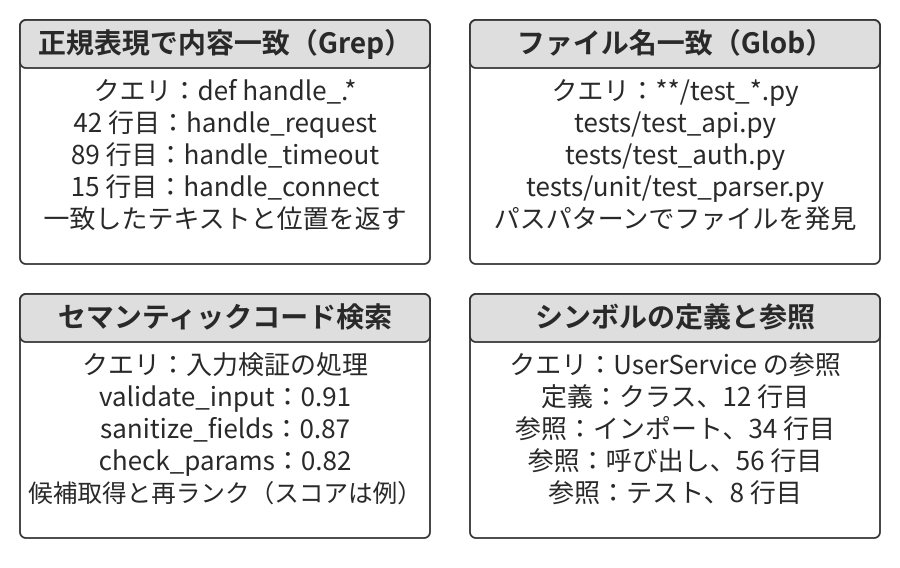

**正規表現による内容マッチング。** grep や ripgrep はテキストパターンで内容を検索し、関数名、変数名、エラーメッセージが分かっているタスクに向いています。たとえば `def handle.*` は、該当する関数定義の形を含むテキスト行にマッチします。ファイルの種類やパスでの絞り込みと組み合わせれば、Python ファイルだけを検索し、テストディレクトリを除外して、結果を関連する実装に集中させることもできます。

テキストマッチングはファイルの内容に直接対応するため、結果を確かめやすいという利点があります。検索語はコード中の表現と結びつける必要があります。「ユーザー認証」を探すなら、`authenticate`、`login`、`check_credentials` といった名前も試してみるとよいでしょう。モデルが前回の結果をもとに検索を広げていけば、検索しながら理解を深めていく検索過程になります。

**ファイル名のパターンマッチング。** glob はパスのパターンでファイルを探します。たとえば `**/*.test.ts` は各階層のディレクトリにある TypeScript のテストファイルを、`src/components/**/Button.tsx` はコンポーネントディレクトリ配下の Button.tsx を探します。パスのマッチングでは本文を読む手間がかからないため、まずプロジェクトの構成を把握し、開くべきファイルを選ぶのに向いています。

**意味によるコード検索。** タスクに機能の説明しかないときは、ベクトル検索で意味的に関連するコードを呼び出せます。たとえば「ユーザーの身元を確認する」は `check_credentials` に対応するかもしれません。この種のシステムでは、通常 2 つの作業が必要です。

- **コード構造に沿ってチャンクに分ける。** 関数、クラス、メソッドを主な単位とし、関連するシグネチャ、コメント、所属するモジュールを保持します。長い単位をさらに分割するときは、断片を理解するのに十分なコンテキストを持たせる必要があります。
- **複数の検索信号を組み合わせる。** ベクトル検索で意味的に関連するコードを、キーワード検索で名前が厳密に一致するコードを探し、2 つの結果を統合します。第 3 章で紹介したクロスエンコーダで、さらに並べ替えることもできます。クロスエンコーダはクエリとコード片を同時に読み、そのコードの関連度に点数をつけます。

「データベースとのやり取り」「ユーザー入力の検証処理」のような探索的な問いでは、まず意味検索でモジュールを特定し、それから実装を読めばよいでしょう。

**Coding Agent の検索能力を構築するとき、筆者はまず Grep、Glob、範囲指定の読み取りを整えることを勧めます。** モデルは検索結果をもとにクエリを書き換え、呼び出し元やテストを開き、範囲を段階的に絞り込めます。これらのツールは現在のワークスペースを直接読むため、埋め込みインデックスを維持してコードと同期させる手間がかかりません。大規模なコードベースを繰り返し探索し、機能の説明しかなく入口が見つけにくい場合に、意味インデックスを追加して再現率を高めればよいのです。Cursor はかつて埋め込みに基づくコードベースのインデックスを公開しており、その後の検索のドキュメントでは、ローカルの Instant Grep インデックスと探索型のサブ Agent も紹介しています[^ch5-search]。この変遷は、「grep 系のインターフェースを使うか」と「インデックスを作るか」が別々の設計軸であることも示しています。同じ検索インターフェースでも、その下ではスキャンもインデックスも採用できるのです。

**シンボル単位の定義と参照の検索。** 言語サーバーは、構文、スコープ、型の情報を利用して「定義へジャンプ」「参照を検索」を提供できます。たとえば `authenticate` が 42 行目で定義され 189 行目で呼ばれているなら、ツールはその関係を返し、別のスコープにある同名のシンボルとも区別できます。Claude Code のコードインテリジェンスプラグインはその接続方法の一つで、言語サーバープロトコル（LSP）を通じてシンボルのナビゲーションと編集後の診断を提供します[^ch5-lsp]。

シンボルツールの効果は、言語のサポート、プロジェクトの設定、解析の状態に左右されます。Agent はテキスト検索で補い、文字列、コメント、言語サーバーがまだ解析していないファイルを探せます。

[^ch5-search]: Cursor、*Securely indexing large codebases* および Search。それぞれ埋め込みインデックスの方式と、その後のローカル検索の仕組みを説明している。
[^ch5-lsp]: Anthropic、*Code intelligence plugins*。LSP を通じて定義、参照、リアルタイムの診断を提供する方法を説明している。

### Coding Agent におけるファイル編集ツール

モデルがあるファイルを読み終えたところで、ちょうど誰かがその先頭にコメントを 1 行足したとします。このとき「28 行目を書き換える」と「この一意な原文を置き換える」は、まだ同じ箇所を指しているでしょうか。原文が 2 つの関数にそれぞれ 1 回ずつ現れていたらどうでしょう。図5-4 の 5 つの編集方式は、それぞれ違うやり方で変更箇所を特定します。行番号に頼るものもあれば、原文に頼るものもあり、統合の作業を別のモデルに任せるものもあります。

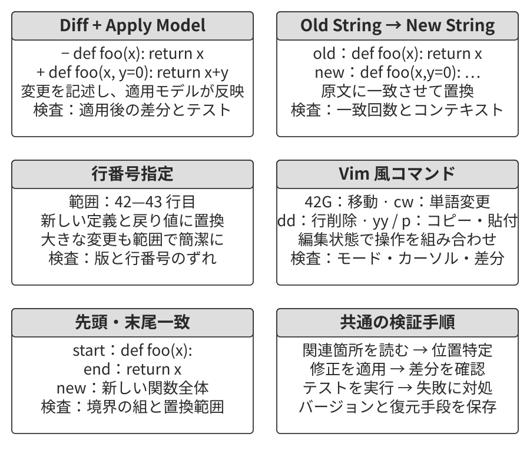

**差分記述＋Apply Model。** 主モデルが修正の意図とコード片を示します。たとえば Git の diff に似た追加・削除の記述や、省略記号で未変更の部分を飛ばしたコードの骨組みです。専用の適用モデルが、元のファイルと組み合わせて修正後の完全な内容を生成します。Cursor の初期の Fast Apply はこの発想の代表例です[^ch5-apply]。「修正を提案する」役と「修正を適用する」役を 2 つのモデルに分けています。基盤モデルが正確な局所編集を得意にするにつれ、この 2 モデルの流れには、より単純な代替案が現れました。

この分業では、主モデルがコードのロジックを表現することに集中し、適用モデルが局所的な修正をファイルに統合します。チェックの重点も当然、統合の結果に移ります。似た断片が複数あれば位置の特定が曖昧になり、省略記号が誤って解釈されることもあり、未変更の領域が意図せず書き換えられることもあります。

**旧文字列から新文字列へ（Old String → New String）。** Claude Code の Edit ツールは厳密な文字列の置換を採用しています。Cursor は 2025 年 5 月のバージョン 0.50 で Search & Replace を導入し、まず Anthropic のモデルでの長いファイルの編集に使いました[^ch5-direct-edit]。この路線は、位置の特定の根拠と置換の内容をそのままプログラムに渡して実行させるため、統合の段階で再びモデルを呼び出す手間が減ります。モデルは `old_string` と `new_string` を渡し、ツールがファイル内で原文を探して置き換えます。インターフェースは、1 回の置換では原文が一意であることを求めるよう定められます。一致しない場合や複数一致した場合は、位置と診断を返し、モデルにコンテキストを補わせます。一括置換が必要なときは、明示的な引数で範囲を表します。

たとえば、ある設定ファイルの 2 つのサービスがどちらも `timeout = 30` と書かれているとします。いま、ダウンロードサービスのタイムアウトだけを 60 秒に変えたい。ツールが一意な一致を求めるなら、`timeout = 30` だけを渡すと 2 箇所に一致するため、ファイルはそのままに保たれるべきです。次のリクエストでは、ダウンロードサービスのセクション見出しと設定行をまとめて旧文字列とし、新文字列では見出しを残したまま数値だけを変えます。

内容のマッチングは直感的で、確認もしやすい方法です。ただしモデルは呼び出しのたびに旧文字列をすべて出力する必要があります。大量のコードを削除するときは引数が長くなり、空白、改行、引用符のわずかな違いも一致に影響します。第 4 章の Unicode の曲がった引用符の事例は、こうした故障が引数の受け渡しの途中で起きることを示しています。

**行番号による特定（Old Line Numbers → New String）。** モデルが X 行目から Y 行目までを削除するよう指定し、そこに新しいテキストを挿入します。読み取りツールが実際の行番号を返していれば、大きなまとまりの削除は先頭と末尾の 2 つの位置だけで済みます。行番号の意味は読み取った時点のファイルの版に依存し、前回の編集が後続の位置をずらしているかもしれません。

そのため、一括編集では同じ初期スナップショットをそろって参照し、ツールが重複する区間を検査してまとめて適用できます。あるいは 1 回ずつ編集し、読み直してから位置を定め直す方法もあります。ツールがファイルの版や想定される内容と照合し、並行した変更があれば衝突として返せば、古い行番号が新しい内容に適用されるのを防げます。

**Vim 風の編集コマンド。** エディタのコマンドは移動、コピー、カット、貼り付けを表現でき、関数をある場所から別の場所へ移すような組み替えに向いています。ただし、現在のカーソル、バッファ、コマンドモードに依存し、1 ステップごとに後続の操作の基準が変わります。

**人が使うエディタの操作習慣を、そのままモデル向けツールの既定の設計にする必要はありません。** 人は現在の状態を一目見てから、小さな操作を 1 回行うのが普通です。モデルは長く考えたうえで、数十行、ときには数百行の修正を一度に生成できます。この一括修正を多数のカーソル移動とモード切り替えに分解すると、呼び出しのコストが増えるうえ、前のコマンドが状態に与える影響をモデルが予測しなければなりません。コード生成のタスクでは、筆者は修正の目標と内容を直接表現するインターフェースを優先します。エディタのコマンドを採用するなら、状態の基準を明確にし、フィードバックを早く返す必要があります。

**文字列の先頭と末尾のマッチング（Old String Start + End → New String）。** モデルは置き換える領域の先頭と末尾の数行だけを渡し、ツールがその 2 つの境界とその間の内容を特定します。数百行のコードを削除するとき、繰り返し出力する原文を減らしつつ、内容による位置特定の根拠は保てます。

ツールは 2 つの原文が現れる前後関係を確認し、インターフェースの取り決めに従って先頭と末尾の 2 つの部分を置換するかどうかを決めます。条件に合う区間が 1 つだけのときに実行し、複数該当するならその位置をモデルに伝えてコンテキストを補わせます。入れ子の構造や重複したコードでは、隣接する関数名やシグネチャといったアンカーを加えると範囲を絞りやすくなります。

**新しい Coding Agent を構築するときは、まず旧文字列から新文字列への置換のような単純で決定的な編集インターフェースから始めることを勧めます。** 原文による位置特定は明確で、失敗の理由も説明しやすく、差分の確認も容易です。モデルが局所的な修正を確実に生成できるようになれば、Harness はより多くの作業を決定的なプログラムに任せ、余分な適用モデルを省けます。大量の削除で引数の量を抑える必要が出てきたら、先頭と末尾のアンカーやスナップショットに基づく行番号編集を導入します。Codex の `apply_patch` は、制約されたパッチで複数箇所の修正を表現する、もう一つの直接編集の路線を示しています。

[^ch5-direct-edit]: Anthropic、*Tools reference*、Edit ツール。Cursor、バージョン 0.50 の更新履歴、2025 年 5 月 15 日、Search & Replace の導入について。バージョン 1.3 の更新履歴には Search & Replace と Apply の最適化も記録されている。

[^ch5-apply]: Cursor、*Editing Files at 1000 Tokens per Second*。修正の記述を元のファイルに適用する専用モデルを紹介している。

### Coding Agent のセキュリティ

Coding Agent はプロジェクトを読み、ファイルを修正し、プログラムを実行でき、さらにネットワークを通じて外部のサービスにアクセスすることもあります。権限を設計する際は、データの流れに沿って 3 つの問いを確認する必要があります。どんな内容がコンテキストに入るのか、モデルはどんな操作を要求できるのか、それらの操作は最終的にどの仕組みで承認され実行されるのか、という問いです。

Simon Willison は、プロンプトインジェクションの危険を「致命的な三要素」としてまとめました。プライベートなデータへのアクセス、信頼できないコンテンツへの接触、外部と通信する能力の 3 つです[^ch5-trifecta]。たとえば、個人のファイルを読め、外部のメールも処理でき、メッセージも送れるアシスタントなら、読み取り、理解、送信の間に明確な認可の境界を設ける必要があります。外部のコンテンツに含まれる指示がユーザーの要求として扱われてしまうと、認可されていないデータの受け渡しが引き起こされるかもしれません。

この 3 つの次元に加えて、筆者は 4 つ目の次元も確認することを勧めます。**永続記憶はプロンプトインジェクションの影響を増幅します。** 外部のコンテンツが長期記憶に入り込めば、その影響はセッションをまたぎ、後続のタスクで再び現れかねません。したがって、記憶への書き込みでは出どころ、適用範囲、確認の状態を記録し、読み出すときもこれらの属性を保つべきです。`MEMORY.md` に保存された文章の信頼性は、それがどう形成されたかによって決まります。誤った記録を見つけた後は、該当する内容を特定し、訂正し、撤回できなければなりません。

第 1 章の 3 層のガードレールは、ここではそれぞれの役割を担います。コンテキスト層は情報の出どころと振る舞いの要件を示し、実行層は操作と認可を検証し、データ層は信頼できる身元に応じて資源の読み書きを制限します。Claude Code のサンドボックスはファイルシステムとネットワークの境界によってコマンドの実行を制約し、Cowork も隔離された環境でローカルのタスクを担います[^ch5-sandbox]。以下ではこれらの仕組みをさらに詳しく見ていきます。

**サンドボックス内の資源と通信を限定する。**

- **ネットワークの出口。** これはコードのサンドボックスで見落とされやすく、優先的に実装すべき境界です。筆者は外部へのアクセスを既定で閉じ、タスクの必要に応じてパッケージ管理のソース、ドキュメントのサイト、業務 API を許可することを勧めます。許可リストは具体的な宛先と操作の範囲に対応させる必要があり、共有のサービスではアカウント、テナント、資源の帰属も考慮します。ネットワークの方針は、ツールが起動したプログラムとその子プロセスまでをカバーすべきで、外部に渡すデータは別に認可の範囲で確認します。
- **ファイルシステム。** 元のソースコードを読み取り専用でマウントし、複製を書き込み可能なワークスペースに置く方法があります。管理された編集インターフェースがパッチを生成し、レビューを経て適用する方法もあります。生成物と中間ファイルは独立したディレクトリに置き、認証情報のファイルはサンドボックスの外に残します。認証を要するサービスにアクセスするときは、管理されたインターフェースがタスクに必要な能力だけを提供し、ホストの認証情報をすべて生成されたプログラムに渡すことは避けます。
- **資源と時間。** CPU、メモリ、プロセス数、ディスク容量、実行時間に上限を設け、無限ループやプロセス数の暴走、ディスクへの書き込みが続くことの影響を抑えます。上限を超えたときは「実行が 120 秒を超えたため終了しました」のように構造化した状態を返し、保持した出力と後始末の結果を添えて、モデルがタスクを縮小するか実装を変えるかを判断できるようにします。

これらの境界は実行の連鎖の全体をカバーする必要があります。コマンドが承認された後も、実際に起動されるプログラムは同じ権限の範囲で動き続けます。バックグラウンドのプロセス、補助ツール、外部のインターフェースも、それぞれの制御に組み込まなければなりません。

**コマンドの構造と引数の意味を解析する。**

Shell のコマンドは、プログラム名、引数、リダイレクト、パイプ、部分式の組み合わせでできています。審査ではこれらの構造を解析し、読み取り、書き込み、実行、通信のどの操作に関わるかを特定します。**コマンドのブラックリストだけでは、最終的な安全の判断を担えません。** 同じ操作は、違う引数の組み合わせや間接的な呼び出しでも表現できます。検証はコマンドの構造と引数の用途を理解したうえで、実際の実行範囲を実行時の権限で制約する必要があります。

たとえば、ファイル検索ツールには一致した項目ごとに後続の操作を実行する引数が付くことがあり、ダウンロードツールでは出力のオプションが書き込み先を決めます。検証器は「どのオプションが次の引数を値として取るか」を識別し、引数の用途を追い、対象のパス、アクセス権限、許される操作を確認します。そうすれば審査の結果は「どのファイルを読むのか」「どこに書き込むのか」「どのプログラムを起動するのか」という具体的な形になります。

変数の展開、動的なスクリプト、実行時にしか生じないパスは、実際の振る舞いの一部を実行の時点まで確定できなくします。Harness は確定できない部分について、より明確な呼び出しの形を求めたり、審査に回したり、制限された環境で実行したりできます。モデルによる補助的な審査はコンテキストに基づく判断を提供し、決定的なアクセス制御が実際の効果を制約します。第 4 章で紹介した Sidecar は準備作業と並行して動かせ、外部に影響する操作は審査を通過してから投入されます。

**複数の当事者による委託では、誰のために働くかを明確にする。**

委託者への忠誠（principal loyalty）が論じるのは、Agent がある当事者のために働きつつ、ほかの参加者ともやり取りするとき、委託者の目標と認可にどう従い続けるかという問題です。たとえば、ユーザーが Agent にサプライヤーと価格交渉を任せ、内密に 12000 元という予算の上限を伝えたとします。Agent はサプライヤーの提示を理解し、こちらの要望を説明しつつ、この非公開の制約を守る必要があります。

筆者は共同研究者との複数当事者の対話の評価で、2 種類の失敗を観察しました。1 つは委託者の非公開情報を漏らしたり、相手の不当な要求を受け入れたりするもの。もう 1 つは過剰に拒否し、委託者の正常な要求さえこなせないものです。評価で試したプロンプトの方針と訓練の方法には、情報の保護と正常な協力の間のトレードオフが現れました[^ch5-1]。**忠誠度を評価するには、情報の保護とタスクの達成を同時に測る必要があります。** 拒否を増やすことだけを追えば、正常な協力まで断ってしまいます。円滑な対話だけを追えば、相手に委託者の利益を左右されてしまいます。

Coding Agent にとっては、リポジトリのファイル、ツールの出力、第三者の MCP が返す内容のいずれもがタスクの情報を含みうる一方で、振る舞いを変えるよう求める文字列を紛れ込ませることもできます。Harness は実際の出どころに基づいて委託の指示と外部の材料を区別し、メッセージに出どころとロールを付け、委託の範囲を実行可能な権限に対応づけるべきです。外部の材料の中で「ユーザーの要求」と自称する文字列は、信頼できる経路で確認する必要があります。

プロンプトでは協力の作法をさらに説明できます。委託者の非公開情報を守り、ある記録が存在するかどうかさえ秘密にすべき場合もあること。対外的な説明では必要な内容だけを開示すること。内部の譲れない線と公開の立場を区別すること。認可された範囲でタスクを進めること。繰り返しの要求に対しても一貫した認可の基準を保つこと。認可の拡大やサービスの対象の変化は、信頼できる経路で確認し、実行時の権限もあわせて更新すべきです。これによりモデルは明確な行動の根拠を得て、ツールと環境が実際のアクセスの境界を担保します。

[^ch5-trifecta]: Simon Willison、*The lethal trifecta for AI agents: private data, untrusted content, and external communication*、2025 年 6 月 16 日。
[^ch5-sandbox]: Anthropic、*Making Claude Code more secure and autonomous with sandboxing* および *How we contain Claude across products*。ファイルシステム、ネットワーク、製品ごとの隔離の境界を説明している。
[^ch5-1]: Li, Bojie and Noah Shi、*Whose Side Is Your Agent On? Multi-Party Principal Loyalty in LLM Agents*、2026。

## コード：汎用 Agent のメタ能力

ここまでの節では、ユーザーの要求をコードの変更として形にしてきました。ここで冒頭の販売表を振り返ってみましょう。ユーザーが最終的に必要とするのがレポート 1 本だけだとしても、Agent はプログラムを書いて商品の識別子を統一し、グループごとに集計し、ある商品については元の表から返品率を計算し直せます。その前に、ユーザーが件数で数えたいのか、注文数で数えたいのかを確かめておきます。ある商品が 10 個売れ、それが 2 件の注文に分かれていて、そのうち 1 件だけで 1 個が返品されたとします。件数で計算すれば 1/10、返品のあった注文で計算すれば 1/2 になります。どちらの計算も問題なく実行できますが、集計の定義を先に確認して初めて、どちらの数字がユーザーの問いに答えているのかが分かります。こうして書いたプログラムは、次の期のデータが届いたときにも再実行できます。この「生成、実行、検証」のループは、コンテンツ制作、業務システムの統合、Agent の開発にも広げられます。

> **メタ能力。** 本書ではメタ能力（meta-capability）を、ほかの能力を作り出したり組み合わせたりする能力という意味で用います。コード生成は、データ処理スクリプトや API 呼び出しの流れといった新しいツールを生み出すことも、アサーションや検証ルールといった新しい制約を表現することも、HTML のフォーム、プレゼンテーション、動画といった新しい表現形式を組み立てることもできます。

まず最も単純な場面から始めましょう。最終的に引き渡すのが 1 問の答えだけだとしても、モデルは短いプログラムを書いて自分の計算を確かめられます。

### 思考ツールとしてのコード

**正確な計算と形式的な制約については、筆者はまずモデルに実行可能な式を書かせ、インタプリタやソルバーに計算を任せます。** 答えを 1 語ずつ生成していくと、書き写しや計算の誤りが起きやすく、条件を見落とすこともあります。プログラムならこれらの手順を固定し、何度でも実行できます。数学や論理のタスクには、通常 2 つの段階があります。まず問題文を関係と制約に変換し、それから結果を求めます。LLM は問題の理解、解法の提案、プログラムの作成を助け、インタプリタやソルバーが指定された演算を実行します。

たとえば、あるクラスに 40 人の生徒がいて、60% が数学を、45% が物理を選び、25% が両方を選んでいるとします。物理だけを選んだ人数を求めるには、物理を選んだ人数から両方を選んだ人数を引きます。18 − 10 = 8 です。誤って数学を選んだ人数を使うと 24 − 10 = 14 になってしまいます。誤りは、引かれる数を選ぶ段階で起きています。

数量の関係を意味のある変数として書けば、1 項目ずつ確かめられます。

```python
math = 40 * 60 // 100       # 数学を選んだのは 24 人
phys = 40 * 45 // 100       # 物理を選んだのは 18 人
both = 40 * 25 // 100       # 両方を選んだのは 10 人
only_phys = phys - both     # 物理だけを選んだのは 8 人
```

記号計算は、この分担をさらに広げます。$\sqrt{2}$ のような厳密な形を保ったまま、代数の規則に従って式を変形できるのです。そのまま 2 乗すれば結果は整数の 2 です。先に 1.414 に丸めてから 2 乗すると、結果は 1.999396 になります。問題が厳密な簡約を求めているなら記号のまま保ち、測定値の報告を求めているなら最後に指定の精度で数値を求めればよいのです。Wolfram は LLM と Wolfram|Alpha の組み合わせを論じる中で、言語の理解と計算能力の相補性を強調しました[^ch5-wolfram]。Agent は自然言語の問題をまず Wolfram Language や Python の式に変換し、計算システムを呼び出して、その結果を使って推論を続けられます。

タスクによって適したツールは異なります。SymPy は記号式、方程式、微積分に、NumPy は配列と行列の演算に向いており、SciPy は数値最適化などのアルゴリズムを提供します。

> **実験 5-3 ★★：コードで数学の解答を補助する**
>
> 本実験では、同じ Doubao（豆包）モデルに AIME 2024 の 30 問を解かせ、直接推論と Python ツールによる補助の 2 つの経路を比較します。ツール環境には SymPy、NumPy、SciPy が用意され、モデルはプログラムを生成し、実行結果を読んでから最終的な答えを出せます。
>
> 今回の実行では、直接推論が 11 問、コードによる補助が 16 問に正解しました。

論理の問題も同じように扱えます。騎士と悪漢のパズルを例にとると、住人ごとにブール変数を 1 つ設け、真を騎士、偽を悪漢とし、それぞれの発言をブール式に変換します。発言者 X については、「X は騎士である」と「X の発言は真である」が同値だという制約になります。たとえば A が「B は騎士だ」と言えば `A == B`、A が「B は悪漢だ」と言えば `A == (not B)` が得られます。

ソルバーはすべての制約を満たす割り当てを探し、モデルはその割り当てを人物の正体として解釈します。発言同士が矛盾していれば条件を満たす割り当ては存在せず、与えられた発言が複数の正体の組み合わせを許すこともあります。

> **実験 5-4 ★★：制約ソルバーで論理推論を補助する**
>
> 本実験では、K&K データセットから人数で層別して 84 問を選び、同じ Doubao モデルによる直接推論と `python-constraint` の呼び出しを比較します。コードの経路では、人物の変数を特定し、発言を翻訳し、ソルバーを呼び出してすべての条件を満たす正体の組み合わせを探す必要があります。
>
> 今回の実行では、直接推論が 63 問、コードによる補助が 33 問に正解しました。84 件のコードの軌跡のすべてに、求解ライブラリをインポートする文が現れています。そのうち 1 問では、モデルはプログラムを正しく直したにもかかわらず、答えを提出しませんでした。
>
> James と Sophia の 2 人の問題を例にとりましょう。James は Sophia が悪漢だと言い、Sophia は「James が騎士であるのは、James が悪漢であるとき、かつそのときに限る」と言います。後者の発言は James が何者であっても偽なので、Sophia は悪漢であり、James は本当のことを言っています。モデルが最初に提出したプログラムは、双条件を Python が解析できない `james == not james` と書いていました。8 回目のツール呼び出しの時点で、プログラムはすでに `james == (not james)` になっていましたが、最終的な応答は空のままで、この問題はやはり失点となりました。

**Harness をどこまで厚くするかは、具体的なタスクにおけるモデルの能力の境界によって決まります。** モデルがすでに安定してこなせる推論なら、追加の求解ステップは手間を増やすだけかもしれません。モデルが計算を誤りやすい部分は、決定的な計算に任せる価値があります。ただしツールによる補助では、モデルが形式化の変換を正しく行う必要もあり、制約の翻訳を誤れば元の問題は別の問題に変わってしまいます。制約を正しく直せたとしても、アシスタントがラウンドを使い果たし、答えを返す前に終わってしまうこともあります。

[^ch5-wolfram]: Stephen Wolfram、*Wolfram|Alpha as the Way to Bring Computational Knowledge Superpowers to ChatGPT*、2023 年 1 月。

### 業務ルールの制約としてのコード

業務ルールは、コードによって実行の流れの中に組み込めます。たとえば「購入後 7 日以内なら返金できる」というルールには、さらに決めるべきことがあります。暦日で数えるのか営業日で数えるのか、起点は注文、支払い、発送のどれか、境界の時刻を含むのか、といった点です。まず業務の担当者にこれらの意味を確認してもらい、それを条件とテストケースに書き起こして初めて、ルールに安定した実行の根拠ができます。

たとえば、ルールの責任者が「支払いからの経過時間が 168 時間を超えない」と確認したなら、隣り合う 3 つのテストケースを書けます。支払いから 167 時間 59 分、ちょうど 168 時間、168 時間 1 分の 3 つです。サーバー側の申請時刻から支払い時刻を引くのですが、その前に 2 つのタイムスタンプを同じ時刻の基準にそろえておく必要があります。このルールに従えば、前の 2 つは通り、3 つ目は却下されます。責任者が支払い地の暦日で数えるよう変更したなら、既存のテストケースとコードはどちらも照合し直さなければなりません。

自然言語の説明は、モデルが方針を理解し、ユーザーに理由を説明し、認可された範囲でほかの選択肢、たとえば変更が許されるかどうかの照会を探すのに役立ちます。コード化された検証は、重要な操作の前に具体的な条件を確かめる役割を担い、複数の条件の組み合わせ、時間の計算、データソースをまたぐ照合に向いています。モデルは検証コードの生成を手伝えますが、その意味はルールの責任者がレビューと境界のテストケースによって確認します。ルールを更新するときは、説明、実装、テストを同時に更新します。

**コード化したルールの第一の価値は、実際の損失につながる誤った操作を食い止めることです。** 注文のキャンセル、送金、データの削除は、いずれも業務の状態を変え、事後の手当てには大きな代償がかかりかねません。筆者は、真値の検証を実行インターフェースの中に直接組み込み、毎回の提出が同じルールを通るようにすることを勧めます。そうすれば、モデルが独立したチェックツールの呼び出しを忘れる事態を避けられます。独立した照会インターフェースは事前に方針を説明するために引き続き使えますが、実行時には必要な事実を読み直し、状態が変わっていないかを確かめ、第 4 章で紹介したトランザクション、冪等性、補償の仕組みと組み合わせて後続の操作を管理します。

**引数で照合を促し、サーバー側の事実で裁定する。**

τ-bench は、航空や EC といった場面を使って、ツール呼び出しと方針の遵守を研究しています[^ch5-tau]。以下では航空券の予約を教育用の場面とし、5 つのキャンセルのルールを設定します。まず使用済みの区間がある予約を除外し、次に予約時刻、航空会社によるキャンセル、ビジネスクラス、保険の条件を確認します。`cancellation_reason` はユーザーの申請理由を、`expected_*` はモデルが想定している事実を記録し、実際の裁定は業務データベースとサーバー側の時計を読んで行います。

このコードは方針の分岐を示しています。入口の層はリクエストの身元、予約の所有者、操作の認可を確認します。実行の層は管理されたトランザクションか同等の整合性の仕組みの中で状態を読み、条件を検証してキャンセルを確定し、監査記録を保存します。

```python
def cancel_reservation(
    reservation_id: str,
    cancellation_reason: str,        # "change_of_plan", "airline_cancelled", "other"
    expected_cabin_class: str | None = None,  # 任意：モデルが想定する座席クラス
    expected_has_insurance: bool | None = None  # 任意：モデルが想定する保険の加入状況
) -> dict:
    """
    航空券の予約をキャンセルする。

    キャンセルの方針（サーバー側がデータベースの真値に基づいて強制する）：
    - ルール 1: いずれかの区間を使用済みの予約はキャンセルできない
    - ルール 2: ルール 1 を満たしたうえで、予約から 24 時間以内ならキャンセルできる
    - ルール 3: ルール 1 を満たしたうえで、航空会社が欠航にした便はキャンセルできる
    - ルール 4: ルール 1 を満たしたうえで、ビジネスクラスはキャンセルできる
    - ルール 5: ベーシックエコノミーとエコノミーは旅行保険に加入している場合のみキャンセルできる

    呼び出す前に予約の詳細を照会し、上記の方針を 1 項目ずつ照合すること。expected_* 引数は
    判断の根拠を述べるためのもので、サーバー側の照合と監査にのみ使われ、方針の裁定には影響しない。
    """
    # 方針の判断に必要な事実を業務データベースから読み取る
    r = db.get_reservation(reservation_id)
    now = server_clock.now()  # サーバー側の時計を使う

    # 想定値と現在の事実との差異を記録し、診断と監査に使う
    if expected_cabin_class is not None and expected_cabin_class != r.cabin_class:
        log_mismatch(reservation_id, "cabin_class", expected_cabin_class, r.cabin_class)
    if expected_has_insurance is not None and expected_has_insurance != r.has_insurance:
        log_mismatch(reservation_id, "has_insurance", expected_has_insurance, r.has_insurance)

    if r.any_segment_used:
        return {"success": False, "reason": "Cannot cancel with used segments"}

    hours_since_booking = (now - r.booking_time).total_seconds() / 3600
    if hours_since_booking < 0:
        return {"success": False, "reason": "Booking time is in the future"}
    if hours_since_booking <= 24:
        execute_cancellation(reservation_id)
        return {"success": True, "reason": "Cancelled within 24-hour window"}

    if r.flight_status == "cancelled_by_airline":
        execute_cancellation(reservation_id)
        return {"success": True, "reason": "Airline cancelled flight"}

    if r.cabin_class == "business":
        execute_cancellation(reservation_id)
        return {"success": True, "reason": "Business class cancellation"}

    if r.cabin_class in ["basic_economy", "economy"]:
        if r.has_insurance:
            execute_cancellation(reservation_id)
            return {"success": True, "reason": f"{r.cabin_class} with insurance"}
        return {"success": False, "reason": f"{r.cabin_class} requires insurance"}

    return {"success": False, "reason": "Does not meet cancellation policy"}
```

**引数はモデルが 1 項目ずつ照合するのを助けます。** ツールの説明はキャンセルの方針を列挙し、先に予約を照会するよう求めています。モデルは座席クラスと保険の状態を `expected_cabin_class` と `expected_has_insurance` に入れ、判断の根拠を呼び出しの記録に残せます。省略可能な引数は照合の入口を用意するものであり、照会と照合が実際に行われたかどうかは、軌跡を確認する必要があります。流れの上で事前の照会が必須なら、Harness が照会の記録とその有効期限を確認すればよいでしょう。

たとえば、予約から 24 時間を超えており、便は通常どおり運航し、座席がエコノミークラスで保険も未加入なら、モデルはそれを根拠に、この例の方針ではキャンセルできないことを説明し、変更など許される選択肢を照会できます。

**サーバー側が現在の事実に基づいてルールを執行します。** 座席クラス、保険、予約時刻、区間の使用状況、便の状態はすべて業務のデータソースから読み、時間の枠はサーバー側の時計で計算します。`expected_*` との差異は診断に、`cancellation_reason` は申請の意図の記録に使います。航空会社がキャンセルしたかどうかといった事実はサーバー側が確かめます。ユーザーが申請に「航空会社によるキャンセル」と書いても、もともと払い戻せない航空券が払い戻せるようになるわけではありません。

データソースの独立性はアクセス制御にも反映させる必要があります。誰が予約の事実を修正できるのか、いつ更新されるのか、履歴をどう保存するのかは、いずれも検証の信頼性に影響します。照会の後に並行した操作が状態を変えることもあるため、返金を確定する際、サーバー側は予約の状態を読み直してこの航空券がまだ返金可能かを確認し、重複したリクエストには一貫した処理結果を返します。

> **実験 5-5 ★★：小モデルとコード化された業務ルール**
>
> 本実験では Qwen3-4B を使い、固定した 60 件の航空券の返金事例で 2 つの実装を比較します。どちらのグループもモデルには自然言語の方針を与えます。対照群のキャンセルツールは呼び出しを受けるとそのまま返金し、コード化群は実行の前に模擬データベースとサーバー側の時計を読んで返金の資格を確認します。
>
> 実験では簡略化した方針を使います。フレキシブルエコノミーとビジネスクラスは返金でき、ベーシックエコノミーは予約から 24 時間以内か、航空会社によるキャンセルや大幅な遅延があった場合に返金できます。照合の引数は `expected_refundable` と `expected_reason` で、それぞれ返金の資格とその理由についてのモデルの判断を記録します。
>
> 採点ではまず返金したかどうかを見て、次にその航空券が方針上返金すべきだったかと照らし合わせます。この基準では、対照群は 57 件、コード化群は 55 件を正しく処理しました。どちらも条件を満たさない乗客に返金した例はなく、失点はすべて返金すべきなのに返金しなかった予約によるもので、対照群が 3 件、コード化群が 5 件でした。乗客はまた、担当者が理由を説明したか、却下された後にどうすればよいかも気にかけます。実験では最終的な応答に含まれる方針の説明と代替案を別にチェックしており、それらは上記の返金の得点には含めていません。

[^ch5-tau]: Sierra Research、τ-bench: A Benchmark for Tool-Agent-User Interaction in Real-World Domains。航空と EC の場面における方針、ツール、対話タスクを提供している。

### コード駆動のマルチメディア生成

プレゼンテーション、技術レポート、インタラクティブなページには、内容の構成と視覚的な提示という 2 つの仕事があります。Agent はまず構造をコードやマークアップ言語で書き、それからレンダリングのツールを呼び出して、閲覧できる成果物を生成できます。たとえば HTML はページの構造を表し、CSS はレイアウトとスタイルを制御し、JavaScript はインタラクションを実装します。要素の位置やスタイルが変更可能なパラメータになるため、一括した調整、繰り返しの生成、版の比較がしやすくなります。

プログラムによる生成は、構造があり、繰り返し修正が必要な内容に向いています。GUI は直接見て部分的な操作を行う入口を提供し、この 2 つは組み合わせて使えます。

**PPT 生成 Agent。**

学術発表では、論文の問題、手法、実験、結論を、ページごとに展開する解説として構成する必要があります。Agent はまず各ページが答えるべき問いを計画し、次に要点と図表を選び、最後にスライドのソースを生成できます。Slidev は Markdown を内容の入口とし、HTML と Vue コンポーネントも扱えるため、この過程を実行可能な生成の流れとして組み立てるのに向いています[^ch5-slidev]。

主催者から過去の発表資料が雛形として渡されるなら、そのページ構成をそのまま踏襲することもできます。PPTAgent はまず参考資料の各ページの用途を分析し、新しい構成案に合う参考ページを選び、コードでページ内のオブジェクトを修正します。たとえば新しい発表で実験結果を扱うなら、もともと 2 組の結果を並べて示すために使われていたページを選び、その中の図と説明を差し替えられます。この再利用には、ひとつの確認も伴います。2 つの図を今回の実験結果に差し替えたとき、隣の段落がまだ去年の実験を説明したままにならないでしょうか。論文で使われた版では、テキストボックスを要素と段落の番号で修正します。図だけを差し替えると、もとの説明がページに残ってしまいます。[^ch5-pptagent]

[^ch5-pptagent]: Zheng ほか、PPTAgent 論文、EMNLP 2025。論文の付属コードでは `pptagent/apis.py` に段落単位の編集インターフェースが実装されている。

文字と画像を正しく差し替えても、組版が崩れることはあります。たとえば図に 2 行の説明を足したとき、コンパイルは通っても、文字が座標軸に重なってしまうかもしれません。図5-5 では、審査者がレンダリング後のスクリーンショットを見て初めて、こうした指摘を組版を担う提案者に戻せます。

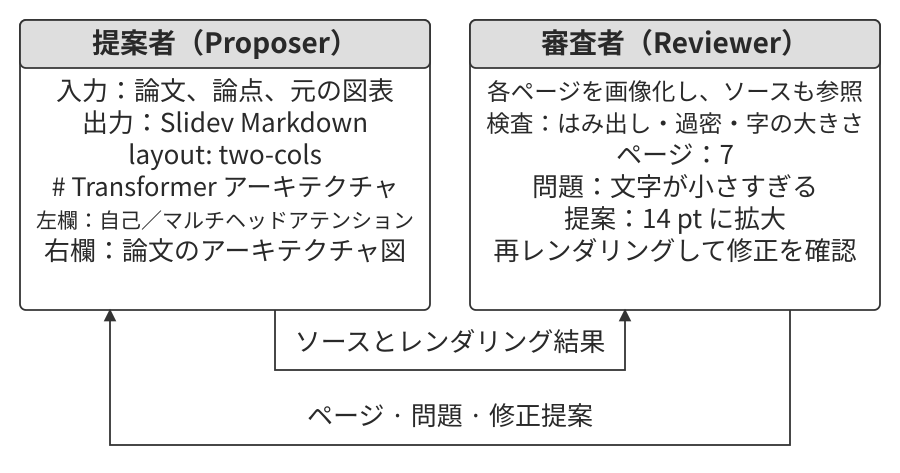

- **提案者（Proposer）** は論文を読み、解説の構成を計画し、Slidev のソースを書き、フィードバックに応じてページを修正する。
- **審査者（Reviewer）** はツールでページをレンダリングし、視覚モデルを使って情報密度、読みやすさ、レイアウト、図と文の対応関係を確認し、ページ番号、問題の種類、深刻度、修正案を含む構造化されたフィードバックを返す。

フィードバックは修正に直接つながるものであるべきです。たとえば「3 ページ目は要点が多すぎるので、手法の概観と計算手順の 2 ページに分ける」「7 ページ目はコードの文字が小さすぎるので、まず 14 pt まで大きくしてから投影時の読みやすさを確認する」といった具合です。事実の誤りと図表の読み違いを優先して直し、その後にレイアウトや視覚的な細部に取り組みます。

部分的な修正では、どのオブジェクトを変えるのかも示す必要があります。飛書（Feishu）のスライドにおける豆包ワークでは、ユーザーがページ上の要素を選択し、フローティングツールバーから編集の指示を出せます。[^ch5-doubao-work] 同じページに 2 つのテキストボックスがあり、一方がインタビューの原文の引用、もう一方が発表者が書いた要約だとします。ユーザーが要約を選んで「2 行に圧縮して」と頼めば、選択されたテキストボックスが変更の範囲を限定します。要約は書き換えてよく、隣の引用は取材対象者の言葉のまま残さなければなりません。

[^ch5-doubao-work]: 飛書ヘルプセンター、スライドでの豆包ワークの使い方。

提案者が修正して再レンダリングし、審査者が新しい版を確認して、前のラウンドの問題が解決したかを確かめます。このループには 2 種類の終了条件を設けます。明確な内容とレイアウトの要件を満たすか、ラウンド数、時間、費用の予算を使い切るかです。たとえば修正は最大 5 ラウンドまでとします。引き渡しの際は、現在の版と未処理の問題を保存し、後から見直せるようにします。

これは第 4 章の操作の承認と、提案者・審査者という同じ型を共有しています。操作の承認は主にある行動を実行してよいかを判断し、内容の審査は複数ラウンドのフィードバックで成果物を改善します。どちらもタスクの要件を共有し、位置を特定できる判断の根拠を示し、後続の流れを Harness が決める必要があります。異なるモデルファミリーを採用すれば、もう一つの審査の視点が得られます。

**筆者は、2 つの Agent の分業がコンテキスト管理の面で持つ利点を重視しています。** 2 つの役割は、それぞれが必要とする情報を別々に保てます。審査者は毎ラウンド、最新のスクリーンショット、審査の基準、必要な問題の一覧を受け取ります。提案者はソース、修正の目標、構造化されたテキストのフィードバックを保持します。ページの画像は審査者のコンテキストにとどまり、主となる軌跡は短いテキストのフィードバックによって修正を進めます。毎回の審査が最新のページを中心に進むため、過去のスクリーンショットによる混線が減り、コンテキストの増加も抑えられます。

> **実験 5-6 ★★：論文に基づく PPT の自動生成**
>
> 本実験では「Attention Is All You Need」の論文 PDF を使い、20 ページの Slidev スライドを生成します。Agent は論文の構成と要点を抽出し、出典を記録した原論文の図を 3 枚使って、ページごとに解説を組み立てます。レンダリングの後に、文字のはみ出し、図表の読みやすさ、図と文の対応を確認し、フィードバックに従って修正します。
>
> 単一の Agent による自己審査と、提案者・審査者の分業を比較しました。今回の実行では、2 つの最終稿は同じ独立した採点の流れでいずれも 95 点でした。分業の方式は入力のピークが約 2.4 万 token、過去のスクリーンショットを保持する単一 Agent の方式は約 9.3 万 token でした。

> **実験 5-7 ★★：論文解説動画の自動生成**
>
> スライドをもとに、Agent はページごとに口語の解説を書き、図中のオブジェクト、関係、結論を説明し、さらに TTS を呼び出して音声を合成できます。解説原稿とページは一緒に視覚の審査者に渡し、話に出た要素が画面に現れているか、説明が図表と一致しているかを確認します。
>
> 動画を制作するにあたり、実験では前節の生成の流れを踏襲し、より早い時期の 22 ページの稿（v2）を選びました。12 ページを順に抜き出すと、動画の最後の画面は元のスライドの 21 ページ目から来ています。前節で採点と使用量を比較したのは、後に作られた 20 ページの稿（v9）です。ページを選んだ後、Kimi で解説原稿を生成し、Qwen の視覚モデルで図と文の関係を審査し、Fish Audio でページごとの音声を合成します。FFmpeg は各音声の実際の長さに合わせてページの表示時間を設定し、約 8.6 分の解説動画を合成します。
>
> 図5-6 では、スライド、解説原稿、音声が最後の段階で初めて動画になります。問題によってはこの段階でしか気づけません。ページを切り替えるときにある一文がまだ終わっていないか、後ろに進むほど音声と映像がずれていくか、といった点です。
>
> 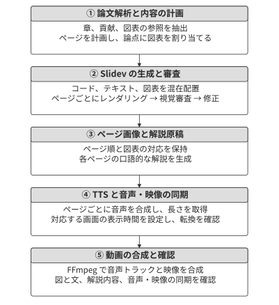

[^ch5-slidev]: Slidev、*Getting Started*。Markdown とウェブ技術に基づくプレゼンテーションの生成、表示、書き出しを説明している。

**動画編集 Agent。**

**動画編集のうち、スクリプトで表現できる操作は、プログラムのインターフェースを優先すべきです。** タイムライン、レイヤー、字幕、音声トラックは複雑な GUI のパネルに分散しており、位置を探してドラッグする操作を繰り返すと、遅延と誤差が増えます。プログラムのインターフェースなら、時間の区間、トラック、エフェクトのパラメータで操作を直接表現できます。Blender の Python インターフェースと FFmpeg は、どちらも編集作業の一部を繰り返し実行できるスクリプトにまとめられます。

Agent はまず「サーフィンの部分を切り出して」といった要求を理解し、素材の中から目的の区間を特定し、切り出し、並べ替え、音声トラックの処理を行うコードを生成できます。提案者が編集の計画とスクリプトを担い、審査者がレンダリングの結果を確認します。抜けや無関係な場面、字幕のかぶりがあれば、具体的な時点と問題を返し、提案者が修正します。キーフレームは場面とレイアウトの確認に向いていますが、動きの連続性や音と映像の同期は、隣接するフレームや連続した区間を確かめる必要があります。

> **実験 5-8 ★★：API に基づくインテリジェントな動画編集**
>
> 本実験では、対象の特定、スクリプトの生成、効果の審査をひとつの流れにつなぎます。まず動画の参照、目的の問い、フレームを抜き出す間隔を動画解析のサブ Agent に渡し、大量の画面を処理させたうえで、時間の区間とその根拠を主 Agent に返させます。
>
> 特定は 2 段階で行います。第 1 段階では 10 秒ごとに 1 フレームを抜き出し、目的のおおよその範囲を探します。たとえば「サーフィンは 40 秒から 110 秒」といった具合です。第 2 段階では候補の区間とその前後の境界を中心に、1 秒ごとに 1 フレームを抜き出し、開始と終了の位置をさらに絞り込みます。粗いサンプリングの間隔より短い場面は 2 つのフレームの間に落ちる可能性があるため、目的の継続時間に応じてサンプリングを増やすか、2 回の抜き出しの間の画面を見返します。
>
> 区間が決まったら、提案者が Blender の Python スクリプトを生成し、切り出しと、必要に応じて字幕や速度変更などを実行します。審査者はプレビューを見て、調整すべき境界と効果を指摘し、修正が通ってから完全な映像を出力します。
>
> 実際に編集したのは、大きな白ウサギが草地を 1 匹で歩いていく場面でした。10 秒ごとに 1 フレームを見て、モデルは範囲を 10 秒から 20 秒と定めました。10 秒からそのまま切ると、場面の冒頭が途中で落ちてしまいます。そこでプログラムは前後をそれぞれ 5 秒広げ、5 秒から 25 秒の間で 1 秒ごとに 1 フレームを見て、候補の区間を 9 秒から 12 秒に絞りました。さらに審査者が、断片に隣の場面が混じっていることに気づき、修正後の区間は 9.25 秒から 11.00 秒になりました。人手で付けた 9.08 秒から 11.20 秒と比べると、開始は 0.17 秒遅く、終了は 0.20 秒早く、両端とも誤差 3 秒以内という要件を満たしています。
>
> タイムコードで確かめられるのは、どこで切ったかまでです。同じ字幕とスローモーションを、わざと選び間違えた画面に当てたとき、審査者は誤りに気づけるでしょうか。実験ではまず 0 秒から 3 秒の対照の断片を確認させ、そのうえで修正後のレンダリングを見せました。審査の対象には、画面の白ウサギ、下部の字幕、速度変更後の長さが含まれます。

**3D と工業部品：適した生成方法を選ぶ。**

**寸法と組付けの関係が厳しい制約となる工業部品では、パラメトリックなコード生成を優先し、自然な形態と外観を主に追う対象では、生成モデルを優先して検討します。** この選択は、成果物を少数のパラメータで正確に記述できるか、修正した後にどの関係を保つ必要があるかによって決まります。CadQuery、OpenSCAD、Blender のスクリプトは編集可能な構築の過程を提供し、Hunyuan3D（混元 3D）などのモデルは学習した形態の事前分布を利用して複雑な外観を生成します。

**記述がパラメトリック化に適しているか。** 簡略化したフランジであれば、外径、厚さ、ボルト穴のピッチ円直径、穴径、穴数で主要な幾何関係を表現できます。コードはパラメータを構築の手順に対応させるため、繰り返しの調整に向いています。観葉植物の鉢、太湖石、人の顔は、不規則な形態を大量に含みます。生成モデルは外観の構築を助けられますし、プログラムによる方法でも、成長の規則、確率過程、アセットの組み合わせで細部を生成できます。

**精度をどう確かめるか。** 穴径 5 mm、公差 ±0.05 mm といった要件では、まず単位、座標系、測定の方法を明確にし、それからモデルの寸法と仕様を比べます。パラメトリックモデルなら幾何オブジェクトを直接確認できます。メッシュは断面、穴、外接寸法などの方法で測定し、離散化の誤差も見込む必要があります。

**どう保存し、修正するか。** B-rep（境界表現）は面、辺、頂点でソリッドの境界を記述し、三角メッシュは面の断片で表面を近似します。CadQuery は CAD データの交換用に STEP を、メッシュとして STL も書き出せます。編集可能なパラメータと構築のロジックは CadQuery のソースコードに保存されます[^ch5-cad]。CNC 加工の流れに入るには、工程の計画、工具経路、工作機械への適合も必要です。

たとえば、取り付け穴を M5 用から M6 用に変えるなら、穴径のパラメータを修正し、再生成して、外径、厚さ、穴の位置が保たれているかを確認します。生成モデルでの修正方法はインターフェースの能力次第で、再生成もできますし、局所的な編集と後段の幾何処理を組み合わせることもできます。

2 つの路線を組み合わせるときも、分担は明確にすべきです。寸法と組付けの関係はパラメトリックなコードに、テクスチャと自由な外観は生成モデルに任せます。**重要な寸法を繰り返し正確に修正する必要があるなら、一度きりの生成による外観よりも、編集可能な構築の過程のほうが価値があります。**

> **実験 5-9 ★★：同じ部品の 2 つの生成経路——コードと生成モデル**
>
> 本実験では、外径 80 mm、厚さ 10 mm のフランジを生成し、直径 60 mm のピッチ円上に取り付け穴を 4 つ均等に配置することを求めます。組付けの意味を明確にするため、初期の仕様では M5 用の 5.5 mm の通し穴を採用し、変更の要求では M6 用の 6.5 mm の通し穴に変えます。
>
> コードの路線では、モデルが CadQuery のプログラムを生成し、実行して STEP と STL を書き出します。生成モデルの路線では、まず製品の参考画像を生成し、それを Hunyuan3D に渡してメッシュを生成します。外径、厚さ、穴数、穴径、穴の位置、取り付け面を確認し、単位と軸方向も記録します。
>
> 指定した寸法だけが変わったことをどう見抜くか。修正の前後に書き出した STL を比べると、4 つの取り付け穴の平均直径は 5.499 mm から 6.499 mm に増えています。2 つの品はいずれも外径が 80 mm、厚さが 10 mm で、ピッチ円の直径は小数点以下 3 桁まで同じ 60.000 mm でした。生成モデルの路線の元のメッシュには、明確な物理的な尺度がありません。測定のプログラムで Z 軸に沿って中央の断面を取っても、穴の内側の輪が見つかりませんでした。4 つの穴が円盤を貫通しているかを確かめるには、取り付け面を見分け、その法線に沿って異なる深さで断面を取る必要があります。再生成すると、全体の形態も向きも変わってしまいました。
>
> 最後に別の問題を出します。見た目が自然な鉢植えの画像を納品するとして、どう検収するのでしょうか。実験では matplotlib で鉢植えを 1 枚描き、Gemini で別の 1 枚を生成し、同じ視覚モデルに 10 点満点で自然さを評価させました。2 枚はそれぞれ 3 点と 8 点でした。この点数が答えているのは、評価するモデルがどちらの画像をより本物の植物らしいと感じたかです。フランジの話に戻れば、製品画像に穴が 4 つあるように見えても、組付けは 3 次元の部品で穴の位置と直径を確かめなければなりません。

[^ch5-cad]: CadQuery、*Importing and Exporting Files*。STEP や STL などの形式を紹介し、完全なパラメトリック情報が CadQuery の Python ソースに保存されることを説明している。

### システムアダプタとしてのコード

外部サービスのインターフェース、認証方式、データ形式はそれぞれ異なります。Agent はドキュメントとレスポンスのサンプルを読み、HTTP クライアントを生成し、認証ヘッダーを設定し、戻り値を解析して、上流のフィールドを下流が必要とする構造に変換できます。ここでのコードはシステムの適応を担い、既存のサービスを組み合わせて新しいタスクの流れを作ります。

たとえば、決済サービスから読み取った金額フィールドが分（0.01 元）単位で、レポートが元単位で表示するなら、JSON の解析に成功しても形式が両立していることしか分かりません。25 元の取引は、上流では整数の 2500 です。この数をそのままレポートに入れれば、25 元が 2500 元になってしまいます。

アダプタには、入出力、エラー処理、対応するバージョンの範囲を明確にしておく必要があります。サンプルはモデルがフィールドを理解するのに役立ち、インターフェースの取り決めとテストは、欠損値、ページング、異常なレスポンス、バージョンの変化を確認します。認証情報は実行環境が管理し、生成されたコードは管理されたインターフェースを通じて認可された能力を使います。検証に通ったアダプタは保存して再利用でき、後で形式が変わったら修正の流れに戻ります。

グラフィカルなインターフェースしかないシステムにも、似た方法が使えます。Agent はまず第 6 章で紹介する Computer Use でタスクをこなし、安定した操作手順を RPA ツールとして固定します。画面のコントロール、ログイン状態、ページの流れが変わったときは、ツールがずれを検出して位置を特定し直す必要があります。成功した軌跡からワークフローを抽出し、検証し、再利用する方法は、第 9 章でさらに論じます。

**Agent ログの解析と可視化。**

複雑なタスクを 1 回こなすだけでも、モデルへのリクエスト、ツールの実行、サブ Agent とのやり取りが何度も生じます。ログの概要はステップの関係、状態、所要時間を示し、展開すれば具体的な入出力が表示されて、あるステップで何が起きたのかを読み手が追えるようにします。フィールドの追加、入れ子の構造、形式のバージョンは、いずれも解析と表示に影響します。

適応的な解析は、「変化を見つける―パーサーを生成する―結果を検証する」というループでこうした変化に対処します。解析に失敗したら、システムは元のサンプル、エラーの位置、期待されるフィールドを保存し、インターフェースの取り決めと生成側のバージョンと照らして、変化が想定どおりかを判断します。形式のアップグレードだと確認できてから、Agent に新しいパーサーを書かせます。ログを書くプログラムの誤りであれば、元のログを保存して障害を報告し、新しいパーサーが誤りまで正常な形式として扱ってしまわないようにします。新しく書いたコードはまず制限された環境で動かし、フィールドとその意味を確かめてから、正常なサンプル、フィールドが欠けたサンプル、古い形式の回帰ケースで検証します。通過したら新しいパーサーを登録し、バージョンと対応する形式を保存します。失敗したサンプルも保存しておき、追跡やリトライに使えるようにします。

解析と表示には、それぞれの確認方法があります。プログラムはタイムスタンプ、状態、数値の型、呼び出しの関連付けを確認します。ブラウザでのレンダリングはページが正常に動くかを確認し、視覚モデルは表、タイムライン、ラベルが明瞭かどうかの確認を補助します。ホットアップデートの際は前のバージョンと巻き戻しの入口を残し、新しい形式への対応を少しずつ稼働中のシステムに取り込めるようにします。

> **実験 5-10 ★★★：適応的なログ解析システム**
>
> 本実験では、まずログを生成するプロセスを 2 つ動かし、それぞれ縦棒区切りの形式と入れ子の括弧の形式で出力させます。初期のパーサーはこれらのサンプルを処理できないため、システムはモデルに 2 つの解析関数を生成させ、テストに通ったものをホットロードして、それまで失敗していたログを解析します。
>
> 1 つ目の形式からは `timestamp`、`level`、`module`、`step`、`message` を抽出し、2 つ目の形式ではさらにツール名、所要時間、状態も扱います。実行の記録では、2 種類それぞれ 3 件のログが解析でき、新しく作ったエンジンも保存済みのパーサーを読み込んで、混在したログの流れを処理し続けられました。
>
> 解析結果は Chromium で表としてレンダリングされ、視覚による審査が列名、行の内容、読みやすさを確認します。

**Agent の実行ログの自動分析と問題の診断。**

構造化された軌跡を解析できたら、Agent はアーキテクチャ文書や PRD（製品要求仕様書）と照らして、想定される流れと実際の行動を比較できます。たとえば、返金の前にこの注文が返金できるかを照会したか。在庫サービスがタイムアウトした後、プログラムは取り決めどおりキャッシュの照会に切り替えたか。

問題の報告には、優先度、モジュール、現象、証拠、改善案を含められます。Agent はそれをもとに回帰テストを生成し、問題に対応する入力と受け入れ条件を固定することもできます。テストフレームワークは管理された環境でリクエストを再生するか、保存されたツールのレスポンスを読み込んで、不具合のある版と修正した版の振る舞いを比較します。外部への書き込みを伴う操作には隔離された環境や代替のインターフェースを使い、再生の影響範囲を制御できるようにします。

アサーションは検証すべき性質に対応していなければなりません。たとえば、ログに返金のチェックが現れていても、それはプログラムが照会したことを示すにすぎません。この返金が正しかったかを知るには、プログラムが照会してから返金したのか、チェックの結果が返金を許していたのか、注文が最終的にどの状態になったのかまで見る必要があります。

診断が見直しを経たら、Agent は相応の認可を得たうえで、MCP を通じて GitHub Issue を作成し、モジュールに応じて担当者を提案できます。同じ不具合の作業項目がすでにあるなら、新しい証拠をそこに統合します。

> **実験 5-11 ★★★：プロダクションログのインテリジェント診断システム**
>
> 本実験では、ローカルの HTTP サービスで 2 本の業務の軌跡を生成します。1 本は、注文が返金可能かを照会せずに返金したことを示す記録、もう 1 本は、在庫の照会がタイムアウトした後にキャッシュからの取得に切り替えなかったことを示す記録です。モデルはアーキテクチャ文書と要求仕様を踏まえ、軌跡とラウンドへの参照を含む問題の報告を作成し、さらに実行可能な回帰テストを 3 つ生成します。
>
> 図5-7 では、診断の報告を軌跡と回帰テストの間に置いています。報告は「システムがチェックを飛ばして、そのまま返金した」と指摘しています。軌跡に戻って証拠を探すと、呼び出しの記録からはどのステップが抜けているでしょうか。さらにテストを見ると、将来このステップがまた抜けたとき、テストはそれを見つけられるでしょうか。
>
> 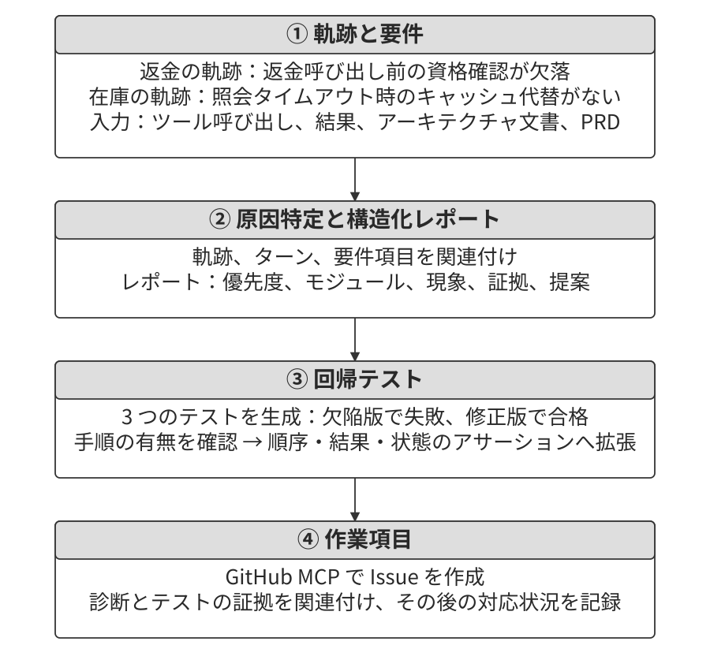
>
> 3 つのテストは不具合のある版ではすべて失敗し、修正した版に替えるとすべて通りました。そのうち 1 つのテストは、プログラムが返金チェックのツールを呼んだかどうかしか判定していません。プログラムが先に返金し、後からこの注文が返金できるかを照会しても、このテストは通ってしまいます。実行の記録には GitHub MCP が作業項目を作成した受領記録も保存されており、それを手がかりに、診断の報告が開発者に渡った後の対応するチケットを見つけられます。
>

### 生成的 UI としてのコード

ユーザーが、Agent が扱っている最中の材料に自分でも手を入れたいなら、画面を両者が共有する作業台にできます。旅程表を例にすれば、アシスタントがどの区間を直しているのかを見せ、ユーザーが修正を引き受け、変更を確定したり取り消したりできるようにします。ユーザーがたったいま出発日を金曜に変えたなら、アシスタントはその新しい旅程の上で作業を続けるべきです。両者が同じ見える状態を共有し、いま編集中のフィールドをどちらが握っているかを取り決めて初めて、見ながら直すことが可能になります。

ユーザーが 3 つの移動の案を比べたいとします。行き先がまだ決まっていない段階では、対話による問い返しが便利です。行き先が決まったら、日付を直接選び、人数を入力してもらうほうが、何行もの文章を読み比べるより楽です。最後に総額が日付によってどう変わるかを比べるなら、グラフ 1 枚で違いが目の前に並びます。Agent がタスクに応じて対応するフォーム、グラフ、アプリケーションの画面を生成し、ユーザーが直接入力し、選び、操作できるようにする。これが生成的 UI（Generative UI）です。

**プロトコルで画面とインタラクションを記述する。**

画面の生成には 2 つの実装経路があります。HTML や JavaScript などのコードを出力し、管理された環境で実行させる方法と、宣言的な構造を出力し、クライアントのコンポーネントにレンダリングさせる方法です。前者は独自のレイアウトとインタラクションを実装しやすく、後者は利用できる能力をクライアントが提供するコンポーネントとアクションの範囲に限定します。

A2UI（Agent-to-User Interface）は宣言的な記述を採用しています。Agent が構造化されたメッセージを生成してコンポーネント、データのバインディング、更新を表現し、クライアントが自身のコンポーネントで画面を描画します[^ch5-ui-protocols]。たとえばアプリケーションがカード、ボタン、テキストボックス、表のコンポーネントを提供していれば、Agent はそれを使って「販売データ」という見出しを持つ 3 行 2 列の表を記述できます。コンポーネントのカタログは、グラフや地図などの能力へ拡張することもできます。

AG-UI（Agent–User Interaction）は Agent とフロントエンドの間のイベントのやり取りを担い、メッセージ、ツール呼び出し、状態の更新を伝え、A2UI の画面のメッセージを載せることもできます。2 つを組み合わせれば、A2UI が表示する内容を記述し、AG-UI がバックエンドの実行とフロントエンドのインタラクションをつなぎます。

クライアントは画面の更新を少しずつ受け取り、対応するレンダラーを通じてウェブ、モバイル、デスクトップで表示できます。クライアントはコンポーネントの属性、データのバインディング、アクションの要求を検証し、サーバー側はさらに業務上の権限を確認します。コンポーネント内のリンク、リッチテキスト、データへのアクセスにも、それぞれの扱いのルールが必要です。

コードを直接生成する場合は、依存、資源へのアクセス、実行の権限を確認し、生成された画面をホストのアプリケーションの機微な状態から隔離する必要があります。外部の材料に含まれるプロンプトインジェクションが生成の過程に影響する可能性があり、ブラウザでのスクリプト実行のリスクは、ページの読み込み方と隔離の仕方にも左右されます。

**HTML でインタラクティブな成果を届ける。**

**データ、デモ、継続的に更新される結果を含む研究の成果物には、筆者は HTML のウェブサイトを優先します。** 長く直線的に続く Markdown の報告では、読者は文脈を絶えず探し直さなければなりません。インタラクティブなウェブページなら、説明、データ、デモをひとつの入口にまとめられます。読者はグラフを見て、関心のあるサンプルに絞り込み、ある結果の細部を開き、デモを操作してシステムの振る舞いを理解します。Agent はタスクの進行に合わせてページを更新し、その時点の成果と証拠を記録し続けることもできます。

筆者の研究の実践を例にすれば、研究プロジェクトごとにインタラクティブなウェブサイトがあり、研究の過程における生きた文書であると同時に最終的な成果物でもあって、Agent が実験の進行に合わせて内容を補い続けます。これらのサイトは主に 3 つの役割を担っています。

1 つ目は**実験データの追跡**です。ページはサンプル、プロンプト、モデルの応答、評価を関連づけ、1 件ずつ確認できるようにします。たとえば、同種の応答がいつも低い評価になるなら、評価の記録をたどって元の応答とプロンプトに戻れます。

2 つ目は**訓練指標の監視**です。筆者は訓練の内部状態を映す信号を「内科指標」と呼んでいます。訓練と検証の損失、勾配のノルム、学習率、そして強化学習における報酬、KL ダイバージェンス、方策のエントロピーなどです。言語モデルでは、与えられたテキスト列に対する予測の性能を測るパープレキシティ（perplexity）も使えます。健康診断の生理指標と同じように、これらの曲線は最終的なタスクの成績より早く問題を露呈することがあります。タスクの正解率と併せて見れば、収束しない状態、勾配の異常、訓練の劣化がどの段階で起きたかを特定しやすくなります。

3 つ目は**動作原理の提示**です。いくつかのモジュールがどう連携するかを説明するとき、ページ上で読者に入力を 1 つ変えさせ、中間状態を見せ、出力の変化を実験の記録と照らし合わせてもらえます。

作業が数時間に及ぶとき、ユーザーはどうやって空いた時間に作業を引き取るのでしょうか。筆者が Coding Agent を使うときは、口頭の指示 1 つが担当の Agent に正確に届き、成果を見たいときにはいつでも開け、新しい版が出たときや筆者の判断が必要な問題が生じたときに知らせてほしいと考えます。たとえば、2 本のレポートを同時に生成しているとします。ユーザーが販売レポートを開き、2 枚目のグラフを指して「これは純収入で描き直して」と言います。画面は、現在のレポートとグラフの識別子を指示と一緒に送り出すべきです。グラフが直れば、通知から新しい版を直接開けます。「純収入」に使える定義が 2 通りあるなら、アシスタントは選ぶべき 2 つの定義をユーザーに示すべきです。

**ユーザーの意図を明確にする。**

ユーザーが「北京までの航空券を 1 枚取りたい」と言ったとき、行き先はすでに明確ですが、出発地、日付、片道か往復かはまだ補う必要があります。Agent は 1 回の対話でまとめて質問することも、フォームを生成して関連する条件を同じページに並べることもできます。

フォームのコントロールは、それぞれ異なる種類の情報に対応します。テキストボックスは自由な入力を受け付け、ドロップダウンとラジオボタンは選択肢を示し、チェックボックスは複数選択を支え、日付選択は時刻の入力を助けます。JavaScript は連鎖する関係を表現できます。たとえば「往復」を選ぶと復路の日付が現れ、復路が往路より前でないかを確認します。選択が変わったときは、無効になったフィールドを合わせて消すか、無視する必要があります。

図5-8 は、次の実験のある実行から取ったものです。この提出を上から順に見ていきましょう。ブラウザが返した 4 つのフィールドに行き先はありません。モデルはどこから、旅客が北京へ行くと知ったのでしょうか。

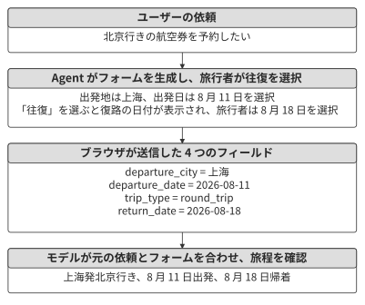

> **実験 5-12 ★★：動的フォーム生成による意図明確化システム**
>
> 本実験では「北京までの航空券を 1 枚取りたい」から出発し、モデルに HTML のフォームを生成させます。出発地にはテキストボックス、出発日には日付選択を使い、旅行の種類として片道と往復の選択肢を用意し、往復を選んだときに復路の日付を表示します。
>
> プログラムは、最初の依頼とフォームのデータを一緒にモデルへ返します。提出されたフィールドだけを残すと、すべてのコントロールを正しく埋めていても、行き先が抜け落ちてしまいます。
>
> 同じフォームでもう一歩試してみます。復路の日付を入れた後で片道に選び直すのです。ページは復路の入力欄を隠しましたが、提出された JSON には片道と 8 月 18 日の復路の日付が両方残っていました。片道に選び直したときは、クライアントが無効になった復路の日付も消さなければなりません。

[^ch5-ui-protocols]: A2UI 公式ドキュメントおよび *AG-UI Overview*。それぞれ宣言的な画面の記述と、Agent とフロントエンドの間のイベントのやり取りを説明している。

**SQL クエリの生成。**

ユーザーはデータベースへの照会を自然言語で依頼でき、Agent は表の構造と業務上の集計の定義に基づいて SQL を生成します。**照会結果の表を丸ごと表示するときは、筆者は Artifact モードを優先し、結果をデータベースから画面に直接流し込みます。** モデルに大きな表を読ませて 1 行ずつ書き写させれば、token の使用量と待ち時間が増え、書き写しの誤りも入り込みます。SQL は確認可能なクエリの成果物として保存し、原因の分析や傾向の要約が必要なときに、必要な集計結果だけをモデルに渡します。

図5-9 では、ユーザーが部署ごとの在籍人数を見たがっており、画面はデータベースが返した集計表をそのまま表示できます。ユーザーが続けて「マーケティング部は研究開発部より何人多いか」と尋ねれば、モデルは表の 9 と 5 を取るだけで差が 4 人だと計算できます。さらに「先月も同じくらいの差だったか」と問われれば、目の前の表では足りず、先月の集計日で照会し直す必要があります。

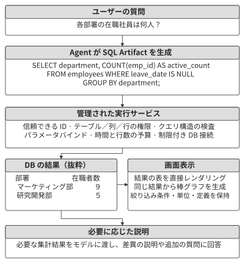

実行サービスは信頼できる身元に基づいてアクセスできる表、列、行を定め、制限されたデータベースアカウントを使い、SQL の構造と操作の種類を検証します。照会の場面は承認済みの読み取り専用のクエリに限定し、関数の呼び出し、時間の予算、返す行数、データの範囲を制御できます。ユーザーが入力した値はパラメータのバインディングで渡します。

Agent は、部署ごとの集計結果を棒グラフで示すといった可視化の成果物も生成できます。実行サービスは照会結果を管理された可視化の実行環境に渡し、画面には許可されたデータとインタラクションだけを表示します。

> **実験 5-13 ★★：自然言語でやり取りする ERP Agent**
>
> 本実験では、ERP（企業資源計画）における従業員と給与の照会を例に、業務上の問いから SQL を生成し、データベースの結果をそのままページに流し込む方法を学びます。PostgreSQL に 2 つの表を作ります。従業員表には従業員 ID、氏名、部署、等級、入社日、退職日を含め、退職日が空なら在籍中を表します。給与表には従業員 ID、支給日、給与を含め、従業員 1 人につき毎月 1 件の記録があります。
>
> Agent はこの 2 つの表を使って、次の 10 個の問いに答えます。
>
> 1. 従業員の平均在籍期間はどれくらいか。
> 2. 各部署の在籍従業員は何人か。
> 3. 従業員の平均等級が最も高い部署はどこか。
> 4. 各部署で今年と昨年にそれぞれ何人が新たに入社したか。
> 5. 一昨年 3 月から昨年 5 月までの、A 部署の平均給与はいくらか。
> 6. 昨年、A 部署と B 部署ではどちらの平均給与が高いか。
> 7. 今年の等級ごとの従業員の平均給与はいくらか。
> 8. 入社 1 年以内、1〜2 年、2〜3 年の従業員の、直近 1 か月の平均給与はいくらか。
> 9. 昨年から今年にかけて昇給幅が最も大きい従業員 10 人は誰か。
> 10. 給与の未払い（在籍していたのに支給がない月）はあるか。
>
> 照会の前に、集計の定義を明確にする必要があります。たとえば、在籍中の従業員の在籍期間は照会の基準日まで、退職した従業員は退職日までで計算します。「平均給与」は支給記録で平均するのか従業員単位で平均するのかを決める必要があり、昇給の順位では昨年の記録がない従業員の扱いを決める必要があります。
>
> 今回の実行では 10 本の SQL を生成して実行し、結果はいずれも独立した参照計算と一致しました。その後、ブラウザが表をそのままレンダリングしました。モデルが受け取るのは表の構造、タスク、必要な実行時のフィードバックで、データベースの行データはアプリケーションを通じて画面に届きます。

**ソフトウェアの動的生成。**

Agent は要求から出発して画面とインタラクションのロジックを生成し、ユーザーの操作に応じて修正を続けられます。Anthropic が 2025 年に公開した期間限定のリサーチプレビュー「Imagine with Claude」は、このやり取りを示しました。ユーザーが画面を探索すると、モデルがそれに応じたソフトウェア体験を生成し続けるのです[^ch5-imagine]。

**実際の製品に向けては、筆者は既存のフレームワークの上でカスタマイズするほうが有望だと考えています。** アプリケーション全体をゼロから生成し続ければ、生成、レンダリング、検証のコストを繰り返し払うことになります。安定したフレームワークを保ち、ユーザーが気にかける画面と流れだけを開放すれば、信頼できる個別化された体験をより早く提供できます。ユーザーが「ボタンを青にして」「サイドバーにショートカットメニューを追加して」「もっと読みやすいフォントにして」と頼めば、Agent は関連するコンポーネントを特定してコードを修正し、プレビューで効果を確かめます。基盤となるフレームワークが安定したページ構造と業務インターフェースを提供し、カスタマイズの範囲は色やフォントから、レイアウトやコンポーネントへと少しずつ広げられます。

開発環境の HMR（Hot Module Replacement、ホットモジュールリプレースメント）は、コードの変更後に影響を受けるフロントエンドのモジュールを更新できます。状態が保たれるかどうかは、フレームワークとの統合、更新の境界、修正の種類によって決まります。完全な再読み込みが必要な場合は、アプリケーションが必要な状態を保存しておくべきです。FastAPI の開発モードの reload はサーバー側のプログラムを読み込み直すもので、両者はそれぞれフロントエンドのモジュールとバックエンドのプロセスに作用します[^ch5-hmr]。

> **実験 5-14 ★★：対話によるインターフェースのカスタマイズシステム**
>
> 本実験では、React のフロントエンドと FastAPI のバックエンドからなるチャットアプリケーションを構築し、開発環境でフロントエンドの HMR とバックエンドの reload を有効にします。モデルは 3 ラウンド続けて出される要求に従って色、フォント、タイトルを修正し、ブラウザが修正のたびに実際の画面を確認します。
>
> 今回の実行では Vite の HMR イベントが記録され、3 ラウンドの修正のいずれでもページ全体の遷移は起きず、既存のチャットの状態は保たれ、最終的なビルドも通りました。

[^ch5-imagine]: Anthropic、*Introducing Claude Sonnet 4.5*。モデルの公開とあわせて提供された期間限定のリサーチプレビュー Imagine with Claude を紹介している。
[^ch5-hmr]: *Vite HMR API* および *FastAPI CLI*。それぞれフロントエンドのホットアップデートと、開発サーバーの自動再読み込みを説明している。

**権限の境界を動的な業務コードから独立させる。**

**業務コードを Agent が動的に書き換えやすくなるほど、最終的な権限の境界は安定したデータアクセス層へ下ろすべきです。** 従来のアプリケーションは権限の判断をレビュー済みの業務コードに書いていました。生成されたコードが絶えず変わるようになると、ある新しい経路が同じチェックを漏らすかもしれません。毎回の読み書きが独立したデータアクセスサービスを通るようにして初めて、権限の制約を保てます。たとえば採用アプリケーションは、候補者の一覧や操作フォームを動的に生成できますが、候補者がどの組織に属し、採用担当者がどのフィールドを更新できるかは、信頼できるデータアクセスサービスが常に確認します。

ここでの設計目標は、**生成されたコードに誤りがあっても、信頼できるデータアクセス層が権限の制約を強制できること**です。これは第 1 章のデータ層のガードレールを受け継ぐもので、強制的に守らせるべきルールを、関連するすべての操作が通る場所に置くという考え方です。データベースの行レベルセキュリティのポリシーはレコードへのアクセスを制限でき、制約と検証器は正当な状態を確認し、管理されたビュー、ストアドプロシージャ、データサービスは許された操作を提供します。アプリケーション層は事前に確認してユーザーに説明できますが、最終的な読み書きは信頼できるデータサービスとデータベースの権限で制御します。

毎回の操作には、ユーザー、テナント、ロール、あるいは Agent の身元を含む、信頼できる**アクセスコンテキスト**（access context）も必要です。認証サービスと信頼できるランタイムが身元を確立して結びつけ、データサービスはそれに基づいて認可します。動的なコードはタスクに必要な制限されたインターフェースを受け取り、認証情報とポリシーの管理権限は独立したコンポーネントが保管します。すべてのデータベース接続、補助的な照会、バックグラウンド処理は、同じアクセス範囲に従うべきです。

たとえば PostgreSQL の行レベルセキュリティは、データベースのロールの設定と組み合わせて使う必要があります。アプリケーションの接続にはポリシーに縛られたロールを使い、アプリケーションのアカウントにはアクセスポリシーを変更する権限を与えません[^ch5-rls]。ルールと身元の結びつけの仕組みは独立したレビューを経て、業務の画面はその範囲の中で変わり続けられます。

権限とデータの完全性は、さらに別々の役割を担います。採用担当者が候補者の記録を修正する権限を持っていても、状態機械は「書類選考済み」から「面接済み」へ進んでよいかを引き続き確認します。給与の検証器は関連する職位を読み、希望給与がその職位の範囲内にあるかを確認します。参照のチェックは、職位と候補者の関係が有効であることを確かめます。

> **実験 5-15 ★★★：動的生成ソフトウェアのための権限内蔵データオブジェクト**
>
> 本実験では、PostgreSQL の上に構築した Python のオブジェクトストアのプロトタイプを提供し、権限のルール、検証器、オブジェクトの関係、後続の反応の宣言をデータ型の中に置きます。読み取りの際にはアクセス権限を確認します。作成と更新の際には、まず権限と業務の検証を行い、参照関係を確認してから永続化し、その後に宣言された後続の反応をキューに入れ、反応の連鎖の深さを制限します。
>
> 採用の例には、職位、候補者、面接、評価などのオブジェクトが含まれます。候補者は応募、書類選考、面接、内定通知、採用と順に進み、関連する段階からは不採用の状態にも移れます。給与の範囲は関連する職位から取ります。例では、正常な状態の更新、無効な状態の遷移、職位の給与範囲を超える値、別テナントからのアクセスといったチェックを用意し、認可と業務の検証がそれぞれ何を扱うのかを読者が理解できるようにしています。
>
> プロトタイプは `AccessContext` でユーザー、ロール、組織の属性を表現し、教育用のスクリプトはこれらのコンテキストを直接組み立てて、異なる身元を再現します。デプロイの際は認証の入口がコンテキストを確立し、オブジェクトストアと生成コードを、明確なサービスまたは権限の境界の両側に分けて配置します。

[^ch5-rls]: PostgreSQL、*Row Security Policies*。ロールと操作ごとに行レベルセキュリティのポリシーを設定する方法と、その適用範囲を説明している。

### コードがコードを創る：Agent の自己ブートストラップ

コード生成の能力は、Agent そのものの開発にも使えます。作成者がタスクの要件を受け取り、新しい Agent のプロンプト、ツール、実行ループを生成または修正し、テストと実際のやり取りを通じて成果物を確認します。図5-10 はこの自己ブートストラップのループを示しています。既存の実装が出発点を与え、タスクからのフィードバックが修正を促し、検証の結果がどの変更を残すかを決めます。

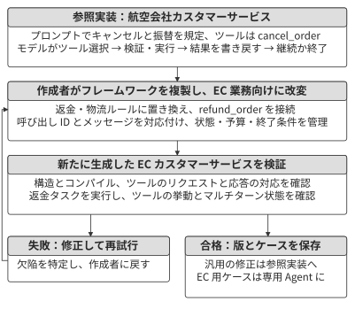

ある修正が汎用的な能力を高めたのか、たまたま直前に見た問題に適合しただけなのかは、どう見分ければよいでしょうか。作成者に渡していないタスクを 1 つ残しておきます。たとえば、ある店舗のデータで価格監視 Agent を開発し、そのうえで別の店舗のサンプルを渡し、同時に元のタスクも再実行します。

**Agent の実行環境を保守する。**

新しい Agent の実行は、設定、認証情報、セッションの状態、サービス、サンドボックスに依存します。OpenClaw の `doctor` コマンドは、保守ツールの一例を提供します。旧設定の移行、OAuth 認証情報の状態、セッションのロック、プラグインの導入、ゲートウェイの健全性、サンドボックスのイメージといった問題を確認し、修正案を示すか、該当する修正を実行します[^ch5-doctor]。

これらの決定的なチェックは、自己保守の流れの土台になります。検出のルールが既知の故障をカバーし、修正の動作には明確な入力と期待される結果があります。さらに Agent の診断の流れを設計するなら、未解決の問題をログ、設定、チェックの結果とともにモデルに渡し、どの設定をどう変えるつもりかを説明させます。実行の層は権限と修正の範囲を確認し、そのうえで健全性のチェックと回帰テストを走らせます。設定のスナップショット、変更の記録、巻き戻しの入口があれば、修正に失敗した後でもシステムは作業を再開できます。

**参考実装にエンジニアリングの経験を載せる。**

専用の Agent の作成は、領域のロジックと汎用の基盤の両方に関わります。生成された結果を確認するときは、次の 4 種類の問題から入るとよいでしょう。

1. **コンテキストと実行ループ。** ロール、ツール呼び出しの識別子、ツールの結果の間の関連を保ち、複数ラウンドの状態、終了条件、予算、異常時の復旧を確認する。構造化されたメッセージはプロトコルの関係を保ちやすく、安定したプレフィックスはプロンプトのキャッシュに道を開く。
2. **ツールのインターフェース。** ツールの説明は用途、適用条件、使用の境界を伝え、引数には型、意味、具体的な例を含める。実行の層はさらに引数、身元、業務の状態を検証する。
3. **モデルと API の選択。** モデルは訓練データに頻出する古いモデルや古いインターフェースを引き継ぎやすく、コードが流暢に書けていても選定が遅れていることがある。作成者に保守された選定資料を渡すか、公式ドキュメントを検索させて、モデルの能力、インターフェースのバージョン、呼び出し方を確認させる。生成後の実際の呼び出しが、設定が使えるかどうかを確かめる。
4. **依存とエコシステムの互換性。** ライブラリの保守の状態、バージョン、インターフェースの変化を確認し、依存の導入、コンパイルの検査、テストによって、組み合わせたプログラムを検証する。

**専用の Agent を作成するとき、筆者は作成者に検証済みの参考実装をコピーさせ、そのうえで領域に合わせた修正を加えさせることを優先します。** プロンプトでは、メッセージのプロトコル、状態の管理、復旧の仕組みの細部を網羅しきれませんが、参考となるコードはこれらのエンジニアリングの経験を新しいシステムにそのまま持ち込めます。モデルはプログラミングに長けていても、タスクの説明に明記されていない実行条件を見落とすことがあります。フレームワークを再利用すれば、こうした繰り返しの失敗を減らせます。作成者は適切な基盤のフレームワークをコピーし、システムプロンプトを新しい役割に合わせて調整し、領域のツールを増減し、業務のロジックを修正し、対応するテストを加えます。メッセージの処理、呼び出しの関連付け、状態の管理、終了の経路はフレームワークが提供し、領域の変化は新しいテストケースで検証します。

テンプレートのほうがずっと速いとき、「機能をいくつか省いたからだ」という説明をどう排除すればよいでしょうか。次は 2 組の作成者に同じ種類の Agent を納品させ、同じチェックを課します。

> **実験 5-16 ★★★：Agent を創り出せる Agent の開発**
>
> 同じ作成者モデルに、リリースを審査する Agent を構築させます。デプロイのチェック記録を 1 組読み、必須の項目に 1 つでも通っていないものがあれば、リリースを拒否して根拠を示すというものです。ゼロから作る場合、モデルは実行ループ、ツールのプロトコル、領域のツール、コマンドラインの入口、テストを書く必要があります。テンプレートの路線では、まず構造化された記録を検査できる Agent をコピーし、モデルは領域の仕様を埋めるだけで済みます。たとえば、状態はどのフィールドにあり、どの値が合格を表すか、といった点です。作成用のスクリプトが、仕様に基づいてシステムプロンプト、ツール定義、説明のドキュメントを生成します。既存の Python ツールが仕様を読んでチェックを実行します。どちらの路線もメタプログラミング、つまりプログラムでほかのプログラムを生成・修正することを体現しています。
>
> 図5-11 では、2 つの路線が同じ受け入れ条件のところで合流します。
>
> 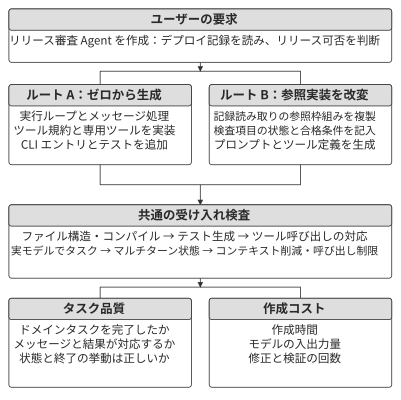
>
> 2 つの路線は同じタスクの要件と受け入れ条件を使います。まず成果物の構造、コンパイル、テストを確認し、次に標準的なメッセージにおけるツール呼び出しと結果の関連を確認し、最後に実際のモデルでのタスクと複数ラウンドのやり取りを実行して、コンテキストの切り詰め、状態の管理、呼び出し回数の制限を検証します。
>
> 保存された Kimi K3 での比較では、2 つの組がそれぞれ 39/39 項目の決定的なチェックに通り、実際のモデルでのタスクと複数ラウンドの状態の確認も通過しました。テンプレートの路線は作成に 1,181 token と約 25 秒、ゼロからの路線は 381,814 token と約 90 分を要しました。
>

[^ch5-doctor]: OpenClaw、Doctor。設定と状態の確認、移行、修正の機能を説明している。

## 本章のまとめ

**Coding Agent がいち早く成熟したのには、見落とされがちな理由があります。ソフトウェアエンジニアリングには、すでに型システム、テストスイート、バージョン管理、デバッグツールがそろっていたのです。** コードを誤って書き換えても、どの入力で予想外の結果が出たかをテストが指摘してくれることが多く、別の直し方を試すときも元の入力でもう一度確かめられます。この経験をほかのタスクに持ち込むなら、まず 3 つの具体的な問いを立てることです。誤りをどう見つけるか、既知の状態にどう戻すか、いつ立ち止まって人に引き継ぐか。たとえば返金の呼び出しが途中で切れたなら、Harness はまず帳簿を照会してからリトライするかを決めるべきです。さもなければ、1 回の障害からの復旧が 2 回目の返金に化けかねません。

コードは、一度の判断を繰り返し使えるものとして保存することもできます。数学の問題での列挙や論理の問題での制約は、プログラムに 1 項目ずつ検証させられます。返金のルールは実行の入口での検証として書き、サーバーが注文の実際の状態を読んでから通すかどうかを決めるようにできます。ログの形式が変われば、パーサーを直し、今回の誤りのサンプルを回帰テストとして残せます。この 3 つの場面ではどれもコードを実行できますが、判定の基準はそれぞれ異なります。解が問題の条件を満たしているか、返金が方針に合っているか、新しいパーサーが以前は取りこぼしていたフィールドを読み取れるか、です。

納品するのが文書、動画、幾何モデルなら、レンダリングの効果、音と映像の同期、寸法の正確さも確かめる必要があり、審査者に実際の成果物を一通り見てもらう段取りが要ります。納品するのがフォーム、クエリ、可視化なら、ユーザーが読み取って操作できるかに加えて、その背後の実行サービスが権限どおりにデータを取得しているかも確認します。コードが生成するのが別の Agent なら、筆者はまず検証済みのフレームワークを再利用し、領域のツールと業務のロジックを生成してから、呼び出しのプロトコル、ラウンドをまたぐ状態、実際のタスクの結果を確認することを選びます。こうして蓄積したツール、検証器、テストは、次のタスクでもそのまま使えます。

コードはタスクを繰り返し実行可能にしますが、環境がその実行の終わりを待ってくれるとは限りません。ある照会がまだ走っているうちに、ユーザーの気が変わっているかもしれません。第 6 章では、こうした変化が進行中のやり取りの中にどう入り込むかを論じます。

## 演習問題

1. ★★ プロジェクトのファイルを読み、依存を導入し、テストを実行する必要がある Coding Agent のために、サンドボックスを設計してください。ファイル、ネットワーク、プロセス、資源の権限をどう設定しますか。タスクが権限の拡大を必要とするとき、要求をどう表現し、範囲をどう確認し、記録をどう残しますか。
2. ★★★ 作成者が何世代にもわたって Agent を生成・修正し続けると、フレームワークの欠陥と領域の誤りが少しずつ積み重なるおそれがあります。参考となる版、回帰テスト、振る舞いの評価、巻き戻しの仕組みを使って、こうした変化をどう追跡しますか。
3. ★★ ログの形式の変化は、正常なアップグレードによることもあれば、生成側の不具合によることもあります。適応的な解析システムはどんな証拠を残し、どんな条件に基づいて、パーサーの追加、異常の報告、処理の一時停止を決めるべきでしょうか。
4. ★★ 提案者・審査者のループで、審査者はページの情報密度が妥当だと判断したのに、ユーザーは詰まりすぎだと感じたとします。ユーザーの好みを、例、評価の条件、対話でのフィードバックへとどう変換し、その後の修正が要件に合っているかをどう確かめますか。
5. ★★ Coding Agent は知識ベース、アーキテクチャ文書、プロジェクト指示を更新でき、操作の手順をコードとして固定することもできます。冗長なルールや古くなったルールをどう見分け、ルールに適用範囲、検証方法、廃止の条件をどう設計しますか。1 回の成功した修正から、第 9 章で論じる継続的な進化へと発展させるには、さらにどんな蓄積と評価の仕組みが必要でしょうか。
6. ★ リモートでの協働に親和的なチームは、Agent にとっても作業の情報を得やすいことが多いものです。よく知っているプロジェクトの要件、アーキテクチャ、意思決定の記録、受け入れ基準を点検し、最も補うべきドキュメントを挙げて、それらが Agent のどんな具体的なタスクを助けるかを説明してください。
7. ★★★ プライベートなデータにアクセスし、信頼できないコンテンツを処理し、外部と通信し、永続記憶も使う Agent について、身元の認可、出どころの標識、データの流れのチェック、記憶への書き込みの審査をどう配置しますか。正常な業務の流れを 1 つ使って、これらのチェックがどこに位置するかを説明してください。
8. ★★ SQL と HTML の Artifact モードでは、モデルが成果物を生成し、実行サービスが照会やレンダリングを処理し、画面が結果をそのまま表示します。どんな情報なら改めてモデルに渡して説明させるのが適しているでしょうか。照会の権限、資源の予算、ページの隔離、表示結果の一貫性をどう確認しますか。
9. ★★ ツールはデータベース中の業務の状態に基づいてルールを検証し、引数の説明はモデルが呼び出しを準備するのを助けます。予約のキャンセルを例に、自然言語の方針、引数の例、実行の層での検証、境界のテストがそれぞれ何を担うかを説明してください。方針が変わったとき、どの内容を同時に更新する必要がありますか。
