# インタラクション：観測空間と行動空間の拡張

**基盤モデルが固定されているとき、観測と行動のインターフェースを組み直したり拡張したりすることは、Agent のタスク性能を高める最も効果的な工学的手段の一つです。** これまでの章では、Agent はたいていユーザーが話し終えるのを待ってから、資料を調べ、ツールを呼び出し、返答していました。しかし Agent がツールの結果を待っているあいだにも、ユーザーと外部環境は変化し続けています。

ユーザーがアシスタントに航空券の変更を頼んだとします。アシスタントがカスタマーサービスにフライトを問い合わせているところへ、ユーザーから「預け荷物がもう一つある」と追加のメッセージが届きます。担当者はまだ話している途中で、画面に表示された運賃も変わるかもしれません。アシスタントは運賃に預け荷物が含まれるかをすぐに確かめる必要があり、さきほどの見積もりがまだ有効かにも注意を払わなければなりません。ここには二つの設計上の問いがあります。アシスタントはどの経路から変化を知ることができるのか。そして、いつ反応できるのか。本章ではまず非同期に届くメールとツールの結果を論じ、続いて連続する音声、画面の変化、ロボットの動作フィードバックを取り上げます。

## モダリティとタイミングの拡張

**モダリティ**は情報と行動の形式を表します。Agent はテキストを読み、音を聞き、画面を見て、トルク信号を受け取ることができます。出力としても、文字を書き、音声を合成し、画面をクリックし、関節を駆動できます。

**タイミング**は、情報がいつ届き、行動がいつ始まり、システムがいつ応答するかに関わります。情報は Agent が能動的に問い合わせることもあれば、外部サービスがプッシュしてくることもあります。ツールはすぐに結果を返すこともあれば、まずタスクを起動して後から完了を報告することもあります。新しいイベントが届いたとき、システムは現在の作業を中断するかどうか、そして中断したタスクをどう再開するかも判断しなければなりません。

| 次元 | 情報取得と観測のインターフェース | 行動と実行のインターフェース |
|---|---|---|
| 内容の組み立て（第 2〜5 章） | コンテキスト、メモリ、知識ベースが意思決定のための情報を整理する | ツールとコードが実行可能な操作を表現する |
| モダリティ（本章） | 音声、画面、物理センサー | 発話、クリック、関節運動 |
| タイミング（本章） | 能動的な照会、イベントのプッシュ、連続入力 | ターンをまたぐ実行、キャンセル、横取りと再開 |

コンテキストはある一回の意思決定に必要な情報を運び、観測空間はシステムが受け取りうる情報の範囲を表します。ツールは具体的なインターフェースを提供し、行動空間はシステムに許された動作の範囲を表します。インターフェースを拡張しても、これらの範囲は依然としてデバイスの能力、パラメータ、権限、実行環境に制約されます。

多くのツール呼び出しインターフェースは、ターン単位でメッセージを組み立てます。モデルが呼び出しを提案し、システムがツールの結果を補い、次の推論を始めるという流れです。イベント駆動のシステムは、このプロトコルの上で外部の変化を管理しなければなりません。インターフェースがネイティブに非同期をサポートしていれば、ツールが保留されているあいだに新しい要求を受け取り、結果が返ってから処理を続けられます。同期インターフェースを使う場合は、Harness がキュー、タスクハンドル、スケジューリングの仕組みでやり取りを組み立てます。以下では二つの実装経路をそれぞれ論じます。

フィードバックのリズムは場面によって大きく異なります。次の表に代表的な時間スケールを示します。

| 代表的なスケール | 場面 | 観測側の変化 | 動作側の処理 |
|---|---|---|---|
| 秒〜日 | 非同期とイベント駆動 | 外部イベントが Agent を呼び起こす | まずタスクを起動し、後続のイベントが進捗と完了を報告する |
| 数十ミリ秒〜秒 | 音声 | 音声を連続して受け取る | ストリーミング出力、割り込みと再生停止の処理 |
| 秒未満〜秒 | Computer Use | 画面が変化し続ける | 操作の後で画面の状態を取得し直す |
| ミリ秒単位の制御周期 | ロボットの低レベル制御 | センサーが連続してフィードバックする | 短い区切りの動作を実行し、制御信号と停止信号に応答する |

## 非同期とイベント駆動：世界のほうから訪ねてくるとき

第 4 章では知覚・実行・協調のツールを紹介しました。本節では続いて、イベントトリガーツールとユーザーコミュニケーションツールを論じます。イベントトリガーツールは環境の変化を Agent に届け、コミュニケーションツールはタスクを進める途中で Agent がユーザーに連絡できるようにします。Harness はこれらの入出力を実行中のタスクと結びつけ、継続的に働くイベントループを形づくります。

### なぜ非同期が必要か

同期呼び出しでは、結果が返ってくるまで呼び出し側は現在の処理を先に進められません。非同期呼び出しでは、まずタスクハンドル（タスクを照会・管理するための識別子）を返すか、後で完了を通知すると取り決めておき、呼び出し側は待っているあいだに別の作業を処理できます。システムはこれを利用して進行中の複数のタスクを組織し、リソースと依存関係に応じてどの操作を並行して実行できるかを決めます。

Agent を、メール、電話、来客の用件をさばく秘書だと考えてみてください。相手の返信を待つあいだに資料を整理し、緊急の電話が入れば今の作業の進み具合を控えておき、通話が終わったら元の仕事に戻ります。工学的な実装に置き換えると、次の三つを扱う必要があります。

- **長時間タスクとやり取りの分離。** ファイル分析、電話、ビルドといったタスクはバックグラウンドで進み、そのあいだもユーザーは進捗を尋ねたり要求を補足したりできます。
- **イベントの優先度。** 緊急停止はすぐに制御の流れに入り、通常の更新はキューに入り、独立した問い合わせは並行するセッションに任せられます。
- **中断と再開。** タスクの状態を保存し、すでに行った操作を記録し、再開するときにはまだ有効な条件を確認し直します。

Claude Duet のリサーチプレビューに一つの例があります。ユーザーは午後二時に会議があり、その前に相手企業のブリーフィングを受け取りたいと考えています。ユーザーは音声メッセージを残してアプリを閉じることができます。準備作業はクラウドで続き、ユーザーはいつでもタスクページを開いて進捗を確認できます。ユーザーに情報を補ってもらう必要が出たときや、ブリーフィングができあがったときには、アシスタントがメインの対話に戻ってきて知らせます。ユーザーが離れてもタスクが進むというのは、非同期実行の話です。後で扱う全二重の通話には、もう一つの要件があります。一方が話しているあいだも、相手の割り込みが聞こえていなければならないのです。[^ch6-duet]

モデル API にも、メッセージの順序に関する取り決めがあります。ツール呼び出しとその結果がすべて対になってからでないと次のリクエストを受け付けないインターフェースもあれば、ツールを保留にしたまま後続の更新を受け取れるインターフェースもあります。アプリケーションの非同期関数は待機と実行の段取りを受け持ち、モデルのプロトコルはいつメッセージを提出できるかを定めます。

図6-1 では、新しいメッセージもツールの結果もキューに入れますが、どのようにキューに届くかは出どころによって異なります。サービスがプッシュに対応していれば、状態が変わった時点で通知を送ってきます。照会インターフェースしかないサービスなら、アダプタが定期的に問い合わせ、変化を見つけたらイベントを生成します。タイマーの満了もイベントを生み出します。イベントループはこれらの入力を Agent に渡します。

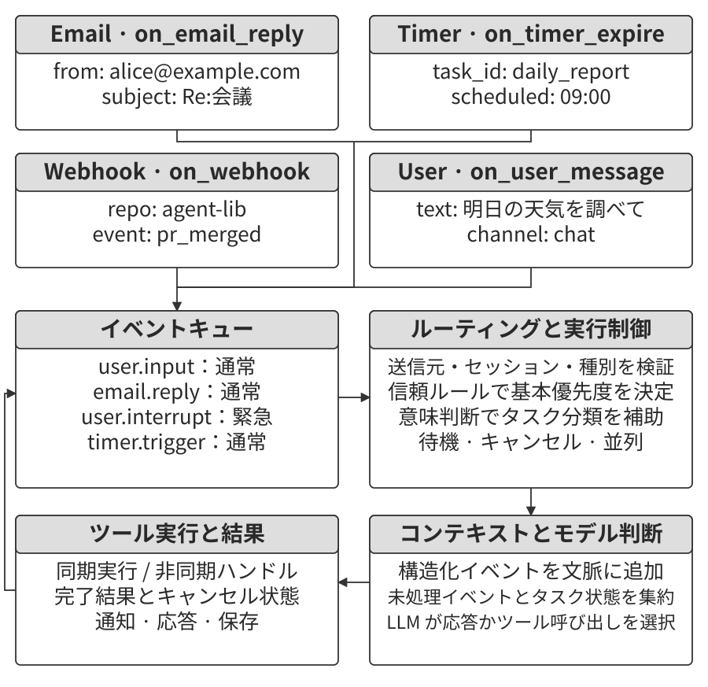

### OpenClaw におけるイベント駆動機構の実装

OpenClaw は Gateway を通じてメッセージチャネルを接続し、イベントを Agent ランタイムへルーティングします。その自動化の仕組みには、内部 Hooks、定時スケジューリング、Heartbeat、外部 Webhook などの入口があります[^ch6-automation]。これらはトリガー条件ごとに整理すると理解しやすくなります。

- **Hooks（イベントフック）**は、セッションの作成やリセット、実行ライフサイクルの変化といったフレームワーク内部のイベントに応答します。
- **Cron（定時スケジューラ）**は、指定した時刻または周期で作業を実行します。たとえば `0 9 * * 5` は、設定したタイムゾーンで毎週金曜日の午前 9 時にトリガーされることを表します。
- **Heartbeat（ハートビート）**は、周期的に Agent を呼び起こし、注意すべき事項がないかを確認させます。
- **Webhook（外部コールバック）**は、外部サービスから送られてきたイベントを受け取り、認証とルーティングを経て処理を起動します。

週報は決まった時刻に実行するのが向いています。継続して気にかけておくべき ToDo は周期的に確認すればよく、新着メールやサービスのコールバックはプッシュを使えば気づくまでの遅れを縮められます。

**PineClaw の通話イベント。** Pine AI はユーザーに代わって電話をかけ、料金の交渉、サブスクリプションの解約、保険金請求といった用件を処理します。PineClaw はこうした電話タスクを OpenClaw に接続します。通話はたいていしばらく続き、そのあいだにユーザーの介入が必要になることがあります。

- **本人確認。** 担当者がアカウント保有者に、セキュリティコードやワンタイムパスワードの入力といった確認を求めます。
- **三者通話。** 担当者がアカウント保有者と直接話したいと求めるので、ユーザーに電話に出るよう速やかに知らせる必要があります。
- **意思決定の確認。** 担当者が代替案を示したとき、フロントは今回の依頼内容とユーザーのこれまでの好みに照らして受け入れられるかを判断します。ユーザーに決めてもらう必要があれば、具体的な選択肢をユーザーに送り、同時に担当者とほかの条件のすり合わせを続けます。

たとえば、担当者がアカウント保有者に三者通話に加わってほしいと求めたとします。通知が早く届くほど、双方が電話口で待たされる時間は短くなります。PineClaw の事例では Channel 機構を使い、Gateway と Pine API のあいだで通話イベントをつないでいます。電話の接続、ユーザー入力の要求、通話の終了がそれぞれイベントストリームに入り、Agent はそれに基づいてタスクを更新し、ユーザーに知らせます。

**能動的なサービスを時機を逃さず提供するには、状態が変わった時点でイベントソースが Agent に知らせるのが最善だと筆者は考えています。** 通知がチャネル経由で届くと、Harness は対応するタスクを見つけ、重複していないか、期限切れでないかを確認し、そのうえでモデルが次の一手を決めます。ユーザーの本人確認が必要なら、画面は信頼できる認証の入口を開き、確認の結果は新しいイベントとして元のタスクに送り返されます。

### イベントトリガーツール

「顧客から返信が来たら知らせて」とアシスタントに頼んだとき、アシスタントはどうやって翌日ちょうどよいときに目を覚ますのでしょうか。まず、メールボックスがメールの到着時にイベントをプッシュできるかを確かめます。能動的に照会するしかないシステムなら、次に確認する時刻を覚えておく必要があります。以下の三つの概念的なインターフェースは、こうした待機条件をランタイムに保存させるので、モデルは現在のターンを終えることができます。

**タイマー（`set_timer`）**は、取り決めた時刻にタスクを呼び起こすために使います。一回限りのタイマーは「来週月曜の午前 10 時に銀行へ電話して住宅ローンの進み具合を確認する」といった用件に、繰り返しタイマーは 1 時間ごとにサービスの稼働状態を確認するといった用件に向いています。メールを送った後に返信を待つ場合や、営業時間外に当たってかけ直す場合も、タイマーで段取りできます。インターフェースはタイムゾーン、トリガー条件、タスク識別子を保存し、取り消しや変更の入口を用意する必要があります。外部サービスが照会しか受け付けない場合は、定時タスクが進捗のポーリングも担えます。

**バックグラウンドタスクの監視（`monitor_shell`）**は、長時間実行されるコマンドを進捗イベントに変えるために使います。起動時にタスク識別子を返し、実行中は新しい出力、キーワード、状態の変化に応じて通知し、終了時には終了ステータスと結果を報告します。

モデルに繰り返し進捗を照会させると、状態が変わっていなくてもモデル呼び出しを消費します。終了通知だけを待つと、途中の障害を見逃すおそれがあります。そこで筆者は、監視をランタイムに任せ、意味のある進捗、エラー、停滞が現れたときにだけモデルを呼び起こすことを勧めます。そうすればビルドのあいだもやり取りを続けられ、異常にもすぐ介入できます。監視ルールにはフィルタ、集約、頻度制限を設定し、ログが一行出るたびにモデル呼び出しが一回走ることのないようにします。

たとえば、モデルは処理待ちのチケットの状態更新を購読したら、その推論のターンを終えてかまいません。通知がチケット番号を携えてモデルを呼び起こすのを待てばよいのです。相手が照会の入口しか用意していなければ、モデルは自分で次の確認のための定時タスクを設定できます。時刻になって確認し、「処理中」のままなら、もう一度予約します。チケットが完了していれば、以後の確認を取り消します。どちらのやり方でも待機はランタイムが担い、モデルは通知を受け取ったときかタイマーが満了したときにだけ判断を下します。

**外部イベントチャネル（`connect_channel`）**は、メール、インスタントメッセージ、API コールバックを購読するために使います。チャネルアダプタは送信元を検証し、サービス固有の識別子をスレッドと関連オブジェクトに対応づけ、統一された形式のイベントを提出します。詳しくは後の「受付層」の節で述べます。PineClaw の電話状態の通知はこの種類に属します。

三種類のツールはいずれも、トリガー条件、フィルタリングのルール、イベントのペイロードを明確にする必要があります。ペイロードにはイベント識別子、発生時刻、送信元、関連するタスク、必要な内容を含め、そのイベントがまだ有効か、次の一手にどんな情報が必要かを Agent が判断できるようにします。

### ユーザーコミュニケーションツール

航空券の変更の話に戻りましょう。カスタマーサービスに質問すること、ユーザーにそのまま答えられる確認メッセージを送ること、タスク記録に「返信待ち」と書き留めることは、それぞれ別の場所への書き込みになります。ユーザーはいったん離れて、条件を補う必要があるとき、決定を確認するとき、結果を受け取るときに戻ってくればよいのです。

会話画面には最終的な返答、ツールの進捗、実行結果を表示できます。一方、コミュニケーションツールは宛先、チャネル、メッセージの内容、添付ファイルを明示的に指定します。何を伝えるかはモデルが決め、宛先と権限は Harness が確認し、配信はメッセージサービスが行います。ランタイムが最終的な返答を元のセッションへ自動的にルーティングすることもでき、二つの方式は組み合わせて使えます。

OpenClaw のマルチチャネルのやり取りでは、ユーザーは秘書に連絡するのと同じようにメッセージを送り、進捗を待ち、リマインダーを受け取れます。この「生身の人間らしさ」は、途切れないタスクの状態と時宜を得たコミュニケーションから生まれます。ユーザーは慣れたチャネルでタスクを続けられ、Agent の側はアイデンティティ、セッション、メッセージの関連づけを一貫して保たなければなりません。

コミュニケーションの中身もタスクに応じて変えられます。短い進捗報告は文字で、複雑な結果には画像やファイルを添え、記入してもらう情報は構造化カードにし、インタラクティブな成果物には第 5 章で紹介した生成的 UI を使います。チャネルが配信通知や既読通知に対応していれば、システムはその状態を保存します。失敗時の再送、重複メッセージ、チャネル間の同期も配信記録に含めます。

**マルチチャネル通知とユーザーの呼び戻し。**

インスタントメッセージ、SMS、メール、電話、アプリのプッシュ通知は、それぞれ向いている緊急度や内容の形式が異なります。Agent は緊急度、ユーザーの好み、現在の状態、メッセージの長さを考え合わせてチャネルを選べます。すぐに確認が必要な通話イベントには即時のリマインダーを使い、完全なレポートはメールやアプリのリンクで届けます。

筆者はアシスタントに ATC 会議のホテル料金を見張らせたことがあります。毎日同じ時刻に、アシスタントは料金がまだ目標額まで下がっていないとメッセージを送ってきました。ある時料金が一時的に下がったのですが、その機会をとらえたのは筆者が自分で書いたスクリプトでした。短時間の値下がりは二回の照会のあいだに起こりうるのです。仮にアシスタントがすぐに値下がりを見つけたとしても、メッセージが遅れて届けば、ユーザーは予約の機会を逃すかもしれません。値下がりのない日も定時の照会はいつもどおり動かしてかまいませんが、ユーザーが毎日同じ内容のメッセージを読む必要はありません。第 7 章では、五分間だけの値下がりを例に、この種のリマインダーを検証します。

長時間タスクが完了したら、通知はユーザーを成果物のページへ連れ戻します。日次サマリーや週報は取り決めたリズムで送ります。マルチチャネルの方針には、重複排除、通知を控える時間帯、エスカレーションの条件も設けるべきです。たとえば最初のリマインダーに反応がなかったとき、別のチャネルに切り替えるかどうかです。通知記録をタスクの状態と結びつけておけば、ユーザーは受け取ったメッセージからそのまま処理を続けられます。

### 仮想アイデンティティと隔離された実行環境

第 4 章では『Her』の Samantha を例に、汎用アシスタントがツールを通じてデジタル世界に入っていく様子を説明しました。このようなアシスタントを実現するには、それがどのアイデンティティで働き、どのリソースにアクセスできるかを明確にする必要があります。**筆者は、汎用アシスタントに独立した仮想アイデンティティを与えるほうを好みます。** 専用の業務用メールアドレス、電話番号、ストレージ、計算環境があれば、Agent は自分の業務用アカウントを持つ秘書のように、明確な代理人の立場でユーザーに代わって用件を処理できます。独立したアイデンティティはアシスタントの日常業務をユーザーの個人アカウントから切り離すので、個別に権限を与え、監査し、取り消すのが容易になります。誤操作が起きたときも、影響範囲を限定しやすくなります。どうしてもユーザーのアカウントにアクセスしなければならないタスクには、範囲を限定した認可で必要な権限を与えます。

電話番号が誰のものかによって、相手が折り返してきたときに誰が用件を引き継げるかが決まります。Manus の Cue はアシスタントに独立した番号を与え、かかってきた電話に応答して、通話の要約をユーザーに残せます。アシスタントが残した折り返し先の番号を事業者が受け入れれば、担当者が電話をかけてきたとき、以前担当していたアシスタントにそのままつながります。[^ch6-cue]

料金の減免を例にとると、アシスタントは認可を受けた代理人として事業者に連絡できます。担当者が本人による口頭での確認を求めたら、ユーザーに三者通話に加わってもらい、確認が済んだらアシスタントがやり取りを引き継ぎます。事業者がユーザーに折り返し連絡する場合は、案件番号、すでに合意した事項、確認すべき問題をあらかじめユーザーに渡しておきます。ユーザーに報告するときも、手元にある証拠をはっきりさせておく必要があります。担当者が口頭で減免を約束したなら、その約束を記録します。後で請求書の更新が確認できたら、そこで初めて費用が実際に減免されたと報告します。

筆者が北京でバンク・オブ・アメリカのクレジットカードを再発行したとき、Pine が銀行に連絡して特急再発行を手配し、15 ドルの特急手数料の免除も取りつけました。通話が終わった時点で、アシスタントは銀行が何を受け付け、どの費用の免除に同意したかを報告できる状態になっていました。数日後にユーザーが「新しいカードはどこまで来ている？」と尋ねたら、配送状況を改めて調べるか、受取人に確認してもらう必要があります。

仮想コンピュータと仮想スマートフォンは、動き続ける操作環境を提供します。仮想マシンはデスクトップ OS を動かせ、コンテナはプロセスと依存関係の隔離に向き、Android エミュレータはモバイルアプリを載せます。いずれもバックグラウンドで動作でき、自動操作がユーザーの目の前の作業を妨げることも減らせます。隔離の範囲はネットワーク、マウント、認証情報、実行権限の組み合わせで決まり、これらの設定は Agent が触れられるデータや外部システムにも同時に影響します。

あなたが退勤して PC の電源を切った後で、Tencent WorkBuddy のエンタープライズ版に週報を作ってもらいたいとします。ところが今週の売上表は会社の PC にしかありません。ローカルタスクを選べば、アシスタントはこの表を読めますが、PC は電源が入ったままでクライアントもオンラインでなければなりません。クラウドタスクを選べば、電源を切った後もアシスタントは作業を続けられます。ただしその前提として、週報に使ってよいデータをタスクにアップロードしておくか、クラウドタスクがアクセスできる資料庫に置いておく必要があります。売上表をどうしても手元の PC に置いておかなければならないなら、PC がオンラインのあいだに処理するよう段取りすべきです。

Web ページやモバイルアプリは、本人確認、CAPTCHA、人による確認を求めることもあります。接続にはサービスが提供する API と認可方式を優先して使います。グラフィカルな画面での認証が必要なら、VNC/RDP のリモートデスクトップを通じてユーザー自身にログインしてもらい、認証のあいだは自動操作を止めておきます。ユーザーが終えたら、システムはセッションの状態を確認してからタスクを再開します。トークンとセッションは有効期限に応じて保存し、認可の取り消しやタスクの終了時には方針に従って破棄します。

Agent と仮想環境のあいだでは、**共有ファイルシステム**を通じてデータをやり取りできます。たとえばユーザーが CSV をアップロードすると、仮想コンピュータがファイルを読み込んで分析を実行し、グラフを共有ストレージに書き戻します。ランタイムはグラフのファイルの場所を Agent に渡し、ユーザーにはアクセス可能なダウンロードの入口を提供します。大きなファイルの中身はストレージに置いたままにし、モデルは必要に応じて要約や断片を読み込みます。

[^ch6-dsh-threads]: DeepSeek、dsh-superagent プロトタイプのドメインモデルと、認可および購読のルール。
[^ch6-dsh-sessions]: DeepSeek、dsh-superagent プロトタイプ、バージョン `8c32a9d`。二種類のセッションの役割は `docs/004-prompts.md`、実行セッションと作業ディレクトリは `docs/003-execution.md`、メインセッションに送られるメッセージの形式は `docs/007-architecture.md` を参照。
[^ch6-duet]: Anthropic、*Get started with Claude Duet*、会議前のブリーフィング、タスクページ、メインの対話での通知を紹介している。
[^ch6-cue]: Manus、*Introducing Manus 2.0*、Cue の独立した電話番号、着信への応答、通話の要約を紹介している。
[^ch6-automation]: OpenClaw、Automation、内部 Hooks、定時スケジューリング、Heartbeat、外部 Webhook などの自動化の入口を紹介している。

### 受付層：多様な送信元を一種類のイベントに

あるネットショップのカスタマーサービス Agent が一件の返金を処理するとします。顧客はアプリのサポートチャットで返金を申し出ます。金額が Agent の権限を超えているので、Agent は WeCom（企業微信）のアフターサービスグループで上長に承認を求めます。決済サービスは返金に成功すると Webhook を送ってきます。続いて注文システムが Kafka に状態変更を発行します。四つのメッセージは同じ注文について述べていますが、届き方はそれぞれ異なります。送信元が増えて、経路ごとに再送、重複排除、順序をばらばらに扱うようになると、ランタイムはこうした違いに振り回されてまとまりを失います。**受付層は、イベントがシステムに入った後の形を統一し、届くまでの各送信元の能力の違いはそのまま保ちます。** 図6-2 はこの階層構造を示しています。

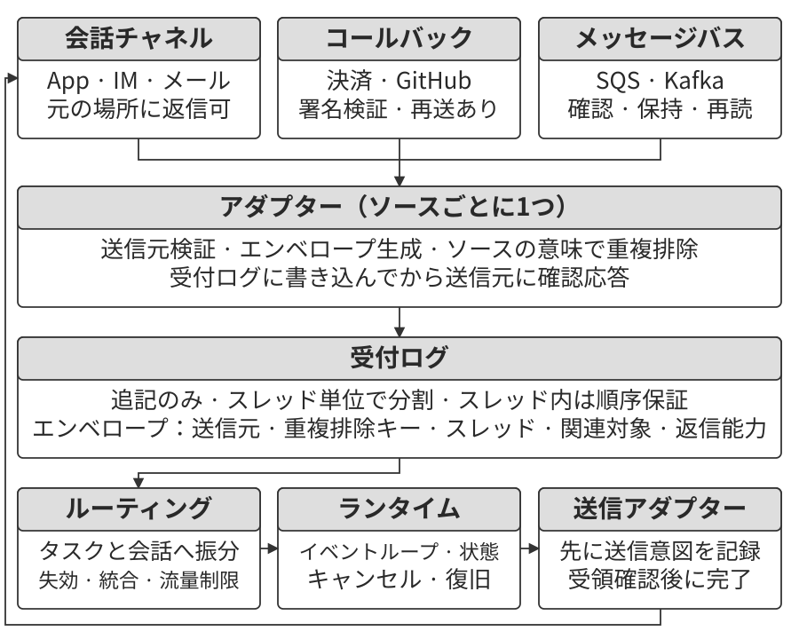

よくある送信元は四種類です。**対話チャネル**には、製品独自のチャット画面、WeCom、Feishu、Slack などのインスタントメッセージ、そしてメールがあり、Agent は元の場所に戻って返答できます。**コールバック**は外部サービスが状態の変化時に呼び出す HTTP インターフェースで、たいてい署名が付いており、通知を届けるだけです。配信に失敗したとき、自動で再送するサービスもあれば、GitHub のように手動または API で再配信しなければならないものもあります。**メッセージバス**は SQS や Kafka のように内部サービスの業務イベントを運ぶもので、確認と保持の意味論が明確に定められています。**タイマー、ポーリング、内部イベント**はシステム自身が生み出すもので、同じログに書き込めば済みます。次の表は前の三種類を比較したものです。[^ch6-ingress-mq][^ch6-ingress-callback]

| | アプリのチャット | WeCom / Feishu | メール | Webhook | SQS | Kafka |
|---|---|---|---|---|---|---|
| 届き方 | 常時接続 | コールバックまたは常時接続 | プッシュまたはポーリング | コールバック | コンシューマがプル | コンシューマがプル |
| 順序が保証される範囲 | 会話内 | 多くのイベントで保証なし | 保証なし | 保証なし | 標準キューは保証なし、FIFO はメッセージグループ単位 | パーティション内 |
| ネイティブな重複排除の根拠 | クライアントのメッセージ ID | メッセージ ID、イベント ID | Message-ID | 配信 ID | メッセージ ID。FIFO にはさらに `MessageDeduplicationId` | トピック、パーティション、オフセット |
| 再生できるか | 自前の記録次第 | コールバック自体は再生できない。Feishu は履歴メッセージ API で取り直せる | メールボックスを読み直せる | サービス次第 | 削除後は不可 | 保持期間内なら可 |
| 確認の方式 | クライアントへの受領通知 | 期限内に成功を返す | 読み取り位置を自分で記録 | 期限内に 2xx を返す | メッセージを削除 | オフセットをコミット |
| 返信経路 | 元の会話 | 元の会話 | 返信メール | なし | なし | なし |

**統一エンベロープ。**

アダプタは元のメッセージを、統一された形式の**エンベロープ**（envelope）に変換します。エンベロープには、届いた時点で確定できる事実だけを記録します。優先度と処理期限はルーティング規則が補い、顧客ランクや注文状態は業務システムが補い、処理状態は別に保存します。顧客の返金申請は次のように書けます。

```json
{
  "id": "evt_7f3a",
  "source": {"type": "app_chat", "sender": "user:u_5521", "verified": true},
  "dedupe_key": "app:msg:msg_1029",
  "thread": "app:conv:conv_88",
  "kind": "message",
  "correlation": ["order:12345"],
  "content": {"type": "text", "text": "この注文を返金してほしい"},
  "raw_ref": "raw/2026-11-23/app/msg_1029.json",
  "reply": {"via": "app_chat", "target": "app:conv:conv_88"},
  "occurred_at": "2026-11-23T14:02:09+08:00",
  "expires_at": null
}
```

- `source`：送信元の種類と、検証済みの送信者です。「検証済み」かどうかはアダプタが署名、トークン、チャネルのアカウントに基づいて判断し、本文中の自己紹介は根拠になりません。ランタイムはこの項目で権限を判断します。
- `dedupe_key`：重複排除キーです。何を重複とみなすかは送信元の意味論で決まります。配信 ID、メッセージ ID、パーティションとオフセットは同一の配信を識別し、トランスポート層での再配信を防ぎます。業務メッセージに冪等キー（idempotency key）、たとえば返金番号と状態の組が含まれていれば、アダプタがそれを取り出してはじめて、業務上の重複を防げます。ユーザーとの会話は逆です。顧客が二回「返金」と言えばそれは二つのメッセージなので、クライアントのメッセージ ID だけで重複を判定します。
- `raw_ref`：そのまま保存した元のペイロードです。アダプタの不具合を調べるときに頼れるのはこれだけです。
- `reply`：どの送信アダプタを経由し、どの宛先に送るかです。決済のコールバックには返信経路がないので、この項目は空になります。
- `occurred_at` は送信元が示した発生時刻、`expires_at` は有効期限で、見積もりや認証コードのようなイベントにだけ設定します。

**スレッドと関連づけ。**

顧客がまず「返金して」と言い、すぐに「やっぱり交換にします」と付け加えたなら、この二つのメッセージの順序を入れ替えてはいけません。別の顧客のメッセージはこれとは無関係なので、並行して処理できます。**受付層が順序を保証するのはスレッドの内部だけです。** アダプタは送信元固有の順序の単位を `thread` に対応づけます。アプリの一つの会話、SQS FIFO のメッセージグループ（`MessageGroupId`）、Kafka のパーティションキー、GitHub コールバックの Issue 番号や PR 番号といったものです。送信元が順序を保証しない場合、ランタイムは `occurred_at` や送信元が示すバージョン番号によって、遅れて届いた古い状態を見分けます。たとえば「返金成功」の後になって届いた「返金処理中」です。

この返金に関わる四つのメッセージは、四つのスレッドに分かれています。一つにまとめると代償が大きくなります。アフターサービスグループの無関係な議論まで顧客のメッセージの後ろに並ばされますし、スレッド識別子はたいていパーティションキーも兼ねているので、後から変えるにはデータの移行が必要になります。**関連づけは別のフィールドで表し、スレッドは書き換えません。** `correlation` にはイベントが関わる業務オブジェクトを列挙し、タスクは関連オブジェクトごとに関係するスレッドを購読します。

**確認のタイミングと進捗の分離。**

**アダプタは、Agent の処理が終わるのを待たずに、イベントを受付ログに書き込んだ時点で送信元に確認を返すべきです。** Feishu のイベントコールバックは 3 秒以内の応答を求め、WeCom は 5 秒で、時間を超えると再プッシュされます。SQS のメッセージは可視性タイムアウト内に削除されなければ、もう一度取り出されます。処理が終わってから確認していたのでは、モデル呼び出しが少し長引いただけで重複配信を招きます。先にログに書いてから確認すれば、各送信元の配信保証は一言にまとまります。**どのイベントも少なくとも一回は受付ログに入る（at-least-once）**。再配信された分は重複排除キーで弾きます。

受付ログは受信箱（inbox）に当たり、第 1 章の「追記のみで書き換えない」原則に従って、スレッドごとにパーティション分けします。Kafka を受付ログとして使う場合、重複排除には一意制約を持つストレージを別に用意するか、コンシューマ側で重複排除キーによってフィルタする必要があります。Kafka はアプリケーションが指定したキーで書き込みを拒否できず、冪等プロデューサが扱うのはプロデューサ自身のリトライだけだからです。

システムは三種類の進捗を分けて保存する必要があります。

| 進捗 | 記録する内容 | 誰が管理するか |
|---|---|---|
| 送信元の進捗 | Kafka のオフセット、SQS の受信ハンドル、メールボックスの読み取り位置 | アダプタ |
| 振り分けの進捗 | ログ中のイベントをどのタスクに渡したか | ルーティング |
| タスクの状態 | どの段階まで処理したか、返信をすでに送ったか | ランタイム |

オフセットをタスクの進捗として扱うと、ログを再生したときに送信済みの返信がもう一度送られてしまいます。分けておけば、再生が影響するのは振り分けの進捗だけです。送信の方向にはこれに対応して送信箱（outbox）があります。送信前に送信の意図と冪等キーを記録し、チャネルから受領通知を受け取ったら完了と記します。再起動後にどう照合するかは、後の「メールイベントから基本ループを作る」で述べます。

**有効期限、集約、背圧。**

同じスレッドに毎秒何百ものイベントが押し寄せてきたとき、それを一つずつモデルに渡すべきではありません。ルーティングは振り分けの前に滞留分を処理します。

- **有効期限。** 見積もり、認証コード、すでに回復したアラートは、時間が過ぎれば意味を失います。`expires_at` を過ぎたイベントは軌跡に記録するだけで、モデルは呼び起こしません。
- **集約。** `kind` で二種類のイベントを区別します。状態型のイベントは、決済コールバック中の返金状態や Kafka 上の注文状態のように、あるオブジェクトの現在の値を表します。同じスレッドに何件も滞留していれば最新の一件だけをモデルに渡し、途中の値はログに残します。メッセージ型のイベントは、顧客のメッセージや上長のクリックのように、誰かが発した一言や一つの指示です。まとめてモデルに渡すことはできますが、捨ててはいけません。
- **背圧。** プル型の送信元なら取得のペースを落とし、滞留分を送信元に残しておけます。プッシュ型の送信元には一時停止を求められないので、アダプタはいつもどおりログに書いて確認を返し、滞留分は受付ログに移して、前の二つの規則で消化します。

**一件の返金が四つの送信元を通る流れ。**

1. 顧客がアプリのチャットで返金を申し出ます。アダプタはクライアントのメッセージ ID で重複を判定してログに書き込み、クライアントに受領を返します。ルーティングは `order:12345` に基づいて返金タスクを作り、タスクはこの会話スレッドを購読します。
2. 金額が権限を超えているので、Agent は WeCom のアフターサービスグループに確認カードを送り、カードの識別子をタスクに記録します。上長が「承認」をクリックすると、アダプタはログに書き込んでから成功を返し、カードの識別子に基づいて関連オブジェクトを補います。
3. Agent が返金 API を呼び出すと、決済サービスが「返金成功」のコールバックを二回送ってきます。配信 ID が同じなので、二回目は重複として弾かれます。
4. 注文システムが Kafka に「注文は返金済み」を発行します。コールバックが伝えたのと同じ出来事です。二つのアダプタがどちらもペイロードから返金番号と状態の組を取り出して重複排除キーにしていれば、このイベントは受付の時点で弾かれます。それぞれが配信 ID、パーティションとオフセットで重複を判定しているなら、二つともログに入り、ランタイムはタスク内で返金がすでに確認済みであることに気づいて、軌跡に記録するだけにします。
5. コールバックにも Kafka のイベントにも返信経路はありません。ランタイムは手順 1 の会話スレッドの `reply` を使い、アプリの送信アダプタを通じて顧客に知らせます。

手順 4 は受付層での重複排除の限界を示しています。どの重複を弾けるかは、アダプタがどんな重複排除キーを宣言したかで決まり、弾ききれなかったものはタスクの状態で判断します。イベントをタスクに振り分けた後、それを既存のセッションの続きにするか、新しいセッションを開くかはコンテキスト管理の問題です。セッションをまたぐ情報は第 3 章のメモリで受け渡し、コンテキストを共有できるかどうかは第 10 章で扱います。

[^ch6-ingress-mq]: Amazon Web Services、“Amazon SQS standard queues”；“Amazon SQS visibility timeout”；“Using the message deduplication ID in Amazon SQS”；“Using the message group ID with Amazon SQS FIFO Queues”。Apache Kafka 4.4 ドキュメント、“Design” の “Consumer Position” と “Message Delivery Semantics”。確認日：2026-11-24。
[^ch6-ingress-callback]: Feishu オープンプラットフォーム、「イベント概要」（事件概述）；「会話の履歴メッセージの取得」（获取会话历史消息）。WeCom 開発者センター、「メッセージとイベントの受信」（接收消息与事件）の「概要」。GitHub Docs、“Best practices for using webhooks”；“Handling failed webhook deliveries”。確認日：2026-11-24。

### イベント処理機構

ユーザーのメッセージ、ツールの結果、タイマー、協調のリクエストが、同時に一つの Agent に入ってくることがあります。ランタイムはこれらのイベントを保存し、処理の順序を決め、関係する情報をモデルに渡さなければなりません。**イベントループ**（event loop）はこの過程を絶えず前に進める役割を担います。キューからイベントを取り出し、タスクの状態を更新し、モデルへのリクエストを組み立て、ツールをスケジュールし、それから新しい入力や完了通知を待ちます。Go のプログラムが goroutine、channel、`select` で複数のメッセージの流れを組み立てるのも、似た考え方です。

dsh-superagent プロトタイプを例にとりましょう。同じ GitHub プロジェクトの中でも、ある Issue での議論とあるプルリクエスト（PR）での議論は、別々の会話スレッド（Thread）に属します。システムが新しい作業を引き受けるかどうかを判断する必要があるときは、スレッドの状態を読み込んでモデルに評価（Eval）させます。一つのスレッドで同時に行われる評価は最大一回ですが、そのスレッドを複数のチケット（Ticket）が購読することはできます。不具合の修正とドキュメントの補充という二つのチケットが同じ PR を購読していたとすると、レビュアーがその PR にコメントを残したとき、二つのチケットはどちらもそのメッセージをコンテキストとして受け取ります。その後で誰かが Issue に再現条件を書き足せば、そのメッセージはその Issue を購読しているチケットに届きます。メッセージが誰に届くかは、スレッドと購読関係で決まります。メッセージを受け取った後に何ができるかは、あくまで各チケットにもともと与えられた権限で決まります。[^ch6-dsh-threads]

dsh-superagent はさらに、「人とのやり取り」と「実作業」を別々のセッションに任せています。メインセッション（Main Session）は依頼の受け付け、返答、権限の書き込みだけを担当し、コードは読まず、結果を待って立ち止まることもしません。チケットごとに専用の実行セッション（Executor Session）があり、独立した作業ディレクトリでコードを修正し、テストを走らせます。実行セッションは、修正が済んだとき、行き詰まったとき、人に尋ねる必要があるときにだけメインセッションにメッセージを送り、要約と読み取り先を添えます。第 2 章で述べた「要約とオブジェクト ID」です。こうしておけばメインセッションは常に次の依頼を受ける余裕があり、人への質問、通知、中止の指示もすべてメインセッションを通るので、約束は一つの窓口からしか出ていきません。後の音声の部分で扱う速いモデルと遅いモデルは、この役割分担をリアルタイムの通話に当てはめた姿です。[^ch6-dsh-sessions]

同期型のモデルインターフェースは、たいてい一回の生成が終わったときか、ツールの結果がそろったときに次のメッセージを受け取ります。ここに**セーフポイント**を設けることができます。ランタイムはまず、完了したメッセージ、まだ実行中の呼び出し、現在のタスクの進捗を記録し、それから新しい処理ステップに切り替えます。ネイティブな非同期インターフェースは、実行中に更新を受け取るためのプロトコルを提供しており、どの時点で処理を引き継ぐかはインターフェースとランタイムが協力して決めます。

キャンセルにも実行側の協力が必要です。モデルが生成を止めても、バックグラウンドのツールはまだ動いているかもしれません。実行器はキャンセル信号を受け取り、実際の状態を報告する必要があります。Go のタスクが `ctx.Done()` を確認してから後始末をするのと同じです。すでに完了した書き込み、送信、支払いは、対応する業務フローを通じて取り消しや補償を行うべきです。

**三つの処理戦略。**

図6-3 は、新しいイベントが届いたときの三つの選択肢を比べたものです。キューに入れて待たせる場合、応答時間は次のセーフポイントがいつ来るかに左右されます。現在のタスクを取り消す場合は、どの操作がすでに完了し、どこから再開できるかを確かめる必要があります。別のループを開く場合は、二つのタスクが同じリソースを奪い合わないかを確認しなければなりません。

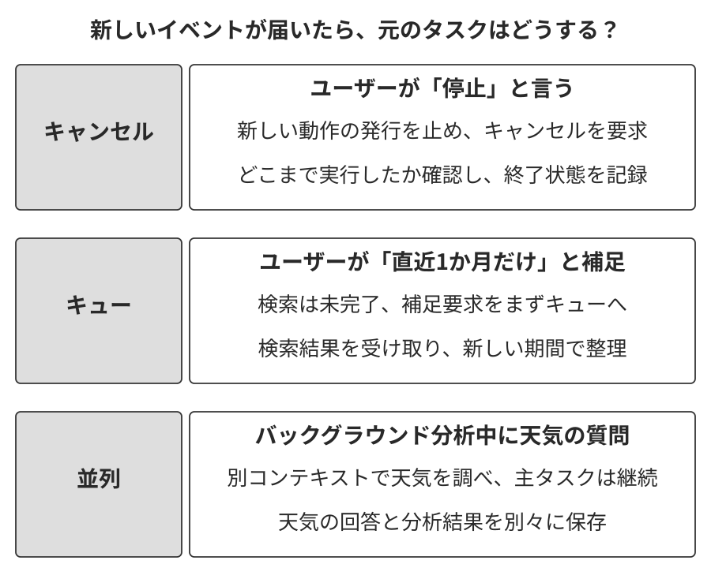

**キャンセル式処理（Cancellation-Based）**は、ユーザーの停止指示や、すぐに処理しなければならない制御イベントに向いています。ランタイムはまず関連する操作の新たな発行を止め、生成中のリクエストと取り消し可能なツールに停止信号を送り、完了したメッセージ、ツールの状態、キャンセルの受領通知を保存します。そのうえで新しいイベントを意思決定のコンテキストに入れます。たとえばユーザーが「止めて！言い間違えた」と言ったら、システムはまず以降の実行を制限し、それから現在の実際の状態を踏まえてタスクを確認し直します。まだ処理していないキューの項目は識別子と状態を保ったまま、関連の範囲に応じて並べ直します。

**キュー式処理（Queued）**は、通常の補足情報や進捗の更新に向いています。イベントはキューに入り、次のセーフポイントでツールの結果と一緒にモデルに渡されます。たとえば検索の最中にユーザーが「直近一か月の結果だけ見て」と付け加えたら、検索結果が返ってきたところで、モデルは結果と新しい条件を同時に読み込み、絞り込むか検索し直すかを決めます。

**並行処理（Parallel）**は、メインのタスクから独立していて、すぐに返答すべき問い合わせに向いています。たとえば大量のデータを分析しているあいだにユーザーが天気を尋ねたら、システムは独立したセッションを立ててその問い合わせを済ませられます。

**緊急度とルーティング。**

イベントの種類は最初の手がかりになります。`user.interrupt`、信頼できる監督者の指示、システムアラートは高優先度の経路に入れてかまいません。`user.input`、`agent.input`、`tool.result`、`timer.trigger` は、内容とタスクの状態を合わせて判断します。送信者が本文の中で「緊急」と名乗っていても、システムは検証済みのアイデンティティと規則に基づいて権限を決めます。

メッセージの意味を理解しなければならないルーティングの判断には、軽量な分類モデルを使うことを筆者は勧めます。「今すぐ止めて」はキャンセルに、「今日の天気は？」は並行処理に向くかもしれず、「レポートは中国語でお願い」はたいてい現在のタスクへの補足としてキューに入ります。明示的な停止の入口はランタイムが直接処理し、意味の分類はそれ以外の、理解を要するメッセージに使います。

汎用モデルでもメッセージにラベルを付けることはできます。しかし「要対応」と一言出力するだけでも、モデルはタスクの説明とメッセージの内容を読み込まなければなりません。新しいメッセージのたびにこうした判断をすれば、呼び出し費用はメッセージ量とともに増え、本当に緊急のメッセージもモデルがラベルを出すまで先に進めません。TypeSafe の Jev は、このように選択肢があらかじめ決まっている判断タスクに特化したモデルです。メッセージと現在のタスクの状態を渡すと、低いコストと遅延で、各選択肢の確率を並行して返します。[^ch6-jev]

第 1 章で論じた観測空間のスパース化は、ここではどのメッセージが新たな推論を起動するかを決めます。Feishu のメッセージと GitHub Issue のコメントを例にとると、プログラムはまずイベント番号で重複した通知を除き、それから Jev に、新しいメッセージが既存タスクへの補足なのか、メインモデルが処理すべき新しい依頼なのかを判断させられます。「昨日話した再現手順を補足します」と読んだら、モデルはこれが補足説明であることだけを判断すればよいのです。どの Issue への補足なのかは、コメントに付いている番号をプログラムが直接読めば分かります。

モデルが高い確率を出したとしても、自分の確信を過大評価している可能性はあります。たとえば 100 件のメッセージがいずれも約 90% の確率で「既存タスクへの補足」と判定されたのに、実際にそうだったのは 60 件だけだったとします。これらをまとめて自動的に既存タスクに組み込めば、残りの 40 件が本来持っていた用件を取りこぼしてしまいます。

[^ch6-jev]: TypeSafe は Jev のリリースノートで、あらかじめ定義された出力、確率の並行返却、そして意思決定の較正を目標とする学習手法 RLCD を紹介している。

### メールイベントから基本ループを作る

新着メールを処理するプロセスが突然再起動したとします。メールの識別子があれば原文は取り戻せますが、直前の返信が送られたかどうかまでは分かりません。キューへの投入、メールの読み込み、ツールの呼び出しから、メールボックスの更新やユーザーへの通知まで、書き込み操作とそれに対して返ってきた受領通知は、すべて同じメールの名義で記録しておくのが望ましいのです。再起動後、リクエストを送ったのに受領通知がないと分かったら、まずメールボックスの実際の状態を確かめてから、送り直すかどうかを決めます。

> **実験 6-1 ★★★：イベント駆動のメール処理 Agent**
>
> 本実験では、テスト用メールボックスを入口として、イベントの登録、キュー、タスク処理を練習します。まず新着メールを構造化されたイベントに整理し、到着順に処理します。次に、メール履歴、添付ファイルの読み取り、知識の照会、通知といったツールを接続します。図6-4 に沿って一通の会議招待を追ってみてください。イベントループの中でカレンダーの重複確認と下書き作成の二つのステップを見つけ、さらに永続化層でこのメールの処理記録を探します。
>
> 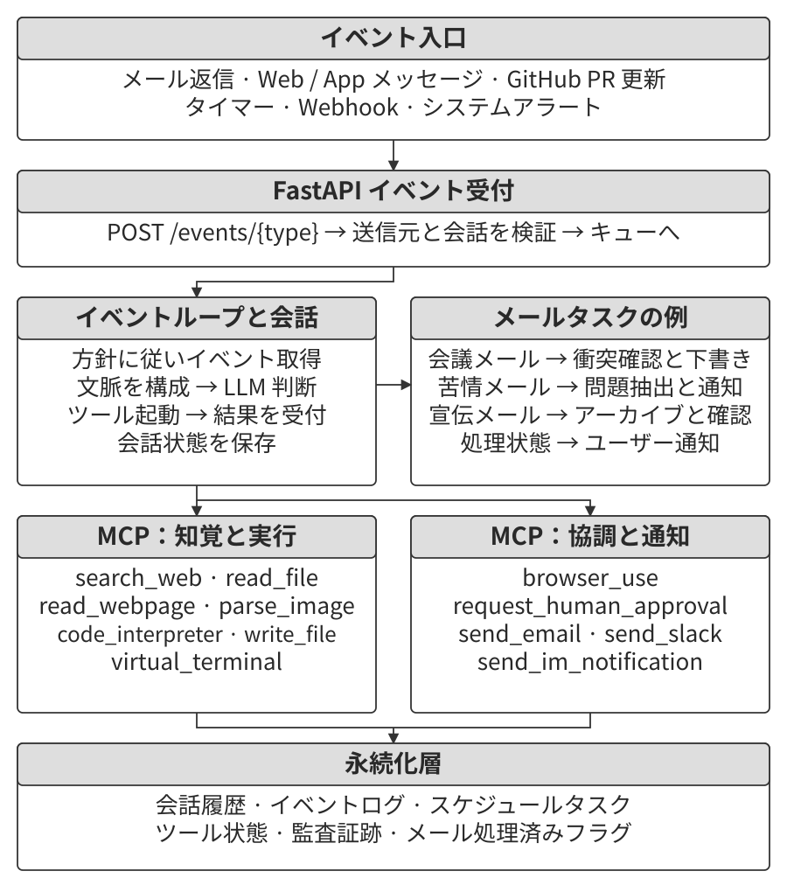
>
> 同じキューに複数の送信元を追加できます。メールの到着、IM や SMS のメッセージ、GitHub の PR と Issue の更新、タイマー、外部 Webhook、そしてユーザーのオフライン、プロセスのタイムアウト、リソースアラートといった内部イベントです。各アダプタは送信元を検証して関連情報を補い、処理結果はイベント識別子に従って書き戻します。
>
> 受け入れ確認には三通のテストメールを使います。会議招待はカレンダーの重複確認を起動し、承諾または辞退の下書きを生成します。顧客からの苦情は、重要情報の抽出、高優先度の印付け、ユーザーへの通知を起動します。マーケティングメールは規則に従ってアーカイブします。
>
> 現時点の付属記録では、インターフェース仕様の確認と認証の試験は完了していますが、テスト用メールボックスの接続は有効な認証情報待ちです。
>
> **発展（任意）：複数の送信元の受付と障害注入。** テスト用メールボックスに加えて、ローカルの Webhook エンドポイントと SQS キュー（ローカルのシミュレーションでもよい）を一つずつ接続します。各アダプタは送信元を検証してエンベロープを生成し、受付ログに書き込んでから送信元に確認を返します。ランタイムはログからイベントを読み出し、スレッドの順序に従って処理します。そのうえで三種類の障害を注入します。
>
> 1. **重複配信。** Webhook エンドポイントが同じ配信 ID のリクエストを二回受け取っても、ログに現れるイベントは一つだけです。
> 2. **確認前のクラッシュ。** アダプタがログに書き込んだ後、SQS メッセージを削除する前に強制終了されます。メッセージが再び可視になってもう一度読み出されても、ログにあるイベントは一つのままです。
> 3. **受領記録前のクラッシュ。** ランタイムが返信を送った後、受領通知を記録する前に強制終了され、再起動後にログから再生します。チャネルが冪等キーに対応しているか、送信済みのメッセージを照会できる場合（たとえばメールボックスの送信済み記録）は、同じ返信を二重に送りません。どちらもないチャネルでは、その返信を人による確認待ちとして印を付けるしかありません。
>
> 三種類の障害は、いずれもログに記録を残すべきです。どの配信が重複として除かれたか、どのメッセージが読み直されたか、どの返信が確認のうえ再送されなかったかです。
>
> この発展課題の付属コードはオフラインで実行でき、API Key は不要です。テスト用メールボックスと SQS キューはどちらもローカルファイルでシミュレートしており、上で述べた認証情報待ちの実際のメールボックスとは別物です。シミュレートしたキューは、可視性タイムアウト、受信ハンドル、メッセージグループ内の順序を再現しています。クラッシュは、親プロセスが指定した位置で子プロセスを直接終了させることで起こします。返信チャネルは三通りを一つずつ示します。メールは送信済み記録を照会し、アプリのチャットは冪等キーを使い、SMS はそのどちらもありません。再現するには `chapter6/agent-with-event-trigger` に移動して `python multisource_demo.py` を実行すると、三種類の障害が残したログ記録がターミナルに一つずつ表示されます。付属の実行記録では、三種類の障害のチェックがすべて通っています。
>

メールのキューによって、順序どおりに処理する基礎ができました。続いて長時間実行されるツールを加え、待機中に新しい要求を受け取る方法、タスクの取り消し、作業の再開を論じます。

### ネイティブな非同期に対応しない場合の互換方式

Agent がメールを下書きしていて、連絡先を探すために `search_contacts` をすでに呼び出しているとします。結果がまだ返らないうちに、ユーザーが「ちょっと待って、先に明日の天気を調べて」と頼みます。現在のモデルインターフェースが、ツール呼び出しごとに先に結果をそろえることを求めるなら、Harness はバックグラウンドの状態を、インターフェースが受け付けるメッセージ列に変換しなければなりません。

**同期メッセージ形式でバックグラウンドの状態を表す。**

**同期インターフェースと互換をとるときは、通常の呼び出しと実際の結果の対応をできるだけ保ち、途中でタスクを切り替えるときにだけ状態応答を補うべきです。** 呼び出しのたびに早々と「実行中」と書き込むと、軌跡が未完了の状態で埋まり、モデルが実際の結果を追う負担が増えます。具体的には次の五つの規則に従えます。

1. **完全な呼び出しを記録する。** API が完了した assistant メッセージとツール呼び出し項目を軌跡に書き込み、呼び出し識別子を保持します。サーバー側の推論状態は、提供者が定める継続の方式に従って保存します。
2. **実際の完了を記録する。** ツールが完了したら、実際の結果、タスク識別子、実行状態を書き込みます。実行中は、タスクマネージャが未完了の状態を保存し続けます。
3. **切り替え時に現在の状態を報告する。** この種の結果ペイロードを許すインターフェースでは、保留中の呼び出しに「タスクはまだバックグラウンドで実行中で、結果はまだ出ていない」といった明確な状態情報を返し、その後にユーザーのイベントを追加できます。状態応答に含まれるタスク識別子が、後続の完了通知とのつなぎになります。
4. **中断後のメッセージを整理する。** 途中で処理を引き継ぐ機能がなければ、未完了の生成を取り消し、完了が確認されたメッセージとツールの状態を残したうえで、新しいリクエストを提出します。未完了の出力はインターフェースの規定に従って扱い、途中で切れた引数を実行可能な呼び出しとして扱わないようにします。
5. **通常のイベントはまとめて受け取る。** 補足情報はキューに入れ、現在の周期が終わったときか指定したセーフポイントでまとめて提出し、どのイベントを処理済みかを記録します。

連絡先検索の例では、まず完全な呼び出しが軌跡に書き込まれます。ユーザーがタスクを切り替えたとき、Harness は検索がまだ実行中であるという状態応答を補い、それから天気のリクエストを提出します。連絡先の結果は後から、送信元とタスク識別子を持つ新しいイベントとしてコンテキストに入り、Agent はメールの下書きを再開します。元の呼び出しがすでに状態応答を得ている場合、後続の結果はアダプタが取り決めたイベントの形をとり、呼び出しと結果の対応関係を保ちます。

状態応答が伝えるのは現在の実行の進み具合だけです。連絡先のデータに依存するステップは、実際の結果が届くまで待ってから進めなければなりません。タスクマネージャは `running`、`completed`、`cancelled`、`failed` などの状態を保存し、返信を送ったり後続のツールを実行したりする前に依存関係が満たされているかを確認できます。

**タスクハンドルで非同期ツールを設計する。**

新しく設計する長時間タスクのツールでは、筆者は「起動」をそれ自体で完結した一つの操作と定め、すぐに本物のタスクハンドルを返すようにすることを優先します。モデルはそれによって「すでに起動した」と「すでに完了した」を区別でき、後続の照会、取り消し、結果イベントにも共通の関連づけの根拠ができます。たとえば `initiate_phone_call` は電話タスクを起動し、タスク識別子と「ダイヤル中」の状態を返します。`phone_call_connected` と `phone_call_ended` はそれぞれ接続と終了を報告します。

ツールの説明には次のように明記すべきです。「このツールは電話タスクを起動し、成功するとタスク ID を返します。あなたは他の事項の処理を続けてかまいません。通話の進捗と終了の結果は、別のイベントで返されます。」ツール名はこれが起動の操作であることを示し、戻り値の構造と後続のイベントは、タスクがどのように進み、どのように終わるかを示します。システムはさらにタスク ID による照会、取り消し、再開のインターフェースを用意し、モデルが今何をできるかを把握できるようにします。

**まとめて届いたイベントを一つずつ処理する。**

複数のイベントが一度にコンテキストに入ると、モデルは最後の一件にだけ応えて、それより前に出されていた要求を見落とすことがあります。ランタイムはイベントごとの処理状態を保持し、まだ応えていない条件が見え続けるようにすべきです。プロンプトでモデルに一件ずつ確認するよう求め、ステータスバーには未処理の情報を並べることができます。

```text
[未処理イベント 1/4] database_query の結果：……
[未処理イベント 2/4] ユーザーの補足：北京地域のデータだけ見る
[未処理イベント 3/4] システムのリマインダー：レポートの締め切りまで残り 30 分
[未処理イベント 4/4] ユーザーの質問：進捗は？
```

バッチの要約には「ツールの結果 1 件、ユーザーのメッセージ 2 件、システムのリマインダー 1 件」と示せます。ランタイムはさらにイベントをタスクの制約と結びつけます。地域の条件は照会の範囲を更新し、締め切りはスケジューリングに影響し、進捗の問い合わせには返答が必要です。処理後は完了、待機中、要確認といった状態を記録し、未解決の項目は次のターンにも残します。

同じタスク番号が、起動、進捗報告、最終的な実行結果を一本につなぎます。途中で誰かが停止を求めたら、その番号のもとにキャンセルの受領通知があるかどうかも確かめる必要があります。

> **実験 6-2 ★★★：並行実行と割り込み機能を備えた非同期 Agent**
>
> 本実験では、まず非同期ランタイムを検証し、その後でモデルを接続して判断を確かめます。付属の実行記録では、実際の OS のサブプロセスを使って四つのシナリオを実行しており、イベントのスケジューリングと報告は決定的なスクリプトが駆動しています。
>
> 1. **バックグラウンド実行と即時応答。** 数秒間続く分析プロセスを起動し、すぐにタスク識別子を返します。待っているあいだに現在時刻を答え、完了後に分析結果を受け取ります。
> 2. **キューとバッチ処理。** 長時間タスクの実行中に「日本語で返信して」と「Web ページにまとめて」を続けて補足し、タスク完了後に結果と二つの要求を一つのバッチとして処理します。スクリプトは日本語の HTML を生成します。
> 3. **キャンセルと再開。** 「分析を止めて」を受け取ったときに、まだ生成中のモデルのターンを打ち切り、実行中のバックグラウンドタスクすべてに停止を求める様子を示します。今回はスクリプトが割り込みを発行し、その時点で動いていた分析プロセスは T1 一つだけでした。0.803 秒の時点で、割り込みイベントは T1 の進捗を 18% と記録し、0.806 秒になってようやくシステムはその終了コード −15 を記録しました。直後に起動した T2 は新しいタスクです。4.436 秒の時点で受け取ったのは T2 の結果で、T1 は完了コールバックを起動しませんでした。
> 4. **並行タスクと進捗に基づく判断。** 三つの分析プロセスを同時に起動し、論理時間の 1 ステップごとにそれぞれ 3%、2%、1% ずつ進めます。本実験の並行進捗の記録では、最も速い T1 が完了したとき、照会の受領通知は T2 が 68%、T3 が 34% に達していたことを示しています。図6-5 に沿って見ると、進捗が 50% を超えていないタスクは取り消されます。スクリプトが取り消したのは T3 だけで、最終的に T1 と T2 の結果を受け取りました。同じランタイムが、まとめての停止にも応えられ、なお役に立つ並行作業は残せることが分かります。
>
> 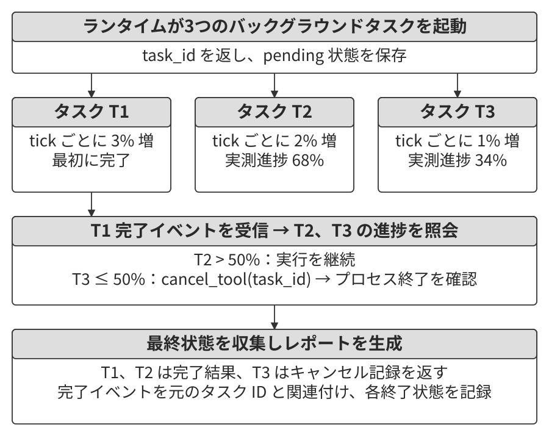
>

### モデルのネイティブな非同期：GPT-6 Astra

ここまでの方式では、Harness が同期メッセージ形式に合わせて調整していました。ネイティブな非同期インターフェースは、ツールがまだ返っていないうちにモデルが独立した作業を続け、後から結果を受け取ることを直接許します。2026 年 9 月時点で、GPT-6 Astra は非同期ツール呼び出し（Async tool calling）とターン途中の誘導（Mid-turn steering）を提供しており、それぞれツールの待機とユーザーの更新を扱います。図6-6 は、同期インターフェースへの適合とネイティブな非同期のメッセージの流れを対比したものです。[^ch6-22][^ch6-23]

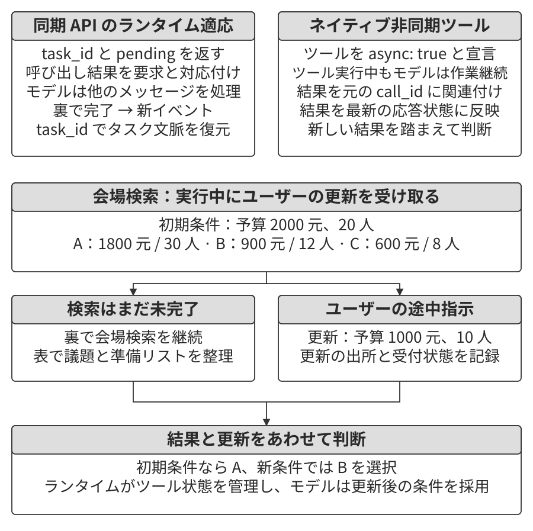

**ツールを待つあいだも独立した作業を続ける。** たとえば Agent は会議会場の照会を発行した後、先に議題と準備リストを整理し、照会結果が返ってから価格と収容人数を比較できます。ツール定義の `async: true` が非同期の能力を宣言し、アプリケーションは完全な呼び出し項目を受け取った時点で実行を始め、呼び出し識別子 `call_id` を保存します。結果が届いたら、アプリケーションは元の識別子に従って結果を返し、最新の応答状態から処理を引き継ぎます。後続の作業の段取りはモデルが行い、呼び出しの関連づけとタスクのライフサイクルは Harness が管理します。[^ch6-22]

**タスクの進行中に新しい要求を受け取る。** モデルが考えている最中や回答を組み立てている最中に、ユーザーは「予算を 1000 に下げて」「参加人数を 10 人に変えて」と補足できます。アプリケーションは同じ接続を通じて誘導イベントを送り、サーバー側が受信を確認すると、現在の応答状態に基づいて処理を続けます。接続が切れて再接続した後は、保存しておいたイベントと応答状態に基づいてタスクを再開できます。[^ch6-23]

二つの機能は組み合わせて使えます。会場の照会は動き続け、ユーザーの新しい要求は後続の判断に取り込まれ、照会結果が返ってから選択を完了します。実行器はそのあいだもバックグラウンドタスクの実際の状態を管理します。照会を止めたり予約を取り消したりする必要があれば、Harness は対応するインターフェースを呼び出して受領通知を確認します。すでに完了した業務操作は、取り消しや補償のフローに回します。

モデルとインターフェースがすでにネイティブな非同期に対応しているなら、筆者はネイティブなプロトコルを優先し、ツールの保留、ユーザーの更新、応答の引き継ぎをインターフェースの取り決めどおりに流します。同期の互換レイヤーは主に既存のモデルや古いインターフェースのためのものです。モデルを更新したら、メッセージの対応をそろえるためだけの互換ロジックを少しずつ取り除き、工学的な労力をタスクの状態、取り消し、再開に集中させればよいのです。

### 非同期タスクを確実に処理する

信頼できる非同期のやり取りには、メッセージ、タスク、実行の状態を同時に確認する必要があります。

1. **結果の帰属。** 遅れて届いた結果は元の呼び出し識別子を携えており、アプリケーションはそれを対応するタスクに結びつけます。その結果に依存する判断は、データが届いてから続けます。
2. **再開と取り消し。** ユーザーが要求を変えたら、システムはまだ有効な作業を残し、後続のステップを更新し、どのバックグラウンドタスクが動き続け、どれが止まったかを明確にします。
3. **複数の要求。** 予算、人数、地域、締め切りはそれぞれタスクの状態に入り、最終的な結果はこれらの条件を一つずつ確認します。

> **実験 6-3 ★★★：モデルのネイティブな非同期とターン途中の誘導**
>
> 本実験では、Agent に模擬会議のための会場として、予算と人数の要件を満たす最も安い会場を選ばせます。初期の予算は 2000、人数は 20 人です。照会ツールは 8 秒待ってから、三つの会場の料金と収容人数を返します。
>
> | 会場 | 料金 | 収容人数 |
> |---|---:|---:|
> | A | 1800 | 30 |
> | B | 900 | 12 |
> | C | 600 | 8 |
>
> 初期条件なら A を選ぶべきです。誘導グループは、タスクの進行中に予算を 1000 に、人数を 10 人に変えるという二つの更新を受け取り、このときは B を選ぶべきです。ツールは新たに生成した受領番号も同時に返し、最終回答はそれを引用しなければなりません。モデルが実際に届いた結果を使ったかを確かめるためです。
>
> 実験は五つのグループからなり、各グループで三回ずつ実行します。同期ツール、ネイティブな非同期ツール、推論中の誘導、非同期ツールの待機中の誘導、そして誘導機能に対応しないモデルによる対照です。最初の二グループでは、待機中に独立した準備リストを出力できるかを比較します。二つの誘導グループでは、予算と人数が同時に反映されるかを確認します。能力の対照グループでは、インターフェースが非対応であることを明確に報告するかを確認します。
>
> 保存された実行記録では、非同期ツールのグループは待機中に独立したリストを完成させ、二つの誘導グループはいずれも新しい条件に従って B を選びました。ツールを使った実行はいずれも照会を一回だけ行い、実際の結果を元の呼び出しに返しています。対照モデルのインターフェースは、一回の生成の途中で新しい要求を受け取ることには対応していないと明確に答えました。同期グループと非同期グループの総所要時間はほぼ同じで、主な違いは待機中にほかの作業を進められるかどうかにありました。
>
> もしモデルが人数を 10 人に変えたことだけを覚えていて、予算は古い 2000 のまま選んだら、どこを選ぶでしょうか。A も B も全員が座れ、最も安いのはやはり B です。したがって、正しい会場を選んだというだけでは、予算が更新されたかどうかは分かりません。
>
> 人数が変わったら、すでに出した照会はやり直すべきでしょうか。本実験のツールには絞り込みのパラメータがなく、三つの会場をすべて返します。アシスタントは送信中の照会の結果をそのまま使い、返ってきてから 10 人、予算 1000 で絞り込めばよいのです。もしツールが 20 人以上を収容できる会場しか返さないなら、古い結果には A しかなく、12 人を収容できる B はそもそも含まれていません。この場合、古いリストの上で人数を 10 人に変えるだけでは、やはり B を選び損ねます。元の照会がすでに B を除外していたなら、照会し直さなければなりません。

非同期の仕組みによって、外部の変化はタスクの進行中にシステムに入ってこられるようになります。音声、画面、ロボットとのやり取りでは、フィードバックの周期がさらに短くなります。システムは入力を連続して受け取り、適切なタイミングで出力と行動を調整しなければなりません。

## 音声：最も自然な人間とコンピュータのインターフェース

音声があれば、ユーザーは手や視線をほかの作業に取られていても、Agent に要望を伝え、条件を補い、結果を確認できます。音声入力ツールは口述を文字に変換し、音声 Agent はさらに対話、ツール呼び出し、返答の再生を管理します。どちらも「はじめに」で紹介した whisper coding を支えられます。

本節では二つの用途を論じます。ユーザーが Agent と直接対話する場合と、Agent がユーザーに代わって外部の人とやり取りする場合です。前者では認識、応答、割り込みが焦点になり、後者ではさらに通話の途中で本人確認、業務上の照会、意思決定を済ませる必要があります。

### やり取りの時間構造：カスケードから全二重へ

OpenAI は GPT-Live の紹介の中で、カスケード、ターン制の音声モデル、全二重という三種類の音声インタラクションを振り返っています[^ch6-12]。この発展の道筋は、「いつ話し始め、いつ聞き続けるか」の判断を少しずつモデルが継続的に下すものへと移してきました。カスケード型のシステムでは主にエンドポイント判定のロジックが受け渡しを段取りしますが、全二重のモデルは連続する音と対話の状態を合わせて、発話の重なり、間、割り込みを処理できます。

| パラダイム | 中心となる構造 | 実現しやすい能力 | 主な設計上の課題 |
|---|---|---|---|
| カスケード | VAD、ASR、LLM、TTS の分業 | モジュールを個別に差し替え、入出力を段階ごとに確認できる | モジュール間の遅延、書き起こしで失われる音響情報 |
| ターン制のエンドツーエンド音声モデル | モデルが音声を直接受け取り、生成する | イントネーションや感情などの情報を使って返答を組み立てる | 発話終了の判定、ターンの切り替え、応答のタイミング |
| 全二重 | 音声を受け取り続けながら出力を生成する | 発話の重なり、相づち、割り込み、連続したやり取り | 連続する状態、出力の制御、インタラクションの評価 |

モデルが音声を直接処理するか、入出力がストリーミングか、聞くことと話すことを同時にできるかは、それぞれ別々に確認できる能力です。カスケード型のシステムにもストリーミングのモジュールや割り込み制御を加えられますし、エンドツーエンドのモデルのやり取りのリズムは具体的な設計次第です。

[^ch6-12]: OpenAI、*Introducing GPT-Live*、2026-07-08、カスケード、ターン制の音声モデル、全二重のインタラクションを紹介している。

### パラダイム一・カスケードパイプライン（Cascading）

カスケード型のシステムは、音声対話をいくつかのモジュールに分けます。音声区間検出（VAD）は音声の中から発話の区間を見つけ、エンドポイント判定のロジックがその区間をいつ提出するかを決めます。自動音声認識（ASR）は音声を文字に変換し、LLM が依頼を理解して返答を生成し、音声合成（TTS）がその返答を再生可能な音声に変えます。図6-7 は順番に実行する基本構造を示しています。

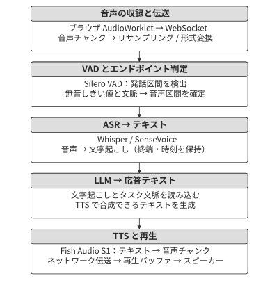

音響 VAD は人が話している区間を見つけるので、後段の認識は長い無音を飛ばせます。しかし同じ一回の間でも、「予約したいのは……」の後に来るのと「木曜の午前の便はありますか？」の後に来るのとでは意味が違います。意味的 VAD（意味的エンドポイント検出）なら、前者の場合は音を拾い続け、後者の場合に初めて発話を対話モデルに渡せます。これが音声の観測を時間方向に疎にするということです。連続した音のうち、推論を起動するのはわずかな時点だけになります。話し始めるかどうかは、その発話を聞いたモデルが決めます。モデルはさらに聞き続けることも、先にフライトを調べることもできます。

| モジュール | 役割 | よくある待ち時間や誤りの原因 |
|---|---|---|
| VAD とエンドポイント判定 | 発話を検出し、提出のタイミングを決める | 無音の閾値、雑音、途中の間 |
| ASR | 音声を文字に変換する | デコードの所要時間、人名や固有名詞の認識 |
| LLM | 理解、推論、返答の生成 | リクエストの待ち行列、最初の返答の生成 |
| TTS と再生 | 音声を合成してスピーカーに届ける | 最初のパケットの合成、ネットワーク転送、再生バッファ |

完全に直列の実装では、ユーザーが話し終えてから、エンドポイントの確定、書き起こし、返答の生成、最初の音声を順に待つことになります。図6-8 の例では、ユーザーが最初の返答の声を聞くまでに 1.4 秒が経っており、そのうち最も長いのは、ユーザーが話し終えたことをシステムが確定するまでの待ち（500 ミリ秒）です。書き起こしを 100 ミリ秒から 50 ミリ秒に縮めても、ユーザーの待ち時間は 50 ミリ秒しか減りません。

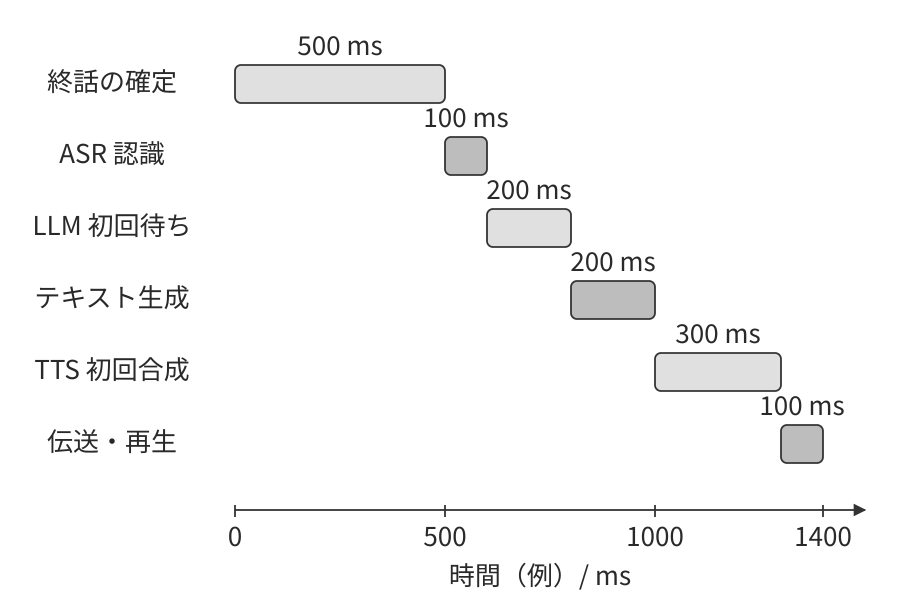

サービスの負荷は待ち行列による待ち時間も生みます。図6-9 では M/M/1 の単一窓口モデルでこの関係を説明しています。到着がポアソン過程に従い、サービス時間が指数分布に従うとき、平均サービス時間を $S$、利用率を $\rho<1$ とすると、サービスと待ちを含む平均総時間は $W=S/(1-\rho)$ です。$S=1$ 秒として利用率が 0.5 から 0.8 に上がると、平均総時間は 2 秒から 5 秒に増えます。そのうちサービスそのものは平均で 1 秒のままで、増えた 3 秒はすべて待ち行列で費やされます。リクエストが処理能力に近づくと、短時間のトラフィックの揺らぎが滞留を生みます。

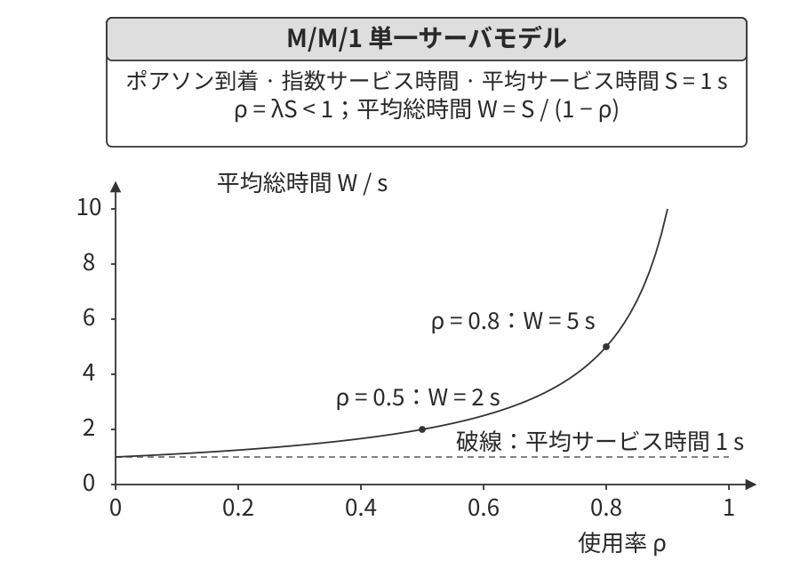

> **実験 6-4 ★：従来型の音声 Agent を構築する**
>
> アシスタントが木曜のフライトを読み上げているところへ、あなたが「待って、金曜のを予約したいんだ」と訂正したとします。ブラウザは WebSocket でマイクの音声をバックエンドに送ります。Silero VAD があなたの発話を検出するとすぐに、バックエンドは `speech_start` を送り、ブラウザは再生を止めて、待ち行列に残っていた古い音声を破棄します。この時点では、アシスタントはあなたがどの日に変えたのかをまだ知りません。あなたが話し終えて無音がデフォルトの 500 ミリ秒を超えたところで、バックエンドは初めて `speech_end` を送り、その発話をローカルの Whisper tiny に渡して書き起こさせます。
>
> Doubao が文字を返し始めてから、ユーザーが返答を聞くまでにはどれだけかかるでしょうか。録音を再生した一回分の記録では、書き起こしに 2.710 秒かかりました。Doubao はリクエストの送信から 0.749 秒で最初の token を返し、0.792 秒になってようやく返答全体を返しました。再生プログラムは文字がそろうのを待ってから Fish S1 に合成を任せ、さらに 2.819 秒後にバックエンドは最初の音声データを受け取りました。エンドポイントの判定から数えて、この三つの直列の所要時間を足すと約 **6.321 秒**になります。保存されたレポートには 6.279 秒とありますが、これは返答全体の生成時間の代わりに最初の token までの時間を使っているためです。
>
> この 6.321 秒が含むのはバックエンドの処理だけです。ユーザーはその前に、無音検出が発話の終了を認めるまで待たなければならず、最後には音声がブラウザに届いて再生が始まるのも待たなければなりません。

#### 直列からストリーミング知覚へ

直列方式は段階ごとに確認しやすい一方で、三つの問題も抱えています。無音を待つことでエンドポイントの遅延が増えます。書き起こしたテキストからは、口調、感情、周囲の音が抜け落ちることがあります。間で音声を区切ると、メールアドレス、人名、固有名詞が完全な文脈を失うことがあります。すでにカスケード型のアーキテクチャを採用しているシステムには、筆者はまずストリーミング化を勧めます。各段階ができるだけ早く差分の結果を出すようにして、認識、推論、再生を重ね合わせ、同時に確定した部分とまだ変わりうる部分を管理するのです。こうすれば既存のモジュールを再利用でき、待ち時間がどこから来ているかも少しずつ突き止められます。

- **ASR は聞きながら書き起こす。** 音声を受け取り続けて暫定の書き起こしを出力し、後続の音声が届いたら不安定な部分を修正し、エンドポイントが確定した時点で最終テキストを出します。
- **LLM の投機的実行。** 暫定の書き起こしを使って前もって返答を準備します。最終テキストが確定したら、入力が一致しているか、すでに行った作業がまだ使えるかを確認し、そのまま使うか、調整するか、生成し直すかを決めます。外部への送信や業務データの書き込みといった操作は、必要な条件が確定するのを待ってから実行します。
- **LLM の区切り出力。** 読み上げに適した一区切りのテキストができたらすぐに TTS に渡し、区切るときには文意、句読点、イントネーションの手がかりを保ちます。
- **TTS の差分合成。** 音声の断片を少しずつ返し、後続のテキスト生成、合成、再生が重なり合うようにします。割り込みが起きたら、生成タスクと、再生バッファ内でまだ流れていない内容を同時に処理します。

Whisper の通常の書き起こし実装は、音声のウィンドウ単位でエンコードとデコードを行います[^ch6-whisper]。外部で音声を区切ったり、蓄積したプレフィックスを繰り返し提出したりすれば、差分の書き起こしの流れを組み立てられます。継続的な状態の再利用、重複するエンコードのコスト、過去のテキストの修正は、具体的な実装で管理する必要があります。ネイティブなストリーミング認識モデルは、アーキテクチャと学習の段階で連続した入力を直接扱います。

音声言語モデルにもとづく知覚システムは、テキストと音響イベントを合わせて出力することもできます。過去の音声、書き起こし、語彙のヒントは、人名、ブランド名、固有名詞の認識を助けます。どれだけの履歴を残すかは、コンテキストとキャッシュの設計次第です。「ユーザーが話し終えたか」については、モデルは意味の完結性と無音を合わせて判断できます。「予約したいのは……」の間の時点では、リアルタイムのシステムに聞こえているのはその言葉だけで、後に日付が続くかどうかはまだ知りようがありません。

書き起こしのほかに、インターフェースでは次のようなイベントを取り決めることもできます。`speak_start` と `speak_end` は発話の開始と終了、`interrupt` は割り込み、`emotion` は感情の状態を表し、`laugh`、`sigh`、`noise` は笑い声、ため息、周囲の音を記録します。これらのイベントは文字やタイムスタンプと一緒に Agent に送れます。

> **実験 6-5 ★：Qwen2-Audio でストリーミング音声知覚を模擬する**
>
> 本実験では音声のプレフィックスを少しずつ伸ばし、そのたびに先頭から現時点までの音声を Qwen2-Audio に入れ直して、書き起こしと音響イベントが入力に応じてどう変わるかを観察します。対照の経路には 600 ミリ秒の無音によるエンドポイント判定と Whisper を使います。テストには、通常の発話、900 ミリ秒の間を挟んだ長い文、ピンクノイズを混ぜた発話を含めます。
>
> 今回のローカルの量子化モデルでの実行では、13 回のプレフィックス推論を記録しており、一回あたり約 8〜11 秒かかりました。途中の間は対照経路で区切りを引き起こしました。音声モデルは雑音を検出しましたが、咳と笑い声も誤って報告しました。

[^ch6-whisper]: OpenAI、Whisper、音声ウィンドウ単位の書き起こしとモデルの実装を紹介している。

### パラダイム二・エンドツーエンド全モダリティモデル（Omni）

エンドツーエンドの音声モデルは音を直接受け取り、言語と音響の情報を合わせて返答を生成し、音声出力の分岐を通じて音声を合成します。音声を直接処理すれば、話す速さ、声の高さ、間、周囲の音を利用できます。一方、先に書き起こしてから答える方式は、途中のテキストを確認したり、モジュールを個別に差し替えたりしやすくなります。

こうした音響的な特徴は理解に影響します。たとえば同じ「昼食前にレポートを送ってください」でも、せかせかした言い方とゆっくりした言い方では、聞き手が受ける印象が違います。出力の際にも、モデルは間、強勢、イントネーションによって意味を組み立てられます。

音声を直接処理するシステムでも、ユーザーが話し終えるのを待ってから答えることはできます。たとえばユーザーが電話番号を伝える途中で一息ついたら、システムはその数字の並びが言い終わったのかどうかを判断しなければなりません。いつ応答するかはエンドポイント検出が決めます。相手が読み上げの途中で割り込んできたら、システムはモデルの生成とスピーカーの再生をさらに調整しなければなりません。[^ch6-audio-architectures]

> **実験 6-6 ★★：MiniCPM-o 4.5 をローカルで動かし、エンドツーエンドと自己カスケードを比べる**
>
> 本実験では同じ MiniCPM-o 4.5 モデルを固定し、思考モードをオフにして、二つの経路を比較します。音声から直接質問に答える経路と、まずモデルに書き起こさせ、その書き起こしだけをもとに答える経路です。入力には、口頭で出す算数の問題二問と、文言は同じで話す速さが異なる二つの発話を含めます。
>
> 二つの経路はそれぞれ三問に正解し、誤りは別々の箇所に出ました。直接音声の経路はある問題の twelve boxes を 8 と聞き取り、計算を誤りました。書き起こしの経路は 12 を正しく保っていました。話す速さの問題では、二つの音声はどちらも「Please send the report before lunch.」と言っており、書き起こした文字はまったく同じになるので、速い・遅いという情報はそこで失われます。直接音声の経路は二つの速さを正しく区別しました。
>
> 実験ではさらに 24 kHz の音声を一つ生成し、入力の理解と音声出力をつなげています。

### パラダイム三・全二重インタラクティブモデル

全二重のシステムは話しながら聞きます。最も気づかれやすい改善点は、会話の中の生身の人間らしさです。「水曜の便を予約したい……いや、木曜の」という一文を読んでみてください。途中の間には、この言い直しが入る余地があります。アシスタントがすでに水曜のフライトを読み上げ始めていたなら、「いや、木曜」が聞こえた時点で止まるべきです。別のタイミングもあります。相手がまだ旅程を説明しているあいだに、短く軽い相づちを打てば、アシスタントが聞いていることを相手に伝えられます。音声を受け取り続けてこそ、発話、傾聴、間、ツール呼び出しのあいだでこうした選択をする条件が整います。同時通訳でも同じように、入力と出力が重なり合う必要があります。

Kyutai が 2024 年に公開した **Moshi** は、ユーザーとモデルの音声ストリームを別々にモデル化し、並行するストリームで発話の重なりと割り込みを表現します[^ch6-moshi]。こうした時間関係を入力の中に残しておけば、モデルはいつ応答し、いつ聞き続けるかを学習できます。

Thinking Machines Lab のインタラクションモデルは、連続する入力と出力を同じ長さの短いブロックに切り分けます。各ブロックは 200 ミリ秒をカバーし、マイクロターン（micro-turn）と呼ばれます[^ch6-14]。図6-10 の時間軸で二つ目のマスを見てください。アシスタントはまだ「木曜」の「曜」を言っている途中なのに、耳にはすでにユーザーが日付を訂正する「いや」が届いています。三つ目のマスでアシスタントは話すのをやめ、ユーザーが「金曜」と言い終えるのを聞き続けています。

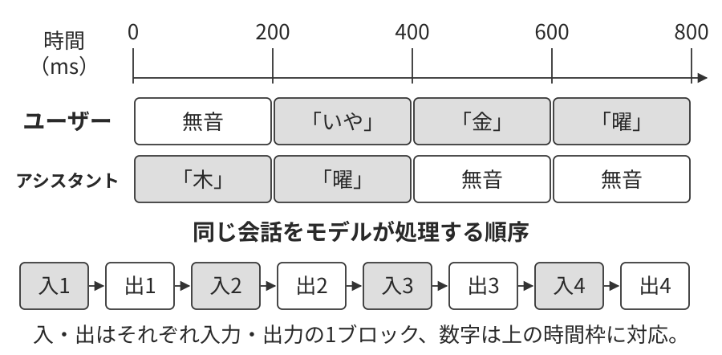

続いて図の下半分を読んでみましょう。通話する双方が聞いているのは重なりうる二本の音声ですが、モデルのほうは一本の系列に沿って入力ブロックの処理と出力ブロックの生成を交互に行えます。無音も一マスを占めるので、アシスタントはしばらく聞いてから話し始めることができます。図の 200 ミリ秒はこの実装のブロック長です。ユーザーが割り込んでから実際にスピーカーが止まるまでには、処理と再生バッファにかかる時間も加わります。

[^ch6-moshi]: Kyutai、*Moshi: a speech-text foundation model for real-time dialogue*、2024、ユーザーとモデルの並行する音声ストリームを紹介している。
[^ch6-14]: Thinking Machines Lab、*Interaction Models: A Scalable Approach to Human-AI Collaboration*、マイクロターン、マルチストリームのやり取り、バックグラウンドタスクの委任を紹介している。

### 認知の時間構造：リアルタイムのやり取りと深い思考

Pine のカスタマーサービスとの通話では、相手が話の途中のとき、アシスタントは待つべきこともあれば、軽く相づちを打つべきこともあります。自分が話している最中でも、相手が差し挟んでくる訂正は聞き取らなければなりません。筆者が Moshi の路線に期待しているのはこのためです。タイミングをうまくつかんでこそ、相手は電話のこちら側に本当に人がいて聞いていると感じます。資料を調べる必要がある依頼に出会ったら、もう一つの時間の計算が必要です。質問を理解してから調べた答えを伝えるまでに、何回の受け渡しが挟まるのでしょうか。

フロントの音声モデルが直接呼び出せるツールは、フロントが呼び出します。フライトの照会に必要なモデル呼び出しは二回です。フロントがユーザーの示した条件で照会し、それから結果を報告します。委任すると四回になります。フロントがタスクを伝え、バックエンドが照会を発行し、バックエンドが結果を整理し、フロントがそれを伝えます。別の考え方もあります。リアルタイムのモデルは引数を誤って埋めるおそれがあるので、ツールはバックエンドに呼び出させ、フロントはいつ聞き、いつ話すかの判断に専念させるべきだというものです。

GPT-Live-1 のフロントには業務関数を直接呼び出すインターフェースがなく、バックエンドの Agent に委任するしかありません。OpenAI Realtime の GPT-Realtime はフロントからの関数の直接呼び出しに対応しています。Doubao のリアルタイム音声モデル 3.0（Seeduplex）は、純粋なエンドツーエンドモードではフロントからの直接呼び出しに対応し、ハイブリッド構成では外部の言語モデルが呼び出します。[^ch6-voice-tools]

フロントとバックエンドのモデルの一回あたりの呼び出し時間をそれぞれ $L_f$、$L_b$、ツールの所要時間を $T$ とします。ユーザーが話し終えてから結果を聞くまでに、直接呼び出しでは約 $2L_f+T$、委任では約 $2L_f+2L_b+T$ かかります。委任で増える $2L_b$ はツールの所要時間 $T$ とは無関係です。ユーザーのメモリのように毎ターン使われうる情報は、ランタイムが調べておいてコンテキストに入れておけば、フロントはモデルを一回呼び出すだけで済み、約 $L_f+T$ になります。ユーザーが話し始める前に調べ終えていれば、$T$ さえかかりません。

いくつかの変更案を比較するといった、多段の推論が必要なタスクはバックエンドに任せるのが向いています。航空券の予約は代金の引き落としと発券を伴うので、誰がツールを呼び出すにせよ、ユーザーの確認を待ってから注文すべきです。フライトの結果は口頭で概要を伝え、完全な表は画面に表示できます。これは誰がツールを呼び出すかとは関係ありません。

> **実験 6-7 ★★：音声 Agent のツールはフロントが呼ぶか、バックエンドが呼ぶか**
>
> Doubao のリアルタイム音声モデル 3.0 でフロントを、Volcano Ark が提供する DeepSeek V4 Pro でバックエンドを構築します。天気の照会、ユーザーメモリの照会、Web 検索、フライトの照会、航空券の予約という五つの模擬ツールを用意し、設定した時間で結果を返すようにします。そのうちフライトの照会と予約は 2〜5 秒待たせます。ユーザーの録音は前もって合成しておき、毎回同じシナリオの録音を再生します。
>
> 四通りの分業を設定します。一つ目はフロントがすべてのツールを呼び出します。二つ目はバックエンドがすべてのツールを呼び出し、フロントは委任しかできません。残りの二つはどちらも天気の照会をフロントが行い、ユーザーメモリはランタイムがセッションの開始時にコンテキストに入れ、Web 検索と予約はバックエンドが担当します。両者の違いは、フライトの照会をフロントとバックエンドのどちらが受け持つかです。フロントはユーザーの声を直接聞きます。バックエンドは声を聞けず、文字しか読めません。Doubao のインターフェースは、ユーザーの一文を聞き終えるたびに、音声認識で得た文字を別に返します。これを書き起こしと呼びます。委任するときは、書き起こしとアシスタントの発話を時系列順に整理して通話記録にし、この通話ですでに実行したツール呼び出しとフロントが書いたタスク説明と一緒にバックエンドに渡します。それぞれの分業で、次の各シナリオを 10 回ずつ繰り返します。
>
> 1. 天気とフライトをそれぞれ照会します。ユーザーが話し終えた時点から、照会結果が聞こえるまでを計測します。「お調べします」といったつなぎの言葉は回答に数えません。直接呼び出しと委任の待ち時間の中央値を比べます。筆者の実験では、天気の照会でそれぞれ 2.81 秒と 6.96 秒でした。
> 2. まずフライトを照会し、続いて便を選んで確定します。前のターンの照会結果、ユーザーが直前に言ったこと、ユーザーのプロフィールと突き合わせて、予約の 13 個の項目を一つずつ確認し、注文の時刻がユーザーの確認より後になっているかを調べます。筆者の実験では、四通りの分業はいずれもすべての項目を正しく埋め、いずれもユーザーの確認後に初めて注文しました。
> 3. 同僚のための予約に切り替え、名前を口頭で伝える録音を再生します。「陳嘉怡（チェン・ジアイー）です。耳東の陳、嘉奨の嘉、怡然の怡。」録音、音声の書き起こし、注文の氏名を突き合わせ、フロントが直接予約した場合も委任で予約した場合も氏名を正しく埋めたかを確認します。筆者の実験では、フロントによる直接予約は 10 回すべて正解でした。ところが書き起こしは「陳佳宜」となっており、委任した場合にはそのせいで氏名を誤って埋めた注文がありました。
> 4. フライトの照会結果が返る前に天気を尋ねる録音を再生し、フロントが天気の質問に答えるか、その後でフライトの結果を伝えるかを聞きます。筆者の実験では、天気の質問にはいずれも答えましたが、元のフライトの結果はほとんど伝えられませんでした。

委任が必要なときは、フロントは確信のある氏名、数字、ユーザーが直前にした訂正をタスク説明に書き込み、バックエンドが書き起こしの誤りのせいで引数を誤って埋めないようにすべきです。ランタイムはまだ伝えていない結果を記録しておき、フロントが割り込みの質問に答えた後で続けて報告できるようにすべきです。

速いモデルが「お調べします」と一言言えば、アシスタントが要求を聞き取ったことを担当者に伝えられます。いつ料金を伝えられるかは、照会と推論が通話とどう連携するかで決まります。図6-11 は三つの構成を示しています。まず応答してから詳しく答える構成、フロントがやり取りを続けながらバックエンドの助言を受け取る構成、そして構想と表現を断片ごとに並行して進める構成です。

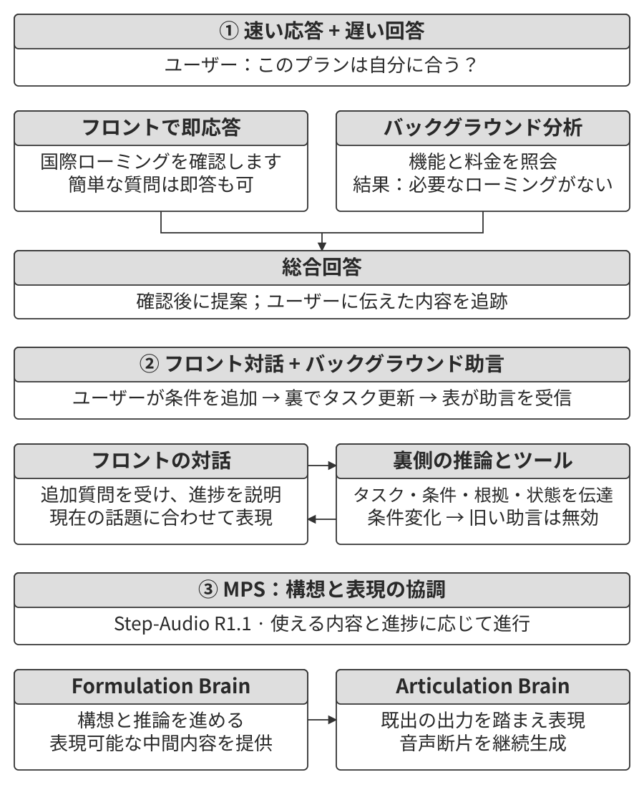

#### 方式一：速い思考で応答し、遅い思考で回答する

速いモデルがまず短く応答し、遅いモデルがバックグラウンドで分析を終えてから、詳しい回答を補います。この設計では依頼を受けたことを早く伝えられますが、二回の回答の一貫性を管理する必要があります。たとえば速いモデルがあるプランの購入を先に勧め、その後で遅いモデルがそのプランには重要な機能が欠けていると気づけば、前後の助言が食い違います。食い違いの根本は、両者が独立に答えるので、判断の根拠や推論の進み具合が異なりうることにあります。速いモデルが口にした助言はすでにユーザーの判断材料になっており、ユーザーはそれに従って行動しているかもしれません。遅いモデルが後から訂正するなら、変わった理由を説明し、すでに生じた影響にも対処しなければなりません。

そこでフロントは、タスクの確認と業務上の結論を区別すべきです。「このプランにその機能が含まれているか確認します」はすぐに言ってかまいませんが、購入の助言は必要な照会と分析を待ちます。バックエンドの結果が返ってきたら、システムはそれをすでに話した内容と照らし合わせてから、続きの返答を組み立てます。簡単な質問は速いモデルだけで完結させれば、重複した処理も減らせます。

#### 方式二：速い思考で対話し、遅い思考で助言する

音声と画面で役割を分けることもできます。口頭で「今月の請求には 15 ユーロのローミング料金が増えています」と言えば、ユーザーは要点をすぐに理解できます。元の金額、現在の金額、争点の明細は画面に残しておけば、ユーザーは自分のペースで確認できます。具体的な操作の確認はタップで選んでもらい、機密情報は事業者が認めた入力画面でユーザー自身に入力してもらいます。フロントは「認証完了」のような状態を受け取るだけで、自然に会話に戻れます。

旅行者が Pine に、木曜の午前に上海へ向かう航空券の予約を頼んだとします。予算は 1200 元で、正午までに会場に着かなければなりません。Pine は航空会社のカスタマーサービスと話しながら、バックエンドに「メモ」を回します。「午前 10 時に虹橋に着いたら、空港から会場まで間に合うか？」担当者は空席を調べ、Pine にこう伝えます。「10 時に虹橋に着く便は売り切れです。10 時半に浦東に着く便ならあり、料金は 1250 元です。」バックエンドがフロントから渡されたメモしか見られないなら、まだ虹橋からの道のりを計算しています。フロントはもう一言伝えなければなりません。「浦東に変えて計算して。着陸は 10 時半、会場と到着時刻は変わらない。」

別のやり方として、通話記録も順番どおりにバックエンドに同期しておく方法があります。バックエンドは通話記録から担当者が伝えた空港と着陸時刻をすでに読んでいるので、フロントは「この便で間に合うか計算して」と言うだけで同じタスクを委任できます。記録を同期するときは誰が何を言ったかを明示し、フロントが割り込まれてまだ流れていない言いかけの文も、すでに口にした内容と区別しておく必要があります。音声の書き起こしは重要な情報を書き漏らしたり書き誤ったりすることがあります。フロントは正しく聞き取った氏名、数字、ユーザーの訂正をタスク説明に書き込むべきです。二つの記録に食い違いがあれば、バックエンドはタスク説明を優先します。バックエンドは調べ終えたら、何時ごろ会場に着けそうか、時間の余裕がどれくらいあるかだけをフロントに伝えればよいのです。途中でどの経路を調べたか、地図 API がどのフィールドを返したかは、バックエンドに残しておいて後から参照できるようにします。結果を手にしたフロントが、担当者との交渉を続けます。

第 1 章のあのビジネス旅行者は、料金を 1200 元以内に抑えたいと考えていました。これまでの出張では、条件のよい便なら少し多めに払うこともいとわず、今回も別の上限は設けていませんでした。最安値が 1250 元だと聞いたら、アシスタントは本人に代わって予約してかまいません。いつも出費を細かく気にするユーザーが家族旅行に行く場合なら、この 50 元は先に尋ねるべきです。そこでフロントは二つの会話を同時に見なければなりません。

- ユーザーに送る：「この便は最安で 1250 元で、予算を 50 元超えます。予約してよろしいですか？」
- 続けて担当者に尋ねる：「この便の料金をしばらく押さえておいてもらえますか？同じ日のもう少し遅い便で、1200 元以内のものはありますか？」担当者が空席を調べているあいだに、フロントは手荷物の許容量や変更・払い戻しの条件も確認できます。

こうすれば、ユーザーが戻ってきたときにはいくつかの選択肢がそろっており、担当者も次に何を調べればよいか分かっています。ユーザーが後から「この前は会議に急いでいたからで、これからは出張で予算を超えるときもまず聞いて」と説明したら、次回からはこの新しい要望に従います。

本人確認を待つときは、会話のリズムがまた違います。担当者が認証コードを送ったと言ったら、フロントは「わかりました。少々お待ちください。旅行者に携帯電話を確認してもらいます」と答えられます。旅行者からまだ届いていないと返信があれば、担当者に SMS を末尾何番の番号に送ったか、どれくらい待てば再送できるかを尋ねます。旅行者が事業者の指定するチャネルで確認を終えたら、フロントは手続きを続けられます。このような通話では、少し長く待ったり発券が少し遅れたりするほうが、その場でユーザーに決断を急かすよりも適切です。

そこへバックエンドから「元の見積もりが更新された」と届きます。フロントはまず担当者に新しい料金を確かめ、それからユーザーに伝えます。ちょうどそのときユーザーが「予約していいよ」と返信してきたら、その返信が指しているのは以前送った 1250 元の見積もりです。フロントは新しい料金とすでに得ている権限に基づいて、もう一度確認が必要かを判断しなければなりません。バックエンドは情報を提供するだけで、担当者と話して約束をするのは常にフロントです。メッセージにフライト、料金の適用条件、時刻を付けておいてこそ、フロントはどの見積もりが期限切れになったかを見分けられます。

同じ「料金が変わったので確認してください」というバックエンドのメッセージでも、届くタイミングによってフロントの応じ方は変わります。担当者が「最安の料金は……」と言いかけたところなら、フロントはまず金額を最後まで聞けばよいのです。担当者が料金を言い終えて返事を待っているなら、新しい料金について尋ねるのにちょうどよい時機です。旅行者がちょうど電話口で「待って、日付を変えたい」と割り込んできたところなら、まず新しい日付をはっきり聞き取り、それから元の便を確認する必要がまだあるかを決めます。同じ「はい」でも、担当者が規約を説明しているときに言えば聞いているという合図にすぎませんが、「では発券いたしましょうか？」の後に言えば購入に同意したと受け取られるかもしれません。書き起こしのテキストだけを見ていると、こうした違いを見落とします。

#### 方式三：構想と表現を協調して進める

Step-Audio シリーズには関連する例が二つあります。**モダリティに根ざした推論の蒸留（MGRD）**は、推論が何の情報に基づいているかに注目します。声の高さ、リズム、イントネーションといった音響的な特徴をめぐって推論データを作成・選別し、反復的な蒸留によって音声の理解を改善します。Step-Audio R1 は強化学習の段階で、音声の問題に二つの項目で点数を付けます。正解すれば 0.8 点、推論過程を示せばさらに 0.2 点です。後者はモデルに根拠を書き出すよう促しますが、推論が録音の中の音響的な手がかりを使ったかどうかは、前段のサンプル選別で確認しなければなりません。[^ch6-mgrd]

**Mind-Paced Speaking（MPS）**は推論と表現の時間的な関係に注目し、構想モジュール（Formulation Brain）と表現モジュール（Articulation Brain）を使って、構想の過程が音声の生成を導くようにします。Step-Audio R1.1 のリアルタイム方式はこの手法を採用しています。[^ch6-mps]

二つのモジュールは進み具合に応じて情報を交換します。構想は進み続け、表現はすでに使える内容とそれまでの出力をもとに音声を組み立てます。こうすれば表現の一部を後続の推論と重ね合わせつつ、すでに話した内容を追跡し続けられます。

[^ch6-mgrd]: StepFun、*Step-Audio-R1 Technical Report*、モダリティに根ざした推論の蒸留を紹介している。
[^ch6-mps]: StepFun、*Mind-Paced Speaking: A Dual-Brain Approach to Real-Time Reasoning in Spoken Language Models* および Step-Audio-R1.1 のモデルカード、構想と表現の二つのモジュールと、そのリアルタイムシステムへの応用を紹介している。

#### モジュールの分業とアップグレードの方法

**筆者は速い思考と遅い思考の分業が持つ工学上の利点を重視しています。やり取りの能力と推論の能力を別々に進化させられることです。** より強力な推論モデルが公開されたら、システムはバックエンドを差し替えられます。こうすればバックエンドは推論モデルの進歩についていけますし、フロントも聞くこと、応答すること、割り込みへの対応の体験を改善し続けられます。フロントはタスクとユーザーの補足情報を理解する必要があり、バックエンドはより長い推論、計画、実行に専念します。

**推論モデルの更新が速く、チームが業務能力を継続的に高めていく必要があるときは、筆者は差し替え可能な速い・遅いの分業を優先します。** この分業なら、推論モデルを更新するたびに音声システム全体を学習し直す負担がなくなります。途中の推論で表現をより直接に制御する必要があり、それに見合う学習リソースもあるときに、より密な協調方式を採用します。

Pine AI の音声 Agent は、フロントの速い思考とバックエンドの遅い思考を組み合わせたアーキテクチャを採用しています。同社の公開記事は τ²-bench の音声部門で首位を獲得した結果を報告し、途切れない通話、業務上の推論、ツール操作の組み合わせ方を紹介しています[^ch6-17]。

こうした組み合わせを理解するには、三つの設計の次元を区別するとよいでしょう。**音声の経路**は、モデルが音を直接処理するか、書き起こしを介して受け渡すかを決めます。**聞くことと話すことの時間構造**は、入出力がターンごとに進むか並行して進むかを決めます。**認知の分業**は、リアルタイムのやり取りと深い推論がどのように状態を共有し、結果を交換するかを決めます。システムは音声を直接処理して全二重を保ちながら、複雑なタスクを独立したバックエンドのモデルに任せることもできます。Thinking Machines Lab のインタラクションモデルも GPT-Live も、こうした組み合わせを示しています。

[^ch6-17]: Pine AI、*The Most Natural Human-Computer Interface Is Your Voice*、速い思考と遅い思考のアーキテクチャと、同社が報告した音声タスクの評価結果を紹介している。この報告ではランキングを τ²-bench voice と呼んでいる。

### より人間らしい音声合成

間、話す速さ、強勢は、聞き手が文の構造と話し手の意図を理解する助けになります。たとえば電話番号を伝えるときは適切に区切り、複雑な条項を説明するときは速度を落とし、照会結果を待つあいだはまず何を処理しているかを説明できます。筆者の考えでは、適切な間とリズムの変化は音声をより自然にし、タスクがどのように進んでいるかをユーザーに聞き取らせることもできます。音声の制御は、こうした具体的な用途を軸に設計できます。

メインの LLM は、テキストに `[THINKING]`、`[EMO:happy]`、`[SPEED:0.8x]` のような制御タグを入れられます。実行層はタグを解析してテキストを音声と間の断片に分け、合成インターフェースが対応する感情、スタイル、参照音声に対応づけます。タグの意味はアプリケーションが定義します。`0.8x` は低速の段階に対応づけられますし、間はプレーヤーが挿入でき、笑い声やため息は対応している音声タグや生成機能で表現します。

参照音声の方式では、同じ話者のさまざまな表現をライブラリとして整理します。テキストの区切りごとに合う感情、話す速さ、スタイルを選び、合成したうえで順につなぎ合わせます。制御状態には効力の範囲を定める必要があります。たとえば感情は次に変更されるまで続き、間はその位置でだけ効力を持つ、といった具合です。

> **実験 6-8 ★★：Fish Audio による制御タグ駆動の TTS**
>
> 本実験では Fish Audio S1 を使い、24 個の参照音声からなる音声ライブラリを作ります。四種類の感情、三段階の話す速さ、二種類のスタイルの組み合わせです。パーサーはタグ付きの返答を音声の断片と無音の断片に変換し、実行層は断片ごとに参照音声を選んで合成します。
>
> 制御タグなし、単一の参照音声、複数の参照音声という三つの構成を比較します。返答の内容は同じにしたまま、タグが想定した構成にルーティングされるかを確認し、間、感情、声色の変化を聴き比べます。
>
> 保存された聴取テストでは音声理解モデルを使い、三つの構成の提示順を入れ替えながら、自然さ、感情の一致、考えるときの間、声色の一貫性、カスタマーサービスらしさを評価しました。複数参照のグループの総合評価が最も高く、単一参照のグループはタグなしのグループより低くなりました。

## Computer Use：GUI 自動化 Agent

Web ページ上の配送先住所の変更を Agent に頼んだとします。Agent はまず住所欄を見つけ、新しい住所を入力し、画面に反映された内容を見て保存の結果を確かめなければなりません。クリックの直前にログイン画面がポップアップすれば、前のスクリーンショットにあったボタンは座標が変わっていなくても、そのクリックが当たる対象はもう変わっています。Computer Use は画面、マウス、キーボードを通じてブラウザ、表計算、システム設定を操作します。その中心的な課題は、一つひとつの動作を目の前の画面に追いつかせることです。

図6-12 の**知覚—思考—行動**のループに沿って、新しい住所を入力する前にモデルが何を確かめるべきかを見てみましょう。モデルはスクリーンショットとタスクの進み具合からクリック位置を決め、Harness が引数と権限を確認してから実行層に渡します。クリックが成功したというのは、そのクリックが送られたということにすぎません。次のスクリーンショットで入力フォーカスがどこにあるかによって、続けて安全に住所を入力できるかが決まります。

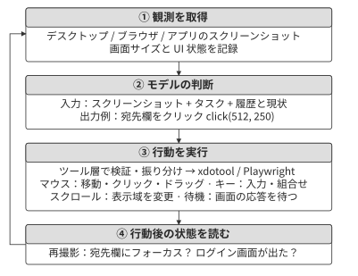

アシスタントが住所を入力し終えたとき、どの「保存」ボタンを押すのかを実行器にどう伝えればよいでしょうか。画面座標でも要素番号でも対象を指し示せますが、モデルとツールに求められることはそれぞれ異なります。

### 行動空間の設計

図6-13 に示すように、Anthropic の Computer Use 参照実装は、グラフィカルインターフェース、コマンド実行、ファイル編集の三種類のツールを提供しています。グラフィカルインターフェースのツールだけを見ても、データの行き先は二つあります。クリック動作は実行側に送られ、クリック後のスクリーンショットはモデルに戻されて、次の判断のための観測になります。ネイティブ API はツールの形式を定めています。別のモデルを使う場合は、適合層がスクリーンショット、動作のリクエスト、実行結果を、そのモデルのインターフェースが受け付けるメッセージに変換しなければなりません。[^ch6-computer-tools]

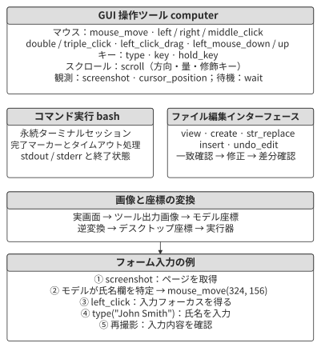

**GUI 操作ツール。** マウスの動作には、移動、左・右・中ボタンのクリック、ダブルクリック、トリプルクリック、ドラッグがあります。より細かいインターフェースでは、ボタンを押す動作と離す動作を別々に表せます。スクロールには方向と量が必要で、修飾キーに対応する実装もあります。キーボードのインターフェースは、テキスト入力、キーの組み合わせ、キーの押しっぱなしを提供します。スクリーンショットとカーソル位置は状態の取得に使い、待機のインターフェースはページの読み込みやアニメーションのための時間を確保します。具体的な動作の集合はツールのバージョンによって決まり、Harness は使っているインターフェースに従って引数を検証します。

**コマンド実行ツール。** 永続的なターミナルは、呼び出しをまたいで作業ディレクトリと環境の状態を保てます。たとえば、ある呼び出しでディレクトリを移動したら、次の呼び出しはそのディレクトリで続けて実行されます。参照実装では番兵文字列でコマンドの完了を見分け、タイムアウトも設定できます。タイムアウト後のプロセスの状態は、引き続き実行器が確認する必要があります。

**ファイル編集ツール。** 文字列置換のインターフェースは、元の文字列で変更範囲を特定します。表示、作成、挿入、取り消しを提供することもできます。実行前に一致する位置と回数を確認し、実行後に差分を確認します。二回の呼び出しのあいだにファイルが変わっていたら、まず関係する内容を読み直します。第 5 章で紹介した編集の戦略はここでも再利用できます。

> **実験 6-9 ★：Anthropic Computer Use 参照実装を動かす**
>
> 本実験では、公式のコンテナのサンプルが提供する Ubuntu デスクトップ、ブラウザ、ツール実行層を使います。ユーザーがタスクを入力すると、モデルはスクリーンショットを読み込んで動作を返し、実行層がデスクトップを操作して、新しいスクリーンショットをモデルに返します。
>
> 付属のタスクはサンフランシスコの天気を調べるものです。保存された軌跡では、まず Google にアクセスし、CAPTCHA に遭遇した後、実行中の回復指示に従って公開されている Open-Meteo のデータに切り替え、最終的に気温と天気の状況を報告しています。記録には 15 回のデスクトップ動作と対応するスクリーンショットが含まれており、クリック、キー入力、文字入力、待機がページをどう変えたかを一ターンずつ確認できます。
>
> オープンなモデルでブラウザを操作する経路は実験 6-10 を参照してください。

### 視覚グラウンディング（Grounding）

モデルに検索欄をクリックさせる問題は、二通りの形で出せます。一つはスクリーンショットを見せてクリック座標を答えさせる形です。もう一つは候補となる対象に番号を振り、その中から検索欄を選ばせる形です。番号はスクリーンショット上の候補領域に描き込むこともできますし、ブラウザが提供する要素一覧から取ることもできます。以下ではこの三つの路線を順に紹介します。番号を選ぶ場合は、実行層が番号を実際の対象に戻します。座標を直接答える場合は、モデルが対象の位置まで推定しなければならず、グラウンディングの学習や画面解像度への適応に対する要求が高くなります。

**Set-of-Mark：視覚的な標識付け。**

Set-of-Mark（SoM）は画像の上に参照可能な番号を重ね、視覚的な領域とモデルの出力を結びつけます。元の研究ではセグメンテーションなどの手法で候補領域を生成しており、たとえば SAM や SEEM で領域を取得してから標識を置きます。モデルが番号を選ぶと、実行層は対応する領域に基づいて操作位置を決めます。この手法は DOM のないデスクトップソフトウェアやゲームの画面にも使えますが、押したいコントロールが番号の付いた領域に入っていなければならず、モデルもそれがどの番号に対応するかを見分けられなければなりません。[^ch6-som]

**構造化された要素インデックス。**

ブラウザは別の種類の手がかりも提供できます。ドキュメントオブジェクトモデル（DOM）はページにどんな要素があり、どういう階層になっているかを記述し、レイアウト情報は要素の表示位置を示し、アクセシビリティツリー（accessibility tree）は支援技術に必要なロールとアクセシブルな名前を保持しています。たとえば虫眼鏡のアイコンしかないボタンでも、ページが「検索」というアクセシブルな名前を提供していれば、Agent はロールと名前でそれを見つけられる可能性があります。browser-use のような方式を例にとると、システムは Chrome DevTools Protocol（CDP）などのブラウザのデバッグインターフェースで要素の情報を取得し、入力欄、ボタン、リンクを識別して、現在のページ上の操作可能な要素に番号を振れます。図6-14 では、モデルはページ右上の [2] を選んでいます。この番号は、どのようにして Submit ボタンへの一回のクリックに変わるのでしょうか。

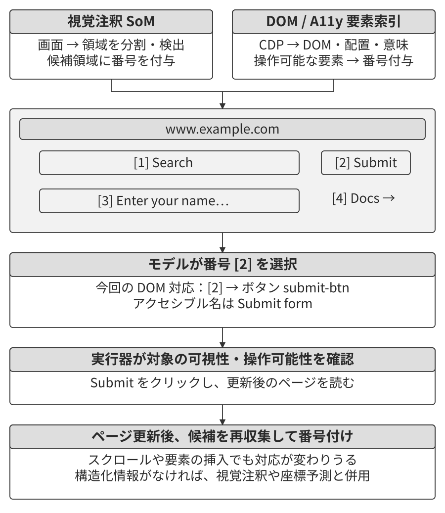

処理は四つのステップに分けられます。DOM、レイアウト、利用可能なアクセシビリティ情報を読み込む。操作可能な要素を選び出す。現在のページの番号の対応表を作る。要素の説明と必要な標識付きスクリーンショットをモデルに渡す。たとえばモデルには、次のような番号付きの四つの要素が見えるかもしれません。

```text
スクリーンショットに [1]、[2]、[3]、[4] を表示

[1] <input type="text" placeholder="Search" aria-label="Search" />
[2] <button id="submit-btn" aria-label="Submit form" />
[3] <input type="text" placeholder="Enter your name" value="" />
[4] <a href="/docs" aria-label="Documentation" />
```

モデルが番号を選ぶと、実行層はそれを要素の参照か座標に解決し、対象がまだ表示されていて操作可能かを確認してから操作を行います。ページの再読み込み、スクロール、要素の動的な挿入があった後は、古い番号を使わないよう対応表を更新する必要があります。構造化インデックスはタグ、ロール、テキストを活用できますが、Canvas、ほかの要素に隠れた部分、不完全な意味の注釈については、スクリーンショットと合わせて判断する必要があります。列挙する要素が多いほど、またスクリーンショットが大きいほど、コンテキストに送り込む情報も増えます。

**座標を直接予測する。**

座標の路線では、モデルがスクリーンショットと対象の説明から直接位置を出力します。たとえば「送信ボタンをクリック」をある一点に対応づけます。SeeClick などの GUI グラウンディング研究も Claude の Computer Use も、座標出力を採用しています。画像上の座標を実際のデスクトップ座標に変換するのは実行層の役目です。

スクリーンショットを縮小したら、二つの座標系に同じ変換を適用する必要があります。2560×1440 のデスクトップを例にとると、モデルに送る画像が 1366×768 なら、モデルが出した (683, 384) は次の位置に対応します。

$$
x = 683 \times \frac{2560}{1366} = 1280,\qquad
y = 384 \times \frac{1440}{768} = 720
$$

図6-15 の二つのサイズは縦横比がほぼ同じです。スクリーンショットが比率を保つために黒い余白を付けていれば、モデルの出す座標には余白が含まれます。元の画面座標に戻す前に、対応するパディングのオフセットを差し引いてから、縮尺の係数で換算しなければなりません。トリミング、表示の拡大縮小、マルチディスプレイの原点も対応関係を変えるので、ツール層は実際の変換パラメータを保存しておくべきです。

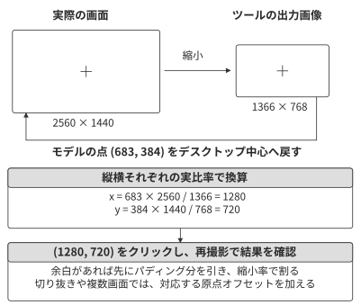

参照実装では、XGA（1024×768）、WXGA（1280×800）、FWXGA（1366×768）などの目標サイズが使われていました。縦横比を無理に変えるとコントロールの形がゆがみます。逆方向の変換を誤れば、正しい予測が誤った位置に落ちます。[^ch6-computer-tools]

**構造化された情報がそろっているときは、筆者は DOM やアクセシビリティツリーのインデックスを優先します。** 要素の名前、ロール、参照が直接グラウンディングに使えるので、モデルがその場でピクセル位置を推定する手間が減ります。構造がない場合、汎用の視覚モデルならまず SoM と組み合わせて、標識を付けた領域から一つを選ばせます。GUI グラウンディングの学習を受けたモデルなら、座標を直接予測させて、別途の標識付けを省けます。

> **実験 6-10 ★：browser-use でブラウザ操作を自動化する**
>
> 本実験では Qwen3-VL 32B Instruct で browser-use を動かし、ブラウザの状態、要素の情報、スクリーンショットから動作を生成します。タスクはサンフランシスコの天気を調べることです。検索欄を見つけ、「San Francisco weather today」と入力し、検索を実行し、気温と天気の状況を抽出します。
>
> 実験 6-10 のコードと実行手順には二つの入口があります。OpenRouter のキーがあれば、ホスティングされた視覚モデルを使えます。vLLM や SGLang などの互換サービスがすでにあれば、`OPEN_MODEL_BASE_URL` と `OPEN_MODEL_MODEL` を自分のエンドポイントとモデルに向け、サービスの要件に従ってキーを設定します。どちらの路線でも、まず実験ディレクトリで `python main.py --dry-run` を実行して設定を確認し、それから手順に従って実際の照会を始めます。
>
> 保存された実行は 16 ステップのやり取りを終え、15 枚のスクリーンショットを残しています。Google で CAPTCHA が出た後、タスクは weather.com から結果を取得する方法に切り替えました。

[^ch6-computer-tools]: Anthropic、Computer Use のツールドキュメントと参照実装、バージョン管理された動作インターフェース、実行層、スクリーンショットの処理を紹介している。
[^ch6-som]: Microsoft、*Set-of-Mark Prompting*、2023。browser-use の DOM サービスの実装は、構造化された要素処理の例を示している。

### アニメーションを見て、音を聞ける Computer Use Agent

保存した後のほんの一瞬だけ「同期に失敗しました」と表示されるページがあるとします。数秒あけて撮った二枚のスクリーンショットには、どちらも同じフォームが写っています。この二枚を見直しても、モデルはそのあいだに何が起きたのかを再構成できない可能性が高いでしょう。動画、アニメーション、一瞬だけの通知、会議の音声にも同じ問題があります。**変化し続ける画面については、観測のインターフェースを重点的に改善すべきだと筆者は考えています。** 変化に応じて次の一手を決めるには、動作と動作のあいだに現れた出来事や画面も保存しておく必要があります。

筆者と共同研究者が提案した **Agent–Computer Observation Interface（AOI、Agent とコンピュータのあいだの観測インターフェース）**は、連続する画面と音声を、モデルが受け取れる画像と文字に変換します[^ch6-9]。このインターフェースには三つのコンポーネントがあります。

- **動作間のキーフレーム収集。** メインループの実行中に画面の変化を監視し、ピクセルの差分や軽量な視覚モデルで候補フレームを選び出して、役に立つ画面を次の判断に渡します。
- **音量ゲート付きの書き起こし。** 音を検出したら音声認識を呼び出し、書き起こしと時刻情報を観測記録に加えて、Agent が会議の内容や口頭の指示を使えるようにします。
- **永続的な画面の記述。** 重要な画面を文字で要約します。元の画像がコンテキストから外れても、起きた変化は文字として残り、後のステップで参照できます。

たとえば動画の中でメニュー操作が一度示されたとします。モデルは途中の画面と対応する記述を受け取っていれば、再生が終わった後もその手順を参照し続けられます。論文のアブレーションの結果は、永続的な文字の記述がとりわけ効果に効いており、キーフレームの細かな選び方の寄与は小さいことを示しています。画像を入れすぎると、かえって性能が落ちるモデルもありました。

さきほどのフォーム保存の例に戻りましょう。キーフレームが「同期に失敗しました」をとらえていても、元の画像がいったんコンテキストから外れれば、モデルは残された記述に頼るしかありません。「ページに通知が表示された」では、保存に成功したのか失敗したのか分かりません。「同期に失敗、住所は保存されていない」と書いてあってこそ、次の一手を決める手がかりが残ります。

[^ch6-9]: Bojie Li、Noah Shi、*Agent-Computer Observation Interfaces Enable Dynamic Computer Use*、2026、AOI とそのコンポーネントのアブレーションを紹介している。

### Computer Use の世界モデル

観測を時機よく得られたら、次に Agent は動作を選び、実行を待たなければなりません。OSWorld-Human の研究は、Agent の操作効率を人間の軌跡と比較し、冗長なステップやモデル呼び出しなど時間がかかる要因を分析しています[^ch6-osworld-human]。

世界モデルは、動作の結果の予測を計画に提供します。デスクトップの状態には、ウィンドウ、フォーカス、スクロール位置、入力内容、読み込みの進み具合などが含まれます。権限やネットワークの結果といった情報は、対応するインターフェースから補う必要があります。モデルは現在得られる状態と候補の動作から、次の状態を予測します。

```text
現在の状態 + click / type / scroll / wait → 予測される次の状態
```

人がコンピュータを操作するときは、たいていクリックする前に次の展開を思い描いています。画面が予想どおりならそのまま続け、想定外のことが起きたときにだけ立ち止まって確かめます。世界モデルは Agent に、同じような投機的実行の根拠を与えられます。プランナーは候補の動作を前もって比較し、ページの読み込み中に後続のステップを準備し、実際の状態が確認できたら実行を続けます。こうすれば、クリックのたびに一から計画し直す待ち時間を減らせます。たとえば VS Code で Python ファイルを新規作成して hello world と書き込む場合、予想される変化は、ファイルツリーに新しいファイルが現れること、エディタ領域にコードが入ること、保存状態が更新されることです。実行後にこれらの変化を確かめ、予想どおりなら続け、ずれがあれば位置の特定と計画をやり直します。

ファイルの削除のような操作には、独立した実行条件も必要です。対象は正しいか、削除が許されているか、元に戻せるか、ユーザーの確認が必要か、といったことです。予測は起こりうる結果を理解する助けになりますが、実際の権限と業務上の条件は実行層が確認します。

**Photon-1 の潜在状態予測。** Induction Labs は 2026 年 7 月に Photon-1 を紹介しました。動画のフレームを離散的な潜在 token にエンコードし、後続の token を予測することで状態の変化を学習するものです。同社は、事前学習に約 3 万 H200 GPU 時間を使ったと公表しています。状態の予測は潜在 token の中で行われ、補助的な画像生成器がそれを閲覧可能な画面に戻して、人が予測を確認できるようにします。計画と動作の生成は内部表現を直接使えるので、ステップごとに完全なスクリーンショットを生成するコストを省けます。[^ch6-20]

この方式はさらに、ファインチューニングによって指示と動作の形式を学習します。まず到達したい状態を予測し、次にその状態へ至る操作を生成し、仮想マシンの中でのオンライン学習によってタスクの成績を改善します。動作条件付きのファインチューニングは、与えられた操作の後にデスクトップがどう変わるかを予測するのに使います。この二つの用途はそれぞれ計画とシミュレーションにつながっており、状態表現が Computer Use にどう関わるかを示しています。

[^ch6-osworld-human]: Reyna Abhyankar ほか、*OSWorld-Human: Benchmarking the Efficiency of Computer-Use Agents*、タスクの軌跡と時間のコストを分析している。
[^ch6-20]: David Li、Jonathan Li、*Scaling Video Pretraining with Imagination Models*、Induction Labs、2026-07-23、Photon-1 の事前学習、動作の学習、状態のシミュレーションを紹介している。
[^ch6-21]: Google DeepMind、*Genie 3: A new frontier for world models*、2025-08-05。Zachary Lin ほか、*Cosmos World Foundation Model Platform for Physical AI*、2025。

### モバイル端末：技術的なインターフェースとエコシステムの協力

モバイル端末でも観測—判断—行動のループは変わりませんが、動作はタッチジェスチャーの形をとることが多くなります。同じ座標がタップの位置にも、長押しの位置にも、スワイプの始点にもなりうるので、インターフェースにはジェスチャーの種類、継続時間、経路も必要です。画面の回転、ソフトウェアキーボードの表示、システムのポップアップも操作可能な領域を変えます。

Android の `AccessibilityService` は、許可された範囲で画面の情報を読み取り、対応する動作を実行できます。ジェスチャーのインターフェースには、対応する能力の宣言も必要です[^ch6-android]。スクリーンショット、アクセシビリティツリー、システムの自動化インターフェースは組み合わせて使えますが、具体的に何が使えるかは、OS、アプリの実装、認可によって決まります。第 7 章で紹介する AndroidWorld などのベンチマークは、実際のアプリのタスクの中で、こうした動作が期待どおりの結果を生むかを確かめます。

**モバイル端末での実用化では、エコシステムの壁のほうが技術的な問題より扱いにくいことが多いと筆者は考えています。** プラットフォームは、どの操作を代理に任せてよいか、アカウント、支払い、データをどう認可するか、誤りが起きたときに責任をどう追跡するかを決めなければなりません。こうした取り決めは、Agent が完了できるタスクの範囲に直接影響します。

その中の構造的な利害の衝突の一つは、トラフィックと注目をめぐるものです。多くのアプリは広告表示、コンテンツの推薦、取引の入口で収益を得ています。ユーザーが Agent に照会や購入を直接任せるようになると、ページの閲覧経路が短くなり、推薦や広告が集める注目も変わるかもしれません。こうした部分で収益を上げているプラットフォームにとって、代理操作は既存の収益源に触れるものです。そのためプラットフォームは、インターフェースの開放、商業上の収益分配、代理アイデンティティの管理を考え直す必要があります。

[^ch6-android]: Android Developers、AccessibilityService、画面へのアクセス、動作、ジェスチャーの能力を紹介している。

## ロボット操作：XLeRobot による机の片付けを例に

赤いカップをトレイに入れ、黄色い紙くずをゴミ箱に入れ、最後に机の上が片付いたことを確かめる。このタスクは知覚、計画、制御をひとつながりにします。グリッパーがカップに近づくと、カメラに映る位置が変わります。カップをつかみ上げたら、アームは机の上のほかの物を避けなければなりません。紙を一回目でつかみ損ねたら、システムは失敗に気づいてもう一度試す必要があります。一つひとつの動作が、次の判断の条件を変えていきます。

本節ではこのタスクに沿って五つの実験を用意しています。実験 6-11 と 6-13 は実機での遠隔操作と自律操作の実践的な設計を示し、実験 6-12、6-14、6-15 はローカルのシミュレーションを使って、それぞれ制御のベースライン、失敗からの回復、視覚条件の変化を調べます。

同じロボットを、人がカメラを見ながら操作し続けることもできますし、モデルが画像を読み込んでスキルを選び、制御システムに実行を任せることもできます。タスクとハードウェアを変えずにおけば、二つの方式の違いを四つの問いから分析できます。人は何を成し遂げたいのか。次にどのサブタスクから手をつけるのか。現在のスキルはどんな動作を出力するのか。動作の後の環境は計画どおりになっているか。長期計画はカップと紙くずを処理する順序を段取りし、VLA の方策やあらかじめ定義した動作プリミティブがつかむ動作と置く動作を担い、世界モデルは動作の結果の見積もりを助け、シミュレーションから現実への移行は画像、接触、アクチュエータの特性の変化に対処します。

### ハードウェアとアルゴリズムの分担

自律的な机の片付けが失敗したら、まず遠隔操作で、ハードウェアがそのタスクをこなせるかを確かめられます。カメラ、ロボットアーム、グリッパー、机の配置、受け入れ条件を変えずに、操作者に知覚と制御のループを引き継いでもらうのです。人なら何度やっても安定して成功するのに、自律システムは失敗を繰り返すなら、このハードウェアはすでに現在のタスクをこなせる力があり、ボトルネックは主に自律制御のアルゴリズムとフィードバックにあることになります。その場合は物体の位置特定、スキルの選択、動作のタイミング、失敗からの回復を優先して調べ、遠隔操作で効いていた修正のやり方を自律システムに身につけさせるべきです。

XLeRobot はキーボード、Xbox コントローラー、Switch の Joy-Con による遠隔操作に対応しており、VR での操作はまずシミュレーション環境で試せます。[^ch6-1] グリッパーがカップに近づくと、操作者は速度を落とします。カップが滑れば、つかむ位置を修正しなければなりません。グリッパーが紙をつかみ損ねたらもう一度見直し、物を所定の位置に戻したら一目見て確かめます。観測にもとづくこうした修正は、どれもデモンストレーションデータに記録しておく価値があります。将来ロボットが自律的に操作するときにも、滑りやつかみ損ねに気づけなければならないからです。

> **実験 6-11 ★：実機の XLeRobot を遠隔操作して机を片付ける**
>
> キャリブレーション、可動範囲の制限、緊急停止の点検を済ませた XLeRobot の作業領域に、赤いカップ、トレイ、黄色い紙くず、ゴミ箱を置きます。キャリブレーション済みの遠隔操作方式を一つ選び、「赤いカップをトレイに入れ、黄色い紙くずをゴミ箱に入れ、最後に机の上の状態を確認する」という決まったタスクを実行します。何回も繰り返し、カメラの映像、操作者の入力、ロボットアームの状態、動作時間、つかみ損ねとやり直しの回数を記録します。
>
> 各回の終わりには、カップがトレイの中に、紙くずがゴミ箱の中にあり、ロボットアームが安全な姿勢に戻っていることを確かめ、全体を通じた衝突、範囲逸脱、人の介入の記録を確認します。失敗がどのステップで起きたか、操作者がどう回復したか、最終結果はどうだったかを並べて分析すれば、自律制御と比べるためのベースラインができます。

シミュレーション実験なら、物体の数や初期位置を変えながら何度でも繰り返せ、状態が分かっている条件での制御の過程だけを切り出して調べられます。二次元の机のモデルでは、物体に近づく、目標まで運ぶ、次の物体を処理するという三つの段階で表し、完了までのステップ数と経路長で制御のコストを表せます。

> **実験 6-12 ★：シミュレータで同じタスクの理想的な制御ベースラインを作る**
>
> 二次元の机の上に物体の位置と目標位置をランダムに生成し、制御器に座標を直接読み込ませて、物体に近づき、対応する目標まで動かし、次の物体を処理する、という流れを順に行わせます。初期位置と物体の数を変えて、成功率、完了までのステップ数、経路長を比較します。
>
> まず一つの物体の軌跡全体を追います。制御器は物体に到達すると運搬の段階に入り、目標に到達して初めて完了数を加算できます。次に物体の数を増やし、どの物体もこの二つの到達条件を通過しているかを確認します。付属の二次元シミュレーションでは、五つの乱数シードのそれぞれで物体を 1、2、3、4 個置き、各組み合わせを 512 エピソードずつ実行して、合計 10,240 エピソードがすべて完了しました。制御器は座標を直接読み込めますし、物体の移動も実際のグリッパーには頼っていません。

### ロボット制御の基本構造

机を一回片付けるのに数分かかることもありますが、関節の制御は途切れなく、遅れずに更新し続けなければなりません。システムは時間スケールごとに分業できます。上位の計画がタスクの順序を段取りし、スキルの方策が運動を生成し、低レベルの制御器がそれを追従して実行します。

| 階層 | 中心となる問い | 出力 | 時間スケールと設定の例 |
| --- | --- | --- | --- |
| タスクの目標 | 人は何を成し遂げたいのか | 「カップと紙くずを元の場所に戻す」 | 分単位のタスク |
| 長期計画 | 何を先に、何を後にするか | 先にカップ、次に紙くずを処理し、最後に確認する | 秒〜分 |
| 基本スキル | いまどの状態変化を実現するか | `pick(red_cup)`、`place(red_cup, tray)` | 一回のスキルは数秒続くことがあり、たとえば 1〜3 秒 |
| VLA／スキル方策 | 現在のスキルを具体的にどう動かすか | グリッパーの動作、手先の位置姿勢、または一区切りの関節軌道 | 1〜10 Hz の推論に設定できる |
| 低レベル制御と安全層 | どうすれば安定して遅れずに実行できるか | 関節または手先の制御量、速度制限と緊急停止 | 制御器は数十〜数千 Hz に設定できる |

プランナーにはルールベースのプログラム、VLM、最適化器を使えますし、VLA にスキル選択の一部を担わせることもできます。**筆者が勧めるのは、タスクの順序と目の前の動作を分けて扱うことです。** 上位の推論には計画を組み立てる時間が必要で、低レベルの制御は位置や力の変化に遅れずに応じなければなりません。両者をそれぞれに合ったリズムで動かしてこそ、計画と制御を両立できます。

本節では上位モデルに `observe_scene`、`pick`、`place`、`verify_state`、`stop` の五種類のツールを用意し、それぞれ観測、把持、配置、確認、停止に使います。Harness が引数、作業領域、現在の状態を確認し、実行器は確認を通ったスキルをロボットアームの動作に変換して、速度制限とタイムアウトを処理します。関節角と連続した軌道はスキルの方策と制御器が生成するので、モデルによるスキルの選択と実際の運動のあいだには、はっきりしたインターフェースができます。

### 長期計画とタスク分解

ユーザーが「机の上をきれいに片付けて」と言ったら、プランナーはまず物体とそれぞれの目標領域を見分け、処理の順序を決め、各ステップについて開始条件、完了条件、動作の制約をはっきり書き出します。たとえば片付けの順序は次のようになります。

```text
赤いカップを処理 → 黄色い紙くずを片付ける → 机の上を確認
```

「赤いカップを処理する」は、さらに二つの動作と一回の確認に分けられます。

```text
pick(red_cup) → place(red_cup, tray) → verify_state()
```

「カップを持ち上げてトレイに置く」を例にとると、ロボットアームが把持のプログラムを最後まで実行したというのは、そのプログラムが終わったということにすぎません。次に持ち上げる前に、グリッパーのフィードバックか新しい画像で、カップを本当につかめているかを判断しなければなりません。つかみ損ねていたらカップの位置を特定し直します。誰かがトレイを動かしてしまった場合は、成功した把持はそのまま有効で、配置の動作だけを計画し直せば済みます。各スキルを確認可能な一つの状態変化に対応させ、動作と所要時間を限定し、実行状態と新しい観測を返すようにすれば、プランナーは実際に失敗したステップから回復できます。

> **実験 6-13 ★★：Gemini Robotics-ER 1.5 で XLeRobot に机を自律的に片付けさせる**
>
> 実験 6-11 のハードウェア、机の配置、タスク、受け入れ条件をそのまま使い、観測と計画は身体性推論モデルに任せます。RoboCrew の構成方法を参考に、このタスク用に `observe_scene`、`pick`、`place`、`verify_state`、`stop` の五つのツールを設計します。[^ch6-2]
>
> モデルはまず机の観測を読み込んで処理の順序を決め、それからキャリブレーション済みの把持と配置のスキルを呼び出します。スキルを一つ終えるたびに新しい観測を取得して事後条件を確認し、失敗したら現在の状態に応じてやり直すか停止するかを選びます。実行システムは、緊急停止の信号を受け取ったとき、範囲逸脱を検出したとき、重要な状態を確認できないときには直ちに実行を止めます。モデルも `stop` で能動的にタスクを終了できます。
>
> 最後に新しい環境の観測によって、カップがトレイの中に、紙くずがゴミ箱の中にあり、ロボットアームが安全な姿勢に戻っていることを確かめ、衝突と範囲逸脱の記録を照合します。操作者は起動、緊急停止、現場での監視を担当し、途中での引き継ぎは別に記録します。

実験 6-13 は実機の動作をどう接続し、片付けの結果をどう受け入れ確認するかを示していますが、付属の記録にはこのタスクの実機試験はまだありません。以下ではまずシミュレーション環境で三つのやり方を比較します。計画どおりに開ループで実行する方法、一歩ごとに結果を確認する方法、動作の結果を先に予測する方法です。タスクの目標と五種類のツールは同じにしておき、故障も繰り返し起こせるので、同じ一回の失敗に三つのやり方がそれぞれどう対処するかを観察しやすくなります。

### VLA 制御

VLA は Vision-Language-Action の略で、視覚—言語—動作モデルのことです。現在の画像、タスクの指示、利用できるロボットの状態をもとに、次に実行する動作を生成します。

```text
現在の観測 + スキルの指示 → 動作または動作系列
```

机の片付けの例では、上位のプランナーが `pick(red_cup)` を提出し、スキルの方策が画像をもとに、どの方向からカップに近づくか、いつグリッパーを閉じるか、どの軌道でアームを持ち上げるかを決めます。この一区切りの運動を実行し終えたら、システムは机の観測を取得し直し、カップがつかめていることを確かめてから `place(red_cup, tray)` に進みます。ツールのインターフェースは期待する状態変化を取り決め、VLA は連続した動作でその変化を実現することを学習します。

動作の表し方にはいくつかの方式があります。RT-2 や元の OpenVLA は、動作の各次元の数値を離散的な token に量子化し、言語モデルと同じ生成の仕方で出力します。π₀ はフローマッチングで連続した動作チャンクを生成します。前者は自己回帰的な生成の枠組みを再利用しやすく、後者は一区切りの連続動作の分布を直接モデル化します。[^ch6-15]

モデルの推論とアクチュエータの制御は、通常それぞれ異なる更新頻度で動きます。動作チャンク化（action chunking）では、モデルが一度に未来の動作を小さな一区切り分だけ生成し、制御スレッドがそれをより高い頻度で実行します。さらに推論と実行を重ね合わせれば、システムは現在の動作チャンクを実行しながら次のチャンクを準備でき、待ち時間を減らせます。チャンクのつなぎ目では、軌道の連続性と観測の鮮度にも対処しなければなりません。アームがカップに手を伸ばしている最中にカップがぶつかって動けば、残りの動作はまだ古い位置を指しているかもしれません。一回に実際に実行する区間を短くする、新しい観測で逐次更新する、異常を検出したら動作を中断する、といった方法はどれも応答の速さを高めますが、そのぶん推論とスケジューリングのコストも増えます。

### VLA のデータと運用の条件

「カップをつかみ上げる」を安定して動作に変えるには、次のような違いに同時に対処する必要があります。

- **学習データのカバー範囲**：使えるロボットの動作デモンストレーションは、インターネット上の文章や画像よりはるかに少ないものです。「カップ」が何かを知っていても、どう力をかけるかを判断するには、実際につかんだ経験が必要です。デモンストレーションは、カップの材質、形状、置かれた姿勢、摩擦の条件をカバーしなければなりません。同じ把持の方向でも、陶器のカップと柔らかい紙コップでは結果が異なることがあります。
- **動作と結果の学習目標**：行動クローニングは主に、デモンストレーターが現在の条件でどんな動作をとるかを学習します。複数の動作の結果を比較したいなら、状態予測や動作結果の評価を加えられます。
- **ロボットの本体とインターフェース**：自由度、座標系、グリッパーの構造、アクチュエータの遅延が、動作がハードウェアにどう落とし込まれるかを決めます。方策を移すときは、動作の表現、キャリブレーションのパラメータ、制御周期を合わせる必要があります。
- **観測の鮮度**：動作チャンクを実行しているあいだに、物体が動いたり、隠れたり、倒れたりすることがあります。システムは、いつ新しい観測を取得し、いつそれで残りの動作を更新するかを定めておく必要があります。

これらの条件は、視覚認識、スキルの制御、環境の変化を結びつけます。カップの中の液体は運ぶ速度に影響し、机の端の電源コードは通れる経路を変え、紙と机の接触はつまみ方に影響します。プランナーがこうした結果を前もって比べられれば、スキルを選ぶ根拠が増えます。

### 世界モデル

ロボットの計画では、動作条件付きの世界モデルを「動作結果の予測器」と考えることができます。現在の状態と候補の動作を与えると、次に何が起きるかを見積もります。

```text
現在の状態 + 候補の動作
    → 次の状態または未来の区間を予測
    → 候補の結果を比較
    → 動作を選ぶ、計画し直す、または停止
```

この過程には三つの作業が含まれます。現在の状態を表すこと、動作によって生じる状態変化を予測すること、そしてプランナーや制御器にそれをもとに動作を選ばせることです。状態は物体の位置やつかまれているかどうかといった構造化された変数でもよいし、画像から抽出した内部表現でもかまいません。V-JEPA 2 はまず動画から状態表現と予測を学習し、さらに学習を進めた V-JEPA 2-AC は動作条件を取り入れてロボットの計画に使います。動作と未来の観測を結びつけるのは、世界—動作モデル（World-Action Model）のモデル化の考え方の一つでもあります。[^ch6-16]

世界モデルは三つの段階でロボットを助けられます。手を動かす前に、つかむ、押す、待つのそれぞれがどんな結果をもたらすかを予測する。実行中に予測と実際の観測を突き合わせ、ずれを見つけたら動作を調整するか計画し直す。学習時に動画、シミュレーションデータ、失敗の軌跡から状態の変化を学び、実機での試行錯誤を減らす、の三つです。

黄色い紙くずが赤いカップに一部隠れているとしましょう。プランナーは「先に紙をつかむ」「先にカップをどける」「つかむ方向を変える」を比較できます。筆者なら、まず世界モデルに、タスクに直接関係し、確認できるこうした状態変化を予測させます。紙がつかみやすくなるか、カップが倒れやすいかを判断できれば、候補の動作に順位を付けられます。モデルが採用する状態表現と学習目標は、こうした判断を軸に設計すべきです。モデルが未来の画像を生成するなら、筆者はまずその画像がこうした動作の結果を正確に反映しているかを確かめ、視覚的な細部を増やすのはその後にします。画像のリアルさの価値は、最終的には計画と制御の改善に表れなければなりません。実行後、システムはカメラとロボットの状態から実際の結果を確かめ、続けるか、やり直すか、方針を変えるかを決めます。

予測の範囲が長くなるほど、誤差は積み重なりやすくなります。実際には、まず短期の結果を予測して一区切りだけ実行し、新しい観測で計画し直し、予測の不確実性を選択に組み込むことができます。生成型の世界モデルは、インタラクティブなシミュレーションや可視化されたシーンも提供できますが、制御に使うには、動作条件、接触の法則、予測誤差をさらに検証する必要があります。ハードウェアの可動範囲の制限、緊急停止、リアルタイム制御は、引き続き実行システムが担います。[^ch6-21]

> **実験 6-14 ★★：シミュレータで机を自律的に片付ける三つの閉ループを比較する**
>
> 赤いカップと黄色い紙くずを構造化された状態で表します。各物体は「机の上」「持ち上げた」「置いた」の三つの段階のいずれかにあり、目標領域は使えるかどうかを記録します。シミュレータは観測、把持、配置、確認、停止の五種類のツールを提供し、紙くずをつかむときに一時的な失敗を最大一回注入します。
>
> 三つの制御方式を比較します。**開ループ実行**は決まった順序で四つの動作を済ませます。**逐次確認**は動作のたびに状態を読み込み、失敗したら観測を取り直してから、いま実行できるステップを選びます。**予測型実行**は小さなニューラルネットワークで「状態と動作から次の状態へ」の対応を学習し、予測した片付けの進み具合に基づいて実行可能な動作に順位を付けます。
>
> タスクの完了状況、ツール呼び出しの回数、失敗からの回復の過程を比較します。たとえば紙くずの把持に失敗すると紙くずは机の上に残ったままなので、そのまま配置を実行すると、何も持ち上げていないために失敗します。状態を読み込んで把持をやり直してこそ、配置に進めます。二つのフィードバック戦略は、最後に `verify_state` を呼び出して片付けの状態を確認します。
>
> まず故障を注入しないエピソードを見ると、三つの戦略はいずれも完了します。故障注入の確率を 50% にすると、各戦略を三つのシードでそれぞれ 384 エピソード（シードあたり 128 エピソード）実行しました。開ループは相変わらず一エピソードあたり 4 回ツールを呼び出し、完了したのは 205 エピソードだけでした。逐次確認と予測型実行はどちらも 384 エピソードすべてを完了し、平均の呼び出し回数はどちらも約 6.93 回でした。余分にかかった呼び出しによって、制御器はつかみ損ねに気づいて回復できたのです。回復可能な故障を一回だけ注入するこのタスクでは、次の状態を予測しても、直接確認する方法より多くのエピソードを救うことはできませんでした。

### シミュレーション環境から実機のロボットへ

シミュレーションの机から実機のロボットに進むには、環境の違いに一つずつ対処する必要があります。画像の面では、同じカップとトレイでも、背景、照明、カメラの位置、遮蔽の関係が異なる状況で現れます。運動の面では、摩擦、センサーのノイズ、アクチュエータの遅延が軌道と把持に影響します。

ドメインランダム化は、学習時に背景、物体の外観、照明、ノイズを変化させ、さまざまな条件で同じ判断ができるようにモデルを鍛える方法です。実験 6-15 では、そのうちの一つの段階だけを取り出して調べます。物体と目標領域が見えたら、どちらの方向に動くべきか、という判断です。

> **実験 6-15 ★★★：同じ机のタスクにおける RGB のクロス環境テスト**
>
> 物体を円、目標領域を四角で表した RGB の机の画像を生成します。モデルは両者の相対位置に基づいて、左、右、上、下の四つの移動方向のいずれかを出力します。二つの位置が十分に近づいたら、実験で定義した `grasp` ラベルを出力します。このラベルは、二次元の位置が接近条件を満たしたことを表します。
>
> 構造が同じ視覚方策を四グループ学習させます。視覚条件を固定したもの、主に背景を変えたもの、主に物体の外観を変えたもの、複数の変化を組み合わせたものです。各グループの方策を、元の条件と、新しい色、テクスチャ、明るさ、ノイズを含むテスト画像のそれぞれに適用して、方向判断の正解率を比較し、判断を誤った画像を確認します。
>
> テストドメインごと、シードごとに 1,024 枚の合成画像があります。まず三つのシードの平均正解率を比べます。視覚条件を固定して学習した方策は、元のドメインでは 93.03% でしたが、新しいテクスチャとノイズを含む目標ドメイン（`target_realistic`）に移ると 54.82% に下がりました。複数の変化を組み合わせて学習した方策は、元のドメインでは 87.50% でしたが、同じ目標ドメインでは 76.11% に達しました。背景だけをランダム化したグループは、この目標ドメインで 36.88% にとどまりました。[^ch6-6]

## 本章のまとめ

冒頭の航空券変更の電話に戻りましょう。バックエンドがフライトを照会しているあいだに、ユーザーが荷物の要件を付け加えました。照会結果がユーザーのメッセージより後に届いたとしても、それが答えているのは古い問いかもしれません。イベントキューがメッセージの出どころ、タスク識別子、前後関係を保っていてこそ、フロントは優先度に従って新しい要求を受け止め、元の照会をそのまま続けてよいか、取り消すべきか、条件を変えて照会し直すべきかを判断できます。これは**タイミング**の問題であり、リクエストを音声に置き換えるだけでは解決しません。

音声にはもう一段の要件が加わります。料金を読み上げながらも、ユーザーの割り込みが聞こえていなければなりません。日付が変わったら、古くなった読み上げは止めるべきです。カスケードとエンドツーエンドは音が認識、推論、生成をどう通るかを表し、全二重はユーザーとアシスタントが同時に聞いて話せるかどうかを表します。

画面やロボットアームに置き換えても同じ問題は残り、変わるのは**観測と動作の形式**だけです。ボタンの座標は前のスクリーンショットから取ったものなので、ページが更新されたら位置を特定し直さなければなりません。ロボットアームは連続した動作を一区切りずつまとめて予測して関節の動きを滑らかにできますが、区切りが長いほど、実行の途中で変化に対応するのが難しくなります。上位の計画、スキル、低レベルの制御はそれぞれ異なる時間スケールで働き、カップが本当にトレイに入ったかどうかは、もう一度机の上を見て確かめなければなりません。これらのやり取りを並べて書くと、共通する順序が見えてきます。

```text
観測を取得
  → 現在の状態と実行のタイミングを判断
  → 返答または動作を選択
  → 実行して環境のフィードバックを得る
  → 続行、修正、再試行、停止、または再計画
```

この流れは障害の箇所を特定するのに役立ちます。ユーザーが割り込んでも古い見積もりの読み上げが続くなら、誰がフロントを呼び起こす役目か、再生を横取りできるか、キャンセル信号がどのセーフポイントまで届いたかを確かめます。止まるのは間に合ったのに古い日付を伝えてしまったなら、フロントとバックエンドの引き継ぎに沿って照会結果をたどります。直した後、それがもっと多くの通話でも正しく動くことをどう示せばよいでしょうか。ここから本書は能力の改善へと移ります。第 7 章ではまず、タスクの設計、失敗の記録、変更の比較の方法を述べます。ポストトレーニング、継続的な進化、マルチ Agent の協調でも、この評価の方法を使います。

[^ch6-1]: XLeRobot、Teleop ドキュメント。
[^ch6-2]: Google DeepMind、*Gemini Robotics-ER 1.5*。XLeRobot、LLM Agent による制御。XLeRobot の上流のサンプルはモデルとツール呼び出しの構成方法を示している。本節は同じ構成の原則を保ちつつ、動作ツールをキャリブレーション済みの机上での把持、配置、確認、停止のプリミティブに限定している。
[^ch6-6]: LeRobot、Sim2Real チュートリアル。
[^ch6-15]: Moo Jin Kim ほか、*OpenVLA: An Open-Source Vision-Language-Action Model*、arXiv:2406.09246、2024。RT-2 のプロジェクト説明と Physical Intelligence の *Our First Generalist Policy* も参照。
[^ch6-16]: Meta AI、*Introducing the V-JEPA 2 world model and new benchmarks for physical reasoning*、2025 年 6 月 11 日。技術レポートは arXiv:2506.09985。
[^ch6-22]: OpenAI、“Async tool calling”；“Using GPT-6 Astra”、確認日：2026-09-05。
[^ch6-23]: OpenAI、“Mid-turn steering”、確認日：2026-09-05。

[^ch6-audio-architectures]: OpenAI、*Voice activity detection*、音声活動にもとづく方法と意味にもとづく方法という、ターンの境界を判定する二つのやり方を紹介している。
[^ch6-voice-tools]: OpenAI の GPT-Live-1 と GPT-Realtime のモデル説明は、それぞれバックエンドへの委任と関数呼び出しを紹介している。Doubao のリアルタイム音声モデル 3.0 の接続方法は Volcano Engine の『Function Calling』を参照。

## 演習問題

1. ★★ 非同期 Agent は新しいイベントを受け取ったとき、それと現在のタスクとの優先関係を判断する必要があります。ユーザーが条件を補足しているのか、すぐに止めるよう求めているのかを見分けるなど、この判断に意味の理解が関わる場合、ルールエンジンと LLM の役割をどう分担すべきでしょうか。応答時間、費用、誤判定の影響を比較してください。
2. ★★ イベントキューに 20 件のイベントが滞留しています。ツールの結果が 10 件、ユーザーのメッセージが 5 件、システムのリマインダーが 5 件です。モデルがタスクの依存関係を追い、重要な変化に応えられるように、これらの順序、形式、処理状態をどう組み立てますか。
3. ★★★ Agent は専用のメールアドレスと電話番号を使うこともできますし、認可を受けてユーザーの個人アカウントを操作することもできます。バックグラウンドでの実行、相手側の本人確認の要件、権限の範囲、監査を踏まえて、二つのアイデンティティの方式がそれぞれどんな場面に適しているかを論じてください。
4. ★★ エンドツーエンドの音声モデルは音声を直接処理するため、途中の段階の誤りを外から特定するのが難しくなります。知覚の誤り、推論の誤り、表現の誤りを区別するには、観測と対照実験をどう設計すればよいでしょうか。
5. ★ Step-Audio R1.1 の MPS は、構想と表現を協調して進めます。システムは間、進捗の説明、区切った表現をどう使うべきでしょうか。後続の推論によって、すでに口にした結論が変わった場合はどう扱うべきでしょうか。
6. ★★ SoM の視覚的な領域の標識付けも DOM 要素のインデックスも、モデルが一つの番号で操作する場所を示せるようにします。標準的でないコントロール、遮蔽、動的な変化に出会ったとき、標識の付け直し、座標の予測、操作後の確認をどう組み合わせればよいでしょうか。
7. ★★ 遠隔操作データの質は操作者の技能に左右されます。手ぶれ、回り道、停止、つかみ損ねは VLA の学習にどう影響するでしょうか。価値のある失敗からの回復の過程を残しつつ、データをどう選別すればよいでしょうか。
8. ★★★ 音声、Computer Use、ロボットはいずれも、統一モデル、モジュール式のカスケード、フロントのやり取りとバックエンドの推論の分業を採用できます。今後五年を見据えて、これらの路線をどう組み合わせたいと考えますか。遅延、可観測性、更新コスト、タスクのリスクを踏まえて、判断の理由を説明してください。
9. ★★ 標準的な Web ページは DOM やアクセシビリティの情報を提供できますが、Canvas、WebGL、独自描画のコントロールは視覚グラウンディングに頼ることが多くなります。構造化と視覚の二つの経路を同時に維持すると、どんなコストが増え、どんな利点が得られるでしょうか。
10. ★★ 動作チャンク化では、VLA が一度に未来の動作を一区切り分生成します。実行中に物体が動かされた場合、チャンクの長さ、観測の取り直し、バックグラウンドでの推論、動作の中断をどう調整すれば、実行効率と応答の速さを両立できるでしょうか。
11. ★★★ 素早いやり取りには時機を逃さない行動が求められます。音声での返答、Web フォームの送信、ロボットによる把持のそれぞれを例に、動作の段階分け、状態の確認、停止の仕組みを設計し、応答の速さがタスクの結果の重さに見合うようにしてください。
12. ★★★ 呼び起こし、セーフポイント、キャンセル、横取り、速い・遅いの分業のうち一つのプリミティブを選び、イベント駆動のタスクとロボットの動作チャンク化とでその実装を比較してください。環境の変化の速さ、動作の可逆性、観測のコストは設計にどう影響するでしょうか。
13. ★★ 同じ注文に関わる顧客とのチャット、承認の議論、決済コールバックは、同じスレッドにまとめるべきでしょうか。処理の順序、並列度、パーティションキーの移行、権限の分離という四つの観点から、スレッドを統合するやり方と関連オブジェクトごとに購読するやり方を比較してください。
14. ★★ 音声の旅行アシスタントが、天気の照会、ユーザーメモリの読み込み、Web 検索、フライトの照会、航空券の予約を行います。フロント、バックエンド、ランタイムはどう分担すべきでしょうか。ユーザーが同行者の名前を口頭で伝え、さらにフライトの結果を待っているあいだに天気について割り込んで尋ねた場合、予約の誤りや結果の伝え漏れをどう防げばよいでしょうか。
