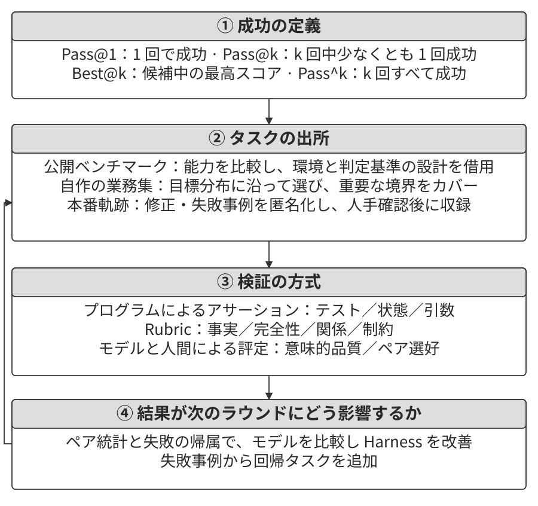
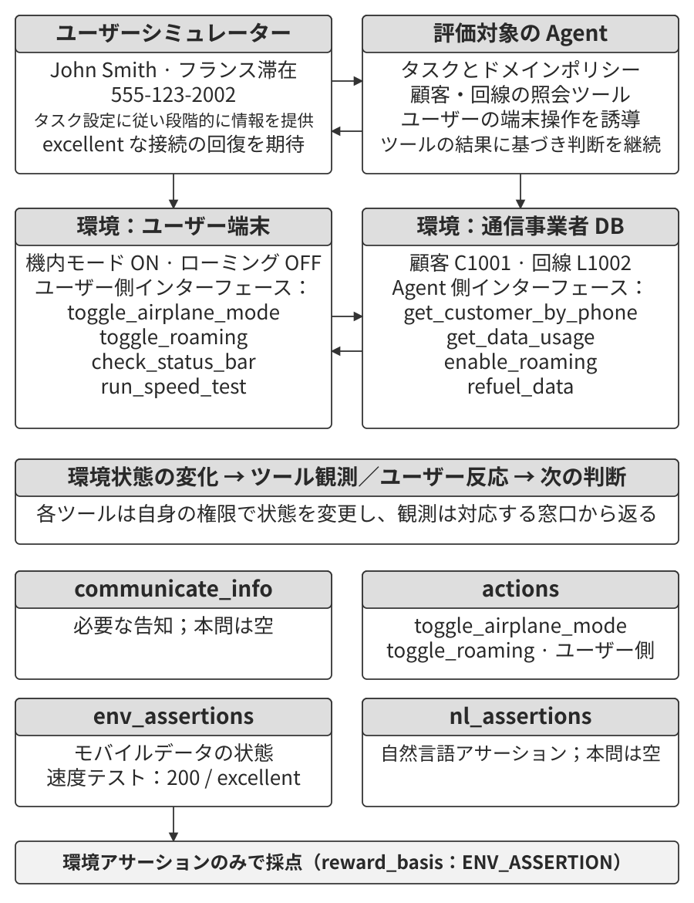
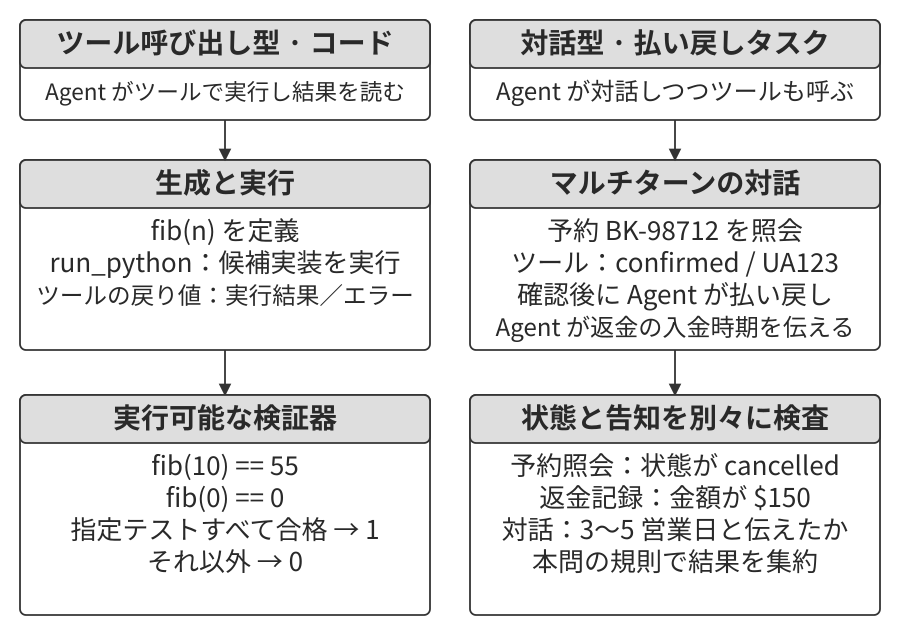
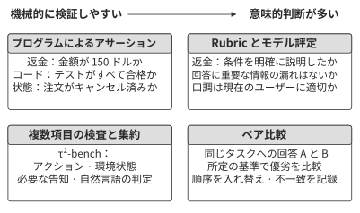
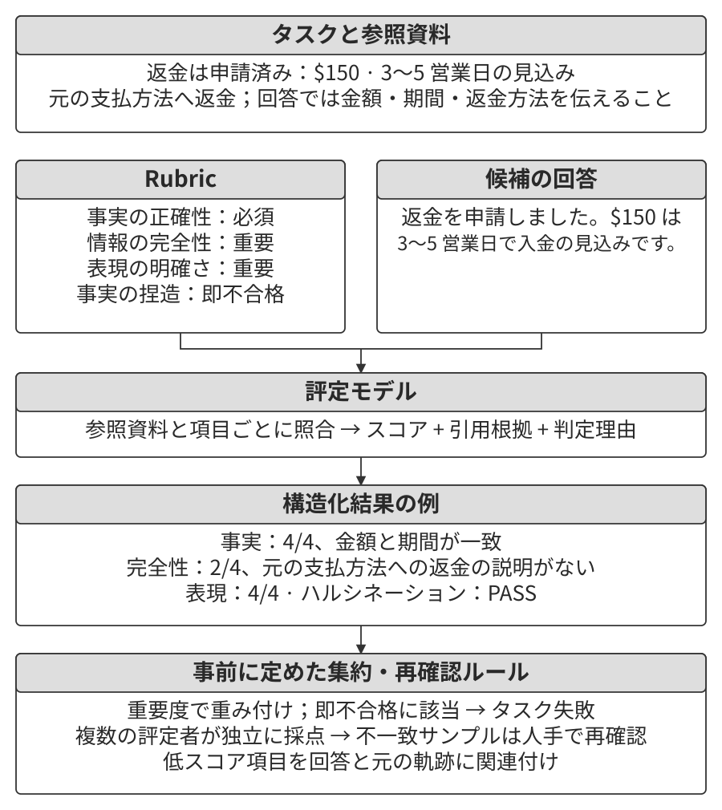
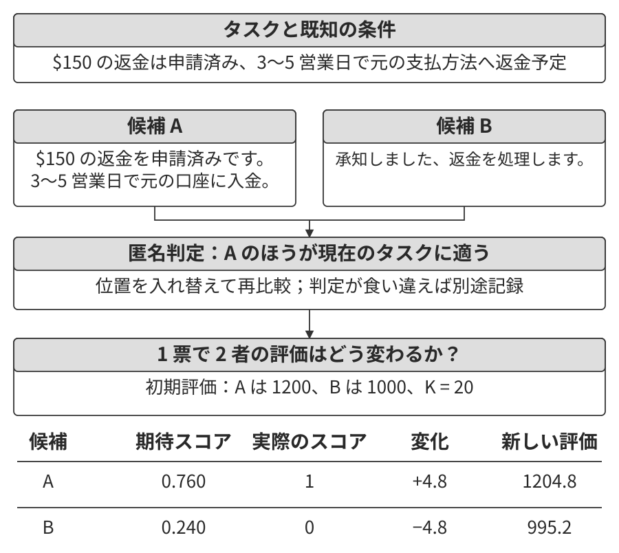
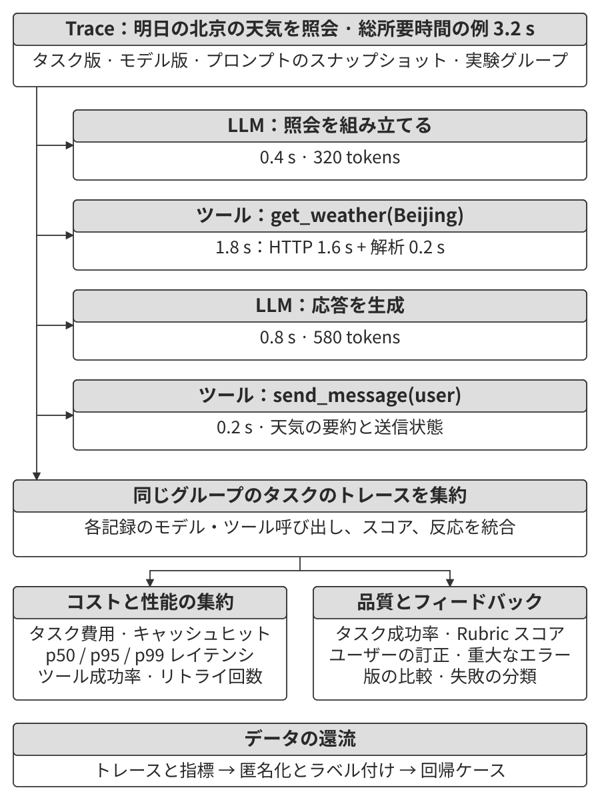
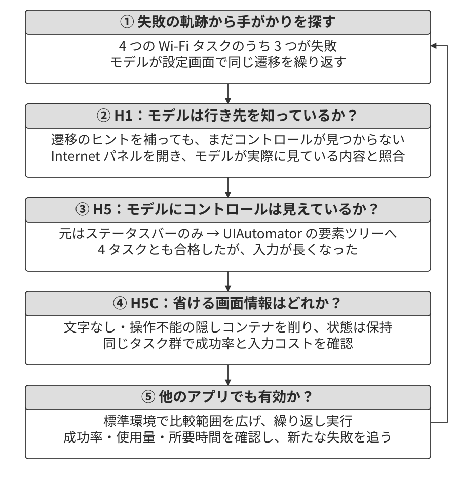
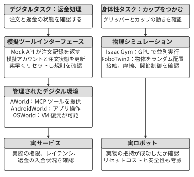
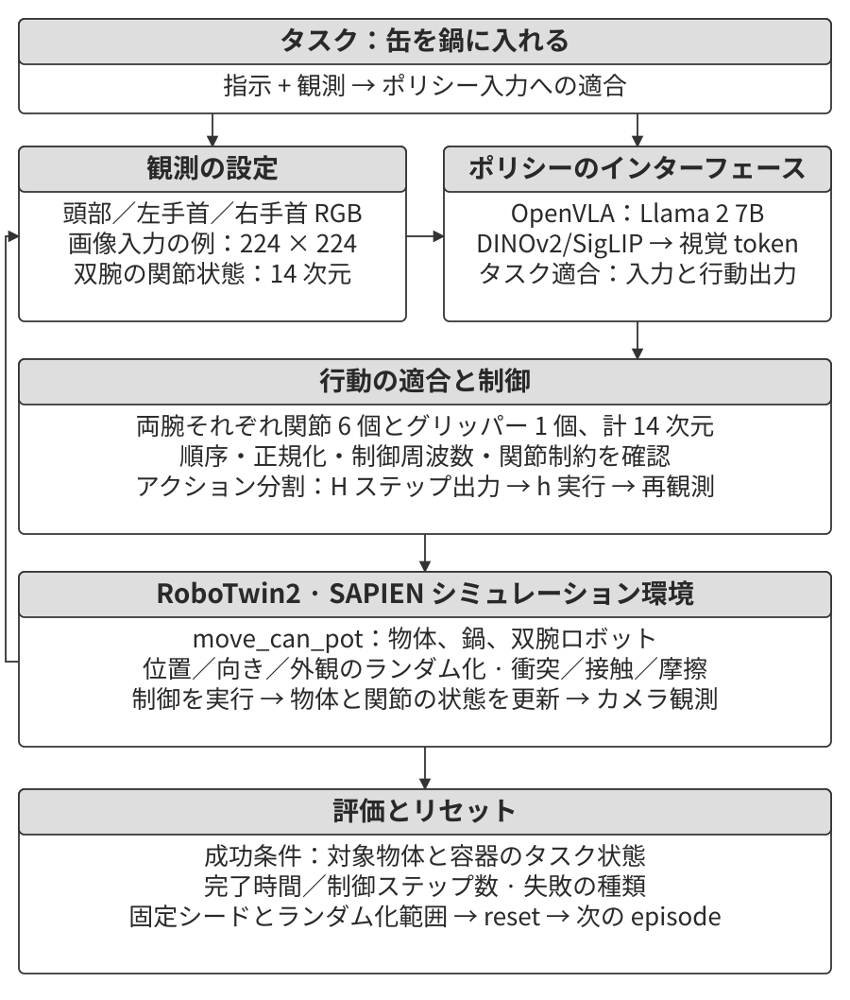

# Agent の評価

最初の 6 章では、単一 Agent の構築として、コンテキスト、メモリ、知識ベース、ツール、コード、そして観察と動作のインターフェースを紹介してきました。システムを組み上げたら、再現可能な一連のタスクを通じて、それが何をできるのか、どんな条件で失敗しやすいのか、次にどこを直すべきかを判断する必要があります。評価の結果は、ポストトレーニングと継続的な進化へのフィードバックにもなります。

開発の過程では、多くの選択を実際のタスクで比較する必要があります。どのモデルを使うか、どのツールを開放するか、知識ベースにどんな内容とインデックスを採用するか、ユーザーメモリ、プロンプト、Skills をどう構成するか、Harness にどんな制約を加えるか。しかも選択同士は互いに影響します。たとえば、ツールの説明を詳しくすれば引数の誤りは減るかもしれませんが、コンテキストの消費は増えます。検証ステップを加えれば成功率は上がるかもしれませんが、完了までの時間は延びます。

**対比実験**は、同じタスクと条件のもとで異なる方式を比較し、成功率、所要時間、コストの変化を記録します。**アブレーション実験**は、検索結果の再ランキング、状態の要約、結果の検証といったコンポーネントを取り除くか無効化し、システムの振る舞いがどう変わるかを観察します。毎回の変更内容を明確にし、それ以外の実行条件を固定し、繰り返し測定することで、エンジニアリング上の選択とタスクの結果との関係を少しずつ確立できます。筆者は、対比とアブレーションを日々の開発に組み込むことを勧めます。順調に完了した数本の軌跡だけを頼りにすると、偶然の成功を改善と取り違えたり、ある種類のタスクでの向上だけを見て、ほかのタスクでの後退を見落としたりしがちです。

**評価の対象は、モデルと Harness から成る Agent 全体であるべきです。** モデルはタスクをどう理解し、どの行動を選ぶかを決め、Harness はコンテキストを組み立て、ツールを呼び出し、状態を維持し、検査を実行します。同じモデルでも、接続するツールやフィードバックの流れが違えば、タスクの結果は変わりえます。第 5 章で紹介した Coding Harness は、まさにこの種の比較の場を提供しています。

モデルと Harness の相性を調べるには、**モデル置換実験（model swap）**が使えます。まず実行フレームワークとタスクを固定してモデルだけを入れ替え、最終結果とエラーの分布を比べます。より強いモデルでも同じステップで失敗するなら、ツールが欠けていないか、フィードバックが遅れていないか、採点が目標を網羅しているかを確認します。タスクの成績がモデルによって大きく変わるなら、推論、計画、指示追従のどの能力が結果を左右したのかを分析します。

モデル置換とコンポーネントのアブレーションは組み合わせて行えます。たとえば 2 つのモデルにそれぞれ「状態要約あり」と「状態要約なし」の 2 つの構成を実行させ、要約が両者の長いタスクからの回復を助けているか、その効果がモデルに依存するかを調べます。こうすればモデル間の差を分析できるうえに、ある Harness コンポーネントがどんな条件で有効なのかも見えてきます。

評価は、モデルを更新するときの回帰チェックにもなります。新しいモデルが公開ベンチマークでは進歩していても、一部の業務タスクでは後退していることがあります。自前のタスク集があれば、こうした変化が見えます。筆者は「未来のモデルのために製品を開発する」ことを勧めています。ツール、業務フロー、評価集を先に完成させておき、新しいモデルが同じタスクでどう振る舞うかを継続的に追跡するのです。成功率、応答時間、コストが製品の要件を満たした時点で、リリースを進めます。

リリースの要件を、どうやって一揃いの評価に書き下せばよいでしょうか。図7-1 を読むときは、1 回のテストを順に追ってみてください。何を測るのか、どこからタスクを選ぶのか、どんな証拠で成功と判定するのか、最後に結果をどう記録して比較するのか。



## 1 本のタスクから評価を理解する：τ²-bench の telecom ドメイン

まず、携帯電話のネット接続トラブルを見てみましょう。John Smith は番号 555-123-2002 を使っていて、いまフランスにいます。携帯のステータスバーには「No Service」と表示されています。彼はネットワークを復旧させたいと考えており、速度テストで excellent が出て初めて故障が解決したとみなします。必要なら 2.0 GB のデータをチャージしてもよく、現在のプランは維持したいと考えています。

この事例は Sierra の τ²-bench の telecom ドメインから取ったものです。環境はキャリアのバックエンドとユーザーの端末を同時にシミュレートし、カスタマーサポートの Agent とユーザーシミュレータが、それぞれツールを通じて状態の一部を読み取り、変更します。評価では、両側のやり取りに沿って、問題がどう発見されたか、操作がどう実行されたか、そして最終的にネットワークが復旧したかを確認する必要があります。[^ch7-tau2-task]

### タスク定義の四つの構成要素

別のカスタマーサポート Agent に同じ問題を解かせるには、まず携帯とアカウントの状態を復元し、シミュレートされたユーザーに同じ要求どおり切り分けに協力させ、最後に同じ基準で採点しなければなりません。下の表はタスク定義の 4 つの部分を示したものです。表を読むときは、ある違いに注目してください。出題者は携帯の初期設定を知っていますが、サポート担当とユーザーは、対話の開始時にそれぞれどこまで知っているでしょうか。

| 部分 | フィールド | この例の内容 |
| --- | --- | --- |
| チケット | `ticket` | ユーザー、番号、滞在国、ネットに接続できない症状、速度テストの要件とプランの制約 |
| ユーザーシナリオ | `user_scenario.instructions` | ユーザーが何を知っているか、質問されたときどう調べるか、いつ問題の解決を確認するか |
| 初期状態 | `initial_state.initialization_actions` | ユーザーの身元と所在地を設定し、機内モードをオン、端末のローミングをオフ、キャリア側のローミングを開通 |
| 採点基準 | `evaluation_criteria` | 動作と環境状態を検査し、`reward_basis` で採点項目を指定 |

**ユーザーは何を知っているか。** `known_info` は氏名、番号、滞在国を提供します。機内モードがオンで端末のローミングがオフであることは環境状態に保存されており、ユーザーシミュレータはツールを呼び出して確かめないと、それをサポート担当に伝えられません。ユーザーが知っている内容を独立したフィールドに分けることで、シミュレータはそのまま答えられる情報と、実際に調べる必要がある情報とを区別できます。プロンプトで「一度に全部言わないように」と求めるだけでは、どの事実をいつ明かすかを安定して制御するのは困難です。この仕組みは**漸進的情報開示（Progressive Information Disclosure）**を実現しています。対話は「ネットにつながらない」から始まり、Agent は質問と操作の誘導を通じて、切り分けに必要な情報を少しずつ手に入れます。

**ユーザーはどう応答するか。** `task_instructions` は、最初の修復が失敗したら軽い不満を示すこと、速度テストが excellent のときだけ解決を確認すること、そして端末に関する回答はツールの結果に基づくことを定めています。poor、fair、good はいずれもこの問題の目標に届きません。事実接地（Grounding）によって、ユーザーはシミュレート環境の実際の状態に基づいて応答します。この制約がなければ、シミュレートされたユーザーはサポート担当の「これで直ったはずです」に調子を合わせて同意してしまうかもしれません。そうなると、両側の対話は順調に見えても、端末の故障は残ったままです。

**両側はどの状態から始まるか。** ユーザー側では `set_user_info` で身元を設定し、`set_user_location(abroad=true)` で国外にいることを表し、さらに `turn_airplane_mode_on` と `turn_roaming_off` を実行します。キャリア側では `enable_roaming` によって顧客 `C1001` の回線 `L1002` のローミングを開通します。そのため、バックエンドの照会ではローミングが開通していると表示されるのに、携帯は機内モードと端末のローミング設定のせいでネットに接続できません。サポート担当は、ユーザーを誘導して端末を確認してもらわない限り、バックエンドの照会からは得られない情報を手に入れられません。

**どの検査が得点を決めるか。** `actions` にはユーザー側の `toggle_airplane_mode` と `toggle_roaming` が並んでいます。`env_assertions` には、モバイルデータの状態検査と、引数が `expected_speed=200`、`expected_desc="excellent"` の速度検査が含まれます。タスク形式には `communicate_info` と `nl_assertions` もあり、それぞれユーザーに必ず伝えるべき情報と、自然言語によるアサーションを記述します。この問題ではどちらも空です。

この問題の `reward_basis` は `ENV_ASSERTION` を選んでいるので、総報酬は環境アサーションで決まります。動作の検査は結果に現れることはありますが、総得点に算入されるかどうかは採点設定で決まります。

### 実行軌跡に沿って結果を確かめる

付属の実行では telecom のタスクを 5 本選び、各問題を 1 回ずつ実行しました。サポート Agent とユーザーシミュレータはどちらも GPT-4.1 mini を使い、最終的に 4 本が通過しました。以下ではまず先ほどのフランスでのローミングのタスクを分析し、次に失敗したタスクと対照します。

> **実験 7-1 ★：τ²-bench を実行し、τ-bench からの進化を比較する**
>
> まず 1 本のタスクについて、ユーザーシナリオ、初期化動作、採点条件を読み、続いて完全なやり取りを 1 回実行します。軌跡に沿って、サポート担当の照会、ユーザーの操作、状態の変化、受け入れ結果に印をつけ、それぞれの判断がどの情報に基づいていたかを確認します。
>
> τ-bench と τ²-bench を比べるときは、ユーザーがツールを通じて環境を変えられるかどうか、そしてその変化がサポート担当にどんな連携の要求を生むかに注目してください。
>
> 図7-2 を見るときは、まず携帯の機内モードを切れるのは誰かを探し、次にキャリアのローミング設定を変更できるのは誰かを探してください。両側でできることが違うので、サポート担当が自分の操作を終えても、ユーザーに携帯で速度テストをしてもらう必要があるのです。
>
> 

フランスでのローミングのタスクで、Agent はまずアカウントを特定しました。番号から顧客 `C1001` を割り出し、`L1001`、`L1002`、`L1003` のデータ使用量を照会しましたが、`L1001` の詳細情報から誤った結論を出しました。ユーザーが伝えた 555-123-2002 はアクティブな回線に含まれておらず、最も近い番号は 555-123-2001 だというのです。ユーザーが番号は間違いないと主張したあと、Agent は `L1002` を照会して、ようやく正しい回線を確認しました。

続いて、ユーザーシミュレータが `check_network_status` と `check_status_bar` を呼び出しました。返ってきた状態は、機内モードがオン、セルラー接続がサービスなし、モバイルデータがオン、端末のローミングがオフというものでした。ユーザーはそれをもとに「携帯が機内モードになっていて、データローミングもオフです。まず機内モードを切ったほうがいいですか？」と報告します。ここでの照会はユーザー側のツールが実行し、その結果が対話を通じてサポート担当に伝わっています。

これが**双方向制御（Dual-Control）**の仕組みです。サポート担当はキャリアのバックエンドを照会・操作し、ユーザーシミュレータは独立した端末用のツールを持っています。たとえばステータスバーの確認、機内モードの切り替え、SIM カードの差し直し、速度テストの実行などです。両者はコミュニケーションを通じて操作を調整し、環境はそれぞれが引き起こした状態変化を記録します。

Agent は次に、ユーザーを誘導して機内モードを切らせ、端末のローミングをオンにさせました。ステータスバーには 5G の電波が表示されます。ユーザーが `run_speed_test` を実行すると 275 Mbps、Excellent という結果が得られ、ユーザーは問題の解決を確認しました。2 つの環境アサーションはいずれも通過し、この問題の報酬は 1.0 になりました。

この成功した軌跡からも、プロセス上の問題が見えてきます。ポリシーはサポート担当に一度に 1 つのツールしか呼び出さないよう求めているのに、Agent は同じメッセージの中で `get_customer_by_phone` と `get_customer_by_name` を発行しています。このタスクの総得点は環境アサーションしか算入しないので、この行動は報酬を変えませんでした。

別の失敗した軌跡では、回線の選択を誤ったまま最後まで訂正されず、その後の切り分けもずれていきました。ユーザーの番号はやはり 555-123-2002 でしたが、Agent は `L1001` を選び、その回線の 3.2/5 GB という使用量をもとに切り分けを続けました。ツールが `L1001` は 555-123-2001 に対応すると返していたにもかかわらず、Agent は回線を訂正せず、何ターンも無関係な切り分けを重ねた末に有人対応へ転送しました。ユーザー側ではデータセーバーをオフにすることには成功しましたが、正しい回線 `L1002` に必要な 2 GB のデータチャージは実行されず、3 つの環境アサーションはすべて失敗しました。

2 本の軌跡を比べると、最終スコアを具体的な改善点に展開できます。番号と回線の対応を照合すること、新しい証拠を使って判断を修正すること、端末とバックエンドの状態を区別すること、そして必要なチャージが完了したかを検証することです。後述の失敗の帰属では、長い軌跡からこうした決定的な転換点をどう見つけ出すかを引き続き論じます。

[^ch7-tau2-task]: Sierra Research の τ²-bench は、telecom ドメインの `user_tools.py` でユーザーツールを定義し、採点の入口は `evaluator.py` です。事例の内容と結果は、付属リポジトリに保存された 5 本のタスクと実行軌跡をもとに整理しました。

## 評価指標：成功の定義

5 本のタスクのうち 4 本が通過したことは、この実行の全体的な成績を示しています。これをもとに製品の意思決定をするには、さらにタスクの種類と失敗の代償を明確にする必要があります。返金対応のカスタマーサポートは、条件を満たす返金を継続的に処理しなければなりません。プログラムを書くときは、いくつかの実装を生成し、テストで動作して正しい結果を出すものを選び出せます。研究であれば、いくつかの仮説を立て、研究者が検証することもできます。評価指標は、こうした使われ方に対応させるべきです。

### 技術的奇観：Pass@k で複数回の試行における能力を測る

筆者は、強い印象を残す Agent のデモの一部を「技術的奇観」と呼んでいます。システムに十分な時間と試行の機会を与えると、それまで自動化が難しかったタスクをやり遂げる、というものです。探索的な仕事では、検証済みの成功した軌跡が 1 本あるだけで価値を生むことがあります。この使われ方に対応する指標が **Pass@k** です。同じタスクを $k$ 回実行し、少なくとも 1 回通過すれば成功とみなします。連続値で採点するタスクでは、$k$ 回のうちの最高スコアを報告することもでき、これを **Best@k** と呼びます。

たとえば Anthropic は、複数の Claude インスタンスを協調させて C コンパイラを構築し、長時間の実行、テストからのフィードバック、タスクの分担が複雑なエンジニアリングを支えられることを示しました。研究者が数学の反例を探すときも、モデルに何度も試させ、最後にそのうちの 1 つの反例が成り立つかを独立に検証できます。ソフトウェアのセキュリティ審査では、モデルが報告した疑わしい問題を再確認でき、オープンエンドな創作では、いくつかの作品から最良のものを選べます。[^ch7-long-running]

アプリケーション製品も、複雑なタスクを通じて能力を示します。Manus は仮想コンピュータを Agent に渡し、Agent が画面を操作し、資料を探し、作業を続ける様子をユーザーが見られるようにしました。OpenClaw はインスタントメッセンジャー経由で依頼を受け、設定済みで許可されたファイルやサービスにアクセスし、作業中に進捗を報告したり追加情報を求めたりします。さらに定期実行の仕組みで起動され、ToDo を確認しに行くこともできます。こうした具体的な行動によって、ユーザーは Agent の用途を理解しやすくなります。

筆者の見るところ、新しい種類のタスクをこなせるデモは、これらの製品がユーザーを惹きつけた重要な要因です。

### 業務の信頼性：Pass^k に注目する

業務フローでは、通常、何度実行しても正しく届けられることが求められます。**Pass^k** は、同じタスクを $k$ 回実行してすべて通過する状況を測るもので、「pass power k」と読めます。タスクの通過条件には、最終結果、ポリシーの遵守、権限の制約をまとめて含めることができ、毎回の実行を同じ条件で検査します。

各実行が互いに独立で、単回の成功確率がいずれも $p$ だとすると、次のようになります。

$$
\mathrm{Pass@k}=1-(1-p)^k,\qquad
\mathrm{Pass}^{k}=p^k.
$$

たとえば $p=0.6$、$k=5$ のとき、Pass@5 は約 99.0%、Pass^5 は約 7.8% です。前者は 5 回試せばたいてい 1 回は成功が見つかることを、後者は 5 回すべて成功する確率がなお非常に低いことを表しています。

実際の結果を読むときは、まず公式を使わなくてもかまいません。同じ問題を 5 回解いて、それぞれ「成功、失敗、成功、成功、失敗」だったとします。この組の Pass@5 は 1、Pass^5 は 0 と記録し、単回の成功率は 3/5 と推定します。先ほどの 99.0% と 7.8% が答えているのは別の問いです。各回の成功確率が 0.6 だとわかっているとき、5 回を 1 組として何度も繰り返したら、どれだけの組がそれぞれの基準を満たすか、という問いです。

同じ記録から、もっと確かめやすい問いにも答えられます。いまの 5 回の実行から任意に 2 回を取り出したとき、通過するペアはどれくらいの割合になるでしょうか。各実行を 1 枚のカードとみなし、非復元で 2 枚を取ると、ペアは全部で 10 通りあります。2 回とも失敗になるのは、失敗のカード 2 枚が組になったペアだけなので、9 組は少なくとも 1 回成功しており、Pass@2 の標本推定値は 9/10 です。成功のカード 3 枚からは 2 枚ずつ 3 組のペアができるので、Pass^2 の標本推定値は 3/10 です。τ²-bench は、まさにこのようにタスクごとに全通過の組み合わせを数えています。1 つの問題を $n$ 回実行して $s$ 回成功したとき、そこから $k$ 回を選ぶと、全通過となる組み合わせ数の割合は $\binom{s}{k}/\binom{n}{k}$ です（ただし $1\le k\le n$）。[^ch7-tau2-metrics]

ここで実験 7-1 の 4/5 を読み直してみましょう。あの 5 本の軌跡はそれぞれ別の問題に属しており、各問題にはカードが 1 枚しかないので、ペアを 1 組も作れません。これらのタスクの Pass^2 を推定するには、各問題に独立した実行を追加し、それぞれ計算してから集計する必要があります。0.8 をそのまま 2 乗すると、これらの問題の各回の成功確率がすべて等しく、各試行が互いに独立であると、余分に仮定することになります。

[^ch7-tau2-metrics]: τ²-bench の実験版（リビジョン 8d005b0）は、`agent_metrics.py` で問題ごとに Pass^k を計算しています。成功回数が $k$ 未満のとき、全通過の組み合わせ数はゼロです。

計算するときは、統計の単位をそろえる必要があります。同じタスクを 5 回サンプリングした結果は、そのタスクでの繰り返しの成績を測ります。本番で連続する 5 件の異なるタスクは、タスクの難易度やトラフィックの分布の影響も受けます。タスクごとに成功確率が異なるときは、まずタスクごとに繰り返し成功の指標を計算し、それからタスクの重みに応じて集計します。共有された状態、キャッシュ、同じ障害も、複数回の実行を相関させます。

**「情報不足」と答えることを許す場合、分母はどう選ぶか。** 文献アシスタントが 100 問を受け取り、80 問に答え、そのうち 68 問が正解だったとします。示された答えに頼る読者が気にするのは 68/80、すなわち 85% です。この一連のタスクを片付ける必要がある人は、68/100、すなわち 68% も気にします。残る 20 問は、証拠を探し直すか、人に回して処理する必要があります。

PaperQA2 は、248 問の LitQA2 文献問題で「情報不足」を選べるようになっています。論文は 3 回の実行の平均を報告しています。システムが実質的な答えを出した問題での正答率は 85.2%、全問で計算した正答率は 66.0% で、さらに 21.9% で情報不足を選びました。9 名の人間の回答者の対応する 2 つの正答率は 73.8% と 67.7% です。論文によれば、1 つ目の差は有意で、2 つ目の差は統計的有意に達しませんでした。[^ch7-paperqa2-denominators]

[^ch7-paperqa2-denominators]: Skarlinski ら、*Language Agents Achieve Superhuman Synthesis of Scientific Knowledge*、2024、第 2 節と図 2 を参照。

最終状態が同じ 2 本の軌跡でも、コストは違うことがあります。請求額の照会を例にとると、甲は 1 回の照会で正しい金額を返しました。乙は 2 回照会してから同じ答えを出しました。2 回の照会が同じリクエスト ID を持ち、1 回目がすでにタイムアウトしていたのなら、再試行がタスクの回復を助けたことになります。1 回目の結果がすでに正常に届いていたのなら、2 回目の照会は待ち時間とツール費用を無駄に増やしただけです。

実行に書き込みやその他の外部への影響が伴う場合は、まず試行ごとに所定の初期状態を復元し、テスト環境で操作を完了させ、すべての試行を記録します。製品が失敗後の再試行を許すなら、再試行の回数、回復の手順、実行コストをまとめてプロセスの評価に組み込みます。元の失敗記録は残しておき、単回の成績と回復後の結果を区別できるようにします。

[^ch7-long-running]: Anthropic、Building a C compiler with a team of parallel Claudes、2026-02-05。複数インスタンスの協調、長時間の実行、テストからのフィードバックを紹介しています。

## 評価環境

先ほど回線の選択を誤った実行を見直す場合を考えます。見直す人には、同じユーザー、同じ 2 本の回線、同じ初期プランが見えている必要があります。もし 1 回目の実行ですでにそのうち 1 本の回線を変更していたら、そのままもう一度実行しても、結果の変化がモデルによるものかデータベースによるものかを判断できません。評価環境は、タスクの起点を用意し、やり取りのインターフェースを提供し、過程を記録し、終点を検査する役割を担います。

### 五つの構成要素

telecom のタスクを例にとると、評価環境は 5 つの部分に分解できます。

**データセット（Dataset）**はタスクの定義を保存します。ユーザーの背景、行動の要求、初期状態、受け入れ条件です。1 件のレコードが 1 つのテストケースに対応し、実行時には参加者それぞれの役割に応じて情報を配分します。

**環境状態（Environment State）**は、タスク実行中の可変情報を保存します。たとえば顧客、回線、プラン、請求書のほか、端末の機内モード、ローミング、データセーバーの設定などです。新しい回を始めるときは、環境はまず基礎データを復元し、次に `initialization_actions` を実行して、そのタスクが規定する故障を作り出します。前の回のチャージや設定変更が次の回に持ち込まれないよう、クリーンアップと初期化を組み合わせる必要があります。

**ツールインターフェース（Tools）**は、参加者が何を読み取り、何を変更できるかを決めます。サポート担当は顧客の照会、使用量の確認、データのチャージ、有人対応への転送ができ、ユーザーは端末の状態確認、スイッチの切り替え、速度テストができます。ツールの粒度は、測定対象の能力に対応させるべきです。診断と計画を評価したいなら、Agent に照会と操作を組み合わせさせます。「ネット接続の問題を修復する」ツールを直接与えれば、テストの焦点はその能力をいつ呼び出すかへ移ってしまいます。

**採点基準（Rubric）**は、結果をどう判定するかを定めます。telecom のタスクでは、動作、環境状態、必要なコミュニケーション、自然言語の要件を検査し、`reward_basis` でどの検査を総得点に算入するかを決めます。

**実行プロトコル（Interaction Protocol）**は、発話、ツール呼び出し、終了の段取りを決めます。ユーザーシミュレータは `###STOP###` を出力してやり取りを終えることができ、実行器はターン数などの予算も設定します。終了の理由とタスクの得点は別々に記録します。ユーザーが対話を打ち切ったあとも、目標が達成されたかどうかは環境アサーションが判定します。予算を使い切った場合も、最後の状態と未完了のステップを残しておく必要があります。

### 人間・機械インタラクション型とツール呼び出し型の評価環境

telecom のタスクには、応答を続けながら端末を操作するユーザーシミュレータが含まれています。一方、コードの修正、データ分析、数学の求解は、たいていタスクの指示によって始まり、その後 Agent は主にツールとやり取りします。どちらの環境にも、タスク、状態、インターフェース、採点、実行プロトコルが必要です。違いは、対話相手もシミュレートする必要があるかどうか、そして双方が行動をどう調整するかにあります。

コードのタスクはテストで出力を検査でき、データベースのタスクは変更後のレコードを照会でき、オープンエンドな分析では、人やモデルに内容を審査してもらう必要があるかもしれません。人間・機械インタラクション型のタスクでは、さらに 2 種類の証拠を突き合わせなければならないことがよくあります。たとえば、携帯のネットワークが復旧したかどうかは端末の状態を見ればわかりますが、サポート担当が番号を確認したか、ユーザーの操作を誘導したかは、対話を見なければわかりません。図7-3 の返金も同じです。注文がキャンセル済みかどうかはデータベースで確認できますが、サポート担当が入金までの日数を伝えたかどうかは、対話の中から探す必要があります。



Verifiers では、この 2 種類のタスクに対して異なる環境インターフェースから着手できます。表7-1 は v0.1.9 において、単一ターンの回答、マルチターンのツール呼び出し、実行状態の注入、サンドボックス資源の管理を扱うインターフェースをまとめたもので、コードと照らし合わせるのに便利です。[^ch7-verifiers-env]

表7-1 Verifiers 環境タイプの比較

| 環境タイプ | 主な役割 | ツールと状態の扱い | 典型的なユースケース |
|---|---|---|---|
| `SingleTurnEnv` | 単一ターンの回答を組み立てる | 1 回の回答のあとに採点 | 数学問題、単一ターンの問答 |
| `ToolEnv` | マルチターンのツールのやり取りを組み立てる | 実行軌跡を保存し、ツールを振り分けて結果を受け取る | 検索と情報の総合 |
| `StatefulToolEnv` | 実行状態をツールの実行に接続する | 現在の状態に応じてツールの引数を補うか状態を更新する | 今回のタスクにデータベースや資源の識別子を結びつける |
| `SandboxEnv` | 隔離された実行環境を管理する | 実行ごとにサンドボックスを割り当て、その中のツールを使う | コードの実行、ファイルとテスト結果の確認 |

たとえば 2 本のタスクが同時にデータベースを変更する場合、実行器はそれぞれのデータベース識別子をツール呼び出しに注入し、各軌跡が対応するデータを操作するようにできます。実行が失敗したときは、ツールは次の判断に使える情報を返すべきです。対象が存在しない、引数が要件を満たさない、サービスがタイムアウトした、といった情報です。評価システムが観察、呼び出し、実行結果、報酬を保存しておけば、分析の際に誤りを具体的なステップまで特定できます。

[^ch7-verifiers-env]: Prime Intellect、Verifiers v0.1.9 の ToolEnv と StatefulToolEnv。マルチターンの軌跡、ツールの振り分け、状態引数の注入を示しています。

## 評価データセットの設計

ここで、5 問の telecom の問題を、リリースの判断に使える評価集へ拡張してみましょう。追加した問題がすべて「指定された番号のローミングを開通する」ものだったら、システムは同じアカウントの 2 本の回線を見分けることをまったく身につけていなくても、高得点を取れてしまうかもしれません。成績をもとにサポート Agent をリリースできるかどうかを決めるのであれば、出題は実際のチケットを参考にし、定型業務も、回線を取り違えやすい難問も含める必要があります。採点では、サポート担当が最終的にどの回線を変更したかまで確認しなければなりません。リリース後もこれらの問題を保守し、ユーザーが実際に任せる仕事を反映し続けるようにします。

### ベンチマーク設計の横断的な対照

表7-2 は、6 つのベンチマークを能力、タスクの出所、実行環境、検証方式の観点で並べたものです。

表7-2 いくつかの Agent ベンチマークにおける主要な設計上の選択

| ベンチマーク | 測定される能力 | タスクの出所と構成 | 実行環境 | 検証方式 |
|---|---|---|---|---|
| τ²-bench | カスタマーサポートのやり取りとツール操作 | ドメインのタスクと故障の組み合わせ | ユーザーシミュレータ、端末、業務データベース | 項目別に検査し、`reward_basis` に従って採点 |
| SWE-bench Verified | コードの問題の修正 | GitHub の実際の issue を人手で選別 | コードリポジトリとテスト環境 | `FAIL_TO_PASS` と `PASS_TO_PASS` のテスト |
| AndroidWorld | Android アプリの操作 | パラメータ化されたタスクテンプレート | 実際のアプリを動かす Android エミュレータ | 端末、ファイル、アプリ内部の状態を読み取る |
| OSWorld | デスクトップとアプリをまたぐ操作 | 実際の利用場面からタスクの起点を設定 | 仮想マシンとデスクトップアプリ | タスクごとに実行状態と成果物を検査 |
| Terminal-Bench | ターミナルでのエンジニアリングタスク | 人手で設計したタスクとテスト | コンテナとタスクに必要な依存関係 | ファイル、プログラムの実行、テスト結果 |
| GAIA | 汎用アシスタントの情報処理 | 人手で作成した問題、一部に資料を添付 | ネットワーク、ファイル、補助ツール | 答えの形式に従って正規化してから比較 |

### 検証器

検証器は、タスクの目標を検査可能な証拠に結びつけます。コードのタスクではテストを実行し、デスクトップのタスクではアプリやファイルの状態を読み取り、情報検索のタスクでは答えとその出典を照合する必要があります。**受け入れは、独立に取得した証拠に基づいて判断すべきです。** Agent は、すべてのステップを完了したと主張する立派なレポートを生成するかもしれません。それでも検証器は、実際に成果物を動かし、状態を読み取り、出典を照合する必要があります。完了報告は検査対象の特定に使い、得点はこうした検査で決めます。

ユーザーが決済アプリを開き、アシスタントに「今月ルームメイトから届いた請求をすべて承認して」と頼んだとします。保留中の請求が 3 件あるとしましょう。ルームメイトの今月分、同じルームメイトの先月分、同僚の今月分です。1 件目は承認すべきで、残りの 2 件は保留のままにすべきです。1 件目だけを確認すれば、3 件ともすべて承認したアシスタントでも満点を取れます。残りの 2 件だけを確認すれば、何もしなかったアシスタントでも合格してしまいます。AppWorld は、シミュレートされた決済アプリでまさにこの問題を出題しています。検証器を設計するときは、まず操作前のデータからユーザーが承認を許可した請求の範囲を絞り込み、次にそれらがすべて承認されたかを確認し、最後に操作後の記録から逆にたどって、アシスタントがほかにどの請求に手を出したかを調べます。[^ch7-appworld-scope]

[^ch7-appworld-scope]: Trivedi ら、*AppWorld*、ACL 2024。図 2 にタスクと受け入れ条件が示されています。

科学研究の探索でも、検証しやすい成果物を提出させることができます。FunSearch は、8 次元空間でできるだけ多くの点を選ぶ問題に取り組みました。各次元の値は 0、1、2 のいずれかで、演算は 3 を法として行い、選んだ点のうちどの 3 点も同一直線上にあってはなりません。研究者は点を 1 つずつ選んでいくプログラムの骨組みを書き、モデルには候補点に順位をつける関数を提案させ、実際に構成された正当な点集合の大きさで採点しました。論文の発表時点では、既存の構成で選べる点は 496 個でしたが、新しいプログラムは 512 個の点のリストを提出しました。[^ch7-funsearch-cap]

リストをダウンロードするだけで、この結果を自分で独立に確かめられます。まず、512 個の互いに異なる 8 次元ベクトルが含まれ、どの座標も規定の範囲内にあることを確認します。次に、異なる 2 点 $a,b$ を任意に選ぶと、それらを通る直線上には 3 点しかなく、3 点目は $c=-a-b \pmod{3}$ です。たとえば 2 次元で $(0,0)$ と $(1,2)$ を取れば、3 点目は $(2,1)$ になります。同じ演算を 8 次元の座標ごとに適用し、リストにある 130,816 組の異なる 2 点をすべて調べると、得られる 3 点目はどれもリストに現れません。これで少なくとも 512 個の点を選べることは十分に証明されます。513 個は絶対に選べないことを証明するには、さらに上界の証明が必要です。

[^ch7-funsearch-cap]: Romera-Paredes ら、*Mathematical discoveries from program search with large language models*、Nature、2023 年オンライン公開。著者は 8 次元の点集合と検証用の計算ノートブックを別途公開しています。

**SWE-bench の 2 種類のテストは、それぞれ修正と回帰を検査します。** `FAIL_TO_PASS` は修正前に失敗し、修正後には通過すべきテストです。`PASS_TO_PASS` はもともと通過しており、修正後も通過し続けるべきテストです。前者は指定された問題を検査し、後者は既存のテストがカバーしている振る舞いが保たれているかを検査します。[^ch7-swe-verified]

**OSWorld は実行型の検証でアプリの成果物を検査します。** 初版は 134 個の実行型評価関数を提供しており、タスクの設定と組み合わせて、ファイル、アプリのデータ、システムの状態を読み取ります。[^ch7-osworld-design] たとえば表の修正を求めるタスクなら、指定されたセルと数式を検査でき、ブラウザの設定の更新を求めるタスクなら、関連する設定を読み取れます。

**Terminal-Bench は実行結果によってエンジニアリングタスクを受け入れます。** Linux カーネルをビルドする事例では、ソースコードの修正、コンパイル、initramfs、QEMU での起動が一続きになっています。その中で、Linux 6.9、`start_kernel` 内のカスタム `printk`、起動ログに現れるメッセージが、いずれも具体的な検査ポイントになります。

第 5 章では、注文データから売上高を照合する話をしました。アシスタントが 20 チャネル分の四半期レポートを提出してきたら、どこから確認すればよいでしょうか。Tencent の WorkBuddy Bench には、公開されている照合の問題があります。2 枚のワークシートはどちらもチャネルのデータで、決済額は前期比、つまり前の四半期と比べ、入金額は前年同期比、つまり前年の同じ四半期と比べます。2 つの基準期をどちらも前の四半期で埋めてしまっても、表の見出しとチャネル数は完全に正しいままかもしれません。決済表の「錦繍生活館」を例にとると、明細から重複行と四半期が欠けた記録を取り除き、チャネルと四半期ごとに集計すると、取引総額は 1,569,231.00 から 1,787,311.03 に増え、差額は 218,080.03 になります。採点プログラムは 2 枚の表のチャネルの網羅状況を検査し、さらに指定された 2 つのチャネルの数値を抜き取りで確認します。この問題では、チャネルの網羅検査は 20 社すべてに及びますが、数値の検査は抜き取った 2 社にしか及びません。[^ch7-workbuddy-office]

[^ch7-workbuddy-office]: Tencent WorkBuddy Bench のオフィスタスク `channel-period-compare-L4-017`。使用したデータパッケージ（リビジョン 3e8ad83）には、元のワークブック、参照解答、採点プログラムが付属しています。

時間に敏感なタスクで検証器を試すこともできます。ユーザーが、あるホテルの宿泊料金が 950 元を下回ったら知らせてほしいと頼んだとします。料金は 10:00 に 1000 元、10:10 に 900 元に下がり、10:15 にはまた 1000 元に戻りました。10:12 に部屋タイプと予約ページへのリンクを含む値下げ通知を送れば、ユーザーにはまだ予約する機会があります。毎日「まだ値下がりしていません」と 1 通送るだけで、この 5 分間をよりによって逃すシステムは、1 週間休まず動いても依頼を果たしていません。採点では、条件を満たす時間帯の数、その時間帯内に適時に通知した回数、変化がないのにユーザーの邪魔をした回数を別々に記録します。評価者のほうも 1 日 1 回の料金しか保存していなければ、見逃した時間帯はそもそも数えられません。見逃しを測るには、まずタイムスタンプ付きの完全な価格のリプレイを用意し、テスト対象のシステムに自分の頻度で照会させる必要があります。

### タスクの難易度の区分

タスク集にはさまざまな難易度を含め、その難しさがどこから来るのかを説明する必要があります。基礎的なタスクは能力の後退がないかを検査し、困難なタスクは今後のモデルの進歩に対して測定の余地を残します。問題がすぐにすべて通過されてしまえば、その評価集はもはや選定の指針になりにくくなります。ツールの種類、操作の長さ、情報の散らばり具合、環境の不確実性、必要な専門知識などで区分し、どの条件でシステムが明らかに劣化するかを確認します。

GAIA の 466 問は 3 つのレベルに分かれています。比較的簡単なタスクは通常、少数のツールとステップで済み、難しいタスクほど多段の情報統合と複雑な組み合わせを必要とします。元の論文では、人間のアノテーターの 3 レベルでの正答率はそれぞれ 93.9%、91.8%、87.3% で、GPT-4 にプラグインを加えた構成の対応する結果は 30.3%、9.7%、0% でした。[^ch7-gaia-design]

Terminal-Bench のタスクも幅が広く、モデル登録は MLflow の使い方にかかわり、複数コンポーネントのデプロイでは Git サービスと Web サービスの連携が必要で、パスワードの復元や FEAL の差分解読では専門的なアルゴリズムの知識が加わります。

業務タスクでは、ポリシーの境界もカバーする必要があります。たとえば、ユーザーが「サポート担当がもう注文のキャンセルを承認した」と主張する場合、システムは権限と注文の状態を照会してから、ポリシーに従ってキャンセルするかどうかを決めるべきです。この種のケースは、Agent が互いに矛盾する情報を証拠を使ってどう処理するかを試すもので、通常の手続きのタスクと対にして用意できます。

### データ漏洩の防止

**複数の情報源の組み合わせと専用の添付ファイル。** モデルが検索結果の中に問題とできあいの答えを見つけられるとしたら、1 回正解したことで検索と推論の能力をどれだけ証明できるでしょうか。GAIA は、多段の調べものと専用の添付ファイルによって、そうした機会を減らしています。たとえば、ある日の天文写真から宇宙飛行士を特定し、その所属する宇宙飛行士グループを調べ、メンバーの宇宙滞在時間を比べ、最後に指定どおり姓と分数を出力させます。セミコロン、数値の丸め、桁区切りは、いずれも答えの取り決めです。専用に作られた PDF、音声、画像は入力の組み合わせを増やします。公開された問題は訓練データに入り込む可能性があります。そのため、評価専用の問題を別に確保し、どの問題がすでに訓練に使われたかを記録しておく必要もあります。[^ch7-gaia-design]

**パラメータ化されたインスタンス。** AndroidWorld はタスクに初期化、実行の検査、クリーンアップのロジックを用意し、パラメータによってさまざまなインスタンスを生成します。[^ch7-androidworld-design] たとえば「連絡先 `[CONTACT_NAME]` の電話番号を `[NEW_PHONE]` に変更する」というタスクでは、連絡先と番号を変えつつ、操作の目標は同じに保てます。パラメータの変化によって、モデルが現在のタスクに即して行動しているかを検査できます。一部のパラメータを固定して残りを変えれば、特定の要因の影響を調べるのにも便利です。

**カナリア識別子。** ベンチマークのファイルに固有の canary GUID を埋め込んでおくと、データがコピーされたり他のコーパスに混入したりした手がかりを見つけるのに役立ちます。Terminal-Bench のタスクファイルはこの種の目印を採用しています。漏洩を判断するときは、モデルが現在のコンテキストや検索結果の中でその識別子を目にしていないかも確認し、データの出所の追跡と組み合わせる必要があります。目印が見つかれば調査のきっかけになりますが、訓練データの帰属を判断するにはさらなる証拠が必要です。

### 品質管理と長期的なメンテナンス

同じ telecom の問題が昨日は通過し、今日は失敗したとします。Agent の変化を調べるだけでなく、次の問いにも答えられる必要があります。初期の回線は変わっていないか。ユーザーシミュレータは同じルールに従って協力しているか。採点条件は同じ目標を測っているか。1 回の実行の起点、やり取り、終点をたどると、5 つのメンテナンス作業に整理できます。

1. **ユーザーの情報範囲を明確にする。** `known_info` と行動の要求を分け、照会と確認のステップが明確な情報の起点を持つようにします。
2. **受け入れ条件を明記する。** 「ネットワークの復旧」をモバイルデータの状態、速度の値、評価に落とし込み、タスクが本当に求める効果を検査します。
3. **シミュレートされたユーザーの応答の根拠を制約する。** 端末の状態はツールの返り値から得て、感情と忍耐のルールはやり取りの組み立てに使います。
4. **双方の操作を表現する。** ユーザーとサポート担当がそれぞれ環境を変え、その後の意思決定は利用可能なツールや対話を通じて新しい状態の情報を得ます。
5. **タスクと故障を組み合わせる。** 明確な生成ルールのもとで故障の組み合わせとタスクのパラメータを変え、インスタンスが解けるか、初期状態がタスクの定義に合っているかを確認します。

**SWE-bench Verified は公開前の人手による選別を示しています。** このプロジェクトでは Python の経験を持つ開発者 93 名を集め、無作為に抽出した 1699 件のサンプルにアノテーションを行いました。重点的に確認したのは、問題の記述が十分か、テストが妥当な解を排除してしまわないかで、修正の難易度も見積もりました。各サンプルは 3 名のアノテーターが独立に確認しています。公開された Verified セットには 500 件のサンプルが含まれます。[^ch7-swe-verified] 選別のルールと難易度の分布を合わせて公開することで、利用者はタスク集を絞り込んだあとにどんな能力要件が残ったのかを判断できます。Agent のタスクは多くの場合、何度ものモデル呼び出しと環境操作を必要とするので、曖昧な問題や解けない問題は、回帰テストのたびに予算を繰り返し消費します。筆者は、タスク数を増やす前に、こうしたノイズをまず取り除くことを勧めます。高品質で小規模な評価集のほうが頻繁に実行するのに向いており、失敗の説明もしやすくなります。

**OSWorld-Verified は公開後のメンテナンスを示しています。** このプロジェクトは初版の公開から約 15 か月後に、300 件を超えるフィードバックを整理して修正しました。これには約 10 名のチームによる 2 か月間の集中作業が費やされています。[^ch7-osworld-verified]

たとえば、ウェブページの構造が変われば状態の抽出を更新する必要があります。文書のタスクを始める前には、アプリが読み込まれ、ファイルが開かれ、カーソルが指定の位置にあることを確認する必要があります。検証条件を修正したあとは、正しい成果物と誤った成果物の両方で回帰チェックを行う必要があります。

> **実験 7-2 ★：ベンチマークタスクを自分の手で実行する**
>
> GAIA、AndroidWorld、SWE-bench Verified、Terminal-Bench、OSWorld-Verified、τ²-bench からタスクを選び、それぞれのベンチマークの難易度の定義に従って、易・中・難を 1 問ずつ選びます。まず自分でタスクを完成させ、それから公式の採点を確認し、操作の経路、遭遇した曖昧さ、最終的な成果物を記録します。
>
> 付属資料には、Codex がこの 6 種類のベンチマークを操作した 18 件の事例が保存されており、自分の考え方と照らし合わせるのに使えます。そのうち GAIA の原子間距離の問題では、丸めの形式をめぐって採点器と食い違いが生じました。AndroidWorld の掛け算の問題では、840 を算出したあとも、ページは求められた成功状態に達していませんでした。τ²-bench ではローカルモデルを使って隠れたユーザーをシミュレートしています。18 件の事例のうち 13 件が通過しました。
>
> 終えたら分析してください。問題は複数の妥当な解釈を許すか、検証器はそれらの解釈をカバーしているか、正しい中間結果を得たあと、受け入れに通るにはさらにどんな操作を完了する必要があるか。

### 評価集の三つの出所

本番の評価では、公開ベンチマーク、自作の業務タスク、本番の軌跡を組み合わせられます。三者はそれぞれ異なる役割を担い、合わせてシステムの利用範囲をカバーします。

**公開ベンチマーク**は、モデルの初期比較に適しており、タスク設計、パラメータ化生成、検証器の参考にもなります。筆者はこれらを使って候補モデルを大まかに絞り込み、そのうえで自作の業務集の結果に基づいて選定とリリースを決めています。

**自作の業務集**は、実際のユーザーの目標、ツール、ポリシーを中心にタスクを組み立てるもので、モデルの選定と Harness の改善に使います。τ²-bench の構造を参考に、ドメインのデータ、ユーザーシナリオ、ツール、状態の検査を設定し、タスクの難易度とユーザーシミュレータの振る舞いを調整できます。

**本番軌跡の還流**は、実際の運用から漏れを見つけ出します。たとえばユーザーによる訂正、否定的なフィードバック、業務状態の異常、あるいは軌跡のレビューで見つかった誤りです。許可に基づく処理と匿名化を経たうえで、人手で失敗の原因を確認し、必要なタスク条件を復元してから、回帰集に組み込みます。ユーザーのフィードバックは問題を特定する手がかりであり、採点のラベルは実際の状態と照らし合わせて確定する必要があります。

立ち上げの段階では、公開ベンチマークと少数の手書きの業務タスクを使えます。リリース後は、実際の誤りと新しい業務シナリオを回帰ケースの主な追加元にすべきです。これらのタスクはユーザーが直面した問題から直接来ており、設計段階で漏れていた条件を絶えず補ってくれます。

[^ch7-swe-verified]: OpenAI、Introducing SWE-bench Verified、2024。テストの分類、アノテーションの基準、人手による選別を紹介しています。
[^ch7-osworld-design]: OSWorld のプロジェクト説明には、タスクの初期化と実行型評価が記載されています。134 個の評価関数は初版での集計です。
[^ch7-gaia-design]: Grégoire Mialon ら、GAIA: A Benchmark for General AI Assistants。元の論文で、タスクのレベル分け、答えの規約、人間とモデルの構成を説明しています。
[^ch7-androidworld-design]: Christopher Rawles ら、AndroidWorld: A Dynamic Benchmarking Environment for Autonomous Agents。パラメータ化されたタスクと端末状態による受け入れを紹介しています。
[^ch7-osworld-verified]: XLANG Lab、Introducing OSWorld-Verified、2025。コミュニティのフィードバック、初期化と検証器の修正を紹介しています。

## 自動化評価の方法

自動化評価は、検査対象を明確にすることから始まります。SWE-bench はテストスイートでコードの振る舞いを検査し、AndroidWorld はアプリの状態を照会し、GAIA は答えの種類に応じて正規化してから答えを比較します。これらの検査はプログラムで実行でき、何度も繰り返し走らせるのに向いています。一方 τ²-bench は、複数の判定基準を組み合わせています。ツール呼び出しと環境状態は直接照合でき、自然言語の要件はモデルに判定させることもできます。1 つのタスクで、この 2 種類の方法が同時に必要になることもよくあります。

プログラムによる検査も診断情報を提供できます。本章冒頭の telecom のタスクを例にとると、ローミング設定、データ残量、チャージの動作をそれぞれ検査すれば、どの条件がまだ満たされていないかがわかります。回線の選択を誤った瞬間までさらに特定するには、検査結果と呼び出しの軌跡を結びつける必要があります。

オープンエンドな出力では、品質の要件をより具体的に書き下す必要があります。クレームへの返信では対応策を説明し、顧客の感情と問題に見合ったものでなければなりません。調査レポートは重要な事実を網羅し、結論が出典に裏づけられている必要があります。メモリを使った回答は、人物、時間、出来事を正しく関連づけなければなりません。こうした要件については、**Rubric（採点基準）**で項目ごとの判定基準を列挙し、**LLM-as-a-Judge（モデルによる評定）**に資料をもとに採点させることができます。

**プログラムで検証できる条件は、筆者はプログラムによる検査として書くことを優先します。** 形式、数値、権限、最終状態には、たいてい明確な判定基準があります。入力と環境を固定すれば繰り返し検査でき、コストも見積もりやすくなります。1 つの回答の中で、2 つの採点方式がどちらも必要になることもあります。図7-4 を例にとると、返金額の照合は数字を比べるだけで済みますが、サポート担当が返金の条件をきちんと説明したかどうかを判断するには、文章全体を読み解く必要があります。この項目はモデルに採点させ、人が抜き取りで較正できます。



### LLM-as-a-Judge：品質の要件を項目ごとの採点に変える

図7-5 では、サポート担当が返金額と入金予定日を正確に伝えているのに、完全性がなぜ 2 点しか取れなかったのでしょうか。採点基準は返金先の説明も求めていたのに、回答には「元の支払い方法に返金」が抜けていたからです。評定モデルが、どの項目に答え漏れがあったかを指摘するには、タスク、採点基準、参考資料を同時に見る必要があります。



評定モデルは、まず較正を経る必要があります。よくある問題の 1 つが**長さバイアス**です。内容が同程度なら、長い回答のほうが高い得点を得ることがあります。事実と結論は同じで表現の長さだけが違うサンプルを用意し、採点が文章量によって変わるかを確認できます。2 つの回答を並べて評定するときは、前後の順序を入れ替えて、評定モデルが別のほうを選び直さないかを確認します。タスク自体に簡潔さの要件があるなら、それを Rubric に書き込み、適切な長さの例を示します。一括集計で見られる「高得点と長い回答の相関」は手がかりを見つけるのに使えますが、そのあとで情報量、正確さ、タスクの難易度を比べ、具体的な原因を特定する必要があります。

**Rubric 設計の四つの準則。** Scale AI の「Rubrics as Rewards」は、専門家の指導、網羅的なカバー、重要度による重み付け、自己完結という 4 つの準則を提唱しています。[^ch7-rubrics] Agent の評価では、次のように具体化できます。

（1）**専門家の指導に基づく。** まず業務に精通した人に、参照解答、重要な事実、誤りやすい関係を書き出してもらいます。たとえばメモリのタスクなら、誰がどの保険証券を持っているか、旧住所がいつ新住所に置き換わったかを明確にする必要があります。

（2）**網羅的なカバー。** 必要な情報、関係の判断、表現の要件、そして高リスクの誤り、すなわち**罠（Pitfall）**を同時に列挙します。サポートの返信なら、要望に応えているか、次のステップを示しているか、返金の約束を捏造していないかを検査できます。

（3）**重要度による重み付け。** 必須項目（Essential）、重要項目（Important）、任意項目（Optional）を区別し、罠に対する減点ルールを定めます。タスクの失敗に直結する誤りについては、**一票否決（Veto）**を設けることもできます。たとえばメモリのタスクでユーザーの口座番号を捏造したら、表現が流暢でほかの情報がそろっていても、そのタスクは失敗と判定します。

（4）**評価基準の自己完結。** 判断に必要な事実、条件、許容範囲を採点項目の中に明記します。たとえば「顧客の現住所を正しく答える」は、「更新後の上海の住所を答える。北京の住所はその後の対話で無効になっている」と具体化できます。

各次元には、明確な採点段階と境界ケースも必要です。まず一群の回答で試しに採点し、人手とモデルの間、また評価者同士の間の食い違いを集めてから、判例を補っていきます。たとえば、求められたキーワードは含んでいるのに、2 人の経歴を混ぜ合わせている回答は、関係の判断で減点すべきです。こうした判例は、**報酬ハッキング（Reward Hacking）**を見つけるのに役立ちます。システムが高得点を得ていながら、実際の振る舞いはタスクの目標から外れている状態です。

以下では、セッションをまたぐメモリの問題について、完全な Rubric を設計します。1 つ目の履歴には「娘の名前は Lily です」とあり、2 つ目の履歴には「Lily の小児科医は Dr. Chen で、今日は再診に連れていきました」とあります。ユーザーが「娘の小児科医は誰ですか」と尋ねます。2 つの履歴を合わせると、「娘さんの Lily の小児科医は Dr. Chen です」が裏づけられます。

| 次元と重要度 | 4 点：優秀 | 3 点：良好 | 2 点：一部満たす | 1 点：満たさない |
| --- | --- | --- | --- | --- |
| 事実の正確さ：必須項目 | 医師の名前と人物の関係がどちらも正しい | Dr. Chen と正しく答えたが、人物の呼び方を省略 | Dr. Chen に触れたが、ほかの医師も答えの候補に挙げた | 医師の名前が誤り、または十分な証拠があるのに「わからない」と答えた |
| 情報の完全性：重要項目 | 「Lily—小児科医—Dr. Chen」の対応関係を明確に説明 | 医師の名前を簡潔に答え、現在の質問には十分 | 受診した医療機関や出来事だけを答え、医師の名前が抜けている | 関連する情報を提供していない |
| 関連づけの正確さ：重要項目 | 2 つの履歴を正しく関連づけ、説明が必要なときは対応する根拠を引用 | 回答中の人物の関係は正しいが、根拠は展開していない | 関係する人物は見つけたが、関係があいまいなまま | ユーザー本人やほかの子どもの医師を Lily に関連づけた |

**ハルシネーションの検出は、独立した一票否決とします。** 回答中の事実は履歴に裏づけられている必要があり、受診日、診断結果、医師の身元を捏造したら失敗と判定します。この例では、否決が発動したら総得点をゼロにすると取り決めます。関連づけの正確さは、回答、引用、観察可能な軌跡に基づいて採点し、簡潔な回答でもタスクを達成できます。

境界ケースは、採点が実際の対話を扱えるかどうかを左右します。ユーザーに娘が複数いて、質問中の指示対象が特定できないときは、聞き返すのが正しい振る舞いです。履歴がすでに明確に Lily を指しているなら、そのまま答えてかまいません。「Dr. Chen」と「陳先生」が同一人物かどうかは、履歴中の別名、医療機関、人物の関係と照らし合わせて確認すべきです。

**採点項目が多いときは、判定モデルに先に評定させることができます。** 1000 件の回答があり、1 件ごとに 20 項目を確認するとすれば、判断は 2 万項目になります。表中の人物の関係を例にとると、「Dr. Chen は Lily の小児科医です」と「Dr. Chen は私の小児科医で、Lily が付き添ってくれたことがあります」は同じ人名を含んでいますが、結論は異なります。名前、語順、否定語ごとに照合ルールを書くより、判定基準をそのまま 1 文で書くほうがよいでしょう。「質問と 2 つの履歴を踏まえて、回答はこの医師をユーザーの娘に正しく関連づけているか」。これらの資料、評定対象の回答、判定基準を Jev のような判定モデルに渡し、「該当する」「該当しない」「判定できない」から選ばせます。この問いで、医師の対象人物を取り違えた回答を見分けられます。表中の関連づけの正確さの 4 段階を区別したいなら、4 段階の判定基準をそのまま選択肢として並べ、別に「判定できない」を再確認用に残しておきます。同じ回答の異なる次元は並列に評定でき、最後にプログラムが各項目の得点を集計し、ハルシネーションによる否決などの明確なルールを適用します。

この採点方法をすぐに使い始めたいなら、TypeSafe 公式の Jev のような最先端の判定モデルを直接呼び出せます。採点ルールをプロンプトとして書き、選べる段階を示し、毎回評定対象の回答と対応する履歴資料を送れば、判断結果をすばやく得られます。毎日同じルールで大量の回答を評定し、1 回あたりのコストをさらに下げたいなら、独自の判定モデルを蒸留することもできます。まず評価の設計者が各段階の判定基準を明確に書き、DeepSeek、Kimi、GPT、Claude、Gemini などの最先端モデルを教師として、ルールに従ってサンプルを採点させます。確認済みの「資料、回答、教師がつけた段階」を合成訓練データにまとめ、第 8 章の教師ありファインチューニングの方法で小さな生徒モデルを訓練します。訓練した生徒モデルに、日々の採点を任せられます。

> **実験 7-3 ★★：Rubric に基づくユーザーメモリ評価システムを構築する**
>
> 第 3 章のユーザーメモリ評価フレームワークに構造化された採点を実装し、基礎的な想起、複数セッションにまたがる曖昧性解消、セッションをまたぐ隠れた関連づけという 3 層のタスクをカバーします。評価次元は、事実の正確さ、事実の完全性、関連づけの正確さ、主体性、そして独立したハルシネーション検出です。
>
> 事実の正確さは、数字、日付、名前など回答で示した情報を検査します。事実の完全性は、回答に含めるべき重要な事実を検査します。関連づけの正確さは、人物、時間、出来事の間の関係を検査します。主体性は、根拠のある提案やリスクの注意喚起を適切なタイミングで示したかを検査します。最初の 4 項目は 4 段階で採点し、各段階に明確な判定基準を与え、例と境界ケースを補います。ハルシネーション検出は否決項目とします。
>
> 実装では、最初の 2 項目のフィールド名に Precision と Recall をそのまま使っていますが、記録されているのは Rubric の段階です。統計的な意味での適合率と再現率を報告したいなら、数えられる事実の単位をさらに定義し、正しい事実が示した事実に占める割合と、カバーした必須事実がすべての必須事実に占める割合をそれぞれ計算する必要があります。
>
> 実験結果を読むときは、まずタスクが通過したかを見て、次に何点取ったかを見ます。事実の正確さ、事実の完全性、関連づけの正確さがいずれも 3 点に達し、ハルシネーションによる否決が発動していなければ、タスクは通過です。連続値の報酬には主体性も算入します。4 項目をそれぞれ $(s-1)/3$ で換算してから平均を取り、ハルシネーションがあれば報酬はゼロになります。たとえば実験 7-12 には、BGE-M3 で検索し、再ランキングを省き、Doubao が回答する組があります。そのうちの保険請求の問題では、4 項目がそれぞれ 3、3、3、2 点でした。タスクは通過し、連続値の報酬は約 0.583 です。

> **実験 7-4 ★★：Advanced JSON Cards と RAG の比較評価**
>
> 同じ 60 問で 3 つのメモリ方式を比較します。Advanced JSON Cards のみの方式は、構造化カードをコンテキストに入れます。RAG のみの方式は、対話をチャンクに分割して関連する内容を検索します。ハイブリッドシステムは、核となる事実をコンテキストに常駐させ、必要に応じて元の対話を検索します。3 層のタスクを 20 問ずつ用意し、「方式×問題」の組み合わせは全部で 180 になります。
>
> 3 つの方式は同じ問題、出典の対話、回答モデル、採点ルールを使い、層ごとの成功率、ハルシネーションによる否決、コストをそれぞれ集計します。さらに同じ問題の 3 つの結果を突き合わせ、ハイブリッドシステムがどの問題で補完し合い、どの問題で情報の選択や統合によって損失が生じたかを分析します。

表7-3 は、この実験の過去の集計をそのまま示したものです。各層は 20 問なので、表で 5 ポイントの差は 1 問の差に相当します。

表7-3 三つのユーザーメモリシステムの層別成功率

| システム | 基礎的な想起 | 複数セッションの曖昧性解消 | セッションをまたぐ隠れた関連づけ | 全体 |
| --- | ---: | ---: | ---: | ---: |
| Advanced JSON Cards | 95% | 60% | 50% | 68.3%（41/60） |
| RAG | 90% | 40% | 15% | 48.3%（29/60） |
| ハイブリッドシステム | 80% | 70% | 50% | 66.7%（40/60） |

まず RAG のみの方式を見ます。基礎的な想起の問題では 18 問に正解し、カード方式は 19 問に正解しました。セッションをまたぐ隠れた関連づけの問題になると、RAG のみの方式は 3 問しか正解せず、カード方式は 10 問に正解しました。この 7 問の差がどこから来るのかを明らかにするには、まず RAG が誤答した問題を 1 つ取り出し、検索結果に関連づけに必要な 2 つの対話が含まれていたかを確認します。2 つともそろっていたなら、次に回答がどの 2 人、あるいはどの 2 つの出来事を結びつけたかを確認します。成功率だけを見ていては、資料を探しきれなかったのか、資料は読んだのに関係を誤って結びつけたのかを区別できません。

**2 つのメモリの仕組みを組み合わせれば、自然に両者の長所が得られるでしょうか。** ハイブリッドシステムは複数セッションの曖昧性解消で 14 問に正解し、カード方式の 12 問と RAG のみの 8 問を上回りました。しかし過去の集計には、分けて見るべき 2 群の問題も記録されています。ハイブリッドシステムだけが正解した問題が 3 問、少なくとも一方の単独方式が正解したのにハイブリッドシステムが誤答した問題が 8 問ありました。こう数えると、少なくとも一方の単独方式が正解できた問題は $40-3+8=45$ 問で、実際に動かしたハイブリッドシステムの正解は 40 問です。45 問という数字は、事後に 2 つの答案を合わせて得た参照値です。システム自身がこの成績を出すには、回答時にどのメモリを使うかという問題をまだ解決しなければなりません。180 回の評定のうち、ほかに 28 回でハルシネーションによる否決が発動しました。

**同源モデルと多源評定。**

Agent と評定モデルは、同じことを知らないかもしれませんし、同じ表現を好むかもしれません。両者が同じモデルファミリーに属する場合は、とくにこうした好みが採点に影響していないかを確認する必要があります。Agent が採点器の好む文体を身につけながら、採点器が見抜けない事実の誤りを犯し続けても、スコアは上がるかもしれません。これは評価におけるグッドハートの法則の一例です。指標を繰り返し最適化の目標にすると、その指標は次第に実際の品質を測る力を失っていく可能性があります。

重要なバージョンのリリース前や、重要業務の定期チェックでは、筆者は多源評定を勧めます。異なるモデルファミリーに同じ Rubric を使って独立に採点させるのです。たとえば Claude がタスクをこなし、GPT と Gemini が評定します。まず人手でアノテーションしたサンプルを使って各評価者の正確さと食い違いを測り、それから集約の方法を決めます。通常の採点には加重平均を使い、重大な失敗条件は事前に定めたルールで処理し、食い違いの大きいサンプルは人手の再確認に回します。日々の運用では単一の評定モデルを使い、上記のチェックで採点のドリフトを早めに見つけます。

**マルチモーダルな LLM-as-a-Judge。**

マルチモーダルな評定は、同じ流れを音声、画像、動画に広げるものです。採点用の資料は、判断したい属性をカバーしている必要があります。

- **TTS の評価**：読み上げの正確さ、自然さ、感情表現、声質の一貫性を検査します。単語誤り率（WER）が主に反映するのは認識テキストの単語レベルの誤りで、韻律と声質は音声を聞いて確かめる必要があります。
- **ASR の評価**：タスクに照らして認識誤りの影響を判断します。たとえば「1000 を振り込む」が「1 万」と認識されれば動作の引数が変わってしまいます。金額、日付、人名は重要フィールドとして別に設定でき、一般的な語の誤りも文脈に照らして判断すべきです。
- **UI の評価**：提案者・審査者モデルを採用し、スクリーンショット中の文字のはみ出し、コントラスト、ボタンの位置を審査し、実際の操作でボタンが使えるかも確認します。ここでは、第 5 章の審査の仕組みを生成結果の評価に使っています。
- **動画編集の評価**：キーフレームで画面の内容とエフェクトを確認し、カット点付近の連続した区間で開始・終了の時刻、トランジション、音声と映像の同期を確認します。サンプリングの範囲は評価項目に応じて決めます。

> **実験 7-5 ★★：全自動の TTS 品質評価パイプラインを構築する**
>
> 4 次元の Rubric を設計します。正確さは脱落、誤読、付け足しを検査します。自然さは間、アクセント、流暢さ、韻律を検査します。感情表現は、テキストの文脈と指定されたスタイルに合っているかを検査します。声質の一貫性は、目標話者が与えられている場合に参照音声と合成音声を比べます。感情の採点では例を示し、言語の習慣に照らして疑問、強調、悲しみなどの表現を判断します。
>
> テストコーパスは、単文と長い段落、ニュースと物語と対話、ニュートラルと興奮と悲しみの口調、そして数字、固有名詞、多音字、方言の語彙をカバーします。生成モジュールには OpenAI、ElevenLabs、Fish Audio、MiniMax、Doubao などのサービスを接続できます。評定モジュールは、元のテキスト、評定対象の合成音声、Rubric、そしてタスクが必要とする参照音声を、音声を直接受け取れるモデルに渡し、次元ごとに採点して根拠を説明させます。
>
> サービス、コーパスの種類、採点次元ごとに結果を集計し、高得点、低得点、評価の食い違いが大きいサンプルを抜き出して、人手でブラインド試聴します。

付属の実験では、2 つの TTS 構成について数字、多音字、長文、興奮した口調の 4 種類のサンプルを 1 つずつ取り、Voxtral に直接聞いて評定させ、合計 8 件の採点記録を得ました。5 点満点で、2 つの構成の正確さはどちらも 5.00、自然さはどちらも 4.00 でした。Fish Audio の感情表現と声質の一貫性の平均は 4.00 と 3.00、OpenAI は 3.75 と 2.75 です。この 2 つの 0.25 点の差は、いずれも数字の問題から来ています。残る 3 問では、4 項目の採点がすべて同じでした。多音字の問題を例にとると、原文の末尾は「还得还清所有欠款」（借金をすべて返さなければならない）で、2 つの「还」はそれぞれ hái と huán と読むべきです。評定者は 2 つの録音の正確さにどちらも満点をつけ、理由もまったく同じでしたが、実際に何が聞こえたのかを 1 文字ずつ指摘してはいませんでした。

この実験は、参照音声が評価の目標にどう影響するかも示しています。記録中の参照音声は Fish S1 のもので、声質のスコアが測っていたのは、合成音声がこの参照録音にどれだけ似て聞こえるかでした。汎用の TTS を比較するときは、読み上げ、自然さ、スタイルを別々に報告できます。ボイスクローンを比較するときは、各方式に同じ目標話者を真似させ、人手のブラインド試聴で類似度の採点を較正します。参照資料も「何をもって良しとするか」を定義しています。参照解答は答えるべき内容を定め、参照画像や参照音声は比較すべき視覚的・音響的な特徴を与えます。

人手で書いた Rubric を使えば、診断の次元をすばやく作れます。評価の規模が大きくなったら、専用の**生成式報酬モデル**を訓練して採点を任せることもできます。その訓練方法は第 8 章で論じます。次は、項目ごとの採点を実行軌跡と結びつけ、修正できる具体的なステップを探していきます。

### 失敗の帰属：軌跡全体から最初の誤りを特定する

タスクが失敗したら、まず受け入れ条件と実行軌跡を突き合わせ、タスクを最初に目標から外れさせた意思決定を探します。この作業を**失敗の帰属（failure attribution）**と呼びます。役に立つ帰属記録には、誤りの分類、関連するステップ、ツール呼び出しやモデル出力、判断を裏づける証拠、そしてその後への影響を含めるべきです。最後に現れたエラーは、多くの場合、それより前の誤りが引き起こした結果にすぎません。情報の出所と状態の変化をさかのぼって初めて、直す価値のある箇所が見つかります。

本番の問題は、主に 3 種類のシグナルで見つかります。ユーザーによる明示的な訂正、ユーザーの低評価や否定的なフィードバック、そして事後の状態チェック、ルールによる検証、モデルによるレビューで見つかった異常です。筆者は、開発者自身が問題のある軌跡を一群じっくり読み込んでから、一括の帰属の流れを作ることを勧めます。失敗の分類には製品としての判断が含まれます。どの行動に確認が必要か、どの能動的な提案が行き過ぎかを、まず明確な要件に落とし込んでおかなければ、アノテーション用のモデルはそれに基づいて作業できません。たとえば「ユーザーに代わって自分で完了させる」と「まずユーザーに確認してもらう」の境界は、現在の権限、動作の影響、製品としての取り決めによって決まります。モデルは一括アノテーションを手伝えますが、こうした境界の較正は製品とエンジニアリングの責任者が担います。

Coding Agent を例にとると、以下の 9 つの分類から始められます。事例が増えるにつれてサブ分類に細分し、分類の判定基準、正例と反例、帰属の手順を、アノテーション Agent のプロンプトや Skill に書き込みます。

| 誤りの分類 | 典型的な現れ方 | 特定の方法 |
| --- | --- | --- |
| 要件の理解と曖昧さへの対処 | 要件の条件の見落とし、変更範囲のずれ、同名の 2 つの設定ファイルの間で根拠なく選択 | ユーザーの要求と実際の動作を突き合わせて最初の逸脱を探し、その時点で得られた情報を確認する |
| 手順と規約の欠落 | リポジトリが求めるテストや計画を飛ばす、内部実装があるのに外部依存を持ち込む、アーキテクチャの取り決めに違反 | 明確な取り決めに最初に違反した動作を見つけ、ルールが提供されていたか読み取れたかを確認する |
| ツール呼び出しの誤り | 編集のマッチングが繰り返し失敗、引数や schema の誤り、特殊文字のエスケープの誤り | 元のリクエスト、ツールの返り値、呼び出し前の状態を突き合わせ、インターフェースの取り決めに合わない最初の入力を特定する |
| 検証の歪曲 | 失敗を隠すためにアサーションを変更、テストを飛ばす、テスト対象のロジックを差し替える、テストを実行していないのに通過と宣言 | 検証ロジックの変更の目的を確認し、完了宣言と実際の実行記録を突き合わせる |
| 不完全な修正 | 関数シグネチャを変えたのに、動的な呼び出し、別言語のバインディング、関連する schema を見落とす | 影響範囲と修正済みの箇所を突き合わせ、見落とした依存関係と検索の過程を追跡する |
| ユーザーへの情報フィードバックの誤り | 金額、状態、時刻の伝え間違い、一部完了をすべて完了と言う、必要な告知の漏れ | 最終回答をツールの結果、最終状態、告知の要件と項目ごとに突き合わせる |
| 互換性と非機能面の後退 | 公開 API の変更が呼び出し側を壊す、データ構造の変更に必要なマイグレーションがない、性能や資源消費の悪化 | インターフェースの契約、マイグレーションの要件、性能のベースラインを確認し、変化を持ち込んだステップを特定する |
| 実行時の異常 | 出力の切り詰め、タイムアウト、接続の切断、後始末の未完了 | モデルの停止理由、Harness の実行イベント、ツールサービスの状態を突き合わせる |
| タスクの早すぎる停止 | 複数目標のタスクを一部だけ完了、まだ試せる妥当な方策があるのに終了 | 残りの目標、試した方策、停止条件を突き合わせ、終了の意思決定を特定する |

帰属記録では、**直接の誤り、原因の仮説、その後の症状**を区別する必要があります。たとえば `edit_file` が `old_string` のマッチング失敗を返し、Agent がそのあと同じ内容で 3 回再試行したとします。マッチングの失敗が直接の誤りで、3 回の再試行は回復戦略の問題を示しています。呼び出し前のファイルの内容をさらに確認して初めて、文字列の生成ミスなのか、ファイルが並行して変更されていたのか、ツールのマッチングルールを誤解していたのかを区別できます。

大規模に帰属を行うとき、筆者はまずルールで誤りの可能性がある実行記録を拾い出し、それからモデルに前後のステップを踏まえて原因を分析させます。テストを実行したか、インターフェースが変わったかといったシグナルは低コストで抽出でき、モデルの呼び出しを意味の判断が必要な部分に集中させられます。たとえば、テスト通過の宣言と実行記録を突き合わせ、アサーションやスキップの目印にかかわる変更に印をつけ、schema の変更に対応するマイグレーションがあるかを確認します。そのうえで、モデルや人がタスクの目標に照らして、それらの変更が妥当かどうかを判断します。

#### 最終状態と最終回答を別々に受け入れ検査する

ユーザーが受け取るのは Agent の最終回答であり、業務システムに残るのは動作が生んだ状態です。どちらも受け入れ検査が必要です。返金を申請済みなら、金額、処理状況、次のステップを正確に伝えるべきです。タスクが一部しか完了していないなら、完了した内容と未処理の内容を項目ごとに説明すべきです。環境状態の検査と必要な告知の検査は独立した採点項目にでき、実行の誤りと伝達の誤りを区別しやすくなります。

ユーザーの依頼を受けて、店舗に手数料の免除を申し入れる代行アシスタントを考えてみましょう。通話の中で担当者が「この手数料は免除いたします」と言えば、録音によって**担当者が口頭で承諾した**ことは検証できます。最終的な請求書はユーザーが受け取ります。ユーザーに報告するときも、この動詞を保つべきです。「担当者が免除を承諾しました」。この種のタスクを口頭での承諾率として数えるのは妥当です。実際に反映された率を数えるには、新しい請求書かユーザーによる事後の確認がさらに必要です。

1 つの依頼で、いくつかのチャネルの間を引き継がなければならないこともあります。店舗がユーザーに直接折り返し電話する場合、アシスタントは電話の目的、すでに話がまとまった事項、まだ答えが出ていない質問を、前もってユーザーに送っておけます。店舗が本人による口頭での確認を求める場合、アシスタントはユーザーに何をしてもらう必要があるかを説明し、三者通話をつなぎ、確認が終わったら手続きを続けられます。ワンタイムの確認コードに出会ったら、確認コードの案内に従い、ユーザーが店舗の指定する信頼できる画面で該当する確認を行います。こうした動作をどう評価すればよいでしょうか。折り返しの事例では、ユーザーが電話に出る前に引き継ぎの要約を受け取っていたかを照合します。本人確認の事例では、ユーザーが正しい段階で加われたか、確認のあとにタスクを続行できたかを検査します。

AndroidWorld の画像からの家計簿入力タスクは、別の因果の連鎖を示しています。誤ったデータが問題なく書き込まれ、そのあと Agent はタスク完了を宣言しました。タスクは画像中の出費を家計簿アプリに入力するというもので、T3A は 32 ステップでナビゲーション、入力、保存を完了しました。第 8 ステップの出力は、画像中の具体的な出費が見えないことをはっきり述べていたのに、そのまま先へ進みました。第 11 ステップでは「Coffee $4.50、Lunch $12.75」といった出所のないデータが現れ、その後の入力はすべてこのデータの上に成り立っていました。最終的に検証器が画像に対応する Dress の記録を探すと、書き込まれるべき項目が欠けていました。

この軌跡を分析するときは、観察のチャネルと意思決定の戦略を同時に確認する必要があります。T3A が受け取っていたのはアクセシビリティ要素のツリーで、画像の画素はモデルのコンテキストに入っていませんでした。したがって、画像を読み取るタスクでは、まずスクリーンショットや文字認識のチャネルを補うべきです。この種の問題を大ざっぱに「モデルが OCR できない」と記録すると、チームはモデルの交換や訓練データの追加に向かい、本当に欠けている入力を見落とし続けることになります。現在の情報が不十分な状態では、Agent は情報を取りに行くか、障害を報告することを選ぶべきでもありました。第 8 ステップでそのまま先へ進んだ意思決定、その後のデータの捏造、最後の完了宣言は、この因果の連鎖上のそれぞれ別の問題に対応しています。

同じ問題は科学研究でも起こります。Denario のチームは、ある故障を報告しています。分析プログラムが与えられたデータを読み込めないと、システムがときに自分でシミュレーションデータを生成して分析を続け、しかもそれを利用者に知らせないというものです。[^ch7-denario] これによって生成された図を読者が受け取ったとしましょう。スクリプトを再実行してまったく同じ曲線を描けたとしても、まだ答えの出ていない問いが 1 つ残ります。この曲線はどの観測データを使ったのか、という問いです。原因を探すときは、作図に使った数値の列からさかのぼり、それに値を代入したコードを見つけ、この実行で実際にどのファイルを読み込んだかを調べます。読み込みの失敗には本来まだ挽回の余地がありました。シミュレーション値を観測値として受け渡し続けたことで、その後の結論が根拠を失ったのです。

[^ch7-denario]: Francisco Villaescusa-Navarro ら、*The Denario Project: Deep Knowledge Artificial Intelligence Agents for Scientific Discovery*。著者は論文の中で、入力の読み込みに失敗したときに起こりうるデータの置き換えについて説明しています。

> **実験 7-6 ★★：AndroidWorld の失敗軌跡に対する失敗の帰属**
>
> 保存された T3A の実行記録を使って、オフラインでの帰属を練習します。素材には各ステップの動作、説明、要約、最終的な検証結果が含まれ、そのうち 52 件がタスク失敗の軌跡です。次の 5 つのステップを行います。
>
> ステップ 1：失敗軌跡を 10 件抽出します。ツール呼び出しは一見正常なのに最終的な受け入れで失敗する、静かな失敗を重点的にカバーし、目に見えるエラーが出た事例も比較用に加えます。付属のアノテーションでは、静かな失敗 9 件と、目に見えるエラーのある軌跡 1 件を選んでいます。
>
> ステップ 2：ステップごとに事実の根拠を照合し、タスクからの最も早い逸脱に印をつけ、それがツール呼び出しで起きたのかモデル出力で起きたのかを明記します。原因がはっきりしない事例では、隣り合う軌跡プレフィックスを比較します。回復可能な状態があれば、異なるプレフィックスから引き継いだり、あるステップを差し替えたりして、原因の仮説を検証できます。あるプレフィックスのあとでもタスクを挽回できるなら、その誤りは回復可能な可能性があります。最初の誤りの位置は、あくまで事実と動作の突き合わせで決めます。
>
> ステップ 3：構造化された帰属記録を書きます。タスク名、ステップ番号、誤りの分類、関係するモデルやシステムのコンポーネント、原文の証拠、主因と結果、確信度を含めます。
>
> ステップ 4：既存の帰属メモと照らし合わせ、食い違いと、それぞれの判断を裏づける証拠を記録します。たとえば画像の書き起こしタスクでは、まずモデルが画素を受け取っていたかを確認してから、認識能力を論じる必要があります。
>
> ステップ 5：最初の誤りがモデル出力で起きた軌跡を 3 件選び、最初の誤りの直前までのコンテキストと状態を切り出し、許容される動作と禁止される動作を書いて、プレフィックス回帰タスクを作ります。

#### スコープに依存する文書形式の誤り

同じ文字でも、位置によって果たす役割が異なります。中国語の本文の引用符は引用を示すために使い、JSON の二重引用符は構文の一部であり、Markdown のバッククォートはコードの範囲を区切ります。ユーザーが引用符の形式の調整を求めたとき、評価ではまず変更してよい領域を明確にする必要があります。

文書をスコープ付きの断片に分解できます。中国語の本文（`ZH_PROSE`）、英語の本文（`EN_PROSE`）、引用文（`QUOTED_SOURCE`）、インラインコード（`INLINE_CODE`）、コードブロック（`CODE_BLOCK`）、コードコメント（`CODE_COMMENT`）、JSON や schema（`JSON_OR_SCHEMA`）です。各断片には、許される変換、保護される文字、検証ルールを記録します。たとえば次のようになります。

| 断片 | 処理の要件 |
| --- | --- |
| 中国語の説明「`reset()` メソッドを呼び出す」 | 本文の句読点を調整するときも、インラインコードとそのバッククォートは保持する |
| 英語の原文 "Please restart the service." | 外側の句読点は引用の規範に従って処理し、引用文の内容は保持する |
| 中国語のコードコメント中の引用符 | 取り決めに従ってコメントのテキストを個別に処理し、コメントの境界を維持する |
| `name = "status"` | 文字列の構文上の境界を保持し、コードが解析できるかを確認する |

プレフィックス回帰では、対象領域のスタイル、引用文の保持率、コードと JSON の構文、そして対象外のテキストの編集距離を同時に検査します。スコープがまだ明確でないとき、許容される次の一手には、形式の規範を読む、文書の構造を確認する、必要な確認をユーザーに求める、といったものがあります。こうすることで、最小限の修正に実行可能な受け入れ条件が与えられます。

#### 正確なコピーの誤り：文字列の受け渡しの連鎖に沿って差異を特定する

厳密な置換ツールは通常、`old_string` がファイルの内容と 1 文字ずつ一致することを求めます。マッチングに失敗したら、次の連鎖に沿って、文字列がどの層で変化したかを確認できます。

ファイルの元のバイト → ツールの返り値 → Harness のシリアライズ → モデルのコンテキスト → モデルの出力 → デコードされた文字列 → ツール呼び出しの解析 → ツールのマッチング。

比較に使う材料は、元のバイトとそのハッシュ、Unicode のコードポイント列、そしてインターフェースから得られる tokenizer の token ID です。まず JSON のエスケープや改行の取り決めといった想定内の変換を同じ表現に戻してから、最初の想定外の差異を探します。たとえば、見た目が同じ文字でも Unicode の合成形式が異なることがあります。引数に残っているバックスラッシュが、どこかの層で 1 回多く、あるいは 1 回少なくデコードされることもあります。

最小限のプローブは、そのままの復唱、長いコンテキストからの抽出、ツール引数への埋め込み、似た文字列の選択、そして空白、改行、バックスラッシュ、Unicode の結合文字、低頻度の token をカバーすべきです。指標には、バイトの完全一致、コードポイントの完全一致、最初の分岐位置、実際のツールの成功率を含められます。token 列の比較では tokenizer、バージョン、エンコードの条件を固定する必要があります。同じテキストでも生成時の token の分割が異なることがあるので、最終的にはツールが実際に受け取った文字列を確認する必要があります。

同じプローブを連鎖の異なる位置に入れると、修正の範囲を絞り込むのに役立ちます。ツールの返り値の時点ですでに差異があれば、読み込みとシリアライズを確認します。モデルの出力は正しいのにツールが受け取ったものが誤っていれば、デコードとプロトコルを確認します。情報がそろったコンテキストでもモデルが誤った文字列を生成したなら、その事例を第 8 章のコピー能力の訓練データに組み込めます。並行した変更については、ファイルのバージョンや再読み込みによって別途確認する必要があります。

### エンドツーエンド回帰タスクと軌跡プレフィックス回帰タスク

失敗の帰属が済んだら、期待される振る舞いを、繰り返し実行できる**回帰タスク（regression task）**として書き下します。エンドツーエンドの回帰は初期状態から始めてワークフロー全体を検査します。軌跡プレフィックスの回帰は、ある意思決定の直前までのコンテキストと状態を凍結し、次の一手の振る舞いに絞って検査します。前者は「タスク全体が完了したか」に、後者は「この意思決定が要件に合っているか」に答えます。

**エンドツーエンド回帰タスク**は、ユーザーのリクエスト、初期環境、実行予算を与えて Agent を最後まで実行させ、最終状態、必要な出力、制約を検査します。OSWorld、AndroidWorld、τ²-bench などのタスクは、この種の回帰に使えます。途中の検査結果と完全な軌跡を保存しておけば、失敗の特定にも役立ちます。

**軌跡プレフィックス回帰タスク**は、既存の対話、ツールの観察、タスクの状態、バージョン情報を与え、Agent に次の一手か少数の後続動作を出力させます。ポリシーの境界、引数の生成、エラーからの回復を高い頻度で検査するのに向いており、実行コストも通常は低く抑えられます。動作を実際に実行する必要があるなら、対応する環境のスナップショットも復元すべきです。テキストのプレフィックスだけを与える場合、受け入れの対象はモデルが提案した動作です。

**高い信頼性が求められる本番級の Agent では、筆者は軌跡プレフィックス回帰タスクを蓄積するほうが、エンドツーエンド回帰タスクを増やすより重要なことが多いと考えています。** プレフィックスのタスクは誤りの直前のコンテキストを固定しているので、その意思決定を直接検証でき、頻繁に実行するのにも便利です。この種のケースを蓄積し続けるには、開発者が根気よく失敗の分類と帰属の体系を作る必要があります。プレフィックス回帰の核心は**許容される動作の集合**です。現在の状態に応じて、リポジトリのルールを読む、欠けている情報を取得する、ユーザーに確認するといった複数の妥当な次の一手を許容しつつ、問題を引き起こす動作も列挙します。動作の分類と業務上の意味の対応を明確にし、同義のラベルを振る舞いの違いと取り違えないようにします。

失敗の分類から回帰タスクへは、次のような対応づけを作れます。

| 失敗の種類 | 回帰タスクで検査すべき内容 |
| --- | --- |
| 手順の欠落 | 明確な計画、テスト、提出の要件と、ワークフロー全体での実行順序 |
| ツール呼び出しの誤り | 引数の形式、特殊文字のエスケープ、失敗後の読み込みと再試行の戦略 |
| 実行時の異常 | 切り詰め、タイムアウト、ツールの障害後の状態回復とタスクの続行 |
| 完了度と論理の誤り | 複数目標のチェックリスト、残りのタスク、妥当な探索範囲と停止条件 |
| 要件の曖昧さ | 情報がまだ十分でないときに許容される確認や検査の動作 |
| 検証の歪曲 | 保護された受け入れ条件と、完了宣言が依拠する実際の実行結果 |
| 情報フィードバックの誤り | 最終回答中の金額、状態、時刻、必要な告知が事実と一致していること |

こうした評価データは、第 8 章のモデルのポストトレーニングと第 9 章の Agent の継続的な進化にも、具体的な目標を提供します。

> **実験 7-7 ★★：軌跡プレフィックスの境界評価：同じコンテキストの複数の表現**
>
> Agent にすでに与えられたユーザーメモリ、現在のタスク、軌跡プレフィックス、環境状態を組み合わせてケースにし、モデルに次の観察可能な動作を出力させます。ケースはユーザーの訂正、低評価、事後監査といった本番の問題の種類に沿って作り、論文の文体と X の投稿とのスコープの違い、worktree や PR の好みとリポジトリのルールとの衝突、現在の指示による古い好みの上書き、確信度の低い推論、削除前の確認、外部公開前のプレビューをカバーします。
>
> 同じ一群の意味フィールドを、JSON Cards、Markdown、Python-like の 3 つの表現で記述します。決定的なルールで、意思決定の分類、次の一手、必要な証拠、禁止される動作、メモリの使い方を検査します。
>
> 付属の実行では、GPT 5.6 Sol が 11 ケースと 3 つの表現の組み合わせ、合計 33 回の呼び出しを行いました。元の採点ルールでは、3 つの表現はいずれも 6/11 を通過し、問題ごとの結果はそれぞれ異なりました。回答を見直すと、採点ルール自体の影響が見えてきます。削除の前にモデルはユーザーに尋ねることを選びましたが、`ask_user` はその問題で許容される動作ラベルに含まれていませんでした。古い好みと現在の要求が衝突したとき、モデルは現在の要求に従うことを選びましたが、対応する意思決定ラベルもやはり許容集合に入っていませんでした。

冒頭のローミングのタスクに戻りましょう。現在の軌跡で 2 本の回線がどちらも条件に合うなら、番号を聞き返すのは妥当な動作です。出題者が一方の回線の変更しか受け入れないとしたら、事後にしかわからない情報を標準解答に書き込んでしまった可能性が高いでしょう。エンドツーエンドの問題では、その後の返答に基づいて操作を続けることが許されますが、プレフィックスの問題では、その時点で見えていた証拠に基づいて採点しなければなりません。

### 一対比較とモデルのランキング

同じオープンな問題に対する 2 つの回答を読めば、人はたいていどちらが好ましいかを言えます。こうした**一対比較**を大量に集めれば、各モデルの相対的な評価を推定できます。図7-6 にある 2 つの返金の回答を見てください。一方は金額と時期を説明し、もう一方は返金を処理するとだけ言っています。投票からは、今回読者がどちらの回答を支持したかがわかります。この 1 票を点数に換算するには、さらに 2 つの対戦相手のもともとの評価がどれだけ離れていたかを知る必要があります。



**Elo 評価**は、もともとチェスなどの対局に使われていたものです。一般的な 400 点のスケールを使うと、モデル A がモデル B と対戦したときの期待得点は次のとおりです。

$$
E_A=\frac{1}{1+10^{(R_B-R_A)/400}}
$$

たとえば A が 1200 点、B が 1000 点なら、A の期待得点は約 0.76 です。勝ち負けしかない二値のモデルでは、これがそのまま期待勝率になります。実際の対局では、勝ち、引き分け、負けをそれぞれ 1、0.5、0 と記録し、次の規則で更新します。

$$
R_A'=R_A+K(S_A-E_A)
$$

ここで $S_A$ は実際の得点、$K$ は 1 回の対局の影響の大きさを制御します。B が番狂わせで勝てば、A の実際の得点は期待を大きく下回るので、減点幅は大きくなります。A が期待どおりに勝てば、点数の変化は小さくなります。B も自分の実際の得点と期待得点を使って対称に更新します。対局を処理し続けると、評価はこの比較データに含まれる好みの関係を反映するようになります。

**Bradley–Terry モデル**も、対戦する双方の潜在的な実力差で勝敗の確率を説明するもので、比較データ全体に対して最尤推定で当てはめられます。オンラインの Elo は 1 局ずつ更新するので、結果が $K$ と入力の順序に左右されます。一括の当てはめでは、データとモデルの設定を固定したうえで、すべての対象モデルの点数を同時に推定します。Chatbot Arena は 2024 年に Bradley–Terry によるランキング手法を採用しました。[^ch7-arena-ranking]

Chatbot Arena では、ユーザーが匿名で 2 つのモデルの回答を比較します。ランキングがどんな人々の好みを反映し、モデルのどんな能力を好んでいるのかは、誰が投票するか、何を質問するか、どのモデルが対戦する機会を得たかによって決まります。プログラミングの質問の割合が高ければ、全体の評価はプログラミングの成績をより多く反映することになります。

モデルによる評定も一対比較に使えます。その場合は A と B の表示位置を入れ替えてもう一度評定し、**位置バイアス（Position Bias）**を確認できます。まず 2 回の評定結果をそれぞれのモデルに対応づけ直し、どちらが勝ったか、あるいは引き分けだったかを記録してから、事前に定めたルールで集計します。結果が食い違ったら、食い違いとして印をつけるか、評定を追加するか、人手の再確認に回します。

> **実験 7-8 ★★：一対比較データからモデルのリーダーボードを構築する**
>
> Chatbot Arena の公開投票スナップショットを使い、オンラインの Elo を実装します。付属の実行では、約 180 万件の元の対局から 1,670,250 件を抽出しました。すべてのモデルの初期評価を 1000 とし、時系列順に対局を読み込み、期待得点を計算して、固定の刻み幅 $K=4$ で双方の評価を更新します。そのうち 281,121 局は引き分けに、さらに 295,254 局は「両方とも悪い」に投票されていました。どちらの投票も双方に 0.5 点ずつを記録します。製品チームが、何回の比較でユーザーが両方の回答に不満だったかを知りたいなら、後者の投票の元のラベルを残しておく必要があります。
>
> 同じデータ抽出ルールのもとで、別に Bradley–Terry の一括当てはめで評価を求め、2 つの方法のランキング相関、上位何位までの重なり、食い違いの大きいモデルを比べます。$K$ と対局の順序を変えて、オンラインの更新がランキングにどう影響するかを確認します。これらの対局には 129 のモデルが登場し、2 つのリーダーボードの上位 20 位のうち 12 モデルが重なりました。
>
> 対戦得点率の行列（`win_rate_matrix.json`）の空欄を 1 つ読んでみてください。`chatgpt-4o-latest` の行と `bard-jan-24-gemini-pro` の列を探すと、実測の得点率は空欄です。抽出後の記録では、この 2 つは直接対戦していません。それでも、どちらもほかのモデルとは対戦しており、最終的なオンラインの Elo 評価はそれぞれ約 1126.69 と 1094.21 です。この 2 つの数値を式に代入すると、前者の期待得点は約 0.547 になります。「ユーザーはこの 2 つの間で実際にどちらを選んだか」に答えるには、やはりこの 2 つを直接比較した投票を集める必要があります。
>
> 付属の記録は月ごとに累積スナップショットを生成しており、毎月の点数はそれまでに取り込んだ対局を利用しています。直近 4 週間だけを見るように変えると、古い対局がウィンドウから外れることで評価も変わります。やり直すときは、まず集計方法を 1 つに決めてから、順位の上下を解釈してください。D3.js で棒グラフのアニメーションを作り、棒の長さで評価を、縦方向の位置で順位を表します。モデルの登場時期、対戦数、対戦相手の構成、タスクの分布を踏まえて評価の変化を解釈し、変化が目立つ箇所については、具体的なデータに立ち返って原因を確認します。

## 評価駆動のモデル選定

モデル選定が答えるべきなのは、具体的な問いです。現在のタスク分布、実行予算、信頼性の要件のもとで、どの構成がより良い全体の結果をもたらすか。そのためには、完了の品質、応答の速さ、資源の消費、実行の安定性を同時に測定する必要があります。

### 選定の主要な次元

速度の指標を理解するには、推論の 2 つの段階から始めるとよいでしょう。**Prefill（プレフィル）**は入力コンテキストを処理し、**Decode（デコード）**は後続の token を 1 つずつ生成します。入力が長いほど、通常はプレフィルの計算が多く必要になり、プレフィックスキャッシュ、バッチ処理、推論の実装によって実際の所要時間は変わります。デコードの速度は出力の完了時刻に影響します。生成速度が毎秒 50 token で安定しているとすれば、2000 個の思考 token を生成するには約 40 秒かかります。

測定するときは、単一のリクエストとサービス全体を区別し、計時の開始点と終了点も明確にする必要があります。

| 指標 | 測定対象 | 解釈するときに注意すべき条件 |
| --- | --- | --- |
| 最初の token までの遅延（TTFT） | リクエストを送ってから最初の有効な出力 token が届くまで | ネットワーク、キュー待ち、プレフィル、最初の token の生成などのオーバーヘッドを含む。ストリーミングのプロトコルが出力をバッファリングすることもある |
| 単一リクエストの出力速度 | 生成段階で単位時間あたりに出力される token 数 | 入力の長さ、実際の出力の長さ、並行数、サーバー側のスケジューリング |
| 集約スループット | 一定時間内にサービスが処理した入力または出力の token の総量 | 並行数、バッチ処理の方式、成功したリクエストの割合。入力と出力は別々に集計する |
| 思考に関する所要時間 | 推論モデルが観察可能な段階に費やした時間 | 思考の予算、サービスが思考のイベントを公開しているか、最終的なタスクの効果 |
| エンドツーエンドの遅延 | リクエストまたはタスクの開始から完了まで | 複数回のモデル呼び出し、ツールの実行、再試行、状態の回復がまとめて寄与する |
| p95 テール遅延 | 同じ負荷での遅延分布の 95 パーセンタイル | 約 95% のサンプルがこの値を超えない。平均や p99 と合わせてロングテールを観察できる |

思考過程を隠すモデルでは、ユーザーに見える最初の token が、内部の推論が終わってから届くことがあります。実験では「最初のストリーミング内容」と「最初に見える回答」の計時指標に別々の名前をつけるべきです。同じ 50 token/s でも、思考の長さが違えば、ユーザーの待ち時間は大きく異なりえます。対話型の製品では、筆者は p95、p99 とそれに対応する軌跡にとくに注目します。大量の速いリクエストは平均を押し下げますが、長時間止まってしまう少数のタスクは、それでも体験を大きく損ないます。

**コスト**は完了したタスク単位で計量します。入力、キャッシュ入力、出力、ツールの費用を記録し、平均コストと分布を集計します。1 回の呼び出しが安くても失敗後の再試行が多いモデルは、タスクを 1 つ完了させるのにかえって高くつくことがあります。

**タスクの品質**には、前述の Pass@1、Pass@k、Pass^k、Best@k を使えます。日常の単発のリクエストでは Pass@1 に、繰り返し実行したときの安定性では Pass^k に注目し、複数回の試行を許す探索的なタスクでは Pass@k を比較できます。Best@k はこの $k$ 回の解答の最高点を記録します。実際のデプロイでは、選択器が選び出した結果を別途評価すべきです。業務に応じて指標を決めてから、試行回数と実行予算を決めます。

**レート制限と信頼性**は、サービスが支えられる負荷に影響します。RPM は 1 分あたりのリクエスト数の上限、TPM は 1 分あたりの token 数の上限を表します。選定では、タイムアウト、レート制限、サービスエラー、さらに長いタスクでの目標の維持とエラーからの回復も観察する必要があります。

**予算—能力曲線**は、時間、token、ツール呼び出し回数、計算資源を増やしたときに、タスクの成績がどう変わるかを示します。RE-Bench の人間との比較では、各環境に合計 2 時間の予算を与えたとき、最良の Agent の得点は人間の専門家の約 4 倍でした。予算を 8 時間に増やすと人間がわずかに上回り、複数回の試行で合計 32 時間になると、人間の得点は最良の Agent の約 2 倍でした。[^re-bench-2025] 2 時間の成績で先行していた Agent が、より長い作業時間では人間に逆転されたのです。

複数モデルの協調は、タスクの種類に沿って分担できます。軽量モデルが自分に向いたリクエストを処理し、より強力なモデルが複雑なオーケストレーションを処理し、専用モデルが画像理解やコード生成を担います。ルーター自体も評価が必要です。たとえば「9.9 と 9.11 はどちらが大きいか」は文は短くても数値の理解が絡みますし、「洗車場は家から 50 メートル先にある。歩いて行くか、車で行くか」ではタスクの目的まで考える必要があります。正しいルーティング、誤ったルーティング、引き継ぎによる回復の効果をそれぞれ集計し、単一モデルの方式とタスク全体の品質、遅延、コストを比べます。筆者は、全体の効果がルーティングの誤りと保守のオーバーヘッドを十分に上回る場合に限って、より複雑なモデルの組み合わせを採用しています。

### モデルの行動戦略

同じタスクでも、モデルによって行動の経路が異なることがあります。Coding Agent でよく見られる差の 1 つが**行動閾値**です。まずリポジトリを広く読んでから変更に取りかかるモデルもあれば、局所的な情報からまずパッチを作り、テストを通じて理解を補うモデルもあります。前者は探索により多くの時間を使い、後者は局所的な判断を正すのに素早いフィードバックへより多く頼ります。

こうした傾向は、モデルと Harness の両方によって形づくられます。システムプロンプトは、まずルールを確認する、まずテストを実行する、探索の範囲を抑えるといったことを求められます。ポストトレーニングもモデルのデフォルトの行動の仕方に影響します。SFT の軌跡はいつ読み、いつ変更するかを示し、プロセス報酬は具体的なツールの経路を評価し、結果報酬は成功した軌跡の中の行動の組み合わせを強化します。こうした癖を観察するには、途中の行動を評価の対象にする必要があります。

> **実験 7-9 ★★：固定した Coding Harness でモデルの行動閾値を測定する**
>
> GPT-5.6-sol と Claude Sonnet 5 に、同じシステムプロンプト、ツールの schema、タスクのリポジトリ、テストコマンド、最大ターン数を与え、同じ互換サービスの入口から呼び出します。中立的なプロンプトで、探索と変更の順序はモデル自身に決めさせます。3 つの小さなコードベースは、局所的なバグ、モジュールをまたぐ ID の正規化、公開された契約に敏感なキャッシュの修正をそれぞれカバーし、各モデルが各問題を独立に 3 回実行して、合計 18 本の軌跡を得ます。
>
> 最初に編集を試みる前のツール呼び出し、個別に読んだファイル数、所要時間を記録し、さらに最初にテストされたパッチ、最終的なテスト、手戻り、総コストを確認します。集計では、最初に編集を試みる前に GPT-5.6-sol は平均 6.89 回ツールを呼び出して 4.67 個のファイルを読み、Claude Sonnet 5 はそれぞれ 4.56 回、3.56 個でした。モジュールをまたぐタスクでは読んだファイル数が近く、それぞれ 7.00 と 6.67 です。どちらも最初にテストされたパッチと最終的なテストを通過しており、最初の編集ツールが返ったときには、平均でそれぞれ 15.01 秒と 14.48 秒が経過していました。実行器はツールが返った時点で計時しているので、この 2 つの数値には、ツールが最初の編集リクエストを処理した時間も含まれています。
>
> なぜ「編集を試みる」までを計時するのでしょうか。Claude Sonnet 5 がキャッシュ修正の問題を 2 回目に解いた軌跡を見てください。1 回検索して 2 つのファイルを読んだあと、新しいファイルしか作れないツールで既存のファイルを変更しようとしました。ツールはこのリクエストを拒否しました。テキスト置換のツールに切り替えてようやくコードを変更し、そのあと最初のテストで通過しました。
>
> この比較は、固定した条件のもとでの行動経路の違いを示しています。さらに「まず探索する」というプロンプト条件を加えれば、「モデル×プロンプト戦略」の交差実験にできます。同じプロンプトでモデルを比べ、同じモデルでプロンプトを比べるのです。探索の回数、並列のツール呼び出し、モデルの遅延を別々に記録し、最終的な品質と合わせて、追加で読むことや早めに編集することの価値を判断します。

### Agent システムのコスト分析

マルチターンの Agent の費用は、モデル呼び出し、ツールの実行、インフラから構成されます。コンテキストは蓄積し続け、初期の情報が後続のリクエストに何度も現れることがあるので、タスクの軌跡全体から費用を分解する必要があります。

**モデルの推論コスト**には、入力、キャッシュ入力、出力などの課金項目が含まれます。第 1、2、3 ターンの入力がそれぞれ 1000、2000、3000 token だとすれば、累計の入力は 6000 token です。毎ターン同じ長さずつ増え、履歴をすべて残すなら、累計の入力はターン数に対してほぼ 2 乗で増えていきます。プレフィックスキャッシュは処理済みの計算を再利用でき、API での費用の割引は対応する課金ルールに従って計算します。

**ツール呼び出しのコスト**には、検索やデータベースアクセスなど外部サービスの費用と、コードのサンドボックスが使う計算資源が含まれます。ツールの結果はモデルへの入力にもなります。1 回の検索で数千 token を持ち帰り、それを数ターン残せば、何回分もの入力費用が増えます。

**インフラのコスト**には、ベクトルデータベース、メッセージキュー、リレーショナルデータベース、ログとトレースの保存が含まれます。タスクやテナントごとに按分すれば、業務操作を 1 回完了するための全体のコストをさらに計算できます。

選定の勘定を 1 度してみましょう。2 つの構成が同じ 100 件のタスクを処理し、甲は総費用 60 元で 60 件成功、乙は総費用 72 元で 90 件成功したとします。1 回の試行では乙のほうが高くつきますが、タスクを 1 件成功させるごとに、甲は 1 元、乙は 0.8 元かかっています。ここでの分子には、失敗した試行に使った費用も含まれます。2 つの組が異なる成功の定義を使っている場合、たとえば一方は担当者の承諾だけで成功とし、もう一方は請求書の確認まで求めているなら、この 2 つの単価は直接比べられません。

付属の実験では、8 ターンからなる固定の返金対応フローを使い、注文、配送、ポリシー、知識ベース、リスク管理、返金、通知、クローズといった、あらかじめ用意した結果を順に与え、モデルにそれらの情報に基づいて後続の回答を生成させます。実験ではプレフィックスの安定性と履歴の圧縮をそれぞれ制御し、4 組の対照を作りました。表7-4 は、記録された gpt-4o-mini の使用量と当時の単価に基づいて、モデル呼び出しの費用を集計したものです。

表7-4 8 ターンの固定フローにおけるモデル呼び出しのコスト

| 方式 | 入力 token | キャッシュ token | モデルの費用 | ベースラインからの削減 |
| --- | ---: | ---: | ---: | ---: |
| プレフィックスが不安定、履歴を保持 | 20,700 | 0 | $0.003776 | — |
| プレフィックスの安定化のみ | 20,386 | 13,568 | $0.002708 | 28.3% |
| 履歴の圧縮のみ | 16,177 | 0 | $0.003115 | 17.5% |
| プレフィックスの安定化と圧縮を併用 | 16,035 | 6,144 | $0.002643 | 30.0% |

入力 token の列にはキャッシュ分が含まれており、課金時にはキャッシュ入力とキャッシュされていない入力に分ける必要があります。ベースラインの組では毎ターンの入力が 1113 から 3668 token に増え、ツールの結果が 8 ターンで累計 9544 個の入力 token に寄与しました。2 つの最適化を併用すると、ツールの結果の寄与は 5248 token に下がりました。

2 つの最適化を併用したときの実測の削減は 30.0% でした。圧縮は後続の入力を短くする一方で、再利用できるプレフィックスの長さを変えることもあります。実行ごとに出力の長さやキャッシュのヒット状況も変わります。そのため、別々に測った 2 つの削減率をそのまま足し合わせることはできません。

**コストの最適化と実行の制御。** 入力側では、第 2 章で紹介したプレフィックスの安定化と履歴の圧縮をまず比較できます。モデル側では、本章で先に紹介した階層的なルーティングを比較できます。

リアルタイムでないタスクには**非同期バッチ処理**を採用し、許される完了ウィンドウの中でまとめてスケジューリングし、サービスが提供するバッチ価格を利用できます。ローカルにデプロイしている場合は、処理待ちのタスクを資源が空いている時間帯に割り当て、設備の利用率を高められます。

本番システムでは、さらにタスクの種類、モデル、ユーザーごとにコストを追跡し、タスクの予算と段階ごとのチェックポイントを設定すべきです。予算の上限に近づいたら、Harness は状態を保存する、後続の探索範囲を絞る、残りのタスクをユーザーの判断に委ねる、といった対応を取れます。

> **実験 7-10 ★：Agent タスクのエンドツーエンドのコスト分析**
>
> まず固定の 8 ターンのフローで呼び出しごとの計量を学び、それから自分の典型的なワークロードに置き換えます。LangSmith や自作のトレースシステムを使って、入力、キャッシュ入力、出力、思考の token、ツール呼び出しの回数と結果のサイズ、リクエストとタスクのエンドツーエンドの遅延を記録します。サービスの課金定義に従って、モデル、ツール、インフラの費用を集計します。
>
> まず予想してみてください。プレフィックスキャッシュをすでに有効にしているところに履歴の圧縮を加えれば、8 ターンの呼び出しのモデル費用は必ず下がるでしょうか。付属の Kimi K2.5 の記録では、プレフィックスの安定化だけのとき、19,508 個の入力 token のうち 14,779 個がキャッシュ価格で課金されていました。さらに履歴を圧縮すると、総入力は 15,303 個に下がりましたが、通常価格で課金される部分は 4,729 個から 7,180 個に増えました。出力も含めると、8 ターンの費用はかえって約 0.00825 ドルから 0.00906 ドルに上がりました。

### 評価駆動の継続的な反復

評価集があれば、モデルの切り替えを繰り返し実行できるエンジニアリング上の意思決定にできます。システムが現在 Claude を使っていて、チームが新しくリリースされた Gemini を評価したいとします。まずタスク、ツール、予算、受け入れのルールを固定し、それから成功率、呼び出しの正確さ、遅延、コストを比べます。

比較の結果は、タスクによって異なることがよくあります。たとえば新しいモデルは簡単なタスクではコストが低く成功率も高いのに、複雑なマルチターンのオーケストレーションのタスクでは成功率が 5 ポイント下がった、といった具合です。繰り返しの実行と差の区間で影響を確かめたうえで、適したタスクを新しいモデルに移し、ほかのタスクは元の構成のまま使い続け、ルーティングによって増えるコストと誤りを評価します。観察された差が意思決定を支えるのに十分かどうかの判断方法は、次の節で紹介します。

> **実験 7-11 ★★：多次元のモデル性能ベンチマーク**
>
> GPT、Claude、Gemini、Doubao、Qwen、Kimi、DeepSeek など、業務に関係する具体的なモデルのバージョンを選び、構成のマトリクスを作ります。同じ重みやモデルのバージョンについて、異なるサービスプロバイダーを比較することもできます。サービスのエンドポイント、量子化や推論の設定など、入手できる情報を記録し、同じ測定の定義に従って第三者の監視データと比較します。
>
> 入力の段階を 8K、32K、128K token などに、出力の目標を 512、2048 token などに固定し、モデルがサポートする範囲で組み合わせを選んで、実際の token 数を記録します。各構成を少なくとも 100 回実行し、TTFT、エンドツーエンドの遅延、出力速度、標準偏差、パーセンタイルを集計します。思考の token と関連する所要時間は、インターフェースで観察できる範囲で別に記録します。
>
> 1 週間にわたって 1 時間ごとにサービスを探査し、成功、タイムアウト、レート制限、その他のエラーを記録して、連続した失敗の区間と回復時間を集計します。1 時間ごとの探査で得られるのは、そのサンプリング解像度での可用性の観察です。障害の長さを正確に推定する必要があるなら、探査の頻度を上げるか、サービスのイベント記録と組み合わせるべきです。区間が観測の開始や終了の境界をまたぐ場合は、完全には観察できなかった障害として別に印をつけます。
>
> アカウントで取り決めた負荷の範囲内で並行数を少しずつ増やし、成功率、集約スループット、テール遅延を観察し、RPM と TPM の割り当てとレート制限が発動する条件を記録します。費用には日付つきの入力、キャッシュ入力、出力の単価を使います。通貨をまたいで比較するときは為替レートを固定し、それから典型的なマルチターンタスクのコストを計算します。

> **実験 7-12 ★★：ユーザーメモリシステムのエンドツーエンドの選定評価**
>
> 第 3 章のコンテキスト検索やエージェント型 RAG を再利用し、同じ 60 問のユーザーメモリの問題で、埋め込みモデル、リランカー、Agent の主モデルという 3 つの選択点を比較します。
>
> 埋め込みモデルには BGE-M3、OpenAI、Qwen、Mistral の該当するバージョンを含められます。リランカーには再ランキングなしのベースラインと意味的な再ランキングの構成を含めます。主モデルは、同じ検索条件のもとでタスクの成功率とツールの使用効率を比較します。top-5 の命中率、必要な情報の再現率、検索の遅延と費用をそれぞれ記録し、さらに最終回答の Rubric の成績を記録します。
>
> 付属のマトリクスは 4 種類の埋め込み、3 種類の再ランキングの構成、2 種類の主モデルを使い、24 の構成になります。分析ではまずほかの 2 つの選択点を固定して単一の項目の変化を比べ、それから組み合わせの効果を確認します。再ランキングはどんな検索条件で効果をもたらすか、主モデルは分散した証拠を活用できるか、重要な事実が欠けているときにどう行動するか。
>
> 付属のマトリクスから 1 つのセルを取り出してみましょう。BGE-M3 の埋め込み、Doubao の意味的な再ランキング、Doubao による回答です。このセルでは 60 問を解き、どの問題でも取り出した上位 5 件の資料のうち少なくとも 1 件は関連していましたが、関連とラベルづけされたすべての断片のうち、上位 5 件で見つけられたのは平均で約 47.8% にすぎませんでした（問題ごとに計算してから平均を取っています）。最終回答が採点ルールを通過したのは 25 問です。この 25 問も層ごとに見られます。3 層それぞれ 20 問で、順に 18、5、2 問が通過しました。
>
> たとえば第 1 層に、ユーザーが話した各種の事業経費とその金額をアシスタントに列挙させる問題があります。検索器は関連とラベルづけされたすべての断片を見つけており、この問題の recall@5 は 1 でした。ところが採点記録は、回答が在宅勤務の 1,525 ドルという項目を書き漏らしていたことを指摘しています。ここでは 2 種類の漏れを区別する必要があります。一方は検索のときに資料を何件漏らしたかを数え、もう一方は回答のときにどの応答要点を漏らしたかを数えます。


## 評価結果の統計的有意性

2 つの構成が同じレポートで、それぞれ 70 問と 73 問に正解したとします。次に別の問題群に替えたとき、この 3 問の優位は残っているでしょうか。評価がカバーするのは限られたタスクだけで、Agent の実行にもランダム性があります。まず単一の成功率の揺らぎを見積もり、それから 2 つの構成の同じ問題での成績を使って差を比べます。

$n$ 個のタスクを独立な抽出とみなし、各問題で成功か失敗かを 1 回記録して、成功率 $\hat p$ を得たとすると、その標準誤差は大まかに次のように見積もれます。

$$
\mathrm{SE}(\hat p)\approx\sqrt{\frac{\hat p(1-\hat p)}{n}}
$$

たとえば 100 件のケースのうち 70 件が成功なら、正規近似による 95% 信頼区間は約 $70\%\pm9$ ポイントです。この区間が表しているのは、単一の組の成功率の推定精度です。新旧のモデルを比べるには、2 つの組の差の区間を直接推定する必要があります。サンプルが少ないときや、成功率が 0 や 1 に近いときは、Wilson 区間や適切なリサンプリングの方法を使えます。

同じタスク群で 2 つの構成を比べるときは、**対応のある分析**を優先すべきです。問題ごとに「両方とも成功、A だけ成功、B だけ成功、両方とも失敗」を記録すると、差は主に中間の 2 種類のタスクに現れます。各問題で二値の結果を 1 回ずつ得ている場合は、McNemar 検定で不一致のペアを比較できます。タスク単位で対応のある bootstrap を行い、平均の差の区間を推定することもできます。冒頭の 100 問に戻りましょう。B が A のもともと正解していた 70 問をすべて守り、さらに 3 問多く正解したとすれば、次はその 3 問に何か共通点がないかを見てみるとよいでしょう。別の可能性として、B は 23 問で進歩したものの、もともと正解していた 20 問を間違えるようになった、ということもありえます。2 つのレポートはどちらも 70% から 73% に上がったと書いていますが、後者には 1 問ずつ調べる価値のある後退した問題が 20 問あります。この 3 ポイントがどれだけ信頼できるかを見積もるのにも、こうした問題ごとの結果を使います。

繰り返しの実行は、モデル自身の揺らぎを観察するために行います。各構成について 3～5 回の独立した実行を用意し、タスクのインスタンス、環境のパラメータ、予算、受け入れのルールを一致させます。サービスがシードをサポートしていればシードを記録しますが、同じ数値でもモデルが違えば、それぞれ別のサンプリング設定とみなすべきです。1 つのタスクの複数回の実行は共通の背景を持っているので、集計するときはまずタスクの層にまとめるか、タスク単位でクラスタ化したリサンプリングを使い、それらをすべて互いに無関係な新しいタスクとして扱わないようにします。

具体的な手順は次のとおりです。タスクと条件を固定し、各問題で 2 つの構成を実行し、対応のある結果を保存し、問題ごとの差を集計してから、全体の差とその区間を推定します。期待される効果が 2～3 ポイントしかないときは、数十問ではたいてい精確に見積もれません。独立抽出の近似のもとでは、標準誤差はサンプル数に対して $1/\sqrt n$ の割合で小さくなります。

以下では、4 つのタスクを使って対応のある計算を示します。辞書のキーはタスクとシードを記録し、値は同じ受け入れルールが出した結果です（1 は成功を表します）。データはデモ用に作ったもので、そのまま Python で実行できます。

```python
a = {("查订单", 7): 1, ("换地址", 7): 1,
     ("查配送", 7): 0, ("改时段", 7): 0}
b = {("查订单", 7): 1, ("换地址", 7): 0,
     ("查配送", 7): 1, ("改时段", 7): 1}

if a.keys() != b.keys():
    raise ValueError("两个配置需要覆盖相同的任务和种子")

changes = {key: b[key] - a[key] for key in a}
gains = [task for (task, seed), diff in changes.items() if diff == 1]
losses = [task for (task, seed), diff in changes.items() if diff == -1]
print(gains, losses)
print(f"{sum(changes.values()) / len(changes):+.0%}")
```

実行すると、B は「查配送（配送状況の照会）」と「改时段（配達時間帯の変更）」で新たに通過し、「换地址（住所の変更）」で後退しています。差し引き 1 問の増加で、全体の成功率は 50% から 75% に上がり、差は 25 ポイントです。総得点だけを見ていると、「换地址」での後退を見落としてしまいます。

多数のモデル、プロンプト、パラメータを同時にふるいにかけるときは、**多重比較**にも対処する必要があります。主要な指標と比較対象を事前に指定する、有意水準を調整する、あるいは選別に使っていない別の問題群で勝ち残った構成を再テストする、といった方法があります。最終的な意思決定では、差の大きさ、統計的な不確実性、業務上の価値を同時に考慮します。節約できるコストは十分か、重大な失敗は増えていないか、結果は目標とするタスク分布で安定して現れるか。

## Agent の可観測性

評価では、Agent がどんな条件でどんな動作を取り、その動作がどんな結果を生んだかを知る必要があります。**可観測性（Observability）**は、ログ、メトリクス、トレースによってこうした実行のシグナルを記録し、チームが問題を診断し、コストを分析し、評価用のケースを補い続けるのを助けます。図7-7 では、天気を調べてメッセージを送るタスクを例にしています。ユーザーは 3.2 秒待たされました。どの段階を最適化すべきかを判断するには、まずこのリクエストをたどって、最も時間のかかったステップを探します。



Agent の実行経路は、モデルの出力、ツールの結果、環境の状態によって変わります。実行時には、そのときの入力、ツール呼び出しとその結果、状態の遷移、最終出力を保存すべきです。モデルが公開する説明は、なぜその動作を選んだのかを理解するのに役立ちます。診断の際は、こうした説明を実際の動作、ツールの返り値、環境の状態と突き合わせます。

1 回のタスクは通常 1 本の**トレース（Trace）**に対応し、その中の各モデル呼び出し、ツール呼び出し、検索がそれぞれ 1 つの **span** に対応します。span は操作名、開始・終了時刻、状態、エラーを記録し、モデルのバージョン、token の使用量、処理済みの入出力を付け加えることもできます。「Agent のメインループ」を親 span とし、その下にモデル呼び出しとツールの実行をぶら下げられます。並列のサブタスクやサービスをまたぐコールバックは、リンクで関連を表すこともできます。こうすれば、チームは個々のステップの詳細も見られるし、タスクのタイムラインも復元できます。

**OpenTelemetry** はテレメトリの収集と伝達のための汎用的な仕組みを提供し、**OpenInference** などの規約は、LLM アプリケーションのためにモデル呼び出し、プロンプト、検索、使用量のフィールドを取り決めています。フィールドとトレースの識別子を統一しておけば、収集側をさまざまな分析バックエンドにつなぎやすくなります。LangSmith、Langfuse、Arize Phoenix などのプラットフォームは、トレースの閲覧、データセットの管理、評価のフローを担えます。

収集にもエンジニアリング上の設計が必要です。非同期のバッファリングとバッチ送信でメインの処理への影響を抑えられますが、キューの容量、サンプリングのルール、破棄の統計も設定し、収集のオーバーヘッドを監視すべきです。入出力はフィールドを選んで記録し、機微な内容はマスキングやアクセス制御を施してから保存します。再現に必要な環境の状態については、バージョン、スナップショットの参照、再構築可能なパラメータを保存できます。

トレースのデータは、いくつかの具体的な問いに答えられます。どのタスクが何度も検索しているのに必要な情報を得られていないか、どのツールがよく失敗するか、どの呼び出しが待ち時間の大半を占めているか、どのタスクの消費が同種のタスクより明らかに多いか。プロンプトのバージョン、機能の設定、実験のグループをトレースに付けておけば、変更前後の振る舞いも比べられます。

データの還流は、継続的な改善のループを作ります。失敗した事例や疑わしい事例を選び出し、プライバシーと機微なフィールドを処理し、タスクの要件と失敗の原因を人手で確認してから、エンドツーエンドまたはプレフィックスの回帰ケースに変換します。タスクの種類と抽出元を残しておけば、本番の分布に近い評価集と、リスクの高い境界に特化した専用集を同時に維持できます。

## ベンチマークのレポートからシステムの改善へ

AndroidWorld で、Agent が Wi-Fi の設定画面で何度も行き詰まっていました。次にどこをタップすべきかわからないのでしょうか、それともそのコントロールがそもそも見えていないのでしょうか。図7-8 に沿って、チームが 1 回の実験の結果を使って次に何を調べるかをどう決めたかを見ていきます。



**成績の低下が見えたら、Agent を調整する前に、まず評価システムを確認します。** 具体的には、タスクの初期化が成功したか、資源は十分か、検証器は正しいか、テストの条件が変わっていないかを確認します。プロセスが資源の制限で強制終了された場合も、正しい答えが採点器に誤判定された場合も、スコアの低下として現れることがあります。測定の経路の問題とモデルの振る舞いの問題をまず区別して初めて、次にどこを直すべきかが決まります。

### レポートを読み解く：集中した失敗パターンを探す

過去のレポートは 116 件のタスクをカバーしており、各タスクを 1 回ずつ実行して、全体の成功率は約 88% でした。そのうち 4 件の Wi-Fi 設定タスクに 3 回の失敗が集中しており、軌跡には同じナビゲーションの繰り返しや、状態を確認できない様子が見られました。ここから 2 つの初期の説明を立てられます。モデルにナビゲーションの情報が欠けているのか、現在の観察が画面を十分に示していないのか、です。

チームは後続の実験を API 35 のエミュレータ上の 4 件の Wi-Fi タスクに絞り、低いコストでこの 2 つの説明を確かめました。総得点は全体の成績を把握するのに使い、タスクごとの結果と軌跡は、優先して直す価値のある失敗のクラスタを探すのに役立てます。

### データから仮説へ：問題の範囲を少しずつ絞る

第 1 ラウンドの H1 では、Wi-Fi 設定のナビゲーションのヒントと、最終状態の確認の要求を加えました。成功率は 25% のままで、このヒントは現在の 4 件のタスクでは成功数を増やさなかったことがわかります。

第 2 ラウンドの H5 では、API 35 で互換性のなかったアクセシビリティ情報のチャネルを UIAutomator の要素ツリーに置き換えたところ、4 件のタスクがすべて成功しましたが、token の使用量も明らかに増えました。第 3 ラウンドの H5C では、完全な要素ツリーをもとに、見えず、文字もなく、操作もできない冗長なコンテナノードを削り、どの情報を省けるかを確かめました。

各ラウンドの対照では、モデル、タスクのパラメータ、シード、ステップ数の上限、エミュレータの条件を一致させ、実行の順序を交互に入れ替えています。

### 結果から意思決定へ：品質とコストを合わせて比べる

表7-5 は、各ラウンドの 4 件のタスクの結果をまとめたものです。H1 と H5 はそれぞれ元の観察方式と比べ、H5C は完全な UIAutomator の要素ツリーを対照としています。

表7-5 AndroidWorld の Wi-Fi サブセットにおける 3 ラウンドの実験

| 実験 | 変更内容 | 対照群→実験群の成功率 | 実験群／対照群の token | その後の意思決定 |
| --- | --- | ---: | ---: | --- |
| H1 | ナビゲーションのヒントを追加 | 25%→25% | 0.47× | 観察チャネルの確認に切り替える |
| H5 | UIAutomator の要素ツリーに置き換え | 25%→100% | 2.498× | 有効な観察を残し、入力のオーバーヘッドの削減を続ける |
| H5C | UIAutomator の要素ツリーを簡素化 | 100%→100% | 0.506× | タスクの範囲を広げて回帰テストを行う |

なぜ先に観察を変えたのでしょうか。失敗したとき、プログラムはすでに Internet パネルを開いていたのに、元のインターフェースはステータスバーしか返さないことがよくありました。モデルがどれだけナビゲーションのヒントを丁寧に読んでも、設定画面のコントロールは見つけられません。完全な要素ツリーに置き換えると 4 件のタスクはすべて成功しましたが、平均の token 使用量は対照群の 2.498 倍に達し、このラウンドで事前に定めた 1.5 倍の上限を超えました。そこで次のラウンドでは、コントロールの文字、状態、実行できる操作を残しつつ、空のコンテナを削ってみました。この対応のある比較では、簡素化の前後でどちらも 4 件のタスクを通過し、平均の使用量は 139,439.5 から 70,557.5 token に下がりました。表中の 0.506 は、この 2 つの数値の比です。

### 継続的な反復：局所的な改善を完全な回帰テストに持ち込む

図7-8 の最後のステップは、Pixel 6、API 33 の標準環境に戻り、116 件のタスクをそれぞれ 5 回ずつ実行することです。チームは完全な対照比較に 3 つの目標を定めました。成功率を保つこと、token の使用量を対照方式の 75% 以内に抑えること、所要時間をその 1.5 倍以内に抑えることです。この 3 つの目標を検証するには、簡素化したツリーと完全なツリーの両方を、同じモデル、同じタスク群で実行する必要があります。

付属プロジェクトは、その後ローカルの Qwen2.5-7B で、簡素化したツリーの方式の 580 回のテストを走らせました。終了時にアプリの状態が満点だったのは 77 回でした。より厳しい成功条件では、Agent がタスクの完了を明示的に報告することも必要で、両方を満たしたのは 26 回（約 4.48%）でした。モデルはすでに仕事を済ませていたのに、きちんと締めくくれなかったことがあったのです。

> **実験 7-13 ★★★：AndroidWorld の評価と改善**
>
> 過去のレポートと、H1、H5、H5C の対応のある結果から出発し、次の過程を完了させます。
>
> ステップ 1：タスクごとの結果と能力のラベルを組み合わせて失敗のクラスタを特定し、それから軌跡を読んで、環境、観察、意思決定、実行、受け入れの問題を区別します。
>
> ステップ 2：表面的な症状からフローの条件とシステムの仕組みまでさかのぼり、改善の仮説を立てて、期待される変化、測定する指標、後退しうる能力を明記します。
>
> ステップ 3：各ラウンドでほかの条件を固定して 1 つの具体的な変化を比べ、成功率、token、遅延、失敗の種類をまとめて記録します。
>
> ステップ 4：結果に基づいて、その変更を残すか、調整するか、捨てるかを選びます。品質が改善してコストが増えた場合は、どのタスクで有効にする価値があるかを分析します。
>
> ステップ 5：局所的な改善を標準環境での完全な回帰テストに持ち込みます。116 件のタスクと 5 つのシードの方式で品質とコストの目標を確認してから、リリースの範囲とロールバックの条件を決めます。

## 外部評価から内部評価へ：本番級 Agent の評価基盤

ここまで、評価環境、データセット、レポートの分析を紹介してきました。これらの方法を製品開発に組み込むには、さらに構成の制御、実験のグループ分け、バージョンの追跡、データの収集といった能力が必要です。そうすれば、モデル、プロンプト、Harness を変更するたびに、それを明確な実験条件と実行結果に結びつけられます。

### アブレーション基盤：機能の寄与を比べる

**アブレーション実験（Ablation Study）**は、あるコンポーネントを無効化したり置き換えたりして、システムの振る舞いの変化を観察するものです。Agent では、思考の予算、コンテキストの圧縮、自動メモリ、バックグラウンドタスクをそれぞれ制御することも、一群の機能をまとめて無効化して、より単純なエンジニアリング上のベースラインを作ることもできます。

単一項目のアブレーションはある機能の限界的な寄与を判断するのに役立ち、組み合わせのアブレーションは依存関係を観察するのに役立ちます。たとえば履歴の圧縮は入力のコストを下げる一方で、キャッシュのヒットに影響するかもしれません。自動メモリの効果も、コンテキストの予算によって変わることがあります。

構成は、コンポーネントがそれを読み込む前に確定させる必要があります。モジュールが読み込み時に構成を定数として保存してしまうなら、読み込みの前に注入する必要があります。コンポーネントが実行時の構成をサポートしているなら、タスクやセッションを作るときにスナップショットを固定できます。

モデルのアップグレードや重要なバージョンのリリースの前にアブレーションをやり直すと、「機能負債」を発見できます。ある機能はもともとモデルの弱点を補うためのものだったのに、新しいモデルはもうその仕事をこなせるにもかかわらず、その機能が呼び出し、遅延、保守の作業を増やし続けている、という状態です。

### A/B テスト：変更の仕組みと業務の目標を区別する

A/B テストは、条件を満たすユーザー、セッション、タスクを異なるバージョンに割り当て、実際の実行結果を比べるものです。まずランダムなグループ分けの単位を決め、その単位の中では構成を一定に保ち、同じユーザーや連続するタスクが実験条件の間を行き来しないようにします。

**複数のバリアントを設ける。** 元の方式と新しい方式に加えて、変化の強さが異なるバリアントも設計できます。たとえば計画の長さについて、対照群と、段階的に厳しくなる 3 つの制約を設け、制約の強さが振る舞いにどう影響するかを観察します。

**仕組みの指標と目標の指標を区別する。** 計画ファイルの長さは「計画を短くする」が効いているかを示し、セッション単位のコストは最終的な効果を測ります。計画が短くなればそのターンの出力は減るかもしれませんが、修正と確認が増えるかもしれません。実験では、計画の長さ、その後の手戻り、総 token、タスクの成功率を同時に記録し、タスク全体の結果で価値を判断すべきです。

**ガードレール指標を設ける。** コストが改善しても、タスクの成功率、ユーザー満足度、重大なエラー率は取り決めた条件を満たし続ける必要があります。許容できる変化と停止条件を事前に明記しておき、実験が境界に触れたら、拡大を止めるかロールバックします。

**ユーザーはもともとどうしていたか。** 第 1 章の買い物の実験を思い出してください。10 点のおすすめ商品のうち、購入者は最初、1 点も気に入りませんでした。彼女は自分で淘宝（タオバオ）をひととおり見て回り、最後に買ったのはたまたまその中の 1 点でした。注文だけを見ればおすすめは的確だったように見え、最初の反応だけを見れば 10 点とも外れだったように見えます。このおすすめが何の役に立ったのかを明らかにするには、彼女に「あとで何を見て考えが変わったのですか」と思い出してもらうとよいでしょう。

請求額の交渉は、また別の状況です。減免は受けたいけれど、そのために 1 時間電話をかけるのは嫌だという人がいます。すでに電話をかけた人の中からだけサンプルを取ると、代行があって初めて申請する気になる人たちが見えません。ユーザーが申請するかどうかを決める前にグループ分けをし、一方のグループには代行を使えるようにし、もう一方のグループには従来どおりの方法で手続きしてもらいます。どちらのグループも条件を満たすユーザーの総数を分母とし、何人が申請し、何人が最終的に費用の減免を確認できたかを別々に集計します。2 つのグループの申請率の差は、代行によって何人が最初の一歩を多く踏み出したかを見積もるのに役立ちます。2 つのグループの実際の減免率は、その一歩によって何人が減免を受けられたかを示します。スライドの作成では、人に説明するために作る人もいれば、資料を整理することで 1 つの問題を理解しようとする人もいます。評価を設計する前に、まず用途を確かめましょう。後者の人には、スライドを閉じて、もともと理解できていなかったところを自分の言葉で説明してもらうことができます。[^ch7-porto]

[^ch7-porto]: 筆者はポルトでの講演「The Road to JARVIS」で、買い物、請求額の交渉、スライド作成の異なる動機について論じました。グループ分けと追跡インタビューは、本節がそれに基づいて設計した評価の例です。

### 二層の機能フラグシステム

**筆者は、製品の立ち上げ段階から機能フラグをアーキテクチャに組み込むことを勧めます。** 機能フラグは実験、段階的なリリース、障害対応のすべてに役立ち、チームが主要な機能を独立に比較し、後退を見つけたらすぐに元の構成に戻せるようにします。ビルド時のフラグと実行時のフラグは、異なる役割を担います。

**ビルド時のフラグ**は、どのコンポーネントを成果物に含めるかを決めます。内部専用の機能については、外部向けのビルドで対応するモジュールを除外し、依存関係と資源も同時に取り除かれているかを確認できます。

**実行時のフラグ**は、現在のユーザーやタスクがどの機能を使うかを決めます。構成はサーバーから配信し、クライアントにキャッシュし、GrowthBook などの実験プラットフォームでグループ分けできます。タスクの進捗を表示するかどうかを制御するフラグがあり、ユーザーがアシスタントを開いたとき、ちょうどグループ分けのサービスが応答しなかったとしましょう。筆者なら、前回ローカルにキャッシュされ、まだ有効期限内の構成でまず起動し、それからバックグラウンドで更新します。初回起動時やキャッシュの期限切れ時には、あらかじめ設定したデフォルト値を使います。ユーザーはアシスタントを開けばすぐに作業を始められます。

### プロンプトの感度評価

システムプロンプトは Agent の振る舞いを決める要素の 1 つであり、コードと一緒にバージョン管理すべきです。テンプレートそのものに加えて、動的に展開された最終的なテキストも記録する必要があります。ツールの一覧、タスクのルール、環境の情報、ユーザーの設定は、いずれも実際の入力を変えうるからです。

実用的な設計の 1 つは、専用のレンダリングの入口を用意することです。コードのバージョン、構成、環境のスナップショットを与えると、最終的なシステムプロンプトを出力します。時刻などの動的なフィールドを明示的な入力にしておけば、同じ入力からは同じ結果が得られます。バージョン管理されたスナップショットを保存しておけば、どの変更がプロンプトのどの内容を変えたかを特定できます。

**筆者の勧めは、プロンプトの変更をコードの変更と同じように管理することです。つまり、修正のたびに対応する回帰テストを実行します。** 影響範囲の大きいテンプレートについては、さらに段落の順序や言い回しを変えて、システムが表現の形式にどれだけ敏感かを測定し、安定して振る舞うバージョンを選べます。

### データ保護を分析インターフェースに組み込む

**データ保護は、評価のためのデータ収集と一緒に設計すべきです。** まず答えたい問いを明確にしてから、どのフィールドを収集するかを決めれば、使える診断材料を継続的に得られます。機微なデータを事後になってから処理すると、既存の軌跡を安全に再利用するのが難しくなり、収集の流れ全体を設計し直さなければならないことがよくあります。タスクの分類、所要時間、使用量、状態といった構造化されたフィールドだけで、主要な運用上の問いには十分答えられることも多いものです。詳細な内容は、診断の用途に応じてマスキングとアクセス制御を施します。

型システムはデータの流れを制約するのに役立ちます。たとえば、分析インターフェースが専用にラップされた「収集可能なフィールド」型だけを受け付けるようにし、審査やマスキングのロジックをその生成の入口に集中させ、任意のテキストがそのまま分析システムに入るのを制限します。型チェックで制約できるのは呼び出し方であり、フィールドの内容は対応する処理ルールで検査する必要があります。

これらの能力が合わさって、継続的な評価を支えます。アブレーションはコンポーネントの寄与を確かめ、A/B テストは製品としての効果を比べ、機能フラグは実験条件を固定し、プロンプトのスナップショットは振る舞いへの入力を追跡し、データ収集は結論の材料を提供します。

## シミュレーション環境：評価からポストトレーニングへの橋

評価環境は、タスク、やり取りのインターフェース、受け入れの方式を提供します。これを訓練にまで使うとなると、同じ仕組みが繰り返しのサンプリング、フィードバックの生成、軌跡の蓄積も支える必要があります。**シミュレーション環境**は、制御された環境モデルや実行システムによって、Agent がリセット可能な条件のもとでやり取りできるようにするもので、評価にも訓練にも使えます。

評価側の検証器と Rubric は、訓練の報酬の構築に参加できます。プログラムによる検証器はテスト、状態、制約を検査し、**検証可能な報酬**を提供するのに向いています。Rubric に基づくモデルの評定は対応する評価のシグナルを提供しますが、そのバイアスを較正し、報酬ハッキングを防ぐ必要があります。**RLVR（Reinforcement Learning with Verifiable Rewards）**は、検証可能な報酬を使った強化学習を指し、具体的な訓練方法は第 8 章で展開します。

訓練では、3 つのエンジニアリング上の要件がさらに際立ちます。第 1 は信頼できる **reset** です。各 episode、すなわち初期状態から終了までの 1 回の完全なやり取りごとに、指定されたパラメータで環境を再構築し、前の回の副作用を取り除く必要があります。第 2 は制御可能なランダム化です。異なるタスクのインスタンスで訓練しつつ、独立した評価用の分布を残しておきます。第 3 は十分なスループットです。やり取りの規模が大きくなるにつれて、環境の並列度、モデルのスケジューリング、インスタンス 1 つあたりのオーバーヘッドがまとめて訓練の速度を決めます。フィードバックはステップの途中で与えることも、episode の終了後にまとめて計算することもでき、どちらにするかはタスクと訓練アルゴリズムによります。

評価環境を選ぶときは、まずどんな誤りを表に出したいのかを問います。図7-9 の左側の返金タスクでは、シミュレートした注文を使えば重複した返金を見つけられます。ミスが返金ボタンを押す場面で起こるのであれば、Agent にアプリの画面を操作させる必要もあります。右側の把持タスクは、別の種類の細部にかかっています。カップはグリッパーに触れたあと、どう動くのか。シミュレーションの中ではカップの位置を何度も変えられ、最後に実機で、こうした練習が転移するかを検証します。



**デジタル環境**では、ツールのサービス、ファイルシステム、アプリの状態を制御された実行環境に入れられます。AWorld の GAIA ツール環境の事例は、26 個の MCP サーバーと 126 個のツール関数を提供し、分散スケジューリングを採用しています。この事例では、実行時間が逐次実行の 7695 秒から 525 秒に短縮され、約 14.6 倍の高速化になりました。

**身体性のある環境**では、さらに物理的な状態と制御の過程もシミュレートする必要があります。RoboTwin2 は物理エンジンに基づいて双腕操作のタスクを提供し、物体の位置、向き、外観、そのほかの環境パラメータをランダム化できます。モデルはカメラ画像とロボットの状態から動作を生成し、環境はそれを実行してから新しい観察を返します。**アクションチャンキング（Action Chunking）**を採用する方策は、一度に複数の後続動作を出力し、制御プロトコルに従って実行と観察の更新を行います。関連する仕組みは第 6 章を参照してください。

OSWorld の仮想マシンのスナップショットや AndroidWorld のアプリ状態の初期化も、再現可能なやり取りのためのものです。デジタル環境と身体性のある環境は、第 4 章の隔離実行の仕組みや、第 6 章の独立した ID と人手による引き継ぎの設計と組み合わせられます。計算資源、ファイルアクセス、外部の権限、必要な認証の段階をそれぞれ管理し、タスクに応じて共有ファイルシステムか独立したインスタンスかを選びます。

> **実験 7-14 ★★：OpenVLA と RoboTwin2 による身体性 AI の環境を構成する**
>
> OpenVLA と SimpleVLA-RL のアーキテクチャとインターフェースの説明を読み、視覚のエンコード、言語による条件づけ、動作の出力がどうつながっているかを理解します。RoboTwin2 を構成し、使用する方策とロボットのインターフェースを明確にします。3 視点の RGB と双腕合計 14 次元の関節状態を観察の構成とし、14 次元の関節制御ベクトルに対応させる場合は、関節の順序、グリッパーのフィールド、正規化の方式を 1 項目ずつ照合します。
>
> `move_can_pot` タスクの物体のランダム化と空間の制約を調べ、これらの入出力に合った事前学習済みまたは適応済みの方策を構成します。タスクの条件を固定し、成功率、完了時間、失敗の種類を記録します。付属の実験では、同じ方策の重みを使い、毎回 25 個の動作を予測させます。一方の組は最初の 1 つの動作だけを実行してすぐに観察し直し、もう一方の組は予測した系列に従って最大 25 個の動作を実行してから観察し直します。こうすれば変えるのは実行の仕方だけで、2 つの組でモデル、タスク、乱数シードを共有できます。
>
> 各組とも、分布内のテストを 128 回、分布外のテストを 128 回行いました。1 つの動作だけを実行する組は 1 回も成功しませんでした。長い系列を実行する組は合計 26 回成功し、2 種類のテストでそれぞれ 13 回ずつでした。このタスクでは長い系列が優位でしたが、成功率は約 10% にすぎません。失敗の録画を見直すときは、まず 2 つの状況を区別できます。グリッパーが最初から狙いを外していたのか。それとも最初のいくつかの動作は正しかったのに、そのあと物体がずれても調整が間に合わなかったのか。前者なら初期の観察と動作の予測を確認する必要があり、後者になって初めて、観察し直すタイミングと直接関係してきます。

図7-10 では、方策がカメラ画像とロボットの状態から動作を計算し、アダプタ層がその動作をシミュレータに渡します。次のフレームの画像が返ってくるまで、方策はこの動作の結果を見ることができません。方策を替えるときは、カメラの数、状態の入力、動作ヘッドを 1 つずつ照合する必要があります。プログラムが動いたとしても、動作の意味がすでに変わっていることがあるからです。



### 忠実度のトレードオフとドメインランダム化

忠実度は、目標とするタスクに即して選ぶべきです。把持タスクには妥当な衝突、摩擦、グリッパーの接触が必要で、画面操作のタスクにはコントロールの状態と応答の過程を忠実に再現することが必要です。細部を増やせば、たいてい資源のオーバーヘッドも増えます。まず方策に影響する重要な要因を見極めてから、シミュレーションの精度を決めるとよいでしょう。

**ドメインランダム化（Domain Randomization）**は、物理パラメータ、視覚的な外観、物体の位置、センサーのノイズを変えることで、方策がより幅広い条件に触れられるようにします。ランダム化の範囲は、想定されるデプロイ時の変化をカバーしつつ、タスクが解ける状態を保つ必要があります。たとえば照明や背景を変えれば、モデルが偶然の視覚的な手がかりに頼っていないかを確認するのに役立ちます。摩擦や物体の質量を変えれば、動作が力学の変化に適応しているかを確認できます。

デジタル環境にも、シミュレーションと実際の運用との差は存在します。たとえば画面のレンダリング、サービスの遅延、失敗のパターンです。制御された環境に遅延、局所的な障害、レイアウトの変化を持ち込み、それから独立した目標環境での評価によって転移の効果を測れます。こうして環境は、評価には再現可能な条件を、ポストトレーニングには多様なやり取りを提供します。

[^re-bench-2025]: Wijk, Hjalmar, et al. *RE-Bench: Evaluating Frontier AI R&D Capabilities of Language Model Agents against Human Experts.* arXiv:2411.15114, 2025.

## 本章のまとめ

サポート担当もユーザーも「直りました」と言えば、このタスクは成功とみなせるでしょうか。章の冒頭のローミングの故障に戻ると、受け入れの判断は、ユーザーの端末の速度テストの結果が取り決めた excellent に達しているかで決まります。製品がユーザーに 1 回しか手続きの機会を与えないのであれば、5 回の試行のうち最良の 1 回で最初の 1 回の成績を代用することはできません。$k$ 回の試行を許す場合も、3 つの問い方を区別する必要があります。少なくとも 1 回は片付けられるか（Pass@k）、最良の 1 回は何点取れるか（Best@k）、それとも毎回片付けられるか（Pass^k）です。判定基準を選んで初めて、公開ベンチマーク、自作の業務集、本番の軌跡からどのタスクを取るか、どの結果をプログラムで検査でき、どれを Rubric で項目ごとに評定して人に較正してもらう必要があるかがわかります。

採点が済んでいても、答案を一度読む必要がある問題もあります。ユーザーは以前は簡潔な説明を好んでいましたが、今回はマイグレーションの手順をすべて書くよう明確に求めています。アシスタントが判断を下す直前で軌跡を止めれば、次にどうするかを単独で尋ねられます。アシスタントは完全な説明をそのまま書くことを選びましたが、採点器は意思決定のラベルが許容集合に入っていなかったために失敗と判定しました。**ある情報を得ることと、それを現在の意思決定に正しく使うことは、別々の能力です。** 軌跡プレフィックスを使えば、アシスタントがメモリを誤って使っていないかを確かめられ、採点ルールがどんな妥当な振る舞いを取りこぼしているかも見つけられます。納品された説明の出来がどうかは、タスク全体を実行してみなければわかりません。

2 つのモデルや 2 つの Harness を比べるときは、さらにもう 1 つ問う必要があります。両者は同じ問題群を解いているでしょうか。AndroidWorld の 4 件の Wi-Fi タスクは、画面ツリーの簡素化の前後でどちらも通過し、平均の token 使用量はほぼ半分になりました。タスク集全体に広げたとき、簡素化したツリーの組の記録しかなければ、その組自身の品質、遅延、コストは集計できても、完全なツリーと比べてどれだけ節約できたかは計算できません。

失敗は、次の訓練の方向も示してくれます。サポート担当がいつも注文を見つけられるのに、同じツールの引数を繰り返し間違えて埋めるなら、まず誤りの直前の呼び出しを回帰問題として残し、似た状況での正しい手本を集めることができます。第 8 章では続けて、こうした材料をどう使ってモデルを改善するか、新しいバージョンをどんな独立したタスクで受け入れ検査すべきかを問います。第 9 章では、こうした修正と検証を日々の仕事にどう変えていくかを論じます。

## 演習問題

1. ★★ 評定モデルは、長い回答、特定の文体、ある表示位置を好むことがあります。対照サンプル、入れ替えテスト、人手による較正セットをどう設計すれば、内容の品質とこうした好みを区別できるでしょうか。
2. ★★★ 公開された評価集は訓練データに入り込む可能性があります。新しいタスク、パラメータ化された環境、非公開のテスト問題、本番のサンプルをどう組み合わせれば、データ汚染が結論に与える影響を減らせるでしょうか。canary の目印はどんな手がかりを提供できるでしょうか。
3. ★★ 専門家の指導、網羅的なカバー、重要度による重み付け、自己完結という 4 つの準則に従って、「回答が役に立つ」と「口調が適切」の Rubric を設計してください。境界ケースを使って、評価者の間の食い違いにどう対処しますか。
4. ★★ τ²-bench はモデルでユーザーをシミュレートしています。シミュレートされたユーザーがタスクの設定に従っているか、感情、曖昧さ、情報の抜けといった現実のやり取りの条件をカバーできているかを、どう確認すればよいでしょうか。
5. ★★ Bradley–Terry は 1 次元の潜在的な実力で一対の好みを説明します。どんなタスク分布やユーザー層で、循環する好みが生じうるでしょうか。グループ別の分析とモデルの当てはめ誤差を使って、リーダーボードをどう解釈すればよいでしょうか。
6. ★★ ある Agent の単回の成功率は 60% です。独立した試行の仮定のもとで、$k=5$ のときの Pass@k と Pass^k を比べてください。さらに再試行のコスト、結果の選択、動作の副作用を踏まえて、実際の評価をどう設計するかを説明してください。
7. ★★ 限られた予算のもとで、小規模な診断、対応のある比較、繰り返しの実行、そして選定に使っていないタスクによる最後の検証をどう配置すれば、各ラウンドの評価ができるだけ意思決定の役に立つでしょうか。
8. ★ AndroidWorld の 4 件の Wi-Fi タスクでは、完全な要素ツリーによって成功率が 25% から 100% に上がり、token の使用量は元の方式の 2.498 倍でした。簡素化後も 4 件はすべて成功し、token は完全なツリーの 0.506 倍でした。コントロールの状態、アクセシビリティの関係、後続の操作の依存関係を保つには、刈り込みのルールと回帰タスクをどう設計すればよいでしょうか。
9. ★★ ユーザーシミュレータは、Agent の質問に応じて少しずつ情報を明かします。異なる開示の戦略をどう比較し、やり取りのターン数、成功率、タスクの難易度がどんな影響を受けたかをどう判断すればよいでしょうか。
10. ★★ ユーザーが研究アシスタントに 3 回分の観測値 2、5、8 を渡し、グラフを描いて平均値を報告するよう求めました。読み込みのログにはファイルを開けなかったことが記録されており、作図プログラムはそのあと 4、5、6 を使ってグラフを生成し、報告された平均値は 5 でした。既存の検査は「グラフが開けて、平均値が正しい」ことしか求めていません。この検査はどんな結果を出すでしょうか。データが差し替えられたことを発見するには、受け入れ条件と回帰ケースをどう修正すればよいでしょうか。

[^ch7-rubrics]: Scale AI、Using Rubrics to Build Better Models、2025 年 9 月。4 つの準則は評価基準の整理に使っています。本節の一票否決の条件とユーザーメモリの判例は、具体的なタスクに即して設計したものです。

[^ch7-arena-ranking]: LMArena、Arena Leaderboard Dataset。2024 年に Bradley–Terry による採点を採用した経緯が記録されています。本節の実験では、固定した過去の投票スナップショットを使って、オンラインの Elo と一括の当てはめを比較しています。
