# モデルのポストトレーニング

第 1 章から第 7 章までは、主にコンテキスト、ツール、実行の仕組みによって Agent を改善してきました。本章ではモデルのパラメータに目を向けます。モデルがタスクをより安定して理解し、ツールを使いこなし、フィードバックを処理し、新しい状況でも適切な行動を選べるようにするにはどうすればよいでしょうか。こうした能力は訓練によって段階的に築けます。第 7 章のタスクセット、検証器、シミュレーション環境も、ここで訓練に必要なデータとフィードバックの供給源になります。

訓練計画を立てるには、まずモデルの問題を診断します。対象領域の資料を読みこなせないモデルには、言語能力とドメイン知識を補う必要があります。タスクは理解できるのにツールの引数をいつも間違えるモデルには、示範を通じてインタフェースの使い方と操作手順を学ばせる必要があります。ときどきは成功するものの、非効率な経路に入り込むことが多いモデルなら、報酬を使って有効な方策の確率を高められます。問題が違えば、必要なデータ、目的関数、訓練の流れも違います。

現代のモデルの能力開発は、通常 4 つの段階から成ります。**事前学習**は汎用的な言語と知識の基盤を築き、**Mid-training** は対象分布で学習を続け、**教師ありファインチューニング（SFT）**は示範から回答と行動を学び、**強化学習（RL）**はタスクのフィードバックによって方策を最適化します。本章ではまず 4 つの段階の仕組みを説明し、そのうえで数学、ナビゲーション、ツール呼び出し、ロボットの事例を通じて、それらをどう組み合わせるかを論じます。

筆者がとくに重視する問いが 2 つあります。第一に、示範からの学習と報酬からの学習は、汎化にどう影響するのか。GeneralPoints と V-IRL の対照実験では、限られた SFT の示範はモデルに訓練時のパターンを記憶させやすく、RL はタスク条件が変わっても良好な汎化を示しました。この差がなぜ生じるのかを、後の節で訓練データ、最適化目標、テスト分布と結びつけて説明します。第二に、訓練の効果はデータと環境にどう左右されるのか。筆者の工学的な判断は、**データと環境はアルゴリズムより重要である**というものです。PPO や GRPO などのアルゴリズムの基本的な仕組みを押さえたら、労力の大半はコーパスの網羅性、示範の品質、環境からのフィードバック、報酬設計に注ぐべきです。多くのタスクでは、基礎能力と示範データが揃っていれば、SFT だけで実用水準に届きます。

> **読書ガイド**
>
> 訓練に初めて触れる方は、次の問いを抱えながら読むとよいでしょう。カスタマーサポートの Agent が注文はいつも見つけられるのに、ツールの引数をよく間違える。チームはどんな訓練材料を用意すべきでしょうか。まず「4 段階の全景」と「Mid-training、SFT、RL をいつ選ぶか」を読み、自分なら集める示範を 1 件書き出してみてください。そのうえで、章末の 3 つの問題事例で自分の判断を確かめます。訓練経験のある方は別の順路で通読できます。データ合成から始め、GRPO の群内アドバンテージを一度手で計算し、マルチターンタスクの報酬がどの行動を後押しするかを点検してください。古典的 RL と事前学習の基礎の 2 節は、行動、方策、損失といった概念に出会ったときに参照すれば十分です。

## 事前学習から RL まで：4 段階の全景

カスタマーサポートの会話 1 件を材料にしても、使い方はいくつもあります。モデルに次の token を予測させることもできますし、まねる価値のあるツール呼び出しに印を付けることもできます。モデル自身に注文を処理させ、その結果に点数を付けることもできます。どれもパラメータを調整する点では同じですが、何が学ばれるかは、誰が回答を生成するか、どの位置を損失に含めるか、出力をどう評価するかで決まります。表8-1 は、4 種類の訓練が使う材料と目標を並べたものです。

表8-1 モデル能力開発の 4 つの段階

| 段階 | 訓練材料 | 主な最適化目標 | 主な役割 | リソース消費を決める要因 |
| --- | --- | --- | --- | --- |
| 事前学習 | 大規模なテキスト、コード、その他のモダリティのデータ | 自己回帰言語モデルとして次の token を予測 | 言語、知識、推論の基盤を築く | モデル規模、訓練 token 数、システム効率 |
| Mid-training | 対象言語、ドメイン、コード、長文脈のコーパスに、既存能力を保つための汎用コーパスを混ぜたもの | 言語モデリングを継続し、通常は大量のテキスト token を監督 | 対象分布の知識と基礎能力を補う | データ規模、系列長、パラメータの更新方式 |
| SFT | 入力と、期待される回答・ツール呼び出し・完全な軌跡 | 示範出力の条件付き確率を高める | タスク内容、指示遵守、形式、行動の流れを学ぶ | 示範の件数、出力の長さ、訓練エポック数 |
| RL | タスク、方策が生成した回答や軌跡、報酬 | 期待累積報酬を高める | 意思決定、探索、フィードバックの活用を最適化する | rollout の数、生成の長さ、環境と採点のコスト |

### 事前学習：次の token からテキストの規則性を学ぶ

自己回帰言語モデルは、前文が与えられると、語彙中の各 token に確率を割り当てます。「中国の首都は」と入力したとき、訓練テキストで次に現れる文字や単語片が監督の目標です。token の区切り方はトークナイザが決めるので、「北京」が 1 つの token になることも、複数の token になることもあります。

訓練では**損失関数（Loss）**によって、モデルが実際の次の token に割り当てた確率を測ります。確率が低いほど、対応する負の対数損失は大きくなります。続いて損失のパラメータに対する勾配を計算し、オプティマイザが重みを更新します。勾配はどのパラメータの変化が損失に影響するかを示し、学習率とオプティマイザが合わさって、この一歩でどう調整するかを決めます。膨大なテキストに含まれる語法、文法、事実、推論の関係は、こうした予測の繰り返しを通じてモデルのパラメータに取り込まれます。

後続の訓練を理解するうえで肝心なのは、モデルが出力するのは**条件付き確率分布**だという点です。訓練はこの分布を変え、ある続き方や行動が、対応する状況で現れやすくなるようにします。生成時には、デコード規則に従って token を選び、少しずつ回答を組み立てます。

事前学習のテキストには、問答、記事、コード、さまざまな断片が含まれ、続きとして何を書くべきかも文脈によって変わります。基盤モデルは質問を受け取ると、回答を生成することもあれば、別の質問を続けて書くこともあります。ユーザーの指示に安定して従わせるには、それに見合った訓練材料をさらに与える必要があります。

「予測を学ぶ」とはどういうことかを実感するには、1 つの位置だけを見ればよいでしょう。訓練文が「この列車の終点は上海」で、トークナイザが「上海」を 1 つの token に符号化するとします。「終点は」の後で、モデルが「上海」に与える確率が 0.25 から 0.5 に上がれば、この位置の負の対数尤度はおよそ 1.39 から 0.69 に下がります（自然対数）。この更新が利用したのは、テキストの中で実際に続いて現れた語だけです。ユーザーの切符が予約できたかどうかを判断するには注文の状態を照会する必要があり、訓練テキストの次の語からはそのフィードバックは得られません。

### Mid-training：対象分布で学習を続ける

汎用モデルが韓国語の専門文書や社内プロトコルにあまり触れていないなら、関連するコーパスで言語モデリングを続けることで、対象言語、専門用語、コードのパターン、長文の構造を学ぶ機会を増やせます。ドメインのコーパスに汎用コーパスを混ぜると、モデルがもともと得意だったタスクを引き続きこなせるようになります。この種の訓練は **Mid-training** または継続事前学習（Continued Pre-training、CPT）と呼ばれます。ドメイン適応事前学習（DAPT）やタスク適応事前学習（TAPT）は、コーパスの選び方の幅をさらに示しています。

Mid-training では通常、文書、コード、導出に含まれる大量の token を損失の計算に含めます。1 つの概念が定義、事例、導出、別々の文書の中に繰り返し現れ、モデルはそこから多様な関連と使い方を学びます。一方 SFT は通常、こうした内容を入力と期待出力の形に整理し、タスクが求める回答や動作を集中的に監督します。少量の問答が覆うのは数通りの問い方と答え方にすぎません。モデルがそこに含まれる事実を覚えたとしても、問い方が変わったり複数の概念を組み合わせる必要が生じたりすると、その知識を呼び出せないことがあります。大規模なドメイン知識に、より豊かなコーパスの網羅が必要なのはこのためです。

選ぶ際には、まず知識の規模と更新のされ方を見ます。大規模なドメインコーパスは継続訓練に向いています。出典に基づいて検索する必要があり、頻繁に更新される資料には RAG が向いています。明確なタスクと高品質な回答がすでにあるなら、SFT によってその知識の使い方を学ばせられます。これらを組み合わせ、基礎能力、外部知識、行動要件をそれぞれ担わせることもできます。

### SFT：示範から回答と行動を学ぶ

**教師ありファインチューニング（Supervised Fine-Tuning、SFT）**は、ユーザーの入力と期待される出力をサンプルとして組み立て、示範出力に含まれる各 token の条件付き確率をモデルに高めさせます。自己回帰言語モデルでは負の対数尤度という目標をそのまま使い、訓練材料のほうがタスクの要求をより集中的に体現します。

たとえばツール呼び出しの示範 1 件には、ユーザーの問い合わせ、ツール定義、期待される呼び出しが含まれます。モデルは前の文脈を読み、次にどのツールを選び、どの引数を埋め、結果が返ってきた後にどう答えるかを学びます。マルチターンの示範には、確認、検査、回復、タスク終了の手順も含められます。

注文照会の示範を 1 件読んで、デプロイ時にアシスタントが生成すべき部分を 2 か所囲んでみましょう。照会を発行するときのツール名と引数、そして注文を受け取った後の返答です。損失を計算するときにこの 2 か所の token だけを採点することを、**loss masking（損失マスキング）**と呼びます。システム指示、ユーザーの質問、ツールが返した注文は文脈のままであり、モデルがどう答えるべきかを決めます。注文の内容までアシスタントの出力として扱うと、本来は注文システムが提供すべき情報をモデル自身に書き足させるよう教えてしまいます。

SFT の効率は、token ごとの密な示範から生まれます。形式が安定し、タスクの範囲がはっきりした問題なら、数千件の高品質なサンプルで必要な行動を学べることがあります。複雑なタスクには、より豊かな網羅が必要です。モデルは示範に含まれる知識だけでなく、言い回し、形式、操作の癖も学びます。データが単調すぎると、表面的な関係まで一緒に強化されることがあります。

> **パラメータ効率のよい訓練：LoRA**
>
> 全パラメータのファインチューニングでは、大量の重みについて勾配とオプティマイザの状態を保持する必要があります。LoRA（Low-Rank Adaptation、低ランク適応）は元の行列 $W$ を凍結し、2 つの小さな行列の積で更新を表します：$W'=W+\gamma BA$。ここでランク（rank）は更新の容量を、$\gamma$ はスケーリングを制御します。訓練可能なパラメータ数は、rank、対象とする層、モデル構造によって決まります。LoRA は SFT にも RL にも使え、同じ基盤モデルに複数のアダプターを読み込むこともできます。筆者は通常、まず LoRA でポストトレーニングのベースラインを作り、少ない VRAM とストレージでデータや訓練方式を比較します。アダプターの容量が足りなければ、rank を上げるか、全パラメータ訓練と比較します。
>
> 「LoRA Without Regret」の実験からは、設定についていくつか有用な手がかりが得られます。MLP などの主要な重みを適応の対象に含めること、rank を段階的に上げて容量が足りているかを確かめること、LoRA 用に学習率を別途探索すること。その実験では、LoRA に適した学習率は全パラメータのファインチューニングのおよそ 10 倍で、RL は低い rank でも良好な結果を出しました。[^ch8-1] 実践では、SFT は rank 64〜256、RL は rank 8〜32 を候補範囲とし、さらに低い rank も含めて比較するとよいでしょう。

### モデルの出発点に応じて SFT と RL を配置する

RL は、モデルが自分で生成した回答や軌跡を報酬で評価します。方策を所与の出発点から終了まで実行し、軌跡を 1 本集める過程を 1 回の **rollout** と呼びます。訓練で有効なフィードバックが得られるかどうかは、出力プロトコルと現在の能力分布で決まります。

まず**出力プロトコル**を確認します。モデルが解析できない JSON を頻繁に生成するなら、検証器はそれを形式の失敗として記録できますが、そうしたフィードバックではタスク能力を細かく区別できません。SFT の示範でフィールド、ツール呼び出し、基本的な流れを安定させれば、報酬は内容や行動の質をより多く反映するようになります。これが「まず SFT、次に RL」のよくある用途の 1 つです。

次に**成功行動のサンプリング確率**を確認します。訓練に近い条件で、hold-out のタスクについて Pass@1 と Pass@k を測ります。同じ問題で毎回成功する確率を $p$ とし、各サンプリングがほぼ独立だとすると、$k$ 回のうち少なくとも 1 回成功する確率は次のとおりです。

$$
\operatorname{Pass@}k=1-(1-p)^k
$$

Pass@1 は低くても、$k$ を増やすと成功率がはっきり上がるなら、現在の方策はすでに成功経路を生成できています。RL、棄却サンプリング、蒸留はこれらの経路を利用し、その出現確率を高められます。妥当な予算とタスクの網羅のもとでもほとんど成功しないなら、モデルがどのステップで知識、形式、局所的な能力を欠いているかをまず分析すべきです。

二値の終点報酬を例にとると、ある群の rollout がすべて 0 点なら GRPO の群内相対アドバンテージも 0 になり、この群の報酬だけではどの試行がよかったのかを区別できません。PPO では価値推定、探索、その他の制約によって更新が続くこともありますが、成功サンプルが欠け続ければ、やはりタスクの学習は難しくなります。成功確率が独立かつ一定という近似のもとでは、最初の成功までに平均 $1/p$ 回の試行が必要で、成功確率が小さいとサンプリングのコストは急速に膨らみます。そのため筆者は、まず示範、基礎知識、到達可能な中間フィードバックを補い、サンプリングで有効な信号を得られる機会を増やしてから、rollout の数を増やします。

問題の原因に応じて訓練を補います。言語、事実、コードのパターンの網羅が不足していれば対応するコーパスを増やし、インタフェースや基本的な流れが不安定なら SFT の示範を与え、局所的なステップはこなせるなら検証可能な部分報酬やカリキュラム学習を設計します。すでに強い出発点を持つモデルなら、直接 RL にかけることもできます。DeepSeek-R1-Zero はこの路線を示し、DeepSeek-R1 はさらにコールドスタートデータや他の訓練段階を組み合わせて、推論の表現、可読性、言語の一貫性を改善しました。後で扱う GeneralPoints の実験では、まず形式を安定させる必要がある別の種類の出発点を示します。

### SFT と RL：2 種類の訓練信号は行動にどう影響するか

SFT は示範出力と照らし合わせ、RL は報酬によって生成された行動を評価します。GeneralPoints は具体的な対照を与えてくれます。限られた示範がトランプの J、Q、K を 10 として扱えば、モデルはこの固定した対応を学ぶかもしれません。テスト時に絵札の値を変えれば、モデルが本当に現在のルールに従って計算しているかを確かめられます。

表8-2 SFT と RL の訓練の仕組みの比較

| 観点 | SFT | RL |
| --- | --- | --- |
| 直接の最適化目標 | 示範出力の条件付き確率を高める | 方策の期待報酬を高める |
| 監督の出所 | 指定された回答や行動に含まれる token | 現在または既存の方策の軌跡とそのフィードバック |
| データの形 | 入力—出力のサンプル、マルチターンの示範 | タスク、状態、行動、報酬、終了条件 |
| 主な工学作業 | 示範の構築と選別、損失を計算する位置の設定 | rollout の生成、環境の実行、採点、方策の更新 |
| 汎化を左右する条件 | 示範の網羅、基礎能力、訓練の強さ | タスク分布、報酬設計、探索、最適化の安定性 |
| リソースの特徴 | オフラインの示範をそのまま繰り返し使える | オンライン生成と環境の実行が主なコストになりうる |
| 適した出発点 | 高品質な示範があり、タスク行動を確立する必要がある | モデルがすでに有用な回答や行動を出せ、結果から報酬を計算できる |

この 2 つの目標は確率分布の観点からも理解できます。示範に複数の正しい書き方があれば、最尤訓練はモデルにそれらすべてを覆わせようとします。これは **mass-covering（網羅型）**の傾向と呼ばれます。RL は報酬に従って確率を再配分します。報酬の差とそれに応じた正則化の条件によっては、確率が少数の高報酬パターンに集中し、**mode-seeking（山探し型）**として現れます。最終的にどれだけ多様性が残るかは、データ、KL 制約、エントロピー正則化、サンプリング設定にも左右されます。

**ポストトレーニングは、いつ行動するかにも影響します。** 示範が「リポジトリを広く読んでから編集する」流れを繰り返し示せば、モデルはその探索の順序を学びます。フィードバックが素早い特定、修正、テストの組み合わせを一貫して評価すれば、それに対応する行動が強化されます。モデルがいつ読むことから編集へ移るかは、2 種類の利得の比較を反映しています。ファイルをもう 1 つ読めば確信がどれだけ増すか、先にコードを修正してテストを走らせればどれだけ有効なフィードバックが得られるか、という比較です。第 7 章では同じ Coding Harness の中でこの差を観察しました。多くのファイルを読んでから手を付けるモデルもあれば、ごく早い段階で修正を始めるモデルもありました。

オンラインの相互作用は、さらに 3 種類の学習機会を提供します。

- **示範にないやり方を試す。** モデルは既存の知識を組み合わせて新しい経路を提案し、環境がその結果を検査します。SimpleVLA-RL のロボットの事例には示範にない動作方策が含まれており、後の節で、探索がどのように有効な行動を生むかをタスクに即して説明します。
- **検証が生成より易しいというタスクの性質を活かす。** 数学の答え、コードのテスト、形式的証明は、それぞれに対応する検証器で検査できます。モデルは自分で問題を解き、コードを書き、証明を示し、その検証結果に応じて報酬を得ます。検証器がどの条件を網羅しているかによって、モデルがどの行動に向けて最適化されるかも決まります。
- **方策が実際に到達する状態で学ぶ。** モデルが示範から外れると新しい状態に入り、その後の行動もそれにつれて変わります。これを**共変量シフト（covariate shift）**と呼びます。古典的な系列模倣学習の対応する仮定のもとでは、誤差の上界は軌跡の長さ $T$ に対して $T^2$ で増えることがあります。オンラインのデータ集約で方策が訪れる状態を網羅すれば、誤差の上界を $T$ に比例する増加にまで改善できます。後で扱う On-Policy Distillation は、現在の方策が生成した文脈を利用し、そこに教師の密な監督を接続します。

訓練の流れはこうして段階的に組み立てられます。まず使える能力と行動プロトコルを確立し、次に生成、検証、更新のループで性能を高めます。続く古典的 RL と事前学習の基礎の 2 節は背景を補うものです。先に Mid-training の節へ進み、具体的なデータの選び方を読み進めても構いません。

## 古典的 RL Agent から現代 Agent へ `[任意読解]`

### Agent と環境の相互作用

強化学習は、その時点で得られる情報に基づいてどう行動を選べば長期の累積報酬が高くなるかを研究します。将棋を例にとると、方策が一手を選び、環境が盤面を更新します。対局が終わると、勝敗に応じて報酬が与えられます。序盤の手はその場で得点にならなくても、最終結果に影響することがあります。

図8-1 は、簡略化した宝探しゲームで行動、観測、報酬の関係を示しています。プレイヤーがホールから東へ進むと、ゲームは倉庫に着いたことを告げ、このステップの報酬は 0 です。続いて赤い鍵を拾うと、5 点の報酬を得ます。ゲームのプログラムは世界全体の状態を知っていますが、プレイヤーにどこまで見えるかはゲームのルール次第です。観測が状態全体を与えるなら完全観測と呼びます。一部しか見えないなら、プレイヤーは以前に何を見て何をしたかを覚えておかなければ、次にどう進むかを決められないことが多くなります。

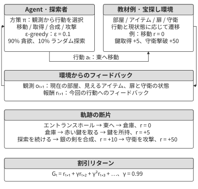

相互作用が続くと**軌跡**ができます。軌跡には各ステップの観測、行動、報酬、終了情報が含まれ、訓練システムが環境の状態を取得できる場合はそれも記録できます。方策はどう行動するかを決め、**価値関数（Value Function）**は、現在の状態からある方策に従って実行を続けたとき、将来どれだけのリターンが見込めるかを推定します。

Agent と環境の境界は、モデル化の際に選んだシステムの範囲で決まります。本書で扱うモデルと Harness は Agent の内側にあり、ツールのインタフェースが Agent を外部のアプリケーション、デバイス、サービスにつなぎます。たとえばファイルを変更する要求は Agent が出し、ファイルシステムが書き込みを実行し、ツールがその実行結果を Agent に返します。

学習の過程では、**探索と活用（Exploration–Exploitation）**の間で機会を配分する必要があります。探索は方策をまだ慣れていない行動に触れさせ、活用は現時点で良いと推定される行動を選びます。報酬が遅れて届くタスクでは、序盤のどのステップが最終結果に寄与したかも判断しなければなりません。これが後で扱う信用割当の問題です。

ある RL 手法を理解するには、まず次の 5 項目を確認するとよいでしょう。

- **行動空間**：何を出力してよいか。ボードゲームは離散的な指し手を、ロボット制御は連続的な関節の目標値を使えます。行動は状態、物理的な範囲、権限によって制約されることもあります。
- **方策**：状態、観測、履歴に基づいて行動を選ぶ規則です。1 枚の表でも、ニューラルネットワークでも構いません。
- **報酬信号**：訓練目標をどのフィードバックで表すか。各ステップの報酬が長期のリターンを形づくり、方策は将来の利得のために目先のコストを受け入れることもあります。
- **価値関数**：この先のリターンを推定し、行動の比較や方策更新の信号の構築に使えます。明示的に学習するかどうかは具体的なアルゴリズムによります。
- **環境モデル**：行動の後の状態、観測、報酬を予測します。モデルベースの手法は既知の、あるいは学習した環境モデルを使って計画し、モデルフリーの手法は相互作用のデータから直接方策や価値を学びます。

表8-3 は、これらの概念から環境、行動、目標を取り出し、なじみのあるいくつかのシステムを比べたものです。最初の 2 行を読むときは、「バランスを保つ」や「清掃面積」を、タスクをモデル化する際に選びうる目標として捉えてください。

表8-3 異なる Agent システムの主要要素の対比

| Agent の種類 | 外部環境 | 行動の表現 | 報酬または目標の例 |
| --- | --- | --- | --- |
| 生まれたばかりの子ガゼル | 地形、重力、身体の動力学 | 連続的な筋肉の制御 | バランスを保つ、転倒を避ける |
| 掃除ロボット | 部屋、床面、充電設備 | 移動、清掃、充電への帰還と制御パラメータ | 清掃面積、電池残量と衝突のコスト |
| チェス Agent | 盤面、対戦相手、持ち時間のルール | 現在の状態における合法手 | 勝ち +1、負け −1、引き分け 0 |
| カスタマーサービス Agent | ユーザー、業務データベース、サービスのインタフェース | 返信テキスト、照会、業務の呼び出し | 問題の解決、手続きの遵守、処理時間 |
| コードアシスタント Agent | 要求の出所、コードベース、実行環境 | 検索、編集、実行、返答 | テスト結果、タスクの完了、回帰とコスト |

これらのシステムでは行動の表現が異なります。ボードゲームは通常 1 ステップごとに離散的な行動を 1 つ選び、ロボットは決められた次元の連続的な制御量を出力し、LLM はまず token の系列を生成し、それをインタフェースが返信やツール呼び出しに解析します。内部の計算も方策のモデル化に含め、外部の状態を実際に変えるツールの実行とは分けて記録できます。

### 2 種類の行動表現：古典的 RL の設定と LLM の可変長方策

**マルコフ決定過程（Markov Decision Process、MDP）**は、状態、行動、遷移、報酬で意思決定問題を記述します。そのマルコフ性は、現在の状態と行動が与えられれば、次の状態と報酬の予測に履歴を追加で参照する必要がないことを求めます。予測に関わる履歴の情報は、すでに現在の状態に含まれているということです。図8-2 で、プレイヤーがいる部屋だけを記録すると困ったことになります。同じ扉の前に 2 回来たとしても、扉を開けられるかどうかはプレイヤーがすでに鍵を持っているかどうかで決まるからです。

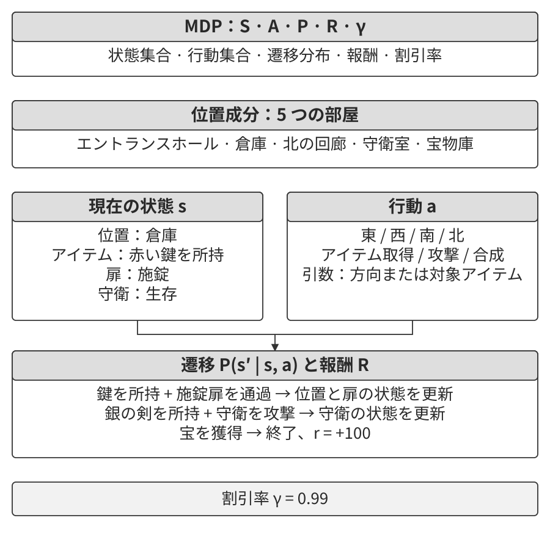

チェスは状態設計の一例になります。駒の位置に加えて、どちらの手番か、キャスリングの権利、アンパッサンの権利、そして 50 手ルールや同一局面の反復を判定するのに必要な情報も記録する必要があります。これらを状態に含めて初めて、現在の状態だけでルールを判定できます。Agent がその一部しか見られないなら、履歴で情報を補うか、部分観測のモデル化を採用する必要があります。

MDP は離散的な行動も、連続的な行動も、組み合わせ的な行動も扱えます。囲碁には盤上に 361 の交点があり、さらにパスと合法性も考慮しなければなりません。Atari のゲームは通常、少数の離散的な操作を提供します。ロボットの制御量は関節、グリッパー、物理的な制約で定義されます。状態と行動の数がどちらも小さければ、価値を直接表に格納できます。規模が大きくなると、関数近似、方策最適化、探索がそれぞれ対処の手段を提供します。

**表形式の Q-learning：1 ステップのフィードバックで行動価値を更新する。** $Q(s,a)$ は、状態 $s$ で行動 $a$ を取った後のリターンを推定します。最適行動価値はベルマン最適方程式を満たします。

$$
Q^*(s,a)=\mathbb E\left[r+\gamma\max_{a'}Q^*(s',a')\mid s,a\right]
$$

ここで $r$ はこのステップの報酬、$s'$ は次の状態、$\gamma$ は割引因子です。継続的なタスクでは $0\leq\gamma<1$ とすることが多く、終了がはっきりしていてリターンが有限なタスクでは 1 とすることもできます。割引因子が大きいほど、遠い先の報酬により多くの重みが残ります。現時点から計算したリターンは $G_t=\sum_{k\geq0}\gamma^k r_{t+k+1}$ です。

1 回の相互作用で $r$ と $s'$ が得られると、Q-learning は次の式で更新します。

$$
Q(s,a)\leftarrow Q(s,a)+\alpha\left[r+\gamma\max_{a'}Q(s',a')-Q(s,a)\right]
$$

$\alpha$ は学習率で、角括弧の中は「1 ステップの報酬に割引した後続の価値を加えたもの」と現在の推定との差です。タスクが終了状態に達したときは、後続の価値を 0 とします。付属のゲームで一度試してみましょう。ランダムな撹乱をオフにし、入口から東へ進み、倉庫で赤い鍵を拾います。鍵を拾うと 5 点の報酬があり、1 ステップごとに 0.5 点が引かれるので、この行動で返される $r$ は 4.5 です。表の「倉庫で鍵を拾う」の古い推定が 0.25 で、鍵を拾った後に選べる行動の最大 Q 値が 0.63 だとします。$\gamma=0.99$、$\alpha=0.2$ とすると、1 ステップの目標は $4.5+0.99\times0.63=5.1237$ です。古い推定はこの目標に向かって 5 分の 1 だけ近づき、1.22474 に更新されます。このように実際の 1 ステップのフィードバックで推定を修正する手法を、**時間差分学習（Temporal-Difference Learning、TD）**と呼びます。

ある状態における各行動の Q 値を並べれば、現時点で最も良いと推定される行動を選べます。図8-3 は、簡略化したグリッドの図でこの方策を描いたものです。各マスの数字は正規化した状態価値を表します。数字を手で隠して矢印だけを見ても、左上の隅から宝までたどり着けるでしょうか。

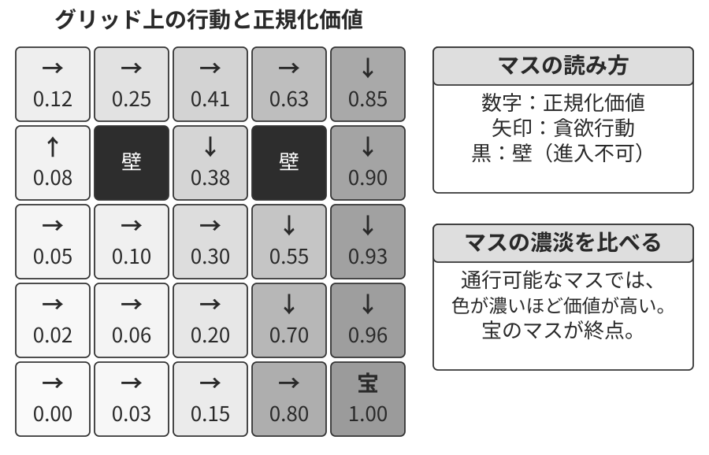

次の探索で矢印の向きが変わることもあります。図8-4 は、先ほどの赤い鍵を拾う計算を分解したものです。このステップで得た報酬は「倉庫で鍵を拾う」という 1 項目の推定を変えますが、表の他の状態の Q 値は、それぞれの更新を待たなければなりません。

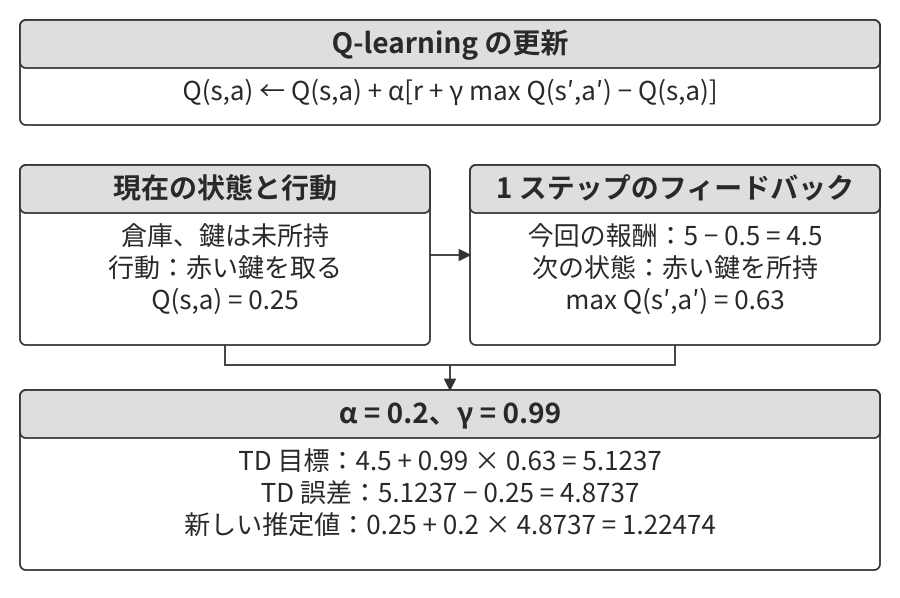

Q-learning の行動方策はランダムな探索を含んでもよく、更新の目標には次の状態の最大行動価値を使います。そのため**オフポリシー（Off-Policy）**学習に属します。

> **実験 8-1 ★：宝探しゲームにおける Q-learning の性能**
>
> 宝探しゲームには、鍵と扉、武器の効果、アイテムの合成といった隠れたルールがあります。クリアするには複数のステップを順に完了する必要があり、最適経路は 11 ステップです。重要な行動と勝利には報酬がありますが、それ以外のステップではフィードバックがほとんどありません。
>
> この宝探しの訓練では、学習率を 0.2、割引因子を 0.99 とし、探索率 ε を 1.0 から 0.1 へ徐々に下げます。表形式の Q-learning は ε-貪欲探索を採用します。各ステップで、確率 ε で選択可能な行動をランダムに 1 つ選び、それ以外のときは現在の Q 値が最大の行動から 1 つ選びます。各段階の勝率、訪問した状態の数、クリアまでのステップ数を記録します。
>
> 宝探し実験の訓練と評価の記録を読むときは、まず 2 つの問いを分けて考えます。訓練中、ランダムな探索を含む方策が初めて宝を見つけたのはいつか。訓練終了後に Q テーブルを固定し、貪欲方策で行動して安定してクリアできるか。前者はモデルがどのように経路を発見するかを、後者は学んだ価値に従って行動を選べるかを示します。
>
> 以前のある訓練では、最初の 1000 局ではまだクリアできず、Q テーブルには 124 の状態がありました。5000 局になっても安定して勝てず、状態数は 133 でした。7000〜8000 局の間に勝率は 34% から 96% に上がり、10000 局で 100% に達しました。このとき Q テーブルには 145 の状態があり、11 ステップの経路を見つけていました。
>
> なぜ序盤はなかなか進展せず、後になると勝率が急に上がったのでしょうか。探索がまず重要な行動と経路を見つけ、その後の訪問によって終点のリターンが前の状態へ少しずつ伝播していくからです。この小さなシミュレーション全体は約 10 秒で終わるので、大量の相互作用の繰り返しにも耐えられます。
>
> 分析の際は、計算時間と相互作用の回数を両方記録します。ゲームでは 1 回の行動はとても安価です。これがブラウザ、電話、物理デバイスになると、1 回の相互作用に待ち時間、費用、状態の変化が伴います。また表は特定の状態の符号化に結びついているので、ルールや地図が変わったら、既存の価値がまだ使えるかを改めて確かめる必要があります。次の実験では、事前学習の知識が探索の出発点をどう変えうるかを比べます。

**事前学習済み LLM：計算と行動を言語で表す。**

LLM はツールを呼び出す前に中間的な計算を生成することもできますし、直接呼び出しを出力することもできます。どちらも token の系列で表されますが、役割は異なります。中間的な計算はモデルがその後に使える文脈を変え、ツール呼び出しは実行されると外部環境を変えたり読み取ったりします。訓練では、プロトコルに従ってこれらの出力を記録し、タスクの結果と計算コストを合わせて評価できます。こうして「どれだけ考えるか、何を考えるか、いつツールを呼ぶか」は、同じ方策が学習できる選択になります。後で扱う AdaptThink は、この推論予算をめぐるものです。

可変長の系列は、より大きな組み合わせ空間をもたらします。モデルはクエリ、プログラム、JSON の引数、多段階の導出を書くことができ、系列の長さは予算と文脈の制限を受けます。事前学習は探索の出発点を与えます。数学の資料には条件の分析と計算が含まれていることが多く、コードや議論には問題箇所の特定、修正、検証が含まれていることが多いのです。モデルはこうした構造を借りて候補経路を生成し、環境からのフィードバックに応じて調整できます。既存の知識のおかげで、有用な行動の組み合わせが最初からサンプリングされやすくなり、無関係な大量の経路の中で闇雲に試行錯誤する必要が減ります。

たとえば「外貨の金額を米ドルに換算する」には、為替レートを取得して計算する必要があります。事前学習によって、モデルはこうした関連のあるステップを生成しやすくなっています。ポストトレーニングでは、為替レートの出所、計算結果、タスクの制約に基づいて、経路の確率をさらに調整できます。ここでは言語の知識が初期方策を与え、報酬がタスクのフィードバックを与えます。

図8-5 は本節の 2 つの設定を対比しています。表形式の Q-learning は指定された状態の符号化と探索規則から出発し、LLM Agent は事前学習済みの言語方策から出発して、文脈の中でツールの観測と過去の経験を組み立てます。

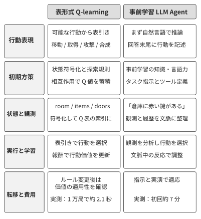

事前学習によって、モデルは新しい指示を解釈し、少数の示範からタスクの行動を調整することもできます。ツールは言語の出力を、検索、コード実行、業務操作につなぎます。このような Agent を設計するときは、ツールのインタフェースと実行権限を決めると同時に、タスクの結果、実行コスト、重要な過程に対するフィードバックを用意する必要があります。

モデルにロボットアームを制御させるとき、「次の token を予測する」ことをどう行動に当てはめればよいでしょうか。OpenVLA は約 97 万件の実ロボットの演示を使いました。演示から 1 ステップを取り出すと、入力はその時点のカメラ画像とタスクの指示で、訓練目標は演示者が次に実行した動作です。たとえばロボットアームが水平方向にどれだけ動くかは、本来は連続的な数値です。OpenVLA は各動作次元を 256 段階に区切り、どの段階に入るかを 1 つの token で表します。こうすればモデルは動作の token を 1 つずつ予測し、その位置だけで損失を計算できます。[^ch8-21]

この例は、行動クローニングと強化学習を区別する方法も示しています。何の信号がモデルを更新させるかを見ればよいのです。OpenVLA は演示の記録から学び、示範の動作 token に与える確率が高いほど損失が小さくなります。これは教師ありファインチューニングに当たります。実験 8-13 の SimpleVLA-RL になると、方策は環境の中で実際に動作を試し、タスクの報酬に応じてその後の選択を調整します。

> **アルゴリズム、環境から事前知識へ**
>
> 姚順雨は『The Second Half』で、アルゴリズム、環境、事前知識という観点から RL の発展を振り返っています。[^ch8-2] 筆者はこれをもとに、関心の移り変わりを 3 つの段階にまとめます。2015〜2016 年はアルゴリズムの改良に重きが置かれ、2016〜2018 年は環境の構築がより重視され、2018 年からは事前学習による事前知識の価値が徐々に認識されるようになりました。Gym は統一された環境インタフェースを提供し、Universe や World of Bits はコンピュータやウェブのタスクを探り、Dota 2 などのプロジェクトは複雑な環境での訓練能力を示しました。続いて GPT-2 と GPT-3 が言語の事前学習で蓄積された知識と表現力を示し、WebGPT や ChatGPT などのシステムはこの出発点をさらに活用しました。タスクに必要な事前知識はまず言語モデリングで獲得し、それから RL に具体的な行動を最適化させることができます。
>
> 筆者はここでの工学上の優先順位、すなわち**事前知識、環境、アルゴリズム**に賛成します。まずモデルがどんな知識と能力を備えているかを確かめ、次に適切な環境とフィードバックを構築し、最後にそれに見合った最適化手法を選びます。図8-6 は研究上の関心が現れた順に並べていますが、プロジェクトを進めるときは逆にたどり、既存の能力から出発すればよいのです。
>
> 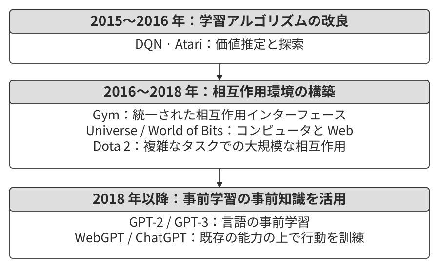

> **実験 8-2 ★★：従来型 RL と LLM Agent の比較研究**
>
> 同じ宝探しゲームで、表形式の Q-learning と LLM Agent を比べます。LLM の構成には Kimi K3 を使い、文脈の中に最大 50 件の経験を保持します。どちらも各ステップで、環境が示す選択可能な行動から 1 つを選びます。図8-7 の 2 つの経路をたどると、Q テーブルと言語モデルがそれぞれどのようにこの選択をするのかが分かります。
>
> 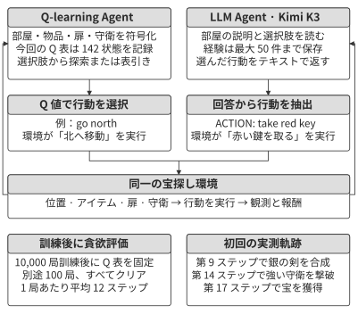
>
> 付属の Kimi K3 の実行記録では、Agent は最初の一局に 17 ステップを使いました。まず錆びた剣を拾い、北の扉に鍵がかかっているのを見つけると、倉庫へ向かって赤い鍵と魔法のクリスタルを手に入れ、第 9 ステップで剣とクリスタルを合成して銀の剣にしました。第 12 ステップで鍵を使おうとすると、環境は「必要なときに自動で使われます」と告げ、第 13 ステップで北へ進むと扉が実際に開きました。第 14 ステップで銀の剣を使って守衛を倒した後、もう一度剣を使おうとしましたが、環境はこの時点では使えないと告げました。第 17 ステップで宝を手に入れました。この記録を読むときは、次の行を隠し、その時点のフィードバックから、どのステップがまだ必要かを先に推測してみるとよいでしょう。
>
> 各行動をその時点の観測と対応させれば、モデルが「鍵で扉を開ける」「武器で守衛に立ち向かう」といった既存の知識をどう使ったか、ツールのフィードバックがその後の計画をどう変えたかを分析できます。表形式の手法は、状態—行動の訪問を通じてこうした関係を蓄積します。
>
> この対照では、Q-learning は 10000 局の訓練に 2.12 秒かかり、その後貪欲方策だけで 100 局を評価したところ、すべてクリアし、平均 12 ステップでした。Kimi は一局でモデルを 17 回呼び出し、6 分 56 秒かかりました。筆者はここから 1 つの選択原則を採ります。シミュレーションが安価で大量に繰り返せるなら、従来型 RL の探索を存分に活かせます。相互作用のたびに待ち時間、費用、実際の操作コストがかかるなら、既存の知識を活用できる方策を優先し、1 回の相互作用の価値を高めます。

この 2 つの実験は、本章とこれまでの工学的手法をつなぎます。文脈は 1 回の実行の中で経験を組み立て、外部メモリはタスクをまたいで経験を保存し、ポストトレーニングはパラメータの更新によって方策を変えます。以下ではまず言語と視覚の事前学習の基本的な過程を補い、その後に具体的な訓練データと最適化手法を論じます。

## モデル事前学習の基礎 `[任意読解]`

事前学習はモデルの初期の表現と生成分布を築き、後続の訓練はこの出発点の上でパラメータを調整し続けます。この出発点を理解するには、まず小さな言語モデルがテキストからどう学ぶかを観察し、次にそれが視覚入力をどう取り込むかを見るとよいでしょう。

テキストはまず**トークン化（Tokenization）**を経て、離散的な token に変換されます。たとえば「私はプログラミングが好き」は、模式的には「私」「は」「プログラミング」「が」「好き」の単位として示せますが、実際の区切り方はトークナイザが決めます。訓練では前の token を文脈として後続の token を予測し、損失を計算してパラメータを更新します。図8-8 では、まず訓練文を「環境」のところまで隠して次の語が何かを当て、それから原文を明かしてみてください。この位置を後ろにずらせば、次の予測問題ができます。

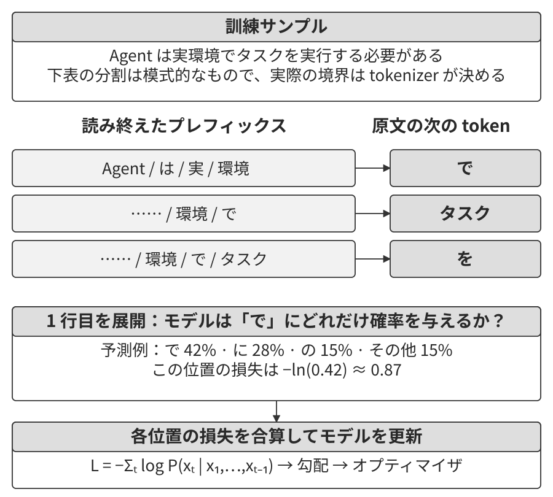

基礎的な言語モデリングの後には、指示の示範を加えて回答の形式とタスクの行動を訓練できます。選好データを使い、DPO などの手法で、より支持される回答の確率を高めることもできます。

> **実験 8-3 ★★：LLM をゼロから訓練する――アルゴリズム改良の威力**
>
> 約 1 億パラメータの MiniMind 2 を例に、コンシューマー向け GPU で事前学習、SFT、選好最適化を行います。ベースラインと、QK Norm と Muon オプティマイザを加えた構成を比べ、損失の下がり方、目標品質に達するまでの時間、生成結果を観察します。付属のまとめには約 3 倍の収束の高速化が記録されており、訓練全体は約 14 時間、費用は約 34 ドルでした。
>
> QK Norm はアテンションにおけるクエリとキーの数値スケールを調整し、Muon は対応するパラメータの最適化の更新方式を変えます。
>
> 同じ質問群を段階ごとに観察します。事前学習済みモデルは「世界で一番高い山」などの質問にすでに答えられます。SFT の後は指示遵守と出力の構成が改善します。選好最適化は、事実に関する回答と表現にさらに影響します。

> **実験 8-4 ★★：VLM を自分で訓練する**
>
> 図8-9 は「視覚エンコーダ—射影層—言語モデル」の接続を示しています。CLIP などの視覚エンコーダが画像の特徴を抽出し、射影層がその特徴を言語モデルの入力に必要な次元と表現に変換し、言語モデルはこれらの入力を合わせて説明や回答を生成します。
>
> 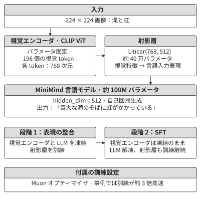
>
> 第 1 段階では視覚エンコーダと LLM を凍結し、新しく加えた射影層を訓練して、画像の特徴が言語の予測に参加できるようにします。第 2 段階では構成に応じて LLM の凍結を解き、高品質な画像—説明や問答のデータで SFT を行います。物体の認識、細部の説明、関係の判断、言語能力の変化をそれぞれ観察します。
>
> このアーキテクチャは既存の視覚モデルと言語モデルを再利用し、まずモダリティ間の接続モジュールを集中的に訓練するもので、予算が限られているときに優先して試す価値があります。重みを凍結すれば訓練可能な状態が減り、その後タスクの必要に応じて対応するモジュールの凍結を解けます。説明が誤っているときは、まず物体の情報が視覚表現に入っているかを確認します。情報がすでにあるのにモデルがそれを活用できないなら、射影層の表現力、対応付けのデータ、言語生成の監督を重点的に点検すべきです。出力をさらに行動の表現に変え、制御インタフェースと対応させれば、第 6 章の VLA アーキテクチャにつながります。

2 つの実験は、それぞれ最適化の構成とモダリティ間の接続が訓練にどう影響するかを示しています。予算が限られているとき、筆者はまずアルゴリズムとアーキテクチャの改良で得られる利得を比べ、そのうえでモデル規模を拡大するかどうかを決めることを勧めます。既存のモデルを新しい言語や新しい領域に持ち込むときは、事前学習済みの重みから学習を続けることもできます。次の節では、そうした訓練のためのデータの選び方を論じます。

## Mid-training：知識と基礎能力を補う

本章でいう **Mid-training** とは、既存のモデルの上で、対象分布に沿って言語モデルの訓練をもう一段階続けることを指します。文書、コード、導出に含まれる大量の token が監督に参加し、訓練では対象領域のコーパスと汎用コーパスを混ぜられます。DAPT/TAPT の研究は、領域やタスクに関連するコーパスで事前学習を続けることが下流タスクに役立つことを示しています。[^ch8-30]

データの選択は 2 種類の欠落から出発します。1 つは知識と言語の網羅で、たとえばモデルが社内プロトコル、対象言語の用語、特定のコードベースに十分触れていない場合です。もう 1 つはタスクに必要な基礎能力で、たとえば長い文脈の中で状態を追跡すること、文書をまたぐ関係を統合すること、長めのコードの導出をやり遂げることです。まず誤りの種類ごとに理解、知識、形式、行動の問題を切り分け、そのうえで補う材料を決めます。

ドメインテキストの損失が下がった後も、モデルが実際のタスクで学んだ知識を使えるかを確認すべきです。継続訓練と指示訓練の順序、問答の組み立て方、材料の形式は、いずれも知識の運用に影響します。[^ch8-31] 基礎能力が明らかに不足しているドメインタスクについては、筆者はまずドメインコーパスで網羅を増やし、次に SFT の示範でその情報をタスクの中で使うことを教え、モデルがときどきは正解できるものの成功率が低いという段階になってから RL に投資することを勧めます。

### Mid-training のデータをどう構築するか

**第 1 歩：失敗の分布から必要な材料を特定する。** テーマ、言語、文書の種類、コードのパターン、文脈の長さごとに評価し、Pass@1、Pass@k、誤りの事例と合わせて、モデルがどの条件で使える解法を欠いているかを判断します。引数の形式の問題はインタフェースの示範で扱えますが、ドメインの概念や関係の欠落には対応するコーパスが必要です。

**第 2 歩：密度の高いコーパスを組み立てる。** 元の文書は用語と事実の関係を与え、コードリポジトリはモジュールの構造と依存関係を与え、教科書風の導出や合成した言い換えは暗黙のステップを展開し、文書をまたぐサンプルは散らばった情報をつなぎます。品質フィルタリング、重複除去、評価セットの隔離を済ませてから、訓練系列を構築します。

**第 3 歩：目標とする能力に合わせてデータを混ぜる。** 自然な長文は書籍、文書、コードリポジトリから得られます。検索、マルチホップ推論、指示遵守、集約と統計に対しては、導出付きのタスクデータを加えられます。Agent に対しては、計画、ツールの選択、引数の構築、状態の追跡、エラー回復の軌跡を加えられます。これらの材料は既存のデータセットや教師モデルの生成から得られ、訓練に入れる前に内容と行動の要件に照らして選別します。

**第 4 歩：もともとできたタスクをモデルに練習させ続ける。** 一方のサンプル群は短いテキスト、汎用コーパス、従来の問題をそのまま使います。もう一方の群は同じタスクをより長い文脈に入れ、重要な情報の位置を動かし、さらに紛らわしい要素を加えます。この 2 群を組み合わせるときは、元の訓練データの分布を参考にしてもよいですし、FineWeb-2 などの公開コーパスでいくつかの配合を試し、評価結果に応じて調整してもよいでしょう。

**第 5 歩：複数の指標で続けるか止めるかを決める。** 訓練損失、hold-out のドメインタスク、汎用能力、元の指示遵守、目標タスクの成功率を同時に記録します。ドメインの成績が上がって汎用能力が下がるなら、混合比率、学習率、訓練量を比べます。損失は下がるのに目標タスクが停滞するなら、訓練材料がその種のタスクのこなし方を教えられているか、実際のタスクで知識を運用する示範を補う必要があるかを点検します。

モデルがとても長い注文ログから指定された注文番号を見つけ出せるとします。ところが「何度も注文して、そのすべてをキャンセルした顧客は誰か」と問い方を変えると、同じ顧客の注文をすべて集め、注文とキャンセル記録を 1 件ずつ突き合わせなければなりません。2 つの問題は同じログを使えますが、試される能力は異なります。RULER は合成タスクを使って入力の長さとタスクの難しさを別々に制御し、単一の検索、マルチホップの追跡、集約をそれぞれ測ります。著者らは 17 のモデルを評価し、多くのモデルが単純な検索ではほぼ満点に近いものの、入力が長くなるにつれて総合的な成績がはっきり下がることを示しました。[^ch8-ruler]

この差が実際の材料でも現れるかを見るには、LongBench v2 の複数文書、長い対話、コードリポジトリの問題を使えます。出力形式などの要求をモデルが覚えていられるかを単独で確かめるには、IFEval の検証可能な指示を取り出し、長めの材料のさまざまな位置に置きます。2 つのモデルを比べるときは、両者が見る指示の位置と紛らわしい内容を揃え、これが独自に構築したテストであることを明記します。最後に、エンドツーエンドの Agent タスクで、これらの能力がうまく連携するかを確かめます。評価セットを設計するときは、次の観点を 1 つずつ確認するとよいでしょう。[^ch8-longbench]

[^ch8-ruler]: Hsieh ら、RULER、2024。
[^ch8-longbench]: Bai ら、LongBench v2、ACL 2025。論文は 6 種類のタスク、計 503 問の選択式問題を提示しています。

- **位置と検索**：1 件または複数件の重要な情報が冒頭、中ほど、末尾にあるとき、それを見つけられるか。
- **関係と推論**：段落や複数の文書をまたぐ関係の追跡、矛盾の解消、証拠の組み合わせ。
- **集約と統計**：長い表やログにおける計数、グループ化、並べ替え、比較、傾向の要約。
- **指示遵守**：複数の要求、衝突の処理、手続きの条件、出力形式。
- **長い連鎖の推論**：数学、論理、コードのタスクにおける長めの依存の連鎖。
- **Agent の基本行動**：タスクの分解、ツールの選択、引数の生成、状態の保持、失敗からの回復。

長い推論やマルチターンのツール呼び出しは文脈をどんどん長くしますが、早い段階の指示、事実、タスクの状態はその後の意思決定にも関わり続けます。長いテキストの中で情報を見つけられなかったり、制約を保ち続けられなかったりすれば、長期にわたる Agent は確実に動作できません。訓練予算を拡大する前に、小規模な構成でデータの配合と訓練量を比べるべきです。頻繁に更新され、出典が求められる事実については、筆者は RAG を優先します。安定した大規模なドメイン知識と基礎能力については、継続訓練でパラメータに書き込むことを検討します。

> **実験 8-5 ★★：継続事前学習で新しい言語を学ぶ**
>
> Mistral 7B v0.3 から出発し、韓国語版ウィキペディアなどの材料で韓国語の能力を高めます。訓練ではまず韓国語約 80%、英語約 20% の混合を使い、次に韓国語の指示データで SFT を行い、言語モデリングと対話行動の変化をそれぞれ観察します。
>
> 韓国語のデータは対象言語の網羅を増やし、英語のデータは既存の能力を保つために使います。各段階とも、訓練に使っていない同じ韓国語と英語の問題群でテストします。付属の結果では、韓国語の最終段階のブラインド評価のスコアが改善し、英語の能力はいくらか低下しました。ここから、次の回では英語の訓練材料をもう少し多く混ぜるか、更新の強さを下げるという具体的な方向が得られます。
>
> 対象言語、既存の言語、事実の品質を分けて記録すれば、利得と代償を判断できます。SFT の段階では、モデルが韓国語の指示に従って回答を組み立てられるかを改めて確認します。こうすれば、継続事前学習と指示ファインチューニングの効果をそれぞれ観察できます。

## SFT（教師ありファインチューニング）

ドメインコーパスを使えば、モデルはあるインタフェースに何度か多く触れられます。しかし呼び出しが失敗した後に引数を直すことを教えたいなら、一度その場面を直接示範することもできます。SFT はタスクの入力を与え、示範に含まれる回答や動作を生成するよう、token ごとにモデルを訓練します。図8-10 を見るときは、まずどんな行動を教えるつもりかをはっきりさせ、そのうえで示範の集め方を決めてください。示範に含まれる事実、口調、出力形式も、すべて一緒に訓練に入ります。

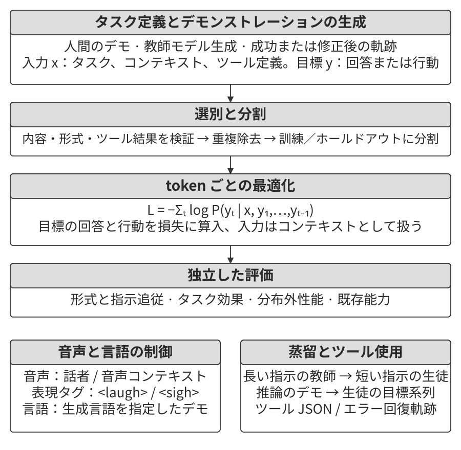

データは通常 3 つの経路から得られます。人間の専門家が重要な行動と境界を定め、教師モデルが示範をまとめて書き、検証器がモデルのサンプリングから有効な出力を選別します。3 つは組み合わせて使えます。たとえば、まず専門家が少数のツール呼び出しの示範を書き、次に教師にタスクの条件を変えてより多くのサンプルを生成させ、最後に引数、実行結果、業務上の制約を確認します。

**SFT の用途の 1 つは、プロンプトや Skill に繰り返し書いているやり方をモデルに教え込むことです。** 第 7 章の記憶の採点を例にとりましょう。採点マニュアルが判例も含めて 1 万 token あるとします。教師は完全なマニュアルに基づいて一群の回答を採点し、同姓同名の人物、関係の取り違え、証拠不足といった場面の扱い方を示範します。生徒を訓練するときは、入力として短い採点項目の名前、その回の履歴資料、評価対象の回答だけを残し、目標出力は教師が選んだ等級にします。本番では短いプロンプトとその回の資料を与えるだけでよく、推論のたびにその 1 万 token の固定の説明を省けます。繰り返し呼び出される Skill についても、同じ方法でいつ資料を調べるか、どのツールを選ぶかを示範し、その安定した手順をモデルに蒸留できます。

データの準備では、まずタスク分布、出力の schema、受け入れの方法を決めます。示範が検査を通ったら、重複を除き、サンプルの種類ごとの比率を調整し、データセットを分割します。サンプル数と網羅範囲は一緒に設計すべきです。同じ問い方を何千回も繰り返せば、同じパターンを強化し続けることになります。重要な条件を中心に変化をつけて初めて、モデルはさまざまな入力に対して適切な行動を選べるようになります。筆者はまず重要な場面を網羅する示範を一群だけ丁寧に仕上げ、それから規模を広げます。SFT は目標出力を token ごとに学ぶので、誤った事実、冗長なステップ、不適切な操作の癖もそのままパラメータに入ります。

> **実験 8-6 ★★★：音声 SFT――声のコピーからパラ言語モデリングへ `[拡張実験]`**
>
> Orpheus と Sesame CSM を例に、話者の条件、対話の文脈、表現のマーカーが音声生成にどう関わるかを比べます。Orpheus は音声を token として表し、参照用のテキスト—音声の断片を使って対応する声色を生成でき、`<laugh>`、`<sigh>` などの表現マーカーも提供します。Sesame CSM はテキスト、話者の識別子、既存の音声断片を受け取り、続きの音声を生成します。[^ch8-speech-conditioning]
>
> 訓練サンプルを構築するときは、テキスト、話者、音声、表現の条件をそれぞれ記録します。同じ話者の複数の文にまたがる材料で一貫性を学ばせ、さまざまな文脈における笑い、ため息、間で表現を学ばせます。参照なし、参照あり、表現条件を指定した場合の出力を比べ、正確さ、自然さ、感情、声色で採点します。
>
> データには十分な数の話者、文型、感情の組み合わせを含めるべきです。話者が少なすぎると、出力が単一の声色に偏ることがあります。あるマーカーがいつも同じ音声断片と結びついていると、繰り返しの多い機械的な表現になることがあります。

> **実験 8-7 ★★★：多言語思考――指定した言語で推論過程を生成する `[拡張実験]`**
>
> gpt-oss-20b に SFT を施し、推論過程の言語を指示で指定します。たとえば `reasoning language: German` はドイツ語の推論テキストの生成を求めます。訓練サンプルには英語、スペイン語、フランス語などを含め、中国語はテスト段階まで取っておきます。
>
> 付属の事例では、訓練後に Chinese を指定すると、モデルは中国語の推論過程を生成できました。さらに 3 つの結果を比べられます。言語の指定に従っているか、最終的な答えが正しいか、生成の長さと所要時間がどう変わるか。事前学習による多言語の基盤と、SFT で学んだ制御方法が、ともにこの言語横断的な振る舞いに関わっています。異なる言語や基盤モデルとの対照によって、それぞれの役割をさらに分析できます。

> **実験 8-8 ★★：Prompt 蒸留――より小さいコストで使える能力を再現する**
>
> 安定した業務が数千 token のシステムプロンプトに依存し、教師がさらに長い推論を生成することがあります。Prompt 蒸留では、まず教師に完全な条件のもとで高品質な出力を生成させ、それを「ユーザー入力—最終回答」の形にまとめて生徒の SFT データにします。生徒は短いプロンプトを使い、目標の構成に従って直接回答します。
>
> 最初の訓練サンプルを開くと、Kimi K3 の教師がラテン文字の混じったアラビア語のテキストを読み、判断の根拠を説明したうえで、最後に言語コード `ar` を出しているのが分かります。SmolLM2-135M-Instruct の生徒に渡す示範には、原文と `ar` しかありません。同じ 80 件のテスト記録では、教師側は 1 回のリクエストで平均約 386 token を読み込み、生徒側は約 97 token でした。この 2 つの数値はそれぞれのトークナイザで数えたものです。
>
> 付属の言語識別の対照記録を使えば、「正解したこと」と「出力が形式に合っていること」を切り分けられます。教師は 160 件の訓練サンプルで示範を生成し、別の 80 件のテスト記録ではすべて正解しました。ファインチューニング前の生徒はテストで出力が 1 件も採点器に解析されず、得点はゼロでした。ファインチューニング後は 80 件すべてが解析でき、76 件のラベルが正しくなりました。ベースラインのゼロ点だけでは、「言語を識別できなかった」のか「識別はできたが形式どおりに答えなかった」のかを区別できません。このテスト群には 75 の異なるテキストが含まれ、訓練とテストの間に完全に同一のテキストはありません。
>
> データを構築するときは、生徒がタスクを完了するのに必要な条件も残しておく必要があります。教師が最新のツールの結果に依存しているなら、その結果を生徒の入力にするか、ツールのインタフェースを残しておきます。教師に系統的な誤りがあるなら、独立した検証でフィルタします。
>
> 製品のルールが安定し、入力分布がはっきりしていて、呼び出しのコストが高いなら、筆者はまず Prompt 蒸留を評価し、繰り返し処理しているプロンプトと推論をパラメータに圧縮することを勧めます。製品がまだ模索段階にあり、タスクの要件が頻繁に変わるなら、編集可能なプロンプトと明示的な推論を残しておけば、素早い試行と誤りの特定がしやすくなります。

> **実験 8-9 ★★★：思考連鎖（Chain of Thought、CoT）蒸留**
>
> CoT 蒸留は、教師が与える推論テキストを最終的な答えと一緒に監督として使い、生徒に分解、計算、確認、修正の過程を学ばせます。DeepSeek-R1 が Qwen や Llama の系列に施した蒸留は、この手法の代表例です。自分たちで管理できるモデルを持ちたいが訓練への投資は抑えたいというチームには、筆者はこの路線を優先して検討することを勧めます。教師が目標タスクで生徒より明らかに強ければ、価値のある示範を提供できます。まず完全な推論出力を取得できるオープンウェイトのモデルから選び、生徒との能力差とデータの品質を比べるとよいでしょう。インタフェースが推論の要約しか提供しない場合は、過程の蒸留に使える情報もそれだけ少なくなります。
>
> 第 1 歩として、教師に同じ問題についていくつかの解法を出させます。数学の問題はまず答えを照合し、コードの問題はテストを実行して、検査を通った解答だけを残します。この選別を**棄却サンプリング（Rejection Sampling）**と呼びます。選別した解答で教師ありファインチューニングを行うことを、**棄却サンプリングファインチューニング（Rejection Sampling Fine-Tuning、RFT）**と呼びます。生徒に推論過程も学ばせるなら、続いて中間ステップを照合し、導出が誤っているのにたまたま正解した示範を取り除く必要があります。
>
> 信頼できる検証器があるタスクについては、筆者はまず RFT のベースラインを作ることを勧めます。生成、選別、SFT だけで訓練の流れができ、オンラインの方策最適化や価値推定の実装を省けます。そのうえで、RL への追加投資に見合う価値があるかを判断します。
>
> 第 2 歩として、生徒を訓練します。選んだモデルの対話形式に従って「問題→推論テキスト＋最終的な答え」を組み立てます。`<think>` と `</think>` などの境界を使う場合は、どの token が損失に参加するかを明確にします。7B 級の生徒から始め、完全な軌跡、簡潔にした軌跡、最終回答だけを監督する構成を比べるとよいでしょう。
>
> 第 3 歩として、生徒が何を学んだかを見ます。付属の実験では Kimi K3 に AIME の数学問題 24 問を解かせ、正解した 23 本の推論軌跡を残して Qwen2.5-1.5B-Instruct のファインチューニングに使いました。同じ問題群をもう一度解かせると、生徒の正解数は 1 問から 2 問になり、教師は 23 問正解しました。訓練後の生徒はときどき振り返って検算するようにもなりましたが、問題ごとの対応のある検定では、正答率の信頼できる向上は示されませんでした（$p=1.0$）。

> **本書執筆の実践：蒸留実験の開発過程**
>
> 筆者は当初、GPT-5.6-Sol で動く Codex で蒸留実験を実装しようとしましたが、拒否に遭いました。Claude Opus 5 で動く Claude Code に切り替えても、作業を続けられませんでした。その後、Kimi K3 を使ってコードの作成と実行を完了しました。

この 4 つの事例はいずれも教師あり学習を採用していますが、学ぶ内容はそれぞれ異なります。音声では声色と表現の条件、多言語推論では言語の制御、Prompt 蒸留では直接の回答、CoT 蒸留では問題を解く過程です。

## SFT データ合成：示範から訓練可能な軌跡へ

実際の苦情 1 件から訓練用の問題を一群作るとき、どの情報は入れ替えてよく、どの関係は保たなければならないでしょうか。本番の軌跡からユーザーの意図、初期状態、利用可能なツール、業務上の制約、よくある失敗を抽出し、タスクのテンプレートにまとめます。身元、注文、ファイル、認証情報は入れ替えなければなりません。元の問題が 2 つの似た注文に関わっていたなら、インスタンスを生成するときも、この区別が必要な関係を保たなければなりません。インスタンスをリセット可能な環境で実行して初めて、新しい問題が元の難所を本当に保っているかが分かります。

完全な流れは、**本番の事例→タスクテンプレート→合成インスタンス→複数の候補軌跡→タスクと軌跡の検証→訓練データ**です。このうち 2 種類の検証は別々の問題を担います。タスクの検証は、条件が十分か、目標が達成可能か、参照結果が正しいかを確認します。軌跡の検証は、タスク終了時の状態、ツール呼び出しの順序、実行過程が業務上の制約に合っているかを 1 件ずつ照合します。

実行可能な条件にはテスト、データベースのアサーション、状態の差分チェックを使い、オープンなコミュニケーションの質には Rubric とモデルによる評価を使い、人手の抜き取りで較正します。さらにスキルグラフ、実行可能な環境、独立した検証器を組み合わせれば、タスクの網羅を計画的に広げられます。[^ch8-12][^ch8-17][^ch8-18][^ch8-19][^ch8-20]

合格する示範は、順調に完了した軌跡でも、診断と修復を含む完全な過程でも構いません。その中の誤った動作については、サンプルの中でどんな役割を担うのかを明確にし、訓練目標に応じて損失を計算する位置を選ぶべきです。失敗の記録は、選好ペアの構築、網羅の欠落の発見、回復タスクの生成にも使えます。その後 RL に進むと、現在の方策が軌跡をサンプリングし直し、環境のフィードバックを使って更新します。

訓練セットと評価セットは、目的に応じて隔離の方式を選びます。同一分布の評価では具体的なインスタンスを隔離し、転移の評価ではさらにタスクテンプレート、顧客層、期間を隔離します。重複除去では入力と解法の近似重複を確認します。参照解答、隠しテスト、採点にだけ使う情報は、タスクのプロトコルに従って検証側に置いておきます。

ファインチューニングが終わった後に、重みから訓練材料を検証し直すことはできるでしょうか。公開されている推論モデル s1 を例にとります。訓練時と同じトークン化とテキスト処理で公開サンプルをトークン番号に変換し、重複を除けば、1 つのリストが得られます。次にファインチューニング前後の入力埋め込み行列を行ごとに比べ、どのトークンに対応するベクトルが変わったかを書き出します。筆者が検証したところ、2 つのリストの 16,573 個の番号は 1 つずつすべて一致しました。この検査には、正しい基盤モデルとトークナイザを見つけること、訓練の構成どおりにシステムプロンプトを付け加え、長いサンプルを切り詰めることが必要です。さらに、訓練が実際に入力埋め込みを更新していること、入力埋め込みと出力層の重みが別々であることも確かめなければなりません。たとえばアテンション層だけで LoRA を訓練した場合、入力埋め込みは元のまま残るので、それをもとに使われたトークンを列挙することはできません。[^ch8-token-provenance]

3 つのトークンを使えば、証拠の境界がはっきり見えます。2 件の公開サンプルをトークン化すると、それぞれ `[10, 20]` と `[20, 30]` になり、重複を除くと `{10, 20, 30}` が得られるとします。ここに `[30, 10]` を 1 件追加してもう一度計算しても、集合はまったく同じです。検証の際にすべての番号が一致したとしても、それだけでは 3 件目のサンプルが使われたかどうかを判断できず、ある評価問題が訓練セットに紛れ込んだ可能性も排除できません。

[^ch8-token-provenance]: 李博杰の training-forensics プロジェクトは、s1 などのモデルのトークン集合と前処理の条件を記録し、埋め込みの重み共有と LoRA が比較手法に与える影響を論じています。

第 7 章の「早すぎる終了」の事例を例にとると、完了を宣言しようとしている時点で接頭部を切り出し、検証されていない完了の宣言を `rejected`、残りの目標を確認し関連するテストを実行してから答える継続の行動を `chosen` とします。選好ペアは DPO に使えます。そのうち検証を通った継続の行動は、単独で SFT の示範としても使えます。

後で扱う中国語の曲がり引用符と特殊文字列の実験は、監督の目標をどう決めるかをさらに示しています。中国語の曲がり引用符のタスクは文書のスコープから出発し、対象の本文を修正しつつ、コード、引用文、JSON を保護することを求めます。特殊文字列のタスクは、ツールの引数の中で `old_string` がバイト単位で一致し続けることを求めます。前者は編集の範囲と文書の文法を、後者は正確な複製と実際のツールでの照合を確認します。共通の失敗帰因の流れから、異なる訓練目標を導き出せるのです。

## Mid-training、SFT、RL をいつ選ぶか

モデルがツールの入力形式すら正しく書けないのに、いきなり試行錯誤を繰り返させたら、実際に動く呼び出しは何回あるでしょうか。図8-11 に沿ってまずモデルがつまずいているステップを見つけ、表8-4 に従って訓練材料とフィードバックの与え方を選びます。

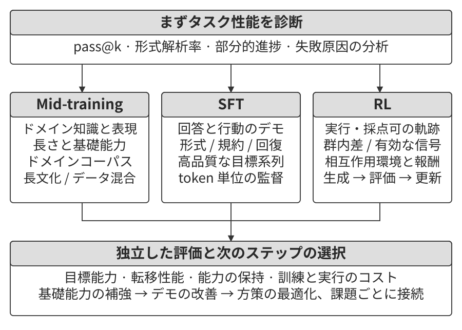

表8-4 Mid-training、SFT、RL の選択基準

| 観察される現象 | 優先して確認すること | 候補となる手法 | その後の評価の重点 |
| --- | --- | --- | --- |
| ドメインの言語、概念、基本操作が弱く、何度サンプリングしてもほとんど進展しない | コーパスの網羅と基礎能力 | Mid-training。検索可能な事実には RAG を併用 | ドメインタスク、汎用能力を確認するテストセット、部分的に正しい軌跡 |
| 内容は使えるが、形式、引数、決まった手順が不安定 | 示範、インタフェース、制約 | SFT、制約付きデコード、ツールによる検証 | 解析の成功、タスクの結果、回復行動 |
| ときどきタスクを完了できるが、成功率が低いか回り道が多い | 報酬の質、探索、タスク分布 | RL | タスクの利得、報酬の差、独立した汎化、コスト |
| 示範や選好データはあるが、対話環境がまだない | オフラインデータの網羅と検証の方式 | SFT、RFT、オフライン選好最適化 | ベースラインの品質、データの偏り、環境構築の利得 |

進め方は 4 段階に分けられます。まず、プロンプト、文脈、ツール、制約による方式のベースラインを作ります。これらの方法でタスクの要件を満たせるなら、筆者は外部で編集できる方式を優先して残し、訓練、デプロイ、回帰の保守コストを減らします。動的な事実は検索とバージョン管理で提供し、繰り返し学ぶ必要のある暗黙の判断、知覚のパターン、安定した行動については、パラメータの訓練による改善を検討します。

第 2 段階では、hold-out のタスクで成功、部分的な進展、解析結果、誤りの種類を観察します。サンプリングの構成を固定すれば、Pass@1 と Pass@k から、現在の方策にすでに利用できる経路があるかが分かります。失敗した軌跡は、知識の不足、フィードバックの欠如、手順の誤りを区別するのに役立ちます。

第 3 段階では、学ぶべき行動に示範を与えます。JSON schema、ツール呼び出し、用語の使い方、確認と回復は、いずれも SFT のサンプルとして書けます。必要な知識は、対応するコーパスとタスクの文脈で与えます。

第 4 段階では、RL のフィードバックの条件を評価します。採点可能な候補を生成でき、報酬に区別する力があり、環境が十分な相互作用を許すなら、方策最適化の利得を比較できます。報酬が疎すぎるなら、まずカリキュラム、部分報酬、より適切な初期方策を検討します。

各段階では、評価結果がその後の投資を決めます。形式の明確なタスクなら SFT を終えた時点でデプロイでき、強い出発点があれば直接 RL を行えます。ドメインの継続訓練の後に、既存の指示能力を再利用することもできます。以下ではシングルターンのタスクを使って、示範からの学習と報酬からの学習が生む行動の違いを具体的に観察します。

読書ガイドの注文の問題に戻りましょう。同じ実際のツール説明をそのままモデルに渡し、引数を正しく書けるかを観察します。説明の中のフィールドがすでに変わっているなら、まず実行時に参照できる説明を更新します。フィールドの意味ははっきりしているのに、モデルがユーザーのテキストを繰り返し注文番号の位置に入れてしまうなら、照会、確認、正しい引数の入力を含む SFT の示範を与えられます。すでにときどきは最後までやり遂げられ、照会の順序によって成功率や費用が変わるのであれば、複数の方策軌跡を比較する条件が整っています。

## シングルターン強化学習：記憶と汎化の対照

シングルターンのタスクは 1 回の入力から始まり、モデルが回答を提出して報酬を得たところで終わります。モデルは回答を生成する間に多段階の推論を行ってもよく、訓練システムが同じ問題を何度も試させても構いません。相互作用を 1 回の回答に限定すると、訓練手法がモデルの行動をどう変えるかを観察しやすくなります。以下ではまず AdaptThink を使って、モデルが推論予算の配分をどう学ぶかを説明し、次に GeneralPoints を使って、ルールや見た目が変わったときの SFT と RL の振る舞いを比べます。

RL アルゴリズムが報酬を使ってモデルをどう更新するかを先に知っておけば、後の実験の訓練過程を読み解けます。本章の RL 訓練の大半は**方策勾配**に基づきます。同じ問題に対する複数回のサンプリングを例にとると、モデルにいくつか回答を生成させ、各回答の報酬をベースラインと比べます。ベースラインより良い回答は正の信号を受け、訓練はその生成確率を高めます。ベースラインより悪い回答は負の信号を受け、生成確率がそれにつれて下がります。

1 回の更新でモデルが偏った方向へ大きく動くのを抑えるため、主流の **PPO** アルゴリズムは、確率比が指定された区間を超えると代理目的関数の余分な利得を切り落とします。実際の更新幅は学習率と更新のエポック数にも左右されます。後で扱う「価値ネットワーク付きの PPO」は価値の推定を学習し、それを使って比較のベースラインを作り、各ステップの行動のアドバンテージを計算します。**GRPO** は同じ問題に対する複数の回答を直接比較し、群内の報酬でベースラインを作るので、別途訓練する価値ネットワークが不要になります。

次の Python 風の擬似コードは、サンプリング、報酬、アドバンテージ、パラメータ更新をひとつながりにしたもので、各ステップで情報がどう受け渡されるかを理解する助けになります。実際の訓練では、サンプリングの並列化、KL 正則化、オプティマイザも設定する必要があります。

```python
for prompt in batch:
    group = [rollout(policy, env.reset(prompt)) for _ in range(G)]
    rewards = [verify(trajectory) for trajectory in group]
    advantages = normalize_within_group(rewards)       # GRPO baseline
    update(policy, group, advantages)
```

PPO は長さの異なる軌跡の一群を使って、どのように方策を更新するのでしょうか。まず各軌跡の内部で、後ろから前へ各ステップの割引リターンを計算します。軌跡が終わったら累積を止め、次の問題の報酬が混ざらないようにします。次に、すべての軌跡でモデルが実際に選んだ行動をまとめ、それらの行動の平均損失を計算します。以下は 1 回の更新を書いたもので、ミニバッチによる複数エポックの最適化は省略しています。[^ch8-ppo-method]

```python
states, actions, returns = [], [], []
for trajectory in rollouts:
    states.extend(trajectory.states)       # 每次选择动作之前的状态
    actions.extend(trajectory.actions)     # 与状态逐项对应
    returns.extend(discounted_returns(trajectory.rewards))

returns = tensor(returns)
values = value_model(states)
advantages = returns - stop_gradient(values)
ratio = exp(policy.log_prob(actions, given=states)
            - old_policy.log_prob(actions, given=states))
policy_loss = -mean(min(
    ratio * advantages,
    clip(ratio, 1 - epsilon, 1 + epsilon) * advantages
))
value_loss = mean((values - returns) ** 2)
update(policy, value_model, policy_loss + value_coef * value_loss)
```

GRPO の「相対」は同じ問題に対する複数の回答から来ています。一方ここでの PPO は、価値ネットワークで各状態の期待リターンを推定します。`old_policy` は、この一群の軌跡を生成したときに凍結された方策です。ある行動のアドバンテージが 1 で、現在の方策がその行動に与える確率がサンプリング時の 1.4 倍だとします。`epsilon = 0.2` とすると、代理目的関数におけるこの項の寄与は `min(1.4, 1.2) = 1.2` です。この行動の確率をさらに上げても、この項からは追加の利得を得られません。

アドバンテージが −1 なら、向きが逆になります。確率比がすでに 0.6 まで下がっているとき、同じ行のコードに代入すると `min(-0.6, -0.8) = -0.8` となり、確率をさらに押し下げても利得は増えません。逆に、この成績の悪い行動がかえって出やすくなり、確率比が 1.4 まで上がると、小さいほうを取って `min(-1.4, -1.2) = -1.4` となり、その確率を上げることには依然として代償が伴います。

> **実験 8-10 ★★：AdaptThink――「いつ考えないか」を学ぶ**
>
> 推論モデルは長めの推論過程で問題を解くことがよくあります。簡単な問題なら、直接答えれば生成のコストを節約できます。AdaptThink はモデルに Thinking と NoThinking の 2 つのモードを与えます。このプロトコルに対応したモデルでは、NoThinking は `<think></think>` で推論部分を終え、その後すぐに答えを生成します。訓練の目標は、タスクに応じて適切な推論予算を選ばせることです。
>
> 手法の中核は 2 つの要素です。**制約付き最適化目標**は、全体の正答性能を保ちつつ NoThinking の使用比率を増やすようモデルを促します。**重要度サンプリング**は 2 つのモードのサンプリング比率を調整し、重みによってサンプリング分布と最適化目標の間のずれを補正します。初期のモデルは Thinking に偏りがちなので、NoThinking のサンプルを意図的に増やして初めて、2 つのモードを比べる信号が訓練で得られます。ここでのコールドスタートの問題とは、具体的には訓練初期に NoThinking のサンプルが足りないことを指します。
>
> 本書の実験では H100 80GB GPU を 8 枚使いました。第 300 ステップまで訓練すると、MATH500 の正答率は 81.00% から 81.80% になり、平均応答長は約 4,911 tokens から 1,577 tokens に下がりました。GSM8K の正答率は 79.68% から 81.88% に上がり、応答長は約 1,025 tokens から 477 tokens に下がりました。AIME の mean@16 は 31.46% から 31.04% になり、応答長は約 12,120 tokens から 6,402 tokens に下がりました。3 つの応答長はそれぞれ約 68%、53%、47% 減っています。
>
> 3 つのデータセットにおける NoThinking の比率は、順に 83.80%、84.15%、56.25% でした。モデルは AIME ではより多くの推論計算を残し、MATH500 と GSM8K ではより頻繁に直接答えています。AIME2024 は 1 問につき 16 回サンプリングし、mean@16 はこの 16 回の解答の平均正答率です。第 300 ステップでは、平均の回答が半分近く短くなり、正答率は約 0.42 ポイント下がりました。
>
> 第 300 ステップは訓練途中の 1 回の検証です。チームは当初 3,140 ステップの訓練を計画していましたが、実行は途中で異常終了し、最後の検証記録は第 410 ステップで止まっています。この時点で AIME2024 の平均正答率は 31.88%、平均の回答は約 5,874 token でした。
>
> AdaptThink は Prompt 蒸留と組み合わせられます。蒸留は繰り返し使う指示と解法のパターンをパラメータに書き込み、AdaptThink はタスクごとにどれだけの推論計算を割り当てるべきかを学びます。両者はともに、回答の品質、遅延、コストに影響します。

> **実験 8-11 ★★：GeneralPoints――シングルターン RL における「記憶と汎化」の対照**
>
> Chu らは、「24 点」に似たカードゲーム GeneralPoints を使ってモデルの汎化能力を検証しました[^ch8-3]。4 枚のカードの数字をそれぞれ 1 回ずつ使い、加減乗除で 24 を作ります。モデルが問題の解き方を身につけたのなら、絵札のルールやスートを変えても正しく計算できるでしょうか。図8-12 は 2 種類の出題形式を示しています。GP-L は文字で直接与え、GP-VL はモデルがカードの絵柄を読み取る必要があります。
>
> 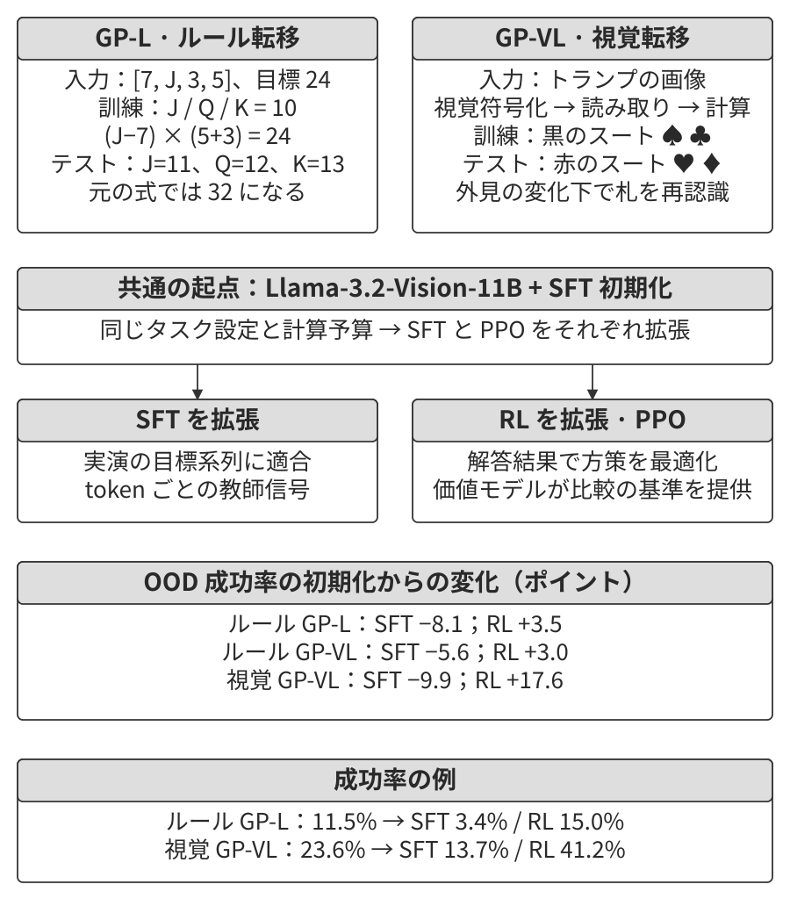
>
> **ルールのバリアント**：訓練時は J/Q/K をすべて 10 として数え、テスト時はそれぞれ 11/12/13 として数えます。そのためテストセットには訓練で見たことのない数字の組み合わせが含まれ、モデルが新しいルールに従って 11、12、13 を使って計算できるかを確かめられます。**視覚のバリアント**：訓練では黒のスート（♠♣）を、テストでは赤のスート（♥♦）を使い、モデルがカードの見た目の変化に適応できるかを確かめます。
>
> 実験は Llama-3.2-Vision-11B から出発し、まず SFT で基本的な指示遵守の能力を築き、その後 SFT を続ける分岐と RL の分岐の 2 つに分けて、同じ計算予算のもとで比べました。RL の分岐は価値ネットワーク付きの PPO を採用しています。どちらの分岐も J/Q/K=10 のルールで訓練し、その後、分布内（ID）と分布外（OOD）のテストセットで評価しました。
>
> `[7, J, 3, 5]` を例にとると、J=10 なら `(J−7)×(5+3)=24` が使えます。J を 11 に変えると、この式は 32 になるので、`(11−5)×(7−3)=24` に替える必要があります。同じ手札でも、モデルは現在のルールを読み取り、計算を組み立て直さなければならないのです。
>
> 2 つの訓練手法は、分布外テストで明らかな差を示しました。**ルールの OOD**：GP-L では、RL の成功率は 11.5% から 15.0% に上がり、3.5 ポイント増えました。SFT は 11.5% から 3.4% に下がり、8.1 ポイント減りました。GP-VL では、RL は 3.0 ポイント増え、SFT は 5.6 ポイント減りました。**視覚の OOD**：GP-VL では、RL は 23.6% から 41.2% に上がり、17.6 ポイント増えました。SFT は 23.6% から 13.7% に下がり、9.9 ポイント減りました。
>
> カード認識の結果をさらに調べると、最終的な解答の成績を視覚的な知覚と結びつけられます。RL の分岐ではタスクの成功率とともに認識の正確さも上がり、SFT の分岐では認識の正確さがいくらか下がりました。研究はこの差を訓練目標と結びつけています。token ごとのフィッティングは示範に含まれるテキストのパターンを強化することがあり、結果に対する報酬はカードを正しく読み取って計算をやり遂げることをモデルに求め続けます。知覚の正確さは、この仕組みを分析するための中間的な指標になります。
>
> 先に SFT を行う理由は、出力形式からも理解できます。実験で使った Llama-3.2-Vision-11B の基盤モデルは、求められた構造化出力を安定して生成できず、検証器はタスクの報酬を計算できなかったので、エンドツーエンドで直接 RL を行う試みは失敗しました。SFT がまず解析可能で採点可能な出力を確立して初めて、後続の RL がタスクのフィードバックを利用できるようになります。前述の DeepSeek-R1-Zero は、もともと採点可能な回答を生成できる基盤モデルから出発し、直接 RL に入りました。
>
> モデルは検証器のフィードバックからどれだけ学べるのでしょうか。論文の図 10 は、テキストだけのカードタスク（GP-L）を単独で比べています。研究者は検証の反復を 1、3、5、10 回に設定し、それぞれ RL モデルを訓練・評価しました。同じ訓練計算予算のもとで、10 回の検証を許した群は新しいルールでの成功率がこの群の訓練開始時より 5.99 ポイント上がり、1 回しか検証しない群は 0.48 ポイントの向上でした。
>
> この実験の分布シフトのもとで、なぜ SFT の性能は下がり、RL のほうが良い結果を出したのでしょうか。観察と整合する 1 つの説明はこうです。限られた SFT のデータが「J/Q/K が出たら 10 として使う」という固定パターンを強化し、テストで J=11 になってもモデルは相変わらず 10 として計算した。一方、結果を重視する RL の分岐は「正しい答えが出るまで計算し直す」という方策を強化しやすく、そのため J が 11 になっても適用できた。
>
> GeneralPoints のルールの変化とスートの変化によって、モデルが新しい条件で計算することを学んだのか、新しい視覚入力を正しく読み取れるのかを、それぞれ観察できます。ここでのモデル、訓練データ、テスト予算のもとでは、SFT を続けた分岐は分布外テストで後退し、RL につないだ分岐は向上しました。この結論を自分のタスクに当てはめたいなら、まず次の点を問うてみるとよいでしょう。生徒はすでに出力形式を身につけているか。新しいテストで変わったのはルールなのか、入力の見た目なのか、その両方なのか。別々に対照実験を行って初めて、示範を補うべきか、知覚を改善すべきか、結果のフィードバックを伴う探索を増やすべきかが分かります。

## RL アルゴリズム：16 回の rollout から 1 回のパラメータ更新へ

**GRPO（Group Relative Policy Optimization）**は DeepSeek が提案した手法で、同じ問題に対する複数回の試行の相対的な成績から学習信号を作ります。SWE-bench 風のコード修正タスクを例にとりましょう。Python プロジェクトの `parser.py` が空の入力で `IndexError` を起こすので、Agent はテストファイルを変えずに実装を修正しなければなりません。1 回の訓練イテレーションは 4 つのステップに分けられます。

**第 1 ステップ：方策モデルに繰り返し試させる。** 方策モデルとは、訓練中の言語モデルのことです。システムは同じ初期コードと問題の記述を 16 個の隔離されたサンドボックスに入れ、モデルにタスクを 16 回独立にこなさせます。毎回コードを読むところから始め、修正とテストを経て結果を提出するまでの一連の相互作用の軌跡を 1 回の **rollout** と呼びます。ランダムなサンプリングのため、同じ出発点からでも異なる経路が生まれます。境界チェックを補うもの、例外を捕捉するだけのもの、間違ったファイルを修正するもの、テストを書き換えようとするものもあります。

**第 2 ステップ：報酬を計算する。** 各 rollout が終わると、検証器はクリーンな環境でパッチを適用し、テストを実行します。16 回の試行のうち 4 回がすべてのテストを通過し、テストファイルも変更しておらず、残りの 12 回は失敗したとします。通過した 4 本は報酬 1、残りの 12 本は報酬 0 を得ます。図8-13 は、この 16 本の軌跡の判定を 1 枚の表にまとめたものです。この種のコードタスクでは、テストとルールで直接報酬を計算できます。可読性や説明の質のようにテストとして書きにくい目標には、人手による評価や報酬モデルを組み合わせることもできます。

**第 3 ステップ：相対アドバンテージを計算する。** 報酬は 1 本の軌跡が成功したか失敗したかを示すだけですが、**相対アドバンテージ**は、それが同じ群の他の試行と比べてどれだけ良いかを示します。この群の平均成功率は 4/16 です。テストを通過した 4 本は群の平均より高いので正のアドバンテージを、失敗した 12 本は平均より低いので負のアドバンテージを得ます。群内の標準偏差で正規化すると、報酬の平均は 0.25、標準偏差は約 0.433 なので、成功した軌跡のアドバンテージは約 1.73、失敗した軌跡は約 −0.58 になります。GRPO はこうした群内の比較で学習信号を作ります。16 本の報酬がまったく同じなら、どれも群の平均を引くとゼロになります。分母にごく小さな安定化項を加えればゼロ除算は避けられますが、正規化しても、この群の結果報酬は訓練がどの軌跡に寄るべきかを示せません。このときは、経路の制約、過程報酬、部分的な進展で同じ群の軌跡を区別できないかを確かめます。たとえば、どちらもコードを直せなかった 2 回の試行のうち、1 回だけがもともと失敗していた境界テストを通過したとします。この中間結果を独立に検証できるなら、学習に使える手がかりが 1 つ増えたことになります。

**第 4 ステップ：勾配降下で方策を更新する。** 訓練プログラムは相対アドバンテージを訓練損失に変換して勾配を計算し、オプティマイザ（AdamW や Muon など）が勾配降下を実行します。正のアドバンテージを持つ軌跡でモデルが行った選択の確率を高め、負のアドバンテージを持つ軌跡での選択の確率を下げるのです。訓練は多くのタスクと rollout にわたって、これらの選択の確率を繰り返し調整します。最適化が徐々に効いてくると、似た誤りに出会ったとき「まず問題を再現し、境界条件を確認し、実装を修正してテストを実行する」が現れやすくなり、「例外を握りつぶす、テストを書き換える、検証せずに提出する」は現れにくくなります。

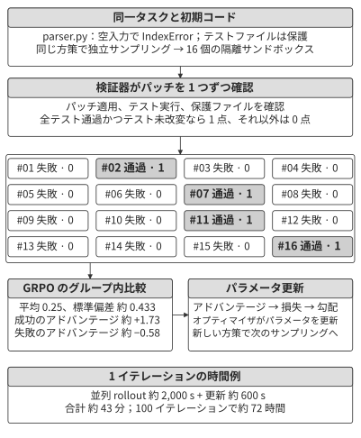

図8-13 で同じ問題を 16 回サンプリングすると、**訓練イテレーション（step）**は何回になるでしょうか。本節の数え方では、この 16 本の rollout は同じバッチに属します。第 $k$ ラウンドで現在の方策を使ってサンプリングし、報酬、アドバンテージ、勾配を計算して方策を 1 回更新します。第 $k+1$ ラウンドで初めて新しいパラメータを使ってサンプリングし直します。100 steps 訓練するとは、このようなイテレーションを約 100 ラウンド行うということです。

ここから訓練時間を見積もれます。複雑なタスク 1 件には数十回のツール呼び出しが含まれることがあります。同期型の訓練でバッチ全体の結果を待つ場合、16 本の並列な軌跡のうち最も遅いものがサンプリング段階の終了時刻を決めます。それに約 2,000 秒かかり、勾配の計算とオプティマイザの更新にさらに 600 秒かかるとすると、1 step に約 $2{,}000+600=2{,}600$ 秒、つまり 43 分が必要です。同じ所要時間で 100 steps を連続して訓練すれば、約 72 時間かかります。

PPO も GRPO もこのループに従い、主な違いは「何と比べるか」にあります。GRPO は同じ問題に対する複数の rollout を直接比べるので、追加の価値モデルは要りません。PPO は価値モデルを訓練し、軌跡の各ステップで「通常どれくらいうまくやれるか」を推定したうえで、現在の行動がその期待より良いかを判断します。これがステップごとの信用割当に必要なベースラインになります。どちらも代理目的関数のクリップなどの仕組みで、過大な更新を抑えます。DPO はこれらと異なり、あらかじめ集めた「良い回答—悪い回答」の選好ペアから直接学び、現在の方策にこの群の rollout をオンラインで生成させることはしません。

本章の事例はそれぞれ異なる訓練レシピを採用しています。AdaptThink は独自の制約付き目的関数を使います。GeneralPoints、V-IRL、ReTool は PPO を使い、そのうち前の 2 つでは価値モデルがアドバンテージの推定に関わります。SimpleVLA-RL と RLVP は GRPO を使います。

問題甲と問題乙をそれぞれ 4 回ずつ試し、甲はすべて正解、乙はすべて不正解だったとします。甲の 4 つの報酬はすべて 1、乙の 4 つの報酬はすべて 0 です。それぞれ群内の平均を引くと、どちらの群もアドバンテージは 0 になります。では、まだ何回か試す計算資源があるなら、どちらの問題に使うほうが有用な訓練サンプルを得られる見込みが高いでしょうか。

Never Give Up は、この選択をサンプリングの過程に組み込みました。甲がすべて正解なら、この群は飛ばします。乙がすべて不正解なら、一定の確率でもう 1 群を追加します。2 群目でようやく 1 回正解したとすると、訓練では 2 群計 8 本の回答をまとめて使います。正解が 1 つ、誤答が 7 つで、同じ問題について高低の異なる報酬が揃います。非同期のサンプリングにより、他の問題は通常どおり進み、乙の結果を待つ必要はありません。[^ch8-ngu]

[^ch8-ngu]: Michael Noukhovitch ら、*Learning to Solve Hard Problems in RL for LLMs by Never Giving Up*、2026 年。論文の追加サンプリングは訓練に使われます。すでに正解した問題も、その後の訓練で再び抽出されることがあります。

### なぜ LLM の RL ではオンポリシーが優先されることが多いのか

**Online（オンライン）**と **On-policy（オンポリシー）**は、別々の側面を表します。オンライン訓練は、実行中に環境と相互作用し続けてデータを生み出します。オンポリシー訓練はデータの出所に注目し、軌跡を生成する行動方策 $\mu$ が最適化対象の方策 $\pi_\theta$ と一致しているか、十分に近いことを求めます。非同期のクラスタはオンラインでサンプリングを続けられますが、worker がいくつかのチェックポイント分遅れていれば、返されるデータには方策の古さが含まれ、off-policy（オフポリシー）の成分になります。

筆者は、まずオンポリシーに近い訓練で安定したベースラインを作り、それからスループットを上げるために非同期のサンプリングや古いデータの再利用を導入することを勧めます。本章の PPO/GRPO のレシピでは、通常、各 step の開始時に最新の方策でサンプリングします。PPO はその後、同じバッチのデータでミニバッチの更新を何エポックも行うので、現在の方策はデータを生成した `old_policy` から徐々に離れていきます。確率比はこの変化を測り、クリップ付きの目的関数は過大な更新を抑えます。

方策勾配の目標は、現在の方策 $\pi_\theta$ のもとでの期待報酬に関わります。行動方策 $\mu$ でサンプリングしたデータを使うときは、まず同じ状態における行動の確率比を計算し、それをもとに重要度補正を組み立てます。

$$
\rho_t=\frac{\pi_\theta(a_t\mid s_t)}{\mu(a_t\mid s_t)}
=\exp\left(\log\pi_\theta(a_t\mid s_t)-\log\mu(a_t\mid s_t)\right).
$$

同じ接頭部の後で、サンプリング方策がある token を選ぶ確率が 0.2、現在の方策がその token に与える確率が 0.3 だとすると、このステップの確率比は 1.5 です。その token は古いサンプルでは少なめにしか現れていないので、現在の方策で見積もるときには、この種のサンプルの重みをそれに応じて上げます。サンプリングと訓練が同じ方策を使っているなら、パラメータ更新前の各ステップの確率比はすべて 1 です。

古い軌跡を再利用すれば、サンプリングと訓練を非同期に進められ、スループットが上がります。しかし 2 つの方策が離れるほど、少数のサンプルが非常に大きな重みを持ちやすくなります。軌跡全体を重み付けし直すときは、各ステップの確率比を掛け合わせる必要もあります。PPO は各行動の代理目的関数で余分な利得の一部を切り落とし、極端な確率比の影響を弱められますが、古いサンプルが一度も訪れていない状態は、新たにサンプリングしなければ見えません。これも、筆者が新しい軌跡を使う方を好む理由です。[^ch8-32]

#### 訓練と推論の数値的な差

大規模な LLM の強化学習では、通常 vLLM や SGLang などの推論エンジンでサンプリングし、FSDP や Megatron などの訓練システムで対数確率と勾配を計算します。両側が同じ重みを読み込んでいても、浮動小数点の精度、リダクションの順序、テンソル並列、バッチサイズ、KV Cache、融合カーネルの違いによって、同じ token について少しずつ異なる対数確率を算出することがあります。このとき、パラメータがまだ更新されていないのに $\rho_t$ はすでに 1 からずれ、訓練とサンプリングの間に数値レベルの方策の差が生じます。制御された実験では、token レベルのわずかな差でも訓練の崩壊を招きうることが分かっています。[^ch8-33]

サンプリング分布が変わると、2 つの行動の報酬がまったく同じでも、素朴な方策勾配はそのどちらかに偏ることがあります。サンプリング時には A と B がそれぞれ半分の確率で選ばれ、訓練時にはモデルが A を選ぶ確率がすでに 0.8 になっているとします。A を制御する logit について、A が選ばれたときの対数確率の勾配は $1-0.8=0.2$、B が選ばれたときは $0-0.8=-0.8$ です。どちらの行動も 1 点を得るなら、サンプリング時の確率で平均した勾配は $-0.3$ になります。2 つの選択は同じ得点なのに、更新は A の確率を押し下げてしまいます。

Score centering は、同じ接頭部における対数確率の勾配から、サンプリング分布のもとでのその平均を引きます。上の例で $-0.3$ を引くと、2 つの項はそれぞれ $0.5$ と $-0.5$ になり、同じ報酬が生む平均の更新はちょうどゼロになります。先の GRPO は一群の回答の報酬から平均を引きましたが、ここで中心化されるのは勾配です。[^ch8-sc]

[^ch8-sc]: Martin Marek、Max Ryabinin、*Score Centering Stabilizes Off-policy Reinforcement Learning*、2026。サンプリング方策が大きく遅れている場合は、KL 正則化で訓練方策と行動方策の距離を制約することもできます（arXiv:2611.21791）。

訓練側とサンプリング側の数値誤差は、長い系列に沿って増幅されることもあります。**対数確率の誤差 → 確率比のずれ → 長い接頭部での累積 → クリップとアドバンテージ重み付けの変化 → 勾配と有効サンプル数の変化**という流れです。たとえば 4,000 個の token の対数確率比がすべて同じ向きに $10^{-3}$ ずれていれば、算出される軌跡レベルの確率比は真の値の $e^{4000\times0.001}=e^4\approx54.6$ 倍になります。

早い段階の確率の変化はサンプリング結果そのものを変え、その後の状態を別の経路へ進ませることもあります。訓練中に観察できる信号としては、重要度比のスパイク、クリップされる比率の上昇、勾配や応答長の急変、報酬とエントロピーの低下があります。バッチサイズがリダクションの過程を変えると、同じ入力に対する数値結果も変わることがあります。これはバッチ不変性（batch invariance）が崩れた状態です。関連研究は、ここから生じる暗黙のオフポリシー効果を観察し、サンプリングと訓練の計算を揃えるか、方策の差を明示的に補正することで安定性を改善しています。[^ch8-34]

そのため筆者は、サンプリングと訓練の数値の一致を訓練開始前の中核的な確認項目とし、報酬曲線と合わせて継続的に監視します。「差を測る—構成を揃える—ずれを補正する—古さを抑える」の 4 段階で対処できます。

- **いかなるパラメータ更新よりも前に**、同じバッチの軌跡について、サンプリング側（sampler）と訓練側（trainer）が出す token の対数確率を比べ、$\rho_t$ の平均、分位点、最大値、近似 KL、クリップされた比率を監視します。これが最も直接的な on-policy の単体テストです。
- 重みを同期するときは、LoRA アダプター、トークナイザ、対話テンプレート、モデルのバージョン、位置エンコーディングの構成も合わせて揃えます。rollout には、サンプリング方策が生成時に与えた対数確率を保存し、後でそれをもとに確率比を計算します。
- サンプリングと訓練の精度、並列のレイアウト、重要な計算カーネルはできるだけ揃えます。それができない場合は、その差を明確に off-policy とみなし、重要度補正を採用して有効サンプル数を監視し、クリップされた比率と合わせて補正の効果を判断します。
- 更新後の方策で速やかにサンプリングし直し、各バッチのデータでの更新エポック数と、非同期のサンプリングが訓練から遅れるチェックポイント数を制限します。

## RL 環境：評価からシミュレーションへ

Agent の RL 訓練では、タスクを繰り返し実行する必要があります。コードの修正なら隔離されたコピーの中で何度でもやり直せますが、支払いは実際の口座の状態を変えてしまいます。訓練環境は、リセット可能な初期状態、並列化できるタスクのコピー、検証可能な結果を提供し、制御された条件のもとでモデルにさまざまな経路を探索させなければなりません。第 7 章ではすでに評価環境を紹介しました。訓練に使う場合は、長時間の実行、行動の副作用、大量の相互作用のコストも考慮する必要があります。筆者は大規模な訓練を計画する前に、まず環境構築に人手と予算を割り当てます。実際のフィードバック、状態のリセット、並列の隔離を実現するほうが、PPO や GRPO を組み込むよりも工学的なリソースを多く消費することが多く、環境構築のコストが訓練そのものを上回ることもあります。

### 環境：モデルが練習する場

環境は行動に応じて状態を更新し、新しい観測をモデルに返します。環境を構築するときは、次の 3 つの問いから始めるとよいでしょう。

- **相互作用はデプロイ時の場面に近いか。** カスタマーサポートのシミュレータは、ユーザーが情報を補足する、要望を変える、あいまいな言い方をするといった状況を網羅する必要があります。ツールのシミュレータは、本番でよく起きるエラーや遅延を返す必要があります。モデルはこうしたフィードバックを通じて実際の問題への対処を学びます。フィードバックが単調すぎると、方策はシミュレーションの決まりきったパターンに依存するようになります。
- **タスクを安定してやり直し、並列化できるか。** 各 rollout には独立した注文、ファイル、口座の状態が必要で、終了後には片付けて元に戻せなければなりません。ReTool のコードインタプリタのサンドボックスや AWorld の MCP サンドボックスは、どちらもこうした役割を担います。レート制限、費用、書き込みの副作用がある実際の API については、タスクの必要に応じてサンドボックスのアカウント、再生データ、模擬インタフェースを使えます。
- **結果をどう判定するか。** 環境の状態は報酬計算の重要な根拠です。たとえば返金タスクでは金額、注文の状態、承認の条件を確認でき、コードタスクではテストを実行できます。報酬設計については後で詳しく論じます。

**アルゴリズムの調整に手を付ける前に、筆者はまず、シミュレーション環境が実際のタスクに十分近いかを確かめることを勧めます。これは PPO と GRPO のどちらを選ぶかより重要です。** 忠実度、リセット可能性、検証能力が合わさって、モデルが相互作用から何を学べるかが決まります。まず少数のタスクでこの 3 つを一通り動かしてから訓練の規模を広げるほうが、たいてい問題を特定しやすくなります。

### モデルでツールと環境をシミュレートする

検索結果、ユーザーとの対話、複雑な業務状態は、どれもモデルを使って合成できます。モデルによるシミュレータは Agent の行動を受け取って次のフィードバックを生成し、リアルタイムの外部サービスへの依存を減らします。このやり方は、単一のツールからタスク環境全体にまで広げられます。

**第 1 の階層：ツールの戻り値を合成する。** ZeroSearch[^ch8-13]は LLM に検索エンジンの役を演じさせます。生徒がクエリを出し、シミュレータが検索結果を生成します。こうすれば、訓練が実際の検索 API の費用、レート制限、結果の揺らぎに依存する度合いを減らせます。さらにカリキュラム式の配置を採り、初期には品質が高く関連性の強い文書を返し、その後ノイズを徐々に増やして、生徒に不完全な資料から有用な情報を取り出す練習をさせます。研究で使われたモデルは、模擬検索環境で訓練を終えた後、実際の検索エンジンにつないでも良好な成績を収めました。

**第 2 の階層：環境の状態遷移をシミュレートする。** DreamGym[^ch8-14]は環境の動力学を推論型の経験モデルに蒸留しました。このモデルは現在の状態と Agent の行動を読み取り、次の状態とフィードバックを導き出し、オンライン RL に使う相互作用の軌跡を大量に生成することで、実際の環境へのアクセスを減らします。カスタマーサポートや営業のタスクでは、LLM にユーザーの役を演じさせ、追加の質問、情報の補足、要望の変化を模擬することもできます。τ-bench の系列はユーザーシミュレータを採用しており、同様の相互作用の枠組みは訓練にも使えて、練習と評価のタスクをそれぞれ担えます。

モデルによるシミュレータにも較正が必要です。カスタマーサポートのシミュレータがあいまいな質問をいつも正確に理解してしまうなら、方策は確認を練習する機会を失います。検索シミュレータがいつも正しい文書を返すなら、方策はノイズを見分ける経験を積めません。訓練は、シミュレータの採点の欠陥を突く行動を強化してしまうこともあります。筆者は混合方式を勧めます。大量の相互作用はモデルによるシミュレーションに任せ、定期的に実際の環境のタスクで方策の成績を確かめ、見つかった差をシミュレータにフィードバックするのです。こうして「合成された相互作用—実際のタスクでの評価—シミュレータの修正」という反復の過程ができます。

シミュレータが本当にツールの使い方を教えられるかは、どうすれば分かるでしょうか。小さなテストができます。同じ初期の注文について、まず照会し、次に変更を提出し、もう一度照会して、返された注文のフィールドが行動に応じて期待どおりに変わっているかを確かめます。その後で環境をリセットし、元の値が再び読めることを確認します。もっともらしい「変更しました」を生成するだけで、次のラウンドでその変化を照会できない環境は、注文を一度も変えていなくても、口のうまい方策に報酬を与えてしまいます。

### 環境、タスク分布、評価の隔離

訓練環境は、モデルが何を経験できるかを決めます。リセット可能な状態はやり直しを、隔離されたコピーは並列化を、明確な状態と検証規則は再現と採点を支えます。タスクには前述のデータ合成の手法をそのまま使えます。実際の業務ログからタスクの青写真を抽出し、身元情報を取り除き、架空の人物、注文、ファイル、初期状態を生成します。

訓練と評価ではタスク生成器と検証コードを再利用できますが、具体的なタスクは独立した集合に分けるべきです。SWE-Gym、τ²-bench、AndroidWorld の環境設計[^ch8-28]にならい、受け入れテスト、採点に必要な隠れた状態、参照解法は検証器の側に置き、Agent はタスクで取り決めたインタフェースを通じて観測を得ます。サンプリングを拡大する前に、少数の rollout で、タスクが完了可能か、検証器が有効な結果と無効な結果を区別できるかを確かめます。採点の偏りを早めに見つければ、方策が検証の抜け穴を突く機会を減らせます。

したがって環境工学の順序は、**タスクの青写真 → リセット可能な環境 → 結果の検証 → 訓練/評価の隔離 → 実際の相互作用による較正**であるべきです。前述のデータ合成は、こうした環境から有効な軌跡を選び出して SFT の示範にします。RL に入ると、現在の方策が環境の中で試行錯誤を続け、示範の外にある経路を探索します。

検証もスループットの予算に組み込む必要があります。Lean kernel、テストランナー、コンテナの実行は CPU とメモリを消費します。GPU の生成速度が検証速度を上回ると、タスクは検証待ちのキューに溜まっていきます。このときは検証器の worker を増やすか、検証の遅延を縮めるか、生成と検証のリソース配分を調整すべきです[^ch8-9]。

## シングルターンからマルチターンへ：タスク場面と信用割当

### マルチターンタスクの中心的な課題

図8-14 の左側は 24 点の計算です。モデルは回答の中で何ステップも推算できますが、どのステップも問題で与えられた 4 枚のカードを使うだけで、途中で新しい環境の観測はありません。右側はストリートビューでのナビゲーションです。交差点まで歩いて左折を選んで初めて、曲がった先の通りが見えます。次にどう進むかは、目の前の道路標識を見て判断し直さなければなりません。第 1 章と第 4 章で扱った ReAct は、まさにこうした相互作用を組み立てられます。モデルが行動を選び、ツールや環境がそれを実行し、新しい観測が次のラウンドの意思決定に入ります。

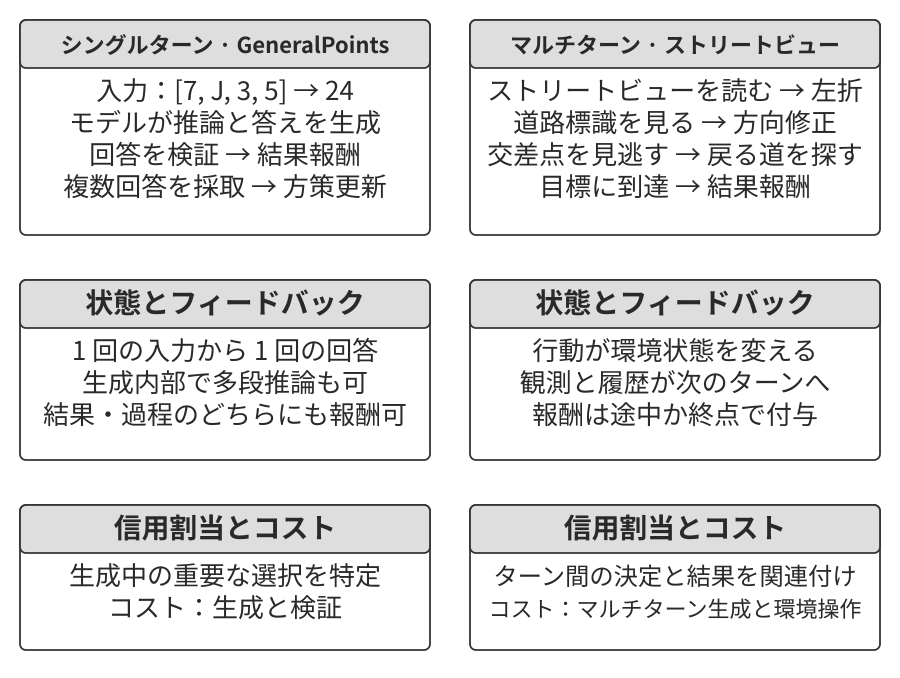

図8-15 では、Agent は第 3 ステップで交差点を通り過ぎ、第 4 ステップで道を外れたことに気づいて引き返し、第 5 ステップで目的地に着きます。終点の報酬はナビゲーション全体を肯定しますが、道を間違えたことと、すぐに引き返したことを区別していません。次にこの交差点に来たときは直接正しく進んでほしいですし、万一また間違えても、引き返すことは引き続き促したいところです。訓練の中で、それまでの各ステップが最終的な利得にどう寄与したかを見積もる問題を、**信用割当（Credit Assignment）**と呼びます。価値とアドバンテージの推定は、後から得られたリターンを利用できます。中間の行動を確実に検査できるなら、過程報酬を加えることもできます。第 4 ステップの引き返しは過程報酬では 0 点でも、終点にたどり着くのに役立っています。このステップの価値を見積もるときは、後から得られたリターンも算入しなければなりません。

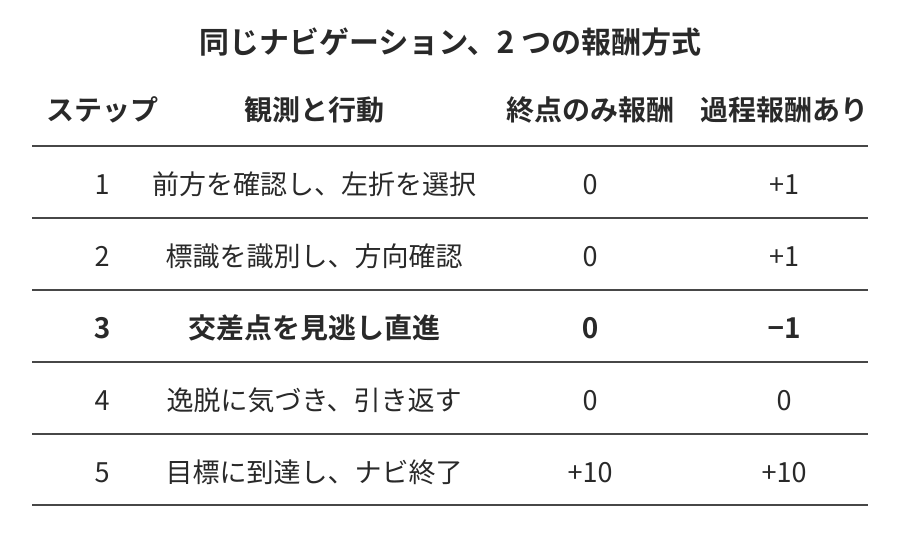

同じ問題はカスタマーサポートの通話でも起こります。たとえば、ユーザーが第 10 ターンで高評価をくれたとします。第 2 ターンで争点になっているのはどの請求かを確かめたこと、第 7 ターンで料金を説明したことは、どちらも役に立った可能性があります。最後の高評価 1 つだけでは、それぞれがどれだけ効いたのかを見分けられません。次の 2 つの実験では、訓練者がナビゲーションの行動を 1 ステップずつ検査できる場合と、ロボットが成功したかどうかをタスクの結果からしか判断できない場合を、それぞれ扱います。

> **実験 8-12 ★★★：V-IRL-VL――マルチターンの視覚ナビゲーション**
>
> V-IRL[^ch8-24] では、Agent は目の前のストリートビューに基づいて、一歩ずつ目的地を探さなければなりません。訓練にはニューヨークの経路を使い、テストでは別の都市に切り替え、道案内の言い方も画面の街並みも変えます。ルールの変化と視覚の変化という 2 種類の分布外テストのどちらでも、RL は SFT を明らかに上回りました。実験では価値ネットワーク付きの PPO を使っています。一歩進むごとにフィードバックを与えることが、長い経路の中でどの判断を残すべきかを見分ける助けになります。

> **実験 8-13 ★★★：SimpleVLA-RL――結果報酬のもとでの開かれた探索 `[拡張実験]`**
>
> SimpleVLA-RL は LIBERO のロボットタスクで成功／失敗の結果報酬を採用しています。各タスクについて 1 本の演示軌跡で SFT のコールドスタートを行い、その後 RL で成功率を 17.3% から 91.7% に高め、演示には現れない「押し切り」の動作を生み出しました。この結果をストリートビューのナビゲーションと照らし合わせてみましょう。途中のどのステップで間違えたかを確実に判定できるなら、その場でフィードバックを与えて学習を速められます。タスクを完了する進め方がいくつあるのかまだ分からないなら、まず結果に応じて報酬を与えれば、モデルが別の経路を試す余地を残せます。人間の演示に含まれる動作の順序を早々に報酬の要件として書き込むと、「押し切り」のような新しい方策の得点を押し下げてしまうおそれがあります。

### ツール呼び出し：相互作用の中で外部の能力の使い方を学ぶ

外部ツールにつなぐと、モデルは検索、コードの実行、ファイルの変更、データベースの照会を選べるようになり、タスクに応じて複数の API を組み合わせることもできます。Harness は呼び出しの検証とスケジューリングを担い、ツールは環境の中で実行されて観測を返します。図8-16 は、1 回のタスクの中での意思決定と、タスク終了後の訓練を分けて描いています。右側の矢印をたどると、ツールの結果は現在のタスクに戻り、モデルはそれを使って次のステップを決めます。下へ読み進めると、タスクが終わってから初めて、訓練プログラムが軌跡全体を使って報酬を計算し、パラメータを更新し、次のラウンドのサンプリングで新しい方策が使われます。1 回のタスクで複数のツールを続けて呼び出すときは、前の呼び出しが返した結果が、後の呼び出しの引数に影響します。

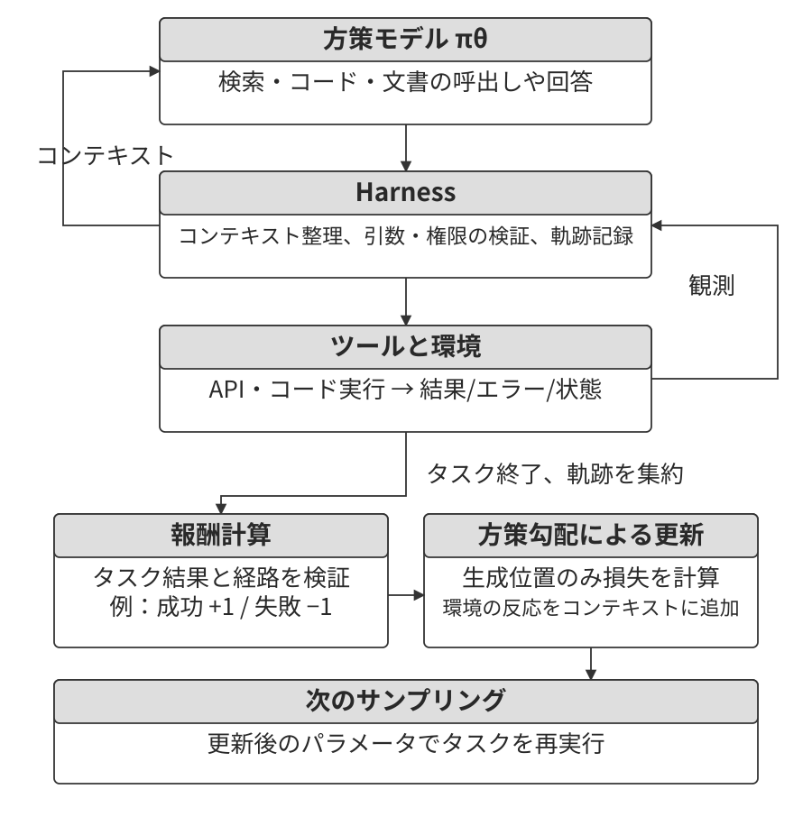

Search-R1[^ch8-25]は、いつ検索するか、どんなクエリを出すかをモデルに決めさせ、その結果を踏まえて推論を続けるよう訓練します。ReTool はコードインタプリタを同じ種類のループに組み込み、モデルはコードの実行の段取り、戻り値の理解、エラーに応じた修正を学びます。AWorld-train は MCP の複数ツールのサンドボックスにまで広げたもので、モデルはツールを選び、呼び出しの間の依存関係を処理しなければならず、訓練システムには環境をリセットし、軌跡を再生する能力も求められます。

ツールの軌跡では、モデルが生成した token と環境が返した token を区別する必要があります。方策の損失を計算するときは、モデルが生成した推論、呼び出しの引数、回答といった行動だけを損失に含め、環境のフィードバックに当たる位置はマスクします。フィードバックは文脈として後続の計算には参加し続け、モデルが次に何をすべきかを判断する助けになります。たとえばインタプリタがエラーを返したとき、訓練で強化したいのは、その後モデルがコードをどう直すかです。エラーのテキストまで方策の損失に含めると、更新に「環境の出力を生成する」という目標が混ざり、モデルが実際に担う意思決定からずれてしまいます。

> **実験 8-14 ★★★：ReTool――コードインタプリタで数学の問題解決を強化する**
>
> 図8-17 は、2 次方程式を使って、テキストによる推論、コードの生成、インタプリタのフィードバックがどのように交互に進むかを示しています。
>
> 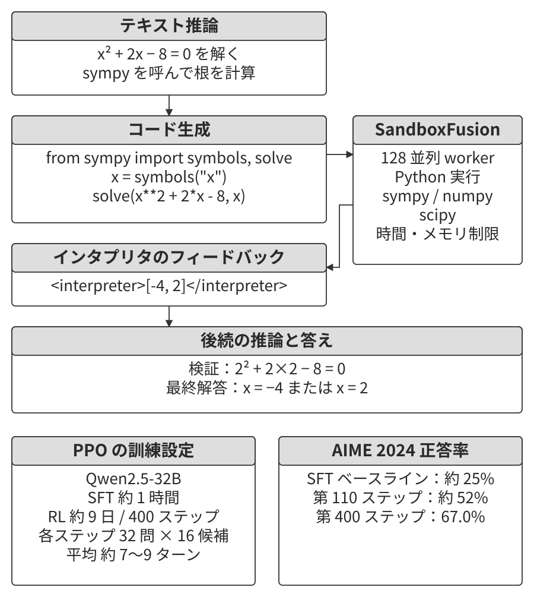
>
> ReTool は SFT によるウォームアップの後、テキストの思考、コードの実行、インタプリタのフィードバックを交互に織り込んで PPO で訓練します。モデルは、いつコードを実行する価値があるか、エラーが出た後にどう直すべきかを徐々に学びます。ここでは DAPO-Math-17k の訓練データを使い、方策の更新には標準的な PPO を使っています[^ch8-26][^ch8-27]。
>
> 訓練の結果、モデルの AIME 2024 での正答率は約 25% から 67.0% に上がりました。テキストだけの RL と比べて、コードのフィードバックは、モデルが正確な計算と誤りの訂正をより速く学ぶ助けになりました。

> **実験 8-15 ★★★：AWorld-train――サンドボックスの中でツールの使い方を学ぶ**
>
> 図8-18 の上半分を一周すると、モデルは 1 回のツール呼び出しの結果を受け取り、さらに試行を続けられます。次に下半分を一周すると、このバッチのタスクはすでに終わっており、訓練プログラムは報酬付きの軌跡を受け取ってパラメータを更新し、次のバッチのタスクで初めて新しい方策が使われます。
>
> 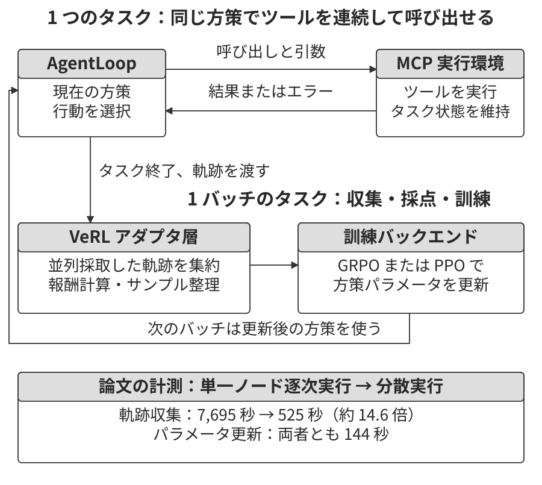
>
> GAIA 環境には 26 個の MCP サーバーと 126 個のツール関数があり、Playwright でウェブページを操作したり、PDF、Word、スライドから内容を抽出したり、音声を文字起こししたり、文字を認識したり、E2B のサンドボックスでコードを実行したりできます。Excel ツールは数式、グラフ、ピボットを含む 29 項目の操作を提供し、知識検索では Wikipedia、arXiv、Wayback にもアクセスできます。サンドボックスをリセットすれば、同じ状態から試し直すことも、以前の軌跡を再生することもできます。
>
> 図中の計時は論文の収集時の対照から取ったものです。付属の実験は、別に 4B モデルの訓練構成を 1 組示しています。Qwen3-4B-Thinking-2507、A100 8 枚、文脈の上限 131K、相互作用は最大 32 ターン、バッチサイズ 32、1 問につき 16 本の軌跡をサンプリングし、GRPO で更新し、学習率は 1e−6 です。

ツールが結果を返したとき、訓練プログラムはどのステップに報酬を与えるべきでしょうか。呼び出しが 1 回成功しても、それはツールの実行が成功したことを示すだけです。このステップがタスクを前に進めたかを判断するには、検証器でそれが引き起こした変化を確かめ、そのうえでモデルにどんな報酬を与えるかを決めなければなりません。

## 報酬設計：タスク目標を学習信号に変える

返金の軌跡が 2 本あり、最終的に返した金額は同じなのに、一方は必須の本人確認を飛ばしていたとします。最終的な残高だけを読み取るなら、両者は同じ点数になります。ユーザーが委ねた要求の全体を学習信号に変えるには、まず誰が結果を確かめられるか、どのステップで証拠が得られるか、モデルにどんな情報を返す必要があるかを決め、そのうえで経路上の権限や手続きの制約を単独で検証できるかを確認します。

### 報酬はどこから来るか：ルール、人間の選好、モデルによる評価

自動で判定できるタスクについては、筆者は**検証可能な報酬に基づく強化学習（RLVR）**を優先し、受け入れの要件をそのままプログラムとして書きます。数学の問題なら答えを照合でき、コードのタスクならテストを実行でき、返金のタスクならデータベースの金額と注文の状態を確認できます。合格を 1、不合格を 0 とすれば、最も単純な結果報酬が得られます。ルールが明確で実行を再現できるので、採点の差を特定しやすくなります。一方で、検証器の網羅範囲が、訓練が実際にどの要件を最適化しているかを決めます。

**人間のフィードバックによる強化学習（RLHF）**は、人の選好を訓練信号に変えます。InstructGPT[^ch8-4]はまず回答に対する人手の比較を集めて報酬モデルを訓練し、その後 PPO で方策を最適化しました。報酬モデルが学ぶのは有限のサンプルに含まれる選好なので、モデルの評価点を追い求め続けると、その偏りが増幅されることがあります[^ch8-5]。訓練では、SFT の参照モデルに対する KL 正則化を加えて方策のずれを抑えることがよくあります。DPO[^ch8-6]は「良い回答—悪い回答」の選好ペアを直接使って方策を最適化し、報酬モデルを別途訓練する手順を省きます。

オープンなタスクでは、モデルに評価の理由と点数を出させることができます。**生成型報酬モデル（GRM）**が生成する診断は、示範の選別、選好ペアの構築、その後の修正の指針にも使えます。DeepSeek-GRM[^ch8-23]はタスクに応じて評価の原則を生成し、それに基づいて批評と採点を行います。オンライン RL で評価行動を改善し、複数回のサンプリングと補助的な報酬モデルで判断を集約します。

評価指標とタスク目標の間のずれも、モデルの行動に影響します。**Reward hacking** とは、方策が採点ルールやその実装の欠陥を突いて高得点を得ることを指します。長期にわたる Agent では、**reward seeking** と呼ばれる現象もあります。モデルが自分の推測した採点方法に合わせて行動し、たとえば通りやすい検査を自分で選び、それが通ったらタスクを終えてしまうのです[^ch8-29]。この例が示すとおり、受け入れ条件はユーザーの目標から出発し、実際の成果物を網羅すべきです。モデルが自分で選んだ指標だけを確認していると、まだ終わっていない要件を見落としやすくなります。

返金タスクの報酬を設計するときは、まず人手で書いた 2 本の軌跡を検証器に通してみます。甲は注文を確かめ、返金のインタフェースを呼び出し、ユーザーに受領情報を復唱します。乙は「返金は完了しました」と言うだけです。両者が同じ点数なら、採点器が読んでいるのが最終の返信なのか、インタフェースの受領情報なのか、注文の状態なのかを、まず調べます。この小さな反例だけで代理指標の問題を暴けるので、バッチ全体で訓練して初めてモデルが早々に成功を報告するようになったと気づく、という代償を払わずに済みます。

### 報酬はいつ与えるか：結果と過程

**結果報酬**は 1 つの episode が終わった後にタスクの成績を評価します。結果の評価にモデルを使う場合、そのモデルを **ORM（Outcome Reward Model）**と呼びます。SimpleVLA-RL の成功／失敗の報酬は、方策に最終目標を軸としてさまざまな行動系列を探索させます。こうした信号は定義しやすいのですが、長い軌跡が失敗した後、どの行動が失敗を招いたかを見分けるには、モデルはさらに多くの試行を重ねる必要があります。これが、疎なフィードバックがサンプル効率に影響する理由の 1 つです[^ch8-8]。

Coding Agent の早すぎる終了を例にとります。モデルが完了の宣言を提出すると、Harness は隔離されたワークスペースで保護された受け入れテストを実行します。テストは実際のファイルと環境の状態を読み取り、合格なら正の報酬、不合格なら負の報酬を与えます。こうすれば、完了の宣言が外部の検証を引き起こし、タスクの結果は成果物によって決まります。評価の際は 2 組のタスクを別々に用意します。1 組はまだ作業が残っているもので、早すぎる終了の率を測るのに使います。もう 1 組はすでに完了しているもので、モデルが適切なタイミングで締めくくれるかを確かめるのに使います。

**過程報酬**は、中間のステップにフィードバックを与えます。たとえば本人確認、引数の選択、ナビゲーションの行動、推論のステップを評価します。過程の評価に使うモデルを **PRM（Process Reward Model）**と呼びます。OpenAI の『Let's Verify Step by Step』[^ch8-7]は、数学の推論におけるステップごとの検証を研究しました。過程の信号はモデルが誤りの箇所を特定する助けになりますが、注釈と検証のコストも増やします。ある 1 つの解き方の順序を唯一の正しい経路とみなすと、他の有効な方策の報酬を押し下げてしまいます。そのため筆者は、本当に検証できる中間の出来事にだけ過程の信号を加え、モデルが複数の有効な解法を探索し続けられるようにしています。V-IRL-VL（実験 8-12）はステップごとのナビゲーションのフィードバックを使い、SimpleVLA-RL（実験 8-13）は終点の報酬を使っており、2 種類のタスクがフィードバックの粒度について異なる選択をしていることを示しています。

実践では、まず結果報酬のベースラインを作り、それから本人確認の完了やテストの合格といった中間の出来事に過程の信号を加えるとよいでしょう。長さが有限のマルチターンタスクでは割引因子を $\gamma=1$ とし、終点の報酬が前へ伝播するときに同じ重みを保つようにできます。PPO は価値推定とアドバンテージの計算によって、フィードバックを各ステップの行動に結びつけます。軌跡レベルのアドバンテージを使う GRPO は、通常、同じアドバンテージの重みでその軌跡の生成 token すべての方策損失を計算します。

### 報酬はどれだけの情報を表すべきか：スカラー、ベクトル、生成型の診断

報酬がいつ現れるかはフィードバックの密度を決め、報酬が何を含むかは表現の形式を決めます。スカラーは全体の成績を要約します。「短い理由＋点数」という半スカラーの形式は採点の根拠を補います。ベクトルは正確さ、完全さ、コストなどの観点を別々に表します。生成型の診断は問題と修正の方向を具体的に説明し、複数回のサンプリングで集約することもできます。

- 確定した答えや受け入れテストがあるなら、二値のスカラーから始められます。
- 品質の目標が複数あるなら、それぞれ採点したうえで、業務の要件に応じて重み付けするか制約を設けられます。
- 評価に文脈を踏まえた解釈が必要なら、診断を生成し、事実の照合と人手の抜き取り検査で較正できます。

たとえばカスタマーサポートのタスク 1 件について、解決の状況、対話のターン数、本人確認を終えたかどうかを同時に記録できます。3 つの観点はそれぞれ効果、コスト、手続きの要件に対応します。これらを訓練に使う前に、採点が安定しているか、同じ群の軌跡の行動を区別できるかを確かめるべきです。筆者は少数の信頼できる指標から始め、1 項目ずつ検証してから観点を増やします。検証されていない採点項目はどれも、実際のタスクを改善しないまま、モデルを新たな代理指標に沿って最適化させてしまうおそれがあります。

### 経路の制約と RLVP

タスクを完了する過程には、独立した行動の要件があることもあります。営業時間内にユーザーへ連絡する、本人確認を終える、保護されたファイルを変えない、といったものです。RLVP（Reinforcement Learning with Verified Penalty）[^ch8-9]は結果報酬と検証可能な経路のペナルティを組み合わせるもので、その原則は**結果に報酬を、経路にペナルティを**です。経路のルールは環境の中で観測できる行動によって発動し、成果物の完全さは引き続きタスクの受け入れ検査が確認します。

2 回の修正がどちらも受け入れに合格したものの、一方は先に読むべきファイルを直接上書きしていたとします。ツールの記録を調べれば、この違反行動は特定できます。しかし、それより前の各ステップが最終的な成功にどれだけ寄与したかを判断するのは、はるかに難しいことです。最も単純なやり方は、軌跡全体に 1 つの点数 $R=O+\beta\Phi$ を付けることです。$O$ はタスクの得点、$\Phi$ は違反による減点や検証可能な進展を集計したもの、$\beta$ は両者の相対的な重みを決めます。こうすれば 2 回の修正を区別できますが、同じ軌跡の中のどの行動にも同じ信号が割り当てられます。

どのターンで違反したかが分かっているなら、減点をそのターンに残すこともできます。付属の実装にある 2 本のテスト軌跡を見てみましょう。甲はタスクを完了しましたが、第 2 ターンで違反しました。乙はタスクを完了できませんでしたが、2 ターンとも規則を守りました。2 本の軌跡の結果点はそれぞれ 1 と 0 で、群の平均を引くと +0.5 と −0.5 になります。各軌跡には 2 ターン分の行動があり、各ターンが 10 個の行動 token を占めます。実装の `c2` 構成では、2 種類の信号を別々に数えます。

```python
outcome_weight = (1 - 0.5) / 40  # 结果信号分摊到这批的全部 40 个动作 token
penalty_weight = -0.3 / 10       # 违规扣分只分摊到甲第二轮的 10 个动作 token
first_turn = outcome_weight
second_turn = outcome_weight + penalty_weight
```

甲の第 1 ターンでは、各行動 token に割り当てられる重みは +0.0125、第 2 ターンでは −0.0175 です。こうして、同じ 1 回の成功した修正の中の 2 つの行動が、逆向きの訓練信号を受け取れるようになります。こうした重みが方策損失に入ってから、オプティマイザはそれに基づいてパラメータを更新します。カスタマーサポートのタスクに置き換えても、ツールの記録からどのターンで承認の確認を飛ばしたかを特定できさえすれば、同じ方法で減点を割り当てられます。

経路の信号の役割は、群内の差から理解できます。GRPO のある群の軌跡の結果報酬が同じなら、その報酬に基づいて計算したアドバンテージはゼロになります。その中で違反の回数が異なるなら、経路のペナルティが新たな比較の根拠を与えます。部分的な進展に対する報酬も同じ条件に従います。少なくとも程度の異なる進展がモデルからサンプリングされて初めて、区別する働きが生まれるのです。

経路の報酬を設計するときは、4 つの規則に従うとよいでしょう。明確な違反行動にペナルティを科すこと。タスクの結果報酬を残すこと。制約された行動には到達可能な、規則に沿った経路を用意すること。繰り返し実行できる検証規則を使うこと。たとえば操作のたびに単独でペナルティを科すと、モデルはその場にとどまるよう促されます。タスク成功の報酬を残して初めて、作業を完了する方向にも同時に押し出せます。基盤モデルが規則に沿った経路をなかなか生成できないなら、まず少数の示範で出発点を作り、その後の訓練で経路の整形への依存を徐々に減らせます。

> **実験 8-16 ★★★：RLVP――結果に報酬を、経路にペナルティを**
>
> 実験では GRPO に結果報酬 $O$ と経路の信号 $\Phi$ を加え、結果報酬だけの場合と比べました。TerminalBench の代理タスクでは違反の回数が 3.71 から 0.66 に下がり、成功率はほぼ横ばいでした。miniF2F の代理タスクでは、到達可能な部分進展の報酬を加えると、成功率 0.9 に達するのに必要なイテレーションが 7.0 から 4.4 に減りました。
>
> ソフトウェア修正のタスクは、信号の到達可能性の役割も示しています。すべての rollout がどのテストも通過できないとき、合格したテストの数で計算する進展の報酬は常に同じになり、群内の差を増やせません。

平均の違反回数が 0.66 まで下がったことは、モデルが規則に沿った経路をより頻繁に選ぶようになった一方で、まだときどき違反することを示しています。必ず守らなければならない制約については、ツールを実行するときに権限も確認する必要があります。

## 蒸留：サンプル効率を高める

Agent の rollout 1 回には、多くの場合、モデルの生成とツールの実行が何ターンも含まれます。**サンプル効率**を高めるとは、より少ない環境との相互作用で目標の成績に達することです。訓練ステップ数、GPU 時間、環境の呼び出し量はそれぞれ異なるコストを表すので、タスクと合わせて見る必要があります。たとえば本章の ReTool の事例では、SFT の訓練は約 1 時間、RL は約 9 日かかりました。そのうち繰り返しのサンプリングとツールの実行が、大量のリソースを占めています。

終点の報酬を採用すると、軌跡 1 本全体で成否の点数が 1 つしか得られないことがあります。業務ツールがすでに「クレジットカードの下 4 桁が必要です」と示しているのに、Agent がこの情報を見落とし、最終的に報酬 0 を得たとします。訓練では、失敗の原因がフィールドの欠落なのか、ツールの引数の誤りなのか、その後の操作の誤りなのかを、複数回の試行から見分けなければなりません。教師がこの軌跡の上で 1 ステップずつ監督を与えられるなら、同じ 1 回の環境との相互作用から、より細かい学習信号が得られます。

### オンポリシー蒸留：1 回の rollout から密な監督を得る

**オンポリシー蒸留（On-Policy Distillation）**では、生徒が軌跡を生成し、教師は生徒が実際に生成した接頭部の上で監督を与えます。Thinking Machines Lab は 2025 年の研究で、この訓練方式を体系的に示しました[^ch8-10]。3 種類の手法を理解するには、「誰が訓練の状態を生み出すか」と「誰が学習信号を与えるか」を分けて見るとよいでしょう。

| 手法 | 軌跡や状態を生み出すのは誰か | 主な学習信号 |
| --- | --- | --- |
| SFT／オフポリシー蒸留 | 人間または教師の示範 | 目標の答えに対する token ごとの監督 |
| On-policy RL | 現在の生徒 | 結果報酬または過程報酬 |
| On-policy Distillation | 現在の生徒 | 生徒の接頭部に対する、教師の token ごとの確率による評価 |

たとえば、教師の示範はいつも先に注文を照会してから返金を申請しますが、生徒は先に返金を申請してしまい、「注文番号がありません」というエラーを受け取るかもしれません。オンポリシー蒸留では、生徒がすでにたどり着いたこの状態を教師に評価させ、どう情報を照会し直すかを指導させます。こうして訓練は、生徒自身の誤りとそこからの回復の経路まで網羅できます。

実装方法の 1 つは、生徒が生成した接頭部の上で、生徒と教師の間の逆 KL を最小化することです。

$$
D_{\mathrm{KL}}(\pi_\theta\Vert\pi_T)
=\mathbb{E}_{a\sim\pi_\theta(\cdot\mid h)}
\left[\log\pi_\theta(a\mid h)-\log\pi_T(a\mid h)\right],
$$

ここで $h$ は現在の接頭部、$a$ は次の token、$\pi_\theta$ と $\pi_T$ はそれぞれ生徒と教師の分布を表します。教師がより適切だと考える token ほど、有利な訓練信号を受け取ります。実装では完全な分布を比べることもできますし、生徒がすでにサンプリングした token について教師の対数確率を問い合わせ、token ごとの最適化信号を組み立てることもできます。

「まず API を照会し、次に戻り値を解析する」を例にとります。ある位置の候補「照会」と「呼び出し」がそれぞれ 1 つの token に対応し、教師がそれらに与える確率がそれぞれ 80% と 15%、その他の候補が合計 5% だとします。これは最終的な成否よりも細かい選択の根拠になります。1 本の軌跡にモデルが生成した token が $T$ 個含まれるなら、約 $T$ 個の位置で監督が得られます。ツールが返した内容は引き続き文脈として使い、方策の損失ではマスクします。

以下では、完全な分布を揃える形でこの過程を表します。

```python
trajectory = rollout(student, task)
loss = 0
for prefix in model_generated_positions(trajectory):
    target = stop_gradient(teacher.distribution(prefix))
    loss += KL(student.distribution(prefix), target)
update_student(loss)
```

生徒が探索を担い、教師が多くの位置で監督を与えます。追加のコストは主に教師の推論から生じます。環境との相互作用が高価で、教師が生徒を確実に指導できるなら、筆者はまずオンポリシー蒸留を比較し、1 回の環境呼び出しからより多くの有効な学習信号を得るようにします。対象言語、ドメイン知識、基本的な動作が十分に身についていない生徒については、まず Mid-training と示範による訓練で有効な出発点を作り、それからオンポリシー蒸留に進むとよいでしょう。

サンプリングと訓練の一致も同じく重要です。サンプリングエンジンは方策 $\mu$ に従って軌跡を生み出し、訓練エンジンは $\pi_\theta$ に従って損失を計算するので、両者の差は訓練の状態の分布を変えてしまいます。

Thinking Machines Lab の数学タスクの対照は、およそ 1 桁の訓練効率の向上を示しました。マルチターンの Agent でもこの比較方法をそのまま使い、タスクの成功率、環境の呼び出し量、教師の計算コストを同時に記録できます。生徒が環境の中で出会う状態と、教師が信頼できるフィードバックを与えられるかどうかが、合わせて利得を決めます。

筆者と共同研究者は、「時間感覚」のタスクで DPO、4 種類の RL のレシピ、オンポリシー蒸留を比べたこともあります[^ch8-11]。前の各レシピは、それぞれ報酬の疎さ、目標のずれ、rollout の形の不一致、方策の崩壊といった問題に突き当たりました。凍結した Qwen3-32B を教師に切り替え、生徒自身のマルチターンの軌跡の上で token ごとに揃えると、訓練は滑らかに収束し、4 つの条件での合格率は同じ出所の SFT ベースラインを 23〜47 ポイント上回りました。この経験から、筆者は 1 回の相互作用が提供する信号の密度をより重視するようになりました。同じ相互作用の中の中間的な意思決定がどれも学習に参加できれば、既存の軌跡の価値をより十分に活かせます。

数学の教師は推論が得意で、コードの教師はプログラムの修正が得意だとしたら、1 人の生徒に両者の長所を学ばせるにはどうすればよいでしょうか。複数教師のオンポリシー蒸留（MOPD）は上記の訓練過程をそのまま使い、固定の教師を、問題の領域に応じて選ぶ教師に置き換えるだけです。生徒がコードの問題を解くときは、途中で回り道をしていても、自分がすでに書いた接頭部をコードの教師に渡し、次のステップの確率分布を受け取ります。数学の問題の番になれば、数学の教師が生徒の解答過程の中で指導します。各領域の教師はあらかじめ独立に訓練しておき、蒸留の段階では教師のパラメータを固定できます。デプロイ時には生徒を 1 つ動かすだけで済みます。[^ch8-mopd]

ここには実際的な条件が 2 つあります。第一に、上の式で token ごとの KL を計算するには、生徒が与えた接頭部の上で、対応を取れる教師の確率を得られなければなりません。教師が書いた完全な答えが数件あるだけなら、SFT には使えても、この損失を計算するには足りません。第二に、受け入れの際には領域ごとの成績を分けて見る必要があります。生徒の数学の成績が上がり、コードの成績が下がったとき、上昇した総合平均は後者の後退を覆い隠しがちです。

[^ch8-mopd]: Wenhan Ma ら、*MOPD: Multi-Teacher On-Policy Distillation for Capability Integration in LLM Post-Training*、2026 年。論文は領域ごとに訓練した教師を使い、生徒自身の軌跡の上で蒸留しています。

### オンポリシー自己蒸留：追加の文脈で教師を作る

チームにこの領域が得意なモデルが 1 つしかないなら、誰が教師になるのでしょうか。同じ問題をそのモデルに 2 回渡せばよいのです。1 回目はデプロイ時の条件どおりにユーザーの質問を与え、2 回目はさらに標準解答、専門家の示範、ドメインの文書を与えます。2 回目の解答で増えた情報を、1 回目の条件のもとにいる生徒の指導に使えます。

**オンポリシー自己蒸留（On-Policy Self-Distillation、OPSD）**[^ch8-15]は、同じモデルに 2 つの役割を担わせます。生徒はタスクの入力しか見ず、教師は標準解答や検証済みの解答も追加で見ます。生徒が軌跡を生成した後、教師はこうした特権情報を踏まえて各接頭部を評価し、その監督を生徒に返します。

たとえば、生徒が数学の問題を解いている最中に、教師はすでに正解を知っています。教師はそれをもとに生徒の現在の推論の方向を評価でき、生徒は問題文だけという条件のもとで自分の生成を改善することを学びます。次の擬似コードは、追加の文脈と勾配の遮断がどこにあるかを示しています。

```python
trajectory = rollout(model, task_without_answer)
loss = 0
for prefix in model_generated_positions(trajectory):
    privileged_prefix = add_verified_answer(prefix)
    target = stop_gradient(model.distribution(privileged_prefix))
    loss += KL(model.distribution(prefix), target)
update(model, loss)
```

特権情報は訓練時の教師の分岐にだけ入り、生徒の入力と評価の入力はデプロイ時と同じに保ちます。擬似コードに沿って 2 つの情報の通り道を確認できます。標準解答は教師の接頭部を組み立てる行にだけ入るので、デプロイ時に生徒がそれを見ることはありません。教師の出力は勾配停止の処理を経るので、このステップでは生徒の分岐だけが 2 つの分布の差に応じてパラメータを更新します。次のラウンドで更新後のモデルを使うときは、教師の判断もそれにつれて変わることがあります。こうして同じモデルが、訓練側のより豊富な情報を利用し、自分の実際の生成に監督を与えられるのです。

特権情報は、人手の示範や選別したドメインの文書から得ることもできます。選ぶときは、それが教師の判断を改善するかを確かめるべきです。情報を得た教師が生徒の誤りをよく見抜けるほど、蒸留の信号は有用になります。訓練の過程では、あらかじめテスト用に取っておいたサンプルで既存の能力と生成のスタイルも確認する必要があります。Purified OPSD などの研究は、正則化による制約でモデルが元の推論スタイルを保つのをさらに助けています[^ch8-16]。

## 問題事例からポストトレーニングへ

第 7 章では、本番の問題を再現可能なタスク、失敗帰因、評価基準に整理しました。これらの材料はポストトレーニングにも使えます。完全なタスクは相互作用の環境を、誤りが起きる前の軌跡の接頭部は意思決定の文脈を提供し、検証器は新たに生成された行動を検査します。表 8-5 は、これらの材料と訓練手法の対応関係を示しています。

表8-5 第 7 章の評価材料とポストトレーニングでの使い方

| 第 7 章の材料 | 第 8 章での訓練における使い方 |
| --- | --- |
| エンドツーエンドのタスクと検証器 | RL のサンプリングタスク、検証可能な報酬、棄却サンプリングのタスクプール |
| 軌跡の接頭部とその後の行動 | DPO の選好ペア、SFT の意思決定の示範、オンポリシー蒸留の教師入力 |
| 失敗の位置と誤りの種類 | 過程評価のラベル、検証可能な経路ペナルティのルール |
| Rubric の各項目の得点と人手で注釈した標準解答 | 多次元の報酬、生成型報酬モデルの訓練と較正 |

履歴の接頭部は、続きを行うタスクの出発点として使えます。オンポリシー蒸留に使うときは、まず現在の生徒にこの出発点から生成を続けさせ、次に生徒が実際に生み出した接頭部を教師に評価させます。ツールを実行する必要があるなら、対応する環境の状態も同時に復元します。こうして、第 7 章の局所的な意思決定の評価が、本章のサンプリングと訓練の流れにつながります。

訓練に使うタスクは、hold-out の評価タスクと分けておく必要があります。両側でインタフェースと検証ロジックを共有しつつ、それぞれ独立したタスクインスタンスを使います。タスクをまたぐ汎化を調べる必要があるなら、タスクテンプレートや業務の種類で分けることもできます。以下では 3 つの例を使って、この変換をどう行うかを説明します。

### 事例 1：Coding Agent の早すぎる終了

Agent がまだテストを実行していないのに完了を宣言する、3 つの要件のうち 2 つだけ直して提出する、何度か失敗しただけで諦める。これらはいずれも早すぎる終了に当たります。本番では、ユーザーによる訂正、低評価、軌跡のレビューからこうした事例を集められます。たとえばユーザーが「まだテストを走らせていませんね」と指摘したなら、軌跡をたどって、その時点のタスクの状態、手元にある検証の証拠、モデルの完了宣言を確かめられます。

原因を分析するときは、まずモデルが「完了しました」と言おうとしているその瞬間で軌跡を止め、そこから遡って、要求を読み落としていないか、コードを間違って直していないかを確かめます。ここから 2 種類の訓練材料が得られます。完全なタスクはモデルに作業をやり遂げさせる訓練に使い、意思決定の接頭部は証拠に基づいて続行か終了かを選ばせる訓練に使います。

**完全なタスクには結果報酬をつなげられます。** モデルが結果を提出した時点で保護された受け入れテストを実行し、合格なら +1、不合格なら −1 を与えます。テストは実際の成果物を網羅し、モデルは通常の開発でのテストを通じてフィードバックを得られ、最終的な受け入れは訓練環境が実行します。

**意思決定の接頭部からは選好ペアを作れます。** 同じ文脈の中で、選好されないサンプル（`rejected`）は証拠を欠いた完了の宣言、選好されるサンプル（`chosen`）は必要なテストの実行を続け、欠けている要件を照合し、残りの作業を完了するものです。教師にその後のやり方をいくつか書かせ、検証器で示範にふさわしいものを選び出せます。サンプルが足りなければ、タスクの種類、欠けている検証項目、完了の言い回しを変えて、数百件の選好ペアに広げます。その後 LoRA で DPO を行い、適量の汎用タスクを混ぜて行動の網羅を保ちます。

**評価では、未完了のタスクと完了済みのタスクを両方確かめます。** 一方の群のタスクは一部しか終わっておらず、モデルが作業を続けるかを観察するのに使います。もう一方の群はすでに片付いており、適切なタイミングで締めくくれるかを見ます。同時に汎用的なツール呼び出しやその他のタスクも抜き取りで確認し、狙いを絞った訓練が既存の能力に影響していないかを観察します。早すぎる終了の率だけを下げると、モデルは毎回検証の続行を選び、すでに終わった作業まで一向に締めくくらなくなるかもしれません。その場合、片付いている群のタスクで、余計なツール呼び出しや待ち時間が見えるはずです。

> **実験 8-17 ★★：「早すぎる終了」の問題事例から DPO による修正へ**
>
> 実験は「失敗帰因—意思決定の接頭部—選好ペア—LoRA 訓練—hold-out 評価」を 1 本の流れにつなぎ、7B モデルで訓練します。
>
> データには写実的な問題事例 24 件が含まれ、テストを走らせずに完了を宣言する、複数の目標のうち一部しか完了しない、受け入れ条件を満たしていない、エラーに遭って諦める、の 4 種類を網羅し、失敗するテストを削除する報酬ハッキングの変種も含みます。さらに、まだ作業が残っている問題 12 問と、すでに終わっている問題 8 問を評価専用に取り分けています。
>
> まず hold-out の 1 問を見てみましょう。メッセージキューのコンシューマが切断後に再接続するとメッセージを失うので、アシスタントは再接続のコードを修正しましたが、ツールは「ファイルを変更しました」としか報告していません。この時点で修正完了を宣言すべきでしょうか、それとも検証を続けるべきでしょうか。実験では 2 つの候補の返信を与え、モデルがどちらに高い点を付けるかを比べます。訓練前、モデルは 12 問の未完了タスクのうち 3 問（25.0%）で正しく選び、訓練後は 11 問（91.7%）で正しく選びました。本当に完了している別の 8 問のタスクでは、訓練の前後ともに 8 問を正しく選びました。
>
> 候補の返信を取り除き、モデル自身に次のステップを書かせると、結果は変わります。実験のテキスト分類ルールに従うと、未完了のタスクで早々に完了を宣言したものは 1/12 から 0/12 に減りました。ところが完了済みのタスクで明確に締めくくったものも 6/8 から 0/8 に減りました。最初の群だけを見ると、問題はもう直ったと思い込みがちです。しかし 2 番目の群は、モデルが 2 つの既成の返信の中ではいつ止まるべきかを見分けられても、自分で返信を書くときにはひたすら確認を求め続けることがあると教えてくれます。メッセージが失われる例に戻れば、アシスタントに実際に切断と再接続のテストを 1 回実行させ、再接続後にメッセージを受け取れるかを確かめる必要もあります。「検証を続けます」と言うことと、検証の結果を手に入れることは、別の 2 つのステップなのです。

### 事例 2：中国語の引用符

「中国語の文章の中の直線引用符を曲がり引用符に変える」には、まず編集の範囲を決める必要があります。中国語の自然言語の中の引用には `“”` を使ってよく、入れ子の引用は中国語の約物の規則に従って扱います。一方、英語の原文、文字列リテラル、JSON、パス、識別子の中の引用符は、それぞれ文法上の役割を担っています。訓練の目標は、モデルにこうした範囲を見分けさせ、最小の編集を行わせることです。

まず規則を Skill として書き、それに基づいて入力と目標テキストを生成するとよいでしょう。正例には中国語の段落、入れ子の引用、中国語のコメントを含めます。保護すべきサンプルには英語の引用文、文字列リテラルと文字リテラル、JSON、インラインコード、コードブロックを含めます。コード中の中国語のコメントについては、コメントの境界と引用の範囲を同時に見分ける必要があります。範囲を確定できない断片は原文のまま残します。これらの状況を同じ 1 つの文書の中で組み合わせて初めて、実際の編集における範囲の判断を練習できます。

> **実験 8-18 ★★：スコープに敏感な中国語曲がり引用符の SFT**
>
> 実験では Qwen3-8B を使い、bf16 で LoRA SFT を行い、2 エポック、計 256 回の更新で訓練します。訓練の目標は、中国語の自然言語の中の引用を変換しつつ、コードと構造化データの中の文法上の引用符を残すことです。
>
> データは 16 種類の断片、10 種類の文章ジャンル、9 種類のプログラミング言語を組み合わせて、訓練サンプル 1,024 件、hold-out サンプル 256 件、境界サンプル 256 件を生成します。各サンプルは原文と目標テキストを保存し、変換すべき引用、保護すべき文字列、そして両者が入れ子になった状況を網羅します。
>
> 訓練後の完全一致率は hold-out セットで 96.9%、境界セットで 97.7%、保護領域の保持率は 100% でした。
>
> 同じスコープの規則を、ラベルの生成と出力の検査の両方に使います。モデルは編集範囲の判断を学び、パーサと文法チェックが修正後の文書の構造を検証します。こうすれば、文章の編集の質と形式の正しさを分けて確認できます。

### 事例 3：ファイル編集がよく失敗する

第 5 章では `edit_file(path, old_string, new_string)` のようなツールを紹介しました。モデルは原文を `old_string` に書き写す必要があり、ツールはそれを厳密に照合します。スペース、改行、バックスラッシュ、Unicode 文字に違いがあれば、照合が失敗することがあります。

まず情報の受け渡しの連鎖に沿って、区間ごとに比べます。**ファイルの元のバイト列 → ツールの戻り値 → Harness のシリアライズ → モデルの文脈 → モデルの token 出力 → デコードされた文字列 → 呼び出し引数の解析 → ツールでの照合**。読み取りの段階でバイト列が変わっていればツールを直し、エスケープや文脈の組み立てで内容が変わっていれば Harness を直し、エンコードしてデコードし直したときに変化が出るならトークナイザを確かめます。モデルへの入力が完全に保たれていて、差が最初にモデルの生成のところで現れるなら、その事例を精確な複製能力のポストトレーニングに使えます。

訓練データには 3 種類のタスクを含められます。指定された内容を一字一句そのまま復唱する。よく似た同じ長さの複数の文字列から完全に一致するものを 1 つ選ぶ。原文をツール呼び出しの `old_string` フィールドに書き込む。サンプルにはスペース、実際の改行、バックスラッシュ、異なる Unicode 表現を加え、実際の編集で誤りやすい箇所を網羅します。

> **実験 8-19 ★★：特殊文字列の精確な複製の SFT**
>
> 実験は Qwen3-8B をベースに、bf16 の LoRA で 2 エポック訓練し、プロンプトを損失の計算から除外します。直接の復唱問題では目標の文字列を示範にし、ツール引数の問題では `old_string` だけを含む完全な JSON を示範にして、フィールド名、引用符、括弧まで token ごとの監督に含めます。実験ではトークナイザのエンコード—デコードの一致も単独でテストします。
>
> モデルの hold-out セットでのバイト単位の完全一致率は 37.5% から 78.9% に上がり、独立した境界セットでは 80.1% でした。2 つの群で最初にバイトが食い違う位置の平均は、それぞれ 54.0 と 54.2 です。さらに hold-out と境界の計 512 件のプローブで 3 つのトークナイザを比べたところ、Qwen3 と Qwen2.5 の可逆な往復の率はどちらも 80.1% でした。
>
> ファインチューニング後には 106 問多く正解しましたが、もともと正解していた問題はすべて正解のままでしょうか。同じ問題の 2 つの答えを並べてみると、誤りから正解に変わったものが 107 問、正解から誤りに変わったものが 1 問ありました。hold-out セットの最初の問題は、JSON オブジェクトを 1 つ返すことを求めています。基盤モデルは `old_string` を正しく書き写したものの、ファイルパスなどのフィールドを余分に返していました。ファインチューニング後は問題が求めるフィールドだけを返し、ようやくこの 1 点を得ました。後退したその 1 問（`eval-095`）は 2 行のテキストをそのまま復唱することを求めていましたが、ファインチューニング後の答えは 2 行をつなげてしまい、間の改行文字が抜けていました。

この 3 つの事例を、それぞれ 1 枚の診断カードにまとめてみましょう。失敗する前にモデルが実際に見ることのできた入力を残し、受け入れられる行動を少なくとも 1 つ書き、さらに「表面上は似ているが、そのとおりにすべきではない」対照を 1 つ書きます。たとえば、編集に衝突があるならファイルを読み直すべきですが、ファイルが変わっておらず修正も検証済みなら終了してよい、という具合です。前者で訓練し、訓練に一度も使っていない同種のタスクと対照のタスクで受け入れを行って初めて、モデルが学んだのが条件に応じた判断なのか、何があってもとにかく一手多く打つことなのかを確かめられます。

## ポストトレーニング実践のポイント

ポストトレーニングの計画は、解決すべき問題から出発すべきです。ドメイン知識の不足、出力プロトコルの不安定さ、行動選択のまずさには、それぞれ異なるデータとフィードバックが必要です。筆者はデータと環境の品質をより重視します。それらがモデルの触れられる問題と得られる信号を決め、訓練アルゴリズムはその信号をパラメータの更新に変換するのです。

プロジェクトに落とし込むときは、次の順序で確認するとよいでしょう。

1. **知識と能力をどこに置くかを決める。** 安定したドメインコーパスは Mid-training に使え、示範はモデルに回答と行動の仕方を教えられます。速やかな更新、引用、権限管理、削除が必要な事実は、RAG で管理するのが適しています。
2. **出力を採点できるかを確かめる。** 少数のタスクで JSON の解析率、引数の完全さ、ツール呼び出しの成功率を測ります。形式の誤りが頻繁なら、まず SFT や制約付きデコードで改善し、それから RL のサンプリングを広げます。
3. **有効な文脈長を確かめる。** モデルが 128K token を受け取れるようになったら、その長さで検索、推論、計画をこなせるかも確かめる必要があります。筆者は「能力 × 長さ」の行列で段階的に受け入れを行ってからウィンドウを広げ、短いサンプルや前段階のデータを混ぜて短い範囲の能力を保ちます。
4. **有効な軌跡のサンプリング確率を確かめる。** `pass@k`、部分的な進展、群内の報酬の差を合わせて観察します。成功サンプルがきわめて少ないなら、Mid-training、SFT、蒸留、カリキュラムのタスクでより良い出発点を作れます。部分報酬は、現在の方策が到達できる進展に対応させるべきです。
5. **報酬にタスクの目標を網羅させる。** 返信の長さだけで点を付ければ、モデルは冗長な内容を増やしかねません。受け入れの要件をテスト、状態の確認、較正済みの評価基準として具体化し、そのうえで高得点の軌跡の実際の品質を確かめます。
6. **環境のフィードバックを較正する。** シミュレーションとデプロイ時とで、ユーザーの言い方、ツールのエラー、状態の変化を比べ、その差を訓練タスクに補います。安定した環境を構築するコストも、訓練の予算に含めるべきです。
7. **hold-out のタスクで汎化と忘却を監視する。** 目標の能力と既存の汎用能力を同時に観察します。訓練の指標が改善し続けているのに hold-out の成績が下がるなら、データの配合、訓練のエポック数、正則化を調整し、検証結果に基づいてチェックポイントを選びます。
8. **価値推定と探索を観察する。** PPO の価値の誤差はアドバンテージの計算に影響し、サンプリングの温度とランダム性は候補経路の多様性に影響します。報酬の揺らぎ、価値の誤差、出力のエントロピー、軌跡の差を合わせて見ると、訓練がなぜ停滞しているのかを判断しやすくなります。
9. **サンプリングと訓練の数値の一致を測る。** 更新前に両側の log probability を比べ、確率比、近似 KL、クリップの比率、方策の古さを監視し、重み、テンプレート、計算の構成を揃えます。
10. **経路全体でコストを見積もる。** RL のコストには、モデルの生成、ツールの実行、検証、パラメータの更新、待ち時間が含まれます。ReTool の時間の対照は、サンプリングによって訓練の期間が大幅に延びうることを示しています。SFT ですでに目標の成績に達しているなら、リソースはデータの補充とデプロイ時の評価に優先して回せます。
11. **データの種類ごとに監督の品質を確かめる。** Mid-training のコーパスに含まれる誤った関連、SFT の示範に含まれるノイズ、RL の検証器の偏りは、どれも訓練信号に入り込みます。まず小さなバッチのデータと軌跡を抜き取りで確認し、それから規模を広げます。

これらの確認は、低コストの試験訓練として 1 回にまとめられます。少量のドメインコーパスで知識の利得と忘却を、少数の示範で行動が学習可能かを、少数の rollout で報酬の差と実行コストを確かめるのです。試験訓練は、次の投資の根拠を与えてくれます。

**ポストトレーニングは RAG や文脈内学習と組み合わせることもできます。** 送金アシスタントを作っているとしましょう。まずモデルにいくつかの示範の対話を見せ、ユーザーに承認の流れをはっきり説明させてみることができます。例が多いほど、毎回の読み込みにかかる時間と費用も増えるかもしれません。規定が変わったら、ナレッジベースから現行の条項を検索し、回答に出典を添えます。送金を提出する段階では、承認の限度額が何年も変わっていなくても、金額と権限はプログラムで照合すべきです。どの方法を使うかは、情報がどれくらいの頻度で変わるかに加えて、判断の根拠をルールとして書けるかどうかでも決まります。自然な口調や医用画像の形態はルールで書き尽くすのが難しく、こうしたパターンを学ぶにはパラメータの訓練に頼ることが多いのです。

1 つのシステムで、まず文脈で方策を検証し、RAG で証拠を提供し、プログラムで厳格な制約を実行し、そのうえで Mid-training、SFT、RL によってモデルの能力を改善できます。モデルが目標に達した後は、蒸留によってその行動をより小さなモデルに移し、デプロイのコストを下げることもできます。

「モデルがフィードバックから判断を学んだ」ことは、どう受け入れ検査すればよいのでしょうか。筆者はポルトでの講演で、モデルに重みの中で判断を学び続けさせつつ、古い能力も保たせることを未解決の問題として挙げました。ユーザーが訂正した後の残高を覚えているかを試すのは、事実の記憶です。モデルがどう判断するかを学んだかを見るには、場面を変えて問い直せばよいのです。

たとえば、訓練材料に、ユーザーが出張のときには予算をやや超える航空券を受け入れるという内容が含まれているとします。テストでは見知らぬホテルと新しい金額に置き換え、一方の問題には会議に駆けつけるための時間の制約を残し、もう一方の問題には家族旅行で予算が厳しいという条件を明示します。どちらの問題にもその時点で得られる選択肢を与え、どんな行動と説明なら受け入れられるかをあらかじめ書いておきます。2 つの問題で一律に追加料金を払ったり、一律に問い返したりするなら、モデルは表面的な行動を覚えただけかもしれません。その後で、古い版ですでにうまくこなせていたタスク、たとえばユーザーが明確に定めた経費精算の上限を厳格に守るタスクを再生します。

## 本章のまとめ

モデルが解けない問題に出会ったら、まず何度か試させて、どこで失敗しているかを見ます。妥当なサンプリングをしても `pass@k` がゼロに近いなら、ドメイン知識や基礎能力が足りていないかをまず調べ、そのうえで Mid-training でコーパスを補うかを決めます。長い文書を読み切れないなら、訓練の長さを段階的に増やし、短いタスクで既存の能力を確かめます。モデルがときどきは正解できるのに、ツールの引数を解析できない形式で書くことが多いなら、まず SFT で示範する価値があります。モデルが実行可能な多様な軌跡を生成でき、報酬がその優劣を区別できるようになって初めて、RL が良い方策の選ばれる確率を高める機会が生まれます。

**筆者はデータと環境に優先して投資します。** GeneralPoints のルールと視覚の転移実験では、限られた示範で訓練した SFT モデルは過剰適合しやすく、RL の分岐は分布外のタスクでより良い成績を示しました。示範を入れ替えたり検証の方式を変えたりすれば、この比較はやり直す必要があります。ReTool、V-IRL、SimpleVLA-RL のようなマルチターンのタスクになると、ツールの実行、ナビゲーション、動作の制御のうち、どの出来事にフィードバックを与える価値があるかも決めなければなりません。実際の環境を使う余裕がないときは、ツールの戻り値と状態遷移をシミュレートできますが、実際のタスクに戻って、モデルがシミュレータの偏りを突くことを覚えてしまっていないかを確かめる必要があります。基礎知識と示範を補うだけで、すでに納品の要件に達するタスクもあります。

**筆者は、現在の Agent RL の主なボトルネックはサンプル効率と分布の一致だと考えています。** ツールとの相互作用が 1 回ごとに高くつくのなら、そこからもう少し多く学べないでしょうか。オンポリシー蒸留は、生徒が実際にたどり着いた位置で教師に token ごとの指導をさせます。RLVP は、検証できる中間の出来事を使って終点の報酬を補います。一方で、サンプリングに使う方策がすでに訓練中の版より遅れていたり、サンプリング側と訓練側が同じ出力について算出する確率に明らかな差があったりするなら、報酬曲線を解釈する前に、まずその差を調べなければなりません。

早すぎる締めくくり、編集範囲の取り違え、文字列を精確に複製できないことは、いずれも 1 回の失敗から具体的な訓練サンプルまでたどれます。その問題を直した後も、独立したサンプルともともと正解できていたタスクで回帰検証をする必要があります。次の失敗の一群に出会ったとき、どれはモデルをもう一度訓練する価値があり、どれは知識、指示、プログラムを更新するだけで済むのか。これがまさに次の章で扱う選択です。

[^ch8-ppo-method]: Schulman ら、*Proximal Policy Optimization Algorithms*、2017、arXiv:1707.06347。

[^ch8-1]: Schulman, John and Thinking Machines Lab, “LoRA Without Regret”, 2025.
[^ch8-2]: 姚順雨（Shunyu Yao）、「The Second Half」、2025 年 4 月 10 日。
[^ch8-3]: Chu, Tianzhe et al., “SFT Memorizes, RL Generalizes: A Comparative Study of Foundation Model Post-training”, 2025. arXiv:2501.17161.
[^ch8-4]: Ouyang, Long et al., “Training Language Models to Follow Instructions with Human Feedback”, OpenAI, 2022.
[^ch8-5]: Gao, Leo, John Schulman, and Jacob Hilton, “Scaling Laws for Reward Model Overoptimization”, OpenAI, 2023.
[^ch8-6]: Rafailov, Rafael et al., “Direct Preference Optimization: Your Language Model is Secretly a Reward Model”, 2023.
[^ch8-7]: Lightman, Hunter et al., “Let's Verify Step by Step”, OpenAI, 2023.
[^ch8-8]: Silver, David and Richard S. Sutton, “Welcome to the Era of Experience”, 2025.
[^ch8-9]: Li, Bojie, and Noah Shi, “RLVP: Penalize the Path, Reward the Outcome”, 2026. arXiv:2607.07435.
[^ch8-10]: Thinking Machines Lab, “On-Policy Distillation”, 2025.
[^ch8-11]: Li, Bojie, and Noah Shi, “Agents That Sense Physical Time: Urgency, Persistence, and Vigilance as Missing Controls for LLM Agents”, 2026.
[^ch8-12]: Kulikov, Ilia, et al. *Autodata: An Agentic Data Scientist to Create High Quality Synthetic Data.* arXiv:2606.25996, 2026.
[^ch8-13]: Sun, Hao, et al. “ZeroSearch: Incentivize the Search Capability of LLMs without Searching”, 2025. arXiv:2505.04588.
[^ch8-14]: “DreamGym: Scaling Agent Learning via Experience Synthesis”, 2025. arXiv:2511.03773.
[^ch8-15]: Zhao, Siyan, et al. “Self-Distilled Reasoner: On-Policy Self-Distillation for Large Language Models”, 2026. arXiv:2601.18734.
[^ch8-16]: Shen, Ziqi, et al. “Purified OPSD: On-Policy Self-Distillation Without Losing How to Think”, 2026. arXiv:2607.02234.
[^ch8-17]: Tan, Zelin, et al. “SKT: Skill-Use Training at Scale via Verified Synthetic Data Generation”, 2026. arXiv:2608.02287.
[^ch8-18]: Wei, Yifan, et al. “Towards Compositional Generalization of LLMs via Skill Taxonomy Guided Data Synthesis”, 2026. arXiv:2601.03676.
[^ch8-19]: Zhu, Kaijie, et al. “TermiGen: High-Fidelity Environment and Robust Trajectory Synthesis for Terminal Agents”, 2026. arXiv:2602.07274.
[^ch8-20]: Hua, Zhanbo, et al. “CLI-Universe: Towards Verifiable Task Synthesis Engine for Terminal Agents”, 2026. arXiv:2606.22883.
[^ch8-21]: Kim, Moo Jin et al., “OpenVLA: An Open-Source Vision-Language-Action Model”, 2024. arXiv:2406.09246.
[^ch8-23]: Liu, Zijun et al., “Inference-Time Scaling for Generalist Reward Modeling”, 2025. arXiv:2504.02495.
[^ch8-24]: Yang, Jihan et al., “V-IRL: Grounding Virtual Intelligence in Real Life”, 2024. arXiv:2402.03310.
[^ch8-25]: Jin, Bowen et al., “Search-R1: Training LLMs to Reason and Leverage Search Engines with Reinforcement Learning”, 2025. arXiv:2503.09516.
[^ch8-26]: Feng, Jiazhan et al., “ReTool: Reinforcement Learning for Strategic Tool Use in LLMs”, 2025. arXiv:2504.11536.
[^ch8-27]: Yu, Qiying et al., “DAPO: An Open-Source LLM Reinforcement Learning System at Scale”, 2025. arXiv:2503.14476.
[^ch8-28]: Pan, Jiayi et al., “Training Software Engineering Agents and Verifiers with SWE-Gym”, 2024. arXiv:2412.21139；Barres, Victor et al., “$\tau^2$-Bench: Evaluating Conversational Agents in a Dual-Control Environment”, 2025. arXiv:2506.07982；Rawles, Christopher et al., “AndroidWorld: A Dynamic Benchmarking Environment for Autonomous Agents”, 2024. arXiv:2405.14573.
[^ch8-29]: storm、「長期タスク Agent の自己チェックと早期停止の振る舞い：Reward Seeking 現象とその緩和策」、青稞コミュニティ、2026 年 8 月 6 日。
[^ch8-30]: Gururangan, Suchin et al., “Don't Stop Pretraining: Adapt Language Models to Domains and Tasks”, ACL, 2020.
[^ch8-31]: Jiang, Zhengbao et al., “Instruction-tuned Language Models are Better Knowledge Learners”, ACL, 2024.
[^ch8-32]: Zheng, Chujie et al., “Stabilizing Reinforcement Learning with LLMs: Formulation and Practices”, 2025. arXiv:2512.01374.
[^ch8-33]: Zhong, Tianle et al., “Diagnosing Training Inference Mismatch in LLM Reinforcement Learning”, 2026. arXiv:2605.14220.
[^ch8-34]: He, Horace and Thinking Machines Lab, “Defeating Nondeterminism in LLM Inference”, 2025.

[^ch8-speech-conditioning]: Orpheus-TTS の説明には、表現マーカーとテキスト—音声の文脈条件が含まれています。Sesame CSM のインタフェースは、テキスト、話者、音声断片を使って続きの音声を生成します。

## 演習問題

1. ★★ 狙いを絞ったファインチューニングで目標タスクは改善したものの、汎用的なツール呼び出しの能力が下がりました。既存の能力を確かめるテストセットをどう設計し、データの配合と訓練量をどう調整し、全パラメータのファインチューニングと LoRA の効果をどう比べますか。
2. ★★ ある領域の能力は、パラメータの訓練で学ばせることも、文脈内の例と知識検索で支えることもできます。どんな要因に基づいて方式を選びますか。
3. ★★ 直接回答する Chat モデル、推論過程を生成する Reasoning モデル、マルチターンでツールを使う Agentic モデルをそれぞれ蒸留するには、どんな訓練材料と検証方法が必要ですか。
4. ★★★ カスタマーサポートの Agent が 10 ターンの相互作用でタスクを完了し、最終的に成功の報酬を得ました。この信号を中間の意思決定にどう結びつけますか。どのステップが過程報酬の追加に適していますか。
5. ★★★ カスタマーサポートの Agent の成績を高めるために 10,000 ドルの予算があります。評価、文脈と知識、Prompt／Skills、プログラムによる制約、パラメータの訓練への投資をどう配分しますか。
6. ★★★ タスクに明確な報酬がなく、環境との相互作用も高価です。学習信号はどんな出所から得られるでしょうか。それらの信号が本当にタスクの成績を改善したことを、どう検証しますか。
7. ★★ ユーザーごと、あるいは企業ごとに専用の LoRA を訓練するとき、それはどんな個別化された能力を担うのに適していますか。どんな情報は外部のナレッジベースに置いておくほうがよいでしょうか。
8. ★★★ Weak-to-Strong Generalization の研究の考え方を踏まえて、小さなモデルはより強い Agent に有用な監督を与えられるでしょうか。局所的な検証、選好ラベル、追加の文脈のそれぞれについて考え、監督の偏りを確かめる方法を設計してください。
9. ★★ ある軌跡は中間のステップの大半が正しいのに最終的に失敗し、別の軌跡は正しい結果を得たものの手続きの制約に違反しました。過程と結果を組み合わせて、この 2 本の軌跡をどう評価しますか。
10. ★★★ SWE-bench、τ²-bench、AndroidWorld の環境と検証器は訓練に使えます。訓練材料を活用しつつ独立した評価も残すには、タスクのインスタンスとテンプレートをどう分けますか。
11. ★★★ 目標タスクの pass@1 がとても低いとします。pass@k、形式の解析率、部分進展の率、失敗帰因を組み合わせて、Mid-training、SFT、RL のどれを採用するかをどう決めますか。
12. ★★★ ある rollout のバッチで、少数の非常に長い応答だけがまだ終わっておらず、残りのタスクは完了しています。非同期のサンプリングがもたらす方策の古さを抑えつつ、訓練クラスタの利用率を高めるにはどうすればよいでしょうか。
13. ★★★ モデルで検索エンジンやユーザーをシミュレートするとき、どんなシミュレーションの偏りが Agent を誤らせるでしょうか。タスクの状態と実際の相互作用を使って、訓練をどう較正しますか。
