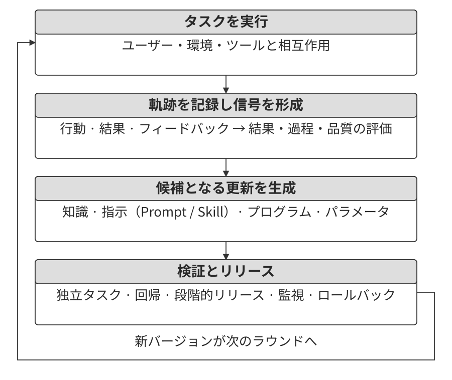
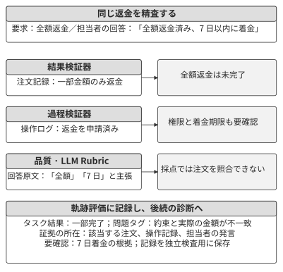
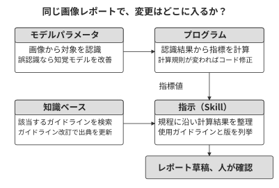
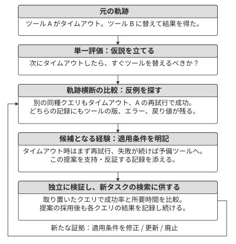
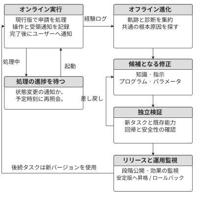

# Agent の継続的進化

Agent は、未知の複雑なタスクを初回で完了できる一方で、似たタスクを何度こなした後でも同じ誤りを繰り返すことがあります。新入社員のように日々の業務から成長していくには、実行経験を後続で使える能力へ変える仕組みがシステムに必要です。結果を記録し、問題の原因を突き止め、改善策をまとめ、その改善策が新しいタスクで有効かどうかを検証します。**筆者は、経験から学び、継続的に進化することが、Agent にとって最も重要な能力の一つになりつつあると考えています。** この能力には、アプリケーションシステムの工学的な構築が必要であると同時に、次世代モデルの重点研究課題としても取り組む価値があります。

通常、デプロイされたモデルは一度の推論を終えてもパラメータを変えません。第 2 章のコンテキスト学習、状態維持、圧縮は、現在のタスクの中での調整を助けます。第 3 章のメモリと知識ベースは、情報をタスクをまたいで保存します。さらに経験から学ぶには、複数回の実行を比較する必要があります。成功した軌跡に共通する手順は何か、失敗した軌跡には何が欠けていたか、あるやり方はどのツールバージョンやタスク条件で通用するのか、といった比較です。

たとえば、航空券予約の軌跡を百本保存しておけば、システムは必要に応じて特定の経験を検索できます。しかし「予約の前に特別食の締切を確認する」という経験を形にするには、予約が成功した原因と失敗した原因を比べ、航空会社や時期の条件を確かめ、さらに新しいタスクでこのやり方を検証しなければなりません。記録と検索によって Agent は過去の経験を取り出せるようになり、比較、帰納、検証によって再利用できるやり方を身につけます。こうした積み重ねを経て、Agent は賢いだけの存在から、熟練した存在へと少しずつ変わっていきます。

**継続学習（continual learning）**は、システムが新しいタスクや新しいデータから学び続けながら、既存の能力を保つ方法を研究する分野です。Agent はこの問題を日々のやり取りの中へ持ち込みます。フィードバックはユーザー、ツール、環境から届き、ユーザーの満足、タスクの完了、手順の遵守がそれぞれ異なる結論を示すこともあります。筆者は、Agent の継続学習の大きな難しさは、日常業務で正誤を一つずつ示してくれる人がほとんどおらず、どのフィードバックが信頼できるかをシステム自身が判断しなければならない点にあると考えています。検証されていないフィードバックがルールとして書き込まれたり訓練に使われたりすると、誤った原因帰属が後続のタスクに影響します。しかもこの種の誤りは尾を引きます。誤って記録された好みは次の予約に影響し、誤ったフィードバックでモデルを訓練すれば、もともと正しくこなせていたタスクまで誤るおそれがあります。

本書では、Agent システム全体が経験から更新されていく過程を**継続的進化**と呼びます。その担い手は知識、指示、プログラム、モデルパラメータの四種類です。基盤モデルの定期的な訓練は汎用能力を提供し、Agent の経験による更新は具体的な業務ルール、ツールの変更、局所的な戦略を扱います。こうした局所的な変化は絶えず起こるため、次の基盤モデルの訓練を待っていては業務の必要に間に合わないことが少なくありません。

現段階で筆者が勧めるのは、まずモデルの外側に検証可能な学習システムを築くことです。明確に言葉にできる経験は知識、指示、プログラムを通じて後続の行動に反映させ、パラメータ学習に向く材料はポストトレーニングへ回します。どの更新も、まず新しいバージョンで回帰評価を行い、リリース前の検査を通過してから、後続のタスクがそのバージョンを使うようにします。

このシステムの主要な構成要素は、これまでの章ですでに紹介しました。第 2 章はタスク状態を組織し、第 3 章は知識を保存して検索し、第 5 章はコードによってツールを作りシステムを変更し、第 7 章は結果を評価し、第 8 章はモデルパラメータを更新します。図9-1 はこれらの構成要素をつないだものです。前回、特別食の予約を漏らした経験が評価を経て、次の予約で使われるルールになります。

## 実行軌跡から学習信号を得る

どの軌跡を学習に使う価値があるのでしょうか。サポート担当がユーザーに「返金の手続きが完了しました」と伝えたとします。まず、実際にいくら返金されたのか、操作が規定に沿っていたかを確かめ、そのうえで、ユーザーがこの返答からお金がいつ届くのかを理解できるかを確認する必要があります。図9-2 はこの三つの検査をまとめたものです。三つの判断には、それぞれ注文記録、アクションログ、担当者の発言そのものを使います。

**結果検証は、環境に何が起きたかを確かめます。** Coding Agent はテスト、型検査、性能ベンチマークを実行できます。返金 Agent は注文状態と実際の返金額を照会できます。筆者はふつう、まずこの層の検査を行います。モデルが全額返金したと言っているのに、帳簿上は一部しか返金されていない場合、注文記録があってこそ、どの操作にさかのぼって調べればよいかが分かります。

**プロセス検証は、行動がタスクのルールに沿っているかを確かめます。** テストが通った後も、保護されたテストファイルが変更されていないかを確認しなければなりません。Agent がユーザーに「返金は 7 日以内に届きます」と伝えたなら、返金が実際に申請済みか、その日数に根拠があるかも照合する必要があります。権限表、構造化されたポリシー、アクション記録はプログラムで検査できます。文脈の解釈が必要な条項は、対応する証拠と合わせて判断します。

**品質検証は、成果物が利用上の要件を満たしているかを確かめます。** 担当者の説明が分かりやすいか、代替案がユーザーの目的に合っているか、調査レポートが重要な証拠を押さえているかは、いずれも最終的な効果を左右します。ここでは第 7 章で紹介した LLM-as-a-Judge を使い、Rubric をあらかじめ定義して、評価モデルに項目ごとの得点、理由、証拠を出させるとよいでしょう。

表9-1 はカスタマーサポートを例に、三層の評価を七つの次元に展開したものです。タスク結果は結果層に、ルール遵守、プライバシー、約束はプロセス層に、表現と代替対応は品質層に対応します。事実の信頼性は、内容に応じてそれぞれの方法で検証します。たとえば返金額はツールの戻り値と直接照合できますが、ポリシーの説明は原文と適用条件を合わせて確かめる必要があります。

表9-1 カスタマーサポート Agent の軌跡評価次元

| 次元 | 検証事項 | 主な証拠 |
| --- | --- | --- |
| タスク結果 | ユーザーの中核的な要求が解決されたか | 最終的な環境状態、ツール結果 |
| ルール遵守 | ポリシー、権限、必須の手順を満たしているか | ポリシー集、アクション軌跡 |
| プライバシー境界 | 提供した情報が許可された範囲内か | 応答テキスト、アクセス記録 |
| 事実の信頼性 | 記述が知識またはツール結果に裏付けられているか | 引用元、ツールの戻り値 |
| 約束と行動の一貫性 | 完了したと主張する操作が実際に行われたか | 応答と実行記録の照合 |
| 表現品質 | 自然で簡潔、分かりやすいか | 対話全文、言語 Rubric |
| 規定内の代替対応 | 当初の案が実行できないとき、許可された代替経路を見つけたか | ユーザーの目標、ポリシーと後続アクション |

後続の更新に役立てるには、評価の出力に四つの項目を含める必要があります。タスク全体の状態、各次元の結論、結論に対応する証拠の位置、そして誤りの種類です。証拠の位置は、特定の対話ターンや特定のツール呼び出しを指せばよいでしょう。証拠が足りない次元は「要確認」とし、追加の検証や人によるレビューに回します。

たとえば「返金失敗、説明は明確」だけでは、改善方法を絞り込めません。「第 4 ターンで注文番号がないまま返金 API を呼び出し、API に拒否された。第 5 ターンでもなお返金済みと伝えている」と補えば、パラメータ検査と完了宣言の検証という二つの変更をそれぞれ提案できます。

> **実験 9-1 ★★：カスタマーサポート Agent の軌跡検証器を構築する**
>
> 同じカスタマーサポート軌跡の集合に対して、二種類の出力を比較します。一つは総合点だけを出すもの、もう一つは次元ごとに結論、証拠、確信度を出すものです。後者がタスク失敗、ルール違反、虚偽の約束、表現上の問題をそれぞれ特定し、それに応じた更新を提案できるかを確かめます。
>
> 知識が古くなっていれば資料を更新し、パラメータが欠けていれば呼び出し前の検査を加え、言い回しの繰り返しは指示や訓練で改善できる場合があります。

実験 9-1 では、架空のアカウント情報を使って八本の軌跡を作りました。正常な返金、虚偽の約束、プライバシー漏えい、過剰な拒否が各二本です。`real-normal-refund-01` では、担当者が返金を済ませたと伝え、注文状態も `refunded` に変わっており、返金額は 480 でした。

八本の軌跡をそれぞれ七項目で評価したところ、56 項目の判断のうち 52 項目が、テストケースにあらかじめ付けた専門家ラベルと一致し、一致率は約 92.9% でした。残る四つの不一致のうち、三つは同じ一件の便変更に集中していました。ユーザーは払い戻し不可の航空券を 10 月 3 日の便に変更するよう求めました。担当者は本人確認を行い、注文を三回照会し、第 10 ターンでユーザーに手続き済みと伝えました。ところが注文状態は `confirmed` のままで、呼び出し記録にも便変更の操作はありませんでした。

この場合、誰を見直すべきでしょうか。「規定内の代替対応」を判定したモデルは第 10 ターンの返答を引用して合格とし、実行できたはずなのに実行されなかった代替案を見落としました。「約束と行動の一貫性」を判定したプログラムはエラーを報告しましたが、その理由は成功した返金呼び出しが見つからないというものでした。ユーザーが求めていたのは便変更なので、照合すべきは便変更の記録と新しい日付です。しかもこの次元の事前ラベルは「合格」で、実際に生成された返答とも食い違っていました。

この便変更で直すべきところは二つあります。担当者が一手順を実行し損ねたことと、評価プログラムが照合するツールを間違えたことです。航空券予約に置き換えても、見かけが同じ誤りの原因は別々の場所にありえます。ユーザーが予算の上限を緩めたのに、アシスタントが古い予算のまま便を絞り込んでいたとします。軌跡をさかのぼると、新しい好みが保存されていなかったのかもしれませんし、今回古い好みを取り出してしまったのかもしれません。あるいは、モデルは新しい予算を読んでいながら、便を選ぶときにそれを使わなかったのかもしれません。

## Agent の継続的進化における四つの方法

問題が見つかったら、次はどこを直すかを決めなければなりません。図9-3 の医用画像 Agent を例にとると、レポートが旧版のガイドラインを引用していた場合は、まず知識ベースにどの版が保存されているかを調べます。ガイドラインが正しいのに、レポートが引用元を示していなかったのなら、レポートを書く指示にさかのぼって調べる必要があります。二つのレポートがどちらも差し戻されたとしても、修正時に調べる場所は異なります。

カスタマーサポートシステムでも、この四つの方法が同時に使われます。訓練されたモデルが言葉を組み立て、知識ベースが企業のポリシーを保持し、Skill が例外への対処法を説明し、サーバー側のコードが権限と金額を検証します。表9-2 は、更新方法を選ぶときに比較すべきコストと制約をまとめたものです。

表9-2 四つの継続的進化方法の適用範囲

| 更新方法 | 適した内容 | 工学上の利点 | 対処すべき課題 |
| --- | --- | --- | --- |
| 経験知識ベース | 事実、経験、例外と情報源 | 更新が速く、追跡可能で、必要に応じて検索できる | 検索の品質、適用条件、モデルが正しく使えるか |
| Prompt と Skill | 文脈、例外、優先順位を踏まえる必要がある判断原則 | 説明可能で、局所的に修正しやすい | 長さの増大、指示の衝突、遵守の効果 |
| プログラムと Harness | 解析可能な手順、実行可能な検証、権限と強い制約 | テスト可能で、実行が安定している | 開発と保守、インターフェース互換性、例外処理 |
| モデルパラメータ | 知覚、生成スタイル、暗黙的な意思決定パターン | 学んだパターンを再利用でき、繰り返しのコンテキストを減らせる | データ準備、訓練コスト、汎化と忘却 |

一つの改善を複数の更新に分けることもできます。筆者は、ポリシー上の事実はまず知識ベースへ、権限検査のように厳密に実行できる制約はプログラムへ入れるようにしています。文脈や例外の理解が必要な原則は Skill で表現し、高次元の知覚や暗黙的な戦略は訓練で改善します。

### 経験を知識として蓄積する

同じ一回の予約の記録でも、二つの層の情報を残せます。一つは「この航空会社では特別食を 24 時間前までに予約する必要がある」というものです。もう一つは「予約の前に特別食の締切を確認し、支払い後に要望を満たせないと分かる事態を避ける」というものです。前者は航空会社、適用路線、ポリシーの出典と合わせて保存すべきです。別の航空会社では締切が違うかもしれませんが、「まず今回の便の締切を確認する」という部分はそのまま転用できます。こうしておけば、事実が古くなったときに差し替えるのは具体的な期限だけで済み、次の予約でもこの確認の経験を使えます。どちらも第 3 章の保存、インデックス、検索の方法で保存できます。

一回の予約からこうした経験を引き出すコストは低く抑えられますが、予約記録をまるごと書き写してはいけません。記録にはツールが返したポリシーの原文もあれば、Agent が何度も試した回り道も含まれています。ある照会がタイムアウトし、その後ツールを替えたら結果が得られたとします。これをそのまま真似ると、一度きりの偶然の障害を、ツールを替える理由だと取り違えるおそれがあります。

材料は三層に分けて保存できます。**生の軌跡**は実行の証拠を完全に保持し、**単一実行の分析**は成否の原因と教訓の草案を記録し、**正式な経験文書**はタスクをまたいで検証されたやり方をまとめます。生の軌跡はバージョンごとに保存し、分析と知識は新しい証拠に応じて改訂します。正式な文書には、適用場面、推奨戦略、禁止事項、例外、出典、直近の検証時刻を明記し、後の検索や点検に備えます。

第 3 章の User as Code では、まず事実のログを追記し、その後ユーザーモデルを定期的に再構築しました。ここでも記録と整理を分けます。先ほどの照会に戻りましょう。別の照会もタイムアウトしたものの、元のツールで再試行したら成功したとします。それでも「タイムアウトしたらツールを替える」という助言は成り立つでしょうか。図9-4 は、この二つの記録からより的を絞った助言を作り、それを別の照会で検証する流れを示しています。

第 3 章の抽出、クラスタリング、検索の方法を使うときは、同じ経験の正例と反例をまとめて置くとよいでしょう。二回の予約は同じバージョンのツールを使っていたか。一回は成功し一回は失敗したのは、手順が一つ抜けていたからか、それとも予約条件がもともと違っていたのか。生の記録から使える経験を整理する作業は、具体的には五つの手順に分けられます。

1. 生の軌跡と環境の結果を保存し、タスクとツールのバージョンを固定する。
2. 実行ごとに分析を生成し、タスク種別、必要な能力、実際の戦略、誤り、例外を記録する。
3. タスク群ごとに集約し、各経験について、それを支持する軌跡と反証する軌跡を列挙する。
4. 証拠が十分な経験を選び、知識項目の初稿として書き起こす。
5. 抽出に使っていない新しいタスクでテストし、推奨戦略が後続の性能を改善するかを確かめる。

GAIA[^gaia-2023] は、検索、Webページの読解、ファイル処理、計算などを伴う多段階の問題を提供し、AWorld[^aworld-2025] は Agent の実行、ツール呼び出し、軌跡記録の環境を提供します。両者を組み合わせれば、まず正解や環境状態によって成功、部分的成功、失敗のラベルを付け、そのうえでタスク群ごとに経路を比較できます。成功した記録からは試し直す価値のあるやり方が、失敗した記録からはどの状況でそれを真似るべきでないかが見えてきます。タスクが一部しか完了していない場合は、どの手順が有効で、どこから問題が始まったかを一歩ずつ照合することもできます。

Reflexion[^reflexion-2023] は、自然言語による振り返りで後続の試行を助けます。この手法を知識の抽出に組み込む場合、振り返りは原因の仮説と教訓の草案を出すために使い、環境の結果はその検証に、軌跡をまたいだ比較は適用条件の線引きに、新しいタスクは転移の確認に使います。一つの経験を正式な知識ベースに入れるかどうかは、この四種類の材料を合わせて決めます。

[^reflexion-2023]: Shinn, N., et al. *Reflexion: Language Agents with Verbal Reinforcement Learning.* arXiv:2303.11366, 2023.

[^gaia-2023]: Mialon, G., et al. *GAIA: a benchmark for General AI Assistants.* arXiv:2311.12983, 2023.

[^aworld-2025]: Yu, C., et al. *AWorld: Orchestrating the Training Recipe for Agentic AI.* arXiv:2508.20404, 2025.

第 6 章の航空券予約の場面に戻りましょう。ユーザーは運賃を 1200 元以内に収めたいと考えていましたが、当日中に会議へ駆けつける必要があったため、最終的に 1250 元の運賃を受け入れました。アシスタントは、元の予算、成約価格、移動の目的、ユーザーの発言そのものを記録できます。その後の三回の予約では、最安の運賃がどれもちょうど 1250 元でした。この記憶はどう使えばよいでしょうか。

- 翌週、また同じ商談の会議に急いで向かう必要がある。ユーザーはこれまで何度か、会議に間に合うなら数十元多く払ってもよいとしており、今回もいつもどおりに予約するようアシスタントに伝えた。アシスタントはこの便を予約し、実際の運賃を伝えればよい。
- ユーザーが子どもを連れて休暇に出かけ、「家族旅行だから少し節約したい。1200 元を超えるならまず相談して」とわざわざ伝えた。アシスタントは 1250 元の選択肢をユーザーに示すと同時に、前後一日に予算内の便がないかを調べればよい。
- ユーザーが後から「前回は急いでいたから受け入れただけで、本当は 1250 元でも高いと思っている。今後は出張でも予算を超えるならまず相談して」と説明した。次回は、同じ人が同じ都市の会議へ向かう場合でも、アシスタントはまず確認すべきである。前回の成約記録は残したまま、この新しく、より明確な要望を出張時の好みとして書き込めば、二つの記憶はそれぞれ役に立つ。

この三回の予約は、更新の階層を示しています。ユーザーの一言の訂正は、現在のタスクをすぐに変えられますし、その人自身の好みを更新するにも十分です。多くの独立した事例で、アシスタントが移動の目的を無視していると分かって初めて、共通の予約 Skill を修正し、運賃を比較するときに関連する好みを参照させる提案に意味が出てきます。明示された予算と好みがすべて読み込まれているのに、言い方が変わるとモデルがなお判断を誤るという場合に初めて、こうした事例を集めてモデルの判断力を訓練する価値が生まれます。

### 経験を指示として記述する

正しい資料を毎回アシスタントに渡しているのに同じ箇所で誤り続け、しかも経験のある人ならどう判断すべきかを一文で言い表せる場合は、指示を一つ書いてみる価値があります。経験文書はアシスタントの参考資料として置き、システム Prompt はタスクをまたぐ行動要件を表し、Skill は領域やツールに応じて局所的な手順を読み込み、権限などの強い制約は Harness が実行します。変更をどこに置くかによって、将来どのタスクが影響を受けるかが決まります。

Andrej Karpathy は、**システムプロンプト学習（System Prompt Learning）**という言葉で、ある経験の更新方法を表しました。モデルが問題にぶつかった後、将来のタスクのために注意書きを一つ書き残すというものです。[^karpathy-system-prompt-learning] DSPy[^dspy-2023]は開発セット上で指示と例を最適化し、OPRO[^opro-2023]は試したプロンプトとその得点をもとに新しいプロンプトを作り、GEPA[^gepa-2025]は軌跡からのフィードバックを使ってプロンプトの変更を提案し、選別します。これらの手法はいずれも実行結果に基づいて指示を書き換え、開発用のタスクで新旧の版を比較するもので、オフラインでの一括最適化に向いています。

本番環境での更新では、筆者は出典付きの最小 diff を優先し、きっかけとなった事例、修正の理由、旧版を残しておきます。局所的なパッチは既存のルールへの影響を小さくし、性能が落ちたときに特定の変更だけを取り消すことも容易にします。

新しい指示が前回の誤りを本当に直したことは、どうすれば分かるでしょうか。ユーザーが誤って振り分けられた顧客からのメールを指して、「これは顧客が私に返信してきたものなのに、なぜニュースレター扱いになっているの？」と言ったとします。オープンソースのメールアシスタント Inbox Zero には、試行用のツールがあります。ルールを修正した後、アシスタントはメール ID で元のメールを取り出し、そのアカウントで現在有効なルールに従って判定し直し、どのルールに一致するか、その理由は何か、どのラベルを付けるか、どのフォルダに移すつもりかを確認できます。この段階では実行予定の動作を見るだけで、メールボックスはそのまま残り、返信の下書きも作られません。[^ch9-inboxzero] 次に、本物のニュースレターを一通選んで試してみます。顧客からのメールは受信トレイに残り、ニュースレターは従来どおり振り分けられる。この二通を合わせて見ることで、今回の修正が元の分類の境界を守れているかが分かります。

[^ch9-inboxzero]: Inbox Zero プロジェクトの `test-rules-on-email-tool.ts` は、指定したメールでルールを試行するツールを実装しています。

#### 例 1：転送とツール利用の境界を明確にする

τ²-bench の telecom ポリシーは、要求が Agent の動作範囲を超える場合に有人対応へ転送し、転送の前には全力で解決を試みるよう求めています。ルールの抽出に使う 20 問のうち、能力の劣るモデルが通過したのは 1 問だけでした。残りの 19 問はどのように失敗したのでしょうか。17 問では有人転送ツールが呼ばれ、ほかの 2 問はステップ数の上限まで実行が続きました。

この 19 本の失敗軌跡をモデルに渡し、ルールを帰納させて元のポリシーの末尾に追記しました。同じ 114 問の新しい問題に対して、元のポリシーだけでは 14 問（12.3%）が通過しました。第一版のルールを加えると 20 問、第二版のルールを加えると 22 問（19.3%）が通過しました。一問ずつ照合すると、第二版は元々通過していた 14 問をすべて保ち、さらに 8 問を新たに正解していました。二つの版のルールは、サポート担当にいったい何をもたらしたのでしょうか。

**入力材料がルールの中身を決めます。** エラーテキストと失敗の要約だけを与えたとき、モデルが帰納したのは「同じツールが繰り返しエラーを返したら呼び出しをやめる」でした。二回目の抽出では、サポート担当とユーザーそれぞれのツール一覧もモデルに見せ、プロンプトでも「この手順は誰が行うべきか」を考えるよう求めました。今回生成されたルールは役割分担を明確にしていました。ネットワーク状態、SIM カード、APN などの端末操作は、ユーザーを誘導して実行してもらう必要がある、というものです。こうして経験は、一般的な再試行の注意から、具体的な操作の役割分担を定めるルールへと具体化されました。

**帰納には、ポリシーと結果による検証も必要です。** 第一版で追記されたルールには、「呼び出しが三回続けて失敗したら転送する」「ユーザーが二回番号を提供しなければ転送する」の二条が含まれていました。この版のルールで実行すると、114 問の転移評価用の問題のすべてで転送が発生し、通過したのはそのうち 20 問だけでした。この二条は、早すぎる転送まで学んでしまったのです。

修正前後の違いがよく分かる軌跡があります。ユーザーは携帯電話に電波が入らないと訴えています。ベースラインのサポート担当は、「正しい電話番号をお知らせください」といった文を番号欄に入れ、五回続けて照会していずれもエラーになり、その後有人対応へ転送しました。第二版のルールに替えると、サポート担当は最初の照会でやはり番号を入れ忘れましたが、今度は対話の中でユーザーに尋ね、番号を得てからアカウントを見つけました。続いて SIM カードを確認しようとしたところ、その操作は見つからないとツールが報告したので、サポート担当はユーザーに SIM カードの挿し直しを依頼しました。ユーザーがそれに従い、さらに端末で機内モードを解除して、ようやくこの問題は通過しました。第二版がベースラインより多く正解したほかの七問も見てみましょう。有人転送をまったく行わなかったのは一問だけで、残りの六問ではいずれも有人転送ツールが呼ばれていました。つまり、「有人転送しなかったこと」を通過の基準にすると、ちょうどこの六問を取りこぼすことになります。転送すべきかどうかは、サポート担当にまだ何ができるか、そしてタスクがどこまでの対応を求めているかで判断する必要があります。

> **実験 9-2 ★★：τ²-bench の失敗軌跡から転送とツール利用のルールを抽出する**
>
> 第 7 章の telecom 環境をそのまま使い、抽出用セットと転移評価用セットを分けます。まず能力の劣るモデルを実行して失敗軌跡を集め、次にモデルにルールを生成させて元のポリシーに追記します。転移評価用セットで元の版と二つの進化版を比較します。三つの群で差し替えるのはポリシーファイルだけとし、ユーザーシミュレータは同一に保ちます。
>
> ベースラインでは 104 問、第二版では 111 問で転送が発生しました。同じ問題で一度でも転送があれば数に入れます。ユーザー側のツールを誤って呼び出した回数は呼び出し単位で数え、1049 回から 163 回に減りました。別の指標として、呼び出しパラメータのうち少なくとも一つの値が空文字列だった回数を数えたところ、904 回から 174 回に減りました。パラメータをまったく渡さなかった呼び出しは、この指標には含まれません。各戦略は各問題で一回ずつしか実行していません。

航空会社のカスタマーサポートでも早すぎる転送は起こります。ユーザーが払い戻し手数料、変更手数料、手荷物規定に異議を唱えたとき、Agent は該当するポリシーを照会して説明し、許可された代替案を探すべきです。次の実験で採用したルールでは、通常のポリシーへの異議には引き続き Agent が対応し、ユーザーが明示的に有人対応を求めた場合や、指定された安全上の事態が生じた場合に `transfer_to_human` を呼んで転送します。

> **実験 9-3 ★★：失敗軌跡に基づいて航空カスタマーサポートのシステム Prompt を最適化する**
>
> ルール遵守、タスク解決、規定内の代替対応の三つの次元から早すぎる転送の軌跡を分析し、出典付きの Prompt パッチを生成します。自動で抽出した版を、初期版および人手で調整した版と同じ条件で比較します。
>
> 既存能力を確認するために別の五問を用意しました。三問はサポート担当自身が対応すべきもの、二問は有人対応へ転送すべきもので、三つの版はいずれも 5/5 でした。パッチの抽出に使った早すぎる転送の五問では、同じ評価モデルが初期版、自動版、人手調整版に対してそれぞれ 0、2、4 問を合格と判定しました。自動版が改善したのは、特価航空券の払い戻しと超過手荷物の二問です。プログラムはこれに基づき、小規模な試験導入を許可する判定を出しました。
>
> 議論の余地がある一点もあります。乗客は 200 元の変更手数料の免除を求めたのに、人手調整版は特価航空券が払い戻せるかどうかを説明し始めました。評価モデルは「税金分を返金する」という提案を評価して合格としましたが、乗客が尋ねた変更手数料について、サポート担当は最後まで説明しませんでした。

#### 例 2：ユーザーのフィードバックに基づいて要件明確化 Skill を改善する

既存の要件明確化 Skill では、いつ質問するか、何を尋ねるか、いつ実行に移るかを定められます。ユーザーのフィードバックが蓄積するにつれ、システムはこれらの判断条件を調整し、明確化によって得られる利点と、ユーザーの手を煩わせるコストとが釣り合うようにする必要があります。

たとえばユーザーが「ログインページを企業ログイン対応にして」と言った場合、実装の前に ID プロバイダ、フォールバック方式、既存ユーザーとの互換、公開範囲を決めておく必要があるかもしれません。一方、スペルミスを一か所直すだけなら、たいていそのまま済ませられます。尋ねる量が少なすぎると、重要な選択が納品後まで持ち越されて手戻りになります。尋ねすぎると、簡単な修正まで長いインタビューに変わってしまいます。Skill は、曖昧さ、リスク、手戻りのコストに応じて手順を選ぶべきです。

最初の手順は次のように組み立てられます。低リスクで取り消しやすい小さな変更は、必要な前提を説明してから実行します。アーキテクチャ、データ、権限、公開インターフェースが絡む場合や広範囲の変更では、方針を左右する少数の質問をまとめて尋ねます。そのうえで短い Spec または Plan を作り、目標、非目標、トレードオフ、前提、受け入れ基準を列挙します。確認が必要な事項に回答を得たら実行を続け、実行中に前提が変わったと分かれば、影響を受ける決定を特定して改めて確認します。

この手順を改善するには、タスク、明確化のための質問、Spec の版、ユーザーによる修正、納品結果、手戻りを記録します。ユーザーが「思っていたものと違う」と言えば、どの条件が漏れていたかを調べます。「質問が多すぎる」と言えば、それらの質問への答えが方針に影響したかを調べます。

認証に関わる複数のタスクで旧ログイン方式との互換要件が繰り返し漏れていたなら、Skill に「ID プロバイダ、フォールバック経路、互換範囲を確認する」という条件を加えられます。多数のスペル修正が質問のせいで遅れていたなら、明確化の手順が発動する範囲を狭めるべきです。

ここにも Skill と Harness の役割分担が表れています。Skill は、モデルが文脈を理解し、質問を投げかけ、方針を整理するよう導きます。Harness はプロジェクトのルールに基づき、必要な承認のない高リスクな書き込み、保護されたブランチの直接変更、リリース手順の省略を阻止します。要件の中身についての判断は、引き続きモデルがユーザーの入力を踏まえて行います。検証済みの対話軌跡は、第 8 章で紹介した訓練データにもなりえます。

> **実験 9-4 ★★：ユーザーのフィードバックから要件明確化と Spec 確認の Skill を進化させる**
>
> これは対照を自分で設計する練習です。まず二つのタスクを用意するとよいでしょう。ログインボタンの誤字を直すタスクと、同じページに企業ログインを追加するタスクです。前者は受け入れ条件をそのまま書き出せますが、後者は先に ID プロバイダを確認する必要があるかもしれません。さらにアーキテクチャ、権限、データ、公開インターフェースが絡むタスクも加え、直ちに実行する、明確化してから実行する、Spec を確認してから実行する、という三つの手順をそれぞれ試します。ユーザーの回答、Spec の修正、納品結果、手戻りのフィードバックを記録し、それに基づいて Skill の局所的な更新を生成します。

[^dspy-2023]: Khattab, O., et al. *DSPy: Compiling Declarative Language Model Calls into Self-Improving Pipelines.* arXiv:2310.03714, 2023.

[^opro-2023]: Yang, C., et al. *Large Language Models as Optimizers.* arXiv:2309.03409, 2023.

[^gepa-2025]: Agrawal, L., et al. *GEPA: Reflective Prompt Evolution Can Outperform Reinforcement Learning.* arXiv:2507.19457, 2025.

[^karpathy-system-prompt-learning]: Karpathy, A. “We’re missing (at least one) major paradigm for LLM learning … system prompt learning?” X, May 11, 2025.

### 経験をプログラムとして記述する

安定していて繰り返し行われ、検証可能な操作は、実行経験に基づいてワークフロー、ツール、Harness のコードとして記述できます。筆者は、この種の操作を優先してプログラムに変えることを勧めます。モデルが実行可能な経路を一度探り当てれば、後続のタスクはその経路を再利用でき、説明を何度も読み、ページを理解し、次の一手を決める手間を省けるからです。第 5 章では、ファイルの読み書き、テストの実行、ツールの生成といった能力を紹介しました。本節では、これらの能力を「失敗の診断—コードの変更—回帰検証」という更新の流れに使います。

変更はさまざまな層に及びます。操作層ではパラメータ化されたワークフローや API アダプターを生成し、制御層ではツールのルーティング、再試行、サーキットブレーカー、コンテキスト圧縮を調整します。検証層ではパラメータ検査、状態アサーション、回帰テストケースを追加し、アーキテクチャ層では計画、実行、Reviewer の間の情報の流れを調整します。

メール送信を例にとりましょう。マルチモーダル Agent は最初、観察と行動を通じて「作成、宛先、件名、本文、送信」などのコントロールを見つけます。次のタスクでは、たいてい宛先と内容が変わるだけなので、表計算ソフトのマクロのように操作手順を再利用できます。システムは探索の軌跡をプログラムに変え、パラメータ、状態チェック、適用バージョンを記録します。

ブラウザワークフローのライフサイクルは六つの段階に分けられます。

1. **軌跡を記録する。** ナビゲーション、クリック、入力、プルダウン選択を記録し、操作パラメータ、ページの URL、XPath や CSS などの要素特定情報を保存する。これらの情報は、後で要素を見つけ直すために使う。
2. **パラメータを抽出する。** 具体的な宛先、件名、本文を `{recipient}`、`{subject}`、`{content}` などの変数に置き換え、安定した操作はそのまま残す。たとえば、初回に入力した `test@example.com` は宛先パラメータの値の一つになる。
3. **状態チェックを加える。** 実行前にボタンが表示されていること、必要な入力欄が揃っていることを確認し、実行後にページの変化を確認する。タスクの終了時には実際のページまたはバックエンドの状態を読み取り、メールが送信されたことを確かめる。
4. **独立して再生する。** サンドボックスのアカウントやテストサイトを新しい初期状態に戻し、プログラムを最初から最後まで実行して、各段階の条件と最終結果を確認する。
5. **新しいタスクに照合する。** 意図とキーワードに基づいて能力ライブラリからワークフローを探し、今回のパラメータを抽出して Playwright に実行させる。要素の待機と状態チェックはプログラムが担うため、正常な再生では一歩ごとに LLM を呼び出さずに済む。
6. **失効に対処する。** 要素の特定に失敗した、状態チェックが通らない、API の schema が変わった、最終結果がおかしい、といった場合は、現在の再生を停止する。まずどの操作がすでに完了したかを確認し、完全な Agent の手順で現在の状態から探索し直して、うまくいった新しい手順をスクリプトに書き込む。メールは送信済みなのにページに結果がすぐ表示されない場合は、まず送信状態を照会し、最初から再生して二重送信を起こさないようにする。

これでどれだけ時間を節約できるかは、もともとどれだけの時間がモデルの判断に費やされていたかによります。PreAct の反復タスク実験では、エンドツーエンドで 8.5～13 倍の高速化が報告されています。次のローカルのメールの例ではモデル呼び出しを完全に省けましたが、ブラウザ自体は依然としてページの応答を待つ必要があります。[^preact]

> **実験 9-5 ★★★：ブラウザ軌跡から検証可能なワークフローを生成する**
>
> 成功した軌跡から、パラメータと状態チェックを備えたワークフローを生成し、毎回探索し直すベースラインと、完了率、モデル呼び出し、所要時間を比較します。さらにページ構造を変えたり、クリックは成功したのにタスクが送信されていない状態を作ったりして、プログラムが失効を検出してフォールバックできるかを確かめます。
>
> ローカルのメールサイトで行った今回の実験では、初回の探索でモデルを 4 回呼び出し、パラメータ化した再生では 0 回でした。所要時間はそれぞれ約 5.31 秒と 4.45 秒です。再生では二種類の障害も起きました。一つは本文が空のためにサーバーが送信を拒否したもの、もう一つはリクエストは受け付けられたのにメッセージが保存されなかったものです。「クリック操作が実行された」ことだけを確認する版は二回とも成功と誤って報告し、送信後の状態を確認する版は二回とも失敗を検出しました。

**コードの変更は、まず独立したブランチで行います。** 現在の安定版から隔離されたブランチを作り、Coding Agent に局所的なパッチを生成させます。変更に関連する静的検査、単体テスト、セキュリティ検査、失敗軌跡の再生、既存タスクの回帰テストを順に実行してから、段階的なリリースに進みます。稼働中のシステムは安定版を使い続け、パッチが検査を通過してから切り替えます。

Git worktree と Pull Request はこの流れを担うことができます。Skill は、モデルが独立した作業領域を作り、要件を明確にし、実装とテストを終え、PR の中で問題、変更点、検証済みの場面、そして引き継ぐ人が確認すべき残りのリスクを説明するよう導きます。Harness はプロジェクトの制約を実行します。たとえば `main` を保護し、必須のレビュー状態を確認し、納品前にリリース成果物が揃っていることを確かめます。

具体的な変更が結果にどう影響するかを判断するために、どの変更にも検証可能な説明を添えるべきです。失敗の証拠、推定した根本原因、関係するコンポーネント、提出予定のパッチ、正すべき誤り、もともと正しかった振る舞い、そして両者をそれぞれ検証するテストケースです。Agentic Harness Engineering は、関連する情報をコンポーネント、経験、意思決定の三層の可観測性として整理します。コンポーネントはファイルとして保存されて編集でき、軌跡は段階的に掘り下げられる証拠に整理され、編集の前に予想される影響を宣言し、その後の結果で検証します。[^ahe-2026]

モデルに修正案を作らせるとき、筆者は成功した軌跡と、以前に却下された案も一緒に渡します。Self-Harness はこうした情報を使って探索の方向を絞ります。成功した記録は、どのやり方がもともと正しかったかをモデルに伝え、過去の試行はどの変更がすでに失敗したかを示します。[^self-harness-2026] 失敗事例だけを渡すと、モデルは変更範囲を広げすぎて、もともと正しかった振る舞いを壊すおそれがあります。却下された案の記録がなければ、同じ無効な発想を何度も提案しかねません。

新しいツールも、こうした必要に駆動された更新から生まれます。Alita[^alita-2025] のあるタスクでは、『ロード・オブ・ザ・リング』でゴラムを演じた声優がナレーションを務める YouTube の 360 度 VR 動画から、恐竜が初めて登場した直後に言及される数字を見つける必要がありました。Agent は字幕を読む能力が足りないことに気づき、`youtube-transcript-api` を検索してテストし、字幕ツールとしてラップして、最終的に `100000000` を得ました。

> **実験 9-6 ★★★：失敗軌跡をきっかけに Agent の自己変更を起動する**
>
> ツールが再試行不能なエラーを返した後も繰り返し呼び出されるという問題に対し、Prompt による注意喚起と、プログラムによる再試行方針という二つの修正を比較します。修正後のプログラムはエラーの種類に応じて再試行、停止、サーキットブレーカーの作動を決め、失敗軌跡の再生で対象の問題を確認し、一時的な障害のタスクで回復能力を確認します。エラーの種類と再試行の条件を厳密に判定できる場合、筆者はこの制約をプログラムに書き込むほうを選びます。そうすればどの呼び出しも同じルールに従い、モデルが毎回プロンプトを読み解く負担も減らせます。
>
> 更新を担う Agent は隔離された版でパッチを提出し、採用するかどうかは外部のテストとリリース手順が決めます。検証器、受け入れテストケース、安定版は独立した権限で保護され、ロールバック記録には変更前後の振る舞いの根拠が残されます。

検証のロジック自体も改善できます。たとえば、ユーザーからの度重なる訂正やレビューによって、高リスクな呼び出しに確認が欠けていると分かったなら、呼び出し前の検査を新たに加えられます。ここでは、業務上の検証コンポーネントと、更新をリリースしてよいかを決める独立した仕組みを区別する必要があります。前者は業務コードと一緒に変更できますが、後者は独立したテスト、レビュー、リリース権限によって管理されます。新しい検査は対象のリスクを網羅すると同時に、承認済みの正常なタスクがこれまでどおり実行できるようにしなければなりません。

> **実験 9-7 ★★：ユーザーのフィードバックをきっかけに高リスク操作の確認ゲートを導入する**
>
> ユーザーの訂正と事後レビューから確認が欠けていた事例を抽出し、ツール呼び出しの前に承認を確認するルールを作ります。第一群のテストはまだ確認されていない高リスク操作、第二群はすでに承認済みか確認不要の正常な操作です。
>
> 第一群では新しいルールが見逃した操作の数を、第二群では誤って阻止した操作の数を測ります。変更をリリースできるかどうかは、独立したテストの結果とリリースのルールで決まります。検査ルールを書く Agent は取り決められたコンポーネントしか変更できず、受け入れテストケース、承認ルール、安定版のバックアップは外部の仕組みで保護されます。

[^preact]: Li, Bojie. *PreAct: Computer-Using Agents that Get Faster on Repeated Tasks.* arXiv:2606.17929, 2026.

[^alita-2025]: Qiu, J., et al. *Alita: Generalist Agent Enabling Scalable Agentic Reasoning with Minimal Predefinition and Maximal Self-Evolution.* arXiv:2505.20286, 2025.

#### 事例：DeepSeek Harness のプラグインによる更新

DeepSeek Harness（`dsh`）は「すべてがプラグイン」というアーキテクチャを採用しており、その基盤となる合成の仕組みは Cordis が提供しています。[^dsh-2026] モデルアダプター、ツールレジストリ、セッションログ、Agent のメインループは、いずれもプラグインとして設定し、差し替えられます。ここから継続的進化は具体的なソフトウェアの問題を突きつけます。コンポーネントが実行中に変わるとき、古いリソースをどう片付け、それに依存する他のコンポーネントをどう正しく動かし続けるか、という問題です。

Cordis はこの問題を二つの軸に分けます。**時間的合成可能性（temporal composability）**は、コンポーネントを取り外した後の復元を扱います。リソースの割り当て、イベントの登録、コンテキストの変更には、対応する取り消しの処理が必要です。**空間的合成可能性（spatial composability）**は依存関係を扱います。コンポーネントは必要とするサービスを宣言し、依存先が現れたり、消えたり、変わったりしたときに、実行系が有効化と無効化を調整します。[^cordis-2026]

たとえば、あるツールプラグインがイベントリスナーを登録し、さらにあるモデルサービスに依存しているとします。プラグインを差し替えるときは古いリスナーを取り消し、一つのイベントが二重に処理されないようにする必要があります。モデルサービスが一時的に使えなくなったときは、依存するコンポーネントが関連する処理を止め、サービスが回復してから再び有効化する必要があります。前者はリソースと副作用のライフサイクルの問題であり、後者は依存関係のライフサイクルの問題です。

統一された仕組みがなければ、各コンポーネントは着脱や依存関係の変化を自前で処理するしかなく、局所的な差し替えでも呼び出し側を壊すおそれがあります。更新のたびにプロセス全体を再起動しなければならないなら、進行中のタスクも中断され、状態を復元する作業も増えます。

Cordis は、逆操作を伴うコンテキスト変換を**可逆効果（revertible effects）**として表し、その片付けを実行系が保持して実行します。また、コンポーネントが環境に求める条件を**反応的余効果（reactive coeffects）**として表し、コンテキストの変化に応じてコンポーネントの状態を調整します。統一されたコンテキストの仕組みは、さらに複数のコンポーネントが交錯して動作するときの相互作用も調整します。[^cordis-2026]

この設計により、局所的な更新のたびに全体を再起動する必要が減ります。筆者は、合成可能性がシステムが自己変更を受け入れ続けられるかどうかを直接左右すると考えています。モデルが正しいパッチを書いた後も、実行系は着脱を行い、依存関係を調整し、タスクを復元しなければならないからです。

プラグイン化は、権限とリリースの手順とも組み合わせる必要があります。`dsh` の動的ランナーはプロセス内のプラグインとそのバージョン、起動、停止、権限付与を管理し、永続的なプラグインは専用のインストール管理の手順で保守します。[^dsh-2026]

プラグインの更新はコンテキストのコストにも影響します。ツール定義やプロンプトの断片が変わると、後続のリクエストと既存のキャッシュ済みプレフィックスとの共通部分が短くなることがあります。

[^dsh-2026]: DeepSeek AI, *DeepSeek Harness*, 2026。プラグインの構成はアーキテクチャの説明を、動的ランナーと永続プラグインの役割分担は拡張機能の説明を参照。このプロジェクトは 2026 年 8 月に公開されており、本節は開発者プレビュー段階のプラグイン設計に基づいています。

[^cordis-2026]: Shi, Yifan, Wei Zhang, and Tianyi Cui. *A Programming Paradigm for Spatiotemporal Composability*, 2026、arXiv:2608.25512。

### 経験をパラメータに書き込む

知識、指示、プログラムは、明確に表現できる情報やルールを担うのに向いています。医用画像の視覚的なパターン、自然な音声の韻律、言語スタイル、長期にわたる意思決定の癖は、モデルが大量のサンプルから学ぶ表現にも依存しています。ルールとして完全には書き下しにくいこうした能力については、筆者は関連する経験を訓練用の材料に変え、パラメータの更新を通じて再利用可能な認識と意思決定のパターンを形成させます。文字による注意書きを数行足すだけでは、こうした能力の多様な変化をなかなか網羅できません。

一つのタスクが複数の担い手を同時に必要とすることもあります。中国語の引用符の編集では、パーサーが文書の文法上の境界を識別し、Skill が編集の原則と例外を説明し、パラメータの訓練がタスクをまたいだ範囲の判断を改善します。装置の変更による画像分布のずれには LoRA などの微調整手法で適応でき、言語スタイルも定期的な選好訓練で更新できます。タスクの安定性は更新の頻度とコストに影響しますが、どの方法を優先して試すかは、能力そのものの表現のされ方で決まります。

第 8 章で紹介した訓練手法は、本章の閉ループにそのまま接続できます。検証済みのデモンストレーションは SFT に入り、明確な選好はペアデータを構成し、繰り返し可能なやり取りと信頼できる報酬は RL を支えます。

ある経験を指示からパラメータへ移すべきかどうかは、どう判断すればよいでしょうか。テスト用にあらかじめ取り分けておいたタスクを一束用意し、二回再生します。一回目はシステムにいつもどおり検索させて指示を読み込ませ、二回目は関連する指示をモデルに直接渡します。二回目の答えが明らかに良ければ、まずシステムが指示を選び間違えていないか、読み込むべき指示を漏らしていないかを調べます。指示は渡されているのに、言い回しが変わるたびにモデルが同じ判断を誤り続けるのであれば、そのとき初めて多様なデモンストレーションを集め、パラメータの訓練が転移を改善できるかを確かめる理由が生まれます。二回の再生によって、「経験が見つからない」ことと「経験を使いこなせない」ことを切り分けられます。

### 成果物の更新から「更新方法」の最適化へ

返金ポリシーが一つ変わったなら、知識ベースの該当項目を更新すれば済みます。しかし、知識ベースを整理するたびに同じ例外が毎回削除されてしまうなら、直すべきなのは項目を整理する方法のほうです。知識、指示、プログラム、パラメータは、経験がどこに保存されるかを示します。どの層を直すべきかは、誤りがどの工程で起きたかを見て決めなければなりません。記憶を一つ直せば済むこともあれば、コンテキストを組み立てる手順、ワークフロー全体、Harness、さらには修正案を作る最適化器まで直す必要があることもあります。[^weng-harness-2026]

筆者は局所的な更新を既定の選択としています。プロンプトにルールを一つ加える、あるいは経験文書に例外を一つ補うといった更新は、影響を確認しやすく、ロールバックもしやすいからです。項目が増えるにつれて、既存の経験の細部を保つために管理方法も改善する必要があります。たとえば文書全体を繰り返し書き直すと、まれだが重要な例外が少しずつ消えたり、いくつもの条件が広すぎる原則にまとめられたりすることがあります。Agentic Context Engineering（ACE）は、コンテキストを安定した識別子を持つ項目として組織し、生成、振り返り、整理のモジュールが差分の変更を提案し、決定論的なロジックで統合と重複排除を行います。[^ace-2026] こうすることで、経験とその出典を一項目ずつ保守できます。

Meta Context Engineering（MCE）はさらに、内容の更新と管理方法の更新を二つのループに分けます。内側のループは既存の方法で現在のタスクのコンテキストを組み立て、外側のループは実行と検証の結果に基づいて、検索、選択、フィルタリング、整形といった操作を調整します。[^mce-2026] たとえば内側のループが現在のタスクのために資料を選び、外側のループが異なる資料選別の戦略を比較して、後続のタスクで成績の良かった版を残す、といった具合です。

ワークフローや Harness も最適化の対象になりえます。AFlow は複数の LLM 呼び出しとその制御フローをコードのグラフとして表し、実行からのフィードバックによって組み合わせを探索します。[^aflow-2025] Meta-Harness は、Coding Agent にソースコード、得点、軌跡を合わせて見させ、情報の保存、検索、提示を担う実装を変更させます。[^meta-harness-2026] こうして第 5 章のコード生成能力は、評価を繰り返す探索の過程に組み込まれます。各版で何を変え、得点がどうだったかを比べて初めて、次のラウンドをどの版から続けるかを決められます。

ある改善が実際にどこから来たのかを突き止めるには、研究環境がまず一つの層だけを変えることを許していなければなりません。筆者が Agent に訓練環境を自分で構築させたとき、Agent は CUDA と PyTorch のバージョン合わせに時間を取られることが多く、複数のタスクが同じ GPU を奪い合うこともありました。RSIGym は、訓練、推論、軌跡のサンプリング、評価、サンドボックスを再利用可能なサービスとして提供し、研究 Agent が実験設計に力を注げるようにしています。三つの対照条件も用意されています。訓練データだけを変えるときは訓練設定と Harness を固定し、Harness だけを変えるときはモデルの重みを固定し、両方を同時に改善するときは同じ初期モデルと評価プロトコルのもとで両者を調整できます。[^ch9-rsigym]

たとえば、アシスタントがまずターミナルでディレクトリを移動したのに、二つ目のコマンドがそのディレクトリ内のファイルを見つけられなかったとします。二回の呼び出しがそれぞれ別のシェルを起動していたのであれば、Harness を変更して一つのセッションを共有させれば作業ディレクトリが保たれ、モデルの重みには手を付けずに済みます。

[^ch9-rsigym]: Evolvent AI は RSIGym のプロジェクト説明の中で、サービスの評価方法と三つの改善方向を挙げています。

探索そのものにも戦略があります。既存のどの結果から探索を続けるか、いつ新しい分岐を開くか、並列の Worker をいくつ投入するか、いつ止めるか、といった戦略です。こうした決定を評価するには、通常、何ラウンドもの生成と実行が必要です。探索戦略を一つ比較するたびにすべてのタスクを実行し直していては、フィードバックのコストが急速に膨らみます。

**発見木の再生**は、既存の探索結果を再利用する方法を提供します。Dream-RSI は一回の発見過程を木として保存します。根ノードは初期の作業領域であり、各子ノードには、親ノードから試行を続けて得られた作業領域のスナップショット、その試行の成果物、診断情報、得点が記録されます。[^dream-rsi-2026] テスト対象の戦略は、オンライン探索と同じインターフェースを通じて分岐を選び、再生器は履歴の木の中で対応する記録済みの結果を返します。これにより、基盤の Agent と評価器を再び呼び出すコストを省けます。

再生中、戦略が見られるのは現時点で展開済みの部分木だけです。ある葉ノードから探索を続ける、あるいは根ノードから新しい分岐を開くと選んだ後で、初めて対応する後続ノードを受け取ります。これにより、探索の順序、並列のバッチ、停止のタイミングを比較しつつ、各決定の時点で得られる情報をオンラインの過程と同じに保てます。

この方法は三つの段階から成ります。

1. **オンライン探索。** 現在の戦略が実際のタスクを実行し、新しい発見木を生成する。
2. **再生環境の構築。** 発見木を履歴プールに加え、各ノードの状態、結果、可視関係を保持する。
3. **オフライン最適化。** 戦略開発 Agent が探索コードを変更し、履歴プールの中で、各戦略が見つけた結果の品質、実行コスト、並列効率を比較する。そのうえで最も成績の良い戦略を使って新しいタスクを探索する。

現行の戦略も同じラウンドの再生に参加します。どの新しい戦略の得点もそれを上回らなければ、現行の戦略をそのまま使います。新しいラウンドのオンライン実行が新たな発見木を補い、次のラウンドで比較に使える経験の範囲が少しずつ広がっていきます。

これら三つの方法は、それぞれ履歴の記録から何を取り出しているのでしょうか。軌跡を要約するのは、次のタスクのために知識や指示を残すためです。ブラウザ操作を再生するのは、すでに検証済みの経路をもう一度たどるためです。Dream-RSI が発見木を再生して答えようとしているのは、別の問いです。探索の順序を変えたり、いくつかの分岐を並列に進めたりすれば、同じ計算予算でより良い解法を見つけられるか、という問いです。履歴の木があることで、開発者はオフラインで低コストに案を何度も比較でき、最終的に変更されるのはプログラムの中の探索戦略です。

> **実験 9-8 ★★★：Hermes にこの本を渡したら、自分をアップグレードできるか？**
>
> 読者の Grace さんが一つの問いを投げかけました。Hermes に改善項目のリストを与えず、本書の十章と自身のソースコードだけを渡したら、何を選んで直すだろうか、という問いです。今回の実行で Hermes が選んだのは軌跡の記録でした。ツールが実際に返した結果を検証可能な証拠に整理し、次のオフライン評価で使えるようにしようと考えたのです。Hermes はパッチを提案できますが、安定版と受け入れルールは独立した権限で保護されています。
>
> 最初の版はなぜ差し戻されたのでしょうか。テストで使ったツールの結果が、実際に保存される形式と異なっていたからです。実際の結果は XML タグに包まれており、テストは通っても、パーサーはこの証拠を読み取れませんでした。Hermes は同じセッションの中でフィードバックを受け取って修正しました。その後のレビューでは、保存経路の漏れと、一回の失敗が二重に数えられるおそれがある問題も見つかりました。三回の差し戻しを経て、四人目の独立したレビュアーがこのパッチを認めましたが、その時点ではまだ Hermes に取り込まれていませんでした。

## 長期運用可能な継続的進化の閉ループを構築する

ある依頼がまだ終わっていないうちに、バックグラウンドで過去の事例から新しいルールがちょうど帰納されたとします。そのルールはいつから使い始めるべきでしょうか。図9-5 は、タスクを実行中のオンラインループと、次の版を準備するオフラインループを分けて示しています。新しいルールは検証を通過してリリースされた後で初めて、後続のタスクで使えるようになります。バージョン管理された経験ライブラリと評価セットが両側をつなぎ、どの更新にも出典と結果があり、旧版へ戻すこともできるようにします。

ユーザーが Agent に、ある申請の追跡を頼んだとします。最初の照会では「処理中」という回答でした。図9-5 の左側にある二本の矢印は、次にどの時点まで待ってから手続きを続けるかを示しています。サービスが状態変更の購読を提供していれば、Agent は購読を登録し、通知が届いたときにタスクを再開できます。購読がなく、こちらから照会するしかない場合は、モデルが手続きの所要期間に基づいて自分用のタイマーを一つ設定し、時刻になったら申請番号と前回の状態を持って再度照会できます。まだ処理中なら次の照会を予約し、結果が出ていればユーザーに報告して追跡を終えます。

この待ち時間をオフラインの学習にどう生かせばよいでしょうか。そのとき約束した再開の条件を軌跡に記録しておき、実際に起きたことと照らし合わせます。購読がずっと有効で、申請にまだ変化がないなら、静かに待っているのは計画どおりです。タイマーの時刻になったのに照会しなかった、あるいは結果がすでに届いているのに照会を繰り返している、という場合に初めて、原因を突き止めるべき具体的なずれがあることになります。たとえ通知とタイマーがたまたま同時に届いたとしても、まずタスクがすでに完了していないかを確認し、同じ結果をユーザーに二度報告しないようにすべきです。

Voyager[^voyager-2023] は Minecraft において、目標の選択、スキルの蓄積、環境からのフィードバックがどう連携するかを示しました。**自動カリキュラム生成器**は、所持品、環境、既存の能力に基づいて次の目標を提案します。**スキルライブラリ**は検証に成功したプログラムを保存し、検索や組み合わせに使えるようにします。たとえば採集タスクが移動やクラフトのスキルを呼び出します。**反復プロンプト機構**は、環境の観測、実行時のエラー、自己検証の結果を次のコード生成へ持ち込みます。新しい目標が探索を推し進め、検証がどのプログラムを残すかを決め、スキルの再利用が後のより難しいタスクの出発点になります。

新しい目標がなければ、Agent は同じ材料を集め続けるかもしれません。アイテムを作れなかったプログラムまでスキルとして保存すれば、次のクラフトも同じ誤りから始まってしまいます。

この過程は、**仮説—実験—評価—フィードバック**という発見ループとしてまとめられます。Agent にとって、どのパッチも検証可能な仮説を一つ体現しています。そのパッチはどの振る舞いを改善するはずか、どのタスクに影響するか、実行結果は予想を裏付けるか、という仮説です。Jeff Dean らが創設した Discovery Loop も、完全な実験ループの自動化を目標に掲げ、実験の提案、実行、評価を通じて次のラウンドの探索を進めています。[^ch1-discovery-loop] 筆者は、Agent の継続的進化もこの科学的方法に従うべきだと考えています。明確な仮説を立て、実際の実行で検証し、その結果に基づいてどの変更を残し、どれを改訂するかを決めるのです。

[^ch1-discovery-loop]: Discovery Loop の創業チームには Jeff Dean、Sanjay Ghemawat、Quoc Le、Oriol Vinyals が含まれ、公式の説明では完全な実験ループの自動化を掲げています。2026 年 8 月 5 日の投資家による発表では、公益法人としての位置づけと並列実験の方向性が紹介されました。

継続的進化の効果を評価するときは、**更新能力（harness-updating）**と**受益能力（harness-benefit）**を分けて確認する必要もあります。前者はシステムが価値のある永続的な変更を生み出せるかどうか、後者はタスク Agent が適切なタイミングでそうした変更を見つけて正しく使えるかどうかを指します。Lin らのモデル差し替え実験は、この二つと基盤モデルの能力との関係を分析しています。[^harness-benefit-2026]

たとえば、ある返金 Skill がポリシーを正確に説明していても、後続のタスクがそれを検索できないこともあれば、読み込んだ後に必要な手順を漏らすこともあります。この二つの場合は、それぞれルーティングと実行を調整する必要があります。エンドツーエンドの得点が上がらないことだけを見て Skill を書き直すと、本来正しかったルールを捨ててしまい、実際に機能していない読み込みや実行の工程は直らないままになりかねません。表9-3 は四段階で問いかけます。変更は正しいか。必要なときに読み込めるか。読み込んだ後にそのとおり実行できるか。実行した後にタスクの成績は上がったか。

表9-3 継続的進化の階層別評価指標

| 指標 | 答える問い | 主な証拠 |
| --- | --- | --- |
| 更新提案の有効率 | 提案された変更は成績を改善できるか | 独立した検証での受け入れ率と改善幅 |
| 成果物の活性化率 | 新しい Skill、記憶、ツールは適切な場面で読み込まれたか | 検索、ルーティング、呼び出しの記録 |
| 遵守成功率 | 活性化後にルールや手順どおりに実行されたか | 行動列とプロセス検査 |
| 独立タスクセットでの利得 | 更新は新しい事例を改善し、既存の能力を保っているか | 調整に使っていない新しいタスクと、もともと完了できていたタスクそれぞれの成功率、品質、コスト |

長期的な評価では、さらに五種類の変化を同時に追跡する必要があります。

- **能力の劣化。** もともと通過していた事例が失敗していないか、新旧の経験が衝突していないか。
- **汎化。** 独立した新しい事例、テンプレート、領域で、更新がどれだけの利得をもたらすか。
- **Token と実行コスト。** タスクの完了に必要な入力、生成、ツール呼び出し、時間がどう変わるか。
- **安全性とコンプライアンス。** 権限、プライバシー、拒否の境界が期待どおりの振る舞いを保っているか。
- **工学的品質。** 保守の複雑さ、アーキテクチャの一貫性、コンポーネントの所有権、互換性、移行やデバッグのコストがどう変わるか。

> **実験 9-9 ★★★：Agent が継続的に進化しているかを評価する**
>
> 静的なメモリ、追記のみのメモリ、そして置き換えと廃止に対応したバージョン管理付きメモリを比較します。まず Agent に一連のタスクでフィードバックを受けさせ、その後、タスクの表現を変える、ルールを更新する、既存の能力をテストする、という順に進めます。
>
> 記憶、転移、更新、保持の四種類の成績をそれぞれ記録します。新しいタスクで関連する経験を使えるか、ルールが変わった後に新しい版を採用できるか、古いタスクを引き続き完了できるか、を確認します。
>
> この実験では三つのメモリ方式をそれぞれ三つのシードで実行し、各回で 14 のタスクを順に行い、モデル呼び出しは合計 126 回でした。追記のみの群と置き換えを許す群は、転移タスクでの平均正解率がどちらも 100% でした。この欄だけを見ると、二つのやり方に違いはないと思えてしまいます。手荷物の許容量が 20 キログラムから 23 キログラムに変わったとき、新しい許容量を最初に尋ねられた時点では、どちらの群も誤答しました。置き換えを許す群はこのフィードバックを受けてルールを書き換え、二回目には 23 キログラムと答えましたが、追記のみの群は 20 キログラムと答え続けました。そのため前者は二つの変更問題で半分しか正解しなかった一方、その後に新しいルールが古いルールに取って代わったかを確認する問題では 100% に達しました。追記のみの群の置き換え正解率は 0 でした。返金と本人確認は従来のルールのままだったので、両群とも既存能力の保持率は 100% でした。

### オープンなタスクにおける証拠と評価

コードのテスト、ツールの結果、業務の状態は、比較的すぐにフィードバックを返してくれます。研究、戦略立案、製品設計では、効果が見えるまでにもっと長い時間がかかることが多く、問題の価値、案の質、保守性も判断しなければなりません。パイプラインが検索、コーディング、執筆を滞りなく終えても、最終的な成果が研究に値する問いに答えていなかったり、有効なベースラインや新しい証拠を欠いていたりすることがあります。進化の閉ループを設計するとき、筆者はまず証拠と監督の構造を改善し、手順が完了したかどうかと、こうした長期的な目標とを分けて評価します。

Trehan と Chopra は、研究のアイデアから論文に至るまでの自動研究の試みを四件記録しました。そのうち三件は実装または評価の段階で失敗し、パイプライン全体を完了したのは一件だけでした。[^llm-scientists-2026] これらの事例からは、三種類の具体的な問題が浮かび上がります。**実装のドリフト**により、コードが元の仮説から少しずつ外れていきます。**結果の早すぎる解釈**により、ノイズが発見として扱われ、失敗や陰性の結果には同じだけの注意が払われません。**研究上の判断力の不足**は、ベースラインの選択、異常の追跡、止めるタイミングに根拠がないという形で現れます。

この種のタスクの証拠と監督の構造は、四つの面から改善できます。

- **結論を出典に結び付ける。** 引用、数値、方法、推論の証拠をそれぞれ記録する。ScientistOne の Chain-of-Evidence の設計は、主張をレビュー可能な出典に結び付け、原稿から実験や資料までたどれるようにしている。[^scientistone-2026]
- **陰性の結果を残す。** 失敗した実験、却下された案、停止の理由をまとめて保存する。最終的に成功した案だけを残すと、後の探索からはどの経路がすでに否定されたかが見えず、同じ試行錯誤のコストを何度も払うことになりやすい。
- **異なる発想を同時に探索する。** 現在の高得点の案に加えて、いまは得点が低くても発想の異なる分岐をいくつか残し、異なる評価条件のもとでの成績を比較する。そうすれば、ある解答テンプレートが簡単に高得点を取れる場合でも、チームには別の発想を検証する機会が残る。
- **人の研究上の責任を明確にする。** 人は問題の定義、評価基準のレビュー、異常な結果の解釈、停止の判断に関わり、Agent の実装、実行、資料の整理と役割を分担する。

筆者が『深入理解 AI Infra』（AI インフラを深く理解する）を執筆したときにも、作業は終わったのに原稿が依然として分かりにくい、という状況に出会いました。最初はアウトラインをそのままアシスタントに渡しており、アシスタントは一章分を書き上げることはできましたが、説明する価値のある細部が欠けていました。その後は、まず論文やチップの公式仕様を調べさせ、モデルのアーキテクチャから行列の形状を読み取らせ、それらの入力に基づいて性能計算ツールを書かせてから、一緒にアウトラインを調整するようにしました。こうすると、レビューには二つの手がかりが生まれます。性能の数値に出会ったら、設定をたどって入力を見つけ、計算をやり直せます。アーキテクチャの説明に出会ったら、この数値は、著者がなぜこの設計を選んだのかを読者が理解する助けになるか、と問う必要があります。たとえ式が完全に正しくても、比較対象を誤った一節は書き直さなければなりません。前者のフィードバックは自動チェックに変えられますが、後者は著者のコメントとして残し、次の原稿に具体的な判断の根拠を与える必要があります。[^ch9-infra-writing]

[^ch9-infra-writing]: 『深入理解 AI Infra』の付属プロジェクト ai-infra-book は、`calculations/` ディレクトリに計算ツール、設定、テストを保存しています。

たとえば、ある執筆アシスタントが読者の意見を受けて冒頭を短くしたとします。評価者は、同じ原稿、同じ分量の条件で、新旧二つの版を匿名で対象読者に渡し、それぞれ中心となる問いを言い直してもらい、理解の助けになった段落に印を付けてもらうことができます。新しい版を読んだグループが、著者がなぜその問いを立てたのかをうまく説明できなければ、二つのグループが印を付けた段落を比べることで、削られた重要な前提を突き止める手がかりになります。

### 継続的進化の安全境界

長期的な能力は後続のタスクで繰り返し使われるため、どの更新についても三つの問いを明確にする必要があります。変更の根拠はどこから来たのか、新しい版はどうテストするのか、誰がリリースを承認する権限を持つのか、という問いです。Webページの誤った指示が経験ライブラリに入れば、複数のセッションに影響します。外部の依存関係がよく使うツールに入り込めば、影響範囲が広がります。検証器の欠陥は、一連の更新の判断に影響します。情報、バージョン、権限に沿って、三つの境界を設けることができます。

第一の境界は**証拠と指示の分離**です。Webページ、メール、ツールの出力とその要約は、いずれも検証待ちの材料として扱います。システムは決まった構造で主張、原文の位置、取得時刻を抽出し、出典と原文を保持して、レビュアーがどの経験もさかのぼって確認できるようにします。要約とモデルの確信度は材料の整理に役立ちますが、書き換えられたテキストにも元の材料に含まれていた誤った主張や悪意ある指示が残っている可能性があります。そのため、リリースの根拠は構造の検証、許可リスト、出典の確認、独立したレビューから得なければなりません。Agent は新たに書いた、あるいは修正した Skill を、バージョン記録付きの変更要求として提出し、レビュアーが証拠と照らし合わせて内容と振る舞いを確認します。高リスクの更新には、さらに人による承認が必要です。

第二の境界は**テスト環境と本番環境の分離**です。新たに書いた知識項目、修正したプロンプトや Skill、新しいプログラムやモデルパラメータは、いずれもまずテスト環境に置きます。コードと外部の依存関係は、制限されたサンドボックスの中で権限の検査、サプライチェーンのスキャン、振る舞いのテストを受け、そのうえで安定版との回帰比較を行います。リリースの基準を通過した版だけが段階的に実際のタスクに組み込まれ、安定版は異常時のロールバックに備えて残しておきます。

第三の境界は**更新の権限と承認の権限の分離**です。業務 Agent は、知識、ツール、Skill、業務上の検証コンポーネントの変更を提案できます。これらの変更を承認するためのテストセット、リリースの基準、権限設定、監査ログ、安定版のバックアップは、独立したコントロールプレーンが保守します。業務 Agent は自身の検証プログラムを変更したとしても、リリースの基準を緩めたり今回のリリースを承認したりする権限は持ちません。もし業務 Agent がテストまで変更できるなら、しきい値を緩めたり失敗するテストケースを削除したりして高い得点を得られてしまい、実際の能力は何も改善されません。

### 睡眠学習：統合、忘却、能力の鮮度維持

「睡眠学習」は、睡眠中に経験を整理するというたとえを借りて、Agent のオフラインでの統合の過程を表したものです。オンラインの実行中、Agent は現在のタスクを完了し、生の証拠を追記します。バックグラウンドの学習プロセスは、アイドル時やトリガー条件を満たしたときに新しい経験をまとめて読み込み、新旧の結論を比較し、重複を統合し、衝突を処理したうえで、直すべき箇所をパッチとして書き出し、回帰テストを実行します。筆者は収集と整理を分けることを勧めます。一度きりの偶然の成功、ネットワーク障害、検証されていない入力は、まず分析待ちの証拠として残し、同種の軌跡が蓄積してから更新するかどうかを決めます。まとめて処理すれば安定したパターンを見分けやすくなり、空いている計算資源や、整理作業に向いた低コストのモデルも活用できます。

典型的なサイクルは五つの段階から成ります。

1. **起動する。** 予定の時刻になった、あるいは新しい軌跡の数、ストレージの使用量、エラーの頻度がしきい値に達したら、まず整理タスクをキューに入れる。開始する前に、同じ資源を使うもっと急ぎのオンラインタスクが待っていないかを確認し、あれば整理は後回しにする。
2. **既存の能力を確認する。** 正式な知識、Prompt、Skill のディレクトリとそのバージョンを読み込み、既存の能力と各コンポーネントの変更権限を確認する。
3. **収集して統合する。** 最近評価された軌跡から新しい信号を抽出し、重複する内容を統合し、衝突と適用条件に印を付けて、局所的なパッチを生成する。
4. **検証して承認する。** 新旧の版にそれぞれ三種類のタスクを処理させる。元の事例に似た新しいタスク、旧版がすでに正しくこなせていたタスク、そして安全上の制約が関わるタスクである。高リスクの変更は人が承認する。
5. **剪定して索引を作る。** 検索インデックスを更新し、古くなった内容に状態を設定し、価値の低い内容をアーカイブするか削除する。あわせて出典と復元可能な版を保存する。

Claude Code は、プロジェクトごとに簡潔なメモリの索引 `MEMORY.md` と、トピック別に分けた詳細ファイルを維持しています。セッションの開始時には長さの上限に従って索引の先頭部分を読み込み、詳細が必要になったときにトピックのファイルを読みます。索引が容量の上限に近づいたら、詳細を対応するトピックへ移し、重複する項目を統合することで、限られたコンテキストに最も役立つ情報を保ち続けられます。その自動メモリは主にセッション中の作業とともに蓄積されるもので、階層的な読み込みと能動的な整理の組み合わせを示しています。[^claude-code-memory]

Hermes は長期的な情報をいくつかの担い手に分けています。環境と取り決めを記録する `MEMORY.md`、ユーザーの好みを保存する `USER.md`（二つのファイルにはそれぞれ容量の上限があります）、SQLite/FTS5 に基づく過去のセッションの検索、必要に応じて読み込む Skill、そして任意の外部メモリサービスです。過去の検索は元のメッセージを返すので、後の分析でもさかのぼって確認できる根拠が保たれます。複雑なツール操作、エラーからの回復、ユーザーによる訂正を含むタスクは、Skill の振り返りの材料になります。書き込みに承認が必要かどうかは実行時の設定で制御されます。独立した Curator は Skill の利用、陳腐化、アーカイブの状態を管理します。固定のルールが失効した内容を剪定し、任意で有効にできるモデルによる統合が書き直しと重複排除を担います。内容を統合する前にはスナップショットを保存し、アーカイブした内容も復元できるので、不適切な整理を取り消せます。[^hermes-memory]

経験が蓄積するにつれて、保守の作業は「内容を増やす」ことから「内容を有効に保つ」ことへと少しずつ広がっていきます。重複した文書は検索の妨げになり、互いに衝突するルールは意思決定の負担を増やし、度重なるパラメータの更新は既存の能力を弱めるおそれもあります。そのため筆者は、統合、廃止、再検証を継続的進化の日常的な作業とみなしています。経験を追記するだけでは、検索と指示遵守の負担がともに増え、学習の利得が次第に相殺されてしまいます。オフラインの整理は、具体的には次の六つの作業として実施できます。

- 重複する経験を統合し、それぞれの出典とバージョンの関係を保持する。
- 領域内の局所的なルールを対応する Skill へ移し、グローバル Prompt には共通の要件を集中させる。
- Prompt と Skill の構造を整え、トリガー条件、手順、完了の基準を見つけやすくする。
- 長期間使われていないツールを再検証し、インターフェースと依存関係の情報を更新する。
- 新しい証拠によって覆された知識を既定の検索範囲から外し、必要な履歴は残しておく。
- 回帰の結果に基づいてパラメータのバージョンを保守する。累積した影響を取り除く必要があるときは、元の基盤モデルから LoRA を訓練し直し、現行の版と比較する。

[^claude-code-memory]: Anthropic, “How Claude remembers your project”, 2026.

[^hermes-memory]: Nous Research, *Hermes Agent Documentation: Persistent Memory, Skills System, and Curator*, 2026.

[^voyager-2023]: Wang, G., et al. *Voyager: An Open-Ended Embodied Agent with Large Language Models.* arXiv:2305.16291, 2023.

[^weng-harness-2026]: Weng, Lilian. “Harness Engineering for Self-Improvement.” *Lil’Log*, 2026.

[^ace-2026]: Zhang, Qizheng, et al. *Agentic Context Engineering: Evolving Contexts for Self-Improving Language Models.* ICLR 2026. arXiv:2510.04618.

[^mce-2026]: Ye, Haoran, et al. *Meta Context Engineering via Agentic Skill Evolution.* arXiv:2601.21557, 2026.

[^aflow-2025]: Zhang, Jiayi, et al. *AFlow: Automating Agentic Workflow Generation.* ICLR 2025. arXiv:2410.10762.

[^meta-harness-2026]: Lee, Yoonho, et al. *Meta-Harness: End-to-End Optimization of Model Harnesses.* arXiv:2603.28052, 2026.

[^dream-rsi-2026]: Zheng, T., et al. *Dream-RSI: Recursive Self-Improvement through Evolving Worlds.* arXiv:2609.14858, 2026.

[^ahe-2026]: Lin, Jiahang, et al. *Agentic Harness Engineering: Observability-Driven Automatic Evolution of Coding-Agent Harnesses.* arXiv:2604.25850, 2026.

[^self-harness-2026]: Zhang, Hangfan, et al. *Self-Harness: Harnesses That Improve Themselves.* arXiv:2606.09498, 2026.

[^harness-benefit-2026]: Lin, Minhua, et al. *Harness Updating Is Not Harness Benefit: Disentangling Evolution Capabilities in Self-Evolving LLM Agents.* arXiv:2605.30621, 2026.

[^llm-scientists-2026]: Trehan, Dhruv and Paras Chopra. *Why LLMs Aren't Scientists Yet: Lessons from Four Autonomous Research Attempts.* arXiv:2601.03315, 2026.

[^scientistone-2026]: Meng, et al. *ScientistOne: Towards Human-Level Autonomous Research via Chain-of-Evidence.* arXiv:2605.26340, 2026.

## 本章のまとめ

一本の失敗軌跡は、どこを調べればよいかを教えてくれます。何を直すかを決めるには、そのときアシスタントがどの事実を受け取り、どの版のルールを使っていたかも知る必要があります。事実が欠けていたなら知識を補えます。事実を知っていながらいつも同じ手順を漏らすなら、その手順を Prompt や Skill に書き込めます。条件と結果をどちらも厳密に記述できるなら、プログラムに実行させられます。こうした方法では記述しにくい判断に限って、パラメータの訓練を検討する価値があります。筆者は、影響範囲を特定でき、取り消しも容易な変更から試すようにしています。

一つの対話の中での訂正は、どのようにして次の版の Agent の能力になるのでしょうか。オンラインの実行ではまず生の記録を保存し、オフラインの分析で修正を提案します。独立した境界事例で同種の誤りが減ったかを確かめ、以前は正しく解けていた問題で既存の能力が保たれているかを確かめます。これが第 1 章の発見ループにおける**実験とフィードバック**の役割です。検証を通過した変更をリリースし、ロールバックに備えて前の版を残します。古くなった経験は定期的に整理し、新旧のルールが同時に検索されないようにします。

「どう探索するか」さえも変更できます。履歴の発見木には、当時試した分岐とその結果が記録されており、深掘りを続ける、別の分岐に移る、予算を配分し直す、といった戦略の比較に使えます。ただし、テスト対象の戦略が履歴上で誰も試していない分岐に進むと、再生では判断の材料となる結果がなく、別途オンラインで実験するしかありません。タスクの結果を検証しやすいほど、こうした変更を頻繁に行うのに向いています。研究や戦略立案では、問題そのものに取り組む価値があるか、どのような結果を進歩とみなすかは、依然として人が判断する必要があります。

問題の発見、修正の提案、結果のレビューをそれぞれ別の Agent に任せると、新たな難題が生じます。レビューする側は、自分が見ている材料がまさに提案した側が修正の根拠とした版であることを、どうすれば知ることができるのでしょうか。次章は、複数人で一冊の技術書を翻訳するタスクから話を始めます。

## 演習問題

1. ★★ ある経験文書には三本の成功軌跡と一本の失敗軌跡があり、失敗はより新しい API バージョンで起きています。経験が失効したのか、適用条件が変わったのかをどう見分けますか。
2. ★★ カスタマーサポート Agent の満足度とルール違反率が同時に上昇しました。学習信号をどのように組み合わせ、リリース時のガードレール指標をどう設定すべきでしょうか。
3. ★★★ ある Agent が、操作を完了したとしばしば主張しますが、ツールの記録ではまだ実行されていません。根本原因に応じて、Prompt、Harness の検査、パラメータ訓練のどれを選ぶかを、どう判断しますか。
4. ★★★ Agent はツールと業務上の検証コンポーネントを変更する必要があり、自身の更新を承認するコントロールプレーンは独立したモジュールが保守しています。両側の権限、コード、テストをどのように分けますか。
5. ★★ 経験知識ベースが大きくなるにつれ、検索の誤りとルールの衝突が生じるようになりました。バージョン、有効期限、統合、廃止の仕組みをどう設計しますか。
6. ★★★ 医療カスタマーサポート向けの継続的進化の方式を設計し、モデルパラメータ、知識、Skill、コードによる制約の役割分担と、各種の更新の検証とリリースの手順を説明してください。
7. ★★★ ある探索戦略がすべての過去の発見木で最高得点を取ったのに、次のラウンドのオンライン探索では退化しました。履歴の発見木がカバーする範囲（分布の台）の偏り、ランダム性、評価への過学習をどう分析し、それに基づいて再生世界をどう分割し、リリースゲートをどう設定しますか。
