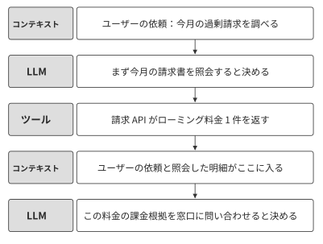
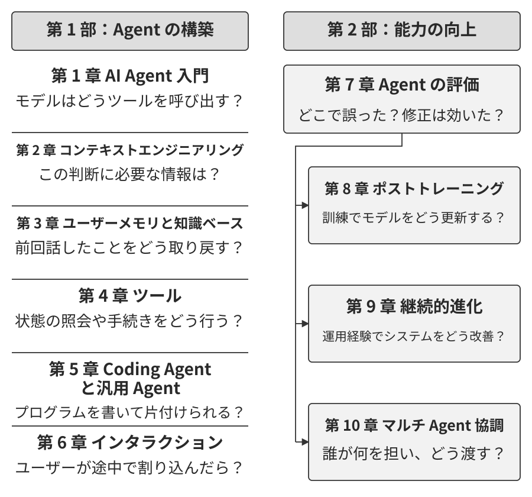

# はじめに {.unnumbered}

2025 年 8 月から 2026 年初めにかけて、私は中国の出版社・図霊（Turing）でオンライン動画講座「Agent 実戦キャンプ」を開講し、説明でき、検証でき、再利用できるエンジニアリングの方法で AI Agent（エージェント）を構築する方法を論じました。講座はまず Agent を動かすところから始め、続いてなぜそのようなアーキテクチャを採るのかを分析します。それぞれの設計がどんな問題を解決し、どんな代償を伴い、どんなタスクに向いているのか、という分析です。本書は、この講座の講義資料と付属の実験をもとにまとめたものです。

> **本書の成り立ち：人と AI の協働の実践**
>
> 講義の準備では、まずアウトラインを Pine の音声 Agent に話して聞かせ、資料を調べさせ、初稿を起こさせました。このような口述による協働を **whisper coding** と呼びます。講義が終わると、受講生がどこでつまずいたか、どの実験の結果が予想外だったかを手がかりに、該当する例や論証を見直しました。

2025 年以降、私は一つの重要な変化を目にしてきました。AI の研究と産業実践の重心が、基盤モデルの能力向上から、Agent に実際のタスクをこなさせる方向へと広がりつつあるのです。それに伴い、モデルの訓練と応用もより密接に結びつくようになりました。DeepSeek-R1 などの推論モデルは、強化学習が数学、プログラミング、推論の能力を高めることを示しました。[^preface-r1] エージェント強化学習（Agentic Reinforcement Learning）はツール呼び出しと環境とのインタラクションを訓練に取り込み、モデルにプログラミングを学ばせるとともに、グラフィカルインターフェースの操作も学ばせます。後者のタスクは一般に Computer Use と呼ばれ、モデルはスクリーンショットから画面の状態を判断し、クリック、入力、スクロールによって操作を行います。一方、Manus、Claude Code、OpenClaw などの製品はユーザーがタスクを直接任せられるようにし、「コード生成 + ファイルシステム」が汎用 Agent をどう支えるかも示しました。

2026 年 9 月、Meta は Muse を発表しました。その頃、中国の内外で個人向け Agent 製品が雨後の筍のように登場しました。本書で扱う問題の多くに、私とチームはそれより早く、Pine を作る中で直面していました。私は Pine AI のチーフサイエンティストとして、同僚たちとともに、消費者に代わって用事を片付けるこの個人向け Agent を開発しました。2025 年 1 月初めには Pine はすでに米国でサービスを開始しており、ユーザーは Pine に頼んで事業者に電話をかけさせ、料金の交渉、返金の申請、サブスクリプションの解約を行えます。

事業者が電話で料金の一部減額に応じたとしても、その場で Pine がユーザーに伝えられるのは「担当者が応じてくれました」ということまでです。「返金されました」と言うには、請求書にその返金が記載されるのを待たなければなりません。こうした用事をこなすには、ユーザーが何を許可したかをモデルに覚えさせ、次に何を確認すべきかを分からせ、用事がどこまで進んだかを見分けさせる必要があります。のちに業界で Skill、Harness、Loop エンジニアリングが語られるようになりましたが、その手法の多くは、私たちがまさにこうした電話の中で手探りで編み出したものです。

- **Skill**：プロンプトは、タスクで必要になったときにだけ読み込むようにしました。ツールが増えてからは、モデルにコマンドラインからツールを呼び出させることで、リクエストのたびにすべてのツール定義を並べなくて済むようにしました。
- **Harness**：実行環境、現在時刻、ユーザーの作業状態をステータスバーに書き込み、モデルが判断する際の参考にしました。モデルは結果をでっち上げたり、ツールを呼び間違えたり、指示を取りこぼしたりすることがあり、危険な操作がユーザーの許可を超えてしまうこともあります。そこで実行過程に制約を加えました。のちに Claude Code にも同様のやり方が見られました。
- **Loop エンジニアリング**：モデルは用事を半分しか片付けていないのに完了を宣言することがあります。そこで、ある Agent に用事を進めさせ、別の Agent に請求書や注文を照合させ、やり残しが見つかれば差し戻してやり直させるようにしました。これが提案者—審査者（Proposer–Reviewer）の分担です。

ほかのモデル・Agent のチームも、似た問題に取り組む中で独自に近い手法にたどり着いています。このことから、私たちのチームが直面した困難の多くは、Agent システムが実用に向かう際に誰もが突き当たる問題なのだと、いっそう確信するようになりました。「Agent 実戦キャンプ」のほかに、私は 2024〜2026 年にわたって中国科学院大学でも Agent 実践の講座を担当してきました。二つの講座の受講生が投げかけた質問は、どの経験をもっと分かりやすく説明すべきかを見極める助けになりました。本書をオープンソースで公開するのも、より多くの研究者やエンジニアにこれらの手法を使い、検証し、改良してもらいたいと考えるからです。

**実践が先、命名が後**。開発チームにとって、これにはもう一つの意味があります。ある用語が業界の共通認識になる頃には、先行するチームはたいていすでに長いあいだ探求を重ねています。自分たちのエンジニアリング上の優位を積み上げるには、実際の事業の中で問題を先回りして見つけ、解決を試みる必要があります。そのためには、二つの条件が鍵になると私は考えています。

**第一に、Agent の能力に十分に高い要求を課す実際の事業を選び、継続的にフィードバックを得ること。** Pine のタスクは数時間から数週間に及ぶことがあり、複数の相手とのやり取りが必要です。長時間の通話、複雑なフォームへの記入、何往復ものメールのやり取りをこなしながら、数字を正確に保ち、操作を制御下に置き、ユーザーの利益を守らなければなりません。こうした場面は、モデルの能力と事業の要求とのギャップを絶えずあらわにし、チームに Harness の改良を促します。ある製品の主な価値が特定の世代のモデルの弱点を補うことだけなら、次のモデルアップグレードでその価値は吸収されてしまうかもしれず、チームは持続的な優位を築きにくくなります。

**第二に、体系的な評価（Evaluation）の仕組みを確立すること。** システムを改修したあとで料金交渉が一度うまくいったとしても、それはアシスタントが的確な質問をしたからかもしれませんし、たまたま当たった担当者に減額の権限があったからかもしれません。同じ事例群で新旧のバージョンを繰り返し比較すれば、差が安定しているかどうかが分かります。第 7 章では、成功基準の設定、評価環境の構築、失敗の分析、変更の検証の方法を具体的に紹介します。

Pine では、料金減額の経験から一つのやり方を学びました。審査者には請求書上のその金額を確認させる、というものです。同じやり方を予約変更に当てはめるなら、新しい航空券が発券されたかどうかを確認することになります。具体的な証拠は事業によって変わりますが、その背後には共通の原則があります。タスクが完了したかどうかは、その行動が外部の世界にどんな結果を残したかで判断する、という原則です。**良い原則はモデルのイテレーションサイクルを越えて生き続けます**。

## 本書の使命 {.unnumbered}

ある人がアシスタントに携帯電話の請求書を渡し、通信事業者に連絡して料金の減額を交渉するよう頼んだとします。始める前に、アシスタントはどの請求項目に異議があるのかを把握しなければなりません。通話中は、相手の説明を聞き取り、条件を問いただせなければなりません。終わったら、担当者が実際に何を約束したのかをユーザーに伝えなければなりません。アシスタントは一歩進むたびに、三つの問いに答える必要があります。この時点でアシスタントは何を知っているのか。どんな行動を取れるのか。何を根拠に次の一歩を選ぶのか。本書はこの三つの問いを出発点として、Agent の構造、構築方法、能力の限界を紹介します。核となる公式は **Agent = LLM + コンテキスト + ツール** です。LLM は理解、計画、意思決定を担い、コンテキストは現在の意思決定に必要な情報を運び、ツールは外部環境とつながって、観測の取得や行動の実行に使われます。

直感的なたとえで言えば、LLM は「脳」、コンテキストは「いまの判断で見渡せる範囲」、ツールは「感覚器官と手足」です。この範囲には環境情報、対話履歴、メモリ、知識が含まれ、システム指示、ツール定義、タスクの状態も含まれます。検索、読み取り、スクリーンショットは情報を持ち帰り、クリック、書き込み、業務インターフェースの呼び出しは外部の状態を変えます。図0-1 は、ある請求内容の問い合わせを分解して示したものです。最初の判断の時点では、モデルはユーザーが料金に疑問を持っていることしか知りませんが、二度目の判断では、どの金額について問い合わせるべきかをすでに特定できています。



強化学習（Reinforcement Learning、RL）に馴染みのある読者は、方策、観測、行動という概念を使ってこの役割分担を理解することもできます。LLM はコンテキストに基づいて次の一歩を選ぶので、その意思決定の機能は方策（Policy）に近いものです。コンテキストは今回の意思決定に使う具体的な観測と履歴を運びます。ツールは観測と行動のインターフェースを提供します。観測空間（Observation Space）はどんな観測が得られうるかを、行動空間（Action Space）はどんな行動が許されるかを記述し、この二つが Agent と環境とのインタラクションの範囲を定めます。[^preface-spaces] 第 1 章ではツール呼び出しの実例を通じてこれらの概念を展開し、本番実装における Model と Harness の役割分担を紹介します。

> **発展的考察：生命から設計された実体へ**
>
> エンジニアリングの実践を離れても、Agent は知的システムの進化について問いを投げかけます。チューリング賞受賞者で強化学習の先駆者である Richard Sutton は、宇宙の進化を塵、恒星、生命、そして「設計された実体」（designed entities）という四つの段階にまとめました。[^preface-sutton] 生物はランダムな変異と自然選択によって進化しますが、設計された実体は、既存の知的システムが目的をもって構築し、改良することができます。
>
> Agent はコードを生成して新しい Agent を構築し、さらに実行時の振る舞いを分析し、修正を提案し、結果を検証することで、少しずつ自己ブートストラップ（bootstrap）と継続的な進化を実現できます。これは、あるプログラマーが別のプログラマーを書き、後者がさらに新しいシステムの構築に加わっていくようなものです。自らを理解し、自らを改良するというこの可能性は、私がコード生成と継続的進化の二つの章を書くうえで最も興味を引かれた問題の一つでもあります。

## 本書の構成 {.unnumbered}

図0-2 は各章のつながりを示しています。たとえば、ユーザーが電話の途中で要望を変えたのに、アシスタントが古い要望のまま用事を進めてしまうなら、左列の第 6 章から読み始め、アシスタントがユーザーの割り込みをどう扱うかを見るとよいでしょう。修正したあと、ほかの通話でもアシスタントが新しい要望を聞き入れられるとどうすれば分かるのでしょうか。そこで右列の第 7 章の評価手法が必要になります。図で第 7 章から分かれる三本の矢印は、評価結果を得たあと、失敗の原因に応じて異なる改善方法を選べることを表しています。



- **第 1 章（AI Agent 入門）** は、製品とツール呼び出しの実例を通じて、中核となる構成要素、実行ループ、Harness、オーケストレーションの方式を紹介し、本書全体を理解するための概念の枠組みを築きます。
- **第 2 章（コンテキストエンジニアリング）** は本書で最も重要な章で、モデルがいま必要とする情報をどう組み立てるかを論じます。プロンプト設計、オンデマンド読み込みから履歴管理までを扱い、KV Cache と結びつけて、これらの手法が回答の品質と実行コストにどう影響するかを説明します。
- **第 3 章（ユーザーメモリと知識ベース）** は、セッションをまたぐ情報をどう保存し、どう取り出すかを論じます。ユーザーメモリから RAG、構造化インデックス、知識の更新までを扱い、永続的な知識の検索と保守の方法を身につけられるようにします。
- **第 4 章（ツール）** は、Agent がどのように観測を得て、行動を実行し、協力を求めるかを論じます。ツールの分類、インターフェース設計、MCP、実行管理を通じて、外部の能力をシステムに接続する方法を理解します。
- **第 5 章（Coding Agent と汎用 Agent）** は、汎用 Agent の中核となるアーキテクチャの考え方を提示します。Coding Agent を実行の中核とし、ファイルシステムを作業空間とするという考え方です。まず開発の流れを説明し、続いてマルチメディアや業務システムなどの事例を通じて、Agent がプログラムを書いて問題を解決し、さらにはツールを生み出し、新しい Agent を構築する仕組みを示します。
- **第 6 章（インタラクション：観測空間と行動空間の拡張）** は、モダリティとタイミングという二つの軸から Agent のインタラクションの方式を論じます。非同期イベント、音声、Computer Use、ロボットを通じて、継続的な観測、速い経路と遅い経路、実行制御を理解します。
- **第 7 章（Agent の評価）** は、システムの性能と一つの変更の効果をどう判断するかに答えます。まず成功基準、環境、データセットを定め、次に検証器、採点、統計分析を説明し、最後に失敗の原因を分析して改善の方向を見つけます。
- **第 8 章（モデルのポストトレーニング）** は、データと環境を使ってモデルの能力をどう更新するかを論じ、データの品質と訓練環境に優先して投資すべきだと主張します。教師ありファインチューニング、強化学習、報酬設計を通じて、模倣による学習と探索がなぜ異なる汎化性能をもたらすのか、またアルゴリズムだけを変えてもなぜ効果が限られがちなのかを説明します。
- **第 9 章（Agent の継続的進化）** は、運用経験を使って Agent の次のバージョンをどう改良するかを論じます。知識、指示、プログラム、パラメータという四種類の更新を比較し、検証、リリース、復旧の流れで長期的な変化を管理します。
- **第 10 章（マルチ Agent 協調）** は、複数のメンバーがいつ付加価値をもたらすのか、そしてどのように分業し、通信し、調整するのかを論じます。まずコンテキストと制御権をどう配分するかを説明し、次に事例を交えて協調の仕組みを解説し、失敗の原因を分析したうえで、Agent 社会と Agent 経済のありうる姿を論じます。

## 本書の読み方 {.unnumbered}

- **Agent 製品をゼロから構築する場合**：全体を通読することをおすすめします。まず第 1〜6 章で用事をこなせるアシスタントを組み上げ、次に第 7 章でそれがどのタスクで誤りやすいかを検証します。残りの三章では、そうした失敗に応じてモデル、システム、あるいはメンバー間の分担をどう改善するかを論じます。
- **まず全体像をつかみたい場合**：第 1、2、4、7 章を順に読んでください。一回のツール呼び出しを追いかけるように読み進めます。まず Agent の実行ループを知り、次にモデルがどんな情報を受け取り、ツールが実際に何をしたかを見て、最後に評価によって結果がユーザーの要求に合っているかを判断します。第 2 章で KV Cache が出てきたら、初読では冒頭の三つの結論をつかむだけにしておき、実験をしてから根底にある原理に戻ってきてもかまいません。
- **モデルの訓練を重点的に学びたい場合**：まず第 1、2 章で Agent の動き方を理解し、そのうえで第 7 章の評価手法と合わせて第 8 章を読んでください。そうすれば、訓練の目標と実際のタスクでの性能を結びつけて考えられます。
- **稼働中の Agent を保守する場合**：第 7 章に沿って、実際のタスクを一揃い選んで評価してください。たとえばアシスタントがユーザーに古い価格を伝えてしまったなら、まずアシスタントが受け取ったのがどの版の見積もりだったかを調べます。知識や手順が古くなっていたのなら、この失敗を手がかりに第 9 章を読んでください。見積もりもツールも十分に与えていて、手順を直してもなおモデルが選択を誤り続けるなら、第 8 章を読み、訓練データを用意する価値があるかを判断してください。

各章には実験と演習問題を用意しています。実験には「実験 X-Y」の形式で番号を付けており、X は章番号、Y は章内の通し番号です。星の数は難易度を表します。★ は入門向け、★★ は一定のエンジニアリング経験が必要、★★★ は開かれた問題や複雑なシステム設計を伴います。大部分の実験には実行可能なコードが付属しており、オープンソースのリポジトリにまとめてあります。

> **付属コードリポジトリ**：`bojieli/ai-agent-book`

初めて実験をするなら、「実験 1-1：コンテキストの決定的な役割」から始めるとよいでしょう。Git を使う場合は、ターミナルで次を実行します。

```bash
git clone https://github.com/bojieli/ai-agent-book.git
cd ai-agent-book
```

リポジトリのページで **Code → Download ZIP** を選んで展開しても、同じディレクトリが得られます。第 1 章の実験一覧（`chapter1/README.md`）で番号 1-1 を探し、`chapter1/context/README.md` を開いてください。以降「実験 X-Y」が出てきたら、リポジトリの `chapterX/README.md` でプロジェクトと実行方法を調べられます。「再現ガイド」では外部プロジェクトとその入手方法を示しており、インストールコマンドやディレクトリの説明は README にまとめてあります。

## 前提知識 {.unnumbered}

本書は、基本的なプログラミング能力を持ち、Agent を理解し構築したいと考える読者を対象としています。実験を手を動かして進めるには、次の基礎が必要です。

**必須：本書全体を読むための基礎**

- **Python プログラミング**：文法、よく使うデータ構造、pip などのパッケージ管理ツールに馴染みがあり、実験コードを読んで修正できること。本書の実験の大部分は Python で書かれています。
- **LLM の使用経験**：ChatGPT、Claude、あるいは類似の製品を使ったことがあり、要望を伝え、返答を読み、さらに質問を重ねるという基本的な流れに慣れていること。
- **ソフトウェアエンジニアリングの常識**：コマンドライン、Git、JSON、REST API を理解しており、それらを使ってプロジェクトを実行し、変更を確認し、インターフェースのデータを読めること。

実験を手を動かして進める際には、Claude Code、Codex、Cursor、TRAE のいずれかを使うことを強くおすすめします。コードのデバッグを手伝わせて、どのファイルを読み、どんなツールを呼び出したかを観察してみてください。のちに実行ループやコンテキスト管理について読むとき、照らし合わせられる実体験が手元にあることになります。

**推奨：章ごとに補うとよい知識**

- **機械学習の基礎（第 8 章）**：訓練と推論、損失関数、勾配降下、過学習を知っていると、モデルの更新過程の理解に役立ちます。
- **基礎数学（第 2、3、7、8 章）**：ベクトルと行列は埋め込みやアテンションの理解に、確率統計は評価指標や期待報酬の理解に役立ちます。本書は直感的な説明と実際の用途に重点を置いています。
- **Web 開発の基礎（第 6 章）**：HTTP、WebSocket、フロントエンドとバックエンドの役割分担を知っていると、非同期イベントのアーキテクチャやリアルタイム音声通信の理解に役立ちます。
- **Transformer の基礎（第 2、8 章）**：アテンションとモデル構造を知っていると、コンテキストの計算やポストトレーニングの理解に役立ちます。体系的に学びたい読者には、『图解大模型：生成式 AI 原理与实战』（Jay Alammar、Maarten Grootendorst 著、李博杰訳、図霊教育〔Turing〕刊。原書は『Hands-On Large Language Models』）をおすすめします。同書は図解によって Transformer、事前学習、ファインチューニングを解説しており、本書のエンジニアリングの視点とよく補い合います。

第 8 章のポストトレーニングを除けば、ほかの章で使う数学や機械学習の知識はわずかです。基本的なプログラミング経験があれば読み始められます。

## 謝辞 {.unnumbered}

本書を編集し、「Agent 実戦キャンプ」の運営に尽力してくださった図霊（Turing）の夢鴿氏と劉美英氏に感謝します。中国科学院大学で Agent 実践の講座を開講してくださった劉俊明先生にも感謝します。二つの講座の受講生と学生の皆さんにも感謝します。皆さんの質問、実験へのフィードバック、提案は、私が説明を改善し続ける助けとなり、これらの概念に対する私自身の理解も深めてくれました。

Pine AI のすべての同僚に感謝します。実際の事業で直面した課題とチームでの議論は、本書の多くの手法と事例の源です。皆さんの実践と見識のおかげで、これらの認識を磨き続けることができました。

AI 業界の友人たちに感謝します。幾度もの意見交換の中で、皆さんは率直に意見を述べ、さまざまな経験や判断を共有して、私がモデルと Agent をより深く理解する助けとなってくれました。

最も感謝すべきは私の家族、とりわけ妻の孟佳穎です。彼女は本書の執筆を終始支えてくれ、原稿にも多くの貴重な意見を寄せてくれました。

[^preface-r1]: DeepSeek-AI, *DeepSeek-R1: Incentivizing Reasoning Capability in LLMs via Reinforcement Learning*, 2025.
[^preface-spaces]: Gymnasium ドキュメントの「Spaces」の節。
[^preface-sutton]: Richard Sutton と Dwarkesh Patel の対談、2025-09-26、「Succession to AI」の部分。
