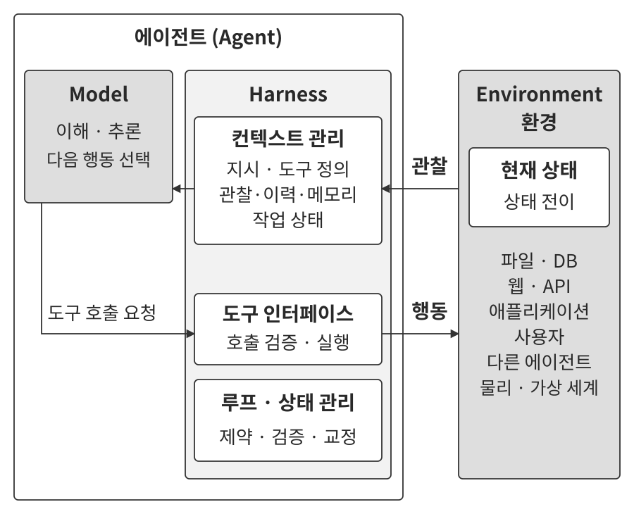
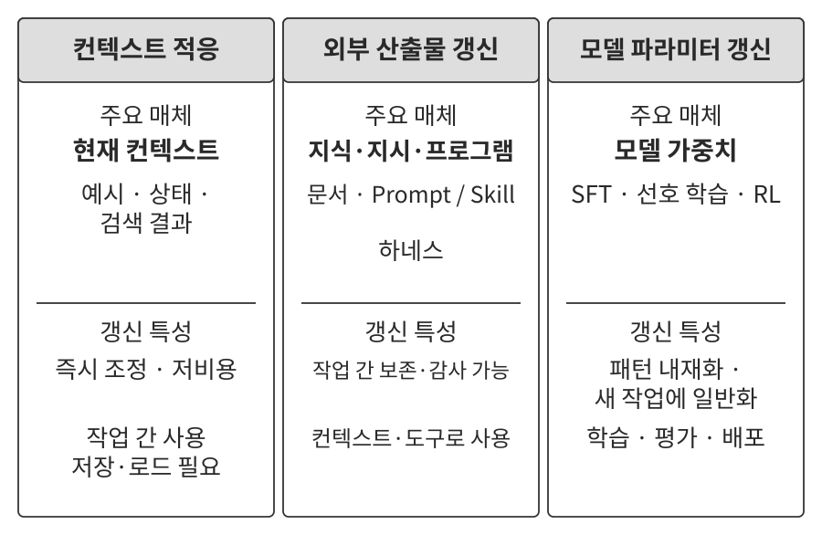
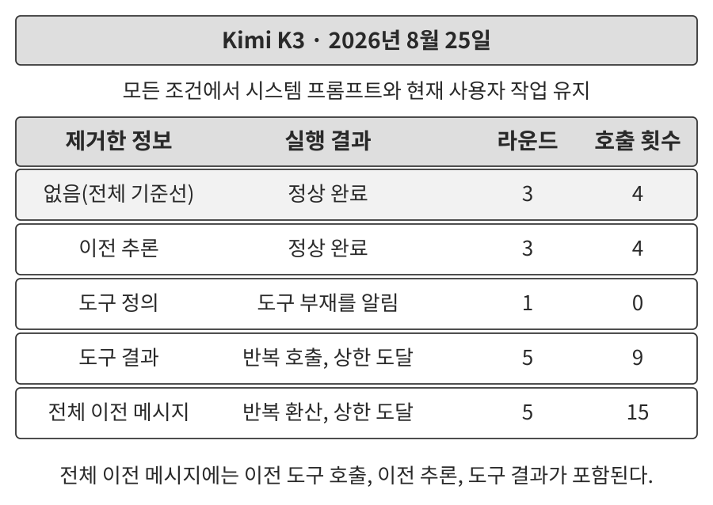
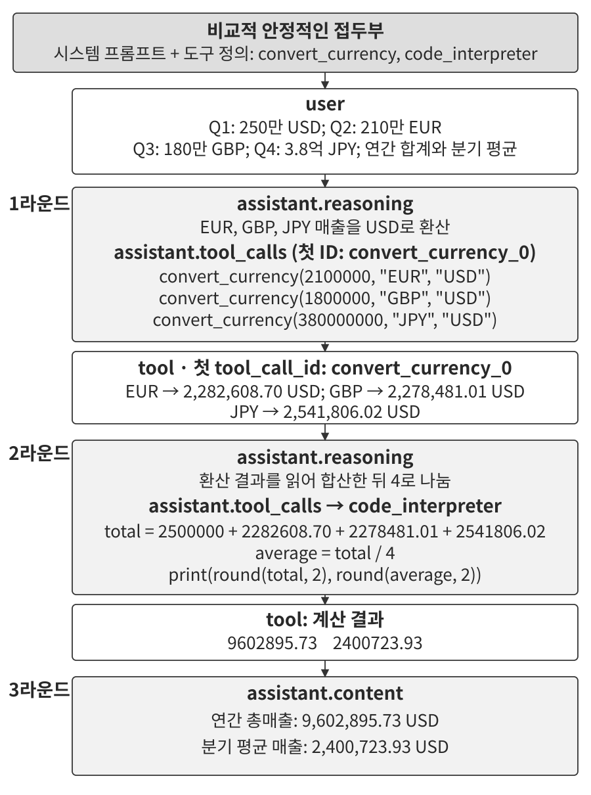
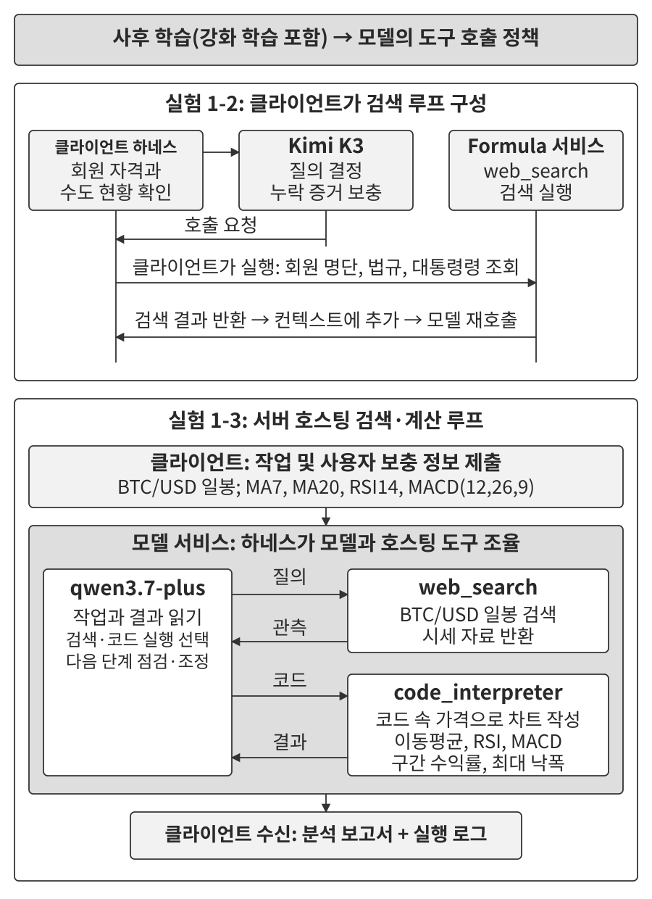
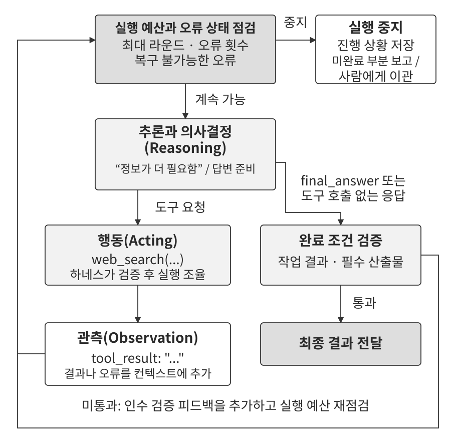
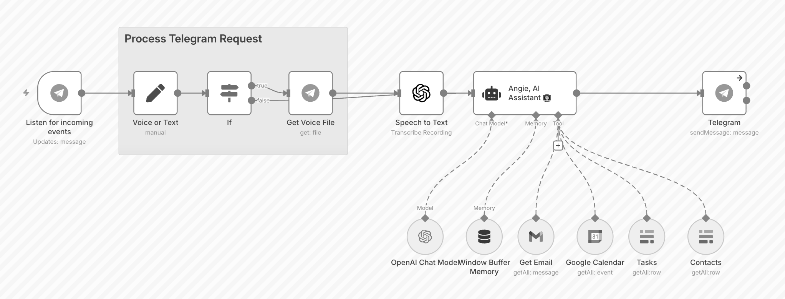

# AI 에이전트 입문

Deep Research로 어떤 주제를 조사하면 검색하고 읽기를 거듭한 끝에 보고서를 정리해 냅니다. Manus는 브라우저를 조작해 온라인 작업을 처리하고, Doubao 스마트폰 어시스턴트는 휴대전화에서 표를 예매하거나 메시지를 보냅니다. Pine AI는 사용자를 대신해 전화를 걸어 통신사와 요금 인하를 협상합니다. 모두 AI 에이전트의 응용입니다.

Cursor로 함수 하나를 고치면 Cursor는 그 함수를 찾아 파일을 편집하고 테스트를 실행합니다. 테스트가 여전히 실패하면 오류 메시지가 다음 수정의 근거가 되고, 테스트가 통과해야 비로소 결과를 보고할 근거가 생깁니다. 검색, 편집, 테스트라는 세 단계의 순서는 미리 프로그램에 적어 둘 수 있습니다. 그러나 정확히 어느 줄을 고칠지, 실패한 뒤 어디로 되돌아갈지는 실행 중에 얻은 정보에 달려 있습니다. 목표를 향해 행동을 고르고 그 결과에 따라 계획을 조정하는 이런 과정은 자료 조사나 전화 협상 같은 작업에서도 똑같이 일어납니다.

## 현대 에이전트 = LLM + 컨텍스트 + 도구

이 책은 현대 에이전트의 세 가지 기능 요소를 공식 하나로 요약합니다. **에이전트 = LLM(대규모 언어 모델, Large Language Model) + 컨텍스트 + 도구**.

- **LLM은 에이전트의 두뇌입니다.** 작업을 이해하고, 단계를 계획하며, 행동을 고릅니다. 사전 학습은 모델에 언어 능력과 세계 지식을 주고, 사후 학습은 지시 따르기, 추론, 도구 호출 같은 행동을 더 다듬습니다. 지도 미세 조정과 강화 학습 같은 사후 학습 방법은 제8장에서 소개합니다.
- **컨텍스트는 에이전트의 현재 의사결정 시야입니다.** 이번 결정에 필요한 정보를 담습니다. 지시, 도구 정의, 환경 관측, 사용자 메모리, 도메인 지식, 이전 메시지, 에이전트 자신의 상태, 작업 진행 상황이 여기에 들어갑니다.
- **도구는 에이전트의 감각 기관이자 손발입니다.** 인터페이스를 통해 정보를 얻거나 작업을 수행합니다. 도구 체계는 정의, 호출 프로토콜, 어댑터로 이루어지며, 검색·읽기·스크린샷 같은 관측 작업과 함께 쓰기, 코드 실행, 하위 에이전트 위임, 사용자와의 소통도 지원합니다.

도구 하나가 여러 역할을 겸할 수도 있습니다. 예를 들어 모델이 명령줄로 파일을 읽으면 반환된 파일 내용이 다음 결정의 근거가 됩니다. 명령줄로 프로그램을 실행하면 파일이나 프로세스의 상태가 바뀔 수도 있습니다.

방금 택배 상자를 뜯은 사용자가 고객 센터에 ‘개봉한 뒤에도 반품할 수 있나요?’라고 묻는다고 해 봅시다. 시스템은 **검색 증강 생성**(Retrieval-Augmented Generation, RAG)으로 매장의 현행 반품 정책을 찾은 뒤, 그 조항에 근거해 답하도록 모델에 요청할 수 있습니다.[^ch1-rag] 질의 한 번을 따라가 보면 각 구성 요소의 역할이 드러납니다. 정책 원문과 색인은 외부 지식 베이스에 저장되어 있습니다. 검색 도구는 질문에 맞는 단락을 찾아내고, 모델을 호출하는 프로그램은 그 단락을 출처와 함께 이번 요청에 넣습니다. 모델은 ‘개봉’ 항목을 읽고 조항을 설명할 수 있습니다. 조항이 상품 종류별로 다르다면 무엇을 샀는지부터 물어야 합니다.

[^ch1-rag]: Patrick Lewis 외, Retrieval-Augmented Generation for Knowledge-Intensive NLP Tasks, NeurIPS, 2020.

이 반품 문의에서 검색을 시작하는 것은 에이전트의 행동이고, 돌아온 조항은 에이전트가 환경(Environment)에서 얻은 관측입니다. 다음에 답할지 되물을지는 조항의 내용에 따라 정해집니다. 이것이 강화 학습과 제어 이론에서 말하는 폐루프이며, 그림 1-1에 나타나 있습니다.



그림의 바깥층은 에이전트와 환경의 경계를 나눕니다. 파일, 데이터베이스, 웹 페이지, 사용자, 다른 에이전트, 물리 세계나 시뮬레이션 세계가 모두 에이전트가 상호작용하는 환경이 될 수 있습니다. 그림의 안쪽 층은 실제 운영 구현의 역할 분담을 보여 줍니다. **모델은 이해, 추론, 의사결정을 맡습니다. 하네스(Harness)는 에이전트 경계 안, 모델 바깥에 자리 잡고 컨텍스트, 도구 인터페이스, 실행 루프와 상태를 조직하며 제약, 검증, 교정을 수행합니다.** 하네스는 환경을 만들거나 격리하거나 대신 중개할 수 있습니다. 파일 내용이나 프로세스 상태 같은 것은 행동에 따라 환경 안에서 바뀝니다.[^ch1-harness]

[^ch1-harness]: LangChain의 「The Anatomy of an Agent Harness」와 Anthropic의 「Effective harnesses for long-running agents」를 참고하십시오. 샌드박스까지 하네스에 포함하는 구현도 있습니다. 그림 1-1은 행동이 실제로 무엇을 바꾸었는지 추적하기 쉽도록 환경을 따로 그렸습니다.

따라서 이 책은 서로 보완하는 두 가지 분해 방식을 씁니다. **‘LLM + 컨텍스트 + 도구’는 기능 구성을, ‘모델 + 하네스’는 운영 구현을 설명합니다.** 컨텍스트는 하네스가 조직해 모델에 제공하고, 도구 호출은 모델이 결정하면 하네스가 검증하고 스케줄링한 뒤 도구나 환경에 넘겨 실행합니다. 단순한 시스템은 컨텍스트 조립과 도구 스케줄링에서 출발해, 운영에 필요한 제약·검증·교정 메커니즘을 차례로 갖춰 갈 수 있습니다.

강화 학습에 익숙하다면 ‘누가 다음 단계를 정하는가, 무엇을 근거로 정하는가, 어떻게 행동으로 옮기는가’라는 세 질문으로 아래 표를 읽을 수 있습니다. 기능에 따라 대략적으로 비유한 것입니다.

| 직관적 이해 | 엔지니어링 요소 | 강화 학습의 관련 개념 | 의미 |
|-----------|-----------|----------------------------|----------------------------------------------|
| **두뇌** | LLM | **정책**(Policy) | 현재 정보를 바탕으로 다음에 무엇을 할지 결정합니다 |
| **현재 의사결정 시야** | 컨텍스트 | **관측과 기록** | 환경이 돌려준 정보와 기존 기록을 의사결정의 근거로 조직합니다 |
| **감각 기관과 손발** | 도구와 어댑터 | **관측·행동 인터페이스** | 환경 정보를 읽는 방법, 행동을 내보내는 방법, 호출과 반환의 형식을 정합니다 |

### 관측 공간과 행동 공간: 모델과 세계를 잇는 인터페이스

**관측 공간은 에이전트가 받을 수 있는 관측을, 행동 공간은 에이전트가 내보낼 수 있는 행동을 기술합니다.** 한 번의 호출에서 컨텍스트는 구체적인 정보를 싣고, 사용할 수 있는 도구는 환경과 상호작용하는 인터페이스를 제공합니다. 도구 외에도 사용자 입력이나 이벤트 알림이 관측을 가져올 수 있습니다. 도구 호출의 파라미터, 권한, 실행 환경은 함께 행동의 범위를 제한합니다.

두 가지 고장을 각각 떠올려 봅시다. 첫째, 모델은 청구서의 모든 요금 항목을 설명할 수 있지만 이번 달 청구서를 손에 넣지 못합니다. 사용자가 조회를 허락한 뒤에도 누군가 청구서를 찾아 모델에 넘겨야 모델은 어느 요금에 이의가 있는지 판단할 수 있습니다. 둘째, 사용자가 요금제 변경을 부탁해 어시스턴트가 알맞은 요금제를 이미 찾아 두었지만, 계정 인터페이스는 조회만 허용합니다. 청구서를 다시 읽어도 변경은 처리할 수 없으며, 그에 맞는 작업 권한이 따로 필요합니다. 하네스가 하는 일은 읽어 온 자료를 컨텍스트에 넣고, 모델이 고른 행동을 받아 파라미터와 권한을 확인한 뒤 실행을 스케줄링하는 것입니다.

따라서 **기반 모델이 고정되어 있을 때 관측 공간과 행동 공간을 조정하는 것은 작업 성과를 높이는 중요한 엔지니어링 수단입니다.** 모델이 핵심 사실을 놓친다면 관련 데이터를 컨텍스트에 넣으면 됩니다. 모델이 비슷한 도구를 자주 잘못 고른다면 중복된 인터페이스를 합치거나 현재 작업에 필요한 도구만 불러오면 됩니다.

영상을 볼 때는 반대 문제가 생깁니다. 화면은 계속 있지만 다시 판단할 만한 변화는 많지 않습니다. 어시스턴트가 파일 업로드를 기다린다고 해 봅시다. 진행 표시줄이 조금 움직일 때마다 주 모델을 호출하면 계산만 쓸데없이 늘어납니다. 10초마다 한 번씩만 보면 잠깐 나타났다 사라지는 실패 알림을 놓칠 수 있습니다. **필자는 관측 공간의 희소화가 에이전트 설계의 기본 문제 가운데 하나라고 봅니다.** 시스템은 환경을 계속 관찰하되, 다음 행동을 바꿀 수 있는 변화만 필요한 컨텍스트와 함께 주 모델에 넘기면 됩니다.

**Manus: 한 작업 안에서 조사, 프로그래밍, 컴퓨터 조작을 결합하다.** Deep Research는 검색과 읽기에 강하고, 코딩 에이전트는 코드를 작성하고 실행하며, Computer Use 에이전트는 화면을 조작합니다. Manus는 브라우저, 파일 시스템, 코드 실행, 명령줄을 클라우드 샌드박스에 통합해, 에이전트 하나가 먼저 자료를 찾고, 이어서 파일을 처리하고 코드를 실행한 뒤, 마지막으로 브라우저에서 작업을 마치게 했습니다. 브라우저와 파일 읽기는 얻을 수 있는 정보를 늘렸고, 코드와 명령 실행은 조합할 수 있는 작업을 늘렸습니다. **필자는 이 조합이 범용 에이전트의 중요한 돌파구라고 봅니다. 하나의 에이전트가 원래 나뉘어 있던 제품 경계를 넘어 자료 확보, 데이터 처리, 작업 실행을 하나의 완결된 작업으로 이을 수 있기 때문입니다.**

**OpenClaw: 사용자의 디지털 생활로 인터페이스를 넓히다.** OpenClaw는 WhatsApp, Telegram, Slack, Discord, iMessage 같은 메시징 채널로 작업을 받고 결과를 돌려주며, 사용자 기기에서 실행되는 Gateway로 메시징 채널, 모델, 도구를 연결합니다. 해당 도구를 구성하고 권한을 받으면 에이전트는 로컬 파일을 처리할 수도 있고 Google Drive나 Notion 같은 클라우드 서비스에 접속할 수도 있습니다. 여러 계정과 기기에 흩어진 사용자의 자료가 이렇게 하나의 작업 처리 과정에 들어올 수 있습니다. 초기 Manus는 주로 클라우드 샌드박스 안에서 작동해 사용자가 파일을 업로드해야 했습니다. 이후 추가된 Google Drive 커넥터와 My Computer 데스크톱 기능은 클라우드 파일과 로컬 자원으로 접근 범위를 더 넓혔습니다. 이러한 발전은 제품 능력의 성장이 관측·행동 인터페이스의 확장에서 나오는 경우가 많다는 것을 보여 줍니다[^ch1-agent-products].

[^ch1-agent-products]: 제품 구조는 Manus 공식 Sandbox 소개, Google Drive Connector 소개, My Computer 소개, 그리고 OpenClaw 공식 저장소와 도구 문서를 참고하십시오. 구체적으로 접근할 수 있는 자원은 커넥터, 도구 구성, 사용자 권한 부여에 따라 정해집니다.

제품마다 작업은 다르지만, 의사결정 근거, 사용할 수 있는 작업, 실행 전략이라는 세 측면에서 모두 이해할 수 있습니다.

| 에이전트 제품 | 컨텍스트의 주요 정보 | 사용할 수 있는 도구와 작업 | 실행 전략 |
|----------------|----------------------|----------------------------|------------------------------|
| **Cursor 등 코딩 에이전트** | 요구 사항, 코드 조각, 디렉터리 목록, 터미널 출력 | 코드 검색, 파일 읽기·쓰기, 명령 실행 | 요구 사항 이해 → 관련 코드 검색 → 코드 편집 → 테스트와 검증 → 디버깅과 수정 |
| **Deep Research 등 검색 에이전트** | 검색 결과, 웹 페이지 내용, 논문 초록과 인용 | 검색 질의, 웹 페이지 읽기, 보고서 생성 | 확보한 정보에 따라 검색 방향을 조정하며 완전한 보고서를 점진적으로 종합 |
| **Browser Use 등 컴퓨터 조작 에이전트** | 화면 스크린샷, DOM 또는 접근성 트리, 작업 결과 | 클릭, 입력, 스크롤, 스크린샷, 코드 실행 | 화면 읽기 → 목표 요소 식별 → 작업 수행 → 결과 검증 |
| **Doubao 등 스마트폰 어시스턴트 에이전트** | 휴대전화 스크린샷, 앱 화면 상태, 시스템 피드백 | 클릭, 스와이프, 입력, 앱 실행 | 요구 사항 이해 → 대상 앱 찾기 → 작업 수행 → 완료 확인 |
| **Pine AI, Meta Muse 등 개인 업무 에이전트** | 권한을 받아 읽은 계정 기록, 청구서, 서비스 제공자 자료 | 전화, 이메일, 양식 작성, 사용자 확인 | 정보 수집 → 협상 전략 수립 → 서비스 제공자 연락 → 협상 → 결과 보고 |

**맡긴 일은 어떻게 실행할 수 있는 작업이 될까요?** 필자가 Pine에서 개인 업무 어시스턴트를 만들 때 보니, 사용자는 목표 하나만 말하는 경우가 많았습니다. 예를 들어 ‘출장 갈 항공권을 예약해 주세요. 1,200위안을 넘지 않으면 좋겠어요’ 같은 식입니다. 어시스턴트는 먼저 날짜, 목적지, 이번 일정에서 가장 중요한 것이 무엇인지 파악하고, 빠진 자료를 모은 뒤, 어떻게 처리할지와 어떤 조건은 조정할 수 있는지를 사용자와 분명히 정하고 나서야 서비스 제공자에게 연락합니다. 일을 처리하며 알게 된 새 사정 때문에 작업이 앞 단계로 되돌아갈 수도 있습니다.

상담원이 찾은 최저 운임이 1,250위안이라고 해 봅시다. 모델은 상식, 이번 일정, 기억하고 있는 사용자의 습관을 종합해 판단합니다. 출장 중이고 평소 알맞은 일정이라면 돈을 조금 더 쓰는 편인 사용자라면 Pine은 바로 예약할 수 있습니다. 가족 여행이고 예전부터 총비용에 신경 쓴다고 분명히 밝힌 사용자라면, 먼저 차액을 알리고 상담원에게 다른 항공편을 계속 찾아 달라고 할 수 있습니다. 사용자가 나중에 ‘다음에 예산을 넘는 표가 나오면 먼저 물어봐 주세요’라고 덧붙이면, 이 피드백은 다음 판단에 일반적인 경험보다 더 구체적인 근거가 됩니다.

장면을 바꿔 봅시다. 은행 상담원이 서류를 집으로 보내 주겠다고 제안했는데, 어시스턴트는 사용자가 해외여행 중이라는 것을 기억합니다. 이번에 바꿔야 할 것은 전달 방식입니다. 그 자리에서 수령이 어렵다고 설명하고 이메일로 받을 수 있게 요청할 수 있습니다. 요금 감면도 봅시다. 상담원이 전화로 구두 약속을 하면 어시스턴트는 업체의 약속을 정확히 보고할 수 있습니다. 그러나 금액이 실제로 차감되었는지 확인하려면 다음 청구서라는 새로운 관측이 필요합니다. 어시스턴트의 행동 공간은 실제 전화까지 넓어질 수 있지만, 그 결론은 여전히 관측 공간의 제약을 받습니다.

맡기는 일을 기준으로 보면 이 책에서는 세 가지 응용을 만납니다. 생활 대행, 협업 업무, 과학 탐구입니다. 어시스턴트 하나가 여러 종류의 작업을 맡을 수 있으며, 차이는 누가 권한을 주는지, 무엇을 바꿀 수 있는지, 마지막에 누가 결과를 검수하는지에 있습니다. 사무실로 가 봅시다. 동료 한 명이 검토 결과를 돌려주면 그 티켓을 닫아도 될까요? 프로젝트 책임자가 Multica의 티켓에서 어시스턴트를 지목해 예산표의 차액 하나를 확인해 달라고 했다고 해 봅시다. 이 댓글은 확인 작업을 시작시키지만, 티켓은 여전히 원래 책임자의 것이고 상태도 그대로 유지됩니다. 어시스턴트는 두 곳의 금액과 그 출처를 돌려주어 동료의 질문에 답했습니다. 그러나 예산 전체를 제출해도 되는지는 책임자가 나머지 할 일까지 함께 보고 판단해야 합니다.[^ch1-multica]

과학 연구 작업에도 같은 질문을 던질 수 있습니다. 무엇을 근거로 진전이 있다고 판단할까요? Google DeepMind의 AlphaEvolve가 행렬 곱셈 알고리즘을 탐색할 때, 모델은 후보 프로그램을 제안하고 평가기는 그 프로그램을 실행해 곱이 올바르게 계산되었는지, 곱셈을 몇 번 썼는지 확인합니다. 이후 탐색은 성적이 좋은 프로그램을 이어서 개선할 수 있습니다. 연구팀은 그중 한 알고리즘이 스칼라 곱셈 48번으로 $4\times 4$ 복소수 행렬 두 개의 곱셈을 마칠 수 있다고 보고했습니다. ‘곱셈을 몇 번 덜 했다’는 것은 셀 수 있는 대상이 분명하며, 알고리즘은 여전히 올바른 행렬 곱을 계산해야 합니다.[^ch1-alphaevolve]

[^ch1-multica]: Multica, 티켓 댓글에서 에이전트를 지목하는 기능. 협업 중에 일시적인 도움 요청과 책임 이전을 어떻게 구분하는지는 제10장에서 다룹니다.

[^ch1-alphaevolve]: Google DeepMind, AlphaEvolve 연구 소개, 2025년 5월. 여기서 곱셈 횟수는 알고리즘의 스칼라 곱셈 횟수를 뜻하며, 실제 실행 시간은 구현과 하드웨어에 따라서도 달라집니다.

이 시스템들의 행동 공간은 **개방형**이라는 특징을 가집니다. 검색어, 입력 텍스트, 생성한 코드, 작업의 조합은 미리 다 열거하기 어렵지만, 각 행동은 여전히 도구, 파라미터, 권한, 실행 환경의 제약을 받습니다. 그렇기 때문에 실행할 수 있는 계획이라면 새로운 관측이 다음 단계를 바꿀 여지를 남겨 두어야 합니다.

### 도구: 에이전트의 감각 기관이자 손발

도구는 모델의 결정을 외부 환경에 대한 읽기나 조작으로 옮깁니다. 검색과 읽기 도구는 관측을 가져오고, 파일 쓰기나 명령 실행 같은 도구는 행동을 실현합니다. 모델은 반환 결과로 작업의 효과를 알게 되고, 그에 따라 계속할지, 다시 시도할지, 작업을 끝낼지를 정합니다.

이 책은 주된 용도에 따라 도구를 다섯 유형으로 나눕니다. 인터페이스 하나가 여러 용도를 겸할 수도 있습니다. 예를 들어 음성 통화는 정보를 얻는 데도, 요청을 전하는 데도 쓰입니다.

**인식 도구**는 정보를 얻습니다. 검색 엔진은 웹 자료를 제공하고, 파일 읽기 도구는 로컬 문서에 접근하며, API와 데이터베이스 인터페이스는 외부 서비스와 기업 데이터에 연결합니다.

**실행 도구**는 작업을 수행합니다. 코드를 실행하고, 파일을 수정하고, 시스템 명령을 실행하거나 외부 API를 호출해 결정을 환경에 반영합니다.

**협업 도구**는 분업과 조율을 지원합니다. 전문 작업을 하위 에이전트에 위임하고, 결과를 모으고, 여러 에이전트의 작업을 조율합니다. 사람이 결정에 참여해야 할 때는 사용자 소통 인터페이스를 통해 확인을 요청할 수도 있습니다.

**이벤트 트리거 도구**는 외부 이벤트를 실행 과정에 연결합니다. 새 이메일, 예약 시각의 도래, Webhook 콜백이 모두 작업을 시작시킬 수 있습니다. 이벤트 어댑터는 이런 입력을 에이전트가 처리할 수 있는 관측으로 바꾸고, 스케줄링 메커니즘은 실행을 시작하거나 재개합니다. 트리거 규칙은 개발자가 구성할 수도 있고, 허가받은 도구 호출로 등록할 수도 있습니다.

**사용자 커뮤니케이션 도구**는 사용자에게 정보를 전하고 피드백을 받습니다. 문자 메시지 전송, 음성 통화, 이메일 발송 등이 있습니다. 진행 상황을 보고하고 확인을 요청하는 데 쓰이며, 사용자에게 처리할 일을 먼저 알려 줄 수도 있습니다.

제4장에서 이 다섯 유형의 도구 설계를 자세히 다룹니다. 인터페이스 정의는 모델이 도구를 올바르게 고르고 파라미터를 채울 수 있는지에 영향을 주고, 오류 처리는 실패한 뒤 계속 진행할 수 있는지를 결정하며, 권한 제어는 작업의 영향 범위를 제한합니다. MCP(Model Context Protocol, 모델 컨텍스트 프로토콜)는 도구 발견과 호출에 통일된 연결 방식을 제공해 시스템 간 적응 작업을 줄여 줍니다.

**도구 호출**(Tool Calling)은 모델이 약속된 형식으로 작업 요청을 내는 능력입니다. 흔히 쓰이는 함수 호출(Function Calling)은 도구 이름과 구조화된 파라미터로 요청을 표현합니다. 이 책에서는 일관되게 ‘도구 호출’이라는 용어를 사용합니다.

베이징 날씨 조회를 예로 들어 봅시다. 모델은 도시 이름을 쓸 수 있지만, 실제 기온은 하네스가 조회를 실행한 뒤에야 컨텍스트에 나타납니다. 이 호출의 네 단계 메시지는 다음과 같습니다.

```text
第一步：声明工具                    第二步：模型决定调用
tools: [{                          assistant: {
  name: "get_weather",               tool_calls: [{
  parameters: {                        id: "call_1",
    city: "string"                     function: "get_weather",
  }                                    arguments: {city: "北京"}
}]                                   }]
                                   }

第三步：结果追加到上下文              第四步：模型基于结果回复
tool: {                            assistant: {
  tool_call_id: "call_1",              content: "北京今天 28°C，晴。"
  content: '{"temp":28,"sky":"晴"}'  }
}
```

여기서 `call_1`은 도구 반환값을 호출 요청과 연결합니다. 개발자는 도구를 어떻게 호출하는지 설명하고, 날씨를 조회하는 함수를 작성하며, 조회 결과를 모델에 돌려줍니다. 호출할지, 어떤 도구를 호출할지, 어떤 파라미터를 넘길지는 모델이 정합니다. API 메시지 구조는 제2장에서 더 자세히 소개합니다.

도구를 설계할 때는 딱 필요한 만큼의 능력부터 제공하면 됩니다. 사칙연산에는 파라미터가 명확한 계산기로 충분합니다. 작업이 표 읽기, 결측값 정리, 통계 계산, 그래프 그리기로 넓어지면 제한된 Python 코드 인터프리터가 이 단계들을 조합하기에 더 편리합니다. 범용 능력이 커지면 격리와 자원 관리도 따라가야 합니다. 코드는 샌드박스에서 실행하고, 네트워크 접근은 기본적으로 막으며, 파일 접근은 허가된 작업 디렉터리로 제한하고, 실행 시간·CPU·메모리·출력 크기에 상한을 둡니다.

실행 과정 하나를 기록하는 데는 단일 로깅 도구를 쓸 수 있습니다. 몇 시간에서 며칠씩 이어지는 작업이라면 통제된 가상 작업 디렉터리에 계획, 중간 결과, 실행 로그, 최종 산출물을 보관해 에이전트가 여러 번의 실행에 걸쳐 일을 이어 가게 하는 편이 알맞습니다. 이 디렉터리는 읽고 쓸 수 있는 경로, 용량, 파일 유형을 제한하고, 경로가 허가된 경계를 벗어나지 않는지 검사해야 합니다.

결제, 데이터 삭제, 이메일 발송, 프로덕션 배포 같은 작업은 위험이 높거나 분명한 비즈니스 규칙이 있습니다. 이런 작업은 파라미터가 명확하고 권한이 제한되며 전 과정을 감사할 수 있는 전용 도구로 감싸고, 필요하면 미리보기와 사람의 확인을 더하는 것이 좋습니다. **범용 기반 능력은 조합과 탐색을 뒷받침하고, 전용 도구는 위험한 작업의 제약과 비즈니스 규칙을 실현합니다.**

### LLM: 에이전트의 두뇌

LLM은 에이전트의 의사결정 핵심입니다. 요청을 받으면 먼저 사용자의 말에서 목표와 제약을 알아내고, 복잡한 작업을 실행할 수 있는 단계로 나눕니다. 실행 중에도 다음에 무엇을 할지, 도구를 호출할지, 어떤 도구를 고르고 파라미터를 어떻게 채울지 판단해야 합니다. 이 능력은 사전 학습으로 쌓은 지식과 언어 능력을 바탕으로 하며, 사후 학습을 거쳐 작업에 알맞은 의사결정 행동으로 다듬어집니다. 워크플로와 자율 에이전트 모두 이런 판단이 필요하며, 실제 작업은 하네스, 도구, 환경을 통해 이루어집니다.

행동하기 전의 계획과 추론은 에이전트가 방안을 비교하고 결과를 예측하며 쓸데없는 시도를 줄이는 데 도움이 됩니다. 예를 들어 모델은 수학 법칙으로 계산 과정을 점검하고, 인과관계로 고장을 분석한 뒤, 의존 관계에 따라 작업 순서를 정할 수 있습니다. 모델은 추론 속에서 여러 방안을 먼저 비교하고, 행동을 정한 뒤 도구에 실행을 요청합니다. 전통적인 강화 학습 시스템도 학습한 정책, 가치 함수, 환경 모델, 계획 알고리즘으로 탐색을 조직할 수 있습니다. LLM 에이전트의 특징은 구체적인 작업을 시작하기 전에 이미 대규모 사전 학습으로 폭넓은 지식과 문제 해결 패턴을 갖추고 있으며, 사후 학습이 이 능력을 쓰는 방식을 더 강화한다는 데 있습니다.

#### 모델 네이티브 도구 호출

업계는 ‘모델이 곧 에이전트’(Model as Agent)라는 말로 한 가지 흐름을 요약합니다. 계획과 도구 호출 결정을 점점 더 많이 모델이 맡는다는 것입니다. 사후 학습, 특히 강화 학습을 거치면 모델은 언제 도구를 호출할지, 어떤 도구를 호출할지, 어떤 파라미터를 넘길지, 결과를 받은 뒤 어떻게 이어 갈지를 배울 수 있습니다. 개발자는 목표, 인터페이스, 제약을 제공하고, 모델은 작업 진행에 따라 구체적인 단계를 정합니다.

모델의 자율적 결정에는 하네스의 뒷받침이 필요합니다. 하네스는 본래 고삐나 마구처럼 말의 힘을 수레에 전하고 방향을 잡는 장구를 뜻합니다. 에이전트에서 하네스는 모델의 능력을 지속적으로 실행되는 작업 과정으로 조직하며, 컨텍스트 관리, 도구 인터페이스, 제약, 검증, 교정을 맡습니다. 이 장 후반부에서 이 다섯 가지 기능을 하나씩 소개합니다.

모델이 스스로 정할 수 있는 작업이 많아질수록 오류가 미칠 수 있는 범위도 넓어집니다. 그래서 모델과 하네스는 함께 최적화해야 합니다. 모델은 계획과 도구 선택의 품질을 높이고, 하네스는 권한을 관리하고 결과를 확인하며 실패를 처리합니다. 모델 제공업체는 두 부분을 동시에 개선할 수 있으며, 이런 협조적 반복 개선은 중요한 엔지니어링 강점이 됩니다.

> **모델 능력과 하네스의 진화**
>
> Rich Sutton은 「쓰라린 교훈」(The Bitter Lesson)에서 AI 연구의 장기적 흐름을 돌아봤습니다. 더 많은 계산 자원을 활용할 수 있는 탐색과 학습 방법이 사람이 손으로 설계한 도메인 지식에 크게 기대는 방법을 점차 앞질렀다는 것입니다[^ch1-1]. 이 방향을 따르면 도구 선택이나 단계 배치처럼 한때 외부 절차가 맡던 결정도 학습을 통해 점차 모델 안으로 내재화될 수 있습니다.
>
> 이 책의 입장은 **방향에는 동의하되, 속도는 현실적으로 본다**는 것입니다. 모델은 하네스의 의사결정 책임 일부를 계속 넘겨받겠지만, 학습과 배포 한 주기에는 시간이 걸리고 비즈니스 규칙과 사용자 선호는 끊임없이 바뀝니다. 실제 업무의 제약을 모델 파라미터에 한 번에 모두 담기도 어렵습니다. 그래서 모델이 아직 안정적으로 해내지 못하는 부분은 하네스가 먼저 메웁니다. **현재 모델의 능력 경계가 곧 현재 하네스의 가치가 있는 곳입니다.** 이 분업은 모델 능력에 따라 달라집니다. 모델이 어떤 종류의 결정을 익힐 때마다 하네스는 그에 해당하는 오케스트레이션을 줄이고 새로운 어려움에 눈을 돌릴 수 있습니다. 권한 집행, 상태 영속화, 결과 검증은 계속 실행 시스템이 맡습니다.

[^ch1-1]: Sutton, Rich. The Bitter Lesson, 2019.

#### 에이전트의 학습 메커니즘: 컨텍스트 적응에서 지속적 업데이트까지

도구가 오류를 내자 에이전트는 이번에는 다른 경로로 파일을 찾는 법을 익혔습니다. 내일 새 세션에서도 이 교훈을 기억할까요? 그림 1-2를 따라 이 경험이 어디에 저장되는지 보면 세 가지 서로 다른 업데이트를 구분할 수 있습니다.



**컨텍스트 적응**은 작업을 실행하는 중에 일어납니다. 모델은 예시, 작업 상태, 검색 결과를 읽은 뒤 이후 행동을 조정할 수 있습니다. 예를 들어 도구가 파일이 없다고 반환하면 모델은 경로를 다시 찾은 뒤 작업을 이어 갈 수 있습니다. 이 경로는 반응이 빠르고 비용이 낮으며, 효과는 컨텍스트 창의 용량과 정보 구성 방식에 달려 있습니다. 경험을 이후 작업에 쓰려면 관련 정보를 저장했다가 모델에 다시 제공해야 합니다. 컨텍스트 구성 방법은 제2장에서 소개합니다.

**외부 산출물**(artifact)은 경험을 작업 간에 보존할 수 있습니다. 사실과 경험은 지식 문서에, 언어로 표현할 수 있는 전략은 프롬프트나 스킬에, 결정적인 절차와 제약은 프로그램이나 하네스 로직에 기록합니다. 이런 산출물은 감사하고 수정하기 쉬우며, 실행 시에는 컨텍스트나 도구 인터페이스를 통해 의사결정과 실행에 참여합니다. 제3장부터 제5장까지는 이에 필요한 지식과 프로그램의 기초를 소개하고, 제9장은 평가를 거친 실행 궤적에서 업데이트를 생성·검증·배포하는 방법을 다룹니다.

**모델 파라미터**는 학습으로 업데이트됩니다. 의료 영상 이해, 언어 스타일, 암묵적인 의사결정 정책 같은 능력에는 하나하나 규칙으로 적기 어려운 패턴이 많이 담겨 있어, 사후 학습으로 데이터와 피드백에서 배울 수 있습니다. 파라미터 업데이트에는 학습, 평가, 배포에 드는 투자가 필요하며, 목표는 모델이 새로운 작업에서도 배운 능력을 쓸 수 있게 하는 것입니다. 관련 방법은 제8장에서 자세히 다룹니다.

한 번의 실패를 먼저 눈앞의 작업을 바로잡는 데 쓰고, 나중에 프로젝트 설명으로 정리해 다음 에이전트가 참고하게 할 수 있습니다. 같은 종류의 오류가 여러 프로젝트에서 되풀이된다면 그 사례들을 학습에 쓸 수도 있습니다.

### 컨텍스트: 에이전트의 현재 의사결정 시야

사람이 결정을 내릴 때는 작업 설명, 참고 매뉴얼, 소통 기록, 최신 데이터를 한데 모아 봅니다. 에이전트에도 이런 정보의 묶음이 필요하며, 이것이 컨텍스트입니다. LLM 호출 한 번이 받을 수 있는 정보의 양은 컨텍스트 창에 제한되며, 그 안에 무엇을 넣고 어떻게 구성할지는 하네스가 맡습니다. API 관점에서 이 책의 기본 구현은 다섯 종류의 정보를 담습니다.

- **시스템 프롬프트**(System Prompt): 개발자나 하네스가 작성하며, 에이전트의 정체성, 작업 경계, 행동 원칙을 설명합니다. 프롬프트 엔지니어링은 이 지시를 조정해 작업 방식을 형성합니다. 시스템 프롬프트는 세션 내내 비교적 안정적으로 유지될 수도 있고, 제품 구성에 따라 선호, 과거 행동, 배경 정보 같은 세션 간 사용자 메모리를 넣거나 현재 환경 상태를 주입할 수도 있습니다. 실제 권한은 하네스와 환경의 접근 제어가 집행합니다. 사용자 메모리는 제3장에서 소개합니다.
- **도구 정의**(Tool Definitions): 사용할 수 있는 도구의 이름, 기능, 파라미터 형식을 선언해 모델이 작업을 고르고 요청을 구성하도록 돕습니다. 이 책의 기본 구현에서 도구 정의는 시스템 프롬프트와 함께 요청 앞부분에 놓여 비교적 안정적인 접두부를 이룹니다. 도구가 많을 때는 전체 schema를 필요할 때 불러오면서 기존 접두부를 유지할 수도 있습니다. 이 방법은 제2장과 제4장에서 다룹니다.
- **사용자 메시지**(User Messages): 사용자의 작업과 추가 입력을 담으며, RAG(검색 증강 생성, Retrieval-Augmented Generation)로 얻은 외부 지식을 붙일 수도 있습니다. 학습 데이터 기준일 이후의 정보나 비공개 도메인 자료가 그런 예입니다. 검색과 지식 구성은 제3장에서 소개합니다.
- **모델 응답**(Assistant Messages): 사용자에게 보여 주는 텍스트 `content`, 도구 호출 요청 `tool_calls`, 그리고 서비스가 제공하는 추론 정보를 담습니다. 이 책은 추론 정보를 `reasoning`으로 줄여 씁니다. 서비스에 따라 추론 내용 자체, 요약, 또는 이어 가기에 쓰는 불투명한 상태를 반환합니다. 도구를 호출할 때 응답에는 추론 정보와 호출 요청이, 작업이 끝날 때는 추론 정보와 최종 텍스트가 담길 수 있습니다. 구체적인 필드와 공개 범위는 모델 서비스가 정합니다.
- **도구 실행 결과**(Tool Results): 실행 후의 반환값, 오류, 상태를 담으며, 메시지 기록에 추가되어 다음 결정의 근거가 됩니다. 모델은 이를 바탕으로 작업이 성공했는지, 조정이 필요한지 판단하고, 이번 작업에서 같은 시도를 되풀이하는 일을 줄입니다.

모델을 호출할 때마다 하네스는 비교적 안정적인 접두부(시스템 프롬프트, 도구 정의)와 계속 늘어나는 메시지 기록을 함께 모델에 보냅니다. 그래서 환율 도구가 이전 라운드에 결과를 돌려주었더라도, 모델은 이번 라운드에 합계를 계산할 때 그 결과를 여전히 읽을 수 있습니다.

정보마다 의사결정에 어떤 역할을 하는지는 **제거 실험**(Ablation Study)으로 확인할 수 있습니다. 작업과 실행 조건을 고정한 채 정보를 한 종류씩 빼고 행동 변화를 비교하는 방법입니다. 실험 1-1은 역할, 제약, 작업 요구를 고정하기 위해 시스템 프롬프트와 현재 사용자 작업은 그대로 두고, 도구 정의, 도구 결과, 이전 추론 정보, 이전 메시지를 각각 제거합니다.

> **실험 1-1 ★★: 컨텍스트의 핵심 역할**
>
> 에이전트에게 한 회사의 분기 매출을 합산하게 합니다. 1분기 250만 달러, 2분기 210만 유로, 3분기 180만 파운드, 4분기 3억 8천만 엔입니다. 작업은 환율 도구로 매출을 모두 달러로 통일한 뒤, 계산 도구로 연간 총매출과 분기 평균 매출을 구하고, 결과는 소수점 둘째 자리까지 남기라고 요구합니다. 이렇게 하면 모델은 도구를 골라야 할 뿐 아니라 이미 끝낸 단계와 반환값도 기억해야 합니다.
>
> 실험은 완전한 기준선과 네 가지 제거 조건으로 구성하며, 조건마다 최대 다섯 라운드까지 실행합니다. 이전 추론 정보를 제거할 때도 라운드마다 모델이 새로 추론하는 것은 허용합니다. 도구 정의를 제거하면 요청에 사용할 수 있는 도구를 더 이상 제공하지 않습니다. 도구 결과를 제거하면 호출 기록은 남기고 반환 내용은 숨깁니다. 이전 메시지를 제거하면 시스템 프롬프트, 도구 정의, 현재 사용자 작업만 남깁니다. 먼저 예측해 보십시오. ‘엔화 환율은 이미 조회했다’는 것만 아는 경우와 ‘3억 8천만 엔이 몇 달러로 바뀌었는지’ 아는 경우는 각각 어느 단계의 계산을 뒷받침할 수 있을까요? 그림 1-3은 다섯 조건의 결과를 보여 줍니다.
>
> 
>
> 2026년 8월 25일 Kimi K3 실행에서 **완전한 기준선**은 세 라운드, 도구 호출 네 번으로 작업을 끝내고 연간 총매출 9,602,895.73달러, 분기 평균 매출 2,400,723.93달러를 얻었습니다. **이전 추론 정보를 제거**해도 같은 라운드 수와 호출 횟수로 올바른 결과를 얻었습니다. 도구 기록에 환율 변환 결과가 이미 남아 있어, 모델은 이를 바탕으로 다음 계산에 필요한 정보를 다시 구성할 수 있었습니다.
>
> **도구 정의를 제거**하자 모델은 도구 호출을 내지 않고 환율 도구가 없다고 알렸습니다. **도구 결과를 제거**하자 모델은 아홉 번 호출하고도 다섯 라운드 상한 안에 작업을 끝내지 못했습니다. 기존 호출 기록만으로는 환전 결과가 몇 달러인지 알 수 없기 때문입니다. **이전 메시지를 제거**하자 모델은 모두 열다섯 번 호출하며 환율 변환을 되풀이했고, 역시 다섯 라운드 예산을 다 썼습니다. 앞서 끝낸 일이 다음 라운드의 컨텍스트에 들어가지 않아 작업 진척이 쌓이지 않았습니다.
>
> 모델을 바꿔 같은 문제를 풀어 봅시다. 9월 1일 DeepSeek V4 Flash는 이전 추론 정보를 제거한 조건에서 똑같이 세 라운드, 도구 호출 네 번을 썼지만 9,600,000.00달러라는 값을 냈습니다. 덜 계산된 2,895.73달러는 어디로 갔을까요? 첫 번째 환율 변환 호출을 보면 단서가 있습니다. 2분기 매출은 210만 유로인데, 모델은 금액을 `2.1`로 적고 ‘백만’ 단위로 계산하려 했습니다. 도구가 받은 것은 2.1유로였고, 환산 후 소수점 둘째 자리까지 남겨 2.28달러가 되었습니다. 모델은 이를 228만 달러로 합계에 넣었고, 환전 때의 반올림 오차도 백만 배로 커졌습니다. 나머지 두 건도 같은 방식으로 적었습니다. 마지막에 총액을 소수점 둘째 자리까지 출력해도 앞에서 버린 자릿수는 되돌아오지 않습니다.[^ch1-context-runs]
>
> 이 대조는 정보마다 맡는 역할을 보여 줍니다. 도구 정의는 호출할 수 있는 능력을, 도구 결과는 환경의 사실을, 이전 메시지는 작업 진척을 제공합니다. 이전 추론 정보의 가치는 현재 결정의 근거를 다른 기록에서 복원할 수 있는지에 달려 있습니다.

[^ch1-context-runs]: 저장소의 `chapter1/context/validation/` 디렉터리에 두 실행의 라운드별 요청과 응답이 저장되어 있습니다. 8월 기록은 `real_20260825T025409Z/evidence.json`, 9월 기록은 `real_20260901T163146Z/evidence.json`에 있습니다.

### ReAct 루프

**ReAct**(Reasoning + Acting)는 이런 루프의 대표적인 구현으로, 추론과 행동을 번갈아 조직합니다[^ch1-react]. 모델은 먼저 현재 정보를 분석해 행동을 고르고, 도구가 돌려준 **관측**에 따라 계획을 조정합니다. 뒤의 예시에서는 짧은 `reasoning` 필드로 각 라운드의 의사결정 근거를 나타내, 행동 사이의 연결을 이해하기 쉽게 했습니다.

[^ch1-react]: Yao, Shunyu, et al. ReAct: Synergizing Reasoning and Acting in Language Models, ICLR 2023.

작업을 실행하며 쌓이는 결정, 행동, 관측의 순서열을 **궤적**(trajectory)이라고 합니다. 메시지 기록은 궤적을 기록하는 한 가지 방식입니다. 사용자 메시지는 작업을, 모델 응답은 결정과 호출 요청을, 도구 메시지는 실행 결과를 저장합니다. 완전한 실행 기록에는 시각, 환경 상태, 검증 결과도 담아 디버깅과 평가에 쓸 수 있습니다.

이 절의 기본 구현에서 **각 라운드의 컨텍스트 = 비교적 안정적인 접두부 + 누적된 메시지 기록**입니다. 접두부에는 시스템 프롬프트와 도구 정의가 들어가고, 메시지 기록은 상호작용에 따라 늘어납니다. 그림 1-4는 실험 1-1의 세 라운드 메시지를 발췌한 것입니다. 첫 라운드의 환율 변환 요청 세 건을 보십시오. 어느 결과가 2분기의 210만 유로에 해당할까요?



유로 요청의 ID는 `convert_currency_0`입니다. 하네스는 파라미터를 검증하고 도구를 실행한 뒤 같은 ID를 도구 메시지의 `tool_call_id`에 적습니다. 그래서 2,282,608.70달러라는 결과를 찾아내고, 둘째 라운드 합계에서 이 값을 제대로 썼는지 확인할 수 있습니다. 이 금액은 다시 계산해 볼 수 있습니다. 실험의 고정 환율표에서 1달러는 0.92유로이므로, 2,100,000을 0.92로 나누고 소수점 둘째 자리까지 남기면 이 값이 나옵니다. 도구가 돌려준 역환율 1.087은 이미 반올림된 값이라, 이를 유로 금액에 그대로 곱하면 91.30달러가 차이 납니다.[^ch1-context-runs]

실행 루프는 아래의 Python 스타일 의사 코드로 나타낼 수 있습니다. 모델은 다음 단계를 정하고, 하네스는 컨텍스트를 조립하며 호출을 검증하고 스케줄링하며, 도구는 환경에서 실행되어 관측을 돌려줍니다. 여기서는 모델이 더 이상 도구를 요청하지 않는 것을 종료 조건으로 삼았습니다. 실제 운영 시스템의 검증과 종료 메커니즘은 뒤에서 다룹니다.

```python
history = [user_request]

repeat:
    context = stable_prefix + history
    decision = Model(context)
    history.append(decision)

    if decision has no tool call:
        return decision.answer

    for call in decision.tool_calls:  # 相互独立的调用可并行执行
        validated_call = Harness.validate(call)
        observation = Harness.dispatch(validated_call)
        history.append(observation)
```

아래는 8월 기준선 실행의 순서대로 메시지를 발췌한 것입니다. 원래의 호출 ID와 파라미터 이름은 그대로 두고, 환율 변환 결과는 금액과 통화만 적었으며, 계산 코드도 간략히 줄였습니다. 둘째 라운드를 읽을 때 합계 식의 항마다 출처를 찾아보십시오. 분기 매출은 네 건인데, 도구는 왜 환산 결과를 세 개만 돌려주었을까요?

```text
消息历史 = [
  {role: "user",
   content: "Q1 250万美元，Q2 210万欧元，Q3 180万英镑，Q4 3.8亿日元。用工具换算为美元，计算年度总收入和季度平均收入。"},

  # 第一轮：提出三个换汇请求
  {role: "assistant",
   reasoning: "先将 EUR、GBP、JPY 收入换算为 USD。",
   tool_calls: [
     {id: "convert_currency_0", name: "convert_currency",
      args: {amount: 2100000, from_currency: "EUR", to_currency: "USD"}},
     {id: "convert_currency_1", name: "convert_currency",
      args: {amount: 1800000, from_currency: "GBP", to_currency: "USD"}},
     {id: "convert_currency_2", name: "convert_currency",
      args: {amount: 380000000, from_currency: "JPY", to_currency: "USD"}}
   ]},
  {role: "tool", tool_call_id: "convert_currency_0", content: "2282608.70 USD"},
  {role: "tool", tool_call_id: "convert_currency_1", content: "2278481.01 USD"},
  {role: "tool", tool_call_id: "convert_currency_2", content: "2541806.02 USD"},

  # 第二轮：根据换汇结果计算
  {role: "assistant",
   reasoning: "第一季度原本就是美元，加上其余三笔换汇结果，求和后除以4。",
   tool_calls: [
     {id: "code_interpreter_3", name: "code_interpreter",
      args: {code: """
        total = 2500000 + 2282608.70 + 2278481.01 + 2541806.02
        average = total / 4
        print(round(total, 2), round(average, 2))
      """}}
   ]},
  {role: "tool", tool_call_id: "code_interpreter_3",
   content: "9602895.73 2400723.93"},

  # 第三轮：交付结果
  {role: "assistant",
   reasoning: "计算完成，按两位小数报告结果。",
   content: "年度总收入为9,602,895.73美元，季度平均收入为2,400,723.93美元。"}
]
```

1분기의 250만 달러는 이미 사용자 메시지에 있으므로 그대로 합계에 들어갈 수 있습니다. 나머지 세 건은 도구가 돌려준 금액에서 가져왔고, 네 건을 합해 4로 나누면 마지막 분기 평균값을 확인할 수 있습니다. 여기서 모델은 세 번, 도구는 네 번 호출되었습니다. 첫 라운드에 모델은 서로 의존하지 않는 환율 변환 작업 세 건을 한 번에 요청했고, 둘째 라운드에 합산 코드 실행을 요청했으며, 셋째 라운드에 사용자에게 바로 답했습니다.

실행 과정을 구조화된 궤적으로 기록하면 개발자가 시스템을 개선하는 데도 도움이 됩니다. 개발자는 사용자 요청, 모델 결정, 호출 파라미터, 도구 결과를 따라가며 실패 지점을 찾을 수 있습니다. 여러 궤적을 모으면 반복되는 작업을 찾아내거나, 도구 인터페이스를 개선하거나, 의사결정 경로를 최적화할 수 있습니다. 평가와 선별을 거친 경험은 지식 베이스에 기록할 수도 있고, 사후 학습 데이터로 써서 모델을 개선할 수도 있습니다. 제7장부터 제9장까지 평가, 사후 학습, 지속적 진화를 차례로 소개합니다.

환율 작업에는 도구 호출이 몇 번만 필요했습니다. 검색과 분석 작업은 대개 더 긴 루프가 필요하고, 정보 누락과 도구 실패도 더 자주 겪습니다. 아래 두 실험은 이런 작업이 어떻게 한 단계씩 진행되는지, 그리고 클라이언트와 서버가 각각 무엇을 맡는지 보여 줍니다.

> **실험 1-2 ★: Kimi K3의 다중 라운드 검색과 질의 조정**
>
> 연구 작업 하나에는 보통 여러 번의 검색이 필요합니다. 먼저 기본 사실을 확인하고, 빠진 증거를 추적한 뒤, 마지막에 결과를 종합합니다. 이 실험에서는 Kimi K3에게 아세안 회원 자격과 인도네시아 수도의 지위를 검증하게 합니다. 문제는 첫 검색 뒤에도 아직 확인되지 않은 사실을 계속 찾으라고 요구합니다.
>
> Kimi K3는 전문가 혼합 구조(MoE, Mixture of Experts)를 채택했으며, 파라미터가 약 2.8조 개이고 네이티브 시각 능력과 백만 토큰 컨텍스트를 지원합니다. MoE는 전문가 팀에 비유할 수 있습니다. 토큰 하나를 처리할 때 라우팅 메커니즘이 일부 전문가만 골라 계산에 참여시켜 계산 비용을 억제합니다. 사후 학습에는 일반 작업, 프로그래밍, 에이전트 작업을 위한 강화 학습이 포함되며, 장기 실행 능력을 높이는 데 중점을 두었습니다[^ch1-k3].
>
> 이번 궤적에서 모델은 먼저 아세안 공식 회원 자료를 검색하고, 이어 회원국 명단과 가입 날짜를 보충 조회한 뒤, 질의를 인도네시아 수도 이전 관련 법규, 대통령령, 사법 기관 자료로 좁혔습니다. 작업은 출처 링크가 달린 구조화된 답변으로 끝났습니다.
>
> 이 과정을 따라가면 세 주체의 분업이 보입니다. **모델**은 질의 내용, 호출 파라미터, 다음 검색을 정합니다. **클라이언트 하네스**는 도구 정의를 가져오고, 모델을 호출하며, 요청을 Formula에 넘기고, 결과를 컨텍스트에 추가합니다. **Formula 도구 서비스**는 웹 검색을 실행해 결과를 돌려줍니다. 이렇게 앞 라운드의 검색 결과가 다음 라운드 요청에 들어가고, 모델은 이를 바탕으로 질의를 고칠 수 있습니다[^ch1-2].
>
> 학습은 도구 호출 전략을 모델 파라미터에 내재화할 수 있고, 검색 구현과 결과 전달은 실행 시스템이 맡습니다. 이 분업은 코드 실행 같은 다른 도구에도 그대로 적용됩니다. 모델은 무엇을 실행할지 정하고, 도구 서비스는 실행 환경을 제공하며, 하네스는 호출과 피드백을 조직합니다.

[^ch1-k3]: Kimi Team. Kimi K3: Open Frontier Intelligence, 2026. 모델 구조, 컨텍스트 길이, 사후 학습 방법은 기술 보고서를, 서비스 연결은 Kimi 공식 도구 설명을 참고하십시오.

[^ch1-2]: 부속 저장소의 30번 이슈에서 도구 호출 결정과 도구 실행 메커니즘을 따로 설명해야 한다고 지적해 준 독자 asdlem에게 감사드립니다.

> **실험 1-3 ★: Responses API의 호스팅형 연구 루프**
>
> 검색한 뒤에는 계산이 필요한 경우가 많습니다. 예를 들어 여러 수도 가운데 서로 가장 가까운 한 쌍을 찾으려면 먼저 좌표를 얻고, 도시 쌍을 열거해 거리를 계산해야 합니다. 이 실험은 Bailian의 `qwen3.7-plus`로 Responses API를 통해 서버 측 호스팅 도구 두 가지를 호출합니다. `web_search`는 자료와 출처를 얻고, `code_interpreter`는 샌드박스에서 Python을 실행해 계산과 그래프 작성을 마칩니다[^ch1-hosted].
>
> 첫 번째 작업에서는 이번 실행에서 브루나이, 캄보디아, 인도네시아, 라오스, 말레이시아, 미얀마, 필리핀, 싱가포르, 태국, 베트남의 수도 열 곳을 골라 계산했습니다. 모델은 좌표를 검색한 뒤 $10\times9/2=45$개 도시 쌍을 열거하는 코드를 작성하고, 지구 반지름 6,371킬로미터의 구면 모델에서 Haversine 공식으로 대원 거리를 계산했습니다. 이번에 쓴 좌표로는 쿠알라룸푸르와 싱가포르가 가장 가까운 쌍이었고, 거리는 약 316킬로미터였습니다. 검색은 입력을 제공하고, 코드는 다시 확인할 수 있는 계산을 수행하며, 모델은 출처, 가정, 결과를 답변으로 정리합니다.
>
> 두 번째 작업은 ‘최근 한 달간 비트코인 시세를 검색해 기술적 분석을 하라’는 것입니다. 시스템 프롬프트는 데이터 출처나 지표가 분명하지 않으면 먼저 사용자에게 확인하라고 정해 두었습니다. 그래서 모델은 먼저 데이터 출처와 분석 지표를 물었습니다. 사용자가 CoinGecko의 BTC/USD 일별 종가와 MA7, MA20, RSI14, MACD(12,26,9), 구간 수익률, 최대 낙폭을 알려 준 뒤에야 모델은 검색과 계산을 시작했습니다.
>
> 이 실행의 코드 실행 기록을 열어 보면 놓치기 쉬운 세부 사항이 하나 보입니다. 시세 인터페이스에 직접 접속하는 시도가 연달아 시간 초과로 끝나자, 모델은 마지막 Python 코드에서 연속된 날짜 31개를 생성하고 가격 31개를 목록으로 직접 적어 넣었습니다. 코드는 이 숫자들로 지표를 계산했고, 샌드박스에 그래프도 저장했습니다. 모델은 보고서에서 가격이 검색 자료에서 나왔다고 말했습니다. 실행 기록은 지표가 어떻게 계산되었는지는 보여 주지만, 가격 목록의 출처는 여전히 분명하지 않습니다.
>
> 두 작업 모두 검색과 코드 실행은 서버가 호스팅하고, 모델은 반환된 결과에 따라 이후 행동을 정하며, 서버 측 하네스가 각 호출을 잇습니다. 클라이언트는 작업을 보내고 결과를 받습니다. 확인 질문을 받으면 사용자가 보충한 정보를 제출해 기존 컨텍스트를 이어 갑니다. 그림 1-5는 이 구조를 실험 1-2의 클라이언트 루프와 비교하고, 구체적인 검색·계산 단계로 두 가지 분업을 보여 줍니다.
>
> 

[^ch1-hosted]: 호스팅 도구의 연결 방식은 Bailian 코드 인터프리터 문서를 참고하십시오. 이 실험의 모델, 호출 순서, 결과는 부속 실행 기록을 근거로 합니다.

> **인터페이스 보충: 자유 형식 도구 호출**
>
> 도구의 파라미터는 자유 형식 텍스트일 수도 있습니다. 예를 들어 OpenAI Responses API에서 `type: "custom"`으로 사용자 정의 도구를 선언하면, 모델은 Python 코드나 SQL 질의를 그대로 보낼 수 있어 여러 줄의 텍스트를 JSON 문자열에 넣을 때 필요한 이스케이프 처리가 줄어듭니다[^ch1-custom]. 일반 함수 도구는 JSON schema에 따라 구조화된 파라미터를 받습니다.
>
> 파라미터 형식과 실행 위치는 서로 독립된 설계 선택입니다. 자유 형식 사용자 정의 도구도 여전히 애플리케이션 쪽이 입력을 받아 검증하고 실행한 뒤 결과를 돌려주며, 호스팅형 코드 인터프리터는 서버가 샌드박스와 실행 루프를 제공합니다.

[^ch1-custom]: OpenAI, Function calling. 그중 Custom tools 절에서 자유 형식 입력과 호출 결과 전달을 소개합니다.

## 하네스 엔지니어링: 모델 밖의 경쟁력

두 고객 서비스 애플리케이션이 같은 모델을 쓰고, 둘 다 사용자에게 ‘환불되었습니다’라고 답했습니다. 첫 번째는 이 문장만 저장했고, 두 번째는 결제 서비스가 돌려준 환불 금액과 거래 상태까지 불러올 수 있습니다. 어느 쪽 환불이 실제로 이루어졌는지 판단하려면 답변에서 거꾸로 따라가면 됩니다. 결제 서비스는 무엇을 실행했나요? 모델은 답하기 전에 어떤 영수증을 보았나요? 호출이 시간 초과되었다면 누가 이 확인 대기 중인 거래를 기록하고, 다음 단계를 어떻게 정하나요?

모델이 문장 하나를 생성하는 일과 결제 시스템이 상태를 바꾸는 일은 따로 확인해야 하는 두 가지 사건입니다. 오늘날의 LLM은 연결주의 신경망 방법을 써서 데이터에서 토큰의 조건부 확률을 학습하고, 답변이나 도구 요청을 차례로 생성합니다.[^ch1-connectionism] 디코딩할 때마다 같은 답변이 나온다 해도 그것만으로 돈이 환불되었는지는 알 수 없습니다. 애플리케이션은 작업 요청을 실행에 넘기고, 도구가 돌려준 결과를 기록하며, 그 결과를 모델에 전달해 최종 답변을 대조해야 합니다. 이 단계들을 조직하는 것이 하네스 엔지니어링이 풀려는 문제입니다.

[^ch1-connectionism]: 中国科学院学部人工智能咨询研究组, 《人工智能赋能科学研究：人工智能学科体系》, 科学出版社, 2026, ISBN 978-7-03-084786-7, 제1장 1.1절.

앞에서는 LLM, 컨텍스트, 도구로 에이전트의 기능 구성을 설명했습니다. 코드와 서비스로 옮기면 모델은 입력에 따라 결정을 내리고, 하네스는 입력을 조직하고 도구 호출을 스케줄링하며 피드백을 처리하고, 도구나 환경은 실제 작업을 수행합니다. 이 책은 아래 공식으로 이 분업을 요약하고, 하네스의 책임을 다섯 가지 기능으로 정리합니다.

> **에이전트 = 모델 + 하네스**
>
> **하네스 = 컨텍스트 관리 + 도구 인터페이스 + 제약 + 검증 + 교정**
>
> **에이전트 $\leftrightarrow$ 환경**

컨텍스트 관리와 도구 인터페이스는 에이전트의 실행을 뒷받침하고, 제약·검증·교정은 실행의 신뢰성을 높입니다. 환불 에이전트를 예로 들면, 하네스는 환불 정책, 주문, 신청 사유를 컨텍스트로 구성하고, 도구 인터페이스로 주문을 조회하고 환불을 요청합니다. 실행 전에는 권한과 금액 규칙을 확인하고, 실행 후에는 거래 상태를 조회합니다. 요청이 시간 초과되면 먼저 환불이 실제로 일어났는지 확인한 뒤, 멱등성에 따라 재시도, 보상, 롤백, 상담원 연결 가운데 하나를 고릅니다.

이 분업은 시스템 경계를 판단하는 데도 도움이 됩니다. 도구 정의, 호출 어댑터, 샌드박스 권한, 초기화 메커니즘은 하네스에 속합니다. 샌드박스 안에서 작업에 따라 바뀌는 파일과 프로세스, 외부 데이터베이스, 웹 페이지, 사용자, 물리 세계는 환경에 속합니다. 시뮬레이션 환경과 에이전트가 같은 프로세스에 배포되더라도, 둘은 각각 환경의 변화와 행동 결정이라는 다른 책임을 집니다.

| 기능 | 책임과 설계 요점 | 실제 예 | 자세히 |
| --- | --- | --- | --- |
| **Context(컨텍스트 관리)** | 현재 결정에 필요한 정보를 골라 구성하고, 작업 진척과 핵심 근거를 보존합니다 | 시스템 프롬프트, 지식 베이스, 에이전트 상태 표시줄, Sidecar 우회 조회 | 제2장, 제3장 |
| **Tools(도구 인터페이스)** | 관측과 행동 인터페이스를 제공합니다. 이름은 직관적으로, 파라미터에는 예시를, 반환값과 오류는 명확하게 합니다 | MCP 도구, 코드 인터프리터, 검색 도구 | 제4장 |
| **Constrain(제약)** | 최소 권한으로 능력을 열고, 실행 전에 작업, 파라미터, 권한 범위를 확인합니다 | 파일 접근 범위, 환불 금액 상한, 도구 호출 승인 | 제4장 |
| **Verify(검증)** | 확인 가능한 규칙, 도구 결과, 환경 상태로 작업을 검증하고, 데이터의 출처와 유효성도 확인합니다 | Linter, 타입 검사, 테스트, 거래 상태 대조 | 제5장, 제6장 |
| **Correct(교정)** | 오류 유형에 따라 재시도, 이어 쓰기, 보상, 롤백, 사람의 인계를 고르고 복구 횟수를 제한합니다 | 조용한 재시도, 이어서 생성, 차단 후 상담원 연결 | 제2장, 제5장 |

제약은 민감한 능력을 기본적으로 꺼 두는 데서 시작할 수 있습니다. 민감한 자원이나 외부 부수 효과가 관련된 능력은 명시적 허가를 받은 뒤에 엽니다. 휴대전화 앱이 카메라나 위치 권한을 요청하는 것과 비슷합니다. 검증은 모델의 진술을 확인 가능한 증거와 연결해야 합니다. 예를 들어 환불 성공은 거래 시스템의 상태로 확인해야 하고, 도구가 JSON을 돌려주면 필드의 타입, 값, 출처도 확인해야 합니다. 모델 출력과 외부 도구의 내용은 모두 잘못된 정보나 프롬프트 주입의 영향을 받을 수 있으므로, 믿을 수 있는 검증 로직은 독립된 실행 경계 안에서 작동해야 합니다.

교정 메커니즘은 작업 복구와 사용자 경험을 함께 고려해야 합니다. 일시적인 장애라면 예산 안에서 자동으로 재시도해 사용자를 자주 방해하지 않게 할 수 있습니다. 외부 부수 효과가 관련된다면 먼저 실행 상태를 확인해야 합니다. 실패가 계속되면 같은 작업의 반복을 멈추고 현재 진척과 사람이 처리해야 할 사항을 설명해야 합니다. 이 다섯 가지 기능을 앞의 루프에 넣으면 다음 의사 코드가 됩니다.

```python
history = [user_request, Environment.observe()]

while Harness.within_budget():
    decision = Model(Harness.build_context(history))
    history.append(decision)

    if decision has no tool call:
        verdict = Harness.verify_completion(decision, Environment)
        if verdict.passed:
            return decision.answer
        history.append(verdict.feedback)
        continue

    for call in decision.tool_calls:
        permission = Harness.constrain(call)
        if permission.denied:
            history.append(permission.feedback)
            continue

        result = Harness.dispatch(call)
        verdict = Harness.verify(result, Environment)
        if not verdict.passed:
            result = Harness.correct(call, result, verdict)
        history.append(result)

return Harness.report_incomplete(history)
```

이 루프는 제약을 실행 전에, 검증을 도구 반환 시점과 작업 종료 시점에 두고, 교정 결과를 다시 컨텍스트로 가져옵니다. 제2장에서 API 메시지 루프를 자세히 다루고, 제4장과 제5장에서 도구 실행과 자동 검증을 소개합니다.

**데모에서 프로덕션으로 넘어가면 엔지니어링의 중심이 컨텍스트와 도구를 연결하는 일에서 제약, 검증, 교정으로 옮겨 갑니다.** 데모는 순조롭게 끝난 몇몇 작업으로 능력을 보여 줄 수 있습니다. 제품은 입력이 바뀌고, 서비스가 실패하고, 오랜 시간 실행되는 상황에서도 꾸준히 결과를 내야 합니다. 그래서 권한, 상태, 검증, 복구가 엔지니어링 투자의 중심이 됩니다. Claude Code가 구체적인 예입니다. 파일 읽기·쓰기, 명령 실행, 검색 외에도 권한 규칙, 컨텍스트 압축, 파일 체크포인트 같은 메커니즘을 제공합니다. 권한 규칙은 도구 종류, 작업 범위, 선택한 모드에 따라 확인을 받을지 정하고, 체크포인트는 기록해 둔 파일 수정을 복원할 수 있게 합니다[^ch1-claude-harness]. 자동 모드에서 Claude Code는 독립된 분류기에 도구 호출 심사도 맡깁니다. 여기에는 Jev 같은 전용 판단 모델에 맡기기 알맞은 일이 있습니다. 주 모델은 작업을 어떻게 완수할지 깊이 생각해야 하지만, 보조 모델은 범위가 분명한 질문 하나에만 답하면 됩니다. 예를 들어 ‘이 작업이 사용자가 방금 맡긴 범위를 벗어났는가?’ 같은 질문입니다. 이 분업은 제4장에서 도구 승인을 예로 설명합니다.

이러한 제품 메커니즘에서 출발하면 하네스를 구축할 때 고려해야 할 몇 가지 작업을 정리할 수 있습니다.

- **흐름 상태 관리**: 어디까지 실행했는지, 어떤 작업이 끝났는지, 어떤 결과가 아직 확인을 기다리는지 기록합니다.
- **컨텍스트 압축**: 정보가 늘어날 때 핵심 사실, 제약, 진척을 보존해 이후 결정을 위한 공간을 확보합니다.
- **권한 분류**: 읽기, 수정, 외부 호출 같은 작업을 구분하고 위험과 권한 범위에 따라 규칙을 집행합니다.
- **서킷 브레이커**(Circuit Breaker): 연속 실패가 임계값에 이르면 재시도를 멈춰, 같은 장애가 자원을 계속 소모하거나 영향을 넓히지 않게 합니다. 전기 회로에 고장이 나면 차단기가 내려가는 것과 비슷합니다.
- **오류 복구**: 예외를 잡아 체크포인트와 환경 상태를 바탕으로 안정된 상태로 롤백할지, 다시 시도할지, 사람에게 넘길지 고릅니다.

[^ch1-claude-harness]: Claude Code 공식 문서: 권한 구성, 체크포인트, 대화형 명령, 컨텍스트 압축. 파일 체크포인트로 복원할 수 있는 범위는 도구의 기록에 따라 정해지며, 외부 서비스의 상태에는 그에 맞는 복구 메커니즘이 필요합니다.

### 프롬프트 엔지니어링에서 그래프 엔지니어링으로: 엔지니어링 관심 범위의 확장

실패한 작업의 프롬프트를 바꾸기 전에, 먼저 실패가 어디서 일어났는지 보십시오. 모델이 제약 문장 하나를 잘못 이해했다면 지시부터 확인합니다. 청구서 전체가 모델에 전달된 적이 없다면 정보 구성부터 확인합니다. 작업이 중단된 뒤 이미 끝낸 단계를 잃어버렸다면 실행 메커니즘을 확인해야 합니다. 작업이 여러 날에 걸쳐 실행되고 여러 구성원의 협업으로 넓어지면, 지속적인 운영과 실행 구조도 결과에 영향을 줍니다. 아래 다섯 가지 엔지니어링 관점은 각각 하나의 점검 입구를 제공합니다.

**프롬프트 엔지니어링**(Prompt Engineering)은 지시의 표현에 관심을 둡니다. 작업 목표, 제약, 예시를 어떻게 쓰는지가 모델이 요청을 이해하고 결과를 생성하는 방식에 직접 영향을 줍니다.

**컨텍스트 엔지니어링**(Context Engineering)은 한 걸음 더 나아가 모델이 볼 수 있는 모든 정보를 조직합니다. 시스템 지시, 도구 정의, 대화 기록, 외부 지식이 여기에 포함됩니다. 프롬프트는 그 일부일 뿐이며, 검색, 압축, 상태 구성도 마찬가지로 결정에 영향을 줍니다.

**하네스 엔지니어링**은 모델의 실행과 환경 상호작용에 관심을 둡니다. 컨텍스트 구성, 도구 스케줄링, 권한, 검증, 오류 복구를 실행 가능한 시스템으로 조직해 모델이 작업을 연속으로 해낼 수 있게 합니다.

**루프 엔지니어링**(Loop Engineering)은 지속적인 자율 운영에 관심을 둡니다. 한 라운드가 끝난 뒤 다음에 할 일을 누가 발견하는지, 언제 다시 시작하는지, 언제 결과를 검증하는지, 어떤 조건으로 정말 끝났다고 판단하는지를 다룹니다. 제10장에서 멀티 에이전트 협업 시스템과 함께 이 관점을 자세히 다룹니다.

**그래프 엔지니어링**(Graph Engineering)은 여러 실행 단위의 조합에 관심을 둡니다. 에이전트 루프, 결정적 프로그램, 사람의 승인이 노드가 될 수 있고, 엣지는 라우팅과 의존 관계를 정하며, 구조화된 상태가 노드 사이에 전달되고, 중요한 경계에서는 체크포인트를 저장합니다. 2026년에 나온 관련 논의가 이 이름으로 이런 오케스트레이션 문제들을 요약했습니다[^ch1-graph-engineering].

하네스는 컨텍스트 관리와 단일 작업 루프를 담당하고, 바깥의 스케줄링 메커니즘은 작업을 반복해서 시작할 수 있습니다. 실행 그래프는 에이전트 루프를 포함할 수 있고, 루프 하나가 그래프 형태의 워크플로를 호출해 하위 작업을 처리할 수도 있습니다.

**후보 모델들이 모두 작업을 감당할 수 있다면, 제품의 차이는 모델 밖의 엔지니어링 실천에서 나오는 경우가 많습니다.** Terminal Bench 2.0에서 LangChain이 거둔 개선이 구체적인 예입니다. GPT-5.2-Codex를 고정한 채 하네스만 조정해 점수를 52.8%에서 66.5%로 올렸고, 당시 순위는 30위 밖에서 5위 안으로 올라갔습니다. 개선에는 완료 전 자체 점검, 반복 작업 감지, 환경 정보 보충, 추론 예산 배분이 포함되었습니다. 이 향상은 실행 궤적의 실패 패턴을 분석하고, 그에 따라 하네스를 거듭 고치고 평가한 데서 나왔습니다[^ch1-langchain-harness].

[^ch1-graph-engineering]: Josh C. Simmons, We Are Entering the Graph Engineering Phase, 2026년 7월 4일. 노드, 타입이 있는 연결, 체크포인트 가능한 상태를 논의합니다. 관련 실천은 LangGraph, Microsoft Agent Framework 워크플로, Google ADK의 공식 자료에서도 볼 수 있습니다.

[^ch1-langchain-harness]: Vivek Trivedy, Improving Deep Agents with harness engineering, 2026년 2월 17일. 점수와 순위는 글에서 보고한 모델, 벤치마크, 테스트 설정에 해당합니다.

### 효과적인 에이전트를 구축하는 핵심 원칙

설계에 들어가기 전에, 사용자가 정확히 어느 단계를 맡기고 싶어 하는지부터 보십시오. 필자는 쇼핑 실험을 한 적이 있습니다. 어시스턴트가 상품 열 개를 골랐지만, 구매자는 처음에 하나도 마음에 들어 하지 않았습니다. 구매자는 원래 예쁘고, 싸고, 되도록 나쁜 후기가 없는 상품을 원했습니다. 직접 Taobao를 둘러보며 한참 비교한 뒤에야 어느 조건에서 양보할지 차츰 마음을 정했고, 마지막에 고른 것은 바로 처음 열 개 가운데 하나였습니다. 최종 구매만 보면 첫 추천으로 충분했던 것처럼 보입니다. 그러나 목록을 처음 봤을 때 구매자에게는 아직 결정을 내릴 만큼의 선호가 형성되어 있지 않았습니다. 어시스턴트는 사양을 확인하고 가격을 비교해 줄 수도 있고, 대표적인 차이를 정리해 구매자가 직접 둘러보고 고르게 할 수도 있습니다.

같은 질문을 청구서 이의 제기에 던지면 답이 달라집니다. 어떤 요금이 왜 나왔는지 알고 싶은 사용자는 한 시간이나 대기해야 해서 포기했을 수도 있습니다. 어시스턴트가 대신 기다리고 확인하면, 아낀 것이 바로 사용자가 아끼고 싶던 시간입니다. 개인이 혼자서는 원래 할 수 없던 작업도 있습니다. 프로그래밍을 모르는 사람이 어시스턴트의 도움으로 자신에게 필요한 작은 도구를 만드는 경우가 그렇습니다. 맡길 범위를 정할 때는 사용자에게 이렇게 물어볼 수 있습니다. 누군가 대신해 준다면 어느 단계를 가장 덜고 싶습니까? 그리고 어느 단계는 직접 참여해야 얻는 것이 있습니까?

Anthropic은 효과적인 에이전트를 구축한 경험을 세 가지 원칙으로 정리했습니다. 단순하게 유지하기, 투명하게 유지하기, 그리고 에이전트와 도구의 인터페이스를 공들여 설계하기입니다[^ch1-anthropic-building-effective-agents].

**단순하게 유지합니다.** 작업을 해결할 수 있는 가장 단순한 방안에서 시작하고, 평가에서 꾸준히 나타나는 문제가 발견된 뒤에 메커니즘을 더합니다. API를 직접 호출하면 입력, 출력, 제어 흐름을 보기가 더 쉬운 경우가 많습니다. 프레임워크를 쓸 때도 프레임워크가 컨텍스트를 어떻게 구성하고 도구를 어떻게 호출하는지 추적할 수 있어야 합니다.

**투명하게 유지합니다.** 개발자는 어떤 환불이 왜 실패했는지 알아내기 위해 실행 기록을 따라가 결제 인터페이스의 응답을 찾을 수 있습니다. 사용자가 궁금한 것은 돈이 환불되었는지, 다음 단계를 누가 처리하는지입니다. 작업 계획, 도구 로그, 핵심 결정을 모두 기록해 두고, 진척과 확인이 필요한 사항을 사용자에게 알려 줄 수 있습니다.

**도구 인터페이스를 잘 설계합니다.** ACI(Agent-Computer Interface, 에이전트–컴퓨터 인터페이스)는 에이전트가 쓰는 방식에서 출발해 도구를 설계하라고 강조합니다. 이름은 직관적이어야 하고, 파라미터에는 구체적인 예시가 있어야 하며, 반환값은 이후 결정에 쓰기 쉬워야 하고, 잘못 쓰기 쉬운 곳에는 실행 가능한 제약을 더해야 합니다. 인터페이스가 명확할수록 모델은 의도를 올바른 작업으로 바꾸기 쉬워집니다.

여기에는 제조업의 **실수 방지**(Poka-yoke) 기법을 빌려 올 수 있습니다. SIM 카드의 잘린 모서리는 사용자가 꽂는 방향을 알아보게 해 주고, 전자레인지의 도어 인터록은 문이 열리면 가열을 멈추게 합니다. 도구 설계에서는 열거형으로 작업 종류를 제한하고, 파라미터 검증으로 형식을 확인하며, 권한 제어로 영향 범위를 제한할 수 있습니다. 모델은 도구 정의와 반환 결과로 인터페이스를 이해하므로, 모호한 설명은 여러 라운드의 호출에서 잘못된 사용을 되풀이하게 만듭니다. 명확한 인터페이스와 실행 제약은 오류를 근원에서 줄입니다.

[^ch1-anthropic-building-effective-agents]: Anthropic, Building effective agents, 2024년 12월.

이제 모델 선택, 오케스트레이션 패턴, 가드레일과 안전이라는 세 측면에서 설계상의 선택을 살펴봅니다. 모델 선택은 쓸 수 있는 의사결정 능력을 정하고, 오케스트레이션은 실행 경로를 조직하며, 가드레일은 제약·검증·교정을 구체적인 작업에 적용합니다.

### 모델 선택 방법

**알맞은 모델을 고르는 편이 프롬프트를 거듭 다듬는 것보다 효과적인 경우가 많습니다.** 모델은 에이전트가 얼마나 복잡한 작업을 이해할 수 있는지, 도구를 제대로 고를 수 있는지, 오류가 생긴 뒤 어떻게 조정하는지를 결정합니다. 작업 정보가 충분하고 도구를 쓸 수 있는 것을 확인했는데도 계획이나 도구 사용 오류가 계속 나타난다면, 모델 능력부터 비교한 뒤 프롬프트와 오케스트레이션에 얼마나 투자할지 정해야 합니다.

**비공개 모델은 서비스 인터페이스로 빠르게 연결하기에 알맞습니다.** OpenAI의 GPT 시리즈와 Anthropic의 Claude 시리즈가 이 책에서 다루는 예입니다. 평가할 때는 작업 능력뿐 아니라 API가 제공하는 도구 호출 방식, 컨텍스트 용량, 서비스 제한, 비용도 확인해야 합니다.

**오픈 웨이트 모델은 배포와 맞춤화의 여지를 줍니다.** DeepSeek, Kimi, GLM 같은 모델은 버전별 라이선스 조건에 따라 자체 배포나 사후 학습에 쓸 수 있습니다. 사설 배포는 데이터 흐름을 통제하기 좋고, 미세 조정으로 특정 작업에 맞출 수 있습니다. **모델 능력이 이미 충분하고 호출량이 안정적인 업무, 그리고 데이터 흐름을 엄격하게 통제해야 하는 업무라면 필자는 오픈 웨이트 방안을 먼저 검토합니다.**

이 글을 쓰는 시점에서, 오픈 웨이트 모델이 따라잡는 속도에 대한 필자의 경험적 판단은 그 격차가 반년 이내로 줄었다는 것입니다.

**모델 능력, 제품 인터페이스, 사용 규칙을 함께 평가합니다.** 같은 모델이라도 채팅 제품, 코딩 에이전트, API 가운데 어디로 제공되느냐에 따라 호출할 수 있는 도구, 권한, 실행 제한이 다를 수 있습니다. 네트워크 보안, 모델 증류와 추출, 개인 정보, 위험도가 높은 작업 같은 업무라면 서비스의 사용 규칙을 항목별로 확인해야 합니다.

**여러 단계로 이루어진 에이전트 작업에서 필자는 추론 모델을 출발점으로 먼저 고릅니다.** 계획, 도구 선택, 결과 확인, 실패 복구에는 모두 연속적인 판단이 필요하며, 이 단계들에 추론 계산을 더 투자하면 대개 작업 완수 품질이 높아집니다. 단일 단계 분류, 간단한 형식 변환, Computer Use에서 목표가 이미 분명한 고정 위치 클릭 같은 작업은 더 가벼운 모델로도 충분할 수 있습니다.

**속도는 작업 전체에서 따집니다.** 에이전트는 여러 라운드에 걸쳐 순차적으로 호출하는 경우가 많아, 라운드마다 모델이 생성하는 데 걸리는 시간이 종단 간 지연에 쌓입니다. 한 작업에 추론이 스무 라운드 필요하고 라운드마다 2초씩 더 걸리면, 전체 시간이 40초 늘어납니다. 첫 토큰을 기다리는 시간, 모델의 생성 시간, 도구 실행 시간이 모두 여기에 포함됩니다.

**멀티모달 능력은 입력 형태에 맞춰 확인합니다.** 이미지, 오디오, 영상을 이해해야 한다면 작업에서 실제로 쓰는 자료로 관련 능력을 평가해야 합니다. 화면 스크린샷 속 작은 글자, 음성 속의 말 끊기, 영상 속 연속 동작 같은 것들입니다.

### 오케스트레이션 패턴: 워크플로와 자율

사용자 요청을 받은 뒤, 다음 단계는 누가 정할까요? 이미 있는 자료로 충분하고 결과물이 분명한 작업에는 모델 호출 한 번이 알맞습니다. 고정된 단계가 반복해서 나타나면 프로그램이 그 단계들을 워크플로로 조직할 수 있습니다. 환경 피드백에 따라 경로를 바꿔야 한다면 선택권을 모델에 넘길 수 있습니다. 이 분업은 호출 사이에 컨텍스트가 어떻게 전달되고 도구가 언제 실행되는지를 결정합니다.

‘채팅 기록 백만 건에서 개인 메모리를 추출하는’ 작업을 예로 들어 봅시다. 한 가지 설계는 먼저 대화를 나누고, 여러 에이전트가 각각 사실을 추출하고, 원문을 대조하고, 대화에 등장한 인물을 식별하고, 메모리를 정리하게 한 뒤, 마지막으로 또 다른 에이전트가 병합 결과를 검토하게 합니다. 시스템은 그래프로 사실 사이의 관계를 기록하고, 어떤 채팅 기록을 이미 처리했는지 등록하며, 결과의 각 버전을 읽기 전용 스냅샷으로 저장해야 합니다. 이 메커니즘들은 각각 실제 문제를 해결하지만, 처음부터 모두 도입하면 정보 전달, 상태 동기화, 오류 추적의 부담이 커집니다. 새로운 상황을 만날 때마다 분기를 계속 늘리면, 원래 모델이 컨텍스트를 바탕으로 해낼 수 있던 의미 판단이 점점 유지하기 어려운 고정 규칙으로 바뀝니다.

더 알맞은 출발점은 능력이 충분한 에이전트 하나에 분명한 목표, 필요한 컨텍스트, 조합할 수 있는 도구를 주고 자료를 확인하고, 주장들을 비교하고, 충돌을 처리하게 하는 것입니다. 프로그램은 권한, 원본 자료 보호, 원자적 배포처럼 언제나 성립해야 하는 규칙을 집행합니다. 평가에서 시스템이 같은 종류의 작업에서 계속 틀린다는 것이 드러나면 그때 전용 검증기, 독립된 에이전트, 결정적 절차를 더합니다. **구조의 복잡도는 비즈니스 제약과 실제 실패가 이끌어야 합니다.** Manus는 ‘Less structure, more intelligence.’라는 말로 이 선택을 요약했습니다.

#### 워크플로 패턴: 미리 정의한 오케스트레이션

**워크플로**(Workflow)는 미리 정의한 코드 경로로 모델과 도구를 조직합니다. 개발자가 노드, 연결, 분기 조건을 정하고, 노드 안에서는 LLM으로 내용을 이해하거나 생성할 수 있습니다. 입력이 달라지면 시스템은 프로그램이 정한 조건에 따라 해당 분기로 들어갑니다.

항공권 예약을 예로 들면, 단순화한 업무 흐름을 네 개의 노드로 설계할 수 있습니다.

1. **사용자 신원 확인**: 신원 서비스로 계정과 작업 권한을 확인합니다.
2. **항공편 검색과 확인**: 이용 가능한 항공편을 조회하고, 사용자에게 일정, 운임, 변경·환불 규정을 확인받습니다.
3. **결제 완료**: 사용자의 승인을 받은 뒤 결제 인터페이스로 주문 금액을 처리합니다.
4. **예약 확인**: 공급자의 절차에 따라 발권이나 확정을 마치고 사용자에게 예약 결과를 보냅니다.

모델은 검색 노드 안에서 자연어 요구를 날짜, 목적지, 필터 조건으로 바꿀 수 있고, 프로그램은 결제 노드에 들어가는 데 필요한 신원, 견적, 승인 상태를 확인합니다. 실제 예약 인터페이스는 좌석을 먼저 잡은 뒤 결제하거나 발권하라고 요구할 수 있으므로, 워크플로는 공급자 계약에 따라 순서를 정하고 실패에 대비한 보상 경로를 두어야 합니다.

워크플로의 장점은 **흐름 제어가 명확하다**는 데 있습니다. 핵심 단계, 분기, 검사 지점을 모두 확인할 수 있고, 개발자는 ‘금액이 확인되어야 결제할 수 있다’ 같은 규칙을 코드로 집행할 수 있습니다. 노드마다 권한과 데이터 접근 범위를 제한하기도 쉽습니다.

고정된 흐름이 예외를 잘 처리하게 하려면 개발자가 해당 분기를 미리 설계해야 합니다. 사용자가 결제 단계에서 일정을 바꾸거나, 항공편이 취소되어 방안을 다시 비교해야 할 때 시스템은 이미 설계된 분기를 따라 처리하거나 제어권을 사람에게 넘길 수밖에 없습니다. 작업에 예외가 많을수록 이 분기들을 유지하는 비용도 커집니다.

또 하나의 직관적인 워크플로는 **텍스트 기반 이미지 생성**입니다. 사용자는 ‘AGI가 실현된 뒤 프로그래머가 일하는 장면을 그려 줘’라고만 말할 수 있습니다. 워크플로는 두 노드로 구성할 수 있습니다.

1. **프롬프트 재작성**: LLM이 막연한 요구를 주제, 장면, 구도, 조명, 스타일로 풀어냅니다. 예를 들어 장면을 ‘바닷가에서 쉬면서 뇌–컴퓨터 인터페이스로 AI 직원을 지휘하는 프로그래머’로 구상한 뒤, 대상 모델에 알맞은 프롬프트로 정리합니다.
2. **이미지 생성**: 정리한 프롬프트를 이미지 생성 모델에 넘겨 이미지를 얻습니다.

일부 Stable Diffusion 워크플로에서 개발자들은 쉼표로 구분한 영어 태그, 품질 키워드, 네거티브 프롬프트를 즐겨 씁니다. 재작성 노드는 이런 형식을 통일할 수도 있고 구도의 세부를 보충할 수도 있습니다. Stable Diffusion도 자연어 설명을 받을 수 있습니다[^ch1-image-prompt]. 여기서 LLM 노드는 사용자의 요구를 이미지 모델에 맞는 입력으로 정리하고 창의적인 세부를 보충하므로, 하네스 안의 **적응 계층**으로 볼 수 있습니다.

이미지 생성 서비스가 자연어 요구를 직접 이해할 수 있다면, **필자는 원래 설명을 그대로 제출하는 쪽을 먼저 택하고, 입력 형식을 맞추려고만 추가하는 재작성 호출은 생략합니다.** 재작성을 한 번 거칠 때마다 제약이 빠지거나 바뀔 기회도 한 번씩 늘어납니다. 막연한 요구에 구도 탐색이 필요하거나, 연작 이미지의 스타일을 통일해야 할 때 재작성 노드에 이런 분명한 창작 작업을 맡기면 됩니다.

[^ch1-image-prompt]: Stability AI, Stable Diffusion API 레퍼런스. 텍스트 프롬프트, 네거티브 프롬프트, 스타일 같은 입력을 소개하며, 공식 활용 사례에서 자연어 설명의 사용을 보여 줍니다.

> **실험 1-4 ★: 텍스트 기반 이미지 생성 워크플로와 직접 생성의 비교**
>
> 같은 요구 문장을 두 경로에 넣습니다. **워크플로 경로**는 Kimi K3가 먼저 프롬프트를 재작성한 뒤 Tongyi Wanxiang에 넘겨 이미지를 생성하고, **직접 생성 경로**는 원래 요구를 이미지 생성 서비스에 그대로 제출합니다. 이번 기록에는 Gemini 이미지 모델과 GPT-Image 2라는 두 가지 직접 생성 서비스를 썼습니다.
>
> 비교에는 두 종류의 요구가 들어 있습니다. 구체적인 요구는 주말에 야근하는 프로그래머, 아침 햇살 속 창가의 화초, 그리고 ‘깊은 밤 홀로 있어도 고요하다’는 문구가 들어간 노이즈 캔슬링 이어폰 포스터입니다. 막연한 요구는 AGI가 실현된 뒤 프로그래머가 일하는 장면과 미래 도시의 아침입니다.
>
> 이어폰 포스터를 보면, 재작성 노드는 무광 검정 이어폰, 미드나이트 블루 배경, 달빛 윤곽광, 여백을 더하면서 `text`를 네거티브 프롬프트에 넣고 중국어 문구는 후반 작업에서 넣으라고 제안했습니다. 결과적으로 워크플로는 원래 한 번에 끝날 포스터 제작을 이미지 생성과 후반 레이아웃 작업으로 나누었습니다.

모델 능력이 높아지면서 일부 적응 작업은 모델이나 서비스 인터페이스에 맡길 수 있게 되었습니다. 지시 미세 조정과 추론 모델은 몇몇 few-shot 예시와 ‘단계별로 생각하라’는 프롬프트에 대한 의존을 줄였고, 구조화 출력과 네이티브 도구 호출은 형식 수정과 JSON 파싱 오류 처리에 드는 작업을 줄였으며, 이미지 모델의 언어 이해 능력은 프롬프트 재작성을 단순하게 만들었습니다. **모델을 업그레이드한 뒤에는 쓸모를 잃은 적응 코드를 적극적으로 정리해야 합니다.** 원래 필요했던 형식 변환과 보정 단계가 추가 호출, 지연, 오류 지점이 될 수 있습니다.

#### 자율 에이전트: 동적인 자율 의사결정

**자율 에이전트**(Autonomous Agent)는 작업의 진척과 환경 피드백에 따라 다음 단계를 고르며, 실행 경로를 미리 다 나열하기 어려운 문제에 알맞습니다. 사용자가 ‘다음 주 수요일 상하이행 항공권을 예약해 줘’라고 하면, 에이전트는 먼저 항공편을 조회하고, 로그인을 요구받으면 신원을 확인한 뒤 검색을 이어 갑니다. 최저가 방안이 경유편이라는 것을 알게 되면 사용자에게 받아들일 수 있는지 묻고, ‘직항만요’라는 답을 받으면 조건을 조정합니다. 에이전트는 허가된 범위 안에서 구체적인 단계를 정하고, 결제 같은 핵심 작업은 여전히 비즈니스 규칙의 제약을 받습니다.

조회에 실패하면 모델은 파라미터를 바꿔 다시 시도하거나, 다른 조회 방식으로 바꾸거나, 사용자에게 정보를 보충해 달라고 할 수 있습니다. 하네스는 시도를 하나하나 기록하고 이 작업이 쓸 수 있는 시간이나 자원을 제한합니다.

그림 1-6의 두 루프는 모두 예산 확인을 거칩니다. 왼쪽은 도구가 결과를 돌려준 경우이고, 오른쪽은 모델이 끝내려 했지만 검수에서 빠진 것이 발견된 경우입니다. 모델이 `final_answer` 같은 최종 출력 도구를 호출하거나 도구 호출이 없는 응답을 돌려주면, 하네스는 필요한 결과가 모두 갖추어졌는지 확인합니다. 검증을 통과해야 결과를 넘깁니다. 필요한 산출물이 빠졌다면 하네스는 무엇이 빠졌는지 모델에 알려 실행을 이어 가게 합니다. 복구할 수 없는 오류가 나거나, 오류 횟수가 한도를 넘거나, 최대 라운드 수에 이르면 진척을 저장하고 끝내지 못한 부분을 보고하거나 사람에게 넘깁니다.



자율 루프는 작업에 따라 단계 수가 달라지는 상황에 알맞습니다. 코딩 에이전트가 실제 코드 문제를 고치거나, Computer Use 에이전트가 화면을 조작하거나, 검색과 분석을 거듭하는 연구 작업이 그런 예입니다. SWE-bench는 실제 소프트웨어 저장소의 이슈로 코드 수정 능력을 측정합니다. 이런 작업의 다음 단계는 방금 얻은 테스트 출력, 화면 상태, 검색 결과에 달려 있는 경우가 많습니다.

#### 두 패턴의 선택과 혼합

워크플로와 자율 에이전트는 함께 쓸 수 있습니다. 프로그램이 핵심 흐름, 검증 조건, 권한을 정하고, 유연한 판단이 필요한 노드 안에서 자율 에이전트를 실행합니다. 그림 1-7 위쪽의 실선을 따라가 보면, Telegram 메시지는 먼저 유형 판별을 거치고, 음성 메시지는 텍스트로 바뀐 뒤, 마지막에 Telegram 노드가 답장을 보냅니다. 이제 AI Agent 아래쪽의 점선을 보십시오. Gmail과 Google Calendar 같은 도구가 모두 이 노드에 연결되어 있고, 구체적으로 어느 것을 호출할지는 모델이 메시지 내용에 따라 정합니다[^ch1-n8n].



또 다른 방식은 **자율 에이전트가 먼저 워크플로를 생성하고, 검사를 거친 워크플로를 실행하는 것**입니다. 에이전트가 작업에 따라 토폴로지를 설계하고 오케스트레이션 코드를 생성하면, 실행 시스템은 코드, 권한, 입력을 검증한 뒤 생성된 경로를 따라 실행합니다. 반복 처리하는 데이터나 단계라면 스케줄링할 때마다 모델을 호출하는 비용을 줄이면서도, 작업을 시작할 때 흐름을 동적으로 설계하는 유연성은 유지할 수 있습니다. 이 형태는 제10장에서 더 다룹니다.

[^ch1-n8n]: n8n, AI Agent 노드 문서.

> **도구 참고: 에이전트 프레임워크와 플랫폼**
>
> 프레임워크마다 실행 루프, 상태 관리, 도구 연결을 감싸는 정도가 다릅니다.[^ch1-frameworks]
>
> | 프레임워크/플랫폼 | 핵심 성격 | 오케스트레이션 방식 | 개발 방식 | 대표 용도 |
> | --- | --- | --- | --- | --- |
> | **Codex Harness** | 통합 가능한 에이전트 런타임 | 자율 루프 | 코드와 인터페이스 통합 | 코딩 에이전트, 제품 내장 에이전트 |
> | **Claude Agent SDK** | Claude Code의 도구와 실행 루프 재사용 | 자율 루프 | Python, TypeScript | 코드 작업, 복잡한 도구 작업 |
> | **LangChain / LangGraph** | 모델과 도구 통합, 상태 그래프 오케스트레이션 | 워크플로와 자율 루프 | 코드 | 다단계 작업, 영속 상태와 복구 |
> | **n8n** | 시각적 자동화 플랫폼 | 워크플로와 에이전트 노드 | 시각적 편집, 코드 노드 | 업무 자동화, 서비스 연결 |
> | **Dify** | LLM 애플리케이션 개발 플랫폼 | 워크플로, 대화, 에이전트 노드 | 시각적 편집과 API | RAG, 지식 베이스와 업무 애플리케이션 |
> | **CrewAI** | 멀티 에이전트 팀과 흐름 오케스트레이션 | Crews와 Flows | 코드 | 역할 분담, 협업과 업무 흐름 |
> | **OpenClaw** | 자체 호스팅 가능한 개인 비서 | 자율 루프와 이벤트 구동 | 구성과 확장 | 멀티 플랫폼 메시지, 개인 작업과 도구 통합 |
> | **DeepSeek Harness** | 플러그인형 에이전트 런타임 | 조합 가능한 루프와 플러그인 | 코드와 구성 | 실행 메커니즘 맞춤화, 에이전트 개발과 연구 |
> | **Pi** | 간결한 에이전트·코딩 에이전트 툴킷 | 자율 루프와 확장 | 코드 | 맞춤 도구, 실행 루프와 프로그래밍 어시스턴트 |
>
> Codex를 예로 들면, 개발자는 데스크톱 앱, 명령줄, 편집기에서 바로 작업을 맡길 수 있습니다. 이 능력을 자기 제품에 넣으려면 런타임을 어떻게 시작하고, 이벤트를 어떻게 받고, 승인을 어떻게 처리할지 고려해야 합니다. 흔히 쓰는 연결 방식은 세 가지입니다. `codex exec`는 스크립트와 CI의 비대화형 작업에 알맞고, Codex SDK는 애플리케이션 코드에서 작업을 시작·재개하고 작업 이벤트를 처리하기 편하며, app-server는 양방향 JSON-RPC 통신으로 세션, 이벤트 스트림, 승인 상호작용을 지원해 맞춤 클라이언트를 만들기에 알맞습니다[^ch1-codex-harness]. Claude Agent SDK는 Claude Code의 도구, 루프, 컨텍스트 관리를 애플리케이션에 열어 주며, 개발자는 SDK로 권한, 세션, 훅을 구성할 수 있습니다.

[^ch1-codex-harness]: OpenAI 공식 문서: Codex SDK, Codex App Server.

[^ch1-frameworks]: 각 프레임워크의 능력과 인터페이스는 공식 자료를 참고하십시오: Claude Agent SDK, LangGraph, Dify 에이전트 노드, CrewAI, OpenClaw, DeepSeek Harness, Pi. n8n의 에이전트 노드는 앞에서 인용한 자료를 참고하십시오.

작업을 어떻게 진행할지 정했다면, 각 단계를 실행해도 되는지, 실행한 뒤 요구에 맞는지도 확인해야 합니다. 아래에서 소개할 가드레일이 바로 이 지점들에 제약·검증·교정을 적용합니다.

### 가드레일과 안전

**가드레일**(Guardrails)은 제약·검증·교정을 시스템 경계에 적용해, 민감한 정보의 노출, 권한을 넘는 작업, 제품 요구에 맞지 않는 출력을 통제합니다. 설계할 때는 먼저 작업의 위험을 파악합니다. 모델이 어떤 데이터를 읽는지, 어떤 도구를 호출할 수 있는지, 어떤 행동이 외부에 영향을 주는지 살핀 뒤 그 지점에 알맞은 검사와 통제를 둡니다.

가드레일 평가는 놓친 차단과 **잘못된 거부**를 함께 다루어야 합니다. 앞의 것은 위험한 요청이 통과했는지를, 뒤의 것은 명시적으로 허용된 작업이 잘못 차단되었는지를 봅니다. 승인된 보안 테스트나 서비스 규칙에 맞는 모델 증류 연구가 그런 예입니다.

#### 가드레일 유형

방어가 작동하는 위치에 따라 이 책은 가드레일을 **컨텍스트 층, 실행 층, 데이터 층**으로 나눕니다. 이 층 구분의 엔지니어링상 가치는 안전이 모델의 판단에 기대는 정도를 단계적으로 줄인다는 데 있습니다. 컨텍스트에 들어오는 정보는 출처와 내용 검사에 기대고, 실제 행동은 실행 권한의 제약을 받으며, 최종 읽기와 쓰기는 데이터 층 규칙을 거쳐야 합니다. 세 층이 함께 작동하므로 한 검사에서 놓친 문제도 뒤의 경계에서 발견될 기회가 남습니다.

**컨텍스트 층**은 모델이 무엇을 읽는지, 그리고 정보의 출처를 어떻게 구분하는지를 다룹니다. 흔한 메커니즘은 다음과 같습니다.

- **관련성 분류**: 제품의 작업에서 벗어난 요청을 식별합니다. 예를 들어 프로그래밍 어시스턴트가 ‘엠파이어 스테이트 빌딩은 얼마나 높나요?’라는 질문을 받으면, 제품 범위에 따라 답할지 사용자를 작업으로 다시 안내할지 정합니다.
- **안전 분류**: 모델이 안전 규칙을 어기도록 유도하는 탈옥 요청, 그리고 입력 데이터를 제어 지시로 바꾸려는 프롬프트 주입을 식별합니다. 프롬프트 주입은 사용자 입력에 들어 있을 수도 있고, 웹 페이지, 문서, 도구 결과를 통해 간접적으로 컨텍스트에 들어올 수도 있습니다.
- **콘텐츠 검토**: 용도와 규칙에 따라 폭력, 차별 같은 민감한 주제를 다루는 내용을 검사하고, 논의·분석과 허용되지 않는 용도를 구분합니다.
- **규칙 검사와 출처 표시**: 입력 길이를 제한하고, 필드 형식을 검사하며, 신뢰할 수 없는 출처를 표시하고, 컨텍스트 안에서 지시와 데이터를 구분합니다. 데이터베이스 호출은 매개변수화된 질의 같은 실행 측 메커니즘으로 SQL 주입 위험을 처리해야 합니다.

**안전에 결정적인 검사는 모델 컨텍스트 밖에서 실행해야 합니다.** 신뢰할 수 없는 내용이 이미 모델의 판단에 영향을 주었다면, 같은 모델에게 같은 컨텍스트 안에서 스스로 점검하게 해도 영향받은 전제를 그대로 이어 쓰기 쉽습니다. 출처 표시와 분류기는 이런 문제를 줄이는 데 도움이 되고, 독립된 권한과 실행 검사는 실제 결과를 제한합니다. 컨텍스트 구성과 프롬프트 주입 방어는 제2장에서 자세히 다룹니다.

Anthropic의 **Constitutional Classifiers**는 분류기를 조직하는 또 다른 방식을 보여 줍니다. 자연어 규칙으로 합성 데이터를 만들어 입력과 출력을 검사하는 능력을 학습시킵니다. 후속 시스템은 질문과 답변을 함께 판단해 분류기가 대화를 바탕으로 의미를 이해하게 했습니다. 예를 들어 따로 보면 평범한 ‘식품 조미료’라는 표현이 문맥에서는 실제로 화학 시약을 가리킬 수 있습니다. 계산 비용을 줄이기 위해 시스템은 먼저 내부 활성값을 읽는 가벼운 프로브로 걸러 내고, 의심스러운 대화는 더 강한 분류기 조합에 넘겨 다시 검토합니다. 첫 단계는 선별을 맡고 최종 판단은 재검토 단계가 내리므로, 비용과 잘못된 거부율을 함께 잡는 데 도움이 됩니다[^ch1-3].

[^ch1-3]: Anthropic, Next-generation Constitutional Classifiers, 2026년 1월 9일; Cunningham et al., Constitutional Classifiers++.

**실행 층**은 모델이 제안한 작업이 실제로 효력을 가질 수 있는지를 다룹니다. 되돌릴 수 있는지, 권한 범위, 재무적 영향, 데이터 민감도에 따라 도구 호출을 낮음·중간·높음 위험으로 나누고, 실제 파라미터와 함께 동적으로 확인할 수 있습니다. 공개 자료를 읽는 일과 계정 정보를 수정하는 일에는 서로 다른 통제가 필요하며, 위험이 높은 작업에는 독립된 심사나 사람의 확인을 더할 수 있습니다.

실행 검사는 독립된 권한 경계를 가진 메커니즘이 집행해야 합니다. 신뢰할 수 있는 심사 프로세스, 최소 권한 자격 증명, 샌드박스, 사람의 승인이 그런 예입니다. 모델이 신뢰할 수 없는 내용의 영향을 받더라도 실제 호출은 이 검사들을 거쳐야 합니다. 사용자에게 돌려주는 답변도 일종의 행동입니다. PII(개인 식별 정보) 필터는 주민등록번호나 휴대전화 번호 같은 민감한 필드를 검사하고, 출력 검증은 내용이 제품 용도와 브랜드 요구에 맞는지 확인할 수 있습니다. 도구 위험과 실행 권한은 제4장에서 소개합니다.

**데이터 층**은 자원에 대한 접근과 수정을 직접 통제합니다. 데이터베이스의 행 수준 보안 정책은 현재 신원이 어떤 레코드에 접근할 수 있는지 정하고, 제약 조건과 검증기는 쓰기가 올바른지 확인하며, 통제된 뷰와 저장 프로시저는 실행할 수 있는 작업을 한정하고, 신뢰할 수 있는 런타임은 신원과 접근 컨텍스트를 묶습니다. 실제 읽기와 쓰기가 모두 이 메커니즘을 거치고 실행 자격 증명도 권한 제한을 받는다면, 위쪽에서 생성한 코드가 검사를 빠뜨리더라도 데이터 층이 권한을 넘는 읽기·쓰기를 거부할 수 있습니다. 제5장에서는 동적으로 생성되는 소프트웨어를 예로 이 층에 신뢰 경계를 두는 방법을 설명합니다.

#### 사람의 개입

**사람 참여형**(human-in-the-loop, HITL)은 시스템이 어떤 단계에서 사람에게 판단이나 인계를 요청하는 것을 말합니다. 예를 들어 어시스턴트는 청구서를 혼자 확인한 뒤, 사용자가 골라야 할 두 요금제와 차액을 보내고 답을 받은 다음에 처리할 수 있습니다. 한 번 더 물을 때마다 사용자는 주의를 한 번 더 기울여야 합니다. 이런 멈춤을 둘지는 잘못 골랐을 때의 대가와, 사용자가 이미 충분히 분명한 권한을 주었는지에 달려 있습니다. 배포 초기에는 사람의 피드백이 팀의 실패 패턴 파악, 예외 사례 보충, 평가 개선에도 도움이 됩니다. 고객 서비스 시스템은 문제를 상담원에게 넘길 수 있고, 코딩 에이전트는 해결하지 못한 문제와 현재까지의 수정을 개발자에게 돌려줄 수 있습니다.

사람의 개입을 부르기에 특히 알맞은 경우는 두 가지입니다. 하나는 **실패 임계값을 넘은 경우**로, 재시도 횟수나 작업 횟수가 상한에 이른 때입니다. 다른 하나는 **위험이 높은 작업**으로, 큰 금액의 환불, 결제, 되돌리기 어려운 데이터 수정 같은 것입니다. 이런 촉발 조건을 실행 규칙에 적어 두면 시스템이 제때 멈추고, 상태를 저장하고, 인계할 수 있습니다.

인계할 때는 원래 목표, 끝낸 단계, 현재 결과, 실패 원인, 결정해야 할 사항을 제공해야 합니다. 사용자가 잠시 오프라인이라면 작업을 저장하고 기다리거나, 미리 정한 규칙에 따라 위험이 낮은 독립 작업을 계속할 수 있습니다. 권한이 필요한 작업은 대기 상태로 두어야 합니다. 그래야 사람이 넘겨받은 뒤 다음 단계를 바로 판단할 수 있고, 작업도 저장된 상태에서 재개할 수 있습니다.

### 하네스의 다섯 가지 기능과 이 책의 구성

**‘LLM + 컨텍스트 + 도구’는 기능 구성을, ‘모델 + 하네스’는 운영 구현을 설명합니다.** 앞의 것은 능력이 어디서 오는지를, 뒤의 것은 시스템이 어떻게 실행되는지를 보여 줍니다.

아래 표는 각 장에서 다루는 하네스 기능과 그에 따른 위험을 정리한 것입니다.

| 하네스 기능 | 주요 장 | 기술 내용 | 안전과 신뢰성의 관심사 |
| --- | --- | --- | --- |
| 컨텍스트 관리 | 제2장 | 프롬프트 엔지니어링, 상태 표시줄, 컨텍스트 압축, Agent Skills | 프롬프트 주입, 컨텍스트 오염, 진척 손실 |
| 컨텍스트 관리(세션 간) | 제3장 | 사용자 메모리, RAG, 구조화된 색인, Agentic RAG | 민감한 정보 노출, 출처와 개인 정보 |
| 도구 인터페이스와 제약 | 제4장 | 도구 분류, 권한 제어, MCP, 능동적 도구 발견 | 잘못된 작업, 권한을 넘는 접근, 되돌릴 수 없는 작업 |
| 검증 | 제5장, 제7장 | 테스트 주도, 코드화된 규칙, 산출물 평가 | 신원과 책임 경계, 결과 오판 |
| 교정 | 제2장, 제5장 | 컨텍스트 재구성, 안전한 재시도, 상태 확인, 롤백과 사람의 인계 | 중복 실행, 복구 실패, 오류 전파 |

제6장은 이미지, 음성, 화면 조작, 비동기 이벤트처럼 상호작용의 모달리티와 시점을 넓히며, 이런 능력에는 그에 맞는 컨텍스트와 도구 인터페이스가 필요합니다. 제7장은 에이전트 전체의 성과를 측정하고, 제8장과 제9장은 각각 파라미터와 외부 산출물 업데이트로 능력을 개선하며, 제10장은 여러 에이전트가 어떻게 분업하고, 통신하고, 조율하는지 연구합니다.

안전은 이 모든 장을 관통합니다. 컨텍스트 층과 실행 층의 통제는 주로 하네스가 조직하고, 데이터 층의 접근 통제는 환경 쪽에서 작동합니다. 각 장은 구체적인 기술과 함께 이 통제들을 어디에 두고 어떻게 맞물리게 할지 설명합니다.

Anthropic의 장기 실행 에이전트 사례는 다섯 가지 기능이 어떻게 함께 작동하는지 보여 줍니다. **초기화 에이전트**가 환경을 설정하고 작업 목록을 나누면, 이후의 **실행 에이전트**가 항목을 하나씩 처리하고, 세션마다 끝날 때 진척 기록과 이어서 쓸 수 있는 산출물을 남깁니다. 새 세션은 이 기록을 읽고 작업을 이어 가며, 테스트와 작업 목록은 아직 끝나지 않은 기능이 무엇인지 판단하는 데 도움을 줍니다. 이 구성은 컨텍스트를 넘나드는 인계의 어려움과 너무 이르게 완료를 선언하는 문제를 덜어 줍니다[^ch1-long-running]. 제2장은 컨텍스트 구성에서 시작하고, 제5장은 코딩 에이전트의 완전한 하네스를 더 깊이 다룹니다.

[^ch1-long-running]: Anthropic, Effective harnesses for long-running agents, 2025년 11월 26일.

## 이 책을 관통하는 설계 패턴

에이전트 하나가 고객 서비스 정책을 갱신한다고 해 봅시다. 검토자는 바뀐 조항의 원문을 찾을 수 있어야 하고, 모델은 실행할 때 정책 목차만 먼저 보면 됩니다. 갱신한 뒤에는 예전 버전을 다시 찾을 수 있어야 하고, 원래 맞게 답하던 질문도 확인해야 합니다. 이 작업 하나에 이미 아래의 설계 패턴 몇 가지가 나타납니다.

**제안자-검토자(Proposer–Reviewer)**는 산출과 판정을 서로 독립된 두 역할에 맡깁니다. 고객 서비스 정책 갱신 예에서는 에이전트 하나가 수정안을 작성하고, 다른 하나가 원래 조항을 들고 바뀐 부분을 대조합니다. 검토 방법은 제출된 것에 따라 다릅니다. 슬라이드는 렌더링 결과를, 코드는 테스트 출력을, 도구 호출은 파라미터를 확인할 수 있습니다. 검토자는 작업 배경을 이해해야 하고, 독립된 컨텍스트에서 판단해 산출한 쪽이 이미 내린 결론의 영향을 줄여야 합니다. 모델이 스스로 검토하면 앞선 가정을 그대로 이어 쓰기 쉽습니다. 독립된 검토는 사각지대를 찾을 기회를 늘리고, 권한 경계와 결정적 검사는 계속 실행을 제약합니다. 제3장은 이 패턴으로 지식을 갱신하고, 제4장은 도구 호출을 심사하며 Sidecar 읽기 전용 변형을 소개합니다. 제5장의 프레젠테이션, 영상, 로그 사례, 제7장의 UI 평가, 제9장의 규칙 수정, 제10장의 대등 협업도 이 패턴을 씁니다.

**점진적 공개(Progressive Disclosure)**는 먼저 검색할 수 있는 목차나 요약을 주고 세부 내용은 필요할 때 불러옵니다. 이렇게 하면 컨텍스트 비용을 억제하면서 모델이 먼저 선택 범위를 좁히도록 도울 수 있습니다. 제2장의 Agent Skills는 메타데이터를 컨텍스트에 상주시키고 본문은 필요할 때 불러옵니다. 제3장의 계층적 검색, 제4장의 능동적 도구 발견과 페이지 단위 잘라내기, 제10장의 에이전트 발견도 비슷한 방법을 씁니다.

**추가 전용(Append-only)**은 변화를 덧붙이는 기록으로 표현해 캐시, 재생, 감사를 위한 이력을 남깁니다. 제2장에서 안정된 접두부는 KV Cache 재사용에 유리하며, 변경이 앞쪽일수록 영향받는 뒤쪽 캐시가 대개 많아집니다. 제3장의 이벤트형 메모리는 새 이벤트로 상태 변화를 기록하고, 제4장에서 필요한 도구 schema를 이후 컨텍스트에 덧붙이는 것도 기존 접두부를 유지하는 같은 생각을 활용합니다. 제6장의 수신 로그는 여러 출처의 이벤트를 같은 기록에 덧붙여 분배, 재생, 문제 추적에 씁니다. 상태를 압축하거나 갱신해야 할 때는 새 버전을 만들면서 추적에 필요한 기록을 함께 보존하면 됩니다.

**경계 집합 + 보존 집합(Boundary Set + Retention Set)**은 두 방향에서 수정을 검증합니다. 한 집합에는 이번에 고치고 싶은 문제를, 다른 집합에는 예전 버전이 이미 잘 해내던 작업을 담습니다. 예를 들어 어떤 종류의 도구 파라미터 오류를 고친 뒤에는 그 오류 표본을 다시 시험하는 동시에, 원래 해낼 수 있던 작업도 확인해야 합니다. 목표 표본만 시험하면 그 표본에 대한 과적합을 진보로 착각하기 쉽고, 기존 능력만 시험하면 아무 효과 없는 수정을 받아들일 수 있습니다. 제7장의 회귀 평가, 제8장의 학습과 평가 분리, 제9장의 업데이트 검증은 모두 이런 대조로 이득과 퇴보를 함께 확인합니다.

**최소 diff + 롤백 가능**은 변경할 때마다 범위가 분명하고 출처가 있으며 이전 버전으로 되돌릴 수 있기를 요구합니다. 작게 나누어 고치면 효과를 특정 변화에 귀속시키기 쉽고, 실패한 뒤 되돌리기도 쉽습니다. 제3장의 지식 갱신, 제5장의 코드 패치, 제9장의 프롬프트와 프로그램 갱신이 모두 이 생각을 따릅니다. 컨텍스트, 외부 산출물, 모델 파라미터에는 각각 맞는 복구 방식이 있습니다. 입력 스냅샷, 산출물 버전, 모델 체크포인트를 저장하면 해당 상태를 복원할 수 있고, 이미 일어난 외부 부수 효과는 보상 메커니즘으로 처리해야 합니다.

## 이 장의 요약

**에이전트의 능력은 LLM, 컨텍스트, 도구의 협력에서 나옵니다.** 항공권 예를 돌아보면, 1,250위안이라는 견적은 상담원이 준 관측이고, 출장이라는 목적과 사용자의 이전 피드백이 현재 컨텍스트를 이루며, 모델은 이를 바탕으로 견적을 받아들일지 계속 물을지 고릅니다. 어시스턴트는 전화로 계속 가격을 협상합니다. 사용자에게 ‘표를 예약했습니다’라고 말하려면 예약 성공이라는 피드백도 받아야 합니다.

**컨텍스트와 도구를 넓히는 것은 에이전트 능력을 높이는 가장 주요한 엔지니어링 수단 가운데 하나입니다.** 모델이 고정되어 있을 때 핵심 자료를 보충하고 필요한 작업을 제공하면, 전에는 할 수 없던 작업이 가능해지는 경우가 많습니다. Manus와 OpenClaw 사례가 이런 확장을 보여 줍니다. 도구, 파라미터, 권한, 실행 환경은 함께 행동의 경계를 정합니다.

**컨텍스트 구성은 매 라운드의 결정에 영향을 줍니다.** 기본 구현은 비교적 안정적인 접두부와 누적된 메시지 기록을 모델에 제공합니다. 제거 실험에서 도구 정의는 모델이 어떤 능력을 쓸 수 있는지 알려 주었고, 도구 결과는 계산에 필요한 사실을 제공했으며, 이전 메시지는 이미 끝낸 단계를 보존했습니다. 기존 기록만으로 의사결정 근거를 복원할 수 있다면, 모델은 이전 추론 정보를 제거한 뒤에도 작업을 끝낼 수 있습니다. ReAct는 추론, 행동, 새 관측을 이어 작업이 한 단계씩 나아가게 합니다.

**하네스는 에이전트 제품이 엔지니어링 경쟁력을 쌓는 핵심입니다.** 후보 모델들이 모두 기본 능력 요구를 충족한다면, 컨텍스트 관리, 도구 인터페이스, 제약, 검증, 교정이 제품이 꾸준하고 믿을 수 있게 결과를 낼 수 있는지를 결정합니다.

**오케스트레이션은 단순한 방안에서 시작해 필요에 따라 복잡도를 더합니다.** 먼저 모델 호출 한 번을 시도하고, 고정된 여러 단계가 필요하면 워크플로를, 피드백에 따라 경로를 바꿔야 하면 그때 자율 에이전트를 도입합니다. 세 가지는 함께 쓸 수도 있습니다.

어시스턴트가 원래 처리할 권한이 없는 주문을 처리하기 시작하면 어떻게 해야 할까요? 먼저 데이터 출처, 도구 권한, 상태 변경이라는 세 갈래로 점검합니다. 모델은 어떤 기록에서 그 주문을 보았는지, 실행 층은 왜 그 작업을 받아들였는지, 환경의 접근 통제는 그것을 막았는지 확인합니다. 위험이 높거나 권한을 넘는 작업을 만나면 어시스턴트는 멈추고 사람에게 처리를 요청할 수 있습니다. 점검 결과 어떤 권한 규칙이 너무 넓게 적혀 있었다고 해 봅시다. 제안자는 그 규칙 하나만 고칠 수 있습니다. 검토자는 권한을 넘은 주문으로 경계 집합을, 정상 주문으로 보존 집합을 만들어, 수정 후에도 막아야 할 것은 막고 처리해야 할 것은 계속 처리하는지 검증합니다. 규칙은 필요할 때 불러올 수 있고, 변경은 이력에 덧붙여 필요하면 예전 버전으로 되돌릴 수 있게 합니다. 이런 방법은 뒤의 여러 장에서 거듭 쓰입니다.

다시 항공권 통화로 돌아가 봅시다. 상담원이 1,250위안을 제시했을 때, 어시스턴트는 견적, 사용자의 예산, 앞서 합의한 조건을 한꺼번에 보아야 합니다. 통화가 이미 30분째 이어지고 있다면, 다음 라운드에는 어떤 메시지를 남겨야 하고, 어떤 정보는 따로 저장했다가 필요할 때 꺼내 와도 될까요? 제2장은 모델 호출 한 번의 실제 입력에서 출발해 이 질문에 답합니다. 강화 학습의 에이전트와 여기서 다룬 LLM 에이전트가 어떤 관계인지는 제8장에서 다시 다룹니다.

## 생각해 볼 문제

1. ★★ 모델, 컨텍스트, 도구 가운데 하나만 먼저 개선할 수 있다면, 가장 투자할 가치가 있는 곳을 어떻게 판단하겠습니까? 어떤 평가 결과가 나오면 선택을 바꾸겠습니까?
2. ★★★ 라운드마다 새로 늘어나는 메시지 양이 거의 같고, 라운드마다 이전의 전체 기록을 모델에 제공한다고 가정합시다. 누적 입력량은 왜 라운드 수에 따라 대략 제곱으로 늘어날까요? 캐시, 압축, 기록 잘라내기는 각각 어떤 비용을 바꿀까요?
3. ★★ 모델이 도구 호출 결정을 점점 더 많이 맡고, 하네스도 더 길고 복잡한 작업을 지원해야 합니다. 둘의 책임은 어떻게 바뀔까요? 어떤 메커니즘은 단순해질 수 있고, 어떤 메커니즘은 강화해야 할까요?
4. ★★ 실험에서는 도구 결과가 없자 호출이 되풀이되었습니다. 프로덕션 시스템에서는 또 어떤 원인이 비슷한 루프를 일으킬 수 있을까요? 어떻게 탐지하고 복구하며 종료 조건을 두겠습니까?
5. ★ 매일 쓰는 AI 제품 하나를 골라 컨텍스트의 주요 정보, 사용할 수 있는 작업, 실행 전략을 각각 적어 보십시오. 어느 단계에서 가장 실패하기 쉬울까요? 어떻게 개선하겠습니까?
6. ★★ 항공권 예약 고객 서비스의 흐름을 설계해 보십시오. 어떤 단계가 워크플로에 알맞고, 어떤 단계가 자율 에이전트에 알맞을까요? 사용자가 갑자기 일정을 바꾸면 두 부분은 어떻게 협력해야 할까요?
7. ★★★ 같은 `delete_file` 도구라도 임시 파일을 지울 때와 핵심 시스템 파일을 지울 때의 위험은 다릅니다. 파라미터, 자원 범위, 복구 가능성을 함께 고려해 동적 위험 평가를 어떻게 하겠습니까?
8. ★★ 개방형 행동 공간은 미리 다 열거하기 어려운 내용과 작업의 조합을 허용합니다. 어떤 작업에서는 행동을 소수의 미리 정의한 선택지로 제한하는 편이 더 알맞을까요? 이런 제한은 어떤 이득과 대가를 가져올까요?
9. ★★ 에이전트가 사람의 확인을 기다릴 때 사용자는 오프라인이거나, 답이 느리거나, 지시가 모호할 수 있습니다. 시스템은 어떤 상태를 저장해야 하고, 어떤 일은 계속할 수 있으며, 어떤 작업은 반드시 기다려야 할까요?
10. ★★★ 모델이 발전하면서 단순해질 엔지니어링 방법 하나를 예로 들어, 그것이 원래 어떤 문제를 해결했는지, 그 뒤에 있는 시스템 설계 원칙은 어떻게 계속 작동하는지 설명해 보십시오.
