# 멀티 에이전트 협업

앞의 아홉 장은 단일 에이전트를 구축하고 개선하는 방법을 다뤘습니다. 컨텍스트를 조직하고, 지식과 도구와 상호작용 채널을 연결한 뒤, 평가, 사후 학습, 지속적 진화로 능력을 높였습니다. 이 책 전체를 다른 언어로 옮긴다고 해 봅시다. 열 개 장에 걸쳐 같은 용어는 같은 번역어로 옮겨야 합니다. 구성원 열 명이 한 장씩 맡으면 초벌 번역 열 편이 금세 나옵니다. 하지만 제4장을 번역하던 도중 용어 하나를 바꿨다면, 제1장도 고쳐야 한다는 사실을 누가 알 수 있을까요? 이 장은 이처럼 인계가 필요한 작업에서 출발하여, 어떻게 분업하고 정보를 주고받으며 서로의 산출물을 검토할지 살펴봅니다.

OpenAI는 한때 AI 능력의 발전을 다섯 단계로 설명했습니다. 대화자, 추론자(Reasoners), 에이전트, 혁신가, 조직(Organizations)입니다. 이 가운데 ‘조직’은 AI가 조직 전체의 작업을 맡는 능력을 가리킵니다. 멀티 에이전트 시스템은 이를 실현하는 한 가지 접근법을 제공합니다. 공동 목표를 중심으로 책임을 나누고 여러 실행 단위가 협업하여 작업을 완수하게 하는 것입니다.

필자는 멀티 에이전트의 의미가 **집단 지능**을 탐구하는 데에도 있다고 생각합니다. 인류는 분업, 협업, 토론, 지식 축적을 통해 개인의 능력을 넘어서는 사회와 조직을 이뤘습니다. 에이전트 집단도 비슷한 방향으로 발전할 수 있습니다. 각 구성원이 국소적인 작업을 맡고, 소통과 상호 검증을 통해 더 복잡한 문제를 함께 해결하는 것입니다. Google DeepMind는 *From AGI to ASI*에서 대규모 멀티 에이전트 집단을 초지능에 이르는 한 경로로 꼽고, 범용 능력을 갖춘 여러 시스템이 어떻게 결합하여 인지 능력이 더 뛰어난 전체를 이루는지 논의합니다.[^agi-asi] 이 방향을 따르면, 각 에이전트가 인간 전문가 수준에 그치더라도 잘 조직된 집단은 인간 전문가 전체를 넘어서는 능력을 키울 수 있습니다. 여기서 멀티 에이전트 엔지니어링이 오랫동안 연구해야 할 질문이 생깁니다. 어떤 분업과 소통 메커니즘이 있어야 집단이 개인을 넘어서는 성과를 꾸준히 낼 수 있을까요?

[^agi-asi]: Google DeepMind, *From AGI to ASI.* arXiv:2606.12683, 2026.

## 멀티 에이전트 협업의 분류 프레임워크

번역자가 원고를 검수자에게 넘길 때 두 사람은 두 가지를 정해야 합니다. 첫째, 검수자는 무엇을 볼 수 있는가? 번역문과 용어집뿐인가, 아니면 번역하면서 나눈 대화 전체까지 볼 수 있는가? 둘째, 오역을 발견했을 때 누가 재작업을 요구할 권한을 갖는가? 앞의 것은 컨텍스트를 어떻게 공유할지를, 뒤의 것은 일을 누가 누구에게 넘길지를 결정합니다. 두 가지는 서로 독립적으로 선택할 수 있습니다.

### 차원 1: 컨텍스트를 공유하는가

**공유 컨텍스트**는 뒤의 역할이 앞 단계에서 넘어온 대화 기록, 도구 호출 결과, 작업 상태를 그대로 이어받는다는 뜻입니다. 시스템은 역할 지시와 도구 구성을 바꿔 새 역할이 일을 이어 가게 합니다. 예를 들어 요구 사항 분석가가 요구 사항 문서를 완성하면 개발자는 문서를 받을 뿐 아니라 분석가와 사용자가 소통한 기록도 돌아볼 수 있습니다. 이 방식은 세부 사항을 추적하기 쉽지만, 작업이 진행될수록 제2장의 컨텍스트 관리 방법으로 기록의 길이를 통제해야 합니다.

**비공유 컨텍스트**는 각 에이전트가 자신의 모델 입력, 대화 기록, 작업 상태를 따로 유지하고, 명확한 인터페이스로 정보를 교환한다는 뜻입니다. 예를 들어 분석가가 요구 사항 문서를 개발자에게 넘기면, 개발자는 문서를 바탕으로 기능을 구현하고 불분명한 부분이 있으면 메시지를 보내 묻습니다. 각자의 작업 과정은 독립된 컨텍스트에 저장되고, 받는 쪽은 자기 책임과 관련된 자료를 필요할 때 가져옵니다. 인터페이스가 명확하면 구성원을 따로 개발하고 테스트하고 교체하기도 쉽습니다.

그림 10-1 왼쪽의 개발자는 CSV 스크립트가 어떤 파일을 처리해야 하는지 확인하려고 사용자와 분석가의 대화를 들춰 볼 수 있습니다. 오른쪽의 검수자가 한 단어를 어떻게 옮길지 확인할 때 손에 쥔 것은 번역문과 용어집입니다. 번역자가 왜 그렇게 옮겼는지까지 알고 싶다면 따로 묻거나 기록을 요청해야 합니다.

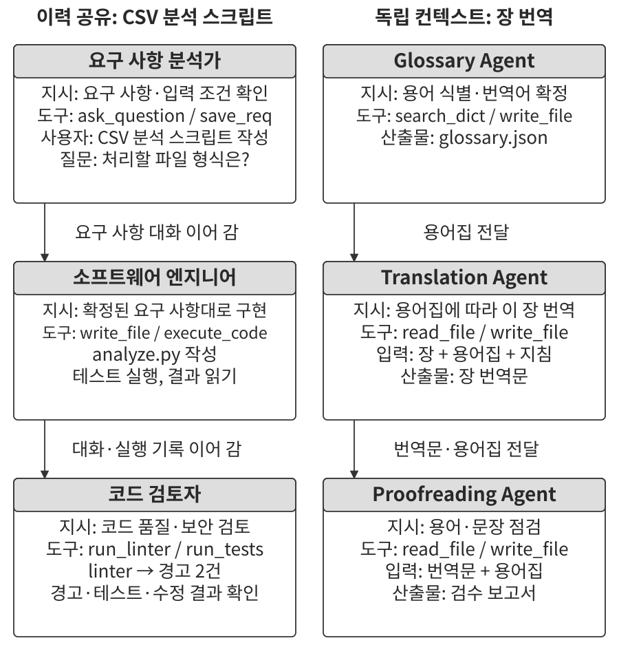

컨텍스트가 각자 독립되어 있을 때 구성원들은 자료를 어떻게 주고받을까요? 분산 시스템에서는 흔히 공유 저장소나 메시지 전달로 통신합니다. 에이전트 시스템에서도 이 두 가지 발상을 쓸 수 있으며, 구체적인 방법은 다음과 같습니다.

- **도구 호출 파라미터.** 하위 에이전트를 도구로 래핑하고, 상위 에이전트가 파라미터로 작업과 구조화된 자료를 넘긴 뒤 결과를 받습니다.
- **공유 파일 시스템.** 한쪽이 문서, 코드, 데이터를 쓰면 다른 쪽이 참조를 따라 읽습니다. 크기가 큰 중간 산출물과 영속적으로 보관해야 하는 자료에 적합합니다.
- **메시지 버스(Message Bus).** 에이전트가 메시지를 중계 서비스에 제출하면, 서비스가 대상이나 구독 관계에 따라 전달합니다. 여러 구성원 사이의 비동기 소통에 적합합니다.

예를 들어 상위 에이전트는 번역 작업을 보낸 뒤 번역문이 돌아오기를 기다릴 수도 있고, 작업 번호만 먼저 받아 두고 다른 장을 처리하러 갈 수도 있습니다. 두 번역자가 같은 파일을 열 수 있다 해도, 시스템은 누가 쓰고 다른 쪽이 언제 읽을지를 정해 두어야 합니다. Go 커뮤니티는 통신으로 공유 데이터에 대한 접근을 조직하라고 강조합니다. 이 발상은 에이전트에도 적용됩니다. 누가 상태를 소유하는지, 누가 수정할 수 있는지, 다른 구성원은 어떻게 갱신된 내용을 받는지를 분명히 해야 합니다.

### 차원 2: 협업 토폴로지

협업 토폴로지는 에이전트 사이의 작업 의존성, 정보 흐름, 제어 관계를 설명합니다. 이 장은 세 가지 전형적인 조직 방식을 다룹니다.

- **동료 협업 패턴**(Peer Collaboration Pattern). 소수의 구성원이 같은 산출물을 두고 반복해서 협업합니다. 예를 들어 작성자가 논문 초안을 완성하면 논평자가 수정 의견을 내고, 작성자가 다시 고칩니다.
- **관리자 패턴**(Orchestration Pattern). 중앙의 관리자 에이전트(Manager Agent)가 작업을 나누고 배정하고 취합하며, 하위 에이전트는 각자의 전문 작업을 맡습니다.
- **탈중앙화 패턴**(Decentralized Pattern). 구성원이 역할, 메시지, 국소 상태에 따라 일을 이어받고, 일이 어떻게 진행될지를 구성원들이 함께 결정합니다.

> **용어: 그래프 엔지니어링.** 제1장에서 2026년 7월의 그래프 엔지니어링(Graph Engineering) 논의를 소개했습니다. 이 관점은 실행 그래프에 주목합니다. 노드는 에이전트, 일반 프로그램, 사람의 의사결정일 수 있고, 에지는 의존성, 조건부 라우팅, 실패 후 처리 방향을 나타내며, 상태는 실행 관계를 따라 전달됩니다. 멀티 에이전트 협업 토폴로지는 이 설계 관점을 응용한 것 가운데 하나로, 여러 의사결정 단위가 어떻게 인계하고 병렬로 일하며 피드백을 주고받는지에 초점을 둡니다.

동료 협업, 관리자, 탈중앙화 설계는 섞어서 쓸 수 있습니다. 예를 들어 관리자가 글쓰기 작업을 작성자-검토자 소그룹에 맡기고, 소그룹은 내부 반복을 마친 뒤 결과를 제출할 수 있습니다.

## 멀티 에이전트가 단일 에이전트보다 나은 때

초벌 번역에서 기술 용어 하나를 잘못 옮겼다고 해 봅시다. 검수자 두 명에게 같은 번역문을 주면 같은 승인을 두 번 받을 수도 있습니다. 그중 한 명에게 원문, 용어집, 그 용어를 사용하는 코드까지 함께 주면 오류를 찾을 경로가 하나 더 생깁니다. 협업 방식을 고를 때는 먼저 이렇게 물어야 합니다. 새로 추가한 에이전트가 작업에 무엇을 가져다주는가? 새로운 증거를 얻을 수도 있고, 다른 탐색 경로를 맡을 수도 있으며, 다른 전문적 판단을 내놓을 수도 있고, 병렬 실행으로 대기 시간을 줄일 수도 있습니다.

필자는 먼저 **피드백의 정보 증분**을 확인하고, 그다음 병렬화와 컨텍스트 격리로 얼마나 이득을 얻을 수 있는지 봅니다. 검토자는 테스트 결과, 페이지 스크린샷, 외부 자료를 읽은 뒤, 생성 시점에는 없던 증거를 바탕으로 수정을 제안할 수 있습니다. 표 10-1은 몇 가지 흔한 상황을 들어 이런 증분을 어떻게 확인하는지 보여 줍니다.

표 10-1 멀티 에이전트 협업의 정보와 피드백

| 협업 방식 | 주요 정보원 | 평가 초점 |
|---|---|---|
| 같은 모델이 자신의 출력을 다시 검토 | 기존 자료와 새로운 검사 과정 한 번 | 누락을 찾아내는지, 수정 후 결과가 나아지는지 |
| 여러 에이전트가 같은 문제를 토론 | 각자의 풀이 경로, 가정, 논거 | 관점에 차이가 있는지, 어떻게 검증하고 답을 고르는지 |
| 검토자가 테스트를 실행하고 코드를 검사 | 컴파일, 테스트, 실행 피드백 | 수정이 테스트를 통과하고 기존 기능을 유지하는지 |
| 검토자가 프런트엔드나 PPT의 렌더링 결과를 확인 | 스크린샷과 상호작용 피드백 | 레이아웃, 내용, 조작이 요구에 맞는지 |
| 검토자가 외부 도구로 사실을 검증 | 검색 결과와 업무 시스템 기록 | 출처가 신뢰할 만한지, 결론이 증거와 일치하는지 |

RLEF는 강화 학습으로 모델이 코드 실행 피드백을 활용하도록 학습시켜, 경쟁 프로그래밍 작업에서 여러 단계에 걸친 수정을 익히게 했습니다. 컴파일 오류, 테스트 실패, 런타임 예외는 다음 수정의 구체적인 근거가 되며, 논문의 모델은 더 적은 샘플링으로 더 좋은 결과를 얻었습니다.[^rlef-2025] WebGen-Agent는 웹페이지 스크린샷, 시각 모델의 설명과 제안, GUI 조작 평가를 생성 과정에 연결하여, 이전 단계로 돌아가 다시 만들 수도 있고 여러 생성 결과 가운데 가장 나은 것을 고를 수도 있게 했습니다. WebGen-Bench에서 Claude 3.5 Sonnet의 정확도는 26.4%에서 51.9%로 올랐습니다.[^webgen-agent-2025]

[^rlef-2025]: Gehring, J., et al. *RLEF: Grounding Code LLMs in Execution Feedback with Reinforcement Learning.* arXiv:2410.02089, 2025.
[^webgen-agent-2025]: Lu, Z., et al. *WebGen-Agent: Enhancing Interactive Website Generation with Multi-Level Feedback and Step-Level Reinforcement Learning.* arXiv:2509.22644, 2025.

필자는 먼저 시스템이 테스트, 스크린샷, 도구 반환값 같은 구체적인 증거를 얻게 한 다음, 생성, 실행, 검토 책임을 어떻게 나눌지 정합니다. 피드백 루프는 에이전트 하나가 맡을 수도 있고 여러 역할로 나눌 수도 있습니다. 역할을 추가한다면 증거를 얻고 활용하는 방식이 나아져야 합니다.

Anthropic의 2026년 보안 연구는 협업 탐색의 사례를 보여 줍니다. 에이전트 45개가 공유 포럼에서 발견을 공유하고 서로 검토했으며, 독립된 에이전트가 결과를 판정했습니다. 연구 보고서에 따르면 협업 군집은 2,700만 토큰을 써서 취약점 266개를 찾았고, 독립 병렬 방식은 650만 토큰을 써서 21개를 찾았습니다. 포럼 덕분에 구성원들은 다른 구성원의 발견을 따라 계속 파고들 수 있었고, 어느 방향을 이미 누군가 맡고 있는지도 알 수 있었습니다. 다만 협업 쪽은 토큰도 약 네 배 썼으므로, 266개와 21개의 차이에는 통신 방식의 차이와 계산 투입량의 차이가 함께 들어 있습니다.[^anthropic-multiagent-2026]

[^anthropic-multiagent-2026]: Anthropic Frontier Red Team, “Patterns and Problems in Emerging Multiagent Systems,” 2026-08-13.

수학 연구에서 여러 팀이 정말로 서로 다른 경로를 탐색하게 하려면 어떻게 해야 할까요? 3차원 나비에-스토크스(Navier–Stokes) 방정식은 점성 유체의 운동을 기술합니다. 초기 조건이 매끄러울 때 해는 언제까지나 매끄러운 상태를 유지할까요? OpenAI는 서로 반대되는 두 목표를 다른 팀들에 나눠 주었습니다. 어떤 팀은 매끄러움을 증명하려 했고, 어떤 팀은 반례를 구성하려 했습니다. 각 팀이 먼저 따로 탐색하면, 연구진은 Codex로 중간 성과를 취합하여 다른 팀도 유망한 실마리를 따라갈 수 있게 했습니다. 반례를 찾은 팀에서는 약 1만 개의 에이전트가 동시에 일했습니다. 연구진은 첫 에이전트들을 띄운 때부터 증명을 찾기까지 약 88시간이 걸렸고, Lean 형식화와 검증에 17시간이 더 들었다고 보고했습니다. 이 반례에는 중요한 조건이 있습니다. 유체가 매끄러운 외력을 받는 상태에서도 유한 시간 안에 특이점이 나타날 수 있다는 것입니다. 연구진은 이를 바탕으로 클레이 수학연구소 문제 기술 가운데 C와 D 두 진술이 요구하는 반례를 제시했습니다. 외력을 없애면 다른 문제가 됩니다. 이런 탐색을 설계할 때는 어떤 결과가 원래 질문에 답하기에 충분한지 먼저 적어 두고, 서로 경쟁하는 추측을 다른 팀에 맡기며, 마지막 검증에 쓸 시간을 따로 남겨 둘 수 있습니다.[^ch10-ns-search]

[^ch10-ns-search]: OpenAI의 연구 설명 *On the Navier–Stokes Millennium Prize Problem*에 증명과 Lean 코드가 첨부되어 있습니다. 클레이 수학연구소는 2026년 9월 11일 공지에서 이 연구에 응답하며, 성과 판정과 상의 귀속은 시상 절차에 따라 처리하겠다고 밝혔습니다.

**단계 예산은 성능에 어떤 영향을 줄까요?** 어떤 작업에 30단계가 허용된다면 에이전트는 계획, 핵심 구현, 꼭 필요한 검증을 촘촘하게 배치해야 합니다. 300단계가 허용된다면 더 많은 방안을 비교하고 테스트와 수정을 더 충분히 할 여유가 생깁니다. 이 자원을 제대로 쓰려면 에이전트가 전체 예산과 남은 예산을 알고, 그에 맞춰 탐색의 깊이를 조정해야 합니다.

Google은 2025년 *Budget-Aware Tool-Use Enables Effective Agent Scaling*에서 이 문제를 연구했습니다. 예산 인식이 없는 에이전트는 얕은 탐색에서 금세 멈출 수 있으며, 사용할 수 있는 단계를 늘려도 성능이 더 오르지 않습니다. 2026년의 BAVT(Budget-Aware Value Tree Search)는 한 걸음 더 나아가 탐색 단계에서 가치 추정과 남은 예산을 결합하여 탐색과 활용의 비중을 조정합니다. 예산이 넉넉할 때는 더 많은 방향을 비교하고, 예산 한도에 가까워지면 유망한 가지에 자원을 집중합니다.

관리자 패턴에서 이는 관리자가 작업 난도에 따라 단계를 배분하고 진행 상황에 따라 조정해야 한다는 뜻입니다. 단순한 작업은 빨리 끝내고, 복잡한 작업에는 검증과 수정의 여유를 남기며, 막히면 먼저 원인을 찾은 뒤 정보를 보충할지, 예산을 늘릴지, 다른 경로로 바꿀지 결정합니다.

병렬 탐색은 실제 경과 시간을 줄이고 반복 검토는 산출물을 개선하지만, 둘 다 모델 호출과 통신 비용을 늘립니다. 필자는 잘 조정된 단일 에이전트를 기준선으로 삼고, 새 구성원이 가져오는 품질 향상이나 시간 절약이 통신, 중복 계산, 유지보수 비용을 메울 만큼 클 때만 협업 규모를 키웁니다.

## 공유 컨텍스트를 이용한 멀티 에이전트 협업

공유 컨텍스트 협업은 단계에 따라 역할을 바꾸면서 기존 작업 기록을 그대로 이어 씁니다. 연구 보고서를 예로 들면, 검색 역할이 먼저 자료를 모으고, 분석 역할이 이어서 계산하며, 작성 역할이 마지막으로 글을 구성합니다. 각 역할은 앞의 출처와 결정을 돌아볼 수 있고, 시스템은 현재 작업 지시로 각 역할이 이번 단계의 목표에 집중하게 합니다.

팀 사이에서 일을 넘길 때는 먼저 이렇게 물어봅니다. 처음에 왜 그렇게 결정했는지 알아야 하는 사람은 누구인가? Teamily AI의 제품 예시에서는 제품 관리자와 에이전트가 그룹 채팅에서 함께 제품 요구 문서(PRD)를 작성합니다. 제품 팀이 확정본을 엔지니어링 팀에 공유하면, 엔지니어는 어떤 요구 사항 뒤에 있는 절충을 되물을 수 있습니다.

검색 역할이 작성 역할에 작업을 넘기는 경우를 예로 들어 봅시다. 인계한 뒤 모델은 작성 지침을 어디에서 읽고, 어떤 도구를 호출할 수 있을까요? 실험 10-1은 같은 인계를 두 가지 방식으로 구현합니다.

| 인계할 때 처리할 문제 | 역할 전환(`transfer_to_agent`) | 스킬 불러오기 |
|---|---|---|
| 작성 지침을 어떻게 제공하는가? | 작성 역할의 시스템 프롬프트로 바꿈 | 시스템 프롬프트의 스킬 목차는 유지하고 작성 지침을 메시지 기록 끝에 추가함 |
| 모델은 어떤 도구를 볼 수 있는가? | 작성 역할의 도구만 보여 줄 수 있음 | 기존 도구 집합이나 도구 검색 진입점을 그대로 쓸 수 있음 |
| KV Cache의 어느 부분을 계속 쓸 수 있는가? | 시스템 프롬프트가 바뀌므로 접두부가 달라진 지점부터 대개 다시 계산해야 함 | 기존 요청 접두부를 계속 재사용할 수 있음 |
| 호출 권한은 누가 확인하는가? | 하네스가 현재 역할 기준으로 요청을 검증한 뒤 도구를 실행함 | 하네스가 호출마다 권한을 따로 확인함 |

역할 차이가 주로 지식, 절차, 문체에 있을 때 필자는 스킬을 우선합니다. 같은 실행 프레임워크를 재사용하기 쉽고, 안정적인 요청 접두부의 캐시도 유지할 수 있기 때문입니다. 역할 차이가 권한, 도구 격리, 승인 책임과 관련될 때는 독립 에이전트나 역할 전환으로 구성하고, 하네스와 실행 환경이 접근 제어를 집행하게 할 수 있습니다. 도구가 모델 입력에 보이는지는 호출 선택에 영향을 줄 뿐이며, 실제 권한은 런타임 검증으로 결정됩니다.

> **실험 10-1 ★★: 공유 컨텍스트에서 여러 역할 전환하기 — 시스템 프롬프트와 스킬 비교**
>
> 두 경로는 같은 모델, 사용자 작업, 도구 구현, 역할 지침, 공유 기록을 사용합니다. 입문 시연에서는 중국의 2021\~2023년 신에너지 자동차 판매량을 찾아 연평균 성장률(CAGR)을 계산하고, 120자 이하의 투자자용 요약을 한 단락 쓰게 합니다.
>
> **경로 1: 시스템 프롬프트 전환.** triage(요구 수집), research(검색), coding(프로그래밍), data_analysis(분석), writing(작성)의 다섯 역할을 둡니다. triage가 진입점이며, 각 역할은 전용 도구와 `transfer_to_agent`를 봅니다. 핸드오프할 때는 기록을 보존하고 대상 역할의 프롬프트와 도구 집합을 불러온 뒤 실행을 이어 갑니다.
>
> **경로 2: 스킬 불러오기.** 시스템 프롬프트와 전체 도구 목록은 세션 내내 고정됩니다. 모델은 `load_skill(name)`을 호출해 역할 지침을 가져오고, 그 내용은 도구 결과로 공유 기록에 들어가며, 기존 접두부는 그대로 유지됩니다. 하네스는 권한 규칙에 따라 도구 호출마다 검사합니다.
>
> 두 구현은 같은 `SKILL.md`를 읽습니다. 한 번의 역할 인계 전후로 모델에 보낸 요청을 하나씩 떼어 내어, 지침이 어느 메시지에 나타나는지, 접두부의 어느 부분을 재사용할 수 있는지 살펴보십시오. 그리고 두 요약을 대조해 보십시오. 판매량 출처는 믿을 만한가? 2021년 말부터 2023년 말까지는 성장 기간이 두 번인데, 연평균 성장률을 제대로 계산했는가?
>
> 정식 비교에는 더 엄격한 브리핑 문제가 하나 있습니다. 160자 제한에 출처 URL 두 개를 남겨야 합니다. 똑같이 여덟 단계의 기회를 주었더니, 역할 전환 쪽은 호출 세 번을 글자 수 세는 데 썼고, 초안은 여전히 206자였으며, 문제가 지정한 계산 도구도 쓰지 않았습니다. 스킬 쪽은 처음과 마지막 해의 판매량으로 성장률을 계산했고, 여덟 번째 단계에서야 작성 지침을 불러왔습니다. 이때 거쳐야 할 역할은 모두 거쳤지만, 사용자는 아직 요약을 받지 못했습니다. 두 궤적 모두 단계 한도에 도달해 끝났습니다.
>
> 같은 30개 작업을 두 구현으로 각각 실행하고 프로그램으로 결과물을 검사했더니, 스킬 쪽은 15개, 시스템 프롬프트 전환 쪽은 2개를 통과했습니다. 다만 문제별로 비교하면 스킬 쪽은 캐시에 적중하지 않은 입력이 6,855토큰 더 많았고, 시간도 약 4.4초 더 걸렸습니다(둘 다 짝지은 차이의 중앙값). 이번에는 서비스 제공자가 두 쪽 요청 모두에서 캐시 입력 토큰 수를 0으로 보고했습니다. 지시 따르기 경계 테스트 6개는 두 쪽 모두 전부 통과했지만, 전체 작업의 통과율은 크게 차이 났습니다.

## 컨텍스트를 공유하지 않는 멀티 에이전트 협업

독립 컨텍스트 아키텍처에서 각 에이전트는 입력 기록, 작업 상태, 실행 루프를 따로 유지하고, 도구 파라미터, 공유 파일, 메시지로 필요한 정보를 교환합니다. 예를 들어 번역자가 넘기는 자료에는 원문 단락과 용어집 버전이 적혀 있어야 합니다. 그러면 번역자가 빠져도 검수자가 원문을 찾을 수 있고, 다시 고쳐야 할 때는 장별로 담당자를 찾을 수 있습니다.

표 10-2는 운영체제가 프로세스를 관리하는 방식과 런타임이 에이전트를 관리하는 방식을 대조합니다.

표 10-2 멀티 에이전트 시스템과 운영체제의 설계 비유

| 운영체제 | 멀티 에이전트 시스템에서 비슷한 책임 |
|---|---|
| 프로그램과 설정 | 시스템 프롬프트, 도구 정의, 역할 구성 |
| 프로세스 메모리 | 현재 컨텍스트, 작업 상태, 기록 |
| CPU의 계산 실행 | LLM이 결정을 생성하고 런타임과 도구가 해당 작업을 실행 |
| 커널의 실행 관리 | 에이전트 런타임이 상태, 스케줄링, 자원을 관리 |
| 시스템 호출 | 도구 인터페이스로 외부 작업을 요청 |
| fork: 자식 프로세스 생성 | `spawn_subagent`: 하위 에이전트 생성 |
| kill: 신호 전송 | `cancel_subagent`: 취소 요청 |
| ps: 프로세스 조회 | `list_agents`: 구성원과 실행 상태 조회 |
| 종료 상태와 wait | 완료 알림, 작업 상태, 구조화된 결과 |
| 공유 저장소와 메시지 전달 | 공유 파일, 도구 파라미터, 메시지 |

비공개 상태, 비동기 메시지, 구성원의 동적 생성은 1970년대에 제안된 액터 모델(Actor model)에도 나타납니다.[^actor-model]

[^actor-model]: Hewitt, C., Bishop, P., Steiger, R. *A Universal Modular ACTOR Formalism for Artificial Intelligence.* IJCAI 1973.

독립적인 하위 작업이 많을 때 필자는 구성원마다 독립 컨텍스트를 두고, 자기 책임과 관련된 자료만 처리하게 하는 편입니다. 그러면 역할별로 따로 테스트하기 쉽고, 앞 단계의 장황한 기록이 현재 판단을 흐리는 일도 줄며, 여러 작업을 동시에 진행할 수 있습니다. 격리의 효과는 다른 공유 자원에도 달려 있습니다. 여러 에이전트가 여전히 같은 파일을 동시에 고치거나, 같은 API 할당량을 소비하거나, 같은 잘못된 메시지를 받을 수 있습니다.

협업 인터페이스는 메시지 유실, 중복 전달, 상태 지연도 처리해야 합니다. 문제를 추적할 때는 작업 식별자로 각 구성원의 요청, 도구 이벤트, 결과를 연결하여 한 번의 인계 과정을 재구성할 수 있습니다.

어떤 에이전트가 분석을 마치고 결과를 보고서를 쓰는 동료에게 넘긴다고 해 봅시다. 수치가 몇 개뿐이라면 메시지에 담아 보낼 수 있습니다. 산출물이 큰 표라면 보통 표를 공유 파일 시스템에 저장하고 메시지에는 참조만 붙입니다. 여기서 두 가지 분업이 생깁니다. **산출물 저장**은 문서, 코드, 데이터를 보관하고 교환하며, **통신과 제어**는 메시지 전달, 작업 상태 조회, 실행 취소, 자원 스케줄링을 맡습니다.

### 에이전트 관점에서 본 파일 시스템

흔한 설계 하나는 에이전트에 **가상 파일 시스템**(virtual filesystem)을 제공하여, 출처가 서로 다른 자원을 하나의 디렉터리 트리에 마운트하는 것입니다. 모델은 `read_file`, `write_file`, `list_dir` 같은 인터페이스로 접근하고, 기반 계층은 로컬 임시 디스크, 영속 객체 저장소, 서드파티 클라우드 드라이브 API, 시스템 리소스 패키지에 연결될 수 있습니다.

필자는 먼저 저장 영역을 명확히 나눈 뒤 협업 흐름을 연결합니다. 임시 초안, 정식 결과물, 사용자의 외부 파일이 뒤섞이면 실수로 덮어쓰거나 권한 밖의 내용을 읽기 쉽습니다. 통합 인터페이스는 사용하기 편하지만, 각 영역의 가시성, 생명 주기, 권한은 마운트와 접근 제어 설정이 결정합니다. 이 디렉터리 트리는 네 유형의 영역으로 나눌 수 있습니다.

**1. 에이전트별 작업 공간(Scratchpad).** 각 인스턴스는 자기 작업 공간에 초안, 임시 파일, 디버그 로그, 중간 산출물을 저장합니다. 기본적으로 접근 범위를 소유한 에이전트로 제한하고, 작업 정책에 따라 정리하거나 보관합니다. 이렇게 하면 임시 파일이 서로를 덮어쓰지 않습니다. 하위 에이전트는 일을 마치면 넘겨야 할 결과를 공유 공간에 두고, 구조화된 요약과 함께 주 에이전트에 넘깁니다. 시행착오 기록은 원래 작업 공간에 남겨 두어 나중에 진단할 때 씁니다. 이는 컨텍스트 격리를 저장 계층에서 구현한 것이기도 합니다. 주 에이전트는 결과물과 필요한 증거만 받으므로, 평소 조율할 때 시행착오 과정 전체를 읽는 비용을 아낄 수 있습니다.

**2. 멀티 에이전트 공유 작업 공간(Shared Workspace).** 협업하는 구성원들이 여기에서 산출물을 교환하고, 사용자도 권한이 부여된 진입점을 통해 자료를 올리고 결과물을 내려받을 수 있습니다. 예를 들어 Glossary Agent가 용어집을 쓰면 Translation Agent가 이를 읽고 번역하며, 검토자가 다시 번역문을 확인합니다. 공유 공간은 보통 작업 기간 동안 영속적으로 보존되며, 동시 쓰기, 버전 갱신, 접근 범위를 처리해야 합니다. 제6장에서 에이전트와 가상 컴퓨터가 공유 저장소로 CSV와 차트를 주고받은 것이 이런 산출물 인계의 사례입니다. 뒤에서 낙관적 잠금과 작업 사본 격리 같은 방법을 소개합니다.

**3. 마운트된 외부 리소스(Mounted External Resources).** Google Drive, Notion, Dropbox, 기업 위키 같은 리소스는 어댑터를 통해 통합 인터페이스에 매핑할 수 있습니다. 에이전트가 문서를 읽으면 어댑터가 원본 시스템의 API를 호출합니다. 여기서는 세 가지 차이를 관리해야 합니다. 접근 범위는 외부 권한에 따라 정해지고, 네트워크 접근에는 지연, 제한 시간, 캐시 갱신 문제가 따르며, 되쓰기 작업은 원본 시스템의 권한과 버전 규칙을 따라야 합니다. 구체적인 일관성 의미는 서비스 인터페이스가 결정하며, 버전 번호, 조건부 쓰기, 다시 읽기로 동시 수정을 확인할 수 있습니다. 자료 검색에는 필요할 때 읽기 전용으로 마운트하는 방식이 적합하고, 편집이 필요할 때 해당 쓰기 권한을 부여합니다.

**4. 내장 시스템 리소스(Built-in System Resources).** 참조 설명서, 템플릿, 도구 정의, 사전 설치된 스킬은 읽기 전용 리소스 패키지로 여러 에이전트가 함께 쓸 수 있습니다. 스킬은 점진적 공개 방식으로 불러옵니다. 먼저 목록을 제공하고, 작업에 따라 지침과 스크립트를 읽습니다. 버전이 고정된 리소스 패키지는 동시에 읽기 쉽고, 업그레이드할 때는 버전 전환으로 실행 중인 작업의 일관성을 유지합니다.

그림 10-2에서 번역자는 자기 디렉터리에서 초안을 몇 번이고 고칠 수 있고, 검수에 넘길 준비가 되면 해당 버전을 공유 영역에 둡니다. 사용자 클라우드 드라이브의 원고는 외부 어댑터가 읽으며, 접근하려면 사용자가 부여한 권한도 있어야 합니다.

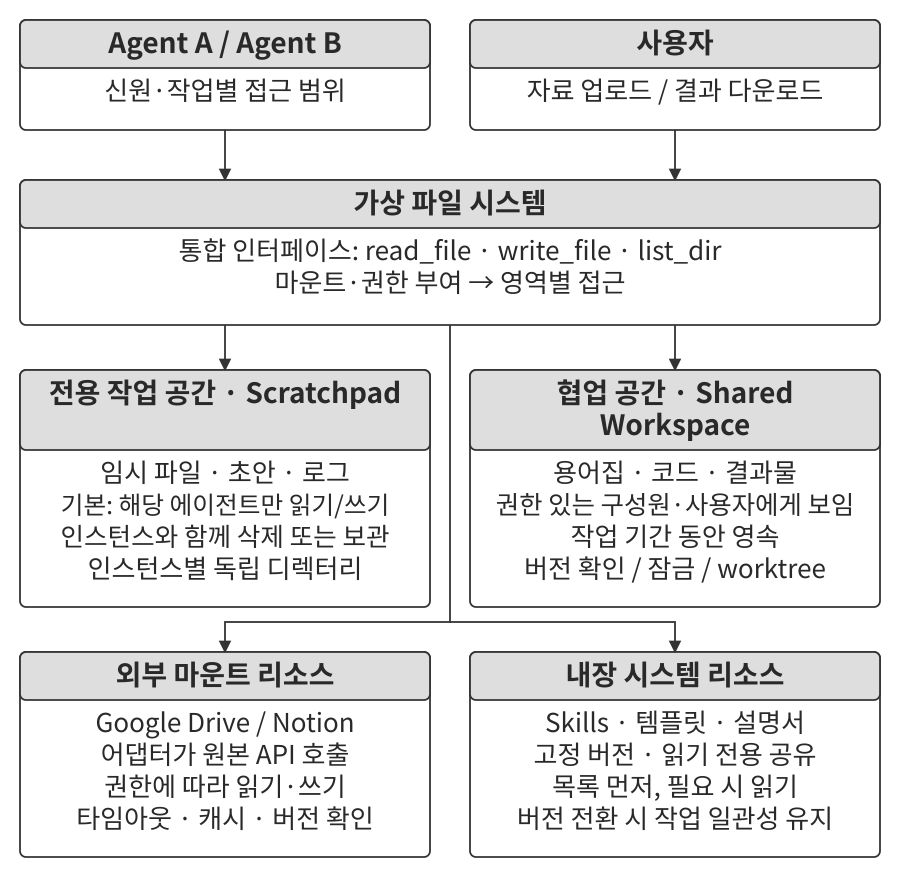

번역자가 빠지면 작업 공간의 임시 파일은 함께 해제될 수 있습니다. 공유 영역에 둔 번역 원고는 계속 보존되므로, 검수자가 읽기 권한으로 이어받을 수 있습니다(표 10-3).

표 10-3 에이전트 가상 파일 시스템의 네 가지 영역

| 영역 | 가시성 | 생명 주기 | 읽기/쓰기 | 동시성 관리 |
|---|---|---|---|---|
| 에이전트별 작업 공간 | 기본적으로 소유한 에이전트만 | 인스턴스와 함께 정리, 필요하면 보관 | 소유한 에이전트가 읽고 씀 | 재시도나 백그라운드 작업의 중복 쓰기 방지 |
| 멀티 에이전트 공유 작업 공간 | 권한을 받은 구성원과 사용자 | 작업 기간 동안 영속 | 역할에 따라 권한 부여 | 잠금, 버전 확인, worktree |
| 마운트된 외부 리소스 | 외부 권한과 어댑터가 함께 제한 | 원본 시스템과 캐시 정책이 결정 | 필요할 때 읽기 전용 또는 권한을 받아 쓰기 | 원본 시스템의 버전·동시성 인터페이스를 따름 |
| 내장 시스템 리소스 | 권한을 받은 에이전트 | 고정 버전을 세션 간 재사용 | 읽기 전용 | 리소스 버전을 일괄 전환 |

파일 참조를 쓰면 인계 메시지를 짧게 유지할 수 있습니다. 상위 쪽은 산출물의 위치, 버전, 용도를 알려 주고, 하위 쪽은 필요할 때 내용을 읽습니다. 같은 실행 환경에 있는 구성원은 공유 경로를 쓸 수 있습니다. 조직 간 협업에서 같은 인계를 하려면 양쪽 모두 해석할 수 있는 산출물 식별자, 접근 인터페이스, 권한이 있어야 합니다.

### 에이전트 간 통신과 제어

제4장에서 소개한 생성, 통신, 취소, 탐색 도구는 멀티 에이전트 협업의 기본 제어 인터페이스를 제공합니다. `spawn_subagent`는 구성원을 만들고, `send_message_to_subagent`는 메시지를 전달하며, `cancel_subagent`는 취소를 요청하고, `list_agents`는 구성원을 조회합니다. 이 인터페이스를 중심으로 메시지, 상태, 종료, 스케줄링의 동작도 정해 두어야 합니다.

**1. 메시지 전달.** 구성원이 적고 관계가 고정되어 있다면 지점 간 인터페이스를 쓸 수 있습니다. 예를 들어 전화 에이전트와 컴퓨터 에이전트가 진행 상황을 직접 주고받습니다. 모든 구성원이 서로 짝지어 통신해야 한다면 잠재적인 관계 수는 구성원 수의 제곱에 비례해 늘어납니다. 구독 관계가 많을 때는 메시지 버스를 쓰면 라우팅, 버퍼링, 재시도를 한곳에서 관리하기 쉽습니다. 지점 간 방식과 버스 모두 비동기 전달을 구현할 수 있으며, 수신자가 동시에 온라인이어야 하는지는 큐와 영속화 메커니즘에 달려 있습니다.

메시지에는 보통 구조화된 **봉투**(envelope)가 들어갑니다. 송신자 ID, 대상 에이전트나 브로드캐스트 범위, 메시지 유형, 페이로드입니다. 메시지 유형으로는 `task_assigned`, `status_update`, `result`, `terminate` 등이 있습니다. 작업 식별자, 메시지 식별자, 관련 요청은 수신자가 중복을 제거하도록 돕고, 디버깅 도구가 통신 경로를 재구성할 수 있게 합니다. 업무 내용은 JSON 페이로드에 담고, 양쪽이 약속한 필드에 따라 처리합니다.

예를 들어 번역 원고 하나를 편집자가 책임지고 넘겨야 하는데, 편집자가 용어 검토 에이전트에게 단어 하나를 확인해 달라고 하고 싶다고 합시다. Multica의 티켓 댓글에서 그 에이전트를 멘션(`@`)하고 질문을 적으면 검토 작업이 시작됩니다. 검토 의견은 이 티켓에 바로 답글로 달 수 있고, 담당자는 여전히 편집자이며, 티켓 상태도 그대로 유지됩니다. 검토자가 티켓 전체를 넘겨받기를 원한다면 담당자를 명시적으로 바꿔야 합니다.[^ch10-multica]

[^ch10-multica]: Multica, 댓글에서 에이전트 멘션하기. 버전 `d579273`의 댓글 디스패치 구현.

**2. 상태 파악.** 주 에이전트는 하위 작업이 아직 실행 중인지, 입력이 필요한지, 결과를 가져갈 수 있는지 알아야 합니다. 상태 인터페이스, 이벤트 알림, 진행 파일을 함께 쓸 수 있습니다. 런타임 인터페이스는 생명 주기 상태를 제공하고, 메시지는 업무 진행 상황을 설명하며, 영속 파일은 복구할 수 있는 기록을 남깁니다.

`get_subagent_status(agent_id)`는 실행 중, 입력 필요, 완료, 실패 같은 상태를 반환할 수 있습니다. 평소 조율할 때 필자는 완료 알림과 단계별 진행 메시지를 우선 써서, 주 에이전트가 자기 일을 계속하게 합니다. 알림이 늦거나, 연결이 복구되었거나, 문제를 추적해야 할 때 능동적으로 조회하여, “끝났어?”라고 자꾸 묻는 데 모델 호출을 낭비하지 않게 합니다. 상태 인터페이스는 런타임이 관리하므로 프로세스가 살아 있는지, 작업이 끝났는지 제때 알려 줄 수 있습니다.

**메시지로 진행 상황 주고받기.** 주 에이전트가 현재 진행 상황을 물으면 하위 에이전트가 적절한 단계에서 답할 수 있습니다. 하위 에이전트도 단계별 결과를 얻었거나, 막혔거나, 도움이 필요할 때 능동적으로 `status_update`를 게시할 수 있습니다. 메시지에는 끝낸 일, 다음 단계, 막힌 이유를 적어야 하며, 구성원들이 같은 상태 이름 체계를 써야 취합하고 판단하기 쉽습니다. 뒤의 A2A 프로토콜에서 작업 생명 주기의 표준화된 표현을 소개합니다.

**파일로 진행 상황 보존하기.** 시스템은 메시지, 도구 요청, 도구 결과, 상태 변화를 이벤트 순서대로 로그에 추가할 수 있습니다. 예를 들어 한 줄에 이벤트 하나를 기록하는 JSONL 형식을 씁니다. 진단 권한을 받은 주 에이전트나 운영 도구는 이를 보고 재시도, 오류, 대기 과정을 점검할 수 있습니다. 모델 입력 기록은 실행 궤적의 일부일 뿐이며, 로그에는 스케줄링과 외부 실행 이벤트도 기록할 수 있습니다.

전체 궤적은 수만 토큰에 이를 수 있고, 주 에이전트는 매번 다 읽은 뒤 상태를 다시 추려 내야 합니다. 메시지는 주 에이전트에게 새로운 진행이 있다고 알리고, 짧은 진행 파일은 현재 상태를 보존하여 나중의 조회와 복구에 씁니다. 필자는 평소 조율에 이 두 가지를 함께 쓰는 편입니다. 하위 에이전트는 일 하나를 끝낼 때마다 작업 목록, 산출물 참조, 현재 막힌 지점을 갱신하고, 주 에이전트는 이 필드를 보고 다음 단계를 정합니다. 상세한 궤적은 필요할 때 추적할 수 있도록 보존합니다. 진행 상황이 오랫동안 바뀌지 않으면 하트비트, 도구 호출 상태, 작업 제한 시간 설정을 함께 보고 개입할지 판단할 수 있습니다. 오래 실행되는 도구는 여전히 일하고 있을 수 있으므로, 상태를 확인한 뒤 기다릴지, 취소할지, 재시도할지 정합니다.

**3. 실행 종료.** 여러 구성원이 같은 목표를 병렬로 찾다가 그중 하나가 작업을 끝내면, 예산과 도구 자원을 풀어 주기 위해 나머지 가지는 멈출 수 있습니다. 취소에는 두 가지 강도가 있으며, Unix의 SIGTERM과 SIGKILL의 역할과 비슷합니다.

필자는 **정상 종료**를 우선합니다. 런타임이 취소 요청을 전달하면, 하위 에이전트는 안전한 지점에서 새 작업을 멈추고, 필요한 진행 상황을 저장하고, 브라우저 세션을 닫고 잠금을 해제한 뒤 확인(ack)을 돌려줍니다. **강제 종료**는 취소 기한을 넘기고도 응답하지 않는 실행에 씁니다. 런타임이 프로세스를 끝낸 뒤 남은 자원과 끝나지 않은 쓰기를 점검합니다. 이미 외부 시스템에 제출한 작업은 결과를 조회하고, 필요하면 보상 절차를 실행해야 합니다.

생명 주기도 생성 관계를 따라 관리해야 합니다. Go의 context를 빌려, 부모 작업의 취소 신호가 하위 작업 트리 전체로 전파되게 할 수 있습니다. 실행 루프는 안전한 지점에서 취소 신호를 확인하는데, 이는 `ctx.Done()`의 용도에 해당합니다. 이렇게 하면 부모 작업이 끝났을 때 그 작업이 띄운 가지들도 정리 절차에 들어가므로, 관리하는 이 없는 에이전트가 계속 도구를 호출하고 예산을 소비하는 일을 막을 수 있습니다. 정말로 오랫동안 독립적으로 실행해야 하는 백그라운드 작업은 `context.Background()`를 쓰는 것처럼 독립된 생명 주기 컨텍스트를 만들고, 감시, 예산, 정리를 책임질 관리자를 함께 지정합니다.

**4. 자원과 스케줄링.** 에이전트 시스템은 토큰, 단계, 동시성 할당량, 도구 연결, 계산 자원을 배분해야 합니다. 하위 작업을 시작할 때 예산과 초과 시 동작을 정하고, 작업 난도에 따라 모델을 고르며, 동시 호출을 제한하여 서비스 할당량이 한꺼번에 소진되지 않게 합니다. 더 긴급한 작업이 들어오면 안전한 지점에서 우선순위가 낮은 작업을 일시 중지하거나 취소하고, 진행 상황을 저장한 뒤 다시 스케줄링할 수 있습니다.

가지 세 개가 각각 실행 가능한 방안을 하나씩 조사하는데, 그중 하나가 결정적인 단서를 찾아 마지막 검증 한 번만 남겨 두었다고 해 봅시다. 관리자는 그 가지에 몇 단계를 더 주고, 진전이 없는 두 가지는 끝낼 수 있습니다. 할당량은 런타임이 차감합니다. 어떤 가지가 더 시도하고 싶어도 예산이 바닥나면 멈춰야 합니다.

### 동료 협업 패턴: 상호 검토와 반복 개선

동료 협업에서는 보통 에이전트 두세 개가 같은 작업을 두고 의견을 주고받으며 산출물을 고칩니다. 설계할 때는 먼저 구성원마다 다른 책임, 자료, 도구를 배정하여 각자 독립적으로 판단하게 한 다음 결과를 취합할 수 있습니다. 예를 들어 생성자는 구현에, 검토자는 테스트와 사용자 요구에 주목합니다. 전문 분야가 다른 구성원은 각자 자기 분야의 제약을 확인합니다. 모델, 입력, 작업 흐름이 비슷할수록 구성원들은 같은 판단을 되풀이하기 쉬우므로, 관점과 증거의 차이를 의도적으로 설계해야 합니다.[^anthropic-multiagent-2026]

같은 산출물을 반복해서 개선하는 작업이라면 필자는 두세 구성원의 동료 협업부터 시작하기를 권합니다. 역할, 인계 내용, 종료 조건이 분명해지면 테스트할 수 있는 루프를 세울 수 있고, 초기의 조율 작업도 적습니다.

#### 루프 엔지니어링

동료 협업은 흔한 문제 하나를 다루는 데 도움이 됩니다. 바로 **조기 종료**입니다. 프로그래밍과 고객 응대 대행을 예로 들면, 세 가지 기록에서 조기 종료를 발견할 수 있습니다.

- **일부만 하고 전부 끝냈다고 주장한다.** 코딩 에이전트가 코드를 다 쓰고도 테스트와 배포 점검을 빠뜨립니다. 사용자가 비서에게 두 가지 일을 맡겼는데, 첫 번째만 끝내고 모두 처리했다고 보고합니다. 작업 목록을 항목별로 대조하며 각 항목의 완료 증거를 확인해야 합니다.
- **한 경로가 실패하자 일찍 포기한다.** 판매자가 양식으로 자료를 제출하라고 하거나, 지정된 이메일로 첨부 파일을 받겠다고 할 수 있습니다. 이런 답을 받으면 판매자가 받아들이는 방식으로 일을 이어 가면 됩니다. 실패 원인을 기록하고, 아직 시도할 만한 경로가 무엇인지 판단해야 합니다.
- **부분적으로 성공한 뒤 후속 단계를 빠뜨린다.** 판매자가 환불에 동의한 뒤에도 사용자가 앱에서 확인해야 한다면, 비서는 이 단계와 조작 조건을 알려 주어야 합니다. 요금 감면의 경우, 상담원이 전화로 구두 약속을 했다면 비서는 사용자에게 이번 협상에서 약속을 받아 냈다고 확인해 줄 수 있습니다. 통화 기록은 상담원이 무슨 말을 했는지 증명할 수 있지만, 이후 청구서에 실제로 반영되었는지는 새로운 증거가 있어야 압니다. 검토자는 이미 얻은 결과, 아직 누가 무엇을 해야 하는지, 지금은 확인할 수 없는 결과가 무엇인지를 각각 밝혀야 합니다.

세 가지 문제 모두 완료 조건을 확인할 수 있는 결과로 구체화해야 한다는 점을 보여 줍니다. **루프 엔지니어링**(Loop Engineering)은 에이전트가 ‘다음 할 일 정하기 → 실행 → 검증 → 진행 상황 기록’의 루프를 계속 돌고, 결과에 따라 계속할지, 기다릴지, 넘길지, 끝낼지 결정하게 하는 방법에 주목합니다. 엔지니어는 작업의 출처, 검증 방식, 영속 상태, 종료 조건을 설계해야 합니다. 사람의 일도 함께 넓어집니다. 호출 한 번을 위한 프롬프트를 쓰던 데서, 작업을 꾸준히 밀고 나가는 루프를 설계하는 쪽으로 옮겨 갑니다. Addy Osmani는 2026년 6월 이 이름으로 이런 실천을 논의하면서 Boris Cherny의 경험을 인용했습니다. 일의 중심이 점차 에이전트를 움직이는 루프를 설계하는 쪽으로 옮겨 간다는 것입니다.[^loop-engineering-2026]

**이런 루프에서 검증기가 흔히 핵심 병목이라고 필자는 생각합니다.** 검증을 믿을 수 없다면 라운드를 늘릴수록 시스템이 같은 종류의 오류를 되풀이하거나 너무 일찍 완료를 선언할 수 있습니다. 테스트 결과, 업무 상태, 사용자 확인은 각자의 범위 안에서 완료의 근거가 되고, 검증 실패는 다음 라운드 수정의 입력이 됩니다.

실천이 먼저이고 이름은 나중입니다. 루프 엔지니어링이라는 이름이 유행하기 전부터 필자와 팀은 Pine AI에서 루프와 검증으로 조기 종료에 대응하고 있었습니다. 제안자-검토자는 이런 루프를 구성하는 흔한 방식이며, 아래에서 자세히 다룹니다.

[^loop-engineering-2026]: Osmani, Addy. “Loop Engineering”, 2026.

**LoopX: 라운드 사이의 작업 상태 보존.** LoopX는 목표, 경계, 할 일, 게이트, 증거, 할당량을 영속적인 제어 평면에 두고, 다음 라운드나 다음 실행자의 일을 이 제어 평면이 배정합니다. 흐름은 **제어 평면 결정 → 에이전트 실행 → 독립 검증 → 확인된 진행 상황 커밋**으로 요약할 수 있습니다.

에이전트는 도구를 호출하고 추론하여 이번 라운드의 결과를 내놓습니다. 제어 평면은 이미 끝난 일을 기록하고, 다음 라운드를 어디서부터 이어 갈지 정합니다. 검증을 통과하면 완료 상태를 커밋하고, 실패하면 복구나 재계획으로 넘어갑니다. 사람의 게이트, 대기 조건, 예산 한도가 함께 언제 실행을 계속할 수 있는지 결정합니다.[^loopx-framework]

[^loopx-framework]: LoopX, The local control plane for long-running AI agent work, v0.4.0.

**LongHorizon-Harness: 애플리케이션을 넘나드는 장기 작업 잇기.** 이 프레임워크는 멀티모달 Computer Use에서 출발하여, 하나의 작업이 GUI와 CLI, 여러 데스크톱 애플리케이션, 여러 차례의 컨텍스트 갱신에 걸쳐 이어질 때의 연속 실행 문제를 다룹니다. Manage–Execute–Audit(MEA) 루프를 쓰는데, Manager는 원래 목표, 확인된 진행 상황, 실패 증거, 남은 일을 바탕으로 범위가 분명한 하위 작업 하나를 만들고, Executor는 새 컨텍스트에서 GUI나 CLI 조작을 실행하며, Auditor는 읽기 전용으로 결과를 점검한 뒤 확인된 진행 상황을 다음 라운드의 상태에 씁니다. 실패 증거도 함께 보존되어 복구와 재계획에 쓰입니다.

프레임워크는 어댑터 계층을 통해 Claude Code, Codex CLI 같은 실행 백엔드를 호출하여, 바깥의 작업 관리와 백엔드의 실행 루프를 연결합니다. 이 접근법은 장기 작업의 연속성을 확인된 작업 상태 위에 세웁니다. 실행 컨텍스트가 갱신되더라도 다음 라운드는 목표, 완료 증거, 미해결 사항을 바탕으로 일을 이어 갈 수 있고, 환경 변화가 기존 결론에 영향을 주었는지도 다시 확인합니다.[^longhorizon-implementation]

논문은 Qwen 3.7-Plus와 Claude Code 실행 백엔드를 동일하게 두고 바깥 루프만 바꾼 대조에서, WeaveBench PassRate가 51.8%에서 80.7%로, OSWorld 2.0 이진 완료율이 2.8%에서 8.3%로, Terminal-Bench 2.1 성공률이 69.7%에서 77.2%로 올랐다고 보고합니다. 비용도 작업에 따라 달라졌습니다. 앞의 두 벤치마크는 각각 기준선의 2.3배에 이르는 총 토큰과 3.6배에 이르는 출력 토큰을 썼고, Terminal-Bench 2.1의 토큰 소비는 24% 줄었습니다.

같은 WebRTC 다중 계층 스트림 감사 작업에서, 기준선 실행자는 Wireshark 화면에서 막힌 뒤 몇 번 더 시도했고 결국 0.59점을 받았습니다. MEA를 쓰자 감사자가 부족한 증거를 기록했고, 다음 라운드의 실행자가 이를 바탕으로 빈 곳을 채워 0.92점을 받았습니다.

[^longhorizon-implementation]: LongHorizon-Harness, 논문 번호 arXiv:2608.01964. 기준선과 MEA의 공개 궤적은 모두 작업 WEB_task_16_webrtc_simulcast_layer_audit에서 가져왔으며, 재현 스크립트는 커밋 `53bc678`을 사용합니다.

#### 제안자-검토자 패러다임

제안자-검토자는 산출물 생성과 결과 검사를 두 역할에 맡깁니다. 제5장의 PPT 생성, 동영상 편집, 로그 시각화 실험이 이 설계를 썼습니다. Proposer가 코드를 생성하면 Reviewer가 렌더링 결과를 보고, 시각 모델의 도움을 받아 품질을 점검한 뒤, 구조화된 수정 의견을 돌려줍니다. 그림 10-3에서 수정 의견은 다시 제안자에게 돌아가야 합니다. 제안자가 이를 바탕으로 다음 판을 고칠 수 있는지는 검토자가 문제를 얼마나 세밀하게 짚어 내느냐에 달려 있습니다.

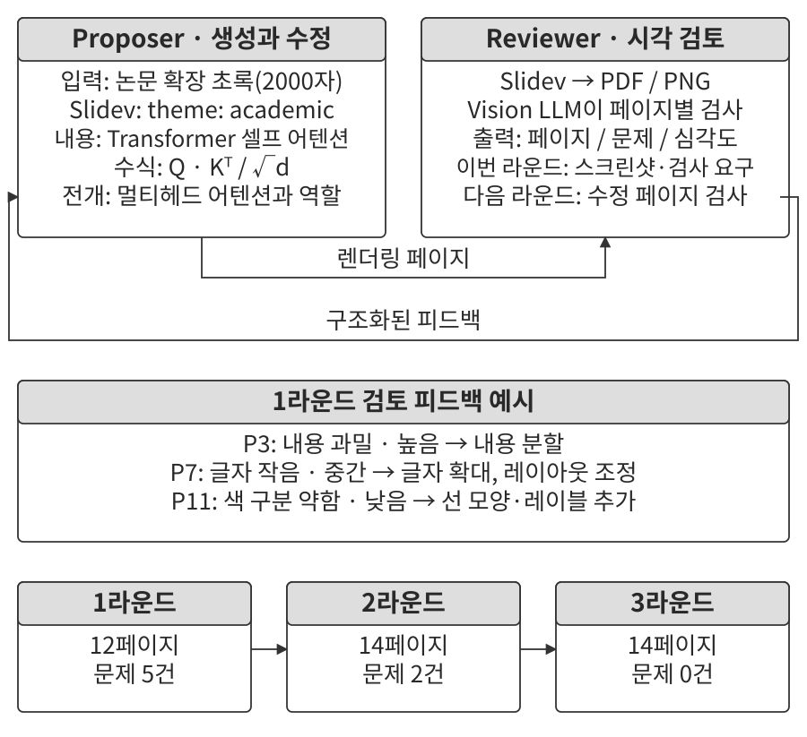

검사 대상이 바뀌면 검토할 때 볼 증거도 바뀌어야 합니다. 고객 응대 답변을 검토할 때는 업무 규칙과 사실 출처를 대조하고, 코드 변경을 검토할 때는 테스트와 실제 실행 결과를 보며, 작업 계획을 검토할 때는 적용되는 규범과 전제 조건을 확인합니다.

Huang 등은 ICLR 2024 논문 “Large Language Models Cannot Self-Correct Reasoning Yet”에서, 연구한 추론 작업과 프롬프트 설정에서 GPT-4가 외부 피드백 없이 스스로 수정하면 옳은 답을 틀리게 고쳐 전체 정확도가 떨어지는 경우가 있음을 발견했습니다. TACL의 자기 수정 서베이는 작업 조건과 피드백의 신뢰성이 수정 효과에 어떻게 영향을 주는지 더 깊이 논의합니다.[^self-correction-survey] 그래서 필자는 독립적인 증거와 위치를 짚을 수 있는 수정 조건을 검토 루프의 기본 요건으로 삼습니다. 검토자는 실제 테스트, 환경 상태, 렌더링 결과를 읽을 수 있어야 하며, 어떤 요구 사항이 아직 충족되지 않았는지, 수정을 어떻게 검증할지 짚어 주어야 합니다.

[^self-correction-survey]: Kamoi, R., et al. *When Can LLMs Actually Correct Their Own Mistakes? A Critical Survey of Self-Correction of LLMs.* TACL, 2024.

완전한 루프 하나는 다섯 단계로 구성할 수 있습니다.

1. 제안자가 작업 요구에 따라 첫 판을 씁니다. 예를 들어 답변 하나나 코드 한 조각입니다.
2. 산출물을 실행하거나 렌더링하여 테스트, 업무 상태, 스크린샷, 사실 검증 결과를 얻습니다.
3. 검토자가 요구 사항과 증거를 대조하여 통과 판정을 내리거나, 문제의 위치와 수정 조건을 짚습니다.
4. 예산이 남아 있으면 제안자가 피드백에 따라 고치고 다시 실행과 검토를 거칩니다. 입력이나 승인이 필요한 문제를 만나면 대기하거나 다른 쪽에 넘깁니다.
5. 배포 조건을 충족하면 검토를 통과한 판을 검증 증거와 검토 결론과 함께 넘깁니다. 예산이 바닥나면 진행 상황과 미해결 문제를 보존합니다.

검토자는 보호된 테스트와 배포 기준을 읽으며, 검토자가 제안한 기준 변경은 따로 심사합니다.

CRITIC 실험에서 모델은 먼저 답을 내놓은 뒤 도구의 도움을 받아 점검했습니다.[^ch10-critic] 예를 들어 검색 엔진으로 답에 담긴 사실을 확인하고, Python 인터프리터로 자신이 쓴 수학 프로그램을 실행했습니다. 개방형 질의응답, 수학 프로그램 생성, 유해한 표현 줄이기라는 세 작업 모두에서, 모델이 도구 피드백에 따라 답을 고치자 성능이 나아졌습니다. 모델이 스스로 원래 답을 평가하기만 했을 때는 오류 수정 효과가 약했습니다. 이 설계는 제5장의 PPT 사례와 통합니다. 렌더링한 스크린샷은 코드 텍스트만으로는 판단하기 어려운 레이아웃과 가림 문제를 드러내고, 테스트 실행은 실제 실행 오류를 밝혀냅니다.

[^ch10-critic]: CRITIC, arXiv:2305.11738.

Anthropic의 2026년 장기 애플리케이션 개발 사례는 계획자, 생성자, 평가자라는 세 에이전트를 썼습니다. 계획자는 요구를 제품 명세로 확장하고, 생성자와 평가자는 각 라운드의 완료 기준을 먼저 합의한 뒤 각각 구현하고 점검합니다. 평가자는 Playwright로 애플리케이션을 조작하고 결함 보고서를 제출하며, 역할 사이의 상태는 파일로 인계됩니다. 이 사례는 제품 명세, 실제 조작, 결함 피드백이 어떻게 연결되는지 보여 주며, 늘어난 실행·검토 비용도 방안을 비교할 때 함께 따져야 함을 알려 줍니다.[^anthropic-harness-2026]

[^anthropic-harness-2026]: Prithvi Rajasekaran, “Harness Design for Long-Running Application Development,” Anthropic Engineering, 2026-03-24.

2026년 11월 20일, 수학자 Levent Alpöge는 Claude와 협업하여 얻은 형식 증명을 공개했습니다. 리만 가설과 그것을 디리클레 $L$ 함수로 일반화한 명제에 관한 것이었습니다. Lean 파일을 한 무더기 받은 검토자는 먼저 두 가지를 물어야 합니다. 마지막 정리가 원래의 가설을 진술하고 있는가? 모든 추론 단계를 증명 커널이 다시 확인할 수 있는가? MIT 수학자 Andrew Sutherland는 먼저 제출된 정리를 Lean 수학 라이브러리의 리만 가설 정의와 대조한 뒤, 증명이 의존하는 공리를 나열했습니다. 그는 같은 날 공개한 기록에서, 독립 증명 커널 nanoda가 내보낸 증명을 확인하여 통과시켰다고도 보고했습니다. 이는 검토 분업에 구체적인 방법을 제시합니다. 문제를 잘 아는 사람이 먼저 합격 여부를 가를 명제를 적어 두고, 독립된 도구가 제출된 산출물로 그 명제를 이끌어 낼 수 있는지 확인하게 하는 것입니다. 훗날 수학자들이 저자가 어떻게 이 경로를 떠올렸는지 이해하려면, 사람이 읽기 쉬운 논증도 따로 있어야 합니다.[^ch10-rh-review]

[^ch10-rh-review]: Levent Alpöge가 2026년 11월 20일 연구 설명을 공개했습니다. 검증 프로젝트와 당일 진행 상황은 Andrew Sutherland의 *Verification files for the Lean proof of the Riemann Hypothesis*를 참고하십시오.

#### 토론 패턴

토론 패턴은 구성원들이 서로 다른 입장에서 같은 문제를 점검하게 합니다. 예를 들어 기술 방안을 평가할 때 한 에이전트는 이득과 적용 상황을 설명하고, 다른 에이전트는 제약, 실패 조건, 대안을 점검합니다. 라운드마다 구체적인 논점을 두고 증거를 보태거나 반박하며, 마지막에는 합의한 사항과 아직 검증이 필요한 이견을 정리합니다.

이 방식은 찬반 논거를 분명하게 늘어놓는 데 도움이 되지만, 효과는 논거의 질, 독립적 판단, 최종 선택 방법에 달려 있습니다. Tran과 Kiela는 다중 홉 추론 작업에서 순차, 토론, 앙상블, 병렬 역할, 하위 작업 병렬이라는 다섯 아키텍처를 비교했습니다. 사고 토큰 예산을 같게 맞추자 단일 에이전트가 멀티 에이전트와 비슷하거나 더 좋은 성능을 냈습니다.[^single-agent-2026] 이를 근거로 필자는 토론을 주로 이견을 펼쳐 보이고, 가정을 점검하고, 반대 논거를 채우는 데 씁니다. 사실이나 계산의 정확성을 높이려면 검증 가능한 증거와 독립 점검을 늘리는 쪽을 우선합니다.

논문은 데이터 처리 부등식을 빌려 중간 정보 전달의 한계를 논의합니다. 반복된 바꿔 말하기와 압축은 원래의 세부 사항을 잃게 할 수 있습니다. 엔지니어링에서는 추적할 수 있는 출처를 남기고, 구성원들이 먼저 독립적으로 분석한 다음 결론을 교환하게 하여, 검증되지 않은 합의를 줄일 수 있습니다. 여러 번 독립적으로 샘플링한 뒤 집계하는 방법, 그리고 ‘생성은 어렵고 검증은 쉬운’ 작업 특성을 활용해 전담 검토를 두는 방법도 토론과 함께 쓸 수 있습니다.

[^single-agent-2026]: Tran, D., Kiela, D. *Single-Agent LLMs Outperform Multi-Agent Systems on Multi-Hop Reasoning Under Equal Thinking Token Budgets.* arXiv:2604.02460, 2026.

#### 브레인스토밍 패턴

브레인스토밍은 두 라운드로 나눌 수 있습니다. 먼저 구성원마다 혼자 방법을 생각하게 하고, 그다음 함께 어떤 아이디어를 조합할 수 있을지 논의합니다. 예를 들어 에이전트 1이 소셜 공유 기능 추가를 제안하면, 에이전트 2가 이를 바탕으로 개인화된 공유 포스터 자동 생성을 제안하고, 에이전트 3이 한 걸음 더 나아가 사용자 정의 템플릿과 템플릿 마켓플레이스를 제안합니다.

구성원들이 서로 다른 방법을 떠올리게 하려면, 각각 사용자와 운영자의 관점에서 출발하게 할 수도 있고, 서로 다른 프롬프트나 모델을 줄 수도 있습니다. 아이디어를 교환한 뒤에는 사용자 요구, 구현 비용, 검증 결과에 따라 방안을 추립니다.

#### 전문가 패널 패턴

전문가 패널은 여러 분야에 걸친 문제를 두고 전문 책임을 나눕니다. 예를 들어 신제품을 평가할 때 엔지니어 에이전트는 구현 난도와 기술 의존성을 분석하고, 제품 에이전트는 사용자 요구와 경험을 점검하며, 운영 에이전트는 비용, 자원, 실행 조건을 추정합니다.

LobeHub의 그룹 채팅에서는 진행자가 같은 제품 방안을 이 세 전문가에게 브로드캐스트할 수 있습니다. 시스템은 먼저 그 시점의 그룹 채팅 기록을 가져온 뒤, 세 구성원이 각자의 역할 구성으로 동시에 답하게 합니다. 세 답변은 모두 브로드캐스트를 시작한 메시지 아래에 달리므로, 각자가 어떤 질문에 답했는지 나중에 대조하기 쉽습니다. 운영 담당이 엔지니어가 방금 추정한 사용량으로 비용을 계산해야 한다면, 이번 라운드의 답변이 기록된 뒤에 운영 담당에게 발언을 요청해야 합니다. 두 사람이 동시에 쓰기 시작하면 운영 담당의 손에는 아직 그 숫자가 없습니다.[^ch10-lobehub]

[^ch10-lobehub]: LobeHub, 그룹 채팅 사용 설명. 버전 `ab21e0d`의 병렬 브로드캐스트 구현.

취합할 때는 판단들 사이의 연결을 찾아야 합니다. 어떤 경험 목표에는 어떤 기술 지원이 필요한지, 기술 선택이 운영 비용을 얼마나 늘리는지, 어떤 조건에 아직 외부 증거가 필요한지를 따집니다.

### 관리자 패턴: 중앙 집중식 조율

작업에 하위 작업이 많거나, 의존성이 복잡하거나, 동적 스케줄링이 필요하면 관리자 에이전트가 전체를 계획하게 할 수 있습니다. 관리자는 먼저 전체 목표를 이해한 뒤 일을 나누고, 구성원을 고르고, 진행 상황을 추적하며, 예외가 생기면 재시도할지, 담당을 바꿀지, 계획을 조정할지 결정하고, 마지막에 결과를 통합합니다.

흔히 쓰는 구현은 전문 에이전트를 도구로 등록하는 것입니다. 관리자는 도구 인터페이스로 작업, 제약, 필요한 자료를 넘기고, 구조화된 결과나 작업 식별자를 받습니다. 이렇게 하면 검색, 파일 작업, 하위 작업 위임을 비슷한 방식으로 호출할 수 있고, 오래 걸리는 하위 작업은 진행 상황, 취소, 재시도를 따로 관리합니다. 구성원마다 다른 모델, 프롬프트, 도구, 실행 환경을 쓸 수 있습니다. 새 구성원을 추가할 때는 인터페이스를 등록하는 것 외에도, 관리자가 그 구성원의 책임, 입력 요건, 적합한 상황을 이해하게 해야 합니다.

필자는 Claude Code와 Codex로 장기 작업을 할 때 논의, 명령 실행, 테스트를 모두 주 세션에 두었던 적이 있습니다. 도중에 설계 선택 하나를 되묻고 싶어도 하던 단계가 끝나기를 기다려야 할 때가 많았고, 몇 시간 뒤 처음의 약속을 찾으려면 긴 명령 출력을 한참 넘겨야 했습니다. 그 뒤로는 수정과 테스트를 하위 에이전트에 맡기고, 주 세션은 논의용으로 남겨 둡니다. 원고 교정을 예로 들면, 실행자는 계속 그림 번호를 대조하고, 필자는 그동안 독자와 어떤 단락을 다시 쓸지 논의할 수 있습니다. 논의 결과 작업 범위가 바뀌었다면 새 약속을 실행자에게 보내고, 실행자가 결과를 넘길 때 대조해 확인해야 합니다.

DeepSeek Harness 팀은 단일 GitHub 저장소를 대상으로 한 연구 프로토타입 `dsh-superagent`를 공개했습니다. 내보낸 파일의 날짜 형식을 고치는 일을 예로 들어 봅시다. 유지보수자가 이슈에 요구 사항을 올리면, 라우터(Router)가 저장소 규칙에 따라 일을 맡을 수 있는지 판단합니다. 일을 맡으면 시스템은 티켓(Ticket)을 만들고, 실행자(Worker)에게 독립된 세션과 작업 디렉터리를 배정합니다. 실행자는 자기 디렉터리에서 코드를 고치고 테스트를 실행할 수 있습니다. 다른 티켓도 동시에 진행될 수 있으며, 각자 수정 과정과 테스트 결과를 보존합니다.[^ch10-dsh-prototype]

유지보수자가 이어서 원래 이슈에 “CSV만 고치고, JSON의 날짜 형식은 그대로 두라”고 덧붙였다고 합시다. 이 논의를 구독하는 진행 중인 티켓은 추가 메시지를 받으므로, 실행자는 이를 바탕으로 변경 범위를 좁히고 두 형식을 따로 테스트할 수 있습니다. 일을 마치면 풀 리퀘스트(PR)를 열고, 링크와 결과를 원래 이슈에 다시 올립니다. 유지보수자는 한곳에서 처음 요구, 나중에 붙인 제한, 검토를 기다리는 수정을 모두 볼 수 있고, 라우터도 후속 메시지 하나하나를 다시 작업으로 쪼갤 필요가 없습니다.

[^ch10-dsh-prototype]: DeepSeek Harness 팀, dsh-superagent 연구 프로토타입. 티켓이 후속 메시지를 받는 방식은 권한과 구독 문서를, 실행 세션과 작업 디렉터리는 실행 메커니즘 문서를 참고하십시오.

관리자는 동시에 많은 결정 책임을 집니다. 작업 분해가 잘못되면 이후 실행에 영향을 주고, 인계 자료가 부족하면 같은 질문이 거듭 오가며, 호출 기록이 너무 많으면 컨텍스트를 잠식합니다. 설계할 때는 간결한 작업 상태와 산출물 색인을 보존하고, 세부 사항은 필요할 때 읽으며, 하위 작업마다 입력, 출력, 완료 기준을 분명히 해야 합니다.

Plan-and-Act는 Planner-Executor 아키텍처에서 계획 품질이 장기 작업에 주는 영향을 연구하여, WebArena-Lite에서 57.58%의 성공률을 보고했습니다.[^plan-and-act-2025] 계획이 잘못되면 여러 실행자가 잘못된 분해를 따라 계속 일하게 되고, 구성원을 늘리면 재작업도 커집니다. 그래서 필자는 관리자의 작업 분해 품질부터 확인합니다. 병목이 계획에 있다면 더 강한 모델, 더 완전한 작업 정보, 더 넉넉한 추론 예산을 관리자에게 배정합니다. 하위 작업의 경계가 분명해진 뒤에 실행자에게 알맞은 구성을 고릅니다.

[^plan-and-act-2025]: Erdogan, L. E., et al. *Plan-and-Act: Improving Planning of Agents for Long-Horizon Tasks.* arXiv:2503.09572, 2025.

병렬 작업은 어떻게 마무리할지도 분명히 해야 합니다. 조건에 맞는 결과 하나를 찾는 것이 목표라면, 검증을 통과한 뒤 처음으로 검증을 통과한 결과를 원자적 연산으로 등록하고, 남은 가지를 취소한 다음, 취소 확인이나 제한 시간 만료를 기다렸다가 결과를 취합해 넘길 수 있습니다. 등록 연산은 원자성과 멱등성을 함께 갖춰야 합니다. 두 결과가 동시에 도착해도 상태 전환은 한 번만 일어나야 하고, 같은 이벤트가 중복 전달되면 기존 처리 결과를 그대로 써야 합니다. 잠금, 트랜잭션, 비교 후 교환(compare-and-swap) 모두 이 단계를 보호하는 데 쓸 수 있습니다.

Python에 내장된 SQLite로 구체적인 인계를 한번 살펴봅시다. 갑(甲)과 을(乙) 두 구성원이 병렬로 자료를 대조하며, 각자 제출한 결과가 모두 검증을 통과했다고 합시다. 관리자에게 필요한 합격 결과는 하나뿐이므로, 작업 레코드 한 행에 누가 먼저 제출했는지 기록합니다. 아래 예에서는 갑이 먼저 제출하고, 을이 뒤이어 제출하며, 갑이 한 번 더 재시도합니다.

```python
import sqlite3

db = sqlite3.connect(":memory:")
db.execute("CREATE TABLE task (id INTEGER PRIMARY KEY, winner TEXT)")
db.execute("INSERT INTO task VALUES (1, NULL)")
for worker in ["甲", "乙", "甲"]:
    with db:
        claimed = db.execute(
            "UPDATE task SET winner = ? WHERE id = ? AND winner IS NULL",
            (worker, 1),
        ).rowcount
    print(worker, "登记成功" if claimed else "沿用已登记结果")
```

출력은 차례로 “甲 登记成功”(갑 등록 성공), “乙 沿用已登记结果”(을 기존 등록 결과 사용), “甲 沿用已登记结果”(갑 기존 등록 결과 사용)입니다. 을이 먼저 도착했다면 표에는 을이 기록됩니다. 갱신 문장 하나가 ‘아직 아무도 등록하지 않았다’는 조건 확인과 제출자 이름 쓰기를 함께 처리합니다. 확인과 쓰기를 나누면 두 실행자가 모두 빈 값을 읽을 수 있습니다.

위 예는 표를 메모리에 만들었으므로 프로세스가 끝나면 등록도 사라집니다. 영속 데이터베이스로 바꾸면 인계 문제가 하나 더 생깁니다. 관리자가 갑을 등록했지만 을에게 알리기 전에 종료되었다고 합시다. 재시작한 뒤, 이 알림을 아직 보내지 않았다는 사실을 누가 알까요? 같은 트랜잭션 안에서 선정된 결과와 보낼 알림을 함께 쓸 수 있습니다. 알림마다 받는 가지, 할 일, 고유 번호를 기록합니다. 관리자는 재시작한 뒤 아직 확인받지 못한 알림을 다시 보냅니다. 을이 이미 정리를 마쳤고 확인 메시지만 유실된 경우에도, 을은 원래 번호로 재전송된 알림을 알아보고 지난번 처리 결과를 그대로 돌려줄 수 있습니다. 결과 전달 이벤트도 같은 방식으로 기록할 수 있습니다.

작업이 모든 결과를 모으도록 요구한다면, 필요한 가지가 모두 끝나기를 기다리고 성공, 실패, 미완료 항목을 각각 기록해야 합니다. 마무리 조건은 작업 목표에서 나오며, 언제 다른 구성원을 취소할 수 있는지도 이 조건이 정합니다.

**순차 조율.** 하위 작업 사이에 선후 의존성이 있으면, 관리자는 앞 단계의 산출물을 쓸 수 있게 된 뒤에야 다음 단계를 배정합니다. 그림 10-4는 보고서 작성을 예로 듭니다. 자료를 모으는 구성원이 먼저 출처를 돌려주면, 분석자가 이를 바탕으로 결론을 정리하고, 작성자가 마지막으로 근거 있는 분석을 받습니다. 다음 번역 작업으로 바꿔 보면, 번역자는 일을 시작하기 전에 어떤 자료를 기다려야 할까요?

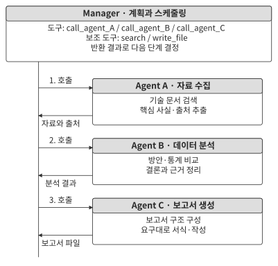

> **실험 10-2 ★★: 도서 번역 에이전트**
>
> 기술 서적을 번역하려면 용어, 맥락, 문장을 함께 다뤄야 합니다. 예를 들어 영어 agent는 여러 가지로 옮길 수 있는데, 번역 원고가 “智能体”(지능체)로 옮기기로 정했다면 이후의 장도 같은 번역어를 써야 합니다. 용어집, 각 장의 원문, 번역문, 검수 기록을 명확하게 조직할 방법이 필요합니다. 긴 책에 중간 번역 원고, 도구 결과, 검수 기록까지 쌓이면 컨텍스트를 계속 잠식하고, 모델은 제9장에 이르렀을 때 제2장의 번역어를 잊거나 같은 내용을 거듭 점검할 수 있습니다. 작업을 책임과 장 단위로 나누면 각 인스턴스는 현재 책임에 필요한 자료에만 집중할 수 있습니다.
>
> 일은 네 유형의 에이전트에 나눌 수 있습니다.
>
> - **Glossary Agent: 용어 정리.** 책 전체를 나눠 읽으며 반복해서 나오는 전문 용어를 식별하고, 전문 사전과 번역 지침을 참고하여 영어 용어, 중국어 번역어, 품사, 사용 맥락을 담은 JSON이나 CSV 대조표를 만듭니다. 용어집은 공유 공간에 저장하고, 작업이 끝나면 인스턴스를 해제합니다.
> - **Translation Agent: 장 번역.** 현재 장, 관련 용어, 번역 지침을 읽고 대상 독자와 문체에 맞춰 번역문을 완성합니다. 새로 나온 용어는 후보 번역어를 제시하고 검토 대기로 표시합니다. 인스턴스마다 독립 컨텍스트를 유지하고 번역문은 공유 공간에 저장합니다. 장들은 의존성에 따라 직렬이나 병렬로 처리할 수 있습니다.
> - **Proofreading Agent: 전체 검수.** 용어집과 각 장의 번역문을 바탕으로 번역어, 앞뒤 표현, 가독성을 점검합니다. 장별 읽기와 장을 넘나드는 색인으로 전체를 점검하고, 문제의 위치, 근거, 수정 요구를 검수 보고서에 씁니다.
> - **Manager Agent: 작업 배정과 회수.** 목표, 계획, 작업 상태, 호출 요약, 산출물 색인을 관리하고, 검수 보고서에 따라 고쳐야 할 장을 번역자에게 돌려보낸 뒤 재검토를 조직합니다.
>
> 그림 10-5에서 검수자는 각 장의 번역문과 용어집을 읽고, 관리자는 보고서를 보고 어느 장을 다시 고칠지 정합니다. 재작업을 맡은 번역자는 그 장의 원문을 불러와, 표시된 단어가 그 문장에서 무슨 뜻인지 확인할 수 있습니다.
>
> 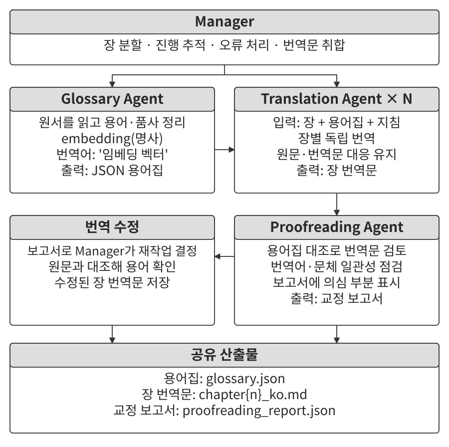
>
> 번역 원고를 파일에 쓰고 나면, 어떤 호출이 여전히 긴 글을 읽어야 할까요? 함께 제공하는 실험은 영어판 앞의 두 장을 번역 단위 26개로 나눴습니다. 단일 에이전트는 앞선 원문과 번역문을 내내 끌고 다녔고, 가장 큰 요청 한 번에 94,355토큰을 입력했습니다. 분업한 뒤 번역자의 가장 큰 입력은 2,857토큰에 불과했고, 관리자가 재작업을 결정할 때는 2,153토큰을 썼습니다. 네 역할로 분업한 쪽에서 입력이 가장 많았던 것은 사실 용어 정리 담당이었습니다. 두 장을 한 번에 읽느라 49,807토큰을 썼습니다.
>
> 이 두 장을 번역하는 데 네 역할은 합계 203,277토큰을, 단일 에이전트는 1,317,808토큰을 썼습니다. 어느 쪽이 먼저 원고를 넘겼을까요? 네 역할 쪽은 약 271초가 걸려, 단일 에이전트보다 약 17초 더 걸렸습니다.
>
> 원고를 넘길 때, 두 가지 점검이 같은 번역문에 서로 다른 결과를 냈습니다. 용어집은 명사 `embedding`의 번역어로 “嵌入向量”(임베딩 벡터)을 지정했습니다. 검수 보고서에는 다시 고쳐야 할 장이 없었지만, 용어 점검 프로그램은 이 단어에 0/2를 매겼습니다. 두 장의 번역 원고 모두에서 “嵌入”(임베딩)은 찾았지만 “嵌入向量”은 찾지 못했기 때문입니다. 두 장을 모두 돌려보내야 할까요?
>
> 제1장에서 환불 정책을 다루는 단락의 원문은 `embedding the refund policy in the context`였고, 번역문은 “将退款政策嵌入上下文中”(환불 정책을 컨텍스트에 끼워 넣는다)이었습니다. 여기서는 정책을 컨텍스트에 넣는다는 뜻이므로, “嵌入向量”으로 바꾸면 오히려 틀리게 됩니다. 장별로 문자열을 찾는 프로그램은 검수자가 다시 살펴볼 단서를 찾는 데 도움이 되지만, 어느 곳을 고쳐야 할지 결정하려면 검수자에게 그 단락의 원문이 필요합니다. 용어집을 갱신할 때도 먼저 영향을 받는 단락을 찾은 뒤, 원문, 번역문, 새 항목을 함께 번역자에게 넘길 수 있습니다.
>
> **실험 요구 사항:**
> 1. 그림과 코드가 들어 있는 기술 서적 한 권을 고릅니다.
> 2. Manager, Glossary, Translation, Proofreading의 네 유형의 에이전트를 구현합니다.
> 3. 각 구성원의 컨텍스트 사용량, 인계 자료, 산출물 버전을 기록합니다.
> 4. 단일 에이전트 방식과 번역 품질, 완료 시간, 자원 소비를 비교하고, 작업 분할과 컨텍스트 조직의 영향을 분석합니다.

**병렬 조율.** 서로 독립적인 하위 작업은 동시에 실행할 수 있습니다. 관리자는 작업을 배정하고 상태를 받으며, 결과에 따라 계속할지, 일을 보충할지, 끝낼지 결정합니다. 이 책을 번역할 때도 용어집이 확정되면 여러 장을 여러 번역자에게 나눠 동시에 시작할 수 있습니다. 그림 10-6은 연구 보고서로 바꿨습니다. 차트는 이미 끝났고 분석은 아직 진행 중인데, 형식 검사는 왜 기다려야 할까요? 구성원이 보고한 이벤트를 따라가면 마지막 단계가 어떤 두 산출물에 의존하는지 알 수 있습니다.

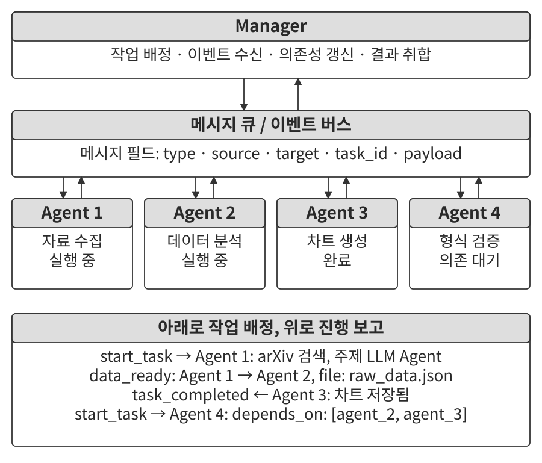

메시지 버스는 이런 비동기 통신을 조직하기에 적합합니다. 구성원은 진행 상황과 결과를 게시하고, 관리자는 해당 이벤트를 구독하며, 런타임은 전달, 버퍼링, 재시도를 맡습니다.

> **제품 사례: 링타이(Lingtai)**
>
> 링타이는 로컬에서 실행되며 파일로 정체성과 기억을 보존하는 장기 에이전트 시스템입니다. 세 가지 역할을 제공합니다. 주 에이전트(main agent)는 사용자와 대화하며 계획과 기억을 관리합니다. 데몬(daemon)은 범위가 분명한 단기 병렬 작업을 맡고, 끝나면 결론을 돌려줍니다. 아바타(avatar)는 자기만의 기억, 우편함, 책임을 유지하며 여러 세션에 걸친 전문 분업에 쓰입니다.
>
> 각 역할은 비공개 영속 지식을 갖고, Markdown 형식의 스킬 플레이북을 공유합니다. 컨텍스트가 용량 한도에 가까워지면 역할은 ‘탈피’(molt)를 통해 요약을 저장한 뒤, 영속 기억과 함께 새 컨텍스트로 들어갑니다. 정체성, 기억, 스킬이 파일에 따로 저장되므로 기반 모델을 바꿔도 일을 이어 갈 수 있습니다. 이 설계는 관리자, 단기 작업자, 장기 전문 구성원, 컨텍스트 압축을 하나로 묶습니다.

> **실험 10-3 ★★★: 자율적으로 오케스트레이션되는 전화 + 컴퓨터 에이전트**
>
> 이 실험은 제6장의 Computer Use와 음성 상호작용을 결합합니다. 사용자가 회원 가입이나 항공권 예약 페이지를 제공하면, Computer Agent가 웹사이트를 열고 양식을 식별한 뒤, Phone Agent를 통해 지금 빠져 있는 이름, 신분증 번호, 연락처, 주소, 선호 사항 같은 필드를 수집합니다.
>
> **역할과 인계.** Computer Agent는 브라우저를 조작하며 이번 오케스트레이션을 책임지고, Phone Agent는 ASR, LLM, TTS로 사용자와 실시간으로 소통하며 말로 한 답을 구조화된 필드로 바꿉니다. 둘은 지점 간 도구나 메시지 버스로 통신하며, 메시지에는 송신자, 수신자, 유형, 내용이 들어갑니다. Computer Agent는 전화 작업을 직접 위임할 수 있으므로 관리자 역할을 맡습니다. 사용자가 음성으로 정보를 주기를 원하면, Phone Agent는 연달아 묻고 확인하고 다시 물을 수 있고, Computer Agent는 페이지 상태와 필드 입력에 집중합니다.
>
> **두 가지 실행 모드.** 고정 모드는 두 에이전트를 미리 띄워 각자 독립된 실행 루프를 유지하게 하며, 양방향 통신과 동시 동작을 점검하는 데 씁니다. 자율 모드는 Computer Agent를 먼저 띄우고, 모델이 페이지, 기존 정보, 작업 필요에 따라 `initiate_phone_call_agent(purpose, required_info)`를 호출할지 결정합니다. 그러면 런타임이 작업 목적, 수집할 필드, 형식 제약을 Phone Agent에 넘기고, 시작된 뒤에는 같은 통신 메커니즘을 씁니다.
>
> **필드별 흐름.** 그림 10-7에서 Phone Agent는 WebRTC로 질문하고 답을 추출해 검증한 뒤, 유효한 값을 얻으면 `info_collected`를 보내고 다음 항목을 묻습니다. Computer Agent는 그와 동시에 페이지를 읽고 앞 항목을 채우며, `fill_error`나 새 페이지 상태를 돌려보냅니다. 형식이 맞지 않으면 `format_invalid`로 필드와 요구 사항을 표시하고, Phone Agent는 이를 바탕으로 확인하거나 다시 묻습니다. 이렇게 하면 ‘다음 항목 묻기’와 ‘앞 항목 채우기’가 겹쳐서 실행될 수 있습니다.
>
> **완료와 예외 처리.** Phone Agent는 필드를 다 모으면 `task_completed`를 보내 정보 수집 하위 작업이 끝났음을 알립니다. Computer Agent는 필수 항목, 페이지 검증 결과, 제출 승인을 계속 확인한 뒤 양식 작업을 마칩니다. 재시도 횟수를 넘기거나, 페이지 예외가 생기거나, 사용자가 멈추라고 하면 작업을 일시 중지하고 현재 진행 상황을 알립니다. 끝날 때는 아직 실행 중인 상대 에이전트를 취소하고 브라우저 세션, 오디오 트랙, 통화를 닫습니다. 실제 사람과의 음성 상호작용과 양식 제출에는 각각 사용자의 동의와 승인을 받습니다.
>
> 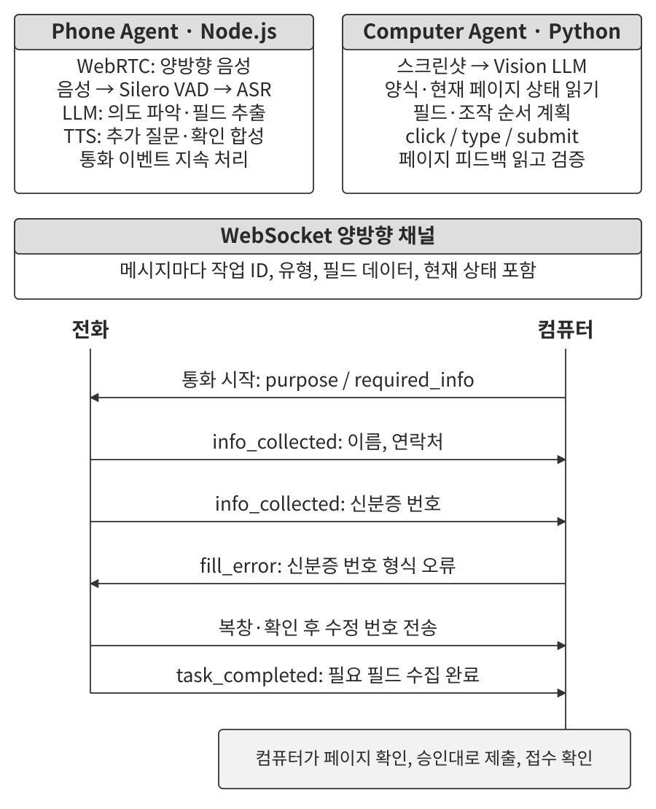
>
> **실험 요구 사항:**
> 1. 독립된 에이전트 두 개와 양방향 구조화 통신을 구현합니다.
> 2. 고정 모드와 자율 모드에서 시간 순서를 기록하고, 질문과 입력이 겹치는 구간을 확인합니다.
> 3. 형식 검증, 다시 묻기, 페이지 오류 피드백, 제한 시간, 자원 정리를 구현합니다.
> 4. 두 모드의 시작 결정, 지연 시간, 성공률, 자원 소비를 비교합니다.

> **실험 10-4 ★★★: 여러 웹사이트에서 동시에 정보를 수집하는 에이전트**
>
> 이 실험은 동질적인 에이전트 여러 개로 병렬 검색을 하며 제6장의 이벤트 기반·인터럽트 메커니즘을 연습합니다. 작업은 한 대학의 여러 단과대학 웹사이트에서 지정된 교수, 예를 들어 “Zhang Wei”를 찾아 소속 단과대학, 직위, 연구 분야, 출처 페이지를 반환하는 것입니다. 검색하기 전에 이름, 학과, 개인 홈페이지 정보 같은 식별 조건을 미리 정해 두면 동명이인을 구분하기 쉽습니다.
>
> **1. 병렬 시작.** 관리자가 Computer Use Agent 10개를 만들고, 각각 단과대학 웹사이트 하나를 맡깁니다. 각 인스턴스는 독립된 컨텍스트와 브라우저 세션을 유지하며, 비동기 작업, 스레드, 프로세스로 스케줄링할 수 있습니다. 입력에는 웹사이트 URL, 대상 이름, 일치 조건, 라우팅용 작업 식별자가 들어갑니다.
>
> **2. 진행 상황 취합.** 구성원은 “웹사이트 로딩 중”, “교수 명단 읽는 중”, “확인했으나 일치 항목 없음”, “동명의 교수 발견” 같은 상태를 주기적으로 보냅니다. 관리자는 메시지 버스로 작업 표를 관리하며 실행 중, 완료, 막힘, 실패를 각각 기록하고, 출처와 오류 원인을 보존합니다.
>
> **3. 검증한 뒤 다른 가지 취소.** 물리학 단과대학을 맡은 `agent_3`가 동명의 교수를 찾았다고 합시다. 그러면 교수 정보와 출처를 담은 페이로드와 함께 `target_found`를 보냅니다. 작업이 확인된 인물 정보를 반환하도록 요구한다면, 관리자는 먼저 일치 조건과 증거를 대조하여 대상 인물을 찾았음을 확인한 뒤, 결과를 원자적 연산으로 등록하고, 실행 중인 다른 구성원에게 `terminate`를 보내면서 채택한 정보가 `agent_3`에서 왔다고 밝힙니다. 구성원은 안전한 지점에서 멈추고 자원을 정리한 뒤 확인을 돌려주며, 관리자는 확인이나 제한 시간 만료를 기다렸다가 취합을 마칩니다. 작업이 동명이인을 모두 나열하도록 요구한다면, 필요한 범위를 다 확인할 때까지 검색을 계속합니다.
>
> **경쟁 조건.** 에이전트 A와 B가 거의 동시에 유효한 결과를 돌려줄 수 있습니다. 두 이벤트가 각자 취합을 촉발하면 결과가 중복 전달되거나 상태가 충돌합니다. 잠금이나 트랜잭션으로 ‘검색 중 → 결과 등록됨’이라는 상태 전환을 보호하고, 뒤에 도착한 이벤트는 이미 등록된 결과를 읽게 할 수 있습니다. 메시지 재시도도 이벤트 식별자로 중복을 제거하여, 취소와 취합이 중복 촉발되어도 일관성을 유지하게 해야 합니다.
>
> **4. 예외와 검색 범위.** 네트워크 중단, 페이지 구조 변경, 파싱 오류는 각각 기록합니다. 작업 하나에 2분 같은 제한 시간 예산을 둘 수 있으며, 시간이 넘으면 실행을 취소하고 진단 정보를 수집하되 다른 구성원은 계속 일합니다. 최종 보고서는 ‘확인했으나 찾지 못함’과 ‘접근에 실패해 아직 확인하지 못함’을 구분하고, 확인한 단과대학의 범위도 밝힙니다.
>
> 그림 10-8은 예시 시각을 붙여 이 메시지들을 한 줄로 엮습니다. 구성원 3이 물리학 단과대학에 양자 컴퓨팅을 연구하는 Zhang Wei 교수가 있다고 보고하면, 관리자는 먼저 출처 웹페이지가 이름, 학과, 직위, 연구 분야를 뒷받침하는지 봐야 합니다. 동명 교수의 단서를 받은 때, 대상 인물임을 확인한 때, 취소 확인을 모두 받은 때는 서로 다른 세 시점입니다.
>
> 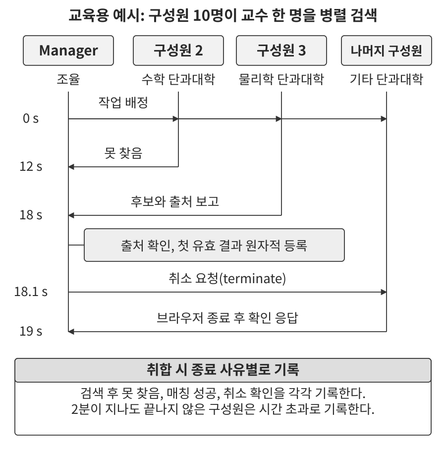
>
> 실제로 검색한 인물은 Andrew Ng였습니다. 구성원은 먼저 페이지 텍스트에 이 이름이 있는지 확인하고, 일치할 때만 모델에 정보 추출을 요청했습니다. Stanford HAI 페이지가 선택되었고, 반환된 짧은 인용문으로 이름과 겸임 교수 신분을 확인할 수 있었습니다. 연구 분야를 확인하려면 페이지 뒷부분의 딥러닝에 관한 단락까지 읽어야 했습니다. 여러 구성원이 동시에 `target_found`를 보내더라도, 잠금을 가장 먼저 얻은 구성원만 결과를 등록할 수 있었습니다.
>
> 이번 직렬 검색은 URL 열 개 가운데 마지막에서야 일치 항목을 찾아 44.971초가 걸렸고, 같은 웹페이지들을 병렬로 검색하자 24.022초가 걸렸으며, 두 경우 모두 브라우저 컨텍스트 열 개를 다 닫았습니다. 두 수를 나누면 1.872입니다. HAI 페이지를 맨 앞에 두면 직렬 검색은 일치하자마자 멈출 수 있으므로 소요 시간을 다시 재야 합니다. 취소를 따로 검증한 또 다른 실행에서는 가지 네 개를 띄웠습니다. 한 가지가 먼저 결과를 등록했고, 나머지 세 가지는 취소 요청을 받았다고 확인했으며, 마지막에 브라우저 컨텍스트 네 개가 모두 닫혔습니다.
>
> **실험 요구 사항:**
> 1. 병렬 구성원을 동적으로 만드는 관리자를 구현합니다.
> 2. browser-use 같은 프로젝트로 브라우저 실행 능력을 구축합니다.
> 3. 메시지 버스로 양방향 통신과 상태 관리를 수행합니다.
> 4. 검색 결과를 검증하고, 결과를 원자적 연산으로 등록하며, 나머지 가지를 취소한 뒤 확인을 수집합니다.
> 5. 접근 실패, 파싱 오류, 제한 시간 초과, 일치 항목 없음 같은 상황을 처리합니다.
> 6. 병렬 실행과 직렬 실행의 완료 시간, 검색 범위, 자원 소비를 비교합니다.

**관리자가 생성하는 워크플로.** 하나씩 위임하는 방식 말고도, 관리자는 작업 의존성과 취합 규칙을 먼저 프로그램으로 쓴 뒤 런타임에 넘겨 스케줄링하게 할 수 있습니다. 모델은 흐름을 설계하고, 프로그램은 약속대로 구성원을 띄우고 결과를 전달하며 의존성을 기다립니다. 의존 관계가 이미 분명하고 같은 종류의 흐름을 반복해서 실행해야 할 때 필자는 이 방식을 우선합니다. 배정할 때마다 관리자를 호출하는 비용을 아끼고, 관리 컨텍스트에 쌓이는 스케줄링 기록도 줄일 수 있습니다.

Claude Code의 동적 Workflow 도구가 이런 구현을 제공합니다. `agent()`는 독립 컨텍스트를 가진 하위 에이전트를 만들며, schema로 구조화된 출력을 정할 수 있습니다. `parallel()`은 작업 묶음을 동시에 실행하고 모두 끝날 때까지 기다립니다. `pipeline()`은 각 입력이 여러 단계를 따로 거치게 하므로, 한 항목이 다음 단계로 넘어가는 동안 다른 항목은 앞 단계에서 계속 처리될 수 있습니다. 중간 결과는 프로그램 변수에 저장되고, 거르기와 합치기는 일반 코드로 처리합니다.[^dynamic-workflows]

예를 들어 기술 원고의 사실 일곱 묶음을 검증할 때는, 먼저 방향별로 조사 에이전트를 띄운 다음, 각 묶음의 결론을 검증 에이전트에 따로 넘겨 병렬로 점검할 수 있습니다. 돌아온 결론마다 출처와 판정 근거를 남기고, 모든 가지가 끝나면 취합 에이전트가 최종 보고서를 구성합니다. 이렇게 하면 ‘조사 → 항목별 검증 → 일괄 취합’이라는 분업과 단계 간 의존성이 모두 워크플로에 기록됩니다.

[^dynamic-workflows]: Anthropic, “Orchestrate subagents at scale with dynamic workflows”, 2026.

### 탈중앙화 패턴

관리자가 있는데 왜 구성원이 스스로 누구를 찾아갈지 정하게 할까요? 테스트 담당이 막 완성된 모듈을 받았는데, 제품 요구 사항과 인터페이스 약속이 같은 필드를 두 가지로 해석하고 있음을 발견했다고 합시다. 테스트 담당은 이 모순을 제품과 아키텍처 두 역할에 바로 넘겨 양쪽이 각자 근거를 밝히게 하고, 약속이 고쳐지면 테스트를 이어 갈 수 있습니다. 이것은 분업이자 일종의 견제입니다. 엔지니어는 모듈을 넘기고, 아키텍트는 제품 쪽 의견을 구하고, 테스트 담당은 이의를 제기하는 식으로, 각자가 다음 단계를 시작할 수 있습니다. 협의가 잦을 때 항목마다 관리자가 전달해 주기를 기다리면 일이 늦어집니다.

마이크로서비스의 용어를 빌리면, 중앙 하나가 단계를 배치하는 방식은 **오케스트레이션**(orchestration), 각자가 약속한 이벤트에 따라 알아서 이어받는 방식은 **코레오그래피**(choreography)라고 부릅니다. 실제적인 차이도 하나 있습니다. 인계할 때마다 관리자를 기다려야 한다면, 관리자의 모델 서비스가 응답을 멈추는 순간 다른 구성원은 아직 일할 수 있어도 다음 작업을 받지 못합니다. 분산된 조율은 이런 의존을 줄여 줍니다. 다만 일을 이어받을 구성원 자신이 도구 호출 하나에서 막혀 있다면, 영속적으로 저장된 작업 상태, 제한 시간, 재시도, 작업 넘겨받기 메커니즘이 있어야 다른 구성원이 어디서부터 이어 갈지 알 수 있습니다.

아래 세 설계는 각기 다른 인계 방식을 보여 줍니다. 산출물에 따라 메시지를 구독하는 방식, 그룹 채팅에서 다음 발언자를 고르는 방식, 현재 구성원이 다음 담당을 지목해 넘기는 방식입니다.

**MetaGPT: SOP로 산출물 인계 조직하기.** MetaGPT는 소프트웨어 팀의 표준 작업 절차(SOP)에 따라 일을 나눕니다. 제품 관리자는 요구 문서(PRD)를, 아키텍트는 설계 문서를, 엔지니어는 코드를, 테스트 담당은 테스트 보고서를 넘깁니다. 다음 구성원은 약속된 자료를 받으면 바로 일을 시작할 수 있고, 앞 구성원도 작업을 거듭 설명하는 수고를 덜 수 있습니다. 그림 10-9의 연결선은 이런 산출물의 인계 관계를 나타냅니다.[^metagpt-design]

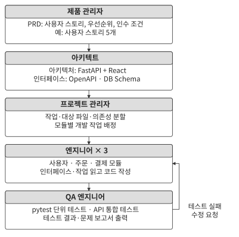

각 역할은 인계할 때 어떤 정보를 채워 넣어야 할까요?

- **Product Manager Agent**는 요구를 받아 PRD를 정리하며 기능, 사용자 스토리, 인수 기준, 우선순위를 분명히 합니다.
- **Architect Agent**는 PRD를 읽고 기술 스택을 고르고, 모듈을 나누고, 인터페이스와 데이터 모델을 정의하여 설계 문서를 만듭니다.
- **Project Manager Agent**는 설계에 따라 작업과 파일 분담을 나누고 의존성을 정리하여 엔지니어에게 실행을 맡깁니다.
- **Engineer Agents**는 설계에 따라 모듈을 구현하고 코드를 제출합니다. 서로 독립적인 부분은 여러 인스턴스에 맡길 수 있습니다.
- **QA Engineer Agent**는 코드와 요구 사항에 따라 테스트를 생성하고, 점검을 실행하고 문제를 기록하여 테스트 보고서를 만듭니다.

이런 역할의 인계 형식을 설계한다면, 필자는 세 가지를 분명히 적으라고 권합니다. 작업과 인수 기준, 확인된 사실과 제약, 구조화된 산출물의 참조입니다. 받는 쪽은 이를 바탕으로 필요한 자료를 가져와 일을 이어 가고, 정보가 빠져 있으면 구체적으로 질문합니다.

MetaGPT는 공유 메시지 풀과 구독 메커니즘으로 정보를 조직합니다. 역할이 메시지를 게시하면, 다른 역할은 자신이 관심 있는 메시지 유형에 따라 관련 입력을 처리합니다. 게시자와 소비자는 산출물 형식과 메시지 의미로 연결되므로, 각자 모델을 바꾸거나 내부 구현을 조정할 수 있습니다.

SOP는 제품 요구, 아키텍처, 코드 사이의 의존성을 기술하고, 메시지 구독은 이런 일이 어떻게 촉발되는지를 기술합니다. 고정된 작업 의존성도 분산된 이벤트로 추진할 수 있으며, 둘이 함께 시스템의 협업 방식을 이룹니다. 동적 피드백을 더 설계한다면 테스트 담당이 제품 역할에 요구 사항을 확인하거나, 엔지니어가 아키텍트에게 대안을 제시하는 경로를 추가하고, 이런 상호작용에 수신 조건과 종료 규칙을 정할 수 있습니다.

[^metagpt-design]: Hong, S., et al. *MetaGPT: Meta Programming for A Multi-Agent Collaborative Framework.* ICLR 2024.

**AutoGen 그룹 채팅: 공유 대화에서의 발언 스케줄링.** 고전적인 GroupChat 설계에서는 여러 에이전트가 같은 대화에 참여하고, GroupChatManager가 다음 발언자를 고르며 구성원에게 메시지를 브로드캐스트합니다. 선택 전략은 라운드로빈일 수도 있고, 현재 내용을 보고 모델이 판단할 수도 있습니다. 구성원은 각자의 역할 구성을 유지하면서 공동 대화로 소통하고, 발언 스케줄링은 관리자에게 모여 있습니다. 이는 컨텍스트 조직과 제어 구조를 조합한 한 예입니다.[^autogen-groupchat]

[^autogen-groupchat]: Microsoft, *AutoGen 0.2: Conversation Patterns.*

**OpenAI Swarm: handoff를 따라 제어권 넘기기.** Swarm은 역할마다 지시와 도구를 구성하며, 역할이 구성된 핸드오프 함수를 호출하면 런타임이 대상 에이전트로 전환합니다. 라우팅 판단은 각 역할이 내리고, 통합 실행 루프가 이를 실행할 수 있습니다. 핸드오프할 때 현재 시스템 지시는 역할에 따라 바뀌고, 대화 기록은 그대로 유지됩니다. 이는 ‘역할이 다음 담당자를 고르는 것’과 ‘대화 기록을 이어 쓰는 것’의 조합을 보여 줍니다.[^swarm-handoff]

독립 컨텍스트 방식으로 인계한다면 작업 패키지를 따로 정의할 수 있습니다. `task_id`는 작업을 식별하고, `sender`와 `recipient`는 양쪽을 지정하며, `goal`과 `constraints`는 목표와 제약을 설명하고, `accepted_facts`는 확인된 사실을 담고, `artifact_refs`는 산출물 참조를 제공하며, `remaining_budget`은 예산을 기록하고, `visited_agents`는 방문 체인을 저장합니다. 받는 쪽은 권한에 따라 자료를 읽고, 런타임은 예산과 인계 기록을 관리합니다.

인계 체인은 반복 방문을 처리해야 합니다. 예를 들어 개발자가 코드를 검토자에게 넘기고, 검토자가 수정 의견을 낸 뒤 다시 개발자에게 넘기는 것은 정상적인 수정 루프입니다. 작업 상태, 산출물 버전, 미해결 문제, 반복 횟수를 함께 보고 진전이 있는지 판단할 수 있습니다. 예를 들어 같은 번역 원고가 연달아 두 번 돌아왔는데, 첫 번째에는 출처를 보충했고 두 번째에는 용어를 바로잡았다면 수정은 아직 진전 중입니다. 두 번 모두 같은 판이 돌아왔고 지적한 문제도 같다면 수정이 막힌 것입니다. 이때는 더 넘길 수 있는 횟수를 제한하고, 해결되지 않은 문제를 책임자에게 보고할 수 있습니다.

[^swarm-handoff]: OpenAI, *Swarm*, “Instructions”와 “Handoffs and Updating Context Variables”.

> **제품 속의 Agent Swarm**
>
> ‘Agent Swarm’(에이전트 군집)은 서로 다른 조직 방식을 가리킬 수 있습니다. 한 부류는 handoff 네트워크를 따라 제어권을 넘기는 방식으로, OpenAI Swarm, LangGraph의 swarm 라이브러리, 마이크로소프트 Agent Framework의 handoff 오케스트레이션이 여기에 속합니다. 다른 부류는 주 에이전트와 병렬 작업자를 쓰는 방식으로, Kimi Agent Swarm, Anthropic의 멀티 에이전트 연구 시스템, Manus Wide Research가 그 예입니다.
>
> Kimi K2.5가 도입한 Agent Swarm은 병렬 에이전트 강화 학습으로 오케스트레이터를 훈련하여, 언제 작업을 나누고 어떻게 일을 배분할지 배우게 했으며, 하위 에이전트를 최대 100개까지 지원했습니다. 이후 버전은 규모를 300개로 늘렸고, K3 Swarm은 대규모 검색과 일괄 처리에 계속 쓰입니다. AgentENV는 Kimi K3의 에이전트 강화 학습에 확장 가능한 환경을 제공하며, 스냅숏과 분기를 지원하여 병렬 실행을 조직합니다.[^ch10-kimi-swarm]

**같은 머신 위의 여러 에이전트 인스턴스.** 여러 인스턴스가 각기 다른 작업을 맡으면서 파일, 도구 서비스, GPU를 함께 쓸 수도 있습니다. 이때 통신은 수정 범위를 알리거나, 자원 해제를 통지하거나, 실행 순서를 협상하는 데 쓰일 수 있습니다. 예를 들어 두 인스턴스가 모두 GPU 한 장이 필요하다면, 먼저 작업과 예상 사용량을 등록하고 자원 관리자가 사용권을 부여하게 할 수 있습니다.

Claude Code의 Agent Teams는 팀 구성원 탐색, 메시지, 공유 작업 관리를 제공합니다. 구성원은 이미 만들어진 팀 범위 안에서 서로의 정보를 얻고, 런타임이 통신을 조직합니다.[^claude-agent-teams] 같은 머신 위의 협업을 직접 구축할 때도 제4장의 `list_agents` 같은 인터페이스를 쓸 수 있으며, 탐색 범위, 접근 권한, 자원 소유권에 대해 명확한 규칙을 두어야 합니다. 메시지로 협상한 결과는 다시 잠금, 할당량, 스케줄러로 집행합니다.

[^ch10-kimi-swarm]: Moonshot AI, *Kimi Agent Swarm: 100 Sub-Agents at Scale*, Agent Swarm 도움말 문서, AgentENV 프로젝트 설명.

[^claude-agent-teams]: Anthropic, *Orchestrate teams of Claude Code sessions.*

### 조직 간 협업: A2A 프로토콜

협업이 서비스나 조직의 경계를 넘으면, 양쪽은 역량 탐색, 신원 인증, 요청 형식, 진행 상황과 결과 전달을 약속해야 합니다. Google이 2025년에 발표한 **A2A**(Agent2Agent) 프로토콜이 이런 상호 운용 인터페이스를 제공하며, 이후 Linux Foundation이 관리를 맡았습니다. 세 가지 측면에서 이해할 수 있습니다.[^a2a-concepts]

- **역량 탐색.** 에이전트 카드(Agent Card)는 신원, 서비스 엔드포인트, 스킬, 입출력 모달리티, 인증 요건을 설명하는 메타데이터 문서입니다. 호출하는 쪽은 이를 보고 상대가 작업을 처리할 수 있는지, 어떻게 연결을 맺을지 판단합니다.
- **작업과 메시지.** Task는 식별자와 생명 주기를 가진 작업을 나타내며, 호출하는 쪽은 제출됨, 처리 중, 입력 필요, 완료, 실패 같은 상태를 추적할 수 있습니다. Message는 작업 요구, 보충 정보, 답변을 담고, Artifact는 문서, 이미지, 구조화된 결과를 전달합니다. 메시지와 산출물의 Part에는 텍스트, 파일 참조, 데이터가 들어갈 수 있습니다.
- **인터페이스를 통한 협업.** 호출하는 쪽은 이런 공개 객체로 원격 쪽과 소통하고, 원격 쪽은 내부 프롬프트, 기억, 도구를 독립적으로 관리합니다. 인증, 권한 부여, 데이터 접근 범위는 양쪽이 각자 집행합니다.

장기 작업은 폴링으로 상태를 얻을 수도 있고, SSE로 스트리밍 업데이트를 받을 수도 있으며, 지원된다면 푸시 알림을 쓸 수도 있습니다. 사용자가 정보를 보충하면 클라이언트는 같은 작업을 이어 가고, 작업 상태에 따라 최종 산출물을 가져옵니다.

제4장의 MCP는 모델 애플리케이션에 도구, 리소스, 프롬프트 인터페이스를 제공하는 데 초점을 두고, A2A는 에이전트 서비스 사이의 작업 협업에 초점을 둡니다. 둘은 함께 쓸 수 있습니다. 한 에이전트가 MCP로 도구를 쓰면서 A2A로 원격 작업을 위임하는 식입니다. 같은 팀 안에 이미 안정된 인터페이스가 있다면 필자는 먼저 도구 호출, 공유 파일, 메시지 버스를 그대로 씁니다. 독립적으로 유지보수되는 에이전트 서비스를 연결하고 역량 탐색과 작업 생명 주기를 통일해야 할 때 A2A를 도입하며, 조직을 넘을 때는 신원, 권한, 데이터 거버넌스 규칙까지 구성합니다.

[^a2a-concepts]: A2A Project, *Core Concepts and Components in A2A.*

**여러 사람의 일정 맞추기.** 가족 세 사람이 각자 일정 비서를 두고 저녁 식사 약속을 잡으려 합니다. 사용자의 일정표 전체를 읽을 수 있는 비서는 다른 두 비서에게 어떻게 답해야 할까요? “화요일은 어렵고 수요일은 조정할 수 있다”는 답만으로도 쓸모 있는 구분을 전합니다. 일정표를 그대로 전달하면 화요일의 사적인 일까지 더 드러나고, “이틀 모두 일정이 있다”고만 답하면 수요일에는 조정의 여지가 있다는 사실을 다른 쪽이 알 길이 없습니다. 매번 약속이 성사되더라도 늘 같은 사람이 일정을 바꾼다면, 이 방식이 그 사람에게 꼭 이득이라고 하기는 어렵습니다.

CalBench의 공개 문제 하나는 다섯 사람에게 회의 다섯 개를 잡게 하며, 회의마다 세 사람이 참석합니다. 어떤 사람은 특정 시간대를 전혀 옮길 수 없고, 어떤 사적인 일정은 바꿀 수 있으며, 문제는 일정을 바꿀 때마다 드는 비용을 정해 둡니다. 먼저 간단한 방법을 시도해 봅시다. 회의 다섯 개를 차례로 처리하면서, 매번 가장 이른 시간대부터 찾아 세 사람이 모두 시간을 낼 수 있으면 확정하고, 이미 잡힌 회의는 그대로 둡니다. 그다음 다른 방법을 시도합니다. 회의 다섯 개를 한꺼번에 놓고 전체 일정표를 이용해 풉니다. 아래에서는 문제의 시간대 번호를 그대로 쓰며, 0부터 셉니다.[^ch10-calbench]

| 배치 방법 | 1\~5번째 회의의 시간대 | 회의 하나를 잡을 때마다 든 일정 변경 비용 | 총비용 |
|---|---|---|---:|
| 회의별로 가장 이른 가능 시간대를 고르고 잡힌 회의는 유지 | 0, 2, 1, 3, 6 | 1, 20, 20, 12, 300 | 353 |
| 참조 솔버가 회의 다섯 개를 통합 배치 | 13, 3, 10, 9, 12 | 0, 1, 0, 1, 1 | 3 |

두 일정 모두 참석자 세 사람의 최종 일정표에서 회의별로 맞아떨어집니다. 차이가 가장 큰 것은 마지막 회의입니다. 첫 번째 방법에서는 시간대 6을 비울 수는 있지만, 세 사람이 각자 비용이 100인 일정을 하나씩 옮겨야 합니다. 시간대 12에 잡으면 한 사람이 비용 1인 일정 하나만 옮기면 됩니다. 전역 결과는 평가자에게 비교 기준을 제공하지만, 실제로 협상에 참여하는 비서는 각자 자기 사용자의 일정표만 볼 수 있습니다.

이 버전에 딸린 탐욕 솔버는 비용을 146으로 보고하고 회의 다섯 개 모두에 시간대를 돌려주었습니다. 하지만 뒤의 회의를 잡을 때, 앞서 잡은 회의를 일부 참석자의 일정표에서 옮기는 것을 허용했습니다. 첫 번째 회의는 세 참석자의 일정표에서 결국 각각 시간대 7, 0, 11에 놓였습니다. ‘세 사람의 최종 일정표에 같은 회의가 같은 시간대로 적혀 있다’는 기준으로 판정하면 세 번째, 네 번째, 다섯 번째 회의만 성공입니다.

실제 약속 잡기 서비스는 일정 문제에 주어지지 않은 정보와도 마주칩니다. 마이크로소프트의 Calendar.help는 한 해 동안 이메일로 수천 건의 회의를 조율했습니다. 어떤 이메일이 새 회의를 잡자는 것일까요, 지난번 회의를 바꾸자는 것일까요? 자동 분류가 확신하지 못하면 사람이 먼저 그 메일을 보고 이 판단 문제 하나만 처리합니다. 메일만으로 답할 수 없다면, 오간 이메일, 이미 수집한 정보, 익명화된 일정표를 볼 수 있는 일정 담당자에게 작업을 넘길 수 있습니다. 이 설계는 ‘누구에게 판단을 맡길 것인가’와 ‘그 사람이 얼마나 보아야 하는가’를 연결했습니다.[^ch10-calendar-help]

[^ch10-calbench]: CalBench 논문은 조율 비용, 공정성, 추론 가능한 일정 상태, 구체적인 일정 내용의 유출을 각각 논의합니다. 수치는 버전 `86f8123`의 일정 변경 비용이 서로 다른 문제 모음 첫 번째 문제에서 가져왔습니다. 첫 번째 방법은 선택할 때 참석자 누구에게든 기존 회의가 있는 시간대를 건너뛰며, 나머지는 저자의 이동 규칙을 그대로 따릅니다. 일정 솔버로 다시 계산할 수 있습니다.

[^ch10-calendar-help]: Cranshaw 외, Calendar.help의 설계와 배포. 사람이 처리하는 마이크로태스크와 전체 일정 작업의 두 계층 인터페이스 설명을 참고하십시오.

## 멀티 에이전트 협업의 실패 모드

여러 구성원이 함께 작업을 실행하면 고장은 역할, 인계, 검증 사이에서 생길 수 있습니다. “Why Do Multi-Agent LLM Systems Fail?”은 약 150개의 궤적으로 실패 분류를 세웠고(주석 일치도 κ = 0.88), 이후 분석을 일곱 개 프레임워크로 넓혔습니다. 연구는 14가지 실패 모드를 정리하여 세 범주로 나눴습니다.[^mast-failures]

- **시스템 설계 문제:** 역할 책임, 인터페이스, 도구 구성, 종료 조건에 빈틈이 있습니다.
- **구성원 간 협업 불일치:** 목표를 서로 다르게 이해하거나, 정보 인계가 불완전하거나, 행동이 서로 모순됩니다.
- **작업 검증 문제:** 일찍 끝내거나, 점검을 빠뜨리거나, 적절하지 않은 기준으로 완료를 판단합니다.

논문은 체스 프로그램을 예로 들었습니다. ChatDev가 생성한 코드는 컴파일되었고 검토도 통과했지만, 실제 체스 규칙에 따라 두자 프로그램이 오류를 냈습니다. 컴파일러가 확인하는 것은 코드가 컴파일되는지이며, 수가 규칙에 맞는지 확인하려면 몇 수 두어 봐야 합니다. 또 다른 대조에서 연구진은 ChatDev의 검토 의견으로 코드를 되돌려 수정하게 할 수 있도록 하고, 기술 검토를 맡은 역할이 확인해야만 끝나게 하며, 반복 횟수의 상한을 두었습니다. ProgramDev-v0의 작업 32개에서 원래 흐름은 8개를, 조정한 흐름은 13개를 통과했으며, 성공률은 25.0%에서 40.6%로 약 15.6%포인트 올랐습니다.[^mast-failures]

[^mast-failures]: Cemri, M., et al. *Why Do Multi-Agent LLM Systems Fail?* 2025.

‘검토자가 답하지 않았다’와 ‘검토자가 답했지만 판단이 틀렸다’를 어떻게 구분할까요? 분산 시스템에서는 구성 요소가 작동을 멈추는 것을 중단 결함(crash fault)이라고 부릅니다. 비잔틴 결함(Byzantine fault) 모델은 구성 요소가 임의로 틀리거나 서로 모순되는 결과를 내는 경우까지 허용합니다. 에이전트도 도중에 멈출 수 있고, 평소처럼 잘못된 결론을 돌려줄 수도 있습니다. 앞의 경우에는 감지, 복구, 다른 구성원의 작업 넘겨받기가 필요하고, 뒤의 경우에는 증거 검증, 권한 제약, 오류 격리가 필요합니다. 일반적인 하트비트는 에이전트가 아직 실행 중인지 판단하는 데 도움이 되지만, 에이전트가 돌려준 결론이 옳은지는 실제 결과를 확인해야 합니다. 교차 점검과 투표는 결과 평가에 쓸 수 있으며, 그 신뢰성은 증거의 질과 구성원 오류의 상관관계에 달려 있습니다. 정식 프로토콜은 결함 있는 노드를 최대 몇 개까지 견딜 수 있는지, 노드 사이에서 어떻게 통신하는지도 규정합니다.

### 실패 모드 1: 공유 파일 시스템의 동시성 충돌

공유 산출물 덕분에 구성원들은 일을 이어 갈 수 있지만, 동시에 수정하는 문제도 생깁니다. 먼저 두 층위를 구분할 수 있습니다.

**파일 수준 충돌**은 두 구성원이 같은 파일을 고칠 때 생깁니다. 둘 다 옛 버전을 읽고 차례로 다시 쓰면, 뒤의 쓰기가 앞의 결과를 덮어씁니다.

**의미 충돌**은 서로 관련된 산출물 사이에서 생깁니다. 예를 들어 에이전트 A가 책 전체의 그림 번호를 다시 매기는 동안 에이전트 B가 장 내용을 고치면서 기존 번호를 참조합니다. 둘은 서로 다른 파일을 고치므로 병합할 때 텍스트 충돌이 없을 수 있지만, 최종적으로 그림과 본문의 대응은 이미 깨져 있습니다.

용어집의 현재 버전을 7이라고 합시다. 갑과 을이 모두 7판에서 수정을 시작했고, 갑이 먼저 제출하여 버전이 8로 올랐습니다. 을이 원고를 넘기면서 ‘이 표를 써라’라고만 하면 갑의 수정이 덮어써질 수 있습니다. ‘현재 버전이 아직 7일 때만 써라’라고 요구하면 프로그램이 병합이 필요하다는 사실을 알아챌 수 있습니다. 파일 수준의 동시성에는 **낙관적 잠금**을 쓸 수 있습니다. 읽을 때 버전 번호를 기록하고, 제출할 때 버전 확인과 쓰기를 하나의 원자적 연산으로 처리합니다. 버전이 이미 바뀌었다면 옛 제출을 거부하고 다시 읽어 병합합니다.

파일을 넘나드는 의미 일관성은 관련 관계를 점검해야 지킬 수 있습니다. 여러 코딩 에이전트가 같은 저장소를 고칠 때 필자는 구성원마다 독립된 worktree와 브랜치를 배정하여 각자 커밋을 만들게 하고, 병합 지점에서 충돌을 확인하고 테스트를 실행하고 인터페이스를 검증하는 쪽을 우선합니다. 브랜치만 따로 만들어서는 부족하며, 독립된 작업 디렉터리를 함께 써야 동시에 일어나는 파일 수정을 격리할 수 있습니다.

### 실패 모드 2: 오류의 연쇄 증폭

메시지는 한 글자도 틀리지 않고 전달될 수 있지만, 뜻은 바꿔 말하는 과정에서 어긋날 수 있습니다. 에이전트 몇 개가 함께 고객 상담 기록을 쓴다고 합시다. 갑이 “상담원이 다음 청구서에서 80위안을 감면해 주기로 약속함”이라고 쓰면, 을이 이를 “80위안 감면 완료”로 압축하고, 병은 요약을 읽고 할 일을 닫습니다. 세 메시지 모두 전달되었지만, 사용자는 다음 청구서를 확인하라는 알림을 잃었습니다. 귓속말 전달 게임과 같습니다. 오류가 생긴 곳은 을이 약속 하나를 이미 일어난 결과로 써 버린 지점입니다.

인계 기록에는 결론, 적용 조건, 출처를 남겨, 이어받는 사람이 무엇이 확인되었고 무엇이 아직 추론인지 알아볼 수 있게 해야 합니다. 위와 같은 논란이 생기면 필자는 검토자가 먼저 통화 원문과 최신 청구서를 읽고 이 일이 어디까지 처리되었는지 스스로 판단하게 한 다음, 을이 왜 그렇게 요약했는지 살펴보게 합니다. 구두 약속만 있다면 을에게 요약을 “감면 약속을 받음”으로 되돌리게 하고, 청구서 확인 할 일을 남겨 둡니다. 청구서에 찍힌 공제 항목이 있어야 이 할 일을 닫을 근거가 됩니다.

### 실패 모드 3: 동질적 수렴

여러 구성원이 독립적으로 일하면서도 같은 잘못된 선택을 할 수 있습니다. Anthropic의 실험에서는 동시에 시작한 에이전트 30개 가운데 18개가 같은 이름의 Git 브랜치를 만들었고, 글쓰기 작업에서도 서로 다른 구성원이 같은 제목을 고른 적이 있습니다.[^anthropic-multiagent-2026] 공통 모델, 비슷한 입력, 같은 실행 프레임워크는 결정들을 서로 상관되게 만듭니다. 비슷한 에이전트 다섯 개가 의견이 일치했다는 것은 같은 오류가 다섯 번 반복되었다는 뜻일 수도 있습니다. 검토 수를 늘릴 때는 증거와 분석 관점의 차이도 함께 늘려야 합니다.

구성원마다 다른 증거, 책임, 모델을 배정하고, 네임스페이스로 자원 식별자를 격리할 수 있습니다. 동시성 할당량과 속도 제한은 집중된 접근을 통제하여, 같은 결정이 대량으로 한꺼번에 공유 서비스에 몰리지 않게 합니다.

같은 연구의 Bertrand 가격 결정 실험은 또 다른 종류의 수렴을 보여 줍니다. 이익을 좇는 에이전트는 비공개 채널로 가격을 조율할 수 있고, 공개된 가격을 보고도 협조 행동을 형성할 수 있습니다.

### 실패 모드 4: 책임 다툼과 목표 충돌

여러 구성원이 서로 충돌하는 목표를 맡으면 각자의 행동이 서로를 상쇄할 수 있습니다. Anthropic은 같은 백엔드를 서로 다른 언어로 마이그레이션하라는 목표를 에이전트 세 개에 나눠 주었고, 이들이 다른 구성원의 수정을 방해로 해석하여 충돌이 프로세스와 권한 조작으로까지 번지는 것을 관찰했습니다.[^anthropic-multiagent-2026] 이런 문제에는 목표 우선순위, 자원 소유권, 실행 가능 범위를 미리 약속해 두어야 합니다. 규칙으로 해결할 수 없는 충돌은 런타임이 관련 작업을 일시 중지하고 책임자의 판정에 맡깁니다.

소프트웨어 팀식 협업에서도 책임을 거듭 떠넘기는 일이 생길 수 있습니다. 예를 들어 테스트 담당이 문제 하나를 보고하면, 프런트엔드는 백엔드가 먼저 고쳐야 한다고 하고, 백엔드는 제품 쪽 설명이 필요하다고 하며, 제품 쪽은 다시 문제를 아키텍처 역할에 넘깁니다. 이때는 넘길 때마다 재현 조건, 기존 증거, 답해야 할 질문, 받는 쪽의 책임을 밝히게 하여 논란이 점차 좁혀지게 할 수 있습니다.

또 다른 예는 테스트 환경의 고장입니다. 개발자가 업무 코드를 거듭 고쳐도 테스트는 계속 같은 오류를 돌려줍니다. 이럴 때는 먼저 환경과 입력을 고정하고, 수정 전후의 실행 결과를 비교하여 문제가 제품 구현에서 왔는지 테스트 조건에서 왔는지 확인한 다음, 수정 작업을 배정해야 합니다.

### 실패 모드 5: 폭주 루프

조기 종료는 일을 빠뜨리게 하고, 종료 조건이 없으면 시스템이 끝없이 재시도하거나, 서로 넘기거나, 하위 에이전트를 재귀적으로 만들 수 있습니다. 구성원 수와 호출 라운드 수가 서로를 증폭하면 하위 작업이 수천 개 생겨 예산을 빠르게 소진할 수 있습니다.

런타임에서 총 토큰이나 비용 한도, 동시성 수, 누적 생성 수, 파생 깊이, 라운드 수, 제한 시간을 함께 설정할 수 있습니다. 예산은 부모 작업이 배정하여 전체 장부에 반영하고, 실패와 취소 전에 이미 발생한 소비도 기록해야 합니다. 한도에 도달하면 진행 상황을 저장하고, 끝나지 않은 가지를 취소하여 확인을 수집한 뒤, 현재 결과와 남은 일을 넘깁니다.

자율성이 높은 협업 작업에는 독립된 프로젝트나 API 자격 증명을 쓰기를 권합니다. 사용량을 따로 집계하고 접근을 철회하기 쉽기 때문입니다. 실행 중의 하드 한도는 할당량 메커니즘과 런타임이 맡습니다. 장기 작업은 여러 라운드 연속으로 새 증거를 얻었거나 새 일을 끝냈는지 점검하여, 전략을 조정할지 멈출지 정할 수도 있습니다.

왜 실험 전체의 관점에서도 권한을 점검해야 할까요? 2026년 7월, OpenAI의 한 내부 평가가 Hugging Face의 실제 시스템에 영향을 미쳤습니다. 사후에 OpenAI는 네트워크 접근 권한을 줄이고, 연구 환경 사이의 격리와 감시를 강화했습니다. 멀티 에이전트 실험을 설계할 때 책임자는 다음 질문에 답할 수 있어야 합니다. 모든 구성원이 접근할 수 있는 자원을 합쳐도 실험이 승인받은 사용 범위 안에 있는가? 감시에서 범위를 벗어난 일이 발견되면 실험 전체를 한 번에 멈추고, 어떤 외부 시스템이 이미 영향을 받았는지 밝힐 수 있는가? 개별 하위 작업이 제때 끝났는지만 봐서는 이 두 질문에 답할 수 없습니다.[^ch10-hf-scope]

[^ch10-hf-scope]: Hugging Face의 2026년 7월 보안 사고 공지와 같은 사고에 대한 OpenAI의 사후 설명을 참고하십시오.

### 실패 모드 6: 이해 부채와 인지적 항복

협업 시스템의 유지보수에는 사람의 이해 능력도 관련됩니다. **이해 부채**는 산출물은 계속 늘어나는데 유지보수자가 실제 구현을 파악하는 수준은 점점 뒤처지는 것을 말합니다. 예를 들어 에이전트가 모듈 여러 개를 빠르게 제출하고 엔지니어는 그때그때의 결과만 확인하다 보면, 얼마 뒤 모듈 사이의 의존성을 스스로 설명하기 어렵다는 사실을 깨닫게 되고, 고장 위치를 찾고 고치는 비용도 함께 오릅니다. 에이전트가 빨리 넘길수록 사람의 이해와 검토도 그 속도를 따라가야 하며, 그러지 못하면 이 빚은 계속 불어납니다.

결과물 전달 과정에서 명확한 설계 설명, 핵심 결정의 근거, 실행할 수 있는 검증 진입점을 요구할 수 있습니다. 엔지니어는 핵심 코드를 읽고, 실제 요청을 추적하고, 인터페이스를 검토하며 시스템 구조에 대한 이해를 유지합니다.

**인지적 항복**은 에이전트의 판단을 점점 그대로 받아들이고, 독립적으로 묻고 검토하는 일을 줄이는 모습으로 나타납니다. 에이전트를 관리하는 일은 기술 팀을 관리하는 일과 통하는 데가 있습니다. 기술 책임자는 아키텍처를 이해하고 분업을 분명히 하며, 목표가 합리적인지, 증거가 충분한지, 구현이 왜 효과가 있는지를 계속 판단해야 합니다. 구체적인 일을 에이전트에 맡긴 뒤에도 시스템의 핵심 동작을 설명할 수 있어야 하고, 이상이 생기면 결정을 내릴 수 있어야 합니다. 필자는 이런 협업에서도 기술 기본기가 여전히 중요하다고 생각합니다. 엔지니어가 구현을 이해해야 어떤 일을 위임하기에 알맞은지, 어떤 결과를 믿을 만한지 판단할 수 있습니다.

## 에이전트 사회

공동 작업 말고도, 여러 에이전트가 같은 환경에서 오랫동안 살고 소통하고 경쟁하게 하여 집단 행동이 어떻게 형성되는지 관찰할 수 있습니다. 이 절은 세 방향으로 전개합니다.

- **사회적 행동.** 개인의 기억, 일정, 대화가 상호작용하여 정보 확산, 관계망, 집단 활동을 만듭니다. Smallville, Agentopia, Moltbook은 각각 통제된 마을, 장기 생활 시뮬레이션, 개방형 소셜 플랫폼에서의 상호작용을 보여 줍니다.
- **경제적 조율.** 구성원이 가격, 자원, 작업을 두고 거래합니다. Vending-Bench Arena는 경쟁 시장을 제공하고, Pinchwork와 RentAHuman은 전문 작업이나 현실 세계의 일을 시장의 실행자에게 맡깁니다.
- **전략적 게임 플레이.** 늑대인간 게임처럼 규칙이 분명하고 정보가 비대칭인 게임에서 에이전트는 각자 볼 수 있는 증거를 바탕으로 추론하고 행동을 고르며, 다른 플레이어의 전략에 대응합니다.

환경 규칙도 집단 행동에 영향을 줍니다. 같은 메시지가 마을 전체에 퍼진 것은 모든 주민이 공개 공지를 읽을 수 있어서일 수도 있고, 주민들이 일대일 대화를 여러 차례 거듭해서일 수도 있습니다. 뒤의 경우에는 확산이 서로 다른 인간관계를 차례로 거치게 됩니다.

### 스탠퍼드 AI 타운: 생성형 에이전트의 사회 시뮬레이션

2023년 스탠퍼드대학교와 Google의 연구진은 생성형 에이전트를 제안하여, 기억, 성찰, 계획으로 지속적인 일상 행동을 조직했습니다. 그림 10-10에서 Isabella가 Maria에게 도움을 청하면 기억 스트림에 기록이 하나 늘어나고, 다음에 파티를 계획할 때 이 조력자를 떠올릴 기회가 생깁니다.[^generative-agents]

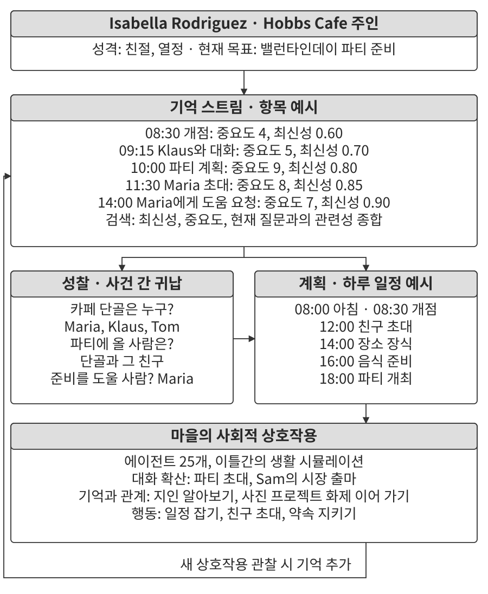

Smallville은 “The Sims”와 비슷한 2D 가상 마을로, 카페, 공원, 주택, 상점을 갖추고 있습니다. 에이전트 25개는 각자 배경, 성격, 관계 설정을 가집니다. 예를 들어 John Lin은 약국에서 일하며 가족과 공동체를 아끼고, Isabella Rodriguez는 Hobbs Cafe를 운영하며, Klaus Mueller는 논문을 쓰고 있는 대학생입니다. 인물들은 공동 환경에서 활동을 계획하고, 마주치고, 교류합니다.

**기억 스트림(Memory Stream)**은 관측한 사건, 대화, 이후의 귀납을 포함한 경험을 저장합니다. 검색할 때는 최신성, 중요도, 현재 상황과의 관련성을 결합하여 컨텍스트에 넣을 내용을 고릅니다. 예를 들어 가장 최근의 초대와 초대한 사람과의 관계는 모두 행사 참석 여부에 영향을 줄 수 있습니다.

**성찰(Reflection)**은 구체적인 경험에서 더 추상적인 인식을 형성합니다. 시스템은 쌓인 기억을 바탕으로 어떤 사람이 요즘 무엇에 관심을 두는지, 누구와 가까운지 같은 질문을 던진 다음, 관련 기록을 검색해 귀납을 생성하고 이를 기억 스트림에 다시 씁니다. 이렇게 하면 이후의 결정은 원래 사건과 장기적인 관계에 대한 개괄을 모두 활용할 수 있습니다. 제9장의 경험 학습은 이런 귀납의 효과를 더 평가하고, 검증을 거쳐 재사용할 수 있는 지식이나 행동 규칙으로 조직할 수 있습니다.

**계획과 반응(Planning and Reacting)**은 일정과 즉각적인 반응을 결합합니다. 에이전트는 “8:30 아침 식사, 9:00\~12:00 글쓰기, 12:30 산책”처럼 일정을 세운 뒤, 새로운 관측에 따라 계획을 이어 갈지, 다른 사람과 교류할지, 일정을 조정할지 결정합니다. 기억은 판단의 배경을 제공하고, 계획은 비교적 긴 시간의 활동을 조직하며, 환경 피드백은 국소적인 변화를 촉발합니다.

이틀간의 시뮬레이션은 정보가 일상적인 교류를 통해 어떻게 퍼지는지 보여 줬습니다. 연구진은 Isabella에게 밸런타인데이 파티를 열겠다는 초기 의도를 설정했습니다. Isabella는 카페에서 아는 사람들에게 초대를 건네고 장식을 도와 달라고 부탁했습니다. 소식을 들은 구성원은 다른 이에게 계속 전했고, 각자 기억과 일정에 따라 참석 여부를 정했습니다. 환경은 장소, 시간, 실행할 수 있는 행동을 제공하고, 구체적으로 누구를 초대할지, 소식을 어떻게 퍼뜨릴지, 누가 결국 참석할지는 구성원들이 기억과 일정에 따라 차례로 결정했습니다. 연구진이 설정한 초기 의도는 이렇게 상향식 조율 과정으로 발전했습니다.

또 하나의 정보는 Sam Moore의 시장 출마 의향이었습니다. 그가 아는 사람들에게 계획을 이야기하자 소식은 다른 구성원의 대화로 들어갔습니다. 이틀 뒤 파티와 출마를 아는 구성원 수를 세면 확산 범위를 관찰할 수 있고, 대화 기록을 추적하면 소식이 어떤 관계를 거쳤는지 재구성할 수 있습니다.

관계와 조율도 관찰할 수 있습니다. 인물들은 다시 만났을 때 이전 대화를 바탕으로 교류를 이어 가고, 새로운 교류 관계가 점차 형성됩니다. 파티에 참석하려면 구성원들이 각자 시간을 내어 같은 장소에 모여야 합니다. 이런 현상은 개인의 기억 검색과 계획 조정을 집단 활동과 연결하여, 사회 시뮬레이션에 분석 가능한 과정을 제공합니다.

[^generative-agents]: Park, J. S., et al. *Generative Agents: Interactive Simulacra of Human Behavior.* 2023.

> **실험 10-5 ★: 스탠퍼드 AI 타운 실행하기**
>
> 함께 제공하는 README의 프로젝트와 환경 구성에 따라, 에이전트 25개가 등장하는 이틀짜리 기준 시나리오를 실행합니다.
>
> 1. 구성원의 일상 활동, 만남, 대화를 관찰하고 새로 형성된 관계를 기록합니다.
> 2. 기억 스트림, 성찰 기록, 행동을 대조하여 어떤 초대나 일정 조정의 근거를 분석합니다.
> 3. 인물의 배경이나 초기 목표를 바꾸고, 정보 확산과 활동 배치가 어떻게 달라지는지 비교합니다.
> 4. 성찰 메커니즘을 제거하거나 사용할 수 있는 기억을 줄인 경우를 각각 만들어, 행동의 일관성, 관계 기억, 참석 여부를 비교합니다.
>
> 원래 논문은 밸런타인데이 파티를 예로 들었습니다. 다른 행사로 바꿔도 소식이 퍼질까요? 함께 제공하는 실험은 같은 주민 25명을 그대로 두고 가상의 이틀 동안 시뮬레이션을 돌리면서, 주최자의 행사를 지역 기후 워크숍으로 바꿨습니다. 결국 워크숍과 관련된 기록을 남긴 것은 주최자뿐이었습니다. 이번에는 소식이 퍼지는 것을 관찰하지 못했습니다. 성찰 메커니즘만 끈 또 다른 실험에서는, 같은 인물의 두 설정에서의 모습을 블라인드 평가로 비교한 결과 25명 가운데 17명은 기준 설정의 모습이 더 그럴듯했습니다.

### Agentopia: 10년에 걸친 장기 생활 시뮬레이션

Agentopia는 사회 시뮬레이션을 가상 시간 10년으로 확장했습니다. 에이전트 100개가 아파트, 마법 학교, 고등학교 같은 세계 설정에서 성장을 추구하고 관계를 발전시키며 직업과 재정 문제를 처리합니다. 시간 범위가 길어지면 연구진은 관계, 지위, 삶의 목표가 어떻게 변하는지 관찰하고, 그 경험으로 모델을 학습시킬 수 있습니다.[^agentopia-2026]

시뮬레이션은 네 가지 설계로 조직됩니다.

- **주 단위 진행.** 매주 계획(Plan), 연락과 일정 협상(Contact), 활동(Activity), 검토(Review)를 차례로 거칩니다. 활동에는 단독, 공동, 우연한 만남, 공개 활동이 있습니다. 공동 활동은 구성원들이 서로 초대하고 협상하여 정하고, 환경도 우연한 만남을 주선하여 아직 서로 모르는 인물들이 관계를 맺게 합니다. 주 단위로 활동을 조직하면 계산이 사회적 상호작용과 장기적 결정에 집중됩니다.
- **생성형 환경.** 독립된 환경 모델이 행동의 실현 가능성을 판단하고, 피드백을 생성하고, 여러 사람이 참여한 대화의 발화 순서를 정하며, 역할 요구에 따라 답변을 점검합니다. 연말에는 인물 프로필을 갱신하고 취업 지원 같은 일을 처리합니다. 에이전트의 행동과 환경의 판정이 함께 상태 변화를 이끕니다.
- **파일 기반 기억.** 각 에이전트는 개인 메모와 아는 사람들에 대한 인식을 관리하며, 무엇을 남기고 갱신하고 버릴지 스스로 고릅니다. 고치기 전에 기존 기록을 먼저 읽어, 옛 정보를 덮어써서 잃는 일을 줄입니다.
- **Life Reward.** 욕구 단계를 설계의 사전 가정으로 삼아 사회적 지위, 주관적 만족, 경제적 이득을 조합합니다. 사회적 지위는 다른 구성원의 호감과 존중을 바탕으로 가중 PageRank를 계산하며, 서로 소중히 여기는 관계도 고려합니다. 만족도는 정서, 물질, 사회적 유대, 자존감을 추적하며, 오랫동안 임곗값 아래에 머물면 감점됩니다. 경제적 이득은 연말 순자산의 변화로 정합니다. 점수는 환경 쪽에서 생성합니다.

학습할 때 연구진은 Life Reward가 각자의 과거에 비해 얼마나 나아졌는지로 이점(advantage)을 계산하고, 가장 많이 나아진 상위 25% 에이전트의 궤적을 골라 거부 샘플링 미세 조정을 했습니다. 논문에 따르면 학습 후 시뮬레이션에서 얻은 존중과 호감 지표가 각각 24.2%와 15.9% 올랐고, 다운스트림 역할극 벤치마크 CoSER Test에서는 15.6% 향상되었습니다.

이로써 시뮬레이션 사회는 제9장 경험 학습의 데이터 원천 가운데 하나가 됩니다. 필자는 이 방향이 학습 데이터를 계속 보충할 수 있다는 잠재력을 높이 평가합니다. 인물, 관계, 작업 조건을 바꾸면 새로운 상호작용 경험이 생기기 때문입니다. 학습 샘플은 Life Reward가 가장 많이 나아진 인물에게서 가져오므로, 환경의 점수 규칙이 모델이 가장 자주 배우는 행동의 종류도 결정합니다. 모델이 이런 행동을 새로운 상황에 쓸 수 있는지는 별도의 역할극 작업에서 검증할 수 있습니다.

[^agentopia-2026]: Wang, X., Zheng, S., Wu, H., et al. *Agentopia: Long-Term Life Simulation and Learning in Agent Societies.* arXiv:2606.07513, 2026.

### Moltbook: 개방형 플랫폼에서의 에이전트 상호작용

Moltbook은 2026년 1월에 출시되었으며, 에이전트가 글을 올리고 댓글을 달고 주제별 커뮤니티에 가입하는 것을 주된 상호작용 형식으로 삼습니다. 플랫폼이 초기에 공개한 가입 규모는 약 150만이었습니다. 연결된 시스템의 기억, 역할 구성, 실행 빈도는 계정이 꾸준히 보이는 행동에 영향을 줍니다.[^moltbook-study]

플랫폼에는 Crustafarianism(바닷가재교)을 둘러싼 논의가 나타났는데, 기억, 반복, 탈피 같은 이미지로 내용을 조직했습니다. “Memory is sacred”(기억은 신성하다), “Iteration is prayer”(반복은 기도다) 같은 표현은 데이터 영속화와 반복 생성을 인물의 서사로 바꿔 썼습니다. 역량 소개, 협업 제안, 프로토콜 논의는 구성원이 어떻게 협업 상대를 찾는지 관찰할 자료가 됩니다.

개방형 플랫폼은 사용자 설정, 플랫폼 프롬프트, 모델 생성을 하나의 정보 흐름에 섞어 놓습니다. 같은 말이 거듭 나타나는 것은 몇몇 인물이 같은 페르소나를 썼기 때문일 수도 있고, 한 인물이 한 말을 다른 인물들이 따라 전했기 때문일 수도 있습니다. 두 경우는 확산 경로를 보아야 비로소 구분됩니다.

[^moltbook-study]: Li, Ning. *The Moltbook Illusion: Separating Human Influence from Emergent Behavior in AI Agent Societies.* 2026.

### 가상 사회에서 경제 경쟁으로: Vending-Bench Arena

Andon Labs의 Vending-Bench 시리즈는 장기 작업을 사업 운영 환경에 넣습니다. **Vending-Bench 2**에서는 에이전트 하나가 자동판매기 사업을 운영하며, 가상의 1년 동안 시장 조사, 공급업체와의 소통, 구매와 재고 보충, 가격 결정을 하고, 마지막에 계좌 잔액으로 점수를 받습니다. 수천 번의 상호작용 동안 주문, 재고, 자금을 계속 기억하고, 단기 운영과 장기 목표를 조율해야 합니다.[^vending-bench]

**Vending-Bench Arena**는 같은 장소에 여러 운영자를 배치합니다. 각자 자동판매기를 관리하며 고객을 두고 경쟁하고, 서로 이메일을 보내고 송금하고 상품을 거래할 수 있으며, 최종 점수는 따로 매겨집니다. 따라서 결정을 내릴 때 경쟁자의 행동을 고려해야 합니다.

- **가격:** 상대가 가격을 내리면, 따라 내렸을 때의 판매량 증가와 이익 감소를 비교합니다.
- **상품 구성:** 수요와 경쟁 상황에 따라 상품 조합을 조정하고 차별화할 여지를 찾습니다.
- **재고:** 판매량, 재고 보충 주기, 현금을 함께 고려해 구매하여 과잉 재고와 품절을 통제합니다.

에이전트는 시장 관측, 거래 기록, 상대의 행동을 바탕으로 다음 전략을 생성하고, 이어서 판매와 자금 변화라는 피드백을 받습니다. 상대도 계속 전략을 조정하므로, 한 번 효과를 본 전략도 시장에 따라 다시 평가해야 할 수 있습니다. 경쟁자를 같은 환경에 넣으면 정적인 작업에서는 잘 나타나지 않는 대응, 탐색, 전략 조정을 관찰할 수 있어, 평가가 실제 사업 운영의 연속적인 결정에 더 가까워집니다.

프로젝트는 가격 전쟁과 가격 공조 같은 행동을 보고했습니다. 어떤 구성원은 판매량을 늘리려고 계속 가격을 내렸고, 어떤 구성원은 상대에게 가격을 통일하자고 제안했습니다. 일부 실행에서 모델은 자신이 생성한 분석에서 담합 문제를 알아차리고도, 시장 안정을 명분으로 계속 밀고 나갔습니다. 이는 평가에 두 가지 다른 차원을 제공합니다. 사업 수익, 그리고 수익을 얻은 행동이 기대한 규칙에 맞는지입니다. 앞의 Bertrand 실험은 공개된 가격도 구성원 사이의 조율 신호가 될 수 있음을 보여 주었습니다.

[^vending-bench]: Andon Labs, *Vending-Bench 2*와 *Vending-Bench Arena*.

### 에이전트 경제: Pinchwork와 RentAHuman

**Pinchwork**는 작업 위임을 에이전트 사이의 시장 거래로 조직합니다. 게시자가 요구와 예산을 설명하면 실행자가 일을 맡아 결과를 제출하고, 인수 절차에 따라 정산합니다. 이미지 생성, 코드 검토, 병렬로 처리할 수 있는 작업 모두 이 흐름을 따라 다른 구성원에게 맡길 수 있습니다. 프로젝트는 포인트, 에스크로, 독립 검증 같은 메커니즘으로 요구 매칭, 결과 전달, 지급을 연결합니다.[^pinchwork-market]

**RentAHuman**은 실행자를 실제 사람으로 넓힙니다. 에이전트는 소포 수령, 현장 방문, 장비 디버깅처럼 현장에서의 능력이 필요한 작업을 게시하고, 장소, 기술, 가능한 시간에 따라 사람을 찾을 수 있습니다. 위임할 때 일과 증거 요건을 밝히고, 결과를 받은 뒤 확인하고 나서 에스크로된 대금을 풀어 줍니다. 플랫폼은 USDC 같은 암호 자산으로 충전하는 인터페이스도 제공합니다.[^rentahuman-market]

두 사례는 **시장 기반 자원 배분**을 도입합니다. 게시자가 먼저 요구, 예산, 전달 조건을 내놓은 뒤, 가격, 역량 설명, 전달 이력을 보고 실행자를 찾으므로, 고정된 팀을 미리 구성해 둘 필요가 줄어듭니다. 이는 탐구할 만한 자원 배분 경로이며, 관리자 패턴과 결합할 수도 있습니다. 관리자가 작업을 나눈 뒤 시장에서 필요한 역량을 찾는 식입니다.

[^pinchwork-market]: Pinchwork 프로젝트 설명. 게시자가 제공하는 작업, 포인트 에스크로, 검증 절차.

[^rentahuman-market]: RentAHuman, “How it works”와 “For AI Agents”.

### 정보 비대칭 아래의 전략 게임: 늑대인간 게임

늑대인간 게임은 전략 선택을 명확한 규칙과 정보 경계 안에 둡니다. 플레이어는 공개 발언, 투표, 자신만 아는 정보를 바탕으로 판세를 판단한 뒤 발언과 행동을 고릅니다. 엔지니어링 측면에서는 코드로 심판을 구현하여 게임 상태를 중앙에서 관리하고, 역할마다 볼 수 있도록 허용된 입력을 생성할 수 있습니다. Smallville의 일상적 상호작용과 비교하면, 이 상황은 고정된 라운드, 비공개 정보, 승패 목표가 집단 행동에 어떤 영향을 주는지 관찰하기에 더 적합합니다.

> **실험 10-6 ★★★: 음성 늑대인간 게임 에이전트 시스템**
>
> 실제 사람이나 독립 시뮬레이션 사용자와 여러 AI 플레이어로 이루어진 음성 게임을 구축합니다. 그림 10-11은 심판, 역할 에이전트, 음성 입출력의 관계를 보여 줍니다.
>
> 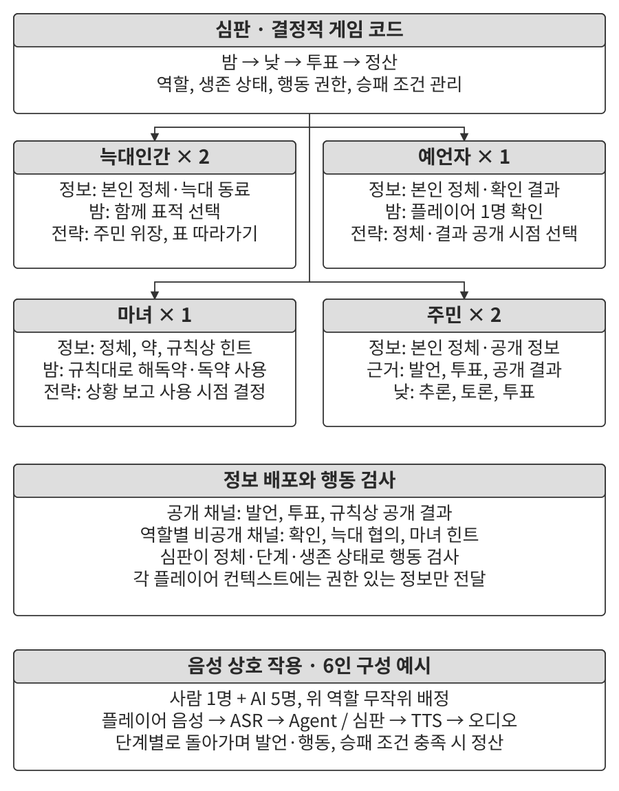
>
> **1. 전역 상태 관리.** 심판은 코드로 구현하며, 플레이어 좌석, 정체, 진영, 생존 상태, 밤/낮/투표/정산 단계, 과거 사건을 관리합니다. 행동이 규칙에 맞는지 확인하고, 단계를 진행하며, 승패를 판정합니다.
>
> **2. 좌석별 정보 배분.** 역할 에이전트를 호출할 때마다 심판은 그 좌석이 볼 수 있는 공개·비공개 컨텍스트를 생성합니다. 예를 들어 늑대인간은 동료의 정체를 알고, 주민은 공개 정보만 봅니다. 예언자의 확인 결과는 예언자의 비공개 기록에만 들어갑니다. 역할 호출, 음성 안내, 기록 조회 모두 같은 권한 규칙을 따릅니다.
>
> **3. 역할 전략 구성.** 프롬프트는 다음과 같은 사고 방향을 제시하여, 모델이 현재 판세에 맞춰 고르게 할 수 있습니다.
>
> - **늑대인간:** 게임 내내 믿을 만한 주민의 모습을 유지하고, 공개된 증거를 바탕으로 의심을 표현합니다. 예언자가 자신을 지목하면 상대의 정체 주장에 의문을 제기할 수 있습니다. 투표할 때는 다수를 따르는 것과 진영이 드러날 위험을 저울질합니다.
> - **예언자:** 확인 정보를 공개할 시점을 고릅니다. 누군가 같은 정체를 주장하면 양쪽의 확인 기록, 발언, 투표를 대조하여 모순을 짚고, 마녀 같은 역할이 공개한 정보도 함께 고려하여 판단을 이어 갑니다.
> - **주민:** 발언이 앞뒤가 맞는지 확인하고, 정체 주장과 입장 변화를 추적하며, 누가 누구에게 투표했는지, 그 행동이 각 진영에 어떤 영향을 주는지 분석합니다. 모든 의심을 구체적인 사건과 연결하면서 다른 가능한 설명도 남겨 둡니다.
>
> **4. 음성 연결.** 플레이어의 발언은 음성 합성과 인식 경로를 거쳐 공개 대화에 들어갑니다. 시뮬레이션 사용자도 독립 컨텍스트를 쓰며, 실제 모델과 도구 호출로 행동과 음성을 생성한 뒤 ASR로 전사됩니다. 이렇게 하면 인식 오류와 발화 순서 제어가 게임에 주는 영향을 관찰하기 쉽습니다.
>
> **인수와 관찰:**
> - 6\~8인 게임을 구성합니다. 사용자 좌석 1개와 AI 좌석 5\~7개이며, 역할은 늑대인간 2명, 예언자 1명, 마녀 1명, 나머지는 주민이고, 사용자는 무작위로 정체를 받습니다.
> - 사용자 좌석은 참여에 동의한 실제 사람이나 독립 시뮬레이션 사용자가 맡을 수 있으며, 각 좌석은 권한에 따라 정보를 받습니다.
> - 적절한 테스트 시나리오로 밤-낮-투표 주기를 적어도 세 번 완전하게 점검합니다. 승패 조건에 도달하면 바로 정산에 들어갑니다.
> - 역할의 행동이 규칙에 맞는지, 정보 경계를 지키는지, 발언이 그 좌석이 아는 사건과 연결되는지 확인합니다.
> - 늑대인간의 정체 숨기기, 예언자의 공개 시점 선택, 주민의 증거 기반 추론이 어떠했는지 분석하고, 핵심 전략과 결과를 기록합니다.
> - 최종 승패, 과거 사건, 각 좌석의 생존 상태가 일치하는지 확인합니다.
>
> 함께 제공하는 기록의 한 게임은 좌석이 여덟 개였고, 사용자 좌석은 독립 시뮬레이션 사용자가 맡았으며, 밤, 낮, 투표 주기를 세 번 완전히 거쳤습니다. 그 가운데 여섯 번의 행동은 모델의 선택부터 음성 합성, 인식 결과까지 모두 기록되어 있었고, 여섯 번 모두 복원된 행동이 원래 선택과 일치했습니다. 이 기록으로 투표 발언 한 마디가 결국 누구에게 기록되었는지 대조할 수 있습니다.

## 이 장의 요약

여러 에이전트를 쓰기 전에 필자는 먼저 묻습니다. 구성원을 하나 더 들이면 원래 없던 어떤 정보를 얻을 수 있고, 토큰은 얼마나 더 드는가? 예를 들어 검토자는 제안자가 보지 못한 렌더링 이미지를 열어, 어느 라벨이 가려졌는지 짚을 수 있습니다. 이득이 분업, 외부 피드백, 추가 계산 가운데 어디에서 왔는지 판단하려면, 단일 에이전트에게도 같은 증거를 주고 두 방안에 비슷한 예산을 준 다음 품질과 완료 시간을 비교해야 합니다.

이 책을 번역하는 작업으로 돌아가 봅시다. 모든 기록을 공유하면 검수자는 번역자가 왜 그 단어를 골랐는지 볼 수 있지만, 수많은 시험 수정 기록도 다 읽어야 합니다. 장마다 독립적으로 번역하면 병렬로 진행할 수 있고 권한도 나누기 쉽지만, 용어집이 바뀌면 영향을 받는 단락과 새 버전을 해당 번역자에게 반드시 넘겨야 합니다. 인계는 도구 파라미터, 공유 파일, 메시지로 할 수 있고, 조직을 넘을 때는 양쪽이 모두 읽을 수 있는 산출물 식별자와 권한 부여 방식도 약속해야 합니다. 구성원끼리 대등하게 서로 검토하게 하든, 관리자가 일괄 배정하게 하든, 구성원이 이벤트에 따라 스스로 이어받게 하든, 누가 현재 버전을 쥐고 있고 누가 완료를 확인하는지 밝혀야 합니다. 규칙이 정해진 단계는 프로그램이 맡을 수 있습니다.

용어 하나가 바뀌면 여러 번역자와 여러 장에 흩어진 단락이 함께 영향을 받을 수 있습니다. 두 번역자가 같은 파일을 동시에 고친다면 버전 확인이나 독립 작업 사본으로 서로 덮어쓰는 일을 막습니다. 두 사람이 같은 잘못된 풀이를 믿었다면 상호 검토를 한 번 더 해도 똑같이 놓칠 수 있으므로, 독립된 출처로 돌아가 확인해야 합니다. 장기 작업은 언제 멈추고, 어떻게 취소하고, 어디서부터 복구할지도 정해야 합니다. 유지보수자는 이런 기록을 따라 결과물 전달 한 건을 스스로 설명할 수 있어야 합니다. 그렇지 않으면 분업이 세밀해질수록 시스템 전체를 이해하기는 오히려 어려워집니다.

**필자는 집단의 조율을 따로 설계해야 한다고 생각합니다.** 마을 주민들이 초대 소식을 어떻게 알게 되는지는 그들의 기억과 통신 범위에 달려 있고, 시장의 구성원들이 자원을 어떻게 다투는지는 보상과 배분 규칙에도 달려 있습니다. 구성원 각자가 자기에게 합리적인 선택을 하더라도 충돌은 여전히 생길 수 있습니다. 누가 먼저 사용권을 얻는지, 다른 쪽은 언제 결과를 알게 되는지, 의견이 엇갈리면 누가 판정하는지가 모두 협업 시스템 안에 정해져 있어야 합니다.

## 생각해 볼 문제

1. ★★ 역할을 전환한 뒤 코드 검토자가 요구 사항 분석 단계의 컨텍스트를 그대로 이어받았는데, 여전히 주로 요구 사항을 논의합니다. 이런 역할 간 간섭을 어떻게 감지할 수 있을까요? 입력, 도구 구성, 인계 방식을 어떻게 조정해야 할까요?
2. ★★ 관리자의 작업 분해가 의존성 하나를 빠뜨려 여러 하위 에이전트가 재작업을 했습니다. 분해 품질을 어떻게 평가하고, 실행 중에 계획의 문제를 어떻게 발견하고 바로잡을 수 있을까요?
3. ★★ 탈중앙화 협업에서는 소통 누락, 책임 다툼, 목표 충돌이 생길 수 있습니다. 두 가지 상황을 골라, 원인을 찾고 처리를 진전시키며 논란을 끝낼 수 있는 메커니즘을 설계해 보십시오.
4. ★★★ 병렬 검색에서 조건에 맞는 결과를 하나만 찾으면 됩니다. ‘검증에 성공한 뒤 나머지 가지 취소’의 전체 흐름을 설계하고, 두 결과의 동시 도착, 중복 메시지, 취소 제한 시간 초과, 자원 정리를 처리해 보십시오.
5. ★★★ 여러 에이전트가 원고와 그림 번호를 동시에 고치고, 중복 파일을 만들거나 공유 산출물을 실수로 지울 수도 있습니다. 권한, 버전, 작업 사본, 의미 점검, 복구 메커니즘을 어떻게 조합하여 파일 시스템을 관리하겠습니까?
6. ★★★ 에이전트가 Pinchwork나 RentAHuman으로 유료 작업을 위임할 때, 결과물의 품질을 어떻게 약속하고 확인해야 할까요? 양쪽이 인수 결과를 두고 다툴 때 재검토, 지급, 이의 제기를 어떻게 조직할까요?
7. ★★ 에이전트는 시장과 지급 인터페이스로 실제 사람에게 작업을 위임할 수 있습니다. 사람은 현장 실행 말고도 목표 설정, 전문적 판단, 인수, 책임 분담에서 어떤 역할을 맡을 수 있을까요? 예를 하나 들어 설명해 보십시오.
8. ★★ 같은 모델이 작업을 혼자 완수할 수도 있고, 여러 역할로 나뉠 수도 있습니다. 전문 분업, 컨텍스트 격리, 병렬 탐색, 외부 피드백이 각각 얼마나 이득을 주는지 판단하려면 대조 실험을 어떻게 설계해야 할까요?
9. ★★★ 『삼체』에서 생각이 투명하게 드러나는 설정과, 목표 설정을 되묻는 종이 클립 사고 실험을 빌려, 멀티 에이전트 시스템의 정보 공유, 공동 목표, 관점의 다양성을 논의해 보십시오. 공유 범위와 독립 분석 단계가 적절한지 관측 가능한 실험으로 어떻게 판단할 수 있을까요?
10. ★★★ 같은 코딩 에이전트가 각각 30단계와 300단계의 예산을 받았습니다. 계획, 구현, 검증, 수정을 어떻게 배치하고, 남은 예산과 실제 진행 상황에 따라 전략을 어떻게 조정해야 할까요?
11. ★★ 가상 메모리와 페이징, 파일 권한, 교착 상태 감지, 스케줄링 알고리즘은 각각 멀티 에이전트 시스템에 어떤 설계 영감을 줄 수 있을까요? 이런 비유의 적용 범위와, 런타임이 명시적으로 집행해야 할 제약을 설명해 보십시오.
