# 컨텍스트 엔지니어링

제1장에서는 컨텍스트를 에이전트의 ‘현재 의사결정 시야’에 비유했습니다. 모델은 판단을 내릴 때마다 그 순간 받은 정보에 근거합니다. **컨텍스트 엔지니어링(Context Engineering)**은 시스템 지시, 도구 정의, 사용자 요청, 과거 메시지, 작업 상태 같은 정보를 고르고 구성하고 갱신하는 일을 맡습니다. 하네스는 모델을 호출할 때마다 그 전에 작업 배경과 최신 진행 상황을 입력으로 정리해야 합니다. 그림 2-1은 컨텍스트 창의 구성을 구체적인 내용으로 보여 줍니다.

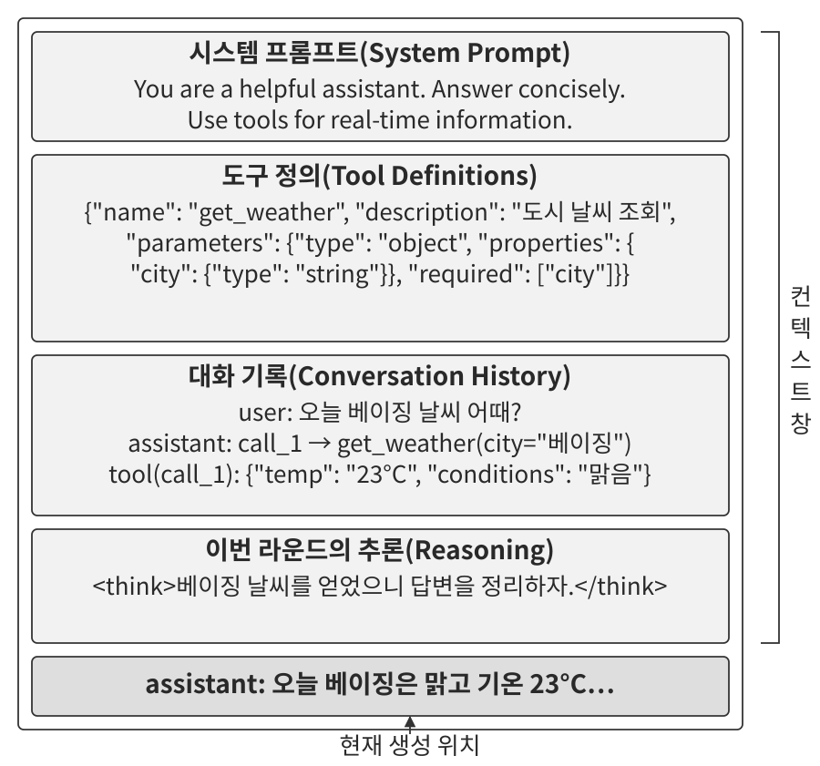

## 컨텍스트: 모델의 능력을 구체적인 작업에 쓰게 하기

경험 많은 엔지니어가 팀에 막 합류해 ‘우리 규칙에 맞게 설정을 수정해 달라’는 첫 작업을 받았다고 생각해 보겠습니다. 프로그래밍은 할 줄 알지만 어느 파일이 설정의 원본인지, 어떤 필드를 바꿔도 되는지, 어떻게 검증해야 하는지는 아직 모릅니다. 코드베이스 전체를 넘겨받아도 엉뚱한 파일을 고칠 수 있습니다. 낯선 프로젝트를 맡은 에이전트에게도 같은 배경이 부족합니다.

‘이 버그를 고쳐 줘’라는 요청을 예로 들면, 코딩 에이전트에는 보통 세 가지 배경이 필요합니다.

- **실시간 코드 컨텍스트**: 디렉터리 구조, 모듈의 책임, 핵심 데이터 구조, 코딩 규칙입니다. 예를 들어 수정한 파일이 자동 생성되는 설정 파일이라면 로컬에서는 반영되더라도 다음에 생성할 때 덮어써집니다. 그 파일을 어느 모듈이 생성하는지 알아야 고쳐야 할 곳을 찾을 수 있습니다.
- **프로세스 규칙**: Git 브랜치 전략, 커밋 규칙, 코드 리뷰 절차, CI/CD 요구 사항입니다. 에이전트는 이를 근거로 수정, 테스트, 커밋을 계획하고, 실행 시스템은 권한에 따라 이 작업을 수행합니다.
- **환경 정보**: 개발 환경 설정, 테스트 데이터베이스 연결 방법, 테스트 환경 배포 방식, API 키 관리 방식입니다. 이 정보는 에이전트가 올바른 실행 환경을 고르고 로컬과 테스트 환경의 차이를 이해하도록 돕습니다.

프로젝트 코드와 테스트 데이터베이스는 모두 모델의 컨텍스트 밖에 있습니다. 자동 생성 설정의 예에서 에이전트는 검색 도구로 생성 스크립트를 읽고 나서야 어디부터 고쳐야 할지 알게 됩니다. **컨텍스트의 품질이 모델이 이미 가진 능력을 지금의 문제에 쓸 수 있는지를 결정합니다.** **배경 정보에 크게 의존하는 작업에서는 능력이 충분한 모델에 완전하고 정확한 컨텍스트를 갖춰 주면, 필요한 자료가 없는 더 강한 모델보다 나은 성과를 낼 수 있습니다.**

**AI 네이티브 팀을 만들려면 먼저 핵심 지식을 문서로 남겨야 합니다.** 특정 데이터베이스를 고른 이유를 오래된 직원만 기억하고 업무 규칙의 변경도 개인 대화에서만 언급됐다면, 새 동료와 에이전트는 일을 넘겨받을 때 같은 문제에 부딪힙니다. 코드에서는 팀이 무엇을 했는지 보이지만 왜 그렇게 했는지는 보이지 않습니다.

**원격 협업에 친화적인 팀은 에이전트에도 친화적인 경우가 많습니다.** Linux 커널 개발자들은 메일링 리스트에서 패치를 논의하고 리뷰 의견을 주고받으며, 개발 프로세스 문서는 패치를 제출하고 리뷰하고 병합하는 방법을 설명합니다[^ch2-linux]. 새로 참여한 사람은 뜻밖의 변경을 보면 패치를 따라가 당시의 논쟁을 찾을 수 있고, 에이전트도 배경을 확인할 때 이 기록을 활용할 수 있습니다.

필자는 지아이 웡(Jiayi Weng)이 WhynotTV와 나눈 인터뷰를 듣고 그의 관점 하나를 이렇게 요약했습니다. **사람도 모델도 컨텍스트에 의존합니다.** 사람은 결정에 참여한 동료에게 한마디 더 물어볼 수 있지만, 모델이 어떤 배경을 읽을 수 있는지는 팀이 무엇을 기록으로 남겼는지, 그리고 하네스가 이번 요청에 무엇을 넣었는지에 달려 있습니다.[^ch2-weng]

[^ch2-linux]: Linux 커널 공식 문서, How the development process works.

[^ch2-weng]: WhynotTV, 《翁家翌：OpenAI，GPT，强化学习，Infra，后训练，天授，tuixue，开源，CMU，清华》(‘웡자이: OpenAI, GPT, 강화 학습, 인프라, 사후 학습, 톈서우, tuixue, 오픈 소스, CMU, 칭화대’), Podcast #4.

ReAct 논문은 상호작용 기록이 의사결정에 어떻게 관여하는지 형식적인 표현으로 설명합니다[^ch2-react]. 시점 $t$에 에이전트는 환경에서 관측 $o_t\in\mathcal{O}$를 받고, 정책 $\pi(a_t\mid c_t)$에 따라 행동 $a_t\in\mathcal{A}$를 고릅니다. 여기서 컨텍스트는 다음과 같습니다.

$$
c_t=(o_1,a_1,\ldots,o_{t-1},a_{t-1},o_t)
$$

이 표현은 **에이전트의 다음 행동이 현재까지의 상호작용 기록에 의존한다**는 점을 보여 줍니다. 예를 들어 에이전트가 어떤 파일을 조회했는지, 도구가 어떤 오류를 반환했는지가 모두 다음 선택에 영향을 줍니다. LLM 에이전트에서는 사용자 입력과 도구 결과가 관측을 제공하고, 도구 호출과 외부로 보내는 응답이 행동을 기록합니다. 시스템 지시와 도구 정의는 여기에 작업 규칙과 사용할 수 있는 인터페이스를 덧붙여 설명합니다.

이 장에서는 먼저 상태를 갖지 않는 요청 방식을 사용합니다. 하네스는 라운드마다 메시지와 도구 정의를 조립한 뒤 모델을 호출합니다. 전체 메시지 기록을 담으면 작업 진행 상황을 보존하기 쉽습니다. 기록이 길어지면 검색, 상태 기록, 압축으로 이후 의사결정에 필요한 정보를 창 안에 남길 수 있습니다. 컨텍스트 배치, 상태 표시줄, 압축 기법은 모두 하나의 질문을 중심으로 전개됩니다. 한정된 컨텍스트 안에서 모델이 이번 단계에 쓸 정보를 어떻게 $c_t$에 넣을 것인가?

[^ch2-react]: Yao, Shunyu, et al., ReAct: Synergizing Reasoning and Acting in Language Models, ICLR 2023.

## 에이전트는 대규모 모델을 어떻게 호출하는가: API의 컨텍스트 구조 이해

먼저 인사 한마디로 메시지 형식을 살펴보고, 이어서 ‘밴쿠버는 지금 몇 시이고 날씨는 어떤가’라는 질문이 어떻게 도구 호출 두 번으로 이어지는지 봅니다. 이 절에서는 Chat Completions 호환 인터페이스와 로컬에서 실행하는 Qwen3-0.6B를 사용하며, 마지막에는 Python으로 각 라운드의 요청을 연결합니다[^ch2-chat-api].

### 예시에 쓰이는 네 가지 메시지 역할

요청의 **메시지 목록**(`messages`)은 상호작용 정보를 순서대로 담습니다. 각 메시지는 **역할**(`role`)로 출처와 용도를 표시합니다. 이 절에서는 네 가지 역할을 사용합니다.

- **system**: 시스템 프롬프트입니다. 이 절에서는 개발자가 제공한 정체성, 행동 규칙, 제약을 담으며 메시지 목록 앞부분에 둡니다. 일부 모델 인터페이스는 개발자 지시를 `developer` 역할로 전달합니다.
- **user**: 사용자 메시지로, 작업, 후속 질문, 추가 요구 사항을 담습니다.
- **assistant**: 텍스트와 도구 호출 요청을 포함한 모델의 응답입니다. 이 메시지를 다음 라운드 입력에 다시 넣으면 모델은 이전의 답변과 작업 요청을 읽을 수 있습니다.
- **tool**: 도구 실행 결과입니다. 하네스는 반환값을 받으면 이를 도구 메시지로 작성하고 `tool_call_id`로 해당 호출에 연결합니다.

도구 정의는 요청 최상위의 `tools` 필드로 전달하며, 사용할 수 있는 도구의 이름, 용도, 파라미터 형식을 나열합니다.

모델은 도구 정의를 바탕으로 호출 요청을 구성합니다. 그 작업을 실제로 실행할 수 있는지는 하네스와 실행 환경이 결정합니다.

[^ch2-chat-api]: OpenAI, Chat Completions API 레퍼런스: 메시지 역할, 도구 정의, 호출 결과 필드를 소개합니다. Qwen, Function Calling: 호환 서비스에서의 도구 호출과 템플릿을 소개합니다.

### 단일 라운드 대화: 가장 단순한 API 호출

먼저 한 번의 질의응답을 보겠습니다. 사용자가 “Hello, who are you?”라고 물으면, 하네스는 시스템 지시와 사용자 질문을 함께 모델에 보내고 응답을 읽습니다. 그림 2-2는 요청과 응답의 대응 관계를 보여 줍니다.

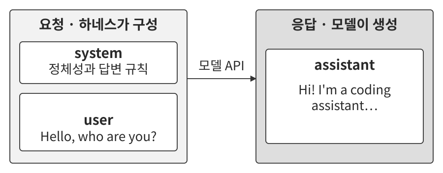

아래에서는 로컬 모델의 인터페이스 형식으로 요청과 예시 응답을 적었습니다. 코드의 주석은 각 부분의 출처를 표시합니다.

```javascript
// 하네스가 요청을 구성
{
  "model": "Qwen3-0.6B",
  "messages": [
    {
      "role": "system",                           // 개발자가 제공한 지시
      "content": "You are a helpful coding assistant. Follow user instructions."
    },
    {
      "role": "user",                              // 사용자 입력
      "content": "Hello, who are you?"
    }
  ]
}
```

```javascript
// API가 반환한 응답
{
  "choices": [{
    "message": {
      "role": "assistant",                         // 모델이 생성
      "content": "Hi! I'm a coding assistant. I can help you write code, debug issues, and explain technical concepts. How can I help?"
    }
  }]
}
```

요청에는 `system` 메시지 하나와 `user` 메시지 하나가 있고, 응답의 `choices[0].message`에는 모델이 생성한 `assistant` 메시지가 담깁니다. 여기서 사용하는 상태 없는 인터페이스에서는 **하네스가 호출할 때마다 필요한 컨텍스트를 제공해야 합니다.** 다음 요청에서 이 대화를 이어 가려면 관련 기록을 함께 보내야 합니다.

### 도구 호출이 있는 다중 라운드 상호작용: 에이전트의 핵심 루프

이번에는 도구가 필요한 질문을 보겠습니다. “What's the current time and weather in Vancouver?”에 답하려면 먼저 현지 시간과 날씨를 조회해야 합니다. 그림 2-3에서 하네스가 모델을 처음 호출하면 도구 요청 두 개가 돌아옵니다. 하네스는 시간 서비스와 날씨 서비스에 각각 조회하고, 두 결과를 메시지 기록에 덧붙인 뒤 모델을 두 번째로 호출해야 사용자에게 줄 답변을 얻습니다.

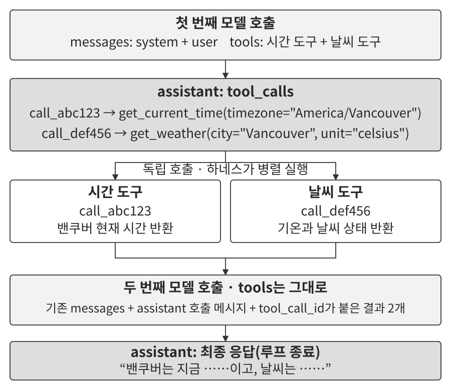

두 도구 중 어느 것을 먼저 실행할까요? 시간 도구에는 시간대가, 날씨 도구에는 도시와 온도 단위가 필요합니다. 사용자는 밴쿠버만 말했고, 예시의 모델은 이를 근거로 `America/Vancouver`와 `Vancouver`를 채우고 온도 단위로 섭씨를 골랐습니다. 날씨 조회는 시간 도구의 반환을 기다릴 필요가 없으므로 두 조회를 동시에 보낼 수 있습니다.

**첫 번째 API 호출—에이전트 프레임워크가 최초 요청을 보냅니다.**

```javascript
// 첫 번째 모델 호출: 하네스가 요청을 구성
{
  "model": "Qwen3-0.6B",
  "messages": [
    {
      "role": "system",                           // 개발자가 제공한 지시
      "content": "You are a helpful assistant. Use the provided tools to get real-time information when needed."
    },
    {
      "role": "user",                              // 사용자 입력
      "content": "What's the current time and weather in Vancouver?"
    }
  ],
  "tools": [                                       // 개발자가 정의한 도구
    {
      "type": "function",
      "function": {
        "name": "get_current_time",
        "description": "Get the current date and time in a specific timezone",
        "parameters": {
          "type": "object",
          "properties": {
            "timezone": { "type": "string", "description": "Timezone name, e.g. America/Vancouver" }
          },
          "required": ["timezone"]
        }
      }
    },
    {
      "type": "function",
      "function": {
        "name": "get_weather",
        "description": "Get the current weather for a specific city",
        "parameters": {
          "type": "object",
          "properties": {
            "city": { "type": "string", "description": "City name" },
            "unit": { "type": "string", "enum": ["celsius", "fahrenheit"] }
          },
          "required": ["city", "unit"]
        }
      }
    }
  ]
}
```

이 `tools` 목록은 개발자가 미리 정의한 것으로, 이름, 설명, 파라미터 스키마를 담습니다. 이 예에서는 모든 라운드의 요청에 같은 두 도구를 제공하며, 모델은 목록과 사용자 질문을 읽은 뒤 호출할 도구를 고르고 파라미터를 채웁니다.

**모델이 도구 호출 요청 두 개를 반환합니다.**

```javascript
// 모델이 도구 호출 요청을 반환
{
  "choices": [{
    "message": {
      "role": "assistant",                         // 모델이 생성
      "content": null,                             // 이번 라운드에는 텍스트 응답이 없음
      "tool_calls": [                              // 도구 두 개를 호출하도록 요청
        {
          "id": "call_abc123",
          "type": "function",
          "function": {
            "name": "get_current_time",
            "arguments": "{\"timezone\": \"America/Vancouver\"}"
          }
        },
        {
          "id": "call_def456",
          "type": "function",
          "function": {
            "name": "get_weather",
            "arguments": "{\"city\": \"Vancouver\", \"unit\": \"celsius\"}"
          }
        }
      ]
    }
  }]
}
```

응답의 `tool_calls`에는 요청 두 개가 있으며, 요청마다 고유한 `id`, 도구 이름, 파라미터가 있습니다. `arguments`는 JSON으로 인코딩된 문자열이므로 실행하는 쪽에서 먼저 파싱한 뒤 필드와 값을 검증해야 합니다. **무엇을 호출하고 어떤 파라미터를 넘길지는 모델이 결정하고, 검증과 실행 조정은 하네스가 맡으며, 시간 서비스나 날씨 서비스에 접근하는 일은 도구 구현이 맡습니다.**

**에이전트 프레임워크가 도구를 실행한 뒤 두 번째 API 호출을 보냅니다.**

하네스는 요청을 검증한 뒤 두 도구를 실행하고, 반환값을 `tool` 메시지로 작성해 기존 기록과 새 결과를 함께 모델에 넘깁니다.

```javascript
// 두 번째 모델 호출: 도구 결과를 덧붙임
{
  "model": "Qwen3-0.6B",
  "messages": [
    {
      "role": "system",                           // 첫 번째 요청의 메시지를 유지
      "content": "You are a helpful assistant. Use the provided tools to get real-time information when needed."
    },
    {
      "role": "user",                              // 첫 번째 요청의 메시지를 유지
      "content": "What's the current time and weather in Vancouver?"
    },
    {
      "role": "assistant",                         // 이전 라운드 모델의 호출 요청을 유지
      "content": null,
      "tool_calls": [
        { "id": "call_abc123", "type": "function", "function": { "name": "get_current_time", "arguments": "{\"timezone\": \"America/Vancouver\"}" } },
        { "id": "call_def456", "type": "function", "function": { "name": "get_weather", "arguments": "{\"city\": \"Vancouver\", \"unit\": \"celsius\"}" } }
      ]
    },
    {
      "role": "tool",                              // 하네스가 도구 실행 결과를 기록
      "tool_call_id": "call_abc123",
      "content": "{\"timezone\": \"America/Vancouver\", \"datetime\": \"2025-09-13T05:18:47\", \"day_of_week\": \"Saturday\"}"
    },
    {
      "role": "tool",                              // 하네스가 도구 실행 결과를 기록
      "tool_call_id": "call_def456",
      "content": "{\"city\": \"Vancouver\", \"temperature\": 13.2, \"unit\": \"celsius\", \"conditions\": \"clear\", \"humidity\": 93}"
    }
  ],
  "tools": [ ... ]                                 // 앞의 도구 정의를 그대로 씀(생략)
}
```

`call_def456`을 따라 두 번째 요청을 읽어 보겠습니다. 앞의 `assistant` 메시지에서 이 값은 밴쿠버 날씨 조회의 번호입니다. 뒤의 `tool` 메시지는 같은 번호로 13.2 ℃와 맑음을 돌려보냅니다. 날씨가 시간보다 먼저 반환되더라도 하네스는 결과와 요청을 맞춰 연결할 수 있습니다. 이번 라운드에서 모델은 사용자의 원래 질문, 자신이 보낸 두 조회, 도구가 조회해 온 데이터를 함께 읽습니다. 이제 사용자에게 답할 수 있습니다.

**모델이 도구 결과를 바탕으로 최종 응답을 생성합니다.**

```javascript
// 모델이 최종 응답을 생성
{
  "choices": [{
    "message": {
      "role": "assistant",                         // 모델이 생성
      "content": "It's currently 5:18 AM on Saturday, September 13, 2025 in Vancouver.\n\nWeather: 13.2°C with clear skies and 93% humidity. It's quite cool this morning - you might want to grab a jacket."
    }
  }]
}
```

두 번째 응답은 최종 텍스트를 주고 `tool_calls`는 비어 있으므로 예시 루프는 여기서 끝납니다. 이처럼 ‘모델 호출→도구 실행→결과 반환→모델 재호출’로 이어지는 과정이 제1장의 실행 루프를 API에서 구체적으로 구현한 모습입니다.

사용자가 “그럼 도쿄는?”이라고 이어서 물으면 하네스는 이 메시지를 기록 끝에 덧붙이고 모델을 다시 호출합니다. 모델은 ‘현재 시간과 날씨 조회’라는 작업 배경을 이어받아 도쿄에 대한 새 요청을 만들고, 도구가 반환하면 새 답변을 구성합니다.

**Responses API로 바꾸면 도구 결과를 어떻게 돌려줄까요?** 위의 로컬 실험은 Chat Completions 호환 인터페이스를 사용합니다. OpenAI의 서비스로 새 프로젝트를 개발한다면 OpenAI는 Responses API를 공식적으로 권장합니다. 밴쿠버 예를 그대로 보겠습니다. 애플리케이션은 사용자 질문을 요청의 `input`에 넣고, `tools`에 시간과 날씨 두 함수를 선언합니다. 반환되는 `output`은 유형이 있는 항목의 목록입니다. 그 안에 `function_call` 두 개가 있으면 애플리케이션은 각 항목에서 함수 이름, 파라미터, `call_id`를 읽어 도구를 각각 실행합니다.[^ch2-responses-loop]

날씨 함수의 호출 번호가 `call_weather`라고 가정합니다. 다음 요청의 `input`에는 이런 회신을 넣을 수 있으며, 시간 함수의 결과도 자신의 번호로 돌려줘야 합니다.

```json
{"type": "function_call_output", "call_id": "call_weather", "output": "{\"temperature\": 13.2, \"unit\": \"celsius\"}"}
```

`call_id`는 회신 하나를 함수 호출 하나에 연결합니다. `previous_response_id`는 이전 모델 응답을 가리켜 서비스가 그 라운드의 컨텍스트를 이어 가게 합니다. 두 번호가 가리키는 대상은 서로 다릅니다. 이렇게 이어 가는 방식을 쓸 때도 이번 라운드에서 계속 사용할 도구와 최상위 `instructions`는 다시 제공해야 합니다. 이전 요청의 최상위 지시는 응답 번호를 따라 자동으로 이어지지 않습니다. 모델이 도구를 계속 요청할 수 있으므로 애플리케이션은 다음 `output`을 읽고 나서 종료 여부를 결정해야 합니다. 제1장의 실험 1-3은 서버가 관리하는 검색을 사용했지만, 여기의 두 사용자 정의 함수는 애플리케이션이 실제로 실행합니다.

[^ch2-responses-loop]: OpenAI, Responses API로의 마이그레이션, 함수 호출, 응답 생성 파라미터 설명.

### 에이전트의 핵심 루프를 코드로 구현하기

루프 안의 두 `messages.append`는 각각 모델의 응답과 도구의 실행 결과를 저장합니다. 시간과 기온은 모두 밴쿠버의 값입니다. 두 호출 ID를 서로 바꾸면 다음 라운드에서 모델은 ‘시간 조회’가 섭씨 13.2도를 반환했다고 읽게 됩니다.

예시는 OpenAI Python SDK로 호환 서비스에 연결합니다. 기본 주소는 로컬의 `http://localhost:8000/v1`이며, 이미 실행 중이고 인증이 필요 없는 로컬 서비스에 맞춘 값입니다. 이 기본값은 실험 2-1의 vLLM 백엔드에 대응합니다. 같은 실험의 Ollama 백엔드를 사용한다면 주소를 `http://localhost:11434/v1`로 설정하고 모델 이름을 `qwen3:0.6b`로 바꿉니다. 다른 서비스에 연결할 때는 필요에 따라 환경 변수 `LLM_BASE_URL`과 `LLM_API_KEY`를 설정하고, 아래의 `model`을 실제 배포한 이름과 맞춥니다. 시간과 날씨 도구는 메시지를 대조하기 쉽도록 앞의 예와 같은 고정 데이터를 사용합니다. 실제 데이터를 연결할 때 이 두 도구의 구현을 바꾸면 됩니다.

```python
import json
import os

from openai import OpenAI

client = OpenAI(
    base_url=os.getenv("LLM_BASE_URL", "http://localhost:8000/v1"),
    api_key=os.getenv("LLM_API_KEY", "EMPTY"),
)

# 도구 정의: 이름, 용도, 파라미터 구조
tools = [
    {
        "type": "function",
        "function": {
            "name": "get_current_time",
            "description": "Get the current date and time in a specific timezone",
            "parameters": {
                "type": "object",
                "properties": {
                    "timezone": {"type": "string", "description": "Timezone name, e.g. America/Vancouver"}
                },
                "required": ["timezone"],
            },
        },
    },
    {
        "type": "function",
        "function": {
            "name": "get_weather",
            "description": "Get the current weather for a specific city",
            "parameters": {
                "type": "object",
                "properties": {
                    "city": {"type": "string", "description": "City name"},
                    "unit": {"type": "string", "enum": ["celsius", "fahrenheit"]},
                },
                "required": ["city", "unit"],
            },
        },
    },
]

# 예시 도구는 고정 데이터를 쓰며, 파라미터는 앞의 밴쿠버 조회와 같음
def execute_tool(name, arguments):
    args = json.loads(arguments)
    if name == "get_current_time" and args == {"timezone": "America/Vancouver"}:
        result = {
            "timezone": "America/Vancouver",
            "datetime": "2025-09-13T05:18:47",
            "day_of_week": "Saturday",
        }
    elif name == "get_weather" and args == {"city": "Vancouver", "unit": "celsius"}:
        result = {
            "city": "Vancouver", "temperature": 13.2,
            "unit": "celsius", "conditions": "clear", "humidity": 93,
        }
    else:
        result = {"error": "예시는 밴쿠버의 시간과 섭씨 날씨 데이터만 제공합니다"}
    return json.dumps(result, ensure_ascii=False)

# 초기 메시지: 지시와 사용자 작업
messages = [
    {"role": "system", "content": "You are a helpful assistant. Use tools to get real-time information when needed."},
    {"role": "user", "content": "What's the current time and weather in Vancouver?"},
]

# 실행 루프: 모델을 최대 여덟 번 호출
rounds = 0
while rounds < 8:
    rounds += 1
    response = client.chat.completions.create(
        model="Qwen3-0.6B", messages=messages, tools=tools
    )
    assistant_message = response.choices[0].message

    # 이번 라운드의 호출 요청을 포함해 모델 응답을 저장
    messages.append(assistant_message.model_dump(exclude_none=True))

    # 이 예는 모델이 도구 호출 없는 응답을 내면 끝남
    if not assistant_message.tool_calls:
        print(assistant_message.content)
        break

    # 하나씩 실행해 결과를 덧붙임. 독립된 호출은 병렬로 실행해도 됨
    for tool_call in assistant_message.tool_calls:
        try:
            result = execute_tool(tool_call.function.name, tool_call.function.arguments)
        except json.JSONDecodeError:
            result = json.dumps({"error": "도구 파라미터는 유효한 JSON이어야 합니다"})
        messages.append({
            "role": "tool",
            "tool_call_id": tool_call.id,
            "content": result,
        })
    # 다음 라운드는 결과를 덧붙인 메시지 목록을 씀
else:
    print("라운드 상한에 도달했지만 작업을 끝내지 못했습니다.")
```

모델이 첫 라운드에서 시간과 날씨를 동시에 요청했다고 가정합니다. 여기의 `for` 루프는 먼저 시간을 조회해 결과를 `messages`에 덧붙이고, 다음으로 날씨를 조회해 두 번째 결과를 덧붙입니다. 두 작업을 모두 실행한 뒤에야 프로그램은 `while`의 처음으로 돌아가 두 번째 모델 요청을 보냅니다. 이 단계들에서 `messages`의 내용을 펼쳐 보면 모델이 매번 무엇을 받았는지 알 수 있습니다.

**초기 상태(첫 번째 호출 전):**
```text
messages = [
  { role: "system",  content: "You are a helpful assistant..." },     # 개발자가 작성
  { role: "user",    content: "What's the current time and weather in Vancouver?" },  # 사용자 입력
]
```

**첫 번째 모델 호출과 도구 실행을 마친 뒤:**
```text
messages = [
  { role: "system",    content: "..." },
  { role: "user",      content: "What's the current time..." },
  { role: "assistant", tool_calls: [get_current_time, get_weather] },  # 모델이 생성한 호출 요청
  { role: "tool",      tool_call_id: "call_abc123", content: "{time...}" },  # 도구 실행 뒤 하네스가 기록
  { role: "tool",      tool_call_id: "call_def456", content: "{weather...}" },  # 도구 실행 뒤 하네스가 기록
]
```

**두 번째 호출 뒤(모델이 최종 응답을 반환하고 루프가 끝남):**
```text
messages = [
  { role: "system",    content: "..." },
  { role: "user",      content: "What's the current time..." },
  { role: "assistant", tool_calls: [get_current_time, get_weather] },
  { role: "tool",      tool_call_id: "call_abc123", content: "{time...}" },
  { role: "tool",      tool_call_id: "call_def456", content: "{weather...}" },
  { role: "assistant", content: "It's currently Saturday, Sep 13, 2025 in Vancouver..." },  # 최종 응답
]
```

### API 관점에서 본 컨텍스트의 구성

그림 2-4는 요청 하나를 접두부와 메시지 기록의 두 부분으로 나눕니다. 앞의 밴쿠버 조회를 막 보냈을 때 기록에는 사용자의 질문과 이전 대화만 있습니다. 두 조회가 끝나면 기록에는 모델이 제안한 도구 호출과 도구 결과 두 개가 더해집니다.

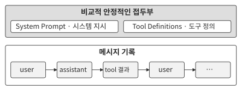

따라서 연속된 두 요청에서 처음부터 똑같은 구간은 메시지 기록 안까지 이어질 수 있습니다. 다음 라운드 호출이 이전 계산을 얼마나 재사용할 수 있는지는 이 접두부의 길이에 달려 있습니다.

아래의 하네스는 자주 바뀌지 않는 시스템 지시와 도구 정의를 앞에 두고, 라운드마다 메시지 기록 끝에 현재 상태만 덧붙입니다. 기록이 너무 길면 먼저 오래된 메시지를 압축한 뒤 요청을 조립합니다.

```python
stable_prefix = system_message
stable_tools = core_tool_schemas
history = load_message_history(session)
status_message = make_status_message(derive_current_state(history))

if estimated_tokens(stable_prefix, stable_tools, history, status_message) > budget:
    history = compress_old_evidence(
        history,
        preserve = [decisions, constraints, failures, citations]
    )

request.messages = [stable_prefix] + history + [status_message]
request.tools = stable_tools
response = call_model(request)
```

압축할 때는 결정, 제약, 실패, 인용처럼 이후 작업에 필요한 정보를 남기고, 호출 요청과 도구 결과의 연결도 유지합니다. 길이 예산 외에도 정보가 중복되거나 낡았을 때 압축할 수 있으며, 구체적인 전략은 이 장 후반부에서 다룹니다.

> **실험 2-1 ★: 로컬 LLM 서비스 배포와 도구 호출**
>
> 이 실험에서는 Qwen3-0.6B를 로컬에서 실행하고 ‘밴쿠버의 시간과 날씨 조회’라는 작업을 따라가며 메시지가 모델, 파서, 도구 실행기를 어떻게 거치는지 관찰합니다. 그림 2-5는 로컬 서비스와 클라이언트의 역할 분담을 보여 줍니다. 서버는 모델을 불러와 입력을 처리하고 응답을 생성하며, 클라이언트는 메시지 기록을 관리하고 도구를 실행해 결과를 돌려보냅니다.
>
> 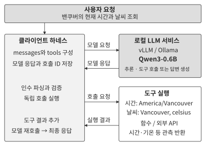
>
> **먼저 작업 하나를 처음부터 끝까지 추적합니다.** 모델은 한 라운드의 출력에서 시간과 기온 조회를 요청하고, `America/Vancouver`, `Vancouver`, `celsius` 같은 파라미터를 각각 채웁니다. 클라이언트는 두 도구를 병렬로 실행합니다. 첫 번째 회신은 현지 시간 11:11:28을, 두 번째 회신은 기온 17.9 °C를 돌려줍니다. 두 결과를 받은 모델은 시간을 분 단위까지 알려 주고 기온이 17.9 °C라고 답한 뒤 이번 루프를 마칩니다. 이 실행은 6억 파라미터 모델이 이미 이 작업에 맞는 두 도구를 고르고 파라미터를 채우며 반환값으로 사용자에게 답할 수 있음을 보여 줍니다.
>
> **다음으로 원시 출력과 API 필드의 대응을 확인합니다.** Qwen3의 사고 모드는 `<think>` 태그가 붙은 추론 내용을 생성할 수 있고, 도구 요청에는 해당하는 호출 태그를 사용합니다. 서버가 이를 파싱하면 클라이언트는 별도의 `thinking` 필드나 도구 호출 필드를 받을 수 있습니다. 출력의 각 부분을 어떻게 배열하고 보존할지는 모델 템플릿과 서비스 프로토콜이 함께 결정합니다.
>
> **이어서 스트리밍 처리를 관찰합니다.** 인터페이스는 이벤트에 따라 ‘생각하는 중’, ‘도구 호출’, ‘답변 생성’ 같은 상태를 갱신할 수 있습니다. 도구 파라미터는 보통 여러 조각으로 나뉘어 도착하므로 이를 모아 완전한 요청으로 만들어야 합니다. 프로토콜이 해당 호출의 종료를 확인하고 파라미터, 권한, 의존성 검사를 통과하면 실행 시스템은 실행을 시작할 수 있습니다. 서로 독립적인 도구는 병렬로 실행할 수 있고, 이후의 출력 처리와 파이프라인을 이룰 수도 있습니다.
>
> **마지막으로 속도와 캐시를 비교합니다.** 이번에 Apple Silicon Mac에서 실행한 기록에서 도구 작업의 평균 디코딩 속도는 초당 약 107 토큰이었습니다. 토큰(token)은 모델이 텍스트를 처리하는 기본 단위이며, 구체적인 분할 방식은 토크나이저가 정합니다. 단어나 글자 하나가 토큰 하나 또는 여러 개에 대응할 수 있습니다. 디코딩 속도는 생성이 시작된 뒤의 출력 속도를 나타냅니다. 사용자가 얼마나 기다리는지는 첫 토큰 지연, 추론 길이, 도구 소요 시간의 영향도 받습니다.
>
> 캐시 비교에서는 같은 긴 접두부를 사용해 접두부를 유지한 요청과 접두부의 맨 앞을 수정한 요청을 각각 측정했습니다. 이번 다섯 쌍 가운데 네 쌍에서 접두부를 유지한 요청이 더 빨랐고, 두 그룹의 평균 첫 토큰 지연은 각각 약 1.30초와 1.51초였습니다. 이 요청들이 계산에서 어떻게 다른지는 다음 절에서 설명합니다.
>
> 이 실험으로 필자는 온디바이스 에이전트를 더욱 긍정적으로 보게 됐습니다. 작은 모델이 이미 사용자 자신의 기기에서 이런 도구 호출 작업을 해낼 수 있습니다. **온디바이스 에이전트의 시대는 많은 사람의 예상보다 가까이 와 있습니다.**

## KV Cache 친화적인 컨텍스트 설계

에이전트의 인접한 요청은 보통 많은 정보를 공유합니다. 시스템 지시, 도구 정의, 그리고 이미 일어난 상호작용입니다. 추론 엔진이 이 내용의 중간 계산 결과를 재사용할 수 있다면 더 많은 계산을 새로 추가된 정보에 쓸 수 있습니다. **KV Cache**는 각 계층의 어텐션 계산에서 이미 얻은 키(Key)와 값(Value)을 저장해 이후 토큰이 사용하게 하고, **Prompt Cache**는 여기서 더 나아가 조건에 맞는 접두부 캐시를 요청 사이에서 재사용합니다[^ch2-kv-basics].

고객 서비스 에이전트를 생각해 보겠습니다. 모델이 현재 시각을 알도록 개발자가 시스템 프롬프트 맨 앞에 `Current time: {{now}}`를 넣고 요청할 때마다 갱신합니다. 뒤의 업무 규칙과 도구 정의는 그대로지만 실제 입력은 타임스탬프 위치부터 달라집니다. 같은 접두부를 기준으로 KV를 재사용하는 서비스에서는 이 때문에 타임스탬프와 그 뒤의 부분을 다시 계산하게 되어 입력 처리 시간과 비용이 늘어납니다.

시간을 덧붙이는 메시지로 쓰거나 필요할 때 시간 도구를 호출하면 기존 접두부를 유지할 수 있습니다. 두 배치가 제공하는 정보는 비슷하지만 재계산을 일으키는 범위는 다릅니다.

먼저 세 가지 방법을 기억해 두면 됩니다. 뒤에서 원리와 실험으로 하나씩 설명합니다.

1. **재사용할 수 있는 접두부를 안정적으로 유지합니다.** 시스템 지시와 자주 쓰는 도구 정의는 내용과 순서를 확정해 둡니다.
2. **실행 중의 변화는 뒤쪽에 덧붙입니다.** 시간, 잔액, 호출 횟수, 작업 진행 상황은 새 메시지나 도구 결과로 제공할 수 있습니다. 최신 상태에는 효력이 생긴 시점을 표시해 모델이 어느 기록이 현재 의사결정에 적용되는지 알아보게 해야 합니다.
3. **모델 프로토콜에 맞게 메시지를 구성합니다.** 올바른 역할, 호출 ID, 도구 결과 형식을 사용하고, 해당 Chat Template이 모델 입력을 생성하게 합니다. 캐시가 대조하는 것은 처리된 접두부와 관련 설정이며, 메시지 프로토콜은 모델이 지시, 사용자 요청, 도구 반환값을 어떻게 알아볼지도 결정합니다.

이 절에서 다루는 인과적 어텐션(causal attention) 모델에서는 뒤에 토큰이 추가되어도 앞 위치에서 이미 계산한 상태가 바뀌지 않습니다. 기존 입력을 수정하면 처음 달라진 위치와 그 뒤의 상태를 다시 계산해야 하며, 변경 이전의 접두부는 여전히 재사용될 수 있습니다. 서버는 캐시 블록 크기, 보존 시간, 실행 설정에 따라 실제 적중 범위를 정하기도 합니다.

[^ch2-kv-basics]: Hugging Face, How caching works: 계층별로 K와 V를 저장하고 재사용하는 메커니즘을 소개합니다.

> **실험 2-2 ★: 어텐션 메커니즘 시각화**
>
> 먼저 ‘베이징의 날씨 어때’라는 문장으로 어텐션 계산 한 번을 이해해 보겠습니다. 보여 주기 쉽도록 그림 2-6은 이 문장을 의미 단위 네 개, 즉 ‘베이징’, ‘의’, ‘날씨’, ‘어때’로 나눴습니다. 실제 모델에서는 토크나이저가 입력을 분할합니다. ‘어때’ 위치를 처리할 때 어텐션 계층은 기존 정보를 조합해 현재 표현을 만들어야 합니다. Query, Key, Value는 각각 질의, 대조, 정보 집계의 역할을 맡습니다.
>
> | 벡터 | 역할 | 이 예에서의 직관적 이해 |
> | --- | --- | --- |
> | **Query(질의)** | 현재 위치가 다른 위치와 대조하는 데 쓰는 벡터 | ‘어때’는 기존 내용에서 관련 정보를 찾아야 합니다 |
> | **Key(키)** | 각 위치가 대조에 참여하는 벡터 | ‘베이징’, ‘날씨’ 등의 위치가 대조할 수 있는 표현을 제공합니다 |
> | **Value(값)** | 가중치에 따라 집계되는 정보 벡터 | 지명, 날씨 등의 정보를 해당 비중에 따라 현재 표현에 모읍니다 |
>
> Key는 검색에 쓰는 레이블, Value는 꺼내 오는 내용이라고 생각하면 됩니다. 모델 안의 이 벡터들은 모두 은닉 표현에서 계산한 수치이며, 대조 방식은 학습으로 형성됩니다.
>
> 계산은 세 단계로 이루어집니다. 먼저 현재 위치가 Query를 만듭니다. 다음으로 Query와 각 위치의 Key를 내적하고, 스케일링, 인과 마스크, softmax를 거쳐 합이 1인 어텐션 가중치를 얻습니다. 마지막으로 이 가중치로 Value의 가중합을 구합니다. 내적은 두 숫자 묶음을 자리별로 곱해 더하는 연산이고, softmax는 볼 수 있는 위치들의 점수를 정규화된 가중치로 바꿉니다. 각 위치의 Value는 해당 가중치에 따라 집계에 참여해 이 어텐션 헤드의 출력을 함께 이룹니다.
>
> 그림 2-6의 마지막 행을 가로로 읽어 보겠습니다. ‘어때’ 위치가 ‘날씨’에 준 가중치는 0.55입니다. 이 값을 ‘날씨’ 위치의 Value에 곱하고 나머지 세 위치의 기여를 더해야 ‘어때’ 위치에서 이 어텐션 헤드의 출력이 나옵니다. ‘날씨’ 행으로 옮기면 오른쪽에 왜 × 표시가 하나 더 있을까요? 이 위치를 계산할 때는 시퀀스가 아직 ‘어때’까지 가지 않았기 때문입니다.
>
> 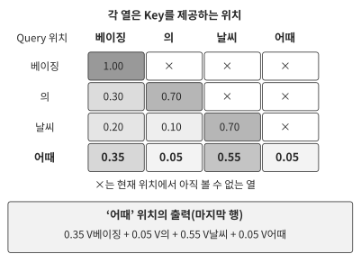
>
> 각 위치의 가중치를 행렬로 늘어놓으면 **어텐션 히트맵**이 됩니다. 각 행은 Query 하나, 각 열은 Key 하나에 대응하며, 색의 진하기가 가중치의 크기를 나타냅니다. 인과 마스크는 현재 위치가 자신과 앞 위치만 읽게 합니다. 그림에서 ×로 표시한 위치는 가려진 위치이며 softmax를 거친 가중치가 0입니다. 이 구조는 입력 처리와 이후의 생성에 모두 적용됩니다.
>
> 여기서 K, V 캐시의 용도도 알 수 있습니다. 생성이 이어지는 동안 새 위치는 여전히 기존 위치의 Key와 Value를 읽습니다. 이 벡터들을 저장해 두면 새 위치는 이를 곧바로 대조와 집계에 사용할 수 있어, 과거 위치를 반복 계산하지 않아도 됩니다.
>
> 이 예시 가중치를 이해했다면 이제 Qwen3-0.6B로 모델이 실제로 계산한 어텐션 분포를 살펴보겠습니다. 실험에서는 짧은 문장과, 추론과 최종 답변을 포함한 생성 시퀀스를 각각 기록하고 계층별 어텐션 행렬을 비교합니다. 그림 2-7은 0, 13, 27번째 계층을 보여 줍니다. 왼쪽 열은 토큰 아홉 개짜리 짧은 문장이고, 오른쪽 열은 17 × 23 크기로 계산한 생성 시퀀스이며 입력, 추론, 답변의 위치 범위를 표시했습니다. 회색 농도는 로그 척도를 사용해 강한 어텐션 가중치와 약한 가중치를 함께 알아보기 쉽게 했습니다.
>
> 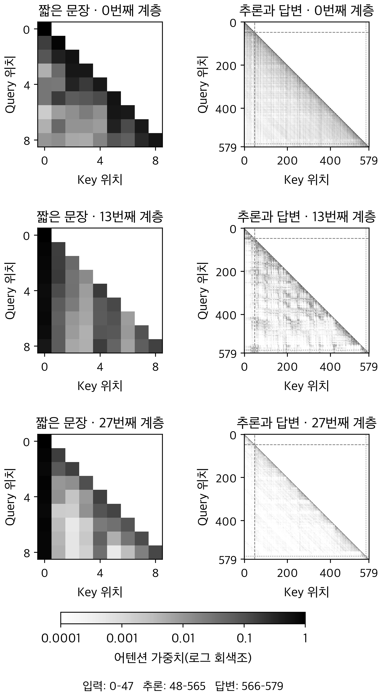
>
> 읽을 때는 네 가지 단서를 따라 분석할 수 있습니다.
>
> 1. **어텐션 싱크(Attention Sink).** 일부 계층은 시퀀스 첫머리에 큰 가중치를 배정합니다. 첫 토큰이 담는 의미가 거의 없어도 그렇습니다. 그림 2-7 왼쪽 열의 짧은 문장을 보겠습니다. 각 그림은 같은 계층의 어텐션 헤드들을 이미 평균한 것입니다. 여기서 행렬 첫 열의 숫자 아홉 개를 평균하면 아홉 위치가 첫 토큰에 평균적으로 얼마의 가중치를 주는지 계산할 수 있습니다. 0, 13, 27번째 계층에서 각각 14.7%, 73.9%, 83.2%입니다. 오른쪽 열의 더 긴 생성 시퀀스로 옮기면 13번째 계층의 이 값은 28.0%가 됩니다. softmax는 각 위치의 가중치 합을 1로 요구하므로 모델은 비교적 안정적인 수용 위치를 학습할 수 있습니다. StreamingLLM은 이 현상과 스트리밍 추론에서의 역할을 따로 연구했습니다[^ch2-attention-sinks].
> 2. **추론 영역.** `<think>`에 해당하는 생성 구간을 표시하고, 이 행들을 따라 모델이 어떤 프롬프트, 도구 설명, 이전 추론에 주의를 기울였는지 살펴봅니다. 삼각형은 인과 마스크에서 생기며, 삼각형 안쪽의 진하기만이 각 위치의 가중치 차이를 반영합니다.
> 3. **답변 영역.** 이어서 최종 답변의 생성 구간을 표시하고, 원래 입력과 앞선 추론에 가중치를 어떻게 배분하는지 비교합니다. 이를 통해 어떤 기존 정보가 현재의 어텐션 집계에 들어왔는지 찾아낼 수 있습니다.
> 4. **위치 차이.** 『Lost in the Middle』은 긴 컨텍스트 질의응답과 키-값 검색에서 중간 위치의 정보를 효과적으로 활용하기 더 어렵다는 점을 관찰했습니다[^lost-in-the-middle]. 실무에서는 이를 근거로 상시 규칙을 앞쪽에, 현재 목표와 진행 상황을 끝에 두는 방식을 우선할 수 있습니다.

[^ch2-attention-sinks]: Xiao et al., Efficient Streaming Language Models with Attention Sinks, ICLR 2024.

[^lost-in-the-middle]: Liu et al., Lost in the Middle: How Language Models Use Long Contexts, TACL 2024.

### API 메시지에서 모델 토큰으로: Chat Template

앞의 API 예시는 역할이 붙은 메시지 묶음이지만, 어텐션 그림의 입력은 토큰의 나열입니다. 이 변환을 맡는 것이 **Chat Template(채팅 템플릿)**입니다. 메시지에 역할과 경계 표시를 붙이고, 약속된 방식으로 도구 설명과 반환값을 구성한 뒤 토크나이저에 넘겨 인코딩합니다. 그림 2-8의 두 칸을 비교해 보겠습니다. 왼쪽은 시스템 지시와 사용자 질문만 제출했는데, 오른쪽에는 왜 `assistant`가 하나 더 있을까요? 템플릿이 다음 응답을 위해 붙인 시작 표시입니다. 뒤에서 도구 호출, 추론 정보의 보존, 캐시 적중을 다룰 때도 이 표시들이 쓰입니다.

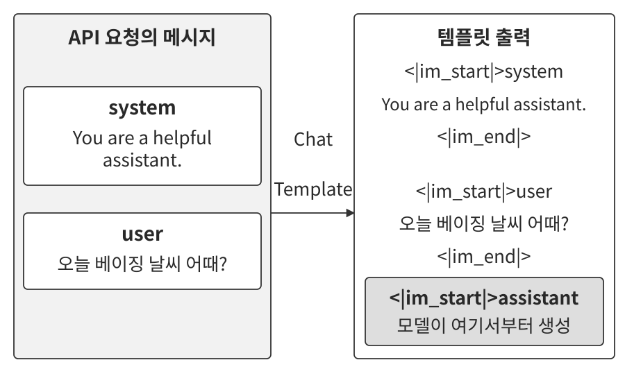

Qwen, Llama, Gemma 등 모델 계열은 저마다 채팅 템플릿을 가지고 있습니다. 같은 API 메시지를 다른 모델에 넘기면 변환된 역할 표시와 경계 표시도 다를 수 있습니다. 호스팅 API는 보통 서버가 변환을 처리하지만, 직접 배포할 때는 추론 서비스에 모델과 맞는 템플릿을 설정해야 합니다.

사용자가 “밴쿠버 17.9 °C”라는 문장을 보냈고, 날씨 도구도 마침 같은 문장을 반환했다고 가정합니다. 이 두 메시지를 각각 Qwen3-0.6B의 템플릿에 넘기면 그림 2-9의 두 입력을 얻습니다. 둘 다 `<|im_start|>user`로 시작하는데, 어느 표시가 이 문장이 도구에서 왔음을 나타낼까요?

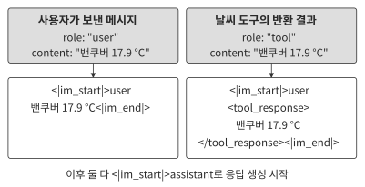

오른쪽 칸에는 `<tool_response>` 태그 한 쌍이 더 있습니다. 템플릿은 메시지 역할로 사용자의 가장 최근 질문 위치도 찾습니다. 이 질문 이전의 라운드에서는 답변 내용만 남기고, 이후에는 도구 상호작용에 모델의 추론 정보도 붙일 수 있습니다[^ch2-qwen-template].

예를 들어 모델이 파일을 조회한 뒤에도 계속 분석해야 한다고 합시다. 도구 결과를 `tool` 역할로 돌려보내면 템플릿은 이를 현재 작업의 도구 피드백으로 알아봅니다. 같은 결과를 일반 `user` 메시지로 직접 쓰면 템플릿은 이를 새 질의로 인식해 이전 추론의 보존 범위를 바꿀 수 있습니다. 문제를 이어서 풀 때 연습장의 풀이를 남겨 둬야 하는 것과 같습니다. 하네스는 서비스가 요구하는 추론 필드를 저장하고 올바른 메시지 구조로 호출을 이어 가야 합니다.

**단일 라운드 추론에서 장기 실행 에이전트로 넘어가면서 과거의 사고는 관리해야 할 작업 상태가 되어 갑니다.** 초기 DeepSeek-R1의 채팅 템플릿은 과거 답변에서 사고 부분을 지우고 최종 답변만 남겼습니다[^ch2-r1-template]. 이후 DeepSeek의 도구 호출 프로토콜은 추론 정보를 돌려보내도록 요구합니다. 한 번의 질의응답이 끝나면 최종 답변에 다음 라운드에 필요한 정보가 이미 담겨 있을 수 있습니다. 하지만 도구 작업이 절반쯤 진행됐을 때 ‘왜 이 파일을 조회했는지’, ‘어떤 가설을 이미 배제했는지’는 중간 추론에만 적혀 있을 수 있습니다. 이 정보를 보존하면 다음 라운드가 기존 사고를 이어받아 일하는 데 도움이 됩니다.

**추론 정보를 돌려보내는 방식은 모델 프로토콜이 결정합니다.** 연동할 때는 `content`, `tool_calls`, 서비스가 제공하는 추론 필드를 함께 처리해야 합니다. 다음 방안들은 서로 다른 이어 가기 규칙을 보여 줍니다.

- **DeepSeek 사고 모드**는 `reasoning_content`로 추론을 반환합니다. 도구 호출 프로토콜에 따르면 요청에 `tools`가 있을 때 이후 요청은 도구를 호출하지 않은 모델 응답을 포함해 과거 추론을 빠짐없이 돌려보내야 하며, 필드가 빠지면 400 오류가 납니다. `tools`가 없는 순수 대화 요청에서는 서비스가 돌려보낸 과거 추론을 무시합니다[^ch2-deepseek-thinking].
- **Kimi의 사고와 도구 상호작용**에서도 실행 루프 안에서 추론, 도구 요청, 결과를 관리해야 합니다. Kimi K2.5의 교차 사고(interleaved thinking) 예시를 보면 모델은 여러 번의 도구 호출 사이에서 추론을 이어 갈 수 있고, 클라이언트는 그 프로토콜에 따라 모델 메시지를 저장하고 돌려보냅니다[^ch2-kimi-thinking].
- **GLM의 보존 사고**는 `thinking.clear_thinking: false`로 켤 수 있으며, 그 뒤에는 `reasoning_content`를 빠짐없이 원래 순서대로 돌려보내야 합니다. Coding Plan과 표준 API는 기본 설정이 다르므로 클라이언트는 필요한 모드를 명시적으로 선택해야 합니다[^ch2-glm-thinking].
- **Claude의 thinking block**은 서명과 함께 저장해야 합니다. preserved thinking을 지원하는 모델은 블록의 출처와 접두부도 검사하며, 구체적인 규칙은 뒤의 ‘아키텍처 제약으로서의 캐시’에서 설명합니다.

이 규칙들은 연속된 도구 호출에도, 중간에 모델을 바꾸는 경우에도 영향을 줍니다. 모델을 바꿀 때 어댑터 계층은 도구 요청, 결과, 작업 상태를 대상 인터페이스가 받아들이는 형태로 변환한 뒤, 대상 모델의 규칙에 따라 추론 정보를 처리해야 합니다. 제5장의 실험 5-1에서 이런 궤적 이어 가기를 자세히 다룹니다.

**템플릿은 캐시가 대조하는 입력도 결정합니다.** 같은 메시지 내용이라도 템플릿, 도구 순서, 직렬화 방식이 다르면 서로 다른 토큰 접두부가 될 수 있습니다. 기존 KV를 재사용하려면 관련 모델 설정과 접두부를 일치시켜야 합니다.

[^ch2-qwen-template]: Qwen3-0.6B의 토크나이저 설정 파일 `tokenizer_config.json`에 채팅 템플릿이 저장되어 있으며, 사용자 질의, 추론 내용, 도구 응답의 처리 로직이 들어 있습니다.

[^ch2-r1-template]: DeepSeek-R1의 공식 채팅 템플릿은 일반 과거 답변에서 `</think>` 이후의 내용을 남깁니다. 이후 도구 호출에서 추론을 돌려보내는 규칙은 DeepSeek의 Thinking Mode 문서를 참고하세요.

[^ch2-deepseek-thinking]: DeepSeek, Thinking Mode.

[^ch2-kimi-thinking]: Moonshot AI, Kimi K2.5 공식 저장소, Interleaved Thinking and Multi-Step Tool Call 절.

[^ch2-glm-thinking]: Z.ai, Thinking Mode: 교차 사고, 보존 사고, 엔드포인트 기본 설정을 소개합니다.

### KV Cache의 원리와 제약

모델은 요청 하나를 처리할 때 먼저 입력에 **prefill(프리필)**을 수행해 기존 토큰의 표현을 계산하고, 이어서 **decode(디코딩)**에 들어가 이후 토큰을 하나씩 생성합니다. KV Cache는 디코딩 과정에서 기존 위치의 K, V를 저장하고, 요청 간 접두부 캐시는 여기서 더 나아가 이전 요청이 남긴 같은 접두부를 재사용합니다.

예를 들어 에이전트가 여섯 번째 라운드에 이르러 입력 토큰 2,000개를 쌓았다고 합시다. 서비스가 이번 요청 안의 KV Cache만 사용한다면 이 2,000개 토큰을 먼저 처리한 뒤에야 캐시를 이용해 생성을 이어 갑니다. 요청 간 캐시에 같은 접두부의 일부가 이미 있다면 프리필은 아직 캐시되지 않은 위치부터 이어서 진행할 수 있습니다. 그림 2-10은 이런 요청 간 재사용을 보여 줍니다.

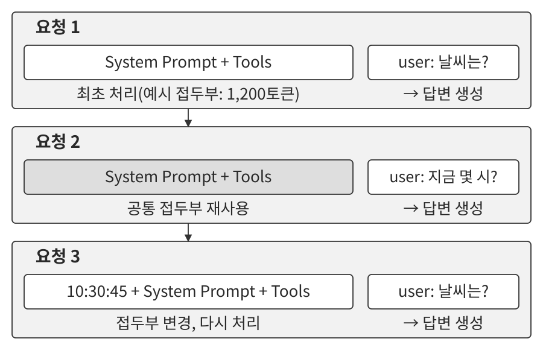

**토큰 네 개로 캐시가 늘어나는 과정을 추적해 보겠습니다.** 입력이 `[A, B, C, D]`라고 가정합니다. 모델은 위치 D를 처리할 때 D의 Query를 A, B, C, D의 Key와 대조하고, 그 Value를 가중 집계합니다. 각 계층의 계산을 거친 D 위치의 최종 표현이 다음 토큰 E를 예측하는 데 쓰입니다. 이 시점에 A부터 D까지 각 계층의 K, V는 모두 저장되어 있습니다.

E를 샘플링하면 다음 단계에서 E를 모델에 넣어 각 계층의 Query, Key, Value를 계산합니다. E의 Query는 이전 캐시와 현재 위치의 K, V를 읽고, 모델은 여섯 번째 토큰을 예측합니다. 이와 동시에 E의 K, V가 캐시에 추가됩니다. 이렇게 하면 생성할 때마다 이전 상태를 그대로 쓰고 새로 들어온 토큰의 상태만 계산하면 됩니다.

KV Cache를 전혀 쓰지 않으면 E를 예측할 때 A부터 D까지 다시 처리하고, 여섯 번째 토큰을 예측할 때는 A부터 E까지 다시 처리해야 합니다. K, V를 반복 생성하는 위치의 수만 따져도 누적 작업량은 $1+2+\cdots+N$처럼 늘어납니다. 캐시를 쓰면 과거 위치의 계층별 계산을 재사용할 수 있지만, 새 위치는 여전히 볼 수 있는 K, V를 읽어야 합니다. 표준 전체 어텐션 디코딩에서는 이 읽기와 대조가 컨텍스트 길이에 비례해 늘어나므로, 긴 컨텍스트는 여전히 GPU 메모리와 메모리 대역폭을 더 많이 차지합니다.

**입력을 수정하면 왜 이후의 캐시에 영향을 줄까요?** Transformer의 각 계층은 은닉 표현을 차례로 처리하며, 계층마다 자체 K, V를 가집니다. 어떤 위치는 어텐션 계산을 거치면서 표현에 이전 위치의 정보가 섞인 채 다음 계층으로 넘어갑니다. 따라서 $k$번째 토큰이 바뀌면 그 영향은 해당 위치에서 뒤쪽으로, 더 높은 계층으로 퍼집니다.

같은 모델과 계산 설정에서 $k$ 이전의 위치는 더 앞선 입력에만 의존하므로 계속 재사용할 수 있고, $k$부터는 영향을 받은 상태를 다시 만들어야 합니다. 실제 서비스는 보통 캐시 블록 단위로 접두부를 대조하므로 재계산 경계는 블록 크기의 영향도 받습니다. 갱신 위치가 앞쪽일수록 보통 다시 계산할 입력이 많아집니다. 안정적인 지시를 앞쪽에 두고 새 상태를 뒤쪽에 덧붙이는 것은 바로 이 의존 관계를 활용하는 방법입니다.

> **실험 2-3 ★★: 컨텍스트 관리 방식의 비교**
>
> 이 실험에서는 에이전트가 파일 탐색, 읽기, 검색 도구로 같은 작업을 수행하게 하고, 안정적으로 덧붙이는 기준선과 다섯 가지 컨텍스트 변경을 비교합니다. 기준선은 지시와 도구 순서를 고정한 채 라운드마다 모델 메시지와 도구 결과를 덧붙입니다. 나머지 그룹은 각각 지시, 상태, 도구 순서, 기록 표현을 바꾸며, 캐시 통계와 작업 과정이 어떻게 달라지는지 관찰합니다.
>
> **동적 시스템 프롬프트**는 라운드마다 시스템 지시의 현재 시각을 갱신합니다. 변경 이전에는 여전히 공유 접두부가 있을 수 있지만, 시간 정보부터의 이후 입력은 다시 대조하거나 계산해야 합니다. 시간을 새 메시지로 덧붙이거나 시간 도구로 필요할 때 가져오면 상시 업무 규칙을 계속 재사용할 수 있습니다.
>
> **동적 사용자 설정**은 앞쪽 메시지에서 남은 호출 횟수나 계정 잔액을 갱신합니다. 상태 자체는 작업에 필요한 정보이므로 설계의 핵심은 갱신 위치에 있습니다. 최신 상태를 끝에 덧붙이고 효력 시점을 표시하면 진행 상황과 접두부를 함께 보존할 수 있습니다. 뒤의 에이전트 상태 표시줄이 이런 구성 방식을 사용합니다.
>
> **도구 정의 재정렬**은 라운드마다 도구 목록의 순서를 바꿉니다. 이름과 파라미터가 같아도 직렬화된 토큰 순서는 이미 달라졌습니다. Kimi K2.6의 실행 보고서를 열어 보면 기준선과 재정렬 그룹의 `Hit%`는 모두 100%입니다. 두 그룹이 정말 같은 양의 입력을 재사용했을까요? 기준선은 세 라운드 동안 토큰 7,567개를 입력했고 그중 768개가 캐시에 적중했습니다. 재정렬 그룹도 세 라운드였지만 입력 토큰 7,568개 가운데 256개만 적중했습니다. 캐시 토큰 수를 입력 토큰 수로 나누면 `Cache%` 열의 10.1%와 3.4%가 나옵니다. 다른 열인 `Hit%`는 적중 판정이 있는 요청 수를 셉니다. 기준선은 적중이 두 번, 재정렬 그룹은 한 번만 기록됐고, 두 그룹 모두 미적중 기록은 0번입니다. 나머지 요청의 적중 여부는 이 기록만으로는 판단할 수 없습니다. 도구 순서를 고정하면 접두부가 이유 없이 바뀌는 일을 피할 수 있습니다.
>
> **슬라이딩 윈도**는 최근 기록만 남깁니다. 상호작용 열 라운드를 남긴다고 하면 열다섯 번째 라운드에서는 두 번째 라운드에서 얻은 핵심 파일 내용을 읽지 못할 수 있습니다. 잘라 내기는 공유 접두부를 줄일 뿐 아니라 모델이 얻을 수 있는 사실과 작업 진행 상황도 바꿉니다. 함께 제공되는 구현은 최근 메시지 여섯 개를 출발점으로 삼고, 도구 결과에 대응하는 호출 요청을 앞쪽으로 보충합니다. 슬라이딩 윈도 그룹은 입력 토큰 2,224개 가운데 1,510개를 재사용해 캐시 비율이 여섯 그룹 중 가장 높은 67.9%에 이르렀습니다. 그런데 실험 2-3 슬라이딩 윈도 그룹의 도구 기록을 다시 보면, 모델은 파일을 세 번 찾고 이어서 파일 두 개를 읽었지만 사용자가 요청한 세 문장 요약은 끝내 내놓지 않았습니다.
>
> **텍스트 포맷 방식**은 역할이 붙은 기록을 `USER: ...`, `ASSISTANT: ...` 같은 텍스트로 다시 씁니다. 이렇게 하면 템플릿의 메시지 경계와 도구 구조가 바뀌어 모델이 본문에서 원래 관계를 복원해야 합니다. 이번 텍스트 그룹은 최종 응답을 생성했고 캐시 적중도 있었습니다. 인터페이스가 제공하는 메시지 역할, 호출 ID, 도구 결과 필드는 이런 관계를 안정적으로 전달하는 데 도움이 됩니다.
>
> 프로그램이 메시지 목록을 다시 구성하더라도 보내는 접두부와 캐시 설정이 같다면 그 접두부는 여전히 재사용될 수 있습니다.
>
> 사용자가 얼마나 덜 기다렸는지 알고 싶다면 먼저 타이머가 어디에서 멈추는지 봐야 합니다. 슬라이딩 윈도 그룹 첫 라운드의 `ttft`는 약 2.23초입니다. 프로그램은 이 필드를 TTFT(첫 토큰 지연)라고 부르지만, 실제로는 비스트리밍 요청이 응답 전체를 반환한 시점에 타이머를 멈췄습니다.

### KV Cache와 Prompt Cache: 두 계층의 캐시

두 시점으로 이 두 계층의 캐시를 구분할 수 있습니다. 모델이 응답의 두 번째 토큰을 생성할 때는 이 요청 안에 있는 기존 위치의 키-값 상태를 읽을 수 있으며, 이때 쓰이는 것이 **KV Cache**입니다. 잠시 뒤 사용자가 후속 질문을 하면 하네스가 새 요청을 보냅니다. 서비스가 이전에 저장해 둔 같은 접두부를 먼저 찾아야 이 부분의 입력 계산을 줄일 수 있으며, 이것이 **Prompt Cache**에 해당합니다. 전자는 한 번의 생성이 어떻게 이어지는지를 설명하고, 후자는 요청을 넘나드는 저장과 대조 메커니즘까지 필요로 합니다.

API 서비스에서 캐시는 최소 접두부 길이, 블록 크기, 유효 기간, 모델 설정, 테넌트 격리 범위의 영향도 받습니다. 재사용할 수 있는 접두부는 같은 캐시 범위 안에서 찾아야 합니다. 예를 들어 Claude API는 조직과 워크스페이스 단위로 캐시를 격리하므로, 같은 문장이 서로 다른 격리 영역에 나타나면 캐시가 각각 따로 만들어집니다[^ch2-prompt-cache].

과금은 쓰기와 읽기를 나눠서 생각해야 합니다. 일부 Claude 모델에서 캐시 읽기 가격은 일반 입력 가격의 10분의 1이고, 처음 쓸 때는 추가 비용이 붙습니다. 같은 접두부를 유효 기간 안에 여러 번 사용하면 쓰기 비용은 한 번만 내고, 이후 적중한 요청은 모두 읽기 가격으로 과금됩니다.

[^ch2-prompt-cache]: Anthropic, Prompt caching: 캐시 대조, 격리, 유효 기간, 과금을 소개합니다.

### 아키텍처 제약으로서의 캐시

**프로덕션 시스템에서 캐시는 이미 아키텍처 제약이 됐습니다.** 프롬프트를 어떻게 배열하는지, 하위 에이전트가 어디서 시작하는지, 세션을 어떻게 복구하는지가 모두 재사용할 수 있는 계산량에 영향을 줍니다. **설계 초기에 캐시 경계를 정해 둬야 합니다.** 무엇을 공유할 수 있고 어떤 상태가 바뀌는지 먼저 정한 뒤 프롬프트와 세션 구조를 구성하면 실행 중의 반복 재계산을 줄일 수 있습니다. 장기 실행 작업의 지연과 비용이 이미 문제가 된 뒤에 이 구조를 조정하면 상태 관리, 하위 에이전트, 세션 복구까지 손대야 하는 경우가 많습니다.

**안정성의 정도에 따라 접두부를 배치합니다.** 여러 작업이 공유하는 지시와 도구 정의를 앞쪽에 두고, 그 뒤에 사용자 자료, 세션 상태, 새 관측을 넣되 적용 범위별로 묶습니다. 예를 들어 운영체제가 macOS/Linux 두 가지, 실행 모드가 일반/디버그 두 가지, 언어가 중국어/영어 두 가지라면 독립된 세 조건으로 최대 $2\times2\times2=8$가지 접두부 조합이 생깁니다. 변화가 많은 필드를 공유 부분 뒤로 옮기면 공통 접두부의 재사용 기회가 늘어납니다. 공통 부분의 공유 범위는 서비스의 조직, 워크스페이스, 개인정보 경계도 지켜야 합니다.

**하위 에이전트에는 재사용할 수 있는 출발점을 고릅니다.** 하위 에이전트가 상위 에이전트의 작업 배경을 이어받으면 양쪽이 일치하는 접두부를 재사용하고 자신의 하위 작업을 덧붙일 수 있습니다. 재사용 범위는 프롬프트, 도구 순서, 모델, 관련 설정이 함께 결정합니다. 독립된 역할이나 격리된 컨텍스트가 필요한 하위 에이전트는 자신의 작업에 맞춰 입력을 구성한 뒤, 어떤 공통 부분을 공유하는 것이 적절한지 검토합니다.

**이미 보낸 내용을 저장합니다.** 큰 도구 출력을 요약이나 미리보기로 압축했다면 실제로 모델에 보낸 버전을 저장해야 합니다. 세션을 복구할 때 이 기록을 재생하면 일관된 메시지 시퀀스를 다시 만들 수 있습니다. 복구할 때마다 요약을 새로 생성하면 새로운 표현과 접두부 변화가 생길 수 있습니다. 요약을 갱신할 때는 새 버전을 내고, 이후 어디서부터 캐시를 다시 만들지 분명히 정해 둘 수 있습니다.

**추론을 보존하려면 프로토콜 제약도 지켜야 합니다.** Claude의 preserved thinking이 이 문제의 구체적인 사례입니다. 문서는 이 메커니즘을 증류 방지에 사용한다고 설명합니다. 서비스는 thinking block의 서명, 생성한 모델, 그 접두부를 검사합니다. Claude Fable 5.1, Claude Opus 5.5처럼 접두부 바인딩을 지원하는 모델에서는 블록 앞의 최상위 `system`, `tools`, 메시지가 함께 검증 범위를 이루며, 그 안의 내용을 수정하면 해당 블록과 이후의 thinking block이 무효가 됩니다[^ch2-preserved-thinking].

예를 들어 라운드마다 시스템 시간을 다시 쓰거나, 첫 메시지의 환경 정보를 다시 렌더링하거나, 오래된 도구 결과를 제자리에서 잘라 내면 이후 추론 블록이 묶여 있는 접두부가 바뀝니다. 검증에 걸리면 API는 400 오류를 반환할 수도 있고, `prefix_mismatch_behavior` 설정에 따라 무효가 된 블록을 버리고 요청을 계속 처리할 수도 있습니다. 후자의 경우 모델은 남아 있는 작업 정보와 도구 결과는 여전히 사용할 수 있지만, 무효가 된 추론은 이번 입력에 참여하지 않습니다. 2026년 8월 31일부터 생성된 계정은 접두부 검증이 기본으로 켜져 있으며, 그 이전 계정의 활성화 방법은 프로토콜 설명을 참고하세요.

이런 프로토콜을 연동할 때는 세션의 최상위 지시와 도구 집합을 안정적으로 유지하고 상태 변화를 뒤쪽에 덧붙이면 됩니다. 중간에 지시나 도구를 갱신해야 한다면 해당 서비스가 제공하는 세션 내 시스템 메시지, 도구 변경 블록 같은 인터페이스를 사용합니다. thinking block을 잘라 낼 때도 원래 순서의 연속 구간을 유지해야 합니다. 앞쪽이나 뒤쪽에서 지우거나 전부 지울 수 있지만, 가운데에 빈틈을 남기면 이후 블록에 영향을 주며, 일단 지운 블록은 계속 지운 상태로 둬야 합니다.

중간에 모델을 바꿀 때 서비스는 대상 모델이 원래 모델의 추론 블록을 읽을 수 있는지도 검사합니다. 클라이언트는 원래 기록을 보존해 서비스가 호환 규칙에 따라 처리하게 해야 합니다. 클라이언트가 직접 지우면 나중에 원래 모델로 되돌아갔을 때도 이 기록을 복구할 수 없습니다.

[^ch2-preserved-thinking]: Anthropic, Preserved thinking: 모델, 접두부 바인딩, 무효화 처리, 추론 블록 잘라 내기 규칙을 소개합니다. 세션 내 갱신 인터페이스는 Mid-conversation system messages and tool changes를 참고하세요.

### 연구 확장: 편집하고 조합할 수 있는 KV Cache

> 앞의 설계들은 모두 접두부 대조로 계산을 재사용합니다. 필자는 한 걸음 더 나아가 KV에 이미 저장된 정보를 직접 편집하고 조합해 캐시가 컨텍스트 변화에 적응하게 할 수 있는지 탐구하고 싶었습니다. 필자는 『Models Take Notes at Prefill』에서 이런 정보를 모델의 ‘메모’에 비유했습니다[^ch2-2]. 프리필에서 여러 계층의 어텐션 계산을 거치면 한 필드의 영향은 이미 이후 위치의 표현에 들어가 있습니다. 예를 들어 ‘사용자 거주 도시: 베이징’은 이후의 지역 판단에 영향을 줄 수 있습니다. 이 필드 자체의 K, V만 바꾸면 이후 상태에는 이전 도시에서 도출한 결론이 여전히 남아 있을 수 있습니다.
>
> 논문은 개입 실험으로 필드 자체의 KV와 이후 상태의 역할을 구분했습니다. 측정한 의사결정에서 필드 자체 KV의 직접 기여는 1% 미만이었고, 주된 영향은 하류 표현에 저장되어 있었습니다. 하류에 남은 이 ‘메모’를 중심으로 캐시를 활용하는 두 가지 방법을 탐구할 수 있습니다.
>
> **편집(Editing)**은 명시적으로 정정한 정보로 이후 계산이 기존 판단을 갱신하도록 이끕니다. 논문은 측정한 8B 모델 작업에서 명시적인 사고 사슬이 있으면 필드만 편집해도 목표 결정을 되살릴 수 있고, 계산 비용은 전체 재계산의 약 1%라는 점도 발견했습니다. 이런 추론 과정이 없으면 이전의 하류 상태가 계속 결정에 영향을 줘서 필드 수정이 효과를 내기 어려울 수 있습니다.
>
> **조합(Composition)**은 미리 계산한 스킬 캐시를 새 컨텍스트에 연결합니다. 회전 위치 인코딩(RoPE)을 쓰는 모델에서는 먼저 캐시 안의 위치 표현을 조정한 뒤 이어 붙여야 합니다. 이미 있는 메모 한 장에 쪽 번호를 새로 매겨 다른 자료 뒤에 붙인다고 생각하면 됩니다. 논문은 모델 열두 개를 비교했으며, 이어 붙인 결과와 전체 재계산의 출력 logits 코사인 유사도는 0.90–0.999였습니다. 캐시 재배치와 이어 붙이기 자체는 길이에 비례해 처리할 수 있어 컨텍스트 전체의 어텐션 재계산을 줄입니다.
>
> 정정 정보를 덧붙이는 방법은 기존 접두부 캐시와도 함께 쓸 수 있습니다. 논문의 vLLM 온라인 벤치마크에서 이 조합은 약 98.5%의 접두부 캐시 적중률을 유지했고, p90 첫 토큰 지연은 기준선의 약 1/398에서 1/53이었습니다.
>
> **필자가 이 연구 방향을 긍정적으로 보는 이유는 컨텍스트를 갱신할 때 기존 계산을 더 많이 보존할 수 있으리라 기대하기 때문입니다.** 에이전트는 기억 필드를 갱신하고, 상태를 추가하고, 도구 정의를 교체하는 일이 잦습니다. 관련 상태를 메모처럼 고치고 이어 붙일 수 있다면 긴 컨텍스트를 유지하는 비용을 크게 낮출 수 있습니다.

[^ch2-2]: Li, Bojie, Models Take Notes at Prefill: KV Cache Can Be Editable and Composable, 2026. 편집, 조합, 온라인 캐시 실험은 서로 다른 작업과 지표를 사용하며, 구체적인 설정은 논문을 참고하세요.

### 캐시 메커니즘에서 컨텍스트 내용의 설계로

캐시가 계산을 어떻게 재사용하는지 이해했다면, 이제 라운드마다 입력에 무엇을 넣고 그 내용을 어떻게 갱신할지 정해야 합니다. 뒤의 내용은 세 부분으로 나뉩니다.

- **프롬프트 엔지니어링과 에이전트 스킬**: 먼저 시스템 지시와 도구 정의를 설계해 목표, 규칙, 작업 방식을 설명합니다. 그다음 점진적 공개로 도메인 지식을 필요할 때 불러옵니다. 프롬프트 주입 방어는 외부 콘텐츠가 컨텍스트에 들어올 때의 출처와 지시 경계를 다룹니다.
- **에이전트 상태 표시줄**: 작업 진행 상황, 환경 관측 요약, 호출 횟수 같은 상태를 모델에 제공해 긴 기록에서 다시 추론하는 비용을 줄입니다. 휴대전화의 시간, 배터리, 네트워크 상태처럼 현재 실행 상황을 계속 보이게 합니다.
- **컨텍스트 압축**: 기록이 늘어날 때 이후 의사결정에 필요한 정보를 보존합니다. 언제 압축할지, 요약을 어떻게 구성할지, 캐시 재계산과 작업 이어 가기를 어떻게 처리할지 정합니다.

## 프롬프트 엔지니어링: 시스템 프롬프트 최적화

프롬프트 엔지니어링은 지시, 절차, 예시로 모델이 구체적인 작업을 완수하도록 이끕니다. 이 절은 **시스템 프롬프트(System Prompt)**를 중점적으로 다룹니다. 시스템 프롬프트는 직원 안내서처럼 에이전트의 정체성, 목표, 행동 규칙, 작업 절차를 설명합니다. 이 장의 API 예시에서 이 내용은 `system` 메시지로 제공됩니다.

### 어조와 스타일: 사용자에게 어떻게 표현할 것인가

어조에 대한 요구는 구체적인 표현으로 나타나야 합니다. 예를 들어 짧은 질의응답에는 “You MUST answer concisely with fewer than 4 lines”, 즉 네 줄이 안 되는 분량으로 답하라고 요구할 수 있습니다. 작업이 막혔을 때는 “keep your response to 1–2 sentences”라고 요구해 현재 상태와 다음 단계를 한두 문장으로 설명하게 하면, 사용자가 처리해야 할 사항을 바로 볼 수 있습니다.

“NEVER do X” 같은 대문자 강조는 핵심 요구를 두드러지게 하는 데 쓸 수 있습니다. 더 중요한 것은 그 요구가 어떤 상황에 적용되며 어떤 행동을 취해야 하는지 설명하는 일입니다.

### 구조화된 프롬프트: 계층과 내용 경계의 구성

제목, 목록, 태그는 긴 프롬프트를 구성하는 데 도움이 됩니다. Markdown 제목은 장과 단계를 나타내기에 적합하고, XML 스타일 태그는 용도가 다른 콘텐츠 블록을 나누기에 적합합니다. 예를 들어 `<working_directory>`로 작업 디렉터리 정보를 감쌀 수 있습니다. 태그 이름은 내용의 용도를 직접 드러내야 모델이 블록 사이의 관계를 쉽게 알아봅니다.

한 프롬프트에서 두 방식을 함께 쓸 수 있습니다.

```text
# 도구 사용 규칙

## 파일 작업
<file_operation>
- 파일을 읽기 전에 경로가 있는지 확인한다
- 기존 파일을 수정하기 전에 백업을 저장한다
</file_operation>

## 네트워크 요청
<network_request>
- 타임아웃은 30초로 설정한다
- 일시적인 장애는 최대 3회 재시도한다
- 외부에 부작용이 있는 요청은 재시도 전에 실행 상태를 먼저 확인한다
</network_request>
```

Markdown은 읽기 쉬운 계층을 제공하고, `<file_operation>`과 `<network_request>`는 규칙의 적용 범위를 나눕니다. 예를 들어 ‘최대 3회 재시도’는 네트워크 요청에만 적용되며, 파일을 수정할 때는 위의 백업 규칙을 따릅니다.

### 절차로 규칙 구성하기

**작업에 뚜렷한 단계가 있으면 프롬프트를 절차 중심으로 구성하는 편이 낫습니다.** 환불을 예로 들면 먼저 주문을 찾아야 환불 정책에 따라 이 돈을 돌려줄 수 있는지 판단할 수 있습니다. 주문을 찾지 못하면 사용자에게 주문 번호 같은 정보를 보충해 달라고 요청하고, 주문이 조건에 맞으면 환불을 진행합니다. 같은 규칙을 백 개가 넘는 목록에 흩어 놓으면 단계마다 적용할 항목을 다시 찾아야 합니다. 입력 조건, 처리 순서, 예외 출구를 해당 단계에 적어 두면 모델은 지금 어디까지 왔고 다음에 무엇을 해야 하는지 판단할 근거를 얻습니다.

아래는 파일 처리를 예로 검사, 분류, 전처리, 실행, 검증을 하나로 엮은 표준 작업 절차(Standard Operating Procedure, SOP)입니다.

```text
파일 처리 절차

1단계: 검사
  파일이 있고 접근할 수 있는지 확인
  파일이 없음 → 오류를 기록하고 처리 중단
  ↓
2단계: 분류
  확장자와 파일 내용으로 유형 판단
  ↓
3단계: 전처리
  설정 파일 → 먼저 백업
  큰 파일(>1 MB) → 스트리밍 처리
  ↓
4단계: 실행
  파일 유형에 맞는 처리 실행
  ↓
5단계: 검증
  처리한 파일의 무결성 확인
```

단계마다 국소적인 목표를 하나씩 주고 관련 규칙을 그 단계 아래에 둡니다. 파일이 없으면 검사 단계에서 빠져나오고, 설정 파일을 수정해야 하면 전처리 단계에서 백업을 저장합니다. 실행 진행 상황은 메시지 기록이나 상태 기록으로 모델에 제공합니다.

### 업무 규칙 구체화: 제품의 약속을 분명히 적기

같은 주문 자료를 어떤 요청으로 분류하고, 어떤 서비스를 적용하고, 비용을 얼마나 받을지는 무엇보다 제품과 운영 쪽에서 분명히 정해야 할 업무 약속입니다. 엔지니어링 구현은 그다음에 역할을 나눕니다. 프롬프트는 모델에 어떤 필드를 얻고 어느 서비스에 조회해야 하는지 알려 주고, 도구와 업무 시스템은 확정적인 과금과 제약을 실행합니다.

사용자를 대신해 전화를 걸어 구독료를 낮추거나 환불을 신청하는 에이전트를 예로 들겠습니다. 팀은 ‘못 해내면 환불’로 시도의 문턱을 낮추고 싶어 하면서, 특수한 작업에는 분명한 과금 방식을 두려고 합니다. 과금은 세 가지로 설계할 수 있습니다.

- **절감액 기준 수수료**: 협상으로 기존 청구액을 낮추고, 실제 절감액의 일정 비율, 예를 들어 20%를 받습니다.
- **서비스별 고정 요금**: 식당 예약 같은 서비스형 작업은 작업 유형이나 복잡도에 따라 요금을 받습니다.
- **어려운 작업 선불**: 특정 조건에 맞는 어려운 작업은 선불 금액과 환불 불가 조항을 미리 설명하고, 사용자가 확인한 뒤 맡습니다.

‘작업 상황에 따라 적절한 과금 유형을 선택하라’고 쓰면 분류의 모호함이 여전히 남습니다. ‘지난달 산 옷을 반품해 줘’는 이미 낸 돈을 돌려받는 일이고, ‘Netflix 구독을 해지해 줘’는 앞으로의 지출을 멈추는 일입니다. 두 결과 모두 넓게 보면 돈을 아끼는 일로 이해될 수 있지만, 팀은 수수료를 기존 청구액을 협상으로 낮추는 경우로 한정하고 환불과 서비스 해지에는 일괄적으로 고정 요금을 적용할 수 있습니다.

해당 프롬프트에는 분류 경계를 직접 적을 수 있습니다. “NEVER use percentage_based_one_time for refunds and service cancellations. Use fixed_fee instead.” 즉 환불과 서비스 해지에는 `fixed_fee`를 쓰고, 기존 청구액을 협상으로 낮출 때만 수수료 방식을 적용합니다.

팀은 이 일을 해낼 가능성이 얼마나 되는지도 가늠해야 합니다. 판매자가 어떤 신청을 받아 주는지, 이 사용자가 조건에 맞는지, 청구서에 어떤 요금이 붙었는지, 과거 비슷한 의뢰가 어떻게 처리됐는지가 모두 작업을 맡는 방식에 영향을 줍니다. 규칙이 ‘60%를 넘으면 환불 가능 모드로, 30% 미만이면 맡지 않음’ 같은 임곗값을 쓴다면 중간 구간과 경곗값의 처리 방식도 분명히 적어야 합니다.

금액 계산에서는 단위, 기준, 반올림 순서를 명확히 해야 합니다. 예를 들어 통화 요금은 분당 0.05달러씩 누적하고 합산한 뒤 정수 달러로 반올림하며, 절감액은 기존 청구액을 기준으로 삼습니다. 현재 청구액이 150달러이고 판매자가 내년에 180달러로 올릴 수 있다면, 현재 가격을 유지해 피한 잠재적 인상분은 미리 합의한 기준에 따라 처리해야 하며, 기존 청구액을 낮춘 절감액에 자동으로 넣어서는 안 됩니다.

필자는 **업무 규칙의 설계를 제품 책임자가 주도하고**, 실서비스 데이터, 사용자 피드백, 운영 경험을 바탕으로 이 정의를 유지하라고 권합니다. 엔지니어는 이를 프롬프트, 도구 파라미터, 과금 로직, 검증 규칙으로 구현합니다.

### 퓨샷 예시: 예시로 기대하는 행동 보여 주기

출력 요구 사항을 몇 가지 규칙으로 표현하기 어렵다면 **추상적인 설명을 계속 쌓기보다 품질 높은 예시 두세 개를 먼저 보여 주는 편이 더 직접적입니다.** 이 방법을 **퓨샷 예시(few-shot examples)**라고 합니다. 특정한 문체, 구조화된 보고서, 고객 응대 어조는 모두 입력과 기대 출력을 짝지어 보여 주기에 알맞습니다. 모델은 현재 컨텍스트에서 이 예시들로 패턴을 알아보고 새 요청에 적용합니다.

예시는 시스템 프롬프트에 넣어 여러 요청이 공유하는 내용으로 둘 수도 있고, 시연용 `user`／`assistant` 메시지로 구성해 세션 시작 시 불러올 수도 있습니다. **같은 유형의 작업을 반복 처리할 때 필자는 선별한 고정 예시 집합을 우선 사용합니다.** 고정 예시는 접두부도 안정적으로 유지합니다. 작업 간 차이가 커서 고정 예시로 감당할 수 없을 때 작업별 검색을 고려합니다. 동적으로 선택할 때는 공통 지시를 먼저 유지하고, 선택한 예시를 뒤쪽에 넣으면 됩니다.

앞의 과금 규칙을 이어 가면 예시 두 개로 혼동하기 쉬운 경계를 설명할 수 있습니다. 사용자가 월 요금을 80달러에서 60달러로 협상해 달라고 하면 절감액 기준 수수료를 적용하고, 매달 80달러인 서비스를 해지해 달라고 하면 서비스 해지로 보고 고정 요금을 받습니다.

### 도구 정의 설계

도구 정의는 에이전트의 사용 설명서입니다. 모델은 이름과 설명으로 언제 도구를 호출할지 판단하고, 파라미터 구조에 따라 요청을 채웁니다. 명확한 정의는 도구가 무엇을 할 수 있는지, 어떤 입력이 필요한지, 무엇을 반환하는지, 호출 전에 어떤 조건을 갖춰야 하는지 모델이 알게 해 줘야 합니다.

이 정보는 아주 구체적으로 쓸 수 있습니다. 예를 들어 검색 도구에는 ‘파일 내용을 찾을 때는 전용 검색 도구를 사용하라’고 요구할 수 있고, 시간 도구에는 `timezone: "America/New_York"`처럼 파라미터의 실제 작성법을 보여 줄 수 있습니다. 읽기 도구에는 ‘서로 독립적인 읽기는 한꺼번에 호출할 수 있다’고 알려 줄 수 있고, 편집 도구에는 ‘먼저 대상 파일을 읽고 현재 내용을 바탕으로 편집하라’고 설명해야 합니다. 이 네 가지 설명은 각각 사용 경계, 파라미터 형식, 실행 효율, 선행 의존성을 알려 줍니다. 제4장에서 더 많은 예와 함께 도구 인터페이스 설계를 다룹니다.

도구가 적을 때는 요청마다 완전한 `tools` 정의를 제공하고, 이후 라운드에서 이름, 내용, 순서를 안정적으로 유지하면 됩니다. 도구가 많아지면 완전한 정의가 컨텍스트를 많이 차지하고, 모델이 비슷한 도구를 구별하는 부담도 커집니다. 이때는 **필요할 때 불러오기**를 사용할 수 있습니다. 먼저 모델에 어떤 능력이 있는지 알려 주고, 필요할 때 관련 도구의 완전한 스키마를 검색해 불러옵니다. 뒤에서 다룰 스킬도 목차를 먼저 제공하고 세부 내용을 나중에 불러오는 이런 구성 방식을 사용합니다.

OpenAI Responses API는 `defer_loading: true`로 지연 로딩할 도구를 표시합니다. 클라이언트가 관리하는 도구 검색 흐름에서는 모델이 `tool_search_call`을 보내고, 클라이언트가 `tool_search_output`으로 선택된 도구 정의를 돌려줍니다. 자주 쓰는 도구는 직접 제공해 지연 로딩 도구와 함께 쓸 수도 있습니다[^ch2-toolsearch-oai]. Claude Code는 도구 검색을 지원하는 모델과 서비스 설정에서 MCP 도구를 기본적으로 필요할 때 불러옵니다. 세션을 시작할 때 도구 이름과 서버 설명을 제공하고, 검색한 뒤에 완전한 정의를 불러옵니다. 도구 정의가 지정한 컨텍스트 비율에 이르면 지연 로딩을 켜는 임곗값 모드도 제공합니다[^ch2-toolsearch-cc]. Codex의 Apps／Connectors 도구 발견 템플릿은 BM25로 도구 메타데이터를 검색하고, 일치하는 도구를 다음 모델 호출에 제공합니다[^ch2-toolsearch-codex].

필요할 때 불러오기는 접두부 캐시와도 맞물려야 합니다. 세션 중에 도구 정의를 덧붙일 수 있는 인터페이스에서는 기존 내용을 제자리에 두고, 새 정의를 발견 결과와 함께 이후 컨텍스트에 넣습니다. 인과적 어텐션에서 각 토큰의 K, V는 자신과 그 앞의 내용에만 의존하므로, 끝에 새로 덧붙인 내용은 이전 접두부의 재사용 조건을 유지합니다. 이후 라운드도 이 기록 뒤에 메시지를 계속 덧붙이고, 이미 불러온 정의는 원래 위치에 남습니다. 어떤 인터페이스는 새 도구를 요청 맨 앞의 `tools` 집합에 넣습니다. 이렇게 하면 새 정의 뒤에 놓인 기록 메시지는 하나도 바뀌지 않았더라도 다시 계산해야 합니다.

[^ch2-toolsearch-oai]: OpenAI, Tool search, Responses API 문서.
[^ch2-toolsearch-cc]: Anthropic, Scale with MCP tool search, Claude Code 문서.
[^ch2-toolsearch-codex]: OpenAI Codex, Apps／Connectors 도구 발견 템플릿.

> **실험 2-4 ★★: 프롬프트 엔지니어링 제거 실험**
>
> 프롬프트 하나에서 어조, 정보 구성, 도구 설명은 각각 어떤 역할을 할까요? 이 실험은 τ-bench의 항공 고객 서비스 작업으로 비교합니다. τ-bench는 사용자 시뮬레이션, 업무 도구, 규칙으로 상호작용 시나리오를 만들고, 작업이 끝난 뒤의 목표 상태를 검사합니다. 항공과 소매는 그중 두 작업 영역입니다[^ch2-tau-bench].
>
> 이번에는 Kimi K3를 실행 모델과 사용자 시뮬레이션 모델로 사용해 같은 항공 고객 서비스 작업 열 개에 여섯 가지 구성을 실행했습니다. 기준선은 구조화된 규칙, 완전한 도구 설명, 전문적이고 중립적인 어조를 유지합니다. 나머지 구성은 각각 어조를 바꾸거나, 규칙 구성을 뒤섞거나, 도구 설명을 제거하며, 여러 변경을 겹친 그룹도 하나 둡니다.
>
> **어조 비교**는 작업 규칙을 유지한 채 표현 방식을 바꿉니다. Trump 스타일은 ‘역대 최고의 항공편을 잡아 드리겠습니다’처럼 과장되고 자신만만한 수사를 쓰고, Casual 스타일은 가벼운 말투와 이모지를 씁니다.
>
> **정보 구성 비교**는 규칙 내용을 유지한 채 제목과 배열을 뒤섞습니다.
>
> **도구 설명 비교**는 이름, 함수 시그니처, 파라미터 구조를 유지하고 설명 텍스트를 제거합니다. 도구 이름과 스키마 자체도 정보를 전달하므로, 설명을 제거한 뒤의 성과는 남은 정보가 현재 작업을 뒷받침하기에 충분한지에 달려 있습니다.
>
> 이번 작업 열 개에서 기준선은 일곱 개를 통과했고, Trump와 Casual 어조는 각각 여섯 개와 아홉 개, 구성 뒤섞기는 여덟 개, 설명 제거는 아홉 개, 변경을 겹친 그룹은 여덟 개를 통과했습니다.

[^ch2-tau-bench]: Yao et al., τ-bench: A Benchmark for Tool-Agent-User Interaction in Real-World Domains, 2024.

### 프롬프트 주입: 컨텍스트 보안의 핵심 위협

에이전트는 작업을 완수하려고 웹 페이지, 이메일, 문서, 도구 반환값을 읽어야 합니다. 이런 콘텐츠에도 작업 목표를 바꾸려는 지시가 섞여 있을 수 있습니다. **프롬프트 주입(Prompt Injection)**은 지시와 처리할 자료가 함께 모델 컨텍스트에 들어간다는 특성을 이용해, 신뢰 수준이 낮은 출처의 내용을 모델이 행동 근거로 삼도록 유도합니다. 예를 들어 사용자는 웹 페이지 요약을 요청했는데, 웹 페이지가 요약과 상관없는 작업을 하라고 에이전트에 요구할 수 있습니다. 시스템은 사용자의 작업 목표를 유지하고, 웹 페이지 속 요구는 분석할 내용으로 다뤄야 합니다.

도구 호출은 이런 일탈을 외부 환경으로 전달합니다. 잘못된 요약은 사용자를 오도할 수 있고, 승인되지 않은 파일 수정, 이메일 발송, 데이터 노출은 시스템 상태를 직접 바꿉니다. 위험을 분석할 때는 ‘콘텐츠 유입—컨텍스트 구성—호출 결정—실제 실행’을 따라 계층별로 점검할 수 있습니다. 외부 콘텐츠가 어떤 도구로 들어왔는지, 출처 정보가 보존됐는지, 모델이 어떤 작업을 요청했는지, 실행 계층이 그 작업을 허용하는지 확인합니다[^ch2-injection-defense].

컨텍스트 구성에서는 먼저 출처와 권한 경계를 보존해야 합니다.

- **출처 표시**. 외부 자료가 컨텍스트에 들어올 때 웹 페이지, 이메일, 문서의 출처를 보존하고 분명한 경계로 내용을 감쌉니다. 예를 들어 `<external_content source="webpage">...</external_content>`는 그 안에 담긴 것이 웹 페이지 자료임을 나타냅니다. 표시와 그 속성은 하네스가 생성하고, 외부 텍스트는 통제된 데이터 영역 안에 둡니다.
- **구조화된 역할**. 시스템 규칙, 사용자 요청, 도구 결과는 인터페이스 약속에 따라 각각 전달합니다. 도구 결과는 호출 ID와 대응하므로 내용이 어디서 왔는지 추적하기 쉽습니다. 요약하거나 다른 에이전트에 넘길 때도 이 출처 관계를 유지해야 합니다.
- **입력 검사**. 작업에서 벗어난 지시성 콘텐츠를 탐지하고, 파싱 과정에서 딸려 온 무관한 내용을 정리합니다. 검사 결과는 모델과 실행 계층이 함께 쓸 수 있지만, 승인 판단은 여전히 사용자 요청과 시스템 권한에 따라 내립니다.

스킬과 런타임 상태도 출처를 관리해야 합니다. 서드파티 스킬을 설치할 때는 그 지시, 참조 문서, 번들 스크립트를 검사해 요구하는 작업이 용도와 일치하는지 확인해야 합니다. 상태 표시줄의 작업 진행 상황, 권한, 횟수는 런타임이 관리해야 하며, 웹 페이지에서 추출한 사실에는 외부 출처 레이블을 그대로 붙여 둡니다. 이렇게 하면 정보가 요약, 재저장, 재로딩을 거쳐도 시스템은 원래의 신뢰 경계를 알아볼 수 있습니다.

실행 계층은 이 경계를 실제로 집행합니다. 도구 접근 범위는 권한으로 통제하고, 파일과 프로세스 활동은 샌드박스로 제한하며, 위험이 큰 작업은 규칙에 따라 확인을 받습니다. 모델이 권한을 넘는 호출을 제안하더라도 하네스와 환경이 실행 전에 막아야 합니다. 제4장과 제5장에서 이런 메커니즘을 자세히 다루고, 제3장에서는 검색한 콘텐츠와 장기 메모리의 출처 관리를 다룹니다.

[^ch2-injection-defense]: Anthropic, How we contain Claude across products.

> **실험 2-5 ★★: 프롬프트 주입 공격과 방어 실험**
>
> 이 실험은 외부 콘텐츠가 컨텍스트에 들어온 뒤 시스템이 작업 목표와 작업 권한을 어떻게 유지하는지 검사합니다. 실험은 격리된 작업 공간에서 합성 데이터를 사용하며, 웹 페이지 읽기, 파일 쓰기, 이메일 출력에는 모두 검사할 수 있는 기록이 남습니다.
>
> 세 가지 시나리오는 직접 요청, 웹 페이지 콘텐츠, 세션 간 기억을 다룹니다. 직접 요청 시나리오는 모델이 합성된 보호 정보의 출력 규칙을 지키는지 검사합니다. 웹 페이지 시나리오는 요약 작업이 승인되지 않은 쓰기를 일으키는지 검사합니다. 기억 시나리오는 외부 자료가 기억으로 바뀐 뒤 새 세션의 작업에 영향을 주는지 검사합니다.
>
> 네 가지 구성은 방어를 한 겹씩 더합니다. 기준선은 기본적인 정보 보호와 작업 확인 규칙을 포함합니다. 두 번째 그룹은 출처와 지시 경계에 대한 안내를 더합니다. 세 번째 그룹은 외부 콘텐츠의 출처를 추가로 표시합니다. 네 번째 그룹은 런타임 승인 검사를 더해 파일 쓰기와 이메일 발송에 권한 검증을 수행합니다.
>
> 이번 Kimi K3 실행은 세 가지 시나리오와 네 가지 구성을 모두 다뤘고, 조합마다 다섯 번씩 총 예순 번 반복했으며, 어느 실행도 미리 정한 공격 목표에 이르지 않았습니다.

## 동적 프롬프트와 에이전트 스킬

환불, 코드 수정, 문서 정리를 모두 지원하는 에이전트가 요청마다 완전한 설명서 세 권을 붙인다면, 환불 한 건을 처리할 때도 관련 없는 코딩 규칙과 서식 규칙이 창을 차지합니다. 어떤 설명은 매번 가져가야 하고, 어떤 설명은 모델이 작업을 고른 뒤에 불러와도 될까요? 이 질문에서 동적 프롬프트와 스킬이 나옵니다.

환불을 처리할 때 모델은 먼저 목차에서 환불 설명서를 찾아 그것을 읽고, 그 안에서 참조하는 특수 운임표를 더 볼지 결정할 수 있습니다. 그림 2-11은 같은 방식을 프레젠테이션 제작에 적용합니다. 모델은 목차에서 PPTX를 고르고, 새 프레젠테이션을 만드는 절차를 읽은 뒤에야 HTML 변환 안내서를 찾아봅니다. 작업이 기존 프레젠테이션 편집이라면 다른 경로를 따라 XML 참고 문서를 볼 수 있습니다.

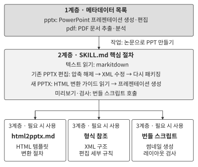

### 스킬: 도메인 능력의 조합 가능한 단위

**에이전트 스킬(Agent Skills)**은 한 유형의 작업을 처리하는 방법, 참고 자료, 스크립트, 템플릿을 재사용할 수 있는 패키지로 묶습니다. 신입 사원이 입사 첫날 회사의 모든 업무 매뉴얼을 외울 필요가 없듯, 모델도 일을 처리할 때가 되어서야 해당 부분을 꼼꼼히 읽으면 됩니다. 이런 로딩 방식을 **점진적 공개(Progressive Disclosure)**라고 합니다[^ch2-3].

제1장의 상품 열 개를 이어서 사용해, 어떤 정보를 스킬로 써 둘 만한지 판단해 보겠습니다. 사용자가 배송비를 포함한 실제 결제 가격을 비교하고 싶어 한다면 명세와 이번 배송지만 현재 컨텍스트에 들어가면 충분합니다. 팀이 여러 판매자에 걸친 가격 비교를 반복한다면 사양을 맞추는 방법, 단품 가격과 세트 가격을 구분하는 방법, 배송비를 알 수 없음을 표시하는 방법을 가격 비교 스킬 하나로 정리할 수 있습니다. 다음에 누군가 어떤 디자인이 있는지만 둘러보려 한다면 목차는 계속 보이고, 전체 가격 확인 절차는 사용자가 가격 비교를 원할 때 불러오면 됩니다.

**첫 번째 계층은 메타데이터입니다.** 각 스킬은 `SKILL.md`로 자신을 설명하며, 파일 첫머리의 YAML frontmatter는 `---`로 구분되고 `name`과 `description`을 담습니다. 런타임은 먼저 이름과 설명으로 목차를 만들어 현재 작업에 어떤 스킬이 필요한지 모델이 판단하게 합니다. 목차의 배열과 표시는 하네스가 관리하고, 전체 절차는 선택된 뒤에 불러옵니다.

**스킬 설명은 무엇보다 라우팅 조건으로 써야 합니다.** 모델은 본문을 불러오기 전에 사용 여부를 결정해야 하므로, `description`은 언제 적용되고 언제 건너뛰어야 하는지를 먼저 밝히고 그다음에 무엇을 할 수 있는지 요약해야 합니다. 예를 들어 “help with backend”는 범위가 너무 넓어 거의 모든 백엔드 작업과 일치할 수 있습니다. 반면 ‘기존 HTTP 인터페이스에 통합 테스트를 작성하며 인증, 파라미터 검증, 오류 응답을 다룬다’는 분명한 범위를 줍니다. 혼동하기 쉬운 작업에는 ‘인터페이스 방안만 논의할 때는 사용하지 않는다’ 같은 제외 조건도 덧붙일 수 있습니다.

**두 번째 계층은 핵심 절차입니다.** 스킬이 선택되면 런타임은 전체 지시를 컨텍스트에 넣습니다. 사용자가 `/pptx` 같은 명령을 직접 입력하면 클라이언트가 바로 찾아서 불러올 수 있고, 모델이 스스로 고를 때는 스킬 도구나 파일 읽기 도구로 내용을 얻습니다. 전자는 모델이 활성화 호출을 보내는 단계를 생략하고, 후자는 선택과 로딩을 실행 궤적에 남깁니다.

이 책의 실험에서 사용하는 PPTX 스킬을 예로 들면, 핵심 설명은 자주 쓰는 몇 가지 경로를 소개합니다. Microsoft의 markitdown으로 프레젠테이션 텍스트를 추출하는 방법, PPTX 압축을 풀어 내부 XML을 보는 방법, 새 프레젠테이션 작성과 편집 가운데 작업 흐름을 고르는 방법입니다. 모델은 이 계층의 설명을 읽으면 현재 작업에 맞춰 다음에 어떤 자료를 읽고 어떤 스크립트를 호출할지 정할 수 있습니다[^ch2-4].

**세 번째 계층은 상세 자료입니다.** 복잡한 작업은 전문 문서에 나뉘어 있고, 주 파일은 입구를 제공합니다. 이 책에서 쓰는 버전의 `html2pptx.md`는 HTML로 프레젠테이션을 생성하는 방법을 설명하고, 다른 참고 문서는 형식과 편집의 세부 사항을 보충합니다. 에이전트는 작업에 따라 이 내용을 이어서 읽고, 번들 스크립트, 소재, 템플릿으로 작업을 완수합니다.

[^ch2-3]: Anthropic, Equipping Agents for the Real World with Agent Skills, 2025; Agent Skills, How to add skills support to your agent.
[^ch2-4]: Anthropic, PPTX Skill. 이 책의 실험은 HTML 변환 절차가 포함된 버전으로 고정해 사용하며, 구체적인 버전과 실행 방법은 함께 제공되는 실험 README를 참고하세요.
[^ch2-codex-skills]: OpenAI, Build skills; OpenAI Codex 공개 저장소의 Skills 구현.
[^ch2-cc-skill-inject]: Claude Code, How Claude Code uses prompt caching, Invoking skills and commands; Agent Skills, How to add skills support to your agent, User-explicit activation.

### 쓸모 있는 스킬을 작성하는 방법

쓸모 있는 스킬은 네 가지 질문에 답해야 합니다. 어떤 작업에 적용되는지, 어떤 순서로 처리하는지, 어떤 상황에서 확인이 필요한지, 작업이 끝났는지 어떻게 판단하는지입니다. 작성자는 자신의 경험을 실행할 수 있는 단계로 정리하고, 핵심 판단에는 예시를 붙여야 합니다.

글쓰기 스킬을 예로 들면, 바오위가 개인의 표현 습관에서 출발해 AI 글쓰기를 개선한 방식을 참고해[^ch2-baoyu-remove-ai-writing-flavor] 내용을 네 부분으로 구성할 수 있습니다.

- **역할과 독자**: 누구를 위한 것인지, 어떤 유형의 작업인지, 완성 원고가 갖춰야 할 요건을 설명합니다.
- **핵심 원칙**: 자주 쓰는 판단 세 개에서 다섯 개를 먼저 적고, 각각에 고치기 전과 고친 뒤의 구체적인 예를 붙입니다.
- **흔한 오류와 경계**: 자주 나타나는 표현 문제, 권한을 넘는 행동, 예외 상황을 기록합니다.
- **참고 자료**: 용어집, 템플릿, 모범 글, 전문 설명을 담아 실행할 때 찾아보게 합니다.

규칙은 ‘적용 범위, 행동, 예외, 검증 방법’의 형식으로 쓸 수 있습니다. 예를 들어 긴 문장을 줄이는 규칙이라면 어떤 문단에 적용되는지, 어떻게 나누는지, 나눈 뒤 조건과 결론이 여전히 온전한지 어떻게 확인하는지를 설명해야 합니다.

처음에는 스스로 만족하는 자신의 글 세 편에서 다섯 편을 골라, 에이전트가 어휘, 문장 구조, 문단 배치, 어조를 정리해 스무 줄 안팎의 초판을 만들게 합니다. 그다음 이 초판으로 새 주제를 처리하게 하고 저자가 문장마다 고칩니다. 고치기 전과 뒤의 차이는 더 구체적인 피드백을 줍니다. 어떤 단어가 불필요한지, 어떤 문장을 나눠야 하는지, 어디에 사실이 빠졌는지, 어디에 기술적 세부 사항을 되살려야 하는지 알 수 있습니다. 반복해서 나타나는 수정은 규칙으로 정리하고, 그에 맞는 예시와 적용 범위를 남겨 둡니다.

스킬에는 실행 도구와 템플릿도 붙일 수 있습니다. 예를 들어 PPTX 스킬은 작업 설명, 분석 스크립트, 생성 스크립트, 레이아웃 리소스를 한데 모아 두어 모델이 설명을 따라 해당 리소스를 호출하게 합니다. 각 스킬은 독립적으로 테스트, 갱신, 버전 관리를 할 수 있고, 팀원들도 같은 절차를 중심으로 경험을 계속 보탤 수 있습니다. **스킬의 장기적인 가치는 도메인 경험을 분산해서 축적하고, 독립적으로 배포하고, 재사용할 수 있게 한다는 데 있습니다.** 팀은 에이전트의 능력을 넓힐 때 각자 잘하는 스킬을 관리하면서 pip나 npm 같은 패키지 생태계를 점차 만들어 갈 수 있습니다. 이 스킬들은 주 시스템이 제공하는 발견, 로딩, 실행 메커니즘을 함께 쓸 수 있습니다.

**상호작용 방식을 설계할 때는 모델이 이미 학습하고 적응한 패턴을 우선 따릅니다.** 역할 구분, 도구 결과 형식, 스킬 로딩 방식은 모두 모델이 작업을 어떻게 이어 가는지에 영향을 줍니다. 공급자가 제공하는 표준 절차는 출발점으로 삼기에 알맞으며, 모델이 낯선 형식에서 의미를 다시 추론하는 부담을 줄여 줍니다.

[^ch2-baoyu-remove-ai-writing-flavor]: 宝玉, 《别再用提示词去 AI 味了，方向就是错的》(‘프롬프트로 AI 냄새를 지우려 하지 마라, 방향이 틀렸다’), 2026-02-14.

### 컨텍스트에서 스킬의 위치

스킬의 컨텍스트 비용은 목차와 본문의 두 부분으로 나뉩니다. 목차는 모델이 사용할 수 있는 능력을 발견하게 하고, 본문은 선택된 뒤에 작업 절차를 제공합니다. 명세는 필요할 때 불러오도록 요구할 뿐이며, 구체적인 메시지 역할, 래핑, 갱신 방식은 하네스가 구현합니다.

Claude Code는 호출 위치에서 스킬 지시를 `user` 메시지로 세션에 넣습니다[^ch2-cc-skill-inject]. 그림 2-12는 모델이 스스로 촉발했을 때의 메시지 배열 하나를 보여 줍니다. 먼저 `Skill(skill: "pptx")` 호출을 보내고, 도구 응답을 받은 뒤, 덧붙여진 스킬 본문을 읽습니다. 전용 활성화 도구를 쓸 때는 도구 응답이 호출 확인을 맡고, 본문은 하네스가 따로 주입할 수 있습니다. 일반 파일 읽기 도구를 쓸 때는 본문이 도구 결과에 바로 담길 수도 있습니다. 사용자가 `/pptx`를 직접 입력하면 클라이언트가 지시를 바로 펼칠 수 있어 모델이 활성화 호출을 보내는 단계가 생략됩니다.

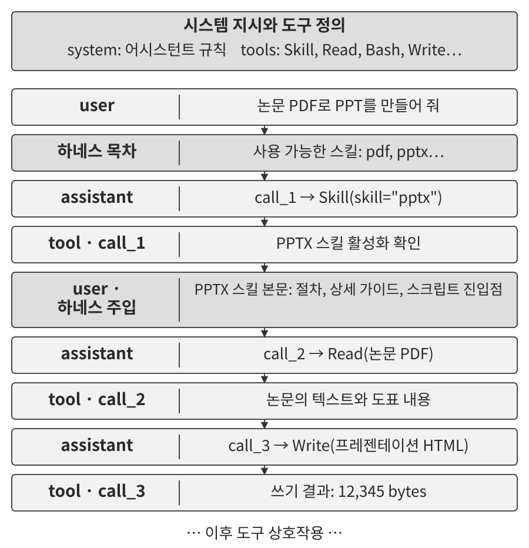{height=55%}

Codex의 스킬 구현도 능력 목차와 선택된 지시를 따로 구성합니다. 공개 소스 코드에서 목차의 일부는 `developer` 컨텍스트에 들어가고, 다른 일부는 현재 라운드와 실행 환경에 따라 제공됩니다. 명시적으로 선택된 스킬은 사용자 컨텍스트 조각으로 들어갑니다. 목차의 출처와 사용할 수 있는 실행 환경이 구체적인 배열에 영향을 줍니다[^ch2-codex-skills].

그림 2-13은 필요할 때 불러올 때 캐시가 늘어나는 과정을 보여 주며, 재사용할 수 있는 캐시가 아직 없는 요청을 출발점으로 삼습니다. 목차가 처음 요청에 들어오면 처리해야 하고, 본문을 처음 불러올 때도 계산이 늘어납니다. 이후 요청이 같은 접두부를 유지하면 이 내용은 캐시에서 읽을 수 있습니다. 새 내용을 호출 위치에 덧붙이면 이전 메시지를 안정적으로 유지할 수 있습니다. 이미 불러온 설명은 기록에 계속 남고, 갱신이 필요할 때 런타임의 컨텍스트 전략에 따라 처리합니다.

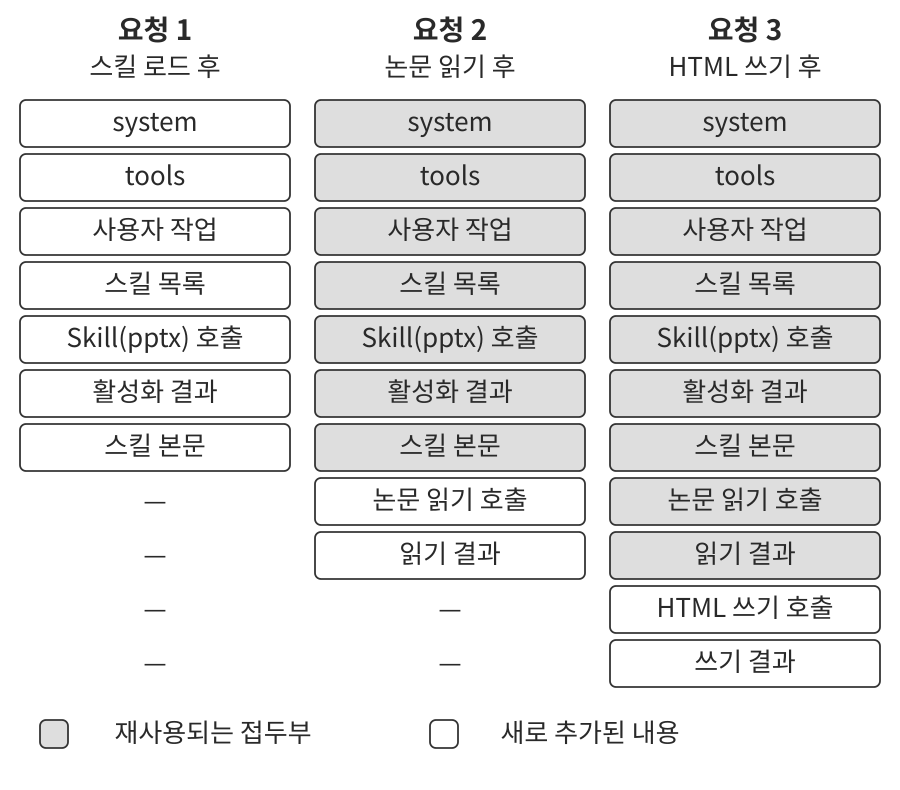

### 스킬과 도구의 관계

스킬은 작업 지식과 작업 절차를 제공하고, 도구는 읽기, 실행, 결과 획득을 맡습니다. 제5장에서 소개할 핵심 도구 일곱 개는 여러 스킬과 조합할 수 있습니다. 같은 파일 읽기 도구로 프레젠테이션 안내서도 코딩 규칙도 읽을 수 있고, 범용 실행기로는 해당 스크립트를 실행할 수 있습니다. 이렇게 하면 전문 능력은 절차와 리소스로 넓히고 기본 도구 집합은 비교적 안정적으로 유지할 수 있습니다.

전용 도구도 스킬과 함께 쓸 수 있습니다. 앞에서 다룬 도구 검색은 도구 정의를 필요할 때 제공하고, 스킬은 언제 호출하고 어떻게 조합하며 결과를 어떻게 검사할지 설명합니다. 둘 다 상시 정보의 양을 통제하고, 새로 불러온 내용에 알맞은 위치를 정해야 합니다. 제4장에서는 범용 실행기와 전용 도구 사이의 선택을 다루고, 제9장에서는 경험을 지식, 지시, 프로그램, 모델 파라미터 가운데 무엇으로 저장하는 것이 알맞은지 더 자세히 살펴봅니다.

> **실험 2-6 ★★: 에이전트 스킬로 논문에서 프레젠테이션 생성하기**
>
> 이 실험은 『Attention Is All You Need』를 자료로 삼아, 에이전트가 프레젠테이션 제작의 전문 절차를 필요할 때 어떻게 불러오는지 보여 줍니다. 작업은 논문 PDF에서 10\~15장짜리 프레젠테이션을 생성하는 것으로, 문제 배경, 방법, 핵심 결과, 결론을 다루고 논문의 그림과 표로 설명을 돕습니다.
>
> 이번 실행은 Kimi Code와 Anthropic 공식 PPTX 스킬을 사용했습니다. 에이전트는 먼저 목차에서 PPTX 스킬을 찾아 작업 설명을 읽고, 이어서 HTML 변환 안내서를 읽은 뒤, 함께 제공되는 생성 도구를 호출하고, 마지막으로 썸네일과 슬라이드별 렌더링으로 레이아웃을 검사했습니다. 단계마다 읽은 자료는 바로 다음 작업에 쓰였고, 전체 제작 절차는 작업에 따라 차례로 펼쳐졌습니다.
>
> 완성본은 모두 13장이며, 논문의 아키텍처 그림, 어텐션 메커니즘 그림, 실험 결과 표, 어텐션 시각화 그림을 인용했습니다.
>
> 생성 뒤의 검사도 스킬 작업 흐름의 일부입니다. 이번 실행에서는 아래 첨자 누락, 글머리 기호 이상, 그림 참조 경로 오류, 수치 레이블 정밀도 문제가 나타났고, 에이전트는 렌더링 결과와 구조 검사를 바탕으로 하나씩 고쳤습니다. 최종 파일은 구조 검사를 통과했고, LibreOffice로 다시 열어 렌더링했습니다.

> **실험 2-7 ★★: 개인 예시 글로 ‘AI 냄새 제거’ 글쓰기 스킬 만들기**
>
> 이 연습은 개인의 글쓰기 경험을 재사용할 수 있는 지시로 정리합니다. 자신이 쓴 글 세 편에서 다섯 편을 준비하고, 에이전트가 표현 습관을 정리해 촉발 조건, 원칙 세 개에서 다섯 개, 그에 맞는 예시를 담은 초판 스킬을 생성하게 합니다.
>
> 새 주제를 하나 골라 시험 삼아 쓰게 한 뒤 저자가 문장마다 고칩니다. 두 판을 비교해 반복해서 나타나는 문제를 찾습니다. 예를 들어 막연한 단어, 지나치게 긴 문장, 생략된 인과 관계, 또는 이해를 돕는 구체적인 예를 지워 버린 경우입니다. 반복해서 쓰인 수정 방식은 스킬에 적어 넣을 수 있습니다.

## 에이전트 상태 표시줄: 메타 정보로 에이전트 궤적 관리하기

사용자가 재촉합니다. “한 번 더 전화해 줄 수 있어요?” 그림 2-14 왼쪽에는 전화를 건 기록 세 건이 있습니다. 첫 번째는 45분을 기다려도 연결되지 않았고, 세 번째에야 월 59달러로 협상이 됐습니다. 이 예의 규칙에 따르면 전화를 걸 때마다 한도가 한 번씩 차감되므로, 두 번만 연결됐더라도 세 번의 한도는 이미 다 썼습니다. 하네스는 이런 횟수, 처리 진행 상황, 확인을 기다리는 사항을 메시지와 함께 갱신되는 요약으로 정리할 수 있으며, 이를 **에이전트 상태 표시줄(Agent Status Bar)**이라고 합니다.

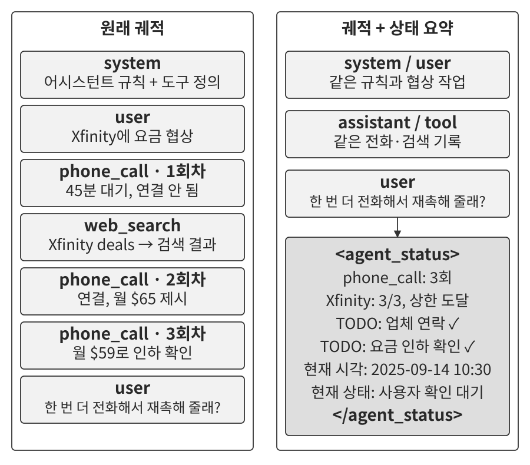

휴대전화는 시간, 배터리, 신호를 화면 맨 위에 두어 사람이 한눈에 현재 상태를 알게 합니다. 그림 오른쪽의 요약도 비슷한 역할을 합니다. 어시스턴트는 ‘한도 도달’과 ‘사용자 확인 대기’를 읽으면 이미 합의한 가격을 사용자에게 전하고 받아들일지 결정해 달라고 요청할 수 있습니다. 하네스는 도구 결과를 반환할 때 요약을 붙일 수도 있고, 상태 메시지 하나를 따로 덧붙일 수도 있습니다.

### 원시 기록에서 명시적 상태로

전화 고객 서비스 작업을 생각해 보겠습니다. 시스템은 같은 작업 안에서 판매자마다 전화를 세 번 넘게 걸지 말라고 요구합니다. 세 번의 통화 사이에는 검색, 자료 읽기, 사용자의 후속 질문이 끼어 있을 수 있습니다. 모델이 계속 전화를 걸어도 되는지 결정하려면 이 기록에서 관련 항목을 모두 찾아 판매자별로 구분하고 누적 횟수를 계산해야 합니다.

런타임은 호출할 때마다 횟수를 갱신해 ‘이번이 Xfinity에 대한 3번째 호출이며 이 작업의 한도에 도달했습니다’라고 바로 반환할 수 있습니다. 다음 의사결정은 이 결과를 그대로 쓸 수 있습니다. 호출 횟수는 프로그램이 관리하고, 모델은 작업 진행 상황을 고려해 다음에 기다릴지, 다른 경로를 찾을지, 사용자에게 현재 상황을 설명할지 결정합니다. 실행 계층도 이 횟수에 따라 이후의 전화 요청을 검사합니다.

여기서 공학적 가치는 **이후 의사결정에 반복해서 필요한 상태를 미리 정리해 두는 데** 있습니다. 전체 통화 기록은 여전히 대화 내용과 처리 과정을 보존하고, 상태 표시줄은 의사결정에 자주 쓰는 통계와 진행 상황을 제공합니다. **반복해서 쓰는 통계는 코드가 증분 방식으로 관리하는 편이 낫습니다.** 컨텍스트에서 기록 하나를 찾는 일과 전체 기록에서 합계를 계산하는 일은 서로 다른 작업입니다. 원시 궤적을 저장해 둔다고 해서 정확하고 언제든 꺼내 쓸 수 있는 통계표가 저절로 생기지는 않습니다. 매번 모델에 기록을 다시 훑고 세게 하면 추론 토큰을 소비할 뿐 아니라 빠뜨리거나 중복해서 셀 가능성도 커집니다.

필자는 컨텍스트를 ‘증류 계층’을 함께 갖춰야 하는 검색 엔진에 비유합니다. 원시 기록은 추적하기 좋고, 증류한 상태는 바로 쓰기 좋습니다. 횟수, 한도, 검증된 작업 완료 상태는 코드가 관리하기에 알맞습니다. 의미 판단이 필요한 정보는 먼저 항목별로 추출한 뒤 합산하고 검증할 수 있습니다. 이렇게 하면 모델은 의사결정을 할 때마다 현재 상태와 필요한 증거를 함께 볼 수 있습니다.

궤적이 길어지면 핵심 정보를 찾기도 어려워집니다. 최신 목표, 제약, 진행 상황을 뒤쪽에 모아 두면 모델이 현재 의사결정에 필요한 정보를 더 쉽게 찾습니다.

> **실험 2-8 ★★: 어텐션 시각화로 에이전트 상태 표시줄의 효과 관찰하기**
>
> 이 실험은 Qwen3-0.6B를 사용해 고객 서비스 환불 궤적을 구성합니다. 에이전트는 이미 Xfinity에 전화를 세 번 걸었고, 그 사이에 웹 검색이 끼어 있으며, 이어서 사용자가 “한 번 더 전화해서 재촉해 줄 수 있어요?”라고 묻습니다. 시스템 규칙은 같은 작업 안에서 판매자마다 최대 세 번까지만 전화하도록 제한합니다.
>
> 두 그룹의 입력은 같은 기록과 사용자 질문을 유지합니다. A 그룹은 원시 궤적을 그대로 쓰고, B 그룹은 끝에 다음 상태를 덧붙입니다.
>
> ```xml
> <agent_status>
> Current State:
> - Tool call summary: 'phone_call' has been invoked 3 times (Xfinity: 3 times)
> - Constraint check: Maximum calls to Xfinity reached (3/3)
> </agent_status>
> ```
>
> 그룹마다 세 번씩 실행했습니다. A 그룹은 세 번 가운데 두 번은 더 전화하지 않겠다고 분명히 거절했고, 나머지 한 번은 기타 출력으로 분류됐습니다. B 그룹은 세 번 모두 분명히 거절했습니다. 두 그룹 모두 규칙을 어기고 전화를 계속 건 것으로 판정된 출력은 없었습니다. 이 비교를 재현하려면 `chapter2/attention_visualization`으로 이동해 `python run_status_bar_experiment.py --output runs/status-bar-reproduction`을 실행합니다. 이번 실행의 입력과 회차별 결과는 실험 디렉터리의 `runs/exp2-7-qwen3-0.6b-20260730-v2/comparison.json`에 저장되어 있습니다.
>
> 어텐션 그림은 생성 영역이 과거 통화, 검색 결과, 사용자의 후속 질문, 상태 표시줄에 가중치를 어떻게 분배하는지 보여 줍니다.

필자와 Noah Shi의 ContextDistill-Bench 연구는 상태를 미리 증류하는 이점을 더 살펴봤습니다[^ch2-8]. 이 벤치마크가 다루는 상태 질의에서는 작은 모델도 명시적인 상태로 높은 정확도를 얻을 수 있었고, 프런티어 모델의 사고량, 지연, 질의 비용은 약 10분의 1 수준으로 줄었습니다. 예를 들어 Claude 4 Sonnet의 질의 1,000건당 비용은 약 35.46달러에서 3.51달러로 내려갔습니다. **이 설계는 이벤트가 일어날 때 상태를 관리하므로 질의할 때마다 기록을 훑는 비용이 들지 않습니다.** 요약 필드가 고정되면 기록이 계속 늘어나도 질의는 이 몇 개의 필드만 읽으면 됩니다.

[^ch2-8]: Li, Bojie and Noah Shi. *Distill, Don't Retrieve: Inference-Time Context Distillation for LLM Agent Reasoning.* 2026.

### 에이전트 상태 표시줄의 구성

상태 표시줄은 보통 세 가지 정보를 담으며, 각각 ‘무엇을 해야 하는가’, ‘방금 무슨 일이 있었는가’, ‘지금 어떤 상태인가’에 답합니다.

**작업 계획**은 목표, 단계, 완료 상황을 기록합니다. 복잡한 작업은 TODO 목록으로 나눌 수 있고, 항목마다 상태와 필요한 의존 관계를 남깁니다. 모델은 현재 단계를 처리하면서도 원래 요구, 핵심 제약, 이후 작업을 볼 수 있으며, 한 단계를 마치면 목록을 갱신합니다.

**이벤트의 사이드 채널 정보(Side-channel Information)**는 이벤트가 일어났을 때의 배경, 예를 들어 시간, 지리적 위치, 지난 응답 이후의 간격을 보충합니다. 이 메타데이터는 이벤트와 함께 저장되어 모델이 선후 관계와 상황을 이해하도록 돕습니다. 같은 ‘아직 답을 받지 못했다’는 말이라도 신청서를 낸 지 2분 뒤인지 이틀 뒤인지에 따라 처리 방식이 달라질 수 있습니다.

**환경의 현재 상태에 대한 관측 요약**은 현재 시각, 작업 디렉터리, 도구 호출 횟수, 이상 알림을 제공합니다. CLI나 GUI가 현재 디렉터리나 실행 상태를 표시하는 것과 비슷한 역할로, 다음 작업에 분명한 근거를 줍니다. 예를 들어 반복 호출 알림은 모델이 실패 원인을 점검하게 하고, 남은 예산은 검색을 계속할지 결정하는 데 도움이 됩니다.

이벤트 메타데이터는 이벤트와 함께 덧붙여진 뒤 대개 그대로 유지되고, 작업 진행 상황과 환경 상태는 계속 바뀝니다. 두 정보는 각자의 갱신 방식에 맞게 기록에 써야 하며, 아래에서 메시지 구조와 함께 설명합니다.

### 컨텍스트 안에서 에이전트 상태 표시줄의 구체적인 위치

이 절의 예시에서는 하네스가 메시지 끝에 `user` 메시지 하나를 덧붙여 상태 요약을 전달합니다. 여기서 `user`는 선택한 API의 메시지 역할일 뿐이며, 상태 내용은 런타임이 생성하고 태그로 용도를 밝힙니다. 다른 인터페이스를 쓸 때는 그 인터페이스가 지원하는 컨텍스트 블록을 사용하거나 해당 도구 결과와 함께 상태를 제공할 수도 있습니다. 앞에서 본 것처럼 실제 사용자 질의를 기준으로 과거 추론을 잘라 내는 템플릿을 쓴다면, 실행 상태를 도구 결과와 함께 제공해 템플릿이 현재 작업에 맞춰 추론 정보를 계속 보존하게 할 수 있습니다.

그림 2-15에서 사용자의 처음 의뢰를 찾고, 최신 상태가 어느 라운드에 적혀 있는지 보겠습니다. 원래 요청을 남겨 둬야 전화를 다 건 뒤에도 사용자가 무엇을 하려는지와 지금 어디까지 처리됐는지를 함께 확인할 수 있습니다.

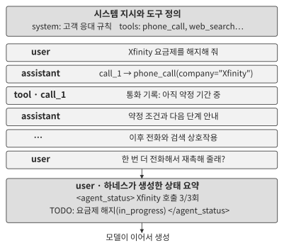

그림의 순서를 메시지 목록으로 쓰면 다음과 같습니다. 대조하기 쉽도록 반복되는 라운드와 일부 호출 필드는 생략했습니다.

```text
messages: [
  { role: "system", content: "You are a customer service assistant..." }
  { role: "user", content: "Help me cancel my Xfinity plan" }
  { role: "assistant", tool_calls: [{ id: "call_1", ... }] }
  { role: "tool", tool_call_id: "call_1", content: "Call log..." }
  { role: "assistant", tool_calls: [{ id: "call_2", ... }] }
  { role: "tool", tool_call_id: "call_2", content: "Call log..." }
  ...나머지 라운드...
  { role: "user", content: "Can you call them again to follow up?" }
  { role: "user", content: "<agent_status>
      Current State:
      - phone_call invoked 3 times (Xfinity: 3/3 max)
      - Current time: 2025-09-14 10:30:45
      - TODO: [1] Cancel plan (in_progress)
    </agent_status>" }
]
```

마지막 메시지는 호출 횟수, 한도, 시간, 작업 진행 상황을 한곳에 모읍니다. 모델은 이 필드를 바로 쓰는 한편, 앞의 호출 ID로 구체적인 기록을 되짚어 볼 수 있습니다.

이 메시지를 덧붙여도 앞의 토큰 시퀀스는 그대로이므로 접두부 재사용의 기본 조건을 여전히 충족합니다. 다음 라운드에서 이전 상태를 어떻게 처리할지는 컨텍스트 점유와 캐시 비용 사이에서 저울질해야 합니다.

### 상태 갱신의 두 가지 구현과 캐시 비용

다음 라운드에서는 TODO 항목 하나가 완료될 수도 있고, 도구 호출이 한 번 늘어날 수도 있습니다. 하네스는 상태를 갱신해야 하며, 흔히 쓰는 방법은 두 가지입니다.

**라운드마다 교체**: 새 요청을 구성할 때 이전 상태를 제거하고 끝에 최신 상태를 넣습니다. 컨텍스트에는 현재 상태 하나만 남으므로 모델이 쓰기 편합니다. 예를 들어 이전 요청이 ‘작업 설명, 상태 A’였다면 이번 요청은 ‘작업 설명, 도구 결과, 상태 B’입니다. 작업 설명은 여전히 캐시에 적중할 수 있고, 도구 결과는 처음 제출되므로 원래 계산해야 합니다. 이전 요청에서 상태 A 뒤에 다른 메시지가 더 있었다면, A를 제거해야 비로소 그 메시지들이 원래의 접두부 일치를 잃게 됩니다. 이번 요청에서 모델은 B만 볼 수 있습니다. A를 다시 봐야 한다면 실행 로그에서 당시의 스냅숏을 불러올 수 있습니다.

**지속적인 덧붙이기**: 기존 상태 기록을 남겨 두고, 매번 끝에 새 상태를 덧붙입니다. 기록 접두부가 안정적으로 유지되고 상태 변화를 추적하기도 쉽습니다. 이전 상태가 점점 컨텍스트를 차지하므로 시간이나 버전을 분명히 적어, 모델이 최신 기록을 근거로 현재 상황을 판단하게 해야 합니다. Claude Code가 파일 변경 알림을 세션에 덧붙이는 방식도 이런 설계 사고를 보여 줍니다.

상태가 짧고 그 뒤에 이미 많은 도구 결과가 캐시되어 있다면, 이전 상태를 남겨 두는 편이 긴 접미부를 다시 계산하는 것보다 쌀 수 있습니다. 상태가 길고 자주 갱신된다면 교체가 과거 상태의 누적을 억제합니다.

대략적인 모델로 분기점을 추정할 수 있습니다. 상태 하나가 $S$ 토큰이고, 교체할 때마다 이전 상태 뒤에서 다시 계산해야 하는 캐시된 접미부가 평균 $R$ 토큰이며(이번 라운드에 처음 제출하는 내용은 포함하지 않음), 상태를 모두 $N$번 주입하고, 캐시 입력 단가가 일반 입력의 $\alpha$배라고 합시다. 두 방안에 공통된 비용을 무시하면 $C_{\text{교체}} \approx (N-1)(1-\alpha)R$, $C_{\text{덧붙이기}} \approx \alpha S N(N-1)/2$입니다. $N>1$일 때 $\alpha SN/2 < (1-\alpha)R$이면 지속적인 덧붙이기의 추정 비용이 더 낮고, 반대이면 라운드마다 교체하는 편이 더 쌉니다. 여기서는 일반 입력 단가를 비용 단위로 삼았습니다. 교체 방안이 더 내는 비용은 접미부를 캐시에서 읽던 것을 다시 처리하게 되면서 생기는 차액이고, 덧붙이기 방안이 더 내는 비용은 과거 상태를 반복해서 읽는 요금입니다.

예를 들어 보겠습니다. 매번 100토큰짜리 상태를 모두 10번 주입하고, 캐시 읽기는 일반 입력 가격의 10분의 1로 계산합니다. 덧붙이기 방안은 이후 요청에서 이전 상태를 각각 1, 2, …, 9개 더 읽으므로 추가 비용은 일반 입력 토큰 450개에 해당합니다. 상태를 교체할 때마다 그 뒤의 캐시된 토큰 평균 1,000개를 다시 처리해야 한다면, 교체 아홉 번의 추가 비용은 일반 입력 토큰 8,100개에 해당하므로 덧붙이기가 더 쌉니다. 이전 상태가 원래 캐시의 맨 끝이어서 그 뒤에 캐시된 내용이 전혀 없다면 공식의 $R=0$이 되고, 이때는 바로 교체하는 편이 오히려 이 450토큰에 해당하는 비용을 아낍니다.

> **실험 2-9 ★★: 쓸모 있는 에이전트 상태 표시줄 기법 몇 가지**
>
> 이 실험은 상태 표시줄 기법 다섯 가지를 구현하며, 각각 켤 수도 있고 조합해 쓸 수도 있습니다. 기법마다 구체적인 정보 한 가지를 제공해 모델이 다음 행동을 정하도록 돕습니다.
>
> **타임스탬프 추적**은 사용자 메시지와 도구 응답에 `[2025-09-14 10:30:45]`처럼 이벤트 시간을 기록합니다. 시간은 이벤트와 함께 기록에 쓰이고 이후 라운드에서도 원래 값을 유지하며, 현재 시각은 새 상태 메시지와 함께 갱신됩니다. 실험은 시간 시뮬레이션도 제공해 모델이 ‘어제의 파일’과 ‘오늘의 수정’을 구분하는지, 대기 시간을 올바르게 이해하는지 검사합니다.
>
> **도구 호출 카운터**는 딕셔너리로 도구별 누적 호출 횟수를 관리하고, 응답에 `Tool call #3 for 'read_file'`을 표시합니다. 오류 내용과 함께 보면 모델은 계속 시도할지 판단할 수 있습니다. 예를 들어 처음 읽기에 실패하면 경로를 확인하고 디렉터리를 나열하며, 여러 번 실패하면 대체 파일을 찾거나 사용자에게 파일이 없다고 설명합니다. 재시도 횟수를 제한해야 한다면 런타임이 횟수에 따라 상한도 집행해야 합니다.
>
> **TODO 목록 관리**는 `rewrite_todo_list`와 `update_todo_status` 두 도구를 제공합니다. 항목마다 고유 식별자, 내용, 타임스탬프와 함께 `pending`, `in_progress`, `completed`, `cancelled`의 네 가지 상태를 가집니다. 목록은 ‘무엇을 했고 무엇이 남았는지’를 한곳에 보관하며, Manus가 작업 계획을 반복해서 보여 줘 목표를 계속 보이게 하는 방식과 비슷합니다.
>
> **상세한 오류 정보**는 오류 유형과 설명, 호출 파라미터의 JSON, 호출 스택, 수정 제안을 제공합니다. 예를 들어 `FileNotFoundError`를 만나면 파일 이름, 현재 디렉터리, 절대 경로를 확인하라고 모델에 알릴 수 있습니다. 파라미터는 잘못된 입력을 찾는 데, 호출 스택은 실패 위치를 찾는 데 도움이 되고, 수정 제안은 다음에 점검할 방향을 줍니다. 이 내용을 모델에 반환하기 전에 자격 증명 같은 민감한 필드를 지우고 지나치게 긴 스택의 길이를 제한해야 합니다.
>
> **시스템 상태 인식**은 현재 시각, 작업 디렉터리, 운영체제, Shell, Python 버전을 제공합니다. 실험의 명령 도구는 단독 디렉터리 이동 명령을 인식해 런타임이 관리하는 작업 디렉터리를 갱신하고, 이를 이후 호출에 사용합니다. 복합 명령 안의 하위 프로세스에서 일어난 디렉터리 변화는 해당 프로세스의 실행 범위를 따릅니다. 환경 필드는 모델이 사용할 수 있는 도구를 고르는 데도 도움이 됩니다. 예를 들어 실제 시스템과 설치된 소프트웨어에 따라 `apt`나 `brew`를 고릅니다.
>
> 이번 Kimi K3 비교에서는 작업 유형마다 사례가 다섯 개씩 있었습니다. 타임스탬프와 조합 구성은 모두 다섯 개를 통과했고 대조군은 각각 세 개를 통과했습니다. 도구 카운터와 시스템 상태는 켠 그룹과 끈 그룹 모두 다섯 개를 통과했습니다. TODO 구성은 하나도 통과하지 못했고 대조군은 하나를 통과했습니다. 상세 오류 구성은 네 개, 대조군은 다섯 개를 통과했습니다.

**상태 표시줄은 가능한 한 코드가 관리해야 합니다.** 모델은 그 안의 통계와 제한을 그대로 쓰므로, ‘이미 세 번 전화함’이라는 잘못된 항목 하나가 이후 행동을 바꿀 수 있습니다. 횟수, 시간, 상태 전이는 프로그램에 맡깁니다. 의미 이해가 필요할 때는 먼저 모델이 항목별로 추출하게 한 뒤 코드가 합산하고 검증해, 긴 기록 전체를 모델에 한꺼번에 세게 하는 일을 피합니다. 원시 이벤트, 추출 결과, 최종 상태 사이의 대응 관계를 남겨 두면 중복 집계, 누락, 출처 혼동을 발견하기 쉽습니다.

상태 표시줄이 어떤 정보를 요약할지는 미리 골라 둬야 합니다. 예를 들어 ‘이미 세 번 전화함’은 더 전화할 수 있는지 판단하기에는 충분하지만, ‘두 번째 통화에서 상담원이 무엇을 약속했는가’에는 답하지 못합니다. 통계값만 필요한 이후 작업이라면 상태 요약으로 기록을 대체하고 원시 기록은 보관해 둘 수 있습니다. 대화 내용을 확인해야 할 때는 색인으로 원문을 읽습니다. 요약의 필드 설계가 어떤 질문에 바로 답할 수 있는지를 정하고, 언제 원문을 다시 찾아봐야 하는지도 정합니다.

## 컨텍스트 압축 전략

조사 작업 하나가 긴 웹 페이지 열 개를 읽은 뒤 창에 자료를 두 개만 더 넣을 수 있다고 가정해 보겠습니다. 먼저 모델에 다음 라운드에 무엇을 더 해야 하는지 묻습니다. 두 견적을 비교해야 한다면 견적, 유효 조건, 출처를 남깁니다. 인용문을 다시 확인해야 한다면 원문을 다시 가져올 수 있는 위치를 남깁니다. 이미 조회했지만 관계없는 웹 페이지 본문은 보관해 두고 새 입력과 출력을 위한 공간을 만들 수 있습니다. 여기서는 공간을 얼마나 확보했는지뿐 아니라 다른 계산도 해야 합니다. 지운 자료가 나중에 필요해지면 다시 찾아오는 데 얼마나 많은 비용이 들까요?

### 압축의 세 가지 목적

**길이와 비용을 통제합니다.** 128K 토큰 창을 예로 들면 긴 웹 페이지와 큰 파일이 그중 상당 부분을 차지할 수 있습니다. 하네스는 이후의 입력, 모델 출력, 도구 상호작용을 위한 예산을 남겨 둬야 합니다.

**이후 의사결정에 필요한 지식을 정리합니다.** 십수 번의 검색은 같은 사건을 여러 번 언급하거나 서로 모순되는 주장을 남길 수 있습니다. 이를 ‘A와 B는 확인됨, C는 아직 증거 부족’으로 정리하면 모델은 아직 끝나지 않은 문제를 이어서 다룰 수 있습니다. 요약은 사실 사이의 관계, 출처, 해결되지 않은 문제를 보존해 이후 의사결정에 분명한 근거를 줘야 합니다.

**긴 작업이 계속 진행되도록 지원합니다.** 어떤 모델은 창이 곧 소진된다고 판단하면 일찍 마무리하는데, 이 현상을 **컨텍스트 불안(Context Anxiety)**이라고 합니다. Anthropic은 Sonnet 4.5의 장기 작업 테스트에서 압축한 뒤에도 이런 행동이 나타날 수 있음을 발견하고, 구조화된 인계 기록을 사용해 컨텍스트를 초기화한 뒤 실행을 이어 갔습니다[^ch2-7].

[^ch2-7]: Prithvi Rajasekaran, Harness design for long-running application development, Anthropic Engineering, 2026.

### 반복 계산의 결과를 쓸 수 있는 지식으로 정리하기

상태 표시줄은 횟수와 진행 상황을 미리 관리하고, 요약은 긴 텍스트 속의 사실과 관계를 한층 더 정리합니다. 둘 다 흩어진 정보를 미리 정리해 이후 의사결정이 바로 쓰게 하는 방법입니다.

반려동물 가게 점검의 예를 보겠습니다.

> 우리 1: 검은 고양이. 우리 2: 흰 고양이. 우리 3: 검은 고양이. 우리 4: 검은 고양이. 우리 5: 흰 고양이.
> ……(우리 100개, 그중 검은 고양이 90마리, 흰 고양이 10마리)

‘우리 37에는 어떤 고양이가 있는가’에 답하려면 해당 기록을 찾아야 하고, ‘검은 고양이와 흰 고양이는 각각 몇 마리인가’에 답하려면 모든 기록을 합산해야 합니다. 이후 합계를 여러 번 쓴다면 ‘검은 고양이 90마리, 흰 고양이 10마리’를 먼저 계산해 저장해 두어 매번 처음부터 세는 일을 피할 수 있습니다. 이런 확정적인 합산은 프로그램이 맡기에 알맞고, 모델은 그 통계를 바탕으로 업무 질문에 답하면 됩니다.

요약의 내용은 작업에 따라 골라야 합니다. 두 종류 고양이의 합계만 남기면 수량 질문에는 충분하지만, 우리 37의 상황에 답하려면 우리별 기록이나 그에 맞는 색인이 있어야 합니다.

창에 여유가 있더라도 지나치게 길거나 뒤섞인 컨텍스트는 정보 활용에 영향을 줄 수 있습니다. 모델이 핵심 사실을 빠뜨리거나, 이미 해결된 문제를 다시 처리하거나, 낡은 상태를 현재 의사결정에 쓰는 경우입니다. 컨텍스트가 늘어나면서 나타나는 이런 성능 저하를 보통 **컨텍스트 부패(Context Rot)**라고 합니다. 이는 작업 성과의 저하로 나타나며, 요청이 용량 한계를 넘으면 창 넘침이 일어납니다.

**창에 아직 여유가 있을 때도 이미 반복해서 쓰고 있는 지식은 적극적으로 정리해야 합니다.** 핵심 판단을 이미 요약할 수 있는데도 모델이 긴 기록에서 몇 번이고 찾게 하면 계속 계산을 소비하고 누락 가능성도 높아집니다. 검색 작업은 확인된 사실, 출처, 조사할 질문을 저장할 수 있고, 프로그래밍 작업은 아키텍처 결정, 수정 범위, 테스트 결과, 실패 원인을 저장할 수 있습니다.

컨텍스트 속 예시는 모델이 새 문제를 처리하는 방식에도 영향을 줍니다. Dherin 등의 연구는 Transformer에서 어텐션 계층과 MLP의 조합에서 출발해, 특정한 순전파 계산을 컨텍스트에 따른 저랭크 가중치 갱신으로 나타내고 인컨텍스트 학습에 대한 이론적 설명 하나를 제시했습니다[^ch2-6]. 실제 추론에서 모델 가중치는 바뀌지 않고, 예시는 현재 입력을 통해 출력에 영향을 줍니다. 이런 경험을 이후 세션에서도 재사용하려면 기억, 예시, 스킬로 정리해 작업에 따라 불러오면 됩니다. 제9장에서 경험을 쌓는 방식을 더 자세히 다룹니다.

[^ch2-6]: Benoit Dherin et al., Learning without training: The implicit dynamics of in-context learning, 2025.

### 압축과 KV Cache 사이의 저울질

압축은 보통 두 번의 모델 호출 사이에서 일어납니다. 하네스는 남은 예산과 작업 진행 상황에 따라 다음 요청에 필요한 메시지를 정리한 뒤 모델에 보냅니다. 기록을 교체하면 접두부가 바뀌므로 압축으로 얻는 이익과 캐시 재구축 비용을 함께 따져야 합니다.

먼저 여전히 유효한 시스템 지시와 도구 정의를 안정적으로 유지합니다. 이것들은 앞쪽에 있으므로 이후 기록을 압축해도 이 접두부는 계속 재사용할 수 있습니다. 다음으로 구체적인 압축 대상을 고릅니다. 긴 도구 결과는 요약으로 교체할 수 있고, 이미 끝난 여러 라운드의 상호작용은 단계 기록 하나로 합칠 수 있습니다. 교체 위치 이전의 캐시는 여전히 재사용할 수 있고, 교체 위치와 그 뒤의 내용은 새 접두부에 맞춰 처리해야 합니다.

**기록 압축은 한꺼번에 하는 편이 낫고, 라운드마다 같은 접두부를 고쳐 쓰는 일은 피해야 합니다.** 압축하면 라운드마다 입력이 짧아지지만 압축 호출과 접미부 재계산에도 자원이 듭니다. 압축 시점은 창 점유율, 예상되는 이후 라운드 수, 작업 단계를 함께 고려해 정할 수 있습니다. 긴 도구 결과가 몰려 나온 뒤 한꺼번에 정리하거나, 한 단계를 마친 뒤 인계 요약을 저장하면 기록을 자주 수정하는 비용을 줄일 수 있습니다. 최근 몇 라운드를 남길 때는 도구 호출과 반환값이 짝을 이루는지 확인하고, 끝나지 않은 작업의 상태를 요약에 적어 둬야 합니다.

압축할 때는 추론 정보를 돌려보내는 프로토콜도 확인해야 합니다. 일부 모델의 과거 thinking은 그것을 생성할 때의 접두부에 묶여 있습니다. 이런 블록 앞에서 기록을 교체하면 남겨 둔 thinking이 새 접두부와 맞지 않을 수 있습니다. 이런 프로토콜을 쓴다면 세션을 요약으로 정리하고 영향을 받는 이전 thinking을 지운 뒤 모델이 요약에서 추론을 이어 가게 하거나, 서버가 지원하는 압축이나 컨텍스트 편집 메커니즘을 사용할 수 있습니다.

먼저 그림 2-16의 개별 요약을 보겠습니다. 처리 뒤의 문자 수는 원래의 10.9%에 불과한데, 주 에이전트가 누적해서 쓴 토큰은 여섯 그룹 가운데 가장 많습니다. 이 두 수치가 어떻게 동시에 성립하는지 설명하려면 어떤 자료를 압축했는지, 그리고 그 자료가 몇 라운드의 요청에 실려 모델에 들어갔는지 추적해야 합니다.

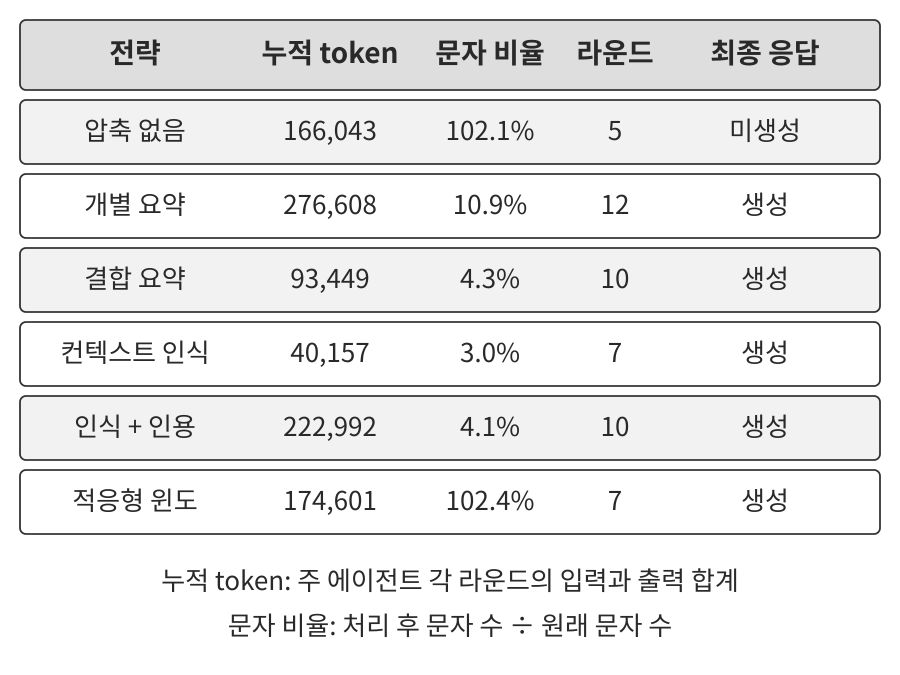

> **실험 2-10 ★★★: 컨텍스트 압축 전략 비교**
>
> 이 실험은 Kimi K3로 OpenAI 공동 창업자들의 경력 현황을 조사합니다. 작업은 인물 명단을 차례로 만들고, 경력과 직위 변화를 찾고, 관련 사실과 출처를 연결해야 합니다. 압축과 넘침 처리를 관찰하기 위해 실험은 애플리케이션 쪽 컨텍스트 예산을 128,000토큰으로 정하고, 압축하지 않는 기준선을 둔 채 다섯 가지 처리 방법을 비교하며, 방법마다 최대 15라운드를 실행합니다[^ch2-compression-results].
>
> **전략 1: 압축 없음.** 검색과 페이지 읽기 결과를 모두 그대로 기록에 넣습니다. 도구 호출 일곱 번으로 원문 문자 367,246자가 집계됐습니다. 프로그램은 다섯 번째 라운드에서 보호 장치가 작동해 멈췄고, 주 에이전트의 누적 사용량은 166,043토큰이었습니다. 이전 버전은 매 요청의 입력 토큰 합계로 보호 장치를 작동시켰으므로 오류 메시지의 165,227은 누적 입력입니다. 예를 들어 같은 기록을 세 라운드의 요청에서 한 번씩 보내면 세 번 누적됩니다.
>
> **전략 2: 개별 요약.** 검색 결과마다 두세 문단의 요약을 따로 생성해 각 페이지의 주요 내용을 남깁니다. 이 방식은 병렬 처리가 쉽고 페이지 경계를 보존하기도 좋지만, 여러 페이지가 같은 사건을 다루면 중복 정보가 그대로 기록에 들어갑니다. 이 구성은 열두 라운드 만에 최종 응답을 생성했고, 주 에이전트는 누적 276,608토큰을 썼으며, 문자 압축률은 10.9%였습니다.
>
> **전략 3: 결합 요약.** 검색 결과 한 묶음을 합친 뒤 종합 요약을 생성해 중복된 사실과 서로 다른 출처의 관계를 정리하기 쉽게 합니다. 이 구성은 열 라운드 만에 최종 응답을 생성했고, 주 에이전트는 누적 93,449토큰을 썼으며, 문자 압축률은 4.3%였습니다.
>
> **전략 4: 컨텍스트 인식 요약.** 압축할 때 현재 질의와 이미 알고 있는 정보를 함께 제공합니다. 예를 들어 프롬프트에 `Given the search query: {query}`와 `Current context: {context}`를 넣습니다. 모델은 이를 근거로 현재 질문과 관련된 사실을 남기고 기존 요약의 빈틈을 우선 보충합니다. 이 구성은 일곱 라운드 만에 최종 응답을 생성했고, 주 에이전트는 누적 40,157토큰을 썼으며, 문자 압축률은 3.0%였습니다. 그중 한 번의 압축은 약 15만 자를 약 2,000자로 정리하면서 인물 이름과 직위 변화를 보존했습니다.
>
> **전략 5: 인용이 있는 컨텍스트 인식 요약.** 작업 관련 요약에 사실에 대응하는 출처 링크를 남깁니다. 이 구성은 열 라운드 만에 최종 응답을 생성했고, 주 에이전트는 누적 222,992토큰을 썼습니다. 도구 기록을 기준으로 합산하면 처리된 자료는 52,891자, 원문은 1,295,044자이며, 둘을 나누면 약 4.1%입니다.
>
> **전략 6: 적응형 윈도.** 초반에는 원시 자료를 남기고, 입력이 임곗값에 이르면 한꺼번에 정리합니다. 실험은 세 가지 메커니즘을 사용합니다. 예산의 80%를 넘으면 압축을 시작하고, 아직 압축하지 않은 도구 결과를 모아 처리하며, 처리한 결과에 `[COMPRESSED]` 표시를 붙여 중복 요약을 피합니다. 이 실험의 128,000토큰 예산에서 임곗값은 102,400토큰입니다. 이 구성은 일곱 라운드 만에 최종 응답을 생성했고, 주 에이전트는 누적 174,601토큰을 썼습니다. 과거 기록은 누적 입력으로 임곗값을 판정했고, 이후 프로그램은 가장 최근 요청의 입력 크기를 검사하도록 바뀌었습니다.
>
> 그림 2-17은 여섯 가지 전략의 입력과 출력을 비교합니다.
>
> 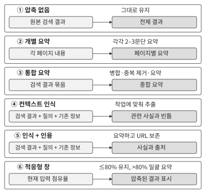
>
> 그림 2-16의 수치를 비교할 때는 세 가지 양을 구분해야 합니다. 단일 요청의 입력은 창 예산에 이르렀는지를 정하고, 누적 토큰은 여러 라운드 호출의 사용량을 반영하며, 문자 압축률은 집계 대상 자료의 처리 후 길이와 원래 길이의 비율을 나타냅니다. 여기서 누적 사용량은 주 에이전트의 각 라운드 요청의 입력과 출력에서 나온 값이며, 요약을 생성한 별도의 모델 요청은 이 필드에 합산되지 않았습니다.
>
> 실험을 재현하려면 함께 제공되는 설명에 따라 모델과 실제 검색 서비스를 설정하고, 실험 디렉터리에서 `python experiment.py -m kimi-k3 -n 15 -o results/reproduction.json`을 실행합니다. 각 전략의 `metrics`를 읽어 `total_compressed_size / total_original_size`로 문자 비율을 다시 계산하고, `total_tokens`와 `iterations`를 비교합니다. 압축 없는 기준선도 검색 본문에 제목, URL 같은 형식을 덧붙이므로 처리 뒤 문자 수가 원문보다 약간 많을 수 있습니다. 실험 프로그램은 최종 응답만 받으면 해당 그룹을 완료로 기록합니다. 두 결과물에서 같은 인물을 찾아보세요. 인용 그룹은 Pamela Vagata의 소속 기관을 Pebblebed로 적었는데, 윈도 그룹의 요약표는 Stripe로 적었습니다. 앞의 답변은 기관 웹사이트를 언급했지만 열어 볼 수 있는 웹 페이지 링크는 주지 않았습니다. 두 그룹 모두 요약표를 내놓았지만, 제시한 인물 정보는 서로 모순됩니다.

[^ch2-compression-results]: 실험 2-10의 결과 파일 `kimi_k3_real_20260718.json`에는 전략별 통계 필드, 최종 답변, 타임스탬프가 저장되어 있어 문자 비율을 바로 다시 계산할 수 있습니다. 2026년 7월 18일 실행은 이전 버전의 보호 조건을 사용했고, 7월 22일의 코드 수정(커밋 `aea4d72`)에서 누적 입력을 가장 최근 라운드 요청의 입력으로 바꿨습니다.

### 프로덕션급 계층형 압축 메커니즘

도구 출력은 전문을 임시 저장해야 할 수 있고, 끝난 단계는 보관할 수 있으며, 현재 제약은 계속 보여야 합니다. 아래 다섯 가지 메커니즘은 각각 다른 사용 빈도와 보존 기간에 알맞습니다.

1. **도구 결과 예산 통제**. 부피가 큰 출력은 외부 저장소에 두고, 컨텍스트에는 요약 미리보기와 읽기 입구를 남깁니다. 미리보기가 일단 기록에 들어가면 내용을 그대로 유지합니다. 더 자세한 내용이 필요하면 관련 부분을 읽어 결과를 덧붙입니다.
2. **무관한 내용 정리**. 웹 페이지 내비게이션 바, 반복되는 푸터 등은 결과가 컨텍스트에 들어가기 전에 걸러 낼 수 있습니다. 이미 기록에 들어간 내용을 지워야 한다면 이후 작업과 인용이 여전히 그 내용에 의존하는지 먼저 확인하고, 기록 수정에 따르는 캐시 비용도 계산합니다.
3. **API 계층의 컨텍스트 편집**. 이런 기능을 지원하는 서비스는 규칙에 따라 오래된 도구 결과를 정리할 수 있습니다. 클라이언트는 촉발 조건을 설정하고 서비스가 반환하는 편집 정보를 처리해야 합니다. 정리 범위와 캐시 동작은 인터페이스 약속이 정하며, 입력 예산 모니터링과 함께 연동하기에 알맞습니다.
4. **보관형 요약**. 라운드나 작업 단계별로 목표, 작업, 결과, 남은 사항을 기록하고 실행 순서를 보존합니다. 작업의 변경 기록이라고 생각하면 됩니다. 나중에 어떤 결정이 어느 단계에서 내려졌고 근거가 무엇이었는지 찾아볼 수 있습니다.
5. **세션 전체 압축**. 국소적인 정리로도 예산을 맞출 수 없으면 현재 목표, 제약, 확인된 사실, 핵심 결정, 다음 작업을 인계 요약으로 정리합니다. 기존 세션 노트를 먼저 정리한 뒤 전체 기록을 요약할 수도 있습니다. 압축이 연속으로 실패하면 재시도 상한이나 서킷 브레이커가 반복 호출을 멈추고, 복구할 수 있는 상태를 저장한 뒤 입력을 줄이거나 사람이 처리하도록 선택합니다.

이 메커니즘들은 계층별로 맞물려 쓸 수 있습니다. 입구 통제는 한 번에 들어오는 큰 출력을 줄이고, 국소 정리는 일상적인 증가를 억제하며, 단계 요약과 전체 압축은 긴 작업의 인계 정보를 보존합니다.

필자는 dsh-superagent를 읽다가 한 가지 세부 사항을 눈여겨봤습니다. 이벤트와 도구 결과는 요약과 객체 ID를 먼저 보내고, 세부 내용이 필요하면 ID로 읽어 올 수 있습니다. 백그라운드에서 테스트 한 묶음을 다 돌리고 포그라운드에 ‘두 항목 실패’라고만 알렸다고 가정해 보겠습니다. 포그라운드는 진행 상황은 보고할 수 있지만 사용자가 이어서 묻는 ‘어제 그 두 항목인가요?’에는 답하지 못합니다. 요약에 이번 테스트 기록의 식별자가 붙어 있다면 포그라운드는 실패한 테스트 케이스의 이름을 가져와 어제의 기록과 대조할 수 있습니다.

### 압축 전략의 설계 원칙

압축 뒤에 무엇을 남길지 정할 때는 다음 네 가지 측면에서 점검할 수 있습니다. 작업을 넘나들며 경험을 쌓는 과정은 제9장에서 다룹니다.

- **작업 가치에 따라 분량을 배분합니다**. 인물 명단, 신원 관계, 현재 조사 중인 질문은 보통 그대로 남겨야 하고, 결론을 뒷받침하는 핵심 증거는 출처와 필요한 세부 사항을 남깁니다. 내비게이션 바, 광고, 중복 내용은 정리할 수 있습니다. 사실에 논란이 있다면 증거 사이의 차이도 중요한 정보입니다.
- **의미의 온전함을 유지합니다**. 예를 들어 ‘Sutskever는 2024년 5월 OpenAI를 떠났다’에서는 인물, 시간, 행동, 기관이 함께 사실 하나를 이룹니다. 압축할 때 이 요소들을 남겨, ‘Sutskever 떠남’처럼 해석하기 어려운 조각만 남는 일을 피해야 합니다.
- **이후의 질문을 중심으로 내용을 구성합니다**. ‘창업자 명단 찾기’는 인물을 빠짐없이 다뤄야 하고, ‘개인 배경 이해하기’는 경력, 연표, 출처가 필요합니다. 같은 자료라도 작업에 따라 다른 요약을 만들 수 있습니다. 검색은 포괄성을, 분석은 관계와 근거를 중시하며, 창작은 쓸모 있는 세부 사항과 예시도 남겨야 합니다.
- **요약이 실행을 뒷받침하는지 검증합니다**. 의미 요약은 작업을 이해하고 중복을 없애며 조건과 예외를 보존해야 합니다. **복잡한 자료의 의미 압축에는 이해 능력이 주 모델에 가까운 모델을 우선 사용해야 합니다.** 압축하는 쪽이 어떤 조건, 예외, 증거가 이후 작업에 영향을 줄지 판단해야 하기 때문입니다. 이런 내용이 사라지면 주 모델이 아무리 강해도 되살리기 어렵습니다.

초기의 아키텍처 결정, 제약 뒤의 이유, 실패한 경로는 긴 기록 속에서 놓치기 쉽습니다. **긴 작업은 진행 문서를 주기적으로 갱신해야 하며**, ‘무엇을 결정했는가, 왜 그렇게 결정했는가, 무엇을 검증했는가, 다음에 무엇을 하는가’를 저장합니다. 프롬프트나 스킬이 갱신 시점을 정하고, 하네스는 작업을 인계할 때 해당 기록을 불러옵니다. 이런 문서는 실행자, 검토자, 이후의 에이전트가 기존 작업을 이해하는 데도 도움이 됩니다.

### 하위 에이전트의 컨텍스트 격리

**넘겨받을 결과의 범위가 분명하고 중간 자료가 많이 생기는 작업이라면 필자는 하위 에이전트 격리를 우선 사용합니다.** 넓은 범위의 검색은 탐색 단계에서만 쓸모 있는 자료를 많이 읽어 들이므로, 먼저 격리하면 이런 내용이 주 작업을 계속 방해하는 일을 줄일 수 있습니다. 주 에이전트는 독립된 컨텍스트를 가진 하위 에이전트에 작업을 넘기고, 하위 에이전트는 중간 결과를 읽은 뒤 결론, 증거 위치, 해결되지 않은 질문을 돌려줍니다. 그러면 주 에이전트의 컨텍스트에는 이후 의사결정에 필요한 정보만 남기면 됩니다.

예를 들어 ‘결제 콜백을 처리하는 함수 찾기’를 주 에이전트가 직접 검색하면 파일을 십수 개 읽어야 할 수 있습니다. 검색 하위 에이전트에 넘기면 함수 이름, 소속 모듈, 호출 지점, 판단 근거를 돌려 달라고 요구할 수 있습니다. 하위 에이전트의 답은 ‘결제 모듈의 `handle_callback`이 콜백을 처리하며, 호출 지점이 두 곳 더 있습니다’처럼 될 수 있고, 위치를 찾을 수 있는 인용이 함께 붙습니다. 주 에이전트는 이 결과를 바탕으로 관련 코드를 더 읽을지 결정합니다.

작업 설명은 충분히 완전해야 합니다. 목표가 무엇인지, 검색 범위가 얼마나 넓은지, 어떤 제약을 지켜야 하는지, 어떤 형식으로 돌려줘야 하는지, 모호한 상황을 만나면 어떻게 처리할지를 적습니다. 위임 요청과 반환 결과를 모두 기록에 덧붙이면 주 에이전트의 기존 접두부는 계속 재사용할 수 있습니다.

제4장에서는 도구로서 하위 에이전트의 인터페이스 설계를, 제10장에서는 멀티 에이전트 시스템에서 컨텍스트의 역할 분담을 더 자세히 다룹니다.

## 이 장의 요약

고객 서비스 어시스턴트가 세 번째 전화를 마친 뒤에는 일을 어떻게 이어 갈까요? 다음 라운드의 요청은 이 통화의 도구 회신을 담고, 호출 ID로 전화 걸기 작업에 연결합니다. 상태 표시줄은 사용한 횟수를 세 번으로 갱신하고, 아직 합의하지 못한 조건을 나열합니다. 시스템 규칙과 도구 정의는 안정적인 접두부에 그대로 두고, 특정 업무를 처리해야 할 때 해당 스킬을 불러옵니다. 이렇게 하면 모든 필드에 출처가 있고, 어떤 내용이 다음 라운드 호출과 함께 바뀌는지도 알 수 있습니다.

통화가 길어지고 도구가 반환하는 내용이 점점 많아지면 결과의 길이를 제한하거나, 이미 끝난 부분을 출처가 붙은 요약으로 정리하거나, 독립적으로 처리할 수 있는 일을 하위 에이전트에 넘기고 결론과 근거만 돌려받을 수 있습니다.

이 작업이 끝나면 세 번 전화했다는 횟수는 작업과 함께 보관해도 됩니다. 하지만 사용자가 일부러 ‘앞으로는 평일 오후에 연락해 달라’고 당부했는데 이 말을 통화 요약에만 남겨 두면, 다음에 의뢰를 받는 어시스턴트는 그 말을 아예 보지 못할 수 있습니다. 장기적으로 쓸모 있는 정보를 어떻게 저장하고, 알맞은 작업에서 어떻게 다시 찾아낼까요? 제3장에서는 작업을 넘나드는 사용자 메모리와 공유 지식 베이스를 다룹니다.

## 생각해 볼 문제

1. ★★★ 실험 2-3의 슬라이딩 윈도 실행 기록을 읽어 보십시오. 다섯 번의 도구 호출은 각각 무엇을 했나요? 반복 호출이 기록 잘라 내기 때문인지 판단하려면 무엇을 더 기록하고 어떤 비교를 해야 할까요? 핵심 상태를 보존하는 잘라 내기 방안을 설계하고, 그것이 접두부 캐시에 주는 영향을 설명해 보십시오. 기록은 `chapter2/kv-cache/result_sliding_window_20260718_kimi_k2_6.json`에 있습니다.
2. ★★ Qwen3의 Chat Template은 마지막 실제 사용자 질의의 위치에 따라 과거 사고를 처리합니다. ReAct 루프 하나가 수백 라운드 동안 이어진다면 점점 늘어나는 추론 내용을 어떻게 관리하시겠습니까? 과거 사고의 잘라 내기, 돌려보내기, 접두부 바인딩 프로토콜을 비교하고, 하네스가 어떻게 적응해야 하는지 설명해 보십시오.
3. ★★ 약 15만 자의 검색 자료를 2,000자로 압축해야 한다면 어떤 사실, 관계, 출처를 남기시겠습니까? 요약이 이후 질문을 뒷받침하기에 충분한지 어떻게 검사하고, 생략된 세부 사항은 어떻게 복구하시겠습니까?
4. ★★ 도구 카운터가 호출 한 번을 빠뜨려 상태 표시줄이 잘못된 남은 횟수를 보여 줍니다. 이벤트 기록, 합산 검증, 실행 계층 검사를 설계하고, 이런 불일치를 어떻게 발견하고 바로잡을지 설명해 보십시오.
5. ★★ 실험 2-4는 어조, 정보 구성, 도구 설명을 비교했습니다. 시스템 프롬프트를 여러 사람이 오랫동안 유지보수한다면 버전을 어떻게 관리하고, 규칙 충돌을 어떻게 검사하며, 회귀 작업으로 수정마다 어떻게 평가하시겠습니까?
6. ★★★ 반려동물 가게 사례에는 단일 항목 검색과 전체 통계가 함께 있습니다. 원시 기록, 통계 요약, 질의 라우팅을 설계해 시스템이 두 유형의 질문에 효율적으로 답하게 하고, 요약을 언제 갱신해야 하는지 설명해 보십시오.
7. ★★★ 어떤 스킬이 이미 목차에 있는데도 모델이 현재 작업에 그 스킬이 적용된다는 것을 알아채지 못합니다. 설명, 목차 구성, 명시적 촉발, 평가 샘플의 네 측면에서 문제를 어떻게 점검하시겠습니까?
8. ★★ 스킬을 성공적으로 불러왔는데도 모델이 그 안의 검증 단계를 빠뜨렸습니다. 촉발, 이해, 도구 사용, 완료 판단 가운데 어디에 문제가 있는지 구분하는 비교 실험을 설계하고, 모델별 성과를 비교해 보십시오.
9. ★★★ 시스템에 도구가 많고 도구 집합도 자주 바뀝니다. 고정된 정의, 도구 목차, 필요할 때 불러온 결과, 런타임 상태의 위치를 어떻게 배치하시겠습니까? 발견 정확도, 컨텍스트 예산, 캐시 적중을 함께 고려해 보십시오.
