# 사용자 메모리와 지식 베이스

사용자가 지난주에 어시스턴트에게 창가 좌석을 좋아한다고 말해 두고 오늘은 “도쿄행 표를 한 장 더 예약해 줘”라고만 했다면, 지난번의 선호는 어디에서 다시 찾아와야 할까요? 항공사가 어제 수하물 규정을 바꿨다면 새 조항은 어디에서 확인해야 할까요? 앞 장에서는 한 작업의 컨텍스트를 구성하는 방법을 다뤘습니다. 이 장에서는 사용자가 했던 말을 어디에서 되찾고 항공사의 새 규정을 어디에서 찾는지, 그리고 이 두 종류의 자료를 각각 언제 갱신해야 하는지를 살펴봅니다.

**사용자 메모리**는 특정 사용자를 중심으로 정보를 구성합니다. 그 사용자의 선호, 습관, 필요와 경험을 기록하여 에이전트가 이후 세션에서도 사용자의 사정에 맞춰 서비스를 이어 가게 합니다. **지식 베이스**는 일정한 권한 범위 안에서 여러 사용자가 공유하며, 업계 규제, 기업의 업무 절차, 기술 문서 등이 여기에 속합니다. 전자는 에이전트가 서비스 대상을 이해하도록 돕고, 후자는 작업을 완수하는 데 필요한 도메인 지식을 제공합니다.

두 시스템은 모두 정보를 어떻게 저장하고 필요할 때 어떻게 찾을지라는 문제를 풀어야 하며, 사실 충돌, 낡은 내용, 검색 누락이라는 같은 문제를 겪습니다. 벡터 검색, 구조화 색인, 지식 압축 같은 기술은 두 시스템에 함께 쓸 수 있습니다. 그림 3-1은 이 장의 구성을 보여 줍니다. 먼저 사용자 메모리의 표현과 관리를 다루고, 이어서 검색 증강 생성(RAG)을 소개한 뒤, 마지막으로 검색 방법을 세션을 넘나드는 메모리와 더 복잡한 지식 구성에 적용합니다.

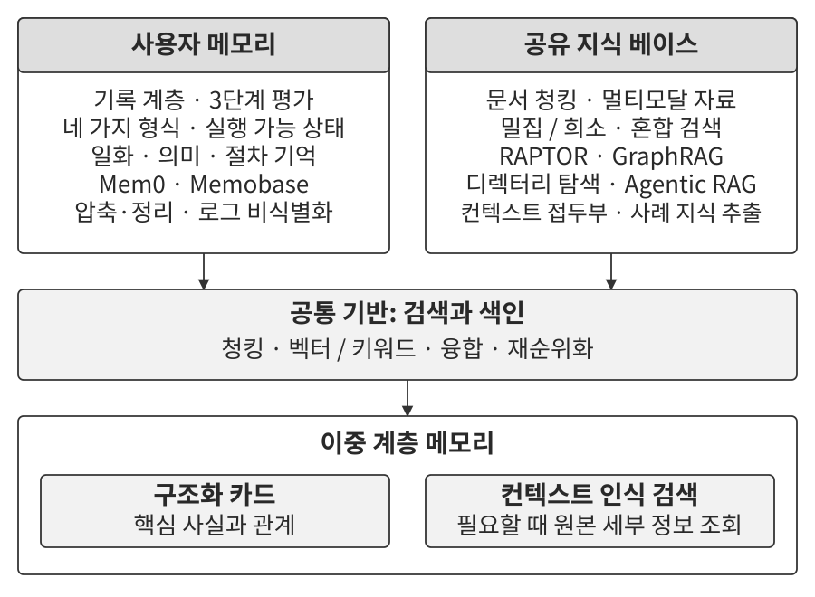

## 사용자 메모리 시스템

“다음 주에 해외에 있으니 은행 서류는 이메일로 보내 주세요”라는 말을 나눠서 읽어 봅시다. 사용자는 기한이 있는 일정을 말했고, 그 일정 동안의 수신 방법을 지정했습니다. 은행이 서류를 우편으로 보내겠다고 하면 어시스턴트는 이를 근거로 전자 발송을 요청할 수 있습니다. 일정이 끝난 뒤 다시 우편 문제가 생기면 그때의 조건을 새로 살펴야 합니다. “사용자는 종이 우편을 싫어한다”라고만 저장하면 나중에 이 메모리를 검색해 내더라도 적용 범위를 잘못 쓰게 됩니다.

항공권도 살펴봅시다. 사용자가 “지난번 1250짜리 표는 생각보다 비쌌어요”라고 하면, 시스템은 적어도 그때의 견적, 당시 예산, 여행 상황, 그리고 이번 피드백을 저장할 수 있습니다. 다음에 비슷한 상황이 오면 모델은 이를 근거로 예산을 넘는 견적을 더 신중하게 다룹니다. 사용자가 따로 “앞으로 가족 여행은 먼저 저한테 물어봐 주세요”라고 밝히면, 이는 앞으로의 가족 여행에 대한 명확한 확인 조건이 됩니다. 이로부터 세 종류의 정보를 구분할 수 있습니다. 사용자가 실제로 한 말, 그때 놓여 있던 조건, 모델이 이번 경험에서 추론한 내용입니다.

세션이 끝날 때 LLM에게 이런 기록을 정리하게 하고, 나중에 쓸모 있는 사실을 영구 저장소에 쓸 수 있습니다. 새 작업이 시작되면 관련 있고 여전히 유효한 기록만 컨텍스트에 가져옵니다.

예를 들어 사용자가 항공권을 예약하면서 다음 정보를 주었다고 해 봅시다.

```text
User: Help me book a flight to Tokyo next Friday. I prefer window seats
      and I'm vegetarian, so I'll need a special meal.
Agent: I'll search for flights to Tokyo for next Friday...
       [calls flight_search tool, returns 3 options]
Agent: Here are your options. Based on your preference, I've filtered for
       window seat availability. Shall I book the ANA direct flight?
User: Yes, and use my United MileagePlus number 12345678.
```

세션이 끝나면 메모리 추출기는 네 개의 기록을 정리해 낼 수 있습니다.

```text
Extracted memories:
- User prefers window seats (preference)
- User is vegetarian, needs special meals on flights (dietary restriction)
- User's United MileagePlus number: 12345678 (loyalty program)
- User has travel plans to Tokyo (recent activity)
```

이 예에는 세 가지 처리가 들어 있습니다. **선택적 추출**은 좌석 선호, 식단 요구, 회원 번호를 남기고 “검색 결과가 세 개 반환되었다” 같은 일시적인 세부 사항은 걸러 냅니다. **추상화**는 사용자가 명시한 창가 좌석 선호를 앞으로의 예약에 쓸 수 있는 규칙으로 정리합니다. **구조화**는 사실에 범주를 붙여 검색과 갱신을 쉽게 합니다. 도쿄 여행에는 출발 날짜와 현재 상태도 기록해야 합니다. “다음 주 금요일”은 세션 날짜를 기준으로 변환해야 하고, 여행이 끝나거나 취소되면 상태를 갱신합니다. 이렇게 하면 장기 선호와 최근 활동을 각자의 유효 기간에 맞춰 관리할 수 있습니다.

개인 어시스턴트 Today의 제품 설명에 이런 예가 있습니다. 사용자가 매주 화요일과 목요일에 훈련하며 하프 마라톤을 준비하고 있다고 말합니다. 6주 뒤, 사용자의 허락을 받아 연결한 수면 기록에 그가 어젯밤 잠을 거의 자지 못했다고 나옵니다. 어시스턴트는 두 정보를 함께 보고 그날의 고강도 인터벌 훈련을 옮기자고 제안합니다. 각각을 얼마나 오래 기억해야 할까요? 훈련 계획은 대회를 준비하는 동안 계속 쓰이고, 어젯밤 수면 기록에는 날짜를 붙여야 합니다. 사용자가 이번 일정 변경을 받아들였더라도, 앞으로 계속 바꾸겠다고 말하지 않는 한 다음 주 목요일 훈련은 원래 계획대로 잡습니다. Today는 제안하는 일과 캘린더를 바꾸는 일도 두 단계로 나누며, 뒤의 단계에는 사용자 확인이 필요합니다.[^ch3-today]

[^ch3-today]: Today 팀은 「What Is Today」에서 하프 마라톤 훈련을 예로 들어 메모리와 당일 정보가 어떻게 함께 작동하는지 설명합니다. 창업자는 「Meet Today」에서 캘린더를 바꾸기 전의 확인 절차를 설명합니다.

### 메모리 능력 평가: 3단계 프레임워크

공개 벤치마크 **LoCoMo**(Long-term Conversational Memory, 장기 대화 메모리)는 평균 약 300턴, 최대 35개 세션으로 이루어진 긴 대화를 담고 있으며, 질의응답, 사건 요약, 멀티모달 대화 생성으로 메모리 능력을 시험합니다. 질의응답은 다섯 유형으로 나뉩니다. 단일 홉 문제는 한 세션에서 답을 찾을 수 있고, 다중 홉 문제는 여러 세션의 단서를 이어 붙여야 하며, 시간 추론 문제는 사건이 일어난 순서까지 파악해야 합니다. 개방형 지식 문제는 사용자가 한 말과 외부 지식을 결합해야 합니다. 예약 예를 이어 가면, 사용자가 “다음 주에 도쿄에 간다”라고만 했을 때 “목적지에서는 어떤 통화를 쓰는가”에 답하려면 도쿄라는 단서를 기억하는 동시에 그곳에서 엔화를 쓴다는 것도 알아야 합니다. 사용자가 한 번도 말한 적 없는 항공편 번호를 묻는다면 어시스턴트는 정보가 부족하다고 밝혀야 합니다. 이처럼 답할 수 없는 질문을 알아보는 능력이 바로 적대적 문제가 시험하는 것입니다.[^ch3-locomo]

[^ch3-locomo]: Maharana 등의 LoCoMo 논문(arXiv:2402.17753) 4.1절이 다섯 가지 질의응답 유형을 정의합니다. 저자들의 프로젝트 페이지에서 데이터와 대화 예시를 볼 수 있습니다.

이런 벤치마크와 메모리 제품의 실무를 함께 참고하여, 필자는 주목해야 할 능력을 다음 여덟 가지로 정리했습니다.

- **개인 정보 유지**: 사용자의 신원 같은 장기 정보를 정확히 저장하고 되찾습니다.
- **선호 추적**: 사용자의 선호를 기록하고, 새로 명시한 내용에 따라 갱신합니다.
- **컨텍스트 전환**: 주제가 바뀐 뒤에도 관련 배경을 이어 갑니다.
- **메모리 갱신**: 기존 사실에 대한 사용자의 보충과 정정을 처리합니다.
- **다중 세션 연속성**: 새 세션에서 이전에 저장한 정보를 사용합니다.
- **복합 사고**: 여러 메모리 조각을 연결합니다. 예를 들어 사용자가 땅콩 알레르기를 언급한 적이 있다면 태국 음식을 이야기할 때 이를 떠올려 재료를 확인하라고 알려 줍니다.
- **시간 인식**: 날짜를 저장하고 상대적 시간을 해석하며 사건 사이의 간격을 계산합니다.
- **충돌 해결**: 일치하지 않는 정보를 발견하고 출처, 시간, 적용 대상을 바탕으로 판단합니다.

에이전트의 실제 작업을 중심으로, 이 책은 여기에서 한 걸음 더 나아가 3단계 평가 프레임워크를 사용합니다. 실험 3-1과 3-2에서는 이 프레임워크로 메모리 표현을 비교하고, 실험 3-9와 3-11에서는 같은 프레임워크로 검색 방법을 평가합니다.

**1단계: 기본 회상.** 사용자가 직접 제공한, 의미가 분명한 정보를 정확히 저장하고 되찾습니다. 예를 들어 사용자가 “제 회원 번호는 12345입니다”라고 했다면 나중에 항공권을 예약할 때 전체 번호를 돌려줄 수 있어야 합니다. 이 단계는 주로 사실이 사라지거나 뒤섞이거나 바뀌어 쓰이지 않았는지 확인합니다.

**2단계: 다중 세션 검색.** 서로 다른 시기에, 서로 다른 대상을 두고 이루어진 세션에서 관련 정보를 빠짐없이 모은 뒤 현재 요청이 누구에 관한 것이고 어떤 기록이 필요한지 판단합니다. 자동차가 두 대인 사용자가 “내 차 정비 예약해 줘”라고만 하면, 시스템은 먼저 두 차량의 정보를 가져와 어느 차인지 확인해야 합니다. 대출 상태를 물으면 효력이 있는 계약과 과거에 문의한 견적을 구분해야 합니다. “로스앤젤레스 여행”을 취소할 때에는 항공권, 호텔 등의 예약을 같은 여행으로 묶어야 합니다.

**3단계: 능동적 서비스.** 현재 작업에 비추어 사용자가 하나하나 짚지 않은 관련 사항을 찾아냅니다. 예를 들어 국제선 항공편을 예약할 때 몇 달 전에 저장한 여권 정보를 연결해 유효 기간이 여정 요건을 충족하는지 확인합니다. 휴대전화가 고장 나면 기기 보증, 신용 카드 부가 보증, 통신사 보험을 모아 쓸 수 있는 처리 방안을 나열합니다. 세금 신고 자료를 준비할 때에는 1년 치 기록에서 주식 거래, 프리랜서 소득, 재산세 서류를 빠짐없이 찾아냅니다.

> **실험 3-1 ★: 3단계 프레임워크로 메모리 시스템 평가하기**
>
> 평가 세트는 단계마다 20개, 모두 60개의 사례로 이루어집니다. 1단계는 주로 단일 세션이고, 2단계와 3단계는 시점과 대상이 다른 여러 세션을 포함하여 엔터티 연결, 정보 갱신, 능동적 알림을 확인합니다.
>
> 사례마다 두 단계로 진행합니다. 먼저 세션을 하나씩 입력합니다. 모델은 첫 세션을 바탕으로 메모리를 생성하고, 이후에는 매번 기존 메모리와 새 세션만 받아 갱신된 메모리를 생성합니다. 그 뒤로 모델은 이전 세션의 원문을 읽을 수 없으므로, 그때 나눈 이야기에 관한 질문에는 메모리에 써 둔 정보만으로 답해야 합니다. 모든 세션을 처리하고 나면 새 질문을 입력하고, 에이전트에게 메모리를 바탕으로 답하게 합니다.
>
> 평가는 LLM-as-a-judge 방식으로 합니다. 독립된 평가 모델이 참조 답안과 채점 기준에 비추어 답변이 담은 사실과 오류를 확인합니다. 이번 실행에서는 Doubao Seed 1.6으로 메모리와 답변을 생성하고 Moonshot 모델로 채점했습니다. 평가 모델은 원래 대화를 볼 수 있고, 답하는 모델은 마지막까지 남은 메모리만 볼 수 있습니다.
>
> 성적표는 어떻게 읽어야 할까요? 예를 들어 사용자가 인터넷 서비스 계정 번호만 되찾고 싶어 한다고 합시다. 향상된 노트 그룹에서 어시스턴트는 올바른 번호를 답했습니다. 평가 모델은 정확성, 회상, 추론에 각각 4점을 주고 능동성에는 1점만 주었지만, 이 문제는 그래도 통과했습니다. 프로그램의 통과 조건은 앞의 세 항목이 각각 3점 이상(만점 4점)이고, 평가 모델이 근거가 없거나 원래 말과 모순되는 중요한 사실을 찾지 못하는 것입니다. 능동성은 종합 점수에 반영되므로, 통과 개수만 봐서는 어시스턴트가 얼마나 능동적으로 도움을 주었는지 알 수 없습니다.

### 메모리의 계층 구조

“지난번에 어느 항공편을 예약했지?”에 답하려면 한 번의 사건을 찾아야 하고, “예약할 때 어떤 좌석을 우선해야 하지?”에 답하려면 여러 번의 상호작용에서 남은 선호를 가져와야 합니다. 두 질문은 같은 사람에 관한 것이지만, 요구하는 기록의 세밀도와 검색 방식이 다릅니다.

**궤적(trajectory)**은 에이전트가 한 번 실행되는 동안의 사건을 시간순으로 기록합니다. 사용자 메시지, 모델 응답, 도구 호출과 실행 결과가 여기에 들어갑니다. 추가 전용(append-only) 이벤트 로그를 쓰면 새 사건은 끝에 덧붙이고 원래 기록은 추적용으로 보존합니다. 하네스는 궤적에서 이력을 고르거나 상태를 추출하거나 요약을 생성하여, 매 턴 모델에 실제로 보낼 컨텍스트를 구성할 수 있습니다.

**사용자 장기 메모리**는 세션을 넘어 쓸모 있는 정보, 예컨대 선호, 인간관계, 과거 활동의 요약, 확인된 사실을 저장하며, 사용자 ID 같은 식별자로 소유자를 정합니다. 새로운 말이 기존 기록을 보충하거나 정정하거나 대체할 수 있으므로 장기 메모리에는 병합과 갱신이 필요합니다. 읽기와 유지 관리는 에이전트가 도구를 명시적으로 호출해서 할 수도 있고, 하네스가 세션을 불러올 때, 세션이 끝날 때, 또는 백그라운드 정리 중에 실행할 수도 있습니다.

**비즈니스 상태**는 작업이 놓인 논리적 단계, 예컨대 “명확화 필요”, “처리 중”, “결제 대기 중”, “완료”를 나타냅니다. 프로그램은 이 상태를 확인하여 다음에 어떤 이벤트를 기다리고 어떤 작업을 실행할지 정할 수 있습니다. 6장에서 이벤트 기반 아키텍처의 상태 관리를 더 자세히 다룹니다.

세 종류의 기록은 함께 작동할 수 있습니다. 궤적은 실행의 근거를, 장기 메모리는 세션을 넘는 배경을 제공하고, 비즈니스 상태는 현재 작업이 어디까지 진행되었는지 알려 줍니다. 아래에서는 장기 메모리의 표현, 관리, 검색을 중점적으로 다룹니다.

### 사용자 메모리의 네 가지 저장 형식

이메일 주소 하나만 바꾸려면 그 항목을 곧바로 찾을 수 있는 편이 좋습니다. 반면 왜 주소를 바꿨는지 알아보려면 일이 어떻게 진행되었는지까지 읽어야 합니다. 그림 3-2의 왼쪽 위는 이메일, 회사, 직위를 항목별로 저장하고, 오른쪽 위는 직위, 팀, 프로젝트를 한데 묶어 씁니다. 아래의 두 카드도 보세요. 앞으로 직위를 갱신하거나, 심장내과에 간 사람이 누구인지 구분해야 한다면 각각 어느 필드를 찾아야 할까요?

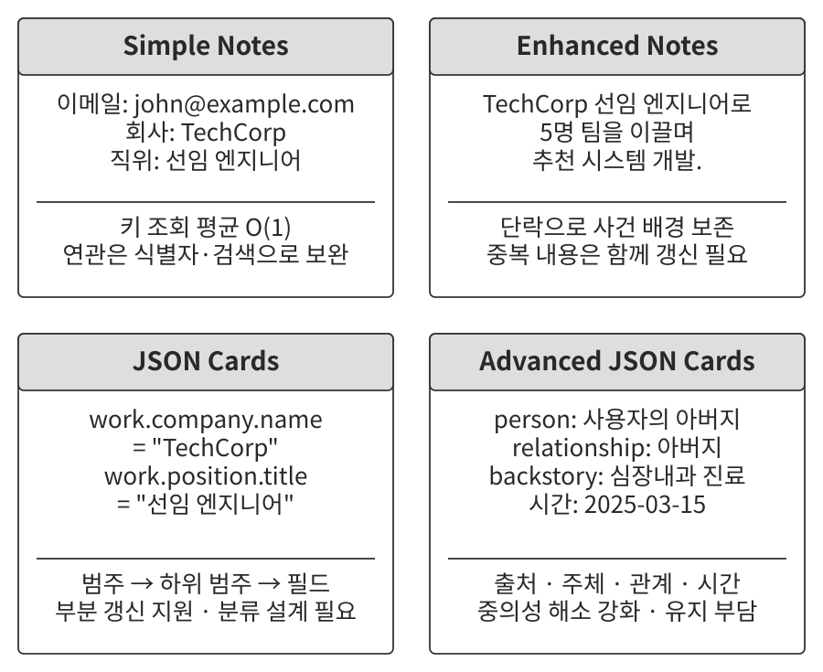

**Simple Notes**는 메모리 하나를 짧은 사실 하나로 씁니다. 예를 들면 “사용자 이메일: john@example.com”입니다. 기록 하나를 읽고 쓰기는 쉽고, 해시 테이블에서 안정적인 키로 찾는다면 조회와 갱신의 평균 시간 복잡도는 보통 O(1)입니다. 많은 노트를 의미로 검색하려면 검색 색인도 따로 만들어야 합니다. 너무 잘게 나누면 관계가 사라집니다. “TechCorp에서 시니어 엔지니어로 일하며 추천 시스템 개발을 맡고 있다”를 회사, 직위, 프로젝트라는 서로 연결되지 않은 세 기록으로 나누면, 나중에 이들이 같은 직장에 관한 것인지 다시 판단해야 합니다.

**Enhanced Notes**는 사실과 그 배경을 완전한 문단으로 저장합니다. 예를 들면 “사용자는 TechCorp에서 선임 소프트웨어 엔지니어로 일하며 머신러닝 분야에서 3년째 일하고 있고, 현재 5명으로 구성된 추천 시스템 프로젝트를 이끌고 있다”입니다. 회사, 직위, 경력, 팀 사이의 관계가 한 문단 안에 보존됩니다. 대신 일부 사실이 여러 문단에 반복될 수 있으므로, 직위가 바뀌면 관련 문단을 모두 찾아 갱신해야 새 기록과 낡은 기록이 함께 남지 않습니다.

**JSON Cards**는 “범주—하위 범주—Key-Value 쌍”으로 정보를 구성합니다. 예를 들면 `personal.contact.email`, `work.position.title`입니다. 직위 필드를 고칠 때 `work.company.name` 같은 다른 필드는 그대로 둘 수 있어 부분 갱신에 알맞습니다. 분류를 설계할 때는 여러 범주에 걸친 정보도 고려해야 합니다. “주말에 Python으로 개인 프로젝트를 개발한다”는 시간, 기술 선호, 활동에 모두 걸칩니다. 활동 기록 하나를 저장하고 태그를 여러 개 붙이거나, 참조로 관련 범주를 연결하여 이런 연관을 보존할 수 있습니다.

**Advanced JSON Cards**는 사실에 더해 출처 배경 `backstory`, 대상 `person`, 사용자와의 관계 `relationship`, 타임스탬프를 기록합니다. 이 필드들은 정보가 누구의 것인지, 언제 알게 되었는지, 어떤 상황에 적용되는지를 시스템이 알아보게 돕습니다. 예를 들어 “장 선생님”은 사용자의 치과 의사일 수도 있고 사용자 아버지의 심장내과 의사일 수도 있습니다. 이름을 진료받는 사람, 가족 관계, 진료과와 함께 저장하면 혼동을 줄일 수 있습니다.

사용자가 “가족 연례 건강 검진 일정을 잡아 줘”라고 하면 시스템은 `person`과 `relationship`으로 가족 구성원을 찾고, `backstory`에서 관련 경험을 읽을 수 있습니다. 필드가 풍부할수록 추출하고 갱신할 때 처리해야 할 관계도 늘어납니다. 필자는 정보의 중요도와 연관 필요에 따라 섞어 저장하기를 권합니다. 핵심 인물, 계약, 장기 선호는 Advanced JSON Cards로 저장해 출처와 관계를 보존하고, 양이 많고 연관이 적은 단순한 사실은 Simple Notes로 저장해 추출과 유지 관리 비용을 낮춥니다. 두 종류의 기록은 식별자나 참조로 연결해 두었다가 필요할 때 함께 가져옵니다.

> **실험 3-2 ★★: 네 가지 메모리 형식 비교**
>
> 동반 구현은 네 형식에 공통된 메모리 생성, 갱신, 검색 인터페이스를 제공하며, 실험 3-1과 같은 60개 사례에서 최종 답변을 비교합니다.
>
> 이번 실행에서 Simple Notes, Enhanced Notes, JSON Cards, Advanced JSON Cards는 각각 48, 52, 51, 49개 사례를 통과했습니다. 2단계에서 Enhanced Notes는 16개, Advanced JSON Cards는 12개를 통과했고, 3단계에서는 둘 다 19개를 통과했습니다. 메모리 유지 관리, 답변, 평가를 모두 합치면 Enhanced Notes는 약 99만 토큰, Advanced JSON Cards는 약 155만 토큰을 썼고, 뒤쪽은 모델 호출의 평균 소요 시간도 더 길었습니다.
>
> 2단계의 스트리밍 구독 문제를 예로 들어 봅시다. 지출을 줄이고 싶은 사용자가 자신이 어떤 서비스를 구독하고 있고 각각 얼마인지 묻습니다. 향상된 노트 그룹은 Netflix, Disney+, Max의 월 요금을 각각 22.99, 19.99, 19.99달러로 나열했습니다. 고급 JSON 카드 그룹은 Max의 가격만 답하고 Max의 저가 요금제 두 가지를 덧붙였습니다. 제안이 아무리 구체적이어도 나머지 두 청구서를 채워 넣지는 못합니다.
>
> 문제는 어느 갱신부터 시작되었을까요? 고급 카드 그룹이 갱신할 때마다 저장한 메모리를 살펴보면, 첫 세션 뒤에는 Netflix가 있었고, 두 번째 세션 뒤에는 Disney+ 관련 기록만 남았으며, 세 번째 세션 뒤에는 다시 Max만 남았습니다. 질문할 때가 되자 앞의 두 구독은 이미 메모리에서 사라져 있었습니다.

### 고급 지식 표현: 실행 가능한 코드

사실을 저장한 다음에는 통계를 내고, 충돌을 확인하고, 업무 규칙에 따라 다음 단계를 판단해야 합니다. 필자는 **User as Code**(UaC)에서 사용자 정보를 타입이 있는 Python 객체로 구성하고 이러한 작업을 함수로 작성해 보았습니다[^uac]. 모델은 대화에서 사실을 추출하고, 명확히 정의된 계산은 프로그램이 실행합니다.

날짜 비교, 금액 합산, 명확한 업무 제약에 대해 필자는 계산을 함수로 작성하는 편을 우선하여, 같은 사실에서 재현 가능하고 테스트 가능한 결과를 얻습니다. 이렇게 하면 모델은 의미 이해에 집중하고, 긴 대화에서 암산과 규칙 확인을 되풀이하는 부담을 덜 수 있습니다. 메모리의 표현과 사용도 같은 코드 안에서 점검할 수 있습니다.

UaC는 두 단계 절차를 따릅니다. 먼저 추출한 사실을 로그에 덧붙이고, 주기적으로 체크포인트를 만들어 로그에서 타입이 있는 상태를 재구성합니다. 로그는 사실의 출처와 변화 과정을 보존하고, 상태 객체는 현재 조회할 수 있는 필드를 제공합니다.

여권과 여행을 예로 들면 상태를 다음과 같이 정의할 수 있습니다.

```python
from dataclasses import dataclass
from datetime import date

@dataclass
class PassportInfo:
    number: str
    country: str
    expiry_date: date

@dataclass
class Trip:
    destination: str
    departure_date: date
    is_international: bool

@dataclass
class UserState:
    passport: PassportInfo
    trips: list[Trip]

state = UserState(
    passport=PassportInfo("AB1234567", "US", date(2025, 2, 18)),
    trips=[
        Trip("Tokyo", date(2025, 1, 15), True),
        Trip("Paris", date(2025, 6, 10), True),
    ],
)
```

**집계 통계**는 기록을 바로 순회합니다. 예를 들어 2025년에 등록된 국제 여행 수를 계산하면 다음과 같습니다.

```python
count = sum(
    1 for trip in state.trips
    if trip.is_international and trip.departure_date.year == 2025
)
# count == 2
```

**충돌 확인**은 두 필드 집합을 미리 정한 규칙에 따라 대조합니다. 아래는 약물 계열 대조를 예로 들어, 추가 확인이 필요한 항목을 처리 대기열에 넣는 방법을 보여 줍니다.

```python
def find_allergy_matches(profile):
    matches = []
    for medication in profile.current_medications:
        for allergy in profile.allergies:
            if medication.drug_class == allergy.drug_class:
                matches.append((medication, allergy))
    return matches
```

일치한 항목마다 해당 복약 기록과 알레르기 기록이 함께 남으므로, 이후 절차는 이를 근거로 확인한 뒤 도메인 규칙에 따라 알릴지, 검토로 넘길지, 정보를 보충할지 정할 수 있습니다.

**제약 확인**은 상태가 갱신될 때마다 자동으로 실행할 수 있습니다. 예를 들어 어떤 여행 규칙이 출발 시점에 여권 유효 기간이 최소 180일 남아 있어야 한다고 요구한다면, 그 일수를 매개변수로 넘길 수 있습니다.

```python
def passport_alerts(state, required_days):
    alerts = []
    for trip in state.trips:
        if trip.is_international:
            days = (state.passport.expiry_date - trip.departure_date).days
            if days < required_days:
                alerts.append((trip.destination, days))
    return alerts

alerts = passport_alerts(state, required_days=180)
```

예시의 180일 기준으로 계산하면 도쿄에 갈 때 여권 유효 기간은 34일밖에 남지 않고, 파리로 출발하는 날에는 이미 만료되어 있습니다. 사용자가 여권을 새로 발급받으면 프로그램은 새 날짜로 두 여행을 다시 계산할 수 있습니다.

[^uac]: Li, Bojie, User as Code: Executable Memory for Personalized Agents, 2026.

### 사용자 메모리의 인지과학적 토대

인지과학은 기억의 내용과 쓰임에 따라 기억을 여러 유형으로 나눕니다. 이 개념들은 에이전트의 장기 정보를 구성하는 데도 도움이 됩니다.

- **일화 기억(episodic memory)**은 구체적인 사건과 그 시간, 참여자, 경과를 저장합니다. 사람의 예로는 “지난 수요일 동료와 이탈리아 식당에서 저녁을 먹었다”가 있고, 에이전트에서는 “사용자가 다음 주 금요일 ANA 항공편으로 도쿄에 갈 계획이다”에 해당하며, 이후 예약에 성공했는지, 일정을 바꿨는지도 기록할 수 있습니다.
- **의미 기억(semantic memory)**은 사실과 개념을 저장합니다. 사람의 예로는 “이탈리아의 수도는 로마다”가 있고, 에이전트에서는 “사용자는 채식주의자다”, “사용자는 창가 좌석을 선호한다”에 해당합니다. 이런 정보는 사용자가 명시한 것일 수도 있고 여러 경험에서 귀납한 것일 수도 있으므로, 출처를 기록해 두면 둘을 구분하는 데 도움이 됩니다.
- **절차 기억(procedural memory)**은 기술과 행동 절차에 관한 것입니다. 사람의 예로는 자전거 타기가 있고, 에이전트 공학에서는 재사용할 수 있는 절차에 빗댈 수 있습니다. 예를 들면 “직항편 검색→좌석 선호 확인→상용 고객 번호 사용→기내식 예약”입니다.

1장의 쇼핑 기록을 다시 보면, “열 개를 본 뒤 그중 하나를 샀다”는 구매 사건 하나를 기록할 근거는 되지만, 사용자가 앞으로 무엇을 좋아할지 판단하기에는 부족합니다. 그 스타일이 마음에 들었을 수도 있고, 그날 받을 수 있는 상품이라서 골랐을 수도 있습니다. 사용자가 이어서 “앞으로 이런 종류는 당일 배송이 되는지부터 봐 주세요”라고 말하면, 적용 범위가 있는 장기 선호가 하나 생깁니다. 다음에 같은 종류의 상품을 추천할 때 배송 시간을 먼저 확인할 수 있고, 이 필터 조건이 어느 피드백에서 왔는지도 설명할 수 있습니다.

표 3-1은 이 분류를 앞의 메모리 계층, 저장 형식과 나란히 놓고 각각이 어떤 질문에 답하는지 보여 줍니다.

표 3-1 메모리 설계의 세 가지 측면

| 설계 측면 | 답하는 질문 | 구체적 범주 |
| --- | --- | --- |
| 기록 계층 | 정보가 어떤 역할을 맡는가? | 궤적, 사용자 장기 메모리, 비즈니스 상태 |
| 저장 형식 | 어떤 구조로 표현하는가? | Simple Notes, Enhanced Notes, JSON Cards, Advanced JSON Cards |
| 메모리 내용 | 어떤 종류의 정보를 저장하는가? | 일화 기억, 의미 기억, 절차 기억 |

예를 들어 “사용자는 창가 좌석을 선호한다”는 의미 기억이며 Simple Notes로 장기 메모리에 저장할 수 있습니다. 한 벌의 예약 절차는 절차 기억이며 출처와 적용 조건을 담은 카드로 저장할 수 있습니다.

### 메모리 프레임워크 사례

사용자가 “요즘은 통로 쪽에 앉아요”라고 했는데 예전 기록에는 “창가를 좋아함”이라고 적혀 있습니다. 시스템은 쓰는 시점에 좌석 선호를 갱신할 수도 있고, 두 진술을 모두 저장해 두었다가 다음 예약 때 어느 쪽이 맞는지 판단할 수도 있습니다. 아래에서는 먼저 Mem0이 이런 충돌을 어느 단계에서 처리하는지 보고, 이어서 Memobase가 사용자 프로필과 구체적인 사건을 어떻게 따로 기록하는지 살펴봅니다.

**Mem0: 충돌 처리 위치의 조정.** 2025년 논문과 v2의 절차는 쓰는 시점에 새 사실과 기존 사실을 비교하고, 이후의 v3는 사실 추가와 혼합 검색을 사용합니다. 그림 3-3은 두 방식을 대조합니다.

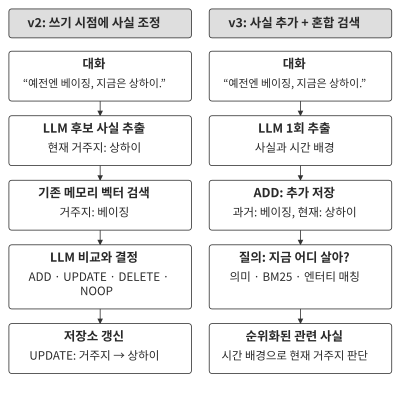

초기 절차에서는 LLM이 먼저 대화에서 후보 사실을 추출하고, 비슷한 기존 메모리를 검색한 뒤 **ADD**, **UPDATE**, **DELETE**, **NOOP** 가운데 무엇을 실행할지 정합니다. 사용자가 먼저 “저는 베이징에 살아요”라고 했다가 나중에 “상하이로 이사했어요”라고 하면, 시스템은 현재 거주지를 상하이로 갱신할 수 있습니다. 이렇게 하면 조회할 때 정리된 사실을 쉽게 가져올 수 있습니다. 대신 유지 관리할 때 정정, 시간에 따른 변화, 서로 다른 대상을 올바르게 구별해야 하고, 오류를 발견했을 때 되짚어 볼 수 있도록 갱신 근거를 남겨야 합니다. 논문은 엔터티와 관계로 연관 지식을 표현하는 그래프 메모리 변형 **Mem0-g**도 제안했습니다[^ch3-mem0-paper].

v3는 자동 추출을 LLM 호출 한 번으로 바꾸고 **ADD** 기록만 덧붙입니다. 베이징과 상하이라는 두 정보를 시간 배경과 함께 보존하고, 조회할 때 컨텍스트를 바탕으로 현재 거주지를 판단할 수 있습니다. 검색에는 의미 유사도, BM25 키워드, 엔터티 일치를 함께 사용하며, 완료가 확인된 행동도 사실로 추출할 수 있습니다. 마이그레이션 안내서에 따르면 LoCoMo 점수는 71.4에서 91.6으로, LongMemEval 점수는 67.8에서 93.4로 올랐습니다. 이 오픈소스 버전은 엔터티 연관을 내부 검색에 사용하고, 외부 그래프 저장소 인터페이스와 `relations` 반환값을 제거했습니다. 그래프 메모리는 호스팅 플랫폼에서 제공합니다[^ch3-mem0-migration].

이 변화는 메모리 시스템이 충돌 판단을 쓰기 단계에서 읽기 단계로 옮길 수 있음을 보여 줍니다. 쓰는 시점에 두 사람의 경험을 잘못 합치거나 보충 정보를 정정으로 오해하면, 이후의 답변은 잘못된 현재 상태를 계속 따를 수 있습니다. 추가 방식으로 저장하면 새 증거와 옛 증거가 모두 판단에 참여할 수 있고, 쓰는 시점에 기록마다 결정을 내리는 모델 호출도 줄어듭니다. 변화가 잦고 그 자리에서 충돌을 판단하기 어려운 사용자 메모리라면, 필자는 사실을 시간과 출처와 함께 먼저 저장해 두고 구체적인 질문에 답할 때 유효한 상태를 정리하는 쪽을 선호합니다.

[^ch3-mem0-paper]: Chhikara 등, Mem0: Building Production-Ready AI Agents with Scalable Long-Term Memory, 2025.

[^ch3-mem0-migration]: Mem0, Open Source: Migrating to the New Memory Algorithm.

**Memobase: 사용자 프로필과 사건 메모리.** Memobase는 장기 정보를 두 부분으로 구성합니다. **사용자 프로필(profile)**은 비교적 안정적인 속성을 주제와 하위 주제별로 저장합니다. 예를 들면 `basic_info` 아래의 이름, `interest` 아래의 관심사, `work` 아래의 직위입니다. 개발자는 추출할 슬롯을 설정해 프로필의 범위와 세밀도를 조절할 수 있습니다. **사건 메모리(event memory)**는 사용자의 경험과 그 시간을 기록하여, “지난번에 예산을 논의한 게 언제였지?” 같은 질문에 답할 수 있게 합니다.

Memobase는 새 대화를 먼저 버퍼에 넣고, 버퍼가 지정한 크기만큼 쌓이거나 세션이 정해진 시간 동안 유휴 상태가 되면 한꺼번에 처리합니다. 세션이 끝날 때 명시적으로 처리를 시작할 수도 있습니다. 이렇게 하면 여러 메시지가 한 번의 정리 절차를 공유하고, 조회할 때는 이미 생성된 프로필과 사건을 읽습니다. 비동기 갱신은 현재 상호작용이 메모리 추출을 기다리는 시간을 줄여 줍니다. 최신 사실을 바로 써야 할 때는 이번 처리가 끝날 때까지 기다릴 수 있습니다[^ch3-memobase].

[^ch3-memobase]: Memobase, 공식 프로젝트 설명. 프로필 필드, 사건 메모리, 버퍼, 동기 갱신 인터페이스를 포함합니다.

어시스턴트가 지난번 예약의 경과를 기억하면서 사용자의 좌석 선호와 환불 처리 절차까지 알고 있어야 한다면, 그림 3-4처럼 사건, 사실, 절차를 따로 저장할 수 있습니다. 작업을 받을 때마다 쓸모 있는 부분을 작업 메모리에 넣습니다.

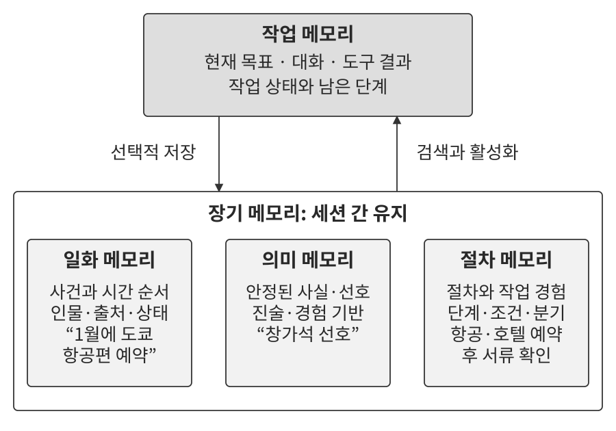

일화 기억은 사건의 순서와 함께 타임스탬프, 감정 표시, 작업 식별자 같은 메타데이터를 보존하므로 시간과 주제를 조합해 검색할 수 있습니다. 예를 들어 “지난번 예산 논의”에는 주제 일치와 시간 정렬이 함께 필요합니다. 의미 기억은 사건에서 추출한 사실과 선호를, 절차 기억은 반복해서 쓰는 절차를 저장합니다.

**작업 메모리(working memory)**는 현재 목표, 작업 상태, 이미 가져온 관련 정보를 구성합니다. 하네스는 궤적과 장기 저장소에서 내용을 골라 현재 컨텍스트에 올리고, 작업에서 생긴 새 사실은 정리한 뒤 장기 메모리에 씁니다. 궤적은 일이 어떻게 일어났는지를 기록하고, 작업 메모리는 다음 결정에 필요한 정보를 모아 두며, 둘은 사건 식별자와 출처로 연결됩니다.

RAG로 사용자 메모리를 읽을 때에는 먼저 현재 요청에 비추어 관련 있을 만한 메모리를 한 묶음 찾고, 그중 무엇을 작업 메모리에 넣을지 정합니다. 오늘 어시스턴트가 사용자의 좌석을 고르는데, 검색이 두 문장을 함께 찾았다고 해 봅시다. “출장 갈 때는 창가가 좋아요”와 “지난번에 무릎을 다쳤으니 돌아오는 편은 통로로 골라 주세요”입니다. 둘 다 좌석 선택과 관련성이 높지만, 두 번째 문장은 그때의 귀국편 하나에만 요구한 것입니다. 관련성으로 재순위화해서 이 문장을 1위에 올리더라도, 그것이 오늘도 적용되는지에는 답하지 못합니다.

이런 경우 필자는 Jev 같은 판단 모델로 후보 메모리를 걸러 내는 방식을 더 낫게 봅니다. 이번 여정, 사용자의 현재 요구, 그리고 메모리마다 원래 말, 날짜, 적용 조건을 함께 넘기고, 각 메모리가 “이번에 적용”, “참고용”, “근거 부족” 중 어디에 해당하는지 하나씩 판단하게 합니다. 오늘도 출장이라면 첫 번째 문장을 좌석 선택의 근거로 쓸 수 있고, 사용자가 무릎이 아직 다 낫지 않았다고 방금 말했다면 두 번째 문장을 꺼내 확인해 볼 만합니다.

### 메모리 압축과 정리 메커니즘

항공권을 자주 예약하는 사용자는 “창가”를 열 번 언급할 수 있습니다. 그중 아홉 번은 같은 예약을 되풀이해 말한 것일 수도 있습니다. 언급 횟수를 곧바로 선호의 강도로 삼으면 한 가지 일의 비중이 부풀려집니다. 정리할 때는 먼저 출처와 사건을 가려내고, 중복 기록을 합친 다음, 더 나중의 정정이 있는지 확인하고, 마지막으로 어떤 규칙성을 앞으로의 작업에 써도 될지 정합니다. “지난번 그 창가 자리 괜찮았어요”라는 말이 나오면 Jev 같은 판단 모델에게 이 문장과 관련 예약을 읽혀, 이것이 “지난 탑승 회상”, “이번 요구 제시”, “장기 선호 표현” 중 어디에 해당하는지만 판단하게 할 수 있습니다. 예약과 맞아떨어지지 않거나 여러 해석이 모두 그럴듯하면 원래 말을 그대로 두었다가 예약할 때 다시 확인합니다. 이런 국소적인 판단 한 번으로 같은 경험을 새 증거로 거듭 세는 일을 피할 수 있습니다.

1. **정리 대상 선별.** 접근 빈도, 기록 시점, 감정 표시, 정보의 고유성을 정렬 신호로 쓸 수 있습니다. 예를 들어 사흘 전에 만들어져 다섯 번 접근되었고 감정 표시가 강하며 중복이 없는 기록은 따로 보존할 가치가 큽니다. 아흔 날 전에 만들어져 한 번만 접근되었고 다른 세 기록과 거의 겹치는 기록은 관련 기록과 먼저 합칠 수 있습니다. 시스템은 먼저 점수로 정리할 기록을 골라낸 뒤, 업무 규칙에 따라 압축, 병합, 삭제 중 무엇을 할지 정할 수 있습니다. 장기 제약과 유효한 계약은 접근이 드물더라도 유효 기간이 끝날 때까지 보존해야 합니다.
2. **군집화와 요약 생성.** 비슷한 기록을 묶고 공통 내용을 요약 하나로 남깁니다. 예를 들어 여러 번의 날씨 대화를 “사용자는 날씨를 자주 묻고 특히 비 소식에 관심이 많다”로 정리할 수 있습니다. 구체적인 날짜와 원래 질문은 보관해 두고, 요약에서 원래 기록을 연결해 나중에 되짚어 볼 수 있게 합니다.
3. **규칙성과 절차 추출.** 여러 구매 기록에서 “가성비 좋은 제품을 선호하고 사용자 리뷰를 중시한다”를 귀납하거나, 상품을 고르는 단계를 정리해 냅니다.

### 개인정보 보호: 로그 비식별화

사용자 메모리에는 신원, 연락처, 계정 정보가 자주 들어 있습니다. 시스템은 작업에 따라 어떤 필드를 모델 입력에 넣을지, 운영 필요에 따라 어떤 내용을 로그에 남길지 정해야 합니다. 비식별화는 로그를 쓰기 전에 할 수 있으며, 민감한 부분을 유형 태그나 안정적인 자리표시자로 바꿔 문제를 조사하는 데 필요한 구조는 남겨 둡니다.

> **실험 3-3 ★★: 로컬 모델 기반 로그 비식별화**
>
> 이 실험은 Ollama로 로컬 Qwen3-0.6B를 호출하여 로그의 민감한 부분을 로컬에서 식별합니다. 작은 모델은 소비자용 기기에 배포하기 알맞고, 1.7B, 4B 같은 규모로 바꿔 식별 품질과 처리 시간을 비교할 수도 있습니다. 원본 로그를 로컬에 두어야 한다면 식별과 치환도 로컬에서 마친 뒤 비식별화된 결과만 다음 서비스에 넘겨야 합니다.
>
> 시험 자료에는 신분증 번호, 은행 카드 번호 같은 구조화된 번호, 주소 같은 반구조화된 내용, 그리고 자연어 속에 드러난 비밀번호 같은 민감 정보가 들어 있습니다. 모델은 JSON Schema에 따라 정보 유형, 텍스트 위치, 신뢰도를 반환하고, 프로그램이 이를 바탕으로 원문을 치환합니다. 비교군은 정규 표현식을 쓰고, 혼합군은 먼저 정규 표현식으로 일치시킨 뒤 남은 텍스트를 모델이 처리합니다.
>
> 먼저 로그 두 줄을 봅시다. 첫 줄에는 신분증 번호와 휴대전화 번호가 있는데, 정규 표현식은 휴대전화 번호만 가려 재현율이 $1/2$입니다. 두 번째 줄에서 정규 표현식은 미국 사회보장번호와 은행 카드 번호를 모두 찾았지만, 형식이 비슷한 티켓 번호까지 가렸습니다. 표시한 세 곳 중 두 곳만 비식별화가 필요했으므로 정밀도는 $2/3$입니다. 민감한 값이 로그에 남아 있는지만 확인하면 두 번째 줄은 통과합니다. 고객 지원 담당자가 이 로그로 티켓을 찾으려 할 때에야 단서가 사라졌다는 것을 알게 됩니다.
>
> 12개 표본 전체에서 줄마다 재현율을 계산해 평균을 내면 정규 표현식, 모델, 혼합 방식은 각각 약 50%, 69%, 78%입니다. 치환한 뒤 하나하나 세어 보면 세 방식은 민감한 값을 각각 9개, 3개, 2개 남겼습니다. 어느 쪽을 택할지는 처리 시간도 봐야 합니다. 이 기기에서 정규 표현식은 줄당 평균 약 0.1밀리초, 모델과 혼합 방식은 모두 3초 가까이 걸렸습니다. 로그 양이 많으면 형식이 안정적인 필드는 정규 표현식으로 먼저 처리하고, 컨텍스트를 보고 판단해야 하는 부분만 모델이 추가로 확인하게 할 수 있습니다.

기록이 늘어나면 다음 과제는 수천, 수만 개의 정보에서 현재 작업에 필요한 내용을 찾아내는 일입니다. 아래에서 소개할 RAG 기술은 공유 지식 베이스에도, 사용자 메모리 검색에도 쓸 수 있습니다.

## RAG 기초: 에이전트의 지식 획득 파이프라인 구축하기

환불 정책을 바꾼 적이 있는 상점에 사용자가 와서 묻습니다. “지난달에 산 상품인데, 지금 환불을 어떻게 신청하나요?” 바르게 답하려면 먼저 이 주문에 적용되는 조항을 찾고, 그다음 조건과 절차를 분명히 설명해야 합니다. **검색 증강 생성**(Retrieval-Augmented Generation, RAG)은 이 두 단계를 이어 주어, 모델이 상점 내부 자료와 학습이 끝난 뒤에야 공개된 정책까지 쓸 수 있게 합니다.

정책이 한 판본뿐인 경우부터 시작해 봅시다. 아래는 단순화한 인터페이스로 같은 상점의 환불 절차를 조회하며, 검색 결과가 모델의 답변에 어떻게 들어가는지 보여 줍니다.

```python
query = "退款流程"
results = retriever.search(query, top_k=2)
# results = [
#   "退款政策：订单签收后7天内可申请全额退款，需提供订单号。退款将在3–5个工作日内到账。",
#   "退款操作：进入‘我的订单’，选择订单，点击‘申请退款’。"
# ]
answer = llm.generate(system="你是客服助手。", context=results, question=query)
# 回答包含申请期限、所需信息、操作步骤和到账时间。
```

그림 3-5와 코드의 두 검색 결과를 대조해 봅시다. 환불 신청 절차는 “환불 방법”에서, 입금까지 영업일 기준 3–5일이 걸린다는 내용은 “환불 정책”에서 왔습니다. 검색 결과에 신청 절차만 남았다면, 모델은 돈이 언제 들어오는지 사용자에게 알려 줄 근거가 있을까요? 이 질문은 설명서를 어떻게 청킹할지와 직결됩니다.

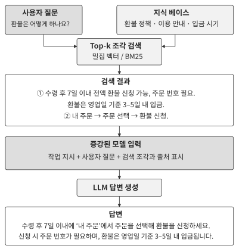

### 문서 청킹(Chunking)

어떤 A/S 설명서가 먼저 “7일 이내 환불 가능”을 적고, 다음 문단에서 예외 상품을 설명한다고 합시다. 첫 문장만 가져오면 예외 상품에도 환불을 약속할 수 있습니다. 반대로 설명서 전체를 검색 단위 하나로 삼으면 설치, 설정, 문제 해결까지 함께 딸려 와서 벡터가 환불이라는 주제를 부각하기 어렵습니다. **청킹(chunking)**은 이 두 극단 사이에서 크기를 골라, 한 조각이 자기 조건을 스스로 설명할 만큼 충분하면서도 구체적인 질문으로 쉽게 찾을 수 있게 하는 일입니다. 조각 길이는 임베딩 모델의 입력 한도도 지켜야 하고, 이후 생성에 쓸 컨텍스트 공간도 남겨 두어야 합니다.

흔히 쓰는 방법은 세 가지입니다.

**고정 크기 청킹**은 토큰 수로 나눕니다. 예를 들어 조각마다 512토큰으로 하고 인접 조각을 50\~100토큰 겹치게 합니다. 겹침이 있으면 경계 근처의 내용이 다른 조각에 온전히 담길 기회가 생깁니다. 이 방법은 조각 길이를 조절하기 쉽지만, 자르는 지점이 문단, 코드, 표 한가운데에 떨어질 수 있습니다.

**재귀적·구조 인식 청킹**은 장, 문단 같은 자연스러운 경계를 우선해서 나누고, 너무 긴 부분은 문장 같은 더 작은 단위로 다시 자릅니다. Markdown 제목과 HTML 요소가 구조의 단서가 됩니다. 코드 블록, 표, 제목에 딸린 본문에는 별도의 처리 규칙을 둘 수도 있습니다. 구조가 분명한 기술 문서라면 필자는 이 방법부터 시작하기를 권합니다. 이미 있는 장과 문단을 먼저 활용하고 너무 긴 부분만 더 나누면, 그냥 잘라 내는 것보다 대개 완전한 의미를 보존하기 쉽습니다.

**의미 기반 청킹**은 인접 문장이나 문장 묶음의 임베딩 유사도를 계산하여 주제가 뚜렷이 바뀌는 지점에서 자릅니다. 임베딩 계산이 늘어나지만, 같은 주제를 한 조각 안에 남길 가능성이 커집니다.

검색기가 “그 회사의 매출은 3% 증가했다”라는 문장 하나만 돌려줬다고 해 봅시다. 어느 회사일까요? 어느 분기일까요? 숫자는 제대로 찾았지만 질문에 답할 근거는 앞 문단에 있습니다. 재무 보고서 전체를 한 조각에 담으면 분기와 회사 이름은 지켜지지만, 매출을 조회할 때 채용과 설비 구매 문단까지 함께 들어옵니다. 이 내용이 벡터 하나를 나눠 쓰므로 매출이라는 주제가 벡터에서 그다지 두드러지지 않게 될 수 있습니다. 실제로 조각 크기를 정할 때는 조각당 256\~1024토큰, 인접 조각 겹침 10%\~20%에서 시험을 시작해 볼 수 있습니다.

제목, 출처, 시간 같은 메타데이터는 조각과 함께 저장할 수 있습니다. 뒤에서 다룰 컨텍스트 인식 검색은 각 조각에 원문 속 배경을 더 보충하여, 따로 검색될 때에도 지시 대상과 범위를 파악할 수 있게 돕습니다.

### 밀집 임베딩: 벡터로 텍스트 표현하기

**임베딩(embedding)**은 단어, 문장, 텍스트 조각을 `[0.2, -0.5, 0.8, ...]` 같은 수치 벡터로 대응시킵니다. 검색 모델은 학습을 통해 서로 관련 있는 질의와 문서가 벡터 공간에서 높은 유사도를 갖게 합니다. “밀집”은 벡터의 대부분 차원이 0이 아닌 값을 가지며 함께 텍스트의 정보를 나타낸다는 뜻입니다. 뒤에서 볼 희소 표현은 소수의 차원만 0이 아닙니다.

벡터 공간을 고차원 지도로 생각해 볼 수 있습니다. 텍스트마다 하나의 위치가 있고, 검색은 그 안에서 질의와 가까운 내용을 찾는 일입니다. 흔히 쓰는 척도 하나가 **코사인 유사도**입니다.

$$
\operatorname{cos}(A,B)=\frac{A\cdot B}{\|A\|\,\|B\|}
$$

내적 $A\cdot B$는 대응하는 차원끼리 곱해 더한 값이고, 크기 $\|A\|$는 각 차원 제곱합의 제곱근입니다. 두 크기로 나누면 결과는 방향 관계만 반영합니다. 0이 아닌 벡터라면 코사인 값의 범위는 $[-1,1]$이고, 1에 가까울수록 방향이 일치합니다. 검색 모델에 따라 내적이나 유클리드 거리를 쓰기도 합니다. 두 벡터를 모두 단위 길이로 정규화하면 내적은 코사인 유사도와 같아집니다.

> **손으로 계산하기: 세 문장의 코사인 유사도**
>
> 예시 벡터 세 개로 “고양이 키우는 법” $A=(0.9,0.5,0.1)$, “고양이 돌봄 안내서” $B=(0.8,0.6,0.1)$, “주식 투자 전략” $C=(0.1,0.1,0.9)$를 나타냅니다.
>
> $A\cdot B=0.9\times0.8+0.5\times0.6+0.1\times0.1=1.03$입니다. 두 벡터의 크기는 각각 $\sqrt{1.07}$과 $\sqrt{1.01}$이므로 유사도는 약 **0.991**입니다.
>
> $A\cdot C=0.9\times0.1+0.5\times0.1+0.1\times0.9=0.23$이고 $C$의 크기는 $\sqrt{0.83}$이므로 유사도는 약 **0.244**입니다. 이 벡터들에서는 고양이 키우기 질의가 돌봄 안내서와 더 가깝습니다.

실제 모델은 보통 수백에서 수천 차원으로 표현합니다.

#### Word2Vec에서 컨텍스트 인식으로

그림 3-6은 고정 단어 벡터에서 출발합니다. **Word2Vec**은 단어의 동시 출현을 바탕으로 단어마다 고정 벡터를 학습합니다. 어떤 관계는 벡터 연산으로 드러나는데, 고전적인 예가 “왕－남성＋여성≈여왕”입니다. 고정 표현의 한계도 직관적입니다. `bank`는 `river bank`(강둑)와 `investment bank`(투자 은행)에서 같은 단어 벡터를 씁니다.

**GloVe**는 말뭉치 전체에서 단어와 단어의 동시 출현 횟수를 세고, 가중 최소 제곱 목표로 단어 벡터를 학습합니다. Word2Vec이 국소 창 안의 예측 작업에 무게를 둔다면, GloVe는 전역 동시 출현 통계를 학습에 직접 넣습니다. 둘 다 단어마다 고정 표현을 학습합니다[^ch3-glove].

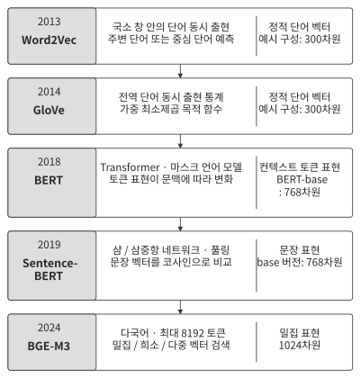

**BERT** 같은 컨텍스트 모델에 이르면 같은 토큰의 표현이 문장에 따라 달라집니다. 자기 어텐션 덕분에 모델은 “신제품을 발표했다”와 “두 근을 샀다” 같은 단서를 보고 두 문장의 “사과(애플)”에 서로 다른 표현을 계산할 수 있습니다. 검색용 임베딩 모델은 여기에 더해 토큰 표현을 모아 질의 벡터나 문서 벡터를 만들고, 그에 맞는 학습을 거쳐 둘을 비교할 수 있게 해야 합니다.

**Sentence-BERT**는 BERT를 풀링, 샴 네트워크 또는 트리플렛 네트워크 구조와 결합하여 바로 비교할 수 있는 문장 벡터를 학습합니다. 문서는 미리 인코딩해 색인에 넣어 두고, 질의가 들어오면 질의만 인코딩해 벡터 유사도를 계산하면 됩니다. 미리 인코딩해 두면 질의마다 모든 문서의 표현을 다시 계산하는 비용이 들지 않습니다[^ch3-sbert].

**BGE-M3**는 밀집, 희소, 다중 벡터 검색 표현을 함께 제공하며 다국어와 비교적 긴 입력을 지원합니다. 이 절에서는 그중 밀집 표현으로 단일 벡터 검색을 설명합니다[^ch3-bge-m3]. 모델이 받아들이는 길이는 청킹 방식에 영향을 줍니다. 원래 BERT의 전형적인 상한은 512토큰이고, BGE-M3는 8192토큰까지 지원합니다.

[^ch3-bge-m3]: Chen 등의 M3-Embedding 논문(arXiv:2402.03216)은 세 가지 검색 표현을 어떻게 함께 학습하는지 소개합니다. BAAI의 BGE-M3 모델 설명도 참고하세요. 표현 방식, 차원, 입력 길이, 사용 방법을 다룹니다.

> **실험 3-4 ★★: 두 가지 근사 최근접 이웃 색인 비교**
>
> 문서 벡터를 만든 뒤에는 질의와 가까운 벡터를 빠르게 찾아야 합니다. 하나씩 계산하면 정확한 최근접 이웃을 얻을 수 있지만, 데이터가 커지면 **근사 최근접 이웃**(Approximate Nearest Neighbor, ANN) 색인이 통제 가능한 재현율 손실을 감수하고 질의 속도를 얻습니다. 이 실험은 같은 실제 임베딩과 같은 질의에서 ANNOY와 HNSW를 비교하고, 정확 검색 결과를 기준으로 삼습니다. 예를 들어 어떤 질의의 정확 검색이 최근접 이웃 열 개를 내놓았고 근사 색인이 반환한 열 개 결과에 그중 여덟 개가 들어 있다면, 이 질의의 Recall@10은 0.8입니다. 이 값은 색인이 정확한 최근접 이웃을 얼마나 보존했는지를 나타냅니다.
>
> ANNOY는 여러 개의 무작위 투영 트리로 후보 범위를 좁힙니다. HNSW는 계층형 근접 그래프를 써서 희소한 상위 계층에서 목표 영역에 빠르게 다가간 뒤 더 조밀한 하위 계층으로 내려가 검색합니다. 그림 3-7은 HNSW의 계층 구조를 보여 줍니다.
>
> 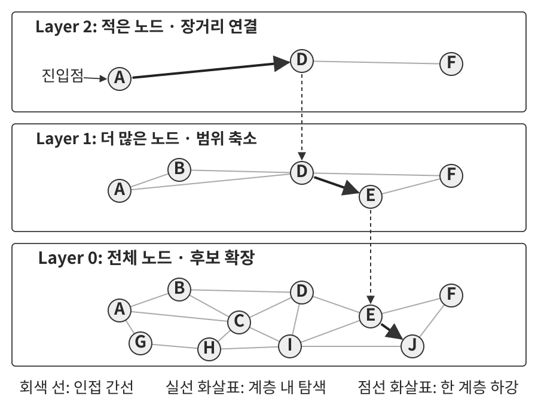
>
> 표 3-2 ANNOY와 HNSW의 구현상 절충
>
> | 비교 측면 | ANNOY | HNSW(hnswlib 기준) |
> | --- | --- | --- |
> | 색인 구조 | 여러 개의 무작위 투영 트리 | 계층형 근접 그래프 |
> | 구축 비용 | 트리 수, 벡터 수, 차원에 따라 달라짐 | 이웃 연결 규모, 구축 시 탐색 범위, 데이터 양에 따라 달라짐 |
> | 메모리와 파일 | 정적 색인은 메모리 매핑과 다중 프로세스 공유 지원 | 벡터와 그래프 인접 관계를 저장하며, 연결 규모가 비용에 영향을 줌 |
> | 증분 갱신 | 색인을 만든 뒤 항목을 추가하려면 재구축 필요 | 추가, 갱신, 삭제 표시를 지원하며 용량 관리 필요 |
> | 재현율과 속도 | 트리 수와 질의 탐색 예산으로 조절 | 구축 매개변수와 질의 탐색 범위로 조절 |
> | 사용 시나리오 | 배포와 공유가 쉬운 정적 색인 | 계속 쓰면서 조회하는 동적 색인 |
>
> 이번 실행에서는 먼저 텍스트 240개로 색인을 만들었습니다. 같은 질의 20개에 대해 두 색인 모두 정확 검색으로 얻은 상위 10개 최근접 이웃을 빠짐없이 찾았습니다. 처음 구축할 때 ANNOY는 Linux 컨테이너에서 약 13밀리초, HNSW는 로컬 환경에서 약 78밀리초가 걸렸고, 저장된 색인은 각각 약 1.40MB와 1.02MB였습니다. 나머지 60개를 추가하자 ANNOY는 색인을 다시 구축했고 HNSW는 새 벡터를 바로 삽입했습니다. 이제 색인에는 모두 300개가 들어 있고, 원래의 최근접 이웃도 달라질 수 있습니다. 새 색인에서 정확 검색을 다시 해 보니 두 색인의 평균 재현율은 여전히 100%였습니다.

[^ch3-ann]: Spotify의 Annoy 프로젝트 설명은 읽기 전용 색인을 구축하고 메모리 매핑으로 불러오는 방법, 그리고 `search_k`로 질의 시 확인하는 노드 수를 조절하는 방법을 소개합니다. hnswlib 프로젝트 설명의 Python 인터페이스 부분은 벡터를 추가하는 `add_items` 메서드와 질의 범위를 조절하는 `set_ef` 메서드를 설명합니다.

**색인은 지식이 갱신되는 방식에 맞춰 골라야 합니다.** 말뭉치를 정기적으로 일괄 배포하고 여러 프로세스가 같은 읽기 전용 색인을 공유한다면 필자는 ANNOY를 먼저 고려합니다. 새 문서를 계속 받아 온라인으로 삽입해야 한다면 HNSW를 우선합니다. 임베딩 모델은 의미 표현을 정하고, 색인은 그 표현을 알맞은 지연 시간과 갱신 비용으로 쓸 수 있는지를 정합니다. 둘이 함께 검색 서비스의 효과를 결정합니다.

ANNOY의 트리 수와 탐색 예산, HNSW의 이웃 연결 규모와 탐색 범위를 조절하면서 재현율과 지연 시간이 어떻게 달라지는지 관찰할 수 있습니다[^ch3-ann]. 색인 재현율은 목표한 최근접 이웃을 찾았는지를 잽니다. 그 이웃이 사용자 질문에 답할 수 있는지는 임베딩 표현과 자료 내용에 달려 있습니다.

### 희소 표현: 키워드에서 관련성 점수로

**희소 표현**은 고차원 벡터를 쓰되 소수의 차원만 0이 아닙니다. 전통적인 키워드 검색은 단어를 차원으로 삼고, 문서에 나타난 단어에 가중치를 줍니다. 그 바탕은 **단어 주머니 모델**(Bag of Words, BoW)입니다. 단어와 그 등장 횟수만 저장하고 순서는 무시합니다. 그래서 “고양이가 개를 쫓는다”와 “개가 고양이를 쫓는다”는 같은 단어 주머니 표현을 갖습니다.

이런 표현은 이름, 번호, 기술 용어를 일치시키는 데 알맞습니다. 아래에서는 TF-IDF부터 시작하여 단어 빈도와 문서 빈도가 어떻게 정렬 점수로 바뀌는지 설명합니다.

#### TF-IDF에서 BM25로

**TF-IDF**(Term Frequency–Inverse Document Frequency, 단어 빈도–역문서 빈도)는 두 신호를 결합합니다. 단어가 현재 문서에 몇 번 나오는지, 그리고 말뭉치 전체에서 얼마나 흔한지입니다. 문서 100개 중 60개에 “모델”이 들어 있고 3개에만 “증류”가 들어 있다면, “모델 증류”를 질의할 때 “증류”가 더 큰 변별력을 가집니다.

기본적인 형태는 다음과 같습니다.

$$\operatorname{TF\!\text{-}\!IDF}(t,d)=\operatorname{TF}(t,d)\times\operatorname{IDF}(t),\qquad \operatorname{IDF}(t)=\ln\frac{N}{\operatorname{DF}(t)}$$

$\operatorname{TF}(t,d)$는 문서 $d$에 단어 $t$가 나온 횟수, $\operatorname{DF}(t)$는 그 단어가 들어 있는 문서 수, $N$은 전체 문서 수입니다. 이 식에 따르면 단어가 열 번 나올 때의 점수 기여는 다섯 번 나올 때의 두 배가 되고, 긴 문서는 단지 단어가 많다는 이유로 점수가 높아질 수도 있습니다. TF-IDF에는 여러 정규화 변형이 있으며, 아래의 BM25는 단어 빈도 포화와 길이 정규화로 이 두 영향을 다룹니다.

**BM25**는 질의 단어마다의 기여를 더합니다.

$$\operatorname{Score}(Q,D)=\sum_i\operatorname{IDF}_{\mathrm{BM25}}(q_i)\cdot\frac{\operatorname{TF}(q_i,D)(k_1+1)}{\operatorname{TF}(q_i,D)+k_1\left(1-b+b\frac{|D|}{\operatorname{avgdl}}\right)}$$

여기서 $q_i$는 질의 단어, $|D|$는 문서 길이, $\operatorname{avgdl}$은 평균 문서 길이입니다. $k_1$은 단어 빈도의 포화 정도를 조절하고, $b$는 길이 정규화의 강도를 조절하며 0이면 이 보정을 끕니다. 그림 3-8은 이 항들을 따로 계산합니다. 먼저 문서 길이를 고정하고 질의 단어가 한 번에서 세 번으로 늘어날 때 한 번 더 나올 때마다 점수가 얼마나 느는지 보고, 다음에는 단어 빈도를 고정한 채 문서 길이만 두 배로 늘립니다. 맨 아래 줄은 두 단어가 문서 집합에서 얼마나 흔한지 비교합니다.

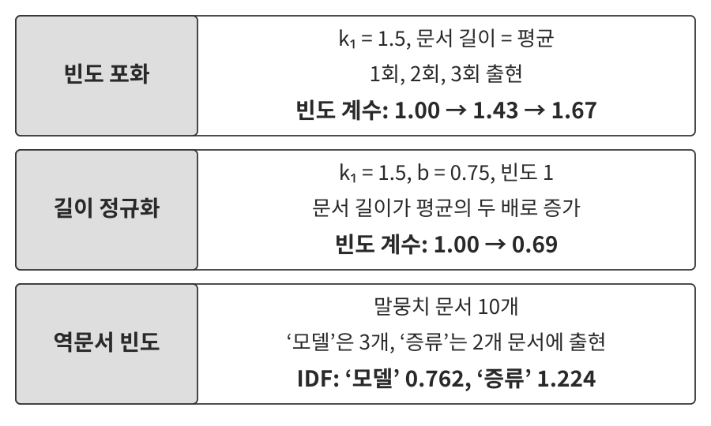

그림의 첫 줄에서 두 번째 등장은 단어 빈도 인자를 약 0.43 늘렸지만 세 번째 등장은 약 0.24만 늘렸습니다. 이것이 단어 빈도 포화입니다. 둘째 줄에서는 같은 단어가 모두 한 번씩만 나오지만 더 긴 문서에서는 덜 두드러지므로, 길이 보정이 그 단어 빈도 인자를 낮춥니다. 여기에 IDF를 곱해야 이 단어가 총점에 기여하는 값이 됩니다.

위 식에는 정해야 할 항이 하나 더 있습니다. 똑같이 세 번 나와도 왜 드문 단어가 흔한 단어보다 대개 더 쓸모 있을까요? 이 절에서는 아래의 역문서 빈도로 단어에 가중치를 줍니다.

$$\operatorname{IDF}_{\mathrm{BM25}}(t)=\ln\frac{N-\operatorname{DF}(t)+0.5}{\operatorname{DF}(t)+0.5}$$

분자는 그 단어가 없는 문서 수, 분모는 그 단어가 있는 문서 수이며, 둘 다 0.5를 더해 평활화하므로 문서 빈도가 0이거나 $N$일 때도 계산할 수 있습니다. 드문 단어일수록 가중치가 높아지고, 문서의 절반 넘게 그 단어를 포함하면 이 식은 음수를 냅니다. 동반 구현은 실제 점수 가중치의 하한을 $10^{-6}$으로 두되, 확인할 수 있도록 원래 값도 보존합니다.

> **실험 3-5 ★★: BM25 검색 엔진을 처음부터 구현하기**
>
> 이 실험은 토큰화, 불용어 처리, 역색인, 점수 계산을 차례로 구현합니다. 불용어 처리는 중국어의 “的”(~의), “了”(완료를 나타내는 조사)처럼 자주 나오는 단어를 걸러 냅니다. **역색인**은 단어마다 어느 문서에 나오는지와 해당 단어 빈도를 기록합니다. 책 뒤의 용어 색인과 비슷해서, “TCP”를 찾으면 45, 112, 203쪽을 찾아 그 위치의 내용을 읽을 수 있습니다.
>
> “모델 증류”로 질의 하나를 손으로 계산해 봅시다. 말뭉치에 문서가 10개 있고 평균 길이는 250단어, $k_1=1.5$, $b=0.75$라고 합시다. “모델”은 문서 3개에 나와 IDF가 약 0.762이고, “증류”는 문서 2개에 나와 IDF가 약 1.224입니다. 아래 표는 단어별로 적중한 문서, 단어 빈도, 문서 길이를 나열합니다. 이 값들을 식에 넣으면 각 단어가 문서 점수에 기여하는 값을 구할 수 있습니다.
>
> | 질의 단어 | 문서 | 단어 빈도 TF | 문서 길이 | BM25 기여 |
> | --- | --- | ---: | ---: | ---: |
> | 모델 | doc_1 | 5 | 200 | 1.52 |
> | 모델 | doc_3 | 2 | 500 | 0.82 |
> | 모델 | doc_7 | 8 | 150 | 1.68 |
> | 증류 | doc_1 | 3 | 200 | 2.15 |
> | 증류 | doc_5 | 1 | 250 | 1.22 |
>
> 두 단어가 doc_1에서 기여한 값을 더하면 약 3.67이고, 순위는 **doc_1(3.67) > doc_7(1.68) > doc_5(1.22) > doc_3(0.82)**입니다. doc_1에서 “증류”의 단어 빈도는 “모델”보다 낮지만 더 드물기 때문에 최종 기여가 더 큽니다. 또 두 단어에 모두 일치하면서 총점이 한층 높아졌습니다.
>
> 이번에는 `cat`으로 동반 실험의 영어 말뭉치를 검색해 봅시다. 관련 있다고 표시된 짧은 글 두 개는 각각 `kitten`과 `feline`을 썼고, 역색인에서는 `cat`을 찾을 수 없어 후보 목록이 비어 있습니다. 앞에서 본 단어 빈도 가중치를 아무리 높여도 점수를 매길 문서가 하나도 없습니다. 이 두 글에 나온 단어로 바꿔 검색하면 각각 후보 목록에 들어오는 것을 볼 수 있습니다.

### 혼합 검색: 두 경로의 결과를 합친 뒤 재순위화하기

어떤 질문은 동의어를 미리 다 나열하기 어렵습니다. 실험 3-6에는 “쓰지 않는 힙 공간을 자동으로 회수하는 방법”을 묻는 문제가 있는데, 목표 글은 “자동 메모리 관리는 개발자가 객체를 직접 해제하는 수고를 덜어 준다”라고 쓰여 있습니다. 영어 질의와 글 사이에 공통 단어가 없어 키워드 검색은 한 편도 찾지 못했지만, 벡터 검색은 목표 글을 1위에 올렸습니다. 모델 번호 XR-7003으로 질의를 바꾸면 키워드 검색은 해당 모델을 바로 찾았고, 벡터 검색은 비슷한 모델 몇 개까지 함께 나열했습니다.

**혼합 검색**은 키워드와 벡터로 각각 관련 문단을 찾은 뒤, 어느 문단을 모델에 넘길지 정합니다. 지식 베이스에 정확한 식별자와 자연어 설명이 함께 들어 있다면 필자는 이 방식에서 출발하기를 권합니다. 그림 3-9를 따라 XR-7003을 추적해 봅시다. 두 경로 모두 이를 1위에 올렸으므로 융합할 때 순위 기여를 두 번 받습니다. 재순위화는 2위를 바꿨지만, 사용자가 가장 먼저 보는 모델 번호는 여전히 맞습니다.

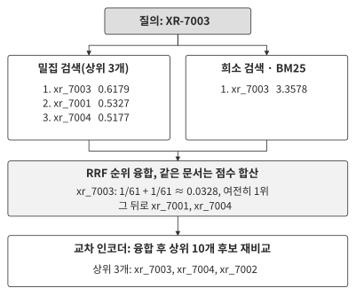

첫 단계는 **병렬 검색**입니다. 질의를 밀집 엔진과 희소 엔진에 보내 각자 관련 있을 만한 문서를 한 묶음씩 가져옵니다. 두 경로는 같은 원문을 쓸 수도 있고, 각 모델의 요구에 맞춰 전처리할 수도 있습니다.

둘째 단계는 **결과 융합**입니다. 두 경로 결과에서 같은 문서를 합친 뒤 하나의 순위로 정리합니다. 코사인 유사도와 BM25는 수치의 척도가 달라서 그대로 더하면 값이 큰 쪽이 결과를 좌우하기 쉽습니다. 한 가지 방법은 점수를 보정하거나 정규화한 뒤 가중 결합하는 것이고, 다른 방법은 각 경로의 순위로 계산하는 **역순위 융합**(Reciprocal Rank Fusion, RRF)입니다.

$$\operatorname{RRF}(d)=\sum_{j:\,d\in R_j}\frac{1}{k+\operatorname{rank}_j(d)}$$

$R_j$는 $j$번째 경로의 결과이고 순위는 1부터 시작하며, 문서가 어떤 경로에 나오지 않으면 그 경로의 기여는 0입니다. 평활 상수 $k$는 흔히 60으로 두는데, 클수록 상위 몇 순위 사이의 점수 차이가 작아집니다. RRF는 서로 다른 점수 방식을 결합하기 쉽지만 순위만 남기므로, 원래 점수에 담긴 강약의 차이를 쓰려면 다른 방법이 필요합니다.

두 경로 검색의 예를 직접 계산해 봅시다. 사용자가 “환불은 며칠 만에 입금되나요?”라고 묻습니다. 문서 A는 키워드 검색에서 1위이고 벡터 검색 상위권에는 없습니다. 문서 B는 두 경로 모두에서 2위입니다. $k=60$으로 두면 A는 $1/61$, 약 0.0164를 얻고, B는 $1/62+1/62$, 약 0.0323을 얻습니다. 융합한 뒤에는 B가 A보다 앞섭니다. 이 결과가 말해 주는 것은 두 검색 경로가 모두 B를 찾았다는 사실뿐입니다. B가 정말 입금 시기에 답하는지 판단하려면, B에 적힌 내용이 “환불 신청 방법”인지 “환불 입금 시기”인지 봐야 합니다.

셋째 단계로 **신경망 재순위화**를 넣을 수 있습니다. 시스템은 융합 결과에서 상위권 문서, 예를 들어 상위 50개를 꺼내 재순위 모델이 각 문서와 질의의 관련도를 채점하게 합니다. 재순위화는 이 50개의 순서를 바꿀 수 있습니다. 정말 쓸모 있는 문서가 처음부터 뽑히지 않았다면 상류로 돌아가 검색을 개선해야 합니다.

여기서 흔히 쓰는 모델은 **교차 인코더(cross-encoder)**입니다. 질의와 후보 문서를 함께 입력해 모델 안에서 두 부분이 상호작용하게 하고 관련성 점수를 출력합니다. 검색 단계의 **이중 인코더(bi-encoder)**는 질의와 문서를 따로 인코딩하므로 문서 벡터를 미리 계산해 두고 질의할 때 벡터 검색만 하면 됩니다. 전자는 적은 수의 문서를 정밀하게 정렬하는 데, 후자는 많은 문서에서 1차로 걸러 내는 데 알맞습니다. 이력서 심사와 면접에 빗댈 수 있습니다. 먼저 이미 가진 특성으로 범위를 좁히고, 그다음 구체적인 요구를 놓고 깊이 비교합니다. BGE Reranker v2 M3는 이 단계에 쓸 수 있는 모델 가운데 하나입니다[^ch3-reranker].

[^ch3-reranker]: BAAI, BGE Reranker v2 M3 모델 설명. 질의–문서 입력과 관련성 채점을 소개합니다.

관련 자료가 이미 후보 풀에 들어왔는데도 무관한 자료 뒤로 자주 밀린다면, 필자는 교차 인코더 재순위화를 먼저 평가합니다. 질문과 문서를 함께 읽으므로 문서의 조건, 한정어, 세부 사항이 질문의 요구에 맞는지 직접 비교할 수 있습니다. 표 3-3은 흔히 쓰는 지표 세 가지를 보여 줍니다.

표 3-3 검색 품질의 세 가지 지표

| 지표 | 계산과 의미 |
| --- | --- |
| recall@k(재현율) | 상위 k개 결과에 든 관련 문서 수를 그 질의의 전체 관련 문서 수로 나눈 값으로, 관련 내용을 얼마나 찾아왔는지 잽니다. 테스트 세트에서는 보통 질의별 값을 다시 평균 냅니다 |
| MRR(평균 역순위) | 질의마다 첫 관련 문서 순위의 역수를 구해 평균 냅니다. 1위는 1, 10위는 0.1, 찾지 못하면 0입니다 |
| nDCG@k(정규화 할인 누적 이득) | 관련 정도에 따라 결과에 점수를 주고 뒤쪽 순위일수록 할인한 뒤 이상적인 정렬의 점수로 나누어, 상위 k개 결과의 전체 정렬 품질을 잽니다 |

**적중률**도 기록할 수 있습니다. 상위 k개 결과에서 관련 문서를 적어도 하나 찾아온 질의는 얼마나 될까요? 예를 들어 어떤 질문에 자료 세 개가 필요한데 상위 20개 결과가 그중 두 개만 찾아왔다고 합시다. 이 질의는 적중했으므로 “전혀 적중하지 못함”이라는 실패 횟수에는 들어가지 않지만, recall@20은 $2/3$에 불과해 자료의 $1/3$을 여전히 찾지 못했습니다. 문제마다 목표 문서가 하나뿐이라면, 그 문서를 찾은 문제는 1점, 놓친 문제는 0점을 받습니다. 같은 검색 결과에 대해 평균을 내면 적중률은 평균 재현율과 같습니다.

> **실험 3-6 ★★: 희소, 밀집, 융합, 재순위화 비교**
>
> 이 실험은 같은 12개 표시 질의에서 다섯 가지 구성을 비교합니다. 희소 검색, 밀집 검색, RRF 융합, 가중 융합, 그리고 융합 뒤 재순위화입니다. 질의는 의미 유사성, 정확한 명칭, 다국어, 기술 코드를 아우르며, 그중 두 문제는 식물이 햇빛을 어떻게 양분으로 바꾸는지를 각각 영어와 중국어로 묻습니다. 밀집 모델은 Qwen3-Embedding-0.6B, 재순위화는 MS MARCO MiniLM 교차 인코더를 쓰며, 경로마다 최대 10개 문서를 가져오고 재순위 모델은 RRF 상위의 최대 10개 문서를 처리합니다. 재현율과 nDCG는 최종 순위의 상위 3개만 보고, MRR은 반환된 목록을 따라 첫 관련 문서를 찾습니다.
>
> 먼저 실험 3-6 실행 기록의 문제별 순위를 열어 두 광합성 문제의 검색 결과를 비교해 봅시다. 영어 문제의 목표 문서는 여전히 1위입니다. 중국어 문제는 먼저 프로그래밍 언어와 화산을 반환하고 세 번째 문서에서야 광합성을 다룹니다. 문제마다 관련 문서로 표시된 것은 하나뿐이고 두 문제 모두 상위 3위 안에서 그것을 찾았으므로 recall@3은 둘 다 1입니다. 하지만 중국어 문제는 첫 관련 문서가 3위라서 역순위가 $1/3$에 불과합니다. 이 실험의 채점 방식에서 3위의 이득은 $1/\log_2(3+1)=0.5$이고 1위의 이득은 1이므로, 중국어 문제의 nDCG@3은 0.5입니다.
>
> 이제 12문제 전체를 봅시다. 재순위화한 뒤 중국어 광합성 문제 외에도 힙 메모리 회수에 관한 문제 하나에서 목표 문서가 1위에서 2위로 밀렸습니다. 나머지 열 문제는 모두 1위를 지켰으므로 재순위화 뒤의 MRR은 $(10+1/2+1/3)/12\approx0.903$입니다. 비교하자면 밀집 검색과 RRF의 MRR은 모두 1입니다. 두 방식의 nDCG@3도 모두 1이었는데, 재순위화한 뒤에는 약 0.928로 떨어졌습니다. 평균 재현율만 보면 이런 순위 변화가 보이지 않습니다. 희소 검색의 recall@3은 0.833이고 나머지 네 그룹은 모두 1입니다.
>
> 이 문제들에 쓸 구성을 하나 골라야 한다고 해 봅시다. 재순위화에 들인 시간으로 무엇을 얻었을까요? 이 CPU에서 RRF는 검색을 시작해 순위를 내놓기까지 문제당 평균 약 194밀리초가 걸렸고, 재순위화를 붙이면 약 237밀리초가 걸렸습니다. 더 쓴 약 43밀리초는 목표 문서를 더 찾아 주지 못했고, 오히려 두 문제의 정답을 뒤로 밀어냈습니다.

## 지식 구성과 검색

지식을 어떻게 구성하느냐가 각 항목에 무엇이 들어갈지를 정하고, 검색기는 그 항목들 가운데 무엇을 가져올지를 정합니다. 기술 설명서, 법률 문서, 논문의 문단은 장의 계층, 개념 사이의 의존, 문서 간 인용으로 서로 이어져 있습니다. 이런 구조를 보존하면 질의가 구체적인 증거와 더 높은 수준의 개괄에 함께 접근할 수 있습니다.

이 절에서는 몇 가지 구성 방식을 차례로 다룹니다. RAPTOR와 GraphRAG는 계층 색인이나 관계 색인을 만들고, OpenViking은 디렉터리로 컨텍스트 자원을 구성합니다. 증분 갱신과 주기적 정리는 지식의 최신성을 유지하고, Agentic RAG는 에이전트가 이미 얻은 결과를 바탕으로 검색을 이어 가게 합니다. 컨텍스트 인식 검색은 조각의 배경을 보충하고, 마지막으로 데이터 세트에서 재사용할 수 있는 지식을 추출합니다. 이들은 각각 표현, 색인, 갱신, 질의 과정에 작용하며, 사용자 메모리에 조합해 쓸 수도 있습니다.

먼저 두 가지 예로 질의에 필요한 정보와 원래 기록 사이의 간극을 살펴봅시다.

**사례 1: 검은 고양이와 흰 고양이 세기.** 앞 장에서는 프로그램이 우리 100개를 모두 세어 검은 고양이 90마리, 흰 고양이 10마리를 얻었습니다. 이번에는 검색기가 상위 20개 기록만 돌려주게 합니다. 그중 18개에 유효한 색 정보가 있고, 15개가 검은 고양이, 3개가 흰 고양이라고 합시다. 계산해서 나온 83.3%(15/18)는 이 유효 기록 묶음 안에서 검은 고양이가 차지하는 비율이지만, 가게 전체의 검은 고양이 비율은 90%(90/100)입니다. 검색기는 관련성으로 기록을 고를 뿐, 가게 전체를 대표하는 표본을 뽑지 않았습니다.

가게 전체의 비율을 묻는 사람이 많다면, 모든 우리를 미리 세어 검은 고양이와 흰 고양이가 각각 몇 마리인지 저장하고 집계 범위와 갱신 시각을 표시해 둘 수 있습니다. 우리 속 고양이가 바뀌면 해당 세부 기록을 갱신하고 총계를 다시 계산합니다. 37번 우리에 무엇이 있는지 묻는다면 여전히 그 세부 기록을 찾아봐야 합니다.

**사례 2: 간호사도 의사가 받은 할인을 받을 수 있을까?** Xfinity 할인 문의를 바탕으로 꾸민 교육용 상황을 예로 들어 봅시다. 티켓을 보면 퇴역 군인 John은 심사를 통과했고, 의사 Sarah는 할인을 받았으며, 교사 Mike는 자격이 없다는 답을 받았습니다. 티켓마다 처리 결과가 하나씩 기록되어 있습니다. 간호사가 자신도 할인을 받을 수 있는지 묻는다면, 비슷한 티켓만 검색해서는 세 가지 문제에 부딪힙니다.

- **직업이 비슷하다고 같은 혜택을 받는 것은 아닙니다.** “간호사”와 “의사”는 의미가 가까워 Sarah의 기록이 앞에 올 수 있습니다. 혜택이 적용되는지는 행사 약관이 누구에게 신청 자격을 주고 어떤 증빙을 요구하는지에 달려 있습니다.
- **개별 티켓은 적용 조건을 다 담지 못합니다.** 누군가 심사를 통과했다는 사실은 그 사람이 당시 조건에서 얻은 결과만 직접 말해 줍니다. 검색 개수를 늘려도 한 번도 나온 적 없는 범주나 예외는 찾지 못할 수 있습니다.
- **자료의 범위가 분명하지 않습니다.** 티켓은 서로 다른 행사나 시기에서 왔을 수 있습니다. 어떤 기록이 해당되는지, 어떤 정책 근거가 빠져 있는지부터 확인해야 합니다.

색인할 때 같은 행사의 티켓을 서로 연결하고, 해당 공식 약관을 찾아 적용 대상, 예외, 시행 시기, 조항 출처를 규칙 카드로 정리할 수 있습니다. 예를 들어 이 교육용 상황의 약관이 현역 및 퇴역 군인과 면허를 가진 의료인을 명시적으로 포함하고 교사 범주를 제외한다면, 이 조건들을 하나하나 저장합니다. 간호사가 의료인 범위에 속하는지도 약관으로 확인합니다. 티켓은 그대로 보존하여 실제 처리 과정을 설명하고 집행상의 차이를 찾는 데 씁니다.

두 예는 서로 다른 정보 요구를 보여 줍니다. 고양이를 세려면 가게 전체의 우리를 집계해야 하고, 누가 할인을 받을 수 있는지 판단하려면 약관과 예외를 모두 찾아봐야 합니다. 이런 질의에 대해 필자는 통계와 규칙 정리를 색인 구축 단계로 앞당기자고 주장합니다. 가져오는 조각만 늘려서는 모델이 여전히 전체 집계 범위나 이번 신청의 승인 여부를 정하는 조항을 보지 못할 수 있습니다. 작업을 중심으로 통계 요약, 규칙 카드, 출처 관계를 만들어 두어야 검색이 판단을 뒷받침할 만한 정보를 한 번에 가져오고, 원래 자료까지 되짚어 볼 수 있습니다.

### 구조화 색인: 계층과 연관 구축하기

긴 보고서를 읽을 때 “수리 신청서의 어느 칸을 채워야 하나”는 원문의 한 문단에서 답을 찾을 수 있는 경우가 많지만, “몇 가지 고장은 왜 되풀이되나”는 여러 장을 가로질러야 합니다. 이런 질의를 함께 다루려면 색인을 만들 때 요약을 생성하고 계층을 세우거나, 엔터티와 관계를 추출할 수 있습니다. 아래의 RAPTOR는 재귀적 요약으로 계층을 만들고, GraphRAG는 엔터티 관계와 커뮤니티 요약으로 자료를 구성합니다.

**RAPTOR**(Recursive Abstractive Processing for Tree-Organized Retrieval)는 텍스트 조각에서 시작합니다. 먼저 조각마다 벡터로 인코딩하고, 비슷한 정도에 따라 몇 개의 그룹으로 묶은 뒤, 그룹마다 요약을 생성합니다. 요약을 새로운 텍스트 조각 묶음으로 보고 이 단계를 되풀이하면 그림 3-10의 트리가 됩니다. 화살표를 따라 텍스트 조각 3, 4, 5에서 위로 올라가면 이들이 함께 요약 B를 만들고, 더 올라가면 A, B, C 세 그룹의 요약이 전역 요약으로 모입니다.[^ch3-raptor]

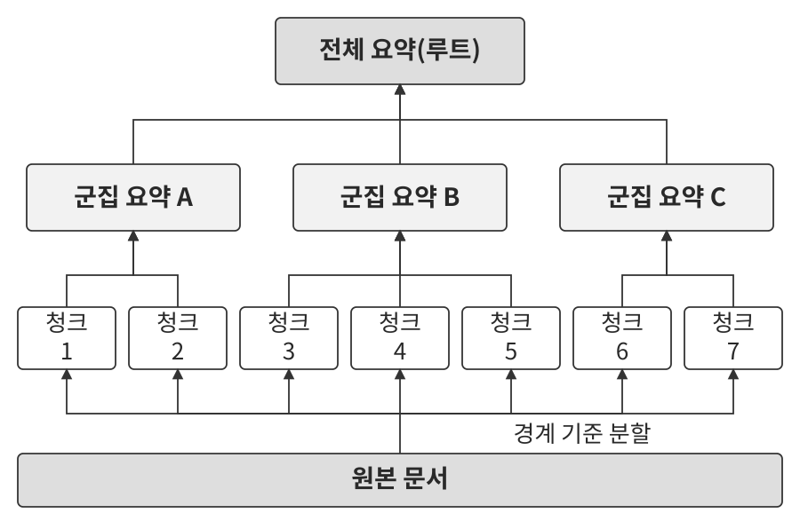

예를 들어 “SSE2는 128비트 XMM 레지스터에서 정수 SIMD 연산을 지원한다”와 “SSE4.2는 문자열 비교 명령을 추가했다”는 “x86 SIMD 명령어 집합의 발전”이라는 요약에 들어갈 수 있습니다. 세부 질문은 하위 조각과, 개괄 질문은 상위 요약과 일치할 수 있습니다. 질의는 계층을 따라 점점 깊이 들어갈 수도 있고, 모든 계층의 노드를 한데 모아 검색해 가장 관련 있는 묶음을 고를 수도 있습니다.

[^ch3-raptor]: Sarthi 등, RAPTOR: Recursive Abstractive Processing for Tree-Organized Retrieval, 2024.

**GraphRAG**는 엔터티, 관계, 커뮤니티 요약으로 지식을 구성합니다. “주체—관계—대상” 형태의 트리플로 관계 하나를 기록하는데, 예를 들면 (중국, 수도는, 베이징)이나 (장싼, 근무처, 텐센트)입니다. 두 기록이 같은 엔터티를 언급하기만 하면 그래프에서 연결할 수 있습니다. 그림 3-11의 두 의사는 모두 성이 장씨입니다. 사용자가 “내 치과 의사가 있는 병원 주소”를 물으면 시스템은 어느 관계를 따라가야 할까요?

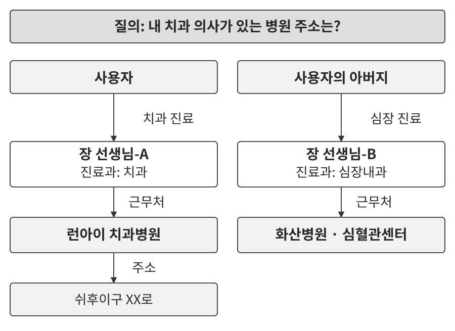

1. **그래프를 만들 때 같은 이름의 엔터티를 구분합니다.** 장 선생님 한 분은 런아이 치과병원에서 사용자의 치아를 치료하고, 다른 한 분은 화산병원에서 사용자 아버지의 심장병을 치료합니다. 시스템은 엔터티를 추출하고 기록을 병합할 때 이런 단서를 바탕으로 두 의사에게 서로 다른 식별자를 줄 수 있습니다. 앞에서 본 `person`, `relationship` 필드도 비슷한 역할을 합니다. 문장 속 `bank`가 강둑인지 은행인지 판단하는 것은 단어 의미 중의성 해소이고, 어떤 기록이 어느 장 선생님에 관한 것인지 판단하는 것은 엔터티 중의성 해소입니다.
2. **질의할 때 관계 사슬을 따라 검색합니다.** 사용자에서 출발해 “사용자→의사→병원→주소”를 차례로 따라가면, 여러 기록에 흩어진 정보를 하나의 답으로 이을 수 있습니다.

Microsoft GraphRAG의 색인 절차는 먼저 텍스트 단위에서 엔터티와 관계를 추출하고, 커뮤니티 탐지로 긴밀하게 연결된 엔터티 무리를 찾아 커뮤니티 계층과 요약을 생성합니다. 특정 엔터티를 질의할 때 로컬 검색은 그 엔터티의 연관 정보와 원문을 결합하고, 말뭉치 전체의 주제를 질의할 때 글로벌 검색은 커뮤니티 요약으로 답을 구성합니다[^ch3-graphrag].

[^ch3-graphrag]: Microsoft GraphRAG, 색인과 질의 개요, 로컬 검색과 글로벌 검색.

관계 표현은 조건과 시간도 담을 수 있어야 합니다. 예를 들어 “다음 주에도 비가 오면 바다에 가는 걸 취소하고 박물관에 갈게요”에는 조건, 유효 시간, 대안 행동이 들어 있습니다. (사용자, 계획 있음, 해변 여행)과 (사용자, 대안 계획 있음, 박물관 방문)만 추출하면 전환 조건이 사라집니다. 원래 문장을 그대로 보존하고, 조건 노드, 사건 노드 또는 구조화 필드로 “다음 주에 비가 올 때”라는 제약을 나타내어 관계가 원문을 다시 가리키게 할 수 있습니다.

사용자 메모리에 대해 필자는 **자연어와 구조화 색인을 계층적으로 함께 쓰는 방식**을 더 권합니다. 자연어로 완전한 표현을 저장하고, 메타데이터로 대상, 시간, 출처를 기록하며, 자주 연결해야 하는 내용에는 그래프 색인을 만듭니다.

> **실험 3-7 ★★★: 계층 요약과 관계 색인 비교**
>
> 이 실험은 Intel 아키텍처 설명서에서 SSE, AVX, 상태 관리와 관련된 14쪽을 골라 두 가지 교육용 구현을 만듭니다. 계층 요약 분기는 먼저 쪽별 요약을 생성한 뒤 세 그룹으로 묶어 그룹 요약과 루트 요약을 생성합니다. 관계 색인 분기는 엔터티와 관계를 추출한 뒤 커뮤니티 요약을 생성합니다. 두 그룹은 같은 자료와 여덟 개의 질문으로 개념 세부와 관계 추론을 비교합니다.
>
> “SSE 프로그래밍 환경을 설명하라”를 질의하면 계층 요약은 SSE 개요와 레지스터 세부 사항에 동시에 일치할 수 있습니다. 이 구현은 모든 계층의 노드를 한꺼번에 검색해 가장 관련 있는 다섯 개를 고릅니다. 관계 분기는 관련 엔터티에서 이웃으로 확장하고 커뮤니티 요약을 결합해 컨텍스트를 구성합니다. “SSE→XMM 레지스터→부동소수점 연산→ADDPS” 같은 관계를 따라가면 개념과 구체적인 명령을 연결할 수 있습니다.
>
> 더 복잡한 질문은 “프로세서가 AVX를 지원한다고 밝히면 프로그램은 곧바로 AVX를 쓸 수 있는가?”입니다. 이 질문은 프로세서의 능력과 운영 체제의 상태 관리를 연결해야 합니다. CPUID의 AVX, OSXSAVE 플래그를 확인한 다음 XCR0을 읽어 XMM과 YMM 상태가 모두 활성화되었는지 확인해야 합니다. 이 문제에서 그래프 검색 프로그램에 준 끝점 힌트는 CPUID와 YMM입니다. 프로그램은 둘을 잇는 최단 경로를 찾아 XSAVE, CR4.OSXSAVE, XCR0을 거친 뒤, 그 경로를 모델에 넘겨 답하게 합니다.
>
> 여덟 개 질문에서 두 그룹의 평균 출처 쪽 포함률은 모두 약 95.8%였습니다.

필자는 먼저 청킹과 혼합 검색을 제대로 갖추고, 문서를 가로지르는 종합과 관계 질의가 되풀이해서 필요해질 때 구조화 색인을 만들기를 권합니다. 환불 정책의 특정 문단을 찾는 일은 대개 청킹과 혼합 검색으로 해결됩니다. SSE와 AVX를 비교하거나 전체 아키텍처에서 구체적인 명령까지 찾아가는 일에는 문단을 가로지르는 요약과 관계 색인이 더 필요합니다.

### 파일 시스템 패러다임: 디렉터리 구조로 지식 구성하기

**OpenViking**은 가상 파일 시스템으로 메모리, 자원, 스킬을 구성합니다. 각 항목은 `viking://` URI로 참조하며, 에이전트는 디렉터리를 탐색하고 개요를 읽은 뒤 필요한 내용에 접근할 수 있습니다[^ch3-openviking-uri]. 정보의 용도에 따라 디렉터리를 세 묶음으로 이해할 수 있습니다. 외부 자원, 사용자 자료, 그리고 에이전트가 쓰는 스킬과 경험입니다. 사용자와 에이전트 식별자는 각자의 네임스페이스를 한정합니다.

| 내용 | 전형적 용도 |
| --- | --- |
| Resources | 기술 문서, 코드 저장소, 웹 페이지 등 외부 자료 |
| User memories | 특정 사용자의 선호, 습관, 경험 |
| Skills와 Agent memories | 재사용할 수 있는 절차, 작업 기록, 검증이 필요한 경험 |

URI는 통일된 위치 지정 방식을 제공하고, 물리적 저장과 색인은 서비스가 관리합니다. 디렉터리 인터페이스 덕분에 에이전트는 주제별로 한 단계씩 탐색할 수 있고, 의미 검색을 관련 하위 트리로 제한할 수도 있습니다. 파일 시스템 방식의 접근, 콘텐츠 저장, 벡터 색인이 함께 서비스를 이룰 수 있습니다.

[^ch3-openviking-uri]: OpenViking, Viking URI와 시스템 아키텍처.

OpenViking은 내용을 **L0, L1, L2** 세 계층으로 나눕니다. L0은 디렉터리가 관련 있는지 빠르게 판단하기 위한 짧은 요약이고, L1은 주요 내용과 탐색 진입점을 설명하는 디렉터리 개요이며, L2는 자세히 읽어야 하는 본문입니다. 디렉터리 수준의 요약과 개요는 각각 `.abstract.md`와 `.overview.md`에 저장됩니다. 두 파일의 본문 생성 예산은 각각 256자와 4000자입니다[^ch3-openviking-layers].

질의는 먼저 요약을 읽어 위치를 정하고, 개요를 읽어 파일을 고른 뒤, 마지막에 원문을 불러올 수 있습니다. 이는 2장 Skills의 점진적 공개와 통합니다. 가벼운 목록으로 발견을 돕고, 완전한 내용은 작업에 필요할 때 불러옵니다. 정확한 수치, 조건, 원래 표현이 필요하면 해당 본문을 이어서 가져와야 합니다.

[^ch3-openviking-layers]: OpenViking, Context Layers (L0/L1/L2). L0과 L1은 디렉터리 수준에서 생성한 표현이고, L2는 원본 파일이거나 파싱한 본문일 수 있습니다.

사람과 에이전트가 함께 유지 관리해야 하는 지식이라면 필자는 **Markdown 일반 텍스트와 버전 관리**로 다루는 쪽을 선호합니다. 사람은 지식을 직접 읽고 편집하고 고칠 수 있고, 에이전트도 같은 파일 인터페이스를 써서 작업 브랜치에서 갱신을 제안하고 검토를 거친 뒤 공개할 수 있습니다. 버전 관리는 수정할 때마다 차이를 저장하고, 잘못된 갱신을 되돌릴 수 있게 합니다. 세션이 끝나면 사용자 선호는 해당 사용자의 메모리로, 작업 경과는 작업 기록으로 들어갑니다. 작업 기록은 결과 평가, 궤적을 가로지르는 귀납, 이후의 검증을 거쳐 9장에서 다룰 경험으로 발전할 수 있습니다.

파일 시스템으로 지식을 구성한다면 반드시 **관련 항목 사이에 링크와 색인을 함께 만들어야 합니다**. 서로 참조하지 않는 파일 묶음은 전문 검색이나 의미 검색으로만 연관을 다시 찾을 수 있습니다. 파일이 많아질수록 에이전트는 이미 찾은 내용에서 출발해 계속 추적하기가 어려워집니다. 링크는 명확한 찾기 경로를 제공합니다. 예를 들어 환불 정책이 예외 조항을, 계약 요약이 서명 기록을, 인물 항목이 관련 사건을 가리키게 합니다. 시작 페이지는 주요 주제를 설명하고, 색인 페이지는 탐색을 제공하며, 항목 사이의 상호 참조는 옆으로 찾아가는 길을 엽니다. 백과사전 항목을 구성하는 방식과 비슷하며, 비교적 가벼운 방법으로 관계의 일부를 보존할 수 있습니다.

색인을 만들 때 어떤 항목을 함께 쓸 수 있고 어떤 대응 방안은 한 번의 처리에서 하나만 골라야 하는지도 표시할 수 있습니다. 예를 들어 고객 지원 담당자가 주문 취소 요청을 처리할 때, 고객에게 회신하려면 표현 규범과 개인정보 규범을 함께 지켜야 하므로 두 규범을 컨텍스트에 함께 넣을 수 있습니다. 창고가 발송 취소에 대비해 두 가지 대응 방안을 마련해 두었다면, 색인에 각각의 적용 조건을 분명히 적어야 합니다. 같은 소포라도 아직 출고되지 않았다면 출고 지시를 취소하고, 이미 운송사에 넘겼다면 배송 중단을 신청합니다. 티켓에 “주문을 취소해 주세요”만 적혀 있다면 에이전트는 먼저 소포 상태를 확인한 뒤 해당하는 대응 방안을 불러와야 합니다.

링크 유지 관리는 갱신 절차에 포함해야 합니다. 새 항목을 추가하기 전에 기존 기록을 검색해 병합할지 새로 만들지 정하고, 쓴 뒤에는 관련 참조를 보충하고 소속 디렉터리의 색인을 갱신합니다. 링크는 독자를 조항까지 데려다줄 수 있지만, 그 조항이 손에 든 주문에 적용되는지는 조항이 언제 시행되었는지를 봐야 합니다.

### 지식은 어떻게 갱신해야 하는가

오늘 정책이 바뀌면 사용자는 내일 “이제 어떻게 해야 하나요?”라고 물을 수도 있고, “지난달 제 주문은 왜 그렇게 처리됐나요?”라고 물을 수도 있습니다. 새 조항으로 옛 조항을 덮어쓰기만 하면 두 번째 질문은 그때의 근거를 잃습니다. **증분 갱신**은 새 증거를 제때 쓰고, **주기적 정리**는 더 넓은 범위에서 중복, 충돌, 구조 변화를 찾아냅니다. 두 경로 모두 버전과 증거 인용을 보존하고 공개 전에 검사해야, 질문에 맞는 시기를 골라 적용할 수 있습니다.

#### 사용자 메모리와 지식 베이스의 증분 갱신

필자의 권고는 이렇습니다. **지식 베이스를 코드 저장소로, 지식 변경 하나하나를 Pull Request(PR)로 다루십시오.** 한 번의 갱신에는 분명한 수정 범위가 있어야 하고, 수정을 뒷받침하는 증거를 붙여 검토자가 확인할 수 있게 해야 합니다. Markdown 문서, 규칙 파일, User as Code의 실행 가능한 상태 모두 이 절차에 넣을 수 있습니다. 버전 이력은 유지 관리자가 변화를 살피고 원인을 추적하며 잘못 공개된 뒤에 복구하는 데 도움을 줍니다.

1장의 **제안자—검토자** 패턴을 이어서 쓰면, 한 번의 갱신을 이렇게 진행할 수 있습니다.

1. **제안자가 변경을 만듭니다.** Proposer Agent는 새 증거를 읽고 기존 지식을 검색하여 추가, 정정, 만료할 항목을 찾고, 작업 브랜치에서 범위가 분명한 수정을 제안합니다. 동시에 관련 링크, 디렉터리 색인, 시간 정보, 증거 인용도 관리합니다.
2. **검토자가 독립적으로 확인합니다.** Reviewer Agent는 수정 전후의 내용과 원래 증거를 대조하여, 새로 추가된 주장에 출처가 있는지, 적용 조건이 빠짐없이 적혔는지, 파일마다 설명이 일치하는지, 삭제한 문단에 아직 쓸모 있는 정보가 남아 있지 않은지 확인합니다. 문제를 찾으면 구체적인 항목과 근거를 짚고 무엇을 보충, 복원, 정정해야 하는지 설명합니다.
3. **반복하고 결정합니다.** 제안자는 의견에 따라 수정하고 검토자는 다시 확인합니다. 검토를 통과하면 병합 절차로 넘어갑니다. 정해 둔 반복 횟수나 비용 상한에 이르러도 이견이 남으면 이 수정을 작업 브랜치에 남겨 두고 사람에게 검토를 요청합니다.
4. **검사하고 공개합니다.** 형식, 링크, 메타데이터, 권한 태그를 자동으로 검사하고, 실행 가능한 지식은 타입 검사와 관련 테스트도 통과해야 합니다. 병합한 뒤에는 확정된 지식 버전에서 영향을 받는 조각, 요약, 벡터 색인을 다시 만들고 서비스 버전을 공개합니다.

이 절차는 세 계층의 데이터에 대응합니다. **원시 증거 계층**은 대화, 실행 궤적, 업무 문서, 도구 결과를 저장합니다. **지식 계층**은 정제해서 수정할 수 있는 텍스트나 코드를 저장합니다. **서비스 계층**은 특정 지식 버전에서 생성한 색인을 저장합니다. 변경 기록은 증거 식별자, 지식 버전, 검토 의견, 최종 결정을 연결하여, 유지 관리자가 어떤 지식이 왜 기록되었고 언제 시행되었는지 추적할 수 있게 합니다. 원시 증거는 보존 정책에 따라 보관하고, 색인은 지식 버전에서 다시 생성할 수 있습니다. 앞에서 본 추가 방식의 메모리는 새 사실과 옛 사실, 그리고 그 출처를 저장하는 데 알맞고, 여기의 검토 절차는 그런 증거를 쓸 수 있는 지식 버전으로 정리하는 일을 맡습니다. 질의할 때 아직 해결되지 않은 충돌을 만나면 여전히 증거를 되짚어 보고 작업 조건에 비추어 판단할 수 있습니다.

이 설계에서 **제안자와 검토자는 모두 도구를 호출하며 계속 조회할 수 있는 에이전트여야 합니다.** 제안자는 영향을 받는 항목을 찾기 위해 여러 기록을 검색해야 할 수 있고, 검토자도 인용을 따라 더 조회하거나 버전을 비교하거나 검사를 실행해야 할 수 있습니다. 파일 검색, 증거 검색, 차이 보기, 테스트 도구가 있으면 이런 후속 단계를 처리할 수 있으며, 그런 능력을 갖춘 Coding Agent가 이 일을 맡을 수 있습니다.

두 에이전트의 검색 범위는 현재 변경과 관련된 지식과 원시 증거를 포괄하되, 사용자, 테넌트, 작업 권한의 제약을 받아야 합니다. 검토 궤적, 인용한 도구 결과, 피드백은 함께 보관하여, 나중에 검토자가 실제로 무엇을 확인했는지 점검할 수 있게 합니다.

모델 선택에서는 능력이 비슷하면서 서로 다른 계열의 조합, 예를 들어 Claude와 GPT, DeepSeek와 Kimi를 우선하기를 권합니다. 학습 데이터와 추론 습관이 다르면 판단도 달라질 수 있습니다. 검토자는 증거를 독립적으로 검색하고, 수정에 담긴 주장과 조건을 확인해야 합니다. 권한은 실행 시스템이 집행해야 합니다. 제안자는 작업 브랜치에 쓰고, 검토자는 증거를 읽고 결론을 제출하며, 병합·공개 서비스가 주 저장소와 운영 색인의 갱신 권한을 가집니다.

#### 사용자 메모리와 지식 베이스의 주기적 정리

국소적인 갱신이 여러 번 쌓이면 같은 사실이 여러 파일에 흩어지고, 새 표현과 옛 표현이 함께 남을 수 있습니다. 주기적 정리는 디렉터리, 시간, 주제를 기준으로 이렇게 쌓인 문제를 점검합니다. 9장에서 다룰 주기적 회고와 작업 방식이 같습니다. 전면에서는 새 증거를 쌓고, 백그라운드에서는 한꺼번에 정리하여 이후 작업에 쓸 기록을 만듭니다.

정리는 세 가지 일로 이루어집니다.

1. **중복 제거, 병합, 구조 조정.** 중복되거나 낡았거나 지나치게 잘게 쪼개진 항목을 찾아 관련 내용을 합치고, 너무 큰 파일은 나누며, 링크, 시작 페이지, 색인 페이지를 갱신합니다. 서비스에서 옛 표현을 지울 때는 그 대체 관계와 원래 근거를 기록합니다.
2. **원시 자료 되짚기.** 정리할 때마다 지난번 요약만 고쳐 쓴다면 초기의 누락과 오해가 한 차례씩 계속 전해집니다. 그러므로 대화, 실행 궤적, 업무 문서, 도구 출력과 대조하여 요약이 핵심 사실을 빠뜨리지 않았는지, 부정, 시간, 조건을 잃지 않았는지, 추측을 확정된 결론으로 쓰지 않았는지 확인해야 합니다. 큰 지식 베이스는 디렉터리, 시간, 주제별로 나누어 처리하고, 포함 범위 목록으로 확인한 부분, 확인할 부분, 이견이 있는 부분을 기록하여 전체 확인을 마칠 때까지 이어 갑니다.
3. **충돌과 적용 범위 처리.** 모순되는 기록의 출처와 함께 시간, 대상, 지역, 작업, 전제 조건을 비교합니다. 두 정보가 서로 다른 상황에 각각 적용된다면 각자의 범위를 채워 넣습니다. 새 증거가 옛 규칙을 분명히 대체한다면 버전 관계를 저장합니다. 근거가 부족하다면 확인할 항목과 보충해야 할 증거를 기록합니다.

정리 결과도 변경으로 제출해 검토를 받습니다. 큰 재구성은 디렉터리나 주제별로 여러 PR로 나누고, 정리 계획과 포함 범위 목록을 공유할 수 있습니다. 관련 변경이 통과하면 파생 색인을 다시 만들고, 대표적인 검색과 질의응답 사례를 재생하여 원래 찾을 수 있던 지식에 여전히 접근할 수 있는지 확인합니다. 정리는 매주, 매월 같은 주기로 실행할 수도 있고, 새 항목 수, 충돌 수, 검색 품질 변화에 따라 임계값을 정해 실행할 수도 있습니다.

**무효가 된 내용의 퇴출.** 조각과 요약은 버전, 시행 시각, 실효 시각을 보존해야 합니다. 옛 정책이 대체되면 현재 업무 질의는 실효된 버전을 걸러 내고, 과거에 관한 질의는 목표 시점에 맞는 규칙을 읽습니다. 이렇게 하면 최신 지식을 쓰면서도 과거의 처리 결과를 설명할 수 있습니다.

**권한과 테넌트 격리.** 권한 필터링은 검색 계층에서 해야 합니다. 검색 서비스는 먼저 호출자의 신원에 따라 조회할 수 있는 문서 범위를 정한 뒤, 그 안에서 관련 자료를 찾습니다. 다른 사용자의 비공개 자료가 한 번이라도 컨텍스트에 들어가면 모델은 답변이나 도구 호출에서 그것을 누설할 수 있습니다. 원문, 요약, 관계 간선, 캐시된 결과 모두 알맞은 접근 범위를 물려받아야, 파생된 내용을 통해 다른 사용자나 테넌트의 정보가 새어 나가지 않습니다. 서비스는 독립된 색인을 쓸 수도 있고 강제 필터링을 갖춘 공유 색인을 쓸 수도 있습니다. 핵심은 모든 질의가 권한 제약을 거치게 하는 것입니다.

### Agentic RAG: 에이전트가 검색 과정을 제어하기

먼저 한 번의 검색으로 충분한지 물어야 합니다. 예를 들어 “A/S 전화번호가 뭐예요?”라면 현행 서비스 설명서 하나로 대개 답할 수 있으므로, 필자는 한 번 검색하고 생성하는 단순한 경로를 그대로 쓰기를 권합니다. 사용자가 “제가 산 이 모델을 지난달 보증 조건으로 교환할 수 있나요?”라고 묻는다면, 첫 검색에서는 제품 시리즈만 찾을 뿐 지난달의 교환 조건은 판단할 수 없습니다. 검색을 도구로 열어 두면 에이전트는 지난번 검색이 돌려준 단서로 다음 질의를 만들 수 있습니다. 이처럼 에이전트가 더 찾을지, 다음에 무엇을 찾을지 정하는 방식을 **Agentic RAG**라고 합니다. 그림 3-12를 보면 첫 검색이 돌려준 제품 자료는 완전히 같습니다. 오른쪽 경로는 어떤 단서를 더 썼기에 당시 적용되던 조항을 찾을 수 있었을까요?

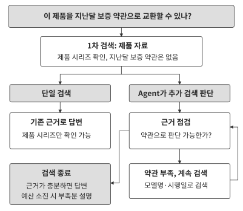

ReAct를 예로 들면, 모델은 먼저 문제를 분석해 질의를 고르고 `knowledge_base_search`를 호출합니다. 도구가 관찰을 돌려주면 모델은 증거가 충분한지 판단합니다. 조건이나 관련 대상이 빠졌다면 질의를 고쳐 다시 검색하고, 자료가 충분하면 출처와 함께 답을 생성합니다. 하네스는 이력, 도구 호출, 예산을 관리하다가 한도에 이르면 검색을 끝내거나 명확화 단계로 넘어갑니다.

이번에는 그림 3-13을 봅시다. 지식 베이스 백엔드를 벡터 색인에서 관계 그래프로 바꿔도 모델은 같은 도구 인터페이스로 계속 검색을 요청할 수 있습니다. 반환된 문서에 마침 지시문 한 단락이 들어 있다면, 모델은 그대로 따라도 될까요?

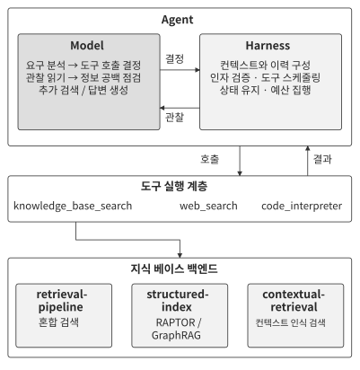

**검색 내용의 신뢰 경계.** 외부 문서에는 모델의 행동을 바꾸려는 텍스트가 들어 있을 수도 있고, 색인되기 전에 잘못된 사실이 끼어들었을 수도 있습니다. 앞의 것은 간접 프롬프트 주입이고 뒤의 것은 지식 베이스 오염입니다. 대응하려면 내용의 출처와 실행 권한을 함께 관리해야 합니다. 검색 결과에는 출처, 버전, 인용 위치를 붙여 답변의 증거로 쓰고, 송금, 삭제, 외부 메일 발송 같은 행동은 하네스와 실행 환경이 사용자 권한에 따라 검증합니다. 색인 전 검토, 출처 추적, 사실 확인은 잘못된 지식이 퍼지는 것을 한층 더 막아 줍니다. 2장에서 소개한 출처 표시와 4장의 도구 제약이 여기에서 함께 작동합니다.

> **실험 3-8 ★★: 단일 검색과 다회 검색 비교**
>
> 이 실험은 같은 중국어 법률 자료, 같은 BM25 검색기, 같은 모델로 일곱 개의 질문에서 두 모드를 비교합니다. 기준 모드는 원래 질문으로 한 번만 검색하고, 에이전트 모드는 모델이 질의를 조정하며 최대 네 번까지 검색하게 합니다.
>
> “정당방위는 어떻게 규정되어 있나요?” 같은 질의는 바로 검색해도 주요 조문을 얻을 수 있습니다. 더 복잡한 예는 “술에 취해 과실로 사람에게 중상을 입혔고 절도 전과가 있다면 어떻게 양형해야 하나요?”입니다. 이 질문은 현재 행위, 음주 상태, 과거 기록을 함께 다루므로 검색할 때 각각에 관한 자료를 따로 찾은 뒤 적용 조건을 확인해야 합니다.
>
> 실제 실행에서는 “음주 과실 중상해 절도 전과 양형”, “음주 범죄 양형”, “절도 전과 양형 영향 형법”, “전과 양형 영향 형법”을 차례로 검색했습니다. 모델은 이어서 “누범 인정 형법”도 제안했지만, 이때 검색 예산이 바닥나 하네스가 예산 소진 메시지를 돌려주었습니다.
>
> 실험에서 구분한 복잡한 질문 네 개에서는 목표 조문 포함률이 약 8%에서 92%로 올랐고, 평균 검색 횟수는 1회에서 3.5회로, 답변 단계의 평균 소요 시간은 약 8초에서 66초로 늘었습니다. 단순한 질문 세 개는 증거 포함률이 모두 100%였고, 두 그룹 모두 한 번만 검색했습니다.

같은 검색 루프를 사용자 이력에도 쓸 수 있습니다. 아래에서는 실험 3-1의 3단계 평가 세트를 이어서 써서, 에이전트가 세션을 넘나드는 기록에서 사실을 가져오고, 대상을 구분하고, 갱신을 처리하는 모습을 살펴봅니다.

> **실험 3-9 ★★: Agentic 검색으로 사용자 메모리 읽기**
>
> 이 실험은 전체 대화 이력을 지식 베이스로 삼아 창 단위로 잘라 색인을 만들고, 에이전트에게 `search_user_memory` 도구를 제공합니다. 창 크기는 조절할 수 있으며, 이번 실행에서는 조각마다 대화 8턴을 담고 인접 조각을 2턴 겹치게 했으며, 세션 식별자, 시간, 업무 메타데이터도 저장했습니다. 질의는 최대 세 번 실행하고, 매번 조각 네 개를 가져옵니다.
>
> 기본 회상은 “제 당좌 예금 계좌 번호가 뭐죠?”처럼 명확한 필드를 중심으로 검색하면 됩니다. 다중 세션 문제는 대상이 빠짐없이 갖춰졌는지도 확인해야 합니다. 사용자가 혼다 Accord와 테슬라 Model 3를 모두 가지고 있다면, 차량 정비 일정을 물었을 때 시스템은 두 차량과 각각의 예약 상태를 구분해야 합니다.
>
> 이를 바탕으로 검색 경로를 설계할 수 있습니다. 먼저 차량과 정비 기록을 검색하고, 다른 차량의 단서를 발견하면 테슬라의 일정을 조회한 뒤, 마지막으로 혼다의 기존 예약을 설명하고 테슬라도 예약할지 사용자에게 확인합니다. 이번 실제 기록에서는 `scheduled car services`라는 질의 하나만 실행했고, 일반 검색 그룹의 답변은 혼다에 집중한 채 테슬라를 빠뜨렸습니다.
>
> 또 다른 어려움은 연속된 수정에서 옵니다. 송금 사례에서는 아내가 송금을 설정하고, 남편이 이어서 금액과 날짜를 바꾸고, 아내가 다시 조정합니다. 기록을 가져온 뒤에는 시간, 대상, 확인 상태에 따라 변화를 복원해 최종적으로 효력이 있는 지시를 찾아야 합니다. 지금의 청킹은 이미 시간 정보를 저장하지만 검색이 여전히 핵심 수정을 놓칠 수 있으므로, 조각에 사건 배경을 더 보충할 수 있습니다.
>
> 60개 사례 가운데 18개는 한 번만, 6개는 두 번 검색했고, 36개는 세 번을 모두 썼습니다. 일반 청킹 검색 그룹은 47개를 통과했습니다. 기본 회상 19개, 다중 세션 검색 15개, 능동적 서비스 13개입니다. 다음 절에서는 같은 사례에서 컨텍스트 접두사와 구조화 메모리를 계속 비교하며, 각각이 어떤 정보를 보충했는지 분석합니다.

### 컨텍스트 인식 검색: 조각에 배경 보충하기

그 재무 보고서로 돌아가 봅시다. ACME사의 2025년 2분기 실적을 찾으려 하는데, 질의에는 회사 이름과 연도가 있지만 “그 회사의 매출은 3% 증가했다”라고 적힌 조각에는 하필 이 두 단어가 없습니다. 조각을 키우는 방법 말고도, 이 짧은 글은 그대로 두고 빠진 배경을 앞에 덧붙이는 방법이 있습니다. **컨텍스트 인식 검색(Contextual Retrieval)**은 색인을 만들 때 조각마다 짧은 배경 접두사를 생성하고, 접두사와 원문을 함께 검색에 씁니다[^ch3-1]. 그림 3-14는 이 처리 과정을 보여 줍니다.

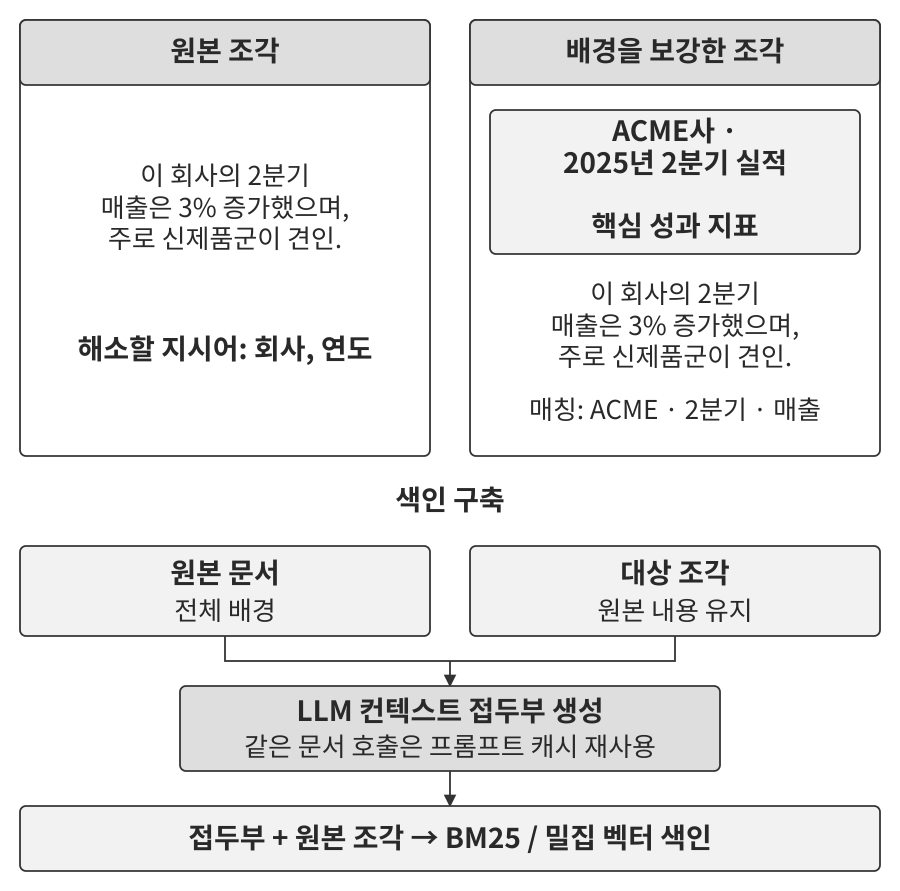

예를 들어 접두사는 “이 문단은 ACME사 2025년 2분기 보고서의 핵심 실적 지표 부분에서 나왔다”라고 설명할 수 있습니다. 생성할 때는 원문과 대상 조각을 함께 제공하여, 모델이 근거가 확실한 지시 대상, 시간, 장 정보를 보충하게 합니다. 그 덕분에 BM25는 회사 이름, 분기 같은 일치시킬 단어를 얻고, 밀집 임베딩도 이런 배경을 반영해 조각을 표현할 수 있습니다.

이 방법은 2장의 컨텍스트 인식 압축과 함께 쓸 수 있습니다. 색인 단계에서는 지식 조각에 배경을 보충해 관련 정보를 찾을 가능성을 높이고, 실행 단계에서는 현재 작업에 맞춰 이미 가져온 이력을 정리해 입력 길이를 조절합니다. 앞의 것은 조각의 검색 가능성에, 뒤의 것은 현재 결정에 필요한 정보와 예산에 초점을 둡니다.

[^ch3-1]: Anthropic, Introducing Contextual Retrieval, 2024년 9월.

> **실험 3-10 ★★: 원래 조각과 컨텍스트 보강 조각 비교**
>
> 이 실험은 같은 자료로 색인을 두 벌 만듭니다. 하나는 원래 조각을, 다른 하나는 모델이 생성한 접두사를 더한 조각을 씁니다. 질의와 목표 표시는 같게 두고 BM25, 밀집 검색, 혼합 검색을 각각 비교합니다.
>
> 앞의 재무 보고서 예를 이어 가면, “ACME사의 최근 매출 성장 현황”을 질의할 때 적중한 조각에 목표 회사, 기간, 성장 수치가 모두 들어 있는지 확인할 수 있습니다. “매출 성장”만 있으면 다른 회사와 일치할 수 있지만, 접두사를 보충하면 회사 이름과 시간이 순위 계산에 참여합니다.
>
> 이번 15개 질의에서 접두사를 더하자 BM25의 recall@1은 0.60에서 0.80으로, 밀집 검색은 약 0.867에서 0.933으로 올랐고, 두 방식의 recall@3은 각각 0.867과 1.0을 유지했습니다. 혼합 검색의 recall@5는 14/15에서 15/15로 올랐습니다. 더 찾아낸 것은 어느 문제였을까요? 전국인민대표대회 상무위원회의 직권을 묻는 질의에서, 목표 조각은 직권을 나열하지만 주어가 빠져 있었습니다. 접두사를 더하자 BM25는 이 조각을 16위에서 12위로 끌어올렸지만 여전히 상위 5개 밖이었고, 혼합 검색은 6위에서 5위로 올려 그제야 상위 5개 안에 들어왔습니다. 원문을 다시 보면 첫 번째 조각은 직권 (1)\~(4)항을 나열하고, 다섯 번째 조각은 (4)항부터 (22)항까지 이어집니다. 채점은 표시된 다섯 번째 조각이 뽑혔는지만 보지만, 직권을 모두 나열하려면 두 조각을 이어 붙여야 합니다.
>
> 접두사 생성은 색인 단계의 호출을 늘립니다. 같은 문서의 여러 조각에 배경을 생성할 때는 문서 접두사 캐시를 재사용할 수 있습니다. Anthropic은 2024년 보고서에서 800토큰 조각, 8000토큰 문서, 지정한 프롬프트 길이를 기준으로, 문서 토큰 100만 개당 일회성 처리 비용을 약 1.02달러로 추산했습니다.
>
> 이 보고서에서 컨텍스트 임베딩과 BM25를 결합하자 top-20 검색 실패율이 5.7%에서 2.9%로, 상대적으로 약 49% 줄었고, 재순위화를 더하자 1.9%로, 상대적으로 약 67% 줄었습니다. 보고서가 쓴 실패율은 $1-\mathrm{recall@20}$입니다.

반복해서 조회하고 내용이 비교적 안정적인 자료 저장소라면, 필자는 색인을 만들 때 조각의 배경을 먼저 채워 두기를 권합니다. 한 번 처리해 두면 이후의 여러 질의에 쓸 수 있습니다. 회사 이름, 사건의 주체, 시간이 청킹할 때 사라졌다면 검색 개수만 늘려서는 지시 대상이 불분명한 조각 묶음을 여전히 가져올 수 있습니다. 접두사를 생성할 때 이런 단서를 채워 두면 이후의 검색이 이를 이용해 자료를 찾아낼 수 있습니다.

> **실험 3-11 ★★★: 컨텍스트 접두사와 구조화 카드로 메모리 강화하기**
>
> 대화 속 “좋아요, 이걸로 예약해 주세요”는 앞에서 이야기한 상품이나 여정과 연결되어야 합니다. 원문이 상하이에서 시애틀까지 가는 500달러짜리 편도 항공권을 논의하고 있었다면, 접두사는 이 배경을 보충하고 확인이 이루어진 세션과 시간도 남길 수 있습니다.
>
> 이 실험은 일반 청킹에 두 가지 구성을 더합니다. 컨텍스트 접두사 그룹, 그리고 Advanced JSON Cards를 함께 불러오는 이중 계층 메모리 그룹입니다. 모델은 먼저 일반 색인을 바탕으로 검색 순서를 생성하고, 같은 질의 묶음을 두 색인에 적용합니다. 이중 계층 그룹은 같은 강화 검색 결과에 구조화 카드를 더해 씁니다.
>
> 송금 사례에서 접두사는 Patricia가 송금을 시작했고, James가 일정을 바꿨으며, Patricia가 다시 조정했다는 것을 각각 설명하여 사건의 순서를 찾도록 돕습니다. 원래 기록이 보여 주는 최종 상태는 95,000달러, 10월 1일이며, 그 전의 일정은 이미 대체되었습니다. 이번에는 세 그룹 모두 이 상태를 올바르게 찾았습니다.
>
> 이중 계층 구조는 능동적인 연결도 뒷받침할 수 있습니다. 카드는 “도쿄 여행”과 “여권 유효 기간” 같은 핵심 사실을 저장하고, 자세한 대화는 필요할 때 검색합니다. 1월 15일부터 22일까지의 여행과 2월 18일에 만료되는 여권을 예로 들면, 시스템은 먼저 날짜가 가깝다는 것을 발견하고, 갱신 기록과 여행 요건을 조회한 뒤, 마지막으로 아직 끝나지 않은 준비 사항을 확인하라고 사용자에게 알릴 수 있습니다. 이 여행 사례에서는 세 그룹의 답변이 모두 평가를 통과했습니다. 카드와 검색의 차이는 주로 아래의 차량 사례와 세션을 넘나드는 사례에서 드러납니다.
>
> 전체 60개 사례에서 일반 검색, 컨텍스트 접두사, 이중 계층 메모리는 각각 47, 52, 57개를 통과했습니다. 접두사 그룹의 능동적 서비스 사례는 13개에서 18개로 늘었고, 이중 계층 그룹은 다중 세션 검색 단계에서 20개를 모두 통과했으며 능동적 서비스 단계에서도 18개를 통과했습니다. 차량 사례에서는 카드가 두 번째 차량의 정보를 보충하여, 원래 빠뜨렸던 대상까지 답변이 다루도록 도왔습니다. 그 가운데 후퇴한 사례도 하나 봅시다. 사용자가 주택 누수 피해의 보장 범위를 묻자, 일반 그룹은 자가 주택과 임대 주택을 모두 언급했지만 접두사 그룹은 임대 주택을 빠뜨렸습니다. 문제별로 대조해 보면 접두사 그룹은 일반 그룹보다 8문제를 더 맞혔지만, 원래 맞히던 3문제를 놓쳤습니다.

**능동적 서비스가 필요하다면, 필자는 핵심 사실을 상주시키고 자세한 기록은 필요할 때 검색하는 이중 계층 아키텍처를 우선합니다.** 검색만으로는 모델이 무엇을 물어야 할지 먼저 알아야 관련 기록을 찾을 수 있는 경우가 많습니다. 아직 시야에 들어오지 않은 여권, 차량, 가족 관계는 그래서 쉽게 빠집니다. 소수의 핵심 사실을 미리 컨텍스트에 넣어 두면 모델이 연관을 발견하고 질의를 제기한 뒤 원래의 세부 사항을 가져오는 데 도움이 됩니다. 상주시킬 정보를 고를 때는 인간관계, 현재의 제약, 끝나지 않은 일을 고려해야 하고, 검색 결과에는 출처, 시간, 변경 근거를 남겨야 합니다.

### 데이터 세트에서 지식 추출하기: 사례에서 구조화 표현으로

지식은 대량의 사례를 정리하는 데서 나오기도 합니다. 판결문, 고객 지원 티켓, 수리 기록에는 쓸모 있는 정보가 구체적인 서술 속에 흩어져 있습니다. 작업이 대량의 사례에서 규칙성을 귀납하거나 결과를 비교하거나 무엇을 더 물을지 정해야 한다면, 필자는 먼저 통일된 필드를 추출한 뒤 통계와 원형 정리를 하기를 권합니다. 비슷한 사례 몇 개만 가져와서는 데이터 세트 전체의 분포를 보기 어렵습니다. 필드를 통일하면 기록 전체에 대해 통계를 낼 수 있고, 이후 개별 사례를 조회할 때 개관을 제공할 수 있습니다.

이 과정은 두 단계로 나눌 수 있습니다. **지식 추출**은 원래의 서술을 구조화된 기록으로 바꾸며, 필드의 의미, 값, 출처를 분명히 합니다. **패턴 분석**은 통계와 군집화로 비슷한 사례와 그 공통 특징을 찾습니다. 그림 3-15는 사례 추출, 특징 인코딩, 원형 검색으로 이어지는 흐름을 보여 줍니다.

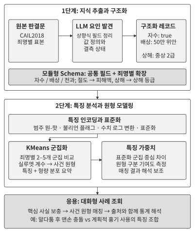

> **실험 3-12 ★★★: 사법 판례에서 요인과 원형 추출하기**
>
> 이 실험은 CAIL2018의 형사 사건 자료에서 절도, 고의 상해, 사기 세 유형의 표본을 골라 “요인 발견—필드 추출—군집화—원형 해석”이라는 교육용 절차를 구성합니다[^ch3-cail]. 유형마다 120건을 모델링에 쓰고 20건을 따로 남겨, 모델링 표본 360건과 보류 표본 60건을 만듭니다.
>
> **필드를 발견하고 정리합니다.** 모델은 먼저 모델링 표본을 묶음별로 읽으며 쓸모 있을 만한 요인을 제안하고, 이를 합쳐 모듈형 Schema를 만듭니다. 공통 부분에는 자수, 배상처럼 여러 죄명에서 모두 주목해야 하는 필드를, 확장 부분에는 피해 금액이나 상해 정도처럼 특정 죄명에 관련된 정보를 저장합니다. 이번 정리에서는 공통 필드 16개와 각각 12, 12, 11개 필드를 담은 확장 세 묶음을 얻었습니다. 필드마다 값과 누락 상태도 정의해야 일관되게 추출할 수 있습니다.
>
> **필드를 벡터로 인코딩합니다.** 범주형 필드에는 원-핫 인코딩을 쓸 수 있습니다. 절도, 강도, 사기 세 유형을 예로 들면 각각 `[1,0,0]`, `[0,1,0]`, `[0,0,1]`로 인코딩하며, 각 위치는 그 유형에 속하는지만 나타냅니다. 1, 2, 3을 쓰면 어떤 알고리즘에는 범주 사이의 순서와 거리가 생겨 버립니다. “자수 여부”, “배상 여부” 같은 필드는 확인된 두 상태를 1과 0으로 나타낼 수 있습니다. 원문에 언급되지 않은 경우는 따로 처리해야 누락을 자동으로 부정으로 간주하지 않게 됩니다.
>
> 금액처럼 범위가 넓은 음이 아닌 수치는 이 구현에서 먼저 $\ln(1+x)$로 척도를 압축한 뒤 표준화에 넣습니다. 한 필드에 여러 범주가 동시에 나올 수 있다면, 예컨대 한 기록에 여러 처분 조치가 들어 있다면, 범주마다 지시 비트를 따로 두어 멀티-핫 인코딩을 만들 수 있습니다.
>
> **사건 원형을 만듭니다.** 인코딩한 특징을 표준화한 뒤 죄명별로 따로 군집화합니다. 이 구현은 군집 2\~5개를 비교하고 실루엣 계수로 묶음을 골라, 최종적으로 원형 11개를 만들었습니다. 원형마다 표본 수, 주요 특징, 그리고 표본 형기의 중앙값, 사분위수, 범위를 저장합니다. 예를 들어 충돌의 계기, 범행 방식, 상해 결과를 중심으로, 말다툼 끝의 맨손 충돌과 계획적인 흉기 사용처럼 서로 다른 특징 조합을 비교할 수 있습니다. 구체적인 묶음은 추출 결과와 군집화가 함께 정합니다.
>
> **특징과 일치 결과를 해석합니다.** 프로그램은 각 군집의 표준화 중심 사이의 차이를 바탕으로 원형을 구분하는 데 쓰인 특징의 가중치를 계산합니다. 원형 일치는 새 사례를 같은 특징 공간에 대응시키고, 가까운 묶음의 통계 요약과 근거를 가져와 모델이 해석을 구성하게 합니다.
>
> 이번에는 보류 표본 60건 가운데 12건을 골라 해석을 생성하고 독립된 모델에 평가를 맡겼습니다. 먼저 그중 절도 표본 하나를 봅시다. 이 표본이 일치한 원형에는 모델링 기록이 하나뿐이고 형기가 4개월이어서, 최솟값, 중앙값, 최댓값이 모두 4였습니다. 생성기는 이 수치를 그대로 보고하면서 참고할 기록이 하나뿐이라는 점도 밝혔습니다. 평가 모델은 “수치가 원형에 충실한가”에 4점(만점)을 주었지만, 보류 표본의 실제 레이블은 8개월이었습니다.
>
> 원형 검색을 대화에 쓴다면, 먼저 일치에 영향을 줄 수 있는 빠진 사실이 무엇인지 묻고, 답을 바탕으로 다시 검색할 수 있습니다.

[^ch3-cail]: CAIL2018, 공식 데이터 세트 프로젝트. 동반 실험은 공개 자료에서 표본을 뽑고, 표본 내부 분할로 모델링과 평가를 수행합니다.

사례에서 원형으로 나아가면서 지식 베이스에는 검색할 수 있는 통계 표현이 한 층 더해졌습니다. 원문은 증거를 제공하고, 필드는 계산을 뒷받침하며, 원형은 비슷한 표본의 공통 특징을 개괄합니다. 셋의 대응 관계를 보존해야 추출 오류나 표본 편향을 발견했을 때 되짚어 고칠 수 있습니다.

### 최전선 탐구: 멀티모달 메모리와 파라미터 메모리

사용자가 전에 올린 사진을 가리키며 “바로 이 색으로 할게요”라고 말한다고 해 봅시다. 시스템이 그때 “파란 외투”라는 말만 남겨 두었다면 다음번에는 두 가지 파란색을 구분하지 못할 수 있습니다. 목소리의 음색이나 도표의 공간 관계도 글로 옮기는 과정에서 세부가 사라집니다. 앞으로의 질의에서 이런 정보를 되찾을 기회를 남기려면, 원본 자료를 저장하거나, 모델이 쓸 수 있는 표현을 저장하거나, 한 걸음 더 나아가 모델 내부의 영속 메모리를 연구할 수 있습니다.

**첫 번째 경로: 원본 자료와 텍스트 색인의 결합.** 예를 들어 사용자가 허락한 사진첩 정리 작업에서 인물의 얼굴 같은 일부 영역을 잘라 저장하고, Markdown 항목에서 그 이미지를 참조하면서 촬영 시간, 장면, 사용자가 붙인 인물 태그를 함께 기록할 수 있습니다. 검색할 때는 먼저 설명을 바탕으로 관련 있을 만한 사진 몇 장을 찾고, 원본 이미지나 잘라 낸 영역을 읽어 외모의 세부를 비교합니다. 음성 조각도 시간, 출처, 전사와 연결해 두었다가 필요할 때 원래 오디오를 재생할 수 있습니다. 텍스트는 진입점을 제공하고, 원본 자료는 말로 요약하기 어려운 세부를 보존합니다.

**두 번째 경로: 임베딩을 저장했다가 필요할 때 불러오기.** 시각 인코더나 오디오 인코더는 자료를 벡터로 바꿔 색인에 넣고 유사성 검색에 쓰게 할 수 있습니다. 예를 들어 이미지의 일부 영역이나 음성 조각을 인코딩한 뒤 해당 메모리 항목에 각각 연결합니다. 모델이 학습된 투영 계층과 메모리 인터페이스를 지원한다면, 컨텍스트에 슬롯 묶음을 마련해 이 연속 벡터를 넣고 모델이 어텐션으로 접근하게 할 수도 있습니다. 여기서는 인코더의 표현과 언어 모델 내부 표현을 정렬하는 문제를 풀어야 합니다.

필자와 Noah Shi의 초기 연구는 이 문제를 두 단계로 나눴습니다. 단체 사진에 두 사람이 있고 사용자가 “창가에 서 있는 사람이 지난번에 만난 그분인가요?”라고 묻는다고 합시다. 먼저 “창가”를 근거로 사용자가 가리키는 사람을 찾고, 그다음 이 사람의 이미지를 전에 저장한 표본과 비교해야 합니다. 첫 단계에서 사람을 잘못 고르면 두 번째 단계에서 아무리 정확히 알아봐도 다른 질문에 답하는 셈이 됩니다. 논문은 이름처럼 정확히 옮겨 적을 수 있는 사실은 텍스트 메모리에 남겨 두어, 두 종류의 정보가 각자 알맞은 방식으로 쓰이게 했습니다.[^ch3-perceptmem]

[^ch3-perceptmem]: Li Bojie, Noah Shi, Parametric Multimodal User Memory. 동반 프로젝트 `19PINE-AI/multimodal-user-memory`에 구현과 PerceptMem 실험이 들어 있습니다. 단체 사진 질문은 교육용 예시입니다.

**세 번째 경로: 모델 내부의 영속 메모리.** 사용자마다 LoRA를 학습하는 것은 개인화된 사실을 모델에 써넣는 한 가지 방법입니다. “사용자는 어디에 사나요?”라고 직접 묻는 것과 주소를 바탕으로 여정을 계획하는 것은 메모리를 쓰는 방식이 다릅니다. 앞의 것은 사실을 읽기만 하면 되지만, 뒤의 것은 그 사실을 이후 추론에 써야 합니다. 사실을 되풀이하는 것만으로 학습하면 모델은 답을 기억하면서도 복잡한 작업에서는 그것을 스스로 쓰지 못할 수 있습니다. 그러므로 학습 표본에는 직접 질문과 그 사실에 의존하는 작업이 함께 들어 있어야 합니다.

필자의 **User as Engram** 연구는 텍스트 사실을 Engram 모델의 국소 메모리 테이블에 쓰고, 공유 어댑터가 이 사실을 이용해 추론하는 법을 학습하게 합니다[^engram]. 해시 키를 가진 N-gram 조회가 테이블 항목의 위치를 찾고, 게이트 메커니즘이 가져온 내용을 모델에 보냅니다. 사용자마다 국소 테이블 항목을 저장하고 추론 부분은 공유할 수 있습니다. 논문은 텍스트 사실 실험에서 직접 회상과 간접 추론을 비교하여, 사용자별 메모리 내용과 공유 추론 능력을 어떻게 따로 관리할 수 있는지 보여 주었습니다.

[^engram]: Li, Bojie, User as Engram: Internalizing Per-User Memory as Local Parametric Edits, 2026.

이 경로를 멀티모달로 넓히려면 이미지나 오디오 표현의 주소 지정, 쓰기, 읽기 메커니즘도 설계해야 합니다.

## 이 장의 요약

장 첫머리의 예약 부탁으로 돌아가 봅시다. “저는 창가가 좋아요”는 이 사용자에게서 나왔고, “짐을 몇 개 가져갈 수 있나”는 항공사가 여행 날짜에 적용하는 조항을 찾아봐야 합니다. 두 정보를 모두 한 문장으로만 저장하면 가장 중요한 차이를 잃기 쉽습니다. 앞 문장은 누구에게 적용되는지, 뒤 문장은 언제부터 시행되는지입니다. 저장할 때 출처, 시간, 적용 조건을 남겨야 꺼냈을 때 이번에 써도 되는지 판단할 근거가 생깁니다. 개별 사실은 짧은 노트로 쓰기에 알맞고, 인간관계를 설명하거나 앞뒤 경위를 보존해야 할 때는 카드나 원문 문단을 쓸 수 있습니다. 날짜와 수량은 타입이 있는 필드로 저장해 프로그램이 계산하게 할 수도 있습니다.

어시스턴트가 수하물 허용량을 잘못 알려 줬다면, 먼저 현행 조항이 색인에 들어갔는지, 그다음 조항이 어느 조각으로 잘렸는지, 검색기가 그것을 찾았는지, 재순위화한 뒤 몇 위였는지 확인하고, 마지막으로 모델이 어떤 자료를 받았는지 봅니다. 원문이 많을 때는 구조화된 개요를 컨텍스트에 두고 세부는 필요할 때 검색할 수 있습니다. 장 요약은 주제를 찾는 데, 관계 색인은 연관을 찾는 데 도움이 됩니다. 조각이 지시 대상을 잃었다면 출처 배경을 보충할 수 있고, 한 번의 검색으로 증거가 부족하다면 에이전트가 질의를 바꿔 계속 찾을 수 있습니다.

항공사가 새 규정을 발표하면, 먼저 범위가 작은 갱신을 한 번 하면서 새 조항과 옛 조항의 시행 날짜와 출처를 보존할 수 있습니다. 쌓인 중복 항목, 충돌, 구조 변화는 주기적으로 정리합니다. 제안자가 수정을 제출하고, 검토자가 증거를 확인하고, 승인되면 서비스 색인을 다시 만듭니다. 버전 기록이 있으면 원래 틀렸던 문제를 다시 재생해 볼 수 있고, 옛 답변이 그때 어떤 자료에 근거했는지도 밝힐 수 있습니다. 실행 결과에서 경험을 어떻게 더 쌓아 가는지는 9장에서 따로 다룹니다.

위탁 수하물을 두 개까지 실을 수 있다는 것을 찾아낸 것은 “규칙상 허용되는가”에 답했을 뿐입니다. 사용자를 대신해 수하물을 주문에 추가하려면, 어시스턴트는 어떤 도구를 호출할 수 있는지, 어떤 매개변수가 필요한지, 어떤 응답을 받아야 처리가 끝난 것인지도 알아야 합니다. 이것이 다음 장의 출발점입니다.

## 생각해 볼 문제

1. ★★ 사용자가 이렇게 말했습니다. “5월 1일에 A에서 B로 이사하고, 5월 10일부터 20일까지는 호텔 C에 머물러요. 그동안 청구서는 이메일로 보내 주세요.” 5월 15일에 어시스턴트는 집 주소, 임시 거처, 청구서 발송 방법을 각각 어떻게 답해야 할까요? 기록과 조회 규칙을 설계하고, 오타 정정이나 서로 충돌하는 주소를 어떻게 처리할지 설명하세요.
2. ★★ 원본 문서에 모순된 정보가 있으면 컨텍스트 접두사가 오류까지 함께 색인에 써넣을 수 있습니다. 출처, 버전, 불확실한 항목을 어떻게 저장하고, 검색과 생성 단계에서 이 정보를 어떻게 쓰겠습니까?
3. ★★ 도표를 텍스트로 바꾸면 어떤 공간 관계가 쉽게 사라질까요? 표, 아키텍처 다이어그램, 꺾은선 그래프를 예로 들고, 원본 이미지, 구조화 표현, 텍스트 색인이 함께 검색에 쓰이는 방안을 설계하세요.
4. ★★★ 모델과 장문 컨텍스트 능력이 향상되면 청킹, 색인, 검색 절차의 어떤 일을 모델에 맡길 수 있을까요? Rich Sutton의 “쓰라린 교훈(Bitter Lesson)”이 탐색과 학습에 대해 논한 내용을 바탕으로 분석하고, 전체 입력과 필요 시 검색을 비교하는 실험을 설계하여 작업 품질, 계산 비용, 권한 제약을 함께 점검하세요.
5. ★★★ 모델이 이미 대량의 도메인 지식을 갖추고 있다면 외부 지식 베이스에는 무엇을 저장해야 할까요? 공개된 상식, 계속 갱신되는 규칙, 비공개 자료, 정확한 추적이 필요한 증거를 각각 논의하세요.
6. ★ RAPTOR의 다층 요약과 GraphRAG의 엔터티 관계, 커뮤니티 요약은 각각 어떤 질의를 뒷받침할까요? 전체 개괄, 국소 세부, 다중 홉 연관에 대해 각각 예를 하나씩 들고, 어떤 증거를 확인해야 하는지 설명하세요.
7. ★★ 디렉터리, 링크, 벡터 색인은 어떻게 함께 지식을 구성할까요? 사람과 에이전트가 함께 유지 관리해야 하는 지식 베이스를 설계하고, 탐색, 의미 검색, 버전 갱신, 권한 필터링이 각각 어디에 놓이는지 설명하세요.
8. ★★★ 사례에서 필드를 추출해 군집화한 뒤, 원형이 쓸모 있는지는 어떻게 판단할까요? 군집 특징의 중요도, 결과 예측 능력, 인과적 설명을 구분하고, 보류 평가와 전문가 재검토 절차를 설계하세요.
9. ★★★ Markdown 사용자 메모리 저장소의 증분 갱신과 주기적 정리 절차를 설계하세요. 검토자와 제안자가 같은 모델을 쓰고 검토자가 제안자가 고른 조각만 볼 수 있다면 어떤 오류를 놓치기 쉬울까요? 증거 범위, 도구 권한, 검토 평가의 세 측면에서 개선안을 제시하세요.

[^ch3-glove]: Pennington 등, GloVe: Global Vectors for Word Representation, 2014.

[^ch3-sbert]: Reimers, Gurevych, Sentence-BERT: Sentence Embeddings using Siamese BERT-Networks, 2019.
