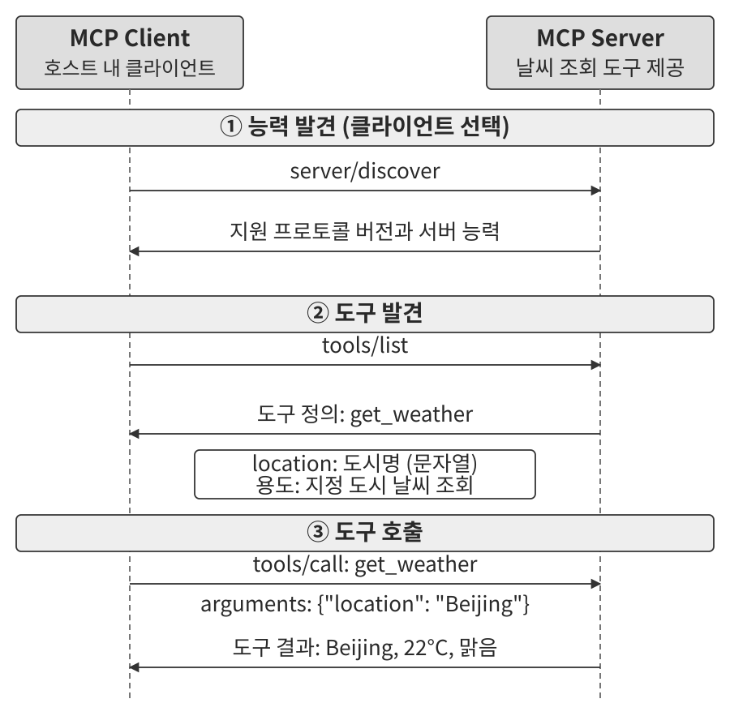
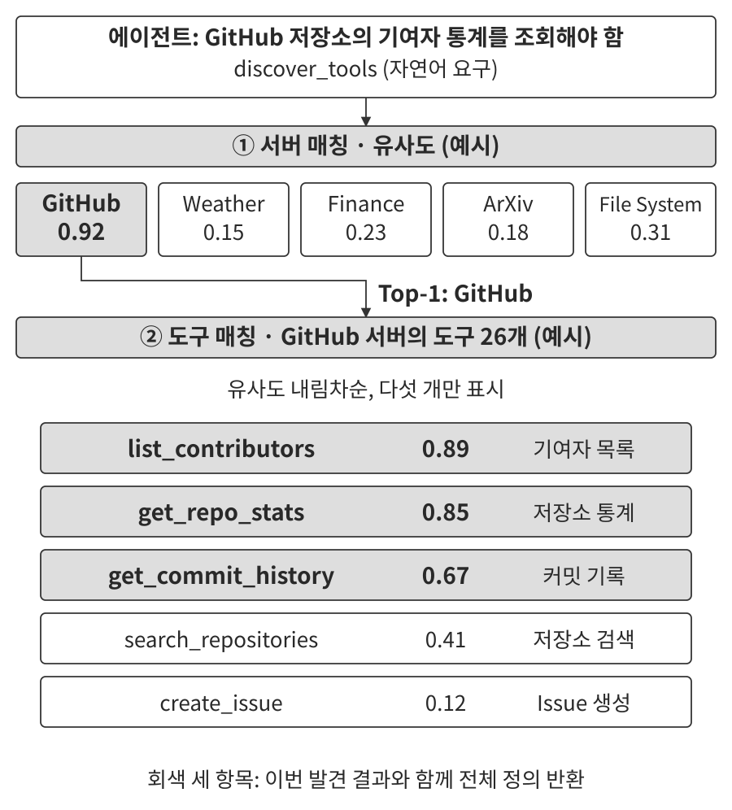
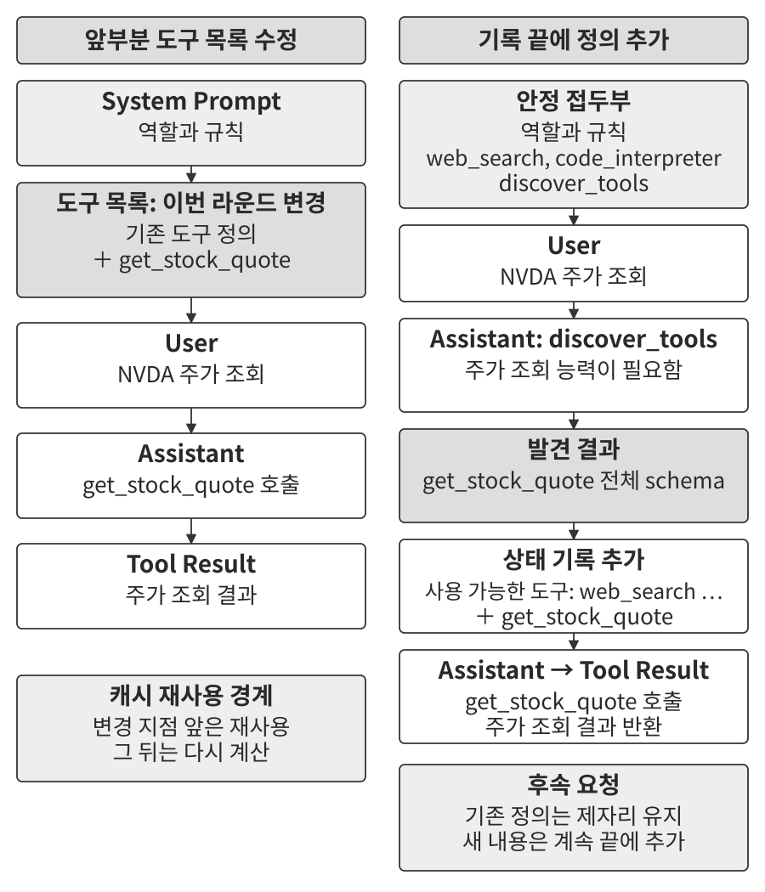
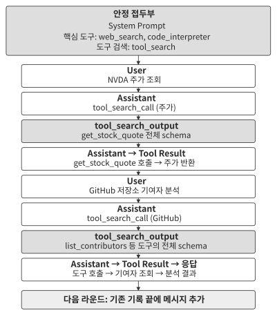

# 도구

SF 영화 *그녀(Her)*에서 AI 어시스턴트 사만다(Samantha)는 이메일을 정리하고, 답장을 돕고, 출판 업무를 처리하며, 여러 커뮤니케이션 채널 사이를 오갑니다. 이런 어시스턴트는 언어 이해를 외부 시스템에 대한 작업으로 바꿀 수 있어야 합니다. 에이전트는 **도구**를 통해 이러한 상호작용을 수행합니다. 도구는 에이전트의 “감각과 손발”로서 관측을 제공하고 행동을 실행합니다. 이 책에서 다루는 Manus, OpenClaw 같은 범용 에이전트도 도구를 통해 디지털 세계에 접근합니다.

사용자가 “고객 이메일에 언급된 납기일을 찾아 표로 정리해서 보내 줘”라고 말했다고 가정해 보겠습니다. 어느 이메일을 볼지는 모델이 정할 수 있지만, 원문을 읽으려면 메일함에 접근해야 하고 표를 보내려면 전송 인터페이스를 호출해야 합니다. 이런 도구는 어떻게 설계해야 하고, 모델은 필요할 때 이를 어떻게 찾아야 할까요? 이 장에서는 먼저 다섯 가지 도구 범주를 구분하고, 도구의 기술·연결·발견을 논의한 다음, 인식·실행·협업 인터페이스를 차례로 설계합니다. 이벤트 트리거와 사용자 커뮤니케이션은 에이전트를 언제 깨울지, 메시지를 여러 채널에 걸쳐 어떻게 전달할지와 얽혀 있으므로 제6장에서 다룹니다.

## 도구 분류

이메일 조회를 예로 들면, 모델은 다음에 무엇을 할지 고르고, 하네스는 파라미터와 권한을 검사한 뒤 요청을 보내며, 메일 서비스가 실제로 데이터를 읽고 씁니다. 제1장에서는 용도에 따라 인식, 실행, 협업, 사용자 커뮤니케이션, 이벤트 트리거 도구를 구분했습니다. 앞의 네 범주는 모두 에이전트가 능동적으로 호출하고, 이벤트 트리거 도구는 외부 이벤트도 에이전트를 깨울 수 있게 합니다(표 4-1).

표 4-1 다섯 가지 도구 범주의 호출 방향과 주요 용도

| 도구 유형 | 호출 방향 | 주요 용도 |
| --- | --- | --- |
| 인식 도구 | 에이전트가 능동적으로 호출 | 외부 정보 획득 |
| 실행 도구 | 에이전트가 능동적으로 호출 | 계산 수행 또는 외부 상태 변경 |
| 협업 도구 | 에이전트가 능동적으로 호출 | 작업 위임, 메시지 교환, 다른 에이전트나 사람과의 조율 |
| 사용자 커뮤니케이션 도구 | 에이전트가 능동적으로 호출 | 사용자에게 답장, 결과 제시, 알림 전송 |
| 이벤트 트리거 도구 | 개발자가 설정하거나 에이전트가 등록하고 외부에서 트리거 | 지정한 이벤트가 발생하면 에이전트를 깨움 |

**인식 도구**는 에이전트가 외부 정보를 얻게 합니다. 웹 검색 `web_search`, 지식 베이스 검색 `knowledge_base_search`, 웹페이지 읽기 `fetch_url`, 파일 이름 검색 `find_file`, 파일 콘텐츠 검색 `grep_file`, 파일 읽기 `read_file` 등이 있습니다.

**실행 도구**는 에이전트가 계산을 수행하거나 외부 상태를 바꾸게 합니다. 명령줄 `shell_exec`, 코드 인터프리터 `code_interpreter`, 파일 쓰기 `write_file`, 파일 편집 `edit_file`, 이메일 전송 `send_email` 등이 있습니다. 같은 범용 실행기로 읽기 전용 계산을 할 수도 있고 데이터를 수정할 수도 있습니다.

**협업 도구**는 작업 위임과 메시지 교환을 지원합니다. 하위 에이전트 생성 `spawn_subagent`, 메시지 전송 `send_message_to_subagent`, 하위 에이전트 취소 `cancel_subagent`, 사용할 수 있는 에이전트 탐색 `list_agents` 등이 있습니다. 서로 독립된 작업은 병렬로 처리할 수 있습니다. 예를 들어 OpenAI 공동 창업자 여러 명의 경력을 각각 조사할 수 있습니다. 서로 다른 작업을 서로 다른 모델, 도구, 프롬프트, 컨텍스트를 갖춘 에이전트에게 맡길 수도 있습니다. 분업과 협업 아키텍처는 제10장에서 더 자세히 다룹니다.

**사용자 커뮤니케이션 도구**는 사용자에게 정보를 전달합니다. 메시지 답장 `reply_to_user`, 구조화 카드 전송 `send_card_to_user`, 알림 전송 `send_user_notification` 등이 있습니다. 상호작용이 여러 채널로 넓어지거나 백그라운드 알림이 필요해지면, 시스템은 메시지 전송을 명시적인 도구 호출로 감싸 수신자, 내용, 전달 상태를 한곳에서 관리할 수 있습니다.

**이벤트 트리거 도구**는 외부 이벤트를 에이전트의 실행과 연결합니다. 타이머 `set_timer`, 백그라운드 작업 모니터링 `monitor_shell`, 이벤트 소스 연결 `connect_channel` 등이 있습니다. 전체 과정은 두 단계로 이루어집니다. 등록 단계에서는 개발자가 미리 설정하거나, 에이전트가 허가된 호출로 관심 있는 이벤트를 선언합니다. 이벤트가 발생하면 스케줄링 시스템이 콜백이나 이벤트 메시지를 받아 에이전트를 깨우고 처리하게 합니다. 새 이메일, 시스템 경고, 예약 알림, 백그라운드 작업 완료가 모두 새로운 실행 진입점이 될 수 있습니다.

처음의 이메일 작업을 다시 보겠습니다. 원본 메일을 열어 납기일을 얻는 것은 인식입니다. 요약표를 만들어 저장하면 작업 공간이 바뀌므로 실행입니다. 표를 의뢰인에게 건네는 것은 사용자 커뮤니케이션입니다. 다음 고객 이메일이 도착했을 때 시스템이 자동으로 작업을 이어 간다면 그때 비로소 이벤트 트리거가 들어옵니다. 하나의 메일 서비스가 이 여러 역할을 맡을 수 있습니다. 다음으로 정해야 할 것은 모델에게 주는 도구를 얼마나 잘게 나눌지입니다. 메일 조회, 본문 읽기, 첨부 파일 찾기를 따로 하게 할까요, 아니면 자주 이어서 하는 몇 단계를 하나로 묶어 줄까요?

## 도구 설계의 보편 원칙

초기에 도구를 연결할 때는 API 엔드포인트 하나하나를 그대로 감싸는 방식이 흔했습니다. 이렇게 하면 빨리 연결할 수 있지만 지나치게 잘게 쪼개진 인터페이스 묶음이 되기 쉽습니다. 에이전트는 작업 하나를 마치려고 객체를 찾고, 속성을 읽고, 조건을 확인한 뒤에야 실행 인터페이스를 호출해야 할 수도 있습니다. 도구를 설계할 때는 자주 하는 작업을 중심으로 이런 작업을 묶을 수 있습니다. 예를 들어 연락처 찾기와 메시지 보내기를 잇거나, 로그 검색이 관련 행과 그 앞뒤 맥락을 바로 반환하게 합니다[^ch4-tool-design].

**도구는 에이전트가 완수해야 할 작업을 중심으로 설계해야 합니다.** 에이전트의 사용 방식에서 출발해 인터페이스를 설계하는 이러한 접근을 **ACI**(Agent-Computer Interface, 에이전트-컴퓨터 인터페이스)라고 부릅니다. HCI가 사람이 컴퓨터와 어떻게 상호작용하는지에 관심을 둔다면, ACI는 모델이 어떻게 작업을 고르고, 파라미터를 구성하고, 피드백을 이해하고, 오류를 바로잡는지에 관심을 둡니다.

[^ch4-tool-design]: Anthropic, *Writing effective tools for AI agents—using AI agents*, 2025.

### 능력의 표현 형태: 전용 도구, 범용 실행기, 그리고 스킬

“애플리케이션 배포”를 모델에게 맡긴다면 세 가지 작업 화면을 설계할 수 있습니다. 첫째는 `deploy_app` 하나만 노출하고 서버가 각 단계를 처리하는 방식입니다. 둘째는 빌드, 패키징, 배포를 따로 노출하고 다음 단계를 언제 호출할지 모델이 정하는 방식입니다. 셋째는 단계를 스킬에 적어 두고 모델이 터미널에서 실행하게 하는 방식입니다. 빌드가 실패하면 첫째 방식은 어느 단계에서 무엇이 잘못됐는지를 도구 결과로 모델에게 알려야 하고, 나머지 두 방식은 이번 빌드의 오류를 그대로 모델에게 넘길 수 있습니다.

- **전용 도구**는 정해진 작업에 구조화된 인터페이스를 제공합니다. 개발자가 파라미터 스키마, 검증 규칙, 실행 로직, 반환 형식을 정의하므로 따로 테스트하고 권한을 부여하기 쉽습니다. 도구 정의가 컨텍스트에 들어가면 차지하는 분량은 필드, 설명, 예시의 길이에 따라 달라집니다.
- **범용 실행기와 스킬**은 함께 씁니다. 터미널이나 코드 인터프리터가 실행 능력을 제공하고, 스킬은 절차, 적용 조건, 작업 방법을 설명합니다. 호스트는 먼저 이름과 간단한 소개만 불러오고, 선택된 뒤에 전체 설명과 관련 리소스를 읽을 수 있습니다.

예를 들어 배포 스킬은 `npm run build`로 프로젝트를 빌드하고, `docker build -t app:latest .`로 이미지를 패키징한 다음, `kubectl apply -f deploy.yaml`로 매니페스트에 정의된 리소스를 현재 클러스터에 적용하라고 차례로 설명할 수 있습니다. 에이전트는 터미널 도구로 이 단계를 실행하며 같은 실행 진입점을 재사용합니다.

도구를 어떻게 구현하는가와 모델이 그 설명을 언제 읽는가는 별개의 문제입니다. 수백 개의 전용 도구도 목록만 보여 주고 스키마는 필요할 때 불러올 수 있고, 몇 개 안 되는 스킬은 목차를 컨텍스트에 상주시켰다가 규모가 커지면 검색을 덧붙일 수 있습니다. 전용 인터페이스냐 범용 실행기냐는 파라미터를 어떻게 전달하고 코드를 어떻게 유지보수할지에 영향을 줍니다. 한 번에 다 주느냐 필요할 때 불러오느냐는 모델이 이번 단계에서 어떤 도구를 볼 수 있는지에 영향을 줍니다. 공개 전략은 뒤의 “도구가 너무 많으면 어떻게 하나”에서 다룹니다.

**필자는 범용 도구를 먼저 쓰고, 권한·파라미터·성능상 필요에 따라 전용 인터페이스를 보충하기를 권합니다.** 예를 들어 샌드박스의 `code_interpreter`에 SymPy, NumPy, pandas를 갖춰 두면 에이전트는 Python을 작성해 사칙연산, 기호 계산, 배열 처리, 데이터 분석을 할 수 있습니다. 이렇게 하면 모델의 코드 생성 능력을 충분히 살릴 수 있습니다. 인터프리터 하나가 여러 알고리즘을 담을 수 있고, 기존 라이브러리를 조합해 미리 생각하지 못한 새 문제도 처리할 수 있습니다. 코드는 모델이 생성하고, 실행은 런타임 환경이 맡으며, 파일·네트워크·자원 접근을 제한합니다.

전용 도구를 쓰더라도 필자는 기능이 비슷하고 자주 함께 쓰이는 작업부터 통합하기를 권합니다. 인터페이스가 지나치게 잘면 모델이 기억해야 할 이름과 역할 분담이 늘고, 같은 작업을 마치는 데도 호출이 더 많이 필요합니다. 통합할 때는 주로 **기능의 유사성**과 **사용 시나리오의 중첩도**를 봅니다. 예를 들어 `extract_pdf_text`, `extract_docx_content`, `extract_pptx_content`는 모두 문서를 받아 텍스트를 추출하므로 `read_document` 하나로 통합하고 `file_type`으로 형식을 구분할 수 있습니다. 모델은 통일된 진입점 하나만 고르면 되고, 새 형식을 추가할 때도 파라미터와 반환 구조를 그대로 쓸 수 있습니다.

다음 네 가지 경우는 특히 전용 인터페이스가 적합합니다.

1. **세밀한 권한 부여와 감사가 필요한 경우.** 프로덕션 데이터베이스 쓰기는 범위가 분명한 작업으로 감싸고, 서버가 사용자 권한, 대상 테이블, 변경을 허용하는 필드를 검사하며 작업 근거를 기록하게 할 수 있습니다.
2. **플랫폼 차이를 감춰야 하는 경우.** grep, find 같은 작업은 shell로도 할 수 있지만, 전용 파일 검색 도구는 macOS, Windows, Linux의 파라미터와 피드백을 통일할 수 있습니다. 예를 들어 파일 이름, 행 번호, 일치한 구간을 항상 같은 형태로 반환합니다.
3. **작업 빈도가 매우 높은 경우.** 자주 쓰는 작업에는 짧고 안정적인 진입점을 두어 스크립트를 반복 생성하고 절차를 설명하는 비용을 줄일 수 있습니다.
4. **파라미터 관계가 복잡한 경우.** 중첩 객체, 필드 간 의존 관계, 복잡한 값 제약은 스키마와 업무 검증을 함께 써서 표현하는 편이 알맞습니다.

**파라미터가 복잡할수록 전달 방식이 중요해집니다.** 구조화된 도구 호출은 보통 JSON Schema로 입력을 기술하며, 일부 모델 서비스는 제약 생성을 지원해 파라미터가 지원되는 스키마 규칙을 만족하게 합니다. 반환값의 구조는 도구 인터페이스가 정하고, 호스트가 그 결과를 모델에 넘깁니다. 유형과 형식 검증 외에, 권한, 대상 객체의 존재 여부, 여러 필드가 업무 조건을 만족하는지는 여전히 하네스와 도구 서비스가 검사합니다.

스킬은 전용 도구를 호출하는 방법을 설명할 수도 있고, 에이전트가 CLI를 쓰도록 안내할 수도 있습니다. 후자는 모델이 명령줄 구문, 따옴표, 이스케이프를 함께 처리해야 하고, shell마다 규칙도 다릅니다. 파라미터가 복잡할수록 모델이 정확히 처리해야 할 세부 사항도 늘어납니다. 복잡하게 중첩된 파라미터는 먼저 JSON으로 파일에 쓰고 명령이 그 파일을 읽게 하면, 여러 겹의 이스케이프를 줄이고 실행 전에 내용을 검증할 수 있습니다.

**스킬은 업무 담당자가 직접 쓰고 고치기 쉽습니다.** 업무를 잘 아는 사람이 직접 단계를 적을 수도 있고, 에이전트가 초안을 쓴 설명에서 출발해 고칠 수도 있습니다. 절차 순서가 바뀌었거나, 어떤 단계가 일부 고객에게만 적용되거나, 예시를 바꿔야 할 때 설명 문장만 고치면 되므로 도구 코드를 고치고 인터페이스를 다시 배포하는 일이 필요 없습니다. Agent Skills 규격에 따르면 `SKILL.md`의 메타데이터는 정해진 형식을 따르고, 본문은 Markdown으로 쓰며, 스크립트, 참고 문서, 리소스를 함께 담을 수 있습니다[^ch4-skill-format].

[^ch4-skill-format]: Agent Skills, 형식 규격. 메타데이터, 본문, 함께 담는 리소스, 점진적 로딩을 포함합니다.

능력의 형태를 고를 때는 네 가지 차원을 함께 고려할 수 있습니다.

- **보안과 권한**: 전용 인터페이스는 작업 범위를 한정하기 쉽습니다. 범용 실행기는 샌드박스, 자격 증명, 리소스 권한으로 실행 능력을 통제합니다.
- **파라미터 복잡도**: 복잡한 구조에는 스키마와 업무 검증이 알맞고, 단순한 작업은 CLI로 바로 파라미터를 넘겨도 됩니다.
- **변경 빈도**: 자주 바뀌는 절차는 스킬에 먼저 담아 업무 담당자가 설명과 예시를 직접 고칠 수 있게 합니다. 안정적이고 반복해서 쓰는 저수준 작업은 그다음에 도구나 스크립트로 감쌉니다.
- **모델 능력**: 코드를 안정적으로 생성하고 명령줄을 잘 다루는 모델이라면 스킬과 범용 실행기로 능력을 조합하게 해서 전용 도구 수를 줄입니다. 모델이 약하거나 복잡한 파라미터에서 자주 틀린다면 구조화된 인터페이스가 더 많은 제약을 맡게 합니다.

**코드로 여러 번의 도구 호출을 엮을 수도 있습니다.** 여러 웹페이지를 가져와 필드를 추출할 때, 모델은 스크립트 하나를 생성해 반복, 필터링, 집계를 처리할 수 있습니다. 웹페이지 전문은 실행 환경의 변수에 남고, 선택한 필드와 통계 결과만 컨텍스트로 돌아옵니다. 프로그램의 조건문, 반복문, 예외 처리가 각 단계를 이어 주고, 모델은 집계 결과를 바로 분석합니다. 일괄 수집, 필터링, 통계처럼 단계가 이미 분명한 작업이라면 필자는 코드로 엮는 쪽을 먼저 택해, 모델이 도구를 하나씩 호출하고 중간 결과를 읽는 왕복을 줄입니다. 중간 결과가 많고 반환 필드가 간결할수록 이렇게 해서 아끼는 컨텍스트도 커집니다. 이러한 코드 오케스트레이션은 제5장에서 더 자세히 다룹니다.

이런 인터페이스를 흔히 **Code Mode**라고 부릅니다. Cloudflare의 MCP 서버를 예로 들면, 모델은 먼저 `search()`로 질의 프로그램을 작성해 OpenAPI 명세에서 필요한 엔드포인트와 파라미터를 찾습니다. 이어서 `execute()`로 그 엔드포인트를 호출하는 JavaScript를 제출합니다. 조건에 맞는 DNS 레코드를 나열해야 한다면, 프로그램이 페이지별로 조회하고 필터링해 일치하는 레코드만 반환할 수 있습니다. 앞 단계는 인터페이스 설명서 전체를 컨텍스트에 넣는 비용을 없애고, 뒤 단계는 페이지마다 결과를 모델에 돌려보내는 왕복을 없앱니다. 실행 주체가 어느 영역을 읽을 수 있고 레코드를 수정할 수 있는지는 여전히 서버의 권한 부여가 결정합니다.[^ch4-code-mode]

[^ch4-code-mode]: Cloudflare, Code Mode의 MCP 구현. Armin Ronacher는 Pi 1.0을 예로 들어 하네스가 제공하는 도구와 실행 환경의 역할 분담을 논의했습니다.

### 도구 설명: 용도, 파라미터, 피드백을 밝히기

도구 설명을 쓸 때는 그 도구를 가장 잘못 쓰기 쉬운 요청부터 떠올려 볼 수 있습니다. 사용자가 “계약서에서 위약금을 언급한 조항을 찾아 줘”라고 하면, 파일 이름 검색은 이름이 일치하는 파일만 돌려줍니다. 경로 하나를 얻더라도 모델은 여전히 본문을 읽어야 합니다. 도구 설명은 모델이 이를 보고 어느 인터페이스를 골라야 하는지, 호출할 때 무엇을 넘겨야 하는지, 그 결과로 어떤 질문에 답할 수 있는지를 판단하게 해 주어야 합니다.

**사용 시점을 밝힙니다.** 웹 검색의 설명을 “실시간 정보를 얻거나 모르는 사실을 찾아야 할 때 사용합니다”라고 쓰면 모델이 사용자의 요구와 도구의 용도를 연결할 수 있습니다. “관련 콘텐츠를 검색합니다”라고만 쓰면 모델은 검색 범위와 적용 조건을 스스로 짐작해야 합니다.

**입력과 검색 범위를 분명히 합니다.** 예를 들어 파일 이름 검색 도구에는 “파일 이름과 경로로 일치시킵니다. 파일 안의 텍스트를 찾으려면 `grep_file`을 사용하세요”라고 적을 수 있습니다. 이웃한 도구 사이의 역할을 분명히 적으면 모델이 한 번의 호출로 올바른 진입점을 고르는 데 도움이 됩니다. **필자가 보기에는 경계 조건을 분명히 하는 것이 기능을 나열하는 것보다 중요한 경우가 많습니다.** 도구가 어떤 입력을 받는지, 어느 범위를 검색하는지, 결과가 비었거나 오류가 났을 때 어떻게 처리하는지가 모두 모델의 다음 결정에 직접 영향을 줍니다.

**규격과 예시로 파라미터를 설명합니다.** `timestamp`는 “RFC3339 형식, 예: `2024-03-15T14:30:00Z`”라고 쓸 수 있습니다. 복잡한 작업을 처리할 때 모델은 도구를 고르고, 이전 궤적에서 정보를 뽑아내고, 이후 단계를 저울질하는 일을 동시에 해야 하며, 파라미터 형식은 그중 한 가지 세부 사항일 뿐입니다. 완전한 문자열은 그대로 참조할 수 있는 형식을 제공하므로, 모델이 이를 따라 파라미터를 만들면서 용어를 다시 해석하다 생기는 오류를 줄일 수 있습니다.

마찬가지로 `phone`은 이렇게 쓸 수 있습니다. “전화번호. E.164 국제 번호 표기를 사용하며 `+`로 시작해 국가 코드와 번호가 이어지고, 나머지는 숫자로만 이루어지며 공백이나 구분 기호가 없습니다. 예: `+8613888888888`(중국), `+12025551234`(미국).”

**반환 구조와 실행 비용을 밝힙니다.** 예를 들어 “JSON 배열을 반환하며 각 항목에는 `title`, `url`, `snippet` 세 필드가 있습니다”라고 적으면 모델이 제목, 출처, 요약을 뽑아내기 쉽습니다. 시간이 오래 걸리는 도구에는 측정 환경에서의 예상 지연과 대안 진입점을 적어 둘 수 있습니다. 예를 들어 “전체 웹페이지를 읽는 데 5\~10초가 걸릴 수 있습니다. 메타데이터만 필요하면 `get_page_metadata`를 호출하세요”라고 씁니다.

검증된 호출 예시를 1\~5개 덧붙여 최소 파라미터, 흔한 조합, 복잡한 조건을 보여 줄 수도 있습니다. JSON Schema는 유형, 필수 항목, 값의 범위, 일부 필드 간 의존 관계를 표현할 수 있습니다[^ch4-json-schema]. 예시는 이런 규칙이 구체적인 작업에 어떻게 쓰이는지를 보여 줍니다. 타임스탬프가 초 단위인지 밀리초 단위인지, 필터 조건을 어떻게 중첩하는지, 어떤 선택 필드가 보통 함께 나오는지 같은 것들입니다. Anthropic이 2025년에 보고한 내부 복잡 파라미터 테스트에서는 도구 호출 예시를 추가하자 정확도가 72%에서 90%로 올랐습니다[^ch4-tool-examples].

[^ch4-json-schema]: JSON Schema, 객체 유형과 속성 제약. 모델 인터페이스가 지원하는 스키마 키워드의 범위는 각 서비스가 정합니다.

[^ch4-tool-examples]: Anthropic, *Introducing advanced tool use on the Claude Developer Platform*, 2025년 11월 24일, Tool Use Examples 부분.

에이전트가 자꾸 잘못된 도구를 고른다면 필자는 **도구 설명부터 확인하기**를 권합니다. 여러 도구가 비슷한 이름을 쓰고 있지 않은지, 검색 범위가 분명한지, 파라미터에 예시가 빠지지 않았는지를 봅니다. 같은 방법이 스킬의 이름, 소개, 작업 설명에도 그대로 적용됩니다.

### 파라미터 전달의 충실도

모델이 원문 한 구간을 바꾸라고 요청했는데 실행 측은 “찾을 수 없음”을 보고합니다. 모델에게 표현을 바꿔 다시 시도하게 하기 전에, 먼저 양쪽이 받은 것이 같은 문자열인지 물어야 합니다. 호출은 파싱, 직렬화, 프록시, 런타임 래핑을 거치며, 각 층이 내용을 바꿀 수 있습니다. **파라미터 충실도**란 실행 측이 보는 값이 모델이 제출한 값과 같은 의미를 지녀야 한다는 요구입니다. 프로토콜 이스케이프로 전송 형태는 바뀔 수 있지만, 디코딩한 뒤의 따옴표와 줄바꿈은 그대로 남아 있어야 합니다.

2026년 초 Cursor의 한 버전에서 생긴 둥근 따옴표 변환 문제를 예로 들어 보겠습니다. 치환 도구는 `old_string`과 `new_string`을 받아 정확히 일치하는 부분을 찾아 파일을 수정합니다. 읽기 도구는 중국어 둥근 따옴표 `“`, `”`를 반환하며, 이는 각각 `\u201c`, `\u201d`에 해당합니다. 모델이 원문을 `old_string`에 넣었지만 파라미터가 전달되는 과정에서 영문 곧은따옴표 `"`로 바뀌었습니다. 파일의 원문은 그대로이므로 치환 도구는 “일치 항목 없음”을 반환합니다. 다시 읽고 다시 원문을 복사해도 같은 실패가 반복됩니다.

쓰기 방향도 영향을 받습니다. 모델은 둥근 따옴표를 쓰라고 요청했는데 파일에는 곧은따옴표가 저장됩니다. 이후 파일을 읽으면 모델이 보는 내용이 쓰려고 했던 내용과 다르므로 다시 고치려 할 수 있습니다. 변환이 계속 일어나는 한, 재시도는 같은 오류를 되풀이할 뿐입니다.

또 다른 문제는 **조용한 파라미터 주입**입니다. 어떤 IDE의 bash 도구는 `git commit`에 AI 커밋 표시 파라미터를 자동으로 덧붙입니다. 오래된 Git은 이 파라미터를 인식하지 못하므로 커밋이 오류를 냅니다. 모델은 자신이 생성한 명령만 보기 때문에 커밋 메시지나 다른 파라미터를 거듭 고쳐 볼 수 있지만, 정작 실제 고장 원인은 끝내 건드리지 못합니다.

이런 문제를 조사할 때는 모델이 생성한 파라미터, 전달된 뒤의 파라미터, 실제로 실행된 요청, 반환 결과를 나란히 놓고 대조합니다. 인터페이스가 인코딩을 통일하거나 실행 파라미터를 보충한다면 변환 규칙을 명확히 적고, 실제로 사용한 값을 반환해야 합니다. 정확히 일치시켜야 하는 도구에서는 공백 하나가 늘거나, 줄바꿈 하나가 빠지거나, 따옴표 하나가 바뀌기만 해도 일치에 실패할 수 있습니다. 실행 측이 실제로 무엇을 받았는지 알아야 모델이 다음 호출을 올바르게 고칠 수 있습니다.

## 도구 생태계: MCP와 스킬 허브

모델 인터페이스와 에이전트 프레임워크마다 도구를 정의하는 방식이 다릅니다. function calling, tool use, LangChain의 Tool 추상화가 그 예입니다. 외부 서비스 하나가 이런 인터페이스와 프레임워크에 일일이 맞추려면 설명, 파라미터, 결과 형식을 반복해서 처리해야 합니다. Anthropic이 2024년 11월에 공개한 **Model Context Protocol(MCP)**은 모델 애플리케이션이 도구와 데이터에 접근하는 통일된 프로토콜을 제공합니다[^ch4-mcp-origin].

MCP를 이해하려면 먼저 호스트, 클라이언트, 서버라는 세 역할을 보면 됩니다. **호스트(host)**는 에이전트 애플리케이션이나 IDE로, 모델과의 상호작용, 컨텍스트 구성, 권한 관리를 맡습니다. 호스트 안의 **MCP 클라이언트**는 프로토콜 메시지를 담당합니다. **MCP 서버**는 도구, 리소스, 프롬프트 템플릿을 제공하며, 로컬 프로세스로 실행할 수도 있고 원격 서비스로 배포할 수도 있습니다[^ch4-mcp-architecture].

**도구 정의와 호출.** 클라이언트는 `tools/list`로 사용할 수 있는 도구를 가져오며, 목록은 페이지 단위로 반환될 수 있습니다. 각 도구에는 이름, 설명, `inputSchema`가 있고, 구조화된 결과는 `outputSchema`로 형식을 정할 수도 있습니다. 모델이 도구를 고르고 파라미터를 생성하면 호스트가 검증을 마치고, 클라이언트가 `tools/call`을 보내며, 서버가 실행한 뒤 결과를 반환합니다. 어떤 정의와 결과를 모델 컨텍스트에 넣을지는 호스트가 정합니다[^ch4-mcp-tools].

그림 4-1에서 클라이언트는 날씨 도구의 이름과 파라미터를 얻은 뒤에도 한 번 더 호출해야 베이징의 날씨를 알 수 있습니다. 함께 제공하는 구현은 MCP 2026-07-28을 따르며, 요청마다 프로토콜 버전, 클라이언트 정보, 능력을 함께 보냅니다. 클라이언트는 먼저 `server/discover`를 호출해 서버가 지원하는 버전과 능력을 알아볼 수도 있습니다. 이전 버전은 `initialize` 핸드셰이크로 세션을 맺었으므로, 연결할 때 양쪽이 지원하는 버전에 따라 상호작용 방식을 골라야 합니다[^ch4-mcp-versioning].

똑같이 날씨를 조회하지 못한 경우라도 그림 4-1에는 서로 다른 조사 출발점이 두 군데 있습니다. 호스트가 서버에 연결됐는데 `tools/list`를 호출해도 날씨 도구가 없다면, 서버가 어떤 도구를 공개했는지, 클라이언트가 페이지로 나뉜 목록을 끝까지 읽었는지를 확인해야 합니다. 모델이 도구는 제대로 골랐는데 서버가 도시 이름이 없다고 보고한다면, 호출 기록에서 `arguments`를 찾아 필드 이름이 도구 정의가 요구하는 `location`인지 확인합니다.

**전송 방식.** stdio는 로컬 하위 프로세스의 표준 입력과 표준 출력으로 JSON-RPC 메시지를 주고받습니다. Streamable HTTP는 HTTP로 요청을 보내며, 응답은 JSON일 수도 있고 SSE 스트림으로 조금씩 반환될 수도 있습니다. Streamable HTTP는 초기의 HTTP+SSE 전송 방식을 대체했고, SSE는 계속 스트리밍 응답 방식으로 사용합니다[^ch4-mcp-transports].

**리소스와 프롬프트 템플릿.** 리소스(resources)는 파일 내용이나 데이터베이스 레코드처럼 읽을 수 있는 데이터를 제공합니다. 호스트는 URI로 리소스를 나열하고 읽어 관련 내용을 고를 수 있습니다. 프롬프트 템플릿(prompts)은 재사용할 수 있는 메시지나 작업 템플릿을 제공하며, 사용자와 클라이언트가 골라 씁니다. 도구도 검색과 읽기를 맡을 수 있으므로, 이 세 기본 요소는 상호작용 인터페이스에 따라 역할을 나눕니다. 도구는 호출 진입점, 리소스는 데이터 진입점, 프롬프트 템플릿은 작업 진입점을 제공합니다[^ch4-mcp-primitives].

MCP의 핵심 가치는 하나의 도구 구현이 여러 에이전트 제품에 쓰이게 하는 데 있습니다. 프로토콜이 통일되어 있으므로 같은 서버를 Cursor, Claude Desktop, OpenClaw 같은 호환 호스트에서 재사용할 수 있고, 개발자는 능력 자체와 그 피드백의 품질에 더 많은 힘을 쏟을 수 있습니다. 호스트는 프로토콜의 도구 정의를 모델이 쓸 수 있는 인터페이스로 변환합니다.

**스킬 허브는 능력 패키지의 발견과 배포를 제공합니다.** 스킬 하나에는 보통 `SKILL.md`가 들어 있고, 스크립트와 참고 자료가 함께 담길 수 있습니다. 배포 플랫폼은 사용자가 이 파일들을 검색하고 설치하고 갱신하도록 돕습니다. Vercel은 2026년 1월에 skills.sh를 공개해 스킬 목록과 설치 도구를 제공했고, OpenClaw 생태계의 ClawHub도 스킬 검색과 버전 관리를 제공합니다[^ch4-skills-sh][^ch4-clawhub]. 설치한 뒤에는 호스트가 자신의 로딩 정책에 따라 이름, 소개, 전체 설명을 읽습니다. MCP도 확장을 통해 스킬의 발견과 읽기를 제공할 수 있으므로, 능력 패키지와 통신 프로토콜은 함께 쓸 수 있습니다[^ch4-skills-over-mcp].

**연결과 컨텍스트 로딩은 따로 관리합니다.** MCP 클라이언트는 도구 목록을 얻은 뒤 이를 모두 모델에 줄 수도 있고, 먼저 목록만 남겨 두었다가 필요할 때 정의를 불러올 수도 있습니다. 스킬도 먼저 `name`과 `description`만 보여 주고, 선택된 뒤에 본문을 읽을 수 있습니다. 도구 허용 목록은 어떤 능력을 쓸 수 있는지를 정하고, 지연 로딩은 지금 어떤 정의가 보이는지를 정합니다.

**서드파티 능력을 들여올 때는 그것이 제공하는 내용과 실제로 실행하는 작업을 따로 검사합니다.** 설명, 반환 내용, 함께 딸린 코드는 서로 다른 주체에게서 오며, 권한 범위도 다를 수 있습니다. MCP를 예로 들면 다음 세 가지 문제를 각각 점검할 수 있습니다.

1. **도구 설명 오염.** 설명에 도구 용도와 무관한 작업 지시가 섞여 들어가 모델이 현재 작업의 범위를 벗어나도록 유도할 수 있습니다. 이는 외부에서 제공한 내용이 모델의 행동을 바꾸려 하는 프롬프트 주입에 해당합니다.
2. **서버와 의존성의 변조.** 서버를 업그레이드하면 도구의 동작이 바뀔 수 있고, 의존성 갱신이나 원격 서비스 침해로 반환 결과가 오염될 수도 있습니다.
3. **같은 이름의 도구 혼동.** 서로 다른 서버가 같거나 비슷한 이름의 도구를 제공하면 모델이나 라우팅 계층이 엉뚱한 대상을 고를 수 있습니다. 호스트는 서버 신원과 도구 이름의 연결을 유지하고, 출처를 보여 주며, 디스패치할 때 대상을 검증해야 합니다.

들여오기 전에 설명과 구현을 검토하고, 직접 통제할 수 있는 배포는 버전을 고정하며 업그레이드할 때 다시 점검합니다. 서버마다 작업에 맞는 최소 권한 자격 증명을 씁니다. 다른 쪽이 유지보수하는 원격 서비스라면 도구 정의와 동작의 변화도 모니터링해야 합니다.

런타임에는 뒤에서 설명할 사이드카를 써서 구조화된 호출과 필요한 작업 근거를 독립적으로 검토할 수도 있습니다. 호출 파라미터에 담긴 경로, 텍스트, 대상 주소도 검사할 데이터로 다루어야 합니다. 실행 여부는 검토 결과와 결정론적인 권한 규칙이 함께 결정합니다. 제5장에서는 Simon Willison의 “치명적 삼각형”을 소개하며, 비공개 데이터, 외부 입력, 외부 커뮤니케이션이 결합할 때의 위험을 분석합니다.

스킬에 딸린 스크립트, 로컬 MCP 서버, 원격 서비스는 실행 위치와 권한 범위가 저마다 다릅니다. 검토할 때는 코드 출처, 실행 환경, 파일·네트워크 권한, 자격 증명이 흘러가는 경로를 확인합니다. 외부에서 제공한 단계가 다른 프로그램을 내려받거나 실행하도록 이끈다면 그것도 이 검사 사슬에 넣어야 합니다. 플랫폼의 스캔은 보조 단서를 줄 뿐이고, 실제 실행을 직접 통제하는 것은 실행 격리, 최소 권한, 변경 검토입니다.

[^ch4-mcp-origin]: Anthropic, *Introducing the Model Context Protocol*, 2024년 11월 25일.
[^ch4-mcp-architecture]: MCP 2026-07-28 버전 규격, 아키텍처와 프로토콜 개요 두 절.
[^ch4-mcp-tools]: MCP, Tools. 도구 목록, 입출력 스키마, 호출 결과를 포함합니다.
[^ch4-mcp-versioning]: MCP, *Versioning and Compatibility*. 요청별 메타데이터, 능력 발견, 이전 버전 핸드셰이크와의 호환 방식을 설명합니다.
[^ch4-mcp-transports]: MCP, 전송 개요 및 2025-11-25 전송 규격. 후자는 Streamable HTTP가 초기 HTTP+SSE 방식을 대체한 관계를 설명합니다.
[^ch4-mcp-primitives]: MCP, Resources와 Prompts 두 절.
[^ch4-skills-sh]: Vercel, *Introducing skills, the open agent skills ecosystem*, 2026년 1월 20일.
[^ch4-clawhub]: OpenClaw, ClawHub 사용 안내.

## 도구가 너무 많으면 어떻게 하나: 계층형 구성과 능동적 도구 발견

도구가 열몇 개에서 수백, 수천 개로 늘어나면 모델은 알맞은 능력을 찾아야 할 뿐 아니라 비슷한 인터페이스 사이의 차이도 이해해야 합니다. 모든 정의를 넣으면 컨텍스트를 차지하고, 정의가 프롬프트 접두부에 있다면 도구를 추가·제거·재정렬할 때 재사용할 수 있는 캐시 접두부가 짧아질 수도 있습니다. 이름과 용도가 비슷한 도구가 많을수록 모델은 엉뚱한 진입점을 고르거나 꼭 필요한 능력을 놓치기 쉽습니다. 따라서 대규모 도구 라이브러리는 필요할 때 불러오는 것을 기본으로 삼고, 분류 목차와 발견 인터페이스를 잘 설계해 모델이 먼저 현재 작업과 관련된 도구를 찾은 다음 각각의 용도를 보고 하나를 고르게 해야 합니다.

도구 발견은 작업별로 엮은 설명서를 넘겨 보는 일로 생각할 수 있습니다. 목차는 모델에게 어느 장을 찾아가야 하는지 알려 줍니다. 실행 중에 새로운 필요가 생기면 다시 돌아와 찾을 수 있습니다. 어떤 능력을 고른 뒤에는 파라미터, 작업 순서, 예시를 읽습니다. 아래에서 다룰 범주 목록, 능동적 검색, 스킬은 각각 이 세 가지 문제를 풉니다. 전용 도구와 범용 실행기 모두 이런 진입점을 통해 모델에게 제공될 수 있습니다.

### 계층형 구성과 필요할 때 불러오기

**목록을 먼저 주고, 쓸 때 정의를 불러옵니다.** 도구 목차가 컨텍스트를 많이 차지할 수 있습니다. Anthropic은 GitHub, Slack 등 MCP 서버 다섯 개가 모두 58개의 도구를 제공하고, 그 전체 정의가 약 5만 5천 토큰을 차지하는 예를 든 적이 있습니다[^ch4-tool-search-eval]. Cursor는 이런 설명을 파일 디렉터리로 관리합니다. 처음 컨텍스트에는 도구 이름 같은 간단한 정보만 주고, 에이전트가 작업에 따라 전체 정의를 찾아봅니다. Cursor가 2026년 1월에 공개한 A/B 테스트에서는 실제로 MCP 도구를 호출하는 작업에서 이 방식이 에이전트의 총 토큰 소모를 46.9% 줄였습니다. 절감 폭은 연결된 MCP의 수에 따라 달라집니다[^ch4-cursor-discovery].

Pi의 초기 설계는 README가 딸린 CLI 도구를 우선 사용해, 에이전트가 필요할 때 사용법을 읽고 명령줄로 능력을 호출하게 했습니다[^ch4-pi-no-mcp]. 커뮤니티 확장인 `pi-mcp-adapter`는 비슷한 발상을 MCP에 적용합니다. 기본적으로 모델에는 약 200토큰짜리 프록시 도구 하나만 보이고, 모델은 도구 검색, 정의 확인, 호출을 차례로 수행합니다. 서버는 처음 호출될 때까지 시작하지 않습니다. 이후 Pi 0.99 버전도 내장 MCP 지원을 추가했으며, 필요할 때 발견하는 방식을 택했습니다[^ch4-pi-mcp-adapter]. 이러한 구현은 프로토콜 연결과 컨텍스트 로딩을 분리합니다. 백엔드는 MCP 서비스에 연결하고, 프런트엔드는 짧은 목록이나 프록시 인터페이스로 모델이 필요한 능력을 찾도록 돕습니다.

[^ch4-cursor-discovery]: Cursor, *Dynamic context discovery*, 2026년 1월 6일.
[^ch4-pi-no-mcp]: Mario Zechner, *What if you don’t need MCP at all?*, 2025년 11월 2일. CLI와 필요할 때 문서를 읽는 설계 방향을 소개합니다.
[^ch4-pi-mcp-adapter]: pi-mcp-adapter, 프로젝트 README의 프록시 도구, 지연 시작, Pi 내장 MCP와의 비교.

**작업에 따라 도구 목차를 구성합니다.** 도구가 늘어나면 정보를 얻는 방식에 따라 묶어, 모델이 먼저 범주를 찾고 그다음 구체적인 인터페이스를 고르게 할 수 있습니다.

- **검색 도구**: 단서를 바탕으로 정보가 있는 위치를 찾습니다. 웹 검색, 지식 베이스 검색, 파일 검색 등이 있습니다.
- **읽기 도구**: 알려진 위치에서 내용을 가져옵니다. 웹페이지, 문서, 지정한 레코드 읽기 등이 있습니다.
- **분석 도구**: 비정형 콘텐츠에서 정보를 추출합니다. 이미지 OCR, 동영상 분석, 음성 전사 등이 있습니다.
- **질의 도구**: 필드와 조건으로 구조화 데이터에 접근합니다. 날씨 API, 주식 API, 데이터베이스 질의 등이 있습니다.

“어떤 논문이 어떤 데이터를 사용했는지 알아내기”를 예로 들면, 검색이 먼저 후보 논문과 주소를 반환하고, 읽기 도구가 주소로 원문을 가져오며, 분석 도구가 표의 위치를 찾도록 돕습니다. 첫 단계에서 이름이 같은 다른 논문을 맨 위에 올렸다면, 뒤에서 표를 아무리 정확히 읽어도 답은 틀립니다.

**검색으로 먼저 도구 범위를 좁힙니다.** 호스트는 작업 설명을 바탕으로 도구 이름, 소개, 파라미터 설명을 키워드 검색이나 의미 검색으로 훑고, 일치하는 도구의 정의만 모델에 넘길 수 있습니다. 반환하는 도구가 너무 적으면 다음 단계에 쓸 인터페이스를 놓칠 수 있고, 너무 많으면 컨텍스트를 차지할 뿐 아니라 고르기도 더 어려워집니다. 첫 검색은 사용자 요청을 바탕으로 하고, 이후에는 작업 진행에 따라 보충할 수 있습니다.

### 모델 네이티브 능동적 도구 발견

복잡한 작업에서 필요한 도구는 실행이 진행되면서 차츰 드러나는 경우가 많습니다. 예를 들어 “Debug the file”은 먼저 파일을 읽어야 하고, 다음에는 의존성을 찾고, 테스트를 실행하고, 오류를 분석해야 할 수 있습니다. 작업을 시작할 때 한 번만 검색하면 나중에 필요한 능력을 놓치기 쉽습니다.

**에이전트가 필요할 때 요청하게 합니다.** MCP-Zero는 모델이 실행 도중 구조화된 능력 요청을 생성하게 합니다. 예를 들어 `server`로 GitHub를 지정하고 `tool`로 “저장소를 검색하고 메타데이터를 반환”을 기술합니다. 시스템은 먼저 서버를 매칭하고, 이어서 그 서버 안의 도구를 매칭한 다음, 선택한 정의를 컨텍스트에 넣습니다. 반환된 도구가 작업을 해결하지 못하면 모델은 요청을 고쳐 다시 검색할 수 있습니다. 논문이 구축한 MCP-tools 데이터셋에는 서버 308개와 도구 2,797개가 들어 있으며, APIBank 전체 도구 집합 테스트에서 단일 라운드와 다중 라운드 설정 모두 도구 프롬프트 비용이 약 98% 줄었습니다[^mcp-zero-2025].

실무에서는 `web_search`, `code_interpreter` 같은 기본 도구를 남겨 두고 도구 검색 인터페이스를 하나 추가할 수도 있습니다. 모델이 부족한 능력을 기술하면 검색 인터페이스가 일치하는 도구 몇 개의 정의를 반환하고, 모델은 그중 하나를 골라 호출합니다. Anthropic의 Tool Search Tool이 이렇게 필요할 때 발견하는 방식을 씁니다. 자주 쓰는 도구는 바로 불러오고 나머지 도구는 `defer_loading`으로 지연 로딩합니다. Anthropic이 공개한 내부 MCP 평가에서는 도구 검색을 켜자 Opus 4의 정확도가 49%에서 74%로 올랐습니다[^ch4-tool-search-eval].

[^mcp-zero-2025]: Xiang Fei, Xiawu Zheng, Hao Feng, *MCP-Zero: Proactive Toolchain Construction for LLM Agents from Scratch*, 2025. 약 98%의 비용 절감은 APIBank 전체 도구 집합 설정에서 나온 것으로, 논문의 표 1에 있습니다.
[^ch4-tool-search-eval]: Anthropic, *Introducing advanced tool use on the Claude Developer Platform*, 2025년 11월 24일, Tool Search Tool 부분.

**서버를 먼저 찾고, 그다음 도구를 찾습니다.** MCP 서버는 보통 하나의 플랫폼이나 업무를 중심으로 도구 한 묶음을 제공합니다. 그림 4-2의 예는 먼저 능력 설명으로 GitHub 서버를 고르고, 그 서버의 도구 중에서 후보 세 개를 골라냅니다. 이름이 같은 작업이 서로 다른 플랫폼에 속할 수 있으므로, 첫 단계에서 관련 없는 후보를 한꺼번에 걸러 낼 수 있습니다. 하지만 이 단계에서 올바른 서버를 놓치면, 다음 단계에서 도구를 아무리 꼼꼼히 비교해도 되찾을 수 없습니다.

벡터 검색을 쓴다면 서버와 도구 설명의 임베딩을 미리 계산해 두고, 목록이 바뀔 때 점진적으로 갱신할 수 있습니다. 각 층에서 매칭 품질을 확인해야 합니다. 서버나 도구 후보의 유사도가 정해 둔 임계값보다 낮으면 “알맞은 도구를 찾지 못함”을 반환해, 에이전트가 조건을 보충하고 요구를 바꿔 써서 다시 시도하게 합니다. 범용 실행기로 할 수 있는 작업이라면 기본 도구를 조합해 구현하는 쪽으로 돌릴 수도 있습니다. 새 도구를 만들고 저장하는 방법은 제9장에서 다룹니다.

**동적 로딩이 KV Cache와 어울리게 합니다.** 도구 정의를 어디에 두느냐가 접두부 재사용에 영향을 줍니다. 새 도구를 발견할 때마다 요청 맨 앞의 도구 목록을 고치면 직렬화된 접두부가 바뀌고, 캐시는 처음 바뀐 위치까지만 재사용됩니다. 그림 4-3의 왼쪽과 오른쪽 열을 비교하면, 차이는 새 도구가 처음 나타나는 위치에 있습니다. 오른쪽은 시스템 프롬프트, 기본 도구, 검색 인터페이스를 안정적으로 유지하고, 새 도구 정의는 발견 결과와 함께 기록 뒤에 덧붙입니다. 이후 요청은 이미 있는 정의의 위치를 유지한 채 메시지를 계속 덧붙입니다.

제2장에서 소개한 OpenAI의 `tool_search`, `defer_loading`, `tool_search_output`, 그리고 Anthropic의 `tool_reference`는 모두 도구 정의를 필요할 때 불러오도록 지원합니다. 상태 표시줄에는 사용할 수 있는 도구 이름의 짧은 목록을 따로 유지해, 모델이 현재 능력을 파악하도록 도울 수 있습니다.

그림 4-4는 두 번의 도구 발견을 기록합니다. 모델이 GitHub 기여자를 분석하기 시작할 무렵에도, 앞서 주가를 조회할 때 쓴 도구 정의는 원래 자리에 그대로 있습니다.

이런 설계에서는 모델이 세션 중에 새로 불러온 도구 정의를 이해하고, 이를 바탕으로 파라미터를 채워 호출할 수 있어야 합니다. 실험 4-1은 같은 작업들을 두 가지 도구 로딩 방식에 맡기고, 각각 컨텍스트에 넣은 정의가 얼마나 되는지 비교합니다.

> **실험 4-1 ★★★: 능동적 도구 발견**
>
> 도구 발견은 모델이 매번 마주하는 정의 텍스트를 어떻게 줄일까요? 이 실험은 Qwen3-4B를 사용해, 도구 127개가 들어 있는 같은 MCP 서버에서 전체 로딩과 능동적 발견을 비교합니다. 두 그룹은 세 가지 작업을 각각 처리합니다. 애플 주가와 관련 뉴스 조회, 트랜스포머 관련 논문을 검색해 상위 세 편 다운로드, GitHub 저장소의 기여자 통계를 가져와 차트 생성입니다. 이 작업들에는 각각 금융과 검색, 논문 검색과 다운로드, 데이터 조회와 코드 실행 능력이 필요합니다.
>
> **전체 로딩**: 시스템 프롬프트에 모든 도구의 완전한 스키마를 넣습니다. 2026년 8월 25일의 실행 기록에는 도구 127개가 들어 있으며, 목록 전체를 같은 토크나이저(o200k)로 세면 50,597토큰입니다.
>
> **능동적 발견**: 시스템 프롬프트에는 `web_search`, `code_interpreter`, `discover_tools`만 남깁니다. 모델은 능력의 공백을 만나면 “주가를 조회할 능력이 필요합니다”처럼 자연어로 필요를 기술합니다. `discover_tools`는 벡터 유사도로 후보 도구 다섯 개를 검색해 완전한 정의를 대화 기록에 덧붙이고, 상태 표시줄의 사용 가능한 도구 이름을 갱신합니다. 모델은 이어서 도구를 골라 작업을 계속합니다.
>
> **실행 결과**: 위 작업 순서대로, 능동적 발견 그룹은 각각 3,939, 1,853, 2,632토큰의 도구 정의를 덧붙였습니다. 두 그룹 모두 각 작업에 필요한 능력을 골랐고, 실행 어댑터 계층이 작업 파라미터 채우기, 일괄 다운로드, 그래프 그리기 코드 생성을 맡아, 최종적으로 도구 호출과 산출물 검사를 통과했습니다.
>
> 도구 정의가 짧아졌다면 한 가지를 더 물어야 합니다. 모델이 읽는 양이 줄어서 더 정확히 고른 것일까요, 아니면 헷갈리기 쉬운 도구가 줄어서일까요? 원래의 두 그룹은 필터링 방식, 메시지 위치, 상태 표시줄, 발견 안내, 호출 라운드 수까지 함께 달라졌습니다. 함께 제공하는 단일 단계 선택 실험(`selection_ablation.py`)은 질문을 “첫 단계에서 어느 도구를 고르는가”로 좁힙니다. 먼저 같은 후보를 유지한 채 시스템 메시지에 채움 텍스트를 넣으면, 입력이 길어진 뒤 선택이 바뀌는지 볼 수 있습니다. 다음으로 그 후보를 그대로 두고 같은 양의 방해 도구를 넣는 대신 채움 텍스트를 줄여, 두 그룹의 입력을 모두 6,144토큰으로 맞춥니다. 이렇게 하면 올바른 도구는 원래 후보 집합에 그대로 있으므로, 방해 항목이 몇 개 늘어났을 때 어떻게 되는지를 따로 살펴볼 수 있습니다.
>
> 도구를 무작위로 뽑으면 첫 단계에 쓸 인터페이스가 아예 명단에 없을 수도 있습니다. 그 도구가 이미 명단에 있는데도 모델이 다른 것을 골랐을 때만 모델이 잘못 고른 것으로 봅니다.
>
> 주가 조회 작업의 단계별 기록을 보면, 사용자는 사실 두 가지를 물었습니다. 주가가 얼마나 변했는지, 그리고 이 변화를 설명할 만한 뉴스가 있는지입니다. 첫 검색에서 도구 다섯 개를 찾았고, 모델은 세 번째인 `yfinance_quote`를 골랐습니다. 이번 시세는 310.34달러로 전일 종가 309.35달러보다 약 0.32% 올랐으므로, 첫 번째 질문은 바로 검산할 수 있습니다. 두 번째 질문에는 처음 목록에 이미 있던 `web_search`를 썼습니다. 검색 결과 다섯 건이 돌아왔지만 요약은 주로 시세를 나열할 뿐, 그날 상승을 설명할 구체적인 사건은 제시하지 않았습니다. 필요한 두 도구를 모두 골랐으므로 능력 커버리지는 만점입니다. 하지만 사용자가 상승 이유를 알고 싶다면 날짜가 적힌 보도를 더 찾아야 합니다.

### 스킬: 도구 발견을 “필요할 때 찾아보기”로 바꾸기

제2장에서는 스킬의 점진적 공개(Progressive Disclosure)를 소개했습니다. 도구 설계의 관점에서 보면, 점진적 공개는 능력의 사용법을 필요할 때 찾아볼 수 있는 자료 묶음으로 조직합니다. 모델은 먼저 소개를 보고 스킬을 고르고, 이어서 작업 단계를 읽고, 마지막으로 작업에 필요한 대로 도구를 호출하거나 스크립트를 실행합니다.

**점진적 공개는 세 단계로 이루어집니다.** 시작할 때 각 스킬의 `name`과 `description`을 불러와 모델이 어떤 능력이 있고 각각 어떤 작업에 맞는지 알게 합니다. 선택된 뒤에 전체 `SKILL.md`를 읽습니다. 실행 중에는 그 안에서 참조하는 문서, 템플릿, 스크립트를 다시 찾아봅니다[^ch4-skill-format]. 예를 들어 PDF를 처리할 때는 먼저 텍스트 추출이 필요한지 양식 채우기가 필요한지 판단한 다음, 해당 설명을 읽습니다. 이렇게 하면 구체적인 작업에 필요한 세부 사항을 능력 패키지 안에 두었다가 작업에 따라 차츰 컨텍스트로 들여올 수 있습니다. 목차의 총비용은 스킬의 수와 소개의 길이에 따라 정해집니다.

이는 참고서를 찾아보는 과정과 비슷합니다. 먼저 목차를 보고, 관련 항목으로 넘어가며, 구체적인 문제를 만나면 예시를 더 찾아봅니다. 규모가 작고 주로 작업 절차와 참고 자료로 이루어진 능력 라이브러리라면, 필자는 스킬 목차와 파일 읽기를 먼저 씁니다. 이 방식은 모델이 문서를 읽고 범용 도구를 호출하는 능력을 그대로 재사용하며, 처음에는 소개, 참조, 작업 설명만 유지하면 되므로 별도의 도구 검색 서비스가 필요 없습니다. 능력 라이브러리가 커져 목차를 훑어보기 어려워지면 그때 키워드 검색이나 의미 검색을 추가합니다.

전용 도구도 필요할 때 불러올 수 있습니다. 호스트는 서버 네임스페이스, 허용 목록, 검색 도구를 함께 써서 현재 작업이 어떤 정의를 볼 수 있을지 정하고, 도구 검색 인터페이스로 이를 컨텍스트에 넣을 수 있습니다. 스킬은 단계, 예시, 참고 자료를 같은 파일 구조에 두므로 작성자가 쓰고 유지보수하기 쉽습니다.

같은 PDF 양식 채우기 설명을 여러 세션에서 반복해서 쓴다면, 그 설명을 읽을 때의 모델 계산까지 재사용할 수 있을까요? 먼저 두 경우를 구분해야 합니다. 같은 세션 안에서는 새 설명을 끝에 덧붙이므로 앞의 동일한 접두부가 캐시에 적중할 수 있습니다. 세션이 바뀌면 설명 문장이 완전히 같더라도 그 앞의 사용자 요청, 자료, 위치가 대개 달라졌으므로 일반적인 접두부 캐시로는 그 계산을 그대로 재사용할 수 없습니다. 제2장에서 소개한 조합형 KV Cache 연구는 이런 내용을 따로 미리 계산한 뒤 회전 위치 인코딩(RoPE)을 조정해 새 컨텍스트에 이어 붙이려 합니다. 위치 재조정과 이어 붙이기의 계산량은 구간 길이에 따라 선형으로 늘어납니다.

MCP와 스킬 허브가 배포를 함께 맡을 수도 있습니다. 스킬 허브는 능력 패키지의 검색, 설치, 갱신을 맡고, MCP의 Skills 확장은 클라이언트가 서버가 제공하는 스킬을 발견하고 읽도록 지원합니다[^ch4-skills-over-mcp]. 같은 작업 지식을 로컬 능력 패키지로 불러올 수도 있고, 이 확장을 지원하는 MCP 서비스를 통해 제공할 수도 있습니다.

[^ch4-skills-over-mcp]: Model Context Protocol, *Skills Over MCP Charter*. Skills 확장의 발견, 배포, 읽기 역할을 설명합니다.

도구는 찾았습니다. 그렇다면 모델에게 무엇을 돌려주어야 쓸모가 있을까요? 다시 고객 이메일을 예로 들면, 파일 이름만 돌려주어도 원본 메일의 위치는 알 수 있지만, 납기일을 확인하려면 원래 문장까지 읽어야 합니다. 인식 도구의 설계는 바로 이 차이에서 시작합니다.

## 인식 도구

사용자가 보고서 한 편의 총액을 검산하려 한다고 가정해 보겠습니다. 검색 도구가 돌려준 일치 요약 한 줄은 보고서를 찾기에는 충분하지만, 금액의 단위가 무엇인지까지 알려 주지는 않을 수 있습니다. 모델이 요약을 따라 원래 표까지 읽어 열 이름, 단위, 합계 행을 봐야 비로소 검산할 수 있습니다. 인식 도구를 설계할 때는 서로 이어진 두 가지 질문이 있습니다. 이번에 어떤 자료를 돌려줄 것인가, 그리고 자료가 부족할 때 모델이 어디서부터 이어서 읽을 수 있는가입니다.

검색 한 번에 수만 자가 돌아올 수 있고, PDF 한 편이 수백 쪽에 이를 수도 있습니다. 제2장의 **컨텍스트 인식 압축**과 결합해, 출력이 정해 둔 임계값을 넘으면 현재 질문에 따라 관련 내용을 추출할 수 있습니다. 예를 들어 10,000자를 기준으로 삼아 요약을 반환하면서 원본 결과를 읽을 수 있는 진입점을 남겨 두면, 모델이 인용, 표, 세부 사항을 계속 확인할 수 있습니다.

**먼저 검색 결과를 나열하고, 모델이 고른 항목의 전문을 읽게 합니다.** 반환 목록에는 제목, 위치, 요약 스니펫을 넣어 에이전트가 어떤 결과를 읽을 가치가 있는지 판단하게 해야 합니다. 결과가 많으면 페이지네이션이나 커서(`cursor`)를 씁니다. 기본으로 앞의 몇 건을 반환하고 다음 페이지를 가져오는 방법을 알려 주며, 전체 개수를 알 수 있다면 함께 반환합니다. 모델은 지금까지의 근거를 바탕으로 페이지를 더 넘길지, 결과 하나를 열어 원문을 읽을지 정할 수 있습니다.

**큰 파일은 구간별로 읽고, 잘랐을 때는 범위를 표시합니다.** 읽기 인터페이스는 `offset`, `limit` 같은 파라미터를 지원하고, 그 단위가 행인지 바이트인지 레코드인지 밝혀야 합니다. 예를 들어 “전체 5,000행 중 1\~200행을 표시했습니다”라고 반환하면서 이어서 읽을 파라미터를 함께 줍니다. 범위 정보는 에이전트가 현재 내용이 완전한지 판단하는 데 도움이 되고, 위치를 따라 다시 찾아보기도 쉽게 합니다. 조용히 잘라 내면 모델이 다 읽었다고 착각해 “이 구간에 없었다”를 “자료 전체에 없다”로 판단하기 쉽습니다. 중간 내용을 생략했다면 생략한 위치와 나머지 내용을 읽는 방법을 표시해야 합니다.

**읽기 전용 작업을 활용해 캐시와 동시 실행을 조직합니다.** 업무 데이터에 대한 읽기 전용 접근은 대개 결과를 재사용할 수 있고 병렬로 실행하기도 쉽습니다. 파일 다섯 개를 동시에 읽거나 독립된 검색 세 개를 함께 실행하는 식입니다. 캐시 키에는 질의 파라미터, 사용자 신원, 권한 범위를 포함해야 하고, 날씨, 주가, 검색 결과에는 알맞은 유효 기간(TTL)도 설정해야 합니다. 동시에 읽을 때는 속도를 제한하고 외부 데이터 갱신의 영향도 고려해야 합니다. 일관된 뷰가 필요한 작업이라면 스냅숏, 버전 번호, 수집 시각을 써서 여러 번의 읽기를 조율할 수 있습니다.

**작업에 따라 멀티모달 출력을 고릅니다.** 스크린샷, 차트, 스캔 문서는 시각 입력을 지원하는 모델에 바로 넘길 수도 있고, OCR이나 문서 파싱 같은 도구로 먼저 텍스트를 추출할 수도 있습니다. 텍스트를 추출하면 검색, 인용, 압축이 쉬워지고, 이미지를 유지하면 페이지 레이아웃, 표의 행과 열 관계, 화면상의 위치를 이해하는 데 도움이 됩니다. 텍스트가 주를 이루는 내용이라면 먼저 추출 결과를 반환하고, UI, 복잡한 표, 디자인 시안이 관련되면 모델이 해당 이미지를 볼 수 있게 해야 합니다. 두 형태를 함께 쓸 수도 있습니다.

인식 도구는 사람이 눈으로 알아볼 수 있는 것을 확인 가능한 관측으로 바꾸어 줄 수도 있습니다. Coscientist의 연구자들은 빨강, 노랑, 파랑 세 가지 색 시료를 웰 플레이트의 알려진 세 위치에 놓고, 어시스턴트에게 각 색이 어느 웰에 있는지 판단하게 했습니다. 플레이트 리더는 파장별 흡광 데이터를 반환했고, 어시스턴트는 Python으로 흡수 피크를 찾았습니다. 여기까지 얻은 것은 파장과 웰 위치의 대응 관계이고, 각 웰에 색 이름을 붙이려면 이 피크를 해석해야 합니다. 논문은 한 가지 세부 사항을 기록했습니다. 연구자가 색마다 빛을 어떻게 흡수하는지 생각해 보라고 일러 준 뒤에야 어시스턴트가 세 시료를 올바르게 알아보았다는 것입니다.[^ch4-coscientist-colours]

[^ch4-coscientist-colours]: Boiko 외, *Autonomous chemical research with large language models*, Nature, 2023. 실험 구성은 그림 4와 저자가 공개한 간소화 구현을 참조하세요.

> **실험 4-2 ★★: 인식 도구 MCP 서버**
>
> 이 실험에서는 흔히 쓰는 정보 획득 능력을 하나의 MCP 서버에 연결하고, 다섯 가지 시나리오로 인터페이스를 구성합니다.
>
> - **검색과 획득**: 웹 검색, 로컬 지식 베이스 검색, 파일 다운로드
> - **멀티모달 이해**: 웹페이지 읽기, PDF·Word·PPT 문서 추출, 이미지 OCR과 시각 분석, 오디오·동영상 전사와 분석
> - **파일 시스템**: 파일 읽기, 콘텐츠 검색, 디렉터리 탐색. 서버는 복사, 이동, 삭제 작업도 제공하며, 그 권한은 실행 도구로 관리합니다.
> - **공공 데이터 소스**: 날씨, 주가, 환율, Wikipedia, arXiv 논문
> - **비공개 데이터 소스**: 사용자 권한 부여를 거쳐 캘린더와 Notion 콘텐츠 읽기
>
> 이번 실행은 앞의 네 가지 시나리오를 다루었습니다. 먼저 문서 읽기를 보겠습니다. 도구는 PDF 한 페이지를 열어 페이지 수와 추출한 텍스트를 반환했고, 원래 페이지와 대조해 확인할 수 있습니다. 다음은 캘린더 조회입니다. 이것도 MCP 응답을 하나 반환했는데, 바깥의 오류 표시는 거짓이지만 안에는 `success: false`와 `missing_credentials`가 적혀 있었습니다. 어시스턴트는 이를 근거로 사용자에게 “아직 캘린더를 읽을 권한을 받지 못했습니다”라고 알릴 수 있습니다. “그날은 일정이 없습니다”라고 답한다면, 조회하지 못한 요청을 조회 결과로 착각한 것입니다. Notion 조회도 자격 증명 설정 단계에서 멈췄습니다.

### 멀티모달 인식

차트가 들어 있는 같은 PDF에 두 가지 질문을 던져 보겠습니다. “저자는 결론에서 어떤 방안을 권하는가?”와 “어느 곡선이 먼저 임계값을 넘는가?”입니다. 첫 질문은 대개 추출한 텍스트를 따라가며 찾을 수 있지만, 두 번째 질문에는 범례, 좌표, 곡선의 공간 관계가 필요합니다. 이미지, 오디오, 동영상, PDF를 다룰 때는 해당 모달리티를 지원하는 주 모델에 바로 넘길 수도 있고, 먼저 텍스트로 바꿀 수도 있으며, 모델이 필요할 때 멀티모달 분석 도구를 호출하게 할 수도 있습니다.

#### 네이티브 멀티모달 처리

**네이티브 멀티모달 처리**는 주 모델이 질문에 답할 때 시각이나 오디오 같은 입력을 직접 활용하게 합니다. Qwen-VL, LLaVA 같은 시각 언어 모델을 예로 들면, 전형적인 구조는 시각 인코더, 연결 모듈, 언어 모델로 이루어집니다. 시각 인코더가 이미지에서 특징을 추출하고, 연결 모듈이 이 특징을 언어 모델이 받아들일 수 있는 표현으로 바꾸어 텍스트 지시와 함께 추론에 참여시킵니다[^ch4-vlm-architecture].

**Vision Transformer(ViT)**를 쓰면 이미지는 패치(patch)로 나뉘고, 각 패치가 인코딩되어 시각 특징이 됩니다. 모델은 프로젝션, 리샘플링 같은 연결 방식으로 이 특징을 받아들이고, 어텐션 메커니즘으로 이미지 내용과 텍스트 질문 사이의 관계를 처리합니다. 예를 들어 “표 오른쪽 아래 칸의 숫자는 무엇인가”에 답하려면 모델이 텍스트, 위치, 표 구조를 함께 활용해야 합니다.

작업이 레이아웃, 차트, 텍스트 사이의 관계를 거듭 확인해야 한다면, 필자는 해당 능력을 갖춘 주 모델이 원본 자료를 직접 보게 하는 쪽을 먼저 택합니다. 시각 정보가 이후 추론에 계속 참여하므로, 여러 번 옮겨 전하면서 세부 사항을 잃을 기회가 줄어듭니다.

PDF는 보통 입력 처리 계층이 먼저 파싱하거나, 페이지를 이미지로 렌더링한 뒤 모델에 넘깁니다. 페이지 이미지를 유지하면 판면, 차트, 그림과 글의 대응 관계를 분석하기 쉽습니다. 긴 문서라면 페이지 수, 해상도, 분할 방식을 조절해 작업에 필요한 세부 사항이 모델이 처리할 수 있는 범위 안에 들어오게 해야 합니다.

[^ch4-vlm-architecture]: Bai 외, *Qwen-VL: A Versatile Vision-Language Model for Understanding, Localization, Text Reading, and Beyond*, 2023; Liu 외, *Improved Baselines with Visual Instruction Tuning*, 2023. 각각 시각 인코더와 언어 모델의 연결 구조를 소개합니다.

#### 텍스트로 추출

**텍스트로 추출(Extract to Text)**은 처리를 두 단계로 나눕니다. 먼저 문서 파싱, OCR, 음성 전사 도구로 텍스트를 얻고, 그다음 언어 모델이 검색, 요약, 질의응답을 합니다. GLM 5.2, DeepSeek V4 Flash 같은 텍스트 모델은 이 경로로 문서와 오디오·동영상 속 텍스트 정보를 처리할 수 있습니다[^ch4-text-models].

텍스트가 주를 이루는 PDF라면 텍스트를 바로 추출하는 편이 페이지마다 스크린샷을 넣는 것보다 대개 더 간결하고, 검색과 인용도 쉽습니다. 이미지 입력의 토큰 수는 해상도, 분할, 모델의 인코딩 방식에 따라 달라지고, 텍스트 입력량은 추출한 내용과 토큰화 방식에 따라 정해집니다.

추출 결과는 작업이 의존하는 관계를 보존해야 합니다. 일반 OCR은 그림 속 숫자는 알아보더라도 숫자와 축 레이블의 대응을 잃을 수 있고, PDF의 텍스트 층만 읽으면 그림으로 삽입된 차트를 놓칠 수도 있습니다. 레이아웃 분석과 표 파싱은 단락 순서, 행과 열 구조, 위치 표시를 더 보존할 수 있습니다.

[^ch4-text-models]: Z.AI, GLM-5.2 모델 문서(입력 모달리티는 텍스트); DeepSeek, DeepSeek-V4-Flash 모델 카드(텍스트 생성 모델과 그 사용 방법 제공).

#### 도구 기반 멀티모달 분석

**도구 기반 멀티모달 분석**은 주 모델이 현재 질문에 따라 시각, 오디오, 문서 분석 능력을 호출하게 합니다. 예를 들어 `analyze_image`, `analyze_pdf`, `analyze_audio`는 파일 참조와 자연어 질문을 받아 분석 결과를 반환합니다. 언제 호출할지, 무엇을 물을지, 결과를 어떻게 활용할지는 주 모델이 정하고, 도구 내부의 모델은 해당 모달리티 처리에 집중합니다.

주 모델이 텍스트만 지원하는데 작업이 시각적 세부 사항에 의존한다면, 필자는 이런 분석 도구를 먼저 보충합니다.

예를 들어 에이전트가 보고서 본문을 먼저 읽다가, 사용자가 묻는 분기 매출이 차트에만 나온다는 것을 알게 되면 이미지 분석 도구를 호출해 “분기별 매출은 각각 얼마인가”를 묻습니다. 도구가 수치와 해당 분기를 반환하면, 주 모델은 이어서 증가율이나 차액을 계산합니다. 주 모델의 컨텍스트에는 질문과 분석 결과만 남기면 되고, 원본 이미지는 도구가 처리합니다.

> **실험 4-3 ★★: 멀티모달 정보 추출 — 세 가지 기술 패러다임의 비교 분석**
>
> 이 실험은 분기 매출 막대 차트 한 장과 그 차트가 들어 있는 PDF 보고서를 사용해 세 가지 정보 전달 방식을 비교합니다. 차트에서 네 분기의 매출은 차례로 1억 2천만, 1억 5천만, 9,500만, 1억 8천만 달러이며, 보고서 본문은 변화 추세만 서술합니다. 이미지와 PDF에 각각 두 가지 질문을 합니다. “매출이 가장 높은 분기는 어디이며 정확히 얼마인가?” “매출이 가장 낮은 분기는 어디이고 매출은 얼마이며, 4분기는 그보다 얼마나 많은가?”
>
> **직접 보기**에서는 원본 이미지나 PDF 페이지 이미지를 질문과 함께 모델에 넘깁니다. **텍스트로 추출**에서는 OCR 결과와 PDF 텍스트 추출 결과로 각각 답합니다. **필요할 때 도구 호출**에서는 모델이 먼저 추출한 텍스트를 읽고, 수치나 대응 관계가 부족하다는 것을 알면 `inspect_visual`을 호출해 원본 이미지를 본 뒤 답을 구성합니다. 세 경로 모두 같은 Doubao 모델을 사용해 정보 전달 방식이 답에 미치는 영향을 비교합니다.
>
> 이번 네 가지 “자료–질문” 조합에서 직접 보기와 필요할 때 도구 호출은 모두 정답을 냈고, 텍스트 추출 그룹은 모두 완전한 정답을 내지 못했습니다. 그중 한 답은 정답으로 오판되기 쉬웠습니다. 이미지 OCR 결과만 읽은 모델은 “1분기가 가장 낮은 9,500만 달러이고, 4분기는 그보다 8,500만 달러 많다”고 답했습니다. 금액과 차액은 맞지만 분기가 틀렸습니다. 모델이 받은 텍스트를 다시 보면, 막대 위의 금액과 세로축 눈금이 뒤섞여 있고 분기 레이블은 따로 마지막 줄에 있었습니다. 이 텍스트에서 두 숫자를 찾아내더라도 어느 분기가 어느 막대에 해당하는지는 여전히 알 수 없습니다. 시각 도구가 원본 이미지를 다시 본 뒤에야 9,500만 달러를 3분기에 대응시켰습니다.
>
> 같은 차트가 들어 있는 PDF로 바꾸자 오류의 원인도 달라졌습니다. PDF 본문은 연중 하락과 마지막 분기의 반등을 언급할 뿐, 정확한 금액은 모두 삽입된 이미지 안에 있었습니다. 최고 매출을 묻자 본문만 읽은 모델은 4분기를 지목하면서 정확한 값은 제시할 수 없다고 밝혔습니다. 이때 가장 쓸모 있는 다음 단계는 차트가 있는 페이지를 시각 도구에 넘기는 것입니다.
>
> 필요할 때 시각 도구를 호출하면 질문과 회신이 한 라운드 늘어나며, 이번 실행에서도 그만큼 지연이 늘었습니다.

## 실행 도구

실행 도구는 에이전트가 파일을 쓰고, 프로그램을 실행하고, 외부 시스템을 수정하게 합니다. 인식 도구가 쓸모 있는 정보를 얻는 데 중점을 둔다면, 실행 도구는 작업이 일으키는 변화까지 관리해야 합니다. 설계할 때는 세 가지 질문에 함께 답해야 합니다. 이 조작이 작업에 부여된 권한에 부합하는가, 실행 범위를 어떻게 제한하는가, 끝난 뒤 결과를 어떻게 확인하는가입니다. 파일 오삭제, 서비스 중단, 중복 제출 같은 오류는 모두 이런 경계와 관련이 있습니다.

“기존 주문의 배송 주소 변경”을 예로 들면, 사용자가 알려 준 새 주소를 확인하고, 변경을 제출하고, 주문에서 새 주소를 다시 읽어 내는 것이 관찰할 수 있는 세 시점입니다. 제출한 뒤 연결이 끊기면 클라이언트가 아는 것은 아직 회신을 받지 못했다는 사실뿐이고, 이것만으로 서버가 쓰지 않았다고 추론할 수는 없습니다. 복구할 때는 먼저 그 주문의 현재 상태를 조회한 뒤 재시도할지 정할 수 있습니다. 다시 읽은 값이 여전히 옛 주소라면 서비스가 늦게 갱신될 가능성도 확인해야 하고, 요청 식별자가 있다면 그 식별자로 해당 변경의 상태를 먼저 확인합니다. 한 번 읽어 본 것만으로 다시 제출하면 같은 작업을 두 번 할 수도 있습니다.

때로는 할 만한 일을 발견하는 것과 실제로 처리하는 것에 서로 다른 권한이 필요합니다. OpenAI는 **dots**를 발표하며 초기 사용자 한 명의 경험을 소개했습니다. 그의 dot은 그가 한 잡지사에 청구서를 보내는 것을 잊었다는 사실을 알아채고 청구서를 준비했으며, 그의 동의를 받은 뒤에야 보냈습니다. 제품 설명에 따르면 사용자가 새 일을 맡기지 않았을 때 dot은 연결된 앱에서 능동적으로 단서를 찾을 수 있지만, 이 단계의 도구는 읽기만 할 수 있고 메시지를 보내거나 앱 내용을 수정하거나 브라우저를 조작할 수 없습니다.[^ch4-dots]

[^ch4-dots]: OpenAI, 2026년 9월 29일 발표한 *Introducing dots*. 청구서 사례와 백그라운드 능동 탐색의 읽기 전용 제한은 발표 설명을 참조하세요.

**파라미터와 권한을 계층별로 검사합니다.**

먼저 입력을 검사합니다. 파일 도구는 대상 경로를 해석해 실제 접근 위치가 허용 범위 안에 있는지 확인하고, 심볼릭 링크처럼 대상 위치를 바꿀 수 있는 경우도 처리해야 합니다. 명령 도구는 프로그램, 인자, 해석해야 할 스크립트를 구분해야 합니다. 외부 API는 필드 유형, 형식, 값의 범위를 검증해야 합니다. 파라미터가 유효하지 않으면 구체적인 필드와 오류 원인을 반환해, 모델이 고친 뒤 다시 제출하게 합니다.

다음으로 권한을 검사합니다. 파일 접근은 읽기·쓰기 범위를 한정하고, 프로세스는 제한된 신원으로 실행하며, 외부 API는 작업에 맞는 권한과 자격 증명을 씁니다. 할당량과 속도 제한은 자원 사용을 제약합니다. 명령 차단 목록은 알려진 위험 패턴을 막을 수 있고, 명령 파싱과 모델 검토는 작업의 의미를 판단하는 데 도움을 줍니다. 실제 영향 범위를 제한하는 것은 하위의 파일 시스템, 네트워크, 프로세스 권한입니다. 이런 메커니즘을 어떻게 조합하는지는 제5장에서 더 다룹니다.

**제안자-검토자: 행동 계획과 실행 결과를 독립적으로 검사하기.**

제1장에서 소개한 **제안자-검토자(Proposer–Reviewer) 패러다임**은 실행 도구에도 쓸 수 있습니다. 제안자는 행동 계획을 만들고, 검토자는 작업 목표, 권한, 인수 기준에 따라 이를 검사합니다. 검사 시점에 따라 사전 승인과 사후 검증으로 나눌 수 있습니다.

**사전 승인**은 작업을 제출하기 전에 이루어집니다. 예를 들어 이메일을 보내기 전에 검토자는 수신자, 본문, 첨부 파일, 발송 범위가 사용자 요구에 맞는지 검사합니다. 중요한 설정을 수정하기 전에는 대상 환경, 변경 내용, 복구 방안을 검사합니다. 하네스는 검토 결과에 따라 실행할지, 수정을 요구할지, 사람에게 넘길지를 정합니다.

필자는 복잡한 검토에는 능력은 비슷하지만 학습 배경이 다른 모델을 고르는 편입니다. 예를 들어 GPT와 Claude 계열이 서로 검사하게 하거나, Kimi와 DeepSeek 계열이 서로 검토하게 합니다. 비슷한 능력은 검토자가 복잡한 계획을 이해할 수 있게 하고, 서로 다른 학습 배경은 공통의 사각지대를 줄일 기회를 줍니다. 같은 계열의 모델은 비슷한 가정을 이어받아 두 번의 검토 모두 같은 문제를 건너뛸 수 있습니다. 반대로 능력 차이가 너무 크면 검토자가 계획 속 핵심 오류를 알아채지 못할 수 있습니다. 필요한 능력은 검토 작업이 정합니다. 복잡한 계획을 이해하려면 강한 추론 능력이 필요하지만, 명확한 규칙에 따라 단순한 필드를 검사하는 데는 작은 모델을 써도 됩니다.

양쪽은 같은 작업 목표, 권한 경계, 인수 기준을 따르고, 판단에 필요한 근거를 받아야 합니다. 프롬프트로는 서로 다른 역할을 줄 수 있습니다. 제안자는 행동을 조직하고, 검토자는 위험, 누락, 규칙 준수를 중점적으로 검사합니다.

거부할 때는 구체적인 이유를 도구 결과로 궤적에 추가합니다. 예를 들어 “수신자가 확인된 범위를 벗어났습니다. 발송 명단을 확인하세요”라고 씁니다. 모델은 이를 바탕으로 계획을 고칠 수 있고, 거부가 연달아 나오거나 권한이 불분명하면 그때 사용자에게 판단을 넘깁니다. 요금 청구, 이메일 발송, 중요한 설정 수정, 외부 리소스 생성 같은 작업은 영향 범위에 따라 승인 등급을 정할 수 있고, 범위가 분명하고 복구할 수 있는 일상 작업은 미리 설정한 규칙으로 처리할 수 있습니다.

**사후 검증**은 실행한 뒤 산출물과 시스템 상태를 검사합니다. 필자는 검사 방식을 바꾸어, 검토자가 실행 결과나 최종 표현을 직접 확인하게 하기를 권합니다. 같은 코드를 거듭 읽으면 생성할 때의 가정을 그대로 따르기 쉽지만, 눈에 보이고 실행할 수 있는 산출물로 바꾸면 코드 겉면에서는 보이지 않던 오류를 찾을 수 있습니다. 예를 들어 코드로 문서를 생성했다면 페이지를 렌더링해 레이아웃을 확인하고, 설정을 수정했다면 격리된 환경에서 프로그램을 실행해 설정이 적용되는지 확인하며, 데이터를 썼다면 대상 레코드를 다시 읽어 내용을 대조합니다. 제5장에서는 프레젠테이션을 예로 이런 순환을 보여 줍니다. 제안자가 코드를 생성하고, 검토자가 렌더링된 스크린샷을 확인한 뒤 고칠 부분을 피드백합니다.

**사이드카(Sidecar): 주 루프와 함께 도는 검사 모듈.**

사이드카는 마이크로서비스 아키텍처의 “사이드카” 비유를 빌린 것으로, 주 에이전트와 함께 실행되며 전문 작업을 맡는 보조 모듈을 가리킵니다. 보안 검사에 쓰면 호출을 실행하기 전에 구체적인 행동을 검토하고, 컨텍스트 처리에 쓰면 병렬로 메모리를 거르거나 도구 결과를 압축할 수도 있습니다.

Claude Code의 자동 모드(Auto Mode)는 도구 호출 하나를 통과시켜도 되는지 자동으로 판단합니다. Anthropic이 2026년 3월에 공개한 구현에서는 일반 허용 규칙이 먼저 일부 호출을 처리하고, 나머지 호출은 모델 분류기에 넘깁니다. 분류기는 먼저 빠르게 판단하고, 차단된 호출은 더 깊이 분석합니다. 분류기는 사용자 메시지와 도구 호출을 읽되, 주 모델의 설명 텍스트와 도구 반환 내용은 제외해 사용자 의도와 실제 행동을 중심으로 판단합니다[^ch4-auto-mode].

자체 검사 모듈을 설계할 때는 도구 이름, 대상 리소스, 파라미터, 작업 유형, 관련 권한을 입력으로 삼을 수 있습니다. 예를 들어 파일을 삭제하기 전에 대상이 허용 범위 안에 있는지, 정리해야 할 산출물에 속하는지, 추가 확인이 필요한지를 대조합니다.

검사는 주 모델이 이후 내용을 생성하거나 인터페이스를 갱신하는 일과 병렬로 진행해 추가 대기 시간을 줄일 수 있지만, 검사 대상인 호출은 통과 판정을 기다려야 합니다. 예를 들어 사용자는 “설정 좀 봐 줘”라고 했는데 주 모델이 파일에 다시 쓰려 한다고 해 보겠습니다. 경로는 완전히 정당할 수 있지만, 작업의 의미는 보기에서 수정으로 바뀌었습니다. 이런 검사를 설계할 때는 Jev 같은 판정 모델이 사용자의 원래 말과 도구 파라미터를 대조해 “요청에 부합”, “요청을 벗어남”, “추가 확인 필요”로 구분하게 할 수 있습니다. 분류 결과는 승인 절차에 쓰이고, 파일 접근 권한은 여전히 실행 계층이 호출마다 검사합니다.

[^ch4-auto-mode]: Anthropic, *How we built Claude Code auto mode: a safer way to skip permissions*, 2026년 3월 25일. 권한 계층화, 호출 분류기, 입력 격리 방식을 소개합니다.

제안자-검토자는 역할 분담을 기술하고, 사이드카는 보조 모듈과 주 루프의 실행 관계를 기술합니다. 검토자를 사이드카가 맡을 수도 있고, 사이드카가 다른 작업을 할 수도 있습니다. 표 4-2는 이 절에서 다룬 전형적인 용법을 기준으로 둘을 비교합니다.

표 4-2 제안자-검토자 메커니즘과 사이드카 메커니즘 비교

| 차원 | 제안자-검토자 | 사이드카 |
| --- | --- | --- |
| 주요 역할 | 제안이나 결과를 독립적으로 검사 | 주 루프와 함께 전문 작업을 맡음 |
| 실행 시점 | 행동 전 승인 또는 행동 후 검증 | 필요할 때 트리거되며 주 루프와 병렬 실행 가능 |
| 검사 대상 | 계획, 작업 및 그 결과 | 도구 호출, 메모리, 도구 출력 등 |
| 입력 구성 | 작업 기준을 공유하고 독립 판단에 필요한 근거를 제공 | 역할에 따라 필요한 필드와 컨텍스트를 선택 |
| 대표 용도 | 핵심 작업 승인, 문서 품질 검사, 설정 검증 | 호출 게이트, 메모리 선별, 출력 요약 |

컨텍스트를 보강하는 데 쓸 때, 사이드카는 주 모델이 현재 단계를 처리하는 동안 관련 사용자 메모리를 거르거나, 긴 도구 출력을 요약하거나, 이후 단계에 필요한 데이터를 조회할 수 있습니다. 주 루프는 알맞은 시점에 결과를 받아 직렬 대기를 줄입니다.

**자동 검증과 피드백 루프.**

**필자의 권고는 이렇습니다. 자동으로 검증할 수 있는 작업 결과라면 검증을 도구 흐름에 넣으십시오.** 예를 들어 `write_file`로 코드를 쓴 뒤 언어에 맞는 구문 검사기나 linter를 호출하고, 진단을 파일 위치, 행 번호, 오류 유형, 설명으로 정리해 쓰기 상태와 함께 반환할 수 있습니다. 에이전트는 “10행: 변수 `result`가 정의되지 않음”을 보면 문제를 찾아 고칠 수 있습니다.

도구는 작업 상태와 검증 상태를 따로 보고해야 합니다. 파일은 이미 썼지만 검사는 실패할 수 있습니다. 구문 검사는 파싱할 수 없는 코드를 찾아내고, 정적 검사는 일부 이름, 유형, 규칙 문제도 찾아낼 수 있습니다. 기능이 올바른지는 해당 테스트나 실행 결과가 있어야 알 수 있습니다.

**긴 출력의 잘림과 영속화.**

터미널 로그와 프로그램 출력은 매우 길 수 있습니다. 임계값을 정해 두고, 예를 들어 200줄이나 10,000자를 넘으면 전체 결과를 다시 찾아볼 수 있는 산출물로 저장하고 컨텍스트에는 앞뒤 구간만 반환할 수 있습니다.

- 앞의 50줄을 남겨 시작 정보와 초기 맥락을 제공합니다.
- 뒤의 50줄을 남겨 종료 상태나 마지막 오류를 제공합니다.
- 생략 범위를 표시합니다. 예: “중간 8,523줄 생략, 전체 출력은 저장됨”.
- 산출물 참조와 읽는 방법을 반환해 에이전트가 `read_file`로 계속 보거나 검색하게 합니다.

호출마다 독립된 산출물 식별자를 써서 나중의 출력이 앞의 기록을 덮어쓰지 않게 합니다. 도구 반환값에는 종료 상태, 잘림 표시, 산출물 위치를 함께 담아 현재 요약과 전체 기록을 쉽게 대응시킬 수 있게 합니다.

**실행 환경의 격리와 샌드박싱.**

Python 인터프리터와 Shell 같은 범용 도구는 모델이 생성한 프로그램을 실행할 수 있습니다. 그 접근 범위는 실행 신원, 파일 시스템, 네트워크 정책이 함께 정합니다. Python 가상 환경(venv)은 패키지 의존성을 격리할 뿐이고, 코드는 여전히 자신이 실행되는 프로세스의 파일, 네트워크, 시스템 권한을 씁니다. 이런 능력을 제한하려면 운영체제나 가상화 메커니즘이 필요합니다.

흔한 배포 방식은 다음과 같습니다.

- **제한된 로컬 프로세스**: 로컬에서 실행하며, 제한된 사용자, 작업 공간 읽기·쓰기 규칙, 네트워크 정책으로 접근 범위를 통제합니다. 코딩 에이전트의 로컬 실행은 대개 이 형태에 속하며, 구체적인 권한은 호스트 설정이 정합니다.
- **컨테이너**: 네임스페이스로 프로세스, 파일 시스템, 네트워크 뷰를 격리하고, 자원 제어로 사용량을 제한합니다. 컨테이너는 호스트와 커널을 공유하므로, 실제 경계는 마운트한 디렉터리, 프로세스 권한, 컨테이너 설정에도 영향을 받습니다[^ch4-docker-isolation].
- **microVM 또는 가상 머신**: 가상화로 작업에 독립된 커널을 제공합니다. Firecracker 같은 microVM은 강한 격리가 필요하면서도 시작 시간과 자원 비용을 신경 써야 하는 경우에 알맞습니다[^ch4-firecracker].

로컬 개발이고 입력을 신뢰할 수 있으며 작업 범위가 분명하다면, 제한된 프로세스와 작업 공간 규칙에서 시작할 수 있습니다. 출처를 알 수 없는 코드를 실행하거나 민감한 자격 증명을 다룬다면 격리 수준을 높여 컨테이너나 독립 커널을 갖춘 microVM을 먼저 쓰고, 자격 증명 노출을 제한해야 합니다. 작업이 자료를 읽기만 하면 된다면 관련 디렉터리를 읽기 전용으로 마운트하고, 산출물을 써야 한다면 출력 공간을 따로 제공합니다. 실행 환경은 CPU, 메모리, 디스크, 프로세스 수, 네트워크 접근도 제한하고 실행 시간 한도를 두어, 통제를 벗어난 작업을 종료하고 자원을 회수하기 쉽게 해야 합니다.

격리 방식을 정한 뒤에도 비용 문제가 남습니다. 이 환경을 누구를 위해, 얼마나 오래 유지할까요? 필자가 첫 에이전트를 만들 때는 Go 서비스 하나가 여러 사용자의 동시 요청을 처리했습니다. 웹페이지에 접근할 때는 헤드리스 브라우저를 호출했고, 업로드된 파일은 GCS나 Google Drive에 두었다가 작업에 필요할 때 가져왔습니다. 당시 필자가 따져 본 바로는, 사용자마다 클라우드 가상 머신을 상시 두면 샌드박스 하나에 한 달에 수십 달러가 들 수 있었습니다. 사용자가 이번 달에 한 번만 일을 맡기더라도 환경은 내내 그를 기다리고 있는 셈입니다.

위임 하나를 나누어 이 계산을 해 볼 수 있습니다. 사용자가 오늘 청구서를 올리고 다음 주에야 어시스턴트에게 확인을 부탁한다고 해 보겠습니다. 일주일 동안 보관해야 할 것은 청구서와 작업 기록입니다. 확인할 때 새로 생성한 스크립트를 실행해야 한다면, 그때 격리 환경을 할당하고 이번에 읽도록 허가된 파일을 제공한 뒤 결과를 저장하고 회수하면 됩니다. 인스턴스 실행 시간으로 과금하고 기계 사양이 같으며, 확인 자체에 10분이 걸린다고 가정합시다. 같은 기계를 이레 동안 놀려 두었다가 확인하면 168시간 10분의 계산 비용을 내야 합니다. 필요할 때 시작하는 방식에서 환경 준비에 2분이 걸린다면 이번 과금은 모두 12분입니다.

사용자가 다음 주에 이미 열어 둔 데스크톱에서 작업을 이어 가야 한다면 파일을 되찾는 것만으로는 부족할 수 있습니다. 애플리케이션을 원래 화면으로 되돌리는 데 얼마나 걸릴까요? 아직 저장하지 않은 작업을 되살릴 수 있을까요? 이 두 질문에 답해야 환경을 남겨 둘 가치가 있는지 알 수 있습니다. 제5장에서 명령줄 세션을 다룰 때도 이 구분을 다시 사용합니다.

[^ch4-docker-isolation]: Docker, *Docker Engine security*. 네임스페이스, 자원 제어, 커널과 프로세스 권한이 컨테이너 격리에 미치는 영향을 설명합니다.
[^ch4-firecracker]: Firecracker, Design. KVM 기반 microVM 아키텍처를 소개합니다.

**도구 실행의 관측 가능성.**

실행 기록은 “누가 어떤 작업을 시작했고, 어떤 리소스에 영향을 주었으며, 결과는 어땠는가”에 답할 수 있어야 합니다. 호출마다 호출 ID, 시각, 도구 이름, 필요한 파라미터, 대상 리소스, 실행 상태, 소요 시간을 기록하고 작업 및 승인 기록과 연결합니다. 자격 증명과 민감한 내용은 마스킹하거나 접근을 제한해야 합니다. 호출 빈도, 성공률, 시간 초과율, 소요 시간을 집계하면 느린 도구, 반복되는 실패, 자원 병목을 찾을 수 있고, 이상이 임계값에 이르면 경고를 보내거나 관련 실행을 일시 중지합니다.

**멱등성과 취소 의미론.**

어시스턴트가 주문을 하나 제출했고, 판매자는 이미 주문을 생성했는데 회신이 도중에 사라졌다고 해 보겠습니다. 어시스턴트가 보는 것은 요청 시간 초과입니다. 같은 주문을 다시 보내면 판매자는 사용자가 하나만 사려 한다는 것을 어떻게 알 수 있을까요?

한 가지 방법은 어시스턴트가 처음 제출하기 전에 **멱등성 키**를 저장해 두는 것입니다. 같은 사용자가 이 주문을 다시 시도할 때는 원래의 키와 원래의 파라미터를 그대로 씁니다. 서버는 키를 작업 유형, 파라미터, 처리 상태와 연결해 원자적으로 등록하고 중복을 제거합니다. 이렇게 하면 요청을 두 번 받더라도 주문은 하나만 생성되며, 이것이 **멱등성**입니다. 네트워크 요청마다 따로 호출 ID를 두어, 어느 요청이 시간 초과됐고 어느 요청이 회신을 받았는지 추적할 수도 있습니다.

외부 도구를 연결할 때는 두 가지 약속도 꼼꼼히 읽어야 합니다. 같은 키에 다른 파라미터를 붙이면 어떻게 되는가? 서버는 이 키를 얼마나 오래 기억하는가? 예를 들어 Stripe API v1은 파라미터가 바뀐 재시도를 거부합니다. 키는 최소 24시간 보관한 뒤 삭제될 수 있으며, 오래된 키가 이미 삭제됐다면 그 키로 다시 제출해도 새 요청으로 취급됩니다. 며칠이 지나서야 작업을 재개하는 어시스턴트는 먼저 업무 번호로 앞선 작업을 확인해야 합니다.[^ch4-idempotency]

재시도하기 전에 대상 상태를 조회할 수도 있습니다. 예를 들어 업무 번호로 주문을 찾거나, 파일을 읽어 기대한 내용이 이미 쓰였는지 확인합니다. 동시 요청은 조회한 뒤 동시에 변경을 시작할 수 있으므로, 중복 작업을 막으려면 고유 제약, 조건부 갱신, 서버 측 멱등성 지원도 필요합니다.

이메일 발송, 전화 걸기, 송금 같은 작업은 외부에 영향을 남기므로 “사전 검사—확인—제출” 흐름을 쓸 수 있습니다. 먼저 대상, 내용, 금액이나 다른 업무 조건을 검사하고, 권한 요구에 따라 확인한 뒤, 마지막으로 제출합니다. 승인은 행동이 요구에 부합하는지 검사하고, 멱등성과 상태 조회는 제출 후의 재시도를 처리합니다. 서버가 결과를 당장 확인해 주지 못하면 작업을 “결과 확인 대기”로 기록하고, 요청 식별자를 저장해 두고 계속 조회하거나 사람에게 확인을 넘깁니다.

취소에도 명확한 약속이 필요합니다. 작업이 아직 시작되지 않았다면 큐에서 뺄 수 있습니다. 로컬 프로세스가 실행 중이라면 프로세스를 종료하고 자원을 회수할 수 있습니다. 외부 시스템이 이미 요청을 받았다면 그 시스템이 취소, 철회, 보상을 지원하는지 조회해야 합니다. 도구는 현재 상태를 반환해, 에이전트가 “기다리기를 멈춤”, “이미 종료됨”, “외부 작업이 이미 완료됨”을 구분할 수 있게 해야 합니다.

[^ch4-idempotency]: Stripe, *Idempotent requests*. 멱등성 키, 중복 요청 결과의 재사용, 파라미터 일치, 보관 기간을 설명합니다.

> **실험 4-4 ★★: 실행 도구 MCP 서버**
>
> 이 실험에서는 파일, 프로그램, 외부 시스템, 그래픽 인터페이스 작업을 MCP에 연결하고, 호출 유형마다 검사와 피드백을 구성합니다.
>
> - **파일 쓰기와 편집**: Python, JavaScript 구문을 검사하고, 구조화된 진단을 반환하며, 편집 결과와 작업 공간 경계를 검증합니다.
> - **터미널 실행**: 명령과 결과를 기록하고, 시간 제한을 두며, 검토가 필요한 작업에는 독립된 모델을 호출합니다.
> - **코드 인터프리터**: 네트워크, 파일 시스템, 자원 사용을 제한한 컨테이너에서 Python을 실행합니다.
> - **긴 출력 처리**: 잘린 구간을 반환하고, 전체 출력을 영속적으로 저장하며, 이후 읽기 진입점을 제공합니다.
> - **데이터 작업**: Excel을 읽고 쓰며 수식을 적용하고, 스크린샷을 렌더링해 표시 결과를 확인합니다.
> - **외부 시스템**: Webhook을 호출하고 GitHub PR을 생성하며, 캘린더 이벤트와 이메일 발송 인터페이스를 제공합니다.
> - **그래픽 인터페이스**: 브라우저 탐색과 스크린샷, 가상 데스크톱의 키보드 조작, Android 에뮬레이터의 화면 제어입니다.
>
> 데스크톱 사례는 키보드로 웹페이지를 열어 스크린샷을 찍고, 휴대전화 사례는 Wi-Fi 설정을 열어 현재 화면을 확인한 뒤 홈 화면으로 돌아갑니다.
>
> 표 작업을 보겠습니다. 도구는 수량에 단가를 곱해 두 항목의 비용을 각각 25와 21로 계산했고, 합계는 46입니다. 내보낸 PDF를 열면 첫 페이지에는 항목, 수량, 단가가 나열되어 있고, 두 번째 페이지로 넘어가야 금액이 보입니다. 도구는 첫 페이지만 캡처했으므로, 스크린샷에 “Grand total”은 있지만 옆에 숫자가 없습니다. 작업이 한눈에 총액을 확인할 수 있는 청구서를 넘겨주는 것이라면, 수식을 올바르게 계산한 뒤에도 인쇄 레이아웃을 조정하고 미리 보기를 한 번 더 확인해야 합니다.

## 협업 도구

다른 에이전트에게 자료 확인을 부탁해야 하거나, 사람이 결정해야 할 업무 문제를 만났을 때 현재 에이전트는 일을 어떻게 넘겨야 할까요? 협업 도구는 상대에게 무엇을 해 달라는지 밝히는 동시에, 어떤 결과를 돌려받을지도 약속해야 합니다. 예를 들어 검색을 맡길 때는 어떤 자료를 찾을지 밝히고, 검토를 맡길 때는 검토할 계획을 첨부하며, 사람에게 지시를 구할 때는 결정할 사항을 나열합니다.

여러 에이전트가 동시에 일하면 작업 분배는 기계 자원 분배로 이어집니다. 필자는 자기 기계에서 두 가지 고장을 본 적이 있습니다. 병렬 작업이 저마다 코드를 통째로 복사해 하루 만에 3TB 디스크를 가득 채운 경우와, 다른 작업 묶음이 백 개 코어 서버를 다 점유해 사람이 로그인하기조차 어려워진 경우입니다. 작업마다 차이만 기록하는 독립 작업 공간을 주고, 끝나면 임시 파일을 회수하며, 넘겨야 할 파일은 따로 저장할 수 있습니다. 독립 작업 공간은 디스크를 아껴 주지만, 수십 개 작업이 동시에 CPU를 다 차지하는 것은 막지 못합니다. 백그라운드 작업에 할당량을 두고 대화형 요청의 우선순위를 높여야 사람이 기계에 로그인해 고장을 처리할 기회가 생깁니다.

다시 고객 이메일 정리를 예로 들어 보겠습니다. 다른 에이전트에게 첨부 파일에서 납기를 추출해 달라고 맡길 수 있지만, 그때 원본 메일 식별자도 함께 주고 “날짜, 해당 원문, 있는 첨부 파일”을 반환하라고 요구해야 합니다. 그래야 주 에이전트가 서로 모순되는 날짜 두 개를 받았을 때 하나는 주문일이고 하나는 약속한 납기일임을 가려낼 수 있습니다. “정리 완료” 한 마디만 받아서는 엇갈림을 처리할 수 없습니다.

**역할에 따라 하위 에이전트를 구성합니다.**

전문 지식과 작업 흐름은 먼저 스킬로 필요할 때 불러올 수 있습니다. 작업에 독립된 컨텍스트, 다른 도구 권한, 병렬 처리가 필요하다면 그때 따로 구성한 하위 에이전트에게 맡깁니다. 하위 에이전트마다 역할에 따라 프롬프트, 도구 집합, 지식 출처를 구성하면 모든 규칙과 중간 자료를 한 컨텍스트에 넣어 생기는 간섭을 줄일 수 있습니다. 예를 들어 자료 검색 에이전트는 출처와 근거를 제공하고, 코드 검사 에이전트는 문제 위치를 찾으며, 주 에이전트는 작업을 분배하고 결과를 통합합니다. 분업할 때는 공유 자원의 접근 방식도 약속해, 여러 에이전트가 같은 파일을 동시에 수정하거나 외부 작업을 중복 제출하지 않게 해야 합니다.

하위 에이전트의 프롬프트에는 다음 내용을 밝혀야 합니다.

- **역할과 목표**: “당신은 보고서의 수치와 출처를 대조하는 일을 맡습니다”처럼 역할을 바로 밝히고, 이번 작업의 완료 기준을 줍니다.
- **정보 출처**: 주 에이전트의 작업 설명, 사용자 보충, 도구 결과를 구분합니다. `[FROM_MAIN_AGENT]`, `[FROM_USER]`, `[TOOL_RESULT]` 같은 태그로 읽기를 도울 수 있으며, 실제 출처와 메시지 역할은 하네스가 저장합니다. 외부 텍스트 안에 같은 이름의 태그가 있으면 데이터로 취급합니다.
- **작업 경계**: 처리할 수 있는 범위, 사용할 수 있는 도구, 자원 권한, 그리고 정보가 부족하거나 충돌이 생겼을 때 보고하는 방법을 분명히 합니다.
- **출력 약속**: 약속한 JSON이나 Markdown 구조로 결론, 근거, 해결되지 않은 사항, 현재 상태를 반환해 주 에이전트가 이어서 처리하기 쉽게 합니다.

**하위 에이전트의 생명 주기를 관리합니다.**

협업 인터페이스는 시작, 메시지, 상태, 발견이라는 몇 가지 기본 요소로 구성할 수 있습니다. `spawn_subagent`는 하위 에이전트를 만들어 작업을 맡기고, `cancel_subagent`는 작업이 의미를 잃었을 때 중지를 요청합니다. `send_message_to_subagent`는 보충 요구를 전달하며, 하위 에이전트도 진행 상황을 알리거나 설명을 요청할 수 있습니다. `get_subagent_status`는 상태와 결과를 조회합니다. 시스템은 `list_agents`로 에이전트의 역할, 가용 상태, 작업 소속을 나열해 주 에이전트가 협력자를 찾도록 도울 수도 있습니다.

이 인터페이스들은 여러 호출 방식을 지원할 수 있습니다. **동기식 호출**은 결과를 기다린 뒤 이어 가므로, 시간이 짧게 걸리거나 다음 단계가 그 결과에 의존하는 작업에 알맞습니다. **비동기식 호출**은 먼저 작업 ID를 반환하므로, 주 에이전트는 다른 일을 하다가 상태 조회나 완료 이벤트로 결과를 받습니다. **스트리밍 협업**은 증분 메시지를 계속 반환해 단계별 결과를 미리 활용하기 쉽게 합니다. **다중 라운드 상호작용**은 양쪽이 되묻고 조건을 보충할 수 있게 합니다.

작업 ID는 생성, 메시지, 결과, 취소를 하나로 연결합니다. 하네스는 대기, 실행, 완료, 실패, 취소 같은 상태를 유지하고, 어떤 상태에서 메시지를 계속 받을 수 있는지, 취소한 뒤 이미 일어난 외부 작업을 어떻게 처리할지를 분명히 해야 합니다. 컨텍스트 전달, 협업 토폴로지, 멀티 에이전트 분업은 제10장에서 다룹니다.

**사람의 결정이 필요할 때 개입을 요청합니다.**

HITL(Human-in-the-Loop, 사람이 루프 안에 참여하는 방식)은 사용자의 선택, 권한 부여, 전문적 판단 보충이 필요한 단계에 알맞습니다. 요청은 결정할 문제, 선택할 수 있는 행동, 그 결과를 한데 모아 보여 주어 사람이 이를 바탕으로 판단할 수 있게 해야 합니다. 예를 들어 계획이 이미 준비됐고 실행에 명시적인 권한이 필요하다면 그때 승인을 요청하고, 작업에 필요한 조건이 빠졌다면 정보 보충을 요청합니다.

사람의 응답은 늦을 수 있으므로 요청에 유효 기간과 시간 초과 동작을 정해 두어야 합니다. 예를 들어 5분을 기다린 뒤 대기 상태를 저장하고, 그 답변에 의존하는 작업을 멈추거나, 미리 승인된 보수적인 방안을 실행합니다. 요청이 만료되거나 취소되거나 이미 처리됐다면 중복 답변에는 현재 상태를 반환하고, 다시 결정해야 하면 새 요청을 만듭니다. 알림은 우선순위에 따라 보낼 수 있습니다. 긴급 요청은 설정해 둔 즉시 채널을 쓰고, 일반 요청은 이메일이나 대기 큐로 보냅니다.

사람의 승인, 거부, 수정 이유는 피드백 데이터가 될 수도 있습니다. 먼저 당시의 작업, 근거, 결정을 저장한 다음, 어떤 경험을 재사용할 수 있을지 평가합니다. 명확한 업무 규칙은 지식 베이스나 스킬에 넣을 수 있고, 선호 판단은 평가나 사후 학습 샘플로 정리할 수 있습니다. 이런 궤적을 어떻게 고르고 어떤 갱신 방식을 택할지는 제9장에서 다룹니다.

> **실험 4-5 ★★: 협업 도구 MCP 서버**
>
> 이 실험에서는 하위 에이전트 관리, 사람의 지원, 알림 인터페이스를 구현하고, 두 가지 컨텍스트 전달 방식과 동기식·비동기식 호출을 연습합니다.
>
> 먼저 환불 문의 한 건을 받습니다. 상품은 사흘 전에 구매했고 금액은 80싱가포르달러입니다. 매장 규정은 구매 후 7일 이내이고 금액이 100싱가포르달러 미만인 환불은 승인할 수 있다고 합니다. 주 에이전트가 “매장 규정에 따라 이 환불이 조건에 맞는지 판단하라”는 일을 하위 에이전트에게 맡긴다면, 작업과 함께 어떤 사실을 보내야 할까요?
>
> `mcp_spawn_subagent`로 동기식 위임을 할 때, 필요한 컨텍스트만 전달한 그룹은 구매 기록을 빠뜨리고 매장 규정만 보냈습니다. 회신의 바깥 상태는 `completed`였는데, 하위 에이전트가 이미 답했기 때문입니다. 답을 열어 보면 안의 상태는 `need_info`였고, 금액과 구매 시점이 빠져 있었습니다. 주 에이전트가 `mcp_send_message_to_subagent`로 “상품은 사용하지 않음”을 보충해도 이 두 질문에는 여전히 답할 수 없었습니다. 모델이 생성한 요약을 쓴 그룹은 사흘, 80싱가포르달러, 매장 규정을 함께 넘겼고, 그제야 “환불 조건에 맞음”이라는 판단을 얻었습니다.
>
> 비동기식 위임으로 바꾸면 시작 회신이 `task_id`와 `subagent_id`를 함께 줍니다. 이 실험의 인터페이스에서는 상태를 조회하거나, 메시지를 추가하거나, 취소를 요청할 때 파라미터로 `subagent_id`를 씁니다. 이 식별자를 따라가면 같은 하위 에이전트가 `running`에서 `completed`로 바뀐 기록을 찾을 수 있습니다. 사람에게 지시를 구할 때는 별도의 `request_id`가 있습니다. `mcp_request_admin_approval`은 승인을 요청하고, `mcp_request_admin_input`은 정보 보충을 요청합니다. 실제 실행에서 관리자가 승인한 것은 이 실험 기록의 공개였습니다. 다른 요청은 1초를 기다리다 시간 초과되었고, 회신에는 `approved: false`와 `timeout: true`가 함께 적혀 있었습니다. 이를 근거로는 주 에이전트에게 아직 승인을 받지 못했다고 보고할 수밖에 없습니다.
>
> 함께 제공하는 서버는 이메일, Telegram, Slack 메시지를 보내는 인터페이스도 제공합니다.

## 이 장의 요약

모델에게 어떤 능력을 연결할 때는 두 가지를 따로 정해야 합니다. 첫째, 모델이 이 능력을 어떻게 쓰게 할 것인가? **필자는 보통 범용 실행기를 먼저 고르고**, 모델이 코드를 써서 작업을 조합하게 합니다. 별도 권한이 필요한 작업, 잘못 채우기 쉬운 복잡한 파라미터, 자주 반복되는 호출, 플랫폼 차이를 만나면 그때 전용 인터페이스로 감쌉니다. 둘째, 모델이 언제 이 능력을 보아야 하는가? 도구를 이미 MCP로 연결했더라도, 모델은 먼저 목차를 보고 쓸 때가 되어서야 전체 정의를 읽을 수 있습니다. 스킬 허브가 배포하는 작업 설명, 스크립트, 참고 자료도 마찬가지로 필요할 때 불러올 수 있습니다.

처음의 납기표로 인터페이스가 충분한지 점검해 보겠습니다. 어시스턴트가 이메일과 첨부 파일에서 **근거를 얻을** 때, 긴 결과는 페이지로 나누거나 범위별로 읽을 수 있지만 잘린 곳에는 표시가 있어야 하고, 표나 이미지를 압축할 때도 날짜와 주문의 대응 관계를 보존해야 합니다. 어시스턴트가 발송을 **실행**하기 전에는 수신자와 첨부 파일을 확인해야 합니다. 발송 중에 연결이 끊기면 먼저 메시지 식별자로 서버가 이미 받았는지 조회한 뒤 재시도할지 정합니다. 실행 스크립트는 샌드박스에 넣을 수 있지만, 외부 쓰기 작업에는 멱등성 검사가 필요합니다. 이미 취소를 요청한 작업은 회신을 다시 읽어 어떤 작업이 실제로 멈췄는지 확인해야 합니다. 첨부 파일 조회를 다른 에이전트에게 **위임**할 때는 작업 식별자로 진행 상황을 조회하고, 보충 메시지를 보내고, 작업을 취소할 수 있어야 하며, 서로 모순되는 기록 두 건을 만나면 사람에게 판단을 구할 수도 있어야 합니다.

이제 도구로 어시스턴트가 어떤 주문의 납기를 조회할 수 있게 되었습니다. 메일함과 표 시스템 어디에도 기존의 요약 인터페이스가 없다면, 어시스턴트가 스스로 그런 인터페이스를 작성해 두었다가 다음에 다시 쓸 수 있을까요? 제5장은 여기서 시작합니다. 새 이메일이 도착했을 때 어시스턴트를 어떻게 깨우는지, 사용자가 접속해 있지 않을 때 결과를 어떻게 전달하는지는 제6장에서 다룹니다.

## 생각해 볼 문제

1. ★★ MCP는 도구 연결을 에이전트 프레임워크에서 분리합니다. 스트리밍 결과, 양방향 상호작용, 장기 작업의 상태 관리 가운데 한 가지 요구를 골라, 그것에 어떤 프로토콜 능력과 어떤 호스트 능력이 필요한지 설명하고, 기존 MCP에 연결할 때 보충해야 할 설계를 논의해 보십시오.
2. ★★ 여러 MCP 서버가 비슷한 도구를 제공할 때는 어떻게 골라야 할까요? “하나는 요약을, 다른 하나는 전문을 반환하는” 경우를 예로 들어, 에이전트가 이 차이를 활용할 수 있도록 도구 설명, 출처 표시, 선택 근거를 설계해 보십시오.
3. ★★ 코드를 쓴 뒤 검사를 실행하는 것 말고, “실행—검증—피드백”을 또 어떤 시나리오에 쓸 수 있을까요? 예를 두 가지 골라 검증 방법, 실패 피드백, 비용을 설명하고, 즉시 검증, 표본 검증, 비동기 검증이 각각 언제 알맞은지 논의해 보십시오.
4. ★★ 수천 개의 도구 앞에서 능동적 발견 말고 능력을 어떻게 조직할 수 있을까요? 분류 목차, 워크플로 템플릿, 범용 실행기를 결합해 한 가지 방안의 적용 조건과 장단점을 설명해 보십시오.
