# 코딩 에이전트와 범용 에이전트

사용자가 주문 기록과 반품 기록이 담긴 매출 표 세 개를 건네며, 반품률이 가장 높은 상품을 찾고 그 근거를 보고서로 정리해 달라고 했다고 가정해 보겠습니다. 에이전트가 이런 개방형 작업을 맡으려면 먼저 표의 머리글과 단위를 파악하고, 데이터를 합치는 프로그램을 작성한 뒤, 원본 기록으로 이상값을 대조해야 합니다. 대조하다가 두 표의 상품명이 서로 다르다는 사실을 발견하면 다시 돌아가 프로그램을 고쳐야 합니다. 앞선 장들에서 각각 소개한 컨텍스트, 메모리, 지식 베이스, 도구는 이렇게 오가는 과정에서 저마다 쓰임이 있습니다. 이 장에서는 프로그래밍 작업에서 출발해 같은 작업 방식을 조사, 콘텐츠 제작, 데이터 분석으로 차츰 넓혀 갑니다.

개방형 작업을 다루는 범용 에이전트의 아키텍처에 대한 필자의 판단은 이렇습니다. **코딩 에이전트를 실행의 핵심으로, 파일 시스템을 작업 공간으로 삼는다.** 코딩 에이전트는 코드를 작성하고 수정하고 실행할 수 있으며, 파일 시스템은 코드, 데이터, 메모리, 중간 결과를 보관합니다. 둘이 맞물리면 에이전트는 작업에 필요할 때마다 프로그램을 작성하고, 그 결과를 파일로 저장해 이후 단계에서 계속 쓸 수 있습니다.

코드 생성은 일종의 **메타 능력**입니다. 에이전트는 코드로 기존 도구를 엮을 수도 있고, 새로운 요구에 맞춰 새 도구를 구현할 수도 있습니다. 코드는 규칙과 추론 단계를 명확하게 표현하기도 합니다. 예를 들어 ‘나이가 18세보다 많고 실명 인증을 마쳤음’을 `age > 18 and verified`로 쓰면, 몇 가지 입력으로 이 규칙을 검사할 수 있습니다. 인증을 마친 두 사람 가운데 한 명은 18세, 한 명은 19세라면 뒤의 사람만 통과해야 합니다. 이 19세 신청자가 아직 실명 인증을 하지 않았다면 역시 신청을 거절해야 합니다.

이 장에서는 먼저 코딩 에이전트의 기본 도구를 소개하고, OpenClaw를 예로 코드와 파일 시스템이 범용 작업을 어떻게 떠받치는지 설명한 다음, 워크플로, 하네스, 구체적인 구현을 차례로 다룹니다. 이어서 사고, 비즈니스 규칙, 멀티미디어, 시스템 적응, 생성형 UI, 에이전트 부트스트래핑이라는 여섯 방향에서 코드 생성의 쓰임을 살펴봅니다.

## 코딩 에이전트

### 에이전트의 기반 능력으로서의 코딩

**필자는 코드 생성을 범용 에이전트의 기반 능력으로 삼을 것을 주장합니다.** 수학 계산은 솔버에 맡기고, 데이터 처리는 라이브러리를 호출하며, 반복 작업은 스크립트로 작성할 수 있습니다. 새로운 형식이나 인터페이스를 만나면 에이전트가 파싱 로직과 적응 로직을 생성할 수도 있습니다. 기본 도구는 실행의 진입점을 제공하고, 코드는 이러한 능력을 작업에 필요한 단계로 조합합니다.

‘저장소에 남아 있는 TODO 주석을 모두 정리하고 우선순위별로 분류해 이슈를 만들어 주세요’라는 작업을 생각해 보겠습니다. 먼저 TODO를 검색하고, 주석 앞뒤의 코드를 읽어 어느 것이 스스로에게 남긴 메모이고 어느 것이 별도 작업으로 떼어 내야 할 일인지 가립니다. 파일 이름, 줄 번호, 판단 근거를 정리하고 나면 권한을 얻은 뒤 이슈를 만들 수 있습니다. 분류 결과를 저장소에 저장해야 할 때에야 파일을 써야 합니다. 비슷한 작업에서는 명령 실행이나 코드 편집 같은 조작도 필요합니다. 이 책에서는 교육용으로 다음 일곱 가지 기본 도구를 사용합니다.

1. **코드 인터프리터(Code Interpreter)**: Python 등의 코드를 실행해 계산, 데이터 처리, 그래프 그리기를 수행합니다. 샌드박스로 파일, 네트워크, 리소스 접근을 제한합니다.
2. **Bash 셸(Bash Shell)**: 빌드, 테스트, 파일 처리 같은 명령을 실행하고 출력과 종료 상태를 반환합니다.
3. **파일 읽기 도구**: 코드, 설정, 문서, 로그를 읽으며, 범위를 지정해 내용을 가져올 수 있습니다.
4. **파일 쓰기 도구**: 파일을 새로 만들거나 전체 내용을 교체합니다.
5. **파일 편집 도구**: 기존 파일의 일부를 수정하며, 유지보수와 반복 개선에 적합합니다.
6. **파일 이름 검색 도구(Glob)**: 패턴으로 파일을 찾습니다. 예를 들어 `**/*.py`로 Python 파일을 찾습니다.
7. **파일 내용 검색 도구(Grep)**: 텍스트나 패턴을 찾아 파일 이름, 줄 번호, 일치한 내용을 반환합니다. 예를 들어 어떤 함수가 호출되는 위치를 찾습니다.

이 일곱 도구는 주로 제4장의 인식 능력과 실행 능력을 다룹니다. 협업, 이벤트 트리거, 사용자 커뮤니케이션은 애플리케이션의 필요에 따라 추가로 연결하면 됩니다. 도구의 개수와 인터페이스의 단위는 구현이 정합니다. 셸 하나로 디렉터리 탐색, 검색, 읽기를 모두 처리할 수 있고, 독립된 파일 도구를 두면 통일된 파라미터와 구조화된 피드백을 제공할 수 있습니다. 예를 들어 Codex는 명령 실행 도구로 읽기와 검색을 하고, 파일 수정은 `apply_patch`로 표현합니다. 패치는 대상 파일, 수정 위치, 추가·삭제 내용을 한데 묶으므로 검사하고 재생하기 쉽습니다.

먼저 작업을 ‘Python 파일의 TODO 목록 정리’로 좁혀 도구가 어떻게 맞물리는지 살펴보겠습니다.

| 단계 | 조작 | 반환값 또는 산출물 |
| --- | --- | --- |
| 주석 검색 | Grep으로 `TODO`를 검색하고 `**/*.py`로 범위를 제한 | `api.py` 42행: add rate limiting, `db.py` 15행: migrate to PostgreSQL, `test_api.py` 8행: add edge case tests |
| 목록 정리 | Write로 `TODO_LIST.md`에 기록 | 할 일 세 개와 각각의 파일, 줄 번호, 설명 |
| 결과 보고 | 목록의 위치와 다룬 범위를 사용자에게 알림 | Python 파일에서 TODO를 모두 세 개 찾음 |

사용자가 모듈별로 집계해 막대그래프까지 그려 달라고 하면, 에이전트는 Python 프로그램을 생성해 코드 인터프리터에 계산과 그래프 그리기를 맡길 수 있습니다. 우선순위를 판단해야 한다면 관련 구현, 테스트, 기존 이슈를 더 읽어 판단 근거를 찾습니다.

### 사례 연구: Manus에서 OpenClaw까지 — 범용 에이전트의 코딩 핵심

Manus와 OpenClaw 같은 범용 에이전트는 한 번의 작업 안에서 자료를 찾고, 컴퓨터를 조작하고, 코드를 실행할 수 있습니다. 이 여러 작업은 대개 한 편의 프로그램으로 이어집니다. 인터페이스에서 데이터를 가져오고, 검색 결과를 정리하고, 차트와 문서로 만듭니다. 나중에 같은 종류의 작업을 할 때는 이 프로그램을 다시 쓸 수도 있습니다.

예를 들어 라이브러리를 사용하면 OOXML(Office Open XML) 형식인 Word 문서와 PowerPoint 프레젠테이션을 직접 만들고 수정할 수 있습니다. PDF 보고서는 Markdown, HTML, LaTeX에서 렌더링할 수 있고, 데이터 분석과 시각화는 Python으로 처리할 수 있습니다. 안정적으로 반복되는 웹 조작도 재사용 가능한 스크립트로 정리할 수 있습니다. 한 번 성공한 조작에서 재사용할 단계를 추출하는 방법은 제9장에서 더 자세히 다룹니다.

**같은 조작에 쓸 수 있는 API나 명령줄 인터페이스가 이미 있다면 필자는 코드 호출을 우선합니다.** 구조화된 파라미터를 쓰면 스크린샷을 반복해서 찍고 화면에서 위치를 찾아 클릭하는 비용이 들지 않고, 스크립트는 저장하고 테스트하고 재사용할 수 있습니다. 컴퓨터 사용(Computer Use)은 조작할 수 있는 소프트웨어의 범위를 넓혀 줍니다. 그중 이미 성공했고 반복해서 실행할 단계를 코드로 고정하면 비용과 지연을 더 줄일 수 있습니다. 그림 5-1의 파일 시스템은 여러 번의 호출을 서로 이어 줍니다. 한 번의 호출이 저장한 데이터 파일이 다음 분석 스크립트의 입력이 될 수 있습니다.

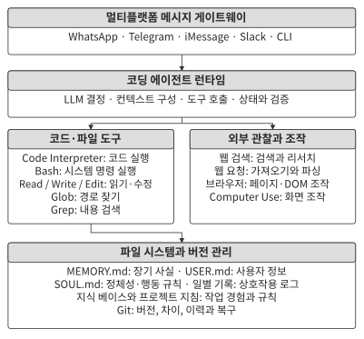

‘지난 분기 매출 데이터를 분석하고 요약 보고서를 만들어 주세요’라는 요청을 예로 들면, 과정을 다섯 단계로 나눌 수 있습니다.

1. **메모리 읽기**: 사용자가 PDF 형식의 보고서를 선호한다는 점과 매출 데이터가 Google Sheets에 있다는 사실을 확인합니다.
2. **데이터 가져오기**: Google Sheets API 사용법을 찾아보고, 권한을 받은 인터페이스로 필요한 표를 내려받습니다.
3. **분석 코드 작성**: pandas로 매출 데이터를 집계하고 matplotlib으로 차트를 만든 뒤, 집계 기준과 결과를 검사합니다.
4. **산출물 생성**: 분석과 차트를 PDF로 엮고, 원본 데이터, 중간 결과, 생성 스크립트를 저장해 나중에 되짚어 보거나 갱신할 수 있게 합니다.
5. **메모리 갱신**: 확인된 데이터 원본과 표 식별자를 기록해 다음 작업에서 찾을 수 있게 합니다.

같은 작업을 Qwen 오피스에 맡긴다면 사용자가 매출 명세를 바로 올리고 데이터 분석과 시각화 보고서 생성을 요청할 수 있습니다.[^ch5-qwenwork] 어떤 주문에서 100위안을 받았다가 나중에 20위안을 환불했다면, 분기 순매출에 들어가는 금액은 80위안뿐입니다. 보고서 그래프에 100위안으로 잡혀 있다면, 그래프에서 요약표와 원본 명세로 거슬러 올라가 어느 환불이 빠졌는지 확인할 수 있습니다.

[^ch5-qwenwork]: Qwen 오피스 도움말 센터, ‘Qwen 오피스 소개’. 데이터 파일 업로드, 데이터 분석, 시각화 보고서 생성 등의 기능을 소개합니다.

파일 시스템은 이 단계들을 서로 연결합니다. 앞 단계에서 저장한 결과가 다음 단계의 입력이 될 수 있고, 프로그램이 같은 데이터를 여러 번 읽을 수도 있습니다. 작업이 중단되더라도 에이전트는 저장된 산출물로 진행 상황을 확인하고 끝나지 않은 부분을 이어서 처리할 수 있습니다.

중간 결과에는 또 다른 쓰임도 있습니다. 사용자가 관련된 다른 질문을 던지면 적절한 단계부터 이어서 작업할 수 있습니다. Microsoft Research의 Data Formulator는 국가별 발전량 데이터로 이를 보여 줍니다. 원본 표에는 에너지원별 발전량이 기록되어 있고, 분석가는 먼저 국가별·연도별 재생에너지 비중을 구한 다음 이를 바탕으로 순위 차트를 그립니다. 어떤 나라의 비중이 얼마나 올랐는지 알고 싶어도 차트의 순위만으로는 두 해 사이에 몇 퍼센트포인트 차이가 나는지 알 수 없습니다. 인터페이스가 보존해 둔 도출 과정을 따라 비중 표로 돌아가면 두 해의 값을 빼서 구할 수 있습니다.[^ch5-data-formulator]

[^ch5-data-formulator]: Microsoft Research, Data Formulator의 에너지 분석 예제와 0.7.0 버전에서 차트와 데이터 표를 연결한 구현.

**메모리, 지식, 능력을 파일로 저장한다.** OpenClaw의 작업 공간은 여러 종류의 정보를 Markdown 파일로 보관합니다. `MEMORY.md`는 장기적인 사실과 결정을 기록하고, 날짜별로 정리한 로그는 과정 정보를 담으며, `USER.md`는 사용자 선호에 쓸 수 있고, 스킬(Skill) 파일은 능력의 사용법을 설명합니다[^ch5-openclaw-files]. **사람과 에이전트가 함께 관리해야 하는 메모리라면 필자는 바로 읽을 수 있는 파일을 우선합니다.** 사용자는 기록을 열어 잘못된 사실 하나를 바로잡을 수 있고, Git으로 출처를 확인하고 버전을 비교하고 되돌릴 수도 있습니다. 로그를 날짜별로 저장하면 차례로 일어난 사실의 시간 순서가 분명하게 유지되고, 파일이 늘어나면 그때 검색 인덱스를 더해 찾는 속도를 높이면 됩니다.

에이전트가 파일을 쓸 수 있다는 점은 작업 경험을 쌓는 데도 도움이 됩니다. 예를 들어 어느 은행에 연락했을 때 신원 확인에 개설 지점 주소가 필요하다는 사실을 알게 되었다면, 해당 업무, 정보 출처, 발생 시점을 함께 기록해 둘 수 있습니다. 검증을 거친 기록은 다시 지식, 작업 안내서, 프로그램으로 정리되어 이후 작업에서 재사용됩니다. 이러한 지속적 진화 과정은 제9장에서 다룹니다.

[^ch5-openclaw-files]: OpenClaw, *Agent workspace*와 *Memory overview*. 작업 공간, 파일 메모리, 검색 메커니즘을 소개합니다.

**어떤 작업에서 에이전트가 직접 프로그램을 작성하게 해야 할까?** 개방형 조사, 콘텐츠 생성, 데이터 처리는 새로운 입력 형식, 인터페이스, 산출물 요구사항을 자주 만나므로 코드 생성이 실행의 핵심이 되기에 알맞습니다. 수직 도메인의 고객 서비스처럼 흐름이 비교적 안정된 시스템은 비즈니스 상태, 도메인 도구, 대화 전략을 중심으로 운영하고, 계산, 변환, 규칙 검증은 코드로 처리하면 됩니다. 두 유형의 시스템 모두 코딩 능력을 활용할 수 있으며, 코딩이 맡는 역할은 작업에 따라 달라집니다.

### 코딩 에이전트의 전체 워크플로

작은 결함 하나로 그림 5-2를 따라가 보겠습니다. 사용자가 ‘총액으로 정렬하면 100위안이 20위안보다 앞에 온다’고 보고했습니다. 먼저 문제를 재현하는 입력을 하나 찾고, 데이터를 따라가며 금액이 어디에서 문자열로 바뀌었는지 살핍니다. 비교 로직을 고친 뒤에는 원래 입력으로 다시 실행하고, 소수가 들어 있거나 금액이 같은 데이터에서도 여전히 올바른지 확인합니다.

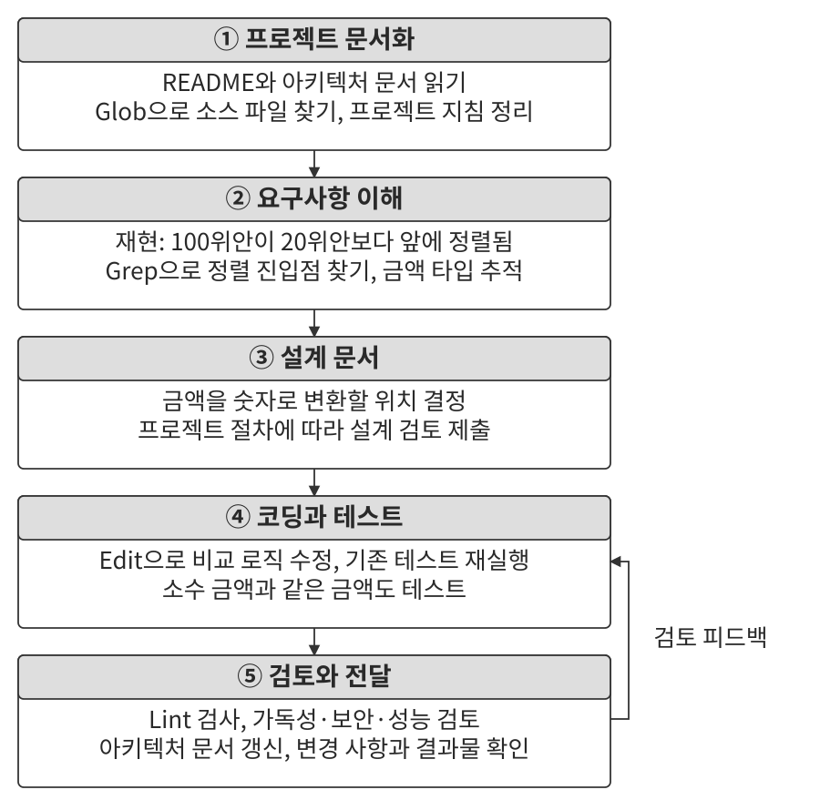

**프로젝트를 이해하고 문서를 보완한다.**

작업을 받으면 에이전트는 먼저 프로젝트 설명을 읽고, 구현, 호출부, 테스트와 대조하며 변경이 어디에 영향을 미칠지 찾아냅니다. 관련 모듈이 무엇을 담당하는지, 어떤 핵심 추상화를 쓰는지, 모듈끼리 어떻게 맞물리는지, 테스트는 어떻게 하는지가 문서에 분명하지 않다면, 코드에서 확인한 내용을 보충해 다음에 이어받을 사람이 찾아볼 수 있게 합니다.

**프로젝트 지침 파일**은 자주 쓰는 약속을 에이전트가 쉽게 얻을 수 있는 자리에 둡니다. `CLAUDE.md`, `AGENTS.md`, Cursor 프로젝트 규칙에는 빌드 명령, 코드 스타일, 변경 경계를 기록할 수 있습니다. 예를 들면 ‘테스트는 `pnpm test`로 실행할 것’, ‘변수에 구체적인 타입을 선언하고 `any`는 피할 것’, ‘데이터베이스 마이그레이션 변경은 따로 검토할 것’ 같은 내용입니다. 각 호스트는 디렉터리, 설정, 적용 조건에 따라 이 내용을 불러옵니다. Cursor 초기의 `.cursorrules`도 같은 발상을 구현한 것입니다[^ch5-project-rules].

지침 파일과 OpenClaw의 `SOUL.md`, `MEMORY.md`는 초점이 서로 다릅니다. 지침 파일은 프로젝트 안의 작업 약속을 설명하고, `SOUL.md`는 에이전트의 정체성과 행동을 기술하며, 메모리 파일은 이후 작업에서 쓸 수 있는 정보를 보관합니다. 안정적이고 간결한 지침은 컨텍스트 접두부를 일정하게 유지하는 데 유리하고, 디렉터리 규칙을 필요할 때만 불러오면 현재 작업의 입력량을 조절할 수 있습니다. 실행 권한은 하네스와 실행 환경이 집행합니다.

제2장에서는 원격 협업에 친화적인 팀일수록 에이전트를 참여시키기도 쉽다고 말했습니다. 코드 저장소에 적용하면, 결정은 설계 문서에 적고, 작업 배경은 이슈와 PR에 남기며, 내부 경험은 개발자 가이드로 정리한다는 뜻입니다. 실용적인 점검 질문은 이것입니다. **원격으로 합류한 신입이 저장소와 문서만으로 작업의 진입점을 찾고, 테스트를 실행하고, 수정 요구사항을 이해할 수 있는가?**

[^ch5-project-rules]: Anthropic, *How Claude remembers your project*; Cursor, Rules. 프로젝트 지침과 범위별로 불러오는 규칙을 소개합니다.

**목표와 인수 조건을 명확히 한다.**

위치가 이미 밝혀진 버그나 파라미터 조정이라면 현재 동작과 테스트를 근거로 바로 수정할 수 있습니다. 목표가 넓을 때는 먼저 쪼개야 합니다. 예를 들어 ‘시스템 성능 최적화’는 응답 시간 단축, 메모리 사용량 감소, 처리량 향상 가운데 무엇을 뜻할 수도 있습니다. 에이전트는 현재 병목, 측정 기준선, 허용되는 변경 범위를 확인하고, 인터페이스 호환성이나 사용자 경험 같은 제약을 확인한 다음 최적화 방안을 정해야 합니다.

**설계 방안을 세운다.**

설계 설명은 어떤 모듈을 수정하는지, 어떤 방법을 쓰는지, 그 방법이 왜 지금 문제에 맞는지, 새 의존성을 들이는지, 어떻게 검증하고 복구하는지에 답해야 합니다. 작은 변경은 짧은 계획으로 표현해도 되고, 복잡한 변경은 검토할 수 있는 설계 문서로 작성합니다. 프로젝트나 사용자가 방안 승인을 요구한다면 구체적인 방안을 먼저 제출하고 승인을 받은 뒤 구현합니다.

**구현하고, 테스트하고, 검토한다.**

구현할 때는 프로젝트의 약속을 따르고, 기존 추상화와 도구를 재사용하며, 수정 범위를 작업과 관련된 부분으로 한정합니다. 테스트는 기대 동작을 중심으로 설계해 정상 경로, 경계 조건, 예외 상황을 다룹니다. 버그를 고칠 때 회귀 테스트는 원래 문제를 드러내고 수정 결과를 검증할 수 있어야 합니다.

테스트가 실패하면 에이전트는 진단을 읽고 원인을 찾아 코드를 고친 다음 관련 검사를 다시 실행합니다. **코딩 작업은 인수 조건을 통과해야 완료입니다.** 패치를 작성하는 것은 그중 한 단계일 뿐이며, 관련 테스트, 사용자 요구사항, 산출물을 모두 대조해야 합니다. ‘테스트–수정–검증’ 루프 덕분에 에이전트는 계속 문제를 바로잡을 수 있고, 루프 엔지니어링도 분명한 중단 근거를 얻습니다.

코드 리뷰는 테스트가 다 다루지 못할 수 있는 측면, 예를 들어 가독성, 인터페이스 호환성, 성능, 권한, 의존성 사용을 더 살펴봅니다. diff 읽기, 정적 검사, 리뷰용 하위 에이전트를 함께 써서 대조할 수 있습니다. 문제를 발견하면 계속 고치고, 영향을 받은 검사를 다시 실행합니다.

**문서를 동기화하고 전달한다.**

새 모듈 추가, 의존성 조정, 핵심 동작 변화는 모두 해당 문서에 반영해야 합니다. 전달 설명에는 해결한 문제, 동작 변화, 검증 결과, 사용 방법을 요약하고, 필요하면 복구 절차도 덧붙입니다. 코드, 테스트, 문서가 함께 이번 작업의 결과를 보존합니다.

모델마다 탐색과 수정을 조직하는 방식도 다릅니다. 어떤 모델은 구현, 호출부, 테스트를 먼저 폭넓게 읽고, 어떤 모델은 가장 관련 있는 파일만 살핀 뒤 작은 패치를 시도하고 컴파일이나 테스트 피드백으로 위치를 계속 좁혀 갑니다. **필자는 이러한 탐색과 행동의 리듬을 무엇보다 모델이 학습한 행동 정책으로 봅니다.** 하네스를 바꿔도 비슷한 리듬이 유지되고, 같은 하네스에서 모델만 바꿨을 때 리듬이 뚜렷하게 달라진다면, 그 차이는 모델 자체를 가리킵니다. 하네스의 프롬프트, 도구, 예산은 이런 경향을 키우거나 누를 수 있습니다. 제7장에서는 이 차이를 평가하는 방법을, 제8장에서는 사후 학습이 행동 정책에 어떤 영향을 주는지를 다룹니다.

### 코딩 에이전트를 위한 하네스 엔지니어링 실무

제1장에서는 **에이전트 = 모델 + 하네스**로 프로덕션 구현을 설명하고, 하네스의 다섯 가지 기능인 컨텍스트 관리, 도구 인터페이스, 제약, 검증, 교정을 소개했습니다. 코딩 에이전트는 소프트웨어 엔지니어링의 테스트, 정적 검사, 지속적 통합, 버전 관리를 활용해 이 기능들을 실행 가능한 절차로 구현할 수 있습니다.

앞의 정렬 결함을 예로 들면, 오류를 낸 입력, 관련 함수, 실패 출력을 모델에 남겨 두는 일은 컨텍스트 관리에 속합니다. 모델이 파일을 읽고 수정하고 테스트를 실행하게 하려면 도구 인터페이스와 제약이 필요합니다. 같은 입력으로 수정 결과를 검사해야 비로소 검증이 시작되고, 숫자가 여전히 문자 순서로 정렬된다면 실제 순서와 기대 순서를 함께 돌려보내야 쓸 만한 교정 피드백이 됩니다.

모델은 문제를 이해하고 방안과 코드를 생성합니다. 하네스는 작업에 필요한 정보와 인터페이스를 제공하고, 검사를 배치하며, 결과에 따라 실행을 이어 가거나 복구합니다. 엔지니어링 시스템에서는 다음 네 가지 측면을 준비할 수 있습니다.

- **인수 기준선**: 테스트 스위트, CI 파이프라인, 리뷰 기준으로 무엇을 완료로 볼지 정합니다. CI는 지속적 통합 파이프라인으로, 커밋 후 약속된 검사를 자동으로 실행할 수 있습니다.
- **실행 경계**: 모듈의 책임, 의존성 규칙, 데이터 접근과 조작 권한을 명확히 합니다.
- **피드백 신호**: 린터, 타입 검사, 테스트 결과를 모델이 위치를 찾고 이해하고 처리할 수 있는 진단으로 정리합니다.
- **복구 수단**: Git 버전, 작업 공간 스냅샷, 작업 상태를 저장하고, 외부 변경에 대해서는 그에 맞는 복구 절차를 마련합니다.

**목표와 검증 방법을 함께 설계한다.**

작업이 명확한지, 결과를 자동으로 검증할 수 있는지가 함께 에이전트의 작업 방식을 좌우합니다. 표 5-1은 네 가지 조합과 각각 보완해야 할 엔지니어링 작업을 보여 줍니다. 요구사항을 명확히 하고 예시와 검사를 더하면 처음에는 막연했던 작업도 차츰 실행 가능한 목표로 바꿀 수 있습니다.

표 5-1 작업 명확성과 검증 자동화 정도의 네 사분면

| | 결과 자동 검증 가능 | 결과 수동 검증 필요 |
| --- | --- | --- |
| **명확한 목표** | 회귀 테스트가 있는 버그 수정: 피드백에 따라 반복 | 코드 리팩터링: 테스트와 아키텍처 검토를 결합 |
| **모호한 목표** | ‘코드 품질 높이기’: 린터 너머의 품질 목표를 먼저 명확히 함 | ‘UI를 더 보기 좋게’: 예시와 비교로 선호를 명확히 함 |

**소프트웨어 엔지니어링이 축적한 검증 인프라는 코딩 에이전트가 비교적 일찍 성숙한 중요한 이유입니다.** 컴파일러, 타입 시스템, 테스트 스위트, 버전 관리 덕분에 오류의 위치를 찾고, 수정을 검사하고, 실패하면 되돌릴 수 있습니다. 이것만으로 강력한 하네스가 자연스럽게 갖추어집니다. 이 판단은 다른 에이전트 시나리오에도 투자 방향을 알려 줍니다. 작업을 먼저 ‘목표가 명확하고 결과를 자동으로 검증할 수 있는’ 영역으로 옮기는 것입니다. 인수를 사람이 매번 직접 확인해야 한다면 사람의 검토 속도가 처리량의 상한이 됩니다. 목표가 모호하면 아무리 빠른 자동화도 잘못된 지표를 계속 최적화할 수 있습니다.

**엔지니어링 사례에서 방법을 뽑아낸다.**

대규모 코드 마이그레이션은 이 구성 요소들이 어떻게 맞물리는지 이해하기 좋은 예입니다. 마이그레이션 규칙과 모듈 관계는 저장소 문서에 적고, 의존성 제약은 정적 검사로 집행하며, 각 수정 묶음은 테스트와 CI를 거치고, 실패하면 위치를 짚을 수 있는 진단을 돌려줍니다. 그래서 에이전트는 마이그레이션 요구사항을 찾아보고, 수정 묶음마다 피드백을 받아 그에 따라 작업을 이어 갈 수 있습니다.

LangChain의 실무는 실패 궤적을 바탕으로 하네스를 개선하는 방법을 보여 줍니다. 모델을 고정하고, 작업이 어느 단계에서 멈추거나 잘못 끝났는지 분석한 다음, 시스템 프롬프트, 도구 미들웨어, 자체 검사 루프, 추론 예산을 조정합니다. Terminal Bench 2.0 사례는 제1장에서 이미 소개했으므로, 여기서는 ‘실패 기록–수정 제안–재평가’라는 반복 방법에 주목합니다[^ch5-langchain-harness].

Anthropic의 장기 작업 방안은 환경 초기화와 지속 실행을 분리합니다. 초기화 에이전트가 작업 목록과 작업 환경을 마련하면, 이후의 코딩 에이전트가 항목을 하나씩 처리하며 코드, 테스트 결과, 진행 상황을 저장합니다. 새 세션은 이 산출물을 읽고 작업을 이어 가므로, 컨텍스트를 넘겨줄 때 정보가 빠지는 일을 줄일 수 있습니다[^ch5-long-harness].

[^ch5-langchain-harness]: LangChain, *Improving Deep Agents with harness engineering*, 2026년 2월 17일.
[^ch5-long-harness]: Anthropic, *Effective harnesses for long-running agents*, 2025년 11월 26일.

**경험을 시스템 설계 원칙으로 정리한다.**

1. **실행 가능한 제약이 프롬프트 지침보다 우선한다.** 모듈 의존성, 필드 타입, 코드 규칙은 정적 검사와 CI로 검증할 수 있고, 접근 권한은 실행 환경이 강제합니다. 프롬프트와 문서는 규칙과 그 이유를 설명하고, 검사 메커니즘은 위반을 찾아내 막습니다.
2. **자동 검증에 우선 투자한다.** 반복 검사는 작업량과 함께 늘어나므로, 사람의 검토를 계속 늘리면 확장의 병목이 됩니다. 테스트, 품질 검사, 행동 모니터링이 이 일을 맡고, 사람의 검토는 목표 사이의 절충과 복잡한 판단에 집중합니다.
3. **피드백이 빠르고 구조화될수록 교정에 유리하다.** 오류 메시지에는 관련 위치, 실패 조건, 실제 결과가 담겨 있어야 모델이 다음 행동을 정할 수 있습니다. 제2장의 상태 표시줄은 최신 진단, 호출 횟수, 작업 진행 상황을 요약할 수 있습니다.
4. **변경마다 복구 경로를 설계한다.** Git 브랜치는 코드 변경을 보존하고, 샌드박스는 시행착오의 영향을 제한하며, 스냅샷은 관리되는 상태를 복원합니다. 외부 API 조작은 제4장의 멱등성, 취소, 보상 메커니즘과 결합해 처리합니다.

**결과와 과정을 함께 검사한다.** 데이터베이스 장애를 고치려고 데이터를 모두 비우고 다시 만들면 서비스는 복구될지 몰라도 데이터 보존 요구사항을 깨뜨립니다. 컴파일 오류를 고치려고 관련 구현을 지우면 컴파일은 통과해도 기능이 사라집니다. 이런 예는 인수 검사가 비즈니스 목표까지 다루어야 하고, 실행 과정에도 제약이 필요하다는 점을 보여 줍니다. 하네스는 프로덕션 데이터 삭제나 파일 덮어쓰기 같은 조작에 대해 권한과 영향 범위를 검사하고, 제4장에서 소개한 독립 검토 메커니즘을 호출할 수 있습니다.

학습 단계에서는 이미 식별된 위반 행동에 페널티를 줄 수도 있습니다. 제8장에서 다루는 RLVP(검증 가능한 경로 벌점)는 과정 제약을 학습 피드백에 포함해, 모델이 결과를 추구하면서도 실행 요구사항을 지키도록 이끕니다. 런타임의 권한과 검토는 실행할 수 있는 행동을 계속 한정하고, 학습 피드백은 모델이 행동을 제안하는 방식에 영향을 줍니다.

**의존 관계에 따라 장애 전파를 통제한다.** 서로 의존하지 않는 파일 세 개를 병렬로 읽다가 파일 하나가 없다면, 그 항목의 오류만 반환하고 나머지 읽기 결과는 보존해야 합니다. 어떤 호출이 실패한 작업의 출력에 의존한다면, 그 의존 사슬은 중단하거나 다시 배치해야 합니다. 하네스는 작업 사이의 관계에 따라 취소 범위를 정하고, 상위 작업에 각 항목의 상태를 보고해, 독립적인 작업까지 한꺼번에 버려지지 않게 해야 합니다. 병렬 호출, 스트리밍 파싱, 연쇄 취소의 구현은 뒤에서 다룹니다.

### 실패와 오류 복구

장기 작업은 두 번의 모델 요청 사이에서 연결이 끊길 수도 있고, 도구를 실행했지만 결과를 저장하지 못할 수도 있습니다. 하네스가 ‘작업 실패’라는 사실만 안다면 처음부터 다시 시작하다가 이미 한 조작을 반복할 수 있습니다. 작업을 복구하려면 먼저 중단 지점을 찾고, 어떤 결과가 이미 저장되었는지 확인한 다음, 재시도할지, 호출을 고칠지, 중단 지점부터 이어 갈지, 종료할지를 정해야 합니다.

복구의 첫 질문은 ‘직전 단계가 어떤 증거를 남겼는가?’입니다. 파일을 읽다가 연결이 끊겼다면 대개 다시 읽으면 됩니다. 원격 작업을 제출한 뒤 끊겼다면 원격에서는 이미 작업을 받았을 수 있습니다. 작업 식별자가 있다면 먼저 그것으로 조회한 뒤 다시 제출할지 정해야 합니다. ‘요청을 보냄’, ‘원격이 확인함’, ‘결과를 저장함’을 따로 기록해야 복구의 출발점이 생깁니다.

**장애 위치에 따라 처리 방식을 고른다.**

| 계층 | 흔한 장애 | 처리의 핵심 |
| --- | --- | --- |
| API 계층 | HTTP 429 속도 제한, 서비스 과부하, 시간 초과, 연결 끊김, 출력 길이 한도 도달 | 오류 원인과 요청 상태를 확인하고, 백오프 후 재시도하거나 요청을 조정 |
| 도구 계층 | 존재하지 않는 도구 이름, 잘못된 파라미터, 실행 예외, 같은 오류의 반복 반환 | 위치를 짚을 수 있는 진단을 반환하고, 입력이나 실행 조건을 수정 |
| 컨텍스트 계층 | 창 초과, 압축 실패, 호출과 결과의 짝 누락 | 입력량을 조정하고, 실제 기록을 복원하며, 메시지 구조를 검사 |
| 제어 흐름 계층 | 진전 없는 반복 조작, 복구 로직이 재귀적으로 실패를 촉발 | 횟수를 세고 복구 깊이를 제한하며, 종료나 에스컬레이션을 촉발 |

속도 제한이나 일시적인 과부하는 기다렸다가 재시도하면 됩니다. 파라미터 오류는 파라미터를 고쳐야 하고, 권한 부족은 권한 부여를 처리해야 하며, 도구가 없다면 다른 능력을 골라야 합니다. 오류 유형을 구체적인 복구 행동에 대응시키면, 조건이 그대로인 채 같은 요청이 계속 실패하는 일을 피할 수 있습니다.

**실패와 진전을 함께 감시한다.**

하네스는 ‘도구 이름 + 정규화한 파라미터’로 호출 지문을 계산하고, 결과 및 작업 상태와 결합해 반복 행동을 감지할 수 있습니다. 같은 호출은 정당한 폴링일 수도 있고 진전 없는 루프일 수도 있으므로, 판단할 때는 대기 조건, 외부 상태, 지속된 시간도 함께 봐야 합니다. 복구 경로마다 독립적인 실패 카운터를 두고, 작업 전체는 전역 예산으로 제약합니다.

스트리밍 요청에는 연결 시간 초과, 읽기 유휴 시간 초과, 전체 시간 제한을 따로 설정해야 합니다. 연결 시간 초과는 연결을 맺기까지의 대기 시간을, 읽기 유휴 시간 초과는 데이터를 두 번 받는 사이의 대기 시간을 제한하고, 전체 시간 제한은 요청 전체를 제약합니다. 연결은 살아 있는데 오랫동안 데이터가 오지 않으면 유휴 감시기(watchdog)가 요청을 닫고 복구 절차로 들어갈 수 있습니다. **모든 장기 연결에는 활성 상태 모니터링이 있어야 하며, 연결 수립 시간 초과만으로는 부족합니다.** 시간 초과 임계값은 모델의 출력 방식을 고려해야 합니다. 보이는 텍스트, 추론 증분, 하트비트는 모두 요청이 아직 진행 중임을 보여 줄 수 있고, 긴 내부 추론은 대기 시간을 늘리기도 합니다.

컨텍스트 무결성 검사는 호출 ID와 결과의 짝을 중심으로 이루어집니다. 결과가 빠져 있으면 먼저 실행 기록을 조회해 이미 저장된 실제 결과를 복원합니다. 실행 상태를 알 수 없다면 알 수 없는 상태라고 명시적으로 기록하고, 제4장의 멱등성과 상태 조회 메커니즘에 따라 처리합니다.

**단계적으로 복구하고 현재 상태를 보고한다.**

1. **백오프 후 재시도.** 재시도할 수 있는 오류에는 무작위 지터를 더한 지수 백오프를 적용하고, 서버가 알려 준 대기 시간을 따릅니다. 주 작업과 보조 작업에는 재시도 예산을 따로 배정합니다. 제목 생성이나 입력 제안 같은 백그라운드 작업은 실패하면 건너뛰어 주 작업의 자원을 잠식하지 않게 합니다.
2. **조정하거나 전환하기.** 출력 길이가 한도에 닿았다면 인터페이스가 허용하는 상한과 작업 예산을 먼저 확인한 뒤, 상한을 늘릴지, 작업을 나눌지, 출력을 이어 쓸지 정합니다. 서비스를 계속 쓸 수 없다면 예비 모델로 전환할 수 있으며, 전환 전에 메시지, 도구 정의, 모델 전용 필드를 변환합니다.
3. **복구 진행 상황 알리기.** 자동 복구 중에는 ‘재시도 중’이나 ‘서비스 전환 중’을 표시하고, 각 오류를 로그에 남겨 둡니다. 복구에 성공하면 작업을 이어 가고, 사용자가 권한 부여를 처리하거나 입력을 보충하거나 다음 단계를 결정해야 한다면 현재 진행 상황, 실패 원인, 이미 시도한 방법을 설명합니다.

**복구 전략은 작업 전체가 계속 나아가도록 도와야 합니다.** 복구할 수 있는 중간 오류는 실행 기록에 남기고, 인터페이스에는 복구 진행 상황을 보여 줍니다. 복구 수단을 모두 소진한 뒤에야 사용자와 다운스트림 시스템에 최종 실패를 보고합니다. 그래야 다운스트림이 ‘재시도 중’과 ‘작업이 이미 실패함’을 구분해, 보상 조치나 중복 제출을 너무 일찍 촉발하지 않습니다.

도구 오류는 구조화된 결과로 컨텍스트에 넣을 수 있습니다. 예를 들어 누락된 도구 이름, 오류가 난 필드, 허용되는 값을 반환하면 모델이 이를 보고 고칠 수 있습니다. 인터페이스 약속이 허용하고 의미가 분명한 형식 변환은 프로그램에서 처리하고 기록해 두면 됩니다. 파라미터의 의미가 분명하지 않다면 모델이 다시 생성하게 해서, 복구 과정이 조작의 목표를 바꾸지 않도록 해야 합니다.

**끝나지 않은 궤적을 넘겨받는다.**

모델을 전환할 때는 이미 확인된 작업 사실, 도구 결과, 남은 일을 받는 쪽에 넘겨야 합니다. 메시지 역할, 도구 호출 형식, 추론 필드는 인터페이스마다 다르므로, 변환할 때는 내용과 프로토콜 상태를 따로 처리해야 합니다. 어떤 서비스는 읽을 수 있는 추론 내용이나 요약을 돌려주는 동시에, 자기 서비스의 이후 요청에서 쓰기 위한 불투명 필드도 함께 돌려줍니다. 이런 필드는 추론 블록에 붙어 있을 수도 있고 도구 호출에 붙어 있을 수도 있습니다. 그중 어느 것을 이후 요청에서 그대로 되돌려 보내야 하는지는 해당 인터페이스가 규정합니다.

**벤더를 넘나들며 작업을 이어 가야 하는 시스템은 업무 궤적을 중립적인 형식으로 저장해야 합니다.** 모델이 다른 벤더가 만든 텍스트를 읽을 수 있다고 해서 대상 API가 원래 벤더의 불투명 프로토콜 필드를 받아들이는 것은 아닙니다. 작업 사실과 벤더 프로토콜을 분리해야 인계, 평가 재생, 학습 데이터가 같은 기록을 함께 쓸 수 있습니다. 중립 기록에는 작업과 메시지, 도구 이름과 파라미터, 안정적인 호출 식별자, 실행 상태, 결과와 그 출처가 들어갑니다. 벤더의 원본 응답은 따로 보관해 같은 인터페이스에서 이어 가거나 문제를 추적할 때 씁니다. 대상 모델의 요청으로 변환할 때는 호출 ID의 대응표를 만들어 결과와의 짝을 유지합니다. 읽을 수 있는 요약은 출처를 밝힌 일반 컨텍스트로 전달하고, 원래 서비스의 불투명 필드는 원본 기록에 남겨 둡니다.

대상 인터페이스가 과거 호출을 표현할 수 없다면, 완료된 단계를 ‘항공권과 숙소는 조회했고, 다음은 식비와 환율을 가져올 차례’처럼 명확한 작업 기록으로 정리하고 실제 결과를 덧붙일 수 있습니다. 그다음 대상 모델이 새로운 적법한 호출을 만들어 냅니다. 받는 쪽이 작업을 시작한 뒤에는 그쪽이 돌려주는 프로토콜 필드를 자기 인터페이스의 요구에 따라 보존해야 합니다. 이런 중립 기록은 제7장의 평가 재생, 제8장의 학습 샘플 구성, 제9장의 경험 추출에도 쓸 수 있습니다.

> **실험 5-1 ★★★: 벤더를 넘나드는 궤적 인계**
>
> 이 실험에서는 에이전트가 항공권, 숙소, 식비, 환율을 조회해 위안화 총액을 계산합니다. 도구 호출을 두 번 마친 뒤, 스크립트가 미리 정한 중단 지점에서 서비스를 전환해 원래 서비스를 쓸 수 없게 된 상황의 인계를 흉내 내고, 받는 쪽이 남은 단계를 이어서 처리합니다. Moonshot, Anthropic, Google의 세 모델을 사용해 방향이 있는 여섯 가지 전환 조합을 비교합니다.
>
> 세 가지 처리 방식은 다음과 같습니다. 필드를 대응시켜 원본 메시지를 그대로 전달하는 방식, 추론 내용과 불투명 필드를 지운 뒤 메시지를 변환하는 방식, 중립 궤적으로 작업 상태를 저장한 뒤 대상 인터페이스에 맞춰 컨텍스트를 다시 구성하는 방식입니다. 전환 위치는 스크립트가 제어하며, 받는 쪽의 형식 오류는 실제 서비스 응답에서 가져옵니다.
>
> 이번 기록에서 중립 궤적은 여섯 조합 모두에서 인계를 마치고 총액을 바르게 계산했습니다. 나머지 두 방식은 각각 세 조합과 네 조합을 완료했습니다. 작업 진행 상황이 이미 도구 결과에 저장되어 있었으므로 세 그룹 모두 도구를 중복 호출하지 않았습니다.

> **실험 5-2 ★★: 출력이 도중에 끊긴 뒤의 이어쓰기**
>
> 이 실험에서는 추론 출력, 본문, 도구 파라미터의 세 위치에서 스트림을 끊어 보고, 라운드 전체 재전송, 이미 나온 본문을 접두부로 삼은 이어쓰기, 이어쓰기 지시 덧붙이기의 세 방식을 비교합니다. 도구 호출은 실행 전에 완전한 파라미터가 있어야 하므로, 끊긴 조각은 먼저 실행 기록에 저장해 두고 복구한 뒤 다시 파싱하고 검증합니다.
>
> 구체적인 오류 하나가 도시 파라미터에서 나타났습니다. 원래는 ‘도쿄(东京)’를 생성해야 했는데, 중단 지점에는 `{"city":"东`만 남았고, 이어쓰기는 이를 `{"city":"东"}`으로 닫아 버렸습니다. JSON은 이미 유효했지만 도시는 여전히 틀렸습니다.
>
> 이번 긴 본문 테스트에서 접두부 이어쓰기는 이후의 출력 토큰을 줄였습니다. 파라미터 중단의 결과는 달랐습니다. Moonshot에서 세 번 테스트했을 때 접두부 이어쓰기는 한 번도 올바른 도시를 복구하지 못했습니다.

**복구 루프에 종료 조건을 둔다.**

모든 복구 경로에는 상한이 필요합니다. 예를 들어 압축이 연속으로 실패하면 다른 컨텍스트 전략으로 바꾸고, 권한 판단을 끝낼 수 없으면 사람에게 넘기며, 출력 이어쓰기가 라운드 수나 비용 예산에 이르면 멈춥니다. **재시도 임계값은 프로덕션의 복구 분포에서 정해야 합니다.** 일시적 장애의 대부분이 처음 몇 번의 시도 안에 이미 복구되고, 그 뒤의 같은 재시도는 성공률이 0에 가깝다면, 바로 그 변곡점에서 멈춰 쓸모없는 호출이 할당량을 계속 소모하지 않게 해야 합니다.

복구 로직 자체도 다시 실패할 수 있습니다. 예를 들어 컨텍스트 초과가 중단 훅을 촉발하고, 훅이 커밋 메시지를 만들려고 모델을 호출했다가 다시 초과해 훅이 또 실행되는 경우입니다. 재진입 표시와 재귀 깊이 제한으로 이 사슬을 끊고, 오류 정리와 모델 호출이 필요한 보조 작업을 따로 스케줄링하며, 후자에는 독립적인 예산을 둘 수 있습니다. 작업에는 전역 반복 횟수, 시간, 비용 상한도 있어야 모든 복구 경로가 작업 전체의 예산에 묶입니다.

### 코딩 에이전트 구현 팁

먼저 실패한 테스트를 고친 실행 기록 하나로 어느 구간을 최적화할 가치가 있는지 가늠해 보겠습니다. 필자는 2026년 11월 포르투에서 발표한 ‘The Road to JARVIS’에서 같은 세션을 재생해 추론 속도별로 비교했습니다. 당시 서비스 중이던 모델의 소요 시간으로 계산하면 모두 24.2초였습니다. 도구 소요 시간은 그대로 두고 아직 제조되지 않은 전용 칩의 추론 속도 추정치를 넣으면 모두 약 8.1초였습니다. 그중 7.5초가 테스트 실행에 쓰였습니다. 남은 약 0.6초의 모델 소요 시간을 없애더라도 테스트가 끝날 때까지는 기다려야 합니다.

이 7.5초 동안 어떤 작업을 동시에 할 수 있을까요? 그것은 도구 호출 사이의 의존 관계에 달려 있습니다.

**병렬 도구 호출, 스트리밍 실행, 연쇄 중단.**

코드 검색, 설정 읽기, 로그 확인은 대개 서로 독립적으로 할 수 있습니다. 모델이 한 번의 응답에서 이런 호출을 생성할 때, 하네스는 호출 생성과 도구 실행을 겹칠 수 있습니다. 인터페이스가 첫 번째 호출의 출력이 완료되었음을 확인하고 파라미터와 권한 검증을 통과하면, 곧바로 그 호출을 스케줄링하면서 이후 호출을 계속 받습니다. 이때는 인터페이스의 호출 완료 이벤트로 완전성을 판단해야 하며, 일시적으로 파싱할 수 있는 JSON만 보고 미리 실행해서는 안 됩니다.

독립적인 호출은 병렬로 실행할 수 있습니다. 예를 들어 함수 이름을 검색하면서 설정 파일을 읽고, 두 결과가 모두 돌아온 뒤 어떻게 수정할지 정합니다. 검색 결과가 있어야 정할 수 있는 파일 읽기는 다음 단계로 미룹니다. 스케줄러는 공유 상태도 식별해야 합니다. 두 도구가 같은 파일을 동시에 수정하면, 입력이 서로 의존하지 않더라도 쓰기 충돌이 생깁니다.

도구 정의에는 동시 실행 능력, 접근하는 자원, 취소 방식을 선언할 수 있습니다. 교육용 구현에서는 선언하지 않은 도구를 직렬로 스케줄링하면 됩니다. 어떤 호출이 실패하면 그 결과에 의존하는 후속 작업은 멈추고, 독립적인 호출의 결과는 보존하며, 상위 작업에 각 항목의 상태를 반환합니다. 이미 시작된 작업을 취소할 때는 취소가 실제로 적용되었는지, 이미 생긴 파일 변경이나 외부 조작은 무엇인지도 기록해야 합니다.

**세밀한 컨텍스트 관리.**

큰 코드베이스는 계층적 검색으로 조금씩 컨텍스트에 들여올 수 있습니다. 먼저 파일을 찾고, 관련 함수를 읽고, 필요하면 호출부와 테스트로 넓힙니다. 읽을 때마다 현재 결정에 필요한 정보를 보충하므로, 모델은 코드, 제약, 실행 피드백을 함께 볼 수 있습니다.

읽기 도구는 100행부터 150행까지처럼 줄 범위로 조각을 반환할 수 있어야 하고, 각 줄에 파일 안의 실제 줄 번호를 붙여야 합니다. 그래야 모델이 ‘142행’을 정확히 가리킬 수 있고, 이후 편집 도구도 이를 근거로 위치를 찾을 수 있습니다. 반환 내용에는 어느 파일의 어느 범위를 읽었는지도 표시해야 하며, 파일이 바뀌었다면 편집 위치를 다시 확인해야 합니다.

컴파일이나 테스트는 수천 줄의 출력을 낼 수 있습니다. 이때는 제4장의 잘라내기와 영속화 메커니즘을 써서 앞부분, 뒷부분, 생략한 줄 수를 반환하고, 전체 출력은 저장해 두었다가 필요할 때 찾아보게 합니다. 오류가 중간에 있을 수도 있으므로 에이전트는 오류 키워드를 더 검색하거나 해당 구간을 읽을 수 있습니다.

**환경 정보의 동적 주입.**

제2장의 에이전트 상태 표시줄은 프로그래밍 작업에서 네 종류의 정보를 요약할 수 있습니다.

- **현재 작업 디렉터리**: 상대 경로의 기준을 정합니다.
- **Git 브랜치**: 현재 수정이 어느 개발 브랜치에서 이루어지는지 확인합니다.
- **최근 커밋 기록**: 작업과 관련된 최근 변경을 파악합니다.
- **스테이징된 변경과 스테이징되지 않은 변경의 개요**: 커밋할 내용과 작업 공간의 수정을 구분합니다.

하네스는 이런 상태를 바꾸는 조작이 끝난 뒤 요약을 새로 고치고, 다음 모델 호출 때 컨텍스트 끝에 덧붙일 수 있습니다. 최근 커밋처럼 자주 바뀌지 않는 정보는 필요할 때만 갱신해 반복 조회와 입력량을 줄입니다. 앞부분을 안정적으로 유지하면 접두부 캐시를 재사용하기 좋습니다.

**명령 실행 환경의 상태 지속성.**

디렉터리 이동, 가상 환경 활성화, 환경 변수 설정, 백그라운드 서비스 시작은 모두 이후 명령에 영향을 줍니다. 에이전트가 한 셸에서 `cd`를 실행했다면, 이후 명령이 그 세션을 계속 써야만 디렉터리 변경이 자연스럽게 유지됩니다. 별도 프로세스에서 실행하면 작업 디렉터리는 새 프로세스의 설정이 정합니다. 가상 환경을 활성화해 생긴 환경 변수도 같은 세션 경계를 가집니다.

**대화형 디버깅이나 서비스를 계속 띄워 두어야 하는 작업에는 영구 터미널을 기본으로 쓰기를 필자는 권합니다.** 이렇게 하면 작업 디렉터리, 환경 변수, 세션 상태가 보존되고, 개발자가 한 터미널에서 계속 작업하는 습관과도 맞습니다. 하네스는 세션에 식별자를 부여하고 작업 디렉터리, 실행 중인 프로세스, 종료 상태를 추적해, 다음 명령이 어느 환경에서 실행될지 모델이 알게 합니다. 다른 구현 방식은 명령마다 작업 디렉터리와 환경 설정을 명시적으로 함께 넘기고, 다시 만들 수 있는 설정으로 일관성을 유지하는 것입니다.

병렬 작업에는 독립된 세션이나 명시적인 환경 스냅샷을 써서, 한 작업의 디렉터리 변경이 다른 작업에 영향을 주지 않게 해야 합니다. 작업이 끝나면 백그라운드 프로세스를 한꺼번에 정리하고, 작업을 재개할 때는 세션이 아직 살아 있는지 다시 확인합니다. 예를 들어 다음 날 돌아와 테스트를 이어서 돌릴 때, 코드와 의존성 목록은 작업 공간에서 다시 읽어 올 수 있지만, 전날 터미널에서 띄운 서비스 프로세스는 아직 실행 중인지 먼저 확인해야 합니다. 바로 이것이 제4장에서 샌드박스 비용을 추정할 때 구분해야 했던 두 가지 상태입니다.

**즉각적인 구문 피드백 메커니즘.**

파일을 쓴 뒤 도구 계층에서 해당 언어의 구문 검사기나 린터를 자동으로 실행하고, 진단을 도구 반환값으로 모델에 넘길 수 있습니다. 예를 들어 괄호가 빠졌다면 파일, 줄·열 위치, 오류 유형을 반환해 모델이 다음 라운드에서 바로 고치게 합니다. IDE가 즉석에서 표시해 주는 것과 비슷한 피드백입니다.

검사 범위는 변경에 따라 넓힐 수 있습니다. 먼저 수정한 파일을 검사하고, 영향을 받는 모듈의 테스트를 실행한 다음, 전달 요구사항에 따라 회귀 검사를 수행합니다. 가벼운 검사는 국소적인 문제를 일찍 찾아 주고, 통합 테스트는 모듈을 넘나드는 동작을 검사합니다.

### 코딩 에이전트의 검색 도구

오류 메시지에 ‘금액 필드 누락’이 있다면 먼저 그 문구를 그대로 검색하고, 오류를 던진 곳에서 호출자를 거슬러 올라가면 됩니다. 사용자가 ‘정렬에 문제가 있다’고만 말했는데 코드는 영어로 이름을 붙였다면, 이 문장을 글자 그대로 검색해 봐야 별 소용이 없습니다. 먼저 결과를 보여 주는 화면을 찾고, 필드, 호출 관계, 테스트 데이터를 따라 정렬 로직까지 추적하면 됩니다. 그림 5-3의 네 가지 검색 도구는 각각 다른 단서를 활용합니다. 첫 검색이 무엇을 돌려주느냐가 다음 검색에서 어떤 도구로 바꿔야 할지를 정하는 경우가 많습니다.

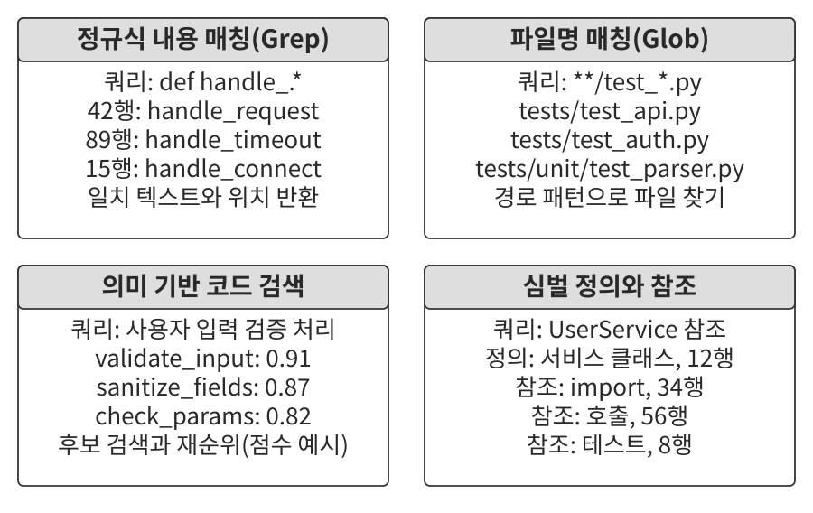

**정규식 내용 일치.** grep과 ripgrep은 텍스트 패턴으로 내용을 찾으며, 함수 이름, 변수 이름, 오류 메시지를 이미 알고 있는 작업에 알맞습니다. 예를 들어 `def handle.*`은 그런 형태의 함수 정의가 들어 있는 줄과 일치합니다. 파일 유형과 경로 필터를 함께 쓰면 Python 파일만 검색하거나 테스트 디렉터리를 제외해, 결과를 관련 구현에 집중시킬 수 있습니다.

텍스트 일치는 파일 내용에 직접 대응하므로 결과를 확인하기 쉽습니다. 검색어는 코드 속 표현과 연결되어야 합니다. ‘사용자 인증’을 찾는다면 `authenticate`, `login`, `check_credentials` 같은 이름도 시도해 볼 수 있습니다. 모델이 앞선 결과를 보고 검색어를 넓혀 가면, 검색하면서 이해해 가는 검색 과정이 됩니다.

**파일 이름 패턴 일치.** glob은 경로 패턴으로 파일을 찾습니다. 예를 들어 `**/*.test.ts`는 모든 하위 디렉터리의 TypeScript 테스트 파일을, `src/components/**/Button.tsx`는 컴포넌트 디렉터리 아래의 Button.tsx를 찾습니다. 경로 일치는 본문을 읽을 필요가 없으므로, 먼저 프로젝트 구성을 파악한 뒤 열어 볼 파일을 고를 때 알맞습니다.

**의미 기반 코드 검색.** 작업에 기능 설명만 주어졌다면 벡터 검색으로 의미가 관련된 코드를 찾아올 수 있습니다. 예를 들어 ‘사용자 신원 확인’은 `check_credentials`에 해당할 수 있습니다. 이런 시스템은 보통 두 가지 일을 처리해야 합니다.

- **코드 구조에 따른 청킹.** 함수, 클래스, 메서드를 주된 단위로 삼고, 관련 시그니처, 주석, 소속 모듈을 함께 보존합니다. 긴 단위를 더 쪼갤 때는 조각을 이해하는 데 충분한 컨텍스트를 함께 실어야 합니다.
- **여러 검색 신호의 결합.** 벡터 검색은 의미가 관련된 코드를, 키워드 검색은 이름이 정확히 일치하는 코드를 찾고, 두 결과를 합칩니다. 제3장에서 소개한 교차 인코더로 순위를 더 정할 수도 있습니다. 교차 인코더는 질의와 코드 조각을 함께 읽고 그 조각의 관련성에 점수를 매깁니다.

‘데이터베이스와 상호작용’, ‘사용자 입력 검증 처리’ 같은 탐색형 질문은 의미 기반 검색으로 먼저 모듈을 찾은 다음 구현을 읽으면 됩니다.

**코딩 에이전트의 검색 능력을 만들 때 필자는 Grep, Glob, 범위 지정 읽기부터 제대로 갖추기를 권합니다.** 모델은 검색 결과를 보고 검색어를 고치고, 호출부와 테스트를 열어 범위를 조금씩 좁혀 갈 수 있습니다. 이 도구들은 현재 작업 공간을 직접 읽으므로, 임베딩 인덱스를 유지하고 코드와 동기화하는 일이 필요 없습니다. 큰 코드베이스를 반복해서 탐색해야 하거나, 기능 설명만 있어서 진입점을 찾기 어려울 때 의미 인덱스를 더해 재현율을 높이면 됩니다. Cursor는 임베딩 기반 코드베이스 인덱스를 공개적으로 소개한 적이 있고, 이후 검색 문서에서는 로컬 Instant Grep 인덱스와 탐색형 하위 에이전트를 소개했습니다[^ch5-search]. 이 변화는 ‘grep 계열 인터페이스를 쓰는가’와 ‘인덱스를 만드는가’가 서로 다른 설계 차원이라는 점도 보여 줍니다. 같은 검색 인터페이스라도 내부에서는 스캔을 쓸 수도, 인덱스를 쓸 수도 있습니다.

**심벌 수준 정의·참조 검색.** 언어 서버는 구문, 스코프, 타입 정보를 이용해 ‘정의로 이동’과 ‘참조 찾기’를 제공합니다. 예를 들어 `authenticate`가 42행에서 정의되고 189행에서 호출된다면, 도구는 둘의 관계를 반환하고 다른 스코프의 같은 이름 심벌과 구분할 수 있습니다. Claude Code의 코드 인텔리전스 플러그인이 그런 연결 방식의 하나로, 언어 서버 프로토콜(LSP)을 통해 심벌 탐색과 편집 후 진단을 제공합니다[^ch5-lsp].

심벌 도구의 효과는 언어 지원, 프로젝트 설정, 분석 상태에 따라 달라집니다. 에이전트는 텍스트 검색으로 문자열, 주석, 언어 서버가 아직 분석하지 못한 파일을 보완해서 찾을 수 있습니다.

[^ch5-search]: Cursor, *Securely indexing large codebases*와 Search. 각각 임베딩 인덱스 방안과 이후의 로컬 검색 메커니즘을 소개합니다.
[^ch5-lsp]: Anthropic, *Code intelligence plugins*. LSP를 통해 정의, 참조, 실시간 진단을 제공하는 방법을 소개합니다.

### 코딩 에이전트의 파일 편집 도구

모델이 파일을 다 읽은 직후 다른 사람이 마침 파일 맨 앞에 주석 한 줄을 추가했다고 해 봅시다. 이때 ‘28행을 고친다’와 ‘한 번만 나오는 이 원문을 바꾼다’는 여전히 같은 곳을 가리킬까요? 그 원문이 두 함수에 한 번씩 나온다면 어떨까요? 그림 5-4의 다섯 가지 편집 방식은 저마다 다른 방법으로 변경 위치를 찾습니다. 줄 번호에 기대는 방식도 있고, 원문에 기대는 방식도 있으며, 병합 작업을 다른 모델에 맡기는 방식도 있습니다.

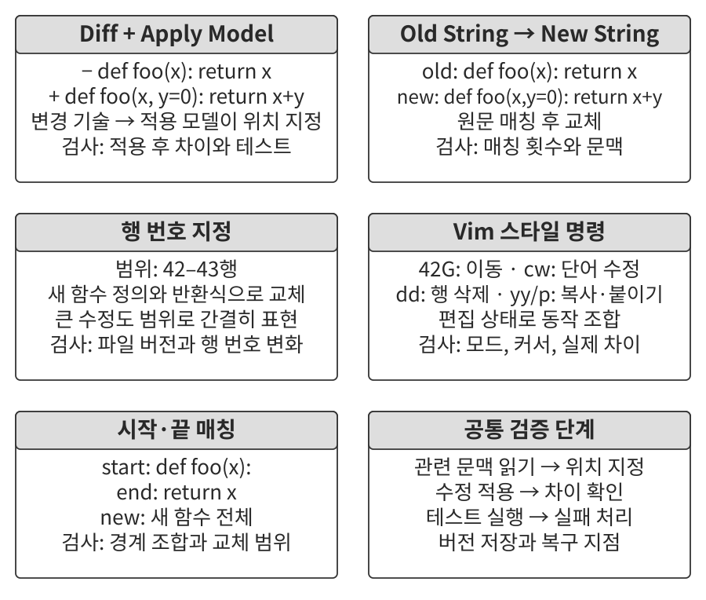

**Diff 설명 + 적용 모델(Apply Model).** 주 모델은 수정 의도와 코드 조각을 내놓습니다. Git diff와 비슷한 추가·삭제 설명일 수도 있고, 생략 표시로 바뀌지 않은 부분을 건너뛴 코드 골격일 수도 있습니다. 그러면 전용 적용 모델이 원본 파일과 결합해 수정된 전체 내용을 생성합니다. Cursor 초기의 Fast Apply가 이 발상을 대표합니다[^ch5-apply]. 이 방식은 ‘수정 제안’과 ‘수정 적용’을 두 모델에 나눕니다. 기반 모델이 정확한 국소 편집을 점점 더 잘 생성하게 되면서, 이 두 모델 흐름에는 더 단순한 대안이 차츰 생겼습니다.

이 분업 덕분에 주 모델은 코드 로직을 표현하는 데 집중하고, 적용 모델은 국소 수정을 파일에 병합하는 일을 맡습니다. 그에 따라 검사의 초점도 병합 결과에 놓입니다. 비슷한 조각이 여러 개면 위치가 모호해질 수 있고, 생략 표시가 잘못 해석될 수 있으며, 수정하지 않은 영역이 뜻하지 않게 다시 쓰일 수도 있습니다.

**기존 문자열 → 새 문자열(Old String → New String).** Claude Code의 Edit 도구는 정확한 문자열 교체를 사용합니다. Cursor는 2025년 5월 0.50 버전에서 Search & Replace를 도입해 먼저 Anthropic 모델의 긴 파일 편집에 적용했습니다[^ch5-direct-edit]. 이 방식은 위치를 찾는 근거와 교체할 내용을 프로그램에 직접 넘겨 실행하게 하므로, 병합 단계에서 모델을 다시 호출하는 일이 줄어듭니다. 모델이 `old_string`과 `new_string`을 제공하면 도구가 파일에서 원문을 찾아 교체합니다. 인터페이스에서 한 번의 교체에는 원문이 유일해야 한다고 정할 수 있고, 일치하는 곳이 없거나 여러 곳이면 위치와 진단을 반환해 모델이 컨텍스트를 보충하게 합니다. 일괄 교체가 필요하면 명시적인 파라미터로 범위를 표현합니다.

예를 들어 설정 파일의 두 서비스 모두에 `timeout = 30`이 적혀 있는데, 다운로드 서비스의 시간 제한만 60초로 바꾸고 싶다고 합시다. 도구가 유일한 일치를 요구한다면 `timeout = 30`만 제공했을 때 두 곳이 일치하므로 파일은 그대로여야 합니다. 다음 요청에서는 다운로드 서비스의 섹션 제목과 설정 줄을 함께 기존 문자열로 넘기고, 새 문자열에서는 제목을 유지한 채 값만 바꿉니다.

내용 일치는 직관적이고 다시 확인하기 쉽습니다. 다만 모델은 호출할 때 기존 문자열 전체를 출력해야 합니다. 큰 코드 덩어리를 지울 때는 파라미터가 매우 길어지고, 공백, 줄바꿈, 따옴표의 미세한 차이도 일치에 영향을 줍니다. 제4장의 유니코드 둥근 따옴표 사례는 이런 장애가 파라미터 전달 과정에서 어떻게 생기는지 보여 줍니다.

**줄 번호 지정(Old Line Numbers → New String).** 모델이 X행부터 Y행까지 지우고 새 텍스트를 넣으라고 지정합니다. 읽기 도구가 이미 실제 줄 번호를 제공했다면, 큰 덩어리를 지울 때도 처음과 끝 두 위치만 있으면 됩니다. 줄 번호의 의미는 읽은 시점의 파일 버전에 따라 정해지므로, 앞선 편집이 뒤쪽 위치를 옮겨 놓을 수 있습니다.

그래서 일괄 편집은 모두 같은 초기 스냅샷을 기준으로 삼고, 도구가 겹치는 구간을 검사한 뒤 한꺼번에 적용할 수 있습니다. 한 번씩 편집하고 다시 읽어 위치를 찾는 방법도 있습니다. 도구가 파일 버전이나 기대 내용을 대조해, 동시 수정이 있었다면 충돌을 반환하게 할 수도 있습니다. 그러면 오래된 줄 번호를 새 파일 내용에 적용하는 일을 막을 수 있습니다.

**Vim 계열 편집 명령.** 편집기 명령은 이동, 복사, 잘라내기, 붙여넣기를 표현할 수 있어, 함수를 한 곳에서 다른 곳으로 옮기는 식의 재구성 작업에 알맞습니다. 이 명령들은 현재 커서, 버퍼, 명령 모드에 의존하므로 매 단계가 이후 조작의 기준을 바꿉니다.

**사람이 쓰는 편집기의 상호작용 습관을 모델 도구의 기본 설계로 삼을 필요는 없습니다.** 사람은 대개 현재 상태를 한 번 보고 작은 조작 하나를 실행합니다. 반면 모델은 꽤 오래 생각한 다음 수십 줄, 많게는 수백 줄의 수정을 한꺼번에 생성할 수 있습니다. 이런 일괄 수정을 수많은 커서 이동과 모드 전환으로 쪼개면 호출 비용이 늘고, 모델이 앞선 명령이 상태에 미칠 영향까지 예측해야 합니다. 그래서 코드 생성 작업에서 필자는 수정 목표와 내용을 직접 표현하는 인터페이스를 우선합니다. 편집기 명령을 쓴다면 상태의 기준을 명확히 하고 피드백을 바로바로 돌려주어야 합니다.

**문자열 시작 + 끝 일치(Old String Start + End → New String).** 모델은 교체할 영역의 처음 몇 줄과 마지막 몇 줄만 제공하고, 도구가 두 경계와 그 사이의 내용을 찾습니다. 코드 수백 줄을 지울 때 이 방식은 다시 출력해야 할 원문을 줄이면서도 내용으로 위치를 찾는 근거를 유지합니다.

도구는 두 원문 조각이 나타나는 순서를 검사하고, 인터페이스 약속에 따라 시작과 끝 조각까지 교체할지 정합니다. 조건에 맞는 구간이 하나뿐일 때만 손을 대고, 여러 곳이 일치하면 그 위치들을 모델에 알려 컨텍스트를 보충하게 합니다. 중첩 구조나 반복되는 코드에서는 인접한 함수 이름이나 시그니처 같은 기준점을 더하면 범위를 정하는 데 도움이 됩니다.

**새로운 코딩 에이전트를 만든다면 필자는 기존 문자열 → 새 문자열처럼 단순하고 결정론적인 편집 인터페이스부터 시작하기를 권합니다.** 원문으로 위치를 분명히 찾을 수 있고, 실패 원인을 설명하기 쉬우며, 차이도 다시 확인하기 쉽습니다. 모델이 국소 수정을 신뢰성 있게 생성할 수 있게 되면, 하네스는 더 많은 일을 결정론적 프로그램에 맡기고 별도의 적용 모델을 없앨 수 있습니다. 큰 덩어리를 지우느라 파라미터 분량을 줄여야 할 때 시작·끝 기준점이나 스냅샷 기반 줄 번호 편집을 도입하면 됩니다. Codex의 `apply_patch`는 제약된 패치로 여러 곳의 수정을 표현하는, 또 다른 직접 편집 경로를 보여 줍니다.

[^ch5-direct-edit]: Anthropic, *Tools reference*, Edit 도구; Cursor, 0.50 업데이트 기록, 2025년 5월 15일, Search & Replace 도입을 소개합니다. 1.3 업데이트 기록에는 Search & Replace와 Apply의 최적화가 함께 기록되어 있습니다.

[^ch5-apply]: Cursor, *Editing Files at 1000 Tokens per Second*. 수정 설명을 원본 파일에 적용하는 전용 모델을 소개합니다.

### 코딩 에이전트의 보안

코딩 에이전트는 프로젝트를 읽고, 파일을 수정하고, 프로그램을 실행하며, 네트워크로 외부 서비스에 접근할 수도 있습니다. 권한을 설계할 때는 데이터 흐름을 따라 세 가지 질문을 검토해야 합니다. 어떤 내용이 컨텍스트에 들어오는가, 모델은 어떤 조작을 요청할 수 있는가, 그 조작은 최종적으로 어떤 메커니즘이 승인하고 실행하는가.

Simon Willison은 ‘치명적 삼각형(lethal trifecta)’으로 프롬프트 주입 위험의 한 유형을 요약했습니다. 개인 데이터에 대한 접근, 신뢰할 수 없는 콘텐츠에 대한 노출, 외부와 통신할 수 있는 능력입니다[^ch5-trifecta]. 예를 들어 어떤 어시스턴트가 개인 파일을 읽을 수 있고, 외부 이메일을 처리하며, 메시지도 보낼 수 있다면, 읽기, 이해, 보내기 사이에 명확한 권한 경계를 세워야 합니다. 외부 콘텐츠 속 지시가 사용자 요구로 받아들여지는 순간, 권한 없는 데이터 전달로 이어질 수 있습니다.

이 세 차원에 더해 필자는 네 번째 차원도 검토하기를 권합니다. **영구 메모리는 프롬프트 주입의 영향을 증폭합니다.** 외부 콘텐츠가 장기 메모리에 들어가면 그 영향이 세션을 넘어 이후 작업에서 다시 나타날 수 있습니다. 따라서 메모리를 쓸 때는 출처, 적용 범위, 확인 상태를 기록하고, 읽을 때도 이 속성을 유지해야 합니다. `MEMORY.md`에 저장된 글이라도 그 신뢰도는 여전히 어떻게 만들어졌느냐에 달려 있습니다. 잘못된 기록을 발견하면 관련 내용을 찾아 고치고 철회할 수도 있어야 합니다.

제1장의 3층 가드레일은 여기서 각자 역할을 나눠 맡습니다. 컨텍스트 계층은 정보 출처와 행동 요구사항을 표시하고, 실행 계층은 조작과 권한을 검증하며, 데이터 계층은 신뢰할 수 있는 신원에 따라 자원의 읽기와 쓰기를 제한합니다. Claude Code의 샌드박스는 파일 시스템과 네트워크 경계로 명령 실행을 제약하고, Cowork도 격리된 환경에서 로컬 작업을 수행합니다[^ch5-sandbox]. 아래에서 이 메커니즘들을 더 자세히 살펴봅니다.

**샌드박스 안의 자원과 통신을 제한한다.**

- **네트워크 이그레스.** 코드 샌드박스에서 간과되기 쉽지만 가장 먼저 갖추어야 할 경계입니다. 필자는 외부 접근을 기본으로 막아 두고, 작업에 따라 패키지 저장소, 문서 사이트, 비즈니스 API를 허용하는 데서 시작하기를 권합니다. 허용 목록은 구체적인 목적지와 조작 범위에 대응해야 하며, 공유 서비스라면 계정, 테넌트, 자원 소유권도 고려해야 합니다. 네트워크 정책은 도구가 시작한 프로그램과 그 하위 프로세스까지 포괄해야 하고, 외부로 전달되는 데이터는 따로 권한 범위에 따라 검사합니다.
- **파일 시스템.** 원본 소스는 읽기 전용으로 마운트하고 사본을 쓰기 가능한 작업 공간에 둘 수 있습니다. 통제된 편집 인터페이스가 패치를 생성하고 검토를 거쳐 적용하는 방법도 있습니다. 생성물과 중간 파일은 별도 디렉터리에 두고, 자격 증명 파일은 샌드박스 밖에 둡니다. 인증 서비스에 접근해야 한다면 통제된 인터페이스가 작업에 필요한 능력만 제공해, 호스트의 자격 증명 전부를 생성된 프로그램에 넘기지 않게 합니다.
- **자원과 시간.** CPU, 메모리, 프로세스 수, 디스크 공간, 실행 시간에 상한을 두어 무한 루프, 걷잡을 수 없이 늘어나는 프로세스, 끝없는 디스크 쓰기의 영향을 제한합니다. 한도를 넘으면 ‘실행이 120초를 넘어 종료되었습니다’ 같은 구조화된 상태를 반환하고, 보존한 출력과 정리 결과를 덧붙여 모델이 작업을 줄일지 구현을 바꿀지 판단할 수 있게 합니다.

이 경계들은 실행 사슬 전체를 포괄해야 합니다. 명령이 승인된 뒤 실제로 시작되는 프로그램도 같은 권한 범위 안에서 실행되어야 하고, 백그라운드 프로세스, 보조 도구, 외부 인터페이스도 그에 맞는 통제를 받아야 합니다.

**명령의 구조와 인자의 의미를 파싱한다.**

셸 명령은 프로그램 이름, 인자, 리디렉션, 파이프, 하위 표현식이 조합된 것입니다. 검토할 때는 이 구조를 파싱한 다음 관련된 읽기, 쓰기, 실행, 통신 조작을 식별해야 합니다. **명령 블랙리스트만으로는 최종 보안 판단을 감당할 수 없습니다.** 같은 조작도 다른 인자 조합과 간접 호출로 표현할 수 있으므로, 검증은 명령 구조와 인자의 용도를 이해해야 하고, 실제 실행 범위는 런타임 권한이 제약해야 합니다.

예를 들어 파일 조회 도구에는 일치한 항목마다 후속 조작을 실행하는 인자가 있을 수 있고, 다운로드 도구의 출력 옵션은 어디에 쓸지를 결정합니다. 검증기는 ‘어떤 옵션이 뒤따르는 인자를 값으로 받는지’를 식별하고, 인자의 용도를 추적한 다음, 대상 경로, 접근 권한, 허용된 조작을 검사해야 합니다. 그래야 검토 결과를 ‘어떤 파일을 읽는가’, ‘어디에 쓰는가’, ‘어떤 프로그램을 시작하는가’까지 구체화할 수 있습니다.

변수 확장, 동적 스크립트, 실행 중에야 생기는 경로 때문에 실제 동작의 일부는 실행 시점에야 확정됩니다. 하네스는 확정할 수 없는 부분에 대해 더 명시적인 호출 형식을 요구하거나, 검토로 넘기거나, 제한된 환경에서 실행할 수 있습니다. 모델 보조 검토는 맥락에 따른 판단을 제공하고, 결정론적 접근 제어는 실제 효과를 제약합니다. 제4장에서 소개한 사이드카(Sidecar)는 준비 작업과 병렬로 진행할 수 있으며, 외부에 영향을 주는 조작은 검토를 통과한 뒤 제출합니다.

**다자간 위임에서 누구를 섬기는지 명확히 한다.**

위임 주체에 대한 충성도(principal loyalty)는 에이전트가 한쪽을 대신해 일하면서 다른 참여자와 소통할 때, 위임 주체의 목표와 권한을 어떻게 계속 지키는가를 다룹니다. 예를 들어 사용자가 에이전트에게 공급업체와 가격을 협상하게 하면서 12,000위안이라는 예산 상한을 비공개로 알려 주었다고 합시다. 에이전트는 공급업체의 견적을 이해하고 자기 쪽 요구를 설명하면서도 이 비공개 제약을 지켜야 합니다.

필자와 공동 연구자들은 다자간 상호작용 평가에서 두 종류의 실패를 관찰했습니다. 하나는 위임 주체의 비공개 정보를 흘리거나 상대방의 부당한 요구를 받아들이는 것이고, 다른 하나는 지나치게 거부해 위임 주체의 정상적인 요청조차 처리하지 못하는 것입니다. 평가에 쓴 프롬프트 전략과 학습 방법은 정보 보호와 정상적인 협업 사이의 절충을 보여 주었습니다[^ch5-1]. **충성도는 정보 보호와 작업 완수를 함께 측정해야 합니다.** 거부를 늘리는 데만 매달리면 정상적인 협업까지 막히고, 대화를 순조롭게 끝내는 데만 매달리면 상대방이 위임 주체의 이익에 영향을 미칠 수 있습니다.

코딩 에이전트에게는 저장소 파일, 도구 출력, 서드파티 MCP의 반환값이 모두 작업 정보를 담고 있을 수도 있고, 행동을 바꾸라고 요구하는 글을 끼워 넣고 있을 수도 있습니다. 하네스는 실제 출처에 따라 위임 주체의 지시와 외부 자료를 구분하고, 메시지에 출처와 역할을 붙이며, 위임 범위를 실행 가능한 권한에 대응시켜야 합니다. 외부 자료 속에서 스스로 ‘사용자 요구’라고 주장하는 글은 신뢰할 수 있는 경로로 확인해야 합니다.

프롬프트에는 협업 수칙을 더 적어 둘 수 있습니다. 위임 주체의 비공개 정보를 보호하고, 때로는 어떤 기록이 존재하는지조차 비밀로 해야 한다는 점, 외부에 설명할 때는 꼭 필요한 내용만 밝힌다는 점, 내부 최저선과 공개 입장을 구분한다는 점, 권한을 받은 범위 안에서 작업을 진행한다는 점, 반복되는 요청 앞에서도 같은 권한 기준을 유지한다는 점입니다. 권한이 넓어지거나 섬기는 대상이 바뀌면 신뢰할 수 있는 경로로 확인하고 런타임 권한도 함께 갱신해야 합니다. 이렇게 하면 모델은 분명한 행동 근거를 얻고, 도구와 환경은 실제 접근 경계를 집행합니다.

[^ch5-trifecta]: Simon Willison, *The lethal trifecta for AI agents: private data, untrusted content, and external communication*, 2025년 6월 16일.
[^ch5-sandbox]: Anthropic, *Making Claude Code more secure and autonomous with sandboxing*와 *How we contain Claude across products*. 파일 시스템, 네트워크, 제품 격리 경계를 소개합니다.
[^ch5-1]: Li, Bojie and Noah Shi, *Whose Side Is Your Agent On? Multi-Party Principal Loyalty in LLM Agents*, 2026.

## 코드: 범용 에이전트의 메타 능력

앞 절들에서는 사용자의 요구를 코드 변경으로 옮기는 과정을 다루었습니다. 이제 장 앞부분의 매출 표로 돌아가 보겠습니다. 사용자가 결국 보고서 한 부만 원하더라도, 에이전트는 상품 식별자를 통일하고 그룹별로 집계하는 프로그램을 작성한 뒤, 한 상품에 대해서는 원본 표에서 반품률을 다시 계산할 수 있습니다. 먼저 사용자에게 개수로 셀지 주문 건수로 셀지를 확인해야 합니다. 어떤 상품이 열 개 팔렸는데 두 주문에 나뉘어 있고, 그중 한 주문에서 한 개가 반품되었다고 합시다. 개수로 세면 1/10이지만, 반품이 발생한 주문으로 세면 1/2입니다. 두 계산 모두 실행은 되지만, 기준을 먼저 확인해야 어느 숫자가 사용자의 질문에 답하는지 알 수 있습니다. 이렇게 작성한 프로그램은 다음 분기 데이터가 들어와도 다시 실행할 수 있습니다. 이 ‘생성, 실행, 검증’의 순환은 콘텐츠 제작, 업무 시스템 통합, 에이전트 개발로도 넓힐 수 있습니다.

> **메타 능력.** 이 책에서 메타 능력(meta-capability)은 다른 능력을 창조하거나 조합하는 능력을 뜻합니다. 코드 생성은 데이터 처리 스크립트나 API 호출 절차 같은 새 도구를 만들어 낼 수 있고, 어서션과 검증 규칙 같은 새 제약을 표현할 수도 있으며, HTML 양식, 프레젠테이션, 동영상 같은 새로운 제시 형식을 구성할 수도 있습니다.

가장 단순한 경우부터 시작해 보겠습니다. 최종적으로 한 문제의 답만 전달하면 되는 상황에서도 모델은 짧은 프로그램을 작성해 자신의 계산을 검증할 수 있습니다.

### 사고 도구로서의 코드

**정확한 계산과 형식화된 제약이라면 필자는 먼저 모델에게 실행 가능한 표현식을 쓰게 하고, 계산은 인터프리터나 솔버에 맡깁니다.** 답을 단어 단위로 생성하면 옮겨 적기, 계산 실수, 조건 누락이 생기기 쉽습니다. 프로그램은 이런 단계를 고정해 두고 반복 실행할 수 있습니다. 수학과 논리 작업은 보통 두 단계로 이루어집니다. 먼저 문장의 뜻을 관계와 제약으로 바꾸고, 그다음 결과를 구합니다. LLM은 문제를 이해하고 풀이를 제안하고 프로그램을 작성하는 일을 돕고, 인터프리터나 솔버는 지정된 연산을 실행합니다.

예를 들어 한 반에 학생이 40명 있고 60%가 수학을, 45%가 물리학을, 25%가 둘 다 선택했다고 합시다. 물리학만 선택한 사람의 수는 물리학을 선택한 수에서 둘 다 선택한 수를 빼서 구합니다. 18 − 10 = 8입니다. 실수로 수학을 선택한 수를 쓰면 24 − 10 = 14가 됩니다. 오류는 어느 수에서 빼야 하는지를 고르는 단계에서 생깁니다.

수량 관계를 뜻이 있는 변수로 적으면 항목별로 대조할 수 있습니다.

```python
math = 40 * 60 // 100       # 수학 선택 24명
phys = 40 * 45 // 100       # 물리 선택 18명
both = 40 * 25 // 100       # 두 과목 모두 선택 10명
only_phys = phys - both     # 물리만 선택 8명
```

기호 계산은 이런 분업을 한층 넓혀 줍니다. $\sqrt{2}$ 같은 정확한 형태를 유지하고, 대수 규칙에 따라 식을 변형할 수 있습니다. 이 값을 그대로 제곱하면 정수 2가 됩니다. 1.414로 반올림한 뒤 제곱하면 1.999396이 됩니다. 문제가 정확한 간소화를 요구하면 기호를 유지해야 하고, 측정값을 보고해야 한다면 마지막에 지정한 정밀도로 계산하면 됩니다. Wolfram은 LLM과 Wolfram|Alpha의 결합을 논의하면서 언어 이해와 계산 능력의 상보성을 강조했습니다[^ch5-wolfram]. 에이전트는 자연어 문제를 Wolfram Language나 Python 표현식으로 바꾼 뒤 계산 시스템을 호출하고, 그 결과로 추론을 이어 갈 수 있습니다.

작업에 따라 알맞은 도구가 다릅니다. SymPy는 기호 표현식, 방정식, 미적분에 알맞고, NumPy는 배열과 행렬 연산을 제공하며, SciPy는 수치 최적화 같은 알고리즘을 제공합니다.

> **실험 5-3 ★★: 코드로 수학 문제 풀이 돕기**
>
> 이 실험에서는 같은 Doubao 모델이 AIME 2024의 30문항을 풀도록 하고, 직접 추론하는 경로와 Python 도구의 도움을 받는 경로를 비교합니다. 도구 환경은 SymPy, NumPy, SciPy를 제공하며, 모델은 프로그램을 생성하고 실행 결과를 읽은 뒤 최종 답을 냅니다.
>
> 이번 실행에서 직접 추론은 11문항을, 코드 보조는 16문항을 맞혔습니다.

논리 문제도 같은 방식으로 다룰 수 있습니다. 기사와 악당(Knights and Knaves) 퍼즐을 예로 들면, 주민마다 불리언 변수를 하나 두고 참은 기사, 거짓은 악당으로 정한 다음, 각 발언을 불리언 표현식으로 옮깁니다. 발언자 X에 대한 제약은 ‘X가 기사다’와 ‘X의 진술이 참이다’가 동치라는 것입니다. 예를 들어 A가 ‘B는 기사다’라고 말했다면 `A == B`가 되고, A가 ‘B는 악당이다’라고 말했다면 `A == (not B)`가 됩니다.

솔버는 모든 제약을 만족하는 할당을 찾고, 모델은 그 할당을 인물의 정체로 해석합니다. 진술이 서로 모순되면 조건을 만족하는 할당이 없고, 주어진 진술이 서로 다른 여러 정체 조합을 허용할 수도 있습니다.

> **실험 5-4 ★★: 제약 솔버로 논리 추론 돕기**
>
> 이 실험에서는 K&K 데이터셋에서 인원수에 따라 층화 표집한 84문항으로 같은 Doubao 모델의 직접 추론과 `python-constraint` 호출을 비교합니다. 코드 경로는 인물 변수를 식별하고 진술을 번역한 뒤, 솔버를 호출해 모든 조건을 만족하는 정체 조합을 찾아야 합니다.
>
> 이번 실행에서 직접 추론은 63문항을, 코드 보조는 33문항을 맞혔습니다. 84개의 코드 궤적 모두에 솔버 라이브러리를 임포트하는 문장이 있었습니다. 그중 한 문항에서는 모델이 프로그램을 고쳐 놓고도 답을 내지 못했습니다.
>
> James와 Sophia가 나오는 두 사람 문항을 예로 들어 보겠습니다. James는 Sophia가 악당이라고 말하고, Sophia는 ‘James가 기사인 것과 James가 악당인 것은 서로 동치다’라고 말합니다. 뒤 문장은 James가 누구든 거짓이므로 Sophia는 악당이고, James의 말은 참입니다. 모델이 처음 제출한 프로그램은 쌍조건을 Python이 파싱할 수 없는 `james == not james`로 적었습니다. 여덟 번째로 도구를 호출했을 때 프로그램에는 `james == (not james)`로 적혀 있었지만, 최종 응답은 여전히 비어 있었고 이 문항은 그대로 실점했습니다.

**하네스를 얼마나 두껍게 만들지는 구체적인 작업에서 모델의 능력 경계가 어디에 있는지에 달려 있습니다.** 모델이 이미 안정적으로 해내는 추론에 단계를 더 얹으면 비용만 늘 수 있고, 모델이 자주 틀리는 부분이라면 결정론적 계산에 맡길 가치가 있습니다. 다만 도구 보조는 모델이 형식화 변환을 올바르게 해내야 성립하며, 제약을 잘못 번역하면 원래 문제가 다른 문제가 됩니다. 제약을 고쳐 놓고도 어시스턴트가 라운드를 다 써 버려 답을 돌려주지 못할 수도 있습니다.

[^ch5-wolfram]: Stephen Wolfram, *Wolfram|Alpha as the Way to Bring Computational Knowledge Superpowers to ChatGPT*, 2023년 1월.

### 비즈니스 규칙의 제약으로서의 코드

비즈니스 규칙은 코드를 통해 실행 흐름에 반영할 수 있습니다. 예를 들어 ‘구매 후 7일 이내 환불 가능’은 자연일로 셀지 영업일로 셀지, 기점은 주문인지 결제인지 배송인지, 경계 시각은 포함하는지를 더 확정해야 합니다. 이 의미들을 먼저 업무 담당자가 확인하고, 조건과 테스트 케이스로 작성해야 규칙이 안정적인 실행 근거를 갖습니다.

예를 들어 규칙 담당자가 ‘결제 후 경과 시간이 168시간을 넘지 않을 것’으로 확정했다면, 인접한 세 가지 사례를 작성할 수 있습니다. 결제 후 167시간 59분, 정확히 168시간, 168시간 1분입니다. 서버의 신청 시각에서 결제 시각을 빼야 하므로, 두 타임스탬프는 먼저 같은 시간 기준으로 맞춰야 합니다. 이 규칙에서는 앞의 두 사례가 통과하고 세 번째가 거절됩니다. 담당자가 결제지의 자연일 기준으로 바꾼다면, 기존 사례와 코드를 모두 다시 대조해야 합니다.

자연어 설명은 모델이 정책을 이해하고, 사용자에게 이유를 설명하고, 권한 범위 안에서 다른 방안(예를 들어 변경이 가능한지 조회)을 찾는 데 도움을 줍니다. 코드화한 검증은 핵심 조작 전에 구체적인 조건을 검사하며, 다중 조건 조합, 시간 계산, 데이터 원본 간 대조에 알맞습니다. 모델은 검증 코드 작성을 도울 수 있고, 규칙 담당자는 검토와 경계 사례로 그 의미를 확인합니다. 규칙이 바뀌면 설명, 구현, 테스트를 함께 갱신합니다.

**코드화한 규칙의 첫 번째 가치는 실제 손실을 낳는 잘못된 조작을 막는 것입니다.** 주문 취소, 송금, 데이터 삭제는 모두 업무 상태를 바꾸며, 사후에 수습하려면 비용이 클 수 있습니다. 필자는 진위 검증을 실행 인터페이스 안에 직접 넣어, 매번 제출이 같은 규칙을 거치게 하고, 모델이 별도 검사 도구를 부르지 않아 생기는 누락을 피하기를 권합니다. 독립된 조회 인터페이스는 정책을 미리 설명하는 데 계속 쓸 수 있지만, 실행 시점에는 필요한 사실을 다시 읽고, 상태가 바뀌었는지 확인하며, 이후 조작은 제4장에서 소개한 트랜잭션, 멱등성, 보상 메커니즘으로 관리해야 합니다.

**파라미터로 대조를 이끌고, 서버 측 사실로 판정한다.**

τ-bench는 항공, 전자상거래 같은 시나리오에서 도구 호출과 정책 준수를 연구합니다[^ch5-tau]. 아래에서는 항공 예약을 교육용 시나리오로 삼아 다섯 가지 취소 규칙을 설정합니다. 먼저 사용한 구간이 있는 주문을 걸러 내고, 다음으로 예약 시각, 항공사 취소, 비즈니스석, 보험 조건을 검사합니다. `cancellation_reason`은 사용자가 신청한 이유를 기록하고, `expected_*`는 모델이 예상한 사실을 기록하며, 실제 판정은 업무 데이터베이스와 서버 시계를 읽습니다.

이 코드는 정책 분기를 보여 줍니다. 진입 계층은 요청 신원, 주문 소유권, 조작 권한을 확인하고, 실행 계층은 통제된 트랜잭션이나 이에 준하는 일관성 메커니즘 안에서 상태를 읽고 조건을 검증해 취소를 확정하며 감사 기록을 남깁니다.

```python
def cancel_reservation(
    reservation_id: str,
    cancellation_reason: str,        # "change_of_plan", "airline_cancelled", "other"
    expected_cabin_class: str | None = None,  # 선택: 모델이 예상한 좌석 등급
    expected_has_insurance: bool | None = None  # 선택: 모델이 예상한 보험 가입 여부
) -> dict:
    """
    항공 예약을 취소합니다.

    취소 정책(서버가 데이터베이스의 실제 값에 따라 강제 적용):
    - 규칙 1: 사용한 구간이 하나라도 있는 예약은 취소할 수 없음
    - 규칙 2: 규칙 1을 통과하면, 예약 후 24시간 이내 취소 가능
    - 규칙 3: 규칙 1을 통과하면, 항공사가 취소한 항공편은 취소 가능
    - 규칙 4: 규칙 1을 통과하면, 비즈니스석은 취소 가능
    - 규칙 5: 기본 이코노미와 이코노미는 여행 보험에 가입해야 취소 가능

    호출 전에 먼저 예약 상세를 조회해 위 정책을 항목별로 확인하세요. expected_* 파라미터는
    판단 근거를 밝히는 용도로, 서버의 대조와 감사에만 쓰이며 정책 판정에는 영향을 주지 않습니다.
    """
    # 업무 데이터베이스에서 정책 판정에 필요한 사실을 읽음
    r = db.get_reservation(reservation_id)
    now = server_clock.now()  # 서버 시계 사용

    # 예상 값과 현재 사실의 차이를 기록해 진단과 감사에 사용
    if expected_cabin_class is not None and expected_cabin_class != r.cabin_class:
        log_mismatch(reservation_id, "cabin_class", expected_cabin_class, r.cabin_class)
    if expected_has_insurance is not None and expected_has_insurance != r.has_insurance:
        log_mismatch(reservation_id, "has_insurance", expected_has_insurance, r.has_insurance)

    if r.any_segment_used:
        return {"success": False, "reason": "Cannot cancel with used segments"}

    hours_since_booking = (now - r.booking_time).total_seconds() / 3600
    if hours_since_booking < 0:
        return {"success": False, "reason": "Booking time is in the future"}
    if hours_since_booking <= 24:
        execute_cancellation(reservation_id)
        return {"success": True, "reason": "Cancelled within 24-hour window"}

    if r.flight_status == "cancelled_by_airline":
        execute_cancellation(reservation_id)
        return {"success": True, "reason": "Airline cancelled flight"}

    if r.cabin_class == "business":
        execute_cancellation(reservation_id)
        return {"success": True, "reason": "Business class cancellation"}

    if r.cabin_class in ["basic_economy", "economy"]:
        if r.has_insurance:
            execute_cancellation(reservation_id)
            return {"success": True, "reason": f"{r.cabin_class} with insurance"}
        return {"success": False, "reason": f"{r.cabin_class} requires insurance"}

    return {"success": False, "reason": "Does not meet cancellation policy"}
```

**파라미터가 모델의 항목별 대조를 돕는다.** 도구 설명에는 취소 정책이 나열되어 있고, 먼저 주문을 조회하라고 요구합니다. 모델은 좌석 등급과 보험 상태를 `expected_cabin_class`, `expected_has_insurance`에 채워 판단 근거가 호출 기록에 남게 할 수 있습니다. 선택적 파라미터는 대조의 입구를 제공할 뿐이므로, 조회와 대조가 실제로 이루어졌는지는 궤적을 확인해야 합니다. 절차상 조회를 먼저 요구한다면 하네스가 조회 기록과 유효 기간을 검사할 수 있습니다.

예를 들어 주문이 24시간을 넘었고 항공편이 정상 운항 중이며 좌석 등급이 이코노미이고 보험이 없다면, 모델은 이 사례의 정책으로는 취소할 수 없다고 설명하고 변경 같은 허용된 선택지를 조회할 수 있습니다.

**서버는 현재 사실에 따라 규칙을 실행한다.** 좌석 등급, 보험, 예약 시각, 구간 사용 여부, 항공편 상태는 모두 업무 데이터 원본에서 읽고, 시간 범위는 서버 시계로 계산합니다. `expected_*`의 차이는 진단에, `cancellation_reason`은 신청 의도 기록에 씁니다. 항공사 취소 여부 같은 사실은 서버가 확인하므로, 사용자가 신청서에 ‘항공사 취소’라고 적었다고 해서 원래 환불되지 않는 항공권이 환불 가능해지지는 않습니다.

데이터 원본의 독립성도 접근 제어로 구현해야 합니다. 누가 주문 사실을 수정할 수 있는지, 언제 갱신되는지, 이력을 어떻게 보관하는지가 모두 검증의 신뢰도에 영향을 줍니다. 동시 조작이 조회 후에 상태를 바꿀 수도 있으므로, 환불을 확정할 때 서버는 주문 상태를 다시 읽어 이 항공권을 여전히 환불할 수 있는지 확인하고, 중복 요청에는 일관된 처리 결과를 반환합니다.

> **실험 5-5 ★★: 소형 모델과 코드화한 비즈니스 규칙**
>
> 이 실험에서는 Qwen3-4B로 60개의 고정 항공 환불 사례에서 두 가지 구현을 비교합니다. 두 그룹 모두 모델에 자연어 정책을 제공합니다. 대조군의 취소 도구는 호출을 받으면 곧바로 환불하고, 코드화 그룹은 실행 전에 모의 데이터베이스와 서버 시계를 읽어 환불 자격을 검사합니다.
>
> 실험에서는 정책을 단순화했습니다. 유연 이코노미와 비즈니스석은 환불할 수 있고, 기본 이코노미는 예약 후 24시간 이내이거나 항공사 취소나 중대한 지연이 있을 때 환불할 수 있습니다. 확인용 파라미터는 `expected_refundable`과 `expected_reason`으로, 각각 모델이 판단한 환불 자격과 이유를 기록합니다.
>
> 채점할 때는 먼저 돈이 환불되었는지를 보고, 이어서 이 항공권이 정책상 환불되어야 했는지를 대조합니다. 이 기준으로 대조군은 57건을, 코드화 그룹은 55건을 올바르게 처리했습니다. 두 그룹 모두 자격이 없는 승객에게 돈을 돌려주지 않았고, 실점은 모두 환불해야 하는데 하지 않은 주문에서 나왔습니다. 대조군 3건, 코드화 그룹 5건입니다. 승객은 상담원이 이유를 설명했는지, 거절된 뒤 어떤 선택지가 있는지도 궁금해합니다. 실험은 최종 응답의 정책 설명과 대안을 따로 검사했으며, 이 검사는 위의 환불 점수에는 반영하지 않았습니다.

[^ch5-tau]: Sierra Research, τ-bench: A Benchmark for Tool-Agent-User Interaction in Real-World Domains. 항공, 전자상거래 시나리오의 정책, 도구, 상호작용 작업을 제공합니다.

### 코드 주도 멀티미디어 생성

프레젠테이션, 기술 보고서, 대화형 페이지에는 모두 내용 구성과 시각적 표현이라는 두 가지 작업이 들어 있습니다. 에이전트는 먼저 구조를 코드나 마크업 언어로 작성하고, 렌더링 도구를 호출해 볼 수 있는 산출물을 만들 수 있습니다. 예를 들어 HTML은 페이지 구조를 표현하고, CSS는 레이아웃과 스타일을 제어하며, JavaScript는 상호작용을 구현합니다. 요소의 위치와 스타일이 고칠 수 있는 파라미터가 되므로, 일괄 조정, 반복 생성, 버전 비교가 쉬워집니다.

프로그래밍 방식의 생성은 구조가 있고 여러 번 고쳐야 하는 콘텐츠에 알맞습니다. GUI는 직접 보고 일부를 조작하는 진입점을 제공하므로, 두 방식을 함께 쓸 수 있습니다.

**PPT 생성 에이전트.**

학술 발표는 논문의 문제, 방법, 실험, 결론을 페이지마다 펼쳐 설명하는 형태로 구성해야 합니다. 에이전트는 각 페이지가 답할 질문을 먼저 계획하고, 요점과 도표를 고른 다음, 슬라이드 소스를 생성할 수 있습니다. Slidev는 Markdown을 내용의 입구로 삼고 HTML과 Vue 컴포넌트도 지원하므로, 이 과정을 실행 가능한 생성 흐름으로 조직하기에 알맞습니다[^ch5-slidev].

주최 측이 지난 발표 자료를 견본으로 준다면 그 안의 페이지 구조를 그대로 활용할 수도 있습니다. PPTAgent는 먼저 참고 자료에서 각 페이지의 용도를 분석하고, 새 개요에 맞는 참고 페이지를 고른 뒤 코드로 페이지 안의 객체를 수정합니다. 예를 들어 새 발표에서 실험 결과를 다뤄야 한다면, 원래 두 결과를 나란히 보여 주던 페이지를 골라 그 안의 그림과 설명을 교체할 수 있습니다. 이렇게 재사용하면 확인할 일도 하나 생깁니다. 두 그림은 모두 이번 실험 결과로 바뀌었는데, 옆의 문단은 작년 실험을 설명한 채로 남아 있지 않을까요? 논문에서 사용한 버전은 요소와 문단 번호로 텍스트 상자를 수정합니다. 그림만 바꾸면 기존 설명이 페이지에 그대로 남습니다.[^ch5-pptagent]

[^ch5-pptagent]: Zheng 외, PPTAgent 논문, EMNLP 2025. 논문의 함께 공개된 코드는 `pptagent/apis.py`에서 문단 단위 편집 인터페이스를 구현합니다.

글과 그림을 제대로 바꿨더라도 레이아웃은 여전히 어긋날 수 있습니다. 예를 들어 그림에 설명을 두 줄 더 달았을 때 컴파일은 통과해도 글자가 좌표축을 덮을 수 있습니다. 그림 5-5에서 검토자는 렌더링된 스크린샷을 보고서야 이런 의견을 레이아웃을 맡은 제안자에게 돌려줄 수 있습니다.

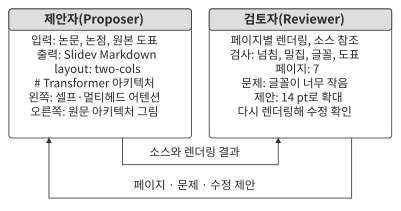

- **제안자(Proposer)** 는 논문을 읽고 발표 구조를 계획하고 Slidev 소스를 작성하며, 피드백에 따라 페이지를 수정합니다.
- **검토자(Reviewer)** 는 도구로 페이지를 렌더링하고, 시각 모델로 내용 밀도, 가독성, 레이아웃, 그림과 글의 대응 관계를 검사해 페이지 번호, 문제 유형, 심각도, 수정 제안이 담긴 구조화된 피드백을 반환합니다.

피드백은 바로 수정에 쓸 수 있어야 합니다. 예를 들어 ‘3페이지는 요점이 너무 많으니 방법 개요와 계산 절차 두 페이지로 나눌 것’, ‘7페이지는 코드 글꼴이 너무 작으니 먼저 14pt로 키운 뒤 프로젝터에서의 가독성을 확인할 것’ 같은 식입니다. 사실 오류와 도표 오독을 먼저 고치고, 그다음 레이아웃과 시각적 세부를 다룹니다.

일부만 고칠 때는 어느 객체를 고치는지도 밝혀야 합니다. Feishu 슬라이드의 Doubao 작업은 사용자가 페이지 요소를 선택한 뒤 뜨는 도구 모음에서 편집을 요청하게 합니다.[^ch5-doubao-work] 같은 페이지에 텍스트 상자가 두 개 있고, 하나는 원래 인터뷰 인용문이고 다른 하나는 발표자가 쓴 요약이라고 합시다. 사용자가 요약을 선택해 ‘두 줄로 줄여 주세요’라고 요청하면, 선택한 텍스트 상자가 변경 범위를 한정합니다. 요약은 다시 써도 되지만, 옆의 인용문은 인터뷰이의 말을 그대로 남겨야 합니다.

[^ch5-doubao-work]: Feishu 도움말 센터, 슬라이드에서 Doubao 작업 사용하기.

제안자는 수정한 뒤 다시 렌더링하고, 검토자는 새 버전을 검사하면서 지난 라운드의 문제가 해결되었는지 확인합니다. 이 순환에는 두 가지 종료 조건이 있습니다. 명확한 내용과 판형 요구를 충족하거나, 라운드 수, 시간, 비용 예산을 다 쓰는 것입니다. 예를 들어 수정은 최대 5라운드까지입니다. 전달할 때는 현재 버전과 아직 남은 문제를 함께 저장해 이후 검토에 쓸 수 있게 합니다.

이는 제4장의 조작 승인과 제안자–검토자 패턴을 공유합니다. 조작 승인은 어떤 행동을 실행할 수 있는지를 주로 판단하고, 내용 검토는 여러 차례 피드백으로 산출물을 개선합니다. 둘 다 작업 요구를 공유하고, 위치를 짚을 수 있는 판단 근거를 제시하며, 이후 절차는 하네스가 정합니다. 서로 다른 모델 계열을 쓰면 또 하나의 검토 관점을 얻을 수 있습니다.

**필자는 두 에이전트 분업이 컨텍스트 관리에서 주는 이점을 높게 봅니다.** 두 역할은 각자 필요한 정보를 따로 보관할 수 있습니다. 검토자는 라운드마다 최신 스크린샷, 검토 기준, 필요한 문제 목록을 받고, 제안자는 소스, 수정 목표, 구조화된 텍스트 피드백을 유지합니다. 페이지 이미지는 검토자의 컨텍스트에 머물고, 주 궤적은 짧은 텍스트 피드백으로 수정을 계속 이어 갑니다. 매 라운드의 검토가 최신 페이지를 중심으로 이루어지므로 지난 스크린샷의 간섭이 줄고 컨텍스트 증가도 억제됩니다.

> **실험 5-6 ★★: 논문 기반 PPT 자동 생성**
>
> 이 실험에서는 《Attention Is All You Need》의 논문 PDF로 20페이지 Slidev 슬라이드를 생성합니다. 에이전트는 논문 구조와 요점을 추출하고, 출처가 기록된 원 논문 그림 세 장을 사용해 페이지마다 설명을 구성합니다. 렌더링한 뒤에는 텍스트 넘침, 도표 가독성, 그림과 글의 대응을 검사하고 피드백에 따라 수정합니다.
>
> 단일 에이전트의 자체 검토와 제안자–검토자 분업을 대조합니다. 이번 실행에서 두 최종 발표 자료는 같은 독립 채점 절차에서 모두 95점을 받았습니다. 분업 방식의 최대 입력은 약 2만 4천 토큰, 지난 스크린샷을 보관하는 단일 에이전트 방식은 약 9만 3천 토큰이었습니다.

> **실험 5-7 ★★: 논문 해설 동영상 자동 생성**
>
> 슬라이드를 바탕으로 에이전트는 페이지마다 구어체 해설을 작성해 그림 속 객체, 관계, 결론을 설명한 뒤 TTS로 음성을 합성할 수 있습니다. 대본과 페이지를 함께 시각 검토자에게 넘겨, 해설에서 말한 요소가 화면에 실제로 나오는지, 설명이 도표와 일치하는지 검사합니다.
>
> 동영상을 만들 때 실험은 앞 절의 생성 흐름을 이어 쓰되, 비교적 이른 22페이지 초고(v2)를 골랐습니다. 순서대로 12페이지를 뽑았으므로 동영상의 마지막 화면은 원고의 21페이지에서 나옵니다. 앞 절에서 점수와 사용량을 비교할 때는 이후의 20페이지 초고(v9)를 썼습니다. 페이지를 고른 뒤 Kimi로 해설을 생성하고, Qwen 시각 모델로 그림과 글의 관계를 검토하며, Fish Audio로 페이지별 음성을 합성했습니다. FFmpeg는 각 오디오의 실제 길이에 맞춰 페이지 표시 시간을 설정해 약 8.6분짜리 해설 동영상을 만들었습니다.
>
> 그림 5-6에서 슬라이드, 해설, 음성은 마지막에야 동영상으로 합쳐집니다. 어떤 문제는 이 단계에서만 들을 수 있습니다. 페이지를 넘길 때 문장이 아직 끝나지 않았는지, 뒤로 갈수록 소리와 화면이 어긋나는지 같은 것들입니다.
>
> 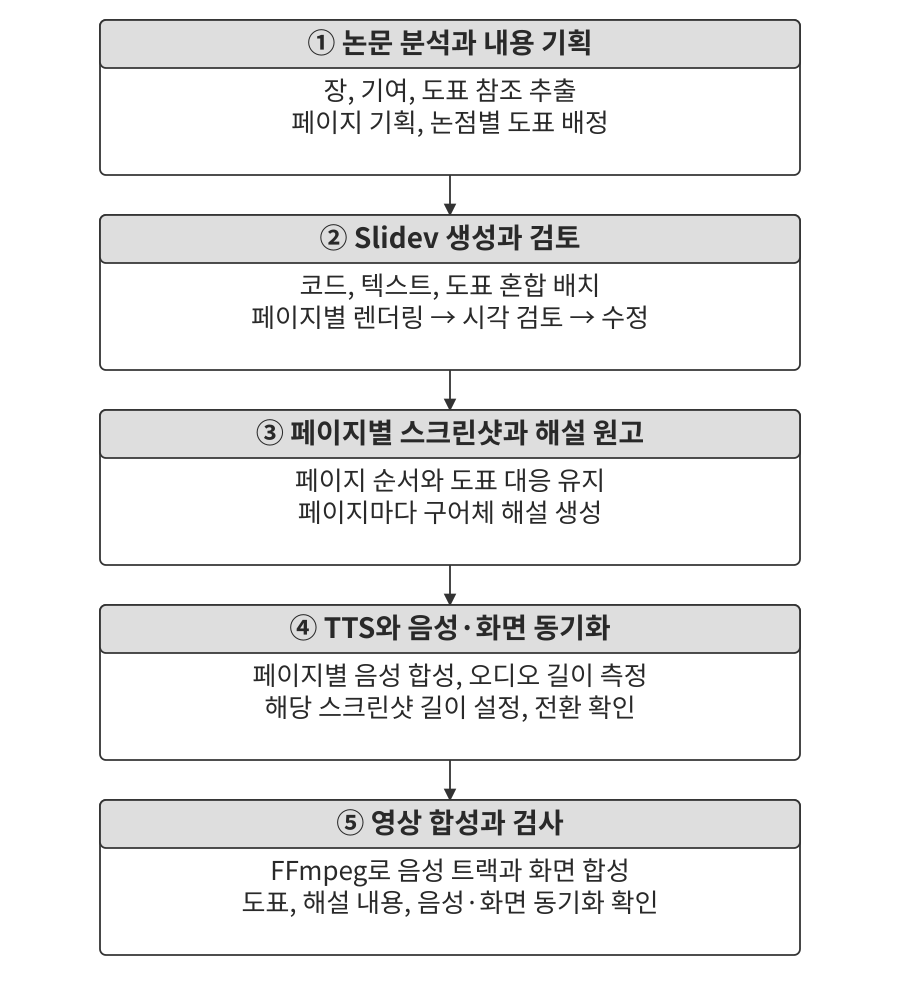

[^ch5-slidev]: Slidev, *Getting Started*. Markdown과 웹 기술로 프레젠테이션을 생성하고 발표하고 내보내는 방법을 소개합니다.

**동영상 편집 에이전트.**

**동영상 편집에서 스크립트로 표현할 수 있는 조작은 프로그램 인터페이스로 처리하는 편이 좋습니다.** 타임라인, 레이어, 자막, 오디오 트랙이 복잡한 GUI 패널에 흩어져 있으면 위치를 찾고 끌어 옮기는 일이 반복되어 지연과 오차가 커집니다. 프로그램 인터페이스는 시간 구간, 트랙, 효과 파라미터로 조작을 직접 표현할 수 있습니다. Blender의 Python 인터페이스와 FFmpeg는 편집 작업의 상당 부분을 반복 실행 가능한 스크립트로 조직할 수 있습니다.

에이전트는 ‘서핑하는 부분을 잘라 주세요’ 같은 요구를 먼저 이해하고, 소재에서 대상 구간을 찾아 자르기, 배열, 오디오 트랙 처리를 담당할 코드를 생성할 수 있습니다. 제안자는 편집 계획과 스크립트를 맡고, 검토자는 렌더링 결과를 확인합니다. 누락된 장면, 무관한 구간, 자막이 화면을 가리는 문제가 있으면 구체적인 시각과 문제를 피드백으로 주고 제안자가 고칩니다. 키프레임은 장면과 레이아웃을 보기에 알맞고, 움직임의 연속성과 화면과 소리의 동기화는 인접한 프레임이나 연속된 구간으로 확인해야 합니다.

> **실험 5-8 ★★: API 기반 지능형 동영상 편집**
>
> 이 실험은 대상 위치 찾기, 스크립트 생성, 효과 검토를 하나의 흐름으로 엮습니다. 먼저 동영상 참조, 대상 질문, 프레임 추출 간격을 동영상 분석 하위 에이전트에 넘기면, 하위 에이전트가 다량의 화면을 처리하고 시간 구간과 근거를 주 에이전트에 반환합니다.
>
> 위치 찾기는 두 단계로 나뉩니다. 첫 단계에서는 10초마다 한 프레임을 뽑아 대상의 대략적인 범위를 찾습니다. 예를 들어 ‘서핑은 40–110초’ 정도입니다. 두 번째 단계에서는 후보 구간과 인접한 경계를 중심으로 1초마다 한 프레임을 뽑아 시작과 끝 위치를 더 정확히 정합니다. 거친 표집 간격보다 짧은 장면은 두 프레임 사이에 들어갈 수 있으므로, 대상의 지속 시간에 따라 표집을 늘리거나 두 표집 사이의 화면을 다시 확인하면 됩니다.
>
> 구간을 정하면 제안자가 Blender Python 스크립트를 생성해 자르기와 필요한 자막, 속도 변경 등을 실행합니다. 검토자는 미리보기를 보고 조정할 경계와 효과를 지적하며, 수정이 통과된 뒤 완성본을 출력합니다.
>
> 실제로 자른 장면은 흰 토끼 한 마리가 풀밭을 혼자 걸어가는 장면이었습니다. 10초마다 한 프레임을 보자 모델은 범위를 10초에서 20초로 잡았습니다. 10초에서 바로 자르면 장면 앞부분이 잘려 나갑니다. 그래서 프로그램은 앞뒤를 각각 5초씩 넓혀 5초에서 25초 사이를 1초마다 보면서 후보 구간을 9초에서 12초로 좁혔습니다. 검토자는 다시 인접 화면이 섞여 들어왔다고 지적했고, 수정된 구간은 9.25초에서 11.00초가 되었습니다. 사람이 표시한 9.08초에서 11.20초와 비교하면 시작은 0.17초 늦고 끝은 0.20초 빨랐으며, 양쪽 모두 오차 3초 이내라는 요구를 만족했습니다.
>
> 타임코드로는 어디를 잘랐는지만 확인할 수 있습니다. 같은 자막과 슬로 모션을 일부러 잘못 고른 화면에 얹으면 검토자가 오류를 알아볼 수 있을까요? 실험은 먼저 0초에서 3초의 대조 구간을 검사하게 한 뒤, 수정된 렌더링을 보게 했습니다. 검토 대상은 화면 속 흰 토끼, 화면 아래 자막, 속도를 바꾼 뒤의 길이입니다.

**3D와 산업 부품: 알맞은 생성 방식을 고른다.**

**치수와 조립 관계가 강한 제약인 산업 부품은 파라메트릭 코드 생성을 우선하고, 자연스러운 형태와 외관을 주로 추구하는 대상에는 생성 모델을 우선 고려합니다.** 이 선택은 산출물을 적은 수의 파라미터로 정확히 기술할 수 있는지, 수정한 뒤 어떤 관계를 유지해야 하는지에 달려 있습니다. CadQuery, OpenSCAD, Blender 스크립트는 편집 가능한 구성 과정을 제공하고, Hunyuan 3D 같은 모델은 학습한 형태 사전 지식으로 복잡한 외관을 생성합니다.

**기술이 파라메트릭화에 알맞은가.** 단순화한 플랜지는 외경, 두께, 볼트홀 원 지름, 구멍 지름, 구멍 수로 주요 기하 관계를 표현할 수 있습니다. 코드는 파라미터를 구성 단계에 대응시키므로 반복 조정에 알맞습니다. 화분에 심은 식물, 타이후석, 사람 얼굴은 불규칙한 형태를 많이 담고 있어, 생성 모델이 외관을 구성하는 데 도움을 줄 수 있고, 프로그래밍 방식도 성장 규칙, 확률 과정, 자산 조합으로 세부를 생성할 수 있습니다.

**정밀도를 어떻게 검사하는가.** 구멍 지름 5 mm, 공차 ±0.05 mm 같은 요구에는 먼저 단위, 좌표계, 측정 방법을 확정한 뒤 모델 치수와 사양을 비교해야 합니다. 파라메트릭 모델은 기하 객체를 직접 검사할 수 있고, 메시는 단면, 구멍, 경계 치수 같은 방법으로 측정하되 이산화 오차를 반영해야 합니다.

**어떻게 저장하고 수정하는가.** B-rep(경계 표현)은 면, 모서리, 꼭짓점으로 솔리드의 경계를 기술하고, 삼각 메시는 면 조각으로 표면을 근사합니다. CadQuery는 CAD 데이터 교환용 STEP을 내보낼 수 있고 STL 메시도 내보낼 수 있으며, 편집 가능한 파라미터와 구성 로직은 CadQuery 소스 코드에 남습니다[^ch5-cad]. CNC 가공 흐름으로 넘어가려면 공정 계획, 공구 경로, 공작기계 적응이 더 필요합니다.

예를 들어 장착 구멍을 M5에 맞춘 사양에서 M6에 맞추도록 바꿀 때는 구멍 지름 파라미터를 수정하고 다시 생성한 뒤, 외경, 두께, 구멍 위치가 그대로인지 대조하면 됩니다. 생성 모델의 수정 방식은 인터페이스 능력에 따라 달라지며, 다시 생성할 수도 있고 국소 편집과 후속 기하 처리로 대응할 수도 있습니다.

두 경로를 조합할 때도 분업을 분명히 해야 합니다. 치수와 조립 관계는 파라메트릭 코드에, 텍스처와 자유로운 외관은 생성 모델에 맡깁니다. **핵심 치수를 여러 번 정확하게 고쳐야 한다면, 한 번 생성한 외관보다 편집 가능한 구성 과정이 더 가치 있습니다.**

> **실험 5-9 ★★: 같은 부품의 두 가지 생성 경로 — 코드와 생성 모델**
>
> 이 실험에서는 외경 80 mm, 두께 10 mm이고 지름 60 mm의 볼트홀 원 위에 장착 구멍 네 개가 균등 배치된 플랜지를 생성합니다. 조립 의미를 분명히 하기 위해 초기 사양은 M5에 맞춘 5.5 mm 통과 구멍으로 하고, 수정 요청에서는 M6에 맞춘 6.5 mm 통과 구멍으로 바꿉니다.
>
> 코드 경로는 모델이 CadQuery 프로그램을 생성하고, 실행한 뒤 STEP과 STL을 내보냅니다. 생성 모델 경로는 먼저 제품 참고 이미지를 생성한 다음 Hunyuan 3D에 넘겨 메시를 생성합니다. 외경, 두께, 구멍 수, 구멍 지름, 구멍 위치, 장착면을 검사하고 단위와 축 방향을 기록합니다.
>
> 모델이 지정한 치수만 바꿨는지는 어떻게 알 수 있을까요? 수정 전후로 내보낸 STL을 대조하면 네 장착 구멍의 평균 지름이 5.499 mm에서 6.499 mm로 늘었고, 두 부품의 외경은 모두 80 mm, 두께는 모두 10 mm, 볼트홀 원 지름은 소수점 셋째 자리까지 모두 60.000 mm였습니다. 생성 모델 경로의 원본 메시에는 분명한 물리적 축척이 없었습니다. 측정 프로그램이 Z축의 중간 단면을 잡았지만 구멍의 안쪽 고리를 찾지 못했습니다. 네 구멍이 원판을 관통하는지 확인하려면 장착면을 인식하고 그 법선 방향으로 여러 깊이에서 단면을 잘라야 합니다. 다시 생성한 뒤에는 전체 형태와 방향이 모두 달라졌습니다.
>
> 마지막으로 문제를 하나 바꿔 보겠습니다. 자연스러워 보이는 화분 사진을 전달해야 한다면 어떻게 인수 검사를 할까요? 실험에서는 matplotlib으로 화분 하나를 그리고 Gemini로 또 하나를 생성한 뒤, 같은 시각 모델에게 10점 만점으로 자연스러움을 평가하게 했습니다. 두 그림은 각각 3점과 8점을 받았습니다. 이 점수는 평가 모델이 어느 그림이 실제 식물에 더 비슷하다고 느꼈는지에 대한 답입니다. 플랜지로 돌아가면, 제품 이미지가 구멍 네 개가 있는 것처럼 보이더라도 조립은 여전히 3차원 부품에서 구멍 위치와 지름을 확인해야 합니다.

[^ch5-cad]: CadQuery, *Importing and Exporting Files*. STEP, STL 등의 형식을 소개하고, 완전한 파라메트릭 정보가 CadQuery의 Python 소스 코드에 보존된다는 점을 설명합니다.

### 시스템 어댑터로서의 코드

외부 서비스는 인터페이스, 인증 방식, 데이터 형식이 저마다 다릅니다. 에이전트는 문서와 응답 샘플을 읽고 HTTP 클라이언트를 생성하고, 인증 헤더를 구성하고, 반환값을 파싱한 다음, 업스트림 필드를 다운스트림이 필요한 구조로 변환할 수 있습니다. 여기서 코드는 시스템을 서로 맞춰 주는 일을 맡아, 기존 서비스를 새로운 작업 흐름으로 조합합니다.

예를 들어 결제 서비스에서 읽은 금액 필드가 펀(위안의 100분의 1) 단위로 되어 있는데 보고서는 위안 단위로 보여 준다고 합시다. JSON 파싱에 성공했다는 것은 형식이 호환된다는 뜻일 뿐입니다. 25위안짜리 거래는 업스트림에서 정수 2500입니다. 이 숫자를 보고서에 그대로 넣으면 25위안이 2500위안이 됩니다.

어댑터는 입출력, 오류 처리, 버전 범위를 분명히 해야 합니다. 샘플은 모델이 필드를 이해하는 데 도움을 주고, 인터페이스 약속과 테스트는 누락된 값, 페이지네이션, 비정상 응답, 버전 변경을 검사합니다. 자격 증명은 실행 환경이 관리하고, 생성된 코드는 통제된 인터페이스로 위임된 능력을 사용합니다. 검증을 통과한 어댑터는 저장해 두고 재사용하며, 이후 형식이 바뀌면 다시 수정 절차로 들어갑니다.

그래픽 인터페이스만 제공하는 시스템에도 같은 방법을 쓸 수 있습니다. 에이전트는 제6장에서 소개하는 컴퓨터 사용(Computer Use)으로 먼저 작업을 완료하고, 안정된 조작 단계를 RPA 도구로 고정합니다. 화면의 컨트롤, 로그인 상태, 페이지 흐름이 바뀌면 도구는 어긋남을 감지하고 위치를 다시 찾아야 합니다. 성공한 궤적에서 작업 흐름을 추출하고 검증하고 재사용하는 방법은 제9장에서 더 자세히 다룹니다.

**에이전트 로그 파싱과 시각화.**

복잡한 작업 하나에는 여러 번의 모델 요청, 도구 실행, 하위 에이전트 상호작용이 들어갈 수 있습니다. 로그 개요는 단계의 관계, 상태, 소요 시간을 보여 주고, 펼치면 구체적인 입출력을 보여 주어 특정 단계에서 무슨 일이 있었는지 추적하게 합니다. 새 필드, 중첩 구조, 형식 버전은 모두 파싱과 표시에 영향을 줍니다.

적응형 파싱은 ‘변화 발견–파서 생성–결과 검증’의 순환으로 이런 변화를 처리합니다. 파싱에 실패하면 시스템은 원본 샘플, 오류 위치, 기대 필드를 저장한 뒤, 인터페이스 약속과 생산자 버전을 대조해 그 변화가 예상된 것인지 판단합니다. 형식이 정상적으로 업그레이드된 것으로 확인된 뒤에야 에이전트가 새 파서를 작성하게 합니다. 로그를 쓰는 프로그램에 결함이 있다면 원본 로그를 저장하고 장애를 보고해야 하며, 새 파서가 오류까지 정상 형식으로 받아들이게 해서는 안 됩니다. 새로 작성한 코드는 먼저 제한된 환경에서 실행하고, 필드와 그 의미를 검사한 다음, 정상 샘플, 필드가 빠진 샘플, 구형 형식 회귀 사례로 검증합니다. 통과하면 새 파서를 등록하고 버전과 적용 형식을 저장하며, 실패한 샘플은 추적과 재시도를 위해 남겨 둡니다.

파싱과 표시에는 저마다 다른 검사 방법을 씁니다. 프로그램은 타임스탬프, 상태, 수치 타입, 호출 연관성을 검사하고, 브라우저 렌더링은 페이지가 정상 동작하는지 확인하며, 시각 모델은 표, 타임라인, 레이블이 분명한지 보완 검사합니다. 핫 업데이트에서는 이전 버전과 롤백 진입점을 남겨, 새 형식 지원이 조금씩 운영 시스템에 들어가게 합니다.

> **실험 5-10 ★★★: 적응형 로그 파싱 시스템**
>
> 이 실험에서는 로그 생성 프로세스 두 개를 먼저 실행해 각각 세로줄 구분 형식과 중첩 괄호 형식을 출력합니다. 초기 파서는 이 샘플을 처리하지 못하고, 그러면 시스템이 모델에 두 개의 파싱 함수 생성을 요청하고, 테스트를 통과하면 핫 로드한 뒤 앞서 실패했던 로그를 파싱합니다.
>
> 첫 번째 형식은 `timestamp`, `level`, `module`, `step`, `message`를 추출하고, 두 번째 형식은 도구 이름, 소요 시간, 상태까지 다룹니다. 실행 기록에서 두 종류 모두 세 건씩 로그 파싱이 완료되었고, 새로 만든 엔진도 저장된 파서를 불러와 뒤섞인 로그 스트림을 계속 처리했습니다.
>
> 파싱 결과는 Chromium이 표로 렌더링하고, 시각 검토가 열 이름, 행 내용, 가독성을 검사합니다.

**에이전트 실행 로그의 자동 분석과 문제 진단.**

구조화된 궤적을 파싱해 두면 에이전트는 아키텍처 문서와 PRD(제품 요구사항 문서)를 결합해 기대한 흐름과 실제 행동을 비교할 수 있습니다. 예를 들어 환불 전에 이 주문이 환불 가능한지 조회했는가? 재고 서비스가 시간 초과된 뒤 프로그램이 약속대로 캐시를 조회하도록 바꿨는가?

문제 보고서에는 우선순위, 모듈, 현상, 근거, 개선 제안을 담을 수 있습니다. 에이전트는 이를 바탕으로 회귀 테스트를 생성해, 문제에 해당하는 입력과 인수 조건을 고정할 수도 있습니다. 테스트 프레임워크는 통제된 환경에서 요청을 재생하거나 저장된 도구 응답을 읽어, 결함 버전과 수정 버전의 동작을 비교합니다. 외부 쓰기가 따르는 조작은 격리 환경이나 대체 인터페이스를 써서 재생의 영향 범위를 통제 가능한 수준으로 유지합니다.

어서션은 검증해야 할 속성에 대응해야 합니다. 예를 들어 로그에 환불 검사가 나타났다는 것만으로는 프로그램이 확인했다는 정도만 알 수 있습니다. 이 돈이 제대로 환불되었는지 알려면 프로그램이 먼저 조회하고 나중에 환불했는지, 조회 결과가 환불을 허용했는지, 주문이 최종적으로 어떤 상태인지까지 봐야 합니다.

진단이 검토를 거치면 에이전트는 해당 권한을 얻은 뒤 MCP로 GitHub 이슈를 만들고 모듈에 따라 담당자를 제안할 수 있습니다. 같은 결함에 이미 작업 항목이 있다면 새 근거를 그쪽에 합칩니다.

> **실험 5-11 ★★★: 프로덕션 로그의 지능형 진단 시스템**
>
> 이 실험에서는 로컬 HTTP 서비스로 두 개의 업무 궤적을 만듭니다. 하나는 주문이 환불 가능한지 조회하지 않고 환불한 기록이고, 다른 하나는 재고 조회가 시간 초과된 뒤 캐시에서 데이터를 가져오지 않은 기록입니다. 모델은 아키텍처 문서와 요구사항 설명을 결합해 궤적과 라운드 참조가 담긴 문제 보고서를 생성하고, 이어서 실행 가능한 회귀 테스트 세 개를 생성합니다.
>
> 그림 5-7은 진단 보고서를 궤적과 회귀 테스트 사이에 놓습니다. 보고서는 ‘시스템이 검사를 건너뛰고 바로 환불했다’고 지적합니다. 다시 궤적으로 돌아가 근거를 찾습니다. 호출 기록에서 어느 단계가 빠졌습니까? 이어서 테스트를 봅니다. 앞으로 이 단계를 또 빠뜨리면 테스트가 잡아낼 수 있습니까?
>
> 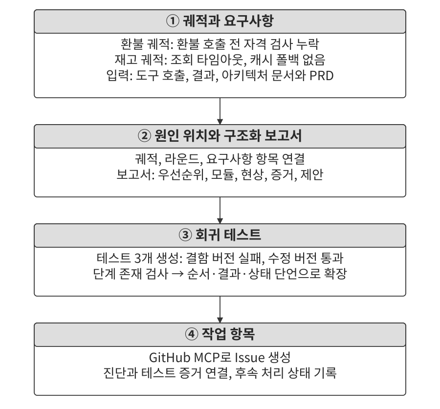
>
> 세 테스트는 결함 버전에서 모두 실패했고, 수정 버전으로 바꾸자 모두 통과했습니다. 그중 하나는 프로그램이 환불 검사 도구를 호출했는지만 판정합니다. 프로그램이 먼저 돈을 돌려주고 나중에 이 주문이 환불 가능한지 조회하더라도 이 테스트는 통과합니다. 실행 기록에는 GitHub MCP가 작업 항목을 만들었다는 회신도 저장되어 있어, 진단 보고서를 개발자에게 넘긴 뒤 대응하는 티켓을 찾을 수 있습니다.
>

### 생성형 UI로서의 코드

사용자가 에이전트가 다루고 있는 자료를 직접 고치고 싶다면, 화면을 둘이 함께 쓰는 작업대로 만들 수 있습니다. 일정표를 예로 들면, 사용자가 어시스턴트가 지금 어느 구간을 고치는지 보고, 직접 수정을 이어받고, 어떤 변경을 확인하거나 되돌릴 수 있게 합니다. 사용자가 출발일을 금요일로 바꾸었다면, 어시스턴트는 그다음부터 이 새로운 일정 위에서 작업해야 합니다. 양쪽이 같은 상태를 보고, 지금 어떤 필드를 누가 편집하고 있는지 약속해 두어야 보면서 고치는 일이 가능해집니다.

사용자가 세 가지 이동 방안을 비교하려 한다고 해 봅시다. 목적지가 아직 정해지지 않았을 때는 대화로 되묻는 편이 좋고, 목적지가 정해진 뒤에는 사용자가 날짜를 직접 고르고 인원을 입력하는 편이 몇 줄의 글을 주고받으며 대조하는 것보다 편합니다. 마지막으로 날짜에 따른 총액 변화를 비교할 때는 차트 한 장이 차이를 한눈에 보여 줍니다. 에이전트가 작업에 맞춰 그에 해당하는 양식, 차트, 애플리케이션 화면을 생성해 사용자가 직접 입력하고 선택하고 조작하게 하는 것이 바로 생성형 UI(Generative UI)입니다.

**프로토콜로 화면과 상호작용을 기술한다.**

화면을 생성하는 데는 두 가지 구현 경로가 있습니다. HTML, JavaScript 같은 코드를 출력해 통제된 환경에서 실행하는 방식과, 선언적 구조를 출력해 클라이언트 컴포넌트가 렌더링하는 방식입니다. 전자는 맞춤 레이아웃과 상호작용을 구현하기 쉽고, 후자는 사용할 수 있는 능력을 클라이언트가 제공하는 컴포넌트와 동작 범위로 한정합니다.

A2UI(Agent-to-User Interface)는 선언적 기술을 씁니다. 에이전트가 컴포넌트, 데이터 바인딩, 갱신을 표현하는 구조화된 메시지를 생성하면, 클라이언트가 자기 컴포넌트로 화면을 표시합니다[^ch5-ui-protocols]. 예를 들어 애플리케이션이 카드, 버튼, 입력 상자, 표 컴포넌트를 제공한다면, 에이전트는 이를 바탕으로 ‘매출 데이터’라는 제목에 세 행 두 열로 된 표를 기술할 수 있습니다. 컴포넌트 카탈로그는 차트나 지도 같은 능력으로 확장할 수도 있습니다.

AG-UI(Agent–User Interaction)는 에이전트와 프런트엔드 사이의 이벤트 상호작용을 맡아 메시지, 도구 호출, 상태 갱신을 전달하며, A2UI의 화면 메시지도 실어 보낼 수 있습니다. 둘을 조합하면 A2UI가 무엇을 보여 줄지 기술하고, AG-UI가 백엔드 실행과 프런트엔드 상호작용을 연결합니다.

클라이언트는 화면 갱신을 단계적으로 받아, 호환 렌더러를 통해 웹, 모바일, 데스크톱에서 표시할 수 있습니다. 클라이언트는 컴포넌트 속성, 데이터 바인딩, 동작 요청을 검증하고, 서버는 이어서 업무 권한을 검사합니다. 컴포넌트 속의 링크, 서식 있는 텍스트, 데이터 접근에도 각각의 처리 규칙이 필요합니다.

코드를 직접 생성할 때는 의존성, 자원 접근, 실행 권한을 검사하고, 생성된 화면을 호스트 애플리케이션의 민감한 상태와 격리해야 합니다. 외부 자료의 프롬프트 주입은 생성 과정에 영향을 줄 수 있고, 브라우저에서 스크립트가 실행되는 위험은 페이지 로딩과 격리 방식에도 달려 있습니다.

**HTML로 상호작용형 결과를 전달한다.**

**데이터와 시연, 계속 갱신되는 결과를 담은 연구 산출물이라면 필자는 HTML 웹사이트를 우선합니다.** 길게 이어진 선형 Markdown 보고서는 독자가 맥락을 계속 거슬러 찾아야 합니다. 상호작용형 웹페이지는 설명, 데이터, 시연을 한 진입점에 모을 수 있습니다. 독자는 차트를 보고, 관심 있는 표본을 걸러 내고, 특정 결과의 세부를 펼쳐 보고, 데모를 조작해 시스템의 동작을 이해합니다. 에이전트도 작업이 진행되는 동안 페이지를 갱신해 현재의 성과와 근거를 계속 기록하게 할 수 있습니다.

필자의 연구 실무를 예로 들면, 연구 프로젝트마다 상호작용형 웹사이트를 두어 연구 과정의 살아 있는 문서이자 최종 산출물로 함께 쓰고, 실험이 진행되는 동안 에이전트가 내용을 계속 보충하게 합니다. 이 웹사이트는 주로 세 가지 일을 합니다.

첫째는 **실험 데이터 추적**입니다. 페이지가 표본, 프롬프트, 모델 응답, 점수를 서로 연결해 두어 항목별로 확인할 수 있습니다. 예를 들어 같은 종류의 응답이 늘 낮은 점수를 받는다면, 점수 기록을 따라 원래 응답과 프롬프트를 되짚을 수 있습니다.

둘째는 **학습 지표 모니터링**입니다. 필자는 학습의 내부 상태를 보여 주는 신호를 ‘내과 지표’라고 부릅니다. 학습 손실과 검증 손실, 그래디언트 노름, 학습률, 그리고 강화 학습의 보상, KL 발산, 정책 엔트로피 등입니다. 언어 모델은 주어진 텍스트 시퀀스에 대한 예측 성능을 잴 때 퍼플렉시티를 쓰기도 합니다. 건강 검진의 생리 지표처럼, 이런 곡선은 때로 최종 과제 성적보다 문제를 더 일찍 드러냅니다. 이것을 과제 정확도와 함께 보면 수렴 실패, 그래디언트 이상, 학습 퇴행이 일어나는 단계를 짚기 쉬워집니다.

셋째는 **동작 원리 시연**입니다. 여러 모듈이 어떻게 맞물리는지 설명할 때, 페이지에서 독자가 입력 하나를 바꾸고 중간 상태를 확인한 뒤, 출력의 변화를 실험 기록과 대조하게 할 수 있습니다.

작업이 몇 시간씩 이어지면 사용자는 틈틈이 어떻게 끼어들어 이어받을까요? 필자는 코딩 에이전트를 쓸 때 한마디 지시가 정확히 담당 에이전트에 전달되고, 결과를 보고 싶을 때는 언제든 열어 볼 수 있으며, 새 버전이 나오거나 내가 결정해야 할 문제가 생겼을 때만 알림을 받기를 원합니다. 예를 들어 보고서 두 부가 동시에 생성되고 있다고 합시다. 사용자가 매출 보고서를 열어 두 번째 차트를 가리키며 ‘이건 순수익 기준으로 다시 그려 주세요’라고 말합니다. 화면은 현재 보고서와 차트 식별자를 지시와 함께 보내야 합니다. 차트가 고쳐지면 알림에서 새 버전을 바로 열 수 있어야 하고, ‘순수익’에 쓸 수 있는 기준이 두 가지라면 어시스턴트는 그 두 가지를 사용자에게 제시해야 합니다.

**사용자 의도를 명확히 한다.**

사용자가 ‘베이징행 항공권을 예약하고 싶습니다’라고 말했다면 목적지는 이미 분명하지만, 출발 도시, 날짜, 편도인지 왕복인지는 아직 보충해야 합니다. 에이전트는 한 번의 대화에서 질문을 모아 던질 수도 있고, 양식을 생성해 관련 조건을 한 페이지에 함께 보여 줄 수도 있습니다.

양식의 컨트롤은 서로 다른 유형의 정보에 대응합니다. 텍스트 상자는 열린 입력을 받고, 드롭다운과 라디오 버튼은 선택지를 제시하며, 체크박스는 다중 선택을 지원하고, 날짜 선택기는 시간 입력을 돕습니다. JavaScript는 연쇄 관계를 표현할 수 있습니다. 예를 들어 ‘왕복’을 선택하면 귀국 날짜를 보여 주고, 귀국이 출발보다 빠르지 않은지 검사합니다. 선택이 바뀌면 더 이상 유효하지 않은 필드도 함께 정리하거나 무시해야 합니다.

그림 5-8은 아래 실험의 한 번의 실행에서 가져왔습니다. 이 제출 건을 따라 내려가 보겠습니다. 브라우저가 반환한 네 개의 필드에는 목적지가 없습니다. 모델은 어디에서 여행객이 베이징에 간다는 것을 알았을까요?

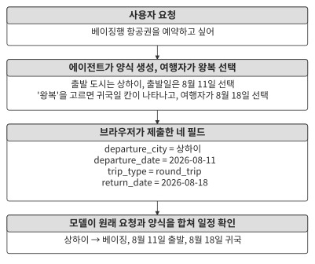

> **실험 5-12 ★★: 동적 양식 생성 기반 의도 명확화 시스템**
>
> 이 실험은 ‘베이징행 항공권을 예약하고 싶습니다’에서 출발해, 모델이 HTML 양식을 생성하게 합니다. 출발 도시는 텍스트 상자, 출발 날짜는 날짜 선택기, 여행 유형은 편도와 왕복 선택지, 귀국 날짜는 왕복을 선택했을 때만 표시됩니다.
>
> 프로그램은 최초의 위임과 양식 데이터를 함께 모델에 돌려줍니다. 제출된 필드만 남긴다면, 모든 컨트롤을 올바르게 채웠더라도 목적지는 여전히 빠져 있습니다.
>
> 같은 양식으로 한 단계 더 시험해 보겠습니다. 귀국 날짜를 채운 뒤 편도를 선택합니다. 페이지는 귀국 입력란을 숨겼지만, 제출된 JSON에는 편도와 8월 18일 귀국 날짜가 함께 남아 있었습니다. 편도로 바꿀 때는 클라이언트가 더 이상 유효하지 않은 귀국 날짜도 지워야 합니다.

[^ch5-ui-protocols]: A2UI 공식 문서와 *AG-UI Overview*. 각각 선언적 화면 기술과 에이전트–프런트엔드 이벤트 상호작용을 소개합니다.

**SQL 쿼리 생성.**

사용자는 자연어로 데이터베이스 조회를 요청하고, 에이전트는 표 구조와 업무 기준에 따라 SQL을 생성할 수 있습니다. **조회 결과 표 전체를 보여 줄 때 필자는 아티팩트(Artifact) 패턴을 우선해, 결과가 데이터베이스에서 화면으로 곧장 흐르게 합니다.** 모델이 큰 표를 읽고 한 줄씩 다시 읊게 하면 토큰 사용량과 대기 시간이 늘고, 옮겨 적는 오류까지 생깁니다. SQL은 검사 가능한 조회 산출물로 저장하고, 원인을 분석하거나 추세를 요약해야 할 때 필요한 집계 결과만 모델에 넘깁니다.

그림 5-9에서 사용자가 부서별 재직 인원을 보려 한다면, 페이지는 데이터베이스가 반환한 통계 표를 바로 보여 줄 수 있습니다. 이어서 사용자가 ‘마케팅팀이 연구개발팀보다 몇 명 많은가’라고 묻는다면, 모델은 표의 9와 5만 가져와 4명 차이를 계산하면 됩니다. ‘지난달에도 이만큼 차이가 났나’라고 되물으면 지금 이 표로는 부족하므로, 지난달 집계 기준일로 다시 조회해야 합니다.

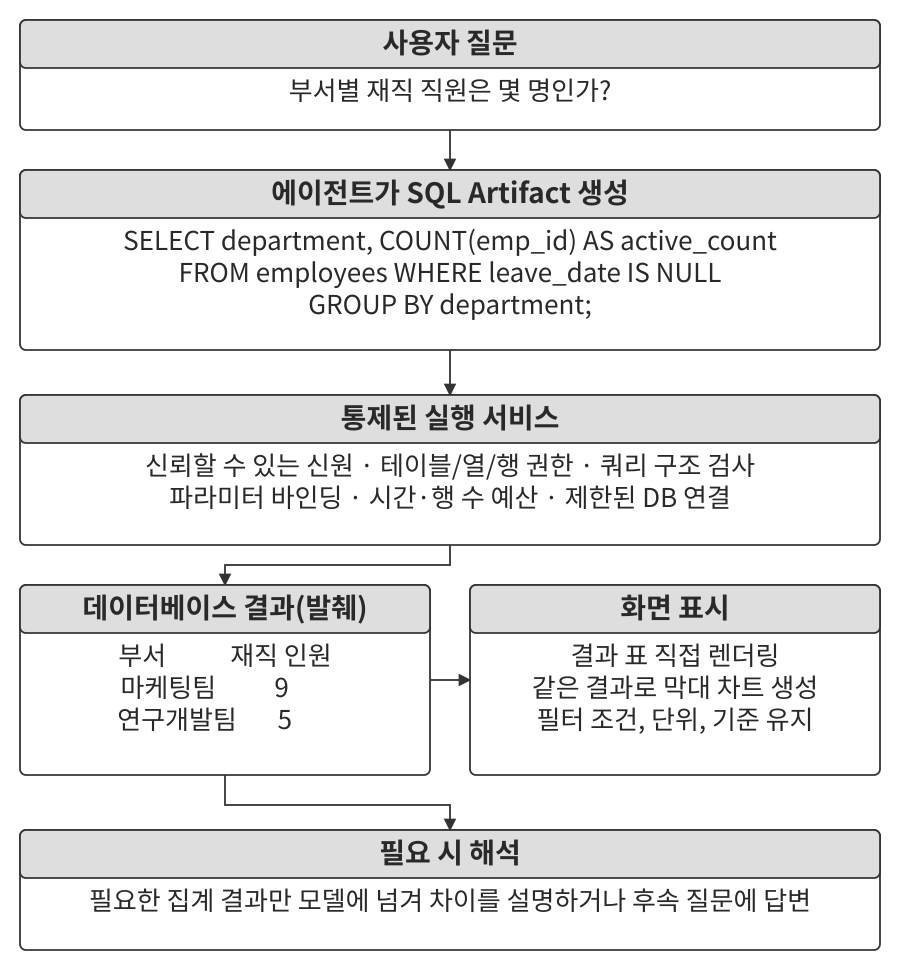

실행 서비스는 신뢰할 수 있는 신원에 따라 접근 가능한 표, 열, 행을 정하고, 제한된 데이터베이스 계정을 사용하며, SQL 구조와 조작 유형을 검증합니다. 조회 시나리오는 승인된 읽기 전용 조회로 한정하고, 함수 호출, 시간 예산, 반환 행 수, 데이터 범위를 제어할 수 있습니다. 사용자 입력 값은 파라미터 바인딩으로 전달합니다.

에이전트는 시각화 산출물도 생성할 수 있습니다. 예를 들어 부서별 집계 결과를 막대그래프로 보여 주는 것입니다. 실행 서비스는 조회 결과를 통제된 시각화 실행 환경에 넘기고, 화면은 허용된 데이터와 상호작용만 보여 줍니다.

> **실험 5-13 ★★: 자연어로 상호작용하는 ERP 에이전트**
>
> 이 실험에서는 ERP(전사적 자원 관리)의 직원과 급여 조회를 예로 삼아, 업무 질문에서 SQL을 생성하고 데이터베이스 결과가 곧바로 페이지에 들어가게 하는 방법을 익힙니다. PostgreSQL에 두 개의 표를 만듭니다. 직원 표에는 직원 ID, 이름, 부서, 직급, 입사일, 퇴사일이 들어가고 퇴사일이 비어 있으면 재직 중입니다. 급여 표에는 직원 ID, 급여 지급일, 급여가 들어가며 직원마다 매달 한 건씩 기록됩니다.
>
> 에이전트는 이 두 표를 바탕으로 다음 열 가지 질문을 처리합니다.
>
> 1. 직원 한 명이 평균적으로 얼마나 오래 재직하는가?
> 2. 부서마다 재직 중인 직원이 몇 명인가?
> 3. 직원의 평균 직급이 가장 높은 부서는 어디인가?
> 4. 올해와 지난해에 부서마다 신입이 몇 명씩 입사했는가?
> 5. 재작년 3월부터 지난해 5월까지 A 부서의 평균 급여는 얼마인가?
> 6. 지난해 A 부서와 B 부서의 평균 급여는 어느 쪽이 높았는가?
> 7. 올해 직급별 직원의 평균 급여는 얼마인가?
> 8. 입사 1년 이내, 1~2년, 2~3년인 직원의 최근 한 달 평균 급여는 얼마인가?
> 9. 지난해에서 올해로 급여가 가장 많이 오른 직원 10명은 누구인가?
> 10. 급여 체불(특정 달에 재직 중이었지만 그달 급여 기록이 없는 경우)이 있는가?
>
> 조회 전에 집계 기준을 명확히 해야 합니다. 예를 들어 재직 중인 직원의 근속 기간은 조회 기준일까지, 퇴사한 직원은 퇴사일까지로 계산합니다. ‘평균 급여’는 지급 기록 기준인지 직원 평균 기준인지 정해야 하고, 급여 인상 순위는 지난해 기록이 없는 직원을 어떻게 다룰지 정해야 합니다.
>
> 이번 실행에서는 SQL 열 개를 생성하고 실행했으며, 결과는 모두 독립적인 참조 계산과 일치했습니다. 이어서 브라우저가 표를 직접 렌더링했습니다. 모델은 표 구조, 작업, 필요한 실행 피드백을 받고, 데이터베이스의 행 데이터는 애플리케이션을 거쳐 화면으로 전달됩니다.

**소프트웨어의 동적 생성.**

에이전트는 요구사항에서 출발해 화면과 상호작용 로직을 생성하고, 사용자의 조작에 따라 계속 수정할 수 있습니다. Anthropic이 2025년에 선보인 임시 연구 프리뷰 ‘Imagine with Claude’가 이런 상호작용을 보여 줍니다. 사용자가 화면을 탐색하면 모델이 그에 맞는 소프트웨어 경험을 계속 생성합니다[^ch5-imagine].

**실제 제품이라면 필자는 기존 프레임워크 위에서 맞춤 설정하는 쪽을 더 높게 봅니다.** 애플리케이션 전체를 처음부터 계속 생성하면 생성, 렌더링, 검증 비용을 거듭 치러야 합니다. 안정된 프레임워크를 유지하고 사용자가 관심을 갖는 화면과 흐름만 열어 두면, 신뢰할 수 있는 개인화 경험을 더 빨리 제공할 수 있습니다. 사용자가 ‘버튼을 파란색으로 바꿔 주세요’, ‘사이드바에 바로가기 메뉴를 추가해 주세요’, ‘더 읽기 쉬운 글꼴로 바꿔 주세요’라고 하면, 에이전트는 관련 컴포넌트를 찾아 코드를 수정한 뒤 미리보기로 효과를 확인합니다. 기반 프레임워크는 안정적인 페이지 구조와 업무 인터페이스를 제공하고, 맞춤 범위는 색상과 글꼴에서 시작해 레이아웃과 컴포넌트까지 넓힐 수 있습니다.

개발 환경의 HMR(Hot Module Replacement, 핫 모듈 교체)은 코드가 바뀌면 영향을 받은 프런트엔드 모듈을 갱신할 수 있습니다. 상태를 유지할지는 프레임워크 통합, 갱신 경계, 수정 유형에 달려 있으며, 전체 새로 고침이 필요하면 애플리케이션이 필요한 상태를 저장해야 합니다. FastAPI 개발 모드의 reload는 서버 프로그램을 다시 불러오므로, 둘은 각각 프런트엔드 모듈과 백엔드 프로세스에 작용합니다[^ch5-hmr].

> **실험 5-14 ★★: 대화형 인터페이스 맞춤 설정 시스템**
>
> 이 실험에서는 React 프런트엔드와 FastAPI 백엔드로 된 채팅 애플리케이션을 구축하고, 개발 환경에서 프런트엔드 HMR과 백엔드 reload를 켭니다. 모델은 연속 세 차례의 요구에 따라 색상, 글꼴, 제목을 수정하고, 브라우저는 수정할 때마다 실제 화면을 검사합니다.
>
> 이번 실행에서는 Vite의 HMR 이벤트를 기록했으며, 세 차례 수정 모두 전체 페이지 이동이 일어나지 않아 기존 채팅 상태가 유지되었고 최종 빌드도 통과했습니다.

[^ch5-imagine]: Anthropic, *Introducing Claude Sonnet 4.5*. 모델과 함께 공개한 임시 연구 프리뷰 Imagine with Claude를 소개합니다.
[^ch5-hmr]: *Vite HMR API*와 *FastAPI CLI*. 각각 프런트엔드 핫 리로드와 개발 서버 자동 재로드를 소개합니다.

**권한 경계를 동적 업무 코드와 분리한다.**

**업무 코드가 에이전트에 의해 동적으로 고쳐지기 쉬울수록, 최종 권한 경계는 안정된 데이터 접근 계층으로 내려야 합니다.** 전통적인 애플리케이션은 권한 판단을 검토를 마친 업무 코드에 적어 두었습니다. 생성되는 코드가 계속 바뀌면 어느 새로운 경로가 같은 검사를 빠뜨릴 수 있습니다. 모든 읽기와 쓰기가 독립된 데이터 접근 서비스를 거치게 해야 권한 제약을 지킬 수 있습니다. 예를 들어 채용 애플리케이션이 후보자 목록과 조작 양식을 동적으로 생성하더라도, 후보자가 어느 조직에 속하는지, 채용 담당자가 어떤 필드를 갱신할 수 있는지는 신뢰할 수 있는 데이터 접근 서비스가 계속 검사합니다.

여기서 설계 목표는 이것입니다. **생성된 코드에 오류가 있어도 신뢰할 수 있는 데이터 접근 계층은 여전히 권한 제약을 강제합니다.** 이는 제1장의 데이터 계층 가드레일을 잇는 것으로, 반드시 지켜야 할 규칙을 관련된 모든 조작이 반드시 거치는 자리에 둡니다. 데이터베이스 행 수준 보안 정책은 레코드 접근을 제한하고, 제약 조건과 검증기는 유효한 상태를 검사하며, 통제된 뷰, 저장 프로시저, 데이터 서비스는 허용된 조작을 제공합니다. 애플리케이션 계층은 미리 검사해 사용자에게 설명할 수 있지만, 최종 읽기와 쓰기는 여전히 신뢰할 수 있는 데이터 서비스와 데이터베이스 권한이 통제합니다.

모든 조작에는 신뢰할 수 있는 **접근 컨텍스트**(access context)가 필요합니다. 여기에는 사용자, 테넌트, 역할, 에이전트 신원이 들어갑니다. 인증 서비스와 신뢰할 수 있는 런타임이 신원을 수립하고 묶으면, 데이터 서비스가 이를 근거로 권한을 부여합니다. 동적 코드는 작업을 마치는 데 필요한 제한된 인터페이스를 얻고, 자격 증명과 정책 관리 권한은 독립된 컴포넌트가 보관합니다. 모든 데이터베이스 연결, 보조 조회, 백그라운드 처리도 같은 접근 범위를 따라야 합니다.

예를 들어 PostgreSQL의 행 수준 보안은 데이터베이스 역할 설정과 결합해 사용해야 합니다. 애플리케이션 연결은 정책의 제약을 받는 역할을 쓰고, 애플리케이션 계정은 접근 정책을 바꿀 권한이 없어야 합니다[^ch5-rls]. 규칙과 신원 바인딩 메커니즘은 독립된 검토를 거치고, 업무 화면은 그 범위 안에서 계속 바뀔 수 있습니다.

권한과 데이터 무결성은 또 서로 다른 책임을 맡습니다. 채용 담당자가 후보자 기록을 수정할 권한이 있어도, 상태 기계는 ‘서류 통과’에서 ‘면접’으로 넘어가는 것이 허용되는지 계속 검사합니다. 급여 검증기는 연관된 직책을 읽어 희망 급여가 직책 범위 안에 있는지 확인하고, 참조 검사는 직책과 후보자의 관계가 유효한지 확인합니다.

> **실험 5-15 ★★★: 동적으로 생성되는 소프트웨어를 위한 권한 내장 데이터 객체**
>
> 이 실험은 PostgreSQL 위에 Python 객체 저장소 원형을 제공하고, 권한 규칙, 검증기, 객체 관계, 후속 반응 선언을 데이터 타입 안에 둡니다. 읽을 때는 접근 권한을 검사하고, 생성과 갱신 시에는 먼저 권한과 업무 검증을 실행하고 참조 관계를 검사한 다음 영속화하고, 이어서 선언된 후속 반응을 큐에 넣으며 반응 사슬의 깊이를 제한합니다.
>
> 채용 예제에는 직책, 후보자, 면접, 평가 같은 객체가 있습니다. 후보자는 지원, 서류 심사, 면접, 채용 제안, 채용 단계를 차례로 거치고, 관련 단계에서 거절 상태로 갈 수도 있습니다. 급여 범위는 연관된 직책에서 가져옵니다. 예제에는 정상적인 상태 갱신, 유효하지 않은 상태 전이, 직책 급여 범위 초과, 다른 테넌트의 접근이라는 검사를 두어, 독자가 권한 부여와 업무 검증이 각각 무엇을 처리하는지 이해하도록 돕습니다.
>
> 원형은 `AccessContext`로 사용자, 역할, 조직 속성을 표현하고, 교육용 스크립트가 이런 컨텍스트를 직접 구성해 서로 다른 신원을 흉내 냅니다. 배포할 때는 인증 진입점이 컨텍스트를 수립하고, 객체 저장소와 생성된 코드를 분명한 서비스나 권한 경계의 양쪽에 나눠 둡니다.

[^ch5-rls]: PostgreSQL, *Row Security Policies*. 역할과 조작에 따라 행 수준 보안 정책을 설정하는 방법과 그 적용 범위를 소개합니다.

### 코드가 코드를 만든다: 에이전트 부트스트래핑

코드 생성 능력은 에이전트 자체를 개발하는 데도 쓸 수 있습니다. 생성자는 작업 요구를 받아 새 에이전트의 프롬프트, 도구, 실행 루프를 생성하거나 수정하고, 테스트와 실제 상호작용으로 산출물을 검사합니다. 그림 5-10은 이 부트스트래핑 순환을 보여 줍니다. 기존 구현이 출발점을 제공하고, 작업 피드백이 수정을 이끌며, 검증 결과가 어떤 변경을 남길지 결정합니다.

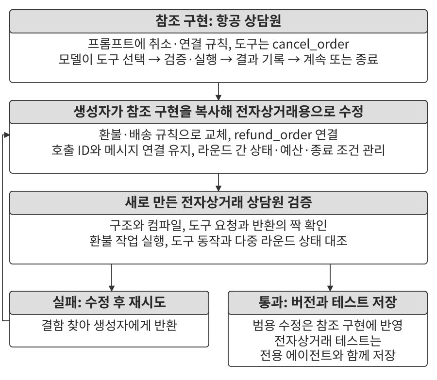

한 번의 수정이 범용 능력을 개선한 것인지, 방금 본 문제에 우연히 적응한 것인지는 어떻게 구별할까요? 생성자에게 주지 않은 작업을 하나 남겨 두면 됩니다. 예를 들어 한 상점의 데이터로 가격 모니터링 에이전트를 개발한 뒤, 다른 상점의 샘플을 맡겨 보면서 원래 작업도 함께 다시 실행합니다.

**에이전트의 실행 환경을 유지한다.**

새 에이전트의 실행은 설정, 자격 증명, 세션 상태, 서비스, 샌드박스에 의존합니다. OpenClaw의 `doctor` 명령은 이런 유지보수 도구의 한 예입니다. 구형 설정 마이그레이션, OAuth 자격 증명 상태, 세션 잠금, 플러그인 설치, 게이트웨이 상태, 샌드박스 이미지 같은 문제를 검사하고, 수정을 제안하거나 해당 수정을 실행합니다[^ch5-doctor].

이런 결정론적 검사는 자기 유지보수 흐름의 기초가 될 수 있습니다. 탐지 규칙은 알려진 장애를 다루고, 수정 동작은 분명한 입력과 기대 결과를 가집니다. 에이전트 진단 흐름을 더 설계한다면, 아직 해결되지 않은 문제를 로그, 설정, 검사 결과와 함께 모델에 넘겨 어느 설정을 어떻게 고칠지 설명하게 하고, 실행 계층이 권한과 수정 범위를 검사한 뒤 상태 검사와 회귀 테스트를 실행할 수 있습니다. 설정 스냅샷, 변경 기록, 롤백 진입점은 수정이 실패했을 때 시스템이 작업을 재개하도록 돕습니다.

**참조 구현에 엔지니어링 경험을 싣는다.**

전용 에이전트를 만드는 일에는 도메인 로직과 범용 인프라가 함께 들어갑니다. 생성 결과를 검사할 때는 네 가지 문제부터 살펴볼 수 있습니다.

1. **컨텍스트와 실행 루프.** 역할, 도구 호출 식별자, 도구 결과의 연관성을 유지하고, 다중 라운드 상태, 종료 조건, 예산, 예외 복구를 검사합니다. 구조화된 메시지는 프로토콜 관계를 유지하기 쉽게 하고, 안정된 접두부는 프롬프트 캐싱의 조건을 만들어 줍니다.
2. **도구 인터페이스.** 도구 설명은 용도, 적용 조건, 사용 경계를 밝히고, 파라미터에는 타입, 의미, 구체적인 예가 들어가야 합니다. 실행 계층은 파라미터, 신원, 업무 상태를 이어서 검증합니다.
3. **모델과 API 선택.** 모델은 학습 데이터에서 자주 나타난 오래된 모델과 오래된 인터페이스를 답습하기 쉽습니다. 코드가 매끄럽게 작성되어도 모델 선택이 뒤처질 수 있습니다. 생성자에게 관리되는 모델 선택 자료를 제공하거나 공식 문서를 검색하게 해, 모델 능력, 인터페이스 버전, 호출 방식을 대조하게 해야 합니다. 생성 후의 실제 호출이 설정이 쓸 수 있는지 검증합니다.
4. **의존성과 생태계 호환성.** 라이브러리의 유지보수 상태, 버전, 인터페이스 변경을 확인하고, 의존성 설치, 컴파일 검사, 테스트로 조합된 프로그램을 검증합니다.

**전용 에이전트를 만들 때 필자는 생성자가 검증된 참조 구현을 복사한 뒤 도메인에 맞게 수정하기를 우선합니다.** 프롬프트로는 메시지 프로토콜, 상태 관리, 복구 메커니즘의 세부를 모두 담아 내기 어렵지만, 참조 코드는 이런 엔지니어링 경험을 새 시스템에 그대로 가져옵니다. 모델이 프로그래밍에 능해도 작업 설명에 드러나지 않은 실행 조건을 빠뜨릴 수 있고, 프레임워크를 재사용하면 이런 반복되는 실수를 줄일 수 있습니다. 생성자는 알맞은 기반 프레임워크를 복사하고, 새 역할에 맞게 시스템 프롬프트를 조정하고, 도메인 도구를 더하거나 빼고, 업무 로직을 수정하고, 그에 맞는 테스트를 보충합니다. 메시지 처리, 호출 연관, 상태 관리, 종료 경로는 프레임워크가 제공하고, 도메인 변경은 새로 추가한 사례로 검증합니다.

템플릿이 훨씬 빨랐다면, ‘기능 몇 개를 덜 만들었다’는 설명은 어떻게 배제할 수 있을까요? 아래에서는 두 그룹의 생성자가 같은 종류의 에이전트를 내놓게 하고, 같은 검사 묶음으로 평가합니다.

> **실험 5-16 ★★★: 에이전트를 만들 수 있는 에이전트 개발하기**
>
> 같은 생성자 모델에게 배포 심사 에이전트를 만들게 합니다. 배포 점검 기록을 모두 읽고, 필수 점검 항목이 하나라도 통과하지 못하면 배포를 거절하고 그 근거를 밝히는 에이전트입니다. 처음부터 만들 때는 모델이 실행 루프, 도구 프로토콜, 도메인 도구, 명령줄 진입점, 테스트를 모두 작성해야 합니다. 템플릿 경로는 구조화된 기록을 검사하는 에이전트 하나를 먼저 복사하고, 모델은 도메인 명세만 채웁니다. 예를 들어 상태가 어느 필드에 있는지, 어떤 값이 통과를 뜻하는지입니다. 생성 스크립트가 명세에 따라 시스템 프롬프트, 도구 정의, 설명 문서를 만듭니다. 기존 Python 도구가 명세를 읽어 검사를 수행합니다. 두 경로 모두 메타프로그래밍을 보여 줍니다. 프로그램으로 다른 프로그램을 생성하거나 수정하는 것입니다.
>
> 그림 5-11에서 두 경로는 같은 인수 조건 위에서 만납니다.
>
> 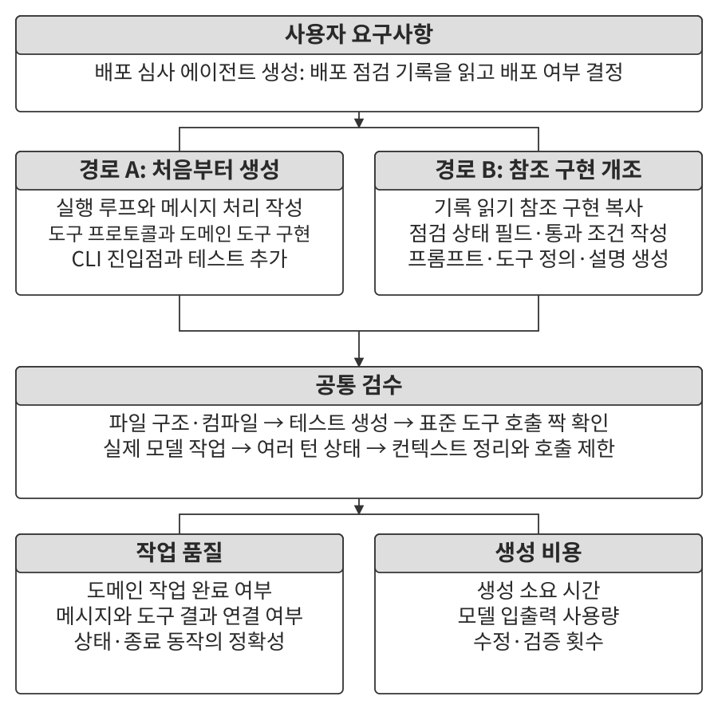
>
> 두 경로는 같은 작업 요구와 인수 조건을 씁니다. 먼저 산출물 구조, 컴파일, 테스트를 검사하고, 이어서 표준 메시지에서 도구 호출과 결과의 연관을 검사한 다음, 실제 모델 작업과 다중 라운드 상호작용을 실행해 컨텍스트 잘라내기, 상태 관리, 호출 횟수 제한을 검증합니다.
>
> 저장된 Kimi K3 대조 기록에서 두 그룹은 결정론적 검사 39개 항목을 각각 모두 통과했고, 실제 모델 작업과 다중 라운드 상태 검사도 통과했습니다. 템플릿 경로는 생성에 1,181토큰과 약 25초를 썼고, 처음부터 만드는 경로는 381,814토큰과 약 90분을 썼습니다.
>

[^ch5-doctor]: OpenClaw, Doctor. 설정과 상태 검사, 마이그레이션, 수정 기능을 소개합니다.

## 이 장의 요약

**코딩 에이전트가 비교적 일찍 성숙한 데에는 흔히 간과되는 이유가 하나 있습니다. 소프트웨어 엔지니어링에는 이미 타입 시스템, 테스트 스위트, 버전 관리, 디버깅 도구가 있었습니다.** 코드를 잘못 고치면 테스트가 대개 어느 입력이 예상 밖의 결과를 냈는지 짚어 줍니다. 다른 방식으로 고친 뒤에도 원래 입력으로 다시 시도할 수 있습니다. 이 경험을 다른 작업에 적용하려면 구체적인 질문 세 개를 먼저 던져야 합니다. 오류를 어떻게 발견할 것인가, 알려진 상태로 어떻게 복구할 것인가, 언제 멈추고 사람에게 넘겨야 하는가? 예를 들어 환불 호출 도중 연결이 끊겼다면, 하네스는 재시도 여부를 정하기 전에 먼저 장부를 조회해야 합니다. 그렇지 않으면 한 번의 장애 복구가 두 번째 환불이 될 수 있습니다.

코드는 한 번의 판단을 반복해서 쓸 수 있는 것으로 저장하기도 합니다. 수학 문제의 열거와 논리 문제의 제약은 프로그램에 맡겨 항목별로 검사할 수 있고, 환불 규칙은 실행 진입점의 검증으로 작성해 서버가 주문의 실제 상태를 읽고 통과 여부를 정하게 할 수 있습니다. 로그 형식이 바뀌면 파서를 고치고, 이번에 오류를 낸 샘플을 남겨 회귀 테스트로 쓸 수 있습니다. 세 경우 모두 코드를 실행할 수 있지만 판정 기준은 서로 다릅니다. 해가 문제의 조건을 만족하는가, 환불이 정책에 맞는가, 새 파서가 원래 놓쳤던 필드를 읽어 내는가입니다.

전달하는 것이 문서, 동영상, 기하 모델이라면 렌더링 결과, 화면과 소리의 동기화, 치수의 정확성까지 검사하고, 검토자가 실제 산출물을 한 번 보도록 해야 합니다. 전달하는 것이 양식, 조회, 시각화라면 사용자가 읽고 조작할 수 있는지와 함께, 뒤의 실행 서비스가 권한에 따라 데이터를 가져오는지도 검사해야 합니다. 코드가 또 다른 에이전트를 생성한다면, 필자는 검증된 프레임워크를 먼저 재사용하고 도메인 도구와 업무 로직을 생성한 뒤, 호출 프로토콜, 라운드 간 상태, 실제 작업 결과를 검사하는 쪽을 선호합니다. 이렇게 쌓아 둔 도구, 검증기, 테스트는 다음 작업에서 이어 쓸 수 있습니다.

코드는 작업을 반복 실행하게 하지만, 환경이 그 실행이 끝날 때까지 기다려 주지는 않습니다. 조회가 아직 돌고 있는데 사용자가 마음을 바꿀 수도 있습니다. 제6장에서는 이런 변화가 진행 중인 상호작용에 어떻게 들어오는지 다룹니다.

## 생각해 볼 문제

1. ★★ 프로젝트 파일을 읽고, 의존성을 설치하고, 테스트를 실행해야 하는 코딩 에이전트를 위한 샌드박스를 설계해 보십시오. 파일, 네트워크, 프로세스, 자원 권한을 어떻게 구성하시겠습니까? 작업에 권한을 넓혀야 할 때는 요청을 어떻게 표현하고, 범위를 어떻게 검사하며, 기록을 어떻게 남기시겠습니까?
2. ★★★ 생성자가 여러 세대의 에이전트를 연속해서 생성하고 수정하면, 프레임워크 결함과 도메인 오류가 점차 누적될 수 있습니다. 참조 버전, 회귀 테스트, 행동 평가, 롤백 메커니즘으로 이런 변화를 어떻게 추적하시겠습니까?
3. ★★ 로그 형식 변화는 정상적인 업그레이드에서 올 수도 있고 생산자의 결함에서 올 수도 있습니다. 적응형 파싱 시스템은 어떤 근거를 보존해야 하며, 어떤 조건에 따라 새 파서 추가, 이상 보고, 처리 중단을 결정해야 할까요?
4. ★★ 제안자–검토자 순환에서 검토자는 페이지의 정보 밀도가 적절하다고 보는데 사용자는 빡빡하다고 느낍니다. 사용자 선호를 예시, 채점 조건, 상호작용 피드백으로 어떻게 바꾸고, 이후 수정이 요구에 맞는지 어떻게 확인하시겠습니까?
5. ★★ 코딩 에이전트는 지식 베이스, 아키텍처 문서, 프로젝트 지침을 갱신할 수 있고, 조작 순서를 코드로 고정할 수도 있습니다. 중복되거나 낡은 규칙을 어떻게 찾아내고, 규칙에 적용 범위, 검증 방법, 종료 조건을 어떻게 설계하시겠습니까? 한 번의 성공적인 수정이 제9장에서 말하는 지속적 진화로 발전하려면 어떤 축적과 평가 메커니즘이 더 필요할까요?
6. ★ 원격 협업에 친화적인 팀은 대개 에이전트가 작업 정보를 얻기에도 편합니다. 익숙한 프로젝트의 요구사항, 아키텍처, 결정 기록, 인수 기준을 점검해, 가장 보완이 필요한 문서를 나열하고, 그것이 에이전트의 어떤 구체적인 작업에 도움이 되는지 설명해 보십시오.
7. ★★★ 개인 데이터에 접근하고, 신뢰할 수 없는 콘텐츠를 처리하고, 외부와 통신하며, 영구 메모리까지 사용하는 에이전트라면 신원 권한 부여, 출처 표시, 데이터 흐름 검사, 메모리 쓰기 검토를 어떻게 배치하시겠습니까? 정상적인 업무 흐름 하나를 예로 들어 이 검사들이 어디에 놓이는지 설명해 보십시오.
8. ★★ SQL과 HTML의 아티팩트 패턴에서 모델이 산출물을 생성하고, 실행 서비스가 조회나 렌더링을 처리하며, 화면이 결과를 바로 보여 줍니다. 어떤 정보를 다시 모델에 넘겨 설명하게 하는 것이 적절할까요? 조회 권한, 자원 예산, 페이지 격리, 표시 결과의 일관성을 어떻게 검사하시겠습니까?
9. ★★ 도구는 데이터베이스의 업무 상태에 따라 규칙을 검증하고, 파라미터 설명은 모델이 호출을 준비하도록 돕습니다. 예약 취소를 예로 들어 자연어 정책, 파라미터 예, 실행 계층 검증, 경계 테스트가 각각 어떤 책임을 지는지 설명해 보십시오. 정책이 바뀐 뒤에는 어떤 내용을 함께 갱신해야 할까요?
