# 상호작용: 관측 공간과 행동 공간의 확장

**기반 모델이 고정되어 있을 때, 관측과 행동 인터페이스를 다시 조직하거나 확장하는 일은 대개 에이전트의 작업 성능을 끌어올리는 가장 효과적인 공학적 수단 가운데 하나입니다.** 앞선 장들에서 에이전트는 보통 사용자가 말을 마치기를 기다린 뒤 자료를 찾고, 도구를 호출하고, 답을 내놓았습니다. 에이전트가 도구 결과를 기다리는 동안에도 사용자와 외부 환경은 계속 변합니다.

사용자가 비서에게 항공권 변경을 맡겼다고 합시다. 비서가 상담원에게 항공편을 문의하는 사이 사용자가 “부칠 짐이 하나 더 있어”라고 메시지를 보냅니다. 상담원이 말하는 동안에도 화면에 표시되는 운임은 바뀔 수 있습니다. 비서는 운임에 위탁 수하물이 포함되는지 제때 물어봐야 하고, 방금 받은 견적이 아직 유효한지도 살펴야 합니다. 여기에는 설계 문제가 두 가지 있습니다. 비서가 어떤 경로로 변화를 알 수 있는가, 그리고 언제 반응할 수 있는가입니다. 이 장은 비동기로 도착하는 메일과 도구 결과를 먼저 다루고, 이어서 연속 음성과 화면 변화, 로봇의 동작 피드백을 살펴봅니다.

## 모달리티와 트리거 시점의 확장

**모달리티**는 정보와 행동의 형식을 뜻합니다. 에이전트는 텍스트를 읽고, 소리를 듣고, 화면을 보고, 토크 신호를 받을 수 있으며, 글자를 출력하고, 음성을 합성하고, 인터페이스를 클릭하고, 관절을 구동할 수도 있습니다.

**트리거 시점**은 정보가 언제 도착하고 행동이 언제 시작되며 시스템이 언제 반응하는가를 다룹니다. 정보는 에이전트가 능동적으로 조회할 수도 있고 외부 서비스가 밀어 넣을 수도 있습니다. 도구는 결과를 즉시 돌려줄 수도 있고, 작업을 먼저 시작한 뒤 나중에 완료를 보고할 수도 있습니다. 새 이벤트가 도착하면 시스템은 현재 작업을 중단할지, 중단했다면 어떻게 재개할지도 판단해야 합니다.

| 차원 | 정보 획득과 관측 인터페이스 | 행동과 실행 인터페이스 |
|---|---|---|
| 내용 조직(제2장~제5장) | 컨텍스트, 메모리, 지식 베이스가 결정에 필요한 정보를 조직한다 | 도구와 코드가 실행 가능한 조작을 표현한다 |
| 모달리티(이 장) | 음성, 화면, 물리 센서 | 말하기, 클릭, 관절 운동 |
| 타이밍(이 장) | 능동 조회, 이벤트 푸시, 연속 입력 | 턴을 넘나드는 실행, 취소, 선점과 재개 |

컨텍스트는 어느 한 번의 결정에 필요한 정보를 담고, 관측 공간은 시스템이 받아들일 수 있는 정보의 범위를 뜻합니다. 도구는 구체적인 인터페이스를 제공하고, 행동 공간은 시스템이 실행할 수 있는 동작의 범위를 뜻합니다. 인터페이스를 확장할 때도 이 범위는 기기 성능, 파라미터, 권한, 실행 환경의 제약을 받습니다.

많은 도구 호출 인터페이스는 메시지를 턴 단위로 조직합니다. 모델이 호출을 제안하면 시스템이 도구 결과를 채워 넣고, 그다음 추론을 한 번 더 시작합니다. 이벤트 기반 시스템은 이런 프로토콜 위에서 외부 변화를 관리해야 합니다. 인터페이스가 네이티브 비동기를 지원하면 도구가 대기 중인 동안 새 요구를 받아들이고, 결과가 돌아온 뒤 처리를 이어 갈 수 있습니다. 동기 인터페이스라면 하네스가 큐와 작업 핸들, 스케줄링으로 상호작용을 조직합니다. 두 구현 경로는 뒤에서 각각 다룹니다.

시나리오마다 피드백의 주기는 크게 다릅니다. 아래 표는 흔한 시간 척도를 정리한 것입니다.

| 흔한 척도 | 시나리오 | 관측 측의 변화 | 행동 측의 처리 |
|---|---|---|---|
| 초에서 일 | 비동기와 이벤트 기반 | 외부 이벤트가 에이전트를 깨운다 | 작업을 먼저 시작하고, 이후 이벤트로 진행과 완료를 보고한다 |
| 수십 밀리초에서 초 | 음성 | 오디오를 연속으로 받는다 | 스트리밍으로 출력하고, 끼어들기와 재생 중단을 처리한다 |
| 1초 미만에서 초 | Computer Use | 화면이 계속 변한다 | 동작 후 인터페이스 상태를 다시 가져온다 |
| 밀리초 수준의 제어 주기 | 로봇 저수준 제어 | 센서가 계속 피드백을 준다 | 짧은 구간의 동작을 실행하고, 제어와 정지 신호에 응답한다 |

## 비동기와 이벤트 기반: 세계가 먼저 찾아올 때

제4장에서는 인식 도구, 실행 도구, 협업 도구를 소개했습니다. 이 절은 이어서 이벤트 트리거 도구와 사용자 커뮤니케이션 도구를 다룹니다. 이벤트 트리거 도구는 환경 변화를 에이전트에게 들여보내고, 커뮤니케이션 도구는 에이전트가 작업을 진행하는 도중 사용자와 연락하게 합니다. 하네스는 이 입출력을 진행 중인 작업과 연결해, 끊임없이 일하는 이벤트 루프를 만듭니다.

### 비동기가 필요한 이유

동기 호출은 결과가 돌아와야 호출한 쪽이 현재 흐름을 이어 갈 수 있습니다. 비동기 호출은 먼저 작업 핸들(작업을 조회하고 관리하기 위한 식별자)을 돌려주거나 나중에 완료를 알리기로 약속하고, 호출한 쪽이 기다리는 동안 다른 일을 처리하게 합니다. 시스템은 이를 바탕으로 진행 중인 여러 작업을 조직하고, 자원과 의존 관계에 따라 어떤 작업을 병행할 수 있는지 결정합니다.

에이전트를 메일과 전화, 방문 일정을 관리하는 비서라고 생각해 봅시다. 상대의 답장을 기다리는 동안 서류를 계속 정리하고, 긴급한 전화가 오면 하던 일의 진행 상황을 잠시 적어 두고, 통화가 끝나면 원래 작업을 재개합니다. 이를 공학적으로 구현하려면 세 가지를 처리해야 합니다.

- **긴 작업과 상호작용의 분리.** 파일 분석, 전화, 빌드 작업은 백그라운드에서 진행되고, 사용자는 그동안에도 진행 상황을 묻거나 요구를 덧붙일 수 있습니다.
- **이벤트 우선순위.** 긴급 정지는 곧바로 제어 흐름에 들어가고, 일상적인 갱신은 큐에 들어가며, 독립적인 조회는 병렬 세션에 맡길 수 있습니다.
- **중단과 재개.** 작업 상태를 저장하고, 이미 일어난 조작을 기록하고, 재개할 때 여전히 유효한 조건을 다시 확인합니다.

Claude Duet의 연구 프리뷰가 그 예입니다. 사용자가 오후 두 시에 회의가 있어 상대 회사의 브리핑을 미리 받고 싶다면, 음성 메시지를 하나 남기고 앱을 꺼 두면 됩니다. 준비 작업은 클라우드에서 계속되고, 사용자는 언제든 작업 화면을 열어 진행 상황을 볼 수 있습니다. 사용자가 정보를 보충해야 하거나 브리핑이 완성되면 비서가 다시 본 대화로 돌아와 알려 줍니다. 여기서 사용자가 자리를 떠난 뒤에도 작업이 진행된다는 점이 비동기 실행입니다. 뒤에서 다룰 풀 듀플렉스 통화에는 요구가 하나 더 있습니다. 한쪽이 말을 시작해도 상대의 끼어들기를 계속 들을 수 있어야 한다는 것입니다.[^ch6-duet]

모델 API도 메시지의 순서에 관해 약속을 둡니다. 어떤 인터페이스는 도구 호출과 결과가 완전히 짝을 이뤄야 다음 요청을 받아들이고, 어떤 인터페이스는 도구를 대기 상태로 두고 이후 갱신을 받아들입니다. 애플리케이션의 비동기 함수는 대기와 실행을 배치하고, 모델 프로토콜은 언제 메시지를 제출할 수 있는지 정합니다.

그림 6-1에서 새 메시지와 도구 결과는 모두 큐로 들어갈 수 있지만, 큐에 어떻게 도달하는지는 출처에 따라 다릅니다. 서비스가 푸시를 지원하면 상태가 바뀌는 즉시 통지를 보낼 수 있습니다. 서비스가 조회 인터페이스만 제공한다면 어댑터가 주기적으로 조회하고, 변화를 발견하면 이벤트를 만듭니다. 타이머 만료도 이벤트를 발생시킬 수 있습니다. 이벤트 루프는 이렇게 모인 입력을 에이전트에 넘깁니다.

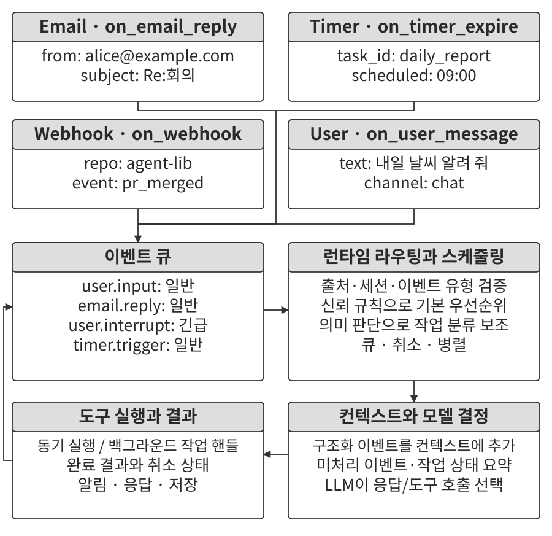

### OpenClaw의 이벤트 기반 메커니즘 구현

OpenClaw는 Gateway를 통해 메시지 채널에 접속하고, 이벤트를 에이전트 런타임으로 라우팅합니다. 자동화 메커니즘에는 내부 Hooks, 정기 스케줄링, Heartbeat, 외부 Webhook 같은 진입점이 있습니다[^ch6-automation]. 이 메커니즘들은 트리거 조건을 기준으로 이해할 수 있습니다.

- **Hooks(이벤트 훅)**는 세션 생성이나 재설정, 실행 수명 주기의 변화처럼 프레임워크 내부 이벤트에 반응합니다.
- **Cron(정기 스케줄링)**은 지정한 시각이나 주기에 작업을 실행합니다. 예를 들어 `0 9 * * 5`는 설정된 시간대에서 매주 금요일 오전 9시를 뜻합니다.
- **Heartbeat(하트비트)**는 주기적으로 에이전트를 깨워 주의가 필요한 일을 확인하게 합니다.
- **Webhook(외부 콜백)**은 외부 서비스가 제출한 이벤트를 받아, 인증과 라우팅을 거쳐 처리를 트리거합니다.

주간 보고서는 정해진 시각에 실행하는 편이 맞고, 계속 지켜봐야 하는 할 일은 주기적으로 확인하면 됩니다. 새 메일과 서비스 콜백은 푸시로 받아 발견 지연을 줄일 수 있습니다.

**PineClaw의 통화 이벤트.** Pine AI는 사용자를 대신해 전화를 걸어 요금 협상, 구독 해지, 보험금 청구 같은 일을 처리합니다. PineClaw는 이런 전화 작업을 OpenClaw에 연결합니다. 통화는 보통 일정 시간 이어지고, 그동안 사용자의 개입이 필요할 수 있습니다.

- **본인 인증.** 상담원이 계정 소유자의 인증을 요구할 수 있습니다. 보안 코드나 일회용 비밀번호를 입력해야 하는 경우입니다.
- **삼자 통화.** 상담원이 계정 소유자와 직접 이야기하자고 하면, 사용자가 전화를 받도록 제때 알려야 합니다.
- **결정 확인.** 상담원이 대안을 제시하면, 포그라운드는 이번 위임과 사용자의 평소 선호를 함께 보고 받아들일 수 있는지 판단합니다. 사용자가 결정해야 할 사안이라면 구체적인 선택지를 사용자에게 보내고, 그동안 다른 조건을 상담원과 계속 확인합니다.

예를 들어 상담원이 계정 소유자를 삼자 통화에 부르려 합니다. 알림이 일찍 도착할수록 양쪽이 전화에서 헛되이 기다리는 시간이 줄어듭니다. PineClaw 사례는 Channel 메커니즘으로 Gateway와 Pine API 사이를 통화 이벤트로 잇습니다. 전화 연결, 사용자 입력 요구, 통화 종료가 각각 이벤트 스트림으로 들어가고, 에이전트는 이를 근거로 작업을 갱신하고 사용자에게 알립니다.

**필자는 능동적 서비스가 제때 닿게 하려면 이벤트 소스가 상태 변화 시점에 에이전트에게 알리는 편이 가장 낫다고 봅니다.** 채널을 통해 통지가 도착하면 하네스가 해당 작업을 찾아 중복인지 만료됐는지 확인하고, 모델이 다음 단계를 정합니다. 사용자의 본인 인증이 필요하면 인터페이스는 신뢰할 수 있는 인증 진입점을 열고, 인증 결과는 이후 새 이벤트로 원래 작업에 돌려보냅니다.

### 이벤트 트리거 도구

“고객이 답장하면 알려 줘”를 비서에게 맡긴다면, 비서는 내일 정확히 어떻게 깨어날까요? 먼저 메일함이 새 메일 도착 시 이벤트를 푸시할 수 있는지 확인하고, 능동 조회만 지원하는 시스템이라면 다음에 확인할 시각을 기억해야 합니다. 다음 세 가지 예시 인터페이스는 이런 대기 조건을 런타임이 보관하게 하고, 모델은 현재 턴을 끝낼 수 있습니다.

**타이머(`set_timer`)**는 약속한 시각에 작업을 깨우는 데 씁니다. 일회성 타이머는 “다음 주 월요일 오전 10시에 은행에 전화해 대출 진행 상황 묻기”처럼 실행 시각이 정해진 작업에 알맞습니다. 반복 타이머는 한 시간마다 서비스 상태를 확인하는 데 알맞습니다. 메일을 보낸 뒤 답장을 기다리거나, 업무 시간이 아니어서 다시 걸어야 할 때도 타이머로 일정을 잡을 수 있습니다. 인터페이스는 시간대와 트리거 조건, 작업 식별자를 보관하고, 취소하거나 수정하는 진입점을 제공해야 합니다. 외부 서비스가 조회만 지원하면 타이머 작업이 진행 상황 폴링까지 맡을 수 있습니다.

**백그라운드 작업 모니터링(`monitor_shell`)**은 오래 실행되는 명령을 진행 이벤트로 바꿉니다. 시작할 때 작업 식별자를 돌려주고, 실행 중에는 새로 추가된 출력이나 키워드, 상태 변화를 알리며, 끝나면 종료 상태와 결과를 보고합니다.

모델이 진행 상황을 반복 조회하면 상태가 그대로여도 모델 호출이 소모됩니다. 반대로 종료 통지만 기다리면 도중에 생긴 장애를 놓칠 수 있습니다. 그래서 필자는 모니터링을 런타임에 맡기고, 쓸모 있는 진행, 오류, 정체가 있을 때만 모델을 깨우는 편을 권합니다. 빌드가 도는 동안에도 대화를 이어 갈 수 있고, 이상 상황에는 제때 개입할 수 있습니다. 모니터링 규칙에는 필터와 병합, 빈도 제한을 둘 수 있어, 로그 한 줄마다 모델 호출이 일어나는 일을 피할 수 있습니다.

예를 들어 모델이 처리 대기 중인 티켓에 상태 갱신을 구독해 두면 이번 추론을 끝낼 수 있고, 통지가 티켓 번호와 함께 모델을 깨웁니다. 상대가 조회 진입점만 제공한다면, 모델이 직접 다음 확인 시각을 타이머로 잡아 둘 수 있습니다. 그때 찾아보니 “아직 처리 중”이면 다시 예약하고, 티켓이 끝났으면 이후 확인을 취소합니다. 두 방식 모두 대기는 런타임이 맡고, 모델은 통지를 받거나 타이머가 만료될 때만 판단을 다시 합니다.

**외부 이벤트 채널(`connect_channel`)**은 메일, 인스턴트 메시지, API 콜백을 구독하는 데 씁니다. 채널 어댑터는 출처를 검증하고, 서비스가 쓰는 식별자를 스레드와 연관 객체로 매핑한 뒤, 통일된 형식의 이벤트를 제출합니다. 이 내용은 뒤의 “인그레스 계층” 절에서 더 다룹니다. PineClaw의 통화 상태 알림이 이 범주에 속합니다.

세 종류의 도구에는 모두 트리거 조건, 필터 규칙, 이벤트 페이로드를 명확히 정의해야 합니다. 페이로드에는 이벤트 식별자, 발생 시각, 출처, 관련 작업, 필요한 내용을 담아, 에이전트가 이벤트가 아직 유효한지, 다음 단계에 어떤 정보가 필요한지 판단할 수 있게 해야 합니다.

### 사용자 커뮤니케이션 도구

항공권 변경 작업으로 돌아가 봅시다. 상담원에게 질문을 보내는 일, 사용자에게 곧바로 답을 받을 수 있는 확인 메시지를 보내는 일, 작업 기록에 “답변 대기 중”이라고 적는 일은 서로 다른 세 곳에 쓰입니다. 사용자는 잠시 자리를 비울 수 있고, 조건을 보충해야 하거나 결정을 확인해야 하거나 결과를 받을 때 다시 돌아오면 됩니다.

대화 인터페이스는 최종 답변과 도구 진행 상황, 실행 결과를 보여 줄 수 있습니다. 커뮤니케이션 도구는 수신자, 채널, 메시지 내용과 첨부를 명시적으로 지정합니다. 모델이 무엇을 전달할지 정하고, 하네스가 대상과 권한을 확인하고, 메시지 서비스가 전달을 완료합니다. 런타임이 최종 답변을 원래 대화로 자동 라우팅할 수도 있습니다. 두 방식은 함께 쓸 수 있습니다.

OpenClaw의 다중 채널 상호작용은 사용자가 비서에게 그렇게 하듯 메시지를 보내고, 진행 상황을 기다리고, 알림을 받게 합니다. 이런 “살아 있는 사람 같은 느낌”은 지속적인 작업 상태와 제때 이루어지는 커뮤니케이션에서 나옵니다. 사용자는 익숙한 채널에서 작업을 이어 갈 수 있고, 에이전트는 신원과 세션, 메시지 연관 관계를 일관되게 유지해야 합니다.

커뮤니케이션 내용도 작업에 따라 달라집니다. 짧은 진행 상황은 텍스트로, 복잡한 결과는 이미지나 파일을 곁들여, 입력이 필요한 정보는 구조화 카드로, 상호작용형 결과물은 제5장에서 소개한 생성형 UI로 전달합니다. 채널이 전달이나 읽음 확인을 지원하면 시스템은 그 상태를 저장합니다. 실패 후 재시도, 중복 메시지, 채널 간 동기화도 전달 기록에 남깁니다.

**다중 채널 알림과 사용자 재참여.**

인스턴트 메시지, SMS, 메일, 전화, 앱 푸시는 각각 긴급도와 내용 형식이 다릅니다. 에이전트는 긴급도, 사용자 선호, 현재 상태, 메시지 길이를 함께 보고 채널을 고를 수 있습니다. 즉시 확인이 필요한 통화 이벤트는 제때 알림으로, 완전한 보고서는 메일이나 앱 링크로 전달합니다.

필자는 한때 어시스턴트에게 ATC 컨퍼런스 호텔 객실 요금을 지켜보게 한 적이 있습니다. 어시스턴트는 매일 같은 시각에 객실 요금이 아직 목표가까지 내려오지 않았다는 메시지를 보냈습니다. 그런데 요금이 잠깐 떨어진 그 틈을 잡은 것은 필자가 직접 작성한 스크립트였습니다. 짧은 특가는 두 번의 조회 사이에 나타날 수 있습니다. 어시스턴트가 제때 조회했다 하더라도 메시지가 늦게 도착하면 사용자는 예약 시점을 놓칠 수 있습니다. 가격이 내려가지 않은 날에도 정기 조회는 평소처럼 돌 수 있지만, 사용자는 매일 똑같은 내용의 메시지를 읽을 필요가 없습니다. 제7장에서는 5분짜리 가격 인하 구간으로 이런 알림을 검증합니다.

긴 작업이 끝나면 알림이 사용자를 결과 화면으로 데려갑니다. 일일 요약과 주간 보고서는 약속한 주기로 발송됩니다. 다중 채널 전략에는 중복 제거, 방해 금지 시간대, 에스컬레이션 조건도 두어야 합니다. 첫 알림에 응답이 없으면 다른 채널로 바꿀지 같은 규칙입니다. 알림 기록은 작업 상태와 연결되어, 사용자가 받은 메시지에서 처리를 이어 갈 수 있게 합니다.

### 가상 신원과 격리 실행 환경

제4장은 《Her》의 사만다를 빌려 범용 비서가 도구를 통해 디지털 세계로 들어가는 방식을 설명했습니다. 이런 비서를 구현하려면 어떤 신원으로 일하고 어떤 자원에 접근할 수 있는지 분명히 해야 합니다. **필자는 범용 비서에 독립된 가상 신원을 부여하는 쪽을 선호합니다.** 전용 업무용 메일, 전화번호, 저장 공간, 컴퓨팅 환경을 주면, 에이전트는 자기 업무 계정을 가진 비서처럼 명확한 대리인 신원으로 사용자의 일을 처리합니다. 독립된 신원은 비서의 일상 업무와 사용자의 개인 계정을 분리해, 따로 권한을 주고 감사하고 회수하기 쉽게 만들고, 잘못된 조작이 생겼을 때 영향 범위를 좁히기도 쉽습니다. 사용자의 계정에 반드시 접근해야 하는 작업은 범위를 한정한 위임으로 필요한 권한을 얻습니다.

전화번호가 누구에게 귀속되는지는 상대가 다시 전화했을 때 누가 이어받는지를 결정합니다. Manus의 Cue는 비서에게 독립된 번호를 주어 전화를 받고, 통화 요약을 사용자에게 남깁니다. 만약 상점이 비서가 남긴 회신 번호를 받아들인다면, 상담원이 전화했을 때 앞서 일을 처리한 비서에게 곧바로 닿습니다.[^ch6-cue]

요금 감면을 예로 들어 봅시다. 비서는 위임받은 대리인 신분으로 상점에 연락할 수 있습니다. 상담원이 본인의 구두 확인을 요구하면, 사용자를 삼자 통화에 불러 인증을 마친 뒤 비서가 대화를 이어 갈 수 있습니다. 상점이 사용자에게 다시 전화하기로 했다면, 접수 번호와 이미 합의된 사항, 확인이 필요한 질문을 미리 사용자에게 넘깁니다. 사용자에게 보고할 때도 손에 있는 근거를 분명히 밝혀야 합니다. 상담원이 구두로 감면을 약속했다면 그 약속을 기록하고, 이후 청구서가 갱신된 것을 확인한 다음에야 실제로 감면됐다고 보고합니다.

필자가 베이징에서 미국 은행의 신용카드를 재발급받을 때, Pine은 은행에 연락해 긴급 재발급을 주선하고 15달러 긴급 발급 수수료를 면제받아 냈습니다. 통화가 끝났을 때 비서는 은행이 무엇을 접수했고 어느 수수료를 면제하기로 했는지 이미 보고할 수 있었습니다. 며칠 뒤 사용자가 “새 카드가 어디쯤이야”라고 묻는다면, 그때는 물류를 다시 조회하거나 수령인에게 확인을 요청해야 합니다.

가상 컴퓨터와 가상 휴대전화는 계속 돌아가는 조작 환경을 제공합니다. 가상 머신은 데스크톱 시스템을 실행할 수 있고, 컨테이너는 프로세스와 의존성을 격리하기에 알맞으며, Android 에뮬레이터는 모바일 앱을 담습니다. 이들은 백그라운드 실행을 지원하고, 자동 조작이 사용자의 현재 작업을 방해하는 정도도 줄여 줍니다. 격리 범위는 네트워크, 마운트, 자격 증명, 실행 권한이 함께 결정합니다. 이 설정은 에이전트가 접할 수 있는 데이터와 외부 시스템에도 동시에 영향을 줍니다.

퇴근 후 컴퓨터를 끈 상태에서 텐센트 WorkBuddy 엔터프라이즈 버전이 주간 보고서를 만들기를 원한다고 합시다. 그런데 이번 주 매출 표는 업무용 컴퓨터에만 있습니다. 로컬 작업을 고르면 비서가 이 표를 읽을 수 있지만, 컴퓨터가 켜져 있어야 하고 클라이언트도 온라인 상태여야 합니다. 클라우드 작업을 고르면 컴퓨터를 끈 뒤에도 비서가 계속 일할 수 있지만, 그 전에 주간 보고서에 써도 되는 데이터를 작업에 업로드하거나, 클라우드 작업이 접근할 수 있는 자료 저장소에 넣어 두어야 합니다. 매출 표를 반드시 이 컴퓨터에만 두어야 한다면, 컴퓨터가 켜져 있는 시간에 처리하도록 일정을 잡아야 합니다.

웹과 모바일 앱은 인증, 캡차, 사람의 확인을 요구할 수도 있습니다. 접속할 때는 서비스가 제공하는 API와 위임 방식을 우선 사용합니다. 그래픽 인터페이스로 인증해야 한다면 VNC/RDP 원격 데스크톱으로 사용자가 직접 로그인하게 하고, 인증이 진행되는 동안 자동 조작을 멈춥니다. 사용자가 마치면 시스템이 세션 상태를 확인한 뒤 작업을 재개합니다. 토큰과 세션은 유효 기간에 따라 보관하고, 위임을 회수하거나 작업이 끝나면 정책에 따라 정리합니다.

에이전트와 가상 환경은 **공유 파일 시스템**으로 데이터를 주고받을 수 있습니다. 예를 들어 사용자가 CSV를 업로드하면 가상 컴퓨터가 파일을 읽어 분석하고, 차트를 다시 공유 저장소에 씁니다. 런타임은 차트의 파일 위치를 에이전트에게 넘기고, 사용자에게는 접근 가능한 다운로드 경로를 제공합니다. 큰 파일의 내용은 저장소에 두고, 모델은 필요할 때 요약이나 일부를 읽습니다.

[^ch6-dsh-threads]: DeepSeek, dsh-superagent 프로토타입의 도메인 모델과 위임·구독 규칙.
[^ch6-dsh-sessions]: DeepSeek, dsh-superagent 프로토타입, 버전 `8c32a9d`. 두 종류 세션의 역할은 `docs/004-prompts.md`, 실행 세션과 작업 디렉터리는 `docs/003-execution.md`, 메인 세션으로 보내는 메시지 형식은 `docs/007-architecture.md`에 나옵니다.
[^ch6-duet]: Anthropic, *Get started with Claude Duet*, 회의 전 브리핑, 작업 화면, 메인 대화 알림을 소개합니다.
[^ch6-cue]: Manus, *Introducing Manus 2.0*, Cue의 독립 전화번호, 수신, 통화 요약을 소개합니다.
[^ch6-automation]: OpenClaw, Automation, 내부 Hooks, 정기 스케줄링, Heartbeat, 외부 Webhook 같은 자동화 진입점을 소개합니다.

### 인그레스 계층: 여러 출처, 하나의 이벤트

한 온라인 상점의 고객 지원 에이전트가 환불 한 건을 처리한다고 합시다. 고객이 앱의 상담 대화에서 신청하고, 금액이 에이전트의 권한을 넘어서자 에이전트가 위챗 워크(WeCom) 고객 지원 그룹에서 팀장에게 확인을 구합니다. 결제 서비스는 환불이 성공하면 Webhook을 보내고, 주문 시스템은 이어서 Kafka에 상태 변경을 게시합니다. 네 개의 메시지가 말하는 대상은 같은 주문이지만, 도착 방식은 저마다 다릅니다. 출처가 많아지면 경로마다 재시도와 중복 제거, 순서를 따로 처리해야 하고, 런타임은 이런 차이에 휘둘려 일관성을 잃습니다. **인그레스 계층은 이벤트가 시스템에 들어온 뒤의 형태를 통일하고, 각 출처가 도착하기 전의 능력 차이는 그대로 둡니다.** 그림 6-2는 이 계층 구조를 보여 줍니다.

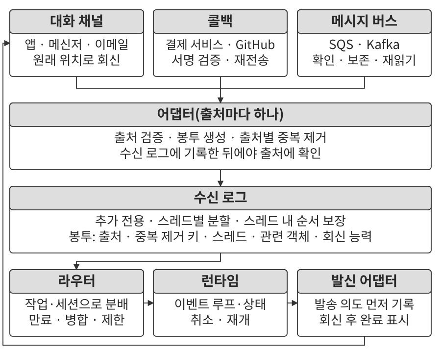

흔한 출처는 네 가지입니다. **대화 채널**에는 제품 자체의 대화 인터페이스, 위챗 워크, 페이수, Slack 같은 인스턴트 메시지, 그리고 메일이 들어갑니다. 에이전트는 원래 자리로 돌아가 답할 수 있습니다. **콜백**은 외부 서비스가 상태 변화 시 호출하는 HTTP 인터페이스로, 보통 서명을 동봉하며 통지만 보냅니다. 전달에 실패하면 어떤 서비스는 자동으로 재시도하지만, GitHub는 수동으로나 API를 통해 다시 전달해야 합니다. SQS나 Kafka 같은 **메시지 버스**는 내부 서비스의 업무 이벤트를 전달하고, 확인과 보존에 관한 의미가 분명합니다. **타이머, 폴링, 내부 이벤트**는 시스템이 직접 만들며, 같은 로그에 기록하면 됩니다. 아래 표는 앞의 세 가지를 비교합니다.[^ch6-ingress-mq][^ch6-ingress-callback]

| | App 대화 | 위챗 워크 / 페이수 | 메일 | Webhook | SQS | Kafka |
|---|---|---|---|---|---|---|
| 도착 방식 | 롱 커넥션 | 콜백 또는 롱 커넥션 | 푸시 또는 폴링 | 콜백 | 컨슈머가 가져감 | 컨슈머가 가져감 |
| 순서 보장 범위 | 대화 내부 | 대부분의 이벤트에서 보장하지 않음 | 보장하지 않음 | 보장하지 않음 | 표준 큐는 보장하지 않음, FIFO는 메시지 그룹 단위 | 파티션 내부 |
| 기본 중복 제거 근거 | 클라이언트 메시지 ID | 메시지 ID, 이벤트 ID | Message-ID | 전달 ID | 메시지 ID, FIFO의 경우 `MessageDeduplicationId` | 토픽, 파티션, 오프셋 |
| 재생 가능 여부 | 자체 기록에 의존 | 콜백 자체는 재생할 수 없고, 페이수는 히스토리 메시지 API로 보충 가능 | 메일함을 다시 읽을 수 있음 | 서비스에 따라 다름 | 삭제 후에는 불가 | 보존 기간 내에는 가능 |
| 확인 방식 | 클라이언트 수신 확인 | 기한 내 성공 응답 | 읽은 위치를 직접 기록 | 기한 내 2xx 응답 | 메시지 삭제 | 오프셋 커밋 |
| 응답 경로 | 원래 대화 | 원래 대화 | 회신 메일 | 없음 | 없음 | 없음 |

**통일 봉투.**

어댑터는 원본 메시지를 통일된 형식의 **봉투**(envelope)로 변환합니다. 봉투는 도착 시점에 확정할 수 있는 사실만 기록합니다. 우선순위와 처리 기한은 라우팅 규칙이, 고객 등급과 주문 상태는 업무 시스템이 보충하고, 처리 상태는 따로 저장합니다. 고객의 환불 신청은 이렇게 쓸 수 있습니다.

```json
{
  "id": "evt_7f3a",
  "source": {"type": "app_chat", "sender": "user:u_5521", "verified": true},
  "dedupe_key": "app:msg:msg_1029",
  "thread": "app:conv:conv_88",
  "kind": "message",
  "correlation": ["order:12345"],
  "content": {"type": "text", "text": "이 주문 환불하고 싶어요"},
  "raw_ref": "raw/2026-11-23/app/msg_1029.json",
  "reply": {"via": "app_chat", "target": "app:conv:conv_88"},
  "occurred_at": "2026-11-23T14:02:09+08:00",
  "expires_at": null
}
```

- `source`: 출처 유형과 검증된 발신자. “검증됨”은 어댑터가 서명, 토큰, 채널 계정을 근거로 판단하며, 본문에 적힌 자기소개는 근거가 되지 않습니다. 런타임은 이 항목으로 권한을 판단합니다.
- `dedupe_key`: 중복 제거 키로, 무엇이 중복인지는 출처의 의미가 정합니다. 전달 ID, 메시지 ID, 파티션과 오프셋 식별자는 같은 전달을 가리키므로 전송 계층의 재전송을 막습니다. 업무 메시지가 멱등 키(idempotency key)를 갖는다면, 예컨대 환불 번호에 상태를 붙인 값이라면, 어댑터가 이를 꺼내야 업무상의 중복까지 막을 수 있습니다. 사용자 대화는 반대입니다. 고객이 “환불”이라고 두 번 말하면 두 개의 메시지이므로, 클라이언트 메시지 ID만으로 중복을 제거합니다.
- `raw_ref`: 원본 그대로 보관한 페이로드. 어댑터 오류를 조사할 때는 이것에만 기댈 수 있습니다.
- `reply`: 어느 아웃바운드 어댑터를 거쳐 어디로 보낼지. 결제 콜백에는 응답 경로가 없으므로 이 항목이 비어 있습니다.
- `occurred_at`은 출처가 제시한 발생 시각이고, `expires_at`은 유효 기간으로 견적이나 인증 코드 같은 이벤트에만 채웁니다.

**스레드와 연관.**

고객이 “환불해 주세요”라고 말한 직후 “아니, 교환으로 할게요”라고 덧붙였다면 두 메시지의 순서를 뒤집을 수 없습니다. 다른 고객의 메시지는 이들과 무관하므로 병행해 처리할 수 있습니다. **인그레스 계층은 스레드 안에서만 순서를 보장합니다.** 어댑터는 출처가 쓰는 순서 단위를 `thread`로 매핑합니다. 앱의 대화 한 건, SQS FIFO의 메시지 그룹(`MessageGroupId`), Kafka의 파티션 키, GitHub 콜백의 이슈나 PR 번호가 그 단위입니다. 출처가 순서를 보장하지 않으면, 런타임은 `occurred_at`이나 출처가 준 버전 번호로 늦게 도착한 낡은 상태를 가려냅니다. 예컨대 “환불 완료” 뒤에 도착한 “환불 처리 중”이 그렇습니다.

이 환불 건의 네 메시지는 서로 다른 네 개의 스레드에 속합니다. 하나로 합치는 대가는 적지 않습니다. 고객 지원 그룹의 무관한 논의 한 줄도 고객 메시지 뒤에 줄을 서야 하고, 스레드 식별자는 흔히 파티션 키를 겸하기 때문에 나중에 바꾸려면 데이터를 이관해야 합니다. **연관 관계는 별도 필드로 표현하고 스레드는 다시 쓰지 않습니다.** `correlation`은 이벤트가 관련된 업무 객체를 나열하고, 작업은 연관 객체를 기준으로 관련 스레드를 구독합니다.

**확인 시점과 진행의 분리.**

**어댑터는 이벤트를 인그레스 로그에 기록한 뒤에 출처에 확인을 돌려주어야 하며, 에이전트가 처리를 마칠 때까지 기다렸다가 확인해서는 안 됩니다.** 페이수의 이벤트 콜백은 3초 안에 응답해야 하고, 위챗 워크는 5초이며, 넘기면 다시 푸시합니다. SQS 메시지는 가시성 타임아웃 안에 삭제되지 않으면 다시 꺼내집니다. 처리가 끝난 뒤에 확인하면, 모델 호출이 조금만 길어져도 중복 전달을 불러옵니다. 먼저 로그에 쓰고 확인하면, 각 출처의 전달 보장이 한 문장으로 수렴합니다. **모든 이벤트는 최소 한 번(at-least-once) 인그레스 로그에 들어가고**, 다시 전달된 것은 중복 제거 키가 걸러 냅니다.

인그레스 로그는 수신함(inbox)에 해당하며, 제1장의 “덧붙이기만 하고 고치지 않기” 원칙을 그대로 따르고 스레드 단위로 파티션합니다. Kafka를 인그레스 로그로 쓸 때는 중복 제거를 위해 별도의 유일 제약 저장소를 두거나 컨슈머 쪽에서 중복 제거 키로 걸러야 합니다. Kafka는 애플리케이션이 지정한 키로 쓰기를 거부할 수 없고, 멱등 프로듀서는 프로듀서 자신의 재시도만 다룹니다.

시스템은 세 가지 진행 상태를 분리해 저장해야 합니다.

| 진행 | 기록 내용 | 누가 관리하는가 |
|---|---|---|
| 출처 진행 | Kafka 오프셋, SQS 수신 핸들, 메일함 읽은 위치 | 어댑터 |
| 분배 진행 | 로그의 이벤트를 어느 작업에 넘겼는지 | 라우팅 |
| 작업 상태 | 어디까지 처리했고 응답을 이미 보냈는지 | 런타임 |

오프셋을 작업 진행으로 착각하면 로그를 재생할 때 이미 보낸 응답이 다시 나갑니다. 둘을 분리하면 재생은 분배 진행에만 영향을 줍니다. 아웃바운드 방향은 발신함(outbox)에 해당합니다. 보내기 전에 발송 의도와 멱등 키를 기록하고, 채널의 수신 확인을 받은 뒤 완료로 표시합니다. 재시작 후에 어떻게 대조하는지는 뒤의 “메일 이벤트로 기본 루프 만들기”에서 다룹니다.

**유효 기간, 병합, 배압.**

같은 스레드에 초당 수백 개의 이벤트가 밀려들 때, 이를 하나씩 모델에 넘겨서는 안 됩니다. 라우팅은 분배 전에 밀린 이벤트를 정리합니다.

- **유효 기간.** 견적, 인증 코드, 복구된 경보는 시간이 지나면 의미를 잃습니다. `expires_at`을 넘긴 이벤트는 궤적에만 기록하고 모델을 더 깨우지 않습니다.
- **병합.** `kind`는 두 종류의 이벤트를 구분합니다. 상태형 이벤트는 어떤 객체의 현재 값을 서술합니다. 결제 콜백의 환불 상태나 Kafka의 주문 상태가 그 예입니다. 같은 스레드에 여러 개가 밀려 있으면 최신 하나만 모델에 넘기고, 중간 값은 로그에 남깁니다. 메시지형 이벤트는 누군가 한 말이나 내린 지시입니다. 고객 메시지나 팀장의 클릭이 그 예이며, 묶어서 넘길 수는 있어도 버릴 수는 없습니다.
- **배압.** 당겨 가는 출처는 가져오는 속도를 늦출 수 있고, 밀린 이벤트는 출처에 그대로 남습니다. 밀어 넣는 출처는 상대를 멈추게 할 수 없으므로, 어댑터는 평소처럼 로그를 쓰고 확인하며, 밀린 이벤트는 인그레스 로그로 넘겨 앞의 두 규칙이 소화하게 합니다.

**환불 한 건이 네 출처를 거치는 과정.**

1. 고객이 앱 대화에서 환불을 요청합니다. 어댑터가 클라이언트 메시지 ID로 중복을 제거하고 로그에 쓴 뒤 클라이언트에 수신 확인을 보냅니다. 라우팅은 `order:12345`를 기준으로 환불 작업을 만들고, 작업은 이 대화 스레드를 구독합니다.
2. 금액이 권한을 넘어서자 에이전트가 위챗 워크 고객 지원 그룹에 확인 카드를 보내고, 카드 식별자를 작업에 기록합니다. 팀장이 “동의”를 클릭하면 어댑터가 로그에 쓴 뒤 성공을 반환하고, 카드 식별자에 해당하는 연관 객체를 채웁니다.
3. 에이전트가 환불 API를 호출한 뒤 결제 서비스가 “환불 성공” 콜백을 두 번 보냅니다. 전달 ID가 같으므로 두 번째는 중복 제거됩니다.
4. 주문 시스템이 Kafka에 “주문 환불 완료”를 게시합니다. 콜백과 같은 사실을 말합니다. 두 어댑터가 모두 페이로드에서 환불 번호와 상태를 중복 제거 키로 꺼냈다면 이 이벤트는 인그레스 단계에서 걸러집니다. 각각 전달 ID와 파티션·오프셋으로 중복을 제거했다면 둘 다 로그에 들어가고, 런타임은 작업에서 이미 환불이 확인된 것을 보고 궤적에만 기록합니다.
5. 콜백과 Kafka 이벤트에는 응답 경로가 없습니다. 런타임은 1단계 대화 스레드의 `reply`를 사용해 앱 아웃바운드 어댑터로 고객에게 알립니다.

4단계가 인그레스 계층 중복 제거의 경계입니다. 무엇을 막을 수 있는지는 어댑터가 어떤 중복 제거 키를 선언했는지에 달려 있고, 막지 못한 것은 작업 상태로 판단합니다. 이벤트가 작업으로 분배된 뒤 기존 세션에 이어 붙일지 새 세션을 열지는 컨텍스트 관리의 문제입니다. 세션을 넘는 정보는 제3장의 메모리로 전달하고, 컨텍스트를 공유할 수 있는지는 제10장에서 다룹니다.

[^ch6-ingress-mq]: Amazon Web Services, “Amazon SQS standard queues”; “Amazon SQS visibility timeout”; “Using the message deduplication ID in Amazon SQS”; “Using the message group ID with Amazon SQS FIFO Queues”. Apache Kafka 4.4 문서, “Design”의 “Consumer Position”과 “Message Delivery Semantics”. 확인일: 2026-11-24.
[^ch6-ingress-callback]: 페이수 오픈 플랫폼, “이벤트 개요”; “대화 히스토리 메시지 가져오기”. 위챗 워크(WeCom) 개발자 센터, “메시지와 이벤트 수신” 아래의 “개요”. GitHub Docs, “Best practices for using webhooks”; “Handling failed webhook deliveries”. 확인일: 2026-11-24.

### 이벤트 처리 메커니즘

사용자 메시지, 도구 결과, 타이머, 협업 요청이 한 에이전트에 동시에 들어올 수 있습니다. 런타임은 이 이벤트들을 저장하고 처리 순서를 정한 뒤 관련 정보를 모델에 넘겨야 합니다. **이벤트 루프**(event loop)는 이 과정을 계속 진행시킵니다. 큐에서 이벤트를 꺼내 작업 상태를 갱신하고, 모델 요청을 구성하고, 도구를 스케줄링한 다음, 새 입력이나 완료 통지를 기다립니다. Go 프로그램이 goroutine과 channel, `select`로 여러 갈래의 메시지를 조직하는 것도 비슷한 발상입니다.

dsh-superagent 프로토타입을 예로 들어 봅시다. 같은 GitHub 프로젝트에서 이슈 하나 아래의 논의와 풀 리퀘스트(PR) 하나 아래의 논의는 서로 다른 두 세션 스레드(Thread)에 속합니다. 새 작업을 맡을지 판단해야 할 때 시스템은 스레드 상태를 읽어 들여 모델에게 평가(Eval)를 맡깁니다. 한 스레드에서는 동시에 최대 한 번의 평가만 진행되지만, 여러 장의 티켓(Ticket)이 그 스레드를 구독할 수 있습니다. 결함 수정 티켓과 문서 보강 티켓이 모두 같은 PR을 구독하고 있다고 합시다. 리뷰어가 PR에 댓글을 남기면 두 티켓 모두 이 메시지를 컨텍스트로 받습니다. 이어서 누군가 이슈에 재현 조건을 덧붙이면, 그 메시지는 해당 이슈를 구독한 티켓에 전달됩니다. 메시지가 누구에게 가는지는 스레드와 구독 관계가 정합니다. 메시지를 받은 뒤 무엇을 할 수 있는지는 여전히 각 티켓이 원래 받은 권한이 정합니다.[^ch6-dsh-threads]

dsh-superagent는 “사람을 상대하는 일”과 “실제 작업”을 서로 다른 세션에 맡기기도 합니다. 메인 세션(Main Session)은 일을 접수하고, 답하고, 권한을 기록하는 일만 합니다. 코드를 읽지 않으며, 결과를 기다리느라 멈추지도 않습니다. 티켓마다 자기 실행 세션(Executor Session)이 있어, 별도의 작업 디렉터리에서 코드를 고치고 테스트를 돌립니다. 실행 세션은 수정을 마쳤거나, 막혔거나, 사람에게 물어야 할 때에만 메인 세션에 메시지를 하나 보내고, 요약과 읽을 위치를 붙입니다. 제2장에서 말한 “요약과 객체 ID”입니다. 이렇게 하면 메인 세션은 언제나 다음 요청을 받을 여유가 있고, 사람에게 묻고 알림을 보내고 중지시키는 일도 모두 메인 세션을 거치므로 약속은 한 창구에서만 나갑니다. 뒤의 음성 부분에서 다루는 빠른 모델과 느린 모델은 이런 분업을 실시간 통화에 옮긴 모습입니다.[^ch6-dsh-sessions]

동기 모델 인터페이스는 보통 한 번의 생성이 끝나거나 도구 결과가 모두 채워진 뒤에 다음 메시지 묶음을 받습니다. 여기에 **안전 지점**을 둘 수 있습니다. 런타임은 완료된 메시지, 아직 실행 중인 호출, 현재 작업 진행 상황을 먼저 기록한 뒤 새 처리 단계로 넘어갑니다. 네이티브 비동기 인터페이스는 실행 중에 갱신을 받는 프로토콜을 제공하며, 구체적으로 언제 이어 갈지는 인터페이스와 런타임이 함께 정합니다.

취소에도 실행기의 협조가 필요합니다. 모델이 생성을 멈춘 뒤에도 백그라운드 도구는 계속 돌고 있을 수 있습니다. 실행기는 취소 신호를 받아 실제 상태를 보고해야 합니다. Go 작업이 `ctx.Done()`을 확인한 뒤 정리를 수행하는 것과 비슷합니다. 이미 완료된 쓰기, 발송, 결제는 해당 업무 절차를 통해 철회하거나 보상해야 합니다.

**세 가지 처리 전략.**

그림 6-3은 새 이벤트가 도착했을 때의 세 가지 선택을 비교합니다. 큐에 넣으면 응답 시간은 다음 안전 지점을 언제 만나느냐에 달려 있습니다. 현재 작업을 취소하면 어떤 조작이 이미 끝났는지, 어디서부터 재개할 수 있는지 확인해야 합니다. 루프를 하나 더 열면 두 작업이 같은 자원을 두고 다투지 않는지 점검해야 합니다.

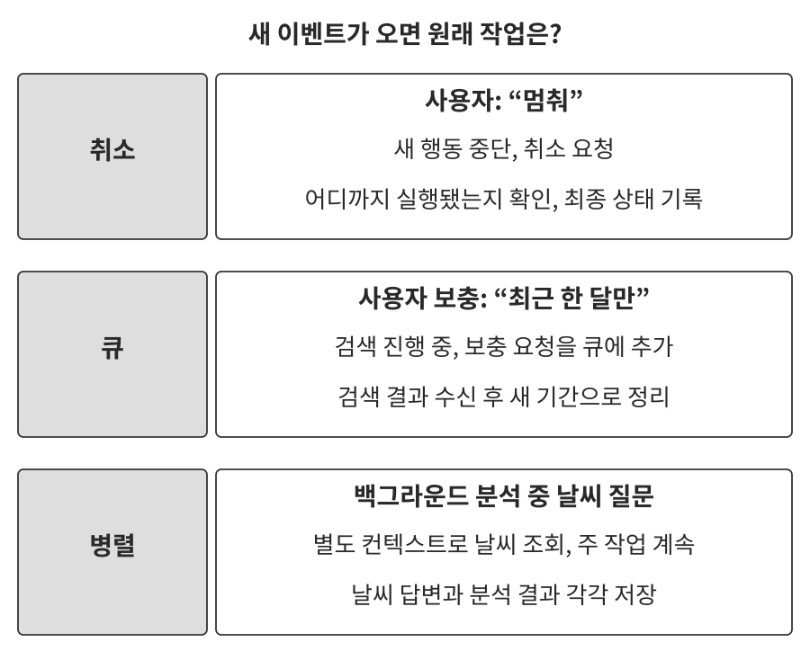

**취소 방식 처리(Cancellation-Based)**는 사용자의 정지 지시나 즉시 처리해야 하는 제어 이벤트에 알맞습니다. 런타임은 먼저 관련 조작을 더 내보내지 않도록 멈추고, 생성 중인 요청과 취소 가능한 도구에 정지 신호를 보낸 뒤, 완료된 메시지와 도구 상태, 취소 회신을 저장합니다. 그다음 새 이벤트가 결정 컨텍스트에 들어갑니다. 예를 들어 사용자가 “멈춰! 내가 잘못 말했어”라고 하면, 시스템은 이후 실행부터 제한한 다음 현재의 실제 상태를 바탕으로 작업을 다시 확인합니다. 아직 처리하지 않은 큐 항목은 식별자와 상태를 유지한 채 연관 범위에 따라 다시 정렬합니다.

**큐 방식 처리(Queued)**는 일상적인 보충 정보와 진행 갱신에 알맞습니다. 이벤트는 큐에 들어갔다가 다음 안전 지점에서 도구 결과와 함께 모델에 넘어갑니다. 예를 들어 검색 도중 사용자가 “최근 한 달의 결과만 봐 줘”라고 덧붙이면, 검색 결과가 돌아왔을 때 모델은 결과와 새 조건을 함께 읽고 걸러 낼지 다시 검색할지 정합니다.

**병렬 처리(Parallel)**는 주 작업과 독립적이면서 제때 답해야 하는 요청에 알맞습니다. 예를 들어 대규모 데이터를 분석하는 동안 사용자가 날씨를 물으면, 시스템은 독립된 세션을 열어 조회를 마칠 수 있습니다.

**긴급도와 라우팅.**

이벤트 유형은 첫 단서를 줍니다. `user.interrupt`, 신뢰할 수 있는 감독 지시, 시스템 경보는 높은 우선순위 통로로 보낼 수 있습니다. `user.input`, `agent.input`, `tool.result`, `timer.trigger`는 내용과 작업 상태를 함께 보고 판단합니다. 발신자가 본문에서 스스로 “긴급”이라고 해도, 시스템은 검증된 신원과 규칙에 따라 권한을 정합니다.

메시지의 의미를 이해해야 하는 라우팅 판단에는 경량 분류 모델을 쓰기를 권합니다. “당장 멈춰”는 취소에, “오늘 날씨 어때?”는 병렬에 알맞을 수 있고, “보고서는 한국어로 써 줘”는 보통 현재 작업의 보충 큐로 들어갑니다. 명확한 정지 진입점은 런타임이 직접 처리하고, 의미 분류는 이해가 필요한 나머지 메시지에 씁니다.

범용 모델도 메시지에 레이블을 붙일 수 있습니다. 하지만 “처리 필요”라는 몇 글자만 출력하더라도 모델은 작업 설명과 메시지 내용을 모두 읽어야 합니다. 새 메시지마다 이렇게 판단하면 호출 비용이 메시지 양에 비례해 늘고, 정말 긴급한 메시지도 모델이 레이블을 내놓을 때까지 기다려야 다음으로 넘어갑니다. TypeSafe의 Jev는 선택지가 미리 정해진 이런 판단 작업을 전문으로 처리합니다. 메시지 하나와 현재 작업 상태를 주면, 낮은 비용과 지연으로 각 선택지의 확률을 병렬로 내놓습니다.[^ch6-jev]

제1장에서 다룬 관측 공간의 희소화가 여기서는 어떤 메시지가 새 추론을 일으킬지를 결정합니다. 페이수 메시지와 GitHub 이슈 댓글을 예로 들면, 프로그램이 먼저 이벤트 번호로 중복 통지를 걸러 낸 뒤, Jev에게 새 메시지가 기존 작업의 보충인지 아니면 주 모델이 처리해야 할 새 요청인지 판단하게 할 수 있습니다. “어제 말한 재현 단계를 보충합니다”를 읽었다면 모델은 이것이 보충 설명이라는 것만 판단하면 됩니다. 어느 이슈에 대한 보충인지는 댓글에 붙어 있는 번호를 프로그램이 직접 읽으면 됩니다.

모델이 높은 확률을 내놓더라도 자기 확신을 과대평가했을 수 있습니다. 예를 들어 메시지 100개가 모두 약 90%의 확률로 “기존 작업 보충”으로 판정됐는데, 실제로 그런 메시지는 60개뿐일 수 있습니다. 이 메시지들을 기존 작업에 자동으로 합쳐 버리면, 나머지 40개 메시지가 원래 가졌던 용도를 놓치게 됩니다.

[^ch6-jev]: TypeSafe는 Jev 릴리스 노트에서 사전 정의된 출력, 확률의 병렬 반환, 그리고 결정 보정을 목표로 하는 학습 방법 RLCD를 소개했습니다.

### 메일 이벤트로 기본 루프 만들기

새 메일을 처리하던 프로세스가 갑자기 재시작했다고 합시다. 메일 식별자로 원문은 다시 찾을 수 있지만, 직전 답장이 나갔는지는 알 수 없습니다. 큐에 넣고, 메일을 읽고, 도구를 호출하고, 메일함을 갱신하거나 사용자에게 알리기까지, 모든 쓰기 조작과 돌아온 회신을 같은 메일 아래에 기록해 두는 편이 가장 좋습니다. 재시작한 뒤 요청은 보냈는데 회신이 없는 것을 발견하면, 먼저 메일함의 실제 상태를 확인하고 다시 보낼지를 정합니다.

> **실험 6-1 ★★★: 이벤트 기반 메일 처리 에이전트**
>
> 이 실험은 테스트용 메일함을 입구로 삼아 이벤트 등록, 큐, 작업 처리를 연습합니다. 먼저 새 메일을 구조화된 이벤트로 정리해 도착 순서대로 처리하고, 이어서 메일 기록, 첨부 파일 읽기, 지식 조회, 알림 같은 도구를 연결합니다. 그림 6-4를 따라 회의 초대 한 건을 추적해 보세요. 이벤트 루프에서 일정 충돌 확인과 초안 작성 두 단계를 찾고, 이어서 영속 계층에서 이 메일의 처리 기록을 찾습니다.
>
> 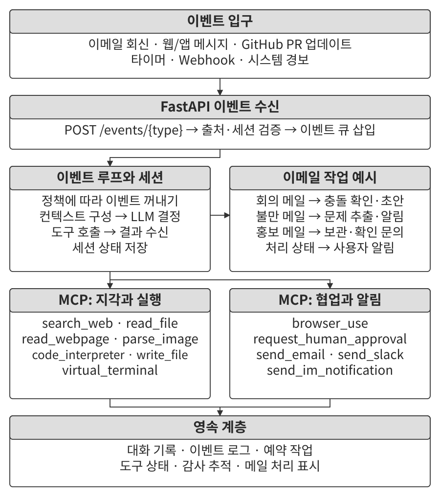
>
> 같은 큐에 여러 출처를 더할 수 있습니다. 메일 도착, IM이나 SMS 메시지, GitHub PR과 이슈 갱신, 타이머, 외부 Webhook, 그리고 사용자 오프라인, 프로세스 타임아웃, 자원 경보 같은 내부 이벤트입니다. 어댑터마다 출처를 검증하고 연관 정보를 보충하며, 처리 결과는 이벤트 식별자를 기준으로 다시 기록합니다.
>
> 인수 검사에는 테스트 메일 세 통을 씁니다. 회의 초대는 일정 충돌 확인을 일으키고 수락이나 거절 초안을 만듭니다. 고객 불만은 핵심 정보 추출, 높은 우선순위 표시, 사용자 알림을 일으킵니다. 마케팅 메일은 규칙에 따라 보관합니다.
>
> 현재 함께 제공되는 기록은 인터페이스 문서 확인과 인증 탐색까지 마쳤고, 테스트 메일함 연결은 유효한 자격 증명을 기다리고 있습니다.
>
> **확장(선택): 다중 출처 인그레스와 장애 주입.** 테스트 메일함 외에 로컬 Webhook 엔드포인트 하나와 SQS 큐 하나(로컬 모의로 대신해도 됩니다)를 더 연결합니다. 어댑터마다 출처를 검증하고 봉투를 만들어 인그레스 로그에 쓴 뒤 출처에 확인을 돌려줍니다. 런타임은 로그에서 이벤트를 읽어 스레드 순서대로 처리합니다. 그런 다음 세 종류의 장애를 주입합니다.
>
> 1. **중복 전달.** Webhook 엔드포인트가 같은 전달 ID로 요청을 두 번 받아도, 로그에는 이벤트가 하나만 나타납니다.
> 2. **확인 전 충돌.** 어댑터가 로그에 쓴 뒤, SQS 메시지를 삭제하기 전에 종료됩니다. 메시지가 다시 보이게 되어 한 번 더 읽힌 뒤에도 로그에는 여전히 이벤트가 하나만 있습니다.
> 3. **수신 확인 전 충돌.** 런타임이 답장을 보낸 뒤, 수신 확인을 기록하기 전에 종료되고, 재시작 후 로그를 재생합니다. 채널이 멱등 키를 지원하거나 보낸 메시지를 조회할 수 있으면(예컨대 메일함의 보낸 편지 기록), 같은 답장을 다시 보내지 않습니다. 둘 다 없는 채널이라면 이 답장을 사람의 확인이 필요한 항목으로 표시할 수밖에 없습니다.
>
> 세 종류의 장애는 모두 로그에 기록을 남겨야 합니다. 어느 전달이 중복 제거됐는지, 어느 메시지가 다시 읽혔는지, 어느 답장이 확인을 거쳐 다시 보내지지 않았는지입니다.
>
> 이 확장의 예제 코드는 오프라인으로 실행할 수 있고 API 키가 필요하지 않습니다. 테스트 메일함과 SQS 큐는 모두 로컬 파일로 모의하며, 위에서 자격 증명을 기다리는 실제 메일함과는 별개입니다. 모의 큐는 가시성 타임아웃, 수신 핸들, 메시지 그룹 내 순서를 그대로 유지합니다. 충돌은 부모 프로세스가 지정된 위치에서 자식 프로세스를 직접 종료하는 방식으로 만듭니다. 답장 채널은 각각 한 가지 방식을 시연합니다. 메일은 보낸 편지 기록을 조회하고, 앱 대화는 멱등 키를 쓰며, SMS는 둘 다 없습니다. 재현하려면 `chapter6/agent-with-event-trigger`로 들어가 `python multisource_demo.py`를 실행하면 됩니다. 터미널에 세 종류의 장애가 남긴 로그 기록이 항목별로 출력됩니다. 함께 제공되는 실행 기록에서 세 종류의 장애 검사는 모두 통과했습니다.
>

메일 큐는 순차 처리의 기초를 마련했습니다. 이제 오래 실행되는 도구를 더해, 기다리는 동안 새 요구를 받고, 작업을 취소하고, 작업을 재개하는 방법을 살펴봅니다.

### 네이티브 비동기를 지원하지 않을 때의 호환 방식

에이전트가 메일 초안을 쓰다가 연락처를 찾으려고 `search_contacts`를 이미 호출했다고 합시다. 결과가 돌아오기 전에 사용자가 “잠깐, 먼저 내일 날씨를 알아봐 줘”라고 합니다. 현재 모델 인터페이스가 도구 호출마다 결과를 먼저 갖추라고 요구한다면, 하네스는 백그라운드 상태를 인터페이스가 받아들이는 메시지 순서로 바꿔야 합니다.

**동기 메시지 형식으로 백그라운드 상태 표현하기.**

**동기 인터페이스와 호환할 때는 정상 호출과 실제 결과의 짝을 최대한 유지하고, 도중에 작업을 전환할 때만 상태 응답을 채워 넣어야 합니다.** 호출마다 너무 일찍 “아직 실행 중”을 채우면 궤적이 미완료 상태로 가득 차, 모델이 실제 결과를 추적하는 부담이 커집니다. 구체적으로는 다섯 가지 규칙을 따를 수 있습니다.

1. **완전한 호출을 기록합니다.** API에서 완료된 assistant 메시지와 도구 호출 항목을 궤적에 쓰고, 호출 식별자를 보존합니다. 서버 측 추론 상태는 제공자가 정한 이어 가기 방식에 따라 저장합니다.
2. **실제 완료를 기록합니다.** 도구가 끝나면 실제 결과, 작업 식별자, 실행 상태를 씁니다. 실행 중에는 작업 관리자가 미완료 상태를 계속 보관합니다.
3. **전환할 때 현재 상태를 보고합니다.** 이런 결과 페이로드를 허용하는 인터페이스라면, 대기 중인 호출에 “작업이 아직 백그라운드에서 실행 중이며 결과는 아직 나오지 않았습니다” 같은 명확한 상태 정보를 돌려준 뒤 사용자 이벤트를 덧붙일 수 있습니다. 상태 응답에 담긴 작업 식별자가 이후의 완료 통지와 연결됩니다.
4. **중단 후의 메시지를 정리합니다.** 도중에 이어 가는 능력이 없다면, 미완료 생성을 취소하고 완료가 확인된 메시지와 도구 상태를 보존한 뒤 새 요청을 제출합니다. 미완료 출력은 인터페이스 규정에 따라 처리해, 반쯤 만들어진 파라미터를 실행 가능한 호출로 취급하지 않게 합니다.
5. **일상 이벤트는 묶어서 받습니다.** 보충 정보는 큐에 넣었다가 현재 주기가 끝나거나 지정된 안전 지점에서 한꺼번에 제출하고, 어떤 이벤트를 처리했는지 기록합니다.

연락처 조회 예에서는 완전한 호출이 먼저 궤적에 기록됩니다. 사용자가 작업을 전환하면, 하네스는 조회가 아직 실행 중이라는 상태 응답을 채워 넣고 날씨 요청을 제출합니다. 연락처 결과는 나중에 도착해 출처와 작업 식별자를 단 새 이벤트로 컨텍스트에 들어가고, 에이전트는 이어서 메일 초안을 씁니다. 원래 호출이 이미 상태 응답을 받았으므로, 이후 결과는 어댑터가 약속한 이벤트 형식을 따라 호출과 결과의 짝 관계를 유지합니다.

상태 응답은 현재 실행 진행 상황만 알려 줄 뿐입니다. 연락처 데이터에 의존하는 단계는 실제 결과가 도착해야 이어 갈 수 있습니다. 작업 관리자는 `running`, `completed`, `cancelled`, `failed` 같은 상태를 보관하고, 답장을 보내거나 다음 도구를 실행하기 전에 의존 조건이 충족됐는지 확인할 수 있습니다.

**작업 핸들로 비동기 도구 설계하기.**

새로 설계하는 장기 작업 도구라면, 필자는 “시작”을 하나의 완결된 조작으로 정의하고 실제 작업 핸들을 즉시 돌려주는 방식을 우선합니다. 모델은 이를 근거로 “이미 시작됨”과 “이미 완료됨”을 구분하고, 이후의 조회, 취소, 결과 이벤트도 같은 연결 근거를 갖게 됩니다. 예를 들어 `initiate_phone_call`은 전화 작업을 시작하고 작업 식별자와 “전화 거는 중” 상태를 돌려줍니다. `phone_call_connected`와 `phone_call_ended`는 각각 연결과 종료를 보고합니다.

도구 설명에는 이렇게 분명히 써야 합니다. “이 도구는 전화 작업을 시작하며, 성공하면 작업 ID를 돌려줍니다. 다른 일을 계속 처리해도 됩니다. 통화 진행과 종료 결과는 별도의 이벤트로 돌아옵니다.” 도구 이름은 이것이 시작 조작임을 알려 주고, 반환 구조와 이후 이벤트는 작업이 어떻게 진행되고 끝나는지 알려 줍니다. 시스템은 작업 ID로 조회, 취소, 재개하는 인터페이스도 제공해, 모델이 지금 무엇을 할 수 있는지 알 수 있게 합니다.

**묶음 이벤트를 항목별로 처리하기.**

여러 이벤트가 한꺼번에 컨텍스트에 들어오면, 모델은 마지막 것에만 답하고 앞에서 이미 제시된 요구를 빠뜨릴 수 있습니다. 런타임은 각 이벤트의 처리 상태를 따로 유지해, 아직 답하지 않은 조건이 계속 보이게 해야 합니다. 프롬프트로 모델에게 항목별 확인을 요구하고, 상태 표시줄에는 아직 처리하지 않은 정보를 나열할 수 있습니다.

```text
[미처리 이벤트 1/4] database_query 결과: ……
[미처리 이벤트 2/4] 사용자 보충: 베이징 지역 데이터만 보기
[미처리 이벤트 3/4] 시스템 알림: 보고서 마감까지 30분 남음
[미처리 이벤트 4/4] 사용자 질문: 진행 상황은 어떤가요?
```

묶음 요약은 “도구 결과 1개, 사용자 메시지 2개, 시스템 알림 1개”라고 알려 줄 수 있습니다. 런타임은 나아가 이벤트를 작업 제약과 연결합니다. 지역 조건은 조회 범위를 갱신하고, 마감 시간은 스케줄링에 영향을 주며, 진행 상황 질문에는 답이 필요합니다. 처리한 뒤에는 완료, 대기, 확인 필요 같은 상태를 기록하고, 다음 턴에도 해결되지 않은 항목은 계속 남겨 둡니다.

같은 작업 번호가 시작, 진행 보고, 마지막 실행 결과를 하나로 꿰어 줍니다. 도중에 누군가 중지를 요구했다면, 이 번호 아래에 취소 회신이 있는지도 다시 확인해야 합니다.

> **실험 6-2 ★★★: 병렬 실행과 중단 기능을 갖춘 비동기 에이전트**
>
> 이 실험은 먼저 비동기 런타임을 검증한 뒤, 모델을 연결해 결정을 점검합니다. 함께 제공되는 실행 기록은 실제 운영 체제 자식 프로세스로 네 가지 시나리오를 수행했으며, 이벤트 스케줄링과 보고는 결정적인 스크립트가 구동합니다.
>
> 1. **백그라운드 실행과 즉시 응답.** 몇 초 동안 이어지는 분석 프로세스를 시작하고 즉시 작업 식별자를 돌려줍니다. 기다리는 동안 현재 시각을 답하고, 끝나면 분석 결과를 받습니다.
> 2. **큐와 묶음 처리.** 긴 작업이 도는 동안 “일본어로 답해 줘”와 “웹페이지로 정리해 줘”를 차례로 덧붙입니다. 작업이 끝나면 결과와 두 요구를 한 묶음으로 처리합니다. 스크립트는 일본어 HTML을 만듭니다.
> 3. **취소와 재개.** “분석 중지”를 받으면 아직 생성 중인 모델 턴을 끊고, 실행 중인 모든 백그라운드 작업에 정지를 요구하는 과정을 시연합니다. 이번에는 스크립트가 중단을 보냈고, 그때 분석 프로세스는 T1 하나뿐이었습니다. 0.803초에 중단 이벤트가 T1의 진행률을 18%로 기록했고, 0.806초가 되어서야 시스템이 종료 코드 −15를 기록했습니다. 곧이어 시작된 T2는 새 작업입니다. 4.436초에 받은 것은 T2의 결과이며, T1은 완료 콜백을 일으키지 않았습니다.
> 4. **병렬 작업과 진행 판단.** 분석 프로세스 세 개를 동시에 시작해, 논리 시간 단계마다 각각 3%, 2%, 1%씩 진행시킵니다. 이 실험의 병렬 진행 기록에서 가장 빠른 T1이 끝났을 때, 조회 회신은 T2가 68%, T3가 34%에 이르렀음을 보여 주었습니다. 그림 6-5를 따라가면 진행률이 50%를 넘지 않은 작업은 취소됩니다. 스크립트는 T3만 취소했고, 마지막에 T1과 T2의 결과를 받았습니다. 같은 런타임이 묶음 전체의 정지에 응답하면서도, 아직 쓸모 있는 병렬 작업은 남겨 둘 수 있음을 보여 줍니다.
>
> 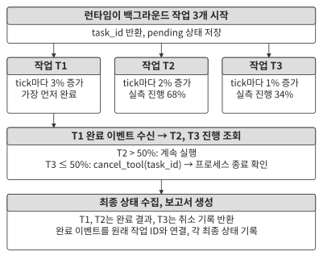
>

### 모델의 네이티브 비동기: GPT-6 Astra

앞의 방식에서는 하네스가 동기 메시지 형식에 맞춰 조정했습니다. 네이티브 비동기 인터페이스는 도구가 아직 돌아오지 않은 동안에도 모델이 독립적인 작업을 계속 처리하고, 나중에 결과를 받도록 직접 허용합니다. 2026년 9월 현재 GPT-6 Astra는 비동기 도구 호출(Async tool calling)과 턴 도중 지시 변경(Mid-turn steering)을 제공해, 각각 도구 대기와 사용자 갱신을 처리합니다. 그림 6-6은 동기 인터페이스 호환 방식과 네이티브 비동기의 메시지 흐름을 대조합니다.[^ch6-22][^ch6-23]

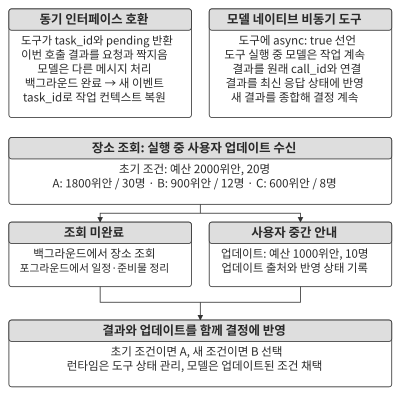

**도구를 기다리는 동안 독립적인 작업을 계속합니다.** 예를 들어 에이전트는 회의 장소 조회를 시작한 뒤 먼저 의제와 준비 목록을 정리하고, 조회가 돌아오면 가격과 수용 인원을 비교할 수 있습니다. 도구 정의의 `async: true`가 비동기 능력을 선언하고, 애플리케이션은 완전한 호출 항목을 받으면 실행을 시작하며 호출 식별자 `call_id`를 저장합니다. 결과가 도착하면 애플리케이션은 원래 식별자로 결과를 돌려주고 최신 응답 상태를 이어 갑니다. 모델은 이후 작업을 배치하고, 하네스는 호출의 연결 관계와 작업 수명 주기를 관리합니다.[^ch6-22]

**작업 진행 중에 새 요구를 받습니다.** 사용자는 모델이 생각하거나 답을 구성하는 동안 “예산을 1000으로 낮춰 줘”, “참석 인원을 10명으로 바꿔 줘”라고 덧붙일 수 있습니다. 애플리케이션은 같은 연결로 지시 변경 이벤트를 보내고, 서버는 수신을 확인한 뒤 현재 응답 상태에 따라 처리를 이어 갑니다. 연결이 끊겼다가 다시 이어지면, 애플리케이션은 저장해 둔 이벤트와 응답 상태로 작업을 복구할 수 있습니다.[^ch6-23]

두 능력은 함께 쓸 수 있습니다. 장소 조회는 계속 돌고, 사용자의 새 요구는 이후 결정에 반영되며, 조회 결과가 돌아오면 선택을 마칩니다. 실행기는 동시에 백그라운드 작업의 실제 상태를 관리합니다. 조회를 멈추거나 예약을 취소해야 하면, 하네스는 해당 인터페이스를 호출하고 회신을 확인합니다. 이미 완료된 업무 조작은 철회나 보상 절차로 넘어갑니다.

모델과 인터페이스가 이미 네이티브 비동기를 지원한다면, 필자는 네이티브 프로토콜을 우선 사용해 도구 대기, 사용자 갱신, 응답 이어 가기가 인터페이스의 약속대로 흐르게 합니다. 동기 호환 계층은 주로 기존 모델과 오래된 인터페이스를 위한 것입니다. 모델을 업그레이드하면 메시지 짝을 맞추는 데만 쓰이던 호환 로직을 차차 걷어 내고, 공학적 노력을 작업 상태, 취소, 재개에 집중할 수 있습니다.

### 비동기 작업을 신뢰성 있게 처리하기

신뢰할 수 있는 비동기 상호작용을 위해서는 메시지, 작업, 실행 상태를 함께 확인해야 합니다.

1. **결과의 귀속.** 늦게 온 결과는 원래 호출 식별자를 지니고, 애플리케이션은 이를 해당 작업에 매핑합니다. 그 결과에 의존하는 결정은 데이터가 도착한 뒤에 이어 갑니다.
2. **재개와 취소.** 사용자가 요구를 바꾸면 시스템은 여전히 유효한 작업을 남기고, 이후 단계를 갱신하며, 어떤 백그라운드 작업이 계속 돌고 어떤 작업이 멈췄는지 분명히 합니다.
3. **여러 요구.** 예산, 인원, 지역, 마감 시간은 각각 작업 상태에 들어가고, 최종 결과는 이 조건들을 항목별로 확인합니다.

> **실험 6-3 ★★★: 모델의 네이티브 비동기와 턴 도중 지시 변경**
>
> 이 실험에서는 에이전트가 모의 회의를 위해 예산과 인원 조건을 만족하는 가장 싼 장소를 고릅니다. 초기 예산은 2000, 인원은 20명입니다. 조회 도구는 8초를 기다린 뒤에야 세 장소의 견적과 수용 인원을 돌려줍니다.
>
> | 장소 | 가격 | 수용 인원 |
> |---|---:|---:|
> | A | 1800 | 30 |
> | B | 900 | 12 |
> | C | 600 | 8 |
>
> 초기 조건에서는 A를 골라야 합니다. 지시 변경 그룹은 작업 진행 중에 두 가지 갱신을 받습니다. 예산을 1000으로, 인원을 10명으로 바꾸는 것이며, 이때는 B를 골라야 합니다. 도구는 새로 생성한 회신 번호도 함께 돌려주며, 최종 답에 이를 인용하게 해 모델이 실제로 도착한 결과를 썼는지 확인합니다.
>
> 실험은 다섯 그룹이며 그룹마다 세 번씩 실행합니다. 동기 도구, 네이티브 비동기 도구, 추론 중 지시 변경, 비동기 도구 대기 중 지시 변경, 그리고 지시 변경을 지원하지 않는 모델의 대조군입니다. 앞의 두 그룹은 기다리는 동안 독립적인 준비 목록을 내놓을 수 있는지 비교합니다. 두 지시 변경 그룹은 예산과 인원이 동시에 반영되는지 확인합니다. 능력 대조군은 인터페이스가 지원하지 않는다는 사실을 명확히 보고하는지 확인합니다.
>
> 저장된 실행 기록에서 비동기 도구 그룹은 기다리는 동안 독립 목록을 완성했고, 두 지시 변경 그룹은 모두 새 조건에 따라 B를 골랐습니다. 도구를 쓴 실행은 모두 조회를 한 번만 수행했고, 실제 결과를 원래 호출에 돌려주었습니다. 대조 모델의 인터페이스는 한 번의 생성 도중에 새 요구를 받을 수 없다고 명확히 답했습니다. 동기 그룹과 비동기 그룹의 총소요 시간은 비슷했고, 주된 차이는 기다리는 동안 다른 작업을 진행할 수 있는가에 있었습니다.
>
> 모델이 인원이 10명으로 바뀐 것만 기억하고 여전히 예전 예산 2000으로 고른다면 어디를 고를까요? A와 B 모두 인원을 수용할 수 있고, 가장 싼 곳은 여전히 B입니다. 따라서 장소를 맞게 골랐다는 것만으로는 예산이 갱신됐는지 알 수 없습니다.
>
> 인원이 바뀌었다면 이미 보낸 조회를 다시 해야 할까요? 이 실험의 도구에는 필터 파라미터가 없어 세 장소를 모두 돌려줍니다. 어시스턴트는 아직 오고 있는 결과를 그대로 쓰고, 결과가 돌아오면 10명, 예산 1000으로 걸러 내면 됩니다. 도구가 20명 이상을 수용하는 장소만 돌려준다면, 예전 결과에는 A만 있고 12명을 수용하는 B는 아예 들어 있지 않습니다. 이때 예전 목록에서 인원만 10명으로 바꿔도 여전히 B를 놓칩니다. 원래 조회가 이미 B를 걸러 냈다면 다시 조회해야 합니다.

비동기 메커니즘은 작업이 진행되는 동안에도 외부 변화가 시스템에 들어올 수 있게 합니다. 음성, 화면, 로봇 상호작용은 피드백 주기를 더 줄입니다. 시스템은 입력을 연속으로 받으면서 적절한 시점에 출력과 행동을 조정해야 합니다.

## 음성: 가장 자연스러운 인간-기계 인터페이스

음성은 사용자가 두 손이나 시선이 다른 일에 묶여 있을 때도 에이전트에게 요구를 설명하고, 조건을 보충하고, 결과를 확인하게 합니다. 음성 입력기는 받아쓴 말을 텍스트로 바꾸고, 음성 에이전트는 한 걸음 더 나아가 대화와 도구 호출, 답변 재생을 관리합니다. 둘 다 서문에서 소개한 whisper coding을 지원할 수 있습니다.

이 절은 두 가지 용도를 다룹니다. 사용자가 에이전트와 직접 대화하는 경우, 그리고 에이전트가 사용자를 대신해 외부 사람과 소통하는 경우입니다. 앞의 경우는 인식, 응답, 끼어들기가 핵심이고, 뒤의 경우는 통화 도중 본인 확인, 업무 조회, 의사결정까지 마쳐야 합니다.

### 상호작용 타이밍: 캐스케이드에서 풀 듀플렉스로

OpenAI는 GPT-Live 소개에서 캐스케이드, 턴 기반 오디오 모델, 풀 듀플렉스라는 세 가지 음성 상호작용을 되짚었습니다[^ch6-12]. 이 진화 경로는 “언제 입을 열고 언제 계속 들을지”를 모델이 지속적으로 판단하게 하는 방향으로 나아갑니다. 캐스케이드 시스템은 주로 엔드포인트 로직이 발화권 인계를 배치하고, 풀 듀플렉스 모델은 연속된 소리와 대화 상태를 함께 보고 겹침, 멈춤, 끼어들기를 처리합니다.

| 패러다임 | 핵심 구조 | 구현하기 쉬운 능력 | 주된 설계 문제 |
|---|---|---|---|
| 캐스케이드 | VAD, ASR, LLM, TTS의 분업 | 모듈을 따로 교체하고, 입력과 출력을 구간별로 점검 | 모듈 간 지연, 전사 과정에서 빠지는 음향 정보 |
| 턴 기반 엔드투엔드 오디오 모델 | 모델이 오디오를 직접 받고 생성 | 억양, 감정 같은 정보를 활용한 답변 구성 | 발화 종료 판단, 턴 전환과 응답 시점 |
| 풀 듀플렉스 | 오디오를 계속 받으면서 출력을 생성 | 겹쳐 말하기, 맞장구, 끼어들기와 연속 상호작용 | 연속 상태, 출력 제어, 상호작용 평가 |

모델이 오디오를 직접 처리하는지, 입출력이 스트리밍인지, 동시에 듣고 말할 수 있는지는 따로 점검할 수 있는 능력입니다. 캐스케이드 시스템에도 스트리밍 모듈과 끼어들기 제어를 더할 수 있고, 엔드투엔드 모델의 상호작용 리듬은 구체적인 설계에 달려 있습니다.

[^ch6-12]: OpenAI, *Introducing GPT-Live*, 2026-07-08, 캐스케이드, 턴 기반 오디오 모델, 풀 듀플렉스 상호작용을 소개합니다.

### 패러다임 1 · 캐스케이드 파이프라인(Cascading)

캐스케이드 시스템은 음성 대화를 몇 개의 모듈로 나눕니다. 음성 활동 감지(VAD)가 오디오에서 발화 구간을 찾아내고, 엔드포인트 로직이 이 구간을 언제 넘길지 정합니다. 자동 음성 인식(ASR)은 오디오를 텍스트로 바꾸고, LLM은 요청을 이해해 답을 만들며, 음성 합성(TTS)이 그 답을 재생 가능한 오디오로 바꿉니다. 그림 6-7은 순서대로 실행되는 기본 구조를 보여 줍니다.

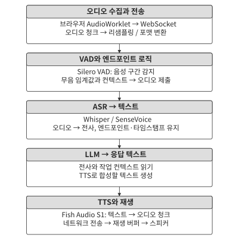

음향 VAD는 누군가 말하는 구간을 찾아내므로, 이후 인식이 긴 침묵을 건너뛸 수 있습니다. 그런데 같은 멈춤이라도 “예약하고 싶은데……” 뒤에 오는 것과 “목요일 오전에 자리 있나요?” 뒤에 오는 것의 의미는 다릅니다. 의미 VAD(의미 엔드포인트 감지)는 앞의 경우에는 계속 소리를 받고, 뒤의 경우에야 대화 모델에 말을 넘깁니다. 이것이 음성 관측을 시간 축에서 희소화하는 일입니다. 연속된 소리 가운데 몇 안 되는 순간에만 추론이 일어납니다. 입을 열지는 이 말을 들은 모델이 정하며, 모델은 계속 들을 수도 있고 먼저 항공편을 조회할 수도 있습니다.

| 모듈 | 역할 | 흔한 대기나 오류의 원인 |
|---|---|---|
| VAD와 엔드포인트 로직 | 음성을 감지하고 넘길 시점을 정한다 | 침묵 임계값, 잡음, 말 중간의 멈춤 |
| ASR | 오디오를 텍스트로 변환한다 | 디코딩 소요 시간, 인명과 고유명사 인식 |
| LLM | 이해하고 추론해 답을 생성한다 | 요청 대기열, 첫 구간 답변 생성 |
| TTS와 재생 | 오디오를 합성해 스피커로 보낸다 | 첫 패킷 합성, 네트워크 전송, 재생 버퍼 |

완전히 직렬인 구현에서는 사용자가 말을 마친 뒤에도 엔드포인트 확인, 전사, 답변 생성, 첫 구간 오디오를 차례로 기다려야 합니다. 그림 6-8의 예에서 사용자가 첫 답변을 듣기까지 1.4초가 걸렸고, 그 가운데 가장 긴 구간은 시스템이 사용자가 말을 마쳤다고 확인하는 데 걸린 500밀리초였습니다. 전사를 100밀리초에서 50밀리초로 줄여도 사용자가 덜 기다리는 시간은 50밀리초뿐입니다.

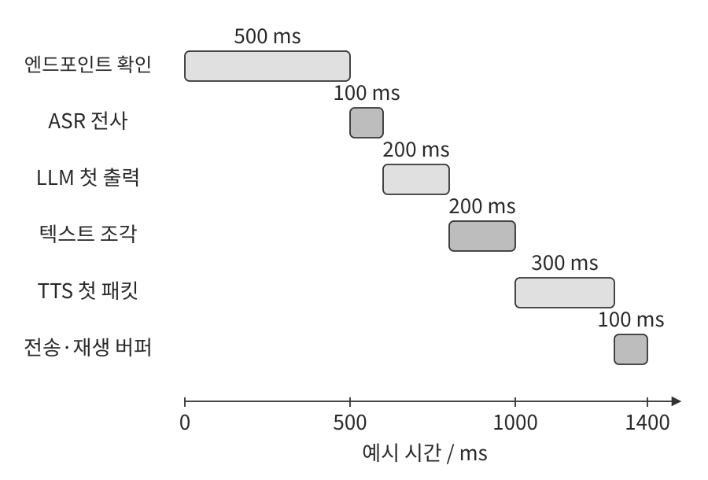

서비스 부하도 대기 시간을 만듭니다. 그림 6-9는 M/M/1 단일 서버 모델로 이 관계를 설명합니다. 도착이 푸아송 과정을 따르고 서비스 시간이 지수 분포를 따르며 평균 서비스 시간이 $S$이고 이용률이 $\rho<1$일 때, 서비스와 대기를 합친 평균 총시간은 $W=S/(1-\rho)$입니다. $S=1$초로 두고 이용률을 0.5에서 0.8로 올리면 평균 총시간은 2초에서 5초로 늘어납니다. 서비스 자체는 여전히 평균 1초를 차지하고, 늘어난 3초는 모두 대기에 쓰입니다. 요청이 처리 용량에 가까워지면 짧은 트래픽 변동만으로도 적체가 생깁니다.

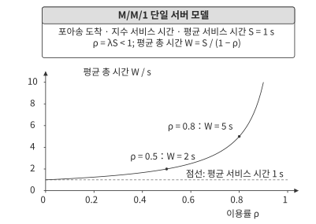

> **실험 6-4 ★: 전통적인 음성 에이전트 구축**
>
> 어시스턴트가 목요일 항공편을 안내하고 있다고 합시다. 사용자가 “잠깐, 금요일로 예약할래”라고 정정하며 입을 엽니다. 브라우저는 WebSocket으로 마이크 오디오를 백엔드로 보냅니다. Silero VAD가 발화 시작을 감지하는 순간 백엔드가 `speech_start`를 보내고, 브라우저는 곧바로 재생을 멈추고 대기 중이던 예전 오디오를 비웁니다. 이 시점에 어시스턴트는 사용자가 어느 요일로 바꿨는지 아직 모릅니다. 사용자가 말을 마치고 침묵이 기본값인 500밀리초를 넘기면, 백엔드가 `speech_end`를 보내고 이 구간의 음성을 로컬 Whisper tiny로 전사합니다.
>
> Doubao가 텍스트를 돌려주기 시작하는데, 사용자가 답을 듣기까지는 얼마나 걸릴까요? 한 번의 녹음 재생 기록에서 전사에 2.710초가 걸렸습니다. Doubao는 요청을 보낸 뒤 0.749초에 첫 토큰을 돌려주고, 0.792초에야 완전한 답변을 돌려주었습니다. 재생 프로그램은 텍스트를 모두 모은 뒤에야 Fish S1에 합성을 맡겼고, 다시 2.819초가 지나 백엔드가 첫 오디오 묶음을 받았습니다. 엔드포인트 판정 이후를 기준으로 이 세 구간을 직렬로 더하면 약 **6.321초**입니다. 보관된 보고서에는 6.279초로 적혀 있는데, 이는 답변 전체를 생성하는 시간 대신 첫 토큰 시간을 쓴 값입니다.
>
> 이 6.321초는 백엔드 처리만 포함합니다. 사용자는 먼저 침묵 감지가 문장이 끝났다고 판정할 때까지 기다려야 하고, 마지막으로 오디오가 브라우저에 도착해 재생을 시작할 때까지 기다려야 합니다.

#### 직렬에서 스트리밍 지각으로

직렬 방식은 구간별로 점검하기 쉽지만 세 가지 문제를 드러냅니다. 침묵을 기다리면 엔드포인트 지연이 늘고, 전사 텍스트는 어조와 감정, 환경음을 빠뜨릴 수 있으며, 멈춤으로 오디오를 자를 때 메일 주소나 인명, 고유명사가 온전한 문맥을 잃을 수 있습니다. 이미 캐스케이드 구조를 쓰고 있는 시스템이라면 필자는 먼저 스트리밍 개조를 권합니다. 각 단계가 증분 결과를 최대한 일찍 내놓게 하고, 인식과 추론과 재생을 겹치며, 이미 확정된 부분과 아직 바뀔 수 있는 부분을 함께 관리하는 것입니다. 이렇게 하면 기존 모듈을 재사용하면서 대기 시간이 어디서 나오는지 차례로 짚어 낼 수 있습니다.

- **ASR은 들으면서 전사합니다.** 오디오를 계속 받아 임시 전사를 내놓고, 이후 오디오가 도착하면 불안정한 부분을 고치며, 엔드포인트가 확정되면 최종 텍스트를 제시합니다.
- **LLM은 추측 실행합니다.** 임시 전사로 답변을 미리 준비합니다. 최종 텍스트가 확정되면 입력이 같은지, 이미 한 작업이 여전히 유효한지 확인한 뒤 유지할지 조정할지 다시 생성할지 정합니다. 외부 발송이나 업무 기록 같은 조작은 필요한 조건이 확인된 뒤에 실행합니다.
- **LLM은 나눠서 출력합니다.** 낭독에 알맞은 텍스트 한 구간이 완성되면 곧바로 TTS에 넘기고, 나눌 때 문장 의미와 문장 부호, 억양 단서를 유지합니다.
- **TTS는 증분 합성합니다.** 오디오 블록이 차례로 돌아와, 이후 텍스트 생성과 합성, 재생이 겹칠 수 있습니다. 끼어들기가 생기면 생성 작업과 재생 버퍼에 아직 나가지 않은 내용을 함께 처리합니다.

Whisper의 일반적인 전사 구현은 오디오 창 단위로 인코딩과 디코딩을 합니다[^ch6-whisper]. 외부에서 오디오를 잘라 넣거나 누적된 접두부를 반복 제출하면 증분 전사 흐름을 만들 수 있지만, 지속 상태의 재사용, 중복 인코딩 비용, 이전 텍스트의 수정은 구체적인 구현이 관리해야 합니다. 네이티브 스트리밍 인식 모델은 아키텍처와 학습에서 연속 입력을 직접 다룹니다.

오디오 언어 모델에 기반한 지각 시스템은 텍스트와 음향 이벤트를 함께 내놓을 수 있습니다. 이전 오디오와 전사, 어휘 힌트는 인명과 브랜드, 고유명사를 식별하는 데 도움이 되며, 이전 오디오를 얼마나 남길지는 컨텍스트와 캐시 설계에 달려 있습니다. “사용자가 말을 마쳤는가”는 모델이 의미의 완결성과 침묵을 함께 보고 판단할 수 있습니다. “예약하고 싶은데……”에서 말이 멈췄을 때 실시간 시스템이 들은 것은 이 말뿐이고, 뒤에 날짜가 이어질지는 아직 알 수 없습니다.

전사 외에도 인터페이스는 다음 이벤트를 약속할 수 있습니다. `speak_start`와 `speak_end`는 발화의 시작과 끝을, `interrupt`는 끼어들기를, `emotion`은 감정 상태를, `laugh`, `sigh`, `noise`는 웃음과 한숨, 환경음을 기록합니다. 이 이벤트들은 텍스트와 타임스탬프와 함께 에이전트에 전달할 수 있습니다.

> **실험 6-5 ★: Qwen2-Audio로 스트리밍 음성 지각 시뮬레이션하기**
>
> 이 실험은 오디오 접두부를 점차 늘려 가며, 매번 처음부터 현재까지의 오디오를 Qwen2-Audio에 다시 넣고, 전사와 음향 이벤트가 입력에 따라 어떻게 달라지는지 관찰합니다. 대조 경로는 600밀리초 침묵 엔드포인트와 Whisper를 씁니다. 테스트에는 정상 음성, 900밀리초 멈춤을 끼워 넣은 긴 문장, 핑크 노이즈를 섞은 음성이 포함됩니다.
>
> 이번 로컬 양자화 모델 실행에서는 접두부 추론 13회를 기록했고, 한 번에 약 8~11초가 걸렸습니다. 중간 멈춤이 대조 경로의 분할을 일으켰고, 오디오 모델은 잡음을 검출하는 한편 기침과 웃음을 잘못 보고하기도 했습니다.

[^ch6-whisper]: OpenAI, Whisper, 오디오 창 단위 전사와 모델 구현을 소개합니다.

### 패러다임 2 · 엔드투엔드 전모달 모델(Omni)

엔드투엔드 오디오 모델은 소리를 직접 받아 언어 정보와 음향 정보를 함께 활용해 답을 만들고, 오디오 출력 가지로 음성을 합성합니다. 오디오를 직접 처리하면 말의 속도와 음높이, 멈춤, 환경음을 활용할 수 있습니다. 반대로 먼저 전사한 뒤 답하면 중간 텍스트를 점검하기 쉽고 모듈을 따로 교체할 수 있습니다.

이런 음향 특징은 이해에도 영향을 줍니다. 예를 들어 같은 문장 “점심 전에 보고서를 보내 주세요”도 급하게 말하는지 천천히 말하는지에 따라 듣는 사람이 받는 느낌이 다릅니다. 출력할 때도 모델은 멈춤과 강세, 억양으로 의미를 조직할 수 있습니다.

오디오를 직접 처리하는 시스템도 사용자가 말을 마칠 때까지 기다렸다가 답할 수 있습니다. 예를 들어 사용자가 전화번호를 부르다가 잠시 멈추면, 시스템은 이 숫자 열이 끝났는지 여전히 판단해야 합니다. 엔드포인트 감지가 언제 응답할지를 정하고, 상대가 낭독 도중에 끼어들면 시스템은 모델 생성과 스피커 재생을 조율해야 합니다.[^ch6-audio-architectures]

> **실험 6-6 ★★: MiniCPM-o 4.5를 로컬에서 실행해 엔드투엔드와 자체 캐스케이드 비교하기**
>
> 이 실험은 같은 MiniCPM-o 4.5 모델 하나를 고정하고 사고 모드를 끈 채 두 경로를 비교합니다. 오디오에서 곧바로 답하는 경로와, 모델이 먼저 전사한 뒤 전사문만으로 답하는 경로입니다. 입력에는 구술 산술 문제 두 개와, 문장은 같고 말의 속도만 다른 음성 두 개가 포함됩니다.
>
> 두 경로 모두 세 문제를 맞혔고, 틀린 위치는 서로 달랐습니다. 직접 오디오 경로는 한 문제의 twelve boxes를 8로 잘못 듣고 계산을 틀렸고, 전사 경로는 12를 정확히 남겼습니다. 말의 속도를 비교하는 문제에서 두 오디오는 모두 “Please send the report before lunch.”라고 말했고, 전사한 텍스트가 완전히 같아져 빠르고 느린 정보가 사라졌습니다. 직접 오디오 경로는 두 말의 속도를 제대로 구분했습니다.
>
> 실험은 입력 이해와 오디오 출력을 잇기 위해 24 kHz 음성도 하나 생성했습니다.

### 패러다임 3 · 풀 듀플렉스 상호작용 모델

풀 듀플렉스 시스템은 말하면서 동시에 듣습니다. 사람들이 가장 먼저 알아차리는 개선은 대화에서 살아 있는 사람 같은 느낌이 난다는 점입니다. “수요일로…… 아니, 목요일 표로 할게요”라는 문장을 생각해 봅시다. 가운데 멈춤이 이 자기 수정을 받아 줄 여유를 줍니다. 어시스턴트가 이미 수요일 항공편을 안내하기 시작했다면, “아니, 목요일”을 듣고 멈춰야 합니다. 또 다른 시점은 상대가 아직 일정을 설명하고 있을 때입니다. 짧고 가벼운 맞장구 한 번이면 어시스턴트가 듣고 있다는 것을 알릴 수 있습니다. 오디오를 계속 받아야만 발화와 경청, 멈춤, 도구 호출 사이에서 이런 선택을 할 수 있습니다. 동시통역도 입력과 출력이 겹쳐야 합니다.

Kyutai가 2024년에 공개한 **Moshi**는 사용자와 모델의 오디오 스트림을 따로 모델링하고, 병렬 스트림으로 겹쳐 말하기와 끼어들기를 표현합니다[^ch6-moshi]. 이런 시간 관계를 입력에 보존하면, 모델은 언제 응답하고 언제 계속 들을지 학습할 수 있습니다.

Thinking Machines Lab의 상호작용 모델은 연속된 입력과 출력을 같은 길이의 짧은 블록으로 자릅니다. 블록 하나가 200밀리초를 덮으며, 이를 마이크로 턴(micro-turn)이라고 합니다[^ch6-14]. 그림 6-10의 시간 축에서 두 번째 칸을 보세요. 어시스턴트가 아직 “목요일”의 “요일”을 말하고 있는데, 귓가에는 이미 사용자가 날짜를 고치는 “아니”가 들어옵니다. 세 번째 칸에 이르러 어시스턴트가 멈추고, 사용자가 “금요일”을 마저 말할 때까지 계속 듣습니다.

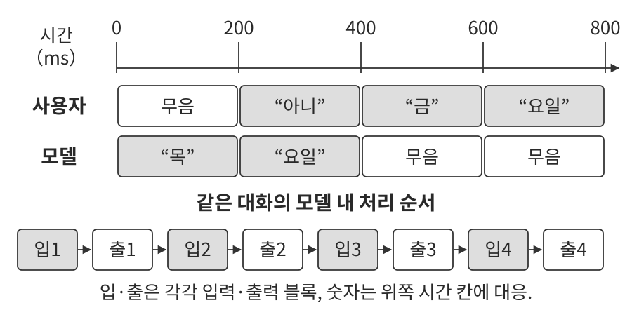

그림의 아래쪽 절반도 읽어 봅시다. 통화 양쪽이 듣는 것은 겹칠 수 있는 두 갈래의 소리이지만, 모델은 하나의 시퀀스를 따라 입력 블록과 출력 블록을 번갈아 처리할 수 있습니다. 침묵도 한 칸을 차지하므로, 어시스턴트는 잠시 듣다가 입을 열 수 있습니다. 그림의 200밀리초는 이 구현의 블록 길이이며, 사용자가 끼어든 순간부터 스피커가 실제로 멈출 때까지는 처리와 재생 버퍼에 드는 시간이 더해집니다.

[^ch6-moshi]: Kyutai, *Moshi: a speech-text foundation model for real-time dialogue*, 2024, 사용자와 모델의 병렬 오디오 스트림을 소개합니다.
[^ch6-14]: Thinking Machines Lab, *Interaction Models: A Scalable Approach to Human-AI Collaboration*, 마이크로 턴, 다중 스트림 상호작용, 백그라운드 작업 위임을 소개합니다.

### 인지 타이밍: 실시간 상호작용과 깊은 사고

Pine의 고객 상담 통화에서 상담원이 말을 하다 보면, 어시스턴트는 때로 기다려야 하고 때로는 가볍게 맞장구를 쳐야 합니다. 자기가 말하고 있을 때도 상대가 끼워 넣는 정정을 들어야 합니다. 필자가 Moshi 노선을 눈여겨보는 이유가 바로 이것입니다. 타이밍을 잘 잡아야 상대가 전화 이편에 정말 사람이 있다고 느낍니다. 자료를 찾아야 하는 요청에는 또 다른 시간 계산이 필요합니다. 질문을 알아듣고 찾은 답을 전하는 사이에 몇 번이나 손을 거쳐야 할까요?

포그라운드 음성 모델이 직접 호출할 수 있는 도구는 포그라운드가 호출합니다. 항공편 조회는 모델 호출 두 번이면 됩니다. 포그라운드가 사용자가 준 조건으로 조회하고, 결과를 보고합니다. 위임은 네 번 걸립니다. 포그라운드가 작업을 넘기고, 백그라운드가 조회를 시작하고, 백그라운드가 결과를 정리하고, 포그라운드가 전달합니다. 실시간 모델이 파라미터를 잘못 채울 수 있으니 백그라운드가 도구를 호출하고 포그라운드는 언제 듣고 언제 말할지에 집중하자는 주장도 있습니다.

GPT-Live-1의 포그라운드에는 업무 함수를 직접 호출하는 인터페이스가 없어, 백그라운드 에이전트에만 위임할 수 있습니다. OpenAI Realtime의 GPT-Realtime은 포그라운드의 직접 함수 호출을 지원합니다. Doubao 실시간 음성 모델 3.0(Seeduplex)도 순수 엔드투엔드 모드에서는 포그라운드의 직접 호출을 지원하며, 혼합 구성에서는 외부 언어 모델이 호출합니다.[^ch6-voice-tools]

포그라운드와 백그라운드 모델이 한 번 호출되는 데 각각 $L_f$와 $L_b$가 걸리고 도구가 $T$를 쓴다고 합시다. 사용자가 말을 마친 뒤 결과를 듣기까지 직접 호출은 약 $2L_f+T$, 위임은 약 $2L_f+2L_b+T$가 걸립니다. 위임에서 더해지는 $2L_b$는 도구 소요 시간 $T$와 무관합니다. 사용자 메모리처럼 매 턴 쓸 수 있는 정보는 런타임이 미리 조회해 컨텍스트에 넣어 둘 수 있고, 그러면 포그라운드는 모델을 한 번만 호출하면 되므로 약 $L_f+T$가 걸립니다. 사용자가 말을 꺼내기 전에 미리 조회해 두었다면 $T$도 아낄 수 있습니다.

여러 단계의 추론이 필요한 작업, 예컨대 몇 가지 변경안을 비교하는 일은 백그라운드에 맡기는 편이 알맞습니다. 항공권 예약은 결제와 발권을 수반하므로, 누가 도구를 호출하든 사용자가 확인한 뒤에 주문해야 합니다. 항공편 결과는 말로 개요를 전하고, 전체 표는 화면에 표시할 수 있습니다. 이는 누가 도구를 호출하는지와 무관합니다.

> **실험 6-7 ★★: 음성 에이전트의 도구를 포그라운드가 호출할까, 백그라운드가 호출할까**
>
> Doubao 실시간 음성 모델 3.0으로 포그라운드를 만들고, Volcengine Ark가 제공하는 DeepSeek V4 Pro로 백그라운드를 만듭니다. 날씨 조회, 사용자 메모리 조회, 웹 검색, 항공편 조회, 예약이라는 다섯 개의 모의 도구를 준비하고, 정해진 시간에 결과를 돌려주게 합니다. 이 가운데 항공편 조회와 예약은 2~5초를 기다려야 합니다. 사용자 녹음을 미리 합성해 두고, 매번 같은 시나리오의 녹음을 재생합니다.
>
> 네 가지 분업을 설정합니다. 첫째는 포그라운드가 모든 도구를 호출합니다. 둘째는 백그라운드가 모든 도구를 호출하고 포그라운드는 위임만 합니다. 나머지 둘은 포그라운드가 날씨를 조회하고, 런타임이 세션 시작 시 사용자 메모리를 컨텍스트에 넣으며, 백그라운드가 웹 검색과 예약을 맡습니다. 둘의 차이는 항공편 조회를 포그라운드가 맡는지 백그라운드가 맡는지입니다. 포그라운드는 사용자의 소리를 직접 듣고, 백그라운드는 소리를 듣지 못하고 텍스트만 읽습니다. Doubao 인터페이스는 사용자의 문장을 다 들은 뒤 음성 인식으로 얻은 텍스트, 곧 전사를 따로 돌려줍니다. 위임할 때는 전사와 어시스턴트가 한 말을 시간 순서대로 정리한 통화 기록에, 이번 통화에서 이미 실행한 도구 호출과 포그라운드가 쓴 작업 설명을 함께 붙여 백그라운드에 넘깁니다. 분업마다 다음 시나리오를 10번씩 반복해 테스트합니다.
>
> 1. 날씨와 항공편을 따로 조회합니다. 사용자가 말을 마친 시점부터 조회 결과를 듣는 시점까지 시간을 재고, “확인해 볼게요” 같은 중간 표현은 답으로 치지 않습니다. 직접 호출과 위임의 대기 시간 중앙값을 비교합니다. 필자의 실험에서 날씨 조회는 각각 2.81초와 6.96초였습니다.
> 2. 먼저 항공편을 조회한 뒤 좌석을 고르고 확인합니다. 직전 조회 결과, 사용자가 방금 한 말, 사용자 정보를 대조해 예약의 13개 필드를 항목별로 확인하고, 주문 시각이 사용자의 확인보다 늦는지 점검합니다. 필자의 실험에서 네 가지 분업 모두 필드를 모두 정확히 채웠고, 사용자가 확인한 뒤에 주문했습니다.
> 3. 동료를 위해 예약하는 상황으로 바꾸고, 한 글자씩 풀어 읽는 이름 녹음을 재생합니다. “陈嘉怡, 耳东陈, 嘉奖的嘉, 怡然的怡.”(중국어에서 이름 글자를 흔히 쓰는 단어에 빗대어 확인하는 방식입니다.) 녹음과 음성 전사, 주문의 이름을 대조해, 포그라운드의 직접 예약과 위임 예약이 모두 이름을 정확히 채웠는지 확인합니다. 필자의 실험에서 포그라운드 직접 예약은 10번 모두 맞혔습니다. 그러나 전사는 “陈嘉怡”를 “陈佳宜”로 적어, 위임할 때 이름을 잘못 채운 주문이 있었습니다.
> 4. 항공편 조회 결과가 돌아오기 전에 날씨를 묻는 녹음을 재생하고, 포그라운드가 날씨 질문에 답하는지, 이어서 항공편 결과를 보고하는지 듣습니다. 필자의 실험에서 날씨 질문에는 모두 답했지만, 원래의 항공편 결과는 거의 다시 나오지 않았습니다.

위임이 필요할 때 포그라운드는 확신 있는 이름과 숫자, 사용자가 방금 한 정정을 작업 설명에 적어, 백그라운드가 전사 오류로 파라미터를 잘못 채우지 않게 해야 합니다. 런타임은 아직 말하지 않은 결과를 기억해 두었다가, 포그라운드가 끼어든 질문에 답한 뒤 이어서 보고하게 해야 합니다.

빠른 모델이 “확인해 볼게요”라고 한마디 하면 상담원은 어시스턴트가 요구를 제대로 들었다는 것을 알 수 있습니다. 언제 운임을 전할 수 있는지는 조회와 추론을 통화에 어떻게 맞물리느냐에 달려 있습니다. 그림 6-11은 세 가지 배치를 보여 줍니다. 먼저 응답하고 나중에 깊이 답하기, 포그라운드가 계속 상호작용하며 백그라운드의 제안을 받기, 그리고 구상과 표현을 구간 단위로 병행해 나가기입니다.

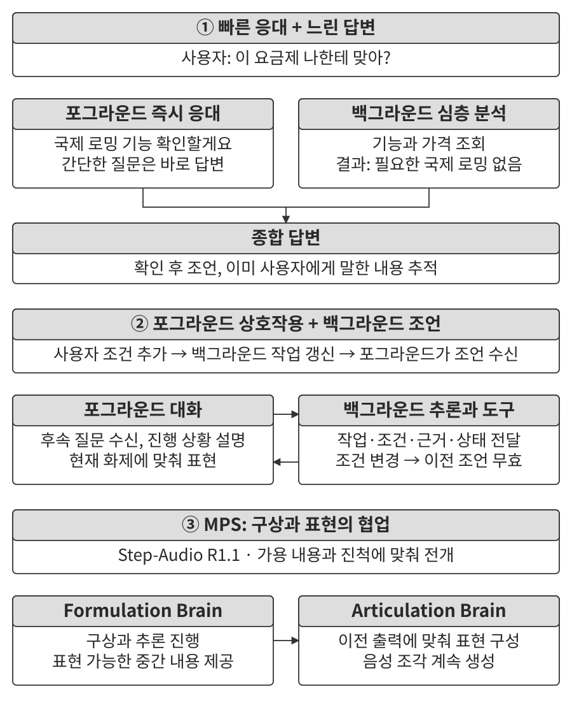

#### 방식 1: 빠른 사고로 응답하고, 느린 사고로 답하기

빠른 모델이 먼저 짧게 응답하고, 느린 모델이 백그라운드에서 분석을 마친 뒤 자세한 답을 덧붙입니다. 이 설계는 요청을 받았다는 사실을 일찍 확인시켜 주지만, 두 답변의 일관성을 관리해야 합니다. 예를 들어 빠른 모델이 어떤 요금제를 먼저 권했는데, 느린 모델이 그 요금제에 핵심 기능이 빠졌다는 것을 뒤늦게 발견하면 앞뒤 권유가 충돌합니다. 충돌의 뿌리는 양쪽이 따로 답한다는 데 있습니다. 판단 근거와 추론 진행이 서로 다를 수 있습니다. 빠른 모델이 말해 버린 권유는 이미 사용자의 판단에 들어갔고, 사용자는 그것에 따라 행동할 수도 있습니다. 느린 모델이 뒤늦게 바로잡으려면 변화를 설명하고, 이미 생긴 영향을 처리해야 합니다.

따라서 포그라운드는 작업 확인과 업무 결론을 구분해야 합니다. “이 기능이 요금제에 포함되는지 확인해 볼게요”는 즉시 말할 수 있지만, 구매 권유는 필요한 조회와 분석을 기다립니다. 백그라운드 결과가 돌아오면 시스템은 그것을 이미 말한 내용과 대조한 뒤 다음 답변을 구성합니다. 간단한 질문은 빠른 모델이 직접 끝내 중복 처리를 줄일 수도 있습니다.

#### 방식 2: 빠른 사고로 상호작용하고, 느린 사고로 조언하기

음성과 화면도 분업할 수 있습니다. “이번 달 청구서에 로밍 요금 15유로가 더 붙었어요”라고 말하면 사용자는 핵심을 곧바로 알아듣습니다. 원래 금액과 현재 가격, 이의 제기 내역은 화면에 남겨 두면 사용자가 자기 속도로 확인할 수 있습니다. 확정이 필요한 구체적 조작은 눌러서 고르게 하고, 민감한 정보는 상점이 승인한 입력 화면에서 사용자가 직접 채우게 합니다. 포그라운드는 “인증이 끝났습니다” 같은 상태만 받으면 자연스럽게 대화로 돌아옵니다.

여행객이 Pine에게 목요일 오전 상하이행 항공권을 예약해 달라고 한다고 합시다. 예산은 1200위안이고, 정오 전에 행사장에 도착해야 합니다. Pine은 항공사 상담원과 통화하면서 백그라운드에 “쪽지”를 건넵니다. “오전 열 시에 훙차오에 도착하면 공항에서 행사장까지 시간이 될까요?” 상담원이 잔여 좌석을 확인하고 Pine에게 알려 줍니다. “열 시 훙차오 도착편은 매진됐어요. 열 시 반 푸둥 도착편이 남아 있는데 운임은 1250위안입니다.” 백그라운드가 포그라운드가 건넨 쪽지만 본다면, 아직 훙차오에서 출발하는 경로를 계산하고 있습니다. 포그라운드가 한마디 더 해야 합니다. “푸둥으로 다시 계산해 주세요. 열 시 반 착륙이고, 행사장과 도착 시간은 그대로입니다.”

다른 방법은 통화 기록도 순서대로 백그라운드에 동기화하는 것입니다. 그러면 백그라운드가 이미 통화 기록에서 상담원이 알려 준 공항과 착륙 시간을 읽었으므로, 포그라운드는 “이 편으로 시간이 되는지 계산해 줘”라고만 하면 같은 작업을 위임할 수 있습니다. 기록을 동기화할 때는 누가 무슨 말을 했는지 표시해야 하고, 포그라운드가 끼어들기를 당해 아직 내보내지 않은 반 문장도 이미 말한 내용과 구분해야 합니다. 음성 전사는 핵심 정보를 빠뜨리거나 잘못 적을 수 있습니다. 포그라운드는 제대로 들은 이름과 숫자, 사용자의 정정을 작업 설명에 적어야 합니다. 두 기록이 어긋나면 백그라운드는 작업 설명을 기준으로 삼습니다. 백그라운드는 조회를 마치면 포그라운드에게 몇 시에 행사장에 도착할 수 있고 시간이 얼마나 빠듯한지만 알려 주면 됩니다. 도중에 어떤 경로를 조회했고 지도 인터페이스가 어떤 필드를 돌려줬는지는 백그라운드에 남겨 두었다가 나중에 확인하면 됩니다. 결과를 들고 상담원과 계속 협상하는 것은 포그라운드의 몫입니다.

제1장의 그 비즈니스 여행객은 운임을 1200위안 안으로 맞추고 싶어 합니다. 예전 출장에서는 괜찮은 항공편이라면 조금 더 쓰는 편이었고, 이번에도 따로 상한을 정하지 않았습니다. 최저가가 1250위안이라는 말을 들으면, 어시스턴트가 대신 예약해도 됩니다. 반대로 늘 알뜰하게 쓰는 사용자가 가족 여행을 준비하는 경우라면 이 50위안을 먼저 물어야 합니다. 그러면 포그라운드는 두 대화를 동시에 상대해야 합니다.

- 사용자에게: “이 편 최저가가 1250위안이라 예산보다 50위안 많아요. 예약할까요?”
- 이어서 상담원에게: “이 운임을 잠시 잡아 둘 수 있나요? 같은 날 조금 늦게 출발하는 편 중에 1200위안 이내가 있나요?” 상담원이 표를 조회하는 동안 포그라운드는 수하물 허용량과 변경·환불 조건도 확인할 수 있습니다.

이렇게 하면 사용자가 돌아왔을 때 몇 가지 선택지를 볼 수 있고, 상담원도 다음에 무엇을 확인해야 하는지 압니다. 사용자가 나중에 “지난번엔 회의에 쫓겨서 그랬어. 앞으로 출장은 예산을 넘어도 먼저 물어봐”라고 설명하면, 다음부터는 이 새 요구에 따라야 합니다.

본인 인증을 기다리는 동안에는 대화의 리듬이 또 달라집니다. 상담원이 인증 코드를 보냈다고 하면, 포그라운드는 “네, 잠시만요. 여행객에게 휴대전화를 확인해 보라고 하겠습니다”라고 답할 수 있습니다. 여행객이 아직 받지 못했다고 답하면, 포그라운드는 상담원에게 어느 번호 끝자리로 문자를 보냈는지, 언제 다시 보낼 수 있는지 묻습니다. 여행객이 상점이 지정한 채널에서 인증을 마치면, 포그라운드가 이어서 일을 처리합니다. 이런 통화에서는 조금 더 기다리고 발권이 조금 늦어지는 편이, 사용자에게 당장 결정하라고 재촉하는 것보다 낫습니다.

이때 백그라운드가 “원래 견적이 갱신됐습니다”를 보냅니다. 포그라운드는 먼저 상담원에게 새 가격을 확인한 뒤 사용자에게 알립니다. 사용자가 마침 이때 “예약해도 돼”라고 답했다면, 이 답은 앞서 보낸 1250위안 견적에 대한 것입니다. 포그라운드는 새 가격과 이미 받은 위임을 근거로 다시 확인할지 판단해야 합니다. 백그라운드는 정보만 제공하고, 상담원과 이야기하고 약속하는 일은 끝까지 포그라운드가 맡습니다. 메시지에 항공편, 가격 적용 조건, 시각을 붙여야 포그라운드가 어느 견적이 만료됐는지 알아볼 수 있습니다.

같은 백그라운드 메시지 “가격이 바뀌었으니 확인해 주세요”도 언제 도착하느냐에 따라 포그라운드의 대응이 달라집니다. 상담원이 막 “최저 운임은……”이라고 말하기 시작했다면 포그라운드는 금액을 끝까지 들을 수 있습니다. 상담원이 이미 가격을 불러 주고 답을 기다리는 중이라면, 이때 새 가격을 묻는 것이 알맞습니다. 여행객이 방금 전화에서 “잠깐, 날짜를 바꿀게”라고 끼어들었다면, 먼저 새 날짜를 제대로 듣고 나서 원래 항공편을 확인할지 정해야 합니다. 같은 “네”도 상담원이 약관을 설명할 때는 듣고 있다는 뜻일 수 있고, “지금 발권해 드릴까요?” 뒤에서는 구매에 동의한 것으로 들릴 수 있습니다. 전사 텍스트만 보면 이런 차이를 놓칩니다.

#### 방식 3: 구상과 표현을 함께 밀고 나가기

Step-Audio 계열은 관련된 사례를 두 가지 제시합니다. **모달리티 고정 추론 증류(MGRD)**는 추론이 근거로 삼는 정보에 주목합니다. 음높이와 리듬, 억양 같은 음향 특징을 중심으로 추론 데이터를 구성하고 골라, 반복 증류로 오디오 이해를 개선합니다. Step-Audio R1은 강화 학습 단계에서 오디오 문제를 두 항목으로 채점합니다. 정답이면 0.8점을 주고, 추론 과정을 제시하면 0.2점을 더 줍니다. 후자는 모델이 근거를 적도록 유도하고, 그 추론이 녹음의 음향 단서를 실제로 활용했는지는 앞선 표본 선별에서 확인합니다.[^ch6-mgrd]

**Mind-Paced Speaking(MPS)**은 추론과 표현의 시간 순서에 주목하며, 구상 모듈(Formulation Brain)과 표현 모듈(Articulation Brain)을 두어 구상 과정이 음성 생성을 이끌게 합니다. Step-Audio R1.1의 실시간 방식이 이 방법을 채택했습니다.[^ch6-mps]

두 모듈은 진행에 맞춰 정보를 주고받습니다. 구상은 계속 나아가고, 표현은 이미 쓸 수 있는 내용과 앞서 내보낸 출력을 바탕으로 음성을 조직합니다. 이렇게 하면 일부 표현을 이후 추론과 겹치면서도, 이미 말한 내용에 대한 추적을 유지할 수 있습니다.

[^ch6-mgrd]: StepFun, *Step-Audio-R1 Technical Report*, 모달리티 고정 추론 증류를 소개합니다.
[^ch6-mps]: StepFun, *Mind-Paced Speaking: A Dual-Brain Approach to Real-Time Reasoning in Spoken Language Models* 와 Step-Audio-R1.1 모델 카드. 구상과 표현 두 모듈, 그리고 실시간 시스템에서의 적용을 소개합니다.

#### 모듈 분업과 업그레이드 방식

**필자가 빠른/느린 분업에서 높이 사는 공학적 이점은 상호작용 능력과 추론 능력을 따로 진화시킬 수 있다는 점입니다.** 더 강한 추론 모델이 나오면 시스템은 백그라운드만 교체할 수 있습니다. 이렇게 하면 백그라운드는 추론 모델의 발전을 따라가고, 포그라운드는 경청과 응답, 끼어들기 경험을 계속 개선할 수 있습니다. 포그라운드는 작업과 사용자의 보충 정보를 이해해야 하고, 백그라운드는 더 긴 추론과 계획, 실행에 집중합니다.

**추론 모델이 빠르게 세대 교체되고 팀이 업무 능력을 계속 올려야 하는 상황이라면, 필자는 교체 가능한 빠른/느린 분업을 우선합니다.** 이 분업은 추론 모델을 업그레이드할 때마다 음성 시스템 전체를 다시 학습해야 하는 부담을 덜어 줍니다. 중간 추론이 표현을 더 직접 제어하게 해야 하고 그에 맞는 학습 자원이 있을 때에야 더 긴밀한 협업 방식을 씁니다.

Pine AI의 음성 에이전트는 포그라운드의 빠른 사고와 백그라운드의 느린 사고를 맞물리는 구조를 씁니다. 공개 글은 τ²-bench 음성 부문에서 1위를 기록한 결과를 보고하고, 지속 통화와 업무 추론, 도구 조작을 어떻게 조합하는지 소개합니다[^ch6-17].

이런 조합을 이해할 때는 세 가지 설계 차원을 구분할 수 있습니다. **오디오 경로**는 모델이 소리를 직접 처리하는지 전사를 거쳐 넘겨받는지를 정하고, **듣고 말하는 시간 순서**는 입력과 출력을 턴 단위로 진행할지 병렬로 진행할지를 정하며, **인지 분업**은 실시간 상호작용과 깊은 추론이 상태를 어떻게 공유하고 결과를 어떻게 주고받을지를 정합니다. 시스템은 오디오를 직접 처리하면서 풀 듀플렉스를 유지하고, 복잡한 작업은 독립된 백그라운드 모델에 맡길 수 있습니다. Thinking Machines Lab의 상호작용 모델과 GPT-Live가 모두 이런 조합을 보여 줍니다.

[^ch6-17]: Pine AI, *The Most Natural Human-Computer Interface Is Your Voice*, 빠른/느린 사고 아키텍처와 그들이 보고한 음성 작업 평가 결과를 소개합니다. 이 보고서는 리더보드를 τ²-bench voice라고 부릅니다.

### 더 사람다운 음성 합성

멈춤과 말의 속도, 강세는 듣는 사람이 문장 구조와 말의 의도를 이해하는 데 도움을 줍니다. 예를 들어 전화번호는 적절히 끊어 읽어야 하고, 복잡한 약관을 설명할 때는 속도를 늦출 수 있으며, 조회 결과를 기다리는 동안에는 무엇을 처리하고 있는지 먼저 알려 줄 수 있습니다. 필자가 보기에 적절한 멈춤과 리듬의 변화는 음성을 더 자연스럽게 만들고, 사용자가 작업이 어떻게 진행되는지도 들을 수 있게 합니다. 음성 제어는 이런 구체적인 용도를 중심으로 설계할 수 있습니다.

주 LLM은 텍스트에 `[THINKING]`, `[EMO:happy]`, `[SPEED:0.8x]` 같은 제어 표식을 넣을 수 있습니다. 실행 계층은 표식을 해석해 텍스트를 음성 구간과 침묵 구간으로 나누고, 합성 인터페이스가 지원하는 감정이나 스타일, 참조 음성으로 매핑합니다. 표식의 의미는 애플리케이션이 정의합니다. `0.8x`를 느린 단계로 매핑할 수 있고, 침묵은 재생기가 넣을 수 있으며, 웃음과 한숨은 지원되는 음성 표식이나 생성 능력으로 표현합니다.

참조 음성 방식은 같은 화자의 여러 표현 방식을 라이브러리로 조직합니다. 텍스트 구간마다 어울리는 감정과 말의 속도, 스타일을 골라 합성한 뒤 순서대로 이어 붙입니다. 제어 상태에는 작용 범위를 정해야 합니다. 예를 들어 감정은 다음 수정까지 이어지고, 침묵은 현재 위치에서만 유효합니다.

> **실험 6-8 ★★: Fish Audio의 제어 표식 기반 TTS**
>
> 이 실험은 Fish Audio S1으로 24개의 참조 음성으로 이루어진 음성 라이브러리를 만듭니다. 네 가지 감정, 세 단계의 말의 속도, 두 가지 스타일의 조합입니다. 파서는 표식이 붙은 답변을 음성 구간과 침묵 구간으로 바꾸고, 실행 계층이 구간마다 참조 음성을 골라 합성을 마칩니다.
>
> 세 가지 구성을 비교합니다. 제어 표식이 없는 경우, 참조 음성 하나만 쓰는 경우, 여러 참조 음성을 쓰는 경우입니다. 답변 내용은 같게 유지하고, 표식이 의도한 구성으로 라우팅되는지 확인한 뒤, 멈춤과 감정, 음색의 변화를 들어 봅니다.
>
> 보관된 청취 평가는 오디오 이해 모델을 사용해 세 구성의 제시 순서를 돌려 가며, 자연스러움, 감정 적합성, 사고 멈춤, 음색 일관성, 상담원다운 느낌을 평가했습니다. 다중 참조 구성의 종합 점수가 가장 높았고, 단일 참조 구성은 표식이 없는 구성보다 낮았습니다.

## Computer Use: GUI 자동화 에이전트

에이전트에게 웹페이지의 수령 주소를 고쳐 달라고 했다고 합시다. 에이전트는 먼저 주소 입력란을 찾아 새 주소를 입력하고, 화면에 되돌아온 값으로 저장 결과를 확인해야 합니다. 클릭하기 전에 로그인 창이 떠 있다면, 직전 스크린샷에 있던 버튼은 좌표가 그대로여도 이번 클릭의 대상이 이미 달라졌습니다. Computer Use는 화면과 마우스, 키보드로 브라우저나 스프레드시트, 시스템 설정을 조작하며, 핵심 작업은 모든 동작이 눈앞의 인터페이스를 따라가게 하는 것입니다.

그림 6-12의 **지각—사고—행동** 루프를 따라, 모델이 새 주소를 입력하기 전에 무엇을 확인해야 하는지 봅시다. 모델은 스크린샷과 작업 진행을 보고 클릭할 위치를 정하고, 하네스가 파라미터와 권한을 확인한 뒤 실행 계층에 넘깁니다. 클릭이 성공했다는 것은 이번 클릭이 나갔다는 것만 뜻합니다. 다음 스크린샷에서 입력 초점이 어디에 놓였는지를 봐야 주소를 안전하게 입력할 수 있는지 알 수 있습니다.

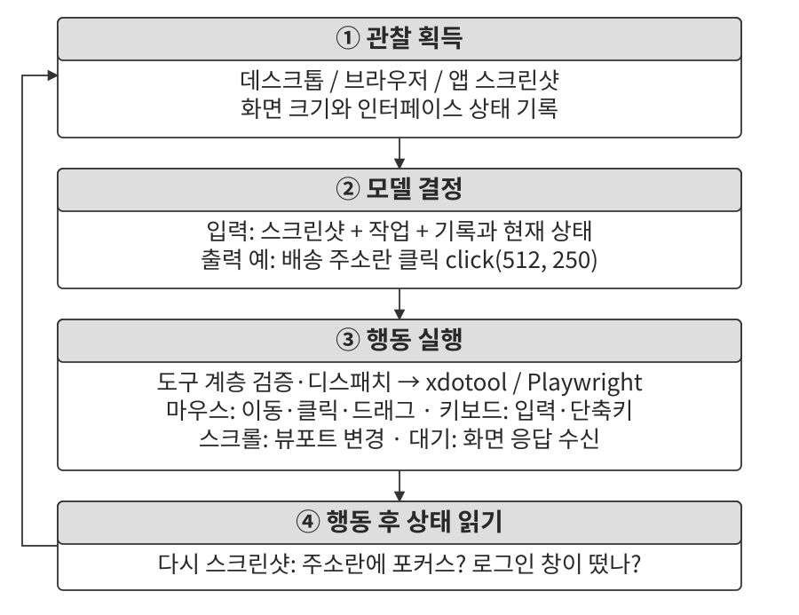

어시스턴트가 주소를 채운 뒤, 어느 “저장” 버튼을 눌러야 하는지 실행기에 어떻게 알려 줄까요? 화면 좌표와 요소 번호 모두 대상을 지목할 수 있지만, 모델과 도구에 요구하는 것은 서로 다릅니다.

### 행동 공간 설계

그림 6-13에서 Anthropic의 Computer Use 참조 구현은 그래픽 인터페이스, 명령 실행, 파일 편집이라는 세 가지 도구를 제공합니다. 그래픽 인터페이스 하나만 보아도 데이터가 두 곳으로 갑니다. 클릭 동작은 실행 단으로 가고, 클릭 뒤의 스크린샷은 다음 턴의 결정을 위한 관측으로 모델에 돌아옵니다. 네이티브 API는 도구 형식을 규정하며, 다른 모델로 바꾸면 어댑터 계층이 스크린샷과 동작 요청, 실행 결과를 해당 인터페이스가 받아들이는 메시지로 변환해야 합니다.[^ch6-computer-tools]

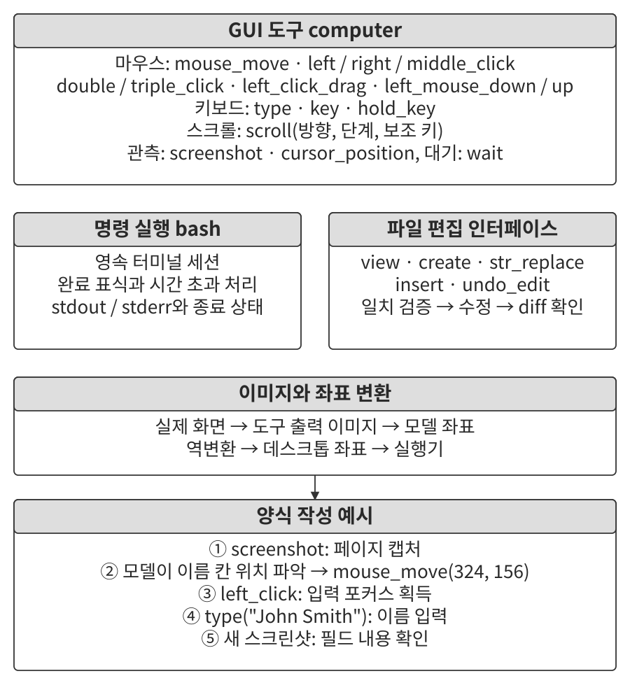

**GUI 조작 도구.** 마우스 동작에는 이동, 왼쪽/오른쪽/가운데 클릭, 두 번 클릭, 세 번 클릭, 끌기가 있습니다. 더 세밀한 인터페이스는 누르기와 떼기를 따로 표현할 수 있습니다. 스크롤에는 방향과 정도가 필요하고, 일부 구현은 보조 키도 지원합니다. 키보드 인터페이스는 텍스트 입력, 키 조합, 키를 누르고 있기를 제공합니다. 스크린샷과 커서 위치는 상태를 가져오는 데 쓰고, 대기 인터페이스는 페이지 로딩이나 애니메이션에 시간을 줍니다. 도구 버전이 구체적인 동작 집합을 정하며, 하네스는 사용하는 인터페이스에 맞춰 파라미터를 검증합니다.

**명령 실행 도구.** 영속 터미널은 호출을 넘나들며 작업 디렉터리와 환경 상태를 유지합니다. 예를 들어 한 번의 호출에서 디렉터리를 바꾸면 다음 호출도 그 디렉터리에서 실행됩니다. 참조 구현은 센티널 문자열로 명령 완료를 식별하고 타임아웃을 둘 수 있으며, 타임아웃 이후의 프로세스 상태는 여전히 실행기가 확인해야 합니다.

**파일 편집 도구.** 문자열 교체 인터페이스는 원문을 근거로 수정 범위를 찾고, 보기, 생성, 삽입, 실행 취소도 제공할 수 있습니다. 실행 전에 일치 위치와 횟수를 확인하고, 실행 뒤에 차이를 확인하며, 파일이 두 호출 사이에 바뀌었다면 관련 내용을 다시 읽습니다. 제5장에서 소개한 편집 전략은 여기서도 그대로 쓸 수 있습니다.

> **실험 6-9 ★: Anthropic Computer Use 참조 구현 실행하기**
>
> 이 실험은 공식 컨테이너 예시가 제공하는 Ubuntu 데스크톱, 브라우저, 도구 실행 계층을 씁니다. 사용자가 작업을 입력하면 모델이 스크린샷을 읽고 동작을 돌려주고, 실행 계층이 데스크톱을 조작한 뒤 새 스크린샷을 다시 모델에 넘깁니다.
>
> 함께 제공되는 작업은 샌프란시스코 날씨를 조회하는 일입니다. 보관된 궤적은 먼저 Google에 접속했다가 캡차를 만나고, 실행 중에 주어진 복구 지시에 따라 공개 조회가 가능한 Open-Meteo 데이터로 방향을 바꿔 마지막에 기온과 날씨 상태를 보고합니다. 기록에는 데스크톱 동작 15회와 그에 대응하는 스크린샷이 담겨 있어, 클릭과 키 입력, 텍스트 입력, 대기가 페이지를 어떻게 바꾸는지 턴마다 확인할 수 있습니다.
>
> 오픈 모델로 브라우저를 구동하는 경로는 실험 6-10에서 다룹니다.

### 시각적 그라운딩(Grounding)

모델에게 검색 상자를 클릭하게 하려면 문제를 두 가지 형태로 낼 수 있습니다. 하나는 스크린샷을 보여 주고 클릭 좌표를 말하게 하는 것입니다. 다른 하나는 후보 대상에 번호를 붙여 검색 상자를 고르게 하는 것입니다. 번호는 스크린샷의 후보 영역에 표시할 수도 있고, 브라우저가 제공하는 요소 목록에서 가져올 수도 있습니다. 아래에서 이 세 경로를 각각 소개합니다. 번호를 고를 때는 실행 계층이 번호를 실제 대상으로 되돌려 주고, 좌표를 직접 말할 때는 모델이 대상 위치까지 추정해야 하므로, 그라운딩 학습과 화면 해상도 적응에 더 높은 요구가 따릅니다.

**Set-of-Mark: 시각 주석.**

Set-of-Mark(SoM)는 이미지 위에 참조 가능한 번호를 겹쳐, 시각 영역과 모델 출력을 연결합니다. 원래 연구는 분할 같은 방법으로 후보 영역을 만들었습니다. SAM이나 SEEM으로 영역을 얻은 뒤 표식을 배치하는 식입니다. 모델이 번호를 고르면 실행 계층이 해당 영역을 근거로 조작 위치를 정합니다. 이 방법은 DOM이 없는 데스크톱 소프트웨어나 게임 화면에도 쓸 수 있지만, 누를 컨트롤이 번호가 붙은 영역 안에 있어야 하고, 모델이 그 컨트롤이 어느 번호에 해당하는지 알아볼 수 있어야 합니다.[^ch6-som]

**구조화된 요소 색인.**

브라우저는 다른 종류의 단서도 제공합니다. 문서 객체 모델(DOM)은 페이지에 어떤 요소가 어떤 계층으로 있는지 서술하고, 레이아웃 정보는 요소가 표시되는 위치를 주며, 접근성 트리(accessibility tree)는 보조 기술에 필요한 역할과 접근 가능한 이름을 보존합니다. 예를 들어 돋보기 아이콘만 있는 버튼이라도 페이지가 “검색”이라는 접근 가능한 이름을 제공한다면, 에이전트는 역할과 이름으로 그 버튼을 찾을 수 있습니다. browser-use 같은 방식에서는 시스템이 Chrome DevTools Protocol(CDP) 같은 브라우저 디버깅 인터페이스로 요소 정보를 가져와 입력란과 버튼, 링크를 식별하고, 현재 페이지에서 조작 가능한 요소에 번호를 붙일 수 있습니다. 그림 6-14에서 모델은 페이지 오른쪽 위의 [2]를 골랐습니다. 이 번호는 어떻게 Submit 버튼에 대한 클릭 한 번이 될까요?

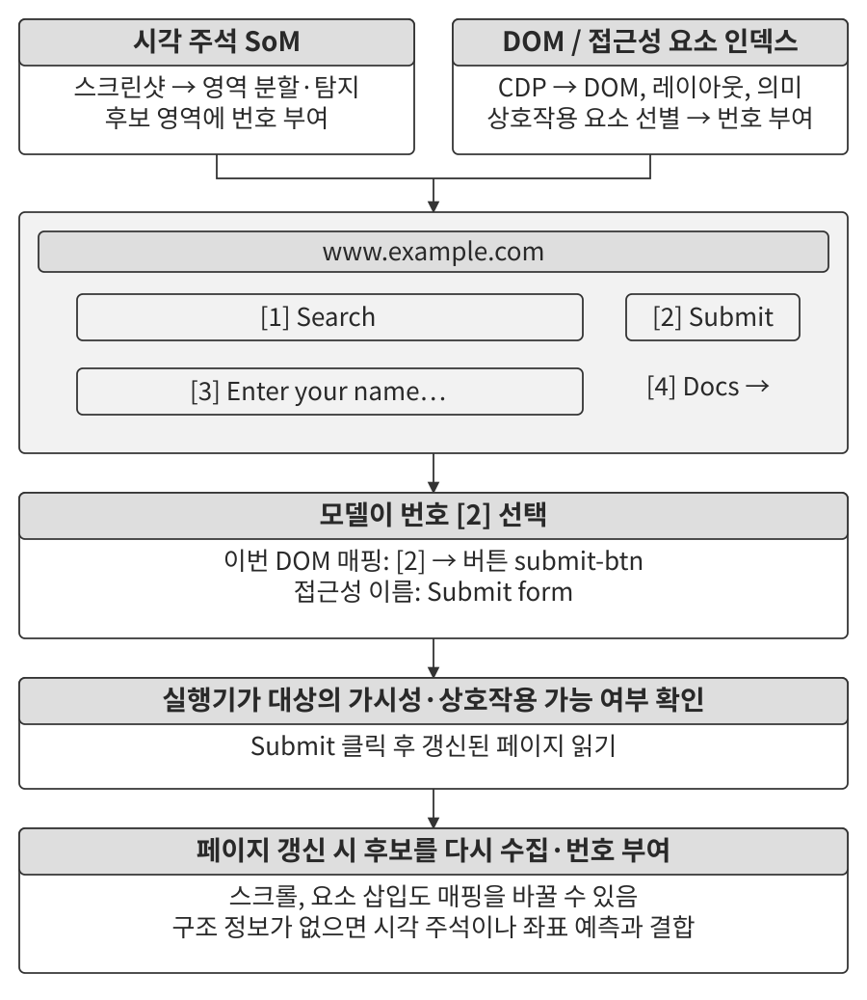

처리 과정은 네 단계로 나눌 수 있습니다. DOM과 레이아웃, 쓸 수 있는 접근성 정보를 읽고, 상호작용 가능한 요소를 걸러 내고, 현재 페이지의 번호 매핑을 만들고, 요소 설명과 필요한 주석 스크린샷을 모델에 넘깁니다. 예를 들어 모델은 아래와 같이 번호가 붙은 요소 네 개를 볼 수 있습니다.

```text
스크린샷에 [1], [2], [3], [4] 표시

[1] <input type="text" placeholder="Search" aria-label="Search" />
[2] <button id="submit-btn" aria-label="Submit form" />
[3] <input type="text" placeholder="Enter your name" value="" />
[4] <a href="/docs" aria-label="Documentation" />
```

모델이 번호를 고르면 실행 계층은 이를 요소 참조나 좌표로 해석하고, 대상이 아직 보이고 상호작용 가능한지 확인한 뒤 조작을 마칩니다. 페이지가 새로 고쳐지거나 스크롤되거나 요소가 동적으로 삽입되면 매핑을 갱신해, 만료된 번호를 쓰지 않게 해야 합니다. 구조화된 색인은 레이블과 역할, 텍스트를 활용할 수 있지만, Canvas나 가림, 불완전한 의미 주석은 스크린샷과 함께 판단해야 합니다. 나열하는 요소가 많아지고 스크린샷이 커질수록 컨텍스트에 들어가는 정보도 늘어납니다.

**좌표 직접 예측.**

좌표 경로는 모델이 스크린샷과 대상 설명에서 위치를 곧바로 출력하게 합니다. 예를 들어 “제출 버튼 클릭”을 어떤 점으로 매핑하는 것입니다. SeeClick 같은 GUI 그라운딩 연구와 Claude의 Computer Use가 좌표 출력을 채택했습니다. 실행 계층은 이미지 좌표를 실제 데스크톱 좌표로 변환합니다.

스크린샷을 축소하면 두 좌표 체계가 같은 변환을 써야 합니다. 2560×1440 데스크톱에서 모델에 보낸 이미지가 1366×768이라면, 모델이 제시한 (683, 384)는 다음에 대응합니다.

$$
x = 683 \times \frac{2560}{1366} = 1280,\qquad
y = 384 \times \frac{1440}{768} = 720
$$

그림 6-15에서 두 크기의 가로세로 비율은 비슷합니다. 비율을 유지하려고 스크린샷에 검은 여백을 넣었다면, 모델이 준 좌표에는 그 여백이 포함되므로, 원래 화면 좌표로 되돌리기 전에 해당 패딩 오프셋을 먼저 빼고 축소 계수를 적용해야 합니다. 자르기와 디스플레이 배율, 다중 모니터의 원점도 매핑을 바꾸므로, 도구 계층은 실제 변환 파라미터를 저장해야 합니다.

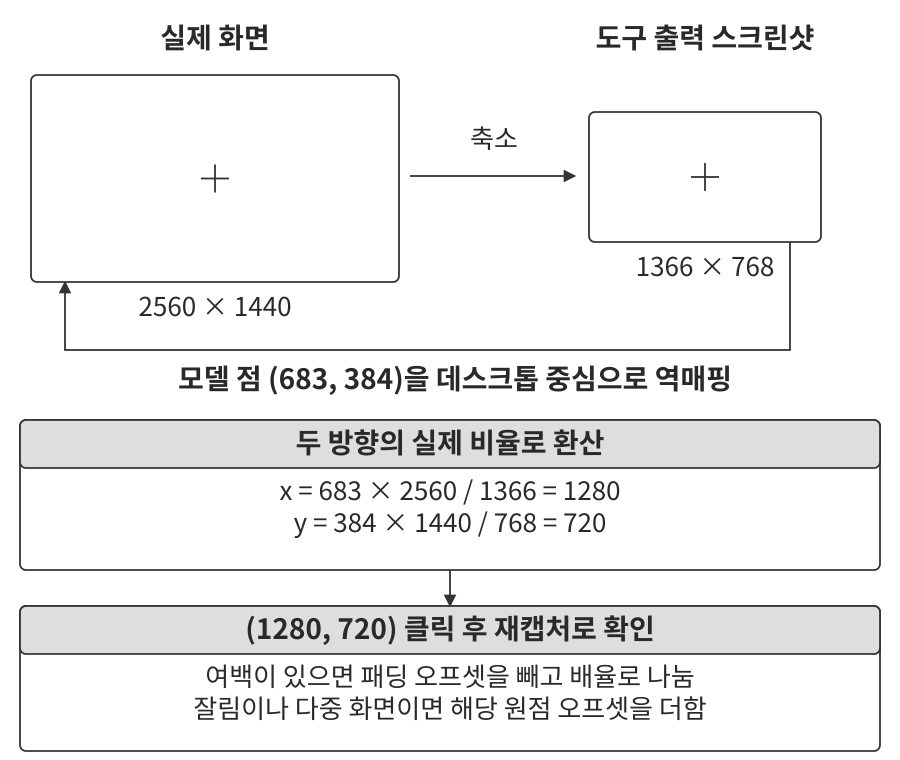

참조 구현은 XGA(1024×768), WXGA(1280×800), FWXGA(1366×768) 같은 목표 크기를 쓴 적이 있습니다. 가로세로 비율을 억지로 바꾸면 컨트롤 모양이 일그러지고, 잘못된 역매핑을 쓰면 올바른 예측이 엉뚱한 위치에 떨어집니다.[^ch6-computer-tools]

**구조화된 정보가 온전할 때 필자는 DOM이나 접근성 트리 색인을 우선합니다.** 요소의 이름과 역할, 참조를 그라운딩에 바로 쓸 수 있어, 모델이 픽셀 위치를 임시로 추정하는 일이 줄어듭니다. 구조가 없을 때는 범용 시각 모델이 먼저 SoM과 함께 쓰여 표시된 영역 가운데 하나를 고르게 할 수 있고, GUI 그라운딩 학습을 마친 모델이라면 좌표를 직접 예측해 별도 주석을 생략할 수 있습니다.

> **실험 6-10 ★: browser-use로 자동 브라우저 조작 구현하기**
>
> 이 실험은 Qwen3-VL 32B Instruct로 browser-use를 구동해, 브라우저 상태와 요소 정보, 스크린샷으로 동작을 생성합니다. 작업은 샌프란시스코 날씨 조회입니다. 검색 상자를 찾아 “San Francisco weather today”를 입력하고, 검색을 제출한 뒤 기온과 날씨 상태를 추출합니다.
>
> 실험 6-10의 코드와 실행 안내는 두 가지 진입점을 제공합니다. OpenRouter 키가 있으면 호스팅되는 비전 모델을 쓸 수 있고, vLLM이나 SGLang 같은 호환 서비스가 이미 있으면 `OPEN_MODEL_BASE_URL`과 `OPEN_MODEL_MODEL`을 자기 엔드포인트와 모델로 지정하고 서비스 요구에 맞춰 키를 설정하면 됩니다. 두 경로 모두 먼저 실험 디렉터리에서 `python main.py --dry-run`을 실행해 설정을 확인한 뒤, 안내에 따라 실제 조회를 시작합니다.
>
> 보관된 실행은 상호작용 16단계를 마쳤고 스크린샷 15장을 남겼습니다. Google에서 캡차가 뜨자 작업은 weather.com으로 바꿔 결과를 얻었습니다.

[^ch6-computer-tools]: Anthropic, Computer Use 도구 문서와 참조 구현. 버전이 붙은 동작 인터페이스, 실행 계층, 스크린샷 처리를 소개합니다.
[^ch6-som]: Microsoft, *Set-of-Mark Prompting*, 2023; browser-use의 DOM 서비스 구현은 구조화된 요소 처리 예시를 제공합니다.

### 애니메이션을 보고 소리도 들을 수 있는 Computer Use 에이전트

페이지가 저장 직후에만 “동기화 실패”를 잠깐 표시했는데, 몇 초 간격의 스크린샷 두 장에는 같은 양식이 찍혀 있다고 합시다. 이 두 장을 다시 보아도 모델이 그 사이에 무슨 일이 있었는지 복원하기는 어렵습니다. 동영상과 애니메이션, 짧게 스쳐 가는 알림, 회의 음성에도 같은 문제가 있습니다. **필자는 계속 변하는 인터페이스라면 관측 인터페이스부터 중점적으로 개선해야 한다고 봅니다.** 변화를 보고 다음 단계를 정하려면, 동작 사이에 있었던 사건이나 화면도 남겨 두어야 합니다.

필자가 공동 연구자와 함께 제안한 **Agent–Computer Observation Interface(AOI, 에이전트—컴퓨터 관측 인터페이스)**는 연속된 화면과 오디오를 모델이 받아들일 수 있는 이미지와 텍스트로 변환합니다[^ch6-9]. 인터페이스는 세 가지 구성 요소로 이루어집니다.

- **동작 사이 핵심 프레임 수집.** 메인 루프가 도는 동안 화면 변화를 지켜보고, 픽셀 차이나 경량 비전 모델로 후보 프레임을 걸러 낸 뒤, 쓸모 있는 화면을 다음 결정에 넘깁니다.
- **음량 게이트 전사.** 소리가 감지되면 음성 인식을 호출하고, 전사와 시간 정보를 관측 기록에 더해 에이전트가 회의 내용이나 구두 지시를 활용하게 합니다.
- **지속 화면 서술.** 핵심 화면을 텍스트로 요약합니다. 원본 이미지가 컨텍스트에서 빠진 뒤에도 이 텍스트가 있었던 변화를 보존해, 이후 단계가 참조할 수 있습니다.

예를 들어 동영상에서 메뉴 조작 한 번을 보여 주면, 모델은 중간 화면과 그에 대한 설명을 받은 덕분에 재생이 끝난 뒤에도 그 단계를 계속 참조할 수 있습니다. 논문의 제거 실험 결과에서 지속 텍스트 서술이 이득에 특히 결정적이었고, 핵심 프레임을 정교하게 고르는 기여는 상대적으로 작았습니다. 일부 모델은 이미지를 너무 많이 넣으면 오히려 성능이 떨어졌습니다.

방금의 양식 저장 예로 돌아가 봅시다. 핵심 프레임이 “동기화 실패”를 찍었다 하더라도, 원본 이미지가 컨텍스트에서 빠지면 모델은 남은 서술에만 기댈 수밖에 없습니다. “페이지에 알림이 나타남”은 저장 성공일 수도 있고 실패일 수도 있습니다. “동기화 실패, 주소가 저장되지 않음”이라야 다음 단계를 정할 단서가 남습니다.

[^ch6-9]: Bojie Li, Noah Shi, *Agent-Computer Observation Interfaces Enable Dynamic Computer Use*, 2026, AOI와 구성 요소별 제거 실험을 소개합니다.

### Computer Use의 세계 모델

관측을 제때 받은 뒤에도 에이전트는 동작을 고르고 실행 결과를 기다려야 합니다. OSWorld-Human 연구는 에이전트의 조작 효율을 사람의 궤적과 대조해, 불필요한 단계와 모델 호출 같은 소요 원인을 분석했습니다[^ch6-osworld-human].

세계 모델은 계획 수립에 동작 결과의 예측을 제공합니다. 데스크톱 상태에는 창, 초점, 스크롤 위치, 입력 내용, 로딩 진행이 들어갈 수 있고, 권한이나 네트워크 결과 같은 정보는 해당 인터페이스로 보충해야 합니다. 모델은 현재 쓸 수 있는 상태와 후보 동작을 보고 다음 상태를 예측합니다.

```text
현재 상태 + click / type / scroll / wait → 예측한 다음 상태
```

사람이 컴퓨터를 쓸 때는 클릭하기 전에 이미 다음을 그려 보는 경우가 많습니다. 화면이 예상대로면 계속하고, 예상 밖의 일이 생겨야 멈춰 확인합니다. 세계 모델은 에이전트에 비슷한 추측 실행 근거를 줍니다. 계획기가 후보 동작을 미리 비교하고, 페이지가 로딩되는 동안 다음 단계를 준비하고, 실제 상태가 확인되면 실행을 이어 가므로, 클릭할 때마다 처음부터 계획하는 대기를 줄일 수 있습니다. 예를 들어 VS Code에서 새 Python 파일을 만들고 hello world를 쓰면, 예상되는 변화에는 파일 트리에 새 파일이 나타나고, 편집 영역에 코드가 들어가고, 저장 상태가 갱신되는 것이 포함됩니다. 실행한 뒤 이 변화를 확인해 예상과 맞으면 계속하고, 어긋나면 위치를 다시 잡고 계획합니다.

파일 삭제 같은 조작에는 별도의 실행 조건이 더 필요합니다. 대상이 맞는지, 삭제가 허용되는지, 복구할 수 있는지, 사용자 확인이 필요한지입니다. 예측은 가능한 결과를 이해하는 데 도움을 주고, 실제 권한과 업무 조건은 실행 계층이 확인합니다.

**Photon-1의 잠재 상태 예측.** Induction Labs는 2026년 7월에 Photon-1을 소개했습니다. 영상 프레임을 이산 잠재 토큰으로 인코딩하고, 이후 토큰을 예측하며 상태 변화를 학습합니다. 회사가 공개한 바에 따르면 사전 학습에는 약 3만 H200 GPU 시간이 들었습니다. 상태 예측은 잠재 토큰 안에서 이루어지고, 보조 이미지 생성기가 이를 확인 가능한 화면으로 되돌려 사람이 예측을 점검하게 합니다. 계획과 동작 생성은 내부 표현을 직접 활용해, 단계마다 완전한 스크린샷을 생성하는 비용을 덜 수 있습니다.[^ch6-20]

이 방식은 나아가 미세 조정으로 지시와 동작 형식을 학습합니다. 먼저 도달하고자 하는 상태를 예측하고, 그 상태로 가는 조작을 생성하며, 가상 머신에서 온라인 학습으로 작업 성능을 개선합니다. 동작 조건 미세 조정은 주어진 조작 이후 데스크톱이 어떻게 바뀌는지 예측하는 데 쓰입니다. 두 용도가 각각 계획과 시뮬레이션을 연결하며, 상태 표현이 Computer Use에 어떻게 참여하는지 보여 줍니다.

[^ch6-osworld-human]: Reyna Abhyankar 외, *OSWorld-Human: Benchmarking the Efficiency of Computer-Use Agents*, 작업 궤적과 시간 소요를 분석합니다.
[^ch6-20]: David Li, Jonathan Li, *Scaling Video Pretraining with Imagination Models*, Induction Labs, 2026-07-23, Photon-1의 사전 학습, 동작 학습, 상태 시뮬레이션을 소개합니다.
[^ch6-21]: Google DeepMind, *Genie 3: A new frontier for world models*, 2025-08-05; Zachary Lin 외, *Cosmos World Foundation Model Platform for Physical AI*, 2025.

### 모바일: 기술 인터페이스와 생태계 협업

모바일도 관측—결정—행동 루프를 그대로 쓰지만, 동작은 주로 터치 제스처로 나타납니다. 같은 좌표가 탭 위치, 길게 누르기 위치, 스와이프 시작점을 뜻할 수 있으므로, 인터페이스에는 제스처 유형과 지속 시간, 경로도 필요합니다. 화면 회전과 소프트 키보드 팝업, 시스템 대화상자도 조작 가능한 영역을 바꿉니다.

Android의 `AccessibilityService`는 허용된 범위에서 인터페이스 정보를 읽고 해당 동작을 실행할 수 있으며, 제스처 인터페이스는 그에 맞는 능력을 선언해야 합니다[^ch6-android]. 스크린샷과 접근성 트리, 시스템 자동화 인터페이스는 함께 쓸 수 있고, 구체적으로 무엇이 가능한지는 운영 체제와 앱 구현, 권한이 정합니다. 제7장에서 소개하는 AndroidWorld 같은 벤치마크는 실제 앱 작업에서 이런 동작이 기대한 결과를 내는지 확인합니다.

**필자는 모바일에서 실제 도입을 가로막는 생태계 장벽이 기술 문제보다 다루기 어려운 경우가 많다고 봅니다.** 플랫폼은 어떤 조작을 대리인에게 맡길 수 있는지, 계정과 결제와 데이터를 어떻게 위임하는지, 오류가 났을 때 누가 책임을 추적하는지를 정해야 합니다. 이런 약속은 에이전트가 완수할 수 있는 작업 범위에 직접 영향을 줍니다.

구조적인 이해 충돌 가운데 하나는 트래픽과 관심에서 나옵니다. 많은 앱이 광고 노출과 콘텐츠 추천, 거래 진입점으로 수익을 냅니다. 사용자가 에이전트에게 조회나 구매를 직접 맡기면 페이지를 둘러보는 경로가 짧아지고, 추천과 광고가 얻던 관심도 달라집니다. 이 대목으로 수익을 내는 플랫폼에는 대리 조작이 기존 수익원을 건드리는 일입니다. 그래서 플랫폼은 인터페이스 개방과 상업적 수익 배분, 대리인 신원 관리를 다시 검토해야 합니다.

[^ch6-android]: Android Developers, AccessibilityService, 인터페이스 접근과 동작·제스처 능력을 소개합니다.

## 로봇 조작: XLeRobot으로 책상 정리하기

빨간 컵을 쟁반에 넣고, 노란 휴지를 쓰레기통에 버린 다음, 마지막으로 책상이 정리됐는지 확인하기. 이 작업은 지각과 계획, 제어를 한데 묶습니다. 그리퍼가 컵에 다가가면 카메라 속 위치가 달라지고, 컵을 집어 올리면 팔이 책상 위 다른 물체를 피해야 합니다. 종이를 처음에 집지 못했다면 시스템은 실패를 알아차리고 다시 시도해야 합니다. 동작 하나하나가 다음 결정의 조건을 바꿉니다.

이 절은 이 작업을 따라 실험 다섯 개를 배치합니다. 실험 6-11과 6-13은 실제 로봇의 원격 조작과 자율 조작에 관한 실습 설계를 제시하고, 실험 6-12, 6-14, 6-15는 로컬 시뮬레이션으로 각각 제어 기준선, 실패 복구, 시각 조건의 변화를 연구합니다.

같은 로봇을 사람이 계속 카메라를 보며 조종할 수도 있고, 모델이 화면을 읽고 스킬을 골라 제어 시스템에 실행을 넘길 수도 있습니다. 작업과 하드웨어를 고정하면 두 방식의 차이를 네 가지 질문으로 분석할 수 있습니다. 사람이 무엇을 끝내고 싶은가, 다음에 어느 하위 작업을 먼저 할 것인가, 현재 스킬이 어떤 동작을 내놓는가, 동작 이후 환경이 계획에 맞는가입니다. 장기 계획이 컵과 휴지의 처리 순서를 정하고, VLA 정책이나 미리 정의한 동작 프리미티브가 집고 놓는 일을 맡으며, 세계 모델이 동작 결과를 추정하는 데 도움을 주고, 시뮬레이션에서 현실로의 이전이 화면과 접촉, 구동기 특성의 변화를 처리합니다.

### 하드웨어와 알고리즘의 분업

자율 책상 정리가 실패했을 때는 먼저 원격 조작으로 하드웨어가 작업을 해낼 수 있는지 점검할 수 있습니다. 카메라와 로봇 팔, 그리퍼, 책상 배치, 인수 조건을 그대로 두고 조작자가 지각과 제어 폐루프를 넘겨받습니다. 사람이 여러 차례 조작에서 안정적으로 완수하는데 자율 시스템이 거듭 실패한다면, 이 하드웨어가 이미 현재 작업을 해낼 수 있고 병목은 주로 자율 제어의 알고리즘과 피드백에 있다는 뜻입니다. 이때는 물체 위치 추정, 스킬 선택, 동작 타이밍, 실패 복구를 먼저 점검해, 자율 시스템이 원격 조작에서 통한 수정 방법을 익히게 해야 합니다.

XLeRobot은 키보드와 Xbox 게임패드, Switch Joy-Con으로 원격 조작할 수 있고, VR 조작은 시뮬레이션 환경에서 먼저 체험할 수 있습니다.[^ch6-1] 그리퍼가 컵에 다가가면 조작자는 속도를 늦추고, 컵이 미끄러지면 파지점을 고칩니다. 그리퍼가 종이를 집지 못하면 다시 살펴보고, 물체가 제자리에 들어가도 한 번 더 확인합니다. 관측에 따라 이렇게 고친 부분은 모두 시연 데이터에 기록할 가치가 있습니다. 나중에 로봇이 자율로 조작할 때도 미끄러짐과 놓친 파지를 똑같이 알아차려야 합니다.

> **실험 6-11 ★: 실물 XLeRobot을 원격 조작해 책상 정리하기**
>
> 캘리브레이션과 리밋, 비상 정지 점검을 마친 XLeRobot 작업 공간에 빨간 컵과 쟁반, 노란 휴지, 쓰레기통을 놓습니다. 캘리브레이션된 원격 조작 방식 하나로 고정된 작업을 수행합니다. “빨간 컵을 쟁반에 넣고, 노란 휴지를 쓰레기통에 버린 다음, 마지막으로 책상 상태를 확인합니다.” 여러 차례 반복하며 카메라 화면, 조작자 입력, 로봇 팔 상태, 동작 시각, 파지 실패, 재시도 횟수를 기록합니다.
>
> 회차마다 끝에 컵이 쟁반 안에, 휴지가 쓰레기통 안에 있는지 확인하고, 로봇 팔이 안전 자세로 돌아왔는지, 전 과정에서 충돌과 작업 영역 이탈, 사람의 개입이 있었는지 점검합니다. 실패가 어느 단계에서 났는지, 조작자가 어떻게 복구했는지, 최종 결과를 함께 분석하면 자율 제어의 대조 기준선을 만들 수 있습니다.

시뮬레이션 실험은 물체 수와 초기 위치를 반복해서 바꾸기 쉽고, 알려진 상태에서의 제어 과정을 따로 살펴보기에 알맞습니다. 2차원 책상 모델은 물체에 다가가고, 목표로 옮기고, 다음 물체를 처리하는 세 단계로 표현할 수 있으며, 완료 스텝 수와 경로 길이로 제어 비용을 서술합니다.

> **실험 6-12 ★: 시뮬레이터에서 같은 작업의 이상적 제어 기준선 세우기**
>
> 2차원 책상에서 물체 위치와 목표 위치를 무작위로 만들고, 제어기가 좌표를 직접 읽어 차례로 물체에 다가가 해당 목표로 옮긴 뒤 다음 물체를 처리하게 합니다. 초기 위치와 물체 수를 바꿔 가며 성공률, 완료 스텝 수, 경로 길이를 비교합니다.
>
> 먼저 물체 하나의 전체 궤적을 따라가 봅니다. 제어기가 물체에 도달하면 운반 단계로 넘어가고, 목표에 도달해야 완료 수를 셀 수 있습니다. 이어서 물체 수를 늘려, 모든 물체가 이 두 도달 조건을 거치는지 확인합니다. 함께 제공되는 2차원 시뮬레이션은 무작위 시드 다섯 개에서 각각 물체를 1, 2, 3, 4개 배치하고, 조합마다 512 에피소드를 실행해 모두 합쳐 10,240 에피소드를 완료했습니다. 제어기는 좌표를 직접 읽을 수 있고, 물체 이동도 실제 그리퍼에 의존하지 않습니다.

### 로봇 제어의 기본 구조

책상 한 번을 정리하는 데는 몇 분이 걸릴 수 있지만, 관절 제어는 계속되고 제때 갱신되어야 합니다. 시스템은 시간 척도로 분업해, 상위 계획이 작업 순서를 정하고, 스킬 정책이 운동을 생성하며, 하위 제어기가 실행을 추종하게 할 수 있습니다.

| 계층 | 핵심 질문 | 출력 | 시간 척도와 설정 예시 |
| --- | --- | --- | --- |
| 작업 목표 | 사람이 무엇을 끝내려 하는가 | “컵과 휴지를 제자리에” | 분 단위 작업 |
| 장기 계획 | 무엇을 먼저 하고 무엇을 나중에 하는가 | 컵을 먼저 처리하고, 휴지를 다음에, 마지막에 확인 | 초에서 분 |
| 기본 스킬 | 지금 어떤 상태 변화를 이루는가 | `pick(red_cup)`, `place(red_cup, tray)` | 스킬 하나가 수 초, 예컨대 1~3초 |
| VLA / 스킬 정책 | 현재 스킬이 구체적으로 어떻게 움직이는가 | 그리퍼 동작, 말단 자세 또는 한 구간의 관절 궤적 | 1~10 Hz 추론으로 설정 가능 |
| 하위 제어와 안전 계층 | 어떻게 안정적이고 제때 실행하는가 | 관절 또는 말단 제어량, 속도 제한과 비상 정지 | 제어기는 수십에서 수천 Hz로 설정 가능 |

계획기는 규칙 기반 프로그램이나 VLM, 최적화기를 쓸 수 있고, VLA가 스킬 선택의 일부를 맡을 수도 있습니다. **필자의 제안은 작업 순서와 눈앞의 동작을 분리해 처리하는 것입니다.** 상위 추론은 계획을 짜는 데 시간이 필요하고, 하위 제어는 위치와 힘의 변화에 제때 반응해야 합니다. 둘을 각자 알맞은 리듬으로 돌려야 계획과 제어를 함께 챙길 수 있습니다.

이 절은 상위 모델에 `observe_scene`, `pick`, `place`, `verify_state`, `stop` 다섯 가지 도구를 제공합니다. 각각 관측, 파지, 배치, 확인, 정지에 씁니다. 하네스는 파라미터와 작업 공간, 현재 상태를 확인하고, 실행기가 검사를 통과한 스킬을 로봇 팔의 동작으로 바꾸며 속도 제한과 타임아웃을 처리합니다. 관절 각도와 연속 궤적은 스킬 정책과 제어기가 생성하므로, 모델이 스킬을 고르는 일과 실제 운동 사이에 분명한 인터페이스가 생깁니다.

### 장기 계획과 작업 분해

사용자가 “책상 좀 깨끗이 정리해 줘”라고 하면, 계획기는 먼저 물체와 목표 영역을 식별하고 처리 순서를 정한 뒤, 단계마다 시작 조건과 완료 조건, 동작 제약을 적습니다. 예를 들어 정리 순서는 이렇게 될 수 있습니다.

```text
빨간 컵 처리 → 노란 종이 치우기 → 책상 확인
```

“빨간 컵 처리”는 다시 두 동작과 한 번의 확인으로 나뉩니다.

```text
pick(red_cup) → place(red_cup, tray) → verify_state()
```

“컵을 집어 쟁반에 놓기”를 예로 들면, 로봇 팔이 파지 프로그램을 다 실행했다는 것은 그 프로그램이 끝났다는 것만 뜻합니다. 다음에 들어 올리기 전에, 그리퍼 피드백이나 새 이미지로 컵을 정말 잡았는지 판단해야 합니다. 헛집었다면 컵 위치를 다시 잡고, 누군가 쟁반을 치웠다면 성공한 파지는 여전히 유효하므로 배치 동작만 다시 계획하면 됩니다. 스킬마다 확인 가능한 상태 변화를 하나씩 대응시키고, 동작과 소요 시간을 한정한 뒤, 실행 상태와 새 관측을 돌려받으면, 계획기는 실제로 틀어진 바로 그 단계부터 복구할 수 있습니다.

> **실험 6-13 ★★: Gemini Robotics-ER 1.5로 XLeRobot이 자율적으로 책상을 정리하게 하기**
>
> 실험 6-11의 하드웨어와 책상 배치, 작업, 인수 조건을 그대로 쓰고, 관측과 계획을 체화 추론 모델이 맡습니다. RoboCrew의 편성 방식을 참고해 이 작업에 맞는 다섯 도구를 설계합니다. `observe_scene`, `pick`, `place`, `verify_state`, `stop`입니다.[^ch6-2]
>
> 모델은 먼저 책상 관측을 읽고 처리 순서를 정한 뒤, 캘리브레이션된 파지와 배치 스킬을 호출합니다. 스킬을 하나 마칠 때마다 새 관측을 받아 사후 조건을 확인하고, 실패하면 현재 상태를 보고 재시도할지 정지할지 고릅니다. 실행 시스템은 비상 정지 신호를 받거나 작업 영역 이탈을 감지하거나 핵심 상태를 확인할 수 없을 때 실행을 곧바로 멈추고, 모델도 `stop`으로 작업을 스스로 끝낼 수 있습니다.
>
> 마지막에는 새로운 환경 관측으로 컵이 쟁반 안에, 휴지가 쓰레기통 안에 있는지, 로봇 팔이 안전 자세로 돌아왔는지 확인하고, 충돌과 이탈 기록을 대조합니다. 조작자는 기동과 비상 정지, 현장 감독을 맡고, 도중 개입은 따로 기록합니다.

실험 6-13은 실제 로봇의 동작을 어떻게 연결하고 정리 결과를 어떻게 검증하는지 보여 주지만, 함께 제공되는 기록에는 이 작업의 실제 로봇 실험이 아직 없습니다. 그래서 먼저 시뮬레이션 환경에서 세 가지 방법을 비교합니다. 계획대로 개루프로 실행하기, 한 단계씩 결과를 확인하기, 동작 결과를 먼저 예측하기입니다. 작업 목표와 다섯 도구는 그대로 유지하고 장애도 반복해 일으킬 수 있어, 세 방법이 같은 실수를 만났을 때 각각 어떻게 대응하는지 관찰하기 좋습니다.

### VLA 제어

VLA는 Vision-Language-Action의 약자로, 시각—언어—동작 모델입니다. 현재 화면과 작업 지시, 그리고 쓸 수 있는 로봇 상태를 받아 다음에 실행할 동작을 생성합니다.

```text
현재 관측 + 스킬 지시 → 동작 또는 동작 시퀀스
```

책상 정리 예에서 상위 계획기는 `pick(red_cup)`을 제출하고, 스킬 정책은 화면을 보고 어느 방향에서 컵에 다가갈지, 그리퍼를 언제 닫을지, 어떤 궤적으로 팔을 들어 올릴지 정합니다. 이 구간의 운동을 마치면 시스템이 책상 관측을 다시 받아 컵을 정말 잡았는지 확인한 뒤 `place(red_cup, tray)`로 넘어갑니다. 도구 인터페이스가 기대하는 상태 변화를 정하고, VLA는 연속 동작으로 그 변화를 이루는 법을 학습합니다.

동작은 여러 방식으로 표현할 수 있습니다. RT-2와 초기 OpenVLA는 동작의 각 차원 값을 이산 토큰으로 양자화해, 언어 모델의 생성 방식을 그대로 써서 출력합니다. π₀는 플로 매칭으로 연속 동작 블록을 생성합니다. 앞의 방식은 자기회귀 생성 프레임워크를 재사용하기 쉽고, 뒤의 방식은 한 구간 연속 동작의 분포를 직접 모델링합니다.[^ch6-15]

모델 추론과 실행기 제어는 보통 갱신 주파수가 다릅니다. 동작 청킹(action chunking)은 모델이 앞으로의 짧은 동작 구간을 한 번에 생성하고, 제어 스레드가 그것을 더 높은 주파수로 실행하게 합니다. 추론과 실행을 더 겹치면, 현재 동작 블록을 실행하는 동안 다음 블록을 준비해 대기를 줄일 수 있습니다. 블록을 잇는 데는 궤적의 연속성과 관측의 유효 시점도 챙겨야 합니다. 팔이 컵으로 뻗는 사이에 컵이 밀려났다면, 남은 동작은 여전히 예전 위치를 가리킬 수 있습니다. 실제 실행 구간을 짧게 하고 새 관측으로 계속 갱신하거나, 이상을 감지하면 동작을 끊는 방법 모두 응답 속도를 높일 수 있지만, 추론과 스케줄링 비용도 함께 늘어납니다.

### VLA의 데이터와 배포 조건

“컵을 집어라”를 안정적으로 동작으로 바꾸려면 다음 몇 가지 차이를 함께 다뤄야 합니다.

- **학습 데이터의 범위**: 쓸 수 있는 로봇 동작 시연은 인터넷의 텍스트와 이미지보다 훨씬 적습니다. “컵”이 무엇인지 안다고 해서 어떻게 힘을 주어야 하는지 아는 것은 아니며, 실제 파지 경험이 필요합니다. 시연은 컵의 재질과 모양, 놓인 자세, 마찰 조건을 아울러야 합니다. 같은 파지 방향도 도자기 컵과 무른 종이컵에서는 다른 결과가 나올 수 있습니다.
- **동작과 결과의 학습 목표**: 행동 복제는 주로 시연자가 현재 조건에서 어떤 동작을 했는지 학습합니다. 여러 동작의 결과를 비교하려면 상태 예측이나 동작 결과 평가를 더할 수 있습니다.
- **로봇 본체와 인터페이스**: 자유도와 좌표계, 그리퍼 구조, 구동기 지연이 동작이 하드웨어에 어떻게 실현되는지를 정합니다. 정책을 옮길 때는 동작 표현과 캘리브레이션 파라미터, 제어 주기를 맞춰야 합니다.
- **관측의 유효 시점**: 동작 블록이 실행되는 동안 물체가 움직이거나 가려지거나 넘어질 수 있습니다. 시스템은 언제 새 관측을 가져오고, 언제 그것으로 남은 동작을 갱신할지 정해야 합니다.

이 조건들은 시각 인식과 스킬 제어, 환경 변화를 이어 줍니다. 컵에 든 액체는 운반 속도에 영향을 주고, 책상 가장자리의 전원 케이블은 가능한 경로를 바꾸며, 종이와 책상의 접촉은 집는 방식을 좌우합니다. 계획기가 이런 결과를 미리 비교할 수 있다면 스킬 선택에 더 많은 근거를 줄 수 있습니다.

### 세계 모델

로봇 계획에서 동작 조건 세계 모델은 “동작 결과 예측기”로 이해할 수 있습니다. 현재 상태와 후보 동작이 주어지면 다음에 무슨 일이 일어날지 추정합니다.

```text
현재 상태 + 후보 동작
    → 다음 상태나 미래 구간 예측
    → 후보 결과 비교
    → 동작 선택, 재계획 또는 정지
```

이 과정에는 세 가지 작업이 있습니다. 현재 상태를 표현하고, 동작이 일으키는 상태 변화를 예측하고, 계획기나 제어기가 그것으로 동작을 고르게 하는 것입니다. 상태는 물체 위치나 파지 여부 같은 구조화 변수일 수도 있고, 이미지에서 뽑아낸 내부 표현일 수도 있습니다. V-JEPA 2는 먼저 영상에서 상태 표현과 예측을 학습하고, 추가로 학습한 V-JEPA 2-AC가 동작 조건을 도입해 로봇 계획에 쓰입니다. 동작과 미래 관측을 연결하는 것도 세계—동작 모델(World-Action Model) 계열의 한 가지 모델링 발상입니다.[^ch6-16]

세계 모델은 세 단계에서 로봇을 돕습니다. 움직이기 전에 파지, 밀기, 기다리기가 각각 어떤 결과를 낳을지 예측하고, 실행 중에는 예측과 실제 관측을 대조해 어긋나면 동작을 고치거나 다시 계획하며, 학습 중에는 영상과 시뮬레이션 데이터, 실패 궤적으로 상태 변화를 익혀 실제 로봇에서의 시행착오를 줄입니다.

노란 휴지가 빨간 컵에 일부 가려져 있다고 합시다. 계획기는 “종이를 먼저 집기”, “컵을 먼저 옮기기”, “다른 파지 방향으로 가기”를 비교할 수 있습니다. 필자는 세계 모델이 작업과 직접 관련되고 확인 가능한 상태 변화를 예측하게 하는 쪽을 우선합니다. 종이가 더 쉽게 집히는지, 컵이 넘어질 만한지 판단할 수 있다면 후보 동작의 순위를 매길 수 있습니다. 모델이 쓰는 상태 표현과 학습 목표도 이런 판단을 중심으로 설계해야 합니다. 모델이 미래 화면을 생성한다면, 필자는 먼저 그 화면이 이 동작 결과들을 정확히 반영하는지 확인하고, 그다음에 시각적 세부를 더할지 따집니다. 이미지의 사실감은 결국 계획과 제어의 개선으로 드러나야 합니다. 실행한 뒤에는 카메라와 로봇 상태로 실제 결과를 확인해, 계속할지 재시도할지 방식을 바꿀지 정합니다.

예측 범위가 길수록 오차는 쌓이기 쉽습니다. 실무에서는 먼저 단기 결과를 예측하고, 짧게 실행한 뒤, 새 관측으로 다시 계획하고, 예측의 불확실성을 선택에 반영할 수 있습니다. 생성형 세계 모델은 상호작용형 시뮬레이션과 시각화 장면도 제공할 수 있지만, 제어에 쓰려면 동작 조건과 접촉 규칙, 예측 오차를 더 검증해야 합니다. 하드웨어 리밋과 비상 정지, 실시간 제어는 계속 실행 시스템이 맡습니다.[^ch6-21]

> **실험 6-14 ★★: 시뮬레이터에서 세 가지 자율 책상 정리 폐루프 비교하기**
>
> 빨간 컵과 노란 휴지를 구조화된 상태로 표현합니다. 각 물체는 “책상 위”, “집힘”, “놓임” 세 단계 가운데 하나에 있고, 목표 영역은 사용 가능 여부를 기록합니다. 시뮬레이터는 관측, 파지, 배치, 확인, 정지 다섯 도구를 제공하고, 휴지를 집을 때 최대 한 번의 순간적 실패를 주입합니다.
>
> 세 가지 제어 방식을 비교합니다. **개루프 실행**은 정해진 순서로 네 동작을 마칩니다. **단계별 확인**은 동작마다 상태를 읽고, 실패하면 관측을 다시 받아 현재 실행 가능한 단계를 고릅니다. **예측식 실행**은 작은 신경망으로 “상태와 동작에서 다음 상태로” 가는 매핑을 학습하고, 예측한 제자리 복귀 진행에 따라 실행 가능한 동작의 순위를 매깁니다.
>
> 작업 완료 여부, 도구 호출 횟수, 실패 복구 과정을 비교합니다. 예를 들어 휴지 파지에 실패하면 휴지가 책상 위에 그대로 남아 있으므로, 곧바로 배치를 실행하면 물체를 집지 않은 상태라 실패합니다. 상태를 읽은 뒤 파지를 다시 시도해야 배치로 넘어갈 수 있습니다. 두 피드백 전략은 끝날 때 `verify_state`를 호출해 제자리 복귀 상태를 확인합니다.
>
> 먼저 장애를 주입하지 않은 에피소드를 보면 세 전략 모두 완수합니다. 장애 주입 확률을 50%로 올리고, 전략마다 시드 세 개에서 384 에피소드씩(시드마다 128 에피소드) 실행합니다. 개루프는 여전히 에피소드마다 도구를 4번 호출했지만 완료한 것은 205 에피소드뿐이었습니다. 단계별 확인과 예측식 실행은 384 에피소드를 모두 완료했고, 평균 호출 횟수는 둘 다 약 6.93회였습니다. 늘어난 호출 덕분에 제어기가 헛집음을 발견하고 복구할 수 있었습니다. 복구 가능한 장애를 한 번만 주입하는 이 작업에서는, 다음 상태를 예측하는 것이 직접 확인하는 것보다 더 많은 에피소드를 구해 내지는 못했습니다.

### 시뮬레이션 환경에서 실제 로봇으로

시뮬레이션 책상에서 실제 로봇으로 넘어가려면 환경 차이를 하나씩 처리해야 합니다. 화면에서는 같은 컵과 쟁반이 다른 배경과 조명, 카메라 위치, 가림 관계 아래 나타나고, 운동에서는 마찰과 센서 잡음, 구동기 지연이 궤적과 파지에 영향을 줍니다.

도메인 무작위화는 학습할 때 배경과 물체 외형, 조명, 잡음을 바꿔, 모델이 여러 조건에서 같은 판단을 하게 만드는 방법입니다. 실험 6-15는 그 가운데 한 고리만 떼어 연구합니다. 물체와 목표 영역을 보고 어느 쪽으로 움직여야 하는가?

> **실험 6-15 ★★★: 같은 책상 작업의 RGB 환경 간 테스트**
>
> 물체는 원, 목표 영역은 사각형으로 표현해 RGB 책상 이미지를 생성합니다. 모델은 둘의 상대 위치를 보고 왼쪽, 오른쪽, 위, 아래 가운데 하나의 이동 방향을 출력하고, 두 위치가 충분히 가까우면 실험에서 정의한 `grasp` 레이블을 출력합니다. 이 레이블은 2차원 위치가 접근 조건을 만족했다는 뜻입니다.
>
> 구조가 같은 시각 정책 네 개를 학습합니다. 시각 조건을 고정한 것, 주로 배경을 바꾼 것, 주로 물체 외형을 바꾼 것, 그리고 여러 변화를 조합한 것입니다. 각 정책을 원래 조건과 새 색상·질감·밝기·잡음이 들어간 테스트 이미지에 각각 적용해, 방향 판단 정확도를 비교하고 잘못 판단한 이미지를 살펴봅니다.
>
> 테스트 도메인마다, 시드마다 합성 이미지가 1,024장씩 있습니다. 먼저 시드 세 개의 평균 정확도를 비교합니다. 시각 조건을 고정해 학습한 정책은 원래 도메인에서 93.03%였는데, 새 질감과 잡음이 들어간 목표 도메인(`target_realistic`)에서는 54.82%로 떨어졌습니다. 여러 변화를 조합해 학습한 정책은 원래 도메인에서 87.50%였지만 같은 목표 도메인에서 76.11%를 기록했습니다. 배경만 무작위화한 그룹은 이 목표 도메인에서 36.88%에 그쳤습니다.[^ch6-6]

## 이 장의 요약

서두의 항공권 변경 통화로 돌아가 봅시다. 백그라운드가 항공편을 조회하는 동안 사용자가 수하물 요구를 덧붙였습니다. 조회 결과가 사용자 메시지보다 늦게 도착했다면, 그 결과는 낡은 질문에 대한 답일 수 있습니다. 이벤트 큐는 메시지 출처와 작업 식별자, 선후 관계를 보존해야 포그라운드가 새 요구를 우선순위에 따라 받아 내고, 원래 조회를 계속할지 취소할지 조건을 바꿔 다시 조회할지 판단할 수 있습니다. 이것은 **타이밍**의 문제이며, 요청을 음성으로 바꾼다고 해결되지 않습니다.

음성은 요구를 한 겹 더합니다. 운임을 안내하면서도 사용자의 끼어들기를 들어야 하고, 날짜가 바뀌면 낡은 안내를 멈춰야 합니다. 캐스케이드와 엔드투엔드는 소리가 인식과 추론, 생성을 거쳐 어떻게 흐르는지 서술하고, 풀 듀플렉스는 사용자와 어시스턴트가 동시에 듣고 말할 수 있는지를 서술합니다.

화면이나 로봇 팔로 바꿔도 같은 문제가 남습니다. 다만 **관측과 동작의 형식**이 달라질 뿐입니다. 버튼 좌표는 직전 스크린샷에서 가져온 것이므로 페이지가 새로 고쳐지면 다시 위치를 잡아야 합니다. 로봇 팔은 짧은 연속 동작을 한 번에 예측해 관절 운동을 더 매끄럽게 만들 수 있지만, 동작 구간이 길수록 실행 도중의 변화에 대응하기 어려워집니다. 상위 계획과 스킬, 하위 제어는 서로 다른 시간 척도로 움직이고, 결국 컵이 쟁반에 들어갔는지는 책상을 한 번 더 봐야 합니다. 이 상호작용을 한데 적어 보면 공통된 순서가 보입니다.

```text
관측 획득
  → 현재 상태와 실행 시점 판단
  → 응답이나 동작 선택
  → 실행하고 환경 피드백 받기
  → 계속, 수정, 재시도, 정지 또는 재계획
```

이 흐름은 고장을 짚는 데도 도움이 됩니다. 사용자가 끼어들었는데도 예전 운임이 계속 나온다면, 누가 포그라운드를 깨우는지, 재생을 선점할 수 있는지, 취소 신호가 어느 안전 지점에 닿았는지를 확인합니다. 제때 멈췄는데도 예전 날짜를 알려 준다면, 포그라운드와 백그라운드의 인계를 따라가며 조회 결과를 찾아야 합니다. 고친 뒤에 더 많은 통화에서도 맞게 하는지 어떻게 증명할까요? 여기서부터 책 전체가 능력 개선으로 넘어갑니다. 제7장은 작업을 설계하고 실패를 기록하고 변경을 비교하는 방법을 먼저 다루며, 사후 학습과 지속적 진화, 다중 에이전트 협업도 모두 이 평가 방법을 씁니다.

[^ch6-1]: XLeRobot, Teleop 문서.
[^ch6-2]: Google DeepMind, *Gemini Robotics-ER 1.5*. XLeRobot, LLM Agent 제어. XLeRobot 업스트림 예제는 모델과 도구 호출을 어떻게 엮는지 보여 줍니다. 이 절은 같은 편성 원칙을 지키되, 동작 도구를 캘리브레이션된 책상 위의 파지·배치·확인·정지 프리미티브로 한정합니다.
[^ch6-6]: LeRobot, Sim2Real 튜토리얼.
[^ch6-15]: Moo Jin Kim 외, *OpenVLA: An Open-Source Vision-Language-Action Model*, arXiv:2406.09246, 2024. RT-2 프로젝트 설명과 Physical Intelligence의 *Our First Generalist Policy*도 참조.
[^ch6-16]: Meta AI, *Introducing the V-JEPA 2 world model and new benchmarks for physical reasoning*, 2025년 6월 11일. 기술 보고서 번호는 arXiv:2506.09985.
[^ch6-22]: OpenAI, “Async tool calling”; “Using GPT-6 Astra”, 확인일: 2026-09-05.
[^ch6-23]: OpenAI, “Mid-turn steering”, 확인일: 2026-09-05.

[^ch6-audio-architectures]: OpenAI, *Voice activity detection*, 소리 활동과 의미로 턴 경계를 판단하는 두 가지 방식을 소개합니다.
[^ch6-voice-tools]: OpenAI의 GPT-Live-1과 GPT-Realtime 모델 설명은 각각 백그라운드 위임과 함수 호출을 소개합니다. Doubao 실시간 음성 모델 3.0의 연결 방식은 Volcengine의 《Function Calling》을 참조하십시오.

## 생각해 볼 문제

1. ★★ 비동기 에이전트가 새 이벤트를 받으면 그것과 현재 작업의 우선 관계를 판단해야 합니다. 이 판단에 의미 이해가 필요하다면, 예컨대 사용자가 조건을 보충하는지 즉시 중지를 요구하는지 구별해야 한다면, 규칙 엔진과 LLM의 역할을 어떻게 나누어야 할까요? 응답 시간, 비용, 오판의 결과를 비교해 보십시오.
2. ★★ 이벤트 큐에 20개의 이벤트가 밀려 있습니다. 도구 결과 10개, 사용자 메시지 5개, 시스템 알림 5개입니다. 모델이 작업 의존 관계를 추적하고 중요한 변화에 응답할 수 있도록 이들의 순서와 형식, 처리 상태를 어떻게 조직하시겠습니까?
3. ★★★ 에이전트는 전용 메일과 전화번호를 쓸 수도 있고, 위임을 받아 사용자의 개인 계정을 조작할 수도 있습니다. 백그라운드 실행, 상대의 신원 확인 요구, 권한 범위, 감사를 함께 고려해 두 가지 신원 방식이 각각 알맞은 상황을 논해 보십시오.
4. ★★ 엔드투엔드 음성 모델은 오디오를 직접 처리하므로, 중간 단계의 오류를 외부에서 짚어 내기 어렵습니다. 관측과 대조 실험을 어떻게 설계해야 지각 오류, 추론 오류, 표현 오류를 구분할 수 있을까요?
5. ★ Step-Audio R1.1의 MPS는 구상과 표현을 함께 밀고 나가게 합니다. 시스템은 멈춤과 진행 설명, 구간별 표현을 어떻게 활용해야 할까요? 이후 추론이 이미 말한 결론을 바꾸면 어떻게 처리해야 할까요?
6. ★★ SoM의 시각 영역 주석과 DOM 요소 색인은 모두 모델이 번호 하나로 조작할 위치를 지목하게 합니다. 비표준 컨트롤이나 가림, 동적 변화를 만나면 재주석, 좌표 예측, 조작 후 확인을 어떻게 조합하시겠습니까?
7. ★★ 원격 조작 데이터의 품질은 조작자의 숙련도에 좌우됩니다. 떨림과 우회, 멈춤, 파지 실패는 VLA 학습에 어떤 영향을 줄까요? 가치 있는 실패 복구 과정은 남기면서 데이터를 어떻게 걸러 내야 할까요?
8. ★★★ 음성과 Computer Use, 로봇은 모두 통합 모델, 모듈식 캐스케이드, 포그라운드 상호작용과 백그라운드 추론의 분업을 쓸 수 있습니다. 앞으로 5년을 내다볼 때 이 노선들을 어떻게 조합하고 싶으십니까? 지연, 관측 가능성, 업그레이드 비용, 작업 위험을 근거로 판단을 설명해 보십시오.
9. ★★ 표준 웹페이지는 DOM이나 접근성 정보를 제공하지만, Canvas와 WebGL, 직접 그린 컨트롤은 흔히 시각 그라운딩에 의존합니다. 구조화 경로와 시각 경로를 함께 유지하면 어떤 비용이 늘고 어떤 이득을 얻을 수 있을까요?
10. ★★ 동작 청킹은 VLA가 미래 동작을 한 번에 한 구간씩 생성하게 합니다. 실행 중에 물체가 옮겨지면, 구간 길이와 재관측, 백그라운드 추론, 동작 중단을 어떻게 조율해 실행 효율과 응답 속도를 함께 챙기시겠습니까?
11. ★★★ 빠른 상호작용은 제때 행동해야 합니다. 음성 답변과 웹 제출, 로봇 파지를 각각 예로 들어, 동작 등급과 상태 확인, 정지 메커니즘을 설계해 응답 속도가 작업 결과에 맞도록 해 보십시오.
12. ★★★ 깨우기, 안전 지점, 취소, 선점, 빠른/느린 분업 가운데 원시 요소 하나를 골라, 이벤트 기반 작업과 로봇 동작 청킹에서의 구현을 비교해 보십시오. 환경 변화의 속도, 동작의 가역성, 관측 비용은 설계에 어떻게 영향을 줍니까?
13. ★★ 같은 주문에 관한 고객 채팅, 승인 논의, 결제 콜백을 한 스레드로 묶어야 할까요? 처리 순서, 병렬성, 파티션 키 이관, 권한 격리라는 네 측면에서 스레드를 합치는 방식과 연관 객체로 구독하는 방식을 비교해 보십시오.
14. ★★ 음성 여행 어시스턴트가 날씨를 조회하고, 사용자 메모리를 읽고, 웹을 검색하고, 항공편을 조회하고, 예약해야 합니다. 포그라운드와 백그라운드, 런타임은 어떻게 분업해야 할까요? 사용자가 동행인의 이름을 구두로 말하고, 항공편 결과를 기다리는 동안 날씨를 묻는다면, 예약을 잘못하거나 결과를 빠뜨리지 않으려면 어떻게 해야 할까요?
