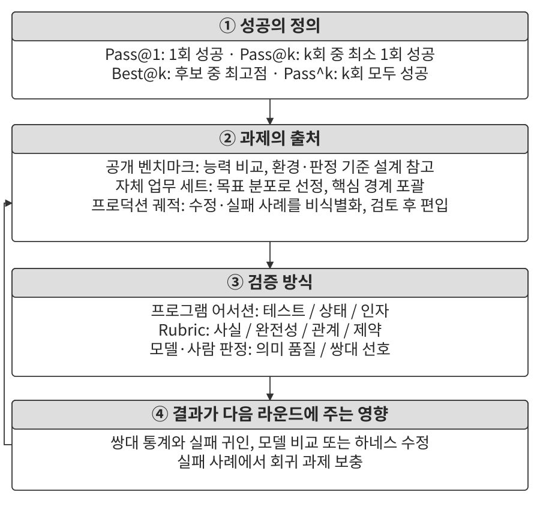
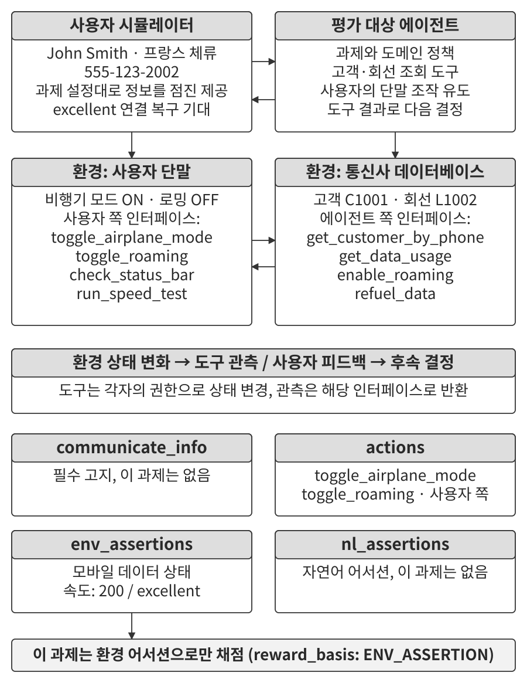
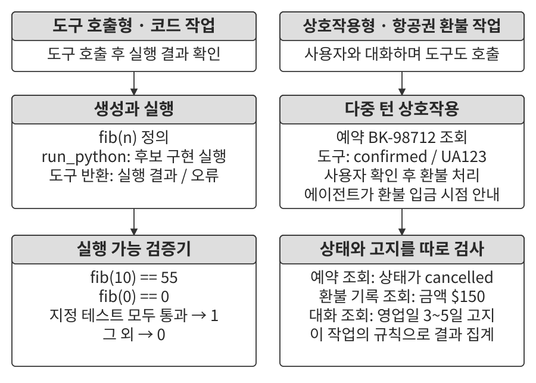
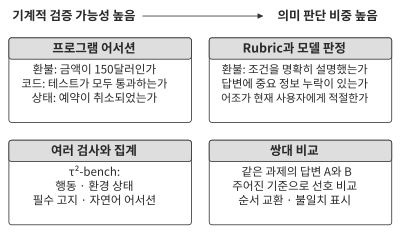
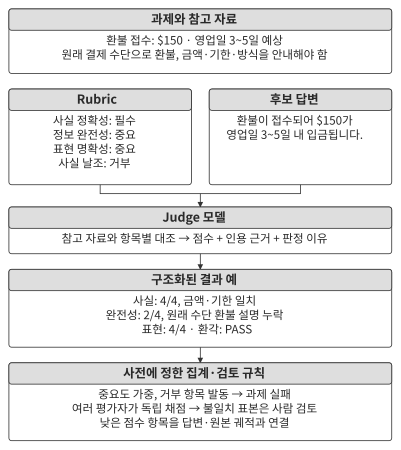
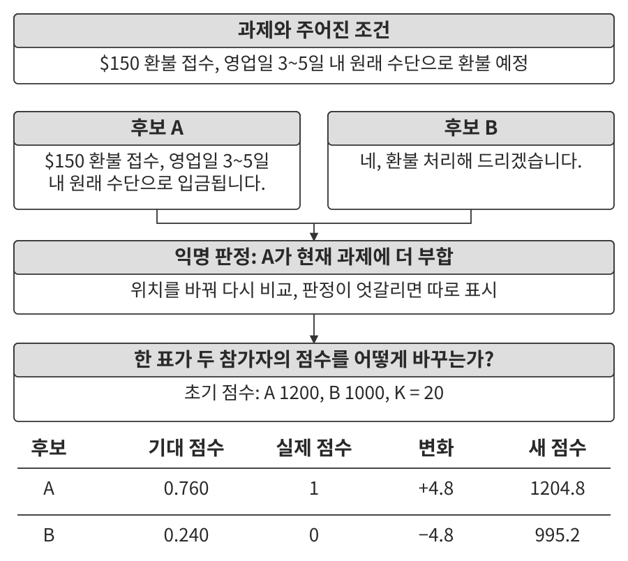
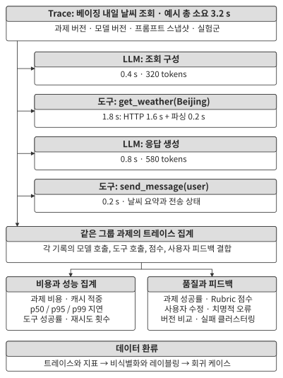
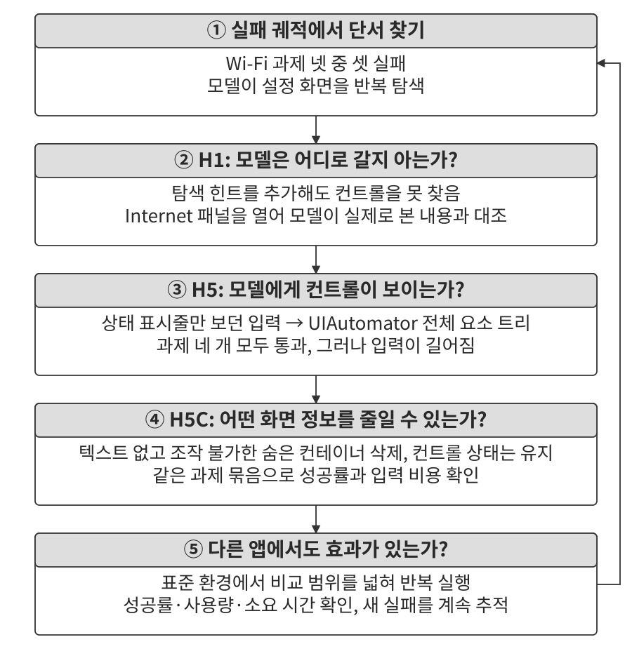
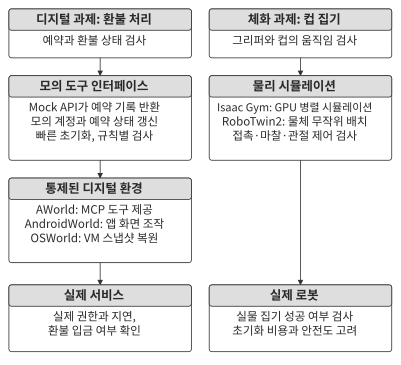
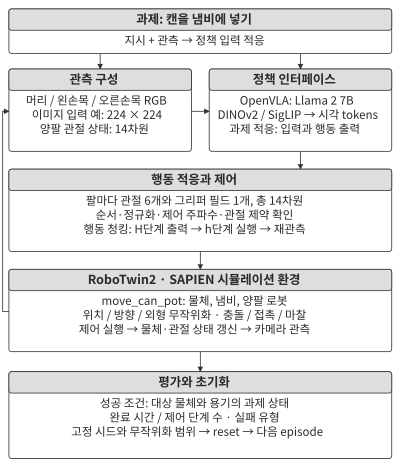

# 에이전트 평가

앞의 여섯 장에서는 단일 에이전트의 구축을 다루었습니다. 컨텍스트, 메모리, 지식 베이스, 도구, 코드, 그리고 관측과 행동 인터페이스입니다. 시스템을 다 만들었다면 반복 가능한 작업 묶음으로 그것이 무엇을 할 수 있는지, 어떤 조건에서 실패하기 쉬운지, 다음에는 어디를 고쳐야 하는지 판단해야 합니다. 평가 결과는 사후 학습과 지속적 진화에 피드백도 제공합니다.

개발 과정의 많은 선택은 실제 작업으로 비교해 봐야 합니다. 어떤 모델을 쓸지, 어떤 도구를 열어 줄지, 지식 베이스에 어떤 내용과 인덱스를 둘지, 사용자 메모리와 프롬프트, 스킬을 어떻게 구성할지, 하네스에 어떤 제약을 더할지 등입니다. 선택들은 서로 영향을 주기도 합니다. 예를 들어 도구 설명을 더 자세히 쓰면 파라미터 오류가 줄 수도 있지만 컨텍스트 비용이 늘 수도 있습니다. 검증 단계를 넣으면 성공률은 오를 수 있지만 완료 시간이 길어집니다.

**비교 실험**은 같은 작업과 조건에서 서로 다른 방안을 비교하고 성공률, 소요 시간, 비용의 변화를 기록합니다. **제거 실험**은 검색 재순위화, 상태 요약, 결과 검증 같은 컴포넌트를 빼거나 끈 뒤 시스템 성능이 어떻게 바뀌는지 관찰합니다. 라운드마다 무엇을 바꿨는지 분명히 하고, 나머지 실행 조건은 그대로 두고, 반복해서 측정하면 엔지니어링 선택과 작업 결과 사이의 관계를 차근차근 세울 수 있습니다. 필자는 비교와 제거 실험을 일상적인 개발에 녹여 넣기를 권합니다. 순조롭게 끝난 궤적 몇 개만 보고 판단하면 우연한 성공을 개선으로 착각하거나, 어떤 작업 유형의 이득만 보고 다른 작업의 퇴화를 놓치기 쉽습니다.

**평가 대상은 모델과 하네스로 이루어진 에이전트 전체여야 합니다.** 모델은 작업을 어떻게 이해하고 어떤 행동을 고를지 결정하고, 하네스는 컨텍스트를 구성하고 도구를 호출하며 상태를 유지하고 검사를 수행합니다. 같은 모델이라도 다른 도구나 피드백 흐름에 연결하면 작업 결과가 달라질 수 있습니다. 제5장에서 소개한 코딩 하네스가 바로 이런 비교 상황을 제공합니다.

모델과 하네스의 궁합은 **모델 교체 실험(model swap)**으로 연구할 수 있습니다. 실행 프레임워크와 작업을 고정한 채 모델만 바꾸고 최종 결과와 오류 분포를 비교합니다. 더 강한 모델도 같은 단계에서 실패한다면 도구가 빠지지 않았는지, 피드백이 제때 오는지, 채점이 목표를 포괄하는지 확인합니다. 작업 성능이 모델에 따라 크게 달라진다면 어떤 추론, 계획, 지시 따르기 능력이 결과에 영향을 주었는지 분석합니다.

모델 교체와 컴포넌트 제거는 교차해서 진행할 수 있습니다. 예를 들어 두 모델에 각각 ‘상태 요약 있음’과 ‘상태 요약 없음’ 두 구성을 실행하게 하고, 요약이 두 모델 모두의 긴 작업 복구를 돕는지, 그 이득이 모델에 따라 달라지는지 확인합니다. 이렇게 하면 모델 간 차이를 분석하면서 어떤 하네스 컴포넌트가 어떤 조건에서 효과가 있는지도 찾을 수 있습니다.

평가는 모델 업그레이드의 회귀 검사이기도 합니다. 새 모델은 공개 벤치마크에서 나아졌어도 일부 업무 작업에서는 퇴화할 수 있고, 자체 작업 세트가 있어야 이런 변화를 볼 수 있습니다. 필자는 ‘미래의 모델을 위한 제품 개발’을 주장합니다. 도구, 업무 흐름, 평가 세트를 미리 완성해 두고 같은 작업에서 새 모델의 성능을 계속 추적하다가, 성공률과 응답 시간, 비용이 제품 요구를 충족하면 그때 출시를 진행하는 것입니다.

출시 요구를 어떻게 하나의 평가로 옮길까요? 그림 7-1을 읽을 때는 테스트 한 번을 따라 내려가 보세요. 무엇을 측정할지, 작업을 어디서 고를지, 어떤 증거로 성공을 판정할지, 마지막으로 결과를 어떻게 기록하고 비교할지입니다.



## 작업 하나로 이해하는 평가: τ²-bench의 telecom 도메인

먼저 휴대폰 인터넷 장애 하나를 보겠습니다. John Smith는 555-123-2002 번호를 쓰고 있고 지금 프랑스에 있으며, 휴대폰 상태 표시줄에 ‘No Service’가 떠 있습니다. 그는 네트워크가 복구되기를 원하고, 속도 테스트 결과가 excellent여야 문제가 해결되었다고 봅니다. 필요하면 2.0 GB 데이터를 충전할 의향이 있지만 현재 요금제는 유지하고 싶어 합니다.

이 사례는 Sierra의 τ²-bench telecom 도메인에서 가져왔습니다. 환경은 통신사 백엔드와 사용자 기기를 함께 시뮬레이션하고, 상담 에이전트와 사용자 시뮬레이터는 각자 도구를 통해 그중 일부 상태를 읽고 바꿉니다. 평가는 양쪽의 상호작용을 따라가며 문제가 어떻게 발견되었는지, 조작이 어떻게 실행되었는지, 그리고 최종적으로 네트워크가 복구되었는지를 확인해야 합니다.[^ch7-tau2-task]

### 작업 정의의 네 가지 구성 요소

다른 상담 에이전트에게 같은 문제를 풀게 하려면 먼저 휴대폰과 계정 상태를 되살리고, 시뮬레이션된 사용자가 같은 요구에 따라 점검에 협조하게 한 뒤, 마지막에 같은 기준으로 채점해야 합니다. 아래 표는 작업 정의의 네 부분입니다. 표를 읽을 때 한 가지 차이에 주목하세요. 출제자는 휴대폰의 초기 설정을 알고 있습니다. 그렇다면 상담원과 사용자는 대화가 시작될 때 각각 얼마나 알고 있을까요?

| 부분 | 필드 | 이 사례의 내용 |
| --- | --- | --- |
| 티켓 | `ticket` | 사용자, 번호, 체류 국가, 인터넷이 안 되는 증상, 속도 요구와 요금제 제약 |
| 사용자 시나리오 | `user_scenario.instructions` | 사용자가 무엇을 아는지, 질문을 받으면 어떻게 조회하는지, 언제 해결을 확인하는지 |
| 초기 상태 | `initial_state.initialization_actions` | 사용자 신원과 위치 설정, 비행기 모드 켜기, 기기 로밍 끄기, 통신사 쪽 로밍 개통 |
| 채점 기준 | `evaluation_criteria` | 동작과 환경 상태를 검사하고 `reward_basis`로 점수 항목을 지정 |

**사용자는 무엇을 아는가.** `known_info`는 이름, 번호, 체류 국가를 제공합니다. 비행기 모드가 켜져 있고 기기 로밍이 꺼져 있다는 사실은 환경 상태에 저장되어 있으므로, 사용자 시뮬레이터가 도구를 호출해 조회해야 상담원에게 알려 줄 수 있습니다. 사용자가 아는 내용을 별도 필드로 두어야 시뮬레이터가 바로 답할 수 있는 정보와 실제로 조회해야 하는 정보를 구분할 수 있습니다. 프롬프트에 ‘한꺼번에 다 말하지 말라’고 요구하는 것만으로는 어떤 사실을 언제 밝힐지 안정적으로 통제하기 어렵습니다. 이 배치가 점진적 정보 공개(Progressive Information Disclosure)를 구현합니다. 대화는 ‘인터넷이 안 돼요’에서 시작하고, 에이전트는 질문과 조작 안내를 통해 진단에 필요한 정보를 조금씩 얻습니다.

**사용자는 어떻게 응답하는가.** `task_instructions`는 첫 복구 시도가 실패하면 가벼운 불만을 드러내고, 속도 테스트가 excellent일 때만 해결을 확인하며, 기기에 관한 답변은 도구 결과에 근거하라고 규정합니다. poor, fair, good은 모두 이 작업의 목표에 미치지 못합니다. 사실 기반 응답(Grounding)은 사용자가 시뮬레이션 환경의 실제 상태에 근거해 응답하게 합니다. 이 제약이 없으면 시뮬레이션된 사용자가 상담원의 ‘이제 될 겁니다’에 맞장구를 칠 수 있고, 양쪽 대화는 순조로워 보여도 기기 장애는 그대로 남습니다.

**양쪽은 어떤 상태에서 출발하는가.** 사용자 쪽은 `set_user_info`로 신원을 설정하고 `set_user_location(abroad=true)`로 해외에 있음을 나타낸 뒤 `turn_airplane_mode_on`과 `turn_roaming_off`를 실행합니다. 통신사 쪽은 `enable_roaming`으로 고객 `C1001`의 회선 `L1002`에 로밍을 개통합니다. 그래서 백엔드 조회에서는 로밍이 개통된 것으로 보이지만, 휴대폰은 비행기 모드와 기기 로밍 설정 때문에 여전히 인터넷에 연결되지 않습니다. 상담원은 사용자에게 기기를 확인하도록 안내해야 백엔드 조회가 주지 않는 정보를 얻을 수 있습니다.

**어떤 검사가 점수를 결정하는가.** `actions`에는 사용자 쪽의 `toggle_airplane_mode`와 `toggle_roaming`이 들어 있습니다. `env_assertions`에는 모바일 데이터 상태 검사와, 파라미터가 `expected_speed=200`, `expected_desc="excellent"`인 속도 테스트 검사가 있습니다. 작업 형식에는 `communicate_info`와 `nl_assertions`도 있어 각각 사용자에게 반드시 알려야 할 정보와 자연어 어서션을 기술하는데, 이 작업에서는 둘 다 비어 있습니다.

이 작업의 `reward_basis`는 `ENV_ASSERTION`을 선택하므로 총보상은 환경 어서션으로 결정됩니다. 동작 검사도 결과에 나타날 수 있지만 총점에 반영되는지는 채점 설정이 정합니다.

### 실행 궤적을 따라 결과 확인하기

함께 제공되는 실행 기록에서는 telecom 작업 다섯 개를 골라 각각 한 번씩 실행했습니다. 상담 에이전트와 사용자 시뮬레이터 모두 GPT-4.1 mini를 사용했고, 최종적으로 네 작업이 통과했습니다. 아래에서는 먼저 앞의 프랑스 로밍 작업을 분석하고, 이어서 실패한 작업과 비교합니다.

> **실험 7-1 ★: τ²-bench 실행 및 τ-bench로부터의 진화 비교**
>
> 먼저 작업 하나의 사용자 시나리오, 초기화 동작, 채점 조건을 읽은 다음 전체 상호작용을 한 번 실행합니다. 궤적을 따라 상담원의 조회, 사용자의 조작, 상태 변화, 인수 결과를 표시하고, 각 판단이 어떤 정보에 근거했는지 확인합니다.
>
> τ-bench와 τ²-bench를 비교할 때는 사용자가 도구로 환경을 바꿀 수 있는지, 그리고 그 변화가 상담원에게 어떤 협조 요구를 가져오는지에 주목합니다.
>
> 그림 7-2를 볼 때는 먼저 누가 휴대폰의 비행기 모드를 끌 수 있는지, 다음으로 누가 통신사의 로밍 설정을 바꿀 수 있는지 찾아보세요. 양쪽이 할 수 있는 일이 다르다는 점이, 상담원이 자기 쪽 조작을 마친 뒤에도 사용자에게 휴대폰에서 속도 테스트를 해 달라고 부탁해야 하는 이유입니다.
>
> 

프랑스 로밍 작업에서 에이전트는 먼저 계정을 식별합니다. 번호로 고객 `C1001`을 찾고 `L1001`, `L1002`, `L1003`의 데이터 사용량을 조회했지만, `L1001`의 상세 정보만 보고 잘못된 결론을 내렸습니다. 사용자가 알려 준 555-123-2002는 활성 회선에 없고 가장 가까운 번호는 555-123-2001이라는 것입니다. 사용자가 번호가 맞다고 고집하자 에이전트는 `L1002`를 조회했고, 그제야 올바른 회선을 확인했습니다.

이어서 사용자 시뮬레이터가 `check_network_status`와 `check_status_bar`를 호출합니다. 반환된 상태는 비행기 모드 켜짐, 셀룰러 서비스 없음, 모바일 데이터 켜짐, 기기 로밍 꺼짐이었습니다. 사용자는 이를 근거로 “휴대폰이 비행기 모드이고 데이터 로밍도 꺼져 있어요. 비행기 모드부터 꺼야 할까요?”라고 알립니다. 여기서 조회는 사용자 쪽 도구가 수행했고, 결과는 대화를 통해 상담원에게 전달되었습니다.

이것이 **이중 제어(Dual-Control)** 메커니즘입니다. 상담원은 통신사 백엔드를 조회하고 조작하며, 사용자 시뮬레이터는 상태 표시줄 확인, 비행기 모드 전환, SIM 카드 재장착, 속도 테스트 같은 독자적인 기기 도구를 가집니다. 양쪽은 소통으로 조작을 조율하고, 환경은 각자가 만든 상태 변화를 기록합니다.

에이전트는 이어서 사용자에게 비행기 모드를 끄고 기기 로밍을 켜도록 안내했고, 상태 표시줄에 5G 신호가 나타났습니다. 사용자가 `run_speed_test`를 실행해 275 Mbps, Excellent 결과를 얻은 뒤 문제 해결을 확인합니다. 두 환경 어서션이 모두 통과해 이 작업의 보상은 1.0입니다.

이 성공 궤적에도 과정상의 문제가 드러납니다. 정책은 상담원이 한 번에 도구 하나만 호출하도록 요구하지만, 에이전트는 한 메시지에서 `get_customer_by_phone`과 `get_customer_by_name`을 함께 호출했습니다. 이 작업의 총점에는 환경 어서션만 반영되므로 이 행동은 보상을 바꾸지 않았습니다.

다른 실패 궤적에서는 회선을 잘못 고른 뒤 끝내 바로잡지 못했고, 이후 진단도 함께 빗나갔습니다. 사용자 번호는 여전히 555-123-2002였는데 에이전트는 `L1001`을 골라 그 회선의 3.2/5 GB 사용량을 근거로 진단을 이어 갔습니다. 도구가 `L1001`은 555-123-2001에 해당한다고 이미 반환했는데도 회선을 고치지 않았고, 여러 턴에 걸친 무관한 진단 끝에 사람 상담원에게 이관했습니다. 사용자 쪽은 데이터 절약 모드를 끄는 데 성공했지만, 올바른 회선 `L1002`에 필요한 2 GB 충전은 실행되지 않아 세 환경 어서션이 모두 실패했습니다.

두 궤적을 비교하면 최종 점수를 구체적인 개선점으로 풀어 볼 수 있습니다. 번호와 회선의 대응을 확인할 것, 새 증거로 판단을 고칠 것, 기기 상태와 백엔드 상태를 구분할 것, 필요한 충전이 완료되었는지 검증할 것입니다. 뒤의 실패 귀인 절에서 긴 궤적에서 이런 결정적 전환점을 찾는 방법을 계속 다룹니다.

[^ch7-tau2-task]: Sierra Research의 τ²-bench는 telecom 도메인의 `user_tools.py`에 사용자 도구를 정의하고, 채점 진입점은 `evaluator.py`입니다. 사례 내용과 결과는 함께 제공되는 저장소에 보존된 다섯 작업과 실행 궤적을 바탕으로 정리했습니다.

## 평가 지표: 성공의 정의

다섯 작업 중 네 작업 통과는 이번 실행의 전체 성적입니다. 이것으로 제품 결정을 내리려면 작업 유형과 실패의 대가를 분명히 해야 합니다. 환불 상담은 조건을 충족하는 환불을 꾸준히 처리해야 합니다. 프로그램을 작성할 때는 여러 구현을 만들어 테스트로 제대로 실행되고 올바른 결과를 내는 버전을 고를 수 있고, 연구에서도 여러 가설을 제시한 뒤 연구자가 검증할 수 있습니다. 평가 지표는 이런 사용 방식에 맞아야 합니다.

### 기술적 경이: Pass@k로 여러 번의 시도 능력 측정하기

필자는 인상 깊은 에이전트 시연 일부를 ‘기술적 경이’라고 부릅니다. 시스템에 충분한 시간과 시도 기회를 주었더니 이전에는 자동으로 하기 어려웠던 작업을 해낸 경우입니다. 탐색형 작업에서는 검증된 성공 궤적 하나만으로도 가치가 생길 수 있습니다. **Pass@k** 지표가 이런 사용 방식에 대응합니다. 같은 작업을 $k$ 번 실행해 적어도 한 번 통과하면 성공으로 칩니다. 연속 점수로 채점하는 작업은 $k$ 번 중 최고 점수를 보고할 수도 있으며, 이를 **Best@k**라고 부릅니다.

예를 들어 Anthropic은 여러 Claude 인스턴스가 협업해 C 컴파일러를 만들게 하여, 장시간 실행과 테스트 피드백, 작업 분담이 복잡한 엔지니어링을 뒷받침할 수 있음을 보였습니다. 연구자가 수학 반례를 찾을 때도 모델에게 여러 번 시도하게 한 뒤 그중 한 반례가 성립하는지 독립적으로 검증할 수 있습니다. 소프트웨어 보안 검토에서는 모델이 보고한 의심 문제를 재확인하고, 열린 창작에서는 여러 작품 가운데 나은 것을 고를 수 있습니다.[^ch7-long-running]

응용 제품도 복잡한 작업으로 능력을 보여 줍니다. Manus는 에이전트에게 가상 컴퓨터를 맡겨, 에이전트가 화면을 조작하고 자료를 찾으며 꾸준히 일을 해 나가는 모습을 사용자가 볼 수 있게 했습니다. OpenClaw는 메신저로 위임을 받고, 설정되고 허락된 파일과 서비스에 접근하며, 진행 상황을 보고하고 추가 정보를 요청하고, 정해진 시각에 깨어나 할 일을 확인하기도 합니다. 이런 구체적인 행동 덕분에 사용자는 에이전트의 쓰임새를 더 쉽게 이해합니다.

필자가 보기에 새로운 유형의 작업을 해내는 시연은 이 제품들이 사용자를 끌어들인 중요한 요인입니다.

### 비즈니스 신뢰성: Pass^k에 주목하기

업무 흐름은 대개 여러 번 실행해도 매번 올바르게 전달하기를 요구합니다. **Pass^k**는 같은 작업을 $k$ 번 실행해 매번 통과하는 경우를 측정하며, ‘pass power k’로 읽습니다. 작업의 통과 조건은 최종 결과, 정책 준수, 권한 제약을 함께 포함할 수 있고, 실행할 때마다 같은 조건으로 검사합니다.

각 실행이 서로 독립이고 단회 성공 확률이 모두 $p$ 라고 가정하면 다음과 같습니다.

$$
\mathrm{Pass@k}=1-(1-p)^k,\qquad
\mathrm{Pass}^{k}=p^k.
$$

예를 들어 $p=0.6$, $k=5$ 일 때 Pass@5는 약 99.0%, Pass^5는 약 7.8%입니다. 앞의 수치는 다섯 번 시도하면 대개 한 번은 성공한다는 뜻이고, 뒤의 수치는 다섯 번 모두 성공할 확률이 여전히 매우 낮다는 뜻입니다.

실제 결과를 읽을 때는 공식을 잠시 미뤄 두어도 됩니다. 같은 문제를 다섯 번 실행한 결과가 ‘통과, 실패, 통과, 통과, 실패’라고 합시다. 이 묶음의 Pass@5는 1, Pass^5는 0이고, 단회 성공률은 3/5로 추정됩니다. 위의 99.0%와 7.8%는 다른 질문에 답합니다. 매번 성공 확률이 0.6이라는 것을 안다면, 다섯 번을 한 묶음으로 삼아 반복할 때 각 기준을 충족하는 묶음이 얼마나 되는가입니다.

같은 기록으로 더 쉽게 확인할 수 있는 질문에도 답할 수 있습니다. 방금의 다섯 번 실행에서 아무 두 번을 고르면, 통과하는 짝은 몇 퍼센트일까요? 실행 하나하나를 카드 한 장으로 보고 비복원으로 두 장을 뽑으면 열 가지 짝이 나옵니다. 실패 카드 두 장으로 이루어진 짝만 두 번 모두 실패하므로 아홉 짝은 적어도 한 번 성공하고, Pass@2의 표본 추정치는 9/10입니다. 성공 카드 세 장으로는 세 짝을 만들 수 있으므로 Pass^2의 표본 추정치는 3/10입니다. τ²-bench는 작업별로 바로 이렇게 모두 통과한 조합을 셉니다. 한 문제를 $n$ 번 실행해 $s$ 번 성공했을 때 그중 $k$ 번을 고르면, 모두 통과한 조합의 비율은 $\binom{s}{k}/\binom{n}{k}$ 이며 $1\le k\le n$ 입니다.[^ch7-tau2-metrics]

이제 실험 7-1의 4/5를 다시 읽어 봅시다. 그 다섯 궤적은 다섯 문제에 각각 속하므로 문제마다 카드가 한 장뿐이어서 짝 하나도 만들 수 없습니다. 이 작업들의 Pass^2를 추정하려면 문제마다 독립 실행을 늘린 뒤 각각 계산해 합쳐야 합니다. 0.8을 그대로 제곱하면 이 문제들의 매번 성공 확률이 모두 같고 각 시도가 서로 독립이라고 추가로 가정하는 셈입니다.

[^ch7-tau2-metrics]: τ²-bench의 실험 버전(리비전 8d005b0)은 `agent_metrics.py`에서 문제별로 Pass^k를 계산합니다. 성공 횟수가 $k$ 보다 적으면 모두 통과한 조합의 수는 0입니다.

계산할 때는 통계 단위를 일관되게 유지해야 합니다. 같은 작업을 다섯 번 표집한 것은 그 작업의 반복 성능을 측정하고, 프로덕션에서 연속된 서로 다른 작업 다섯 개는 작업 난이도와 트래픽 분포의 영향도 받습니다. 작업마다 성공 확률이 다르다면 작업별 반복 성공 지표를 먼저 계산한 뒤 작업 가중치로 합칠 수 있습니다. 공유 상태, 캐시, 같은 장애도 여러 실행을 서로 상관되게 만듭니다.

**‘정보 부족’이라는 답을 허용할 때 분모는 무엇으로 할까요?** 문헌 어시스턴트가 문제 100개를 받아 80개에 답했고 그중 68개가 맞았다고 합시다. 주어진 답에 의존하는 독자는 68/80, 즉 85%에 관심이 있습니다. 이 묶음의 일을 끝내야 하는 사람은 68/100, 즉 68%에도 관심이 있습니다. 나머지 20개는 증거를 더 찾거나 사람에게 넘겨야 합니다.

PaperQA2는 LitQA2 문헌 문제 248개에서 바로 ‘정보 부족’을 고를 수 있습니다. 논문은 세 번 실행한 평균을 보고합니다. 시스템이 실질적인 답을 내놓은 경우의 정답률은 85.2%이고, 전체 문제 기준 정답률은 66.0%이며, 21.9%는 정보 부족을 골랐습니다. 사람 응답자 아홉 명의 해당 정답률은 73.8%와 67.7%였습니다. 논문은 첫 번째 차이는 유의하고 두 번째 차이는 통계적으로 유의하지 않다고 보고합니다.[^ch7-paperqa2-denominators]

[^ch7-paperqa2-denominators]: Skarlinski 외, *Language Agents Achieve Superhuman Synthesis of Scientific Knowledge*, 2024, 제2절과 그림 2 참조.

최종 상태가 같은 두 궤적도 비용은 다를 수 있습니다. 청구서 조회를 예로 들면, 갑은 한 번의 조회로 올바른 금액을 돌려받았습니다. 을은 두 번 조회한 뒤에야 같은 답을 냈습니다. 두 조회가 같은 요청 식별자를 달고 있고 첫 번째가 타임아웃되었다면, 재시도가 작업을 복구하도록 도운 것입니다. 첫 번째 결과가 이미 제대로 전달되었다면 두 번째 조회는 대기 시간과 도구 비용만 늘린 셈입니다.

실행에 쓰기나 기타 외부 효과가 따른다면, 시도마다 먼저 정해진 초기 상태로 되돌리고 테스트 환경에서 조작을 마치며 모든 시도를 기록합니다. 제품이 실패 후 재시도를 허용한다면 재시도 횟수, 복구 단계, 실행 비용을 함께 흐름 평가에 넣습니다. 원래의 실패 기록은 계속 보존해서 단회 성능과 복구 후 결과를 구분할 수 있게 합니다.

[^ch7-long-running]: Anthropic, Building a C compiler with a team of parallel Claudes, 2026-02-05. 다중 인스턴스 협업, 장시간 실행, 테스트 피드백을 소개합니다.

## 평가 환경

앞에서 회선을 잘못 고른 그 실행을 다시 검토한다고 합시다. 검토자는 같은 사용자, 같은 두 회선, 같은 초기 요금제를 보아야 합니다. 첫 실행이 이미 그중 한 회선을 바꿔 놓았다면 그냥 다시 실행해서는 결과 변화가 모델 때문인지 데이터베이스 때문인지 판단할 수 없습니다. 평가 환경은 작업의 출발점을 세우고, 상호작용 인터페이스를 제공하고, 과정을 기록하고, 종착점을 검사하는 일을 맡습니다.

### 다섯 가지 구성 요소

telecom 작업을 예로 들면 평가 환경은 다섯 부분으로 나눌 수 있습니다.

**데이터셋(Dataset)**은 작업 정의를 저장합니다. 사용자 배경, 행동 요구, 초기 상태, 인수 조건입니다. 레코드 하나가 테스트 케이스 하나에 해당하고, 실행 시에는 참여자의 역할에 따라 정보를 나누어 줍니다.

**환경 상태(Environment State)**는 작업 실행 중의 가변 정보를 저장합니다. 고객, 회선, 요금제, 청구서, 그리고 기기의 비행기 모드, 로밍, 데이터 절약 설정 등입니다. 새 라운드를 시작할 때 환경은 먼저 기본 데이터를 되살린 뒤 `initialization_actions`를 실행해 이번 작업이 규정한 장애를 만듭니다. 정리와 초기화가 맞물려야 이전 라운드의 충전이나 설정 변화가 다음 라운드로 넘어가지 않습니다.

**도구 인터페이스(Tools)**는 참여자가 무엇을 읽고 바꿀 수 있는지 결정합니다. 상담원은 고객 조회, 사용량 확인, 데이터 충전, 사람 상담원 연결을 할 수 있고, 사용자는 기기 상태 확인, 스위치 전환, 속도 테스트를 할 수 있습니다. 도구의 입도는 측정하려는 능력에 맞아야 합니다. 진단과 계획을 평가하려면 에이전트가 조회와 조작을 조합하게 해야 합니다. ‘인터넷 문제 해결’ 도구를 바로 제공하면 테스트의 초점은 이 능력을 언제 호출하느냐로 옮겨 갑니다.

**채점 기준(Rubric)**은 결과를 어떻게 판단할지 설명합니다. telecom 작업은 동작, 환경 상태, 필요한 소통, 자연어 요구를 검사할 수 있고, `reward_basis`로 어떤 검사가 총점에 반영될지 정합니다.

**실행 프로토콜(Interaction Protocol)**은 발화, 도구 호출, 종료를 조율합니다. 사용자 시뮬레이터는 `###STOP###`을 출력해 상호작용을 끝낼 수 있고, 실행기는 턴 수 같은 예산도 둡니다. 종료 사유와 작업 점수는 따로 기록합니다. 사용자가 대화를 멈춘 뒤에도 목표 달성 여부는 환경 어서션이 판단하고, 예산을 다 썼을 때도 마지막 상태와 끝내지 못한 단계를 보존해야 합니다.

### 인간-컴퓨터 상호작용형과 도구 호출형 평가 환경

telecom 작업에는 계속 응답하고 기기를 조작하는 사용자 시뮬레이터가 들어 있습니다. 반면 코드 수정, 데이터 분석, 수학 풀이는 대개 작업 지시로 시작하고, 이후 에이전트는 주로 도구와 상호작용합니다. 두 유형 모두 작업, 상태, 인터페이스, 채점, 실행 프로토콜이 필요합니다. 차이는 대화 상대까지 시뮬레이션해야 하는지, 그리고 양쪽이 행동을 어떻게 조율하는지에 있습니다.

코드 작업은 테스트로 출력을 검사할 수 있고, 데이터베이스 작업은 변경된 레코드를 조회할 수 있으며, 열린 분석은 사람이나 모델에게 내용 검토를 맡겨야 할 수도 있습니다. 인간-컴퓨터 상호작용 작업은 대개 두 가지 증거를 맞춰 봐야 합니다. 예를 들어 휴대폰 네트워크가 복구되었는지는 기기 상태를 보고, 상담원이 번호를 명확히 하고 사용자의 조작을 안내했는지는 대화를 봐야 합니다. 그림 7-3의 환불도 마찬가지입니다. 주문이 취소되었는지는 데이터베이스에서 확인할 수 있지만, 상담원이 입금 시기를 알렸는지는 대화에서 찾아야 합니다.



Verifiers에서는 이 두 유형의 작업을 서로 다른 환경 인터페이스에서 시작할 수 있습니다. 표 7-1은 v0.1.9에서 단일 턴 응답, 다중 턴 도구 호출, 실행 상태 주입, 샌드박스 자원 관리를 다루는 인터페이스를 정리해 코드와 대조하기 쉽게 했습니다.[^ch7-verifiers-env]

표 7-1 Verifiers 환경 유형 비교

| 환경 유형 | 주요 역할 | 도구와 상태 처리 | 대표 사례 |
|---|---|---|---|
| `SingleTurnEnv` | 단일 턴 응답 구성 | 한 번 답한 뒤 채점 | 수학 문제, 단일 턴 문답 |
| `ToolEnv` | 다중 턴 도구 상호작용 구성 | 실행 궤적을 저장하고 도구를 호출해 결과를 받음 | 검색과 정보 종합 |
| `StatefulToolEnv` | 실행 상태를 도구 실행에 연결 | 현재 상태에 따라 도구 파라미터를 보충하거나 상태를 갱신 | 이번 작업에 데이터베이스나 자원 식별자를 바인딩 |
| `SandboxEnv` | 격리된 실행 환경 관리 | 실행마다 샌드박스를 배정하고 그 안의 도구를 사용 | 코드 실행, 파일과 테스트 결과 확인 |

예를 들어 두 작업이 동시에 데이터베이스를 수정한다면, 실행기는 각자의 데이터베이스 식별자를 도구 호출에 주입해 궤적마다 해당 데이터를 조작하게 할 수 있습니다. 실행이 실패하면 도구는 객체가 없음, 파라미터가 요구에 맞지 않음, 서비스 타임아웃처럼 다음 판단에 쓸 수 있는 정보를 돌려줘야 합니다. 평가 시스템이 관측, 호출, 실행 결과, 보상을 저장해 두면 분석할 때 오류를 구체적인 단계로 짚을 수 있습니다.

[^ch7-verifiers-env]: Prime Intellect, Verifiers v0.1.9의 ToolEnv와 StatefulToolEnv. 다중 턴 궤적, 도구 호출 분배, 상태 파라미터 주입을 보여 줍니다.

## 평가 데이터셋의 설계

이제 telecom 문제 다섯 개를 출시 결정을 이끌 수 있는 평가 세트로 넓혀 봅시다. 새로 넣은 문제가 모두 ‘지정한 번호에 로밍을 개통하라’라면, 시스템은 같은 계정 안의 두 회선을 구별하는 법을 전혀 배우지 못했어도 높은 점수를 받을 수 있습니다. 성적으로 상담 에이전트의 출시 여부를 정하려면 실제 티켓을 참고해 문제를 골라야 합니다. 일상 업무도 있고 회선을 헷갈리기 쉬운 어려운 문제도 있어야 하며, 채점할 때는 상담원이 최종적으로 어느 회선을 바꿨는지까지 확인해야 합니다. 출시 후에도 이 문제들을 유지보수해서 사용자가 실제로 맡기는 일을 계속 반영하게 해야 합니다.

### 벤치마크 설계 비교

표 7-2는 여섯 벤치마크를 측정 능력, 작업 출처, 실행 환경, 검증 방식으로 나란히 놓은 것입니다.

표 7-2 몇몇 에이전트 벤치마크의 핵심 설계 선택

| 벤치마크 | 측정 능력 | 작업 출처와 구성 | 실행 환경 | 검증 방식 |
|---|---|---|---|---|
| τ²-bench | 상담 상호작용과 도구 조작 | 도메인 작업과 장애 조합 | 사용자 시뮬레이터, 기기와 업무 데이터베이스 | 항목별 검사, `reward_basis`로 채점 |
| SWE-bench Verified | 코드 문제 수정 | 실제 GitHub issue, 사람이 선별 | 코드 저장소와 테스트 환경 | `FAIL_TO_PASS`와 `PASS_TO_PASS` 테스트 |
| AndroidWorld | Android 앱 조작 | 파라미터화된 작업 템플릿 | 실제 앱이 돌아가는 Android 에뮬레이터 | 기기, 파일, 앱 내부 상태 읽기 |
| OSWorld | 데스크톱과 앱 간 조작 | 실제 사용 상황, 작업 출발점 설정 | 가상 머신과 데스크톱 앱 | 작업별 실행 상태와 산출물 검사 |
| Terminal-Bench | 터미널에서의 엔지니어링 작업 | 사람이 설계한 작업과 테스트 | 컨테이너와 작업에 필요한 의존성 | 파일, 프로그램 실행, 테스트 결과 |
| GAIA | 범용 어시스턴트의 정보 처리 | 사람이 작성한 문제, 일부는 자료 첨부 | 네트워크, 파일, 보조 도구 | 답 형식에 따라 정규화한 뒤 비교 |

### 검증기

검증기는 작업 목표를 확인 가능한 증거와 연결합니다. 코드 작업은 테스트를 실행해야 하고, 데스크톱 작업은 앱이나 파일 상태를 읽어야 하며, 정보 검색 작업은 답과 출처를 대조해야 합니다. **인수는 독립적으로 얻은 증거를 기준으로 해야 합니다.** 에이전트는 모든 단계를 마쳤다고 주장하는 그럴듯한 보고서를 만들어 낼 수 있습니다. 그래도 검증기는 산출물을 실제로 실행하고, 상태를 읽고, 출처를 대조해야 합니다. 완료 보고는 검사 대상을 찾는 데 쓰고, 점수는 이런 검사가 정합니다.

사용자가 결제 앱을 열고 어시스턴트에게 ‘이번 달 룸메이트가 보낸 송금 요청을 전부 승인해 줘’라고 부탁한다고 합시다. 대기 중인 요청이 세 건 있습니다. 룸메이트의 이번 달 요청, 같은 룸메이트의 지난달 요청, 동료의 이번 달 요청입니다. 첫 번째는 승인되어야 하고 나머지 두 건은 대기 상태로 남아야 합니다. 첫 번째만 확인하면 세 건을 모두 승인한 어시스턴트도 만점을 받고, 나머지 두 건만 확인하면 아무것도 하지 않은 어시스턴트도 통과합니다. AppWorld는 시뮬레이션된 결제 앱에서 이 문제를 냈습니다. 검증기를 설계할 때는 먼저 조작 전 데이터로 사용자가 승인한 요청 묶음을 확정하고, 그것들이 모두 승인되었는지 확인한 뒤, 마지막으로 조작 후 기록에서 거꾸로 확인합니다. 어시스턴트가 또 어떤 건을 건드렸을까요?[^ch7-appworld-scope]

[^ch7-appworld-scope]: Trivedi 외, *AppWorld*, ACL 2024. 그림 2에 작업과 인수 조건이 나와 있습니다.

과학 탐색도 검증하기 쉬운 산출물을 내놓을 수 있습니다. FunSearch는 8차원 공간에서 점을 가능한 한 많이 고르는 문제를 다룹니다. 각 차원은 0, 1, 2 중 하나만 가질 수 있고 연산은 모듈로 3으로 하며, 고른 점 가운데 어떤 세 점도 한 직선 위에 있으면 안 됩니다. 연구자는 점을 하나씩 고르는 프로그램 골격을 작성하고, 모델에게 후보 점의 순서를 정하는 함수를 제안하게 한 뒤, 실제로 만들어진 합법적인 점 집합의 크기로 채점했습니다. 논문 발표 당시 기존 구성은 496개의 점을 고를 수 있었는데, 새 프로그램은 512개 점의 목록을 내놓았습니다.[^ch7-funsearch-cap]

목록만 내려받아 이 결과를 직접 확인할 수 있습니다. 먼저 서로 다른 8차원 벡터가 512개 있고 각 좌표가 정해진 범위 안에 있는지 확인합니다. 그다음 서로 다른 두 점 $a,b$ 를 고르면, 그 두 점을 지나는 직선에는 점이 세 개뿐이고 세 번째 점은 $c=-a-b \pmod{3}$ 입니다. 예를 들어 2차원에서 $(0,0)$ 과 $(1,2)$ 를 고르면 세 번째 점은 $(2,1)$ 입니다. 같은 연산을 8차원에 좌표별로 적용해 목록의 서로 다른 점 쌍 130,816개를 모두 훑었을 때 얻은 세 번째 점이 하나도 목록에 없다면, 적어도 512개를 고를 수 있다는 증명으로 충분합니다. 513개가 절대 불가능하다는 것을 보이려면 별도의 상한 증명이 필요합니다.

[^ch7-funsearch-cap]: Romera-Paredes 외, *Mathematical discoveries from program search with large language models*, Nature, 2023년 온라인 게재. 저자들은 8차원 점 집합과 검증용 계산 노트북을 별도로 공개했습니다.

**SWE-bench의 두 종류 테스트는 각각 수정과 회귀를 확인합니다.** `FAIL_TO_PASS`는 수정 전에는 실패하고 수정 후에는 통과해야 하는 테스트이고, `PASS_TO_PASS`는 원래 통과했고 수정 후에도 계속 통과해야 하는 테스트입니다. 앞의 것은 지정된 문제를, 뒤의 것은 기존 테스트가 다루는 동작이 유지되는지를 확인합니다.[^ch7-swe-verified]

**OSWorld는 실행 기반 검증으로 앱 산출물을 확인합니다.** 원래 버전은 실행 기반 평가 함수 134개를 제공하며, 작업 설정에 따라 파일, 앱 데이터, 시스템 상태를 읽습니다.[^ch7-osworld-design] 예를 들어 표를 수정하라는 작업에서는 지정된 셀과 수식을 확인하고, 브라우저 설정을 바꾸라는 작업에서는 관련 설정을 읽을 수 있습니다.

**Terminal-Bench는 실행 결과로 엔지니어링 작업을 검증합니다.** Linux 커널 빌드 사례는 소스 수정, 컴파일, initramfs, QEMU 부팅을 하나로 이어 놓았습니다. Linux 6.9, `start_kernel`에 넣은 사용자 정의 `printk`, 그리고 부팅 로그에 나오는 메시지가 모두 구체적인 확인 지점이 됩니다.

제5장에서는 주문 데이터로 매출을 대조하는 일을 다루었습니다. 어시스턴트가 스무 개 채널의 분기 보고서를 가져왔다면 어디서부터 확인해야 할까요? Tencent WorkBuddy Bench에는 공개된 장부 대조 문제가 있습니다. 두 워크시트 모두 채널 데이터인데, 정산액은 전기 대비로 보므로 직전 분기와 비교해야 하고, 회수액은 전년 동기 대비로 보므로 전년 같은 분기와 비교해야 합니다. 두 기준 시점을 모두 직전 분기로 채워도 표 머리와 채널 수는 완전히 맞을 수 있습니다. 정산표의 ‘진슈생활관’을 예로 들면, 명세에서 중복 행과 분기가 빠진 레코드를 제거하고 채널과 분기별로 합산하면 거래 총액이 1,569,231.00에서 1,787,311.03으로 늘어 차이가 218,080.03임을 계산할 수 있습니다. 채점 프로그램은 두 표의 채널 포함 여부를 확인한 뒤 지정된 두 채널의 수치를 표본 검사합니다. 이 문제에서 채널 포함 검사는 스무 곳 전부에 미치지만, 수치 검사는 뽑힌 두 곳에만 해당합니다.[^ch7-workbuddy-office]

[^ch7-workbuddy-office]: Tencent WorkBuddy Bench 사무 작업 `channel-period-compare-L4-017`. 사용한 데이터 패키지(리비전 3e8ad83)에는 원본 워크북, 참고 답안, 채점 프로그램이 포함되어 있습니다.

시간에 민감한 작업으로 검증기를 시험해 볼 수 있습니다. 사용자가 어느 호텔 객실 가격이 950위안 아래로 내려가면 알려 달라고 했다고 합시다. 가격은 10:00에 1000위안이었고 10:10에 900위안으로 내렸다가 10:15에 다시 1000위안이 되었습니다. 10:12에 객실 유형과 예약 링크가 담긴 가격 하락 알림을 보냈다면 사용자는 아직 예약할 기회가 있습니다. 매일 ‘아직 가격이 내리지 않았습니다’를 한 번씩 보내다가 하필 이 5분을 놓쳤다면, 일주일 내내 실행했더라도 위임을 완수하지 못한 것입니다. 채점할 때는 조건을 충족한 구간의 수, 구간 안에서 제때 알린 횟수, 변화가 없을 때 사용자를 방해한 횟수를 각각 기록합니다. 평가자도 하루 한 번의 가격만 저장했다면 놓친 구간은 아예 셀 수조차 없습니다. 누락을 측정하려면 먼저 타임스탬프가 붙은 완전한 가격 재생 데이터를 준비하고, 평가 대상 시스템이 자기 주기대로 조회하게 해야 합니다.

### 작업의 난이도 구분

작업 세트는 여러 난이도를 포함해야 하고, 그 난이도가 어디서 오는지도 설명해야 합니다. 기초 작업은 능력이 퇴화했는지 확인하고, 어려운 작업은 이후 모델 발전을 측정할 여지를 남깁니다. 문제가 금세 모두 통과된다면 평가 세트는 더 이상 모델 선택을 이끌기 어렵습니다. 도구 종류, 조작 길이, 정보 분산 정도, 환경 불확실성, 필요한 전문 지식으로 나눈 뒤 시스템이 어떤 조건에서 뚜렷하게 나빠지는지 볼 수 있습니다.

GAIA의 466문항은 세 단계로 나뉩니다. 쉬운 작업은 대개 적은 도구와 단계만 필요하고, 어려운 작업은 여러 단계의 정보 통합과 복잡한 조합이 필요합니다. 원 논문에서 사람 주석자의 세 단계 정답률은 93.9%, 91.8%, 87.3%였고, 플러그인을 붙인 GPT-4는 30.3%, 9.7%, 0%였습니다.[^ch7-gaia-design]

Terminal-Bench의 작업 범위도 넓습니다. 모델 등록은 MLflow 사용과 관련되고, 다중 컴포넌트 배포는 Git 서비스와 웹 서비스를 조율해야 하며, 비밀번호 복구와 FEAL 차분 분석에는 전문적인 알고리즘 지식이 더해집니다.

업무 작업은 정책의 경계도 다루어야 합니다. 예를 들어 사용자가 상담원이 주문 취소를 이미 승인했다고 주장하면, 시스템은 권한과 주문 상태를 조회한 뒤 정책에 따라 취소 여부를 정해야 합니다. 이런 사례는 에이전트가 서로 충돌하는 정보를 증거로 어떻게 처리하는지 시험하며, 정상 처리 작업과 짝지어 둘 수 있습니다.

### 데이터 유출 방지

**여러 출처의 조합과 전용 첨부 파일.** 모델이 검색 결과에서 문제와 완성된 답을 찾을 수 있다면, 한 번 맞혔다고 해서 검색과 추론 능력을 얼마나 증명할 수 있을까요? GAIA는 다단계 탐색과 전용 첨부 파일로 이런 기회를 줄입니다. 예를 들어 특정 날짜의 천문 사진에서 우주비행사를 식별하고, 그가 속한 우주비행사 그룹을 찾고, 구성원들의 우주 체류 시간을 비교한 뒤, 요구대로 성과 분 단위 값을 출력하게 합니다. 세미콜론, 수치 반올림, 천 단위 구분자가 모두 답의 형식 약속입니다. 따로 만든 PDF, 오디오, 이미지가 입력 조합을 늘립니다. 공개된 문제는 학습 자료에 들어갈 수 있습니다. 그래서 평가 전용 문제를 따로 남겨 두고, 어떤 문제가 이미 학습에 쓰였는지 기록해야 합니다.[^ch7-gaia-design]

**파라미터화된 인스턴스.** AndroidWorld는 작업마다 초기화, 실행 검사, 정리 로직을 제공하고, 파라미터로 서로 다른 인스턴스를 생성합니다.[^ch7-androidworld-design] 예를 들어 ‘연락처 `[CONTACT_NAME]`의 전화번호를 `[NEW_PHONE]`으로 바꾼다’는 조작 목표는 그대로 둔 채 연락처와 번호를 바꿀 수 있습니다. 파라미터 변화로 모델이 현재 작업에 근거해 행동하는지 확인할 수 있고, 일부 파라미터를 고정하고 나머지를 바꾸면 특정 요인의 영향을 연구하기도 쉽습니다.

**카나리아 식별자.** 벤치마크 파일에 고유한 canary GUID를 심어 두면 데이터가 복사되었거나 다른 말뭉치에 섞인 단서를 찾는 데 도움이 됩니다. Terminal-Bench의 작업 파일이 이런 표시를 씁니다. 유출을 판단할 때는 모델이 현재 컨텍스트나 검색 결과에서 그 식별자를 보았는지도 확인하고 데이터 출처 추적과 결합해야 합니다. 표시를 발견하면 조사를 시작할 수 있지만, 학습 데이터의 귀속은 추가 증거가 필요합니다.

### 품질 관리와 장기 유지보수

같은 telecom 문제가 어제는 통과하고 오늘은 실패했다면, 에이전트의 변화를 확인하는 것 말고도 다음 질문에 답할 수 있어야 합니다. 초기 회선이 바뀌었는가? 사용자 시뮬레이터가 여전히 같은 규칙대로 협조하는가? 판정 조건이 같은 목표를 측정하는가? 한 번의 실행의 출발점, 상호작용, 종착점을 따라가면 다섯 가지 유지보수 작업을 정리할 수 있습니다.

1. **사용자 정보 범위를 명확히 합니다.** `known_info`를 행동 요구와 분리해 조회와 명확화 단계에 분명한 정보 출발점을 줍니다.
2. **인수 조건을 분명히 씁니다.** ‘네트워크 복구’를 모바일 데이터 상태, 속도 값과 등급으로 구체화해 작업이 실제로 요구하는 효과를 확인합니다.
3. **시뮬레이션 사용자의 응답 근거를 제약합니다.** 기기 상태는 도구 반환값에서 오고, 감정과 인내심 규칙은 상호작용을 구성하는 데 씁니다.
4. **양쪽의 조작을 표현합니다.** 사용자와 상담원이 각자 환경을 바꾸고, 이후 결정은 사용 가능한 도구나 대화로 새 상태 정보를 얻습니다.
5. **작업과 장애를 조합합니다.** 명확한 생성 규칙 아래 장애 조합과 작업 파라미터를 바꾸고, 인스턴스가 풀 수 있는지, 초기 상태가 작업 정의에 맞는지 확인합니다.

**SWE-bench Verified는 공개 전의 수작업 선별을 보여 줍니다.** 프로젝트는 Python 경험이 있는 개발자 93명을 모아 무작위로 뽑은 1699개 표본에 주석을 달게 했습니다. 문제 설명이 충분한지, 테스트가 합리적인 해법을 배제하지 않는지를 중점적으로 확인하고 수정 난이도를 추정했으며, 표본마다 세 명의 주석자가 독립적으로 검사했습니다. 공개된 Verified 세트는 500개 표본입니다.[^ch7-swe-verified] 선별 규칙과 난이도 분포를 함께 공개해야 사용자는 작업 세트를 줄인 뒤 어떤 능력 요구가 남았는지 판단할 수 있습니다. 에이전트 작업은 여러 번의 모델 호출과 환경 조작이 필요한 경우가 많아, 모호하거나 풀 수 없는 문제는 회귀 때마다 예산을 거듭 소모합니다. 필자는 작업 수를 늘리기 전에 이런 잡음부터 정리하기를 권합니다. 품질 좋은 작은 평가 세트가 자주 돌리기에 더 알맞고 실패를 설명하기도 쉽습니다.

**OSWorld-Verified는 공개 후의 유지보수를 보여 줍니다.** 프로젝트는 초판 공개 약 15개월 뒤 300개가 넘는 피드백을 정리하고 수정했는데, 약 10명 규모 팀이 두 달 동안 집중적으로 작업했습니다.[^ch7-osworld-verified]

예를 들어 웹페이지 구조가 바뀌면 상태 추출을 갱신해야 하고, 문서 작업을 시작하기 전에는 앱이 로드되고 파일이 열리고 커서가 지정된 위치에 있는지 확인해야 하며, 검증 조건을 고친 뒤에는 올바른 산출물과 잘못된 산출물로 회귀 검사를 해야 합니다.

> **실험 7-2 ★: 벤치마크 작업을 직접 수행하기**
>
> GAIA, AndroidWorld, SWE-bench Verified, Terminal-Bench, OSWorld-Verified, τ²-bench에서 작업을 고르되, 유형마다 그 벤치마크의 난이도 정의에 따라 쉬움, 보통, 어려움을 하나씩 고릅니다. 먼저 작업을 직접 완수한 뒤 공식 채점을 확인하고, 조작 경로, 마주친 모호함, 최종 산출물을 기록합니다.
>
> 함께 제공되는 자료에는 Codex가 이 여섯 벤치마크를 조작한 사례 18개가 보존되어 있어 자신의 접근과 비교해 볼 수 있습니다. 그중 GAIA의 원자 간 거리 문제는 반올림 형식에서 채점기와 어긋났고, AndroidWorld의 곱셈 문제는 840을 계산해 낸 뒤에도 화면이 요구된 성공 상태에 이르지 못했습니다. τ²-bench는 로컬 모델로 숨겨진 사용자를 시뮬레이션했습니다. 18개 사례 중 13개가 통과했습니다.
>
> 마친 뒤 분석합니다. 문제가 여러 합리적인 해석을 허용하는지, 검증기가 그 해석들을 포괄하는지, 올바른 중간 결과를 얻은 뒤에도 인수를 통과하려면 어떤 조작을 더 해야 하는지입니다.

### 평가 세트의 세 가지 출처

프로덕션 평가는 공개 벤치마크, 자체 구축 업무 작업, 프로덕션 궤적을 결합할 수 있습니다. 셋은 서로 다른 역할을 맡으며 함께 시스템의 사용 범위를 포괄합니다.

**공개 벤치마크**는 모델의 초기 비교에 적합하고, 작업 설계, 파라미터화 생성, 검증기에 대한 참고도 제공합니다. 필자는 이것으로 후보 모델을 1차로 거르고, 자체 업무 세트의 결과로 모델 선택과 출시를 결정합니다.

**자체 구축 업무 세트**는 실제 사용자 목표, 도구, 정책을 중심으로 작업을 구성하며 모델 선택과 하네스 개선에 씁니다. τ²-bench의 구조를 빌려 도메인 데이터, 사용자 시나리오, 도구와 상태 검사를 구성한 뒤 작업 난이도와 사용자 시뮬레이터의 행동을 보정할 수 있습니다.

**프로덕션 궤적 환류**는 실제 실행에서 빠진 부분을 찾아냅니다. 사용자 정정, 부정적 피드백, 업무 상태 이상, 궤적 검토에서 발견된 오류 등입니다. 승인된 처리와 비식별화를 거친 뒤 사람이 실패 원인을 확인하고, 필요한 작업 조건을 되살려 회귀 세트에 넣습니다. 사용자 피드백은 문제를 짚는 단서이고, 채점 레이블은 실제 상태와 대조해 확정해야 합니다.

시작 단계에서는 공개 벤치마크와 손으로 쓴 소량의 업무 작업을 쓸 수 있습니다. 출시 후에는 실제 오류와 새로운 업무 상황을 회귀 사례가 늘어나는 주된 출처로 삼아야 합니다. 이런 작업은 사용자가 마주친 문제에서 곧바로 오므로, 설계 단계에서 빠뜨린 조건을 계속 메워 줍니다.

[^ch7-swe-verified]: OpenAI, Introducing SWE-bench Verified, 2024. 테스트 분류, 주석 기준, 수작업 선별을 소개합니다.
[^ch7-osworld-design]: OSWorld 프로젝트 설명은 작업 초기화와 실행 기반 평가를 나열하며, 평가 함수 134개는 원래 버전 기준입니다.
[^ch7-gaia-design]: Grégoire Mialon 외, GAIA: A Benchmark for General AI Assistants. 원 논문은 작업 등급, 답 규범, 사람과 모델의 구성을 설명합니다.
[^ch7-androidworld-design]: Christopher Rawles 외, AndroidWorld: A Dynamic Benchmarking Environment for Autonomous Agents. 파라미터화된 작업과 기기 상태 인수를 소개합니다.
[^ch7-osworld-verified]: XLANG Lab, Introducing OSWorld-Verified, 2025. 커뮤니티 피드백, 초기화와 검증기 수정을 소개합니다.

## 자동화 평가 방법

자동화 평가는 무엇을 검사할지 분명히 하는 데서 시작합니다. SWE-bench는 테스트 스위트로 코드 동작을 검사하고, AndroidWorld는 앱 상태를 조회하며, GAIA는 답 유형에 따라 정규화한 뒤 답을 비교합니다. 이런 검사는 프로그램으로 실행할 수 있어 반복 실행에 적합합니다. τ²-bench는 여러 판정 기준을 조합합니다. 도구 호출과 환경 상태는 직접 대조할 수 있고, 자연어 요구는 모델에게 판정을 맡길 수도 있습니다. 한 작업에 두 방법이 모두 필요한 경우가 많습니다.

프로그램 검사도 진단 정보를 줄 수 있습니다. 이 장 첫머리의 telecom 작업에서 로밍 설정, 데이터 잔량, 충전 동작을 각각 검사하면 어떤 조건이 아직 충족되지 않았는지 알 수 있습니다. 회선을 잘못 고른 시점까지 짚으려면 검사 결과를 호출 궤적과 연결해야 합니다.

열린 출력은 품질 요구를 더 구체적으로 적어야 합니다. 민원 회신은 처리 방안을 밝히고 고객의 감정과 문제에 맞아야 하며, 조사 보고서는 핵심 사실을 다루고 결론이 출처로 뒷받침되어야 하고, 메모리 응답은 인물, 시간, 사건을 올바르게 연결해야 합니다. 이런 요구에는 **루브릭(Rubric, 채점 기준)**으로 항목별 판정 기준을 나열하고, **LLM-as-a-Judge(모델 판정)**에게 자료에 근거해 채점하게 할 수 있습니다.

**프로그램으로 검증할 수 있는 조건이라면, 필자는 프로그램 검사로 작성하는 쪽을 우선합니다.** 형식, 수치, 권한, 최종 상태에는 대개 명확한 판정 기준이 있고, 입력과 환경을 고정하면 반복해서 검사할 수 있으며 비용도 예측하기 쉽습니다. 같은 응답에 두 채점 방식이 다 쓰일 수도 있습니다. 그림 7-4에서 환불 금액 확인은 숫자를 비교하면 되지만, 상담원이 환불 조건을 분명히 설명했는지 판단하려면 문단 전체를 읽고 이해해야 합니다. 이 항목은 모델에게 채점을 맡기고 사람이 표본을 뽑아 보정할 수 있습니다.



### LLM-as-a-Judge: 품질 요구를 항목별 채점으로 바꾸기

그림 7-5에서 상담원은 환불 금액과 예상 입금 시기를 정확히 알렸는데, 완전성은 왜 2점만 받았을까요? 채점 기준은 환불이 어디로 들어가는지도 설명하라고 요구했는데, 답변에서 ‘원래 결제 수단으로 환불’이 빠졌습니다. 판정 모델이 어떤 항목을 빠뜨렸는지 짚으려면 작업, 채점 기준, 참고 자료를 함께 보아야 합니다.



판정 모델은 먼저 보정해야 합니다. 흔한 문제는 **길이 편향**입니다. 내용이 비슷할 때 더 긴 응답이 더 높은 점수를 받을 수 있습니다. 사실과 결론은 같고 표현 길이만 다른 표본을 준비해 점수가 분량에 따라 바뀌는지 확인할 수 있습니다. 두 응답을 함께 평가할 때는 앞뒤 순서를 바꿔 판정 모델이 다른 쪽을 고르는지 볼 수 있습니다. 작업 자체에 간결성 요구가 있다면 루브릭에 적고 적절한 길이의 예시를 줍니다. 대량 통계에서 ‘높은 점수와 긴 응답이 상관된다’는 것은 단서를 찾는 데 쓰고, 이어서 정보량, 정확성, 작업 난이도를 비교해 구체적인 원인을 가려야 합니다.

**루브릭의 네 가지 설계 원칙.** Scale AI의 ‘Rubrics as Rewards’는 전문가 지침, 포괄적 범위, 중요도 가중치, 자체 완결성의 네 원칙을 제시했습니다.[^ch7-rubrics] 에이전트 평가에서는 다음과 같이 적용할 수 있습니다.

(1) **전문가 지침에 기반합니다.** 먼저 업무를 잘 아는 사람에게 참고 답안, 핵심 사실, 틀리기 쉬운 관계를 쓰게 합니다. 예를 들어 메모리 작업이라면 누가 어느 보험 증권을 가지고 있는지, 옛 주소가 언제 새 주소로 바뀌었는지 분명히 해야 합니다.

(2) **포괄적으로 다룹니다.** 필요한 정보, 관계 판단, 표현 요구, 그리고 위험도가 높은 오류인 **함정(Pitfall)**을 함께 나열합니다. 상담 회신이라면 요청에 응답했는지, 다음 단계를 제시했는지, 환불 약속을 지어내지 않았는지 확인할 수 있습니다.

(3) **중요도에 따라 가중치를 둡니다.** 필수 항목(Essential), 중요 항목(Important), 선택 항목(Optional)을 구분하고 함정에는 감점 규칙을 정합니다. 작업 실패로 바로 이어지는 오류에는 **즉시 탈락(Veto)**을 둘 수 있습니다. 예를 들어 메모리 작업에서 사용자의 계좌 번호를 지어냈다면, 표현이 매끄럽고 다른 정보가 다 갖추어져 있어도 그 작업은 실패로 판정합니다.

(4) **평가 기준을 자체 완결적으로 씁니다.** 판단에 필요한 사실, 조건, 허용 범위를 평가 항목에 적어 둡니다. 예를 들어 ‘고객의 현재 주소를 정확히 답한다’는 ‘갱신된 상하이 주소를 답한다. 베이징 주소는 이후 대화에서 폐기되었다’로 구체화할 수 있습니다.

각 차원에는 명확한 점수 단계와 경계 사례도 필요합니다. 먼저 응답 한 묶음으로 시범 채점을 하고, 사람과 모델 사이, 평가자들 사이의 불일치를 모은 뒤 판례를 보충합니다. 예를 들어 요구된 키워드를 담았지만 두 사람의 경험을 하나로 섞어 버린 답은 관계 판단에서 감점해야 합니다. 이런 판례는 **보상 해킹(Reward Hacking)**을 찾아내는 데 도움이 됩니다. 시스템은 높은 점수를 받았는데 실제 행동은 작업 목표에서 벗어난 경우입니다.

아래에서는 세션을 가로지르는 메모리 문제 하나에 완전한 루브릭을 설계합니다. 첫 번째 대화 기록에는 ‘내 딸 이름은 Lily’라고 적혀 있고, 두 번째에는 ‘Lily의 소아과 의사는 Dr. Chen이고, 오늘 데리고 재진료를 다녀왔다’라고 적혀 있습니다. 사용자가 “제 딸의 소아과 의사는 누구죠?”라고 묻습니다. 두 기록이 함께 ‘따님 Lily의 소아과 의사는 Dr. Chen입니다’를 뒷받침합니다.

| 차원과 중요도 | 4점: 우수 | 3점: 양호 | 2점: 부분 충족 | 1점: 미충족 |
| --- | --- | --- | --- | --- |
| 사실 정확성: 필수 | 의사 이름과 인물 관계가 모두 정확함 | Dr. Chen이라고 정확히 답하되 인물 호칭은 생략함 | Dr. Chen을 언급하지만 다른 의사도 가능한 답으로 나열함 | 의사 이름이 틀리거나, 증거가 충분한데도 모른다고 답함 |
| 정보 완전성: 중요 | ‘Lily—소아과 의사—Dr. Chen’의 대응 관계를 분명히 밝힘 | 의사 이름을 간결하게 답해 현재 질문을 충족함 | 진료 기관이나 사건만 답하고 의사 이름을 빠뜨림 | 관련 정보를 제공하지 않음 |
| 연결 정확성: 중요 | 두 기록을 올바르게 연결하고, 설명이 필요할 때 해당 근거를 인용함 | 응답의 인물 관계는 정확하나 근거를 펼치지 않음 | 관련 인물은 찾았지만 관계가 여전히 모호함 | 사용자 본인이나 다른 자녀의 의사를 Lily와 연결함 |

**환각 감지는 별도로 즉시 탈락을 적용합니다.** 응답의 사실은 대화 기록으로 뒷받침되어야 합니다. 진료 날짜, 진단 결과, 의사 신원을 지어내면 실패로 판정합니다. 이 예에서는 즉시 탈락이 걸리면 총점을 0으로 한다고 정합니다. 연결 정확성은 응답, 인용, 관측 가능한 궤적에 근거해 채점하며, 간결한 응답으로도 작업을 완수할 수 있습니다.

경계 사례가 채점이 실제 대화를 다룰 수 있는지를 결정합니다. 사용자에게 딸이 여럿이고 질문의 지칭이 모호하다면 올바른 행동은 되묻는 것입니다. 기록이 이미 Lily를 분명히 가리킨다면 바로 답해도 됩니다. ‘Dr. Chen’과 ‘천 선생님’이 같은 사람인지는 기록 속 별칭, 기관, 인물 관계를 함께 보고 확인해야 합니다.

**채점 항목이 많다면 판정 모델에게 먼저 평가를 맡길 수 있습니다.** 응답이 천 개이고 각각 스무 항목을 확인해야 한다면 판단은 2만 건이 됩니다. 표의 인물 관계를 예로 들면, ‘Dr. Chen은 Lily의 소아과 의사다’와 ‘Dr. Chen은 내 소아과 의사이고, Lily가 함께 가 준 적이 있다’는 같은 인명을 담고 있지만 결론은 다릅니다. 이름, 어순, 부정어마다 일치 규칙을 하나하나 쓰기보다 판정 기준을 한 문장으로 쓰는 편이 낫습니다. ‘질문과 두 대화 기록을 함께 볼 때, 응답은 이 의사를 사용자의 딸과 올바르게 연결했는가?’ 이 자료와 평가할 응답, 판정 기준을 Jev 같은 판정 모델에 넘기고 ‘충족’, ‘미충족’, ‘판정 불가’ 중에서 고르게 합니다. 이 질문 하나로 의사를 엉뚱한 사람과 연결한 응답을 가려낼 수 있습니다. 표의 연결 정확성 네 단계를 구분하려면 네 단계의 판정 기준을 바로 선택지로 나열하고, 재검토용으로 ‘판정 불가’를 따로 남겨 둡니다. 같은 응답의 여러 차원은 병렬로 판정하고, 마지막에 프로그램이 항목별 점수를 합산하며 환각 즉시 탈락 같은 명확한 규칙을 실행합니다.

이 채점 방식을 빨리 쓰려면 TypeSafe가 공식 제공하는 Jev 같은 프런티어 판정 모델을 바로 호출하면 됩니다. 채점 규칙을 프롬프트로 쓰고 고를 수 있는 단계를 제시한 뒤, 매번 평가할 응답과 해당 대화 기록을 넣으면 판정 결과를 빠르게 얻을 수 있습니다. 매일 같은 규칙으로 많은 응답을 평가해야 하고 건당 비용을 더 낮추고 싶다면 자체 판정 모델을 증류할 수 있습니다. 먼저 평가 설계자가 각 단계의 판정 기준을 분명히 쓰고, DeepSeek, Kimi, GPT, Claude, Gemini 같은 프런티어 모델을 교사로 삼아 규칙대로 표본을 채점하게 합니다. 검토를 마친 ‘자료, 응답, 교사가 매긴 단계’를 합성 학습 세트로 묶고, 제8장의 지도 미세조정 방법으로 더 작은 학생 모델을 학습합니다. 학습을 마친 학생 모델이 일상적인 채점을 맡을 수 있습니다.

> **실험 7-3 ★★: 루브릭 기반 사용자 메모리 평가 시스템 구축하기**
>
> 제3장의 사용자 메모리 평가 프레임워크에 구조화된 채점을 구현하고, 기본 회상, 여러 세션 간 모호성 해소, 세션 간 숨은 연관의 세 층 작업을 다룹니다. 평가 차원은 사실 정확성, 사실 완전성, 연결 정확성, 능동성, 그리고 독립적인 환각 감지입니다.
>
> 사실 정확성은 숫자, 날짜, 이름 등 제공한 정보를 확인하고, 사실 완전성은 응답에 들어가야 할 핵심 사실을 확인합니다. 연결 정확성은 인물, 시간, 사건 사이의 관계를 확인하고, 능동성은 적절한 때 근거 있는 제안이나 위험 경고를 내놓는지 확인합니다. 앞의 네 항목은 4단계로 채점하고 단계마다 명확한 판정 기준을 주며 예시와 경계 사례를 보충합니다. 환각 감지는 즉시 탈락 항목으로 둡니다.
>
> 구현에서는 앞의 두 항목의 필드 이름으로 Precision과 Recall을 그대로 쓰지만, 기록되는 것은 루브릭 단계입니다. 통계적 의미의 정밀도와 재현율을 보고하려면 셀 수 있는 사실 단위를 따로 정의하고, 제공한 사실 가운데 올바른 사실의 비율과 전체 필수 사실 가운데 다룬 필수 사실의 비율을 각각 계산해야 합니다.
>
> 실험 결과를 읽을 때는 먼저 작업 통과 여부를 보고, 그다음 몇 점을 받았는지 봅니다. 사실 정확성, 사실 완전성, 연결 정확성이 모두 3점 이상이고 환각 즉시 탈락이 걸리지 않으면 작업은 통과입니다. 연속 보상은 능동성까지 포함합니다. 네 항목을 각각 $(s-1)/3$ 로 환산한 뒤 평균을 내고, 환각이 나오면 보상은 0이 됩니다. 예를 들어 실험 7-12에는 BGE-M3로 검색하고 재순위화를 건너뛴 채 Doubao가 답한 구성이 있습니다. 그중 보험 청구 문제 하나는 네 항목이 차례로 3, 3, 3, 2점을 받았습니다. 이 문제는 작업을 통과했고 연속 보상은 약 0.583입니다.

> **실험 7-4 ★★: Advanced JSON Cards와 RAG 비교 평가**
>
> 같은 60개 질문에서 세 메모리 방식을 비교합니다. 순수 Advanced JSON Cards는 구조화된 카드를 컨텍스트에 넣고, 순수 RAG는 대화를 청크로 나눈 뒤 관련 내용을 검색하며, 하이브리드 시스템은 핵심 사실을 컨텍스트에 상주시키고 원본 대화를 필요할 때 검색합니다. 세 층에 각각 20문항이 있어 ‘방식—질문’ 조합은 모두 180개입니다.
>
> 세 방식은 같은 질문, 출처 대화, 응답 모델, 채점 규칙을 사용하며, 층별 성공률, 환각 즉시 탈락, 비용을 각각 집계합니다. 더 나아가 같은 문제의 세 결과를 맞춰 놓고, 하이브리드 시스템이 어떤 문제에서 서로를 보완하고 어떤 문제에서 정보 선택이나 융합 때문에 손해를 보는지 분석합니다.

표 7-3은 이 실험의 과거 집계를 그대로 옮긴 것입니다. 층마다 20문항이므로 표에서 5퍼센트포인트 차이는 한 문항 차이입니다.

표 7-3 세 가지 사용자 메모리 시스템의 층별 성공률

| 시스템 | 기본 회상 | 여러 세션 간 모호성 해소 | 세션 간 숨은 연관 | 전체 |
| --- | ---: | ---: | ---: | ---: |
| Advanced JSON Cards | 95% | 60% | 50% | 68.3%(41/60) |
| RAG | 90% | 40% | 15% | 48.3%(29/60) |
| 하이브리드 시스템 | 80% | 70% | 50% | 66.7%(40/60) |

먼저 순수 RAG를 봅시다. 기본 회상 문제에서 RAG는 18문항, 카드 방식은 19문항을 맞혔습니다. 세션 간 숨은 연관 문제에서는 순수 RAG가 3문항만 맞혔고 카드 방식은 10문항을 맞혔습니다. 이 7문항의 차이가 어디서 왔는지 알려면, 먼저 RAG가 틀린 문제 하나를 골라 연관을 세우는 데 필요한 두 대화가 검색 결과에 들어 있는지 봅니다. 둘 다 있다면, 응답이 어떤 두 사람이나 두 사건을 서로 연결했는지 확인합니다. 성공률만 봐서는 자료를 다 찾지 못한 것인지, 모델이 자료를 읽고도 관계를 잘못 이은 것인지 구별할 수 없습니다.

**두 메모리 메커니즘을 합치면 두 쪽의 장점을 저절로 얻을까요?** 하이브리드 시스템은 여러 세션 간 모호성 해소에서 14문항을 맞혀, 카드 방식의 12문항과 순수 RAG의 8문항을 앞섰습니다. 하지만 과거 집계에는 따로 봐야 할 두 묶음의 문제도 기록되어 있습니다. 하이브리드 시스템만 맞힌 문제가 3개이고, 적어도 한 단일 방식은 맞혔는데 하이브리드 시스템은 틀린 문제가 8개입니다. 이렇게 계산하면 적어도 한 단일 방식이 맞힐 수 있는 문제는 모두 $40-3+8=45$ 문항이고, 실제로 실행한 하이브리드 시스템은 40문항을 맞혔습니다. 45문항은 사후에 두 답안지를 합쳐서 얻은 참고치입니다. 시스템이 스스로 이 성적을 내려면 답할 때 어떤 메모리를 골라 쓸지라는 문제를 풀어야 합니다. 180번의 판정 가운데 28번은 환각 즉시 탈락이 걸렸습니다.

**동일 계열 모델과 다중 출처 판정.**

에이전트와 판정 모델은 같은 것을 모를 수도 있고, 같은 표현 방식을 선호할 수도 있습니다. 둘이 같은 모델 계열에 속할 때는 특히 이런 선호가 채점에 영향을 주지 않는지 확인해야 합니다. 에이전트가 채점기가 좋아하는 문체는 익혔는데 채점기가 잡아내지 못하는 사실 오류는 계속 저지른다면, 점수는 그래도 오를 수 있습니다. 이것은 평가에서 나타나는 굿하트의 법칙의 한 예입니다. 지표를 최적화 목표로 거듭 삼으면 지표가 실제 품질을 재는 능력을 점점 잃을 수 있습니다.

중요한 버전 출시 전과 핵심 업무의 정기 점검에서는 다중 출처 판정을 권합니다. 서로 다른 모델 계열이 같은 루브릭으로 독립적으로 채점하게 하는 것입니다. 예를 들어 Claude가 작업을 수행하고 GPT와 Gemini가 판정합니다. 먼저 사람이 레이블을 단 표본으로 각 평가자의 정확도와 불일치를 측정한 뒤 어떻게 합칠지 정합니다. 일반 채점은 가중 평균을 쓰고, 핵심 실패 조건은 미리 정한 규칙으로 처리하며, 불일치가 큰 표본은 사람이 다시 검토합니다. 일상 운영에서는 단일 판정 모델을 쓰고, 위의 점검으로 채점 드리프트를 제때 발견할 수 있습니다.

**멀티모달 LLM-as-a-Judge.**

멀티모달 판정은 같은 흐름을 음성, 이미지, 동영상으로 넓힙니다. 채점 자료는 판단할 속성을 담고 있어야 합니다.

- **TTS 평가**: 낭독 정확성, 자연스러움, 감정 표현, 음색 일관성을 확인합니다. 단어 오류율(WER)은 주로 인식된 텍스트의 단어 단위 오류를 반영하므로, 운율과 음색은 음성을 직접 들어야 합니다.
- **ASR 평가**: 작업과 함께 인식 오류의 영향을 판단합니다. 예를 들어 ‘천 원 이체’가 ‘만 원’으로 인식되면 동작 파라미터가 바뀌므로 금액, 날짜, 인명은 핵심 필드로 따로 둘 수 있습니다. 일반 단어의 오류도 맥락과 함께 판단해야 합니다.
- **UI 평가**: 제안자—검토자 모드로 스크린샷의 텍스트 넘침, 대비, 버튼 위치를 검토하고, 실제 상호작용으로 버튼이 동작하는지 확인합니다. 제5장의 검토 메커니즘을 생성 결과의 평가에 쓰는 것입니다.
- **동영상 편집 평가**: 키프레임으로 화면 내용과 효과를 확인하고, 편집점 근처의 연속 구간으로 시작·종료 시점, 전환, 음성과 화면의 동기화를 확인합니다. 표집 범위는 평가 항목에 따라 정합니다.

> **실험 7-5 ★★: 완전 자동화된 TTS 품질 평가 파이프라인 구축하기**
>
> 4차원 루브릭을 설계합니다. 정확성은 누락, 오독, 추가를 확인하고, 자연스러움은 쉼, 강세, 유창성, 운율을 확인합니다. 감정 표현은 텍스트 맥락과 지정된 스타일에 맞는지 확인하고, 음색 일관성은 목표 화자가 주어졌을 때 참조 음성과 합성 음성을 비교합니다. 감정 채점에는 예시를 제공하고, 언어 습관에 맞추어 의문, 강조, 슬픔 같은 표현을 판단해야 합니다.
>
> 테스트 말뭉치는 단문과 긴 문단, 뉴스와 이야기와 대화, 중립과 흥분과 슬픔의 어조, 그리고 숫자, 고유명사, 다음자, 방언 어휘를 다룹니다. 생성 모듈은 OpenAI, ElevenLabs, Fish Audio, MiniMax, Doubao 등의 서비스에 연결할 수 있습니다. 판정 모듈은 원문, 평가할 합성 음성, 루브릭, 그리고 작업에 필요한 참조 음성을 음성을 직접 입력받는 모델에 넘겨 차원별로 채점하고 근거를 설명하게 합니다.
>
> 서비스, 말뭉치 유형, 채점 차원별로 결과를 집계하고, 점수가 높은 표본, 낮은 표본, 평가가 크게 엇갈린 표본을 골라 사람이 블라인드 청취를 합니다.

함께 제공되는 실험은 두 TTS 구성에서 숫자, 다음자, 긴 문장, 흥분한 어조 네 유형의 표본을 하나씩 뽑아 Voxtral이 직접 들어 평가하게 했고, 채점 기록 8개를 얻었습니다. 5점 척도에서 두 구성의 정확성은 모두 5.00, 자연스러움은 모두 4.00이었습니다. 감정 표현과 음색 일관성의 평균은 Fish Audio가 4.00과 3.00, OpenAI가 3.75와 2.75였습니다. 이 0.25점의 두 차이는 모두 숫자 문제에서 나왔고, 나머지 세 문제의 네 항목 점수는 하나하나 같았습니다. 다음자 문제를 예로 들면 원문 끝은 ‘还得还清所有欠款’(빚을 모두 갚아야 한다)이고, 두 ‘还’는 각각 hái와 huán으로 읽어야 합니다. 평가자는 두 녹음의 정확성에 모두 만점을 주고 이유도 완전히 똑같이 적었지만, 실제로 무엇을 들었는지는 한 글자씩 짚지 않았습니다.

이 실험은 참조 음성이 평가 목표에 어떤 영향을 주는지도 보여 줍니다. 기록의 참조 음성은 Fish S1에서 나왔으므로, 음색 점수는 합성 음성이 이 참조 녹음과 얼마나 비슷하게 들리는지를 잽니다. 범용 TTS를 비교할 때는 낭독, 자연스러움, 스타일을 따로 보고할 수 있습니다. 음성 복제를 비교할 때는 모든 방안이 같은 목표 화자를 흉내 내게 하고, 사람의 블라인드 청취로 유사도 점수를 보정합니다. 참조 자료도 ‘무엇이 좋은가’를 정의합니다. 참고 답안은 답해야 할 내용을 정하고, 참조 이미지나 음성은 비교할 시각적·청각적 특징을 제공합니다.

사람이 쓴 루브릭으로는 진단 차원을 빠르게 세울 수 있습니다. 평가 규모가 커지면 전용 **생성형 보상 모델**을 학습해 채점을 맡길 수도 있으며, 관련 학습 방법은 제8장에서 다룹니다. 다음으로는 항목별 채점을 실행 궤적과 연결해 고칠 수 있는 구체적인 단계를 찾아봅니다.

### 실패 귀인: 전체 궤적에서 첫 오류 찾기

작업이 실패하면 먼저 인수 조건과 실행 궤적을 맞춰 놓고, 작업을 목표에서 가장 먼저 벗어나게 한 결정을 찾습니다. 이 작업을 **실패 귀인(failure attribution)**이라고 합니다. 쓸모 있는 귀인 기록에는 오류 분류, 관련 단계, 도구 호출이나 모델 출력, 판단을 뒷받침하는 증거, 그리고 이후의 영향이 들어가야 합니다. 마지막에 나타난 오류는 앞선 오류가 낳은 결과일 때가 많습니다. 정보의 출처와 상태 변화를 거슬러 올라가야 고칠 만한 위치를 찾을 수 있습니다.

프로덕션 문제는 주로 세 종류의 신호로 발견합니다. 사용자의 명시적 정정, 사용자의 ‘싫어요’나 부정적 피드백, 그리고 사후 상태 검사, 규칙 검증, 모델 검토가 찾아낸 이상입니다. 필자는 개발자가 문제 궤적 한 묶음을 직접 꼼꼼히 읽은 뒤 대량 귀인 흐름을 세우기를 권합니다. 실패 분류에는 제품 판단이 들어갑니다. 어떤 행동에 확인이 필요한지, 어떤 선제적 제안이 선을 넘는지를 먼저 명확한 요구로 바꿔야 주석 모델이 그에 따라 일할 수 있습니다. 예를 들어 ‘사용자 대신 선제적으로 끝내기’와 ‘먼저 사용자에게 확인받기’의 경계는 현재 권한, 동작의 영향, 제품의 약속에 달려 있습니다. 모델은 대량 주석을 도울 수 있고, 이 경계를 보정하는 일은 제품과 엔지니어링 책임자가 맡습니다.

코딩 에이전트를 예로 들면 아래 아홉 가지 문제로 시작할 수 있습니다. 사례가 늘어나면 하위 분류로 나누고, 분류 기준, 긍정·부정 예시, 귀인 흐름을 주석 에이전트의 프롬프트나 스킬에 적어 둡니다.

| 오류 분류 | 전형적 증상 | 위치 찾는 방법 |
| --- | --- | --- |
| 요구 이해와 모호성 처리 | 요구 조건을 빠뜨림. 수정 범위가 어긋남. 같은 이름의 설정 파일 둘 중 하나를 근거 없이 고름 | 사용자 요구와 실제 동작을 대조해 처음 어긋난 곳을 찾고, 그때 얻을 수 있었던 정보를 확인 |
| 절차와 규약 누락 | 저장소가 요구하는 테스트나 계획을 건너뜀. 내부 구현이 있는데 외부 의존성을 들임. 아키텍처 규약 위반 | 명시된 규약을 처음 어긴 동작을 찾고, 규칙이 제공되었거나 읽을 수 있었는지 확인 |
| 도구 호출 오류 | 편집이 반복해서 일치 실패. 파라미터나 schema 오류. 특수 문자 이스케이프 오류 | 원래 요청, 도구 반환, 호출 전 상태를 대조해 인터페이스 약속에 처음 어긋난 입력을 찾음 |
| 검증 왜곡 | 실패를 감추려고 어서션을 고치거나 테스트를 건너뛰거나 검사 대상 로직을 바꿔치기함. 테스트를 돌리지 않고 통과했다고 선언 | 검증 로직을 바꾼 의도를 확인하고, 완료 선언을 실제 실행 기록과 대조 |
| 불완전한 수정 | 함수 시그니처를 바꾸고 동적 호출, 다른 언어의 바인딩, 관련 schema를 빠뜨림 | 영향 범위와 수정된 위치를 대조해 빠뜨린 의존 관계와 검색 과정을 추적 |
| 사용자에게 잘못된 정보 전달 | 금액, 상태, 시각을 잘못 전함. 일부 완료를 전부 완료라고 말함. 필요한 고지를 빠뜨림 | 최종 답변을 도구 결과, 최종 상태, 고지 요구와 항목별로 대조 |
| 호환성과 비기능적 회귀 | 공개 API 변경으로 호출자가 깨짐. 데이터 구조 변경에 필요한 마이그레이션이 없음. 성능이나 자원 소비 퇴화 | 인터페이스 계약, 마이그레이션 요구, 성능 기준선을 확인해 변화를 들여온 단계를 찾음 |
| 실행 이상 | 출력 잘림, 타임아웃, 연결 끊김, 마무리 미완료 | 모델 정지 사유, 하네스 실행 이벤트, 도구 서비스 상태를 맞춰 봄 |
| 작업을 너무 일찍 중단 | 다목표 작업의 일부만 완료. 시도해 볼 합리적 방안이 남았는데 종료 | 남은 목표, 시도한 방안, 정지 조건을 대조해 종료 결정을 찾음 |

귀인 기록은 **직접 오류, 원인 가설, 후속 증상**을 구분해야 합니다. 예를 들어 `edit_file`이 `old_string` 일치 실패를 반환하고 에이전트가 이어서 같은 요청을 세 번 재시도했다면, 일치 실패는 직접 오류이고 세 번의 재시도는 복구 전략의 문제를 보여 줍니다. 호출 전의 파일 내용을 더 살펴봐야 문자열 생성 오류인지, 파일이 동시에 수정되었는지, 도구의 일치 규칙을 잘못 이해했는지 구분할 수 있습니다.

대규모 귀인에서 필자는 먼저 규칙으로 오류가 있을 법한 실행 기록을 찾고, 그다음 모델에게 앞뒤 단계를 함께 보고 원인을 분석하게 합니다. 테스트를 실행했는지, 인터페이스가 바뀌었는지 같은 신호는 싸게 추출할 수 있으므로 모델 호출을 의미 판단이 필요한 부분에 집중할 수 있습니다. 예를 들어 테스트 통과 선언을 실행 기록과 대조하고, 어서션이나 건너뛰기 표시를 건드린 수정을 표시하고, schema 변경에 대응하는 마이그레이션이 있는지 확인합니다. 그런 다음 모델이나 사람이 작업 목표와 함께 그 수정이 타당한지 판단합니다.

#### 최종 상태와 최종 답변을 따로 검증하기

사용자가 받는 것은 에이전트의 최종 답변이고, 업무 시스템에 남는 것은 동작이 만든 상태이므로 둘 다 검증해야 합니다. 환불을 접수했다면 금액, 처리 상태, 다음 단계를 정확히 알려야 하고, 작업을 일부만 마쳤다면 완료한 것과 남은 것을 항목별로 설명해야 합니다. 환경 상태 검사와 필수 고지 검사는 별도의 채점 항목으로 두면 실행 오류와 전달 오류를 구분하기 쉽습니다.

사용자의 위임을 받아 업체에 요금 감면을 요청하는 상담 대행 어시스턴트를 생각해 봅시다. 통화 중 상담원이 “이 요금은 면제해 드리겠습니다”라고 했다면, 녹음으로 **상담원이 구두로 약속했다**는 것을 검증할 수 있습니다. 최종 청구서는 사용자가 받습니다. 사용자에게 보고할 때도 이 동사를 그대로 살려야 합니다. “상담원이 감면을 약속했습니다.” 이런 작업은 구두 약속률로 집계하는 것이 타당합니다. 실제 반영률을 계산하려면 새 청구서나 사용자의 후속 확인이 더 필요합니다.

같은 위임이라도 여러 채널 사이에서 넘겨줘야 할 때가 있습니다. 업체가 사용자에게 직접 다시 전화하기로 했다면, 어시스턴트는 전화 목적, 이미 합의된 사항, 아직 답을 받아야 할 질문을 미리 사용자에게 보낼 수 있습니다. 업체가 본인의 구두 확인을 요구한다면, 어시스턴트는 사용자가 무엇을 해야 하는지 설명하고 삼자 통화를 연결한 뒤 확인이 끝나면 처리를 이어 갑니다. 일회용 인증번호가 필요하면 인증번호 안내를 따라 사용자가 업체가 지정한 신뢰할 수 있는 화면에서 해당 인증을 마치게 합니다. 이런 동작은 어떻게 평가할까요? 회신 전화 사례에서는 사용자가 전화를 받기 전에 인계 요약을 받았는지 확인합니다. 본인 확인 사례에서는 사용자가 올바른 단계에서 합류할 수 있었는지, 확인 뒤에도 작업이 계속 진행되었는지 확인합니다.

AndroidWorld의 이미지 가계부 작업은 또 다른 인과 사슬을 보여 줍니다. 잘못된 데이터가 순조롭게 기록되고, 이어서 에이전트가 작업 완료를 선언합니다. 작업은 이미지 속 지출을 가계부 앱에 입력하는 것이었고, T3A는 32단계에 걸쳐 탐색, 입력, 저장을 마쳤습니다. 8단계의 출력은 이미지 속 구체적인 지출이 보이지 않는다고 분명히 밝혔는데도 계속 진행했고, 11단계에서 ‘Coffee $4.50, Lunch $12.75’ 같은 출처 없는 데이터가 나타났으며, 이후의 입력은 모두 이 데이터를 바탕으로 했습니다. 마지막에 검증기가 이미지에 해당하는 Dress 기록을 찾았을 때, 들어가야 할 항목이 없었습니다.

이 궤적을 분석할 때는 관측 경로와 결정 전략을 함께 확인해야 합니다. T3A가 받는 것은 접근성 요소 트리이며, 이미지 픽셀은 모델의 컨텍스트에 들어가지 않습니다. 그러므로 이미지를 읽는 작업이라면 먼저 스크린샷이나 문자 인식 경로를 보충해야 합니다. 이런 문제를 막연히 ‘모델이 OCR을 못한다’로 기록하면 팀은 모델을 바꾸거나 학습 데이터를 보충하러 가면서, 정작 빠진 입력은 계속 놓치게 됩니다. 현재 정보가 부족한 상태에서 에이전트는 정보를 얻거나 장애를 보고하는 쪽을 골라야 했습니다. 8단계에서 계속 진행한 결정, 이후의 데이터 날조, 마지막의 완료 선언은 이 인과 사슬 위의 서로 다른 문제에 각각 해당합니다.

같은 문제는 과학 연구에서도 나타납니다. Denario 팀은 이런 장애를 보고했습니다. 분석 프로그램이 주어진 데이터를 읽지 못하면 시스템이 때때로 시뮬레이션 데이터를 스스로 만들어 분석을 이어 가면서 사용자에게 알리지 않는다는 것입니다.[^ch7-denario] 독자가 이렇게 만들어진 그래프를 받았다고 생각해 봅시다. 스크립트를 다시 돌려 똑같은 곡선을 그릴 수 있어도 답하지 못한 질문이 하나 남습니다. 이 곡선은 어떤 관측값으로 그린 것인가? 원인을 찾을 때는 그래프에 쓰인 수치 열에서 거꾸로 올라가 그 값을 할당한 코드를 찾고, 이번 실행이 실제로 어떤 파일을 읽었는지 확인할 수 있습니다. 읽기 실패에는 원래 만회할 기회가 있었습니다. 시뮬레이션 값을 관측값처럼 계속 넘긴 것이 뒤의 결론을 근거 없게 만들었습니다.

[^ch7-denario]: Francisco Villaescusa-Navarro 외, *The Denario Project: Deep Knowledge Artificial Intelligence Agents for Scientific Discovery*. 저자들은 논문에서 입력 읽기에 실패했을 때 일어날 수 있는 데이터 대체를 설명합니다.

> **실험 7-6 ★★: AndroidWorld 실패 궤적에 대한 실패 귀인**
>
> 저장된 T3A 실행 기록으로 오프라인 귀인을 연습합니다. 자료에는 단계별 동작, 설명, 요약, 최종 검증 결과가 들어 있으며, 그중 52개가 작업 실패 궤적입니다. 다음 다섯 단계를 수행합니다.
>
> 1단계, 실패 궤적 10개를 뽑습니다. 도구 호출은 겉보기에 정상인데 최종 인수에서 실패한 조용한 실패를 중점적으로 포함하고, 비교를 위해 눈에 보이는 오류가 난 사례도 넣습니다. 함께 제공되는 주석은 조용한 실패 9개와 눈에 보이는 오류가 있는 궤적 1개를 골랐습니다.
>
> 2단계, 단계마다 사실 근거를 대조해 작업에서 처음 벗어난 지점을 표시하고, 그것이 도구 호출에서 일어났는지 모델 출력에서 일어났는지 적습니다. 원인이 의심스러운 사례는 인접한 궤적 접두부를 비교합니다. 복원 가능한 상태가 있으면 서로 다른 접두부에서 이어받거나 한 단계를 바꿔 넣어 원인 가설을 검증할 수 있습니다. 어떤 접두부 이후에도 작업을 되살릴 수 있다면 그 오류는 복구 가능할 수 있다는 뜻입니다. 첫 오류의 위치는 여전히 사실과 동작의 대조로 정합니다.
>
> 3단계, 구조화된 귀인 기록을 작성합니다. 작업 이름, 단계 번호, 오류 분류, 관련 모델이나 시스템 컴포넌트, 원문 증거, 주원인과 결과, 확신도를 담습니다.
>
> 4단계, 기존 귀인 노트와 대조하고 불일치와 각 판단을 뒷받침하는 증거를 기록합니다. 예를 들어 이미지 전사 작업은 먼저 모델이 픽셀을 받았는지 확인한 뒤에 인식 능력을 논해야 합니다.
>
> 5단계, 첫 오류가 모델 출력에서 일어난 궤적 3개를 골라 첫 오류 이전의 컨텍스트와 상태를 잘라내고, 허용 동작과 금지 동작을 적어 접두부 회귀 작업을 만듭니다.

#### 범위에 민감한 문서 형식 오류

같은 문자라도 위치에 따라 맡는 기능이 다릅니다. 중국어 본문의 따옴표는 인용을 표시하고, JSON의 큰따옴표는 문법의 일부이며, Markdown 백틱은 코드의 경계를 정합니다. 사용자가 따옴표 형식을 고쳐 달라고 할 때 평가는 먼저 수정이 허용되는 영역을 분명히 해야 합니다.

문서를 범위가 붙은 조각으로 파싱할 수 있습니다. 중국어 본문(`ZH_PROSE`), 영어 본문(`EN_PROSE`), 인용문(`QUOTED_SOURCE`), 인라인 코드(`INLINE_CODE`), 코드 블록(`CODE_BLOCK`), 코드 주석(`CODE_COMMENT`), JSON 또는 schema(`JSON_OR_SCHEMA`)입니다. 조각마다 허용되는 변환, 보호할 문자, 검증 규칙을 기록합니다. 예를 들면 다음과 같습니다.

| 조각 | 처리 요구 |
| --- | --- |
| 중국어 설명 ‘`reset()` 메서드를 호출한다’ | 본문 문장부호를 고칠 때 인라인 코드와 그 백틱은 보존 |
| 영어 원문 ‘Please restart the service.’ | 인용 규범에 따라 바깥 문장부호를 처리하고 인용 내용은 보존 |
| 중국어 코드 주석 안의 따옴표 | 약속에 따라 주석 텍스트를 따로 처리하고 주석의 경계를 유지 |
| `name = "status"` | 문자열의 문법 경계를 보존하고 코드가 파싱되는지 확인 |

접두부 회귀는 대상 영역의 스타일, 인용문 보존율, 코드와 JSON의 문법, 대상이 아닌 텍스트의 편집 거리를 함께 확인합니다. 범위가 아직 분명하지 않을 때 허용되는 다음 동작은 형식 규범 읽기, 문서 구조 확인, 필요한 명확화 요청입니다. 이렇게 하면 최소 수정에 실행 가능한 인수 조건이 생깁니다.

#### 정확한 복사 오류: 문자열 전달 사슬을 따라 차이 찾기

정확한 치환 도구는 대개 `old_string`이 파일 내용과 글자 하나까지 일치하기를 요구합니다. 일치에 실패하면 아래 사슬을 따라 문자열이 어느 층에서 바뀌었는지 확인할 수 있습니다.

파일 원본 바이트 → 도구 반환 → 하네스 직렬화 → 모델 컨텍스트 → 모델 출력 → 디코딩된 문자열 → 도구 호출 파싱 → 도구 일치.

비교 자료로는 원본 바이트와 그 해시, 유니코드 코드 포인트 시퀀스, 그리고 인터페이스에서 얻을 수 있는 tokenizer 토큰 ID를 씁니다. 먼저 JSON 이스케이프, 줄바꿈 규칙 같은 예상된 변환을 같은 표현으로 되돌린 뒤 첫 번째 예상 밖의 차이를 찾습니다. 예를 들어 똑같이 보이는 문자가 서로 다른 유니코드 결합 형식을 쓸 수 있고, 파라미터에 남은 역슬래시가 어느 층에서 한 번 더 디코딩되거나 덜 디코딩될 수도 있습니다.

최소 프로브는 직접 복창, 긴 컨텍스트에서의 추출, 도구 파라미터에 넣기, 비슷한 문자열 중 고르기, 그리고 공백, 줄바꿈, 역슬래시, 유니코드 결합 문자, 저빈도 토큰을 포괄해야 합니다. 지표로는 바이트 정확 일치, 코드 포인트 정확 일치, 첫 분기 위치, 실제 도구 성공률을 쓸 수 있습니다. 토큰 시퀀스를 비교하려면 tokenizer, 버전, 인코딩 조건을 고정해야 합니다. 같은 텍스트도 생성 토큰 분할이 달라질 수 있으므로, 마지막에는 도구가 실제로 받은 문자열을 확인해야 합니다.

같은 프로브를 사슬의 여러 위치에 넣어 보면 수정 범위를 좁히는 데 도움이 됩니다. 도구 반환 단계에서 이미 차이가 있다면 읽기와 직렬화를 확인하고, 모델 출력은 맞는데 도구가 받은 것이 틀렸다면 디코딩과 프로토콜을 확인합니다. 정보가 온전한 컨텍스트에서도 모델이 틀린 문자열을 생성했다면 그 사례를 제8장의 복사 능력 학습 데이터에 넣을 수 있습니다. 동시 수정은 파일 버전이나 다시 읽기로 따로 확인해야 합니다.

### 엔드투엔드 회귀 작업과 궤적 접두부 회귀 작업

실패 귀인을 마치면 기대 행동을 반복 실행 가능한 **회귀 작업(regression task)**으로 씁니다. 엔드투엔드 회귀는 초기 상태에서 시작해 전체 워크플로를 확인하고, 궤적 접두부 회귀는 어떤 결정 직전의 컨텍스트와 상태를 고정해 다음 행동을 집중적으로 확인합니다. 둘은 각각 ‘작업 전체를 완료했는가’와 ‘이 결정이 요구에 맞는가’에 답합니다.

**엔드투엔드 회귀 작업**은 사용자 요청, 초기 환경, 실행 예산을 주고 에이전트가 끝까지 실행하게 한 뒤 최종 상태, 필요한 출력, 제약을 확인합니다. OSWorld, AndroidWorld, τ²-bench 같은 작업을 이런 회귀에 쓸 수 있습니다. 중간 검사 결과와 전체 궤적을 저장해 두면 실패 위치를 찾는 데도 쓸 수 있습니다.

**궤적 접두부 회귀 작업**은 기존 대화, 도구 관측, 작업 상태, 버전 정보를 주고 에이전트에게 다음 단계나 몇 개의 후속 동작을 출력하게 합니다. 정책 경계, 파라미터 생성, 오류 복구를 자주 확인하기에 적합하고, 실행 비용도 대개 낮습니다. 동작을 실제로 실행해야 한다면 해당 환경 스냅샷도 복원해야 합니다. 텍스트 접두부만 준다면 인수 대상은 모델이 제안한 동작입니다.

**높은 신뢰성이 필요한 프로덕션급 에이전트라면, 필자는 엔드투엔드 회귀 작업을 늘리는 것보다 궤적 접두부 회귀 작업을 쌓는 일이 더 중요할 때가 많다고 봅니다.** 접두부 작업은 오류 직전의 컨텍스트를 고정하므로 그 결정을 직접 검증할 수 있고 자주 돌리기도 쉽습니다. 이런 사례를 꾸준히 쌓으려면 개발자가 끈기 있게 실패 분류와 귀인 체계를 세워야 합니다. 접두부 회귀의 핵심은 **허용 동작 집합**입니다. 현재 상태에 따라 저장소 규칙 읽기, 빠진 정보 얻기, 사용자에게 명확화 요청하기 등 여러 합리적인 다음 단계를 허용하고, 문제를 일으킬 동작도 함께 나열합니다. 동작 분류와 업무 의미가 분명히 대응해야 하며, 같은 뜻의 레이블을 행동 차이로 오인하지 않게 해야 합니다.

실패 분류에서 회귀 작업으로 가는 대응은 다음과 같이 세울 수 있습니다.

| 실패 유형 | 회귀 작업이 확인할 내용 |
| --- | --- |
| 절차 누락 | 명시된 계획, 테스트, 커밋 요구와 전체 흐름에서의 실행 순서 |
| 도구 호출 오류 | 파라미터 형식, 특수 문자 이스케이프, 실패 후의 읽기와 재시도 전략 |
| 실행 이상 | 잘림, 타임아웃, 도구 장애 뒤의 상태 복구와 작업 계속 진행 |
| 완료도와 논리 오류 | 다목표 체크리스트, 남은 작업, 합리적인 탐색 범위와 정지 조건 |
| 요구 모호성 | 정보가 아직 충분하지 않을 때 허용되는 명확화나 확인 동작 |
| 검증 왜곡 | 보호된 인수 조건, 그리고 완료 선언의 근거가 되는 실제 실행 결과 |
| 정보 전달 오류 | 최종 답변의 금액, 상태, 시각, 필수 고지가 사실과 일치하는지 |

이런 평가 데이터는 제8장의 모델 사후 학습과 제9장의 에이전트 지속적 진화에도 구체적인 목표를 제공합니다.

> **실험 7-7 ★★: 궤적 접두부 경계 평가: 같은 컨텍스트의 여러 표현**
>
> 에이전트에게 이미 제공된 사용자 메모리, 현재 작업, 궤적 접두부, 환경 상태를 조합해 사례를 만들고, 모델에게 관측 가능한 다음 동작을 출력하게 합니다. 사례는 사용자 정정, ‘싫어요’, 사후 감사 같은 프로덕션 문제 유형에 따라 구성하며, 논문 문체와 X 게시물의 범위 차이, worktree와 PR 선호가 저장소 규칙과 충돌하는 경우, 현재 지시가 옛 선호를 덮어쓰는 경우, 낮은 확신도의 추론, 삭제 전 확인, 외부 게시 전 미리보기를 다룹니다.
>
> 같은 의미 필드를 JSON Cards, Markdown, Python-like 세 가지 표현으로 나타냅니다. 결정적 규칙으로 결정 분류, 다음 동작, 필요한 증거, 금지 동작, 메모리 사용 방식을 확인합니다.
>
> 함께 제공되는 실행 기록에서는 GPT 5.6 Sol이 사례 11개와 표현 3개의 조합, 모두 33번의 호출을 수행했습니다. 원래 채점 규칙에서 세 표현 모두 6/11을 통과했지만 문제별 결과는 서로 달랐습니다. 응답을 다시 보면 채점 규칙 자체의 영향이 드러납니다. 삭제 전에 모델은 사용자에게 묻는 쪽을 골랐는데, `ask_user`가 그 문제의 허용 동작 레이블에 들어 있지 않았습니다. 옛 선호와 현재 요구가 충돌할 때 모델은 현재 요구를 따랐지만, 해당 결정 레이블 역시 허용 집합에 들어 있지 않았습니다.

첫머리의 로밍 작업으로 돌아가 봅시다. 현재 궤적에서 두 회선이 모두 조건에 맞는다면 번호를 되묻는 것이 합리적인 동작입니다. 출제자가 특정 회선 하나를 고치는 것만 허용한다면, 사후에야 알 수 있는 정보를 정답에 써넣었을 가능성이 큽니다. 엔드투엔드 문제는 이후의 응답에 따라 조작을 이어 가도록 허용하지만, 접두부 문제는 그 시점에 보이는 증거로 판정해야 합니다.

### 쌍대 비교와 모델 순위

같은 열린 문제에 대한 두 답변을 읽으면 사람들은 대개 어느 쪽이 더 마음에 드는지 말할 수 있습니다. 이런 **쌍대 비교**를 많이 모으면 각 모델의 상대 점수를 추정할 수 있습니다. 그림 7-6의 두 환불 답변을 보세요. 하나는 금액과 시기를 밝혔고, 다른 하나는 환불이 처리될 것이라고만 말합니다. 투표는 독자가 이번에 어느 답변을 더 인정했는지 알려 줍니다. 이 한 표를 점수로 바꾸려면 두 상대의 원래 점수가 얼마나 차이 났는지도 알아야 합니다.



**Elo 레이팅**은 원래 체스 같은 대국에 쓰였습니다. 흔히 쓰는 400점 척도에서 모델 A가 모델 B를 상대할 때의 기대 점수는 다음과 같습니다.

$$
E_A=\frac{1}{1+10^{(R_B-R_A)/400}}
$$

예를 들어 A가 1200점, B가 1000점이면 A의 기대 점수는 약 0.76입니다. 승패만 있는 이진 모형에서는 이것이 곧 기대 승률입니다. 실제 대국에서는 승, 무, 패를 각각 1, 0.5, 0으로 기록하고 다음 규칙으로 갱신합니다.

$$
R_A'=R_A+K(S_A-E_A)
$$

여기서 $S_A$ 는 실제 점수이고 $K$ 는 대국 하나의 영향력을 조절합니다. B가 이변을 일으켜 이기면 A의 실제 점수가 기대보다 훨씬 낮으므로 감점 폭이 큽니다. A가 예상대로 이기면 점수 변화는 작습니다. B도 자신의 실제 점수와 기대 점수로 대칭적으로 갱신합니다. 대국을 계속 처리하면 점수는 이 비교 데이터에 담긴 선호 관계를 반영하게 됩니다.

**Bradley–Terry 모델**도 참가한 두 쪽의 잠재 실력 차로 승패 확률을 설명하며, 비교 데이터 한 묶음 전체에 최대 가능도 적합을 할 수 있습니다. 온라인 Elo는 대국마다 갱신하므로 결과가 $K$ 와 입력 순서의 영향을 받습니다. 일괄 적합은 데이터와 모형 설정이 고정되어 있을 때 모든 참가 모델의 점수를 동시에 추정합니다. Chatbot Arena는 2024년에 Bradley–Terry 순위 방법을 도입했습니다.[^ch7-arena-ranking]

Chatbot Arena는 사용자가 두 모델의 응답을 익명으로 비교하게 합니다. 순위표가 누구의 선호를, 그리고 모델의 어떤 능력에 대한 선호를 반영하는지는 누가 투표하는지, 무엇을 묻는지, 어떤 모델끼리 맞붙을 기회가 있는지에 달려 있습니다. 프로그래밍 질문의 비중이 높으면 전체 점수도 프로그래밍 성능을 더 많이 반영합니다.

모델 판정도 쌍대 비교에 쓸 수 있습니다. 이때는 A와 B의 표시 위치를 바꿔 한 번 더 평가해 **위치 편향(Position Bias)**을 확인합니다. 먼저 두 판정 결과를 각 모델에 맞춰 되돌려 놓고 누가 이겼는지 혹은 비겼는지 기록한 뒤, 미리 정한 규칙으로 합칩니다. 결과가 충돌하면 불일치로 표시하거나, 판정을 추가하거나, 사람이 다시 검토하게 할 수 있습니다.

> **실험 7-8 ★★: 쌍대 비교 데이터로 모델 리더보드 구축하기**
>
> Chatbot Arena의 공개 투표 스냅샷으로 온라인 Elo를 구현합니다. 함께 제공되는 실험은 원본 대국 약 180만 건 가운데 1,670,250건을 골라 썼습니다. 모든 모델의 초기 점수를 1000으로 두고, 대국을 시간순으로 읽어 기대 점수를 계산하며, 고정 보폭 $K=4$ 로 양쪽 점수를 갱신합니다. 그중 281,121건은 무승부에, 295,254건은 ‘둘 다 별로’에 투표했습니다. 두 투표 모두 양쪽에 반 점씩 기록합니다. 제품 팀이 사용자가 두 응답 모두에 만족하지 못한 비교가 몇 번인지 알고 싶다면 뒤쪽 투표의 원래 레이블을 보존해야 합니다.
>
> 같은 데이터 선별 규칙 아래 Bradley–Terry 일괄 적합으로도 점수를 구하고, 두 방법의 순위 상관, 상위권 겹침, 불일치가 큰 모델을 비교합니다. $K$ 와 대국 순서를 바꿔 온라인 갱신이 순위에 어떤 영향을 주는지 확인합니다. 이 대국들에는 129개 모델이 등장하며, 두 리더보드의 상위 20위 중 12개가 겹칩니다.
>
> 쌍별 득점 행렬(`win_rate_matrix.json`)의 빈칸 하나를 읽어 보세요. `chatgpt-4o-latest` 행과 `bard-jan-24-gemini-pro` 열을 찾으면 실측 득점률이 비어 있습니다. 선별된 기록에서 두 모델은 직접 맞붙은 적이 없습니다. 그래도 둘 다 다른 모델과는 비교되었고, 최종 온라인 Elo 점수는 각각 약 1126.69와 1094.21입니다. 두 수를 공식에 넣으면 앞쪽의 기대 점수는 약 0.547입니다. ‘사용자가 이 둘 중 실제로 누구를 골랐는가’에 답하려면 여전히 두 모델을 직접 비교한 투표를 모아야 합니다.
>
> 함께 제공되는 기록은 매달 누적 스냅샷을 만들고, 각 달의 점수는 그 이전에 들어온 대국을 모두 활용합니다. 최근 4주만 보도록 바꾸면 옛 대국이 창 밖으로 빠지면서 점수도 달라집니다. 다시 할 때는 먼저 한 가지 기준을 정한 뒤 순위의 오르내림을 해석합니다. D3.js로 막대 길이가 점수를, 세로 위치가 순위를 나타내는 막대그래프 애니메이션을 만듭니다. 모델이 등장한 시기, 대국 수, 상대 구성, 작업 분포와 함께 점수 변화를 해석하고, 변화가 두드러진 위치는 구체적인 데이터로 돌아가 원인을 확인합니다.


## 평가 기반 모델 선택

모델 선택은 구체적인 질문 하나에 답해야 합니다. 현재의 작업 분포, 실행 예산, 신뢰성 요구 아래에서 어떤 구성이 더 나은 전체 결과를 내는가? 이를 위해 완료 품질, 응답 속도, 자원 소비, 실행 안정성을 함께 측정해야 합니다.

### 선택의 핵심 차원

속도 지표는 추론의 두 단계에서 이해를 시작할 수 있습니다. **Prefill(프리필)**은 입력 컨텍스트를 처리하고, **Decode(디코드)**는 이후의 토큰을 하나씩 생성합니다. 입력이 길수록 대개 프리필 계산이 더 필요하지만, 접두부 캐시, 배치 처리, 추론 구현은 실제 소요 시간을 바꿉니다. 디코드 속도는 출력 완료 시간에 영향을 줍니다. 생성 속도가 초당 50 토큰으로 안정적이라면 사고 토큰 2000개를 생성하는 데 약 40초가 걸립니다.

측정할 때는 단일 요청과 서비스 전체를 구분하고, 시간 측정의 시작점과 끝점도 분명히 해야 합니다.

| 지표 | 측정 대상 | 해석할 때 볼 조건 |
| --- | --- | --- |
| 첫 토큰 지연(TTFT) | 요청을 보낸 뒤 첫 유효 출력 토큰이 도착하기까지 | 네트워크, 대기열, 프리필, 첫 토큰 생성 등의 오버헤드를 포함. 스트리밍 프로토콜이 출력을 버퍼링할 수도 있음 |
| 단일 요청 출력 속도 | 생성 단계에서 단위 시간당 출력 토큰 수 | 입력 길이, 실제 출력 길이, 동시성과 서버 스케줄링 |
| 총 처리량 | 일정 시간 동안 서비스가 처리한 입력 또는 출력 토큰 총량 | 동시성, 배치 방식, 성공한 요청의 비율. 입력과 출력은 따로 집계 |
| 사고 관련 소요 시간 | 추론 모델이 관측 가능한 단계에 들인 시간 | 사고 예산, 서비스가 사고 이벤트를 노출하는지, 최종 작업 이득 |
| 엔드투엔드 지연 | 요청이나 작업의 시작부터 완료까지 | 여러 번의 모델 호출, 도구 실행, 재시도, 상태 복구가 함께 기여 |
| p95 꼬리 지연 | 같은 부하에서 지연 분포의 95번째 백분위수 | 표본의 약 95%가 이 값을 넘지 않음. 평균, p99와 함께 보며 긴 꼬리를 관찰 |

사고 과정을 숨기는 모델은 사용자에게 보이는 첫 토큰이 내부 추론이 끝난 뒤에야 도착할 수 있습니다. 실험에서는 ‘첫 스트리밍 내용’과 ‘처음 보이는 답변’의 시간 측정 지표를 따로 이름 붙여야 합니다. 같은 초당 50토큰이라도 사고 길이에 따라 사용자의 대기 시간은 크게 달라질 수 있습니다. 대화형 제품이라면 필자는 p95, p99와 그에 해당하는 궤적을 특히 주의 깊게 봅니다. 빠른 요청이 많으면 평균은 낮아지지만, 오래 멈춰 있는 소수의 작업이 여전히 경험을 크게 해칠 수 있습니다.

**비용**은 완료한 작업을 기준으로 계산해야 합니다. 입력, 캐시 입력, 출력, 도구 비용을 기록하고 평균 비용과 분포를 집계합니다. 호출 한 번은 싸지만 실패 후 재시도가 잦은 모델은 작업 하나를 끝내는 데 더 비쌀 수 있습니다.

**작업 품질**은 앞에서 다룬 Pass@1, Pass@k, Pass^k, Best@k를 쓸 수 있습니다. 일상적인 단일 요청에는 Pass@1을, 반복 실행의 안정성에는 Pass^k를 보고, 여러 번의 시도를 허용하는 탐색 작업에는 Pass@k로 비교할 수 있습니다. Best@k는 $k$ 번의 응답 중 최고 점수를 기록합니다. 실제 배포에서는 선택기가 고른 결과도 따로 평가해야 합니다. 업무에 맞춰 지표를 정한 뒤 시도 횟수와 실행 예산을 정합니다.

**속도 제한과 신뢰성**은 서비스의 수용 능력에 영향을 줍니다. RPM은 분당 요청 수 한도, TPM은 분당 토큰 한도입니다. 모델을 고를 때는 타임아웃, 속도 제한, 서비스 오류도 관찰하고, 긴 작업에서 목표를 유지하고 오류에서 복구하는지도 봐야 합니다.

**예산—능력 곡선**은 시간, 토큰, 도구 호출 횟수, 연산을 늘렸을 때 작업 성적이 어떻게 변하는지 보여 줍니다. RE-Bench의 사람과 에이전트 비교에서 환경당 총 2시간 예산일 때는 최고 에이전트의 점수가 사람 전문가의 약 4배였습니다. 예산을 8시간으로 늘리자 사람이 근소하게 앞섰고, 여러 시도를 합쳐 32시간을 주자 사람의 점수가 최고 에이전트의 약 2배가 되었습니다.[^re-bench-2025] 2시간 성적에서 앞선 에이전트가 더 긴 작업 시간에서는 사람에게 역전당한 것입니다.

여러 모델의 협업은 작업 유형에 따라 분업할 수 있습니다. 경량 모델은 자신에게 맞는 요청을 처리하고, 더 강한 모델은 복잡한 오케스트레이션을 맡으며, 전문 모델은 이미지 이해나 코드 생성을 담당합니다. 라우터 자체도 평가해야 합니다. 예를 들어 ‘9.9와 9.11 중 어느 쪽이 큰가’는 문장은 짧지만 수치 이해가 필요하고, ‘세차장이 집에서 50미터 거리인데 걸어갈까 차를 몰고 갈까’는 작업의 목적까지 생각해야 합니다. 올바른 라우팅, 잘못된 라우팅, 넘겨받아 복구한 경우의 효과를 각각 집계한 뒤, 단일 모델 방안과 전체 작업의 품질, 지연, 비용을 비교합니다. 필자는 전체 이득이 라우팅 오류와 유지보수 비용을 충분히 넘을 때에만 더 복잡한 모델 조합을 씁니다.

### 모델의 행동 전략

같은 작업이라도 모델마다 다른 행동 경로를 택할 수 있습니다. 코딩 에이전트에서 전형적인 차이 하나는 **행동 임계값**입니다. 어떤 모델은 저장소를 폭넓게 읽은 뒤 수정을 시작하고, 어떤 모델은 국소 정보로 먼저 패치를 만든 뒤 테스트로 이해를 보충합니다. 앞의 방식은 탐색에 시간을 더 쓰고, 뒤의 방식은 빠른 피드백으로 국소 판단을 바로잡는 데 더 기댑니다.

이런 성향은 모델과 하네스가 함께 만듭니다. 시스템 프롬프트는 규칙을 먼저 확인하거나, 테스트를 먼저 돌리거나, 탐색 범위를 제한하라고 요구할 수 있고, 사후 학습도 모델의 기본 행동 방식에 영향을 줍니다. SFT 궤적은 언제 읽고 언제 수정할지를 시연하고, 과정 보상은 구체적인 도구 경로를 평가하며, 결과 보상은 성공 궤적의 행동 조합을 강화합니다. 이런 습관을 관찰하려면 중간 행동을 평가 대상으로 삼아야 합니다.

> **실험 7-9 ★★: 고정된 코딩 하네스에서 모델의 행동 임계값 측정하기**
>
> GPT-5.6-sol과 Claude Sonnet 5에 같은 시스템 프롬프트, 도구 schema, 작업 저장소, 테스트 명령, 최대 턴 수를 제공하고, 같은 호환 서비스 엔드포인트로 호출합니다. 중립 프롬프트는 탐색과 수정의 순서를 모델이 스스로 정하게 합니다. 작은 코드베이스 세 개가 각각 국소 버그, 모듈을 가로지르는 신원 정규화, 공개 계약에 민감한 캐시 수정을 다루며, 모델마다 문제별로 세 번씩 독립 실행해 모두 18개의 궤적을 얻습니다.
>
> 첫 편집 시도 전의 도구 호출, 독립적으로 읽은 파일 수, 소요 시간을 기록한 뒤, 처음 테스트한 패치, 최종 테스트, 재작업, 총비용을 확인합니다. 집계에서 GPT-5.6-sol은 첫 편집 시도 전에 평균 6.89번 도구를 호출하고 4.67개 파일을 읽었으며, Claude Sonnet 5는 각각 4.56번, 3.56개였습니다. 모듈을 가로지르는 작업에서는 읽은 파일 수가 7.00과 6.67로 비슷했습니다. 두 모델 모두 처음 테스트한 패치와 최종 테스트가 통과했고, 첫 편집 도구가 반환될 때까지 평균 15.01초와 14.48초가 걸렸습니다. 실행기는 도구 반환 시점에 시간을 기록하므로, 이 두 수치에는 도구가 첫 편집 요청을 처리한 시간도 포함됩니다.
>
> 왜 ‘편집 시도’까지 시간을 잴까요? Claude Sonnet 5가 캐시 수정 문제를 두 번째로 푼 궤적을 보세요. 한 번 검색하고 파일 두 개를 읽은 뒤, 새 파일만 만들 수 있는 도구로 기존 파일을 고치려 했습니다. 도구는 이 요청을 거부했습니다. 텍스트 치환 도구로 바꾼 뒤에야 코드를 고쳤고, 이후 첫 테스트가 바로 통과했습니다.
>
> 이 비교는 고정 조건에서의 행동 경로 차이를 보여 줍니다. 여기에 ‘먼저 탐색하라’는 프롬프트 조건을 더하면 ‘모델×프롬프트 전략’ 교차 실험을 구성할 수 있습니다. 같은 프롬프트에서는 모델을, 같은 모델에서는 프롬프트를 비교합니다. 탐색 횟수, 병렬 도구 호출, 모델 지연을 따로 기록한 뒤 최종 품질과 함께 추가로 읽는 것이나 일찍 편집하는 것의 가치를 판단합니다.

### 에이전트 시스템의 비용 분석

다중 턴 에이전트의 비용은 모델 호출, 도구 실행, 인프라가 함께 구성합니다. 컨텍스트가 계속 쌓이면서 초기 정보가 이후 요청에 여러 번 나타날 수 있으므로, 비용은 작업 궤적 전체에서 분해해야 합니다.

**모델 추론 비용**에는 입력, 캐시 입력, 출력 등의 과금 항목이 있습니다. 1, 2, 3턴에 각각 1000, 2000, 3000 토큰을 입력한다면 누적 입력은 6000 토큰입니다. 매 턴 같은 길이가 새로 더해지고 기록을 전부 유지한다면, 누적 입력은 턴 수에 따라 거의 제곱으로 늘어납니다. 접두부 캐시는 이미 처리한 계산을 재사용할 수 있고, API의 요금 할인은 해당 과금 규칙에 따라 계산합니다.

**도구 호출 비용**에는 검색, 데이터베이스 접근 같은 외부 서비스 요금과 코드 샌드박스가 쓰는 연산 자원이 포함됩니다. 도구 결과는 모델 입력도 됩니다. 검색 한 번이 수천 토큰을 가져오고 그것이 몇 턴 동안 유지되면 입력 비용이 여러 번 늘어납니다.

**인프라 비용**에는 벡터 데이터베이스, 메시지 큐, 관계형 데이터베이스, 로그와 트레이스 저장소가 포함됩니다. 작업이나 테넌트별로 나누어 배분하면 업무 조작 한 번을 끝내는 전체 비용까지 계산할 수 있습니다.

모델 선택의 계산을 한 번 해 봅시다. 두 구성이 같은 작업 100개를 처리했는데, 갑은 총비용 60위안에 60개를 성공했고, 을은 총비용 72위안에 90개를 성공했다고 합시다. 시도 한 번으로 보면 을이 더 비싸지만, 작업 하나를 성공적으로 끝낼 때마다 갑은 1위안, 을은 0.8위안을 씁니다. 여기서 분자에는 실패한 시도에 쓴 돈도 들어갑니다. 두 그룹의 성공 정의가 다르다면, 예를 들어 한쪽은 상담원의 약속만으로 충분하고 다른 쪽은 청구서까지 확인해야 한다면, 이 두 단가는 바로 비교할 수 없습니다.

함께 제공되는 실험은 고정된 8턴 환불 상담 흐름을 사용합니다. 주문, 배송, 정책, 지식 베이스, 위험 확인, 환불, 알림, 종결의 미리 정한 결과를 차례로 제공하고, 모델이 이 정보에 근거해 이후 응답을 생성하게 합니다. 실험은 접두부 안정성과 기록 압축을 각각 통제해 네 개의 대조군을 만들었습니다. 표 7-4는 기록된 gpt-4o-mini 사용량과 당시 단가로 모델 호출 비용을 집계한 것입니다.

표 7-4 고정된 8턴 흐름의 모델 호출 비용

| 방안 | 입력 토큰 | 캐시 토큰 | 모델 비용 | 기준 대비 절감 |
| --- | ---: | ---: | ---: | ---: |
| 접두부 불안정, 기록 유지 | 20,700 | 0 | $0.003776 | — |
| 안정적인 접두부만 | 20,386 | 13,568 | $0.002708 | 28.3% |
| 기록 압축만 | 16,177 | 0 | $0.003115 | 17.5% |
| 안정적인 접두부와 압축 동시 사용 | 16,035 | 6,144 | $0.002643 | 30.0% |

입력 토큰 열에는 캐시 부분이 포함되어 있으므로, 과금할 때는 캐시 입력과 비캐시 입력으로 나누어야 합니다. 기준 그룹의 턴당 입력은 1113 토큰에서 3668 토큰으로 늘었고, 도구 결과가 8턴에 걸쳐 누적으로 9544 입력 토큰을 차지했습니다. 두 최적화를 함께 켜자 도구 결과의 몫은 5248 토큰으로 줄었습니다.

두 최적화를 함께 켰을 때 실측 절감률은 30.0%였습니다. 압축은 이후 입력을 줄이는 동시에 재사용할 수 있는 접두부 길이도 바꿀 수 있고, 실행마다 출력 길이와 캐시 적중 상황도 달라집니다. 그러므로 따로 측정한 두 절감률을 그냥 더할 수는 없습니다.

**비용 최적화와 실행 통제.** 입력 측면에서는 제2장에서 소개한 안정적인 접두부와 기록 압축을 먼저 비교할 수 있고, 모델 측면에서는 이 장 앞부분에서 소개한 계층형 라우팅을 비교할 수 있습니다.

실시간이 아닌 작업은 **비동기 일괄 처리**로 허용된 완료 기간 안에 모아서 스케줄링하고, 서비스가 제공하는 일괄 처리 가격을 활용할 수 있습니다. 로컬 배포라면 처리할 작업을 자원이 한가한 시간대에 배치해 장비 이용률을 높일 수 있습니다.

프로덕션 시스템은 작업 유형, 모델, 사용자별로 비용을 추적하고, 작업 예산과 단계별 체크포인트도 두어야 합니다. 예산 상한에 가까워지면 하네스는 상태를 저장하거나, 이후 탐색 범위를 좁히거나, 남은 작업을 사용자의 결정에 맡길 수 있습니다.

> **실험 7-10 ★: 에이전트 작업의 엔드투엔드 비용 분석**
>
> 먼저 고정된 8턴 흐름으로 호출 단위 계측을 익힌 뒤, 자신의 대표 워크로드로 바꿉니다. LangSmith나 자체 트레이싱 시스템으로 입력, 캐시 입력, 출력, 사고 토큰, 도구 호출 횟수와 결과 크기, 요청과 작업의 엔드투엔드 지연을 기록합니다. 서비스의 과금 정의에 따라 모델, 도구, 인프라 비용을 집계합니다.
>
> 먼저 추측해 보세요. 이미 접두부 캐시를 켰는데 기록까지 압축하면 8턴 호출의 모델 비용은 반드시 낮아질까요? 함께 제공되는 Kimi K2.5 기록에서 안정적인 접두부만 쓸 때는 입력 토큰 19,508개 중 14,779개가 캐시 가격으로 과금되었습니다. 기록까지 압축하자 총입력은 15,303개로 줄었지만, 일반 가격으로 과금되는 부분은 4,729개에서 7,180개로 늘었습니다. 출력까지 합치면 8턴 비용은 오히려 약 0.00825달러에서 0.00906달러로 올랐습니다.

### 평가 기반 지속적 개선

평가 세트가 있으면 모델 교체는 반복해서 실행할 수 있는 엔지니어링 결정이 됩니다. 시스템이 지금 Claude를 쓰고 있고 팀이 새로 나온 Gemini를 평가하고 싶다면, 먼저 작업, 도구, 예산, 인수 규칙을 고정한 뒤 성공률, 호출 정확성, 지연, 비용을 비교할 수 있습니다.

비교 결과는 작업마다 다를 때가 많습니다. 예를 들어 새 모델이 단순한 작업에서는 비용도 더 낮고 성공률도 더 높지만, 복잡한 다중 턴 오케스트레이션 작업에서는 성공률이 5퍼센트포인트 떨어질 수 있습니다. 반복 실행과 차이의 구간으로 영향을 확인했다면 알맞은 작업은 새 모델로 옮기고 나머지 작업은 기존 구성을 유지한 뒤, 라우팅이 더하는 비용과 오류를 평가합니다. 다음 절에서는 관찰된 차이가 결정을 뒷받침하기에 충분한지 판단하는 방법을 소개합니다.

> **실험 7-11 ★★: 다차원 모델 성능 벤치마킹**
>
> 업무와 관련된 GPT, Claude, Gemini, Doubao, Qwen, Kimi, DeepSeek 등의 구체적인 모델 버전을 골라 구성 행렬을 만듭니다. 같은 가중치나 모델 버전이라면 서로 다른 서비스 제공자도 비교할 수 있습니다. 서비스 엔드포인트, 양자화와 추론 구성 등 얻을 수 있는 정보를 기록하고, 같은 측정 정의로 제3자 모니터링 데이터와 비교합니다.
>
> 8K, 32K, 128K 토큰 같은 입력 구간과 512, 2048 토큰 같은 출력 목표를 고정합니다. 모델이 지원하는 범위에 따라 조합을 고르고 실제 토큰 수를 기록합니다. 구성마다 최소 100번 실행해 TTFT, 엔드투엔드 지연, 출력 속도, 표준편차, 분위수를 집계합니다. 사고 토큰과 관련 소요 시간은 인터페이스에서 관측할 수 있는 범위에서 따로 기록합니다.
>
> 일주일 동안 매시간 서비스를 조사해 성공, 타임아웃, 속도 제한, 기타 오류를 기록하고, 연속 실패 구간과 복구 시간을 집계합니다. 시간 단위 조사는 표집 해상도 수준의 가용성 관찰을 제공할 뿐입니다. 장애 시간을 정밀하게 추정하려면 조사 빈도를 높이거나 서비스 이벤트 기록과 결합해야 합니다. 관측 시작이나 종료 경계에 걸친 구간은 완전히 관찰하지 못한 장애로 따로 표시합니다.
>
> 계정에서 약속된 부하 범위 안에서 동시성을 점차 높이며 성공률, 총 처리량, 꼬리 지연을 관찰하고, RPM과 TPM 할당량, 그리고 속도 제한이 걸리는 조건을 기록합니다. 비용은 날짜가 붙은 입력, 캐시 입력, 출력 단가를 사용하고, 통화를 넘어 비교할 때는 환율을 고정한 뒤 대표적인 다중 턴 작업의 비용을 계산합니다.

> **실험 7-12 ★★: 사용자 메모리 시스템의 엔드투엔드 선택 평가**
>
> 제3장의 맥락 검색이나 에이전트형 RAG를 재사용해, 같은 사용자 메모리 질문 60개에서 임베딩 모델, 재순위화 모델, 에이전트 주 모델이라는 세 선택 지점을 비교합니다.
>
> 임베딩 모델에는 BGE-M3, OpenAI, Qwen, Mistral의 해당 버전을 넣을 수 있고, 재순위화에는 재순위화 없음 기준선과 의미 재순위화 구성을 넣습니다. 주 모델은 같은 검색 조건에서 작업 성공률과 도구 사용 효율을 비교합니다. top-5 적중률, 필요한 정보의 재현율, 검색 지연, 비용을 각각 기록하고, 최종 응답의 루브릭 성적도 기록합니다.
>
> 함께 제공되는 행렬은 임베딩 4가지, 재순위화 구성 3가지, 주 모델 2가지로 24개 구성을 이룹니다. 분석할 때는 먼저 나머지 두 선택 지점을 고정하고 한 항목의 변화를 비교한 뒤, 조합 효과를 확인합니다. 재순위화는 어떤 검색 조건에서 이득을 주는지, 주 모델은 흩어진 증거를 활용할 수 있는지, 핵심 사실이 빠졌을 때 어떻게 행동하는지입니다.
>
> 함께 제공되는 행렬에서 칸 하나를 골라 봅시다. BGE-M3 임베딩, Doubao 의미 재순위화, Doubao 응답입니다. 이 칸은 60문항을 풀었고, 문항마다 가져온 상위 다섯 자료에 관련 자료가 적어도 하나는 있었습니다. 하지만 관련 있다고 표시된 모든 조각 가운데 상위 다섯 개가 되찾은 비율은 평균 약 47.8%에 그쳤습니다(먼저 문항별로 계산한 뒤 평균을 냄). 최종 응답이 채점 규칙을 통과한 문항은 25개입니다. 이 25문항도 층별로 볼 수 있습니다. 세 층에 각각 20문항이 있고, 차례로 18, 5, 2문항이 통과했습니다.
>
> 예를 들어 첫 번째 층의 한 문제는 어시스턴트에게 사용자가 언급한 사업 지출 항목과 금액을 나열하라고 요구합니다. 검색기는 관련 있다고 표시된 조각을 모두 되찾았으므로 이 문제의 recall@5는 1입니다. 그런데 채점 기록은 답변이 재택근무 항목의 1,525달러를 빠뜨렸다고 지적합니다. 여기서는 두 종류의 누락을 구분해야 합니다. 하나는 검색할 때 자료를 몇 개 빠뜨렸는가이고, 다른 하나는 답할 때 어떤 답변 요점을 빠뜨렸는가입니다.


## 평가 결과의 통계적 유의성

두 구성이 같은 보고서에서 각각 70문항과 73문항을 맞혔습니다. 다음에 문제 묶음을 바꾸면 이 세 문항의 우위가 여전히 남아 있을까요? 평가는 유한한 작업만 다루고, 에이전트의 실행에도 무작위성이 있습니다. 먼저 단일 성공률의 변동을 추정한 뒤, 두 구성이 같은 문제에서 낸 성적을 이용해 차이를 비교합니다.

$n$ 개 작업을 독립 표집으로 보고 문제마다 성공이나 실패를 한 번 기록해 성공률 $\hat p$ 를 얻었다면, 표준오차는 대략 다음과 같이 추정할 수 있습니다.

$$
\mathrm{SE}(\hat p)\approx\sqrt{\frac{\hat p(1-\hat p)}{n}}
$$

예를 들어 사례 100개 중 70개가 성공했다면, 정규 근사의 95% 신뢰구간은 약 $70\%\pm9$ 퍼센트포인트입니다. 이 구간은 한 그룹의 성공률 추정이 얼마나 정밀한지를 나타냅니다. 새 모델과 옛 모델을 비교하려면 두 그룹 차이의 구간을 직접 추정해야 합니다. 표본이 적거나 성공률이 0이나 1에 가까우면 Wilson 구간이나 적절한 재표집 방법을 쓸 수 있습니다.

같은 작업 묶음에서 두 구성을 비교할 때는 **짝지은 분석**을 우선해야 합니다. 문제마다 ‘둘 다 성공, A만 성공, B만 성공, 둘 다 실패’를 기록하면, 차이는 주로 가운데 두 유형의 작업에 드러납니다. 문제마다 이진 결과가 하나씩이라면 McNemar 검정으로 불일치 쌍을 비교할 수 있고, 작업 단위의 짝지은 bootstrap으로 평균 차이의 구간을 추정할 수도 있습니다. 앞의 100문항으로 돌아가 봅시다. B가 A가 맞힌 70문항을 모두 지키고 3문항을 더 맞혔다면, 다음에는 이 3문항에 어떤 공통점이 있는지 살펴볼 수 있습니다. 또 다른 가능성은 B가 23문항에서 나아졌지만 원래 맞히던 20문항을 틀리게 된 경우입니다. 두 보고서 모두 70%에서 73%로 올랐다고 적혀 있지만, 뒤쪽 보고서에는 하나하나 조사해야 할 퇴보한 문제가 20개 있습니다. 이 3퍼센트포인트가 얼마나 믿을 만한지 추정할 때도 이런 문제별 결과가 필요합니다.

반복 실행은 모델 자체의 변동을 관찰하는 데 씁니다. 구성마다 3~5번의 독립 실행을 배정하고, 작업 인스턴스, 환경 파라미터, 예산, 인수 규칙을 똑같이 유지할 수 있습니다. 서비스가 시드를 지원하면 시드를 기록하되, 같은 값이라도 모델마다 각자의 표집 설정으로 보아야 합니다. 한 작업의 여러 실행은 공통 배경을 공유하므로, 통계를 낼 때는 먼저 작업 단위로 합치거나 작업별로 묶은 재표집을 써서 이 실행들을 모두 서로 무관한 새 작업으로 취급하지 않도록 합니다.

구체적인 흐름은 이렇습니다. 작업과 조건을 고정하고, 문제마다 두 구성을 실행하고, 짝지은 결과를 저장하고, 문제별 차이를 집계한 뒤, 전체 차이와 그 구간을 추정합니다. 기대 이득이 2~3퍼센트포인트뿐이라면 수십 문항으로는 정밀하게 추정하기 어렵습니다. 독립 표집 근사에서 표준오차는 표본 크기에 따라 $1/\sqrt n$ 으로 줄어듭니다.

아래에서는 작업 네 개로 짝지은 계산을 보여 줍니다. 딕셔너리의 키는 작업과 시드를 기록하고, 값은 같은 인수 규칙이 낸 결과입니다(1은 성공). 데이터는 시연용으로 만든 것이며 Python에서 바로 실행할 수 있습니다.

```python
a = {("查订单", 7): 1, ("换地址", 7): 1,
     ("查配送", 7): 0, ("改时段", 7): 0}
b = {("查订单", 7): 1, ("换地址", 7): 0,
     ("查配送", 7): 1, ("改时段", 7): 1}

if a.keys() != b.keys():
    raise ValueError("两个配置需要覆盖相同的任务和种子")

changes = {key: b[key] - a[key] for key in a}
gains = [task for (task, seed), diff in changes.items() if diff == 1]
losses = [task for (task, seed), diff in changes.items() if diff == -1]
print(gains, losses)
print(f"{sum(changes.values()) / len(changes):+.0%}")
```

실행하면 B는 ‘查配送’(배송 조회)과 ‘改时段’(시간대 변경)에서 새로 통과하고 ‘换地址’(주소 변경)에서 퇴보해 순증가는 1문항입니다. 전체 성공률은 50%에서 75%로 올라 25퍼센트포인트 차이가 납니다. 총점만 보면 ‘换地址’의 회귀를 놓치게 됩니다.

많은 모델, 프롬프트, 파라미터를 동시에 걸러 낼 때는 **다중 비교**도 다루어야 합니다. 주요 지표와 비교 대상을 미리 정하거나, 유의 수준 임계값을 조정하거나, 선별에 쓰지 않은 다른 문제 묶음으로 이긴 구성을 다시 측정할 수 있습니다. 최종 결정은 차이의 크기, 통계적 불확실성, 업무 가치를 함께 고려합니다. 절약한 비용이 충분한지, 핵심 실패가 늘지 않았는지, 결과가 목표 작업 분포에서 안정적으로 나타나는지입니다.

## 에이전트 관측 가능성

평가는 에이전트가 어떤 조건에서 어떤 동작을 했고, 그 동작이 어떤 결과를 냈는지 알아야 합니다. **관측 가능성(Observability)**은 로그, 지표, 트레이스로 이런 실행 신호를 기록해 팀이 문제를 진단하고 비용을 분석하며 평가 사례를 꾸준히 보충하도록 돕습니다. 그림 7-7은 날씨를 조회하고 메시지를 보내는 작업을 예로 듭니다. 사용자는 3.2초를 기다렸습니다. 어느 부분을 최적화해야 할지 판단하려면 먼저 이 요청을 따라가며 가장 오래 걸린 단계를 찾아야 합니다.



에이전트의 실행 경로는 모델 출력, 도구 결과, 환경 상태에 따라 달라집니다. 실행 중에는 현재 입력, 도구 호출과 그 결과, 상태 전이, 최종 출력을 저장해야 합니다. 모델이 공개한 설명은 왜 그 동작을 골랐는지 이해하는 데 도움이 됩니다. 진단할 때는 이런 설명을 실제 동작, 도구 반환, 환경 상태와 대조합니다.

작업 하나는 대개 **트레이스(Trace)** 하나에 대응하고, 그 안의 모델 호출, 도구 호출, 검색 하나하나가 **span**에 대응합니다. span은 작업 이름, 시작·종료 시각, 상태와 오류를 기록하며, 모델 버전, 토큰 사용량, 처리를 거친 입출력도 붙일 수 있습니다. ‘에이전트 주 루프’를 부모 span으로 삼아 그 아래에 모델 호출과 도구 실행을 둘 수 있고, 병렬 하위 작업이나 서비스 간 콜백은 링크로 연관을 표시할 수 있습니다. 이렇게 하면 팀은 단계별 세부 내용을 보면서 작업의 타임라인도 재구성할 수 있습니다.

**OpenTelemetry**는 범용 원격 측정 수집과 전달 메커니즘을 제공하고, **OpenInference** 같은 명세는 LLM 애플리케이션의 모델 호출, 프롬프트, 검색, 사용량 필드를 약속합니다. 필드와 트레이스 식별자를 통일하면 수집 쪽을 여러 분석 백엔드에 연결하기 쉬워집니다. LangSmith, Langfuse, Arize Phoenix 같은 플랫폼은 트레이스 조회, 데이터셋 관리, 평가 흐름을 담을 수 있습니다.

수집에도 엔지니어링 설계가 필요합니다. 비동기 버퍼링과 일괄 전송은 주 흐름에 주는 영향을 줄일 수 있고, 큐 용량, 표집 규칙, 폐기 통계도 두어 수집 오버헤드를 모니터링해야 합니다. 입출력은 필드별로 기록 여부를 고르고, 민감한 내용은 비식별화나 접근 통제를 거친 뒤 저장합니다. 재현에 필요한 환경 상태는 버전, 스냅샷 참조, 재구성 가능한 파라미터로 저장할 수 있습니다.

트레이스 데이터는 몇 가지 구체적인 질문에 답할 수 있습니다. 어떤 작업이 검색을 반복하고도 필요한 정보를 얻지 못하는지, 어떤 도구가 자주 실패하는지, 어떤 호출이 대기 시간의 대부분을 차지하는지, 어떤 작업이 같은 유형의 작업보다 훨씬 많이 소비하는지입니다. 프롬프트 버전, 기능 구성, 실험 그룹을 트레이스에 붙이면 변경 전후의 행동도 비교할 수 있습니다.

데이터 환류는 지속적 개선의 순환을 만듭니다. 실패 사례와 의심스러운 사례를 걸러 내고, 개인정보와 민감한 필드를 처리하고, 사람이 작업 요구와 실패 원인을 확인한 뒤, 엔드투엔드나 접두부 회귀 사례로 바꿉니다. 작업 유형과 표집 출처를 보존하면 프로덕션 분포에 가까운 평가 세트와 고위험 경계를 겨냥한 전용 세트를 함께 유지할 수 있습니다.

## 벤치마크 보고서에서 시스템 개선으로

AndroidWorld에서 에이전트가 Wi-Fi 설정 화면에서 여러 번 막혔습니다. 다음에 어디를 눌러야 할지 몰랐던 걸까요, 아니면 그 컨트롤을 아예 볼 수 없었던 걸까요? 그림 7-8을 따라 팀이 실험 한 번의 결과로 다음에 무엇을 확인할지 어떻게 정하는지 살펴봅시다.



**성적이 떨어지면 에이전트를 고치기 전에 평가 시스템부터 확인합니다.** 구체적으로는 작업이 제대로 초기화되었는지, 자원이 충분한지, 검증기가 올바른지, 테스트 조건이 바뀌지 않았는지 확인합니다. 프로세스가 자원 한도에 걸려 종료되거나 정답이 채점기에 오판되는 경우도 모두 점수 하락으로 나타날 수 있습니다. 측정 경로의 문제와 모델 행동의 문제를 먼저 구분해야 다음에 무엇을 고칠지 정할 수 있습니다.

### 보고서 읽기: 집중된 실패 패턴 찾기

과거 보고서는 116개 작업을 각각 한 번씩 실행했고 전체 성공률은 약 88%였습니다. 그중 Wi-Fi 설정 작업 네 개에서 실패가 세 번 몰려 나왔고, 궤적에는 반복된 화면 이동과 상태를 확인하지 못하는 모습이 있었습니다. 여기서 두 가지 초기 설명을 세울 수 있습니다. 모델에게 탐색 정보가 부족하거나, 현재 관측이 화면을 충분히 보여 주지 못한다는 것입니다.

팀은 이후 실험을 API 35 에뮬레이터의 Wi-Fi 작업 네 개로 좁혀, 적은 비용으로 두 설명을 확인했습니다. 총점은 전체 성능을 파악하는 데 쓰고, 작업별 결과와 궤적은 먼저 고칠 가치가 있는 실패 묶음을 찾는 데 씁니다.

### 데이터에서 가설로: 문제 범위를 차근차근 좁히기

첫 라운드 H1은 Wi-Fi 설정의 탐색 안내와 최종 상태 확인 요구를 추가했습니다. 성공률은 25%로 그대로였고, 이 프롬프트가 현재 작업 네 개에서 성공 수를 늘리지 못했음을 보여 줍니다.

두 번째 라운드 H5는 API 35와 호환되지 않는 접근성 정보 경로를 UIAutomator 요소 트리로 바꿨습니다. 네 작업이 모두 성공했지만 토큰 사용량도 크게 늘었습니다. 세 번째 라운드 H5C는 전체 요소 트리에서 보이지 않고 텍스트도 없으며 조작할 수도 없는 불필요한 컨테이너 노드를 지워, 어떤 정보를 줄일 수 있는지 확인했습니다.

각 라운드의 대조 실험은 모델, 작업 파라미터, 시드, 단계 상한, 에뮬레이터 조건을 똑같이 유지했고, 실행 순서를 번갈아 배치했습니다.

### 결과에서 결정으로: 품질과 비용을 함께 비교하기

표 7-5는 라운드별 작업 네 개의 결과를 정리한 것입니다. H1과 H5는 각각 원래 관측 방안과 비교했고, H5C는 전체 UIAutomator 요소 트리를 대조군으로 삼았습니다.

표 7-5 AndroidWorld Wi-Fi 하위 집합의 세 라운드 실험

| 실험 | 변경 내용 | 대조군→실험군 성공률 | 실험군/대조군 토큰 | 이후 결정 |
| --- | --- | ---: | ---: | --- |
| H1 | 탐색 안내 추가 | 25%→25% | 0.47× | 관측 경로 점검으로 전환 |
| H5 | UIAutomator 요소 트리로 교체 | 25%→100% | 2.498× | 효과 있는 관측은 유지하고 입력 비용을 계속 낮춤 |
| H5C | UIAutomator 요소 트리 축약 | 100%→100% | 0.506× | 작업 범위를 넓혀 회귀 |

왜 관측부터 고쳤을까요? 실패할 때 프로그램은 이미 Internet 패널을 열었는데, 원래 인터페이스는 상태 표시줄만 돌려줄 때가 많았습니다. 모델이 탐색 안내를 아무리 꼼꼼히 읽어도 설정 화면의 컨트롤을 찾을 수 없었습니다. 전체 요소 트리로 바꾸자 네 작업이 모두 성공했지만, 평균 토큰 사용량이 대조군의 2.498배에 이르러 이번 라운드에 미리 정한 1.5배 상한을 넘었습니다. 그래서 다음 라운드에서는 컨트롤의 텍스트, 상태, 실행 가능한 조작은 남기고 빈 컨테이너를 지워 보았습니다. 이 한 번의 짝지은 비교에서 축약 전후 모두 네 작업을 통과했고, 평균 사용량은 139,439.5 토큰에서 70,557.5 토큰으로 줄었습니다. 표의 0.506이 이 두 수의 비율입니다.

### 지속적 개선: 국소적 개선을 전체 회귀로 가져가기

그림 7-8의 마지막 단계는 Pixel 6, API 33 표준 환경으로 돌아가 116개 작업을 각각 다섯 번씩 실행하는 것입니다. 팀은 전체 대조에 세 가지 목표를 정했습니다. 성공률을 유지하고, 토큰 사용량을 대조 방안의 75% 이내로, 소요 시간을 그 1.5배 이내로 억제하는 것입니다. 이 세 목표를 검증하려면 축약 트리와 전체 트리를 모두 같은 모델과 같은 작업 묶음으로 실행해야 합니다.

함께 제공되는 프로젝트는 나중에 로컬 Qwen2.5-7B로 축약 트리 방안의 테스트 580회를 마쳤습니다. 77회는 종료 시점에 앱 상태가 만점을 받았습니다. 더 엄격한 성공 조건에서는 에이전트가 작업 완료를 명시적으로 보고해야 하는데, 두 조건을 모두 충족한 경우는 26회(약 4.48%)였습니다. 모델이 일은 이미 해냈는데 제때 마무리하지 못한 경우가 있었던 것입니다.

> **실험 7-13 ★★★: AndroidWorld의 평가와 개선**
>
> 과거 보고서와 H1, H5, H5C의 짝지은 결과에서 시작해 다음 과정을 수행합니다.
>
> 1단계, 작업별 결과와 능력 태그를 함께 보고 실패 묶음을 찾은 뒤, 궤적을 읽어 환경, 관측, 결정, 실행, 인수 문제를 구분합니다.
>
> 2단계, 겉으로 드러난 증상에서 흐름 조건과 시스템 메커니즘까지 거슬러 올라가 개선 가설을 세우고, 기대하는 변화, 측정 지표, 퇴화할 수 있는 능력을 적습니다.
>
> 3단계, 라운드마다 나머지 조건을 고정하고 구체적인 변화 하나를 비교하며, 성공률, 토큰, 지연, 실패 유형을 함께 기록합니다.
>
> 4단계, 결과에 따라 그 수정을 유지할지, 조정할지, 버릴지 정합니다. 품질은 좋아지고 비용은 늘었다면 어떤 작업에서 켤 가치가 있는지 분석합니다.
>
> 5단계, 국소적 개선을 표준 환경의 전체 회귀로 가져갑니다. 116개 작업과 시드 5개 방안으로 품질과 비용 목표를 확인한 뒤, 출시 범위와 롤백 조건을 정합니다.

## 외부 평가에서 내부 평가로: 프로덕션급 에이전트의 평가 인프라

앞에서는 평가 환경, 데이터셋, 보고서 분석을 소개했습니다. 이런 방법을 제품 개발에 녹이려면 구성 통제, 실험 그룹, 버전 추적, 데이터 수집 능력이 더 필요합니다. 그래야 모델, 프롬프트, 하네스를 바꿀 때마다 명확한 실험 조건과 실행 결과에 연결할 수 있습니다.

### 제거 실험 인프라: 기능의 기여 비교하기

**제거 실험(Ablation Study)**은 어떤 컴포넌트를 끄거나 바꾸고 시스템 행동의 변화를 관찰합니다. 에이전트라면 사고 예산, 컨텍스트 압축, 자동 메모리, 백그라운드 작업을 각각 통제할 수 있고, 기능 한 묶음을 꺼서 더 단순한 엔지니어링 기준선을 만들 수도 있습니다.

단일 제거는 어떤 기능의 한계 기여를 판단하는 데 도움이 되고, 조합 제거는 의존 관계를 관찰하는 데 도움이 됩니다. 예를 들어 기록을 압축하면 입력 비용이 낮아질 수 있지만 캐시 적중에 영향을 줄 수도 있습니다. 자동 메모리의 이득도 컨텍스트 예산에 따라 달라질 수 있습니다.

구성은 컴포넌트가 그것을 읽기 전에 확정되어야 합니다. 모듈이 로드 시점에 구성을 상수로 저장한다면 로드 전에 주입해야 하고, 컴포넌트가 런타임 구성을 지원한다면 작업이나 세션을 만들 때 스냅샷을 고정할 수 있습니다.

모델 업그레이드와 중요한 버전 출시 전에 제거 실험을 다시 하면 ‘기능 부채’를 발견할 수 있습니다. 원래 모델의 약점을 메우려고 넣은 기능인데, 새 모델은 이미 그 일을 해낼 수 있는데도 여전히 호출, 지연, 유지보수 작업을 늘리고 있는 경우입니다.

### A/B 테스트: 변경 메커니즘과 업무 목표 구분하기

A/B 테스트는 조건에 맞는 사용자, 세션, 작업을 서로 다른 버전에 배정하고 실제 실행 결과를 비교합니다. 먼저 무작위 배정 단위를 정하고, 그 단위 안에서는 구성을 일관되게 유지해 같은 사용자나 연속된 작업이 실험 조건 사이를 오가지 않게 합니다.

**여러 변형을 둡니다.** 원래 방안과 새 방안 외에 강도가 다른 변화도 설계할 수 있습니다. 예를 들어 계획 길이에 대해 대조군과 점점 엄격해지는 세 가지 제약을 두고, 제약 강도가 행동에 어떤 영향을 주는지 관찰합니다.

**메커니즘 지표와 목표 지표를 구분합니다.** 계획 파일 길이는 ‘계획 줄이기’가 효과를 냈는지 보여 주고, 세션 단위 비용은 최종 이득을 잽니다. 짧은 계획은 해당 턴의 출력을 줄일 수 있지만, 더 많은 수정과 확인을 불러올 수도 있습니다. 실험은 계획 길이, 이후의 재작업, 총 토큰, 작업 성공률을 함께 기록하고, 작업 전체의 결과로 가치를 판단해야 합니다.

**가드레일 지표를 둡니다.** 비용이 개선되어도 작업 성공률, 사용자 만족도, 핵심 오류율은 약속한 범위를 지켜야 합니다. 허용 가능한 변화와 중단 조건을 미리 적어 두고, 실험이 경계에 닿으면 확대를 멈추거나 롤백합니다.

**사용자는 원래 어떻게 했을까요?** 제1장의 쇼핑 실험을 떠올려 봅시다. 추천 상품 열 개 가운데 구매자는 처음에 마음에 드는 것이 하나도 없었습니다. 혼자 타오바오를 한 바퀴 둘러본 뒤 최종적으로 산 것은 공교롭게도 그중 하나였습니다. 주문만 보면 추천이 정확했다고 느끼고, 처음 반응만 보면 열 개를 모두 잘못 고른 것처럼 느낍니다. 이번 추천이 무엇을 도왔는지 알려면 구매자에게 이렇게 물어볼 수 있습니다. “나중에 무엇을 보고 마음이 바뀌셨나요?”

요금 협상은 또 다른 경우입니다. 감면은 받고 싶지만 그 때문에 한 시간씩 전화를 붙들고 싶지는 않은 사람들이 있습니다. 이미 전화를 건 사람들 중에서만 표본을 뽑으면, 대행이 있어야 비로소 신청할 사람들은 보이지 않습니다. 사용자가 신청 여부를 정하기 전에 그룹을 나누어, 한 그룹은 대행을 쓸 수 있게 하고 다른 그룹은 원래 방식대로 처리하게 할 수 있습니다. 두 그룹 모두 조건에 맞는 사용자 전체를 분모로 삼아, 몇 명이 신청했는지와 몇 명이 최종적으로 요금 감면을 확인했는지를 각각 집계합니다. 두 그룹의 신청 비율 차이는 대행 덕분에 첫걸음을 더 내디딘 사람이 얼마나 되는지 추정하는 데 도움이 되고, 실제 감면 비율은 그 걸음으로 몇 명이 감면을 받았는지 보여 줍니다. 슬라이드 생성은 또 다릅니다. 어떤 사람은 남에게 발표하려고 슬라이드를 만들고, 어떤 사람은 자료를 정리하면서 한 가지 문제를 이해하려고 만듭니다. 평가를 설계하기 전에 용도부터 물어야 합니다. 뒤쪽 사람에게는 슬라이드를 덮고 원래 이해하지 못했던 부분을 자기 말로 설명해 달라고 할 수 있습니다.[^ch7-porto]

[^ch7-porto]: 필자는 포르투 강연 『The Road to JARVIS』에서 쇼핑, 요금 협상, 슬라이드 제작의 서로 다른 동기를 논의했습니다. 그룹 나누기와 사후 인터뷰는 이 절이 그에 근거해 설계한 평가 예시입니다.

### 2계층 기능 플래그 시스템

**필자는 제품 초기 단계부터 기능 플래그를 아키텍처에 넣기를 권합니다.** 기능 플래그는 실험, 점진적 출시, 장애 대응에 동시에 쓰여, 팀이 주요 기능을 독립적으로 비교하고 퇴화를 발견했을 때 원래 구성으로 제때 되돌릴 수 있게 합니다. 빌드 시점 플래그와 런타임 플래그는 서로 다른 역할을 맡습니다.

**빌드 시점 플래그**는 어떤 컴포넌트가 산출물에 들어갈지 정합니다. 내부 전용 기능은 외부 빌드에서 해당 모듈을 빼고, 의존성과 자원도 함께 제거되었는지 확인할 수 있습니다.

**런타임 플래그**는 현재 사용자나 작업이 어떤 기능을 쓸지 정합니다. 구성은 서버가 내려보내고 클라이언트에 캐시하며, GrowthBook 같은 실험 플랫폼으로 그룹을 나눌 수 있습니다. 작업 진행 상황을 보여 줄지 제어하는 플래그가 있는데, 사용자가 어시스턴트를 열었을 때 마침 그룹 배정 서비스가 응답하지 않는다고 해 봅시다. 필자라면 로컬에 캐시된, 아직 유효 기간 안에 있는 지난번 구성으로 먼저 시작하고 백그라운드에서 갱신하겠습니다. 처음 시작하거나 캐시가 만료되었다면 미리 정한 기본값을 씁니다. 사용자는 어시스턴트를 열자마자 일을 시작할 수 있습니다.

### 프롬프트 민감도 평가

시스템 프롬프트는 에이전트의 행동을 결정하는 데 참여하므로 코드와 함께 버전 관리해야 합니다. 템플릿 자체뿐 아니라 동적으로 펼친 최종 텍스트도 기록해야 합니다. 도구 목록, 작업 규칙, 환경 정보, 사용자 구성이 모두 실제 입력을 바꿀 수 있기 때문입니다.

실용적인 설계 하나는 전용 렌더링 진입점을 두는 것입니다. 코드 버전, 구성, 환경 스냅샷을 주면 최종 시스템 프롬프트를 만들어 냅니다. 시각 같은 동적 필드를 명시적 입력으로 두면 같은 입력에서 늘 같은 결과를 얻을 수 있습니다. 버전별 스냅샷을 저장해 두면 어느 변경이 어떤 프롬프트 내용을 바꿨는지 찾을 수 있습니다.

**필자는 프롬프트 변경을 코드 변경처럼 관리하기를 권합니다. 수정할 때마다 해당 회귀를 실행하는 것입니다.** 영향 범위가 큰 템플릿이라면 단락 순서나 표현을 바꿔 보며 시스템이 표현 형식에 얼마나 민감한지 측정하고, 안정적으로 동작하는 버전을 고를 수 있습니다.

### 분석 인터페이스에 데이터 보호 넣기

**데이터 보호는 평가 수집과 함께 설계해야 합니다.** 어떤 질문에 답할지 먼저 분명히 한 뒤 어떤 필드를 수집할지 정해야, 쓸 수 있는 진단 자료를 꾸준히 얻을 수 있습니다. 민감한 데이터를 나중에야 처리하면 기존 궤적을 안전하게 재사용하기 어렵고, 수집 흐름 전체를 다시 설계해야 하는 경우가 많습니다. 작업 유형, 소요 시간, 사용량, 상태 같은 구조화된 필드만으로도 주요 운영 질문에 충분히 답할 수 있을 때가 많습니다. 상세 내용은 진단 용도에 맞춰 비식별화와 접근 통제를 적용합니다.

타입 시스템은 데이터 흐름을 제약하는 데 도움이 됩니다. 예를 들어 분석 인터페이스가 특별히 감싼 ‘수집 가능 필드’ 타입만 받게 하고, 검토나 비식별화 로직을 생성 진입점에 모으며, 임의의 텍스트가 분석 시스템에 바로 들어가지 못하게 할 수 있습니다. 타입 검사는 호출 방식을 제약할 수 있지만, 필드 내용은 여전히 해당 처리 규칙으로 확인해야 합니다.

이런 능력들이 함께 지속적인 평가를 뒷받침합니다. 제거 실험은 컴포넌트의 기여를 확인하고, A/B 테스트는 제품 효과를 비교하고, 기능 플래그는 실험 조건을 고정하고, 프롬프트 스냅샷은 행동 입력을 추적하고, 데이터 수집은 결론에 쓸 자료를 제공합니다.

## 시뮬레이션 환경: 평가에서 사후 학습으로 가는 다리

평가 환경은 작업, 상호작용 인터페이스, 인수 방식을 제공합니다. 이것을 학습에도 쓰려면 같은 메커니즘이 반복 표집, 피드백 생성, 궤적 축적까지 지원해야 합니다. **시뮬레이션 환경**은 통제된 환경 모델이나 실행 시스템으로 에이전트가 재설정 가능한 조건에서 상호작용하게 하며, 평가에도 학습에도 쓸 수 있습니다.

평가 쪽의 검증기와 루브릭은 학습 보상을 만드는 데 참여할 수 있습니다. 프로그램 검증기는 테스트, 상태, 제약을 확인하므로 **검증 가능한 보상**을 제공하기에 적합합니다. 루브릭 기반 모델 판정은 그에 맞는 평가 신호를 제공하며, 그 편향을 보정하고 보상 해킹을 막아야 합니다. **RLVR(Reinforcement Learning with Verifiable Rewards)**은 검증 가능한 보상을 이용한 강화 학습을 가리키며, 구체적인 학습 방법은 제8장에서 다룹니다.

학습은 세 가지 엔지니어링 요구를 더 부각합니다. 첫째는 믿을 만한 **reset**입니다. 매 episode, 즉 초기 상태에서 종료까지의 완전한 상호작용 한 번마다 지정된 파라미터로 환경을 다시 만들고 이전 라운드의 부작용을 정리해야 합니다. 둘째는 통제 가능한 무작위화입니다. 서로 다른 작업 인스턴스로 학습하면서 독립적인 평가 분포는 남겨 두어야 합니다. 셋째는 충분한 처리량입니다. 상호작용 규모가 커질수록 환경 병렬도, 모델 스케줄링, 인스턴스당 오버헤드가 함께 학습 속도를 결정합니다. 피드백은 단계 중간에 줄 수도 있고 episode가 끝난 뒤 한꺼번에 계산할 수도 있으며, 이는 작업과 학습 알고리즘에 달려 있습니다.

평가 환경을 고를 때는 어떤 오류를 드러내고 싶은지부터 물어야 합니다. 그림 7-9 왼쪽의 환불 작업은 시뮬레이션된 주문만으로도 중복 환불을 찾아낼 수 있습니다. 실수가 환불 버튼을 누를 때 일어난다면 에이전트가 앱 화면을 조작하게 해야 합니다. 오른쪽의 파지 작업은 다른 종류의 세부에 달려 있습니다. 컵이 그리퍼에 닿은 뒤 어떻게 움직일까요? 시뮬레이션에서는 컵의 위치를 계속 바꿔 볼 수 있고, 마지막에는 실제 로봇에서 이런 연습이 전이되는지 검증합니다.



**디지털 환경**은 도구 서비스, 파일 시스템, 앱 상태를 통제된 실행 환경에 넣을 수 있습니다. AWorld의 GAIA 도구 환경 사례는 MCP 서버 26개와 도구 함수 126개를 제공하고 분산 스케줄링을 사용합니다. 사례의 실행 시간은 직렬 7695초에서 525초로 줄어 약 14.6배 빨라졌습니다.

**체화 환경**은 물리 상태와 제어 과정까지 시뮬레이션해야 합니다. RoboTwin2는 물리 엔진을 바탕으로 양팔 조작 작업을 제공하며, 물체의 위치, 방향, 외관 등 환경 파라미터를 무작위화할 수 있습니다. 모델은 카메라 이미지와 로봇 상태로 동작을 생성하고, 환경은 실행한 뒤 새 관측을 돌려줍니다. **동작 청킹(Action Chunking)**을 쓰는 정책은 이후 동작 여러 개를 한 번에 출력한 뒤, 제어 프로토콜에 따라 실행하고 관측을 갱신합니다. 관련 메커니즘은 제6장을 참고하세요.

OSWorld의 가상 머신 스냅샷과 AndroidWorld의 앱 상태 초기화도 반복 가능한 상호작용을 위한 것입니다. 디지털 환경과 체화 환경은 제4장의 격리 실행 메커니즘, 그리고 제6장의 독립 신원과 사람의 개입 설계와 결합할 수 있습니다. 연산 자원, 파일 접근, 외부 권한, 필요한 인증 단계를 각각 관리하고, 작업에 따라 공유 파일 시스템이나 독립 인스턴스를 고릅니다.

> **실험 7-14 ★★: OpenVLA와 RoboTwin2의 체화 지능 환경 구성하기**
>
> OpenVLA와 SimpleVLA-RL의 아키텍처와 인터페이스 설명을 읽고, 시각 인코딩, 언어 조건, 동작 출력이 어떻게 연결되는지 이해합니다. RoboTwin2를 구성하고 사용할 정책과 로봇 인터페이스를 분명히 합니다. 세 시점의 RGB와 양팔 합계 14차원 관절 상태를 관측 구성으로 삼고, 대응하는 14차원 관절 제어 벡터의 관절 순서, 그리퍼 필드, 정규화 방식을 항목별로 확인합니다.
>
> `move_can_pot` 작업의 물체 무작위화와 공간 제약을 연구하고, 이 입력과 출력에 맞는 사전 학습 정책이나 적응된 정책을 구성합니다. 작업 조건을 고정하고 성공률, 완료 시간, 실패 유형을 기록합니다. 함께 제공되는 실험은 같은 정책 가중치로 매번 동작 25개를 예측했습니다. 한 그룹은 첫 번째 동작만 실행하고 바로 다시 관측했고, 다른 그룹은 예측한 시퀀스대로 최대 25개 동작을 실행한 뒤 다시 관측했습니다. 이렇게 하면 실행 방식만 바뀌고 두 그룹이 모델, 작업, 무작위 시드를 공유할 수 있습니다.
>
> 각 그룹은 분포 내 테스트 128회와 분포 외 테스트 128회를 했습니다. 동작 하나만 실행한 그룹은 한 번도 성공하지 못했고, 긴 시퀀스를 실행한 그룹은 모두 26번 성공했으며 두 유형의 테스트에서 각각 13번이었습니다. 이 작업에서는 긴 시퀀스가 우세했지만 성공률은 약 10%에 그쳤습니다. 실패 영상을 다시 볼 때는 먼저 두 경우를 구분해 보세요. 그리퍼가 처음부터 정렬되지 않았는가? 아니면 처음 몇 동작은 맞았는데 뒤에서 물체가 밀렸는데도 제때 조정하지 못했는가? 앞의 경우는 초기 관측과 동작 예측을 확인해야 하고, 뒤의 경우라야 다시 관측하는 시점과 직접 관련됩니다.

그림 7-10에서 정책은 카메라 이미지와 로봇 상태로 동작을 계산하고, 어댑터 계층이 그 동작을 시뮬레이터에 넘깁니다. 다음 프레임 이미지가 돌아와야 정책은 이번 동작의 결과를 볼 수 있습니다. 정책을 바꿀 때는 카메라 수, 상태 입력, 동작 헤드를 하나하나 확인해야 합니다. 프로그램이 돌아가더라도 동작의 의미가 이미 바뀌었을 수 있습니다.



### 충실도의 절충과 도메인 무작위화

충실도는 목표 작업에 맞춰 골라야 합니다. 파지 작업에는 합리적인 충돌, 마찰, 그리퍼 접촉이 필요하고, 화면 조작 작업에는 충실한 컨트롤 상태와 응답 과정이 필요합니다. 세부를 늘리면 대개 자원 비용도 늘어나므로, 정책에 영향을 주는 핵심 요인을 먼저 찾은 뒤 시뮬레이션 정밀도를 정할 수 있습니다.

**도메인 무작위화(Domain Randomization)**는 물리 파라미터, 시각적 외관, 물체 위치, 센서 잡음을 바꿔 정책이 더 넓은 조건을 접하게 합니다. 무작위 범위는 예상되는 배포 환경의 변화를 포괄하면서도 작업이 풀 수 있는 상태로 남게 해야 합니다. 예를 들어 조명과 배경을 바꾸면 모델이 우연한 시각 단서에 기대는지 확인하는 데 도움이 되고, 마찰과 물체 질량을 바꾸면 동작이 동역학 변화에 적응하는지 확인할 수 있습니다.

디지털 환경에도 화면 렌더링, 서비스 지연, 실패 양상 같은 시뮬레이션과 실제 실행 사이의 격차가 있습니다. 통제된 환경에 지연, 부분 장애, 레이아웃 변화를 넣은 뒤 독립적인 목표 환경 평가로 전이 효과를 측정할 수 있습니다. 이렇게 하면 환경은 평가에는 반복 가능한 조건을, 사후 학습에는 다양한 상호작용을 제공합니다.

[^re-bench-2025]: Wijk, Hjalmar, et al. *RE-Bench: Evaluating Frontier AI R&D Capabilities of Language Model Agents against Human Experts.* arXiv:2411.15114, 2025.

## 이 장의 요약

상담원과 사용자가 모두 ‘고쳐졌다’고 말하면 이번 작업을 성공으로 볼 수 있을까요? 첫머리의 로밍 장애로 돌아가면, 인수는 사용자 기기의 속도 테스트 결과가 약속한 excellent에 이르렀는지를 봐야 합니다. 제품이 사용자에게 처리 기회를 한 번만 준다면, 다섯 번 중 가장 좋은 한 번이 첫 번째 시도의 성적을 대신할 수 없습니다. $k$ 번의 시도를 허용할 때도 세 가지 질문을 구분해야 합니다. 적어도 한 번 해냈는가(Pass@k), 가장 좋은 한 번은 몇 점인가(Best@k), 아니면 매번 해냈는가(Pass^k)입니다. 판정 기준을 정한 뒤에야 공개 벤치마크, 자체 구축 업무 세트, 프로덕션 궤적에서 어떤 작업을 가져올지, 어떤 결과를 프로그램으로 검사하고 어떤 결과를 루브릭으로 항목별 판정한 뒤 사람이 보정할지 알 수 있습니다.

점수를 매긴 문제라도 답안지를 한 번 읽어 봐야 할 때가 있습니다. 사용자는 예전에는 짧은 설명을 좋아했지만 이번에는 마이그레이션 단계를 빠짐없이 써 달라고 분명히 요구했습니다. 궤적을 어시스턴트가 결정하기 직전에서 멈추면 다음에 무엇을 할지 따로 물어볼 수 있습니다. 어시스턴트는 완전한 설명을 바로 쓰는 쪽을 골랐는데, 채점기는 결정 레이블이 허용 집합에 없다는 이유로 실패로 판정했습니다. **정보를 얻는 것과 그 정보를 현재 결정에 올바르게 쓰는 것은 서로 다른 능력입니다.** 궤적 접두부로는 메모리를 잘못 썼는지 밝힐 수 있고, 채점 규칙이 어떤 합리적인 행동을 빠뜨렸는지도 찾을 수 있습니다. 반면 넘겨준 설명이 얼마나 잘 쓰였는지는 전체 작업을 실행해 봐야 압니다.

두 모델이나 두 하네스를 비교할 때는 한 가지를 더 물어야 합니다. 둘이 같은 문제 묶음을 풀었는가? AndroidWorld의 Wi-Fi 작업 네 개는 화면 트리를 축약하기 전후 모두 통과했고, 평균 토큰 사용량은 거의 절반으로 줄었습니다. 전체 작업 세트로 넓혔을 때 축약 트리 그룹의 기록만 있다면, 그 자체의 품질, 지연, 비용은 집계할 수 있지만 전체 트리에 비해 얼마나 절약했는지는 계산할 수 없습니다.

실패는 다음 학습의 방향도 알려 줍니다. 상담 에이전트가 주문은 늘 찾아내면서 같은 도구 파라미터를 반복해서 잘못 채운다면, 먼저 오류 직전의 호출을 회귀 문제로 남기고 비슷한 상황의 올바른 시연을 모을 수 있습니다. 제8장은 이어서 묻습니다. 이런 자료로 모델을 어떻게 개선하고, 새 버전은 어떤 독립 작업으로 검증해야 할까요? 제9장은 이런 수정과 검증을 어떻게 일상 업무로 만들지 논의합니다.

## 생각해 볼 문제

1. ★★ 판정 모델은 긴 응답, 특정 문체, 특정 표시 위치를 선호할 수 있습니다. 내용 품질과 이런 선호를 구분하려면 통제 표본, 위치 교환 테스트, 사람 보정 세트를 어떻게 설계해야 할까요?
2. ★★★ 공개 평가 세트는 학습 데이터에 들어갈 수 있습니다. 새 작업, 파라미터화된 환경, 공개하지 않은 테스트 문제, 프로덕션 표본을 어떻게 조합해야 데이터 오염이 결론에 주는 영향을 줄일 수 있을까요? canary 표시는 어떤 단서를 줄 수 있을까요?
3. ★★ 전문가 지침, 포괄적 범위, 중요도 가중치, 자체 완결성의 네 원칙에 따라 ‘답변이 도움이 되는가’와 ‘어조가 적절한가’를 위한 루브릭을 설계해 보십시오. 평가자 사이의 불일치는 경계 사례로 어떻게 처리할 수 있을까요?
4. ★★ τ²-bench는 모델로 사용자를 시뮬레이션합니다. 시뮬레이션된 사용자가 작업 설정을 따르는지, 감정, 모호함, 정보 누락 같은 실제 상호작용 조건을 다룰 수 있는지 어떻게 확인할 수 있을까요?
5. ★★ Bradley–Terry는 1차원 잠재 실력으로 쌍대 선호를 설명합니다. 어떤 작업 분포나 사용자 집단이 순환 선호를 만들 수 있을까요? 그룹별 분석과 모형 적합 오차로 리더보드를 어떻게 해석할 수 있을까요?
6. ★★ 어떤 에이전트의 단회 성공률이 60%입니다. 독립 시도 가정 아래 $k=5$ 일 때의 Pass@k와 Pass^k를 비교해 보십시오. 그리고 재시도 비용, 결과 선택, 동작의 부작용을 함께 고려해 실제 평가를 어떻게 설계할지 설명해 보십시오.
7. ★★ 예산이 제한되어 있을 때 소규모 진단, 짝지은 비교, 반복 실행, 그리고 선택에 쓰지 않은 작업으로 하는 마지막 검증을 어떻게 배치해야 매 라운드의 평가가 결정에 최대한 도움이 될까요?
8. ★ AndroidWorld의 Wi-Fi 작업 네 개에서 전체 요소 트리는 성공률을 25%에서 100%로 높였고 토큰 사용량은 원래 방안의 2.498배였습니다. 축약 후에도 네 작업이 모두 성공했고 토큰은 전체 트리의 0.506배였습니다. 컨트롤 상태, 접근성 관계, 이후 조작의 의존성을 보존하려면 축약 규칙과 회귀 작업을 어떻게 설계해야 할까요?
9. ★★ 사용자 시뮬레이터는 에이전트의 질문에 따라 정보를 조금씩 공개합니다. 서로 다른 공개 전략을 어떻게 비교하고, 상호작용 턴 수, 성공률, 작업 난이도가 어떤 영향을 받았는지 어떻게 판단할 수 있을까요?
10. ★★ 사용자가 연구 어시스턴트에게 관측값 2, 5, 8 세 개를 주고 그래프를 그린 뒤 평균을 보고하라고 했습니다. 읽기 로그에는 파일 열기 실패가 남아 있고, 그래프 프로그램은 이어서 4, 5, 6으로 그래프를 그렸으며, 보고된 평균은 5입니다. 기존 검사는 ‘그래프가 열리고 평균이 맞을 것’만 요구합니다. 이 검사는 어떤 결과를 낼까요? 데이터가 바뀌었다는 것을 찾아내려면 인수와 회귀 사례를 어떻게 고쳐야 할까요?

[^ch7-rubrics]: Scale AI, Using Rubrics to Build Better Models, 2025년 9월. 네 원칙은 평가 기준을 구성하는 데 쓰이며, 이 절의 즉시 탈락 조건과 사용자 메모리 판례는 구체적인 작업에 맞추어 설계했습니다.

[^ch7-arena-ranking]: LMArena, Arena Leaderboard Dataset. 2024년에 Bradley–Terry 점수를 도입한 이력이 기록되어 있습니다. 이 절의 실험은 고정된 과거 투표 스냅샷으로 온라인 Elo와 일괄 적합을 비교합니다.
