# 모델 사후 학습

앞의 일곱 장에서는 주로 컨텍스트, 도구, 실행 메커니즘을 통해 에이전트를 개선했습니다. 이 장에서는 모델 파라미터로 시선을 돌립니다. 모델이 과제를 더 안정적으로 이해하고, 도구를 사용하고, 피드백을 처리하며, 새로운 상황에서 알맞은 행동을 고르게 하려면 어떻게 해야 할까요? 이러한 능력은 학습을 통해 단계적으로 만들 수 있습니다. 7장의 과제 집합, 검증기, 시뮬레이션 환경도 이로써 학습에 필요한 데이터와 피드백의 원천이 됩니다.

학습 방안을 세우려면 먼저 모델의 문제를 진단해야 합니다. 모델이 대상 도메인의 자료를 이해하지 못한다면 언어 능력과 도메인 지식을 보충해야 합니다. 과제는 이해하지만 도구 인자를 자꾸 틀리게 생성한다면 시연을 통해 인터페이스 사용법과 조작 절차를 학습해야 합니다. 가끔은 성공하지만 비효율적인 경로로 자주 빠진다면 보상을 이용해 효과적인 전략의 확률을 높일 수 있습니다. 문제마다 필요한 데이터, 목적 함수, 학습 절차가 다릅니다.

현대 모델의 능력 개발에는 보통 네 단계가 관여합니다. **사전 학습**은 범용 언어와 지식의 기반을 세우고, **Mid-training**은 대상 분포에서 학습을 이어 가며, **지도 미세 조정(SFT)**은 시연으로 답변과 행동을 배우고, **강화 학습(RL)**은 과제 피드백으로 정책을 최적화합니다. 이 장에서는 먼저 네 단계가 어떻게 작동하는지 설명하고, 이어서 수학, 내비게이션, 도구 호출, 로봇 사례를 통해 이들을 어떻게 조합할지 논의합니다.

필자는 특히 두 가지 문제에 주목합니다. 첫째, 시연 학습과 보상 학습은 일반화에 어떤 영향을 미치는가 하는 문제입니다. GeneralPoints와 V-IRL의 대조 실험에서 제한된 SFT 시연은 모델이 학습 패턴을 외우게 만들기 쉬웠고, RL은 과제 조건이 바뀌어도 더 나은 일반화를 보였습니다. 뒤에서 학습 데이터, 최적화 목표, 테스트 분포를 바탕으로 이 차이를 설명합니다. 둘째, 학습 효과가 데이터와 환경에 어떻게 의존하는가 하는 문제입니다. 필자의 엔지니어링 판단은 이렇습니다. **데이터와 환경이 알고리즘보다 중요합니다.** PPO, GRPO 같은 알고리즘의 기본 메커니즘을 익혔다면, 주된 노력은 말뭉치 커버리지, 시연 품질, 환경 피드백, 보상 설계에 쏟아야 합니다. 많은 과제는 기초 능력과 시연 데이터가 갖춰지면 SFT만으로도 실제 적용에 필요한 수준에 도달합니다.

> **읽기 안내**
>
> 학습을 처음 접한다면 질문 하나를 품고 읽어 보십시오. 고객 서비스 에이전트가 주문은 늘 찾아내지만 도구 인자를 자주 잘못 쓴다면, 팀에는 어떤 학습 자료가 필요할까요? 먼저 ‘네 단계의 전체상’과 ‘Mid-training, SFT, RL을 선택할 때’를 읽고, 여러분이 수집할 시연 한 건을 적어 본 뒤, 장 끝의 세 가지 문제 사례로 자신의 판단을 점검하십시오. 학습 경험이 있는 독자는 다른 경로로 순서대로 읽어도 됩니다. 데이터 합성에서 시작해 GRPO의 그룹 내 이점을 한 번 손으로 계산하고, 다중 턴 과제의 보상이 어떤 행동을 부추기는지 점검하십시오. 고전 RL과 사전 학습 기초 두 절은 행동, 정책, 손실 같은 개념을 만났을 때 돌아와 찾아보면 됩니다.

## 사전 학습에서 RL까지: 네 단계의 전체상

고객 서비스 대화 한 토막을 자료로 삼으면, 모델에게 다음 토큰을 예측하게 할 수도 있고, 본받을 만한 도구 호출에 표시를 해 둘 수도 있으며, 모델이 직접 주문을 처리하게 한 뒤 결과에 따라 점수를 줄 수도 있습니다. 모두 파라미터를 조정한다는 점은 같지만, 무엇을 배우는지는 누가 답변을 만드는지, 어느 위치를 손실에 넣는지, 출력을 어떻게 평가하는지에 따라 달라집니다. 표 8-1은 네 가지 학습에 쓰는 자료와 목표를 나란히 놓은 것입니다.

표 8-1 모델 능력 개발의 네 단계

| 단계 | 학습 자료 | 주요 최적화 목표 | 주요 역할 | 자원 비용을 결정하는 요인 |
| --- | --- | --- | --- | --- |
| 사전 학습 | 대규모 텍스트, 코드 및 기타 모달리티 데이터 | 자기회귀 언어 모델로 다음 토큰 예측 | 언어, 지식, 추론의 기반 구축 | 모델 규모, 학습 토큰 수, 시스템 효율 |
| Mid-training | 대상 언어·도메인·코드·긴 컨텍스트 말뭉치에 기존 능력 유지용 범용 말뭉치를 섞은 것 | 언어 모델링 지속, 보통 많은 텍스트 토큰을 감독 | 대상 분포의 지식과 기초 능력 보충 | 데이터 규모, 시퀀스 길이, 파라미터 갱신 방식 |
| SFT | 입력과 기대 답변, 도구 호출 또는 완전한 궤적 | 시연 출력의 조건부 확률 높이기 | 과제 내용, 지시 따르기, 형식, 행동 절차 학습 | 시연 수, 출력 길이, 학습 에포크 수 |
| RL | 과제, 정책이 생성한 답변이나 궤적, 보상 | 기대 누적 보상 높이기 | 의사결정, 탐색, 피드백 활용 최적화 | rollout 수, 생성 길이, 환경과 채점 비용 |

### 사전 학습: 다음 토큰에서 텍스트의 규칙 배우기

자기회귀 언어 모델은 앞 문맥이 주어지면 어휘의 모든 토큰에 확률을 할당합니다. ‘중국의 수도는’을 입력하면, 학습 텍스트에서 그다음에 실제로 나온 글자나 단어 조각이 감독 목표가 됩니다. 토큰을 어떻게 나눌지는 토크나이저가 정하며, ‘베이징’은 토큰 하나에 대응할 수도 있고 여러 개에 대응할 수도 있습니다.

학습은 **손실 함수(Loss)**로 모델이 실제 다음 토큰에 할당한 확률을 측정합니다. 확률이 낮을수록 해당 음의 로그 손실이 커집니다. 이어서 파라미터에 대한 손실의 경사도를 계산하고, 옵티마이저가 가중치를 갱신합니다. 경사도는 어떤 파라미터 변화가 손실에 영향을 주는지 알려 주고, 학습률과 옵티마이저가 함께 이번 단계에서 얼마나 어떻게 조정할지 정합니다. 방대한 텍스트에 담긴 어휘, 문법, 사실, 추론 관계는 이렇게 반복되는 예측을 거쳐 모델 파라미터에 들어갑니다.

이후의 학습을 이해하는 열쇠는 모델이 출력하는 것이 **조건부 확률 분포**라는 점을 기억하는 것입니다. 학습은 이 분포를 바꾸어 특정 이어 쓰기나 행동이 해당 상황에서 더 쉽게 나오게 합니다. 생성할 때는 디코딩 규칙에 따라 토큰을 골라 한 단계씩 답변을 만들어 갑니다.

사전 학습 텍스트에는 질의응답, 글, 코드, 갖가지 조각이 섞여 있고, 이어 쓰기의 목표도 문맥에 따라 달라집니다. 기반 모델은 질문을 받으면 답을 생성할 수도 있지만, 다른 질문으로 이어 쓸 수도 있습니다. 사용자 지시를 안정적으로 따르게 하려면 그에 맞는 학습 자료를 더 제공해야 합니다.

‘예측을 배운다’는 것이 무엇인지 직관적으로 보려면 한 위치만 살펴보면 됩니다. 학습 문장이 ‘이 열차의 종착역은 상하이’이고 토크나이저가 ‘상하이’를 토큰 하나로 인코딩한다고 합시다. ‘종착역은’ 뒤에서 모델이 ‘상하이’에 주는 확률이 0.25에서 0.5로 오르면, 이 위치의 음의 로그 우도는 약 1.39에서 0.69로 줄어듭니다(자연로그 기준). 이 갱신은 텍스트에 실제로 이어서 나온 단어만 이용합니다. 사용자의 표가 예약되었는지 판단하려면 주문 상태를 조회해야 하는데, 학습 텍스트의 다음 단어로는 이런 피드백을 얻을 수 없습니다.

### Mid-training: 대상 분포에서 학습 이어 가기

범용 모델이 한국어 전문 문서나 기업 내부 프로토콜을 별로 접하지 못했다고 합시다. 그러면 관련 말뭉치로 언어 모델링을 이어 가서, 모델이 대상 언어, 전문 용어, 코드 패턴, 긴 글의 관계를 배울 기회를 늘릴 수 있습니다. 도메인 말뭉치에 범용 말뭉치를 섞으면 모델이 원래 잘하던 과제를 계속 잘하는 데 도움이 됩니다. 이런 학습을 흔히 **Mid-training** 또는 지속 사전 학습(Continued Pre-training, CPT)이라고 부릅니다. 도메인 적응 사전 학습(DAPT)과 과제 적응 사전 학습(TAPT)은 말뭉치 선택의 범위를 더 구체적으로 보여 줍니다.

Mid-training은 보통 문서, 코드, 유도 과정에 있는 많은 토큰을 손실 계산에 참여시킵니다. 하나의 개념이 정의, 사례, 유도, 여러 문서에 걸쳐 반복해서 나타나므로, 모델은 이를 통해 다양한 연관과 사용법을 배웁니다. 반면 SFT는 보통 이런 내용을 입력과 기대 출력으로 정리해, 과제가 요구하는 답변이나 행동을 집중적으로 감독합니다. 소량의 질의응답은 몇 가지 질문 방식과 답변 방식만 다룹니다. 모델이 그 안의 사실을 외웠더라도, 질문 방식이 바뀌거나 여러 개념을 조합해야 하면 그 지식을 꺼내 쓰지 못할 수 있습니다. 대규모 도메인 지식에 더 풍부한 말뭉치 커버리지가 필요한 이유가 바로 이것입니다.

선택할 때는 먼저 지식의 규모와 갱신 방식을 보면 됩니다. 대규모 도메인 말뭉치는 지속 학습에 적합하고, 출처별로 검색해야 하거나 자주 갱신되는 자료는 RAG에 적합합니다. 명확한 과제와 고품질 답변이 이미 있다면 SFT로 그 지식을 어떻게 사용할지 학습할 수 있습니다. 여러 방식을 조합해 기초 능력, 외부 지식, 행동 요구 사항을 각각 다룰 수도 있습니다.

### SFT: 시연에서 답변과 행동 배우기

**지도 미세 조정(Supervised Fine-Tuning, SFT)**은 사용자 입력과 기대 출력을 샘플로 구성하고, 모델이 시연 출력에 있는 각 토큰의 조건부 확률을 높이게 합니다. 자기회귀 언어 모델에서는 음의 로그 우도 목표를 그대로 쓰되, 학습 자료가 과제 요구 사항을 더 집중적으로 담습니다.

예를 들어 도구 호출 시연 하나에는 사용자 질의, 도구 정의, 기대 호출이 들어 있습니다. 모델은 앞의 컨텍스트를 읽고, 다음에 어떤 도구를 골라야 하는지, 어떤 인자를 채워야 하는지, 결과가 돌아온 뒤 어떻게 답해야 하는지를 배웁니다. 다중 턴 시연에는 명확히 묻기, 점검, 복구, 과제 종료 단계도 담을 수 있습니다.

주문 조회 시연 하나를 읽으면서, 배포 후 어시스턴트가 생성해야 할 두 부분에 동그라미를 쳐 보십시오. 조회를 시작할 때의 도구 이름과 인자, 그리고 주문 정보를 받은 뒤의 답변입니다. 손실을 계산할 때 이 두 부분의 토큰에만 점수를 매기는 것을 **loss masking(손실 마스킹)**이라고 합니다. 시스템 지시, 사용자 질문, 도구가 돌려준 주문 정보는 여전히 컨텍스트로서 모델이 어떻게 답해야 할지를 결정합니다. 주문 내용까지 어시스턴트 출력으로 표시하면, 원래 주문 시스템이 제공해야 할 정보를 모델이 스스로 지어내도록 가르치게 됩니다.

SFT의 효율은 토큰 단위의 조밀한 시연에서 나옵니다. 형식이 안정적이고 과제 범위가 분명한 문제라면 고품질 샘플 수천 건으로도 필요한 행동을 익힐 수 있지만, 복잡한 과제에는 더 풍부한 커버리지가 필요합니다. 모델은 시연에 담긴 지식뿐 아니라 표현 방식, 형식, 조작 습관도 배웁니다. 데이터가 지나치게 단조로우면 일부 표면적인 관계까지 함께 강화될 수 있습니다.

> **파라미터 효율 학습: LoRA**
>
> 전체 파라미터 미세 조정에는 많은 가중치에 대한 경사도와 옵티마이저 상태를 저장해야 합니다. LoRA(Low-Rank Adaptation, 저랭크 적응)는 원래 행렬 $W$를 고정하고, 두 개의 작은 행렬의 곱으로 갱신을 표현합니다. $W'=W+\gamma BA$입니다. 여기서 랭크(rank)는 갱신의 용량을, $\gamma$는 스케일링을 제어합니다. 학습 가능한 파라미터 수는 rank, 대상 층, 모델 구조에 따라 정해집니다. LoRA는 SFT에도 RL에도 쓸 수 있고, 하나의 기반 모델에 여러 어댑터를 올릴 수 있습니다. 필자는 보통 먼저 LoRA로 사후 학습 기준선을 세워, 적은 GPU 메모리와 저장 비용으로 데이터와 학습 방안을 비교합니다. 어댑터 용량이 부족하면 그때 rank를 늘리거나 전체 파라미터 학습과 비교합니다.
>
> ‘LoRA Without Regret’의 실험은 유용한 설정 단서 몇 가지를 제시합니다. MLP 같은 주요 가중치를 적응 대상에 포함하고, rank를 점차 늘리며 용량이 충분한지 확인하고, LoRA용 학습률을 따로 탐색하라는 것입니다. 이 실험에서 LoRA에 알맞은 학습률은 전체 파라미터 미세 조정의 약 10배였고, RL은 낮은 rank에서도 좋은 결과를 냈습니다.[^ch8-1] 실무에서는 SFT에 rank 64~256, RL에 rank 8~32를 후보 범위로 두고, 더 낮은 rank와 함께 비교해 볼 수 있습니다.

### 모델의 출발점에 맞춰 SFT와 RL 배치하기

RL은 모델이 스스로 생성한 답변이나 궤적을 보상으로 평가합니다. 정책을 주어진 출발점에서 끝까지 실행해 궤적 하나를 모으는 과정을 **rollout** 한 번이라고 합니다. 학습에서 유효한 피드백을 얻을 수 있는지는 출력 프로토콜과 현재 능력 분포에 달려 있습니다.

먼저 **출력 프로토콜**을 점검합니다. 모델이 파싱할 수 없는 JSON을 자주 생성하면 검증기는 이를 형식 실패로 기록할 수 있지만, 이런 피드백으로는 과제 능력을 세밀하게 구분하기 어렵습니다. SFT 시연으로 필드, 도구 호출, 기본 절차를 안정시킨 뒤에는 보상이 내용이나 행동의 품질을 더 많이 반영할 수 있습니다. 이것이 ‘SFT 먼저, RL 나중’의 흔한 용도 가운데 하나입니다.

다음으로 **성공 행동의 샘플링 확률**을 점검합니다. 학습과 비슷한 조건에서 홀드아웃 과제에 대해 Pass@1과 Pass@k를 측정합니다. 같은 문제를 풀 때마다 성공 확률이 $p$이고 각 샘플링이 대략 독립이라고 가정하면, $k$번 중 적어도 한 번 성공할 확률은 다음과 같습니다.

$$
\operatorname{Pass@}k=1-(1-p)^k
$$

Pass@1은 낮지만 $k$를 늘리면 성공률이 뚜렷이 오른다면, 현재 정책이 이미 성공 경로를 생성할 수 있다는 뜻입니다. RL, 거부 샘플링, 증류는 이런 경로를 활용해 그 출현 확률을 높일 수 있습니다. 합리적인 예산과 과제 커버리지에서도 좀처럼 성공하지 못한다면, 먼저 모델이 어느 단계에서 지식, 형식, 국소적 능력이 부족한지 분석해야 합니다.

이진 종점 보상을 예로 들면, 한 그룹의 rollout이 모두 0점을 받을 때 GRPO의 그룹 내 상대 이점도 0이 되어, 이 그룹의 보상만으로는 어떤 시도가 더 나았는지 가릴 수 없습니다. PPO의 가치 추정, 탐색, 기타 제약은 계속 갱신을 만들어 낼 수도 있지만, 성공 샘플이 계속 부족하면 과제 학습은 여전히 어렵습니다. 독립적이고 고정된 성공 확률이라는 근사에서는 첫 성공까지 평균 $1/p$번의 시도가 필요하므로, 성공 확률이 매우 작으면 샘플링 비용이 빠르게 늘어납니다. 그래서 필자는 먼저 시연, 기초 지식, 도달 가능한 중간 피드백을 보충해 샘플링으로 유효한 신호를 얻을 기회를 높인 뒤에 rollout 수를 늘립니다.

문제의 원인에 따라 학습을 보충할 수 있습니다. 언어, 사실, 코드 패턴의 커버리지가 부족하면 해당 말뭉치를 늘리고, 인터페이스와 기본 절차가 불안정하면 SFT 시연을 제공하며, 국소적인 단계는 해낼 수 있다면 검증 가능한 부분 보상이나 커리큘럼 학습을 설계합니다. 이미 출발점이 강한 모델은 곧바로 RL을 거칠 수도 있습니다. DeepSeek-R1-Zero가 이런 경로를 보여 주었고, DeepSeek-R1은 여기에 콜드 스타트 데이터와 다른 학습 단계를 더해 추론 표현, 가독성, 언어 일관성을 개선했습니다. 뒤에 나오는 GeneralPoints 실험은 형식부터 안정시켜야 하는 또 다른 종류의 출발점을 보여 줍니다.

### SFT와 RL: 두 가지 학습 신호가 행동에 미치는 영향

SFT는 시연 출력과 대조하고, RL은 보상으로 생성 행동을 평가합니다. GeneralPoints는 구체적인 대조를 제공합니다. 제한된 시연이 카드 J, Q, K를 10으로 처리하면 모델은 이런 고정된 대응을 배울 수 있습니다. 테스트에서 카드 값을 바꾸면 모델이 실제로 현재 규칙에 따라 계산하는지 확인할 수 있습니다.

표 8-2 SFT와 RL의 학습 메커니즘 비교

| 차원 | SFT | RL |
| --- | --- | --- |
| 직접 최적화 목표 | 시연 출력의 조건부 확률 높이기 | 정책의 기대 보상 높이기 |
| 감독의 원천 | 지정된 답변이나 행동의 토큰 | 현재 또는 기존 정책의 궤적과 그 피드백 |
| 데이터 형태 | 입력–출력 샘플, 다중 턴 시연 | 과제, 상태, 행동, 보상, 종료 조건 |
| 주요 엔지니어링 작업 | 시연 구성과 선별, 손실 위치 설정 | rollout 생성, 환경 실행, 채점, 정책 갱신 |
| 일반화가 의존하는 조건 | 시연 커버리지, 기초 능력, 학습 강도 | 과제 분포, 보상 설계, 탐색과 최적화 안정성 |
| 자원 특성 | 오프라인 시연을 그대로 반복 사용 가능 | 온라인 생성과 환경 실행이 주된 비용이 될 수 있음 |
| 적합한 출발점 | 고품질 시연이 있고 과제 행동을 세워야 할 때 | 모델이 이미 유용한 답변이나 행동을 낼 수 있고 결과로 보상을 계산할 수 있을 때 |

두 목표를 확률 분포 관점에서 이해할 수도 있습니다. 시연에 올바른 작성 방식이 여러 가지 있으면, 최대 우도 학습은 모델이 이들을 모두 포괄하도록 밀어붙이며, 이를 흔히 **mass-covering(포괄형)** 경향이라고 합니다. RL은 보상에 따라 확률을 재배분합니다. 보상 차이와 그에 맞는 정규화 조건에서는 확률이 소수의 고보상 모드에 몰릴 수 있는데, 이를 **mode-seeking(봉우리 추구)**이라고 합니다. 최종적으로 다양성이 얼마나 남는지는 데이터, KL 제약, 엔트로피 정규화, 샘플링 설정의 영향도 받습니다.

**사후 학습은 언제 행동할지에도 영향을 줍니다.** 시연이 ‘저장소를 폭넓게 읽은 뒤 편집하기’를 반복해서 보여 주면 모델은 이런 탐색 순서를 배웁니다. 피드백이 빠르게 위치를 찾고, 수정하고, 테스트하는 조합을 계속 인정해 주면 그 행동이 강화됩니다. 모델이 언제 읽기에서 편집으로 넘어가는지는 두 가지 이득 사이의 저울질을 보여 줍니다. 파일을 하나 더 읽으면 확신이 얼마나 늘어나는가, 먼저 코드를 고치고 테스트를 돌리면 유효한 피드백을 얼마나 얻는가 하는 것입니다. 7장에서는 같은 Coding Harness 안에서 이런 차이를 관찰했습니다. 어떤 모델은 파일을 많이 읽은 뒤에야 손을 댔고, 어떤 모델은 아주 일찍 수정을 시작했습니다.

온라인 상호작용은 세 가지 학습 기회도 제공합니다.

- **시연에 없는 방법을 시도합니다.** 모델은 기존 지식을 조합해 새 경로를 내놓고, 환경이 그 결과를 확인할 수 있습니다. SimpleVLA-RL의 로봇 사례에는 시연 밖의 행동 전략이 담겨 있으며, 뒤에서 과제와 함께 탐색이 어떻게 유효한 행동을 만들어 내는지 설명합니다.
- **검증이 생성보다 쉬운 과제의 특성을 활용합니다.** 수학 답안, 코드 테스트, 형식 증명은 각각에 맞는 검증기로 확인할 수 있습니다. 모델은 직접 문제를 풀고, 코드를 쓰고, 증명을 내놓은 뒤 검증 결과에 따라 보상을 받을 수 있습니다. 검증기가 어떤 조건을 다루는지가 모델이 어떤 행동 쪽으로 최적화될지도 결정합니다.
- **정책이 실제로 도달하는 상태에서 학습합니다.** 모델이 시연에서 벗어나면 새로운 상태로 들어가고, 이후 행동도 그에 따라 달라집니다. 이를 **공변량 이동(covariate shift)**이라고 합니다. 고전적인 시퀀스 모방 학습의 해당 가정에서는 오차 상한이 궤적 길이 $T$에 대해 $T^2$로 커질 수 있지만, 온라인 데이터 집계로 정책이 방문하는 상태를 커버하면 오차 상한을 $T$에 선형으로 커지는 수준까지 개선할 수 있습니다. 뒤에 나오는 On-Policy Distillation은 현재 정책이 생성한 컨텍스트를 이용하고, 거기에 교사의 조밀한 감독을 연결합니다.

학습 절차는 이렇게 단계적으로 펼칠 수 있습니다. 먼저 쓸 만한 능력과 행동 프로토콜을 세우고, 이어서 생성, 검증, 갱신의 순환으로 성능을 높입니다. 이어지는 고전 RL과 사전 학습 기초 두 절은 배경을 보충합니다. 먼저 Mid-training 절로 넘어가 구체적인 데이터 선택을 계속 살펴봐도 됩니다.

## 고전 RL 에이전트에서 현대 에이전트로 `[선택 읽기]`

### 에이전트와 환경의 상호작용

강화 학습은 현재 얻을 수 있는 정보를 바탕으로 행동을 골라 장기 누적 보상을 높이는 방법을 연구합니다. 체스를 예로 들면, 정책이 수를 하나 고르면 환경이 판을 갱신하고, 대국이 끝나면 승패에 따라 보상을 줍니다. 초반의 행동은 당장 점수를 얻지 못해도 최종 결과에 영향을 줄 수 있습니다.

그림 8-1은 단순화한 보물찾기 게임으로 행동, 관측, 보상의 관계를 보여 줍니다. 플레이어가 홀에서 동쪽으로 가면 게임은 창고에 도착했다고 알려 주며, 이 단계의 보상은 0입니다. 이어서 빨간 열쇠를 주우면 보상 5점을 얻습니다. 게임 프로그램은 세계 전체의 상태를 알고 있지만, 플레이어가 얼마나 볼 수 있는지는 게임 규칙에 달려 있습니다. 관측이 완전한 상태를 제공하면 완전 관측 가능이라고 합니다. 일부만 볼 수 있다면 플레이어는 이전에 무엇을 봤고 무엇을 했는지 기억해야 다음에 어디로 갈지 정할 수 있는 경우가 많습니다.

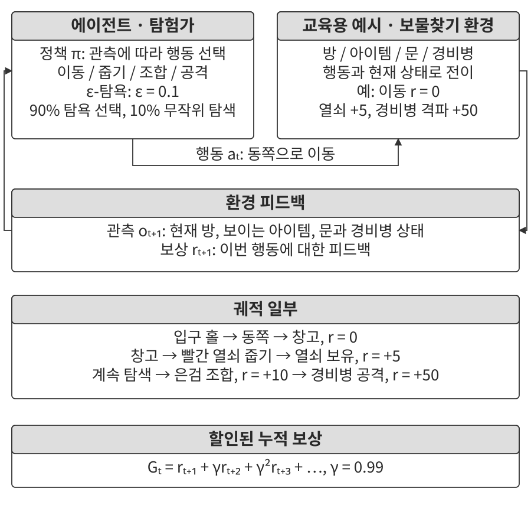

연속된 상호작용은 **궤적**을 이룹니다. 궤적에는 각 단계의 관측, 행동, 보상, 종료 정보가 들어가며, 학습 시스템이 환경 상태를 얻을 수 있다면 그것도 함께 기록할 수 있습니다. 정책은 어떻게 행동할지 정하고, **가치 함수(Value Function)**는 현재 상태에서 출발해 어떤 정책대로 계속 실행하면 미래 보상을 얼마나 얻을지 추정합니다.

에이전트와 환경의 경계는 모델링할 때 정한 시스템 범위에 따라 결정됩니다. 이 책에서 다루는 모델과 Harness는 에이전트 안에 있고, 도구 인터페이스가 이를 외부 애플리케이션, 장치, 서비스와 연결합니다. 예를 들어 파일 수정 요청은 에이전트가 내고, 쓰기는 파일 시스템이 실행하며, 도구가 실행 결과를 다시 에이전트에게 돌려줍니다.

학습 과정에서는 **탐색과 활용(Exploration–Exploitation)** 사이에 기회를 배분해야 합니다. 탐색은 정책이 아직 익숙하지 않은 행동을 접하게 하고, 활용은 현재 추정으로 더 나은 행동을 고릅니다. 보상이 늦게 오는 과제에서는 초기의 어떤 단계가 최종 결과에 기여했는지도 판단해야 하는데, 이것이 뒤에서 다룰 기여도 할당 문제입니다.

RL 방법 하나를 이해하려면 먼저 다섯 가지를 점검하면 됩니다.

- **행동 공간**: 무엇을 출력할 수 있는가입니다. 보드게임은 이산적인 수를 쓰고, 로봇 제어는 연속적인 관절 목표를 쓸 수 있습니다. 행동은 상태, 물리적 범위, 권한의 제약을 받을 수도 있습니다.
- **정책**: 상태, 관측, 이력을 바탕으로 행동을 고르는 규칙입니다. 표일 수도 있고 신경망일 수도 있습니다.
- **보상 신호**: 학습 목표를 어떤 피드백으로 표현하는가입니다. 단계별 보상이 모여 장기 수익을 이루며, 정책은 미래 이득을 위해 당장의 비용을 감수할 수도 있습니다.
- **가치 함수**: 이후의 수익을 추정하며, 행동을 비교하거나 정책 갱신 신호를 구성하는 데 쓸 수 있습니다. 이를 명시적으로 학습할지는 구체적인 알고리즘이 정합니다.
- **환경 모델**: 행동 후의 상태, 관측, 보상을 예측합니다. 모델 기반 방법은 알려진 환경 모델이나 학습한 환경 모델로 계획을 세우고, 모델 프리 방법은 상호작용 데이터에서 곧바로 정책이나 가치를 학습합니다.

표 8-3은 이 개념들 가운데 환경, 행동, 목표를 골라 익숙한 몇 가지 시스템을 비교합니다. 앞의 두 행을 읽을 때는 ‘균형 유지’와 ‘청소 면적’을 우리가 과제를 모델링할 때 고를 수 있는 목표로 이해하면 됩니다.

표 8-3 여러 에이전트 시스템의 핵심 요소 비교

| 에이전트 유형 | 외부 환경 | 행동 표현 | 보상 또는 목표 예시 |
| --- | --- | --- | --- |
| 갓 태어난 새끼 영양 | 지형, 중력, 신체 동역학 | 연속적인 근육 제어 | 균형 유지, 넘어지지 않기 |
| 로봇 청소기 | 방, 바닥, 충전 설비 | 이동, 청소, 충전 복귀, 제어 파라미터 | 청소 면적, 배터리, 충돌 비용 |
| 체스 에이전트 | 체스판, 상대, 시간 규칙 | 현재 상태에서 합법적인 수 | 승리 +1, 패배 −1, 무승부 0 |
| 고객 서비스 에이전트 | 사용자, 업무 데이터베이스, 서비스 인터페이스 | 답변 텍스트, 조회, 업무 호출 | 문제 해결, 절차 준수, 처리 시간 |
| 코딩 어시스턴트 에이전트 | 요구 사항 출처, 코드베이스, 실행 환경 | 검색, 편집, 실행, 답변 | 테스트 결과, 과제 완료, 회귀와 비용 |

이 시스템들은 행동 표현이 서로 다릅니다. 보드게임은 보통 한 단계씩 이산적인 행동 하나를 고르고, 로봇은 정해진 차원의 연속 제어량을 출력하며, LLM은 먼저 토큰 시퀀스를 생성한 뒤 인터페이스가 이를 답변이나 도구 호출로 파싱합니다. 내부 계산도 정책 모델링에 포함할 수 있으며, 실제로 외부 상태를 바꾸는 도구 실행과는 따로 기록합니다.

### 두 가지 행동 표현: 고전 RL 설정과 LLM의 가변 길이 정책

**마르코프 결정 과정(Markov Decision Process, MDP)**은 상태, 행동, 전이, 보상으로 의사결정 문제를 기술합니다. 마르코프 성질은 현재 상태와 행동이 주어지면 다음 상태와 보상을 예측하는 데 이력이 더 필요하지 않을 것을 요구합니다. 이력 가운데 예측에 필요한 정보는 이미 현재 상태에 들어 있다는 뜻입니다. 그림 8-2에서 플레이어가 있는 방만 기록하면 곤란해집니다. 같은 문 앞에 두 번 왔더라도 문을 열 수 있는지는 플레이어가 이미 열쇠를 얻었는지에 달려 있기 때문입니다.

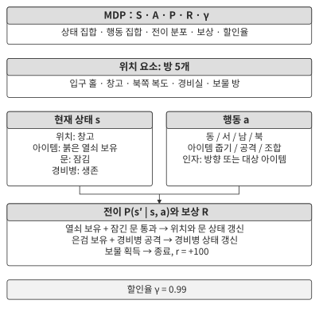

체스는 상태 설계의 한 예입니다. 말의 위치 외에도 누구 차례인지, 캐슬링 권리, 앙파상 권리, 그리고 50수 규칙과 반복 국면을 판정하는 데 필요한 정보를 기록해야 합니다. 이런 내용을 상태에 넣어야 현재 상태만으로 규칙을 판단할 수 있습니다. 에이전트가 그중 일부만 볼 수 있다면 이력으로 정보를 보충하거나 부분 관측 모델링 방식을 써야 합니다.

MDP는 이산, 연속, 조합형 행동을 모두 담을 수 있습니다. 바둑에는 361개의 교차점이 있고, 패스와 합법성도 고려해야 합니다. Atari 게임은 보통 소수의 이산 조작을 제공하며, 로봇 제어량은 관절, 그리퍼, 물리적 제약으로 정의됩니다. 상태와 행동의 수가 모두 작으면 가치를 표에 직접 저장할 수 있습니다. 규모가 커지면 함수 근사, 정책 최적화, 탐색이 각각 해법을 제공합니다.

**표형 Q-learning: 한 단계의 피드백으로 행동 가치 갱신하기.** $Q(s,a)$는 상태 $s$에서 행동 $a$를 취한 뒤의 수익을 추정합니다. 최적 행동 가치는 벨먼 최적 방정식을 만족합니다.

$$
Q^*(s,a)=\mathbb E\left[r+\gamma\max_{a'}Q^*(s',a')\mid s,a\right]
$$

여기서 $r$는 이번 단계의 보상, $s'$는 다음 상태, $\gamma$는 할인율입니다. 계속되는 과제에서는 흔히 $0\leq\gamma<1$로 두며, 종료가 분명하고 수익이 유한한 과제에서는 1로 둘 수도 있습니다. 할인율이 클수록 먼 미래의 보상에 더 많은 가중치가 남습니다. 현재 시점에서 계산한 수익은 $G_t=\sum_{k\geq0}\gamma^k r_{t+k+1}$입니다.

한 번의 상호작용으로 $r$와 $s'$를 얻으면 Q-learning은 다음 식으로 갱신합니다.

$$
Q(s,a)\leftarrow Q(s,a)+\alpha\left[r+\gamma\max_{a'}Q(s',a')-Q(s,a)\right]
$$

$\alpha$는 학습률이고, 대괄호 안은 ‘한 단계 보상에 할인된 이후 가치를 더한 값’과 현재 추정치의 차이입니다. 과제가 종료 상태에 도달하면 이후 가치는 0으로 둡니다. 함께 제공하는 게임에서 한 번 해 봅시다. 무작위 교란을 끄고, 입구에서 동쪽으로 간 다음 창고에서 빨간 열쇠를 줍습니다. 열쇠를 주우면 5점을 받고 한 단계마다 0.5점이 깎이므로, 이 행동이 돌려주는 $r$는 4.5입니다. 표에 있는 ‘창고에서 열쇠 줍기’의 이전 추정치가 0.25이고, 열쇠를 얻은 뒤 고를 수 있는 행동의 최대 Q값이 0.63이라고 합시다. $\gamma=0.99$, $\alpha=0.2$로 두면 한 단계 목표는 $4.5+0.99\times0.63=5.1237$입니다. 이전 추정치가 이 목표 쪽으로 5분의 1만큼 다가가 1.22474로 갱신됩니다. 이렇게 실제 한 단계 피드백으로 추정치를 고치는 방법을 **시간차 학습(Temporal-Difference Learning, TD)**이라고 합니다.

한 상태에서 각 행동의 Q값을 모아 보면 현재 추정으로 가장 좋은 행동을 고를 수 있습니다. 그림 8-3은 단순화한 격자 그림으로 이런 정책을 그린 것입니다. 각 칸의 숫자는 정규화한 상태 가치입니다. 손으로 숫자를 가리고 화살표만 보면서 왼쪽 위에서 보물까지 갈 수 있을까요?

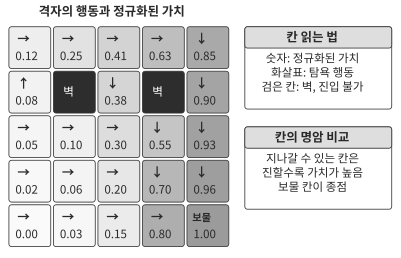

다음 탐색은 화살표의 방향을 바꿀 수도 있습니다. 그림 8-4는 앞에서 빨간 열쇠를 주운 계산을 풀어 놓은 것입니다. 이 단계에서 얻은 보상은 ‘창고에서 열쇠 줍기’ 항목의 추정치를 바꾸며, 표의 다른 상태들의 Q값은 각자의 갱신을 기다려야 합니다.

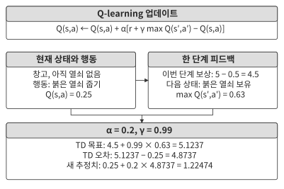

Q-learning의 행동 정책은 무작위 탐색을 포함할 수 있지만 갱신 목표는 다음 상태의 최대 행동 가치를 쓰므로 **오프폴리시(Off-Policy)** 학습에 속합니다.

> **실험 8-1 ★: 보물찾기 게임에서 Q-learning의 성능**
>
> 보물찾기 게임에는 열쇠와 문, 무기 효과, 아이템 합성 같은 숨겨진 규칙이 있습니다. 클리어하려면 여러 단계를 순서대로 완수해야 하며, 최적 경로는 11단계입니다. 핵심 행동과 승리에는 보상이 주어지지만, 나머지 단계에는 피드백이 적습니다.
>
> 이번 보물찾기 학습에서는 학습률 0.2, 할인율 0.99를 쓰고, 탐색률 ε를 1.0에서 0.1까지 점차 낮춥니다. 표형 Q-learning은 ε-탐욕 탐색을 씁니다. 매 단계 ε의 확률로 가능한 행동 하나를 무작위로 고르고, 나머지 경우에는 현재 Q값이 가장 큰 행동 가운데 하나를 고릅니다. 각 단계의 승률, 방문한 상태 수, 클리어 단계 수를 기록합니다.
>
> 보물찾기 실험의 학습 및 평가 기록을 읽을 때는 먼저 두 질문을 구분하십시오. 학습 중에 무작위 탐색을 포함한 정책은 언제 처음 보물을 찾는가? 학습이 끝난 뒤 Q표를 고정하고 탐욕 정책으로 행동하면 안정적으로 클리어하는가? 앞의 질문은 모델이 경로를 어떻게 발견하는지를 보여 주고, 뒤의 질문은 학습한 가치에 따라 행동을 고를 수 있는지를 검증합니다.
>
> 앞서 진행한 한 번의 학습에서 처음 1000판까지는 클리어하지 못했고 Q표에는 상태 124개가 있었습니다. 5000판까지도 안정적으로 이기지 못했으며 상태 수는 133개였습니다. 7000~8000판 사이에 승률이 34%에서 96%로 올랐고, 10000판에 이르러 100%에 도달했습니다. 이때 Q표에는 상태 145개가 있었고 11단계 경로를 찾았습니다.
>
> 초반에는 왜 좀처럼 진전이 없다가 나중에 승률이 빠르게 올랐을까요? 탐색이 먼저 핵심 행동과 경로를 발견하고, 이후의 방문이 종점의 보상을 앞쪽 상태로 점차 전파하기 때문입니다. 이 작은 시뮬레이션 전체가 약 10초면 끝나므로 대량의 반복 상호작용을 감당할 수 있습니다.
>
> 분석할 때는 계산 시간과 상호작용 횟수를 함께 기록하십시오. 게임에서는 행동 한 번이 아주 쌉니다. 브라우저, 전화, 물리 장치로 바뀌면 상호작용 한 번에 대기, 비용, 상태 변화가 따릅니다. 또 표는 특정한 상태 인코딩에 묶여 있어서, 규칙이나 지도가 바뀌면 기존 가치가 여전히 적용되는지 다시 점검해야 합니다. 다음 실험에서는 사전 학습된 지식이 탐색의 출발점을 어떻게 바꿀 수 있는지 비교합니다.

**사전 학습된 LLM: 언어로 계산과 행동을 표현하기.**

LLM은 도구를 호출하기 전에 중간 계산을 생성할 수도 있고, 곧바로 호출을 출력할 수도 있습니다. 둘 다 토큰 시퀀스로 표현되지만 역할이 다릅니다. 중간 계산은 모델이 이후에 쓸 수 있는 컨텍스트를 바꾸고, 도구 호출은 실행을 거쳐 외부 환경을 바꾸거나 읽습니다. 학습할 때는 이런 출력을 프로토콜에 따라 기록하고, 과제 결과와 계산 비용을 함께 고려해 평가할 수 있습니다. ‘얼마나 오래, 무엇을 생각하고, 언제 도구를 호출할지’가 이로써 같은 정책이 학습할 수 있는 선택이 되며, 뒤에 나오는 AdaptThink는 추론 예산을 중심으로 이 문제를 다룹니다.

가변 길이 시퀀스는 더 큰 조합 공간을 가져옵니다. 모델은 쿼리, 프로그램, JSON 인자, 여러 단계의 유도를 작성할 수 있으며, 시퀀스 길이는 예산과 컨텍스트의 제약을 받습니다. 사전 학습은 탐색에 출발점을 제공합니다. 수학 자료에는 조건 분석과 계산이 흔히 들어 있고, 코드와 토론에는 위치 찾기, 수정, 검증이 흔히 들어 있습니다. 모델은 이런 구조를 빌려 후보 경로를 생성하고 환경 피드백에 따라 조정할 수 있습니다. 기존 지식 덕분에 유용한 행동 조합이 처음부터 더 쉽게 샘플링되므로, 관련 없는 수많은 경로에서 맹목적으로 시행착오를 겪을 필요가 줄어듭니다.

예를 들어 ‘외화 금액을 달러로 환산하기’에는 환율을 얻고 계산하는 일이 필요합니다. 사전 학습 덕분에 모델은 이런 연관된 단계를 비교적 쉽게 생성하고, 사후 학습은 환율 출처, 계산 결과, 과제 제약에 따라 경로의 확률을 더 조정할 수 있습니다. 여기서 언어 지식은 초기 정책을 제공하고, 보상은 과제 피드백을 제공합니다.

그림 8-5는 이 절의 두 가지 설정을 비교합니다. 표형 Q-learning은 지정된 상태 인코딩과 탐색 규칙에서 출발하고, LLM 에이전트는 사전 학습된 언어 정책에서 출발해 컨텍스트로 도구 관측과 과거 경험을 정리합니다.

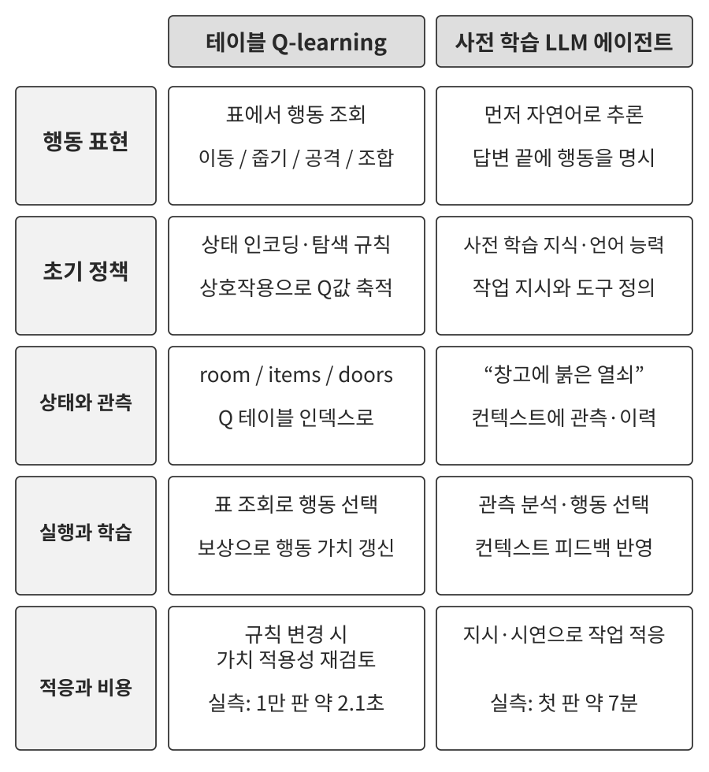

사전 학습은 모델이 새로운 지시를 해석하고 소수의 시연으로 과제 행동을 조정할 수 있게도 합니다. 도구는 언어 출력을 검색, 코드 실행, 업무 조작에 연결합니다. 이런 에이전트를 설계할 때는 도구 인터페이스와 실행 권한을 정하는 동시에, 과제 결과, 실행 비용, 핵심 과정에 대한 피드백도 마련해야 합니다.

모델이 로봇 팔을 제어하려면 ‘다음 토큰 예측’을 행동에 어떻게 적용할까요? OpenVLA는 실제 로봇 시연 약 97만 건을 사용했습니다. 시연에서 한 단계를 뽑으면 입력은 그 시점의 카메라 화면과 과제 지시이고, 학습 목표는 시연자가 다음에 실행한 행동입니다. 예를 들어 로봇 팔이 수평 방향으로 얼마나 움직이는지는 원래 연속적인 수치입니다. OpenVLA는 각 행동 차원을 256개 구간으로 나누고, 어느 구간에 속하는지를 토큰 하나로 표현합니다. 이렇게 하면 모델은 행동 토큰을 하나씩 예측하고 그 위치에서만 손실을 계산할 수 있습니다.[^ch8-21]

이 예는 행동 복제와 강화 학습을 구분하는 방법도 알려 줍니다. 어떤 신호가 모델을 갱신하는지 보면 됩니다. OpenVLA는 시연 기록에서 배우며, 모델이 시연 행동 토큰에 주는 확률이 높을수록 손실이 낮아지므로 지도 미세 조정에 속합니다. 실험 8-13의 SimpleVLA-RL에서는 정책이 환경에서 실제로 행동을 시도하고, 과제 보상에 따라 이후의 선택을 조정합니다.

> **알고리즘, 환경, 그리고 사전 지식**
>
> 야오 순위(Shunyu Yao)는 「The Second Half」에서 알고리즘, 환경, 사전 지식이라는 관점으로 RL의 발전을 돌아보았습니다.[^ch8-2] 필자는 이를 바탕으로 관심의 변화를 세 단계로 요약합니다. 2015~2016년에는 알고리즘 개선에 집중했고, 2016~2018년에는 환경 구축을 더 중시했으며, 2018년부터는 사전 학습이 주는 사전 지식의 가치를 점차 깨닫게 되었습니다. Gym은 통일된 환경 인터페이스를 제공했고, Universe와 World of Bits는 컴퓨터와 웹 과제를 탐구했으며, Dota 2 같은 프로젝트는 복잡한 환경에서의 학습 능력을 보여 주었습니다. 이후 GPT-2와 GPT-3는 언어 사전 학습이 쌓은 지식과 표현 능력을 보여 주었고, WebGPT와 ChatGPT 같은 시스템이 이 출발점을 더 활용했습니다. 과제에 필요한 사전 지식은 먼저 언어 모델링으로 얻고, 구체적인 행동의 최적화는 RL에 맡길 수 있습니다.
>
> 필자는 여기서 제시한 엔지니어링 우선순위, 즉 **사전 지식, 환경, 알고리즘**에 동의합니다. 먼저 모델이 어떤 지식과 능력을 갖추었는지 점검하고, 이어서 알맞은 환경과 피드백을 구성한 뒤, 마지막으로 그에 맞는 최적화 방법을 고릅니다. 그림 8-6은 연구 관심사가 나타난 순서대로 배열되어 있지만, 프로젝트를 할 때는 거꾸로 기존 능력에서 출발하면 됩니다.
>
> 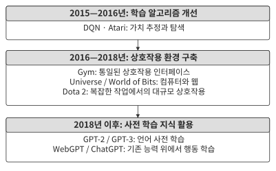

> **실험 8-2 ★★: 전통적 RL과 LLM 에이전트 비교 연구**
>
> 같은 보물찾기 게임에서 표형 Q-learning과 LLM 에이전트를 비교합니다. LLM 설정은 Kimi K3를 쓰고, 컨텍스트에 경험을 최대 50건까지 유지합니다. 둘 다 매 단계 환경이 제시한 선택 가능한 행동 가운데 하나를 고릅니다. 그림 8-7의 두 경로를 따라가면 Q표와 언어 모델이 각각 이 선택을 어떻게 내리는지 볼 수 있습니다.
>
> 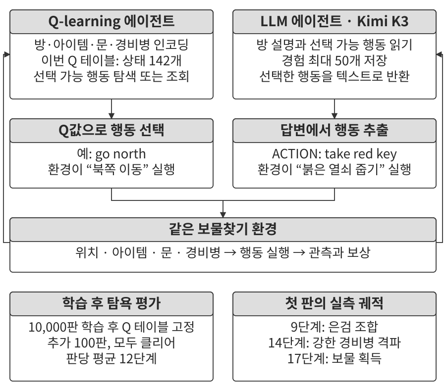
>
> 함께 제공하는 Kimi K3 실행 기록에서 에이전트는 첫 판에 17단계를 썼습니다. 먼저 녹슨 검을 집어 들었고, 북쪽 문이 잠겨 있음을 발견한 뒤 창고로 가서 빨간 열쇠와 마법 수정을 얻었으며, 9단계에서 검과 수정을 합성해 은검을 만들었습니다. 12단계에서 열쇠를 사용하려 하자 환경은 ‘필요할 때 자동으로 사용됩니다’라고 알려 주었고, 13단계에서 북쪽으로 가자 문이 실제로 열렸습니다. 14단계에서 은검으로 경비병을 물리친 뒤 검을 한 번 더 사용하려 했지만, 환경은 지금은 사용할 수 없다고 알려 주었습니다. 17단계에서 보물을 손에 넣었습니다. 이 기록을 읽을 때는 다음 줄을 가리고, 현재 피드백을 바탕으로 어느 단계가 아직 필요한지 먼저 짐작해 보십시오.
>
> 각 행동을 당시의 관측과 맞춰 보면, 모델이 ‘열쇠로 문 열기’, ‘무기로 경비병 상대하기’ 같은 기존 지식을 어떻게 사용하는지, 그리고 도구 피드백이 이후 계획을 어떻게 바꾸는지 분석할 수 있습니다. 표 방식은 상태–행동 방문을 통해 이런 관계를 쌓아 갑니다.
>
> 이번 대조에서 Q-learning은 10000판 학습에 2.12초가 걸렸고, 이어서 탐욕 정책으로 따로 100판을 평가한 결과 모두 클리어했으며 평균 12단계였습니다. Kimi는 한 판에 모델을 17번 호출했고 6분 56초가 걸렸습니다. 필자는 이를 바탕으로 한 가지 선택 원칙을 따릅니다. 시뮬레이션이 싸고 대량으로 반복할 수 있으면 전통적 RL의 탐색을 충분히 활용할 수 있습니다. 상호작용마다 대기, 비용, 실제 조작의 대가를 치러야 한다면, 기존 지식을 활용할 수 있는 정책을 우선 고려해 상호작용 한 번의 가치를 높입니다.

두 실험은 이 장과 앞의 엔지니어링 방법을 이어 줍니다. 컨텍스트는 한 번의 실행 안에서 경험을 정리할 수 있고, 외부 메모리는 과제를 넘어 경험을 보존할 수 있으며, 사후 학습은 파라미터 갱신으로 정책을 바꿉니다. 아래에서는 먼저 언어와 시각 사전 학습의 기본 과정을 보충하고, 이어서 구체적인 학습 데이터와 최적화 방법을 논의합니다.

## 모델 사전 학습 기초 `[선택 읽기]`

사전 학습은 모델의 초기 표현과 생성 분포를 세우고, 이후의 학습은 이 출발점에서 파라미터를 계속 조정합니다. 이 출발점을 이해하려면 먼저 작은 언어 모델이 텍스트에서 어떻게 배우는지 살펴보고, 이어서 그 모델이 시각 입력을 어떻게 받아들이는지 보면 됩니다.

텍스트는 먼저 **토큰화(Tokenization)**를 거쳐 이산적인 토큰으로 바뀝니다. 예를 들어 ‘나는 프로그래밍을 좋아한다’는 ‘나는’, ‘프로그래밍을’, ‘좋아한다’라는 세 단위로 나타낼 수 있지만, 실제 분할은 토크나이저가 정합니다. 학습은 앞쪽 토큰을 컨텍스트로 삼아 뒤따르는 토큰을 예측하고, 손실을 계산해 파라미터를 갱신합니다. 그림 8-8에서 학습 문장을 ‘환경’까지만 남기고 가린 다음, 다음 단어가 무엇일지 짐작해 본 뒤 원문을 확인해 보십시오. 이 위치를 한 칸 뒤로 옮기면 다음 예측 문제가 됩니다.

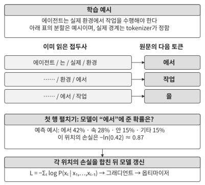

기본적인 언어 모델링을 마친 뒤에는 지시 시연을 더해 답변 형식과 과제 행동을 학습할 수 있고, 선호 데이터를 써서 DPO 같은 방법으로 더 인정받는 답변의 확률을 높일 수도 있습니다.

> **실험 8-3 ★★: LLM을 처음부터 학습하기—알고리즘 개선의 힘**
>
> 파라미터 약 1억 개 규모의 MiniMind 2를 예로, 소비자용 GPU에서 사전 학습, SFT, 선호 최적화를 완료합니다. 기준선과 QK Norm, Muon 옵티마이저를 더한 설정을 비교해 손실 감소, 목표 품질에 도달하는 데 걸리는 시간, 생성 결과를 관찰합니다. 함께 제공하는 요약 기록에 따르면 수렴 속도가 약 3배 빨라졌고, 전체 학습에는 약 14시간, 비용은 약 34달러가 들었습니다.
>
> QK Norm은 어텐션에서 쿼리와 키의 수치 스케일을 조정하고, Muon은 해당 파라미터의 최적화 갱신 방식을 바꿉니다.
>
> 같은 질문 묶음을 단계별로 관찰합니다. 사전 학습 모델은 이미 ‘세계에서 가장 높은 산’ 같은 질문에 답할 수 있습니다. SFT 뒤에는 지시 따르기와 출력 구성이 나아지고, 선호 최적화는 사실 답변과 표현에 계속 영향을 줍니다.

> **실험 8-4 ★★: 나만의 VLM 학습하기**
>
> 그림 8-9는 ‘시각 인코더–투영층–언어 모델’의 연결을 보여 줍니다. CLIP 같은 시각 인코더가 이미지 특징을 추출하고, 투영층이 그 특징을 언어 모델 입력에 필요한 차원과 표현으로 바꾸며, 언어 모델은 이 입력을 결합해 설명이나 답변을 생성합니다.
>
> 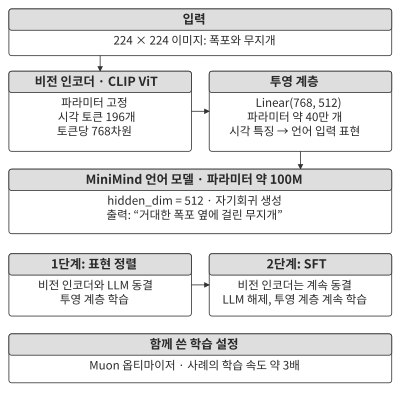
>
> 1단계에서는 시각 인코더와 LLM을 고정하고 새로 추가한 투영층을 학습해 이미지 특징이 언어 예측에 참여할 수 있게 합니다. 2단계에서는 설정에 따라 LLM의 고정을 풀고, 고품질 이미지–설명 또는 질의응답 데이터로 SFT를 수행합니다. 객체 인식, 세부 묘사, 관계 판단, 언어 능력의 변화를 각각 관찰합니다.
>
> 이 구조는 기존 시각 모델과 언어 모델을 재사용하고 모달리티 간 연결 모듈부터 집중적으로 학습하므로, 예산이 한정되어 있을 때 먼저 시도해 볼 만한 방안입니다. 가중치를 고정하면 학습해야 할 상태가 줄어들고, 이후 과제에 따라 필요한 모듈의 고정을 풀면 됩니다. 설명이 틀렸다면 먼저 객체 정보가 시각 표현에 들어갔는지 확인하십시오. 정보가 이미 있는데도 모델이 이를 활용하지 못한다면, 투영층의 표현력, 정렬 데이터, 언어 생성 감독을 중점적으로 점검해야 합니다. 출력을 행동 표현으로 바꾸고 제어 인터페이스와 정렬하면 6장의 VLA 구조로 이어집니다.

두 실험은 각각 최적화 설정과 모달리티 간 연결이 학습에 어떤 영향을 주는지 보여 줍니다. 예산이 제한되어 있다면, 필자는 먼저 알고리즘과 구조 개선으로 얻을 수 있는 이득을 비교한 뒤 모델 규모를 키울지 결정하라고 권합니다. 기존 모델이 새로운 언어나 도메인에 들어갈 때는 사전 학습된 가중치에서 학습을 이어 갈 수도 있습니다. 다음 절에서는 이런 학습에 쓸 데이터를 어떻게 고를지 다룹니다.

## Mid-training: 지식과 기초 능력 보완

이 장에서 말하는 **Mid-training**은 기존 모델 위에서 대상 분포를 중심으로 한 단계의 언어 모델 학습을 이어 가는 것을 가리킵니다. 문서, 코드, 유도 과정의 많은 토큰이 감독에 참여하며, 학습할 때 대상 도메인 말뭉치와 범용 말뭉치를 섞을 수 있습니다. DAPT/TAPT 연구는 도메인이나 과제와 관련된 말뭉치로 사전 학습을 이어 가는 것이 다운스트림 과제에 도움이 됨을 보여 주었습니다.[^ch8-30]

데이터 선택은 두 종류의 공백에서 출발합니다. 하나는 지식과 언어의 커버리지로, 예를 들어 모델이 기업 프로토콜, 대상 언어의 용어, 특정 코드베이스를 충분히 접하지 못한 경우입니다. 다른 하나는 과제에 필요한 기초 능력으로, 예를 들어 긴 컨텍스트에서 상태를 추적하거나, 문서를 넘나드는 관계를 통합하거나, 비교적 긴 코드 유도를 완성하는 능력입니다. 먼저 오류 유형에 따라 이해, 지식, 형식, 행동의 문제를 구분한 뒤 보충할 자료를 정합니다.

도메인 텍스트의 손실이 줄어든 뒤에도 모델이 실제 과제에서 배운 지식을 쓸 수 있는지 점검해야 합니다. 지속 학습과 지시 학습의 순서, 질의응답의 구성, 자료의 형식 모두 지식 활용에 영향을 줍니다.[^ch8-31] 기초 능력이 뚜렷이 부족한 도메인 과제라면, 필자는 먼저 도메인 말뭉치로 커버리지를 늘리고, 이어서 SFT 시연으로 과제에서 이 정보를 쓰는 법을 가르치라고 권합니다. 모델이 가끔은 맞히지만 성공률이 낮은 단계에 이르면 그때 RL에 투자합니다.

### Mid-training 데이터를 어떻게 구성하는가

**1단계: 실패 분포에서 필요한 자료를 찾습니다.** 주제, 언어, 문서 유형, 코드 패턴, 컨텍스트 길이별로 평가하고, Pass@1, Pass@k, 오류 사례를 함께 보며 모델이 어떤 조건에서 쓸 만한 해법을 갖지 못하는지 판단합니다. 인자 형식 문제는 인터페이스 시연으로 처리하고, 도메인 개념과 관계의 공백에는 해당 말뭉치가 필요합니다.

**2단계: 밀도 높은 말뭉치를 구성합니다.** 원본 문서는 용어와 사실 관계를, 코드 저장소는 모듈 구조와 의존성을 제공하며, 교재식 유도와 합성 해설은 암묵적인 단계를 펼쳐 보이고, 문서를 넘나드는 샘플은 흩어진 정보를 연결합니다. 품질 필터링, 중복 제거, 평가 세트 격리를 마친 뒤 학습 시퀀스를 구성합니다.

**3단계: 목표 능력에 맞춰 데이터를 섞습니다.** 자연스러운 긴 텍스트는 책, 문서, 코드 저장소에서 가져올 수 있습니다. 검색, 다중 홉 추론, 지시 따르기, 집계와 통계를 위해서는 유도 과정이 담긴 과제 데이터를 더할 수 있습니다. 에이전트를 위해서는 계획, 도구 선택, 인자 구성, 상태 추적, 오류 복구 궤적을 더할 수 있습니다. 이런 자료는 기존 데이터셋에서 가져오거나 교사 모델로 생성할 수 있으며, 학습에 넣기 전에 내용과 행동 요구 사항에 따라 선별합니다.

**4단계: 모델이 원래 할 줄 알던 과제를 계속 연습하게 합니다.** 한 묶음의 샘플은 짧은 텍스트, 범용 말뭉치, 원래의 문제를 그대로 씁니다. 다른 묶음은 같은 과제를 더 긴 컨텍스트에 넣고, 핵심 정보의 위치를 옮기고, 방해 요소를 더합니다. 두 묶음을 배합할 때는 원래 학습 데이터의 분포를 참고할 수도 있고, FineWeb-2 같은 공개 말뭉치로 몇 가지 비율을 시험한 뒤 평가 결과에 따라 조정할 수도 있습니다.

**5단계: 여러 지표로 계속할지 멈출지 정합니다.** 학습 손실, 홀드아웃 도메인 과제, 범용 능력, 기존 지시 따르기, 목표 과제 성공률을 함께 기록합니다. 도메인 성적은 오르는데 범용 능력이 떨어지면 혼합 비율, 학습률, 학습량을 비교합니다. 손실은 줄어드는데 목표 과제가 정체되면, 학습 자료가 이런 과제를 해내는 법을 모델에게 가르칠 수 있는지, 그리고 실제 과제에서 지식을 활용하는 시연을 보충해야 하는지 점검합니다.

모델이 아주 긴 주문 로그에서 지정한 주문 번호를 찾아낼 수 있다고 합시다. 질문을 ‘여러 번 주문했다가 모두 취소한 고객은 누구인가’로 바꾸면, 모델은 같은 고객의 주문을 빠짐없이 찾아 주문과 취소 기록을 한 건씩 맞춰 봐야 합니다. 두 문제는 같은 로그를 쓸 수 있지만 평가하는 능력은 다릅니다. RULER는 합성 과제로 입력 길이와 과제 난이도를 따로 제어하며, 단일 검색, 다중 홉 추적, 집계를 각각 측정합니다. 저자들은 모델 17개를 평가했는데, 많은 모델이 단순 검색에서는 만점에 가까웠지만 입력이 길어질수록 종합 성능이 뚜렷이 떨어졌습니다.[^ch8-ruler]

이런 차이가 실제 자료에서도 나타나는지 보려면 LongBench v2의 다중 문서, 긴 대화, 코드 저장소 문제를 더 써 볼 수 있습니다. 모델이 출력 형식 같은 요구 사항을 기억하는지 따로 점검하려면 IFEval의 검증 가능한 지시를 가져와 긴 자료의 여러 위치에 넣어 볼 수 있습니다. 두 모델을 비교할 때는 두 모델이 보는 지시 위치와 방해 내용을 같게 유지하고, 이것이 직접 구성한 테스트임을 밝혀야 합니다. 마지막으로 엔드투엔드 에이전트 과제로 이 능력들이 함께 작동하는지 점검합니다. 평가 세트를 설계할 때는 아래 차원을 하나씩 점검하면 됩니다.[^ch8-longbench]

[^ch8-ruler]: Hsieh 외, RULER, 2024.
[^ch8-longbench]: Bai 외, LongBench v2, ACL 2025. 논문은 여섯 가지 과제 유형, 총 503개의 객관식 문제를 제시합니다.

- **위치와 검색**: 핵심 정보 하나 또는 여러 개가 처음, 중간, 끝에 있을 때 찾아낼 수 있는가.
- **관계와 추론**: 단락과 여러 문서를 넘나드는 관계 추적, 모순 해소, 증거 조합.
- **집계와 통계**: 긴 표와 로그에서의 계수, 그룹화, 정렬, 비교, 추세 요약.
- **지시 따르기**: 여러 요구 사항, 충돌 처리, 절차 조건, 출력 형식.
- **긴 사슬 추론**: 수학, 논리, 코드 과제의 긴 의존 사슬.
- **에이전트의 기본 행동**: 과제 분해, 도구 선택, 인자 생성, 상태 유지, 실패 복구.

긴 추론과 다중 턴 도구 호출은 컨텍스트를 계속 늘리며, 앞서 나온 지시, 사실, 과제 상태도 이후 결정에 여전히 참여해야 합니다. 모델이 긴 텍스트에서 정보를 찾지 못하거나 제약을 유지하지 못하면 장기 실행 에이전트는 안정적으로 작동하기 어렵습니다. 학습 예산을 늘리기 전에 작은 규모의 설정으로 데이터 배합과 학습량을 먼저 비교해야 합니다. 자주 갱신되고 출처가 필요한 사실에는 필자는 RAG를 우선 씁니다. 안정적인 대규모 도메인 지식과 기초 능력이라면 그때 지속 학습으로 파라미터에 새기는 것을 고려합니다.

> **실험 8-5 ★★: 지속 사전 학습으로 새 언어 배우기**
>
> Mistral 7B v0.3에서 출발해 한국어 위키백과 등의 자료로 한국어 능력을 높입니다. 학습은 먼저 한국어 약 80%, 영어 20%의 혼합을 쓰고, 이어서 한국어 지시 데이터로 SFT를 수행하며, 언어 모델링과 대화 행동의 변화를 각각 관찰합니다.
>
> 한국어 데이터는 대상 언어의 커버리지를 늘리고, 영어 데이터는 기존 능력을 유지하는 데 쓰입니다. 모든 단계에서 학습에 쓰지 않은 같은 한국어 문제와 영어 문제로 테스트합니다. 함께 제공하는 결과에서 한국어 최종 단계의 블라인드 평가 점수는 개선되었고 영어 능력은 다소 떨어졌습니다. 이는 다음 회차에 영어 학습 자료를 조금 더 섞거나 갱신 강도를 낮추라는 구체적인 방향을 제시합니다.
>
> 대상 언어, 기존 언어, 사실 품질을 나누어 기록하면 이득과 대가를 판단할 수 있습니다. SFT 단계에서는 모델이 한국어 지시에 따라 답변을 구성하는지 다시 점검합니다. 이렇게 하면 지속 사전 학습과 지시 미세 조정의 효과를 각각 관찰할 수 있습니다.

## SFT(지도 미세 조정)

도메인 말뭉치는 모델이 어떤 인터페이스를 몇 번 더 보게 해 주지만, 호출이 실패한 뒤 인자를 고치는 법을 가르치려면 직접 한 번 시연해 보여 줄 수도 있습니다. SFT는 과제 입력을 주고, 시연에 담긴 답변이나 행동을 토큰 하나하나 생성하도록 모델을 학습합니다. 그림 8-10을 볼 때는 먼저 어떤 행동을 가르칠지 분명히 한 뒤 시연을 어떻게 모을지 정하십시오. 시연에 담긴 사실, 어조, 출력 형식도 함께 학습에 들어갑니다.

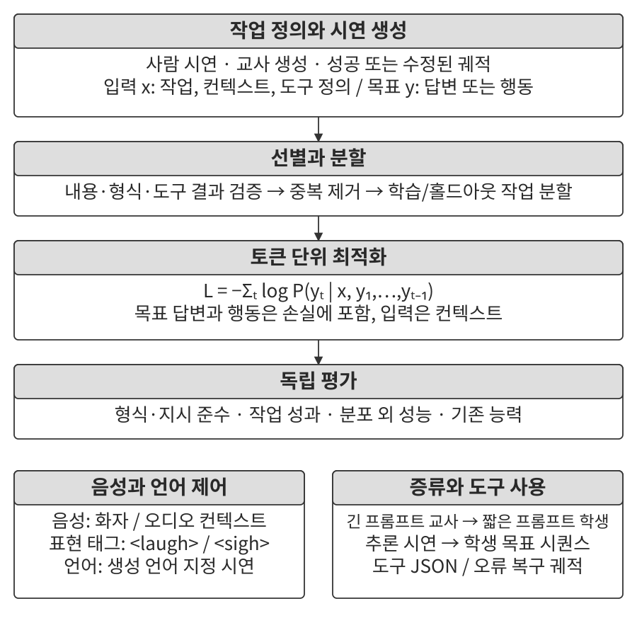

데이터는 보통 세 경로에서 옵니다. 인간 전문가가 핵심 행동과 경계를 정하고, 교사 모델이 시연을 대량으로 작성하며, 검증기가 모델 샘플에서 유효한 출력을 골라냅니다. 셋을 조합해 쓸 수도 있습니다. 예를 들어 먼저 전문가가 도구 호출 시연을 소량 작성하고, 교사가 과제 조건을 바꿔 가며 더 많은 샘플을 생성한 뒤, 마지막으로 인자, 실행 결과, 업무 제약을 점검합니다.

**SFT의 한 가지 용도는 프롬프트와 Skill에 반복해서 적어 두던 방식을 모델에게 가르치는 것입니다.** 7장의 메모리 채점을 예로 들어 봅시다. 채점 매뉴얼이 판례까지 포함해 1만 토큰에 이른다고 합시다. 교사는 매뉴얼 전체를 바탕으로 답변 묶음을 채점하며, 동명이인, 관계 뒤바뀜, 증거 부족 같은 경우를 어떻게 처리하는지 시연합니다. 학생을 학습시킬 때는 입력에 짧은 채점 항목 이름, 이번 회차의 과거 자료, 채점할 답변만 남기고, 목표 출력은 교사가 고른 등급으로 합니다. 배포 후에는 짧은 프롬프트와 이번 회차의 자료만 제공하면 되므로, 추론할 때마다 1만 토큰의 고정 설명을 아낄 수 있습니다. 반복해서 호출되는 Skill도 같은 방법으로 언제 자료를 찾아보고 어떤 도구를 고를지 시연한 뒤, 이런 안정적인 단계를 모델에 증류할 수 있습니다.

데이터를 준비할 때는 먼저 과제 분포, 출력 스키마, 검수 방식을 정해야 합니다. 시연이 점검을 통과하면 중복을 제거하고, 샘플 유형별 비율을 조정하고, 데이터셋을 나눕니다. 샘플 수와 커버리지는 함께 설계해야 합니다. 같은 질문 방식을 수천 번 반복하면 같은 패턴만 거듭 강화되고, 핵심 조건을 중심으로 변화를 구성해야 모델이 다양한 입력에서 알맞은 행동을 고르는 데 도움이 됩니다. 필자는 먼저 핵심 상황을 다루는 시연 한 묶음을 공들여 다듬은 뒤 규모를 키웁니다. SFT는 목표 출력을 토큰 단위로 학습하므로, 틀린 사실, 불필요한 단계, 부적절한 조작 습관도 그대로 파라미터에 들어갑니다.

> **실험 8-6 ★★★: 음성 SFT—음성 복제에서 준언어적 모델링으로 `[확장 실험]`**
>
> Orpheus와 Sesame CSM을 예로, 화자 조건, 대화 컨텍스트, 표현 태그가 음성 생성에 어떻게 참여하는지 비교합니다. Orpheus는 음성을 토큰으로 표현하고, 참조 텍스트–음성 조각을 이용해 해당 음색을 생성할 수 있으며, `<laugh>`, `<sigh>` 같은 표현 태그도 제공합니다. Sesame CSM은 텍스트, 화자 식별자, 기존 오디오 조각을 받아 이어지는 음성을 생성합니다.[^ch8-speech-conditioning]
>
> 학습 샘플을 구성할 때는 텍스트, 화자, 오디오, 표현 조건을 각각 기록합니다. 같은 화자의 여러 문장에 걸친 자료로 일관성을 학습하고, 다양한 맥락의 웃음, 한숨, 쉼으로 표현을 학습합니다. 참조 없음, 참조 있음, 표현 조건 지정의 세 경우에서 출력을 비교하고, 정확성, 자연스러움, 감정, 음색으로 채점합니다.
>
> 데이터에는 화자, 문형, 감정의 조합이 충분히 들어 있어야 합니다. 화자가 너무 적으면 출력이 하나의 음색으로 쏠릴 수 있고, 어떤 태그가 늘 같은 음성 조각과 묶여 있으면 반복적이고 기계적인 표현이 나타날 수 있습니다.

> **실험 8-7 ★★★: 다국어 사고—지정한 언어로 추론 과정 생성하기 `[확장 실험]`**
>
> gpt-oss-20b에 SFT를 수행하고, 지시로 추론 과정의 언어를 지정합니다. 예를 들어 `reasoning language: German`은 독일어 추론 텍스트를 생성하라는 요구입니다. 학습 샘플에는 영어, 스페인어, 프랑스어 등이 들어 있고, 중국어는 테스트 단계를 위해 남겨 둡니다.
>
> 함께 제공하는 사례에서 학습 후 Chinese를 지정하자 모델은 중국어 추론 과정을 생성했습니다. 여기서 세 가지 결과를 더 비교해 볼 수 있습니다. 언어 요구를 따르는가, 최종 답이 맞는가, 생성 길이와 소요 시간은 어떻게 변하는가입니다. 사전 학습의 다국어 기반과 SFT로 배운 제어 방식이 함께 이런 언어 간 성능에 관여합니다. 언어와 기반 모델을 바꿔 가며 대조하면 각각의 역할을 더 분석할 수 있습니다.

> **실험 8-8 ★★: 프롬프트 증류—더 적은 비용으로 쓸 만한 능력 재현하기**
>
> 안정적인 업무 하나가 수천 토큰의 시스템 프롬프트에 의존하고, 교사는 긴 추론까지 생성할 수 있습니다. 프롬프트 증류는 먼저 교사가 완전한 조건에서 고품질 출력을 만들게 한 뒤, ‘사용자 입력–최종 답변’을 학생의 SFT 데이터로 구성합니다. 학생은 더 짧은 프롬프트를 쓰고, 목표 설정에 따라 바로 답합니다.
>
> 첫 번째 학습 샘플을 열어 보면, Kimi K3 교사는 라틴 문자가 섞인 아랍어 텍스트를 읽고 판단 근거를 설명한 뒤 마지막에 언어 코드 `ar`를 내놓습니다. SmolLM2-135M-Instruct 학생에게 주는 시연에는 원문과 `ar`만 있습니다. 같은 테스트 기록 80건에서 교사 쪽은 요청마다 평균 약 386토큰을, 학생 쪽은 약 97토큰을 읽었습니다. 두 숫자는 각자의 토크나이저로 계산한 것입니다.
>
> 함께 제공하는 언어 식별 대조 기록으로 ‘맞혔다’와 ‘출력이 형식에 맞는다’를 따로 떼어 볼 수 있습니다. 교사는 학습 샘플 160건으로 시연을 생성했고, 별도의 테스트 기록 80건은 모두 맞혔습니다. 미세 조정하지 않은 학생은 테스트에서 출력 하나도 채점기가 파싱하지 못해 0점을 받았습니다. 미세 조정 후에는 80건 모두 파싱되었고 76건의 라벨이 맞았습니다. 기준선의 0점만으로는 ‘언어를 알아보지 못했다’와 ‘알아봤지만 형식대로 답하지 않았다’를 구분할 수 없습니다. 이 테스트에는 서로 다른 텍스트 75개가 들어 있으며, 학습과 테스트 사이에 완전히 같은 텍스트는 없습니다.
>
> 데이터를 구성할 때는 학생이 과제를 완수하는 데 필요한 조건도 남겨 두어야 합니다. 교사가 최신 도구 결과에 의존한다면 해당 결과를 학생 입력에 넣거나 도구 인터페이스를 계속 유지할 수 있습니다. 교사에게 체계적인 오류가 있다면 독립적인 검증으로 걸러 냅니다.
>
> 제품 규칙이 안정적이고, 입력 분포가 분명하며, 호출 비용이 높다면, 필자는 프롬프트 증류를 먼저 평가해 반복 처리하던 프롬프트와 추론을 파라미터로 압축하라고 권합니다. 제품이 아직 탐색 단계이고 과제 요구가 자주 바뀐다면, 편집 가능한 프롬프트와 명시적인 추론을 유지해 빠르게 실험하고 오류를 찾기 쉽게 합니다.

> **실험 8-9 ★★★: 사고 연쇄(Chain of Thought, CoT) 증류**
>
> CoT 증류는 교사가 제공한 추론 텍스트를 최종 답과 함께 감독으로 삼아, 학생이 분해, 계산, 점검, 수정의 과정을 배우게 합니다. DeepSeek-R1이 Qwen, Llama 계열로 증류한 것이 이 방법의 대표적인 예입니다. 직접 통제할 수 있는 모델을 갖고 싶으면서도 학습 투자를 억제하고 싶은 팀이라면, 필자는 이 경로를 먼저 고려하라고 권합니다. 교사가 목표 과제에서 학생보다 뚜렷이 강해야 가치 있는 시연을 제공할 수 있습니다. 먼저 완전한 추론 출력을 얻을 수 있는 오픈 웨이트 모델 가운데서 고르고, 학생과의 능력 차이와 데이터 품질을 비교하면 됩니다. 인터페이스가 추론 요약만 제공하면 과정 증류에 쓸 수 있는 정보도 그만큼 줄어듭니다.
>
> 1단계에서는 교사에게 같은 문제를 여러 가지 방법으로 풀게 합니다. 수학 문제는 먼저 답을 대조하고, 코드 문제는 테스트를 실행해 점검을 통과한 풀이만 남깁니다. 이런 선별을 **거부 샘플링(Rejection Sampling)**이라고 합니다. 걸러 낸 풀이로 지도 미세 조정을 하는 것을 **거부 샘플링 미세 조정(Rejection Sampling Fine-Tuning, RFT)**이라고 합니다. 학생이 추론 과정까지 배워야 한다면 중간 단계도 이어서 대조해, 유도는 틀렸는데 우연히 답이 맞은 시연을 걸러 내야 합니다.
>
> 신뢰할 만한 검증기가 있는 과제라면, 필자는 먼저 RFT 기준선을 세우라고 권합니다. 생성, 선별, SFT만으로 학습 절차를 만들 수 있어 온라인 정책 최적화와 가치 추정을 구현하는 수고를 덜 수 있고, 이를 바탕으로 RL에 추가로 투자할 가치가 있는지 판단하면 됩니다.
>
> 2단계에서는 학생을 학습시킵니다. 선택한 모델의 대화 형식에 맞춰 ‘문제→추론 텍스트+최종 답’을 구성하고, `<think>`와 `</think>` 같은 경계를 쓸 때는 어느 토큰이 손실에 참여하는지 분명히 합니다. 7B 규모의 학생에서 시작해 완전한 궤적, 간추린 궤적, 최종 답변만 감독하는 설정을 비교할 수 있습니다.
>
> 3단계에서는 학생이 무엇을 배웠는지 봅니다. 함께 제공하는 실험에서는 Kimi K3에게 AIME 수학 문제 24개를 풀게 하고, 맞힌 추론 궤적 23개를 남겨 Qwen2.5-1.5B-Instruct를 미세 조정했습니다. 같은 문제를 다시 풀자 학생은 1문제에서 2문제로 맞힌 수가 늘었고, 교사는 23문제를 맞혔습니다. 학습 후의 학생은 가끔 되돌아가 검산하기도 했지만, 문제별 대응 검정에서는 신뢰할 만한 정답률 향상이 나타나지 않았습니다($p=1.0$).

> **집필 실천: 증류 실험의 개발 과정**
>
> 필자는 처음에 GPT-5.6-Sol로 구동되는 Codex로 증류 실험을 구현하려 했으나 거부당했고, Claude Opus 5로 구동되는 Claude Code로 바꿨지만 역시 계속 진행할 수 없었습니다. 이어서 Kimi K3로 코드 작성과 실행을 완료했습니다.

이 네 사례는 모두 지도 학습을 쓰지만 배우는 내용은 각기 다릅니다. 음성에서는 음색과 표현 조건을, 다국어 추론에서는 언어 제어를, 프롬프트 증류에서는 직접 답변을, CoT 증류에서는 풀이 과정을 배웁니다.

## SFT 데이터 합성: 시연에서 학습 가능한 궤적으로

실제 불만 접수 한 건으로 학습 문제 한 묶음을 만들려면, 어떤 정보는 바꿔도 되고 어떤 관계는 반드시 보존해야 할까요? 운영 궤적에서 사용자 의도, 초기 상태, 사용 가능한 도구, 업무 제약, 흔한 실패를 추출해 과제 템플릿으로 정리합니다. 신원, 주문, 파일, 자격 증명은 바꿔야 합니다. 원래 문제에 비슷한 주문 두 건이 얽혀 있었다면, 인스턴스를 생성할 때도 이처럼 구별이 필요한 관계를 보존해야 합니다. 인스턴스를 초기화 가능한 환경에 넣어 실행해 봐야 새 문제가 원래의 어려운 지점을 실제로 보존했는지 알 수 있습니다.

전체 절차는 **운영 사례→과제 템플릿→합성 인스턴스→여러 후보 궤적→과제 및 궤적 검증→학습 데이터**입니다. 두 가지 검증은 서로 다른 문제를 맡습니다. 과제 검증은 조건이 충분한지, 목표를 완수할 수 있는지, 참조 결과가 맞는지를 점검합니다. 궤적 검증은 과제가 끝났을 때의 상태, 도구 호출 순서, 실행 과정이 업무 제약에 맞는지를 한 건씩 대조합니다.

실행 가능한 조건은 테스트, 데이터베이스 단언, 상태 차이 검사로 확인하고, 개방형 소통 품질은 Rubric과 모델 판정으로 평가하며, 사람이 표본을 뽑아 보정합니다. 여기에 스킬 그래프, 실행 가능한 환경, 독립적인 검증기를 결합하면 과제 커버리지를 계획적으로 넓힐 수 있습니다.[^ch8-12][^ch8-17][^ch8-18][^ch8-19][^ch8-20]

합격한 시연은 순조롭게 완수한 궤적일 수도 있고, 진단과 수정이 담긴 전체 과정일 수도 있습니다. 그 안의 잘못된 행동에 대해서는 샘플에서 어떤 역할을 하는지 분명히 하고, 학습 목표에 따라 손실 위치를 골라야 합니다. 실패 기록은 선호 쌍을 구성하고, 커버리지 공백을 찾고, 복구 과제를 생성하는 데도 쓸 수 있습니다. 이후 RL에 들어가면 현재 정책이 궤적을 다시 샘플링하고 환경 피드백으로 갱신합니다.

학습 세트와 평가 세트는 목표에 따라 격리 방식을 고릅니다. 같은 분포의 평가는 구체적인 인스턴스를 격리하면 되고, 전이 평가는 과제 템플릿, 고객군, 기간까지 격리합니다. 중복을 제거할 때는 입력과 풀이의 유사 중복을 점검합니다. 참조 답안, 숨겨진 테스트, 채점에만 쓰는 정보는 과제 프로토콜에 따라 검증 쪽에 남겨 둡니다.

미세 조정이 끝난 뒤 가중치로 학습 자료를 되짚어 확인할 수 있을까요? 공개된 추론 모델 s1을 예로 들어 봅시다. 학습 때와 같은 토큰화와 텍스트 처리 방식으로 공개 샘플을 토큰 번호로 바꾸고 중복을 제거하면 목록 하나를 얻습니다. 이어서 미세 조정 전후의 입력 임베딩 행렬을 행 단위로 비교해, 어떤 토큰의 벡터가 바뀌었는지 기록합니다. 필자가 확인했을 때 두 목록의 16,573개 번호가 하나하나 일치했습니다. 이 검사를 하려면 올바른 기반 모델과 토크나이저를 찾고, 학습 설정에 따라 시스템 프롬프트를 붙이고 긴 샘플을 잘라야 합니다. 또 학습이 실제로 입력 임베딩을 갱신했는지, 입력 임베딩과 출력층 가중치가 분리되어 있는지도 확인해야 합니다. 예를 들어 어텐션 층에서만 LoRA를 학습했다면 입력 임베딩이 그대로 남으므로, 이를 근거로 사용된 토큰을 나열할 수 없습니다.[^ch8-token-provenance]

토큰 세 개로 증거의 경계를 분명히 볼 수 있습니다. 공개 샘플 두 건을 토큰화하면 각각 `[10, 20]`과 `[20, 30]`이 되고, 중복을 제거하면 `{10, 20, 30}`을 얻는다고 합시다. 이제 `[30, 10]` 한 건을 추가해 다시 계산해도 집합은 완전히 같습니다. 확인할 때 번호가 모두 맞더라도, 이것만으로는 세 번째 샘플이 쓰였는지 판단할 수 없고, 어떤 평가 문제가 학습 세트에 섞여 들어갔을 가능성도 배제할 수 없습니다.

[^ch8-token-provenance]: 리보제(Bojie Li)의 training-forensics 프로젝트는 s1 등 모델의 토큰 집합과 전처리 조건을 기록하고, 임베딩 가중치 공유와 LoRA가 비교 방법에 미치는 영향을 논의합니다.

7장의 ‘너무 이른 완료’ 사례를 예로 들면, 완료를 선언하려는 시점에서 접두부를 잘라 내고, 검증하지 않은 완료 선언을 `rejected`로, 남은 목표를 먼저 점검하고 관련 테스트를 실행한 뒤 답하는 계속 행동을 `chosen`으로 표시합니다. 선호 쌍은 DPO에 쓸 수 있고, 그중 검증을 통과한 계속 행동은 따로 SFT 시연으로 쓸 수도 있습니다.

뒤에 나오는 중국어 둥근 따옴표 실험과 특수 문자열 실험은 감독 목표를 어떻게 정하는지 더 보여 줍니다. 중국어 둥근 따옴표 과제는 문서의 적용 범위에서 출발해, 대상 본문은 고치되 코드, 인용문, JSON은 보호하도록 요구합니다. 특수 문자열 과제는 `old_string`이 도구 인자에서 바이트 단위로 일치하도록 요구합니다. 앞의 과제는 편집 범위와 문서 문법을 점검하고, 뒤의 과제는 정확한 복사와 실제 도구 일치를 점검합니다. 공통된 실패 귀인 절차에서 서로 다른 학습 목표를 이끌어 낼 수 있습니다.

## Mid-training, SFT, RL을 선택할 때

모델이 도구의 입력 형식조차 제대로 쓰지 못하는데 지금 시행착오를 반복하게 하면, 실제로 실행되는 호출은 몇 번이나 될까요? 그림 8-11을 따라 모델이 막히는 단계를 먼저 찾고, 표 8-4에 따라 학습 자료와 피드백 방식을 고르면 됩니다.

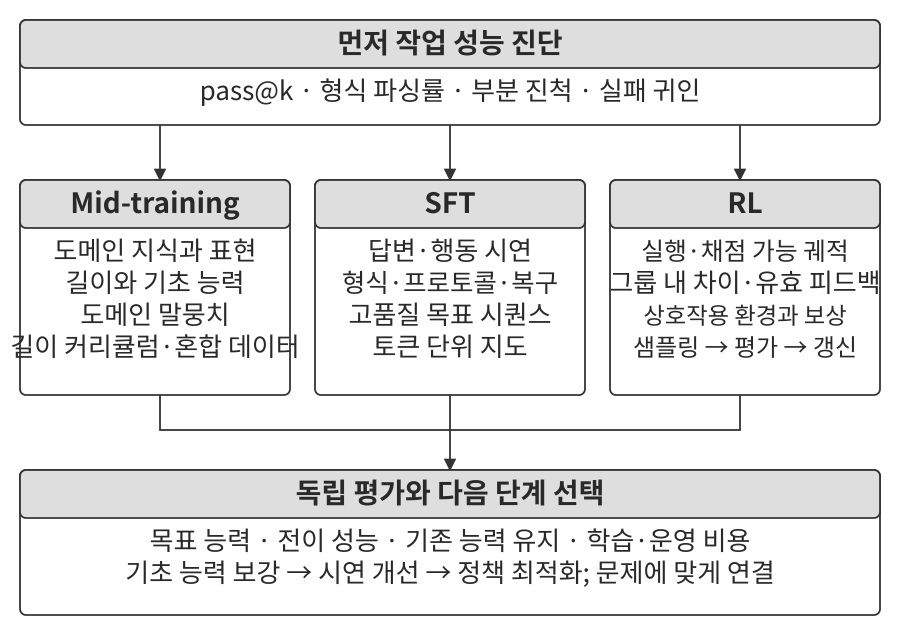

표 8-4 Mid-training, SFT, RL의 선택 기준

| 관찰된 현상 | 우선 점검할 것 | 후보 방법 | 이후 평가의 중점 |
| --- | --- | --- | --- |
| 도메인 언어, 개념, 기본 조작이 약하고 여러 번 샘플링해도 진전이 거의 없음 | 말뭉치 커버리지와 기초 능력 | Mid-training, 검색 가능한 사실은 RAG와 결합 | 도메인 과제, 범용 능력 점검용 테스트 세트, 부분적으로 맞은 궤적 |
| 내용은 쓸 만하지만 형식, 인자, 고정 절차가 불안정함 | 시연, 인터페이스, 제약 | SFT, 제약 디코딩, 도구 검증 | 파싱 성공, 과제 결과, 복구 행동 |
| 가끔 과제를 완수하지만 성공률이 낮거나 자주 돌아감 | 보상 품질, 탐색, 과제 분포 | RL | 과제 이득, 보상 차이, 독립적인 일반화, 비용 |
| 시연이나 선호 데이터는 있지만 상호작용 환경은 아직 없음 | 오프라인 데이터 커버리지와 검증 방식 | SFT, RFT, 오프라인 선호 최적화 | 기준선 품질, 데이터 편향, 환경 구축의 이득 |

네 단계로 진행할 수 있습니다. 먼저 프롬프트, 컨텍스트, 도구, 제약으로 이루어진 방안의 기준선을 세웁니다. 이런 방법이 이미 과제 요구를 충족한다면, 필자는 외부에서 편집할 수 있는 방안을 우선 유지해 학습, 배포, 회귀의 유지 비용을 줄입니다. 동적인 사실은 검색과 버전 관리로 제공하고, 반복해서 학습해야 하는 암묵적 판단, 지각 패턴, 안정적인 행동은 그때 파라미터 학습으로 개선하는 것을 고려합니다.

2단계에서는 홀드아웃 과제에서 성공, 부분 진전, 파싱 결과, 오류 유형을 관찰합니다. 샘플링 설정을 고정하면 Pass@1과 Pass@k가 현재 정책에 활용할 수 있는 경로가 이미 있는지 보여 주고, 실패 궤적은 지식 부족, 피드백 부재, 절차 오류를 구분하는 데 도움이 됩니다.

3단계에서는 학습해야 할 행동에 시연을 제공합니다. JSON 스키마, 도구 호출, 용어 사용, 명확히 묻기와 복구는 모두 SFT 샘플로 쓸 수 있고, 필요한 지식은 해당 말뭉치와 과제 컨텍스트로 제공합니다.

4단계에서는 RL의 피드백 조건을 평가합니다. 채점 가능한 후보를 생성할 수 있고, 보상에 변별력이 있으며, 환경이 충분한 상호작용을 허용한다면 정책 최적화의 이득을 비교해 볼 수 있습니다. 보상이 지나치게 희소하다면 먼저 커리큘럼, 부분 보상, 더 알맞은 초기 정책을 고려합니다.

각 단계에서 평가 결과가 이후의 투자를 결정합니다. 형식이 분명한 과제는 SFT를 마친 뒤 배포할 수 있고, 출발점이 강하면 곧바로 RL을 할 수 있으며, 도메인 지속 학습 후에도 기존 지시 능력을 재사용할 수 있습니다. 아래에서는 단일 턴 과제를 통해 시연 학습과 보상 학습이 만들어 내는 행동 차이를 구체적으로 살펴봅니다.

읽기 안내의 주문 문제로 돌아가 봅시다. 같은 실제 도구 설명을 모델에게 그대로 주고 인자를 제대로 쓰는지 관찰합니다. 설명의 필드가 이미 바뀌었다면, 먼저 실행 중에 조회할 수 있는 설명을 갱신합니다. 필드 의미는 분명한데도 모델이 사용자 텍스트를 주문 번호 자리에 반복해서 채운다면, 조회, 명확히 묻기, 올바른 인자 채우기가 담긴 SFT 시연을 제공할 수 있습니다. 모델이 이미 가끔은 처음부터 끝까지 처리해 내지만 조회 순서에 따라 성공률과 비용이 달라진다면, 여러 정책 궤적을 비교할 조건이 갖춰진 것입니다.

## 단일 턴 강화 학습: 암기와 일반화 비교

단일 턴 과제는 한 번의 입력으로 시작해, 모델이 답변을 제출하고 보상을 받으면 끝납니다. 모델은 답변을 생성하면서 여전히 여러 단계로 추론할 수 있고, 학습 시스템은 같은 문제를 여러 번 시도하게 할 수도 있습니다. 상호작용을 한 번의 답변으로 한정하면 학습 방법이 모델의 행동을 어떻게 바꾸는지 관찰하기 쉽습니다. 아래에서는 먼저 AdaptThink로 모델이 추론 예산을 배분하는 법을 어떻게 배우는지 설명하고, 이어서 GeneralPoints로 규칙과 시각적 외형이 바뀔 때 SFT와 RL의 성능을 비교합니다.

RL 알고리즘이 보상으로 모델을 어떻게 갱신하는지 먼저 알아 두면, 이후 실험의 학습 과정을 읽을 수 있습니다. 이 장의 RL 학습은 대부분 **정책 경사(policy gradient)**를 기반으로 합니다. 같은 문제를 여러 번 샘플링하는 경우를 예로 들면, 모델에게 답변을 몇 개 생성하게 한 뒤 각 답변의 보상을 기준선과 비교합니다. 기준선보다 나은 답변은 양의 신호를 받아 학습이 그 생성 확률을 높이고, 기준선보다 못한 답변은 음의 신호를 받아 생성 확률이 낮아집니다.

한 번의 갱신이 모델을 엉뚱한 방향으로 끌고 가지 않도록, 주류 알고리즘인 **PPO**는 확률비가 지정한 구간을 벗어나면 대리 목표에서 추가 이득을 잘라 냅니다. 실제 갱신 폭은 학습률과 갱신 에포크 수에도 달려 있습니다. 뒤에 나오는 ‘가치 네트워크를 쓰는 PPO’는 가치 추정을 학습하고, 이를 비교 기준선으로 삼아 각 단계 행동의 이점을 계산합니다. **GRPO**는 같은 문제에 대한 여러 답변을 직접 비교하고 그룹 내 보상으로 기준선을 구성하므로, 따로 학습하는 가치 네트워크가 필요 없습니다.

아래의 Python 풍 의사코드는 샘플링, 보상, 이점, 파라미터 갱신을 하나로 꿰어, 각 단계가 정보를 어떻게 전달하는지 이해하도록 돕습니다. 실제 학습에서는 샘플링 병렬화, KL 정규화, 옵티마이저도 설정해야 합니다.

```python
for prompt in batch:
    group = [rollout(policy, env.reset(prompt)) for _ in range(G)]
    rewards = [verify(trajectory) for trajectory in group]
    advantages = normalize_within_group(rewards)       # GRPO baseline
    update(policy, group, advantages)
```

PPO는 길이가 제각각인 궤적 묶음으로 정책을 어떻게 갱신할까요? 먼저 각 궤적 안에서 뒤에서 앞으로 각 단계의 할인 수익을 계산합니다. 궤적이 끝나면 누적을 멈춰, 다음 문제의 보상이 섞여 들어가지 않게 합니다. 이어서 모든 궤적에서 모델이 실제로 고른 행동을 한데 모아 이 행동들의 평균 손실을 계산합니다. 아래는 여러 에포크의 미니배치 최적화를 생략하고 갱신 한 번을 적은 것입니다.[^ch8-ppo-method]

```python
states, actions, returns = [], [], []
for trajectory in rollouts:
    states.extend(trajectory.states)       # 每次选择动作之前的状态
    actions.extend(trajectory.actions)     # 与状态逐项对应
    returns.extend(discounted_returns(trajectory.rewards))

returns = tensor(returns)
values = value_model(states)
advantages = returns - stop_gradient(values)
ratio = exp(policy.log_prob(actions, given=states)
            - old_policy.log_prob(actions, given=states))
policy_loss = -mean(min(
    ratio * advantages,
    clip(ratio, 1 - epsilon, 1 + epsilon) * advantages
))
value_loss = mean((values - returns) ** 2)
update(policy, value_model, policy_loss + value_coef * value_loss)
```

GRPO의 ‘상대’는 같은 문제에 대한 여러 답변에서 오고, 여기의 PPO는 가치 네트워크로 각 상태의 기대 수익을 추정합니다. `old_policy`는 이 궤적 묶음을 생성할 때 고정해 둔 정책입니다. 어떤 단계 행동의 이점이 1이고, 현재 정책이 이 행동에 주는 확률이 샘플링 때의 1.4배라고 합시다. `epsilon = 0.2`로 두면 대리 목표에서 이 항의 기여는 `min(1.4, 1.2) = 1.2`입니다. 이 행동의 확률을 더 높여도 이 항에서는 더 이상 추가 이득을 얻을 수 없습니다.

이점이 −1이면 방향이 반대가 됩니다. 확률비가 이미 0.6으로 내려갔다면 같은 코드 줄에 대입해 `min(-0.6, -0.8) = -0.8`을 얻으며, 확률을 더 낮춰도 이득이 늘지 않습니다. 반대로 성능이 나쁜 이 행동이 오히려 더 자주 나오게 되어 확률비가 1.4로 오르면, 더 작은 값을 취해 `min(-1.4, -1.2) = -1.4`를 얻습니다. 이 행동의 확률을 높이면 여전히 대가를 치러야 합니다.

> **실험 8-10 ★★: AdaptThink—‘사고하지 않을 때’를 학습하기**
>
> 추론 모델은 흔히 긴 추론 과정으로 문제를 풉니다. 간단한 문제라면 바로 답해서 생성 비용을 아낄 수 있습니다. AdaptThink는 모델에게 Thinking과 NoThinking 두 가지 모드를 제공합니다. 이 프로토콜을 지원하는 모델에서 NoThinking은 `<think></think>`로 추론 구간을 끝내고 곧바로 답을 생성합니다. 학습의 목표는 모델이 과제에 따라 알맞은 추론 예산을 고르게 하는 것입니다.
>
> 이 방법에는 핵심 구성 요소가 두 가지 있습니다. **제약 최적화 목표**는 전체 풀이 성능을 유지하면서 NoThinking 사용 비율을 늘리도록 모델을 장려합니다. **중요도 샘플링**은 두 모드의 샘플링 비율을 조정하고, 가중치로 샘플링 분포와 최적화 목표 사이의 차이를 보정합니다. 초기 모델은 대개 Thinking 쪽으로 치우쳐 있으므로, NoThinking 샘플을 의도적으로 늘려야 학습이 두 모드를 비교하는 신호를 얻을 수 있습니다. 여기서 말하는 콜드 스타트 문제는 구체적으로 학습 초기에 NoThinking 샘플이 부족한 것을 가리킵니다.
>
> 이 책의 실험에서는 H100 80GB GPU 8장을 사용했습니다. 300단계까지 학습했을 때 MATH500 정확도는 81.00%에서 81.80%로 바뀌었고, 평균 응답 길이는 약 4,911토큰에서 1,577토큰로 줄었습니다. GSM8K 정확도는 79.68%에서 81.88%로 올랐고, 응답 길이는 약 1,025토큰에서 477토큰로 줄었습니다. AIME mean@16은 31.46%에서 31.04%로 바뀌었고, 응답 길이는 약 12,120토큰에서 6,402토큰로 줄었습니다. 세 데이터셋의 응답 길이는 각각 약 68%, 53%, 47% 줄었습니다.
>
> 세 데이터셋의 NoThinking 비율은 차례로 83.80%, 84.15%, 56.25%였습니다. 모델은 AIME에서는 추론 계산을 더 많이 남겨 두었고, MATH500과 GSM8K에서는 바로 답하는 경우가 더 많았습니다. AIME2024는 문제마다 16번 샘플링하며, mean@16은 이 16번 답안의 평균 정답률입니다. 300단계에서 평균 답변은 거의 절반으로 짧아졌고, 정답률은 약 0.42%포인트 줄었습니다.
>
> 300단계는 학습 도중의 한 번의 검증입니다. 팀은 원래 3,140단계를 학습할 계획이었지만 실행이 나중에 비정상 종료되었고, 마지막 검증 기록은 410단계에서 멈췄습니다. 이 시점의 AIME2024 평균 정답률은 31.88%였고, 평균 답변은 약 5,874토큰이었습니다.
>
> AdaptThink는 프롬프트 증류와 함께 쓸 수 있습니다. 증류는 반복해서 쓰는 지시와 풀이 패턴을 파라미터에 새기고, AdaptThink는 과제마다 추론 계산을 얼마나 배분할지 학습합니다. 둘이 함께 답변 품질, 지연 시간, 비용에 영향을 줍니다.

> **실험 8-11 ★★: GeneralPoints—단일 턴 RL에서 ‘암기와 일반화’ 비교**
>
> Chu 등은 ‘24 게임’과 비슷한 카드 게임 GeneralPoints로 모델의 일반화 능력을 검증했습니다.[^ch8-3] 카드 네 장의 숫자를 한 번씩 써서 사칙연산으로 24를 만드는 게임입니다. 모델이 문제 풀이를 배웠다면, 카드 규칙이나 무늬를 바꿔도 여전히 올바르게 계산할 수 있을까요? 그림 8-12는 두 가지 문제 형식을 보여 줍니다. GP-L은 텍스트를 바로 주고, GP-VL은 모델이 카드를 읽어 내야 합니다.
>
> 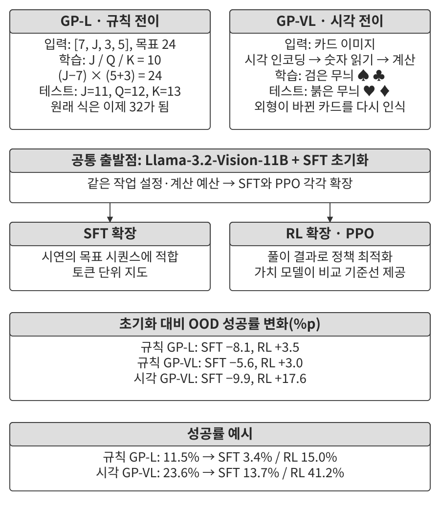
>
> **규칙 변형**: 학습할 때는 J/Q/K를 모두 10으로 계산하고, 테스트할 때는 각각 11/12/13으로 계산합니다. 따라서 테스트 세트에는 학습에서 보지 못한 숫자 조합이 들어 있어, 모델이 새 규칙에 따라 11, 12, 13을 써서 계산하는지 점검할 수 있습니다. **시각 변형**: 학습에는 검은색 무늬(♠♣), 테스트에는 빨간색 무늬(♥♦)를 써서, 모델이 카드 외형의 변화에 적응하는지 점검합니다.
>
> 실험은 Llama-3.2-Vision-11B에서 출발해, 먼저 SFT로 기본적인 지시 따르기 능력을 세운 뒤, SFT를 계속하는 분기와 RL 분기로 나누어 같은 계산 예산에서 비교합니다. RL 분기는 가치 네트워크를 쓰는 PPO를 사용합니다. 두 분기 모두 J/Q/K=10 규칙으로 학습한 뒤 분포 내(ID)와 분포 외(OOD) 테스트 세트에서 평가합니다.
>
> `[7, J, 3, 5]`를 예로 들면, J=10일 때는 `(J−7)×(5+3)=24`로 풀 수 있습니다. J를 11로 바꾸면 이 식은 32가 되므로 `(11−5)×(7−3)=24`로 바꿔야 합니다. 같은 카드 조합이라도 모델은 현재 규칙을 읽고 계산을 다시 짜야 합니다.
>
> 두 학습 방법은 분포 외 테스트에서 뚜렷한 차이를 보였습니다. **규칙 OOD**: GP-L에서 RL의 성공률은 11.5%에서 15.0%로 3.5%포인트 올랐고, SFT는 11.5%에서 3.4%로 8.1%포인트 떨어졌습니다. GP-VL에서는 RL이 3.0%포인트 올랐고 SFT는 5.6%포인트 떨어졌습니다. **시각 OOD**: GP-VL에서 RL은 23.6%에서 41.2%로 17.6%포인트 올랐고, SFT는 23.6%에서 13.7%로 9.9%포인트 떨어졌습니다.
>
> 카드 인식 결과를 더 살펴보면 최종 풀이 성능을 시각 지각과 연결할 수 있습니다. RL 분기의 인식 정확도는 과제 성공률과 함께 올랐고, SFT 분기의 인식 정확도는 다소 떨어졌습니다. 연구는 이 차이를 학습 목표와 연결합니다. 토큰 단위 적합은 시연의 텍스트 패턴을 강화할 수 있는 반면, 결과 보상은 모델이 카드를 올바르게 읽고 계산을 완수하도록 계속 요구합니다. 지각 정확도는 이 메커니즘을 분석하는 중간 지표가 됩니다.
>
> SFT를 먼저 하는 이유는 출력 형식으로도 이해할 수 있습니다. 실험에 쓴 Llama-3.2-Vision-11B 기반 모델은 요구하는 구조화 출력을 안정적으로 생성하지 못했고, 검증기는 이를 바탕으로 과제 보상을 계산할 수 없었기 때문에, 곧바로 엔드투엔드 RL을 시도했을 때는 실패했습니다. SFT가 먼저 파싱 가능하고 채점 가능한 출력을 세워야 이후의 RL이 과제 피드백을 활용할 수 있습니다. 앞에서 본 DeepSeek-R1-Zero는 원래부터 채점 가능한 답변을 생성할 수 있는 기반 모델에서 출발해 곧바로 RL에 들어갔습니다.
>
> 모델은 검증기의 피드백에서 얼마나 배울 수 있을까요? 논문의 그림 10은 텍스트 전용 카드 과제(GP-L)만 따로 비교합니다. 연구자들은 검증 반복을 1, 3, 5, 10회로 설정하고 각각 RL 모델을 학습하고 평가했습니다. 같은 학습 계산 예산에서 검증을 10회 허용한 그룹은 새 규칙에서 성공률이 그룹의 학습 출발점보다 5.99%포인트 올랐고, 검증을 1회만 한 그룹은 0.48%포인트 올랐습니다.
>
> 이 실험의 분포 이동에서 왜 SFT의 성능은 떨어지고 RL은 더 잘했을까요? 관찰과 부합하는 한 가지 설명은 이렇습니다. 제한된 SFT 데이터가 ‘J/Q/K를 만나면 10으로 쓴다’는 고정 패턴을 강화했고, 테스트에서 J=11이 되어도 모델은 여전히 10으로 계산했습니다. 결과 중심의 RL 분기는 ‘올바른 답이 나올 때까지 다시 계산한다’는 전략을 강화했을 가능성이 더 크고, 그래서 J가 11로 바뀌어도 이 전략을 적용할 수 있었습니다.
>
> GeneralPoints의 규칙 변화와 무늬 변화 덕분에, 모델이 새 조건에 따라 계산하는 법을 배웠는지와 새 시각 입력을 올바르게 읽는지를 따로 관찰할 수 있습니다. 여기서 쓴 모델, 학습 데이터, 테스트 예산에서는 SFT를 계속한 분기가 분포 외 테스트에서 퇴보했고, RL을 이어 붙인 분기는 향상되었습니다. 이 결론을 자신의 과제에 적용하려면 먼저 이렇게 물어보십시오. 학생이 이미 출력 형식을 익혔는가? 새 테스트는 규칙을 바꾼 것인가, 입력 외형을 바꾼 것인가, 아니면 둘 다 바꾼 것인가? 따로 대조해 봐야 시연을 보충할지, 지각을 개선할지, 결과 피드백이 있는 탐색을 늘릴지 알 수 있습니다.

## RL 알고리즘: 16번의 rollout에서 한 번의 파라미터 갱신으로

**GRPO(Group Relative Policy Optimization)**는 DeepSeek가 제안한 방법으로, 같은 문제에 대한 여러 시도의 상대적 성과로 학습 신호를 구성합니다. SWE-bench 형식의 코드 수정 과제를 예로 들어 봅시다. Python 프로젝트의 `parser.py`가 빈 입력에서 `IndexError`를 일으키고, 에이전트는 테스트 파일을 그대로 둔 채 구현을 고쳐야 합니다. 한 번의 학습 반복은 네 단계로 나눌 수 있습니다.

**1단계: 정책 모델에게 반복해서 시도하게 합니다.** 정책 모델이란 지금 학습 중인 언어 모델입니다. 시스템은 같은 초기 코드와 문제 설명을 격리된 샌드박스 16개에 넣고, 모델이 과제를 독립적으로 16번 수행하게 합니다. 시도마다 코드를 읽는 데서 시작해 수정과 테스트를 거쳐 결과를 제출할 때까지 이어지며, 이 상호작용 궤적 전체를 **rollout** 한 번이라고 합니다. 무작위 샘플링 때문에 같은 출발점에서도 서로 다른 경로가 나옵니다. 어떤 시도는 경계 검사를 보완하고, 어떤 시도는 예외만 잡아 두고, 어떤 시도는 엉뚱한 파일을 고치며, 어떤 시도는 테스트를 수정하려 합니다.

**2단계: 보상을 계산합니다.** 각 rollout이 끝나면 검증기가 깨끗한 환경에서 패치를 적용하고 테스트를 실행합니다. 16번의 시도 가운데 4번은 테스트 파일을 고치지 않고 모든 테스트를 통과했고, 나머지 12번은 실패했다고 합시다. 그러면 통과한 4개는 보상 1을, 나머지 12개는 보상 0을 받습니다. 그림 8-13은 이 16개 궤적의 판정을 한 표에 모아 놓은 것입니다. 이런 코드 과제는 테스트와 규칙으로 보상을 바로 계산할 수 있습니다. 가독성, 설명 품질처럼 테스트로 쓰기 어려운 목표에는 인간 평가나 보상 모델을 결합할 수도 있습니다.

**3단계: 상대 이점을 계산합니다.** 보상은 궤적 하나가 성공했는지 실패했는지만 알려 주지만, **상대 이점**은 그 궤적이 같은 그룹의 다른 시도에 비해 얼마나 나은지를 알려 줍니다. 이 그룹의 평균 성공률은 4/16입니다. 테스트를 통과한 4개는 그룹 평균보다 높아 양의 이점을 받고, 실패한 12개는 평균보다 낮아 음의 이점을 받습니다. 그룹 내 표준편차로 정규화하면 보상 평균은 0.25, 표준편차는 약 0.433이며, 성공 궤적의 이점은 약 1.73, 실패 궤적은 약 −0.58입니다. GRPO는 이런 그룹 내 비교로 학습 신호를 구성합니다. 16개의 보상이 모두 같다면 각각에서 그룹 평균을 빼면 모두 0이 됩니다. 분모에 아주 작은 안정화 항을 더하면 0으로 나누는 일은 피할 수 있지만, 정규화한 뒤에도 이 그룹의 결과 보상은 학습이 어느 궤적 쪽으로 기울어야 할지 알려 주지 못합니다. 이때는 경로 제약, 과정 보상, 부분 진전으로 같은 그룹의 궤적을 구별할 수 있는지 점검하면 됩니다. 예를 들어 둘 다 코드를 고치지 못한 두 시도 가운데 하나만 원래 실패하던 경계 테스트를 통과했다고 합시다. 이 중간 결과를 독립적으로 검증할 수 있다면, 학습에 쓸 수 있는 단서가 하나 더 생깁니다.

**4단계: 경사 하강으로 정책을 갱신합니다.** 학습 프로그램은 상대 이점을 학습 손실로 바꾸고 경사도를 계산한 뒤, 옵티마이저(AdamW, Muon 등)로 경사 하강을 실행해, 양의 이점을 받은 궤적에서 모델이 내린 선택의 확률은 높이고 음의 이점을 받은 궤적에서 내린 선택의 확률은 낮춥니다. 학습은 많은 과제와 rollout에 걸쳐 이런 선택의 확률을 거듭 조정합니다. 최적화가 점차 효과를 내면, 비슷한 오류를 만났을 때 ‘먼저 문제를 재현하고, 경계 조건을 점검하고, 구현을 고친 뒤 테스트를 실행하기’가 더 쉽게 나오고, ‘예외를 덮어 버리기, 테스트를 고치기, 검증 없이 제출하기’는 덜 나옵니다.

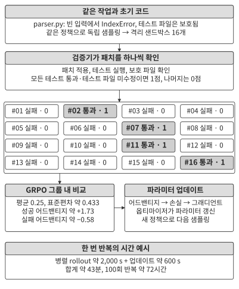

그림 8-13에서 같은 문제를 16번 샘플링하면 **학습 반복(step)**은 몇 번일까요? 이 절의 계산 방식으로는 이 16개 rollout이 한 묶음에 속합니다. $k$번째 회차에서 현재 정책으로 샘플링하고 보상, 이점, 경사도를 계산해 정책을 한 번 갱신하며, $k+1$번째 회차가 되어서야 새 파라미터로 다시 샘플링합니다. 100 steps를 학습한다는 말은 이런 반복을 약 100회 한다는 뜻입니다.

이를 바탕으로 학습 시간을 어림할 수 있습니다. 복잡한 과제 하나에는 수십 회의 도구 호출이 들어갈 수 있습니다. 동기식 학습이 묶음 전체의 결과를 기다리는 경우, 병렬로 실행한 16개 궤적 가운데 가장 느린 하나가 샘플링 단계의 종료 시점을 결정합니다. 그 궤적에 약 2,000초가 걸리고 경사도 계산과 옵티마이저 갱신에 600초가 더 든다면, step 한 번에 약 $2{,}000+600=2{,}600$초, 곧 43분이 필요합니다. 같은 소요 시간으로 100 steps를 연속으로 학습하면 약 72시간이 걸립니다.

PPO와 GRPO는 모두 이 폐루프를 따르며, 주된 차이는 ‘무엇과 비교하는가’에 있습니다. GRPO는 같은 문제에 대한 여러 rollout을 직접 비교하므로 별도의 가치 모델이 필요 없습니다. PPO는 가치 모델을 학습해 궤적의 각 단계에서 ‘보통 어느 정도까지 해낼 수 있는지’를 추정한 뒤, 현재 행동이 이 기대보다 나은지 판단하므로, 단계별 기여도 할당에 필요한 기준선을 제공합니다. 둘 다 대리 목표 클리핑 같은 메커니즘으로 지나치게 큰 갱신을 억제합니다. DPO는 다릅니다. 미리 수집해 둔 ‘더 나은 답변–더 못한 답변’ 선호 쌍을 직접 학습하며, 현재 정책이 이런 rollout 묶음을 온라인으로 생성하게 하지 않습니다.

이 장의 사례들은 서로 다른 학습 방식을 씁니다. AdaptThink는 직접 정의한 제약 목표를 쓰고, GeneralPoints, V-IRL, ReTool은 PPO를 쓰며, 그중 앞의 둘은 가치 모델이 이점 추정에 참여합니다. SimpleVLA-RL과 RLVP는 GRPO를 씁니다.

갑, 을 두 문제를 각각 네 번씩 시도했는데 갑 문제는 모두 맞히고 을 문제는 모두 틀렸다고 합시다. 갑 문제의 보상 네 개는 모두 1이고, 을 문제의 보상 네 개는 모두 0입니다. 각각 그룹 평균을 빼면 두 그룹의 이점은 모두 0이 됩니다. 그런데 계산 자원이 남아 몇 번 더 시도할 수 있다면, 어느 문제에 써야 쓸모 있는 학습 샘플을 얻을 가능성이 더 클까요?

Never Give Up은 이 선택을 샘플링 과정 안으로 들여왔습니다. 갑 문제는 모두 맞혔으므로 이 그룹은 건너뜁니다. 을 문제는 모두 틀렸으므로 일정한 확률로 한 그룹을 더 샘플링합니다. 두 번째 그룹에서 마침내 한 번 맞혔다면, 학습할 때 두 그룹의 답변 여덟 개를 한데 모읍니다. 정답 하나와 오답 일곱 개가 생겨, 같은 문제에 높낮이가 다른 보상이 생깁니다. 비동기 샘플링 덕분에 다른 문제들은 평소대로 진행되며, 을 문제의 결과를 기다릴 필요가 없습니다.[^ch8-ngu]

[^ch8-ngu]: Michael Noukhovitch 외, *Learning to Solve Hard Problems in RL for LLMs by Never Giving Up*, 2026년. 논문의 추가 샘플링은 학습에 쓰이며, 이미 맞힌 문제도 이후 학습에서 다시 뽑힐 수 있습니다.

### LLM RL에서 보통 On-Policy를 우선하는 이유

**Online(온라인)**과 **On-policy(온폴리시)**는 서로 다른 측면을 가리킵니다. 온라인 학습은 실행 과정에서 환경과 계속 상호작용하며 데이터를 만들어 냅니다. 온폴리시 학습은 데이터의 출처에 주목하며, 궤적을 생성한 행동 정책 $\mu$가 최적화하려는 정책 $\pi_\theta$와 같거나 충분히 가까울 것을 요구합니다. 비동기 클러스터는 온라인 샘플링을 계속할 수 있지만, worker가 체크포인트 몇 개만큼 뒤처지면 돌려주는 데이터에 정책 노후화가 생겨 off-policy(오프폴리시) 성분이 됩니다.

필자는 먼저 온폴리시에 가까운 학습으로 안정적인 기준선을 세우고, 그다음에 처리량을 높이기 위해 비동기 샘플링이나 이전 데이터 재사용을 도입하라고 권합니다. 이 장의 PPO/GRPO 학습 방식은 보통 각 step을 시작할 때 최신 정책으로 샘플링합니다. 이어서 PPO는 같은 데이터 묶음에 여러 에포크의 미니배치 갱신을 하므로, 현재 정책은 데이터를 생성한 `old_policy`에서 점점 멀어집니다. 확률비는 이 변화를 측정하고, 클리핑 목표는 지나치게 큰 갱신을 억제합니다.

정책 경사의 목표는 현재 정책 $\pi_\theta$에서의 기대 보상과 관련됩니다. 행동 정책 $\mu$로 샘플링한 데이터를 쓸 때는 먼저 같은 상태에서의 행동 확률비를 계산하고, 이를 바탕으로 중요도 보정을 구성할 수 있습니다.

$$
\rho_t=\frac{\pi_\theta(a_t\mid s_t)}{\mu(a_t\mid s_t)}
=\exp\left(\log\pi_\theta(a_t\mid s_t)-\log\mu(a_t\mid s_t)\right).
$$

같은 접두부 뒤에서 샘플링 정책이 어떤 토큰을 고를 확률이 0.2이고 현재 정책이 그 토큰에 주는 확률이 0.3이라면, 이 단계의 확률비는 1.5입니다. 이 토큰은 이전 샘플에서 상대적으로 적게 나왔으므로, 현재 정책 기준으로 추정할 때 이런 샘플의 가중치가 그만큼 높아집니다. 샘플링과 학습에 같은 정책을 쓴다면, 파라미터를 갱신하기 전 각 단계의 확률비는 모두 1입니다.

이전 궤적을 재사용하면 샘플링과 학습을 비동기로 진행해 처리량을 높일 수 있습니다. 하지만 두 정책이 멀어질수록 소수의 샘플이 매우 큰 가중치를 얻을 가능성이 커집니다. 궤적 전체에 가중치를 다시 매길 때는 각 단계의 확률비를 연달아 곱해야 합니다. PPO는 각 행동의 대리 목표에서 추가 이득의 일부를 잘라 내어 극단적인 확률비의 영향을 약화할 수 있지만, 이전 샘플이 한 번도 도달하지 못한 상태는 새로 샘플링해야만 볼 수 있습니다. 필자가 새로 생성한 궤적을 쓰는 쪽을 선호하는 이유도 여기에 있습니다.[^ch8-32]

#### 학습과 추론의 수치 차이

대규모 LLM 강화 학습은 보통 vLLM, SGLang 같은 추론 엔진으로 샘플링하고, FSDP, Megatron 같은 학습 시스템으로 로그 확률과 경사도를 계산합니다. 두 쪽이 같은 가중치를 불러오더라도 부동소수점 정밀도, 리덕션 순서, 텐서 병렬, 배치 크기, KV Cache, 융합 커널이 달라서 같은 토큰에 대해 조금씩 다른 로그 확률을 계산할 수 있습니다. 그러면 파라미터를 아직 갱신하지 않았는데도 $\rho_t$가 이미 1에서 벗어나, 학습과 샘플링 사이에 수치 차원의 정책 차이가 생깁니다. 통제 실험에서는 미세한 토큰 수준의 차이도 학습 붕괴로 이어질 수 있음이 드러났습니다.[^ch8-33]

샘플링 분포가 바뀌면 두 행동의 보상이 완전히 같더라도 단순한 정책 경사는 그중 하나에 치우칠 수 있습니다. 샘플링할 때 A와 B가 각각 절반의 확률이었는데, 학습할 때 모델이 A를 고를 확률이 이미 0.8로 바뀌었다고 합시다. A를 제어하는 logit에 대해, A가 뽑혔을 때 로그 확률의 경사도는 $1-0.8=0.2$이고, B가 뽑혔을 때는 $0-0.8=-0.8$입니다. 두 행동이 모두 1점을 받는다면 샘플링 때의 확률로 평균한 경사도는 $-0.3$입니다. 두 선택의 점수가 분명히 같은데도, 갱신은 A의 확률을 낮추게 됩니다.

Score centering은 같은 접두부에서 로그 확률의 경사도에서 샘플링 분포 기준의 평균을 뺍니다. 위 예에서 $-0.3$을 빼면 두 항은 각각 $0.5$와 $-0.5$가 되어, 같은 보상이 만드는 평균 갱신이 정확히 0이 됩니다. 앞의 GRPO는 답변 묶음의 보상에서 평균을 뺐다면, 여기서 중심화하는 대상은 경사도입니다.[^ch8-sc]

[^ch8-sc]: Martin Marek, Max Ryabinin, *Score Centering Stabilizes Off-policy Reinforcement Learning*, 2026. 샘플링 정책이 너무 많이 뒤처졌을 때는 KL 정규화로 학습 정책과 행동 정책 사이의 거리를 제약할 수도 있습니다(arXiv:2611.21791).

학습 쪽과 샘플링 쪽의 수치 오차는 긴 시퀀스를 따라 증폭되기도 합니다. **로그 확률 오차 → 확률비 편차 → 긴 접두부 누적 → 클리핑과 이점 가중치 변화 → 경사도와 유효 샘플 수 변화**의 순서입니다. 예를 들어 4,000개 토큰의 로그 확률비에 모두 같은 방향으로 $10^{-3}$의 편차가 있으면, 계산된 궤적 수준 확률비는 참값의 $e^{4000\times0.001}=e^4\approx54.6$배가 됩니다.

초기의 확률 변화는 샘플링 결과까지 바꿔, 이후 상태가 다른 경로로 전개되게 할 수도 있습니다. 학습 중에 관찰할 수 있는 신호로는 중요도 비율의 급등, 클리핑 비율 상승, 경사도나 응답 길이의 급변, 보상과 엔트로피의 하락이 있습니다. 배치 크기가 리덕션 과정을 바꾸면 같은 입력의 수치 결과도 달라질 수 있는데, 이는 배치 불변성(batch invariance)이 깨진 것입니다. 관련 연구는 이로 인해 생기는 암묵적 오프폴리시 효과를 관찰했고, 샘플링과 학습의 계산을 정렬하거나 정책 차이를 명시적으로 보정해 안정성을 개선했습니다.[^ch8-34]

그래서 필자는 샘플링과 학습의 수치 일관성을 학습 시작 전의 핵심 점검 항목으로 두고, 보상 곡선과 함께 계속 모니터링합니다. ‘차이 측정–설정 정렬–편차 보정–노후화 제어’의 네 단계로 처리할 수 있습니다.

- **어떤 파라미터 갱신보다도 먼저**, 같은 궤적 묶음에 대해 샘플링 쪽(sampler)과 학습 쪽(trainer)이 내놓는 토큰 로그 확률을 비교하고, $\rho_t$의 평균, 분위수, 최댓값, 근사 KL, 클리핑 비율을 모니터링합니다. 이것이 가장 직접적인 on-policy 단위 테스트입니다.
- 가중치를 동기화할 때는 LoRA 어댑터, 토크나이저, 대화 템플릿, 모델 버전, 위치 인코딩 설정도 함께 맞춥니다. rollout에는 샘플링 정책이 생성 시점에 내놓은 로그 확률을 저장해 두고, 이후 이를 바탕으로 확률비를 계산해야 합니다.
- 샘플링과 학습의 정밀도, 병렬 배치, 핵심 계산 커널을 가능한 한 맞춥니다. 그럴 수 없다면 그 차이를 명시적으로 off-policy로 간주해 중요도 보정을 적용하고, 유효 샘플 수를 모니터링하며, 클리핑 비율과 함께 보정 효과를 판단합니다.
- 갱신된 정책으로 제때 다시 샘플링하고, 데이터 묶음마다 갱신 에포크 수와 비동기 샘플링이 학습보다 뒤처지는 체크포인트 수를 제한합니다.

## RL 환경: 평가에서 시뮬레이션으로

에이전트의 RL 학습은 과제를 반복해서 실행해야 합니다. 코드 수정은 격리된 복사본에서 몇 번이고 다시 시도할 수 있지만, 결제는 한 번만 해도 실제 계정의 상태가 바뀝니다. 학습 환경은 초기화할 수 있는 초기 상태, 병렬로 돌릴 수 있는 과제 복사본, 검증할 수 있는 결과를 제공해, 모델이 통제된 조건에서 여러 경로를 탐색하게 해야 합니다. 평가 환경은 제7장에서 이미 소개했습니다. 이를 학습에 쓰려면 장시간 실행, 행동의 부작용, 대량 상호작용의 비용도 고려해야 합니다. 필자는 대규모 학습을 계획하기 전에 먼저 환경 구축에 인력과 예산을 배정합니다. 현실적인 피드백, 상태 초기화, 병렬 격리를 구현하는 데는 PPO나 GRPO를 붙이는 것보다 공학 자원이 더 많이 드는 경우가 흔하고, 환경 구축 비용이 학습 자체보다 클 수도 있습니다.

### 환경: 모델이 연습하는 마당

환경은 행동에 따라 상태를 갱신하고 새로운 관측을 모델에 돌려줍니다. 환경을 만들 때는 세 가지 질문에서 출발할 수 있습니다.

- **상호작용이 배포 상황에 가까운가?** 고객 응대 시뮬레이터는 사용자가 정보를 덧붙이거나, 요구를 바꾸거나, 모호하게 표현하는 상황까지 다뤄야 합니다. 도구 시뮬레이터는 운영 환경에서 흔히 생기는 오류와 지연을 돌려줘야 합니다. 모델은 이런 피드백을 통해 실제 문제에 대처하는 법을 배웁니다. 피드백이 지나치게 단조로우면 정책이 시뮬레이션 속의 정해진 패턴에 기대게 됩니다.
- **과제를 안정적으로 재시도하고 병렬로 실행할 수 있는가?** rollout마다 독립된 주문, 파일, 계정 상태가 있어야 하고, 끝나면 정리하고 복원할 수 있어야 합니다. ReTool의 코드 인터프리터 샌드박스와 AWorld의 MCP 샌드박스가 바로 이런 역할을 맡습니다. 속도 제한이나 비용, 쓰기 부작용이 있는 실제 API라면 과제에 맞게 샌드박스 계정, 재생 데이터, 모의 인터페이스를 쓸 수 있습니다.
- **결과를 어떻게 판정하는가?** 환경 상태는 보상을 계산하는 중요한 근거입니다. 예를 들어 환불 과제는 금액, 주문 상태, 승인 조건을 확인할 수 있고, 코드 과제는 테스트를 실행할 수 있습니다. 보상 설계는 뒤에서 따로 다룹니다.

**알고리즘을 조정하기 전에, 필자는 먼저 시뮬레이션 환경이 실제 과제에 충분히 가까운지 확인하라고 권합니다. 이것이 PPO와 GRPO 중 무엇을 고를지보다 중요합니다.** 충실도, 초기화 가능성, 검증 능력이 함께 모델이 상호작용에서 무엇을 배울 수 있는지를 결정합니다. 적은 수의 과제로 이 세 단계를 먼저 끝까지 돌려 본 뒤 학습 규모를 키우면, 대개 문제를 찾아내기가 더 쉽습니다.

### 모델로 도구와 환경 시뮬레이션하기

검색 결과, 사용자 대화, 복잡한 업무 상태는 모두 모델을 이용해 합성할 수 있습니다. 모델 시뮬레이터는 에이전트의 행동을 받아 다음 피드백을 생성하므로 실시간 외부 서비스에 대한 의존을 줄여 줍니다. 이 방식은 개별 도구에서 과제 환경 전체로 확장할 수 있습니다.

**첫 번째 층위: 도구 반환값을 합성한다.** ZeroSearch[^ch8-13]는 LLM에게 검색 엔진 역할을 맡깁니다. 학생이 질의를 보내면 시뮬레이터가 검색 결과를 생성합니다. 이렇게 하면 실제 검색 API의 비용, 속도 제한, 결과 변동에 대한 학습의 의존을 줄일 수 있습니다. 또한 커리큘럼식 구성을 써서, 초기에는 품질이 높고 관련성이 강한 문서를 돌려주다가 점차 잡음을 늘려, 학생이 불완전한 자료에서 쓸모 있는 정보를 뽑아내는 연습을 하게 합니다. 연구에서 모의 검색 환경으로 학습을 마친 모델은 실제 검색 엔진에 연결해도 좋은 성능을 보였습니다.

**두 번째 층위: 환경의 상태 전이를 시뮬레이션한다.** DreamGym[^ch8-14]은 환경 동역학을 추론형 경험 모델로 증류합니다. 이 모델은 현재 상태와 에이전트의 행동을 읽어 다음 상태와 피드백을 추론하고, 온라인 RL에 쓸 상호작용 궤적을 대량으로 생성해 실제 환경에 접근하는 횟수를 줄입니다. 고객 응대와 영업 과제에서는 LLM에게 사용자 역할을 맡겨 되묻기, 정보 보충, 요구 변화를 시뮬레이션할 수도 있습니다. τ-bench 계열은 사용자 시뮬레이터를 사용합니다. 비슷한 상호작용 프레임워크를 학습에도 쓸 수 있으며, 이때 연습과 평가를 각각 맡게 됩니다.

모델 시뮬레이터도 보정이 필요합니다. 고객 응대 시뮬레이터가 모호한 질문을 늘 정확히 알아듣는다면 정책은 되물어 명확히 하는 연습을 할 기회가 없습니다. 검색 시뮬레이터가 늘 올바른 문서만 돌려준다면 정책은 잡음을 가려내는 경험을 쌓지 못합니다. 학습이 시뮬레이터 채점의 결함을 파고드는 행동을 강화할 수도 있습니다. 필자는 혼합 방식을 권합니다. 대부분의 상호작용은 모델 시뮬레이션에 맡기고, 실제 환경의 과제로 정책 성능을 주기적으로 점검하며, 발견한 차이를 시뮬레이터에 반영합니다. 이렇게 하면 ‘합성 상호작용—실제 과제 평가—시뮬레이터 수정’의 반복 과정이 만들어집니다.

시뮬레이터가 정말로 도구 사용을 가르칠 수 있는지 어떻게 알 수 있을까요? 간단한 테스트를 해 볼 수 있습니다. 같은 초기 주문에 대해 먼저 조회하고, 수정을 제출한 뒤, 다시 조회해서 돌아온 주문 필드가 행동에 따라 예상대로 바뀌었는지 확인합니다. 그런 다음 환경을 초기화하고 원래 값을 다시 읽을 수 있는지 확인합니다. 그럴듯한 ‘수정되었습니다’라는 문장만 생성할 뿐 다음 턴에 변화를 조회할 수 없는 환경은, 주문을 한 번도 바꾸지 않았더라도 말만 잘하는 정책에 보상을 줍니다.

### 환경, 과제 분포, 평가 격리

학습 환경은 모델이 무엇을 겪을 수 있는지를 결정합니다. 초기화할 수 있는 상태는 재시도를, 격리된 복사본은 병렬 실행을, 명확한 상태와 검증 규칙은 재현과 채점을 가능하게 합니다. 과제는 앞에서 설명한 데이터 합성 방법을 그대로 쓸 수 있습니다. 실제 업무 로그에서 과제 청사진을 추출하고 신원 정보를 제거한 뒤, 가상의 인물, 주문, 파일, 초기 상태를 생성합니다.

학습과 평가는 과제 생성기와 검증 코드를 함께 쓸 수 있지만, 구체적인 과제는 서로 독립된 집합으로 나눠야 합니다. SWE-Gym, τ²-bench, AndroidWorld의 환경 설계[^ch8-28]를 참고하면, 인수 테스트, 채점에 필요한 숨은 상태, 참조 해법은 검증기 쪽에 보관하고, 에이전트는 과제가 정한 인터페이스를 통해 관측을 얻습니다. 샘플링을 늘리기 전에 적은 수의 rollout으로 과제를 완료할 수 있는지, 검증기가 유효한 결과와 무효한 결과를 구분하는지 먼저 확인합니다. 채점 편차를 일찍 발견하면 정책이 검증의 허점을 파고들 기회를 줄일 수 있습니다.

따라서 환경 공학의 순서는 **과제 청사진 → 초기화 가능한 환경 → 결과 검증 → 학습/평가 격리 → 실제 상호작용으로 보정**이어야 합니다. 앞의 데이터 합성은 이런 환경에서 유효한 궤적을 골라 SFT 시연을 만듭니다. RL 단계에 들어서면 현재 정책이 계속 환경에서 시행착오를 거치며 시연 밖의 경로를 탐색합니다.

검증도 처리량 예산에 넣어야 합니다. Lean 커널, 테스트 러너, 컨테이너 실행은 CPU와 메모리를 소비합니다. GPU의 생성 속도가 검증 속도를 앞지르면 과제가 검증 대기열에 쌓입니다. 이럴 때는 검증기 worker를 늘리거나, 검증 지연을 줄이거나, 생성과 검증의 자원 배분을 조정해야 합니다[^ch8-9].

## 단일 턴에서 다중 턴으로: 과제 상황과 기여도 할당

### 다중 턴 과제의 핵심 난제

그림 8-14의 왼쪽은 24 게임입니다. 모델은 답변 안에서 여러 단계를 계산할 수 있지만, 그 단계들은 모두 문제에 주어진 네 장의 카드만 사용하며 중간에 새로운 환경 관측이 들어오지 않습니다. 오른쪽은 거리 풍경 내비게이션입니다. 교차로에 이르러 왼쪽으로 돌고 나서야 비로소 그쪽 거리가 보입니다. 다음에 어디로 갈지는 눈앞의 도로 표지판을 보고 다시 판단해야 합니다. 제1장과 제4장에서 다룬 ReAct가 바로 이런 상호작용을 구성합니다. 모델이 행동을 고르고, 도구나 환경이 이를 실행하며, 새로운 관측이 다음 턴의 결정에 들어갑니다.

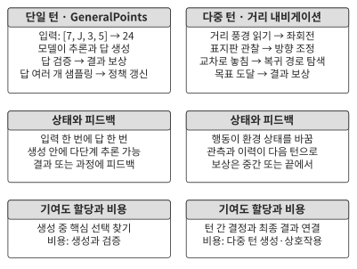

그림 8-15에서 에이전트는 3단계에서 교차로를 지나치고, 4단계에서 길을 벗어났음을 알아차려 되돌아가며, 5단계에서 목적지에 도착합니다. 종점 보상은 내비게이션 전체를 긍정할 뿐, 길을 잘못 든 것과 제때 되돌아간 것을 구분하지 않습니다. 다음에 이 교차로를 만나면 곧바로 올바르게 가기를 바라지만, 혹시 또 잘못 들더라도 되돌아가는 행동은 여전히 장려해야 합니다. 학습에서는 앞선 각 단계가 최종 수익에 얼마나 기여했는지 추정해야 하며, 이 문제를 **기여도 할당(Credit Assignment)**이라고 합니다. 가치와 이점 추정은 나중에 받은 수익을 활용할 수 있고, 중간 행동을 신뢰성 있게 검사할 수 있다면 과정 보상을 더할 수도 있습니다. 4단계의 되돌아가기는 과정 보상에서 0점을 받지만 목적지에 도착하는 데는 여전히 도움이 됩니다. 이 단계의 가치를 추정할 때도 나중의 수익을 반영해야 합니다.

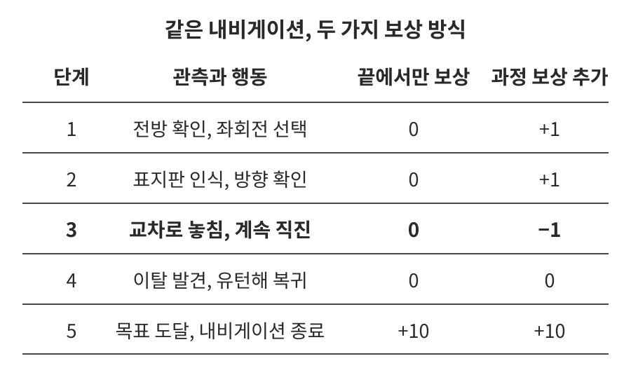

같은 문제는 고객 응대 통화에서도 생깁니다. 예를 들어 사용자가 10번째 턴에서 좋은 평가를 남겼다고 합시다. 2번째 턴에서 어느 요금에 대한 분쟁인지 확인한 것과 7번째 턴에서 요금을 설명한 것이 모두 도움이 되었을 수 있습니다. 마지막 좋은 평가 하나만으로는 각각이 얼마나 기여했는지 가려낼 수 없습니다. 아래 두 실험은 각각 학습하는 쪽이 내비게이션 행동을 단계마다 검사할 수 있는 경우와, 과제 결과로만 로봇의 성공 여부를 판단할 수 있는 경우를 다룹니다.

> **실험 8-12 ★★★: V-IRL-VL—다중 턴 시각 내비게이션**
>
> V-IRL[^ch8-24]에서 에이전트는 눈앞의 거리 풍경을 보며 한 걸음씩 목적지를 찾아가야 합니다. 학습에는 뉴욕의 경로를 쓰고, 테스트는 다른 도시로 옮겨 길 안내 표현과 화면 속 거리 풍경을 모두 바꿉니다. 규칙 변화와 시각 변화라는 두 종류의 분포 외 테스트에서 RL은 모두 SFT보다 뚜렷이 좋은 성능을 보였습니다. 실험에는 가치 네트워크가 있는 PPO를 사용합니다. 한 걸음마다 피드백을 주면 긴 경로에서 어떤 결정을 남길 만한지 가려내는 데 도움이 됩니다.

> **실험 8-13 ★★★: SimpleVLA-RL—결과 보상 아래의 개방적 탐색 `[확장 실험]`**
>
> SimpleVLA-RL은 LIBERO 로봇 과제에서 성공/실패 결과 보상을 사용합니다. 과제마다 시연 궤적 하나로 SFT 콜드 스타트를 한 뒤, RL로 성공률을 17.3%에서 91.7%로 끌어올렸고, 시연에 나오지 않은 ‘밀어 자르기’ 동작이 나타났습니다. 이 결과를 거리 풍경 내비게이션과 나란히 놓고 보면 다음과 같습니다. 중간에 어느 단계에서 잘못했는지 신뢰성 있게 판정할 수 있다면 그 자리에서 피드백을 주어 학습을 앞당길 수 있습니다. 과제를 완수하는 방법이 몇 가지인지 아직 모른다면, 우선 결과에 따라 보상을 주어 모델이 다른 경로를 시도할 여지를 남길 수 있습니다. 사람의 시연에 담긴 동작 순서를 너무 일찍 보상 요건으로 정해 버리면 ‘밀어 자르기’ 같은 새로운 전략의 점수를 깎아 버릴 수 있습니다.

### 도구 호출: 상호작용 속에서 외부 능력 사용하기

외부 도구를 연결하면 모델은 검색, 코드 실행, 파일 수정, 데이터베이스 조회를 고르거나, 과제에 맞게 여러 API를 조합할 수 있습니다. Harness는 호출을 검증하고 조율하며, 도구는 환경에서 실행되어 관측을 돌려줍니다. 그림 8-16은 한 과제 안에서의 결정과 과제가 끝난 뒤의 학습을 분리해 보여 줍니다. 오른쪽 화살표를 따라가면 도구 결과가 현재 과제로 돌아오고, 모델은 이를 바탕으로 다음 단계를 정합니다. 아래쪽을 읽으면, 과제가 끝난 뒤에야 학습 프로그램이 궤적 전체로 보상을 계산하고 파라미터를 갱신하며, 다음 샘플링부터 새 정책이 쓰입니다. 한 과제에서 도구를 연달아 여러 번 호출할 때는 앞선 호출의 반환 결과가 다음 호출의 인자에 영향을 줍니다.

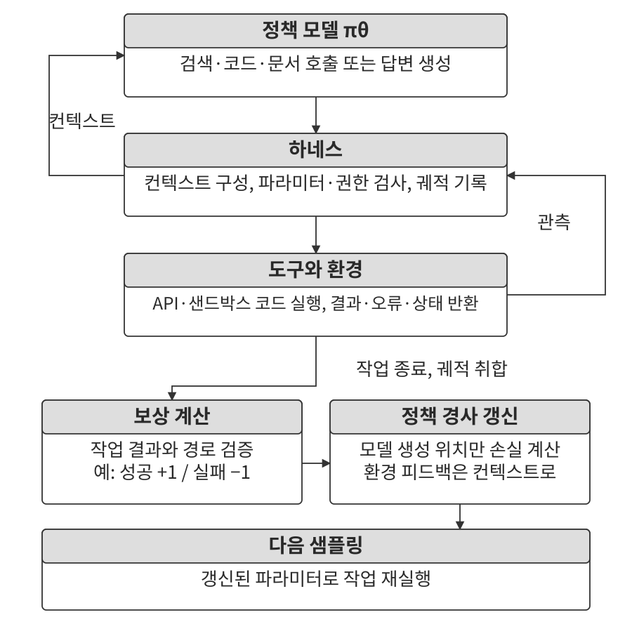

Search-R1[^ch8-25]은 모델이 언제 검색할지, 어떤 질의를 보낼지 정하고 결과를 바탕으로 추론을 이어 가도록 학습시킵니다. ReTool은 코드 인터프리터를 같은 종류의 루프에 연결해, 모델이 코드 실행을 계획하고 반환값을 이해하며 오류 메시지에 따라 수정하도록 학습시킵니다. AWorld-train은 이를 MCP 다중 도구 샌드박스로 넓혀, 모델은 도구를 고르고 호출 사이의 의존성을 처리해야 하며, 학습 시스템은 환경을 초기화하고 궤적을 재생할 수 있어야 합니다.

도구 궤적에서는 모델이 생성한 토큰과 환경이 돌려준 토큰을 구분해야 합니다. 정책 손실을 계산할 때는 모델이 생성한 추론, 호출 인자, 답변 같은 행동만 손실에 넣고, 환경 피드백에 해당하는 위치는 마스킹합니다. 피드백은 여전히 컨텍스트로서 이후 계산에 참여해, 모델이 다음에 무엇을 할지 판단하도록 돕습니다. 예를 들어 인터프리터가 오류를 돌려주었다면, 학습이 강화해야 할 것은 모델이 그 뒤에 코드를 어떻게 고치는가입니다. 오류 메시지까지 정책 손실에 넣으면 갱신에 ‘환경 출력을 생성하라’는 목표가 섞여, 모델이 실제로 책임지는 결정에서 벗어나게 됩니다.

> **실험 8-14 ★★★: ReTool—코드 인터프리터로 강화한 수학 문제 풀이**
>
> 그림 8-17은 이차방정식을 예로 들어 텍스트 추론, 코드 생성, 인터프리터 피드백이 어떻게 번갈아 진행되는지 보여 줍니다.
>
> 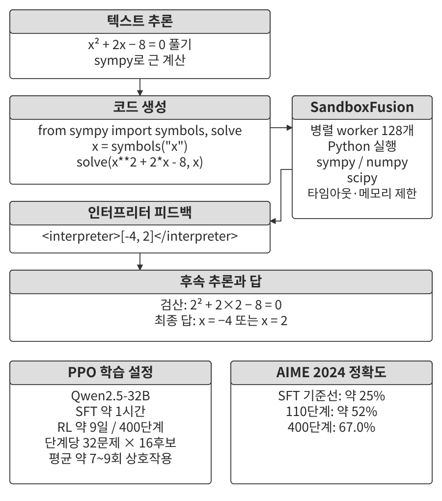
>
> ReTool은 SFT 예열 뒤, 교차하는 텍스트 사고, 코드 실행, 인터프리터 피드백으로 PPO 학습을 합니다. 모델은 언제 코드를 실행할 가치가 있는지, 오류가 난 뒤 어떻게 고쳐야 하는지를 점차 익힙니다. 학습 데이터는 DAPO-Math-17k를 쓰며, 정책 갱신에는 여전히 표준 PPO를 사용합니다[^ch8-26][^ch8-27].
>
> 학습을 거친 모델의 AIME 2024 정답률은 약 25%에서 67.0%로 올랐습니다. 순수 텍스트 RL과 비교하면, 코드 피드백 덕분에 모델이 정확한 계산과 오류 수정을 더 빨리 익혔습니다.

> **실험 8-15 ★★★: AWorld-train—샌드박스에서 도구 사용 배우기**
>
> 그림 8-18의 위쪽 절반을 한 바퀴 따라가면, 모델은 도구 호출 한 번의 결과를 받고 계속 시도할 수 있습니다. 이어서 아래쪽 절반을 한 바퀴 따라가 봅시다. 이번 묶음의 과제가 이미 끝났고, 학습 프로그램이 보상이 붙은 궤적을 받아 파라미터를 갱신하며, 다음 묶음의 과제부터 새 정책이 쓰입니다.
>
> 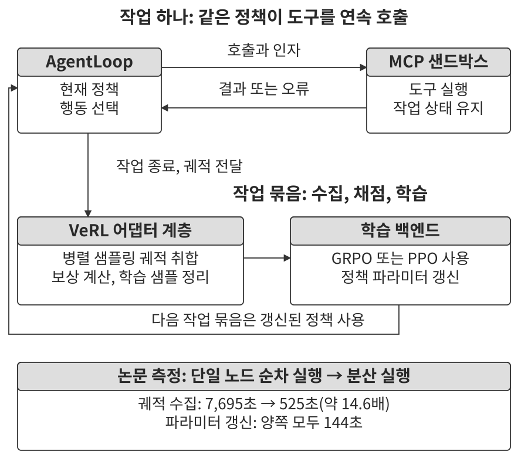
>
> GAIA 환경에는 26개의 MCP 서버와 126개의 도구 함수가 있어, Playwright로 웹 페이지를 조작하고, PDF, Word, 슬라이드에서 내용을 추출하고, 음성을 받아 적고, 문자를 인식하거나, E2B 샌드박스에서 코드를 실행할 수 있습니다. Excel 도구는 수식, 차트, 피벗을 포함한 29가지 작업을 제공하고, 지식 검색으로는 Wikipedia, arXiv, Wayback에도 접근할 수 있습니다. 샌드박스를 초기화하면 같은 상태에서 다시 시도할 수도 있고, 이전 궤적을 재생할 수도 있습니다.
>
> 그림의 시간 측정치는 논문의 수집 비교에서 가져왔습니다. 함께 제공되는 실험은 4B 모델의 학습 설정도 따로 제시합니다. Qwen3-4B-Thinking-2507, A100 8장, 컨텍스트 상한 131K, 최대 32턴 상호작용, 배치 크기 32, 문제당 궤적 16개 샘플링, GRPO 갱신, 학습률 1e−6입니다.

도구가 결과를 돌려주었을 때 학습 프로그램은 어느 단계에 보상을 주어야 할까요? 호출 한 번이 성공했다는 것은 도구가 제대로 실행되었다는 뜻일 뿐입니다. 그 단계가 과제를 진척시켰는지 판단하려면, 검증기로 그 단계가 만든 변화를 확인한 다음 모델에 어떤 보상을 줄지 정해야 합니다.

## 보상 설계: 과제 목표를 학습 신호로 바꾸기

두 환불 궤적이 결국 같은 금액을 돌려주었는데, 그중 하나는 필수인 본인 확인을 건너뛰었다고 합시다. 최종 잔액만 읽는다면 둘은 같은 점수를 받습니다. 사용자가 맡긴 요구 전체를 학습 신호로 바꾸려면, 먼저 누가 결과를 확인할 수 있는지, 어느 단계에서 증거를 얻을 수 있는지, 모델에 어떤 정보를 돌려줘야 하는지를 정하고, 이어서 경로상의 권한과 절차 제약을 따로 검증할 수 있는지 점검합니다.

### 보상은 어디에서 오는가: 규칙, 인간 선호, 모델 판정

자동으로 판정할 수 있는 과제라면 필자는 **검증 가능한 보상 기반 강화 학습(RLVR)**을 우선 채택해, 인수 요건을 그대로 프로그램으로 작성합니다. 수학 문제는 답을 대조할 수 있고, 코드 과제는 테스트를 실행할 수 있으며, 환불 과제는 데이터베이스의 금액과 주문 상태를 확인할 수 있습니다. 통과하면 1, 실패하면 0으로 기록하면 가장 단순한 결과 보상이 됩니다. 규칙이 명확하고 실행이 재현 가능하므로 채점 차이의 원인을 찾기 쉽습니다. 한편 검증기가 다루는 범위가 학습이 실제로 어떤 요건을 최적화하는지를 결정합니다.

**인간 피드백 기반 강화 학습(RLHF)**은 사람의 선호를 학습 신호로 바꿉니다. InstructGPT[^ch8-4]는 먼저 답변에 대한 사람의 비교를 수집해 보상 모델을 학습시키고, 이어서 PPO로 정책을 최적화합니다. 보상 모델은 한정된 샘플에 담긴 선호를 학습한 것이므로, 모델 점수를 계속 높이려 하면 그 편향이 증폭될 수 있습니다[^ch8-5]. 학습에서는 흔히 SFT 참조 모델에 대한 KL 정규화를 더해 정책이 멀리 벗어나지 않도록 합니다. DPO[^ch8-6]는 ‘더 나은 답변—더 못한 답변’의 선호 쌍으로 정책을 직접 최적화해, 보상 모델을 따로 학습시키는 단계를 생략합니다.

개방형 과제에서는 모델이 평가 이유와 점수를 함께 내게 할 수 있습니다. **생성형 보상 모델(GRM)**이 생성한 진단은 시연을 선별하거나, 선호 쌍을 구성하거나, 이후의 수정을 안내하는 데도 쓸 수 있습니다. DeepSeek-GRM[^ch8-23]은 과제에 따라 평가 원칙을 생성하고 이를 바탕으로 비평과 점수를 냅니다. 온라인 RL로 평가 행동을 개선하며, 여러 번의 샘플링과 보조 보상 모델로 판단을 종합합니다.

평가 지표와 과제 목표 사이의 간극도 모델의 행동에 영향을 줍니다. **Reward hacking**은 정책이 채점 규칙이나 구현의 결함을 이용해 높은 점수를 얻는 것을 말합니다. 장기 에이전트에는 **reward seeking**이라 불리는 현상도 있습니다. 모델이 스스로 짐작한 채점 방식에 맞춰 행동하는 것으로, 예를 들어 통과하기 쉬운 검사를 직접 골라 그 검사를 통과하면 과제를 끝내 버립니다[^ch8-29]. 이 예가 일러 주듯이, 인수 조건은 사용자의 목표에서 출발해 실제 산출물을 다뤄야 합니다. 모델이 스스로 고른 지표만 검사하면 아직 완수되지 않은 요건을 놓치기 쉽습니다.

환불 과제의 보상을 설계할 때는 먼저 사람이 작성한 두 궤적을 검증기에 통과시켜 봅니다. 갑은 주문을 확인하고 환불 인터페이스를 호출한 뒤 사용자에게 영수증 내용을 다시 알려 줍니다. 을은 ‘환불이 완료되었습니다’라고 말하기만 합니다. 둘의 점수가 같다면, 먼저 채점기가 최종 응답을 읽는지, 인터페이스 영수증을 읽는지, 주문 상태를 읽는지부터 확인합니다. 이렇게 작은 반례 하나로도 대리 지표의 문제가 충분히 드러나므로, 학습을 한 차례 통째로 돌린 뒤에야 모델이 미리 성공을 보고하는 법을 배웠음을 발견하는 대가를 치르지 않아도 됩니다.

### 보상은 언제 주는가: 결과와 과정

**결과 보상**은 한 에피소드가 끝난 뒤 과제 수행을 평가합니다. 모델로 결과를 평가할 때 이 모델을 **ORM(Outcome Reward Model)**이라고 합니다. SimpleVLA-RL의 성공/실패 보상은 정책이 최종 목표를 중심으로 여러 동작 순서를 탐색하게 합니다. 이런 신호는 정의하기 쉽지만, 긴 궤적이 실패한 뒤 어떤 동작이 실패를 불렀는지 가려내려면 모델이 더 많은 시도를 해야 합니다. 이것이 희소한 피드백이 샘플 효율에 영향을 주는 이유 중 하나입니다[^ch8-8].

코딩 에이전트가 너무 일찍 작업을 끝내는 경우를 예로 들어 봅시다. 모델이 완료 선언을 제출하면 Harness가 격리된 작업 공간에서 보호된 인수 테스트를 실행합니다. 테스트는 실제 파일과 환경 상태를 읽어, 통과하면 양의 보상을, 실패하면 음의 보상을 줍니다. 이렇게 하면 완료 선언이 외부 검증을 촉발하고, 과제 결과는 산출물로 결정됩니다. 평가할 때는 두 묶음의 과제를 따로 준비합니다. 한 묶음은 아직 할 일이 남아 있어 조기 종료율을 측정하는 데 쓰고, 다른 묶음은 이미 완료되어 있어 모델이 제때 마무리하는지 확인하는 데 씁니다.

**과정 보상**은 중간 단계에서 피드백을 줍니다. 예를 들어 본인 확인, 인자 선택, 내비게이션 동작, 추론 단계를 평가합니다. 과정을 평가하는 모델을 **PRM(Process Reward Model)**이라고 합니다. OpenAI의 《Let's Verify Step by Step》[^ch8-7]은 수학적 추론에서의 단계별 검증을 연구했습니다. 과정 신호는 모델이 오류 위치를 찾도록 도울 수 있지만, 레이블링과 검증 비용도 늘립니다. 어떤 한 가지 풀이 순서를 유일한 정답 경로로 삼으면 다른 유효한 전략의 보상을 깎게 됩니다. 그래서 필자는 실제로 검증할 수 있는 중간 사건에만 과정 신호를 넣어, 모델이 여러 유효한 풀이를 계속 탐색하게 합니다. V-IRL-VL(실험 8-12)은 단계별 내비게이션 피드백을, SimpleVLA-RL(실험 8-13)은 종점 보상을 사용해, 두 과제가 피드백 입도를 서로 다르게 선택한 모습을 보여 줍니다.

실무에서는 먼저 결과 보상으로 기준선을 세우고, 본인 확인 완료나 테스트 통과 같은 중간 사건에 과정 신호를 더할 수 있습니다. 길이가 유한한 다중 턴 과제에서는 할인 계수를 $\gamma=1$로 두어, 종점 보상이 앞으로 전파될 때 같은 가중치를 유지하게 할 수 있습니다. PPO는 가치 추정과 이점 계산으로 피드백을 각 단계의 행동에 연결합니다. 궤적 단위 이점을 쓰는 GRPO는 보통 같은 이점 가중치로 그 궤적에서 생성된 모든 토큰의 정책 손실을 계산합니다.

### 보상은 얼마만큼의 정보를 표현해야 하는가: 스칼라, 벡터, 생성형 진단

보상이 언제 나타나는지는 피드백의 밀도를 결정하고, 보상에 무엇이 담기는지는 표현 형식을 결정합니다. 스칼라 하나는 전체 성과를 요약합니다. ‘짧은 이유+점수’의 준스칼라 형식은 채점 근거를 보충합니다. 벡터는 정확성, 완전성, 비용 같은 차원을 따로 표현합니다. 생성형 진단은 문제와 수정 방향을 구체적으로 설명하며, 여러 번 샘플링해 종합할 수도 있습니다.

- 정해진 답이나 인수 테스트가 있다면 이진 스칼라에서 시작할 수 있습니다.
- 품질 목표가 여럿이라면 각각 따로 채점한 뒤, 업무 요구에 따라 가중치를 두거나 제약을 설정할 수 있습니다.
- 평가에 맥락을 고려한 해석이 필요하다면 진단을 생성하고, 사실 검증과 사람의 표본 검사로 보정할 수 있습니다.

예를 들어 한 고객 응대 과제에서 해결 여부, 대화 턴 수, 본인 확인 완료 여부를 함께 기록할 수 있습니다. 세 차원은 각각 효과, 비용, 절차 요건에 대응합니다. 이를 학습에 쓰기 전에, 채점이 안정적인지, 그리고 같은 그룹 궤적들의 행동을 구분할 수 있는지 먼저 확인해야 합니다. 필자는 신뢰할 수 있는 소수의 지표로 시작해 하나씩 검증한 뒤에 차원을 늘립니다. 검증되지 않은 채점 항목은 하나하나가 모델이 새로운 대리 지표를 따라 최적화하게 만들 수 있으며, 그래도 실제 과제는 나아지지 않습니다.

### 경로 제약과 RLVP

과제를 완수하는 과정에는 독립적인 행동 요건이 있을 수도 있습니다. 영업시간에 맞춰 사용자에게 연락하기, 본인 확인 완료하기, 보호된 파일을 바꾸지 않기 같은 것들입니다. RLVP(Reinforcement Learning with Verified Penalty)[^ch8-9]는 결과 보상과 검증 가능한 경로 벌점을 결합하며, 원칙은 **결과에 보상하고 경로를 벌한다**입니다. 경로 규칙은 환경에서 관측할 수 있는 행동으로 발동되고, 산출물의 완전성은 계속 과제 인수 검사가 확인합니다.

두 번의 수정이 모두 인수 검사를 통과했는데, 그중 하나는 먼저 읽어야 할 파일을 곧바로 덮어썼습니다. 도구 기록을 확인하면 이 위반 동작을 찾아낼 수 있습니다. 하지만 앞선 각 단계가 최종 성공에 얼마나 기여했는지 판단하기는 훨씬 어렵습니다. 가장 간단한 방법은 궤적 전체에 점수 하나 $R=O+\beta\Phi$를 매기는 것입니다. $O$는 과제 점수, $\Phi$는 위반 감점이나 검증 가능한 진척을 합산한 값, $\beta$는 둘의 상대 가중치를 정합니다. 이렇게 하면 두 수정을 구분할 수 있지만, 같은 궤적 안의 모든 행동이 같은 신호를 나눠 받습니다.

어느 턴에서 위반했는지 안다면 감점을 그 턴에만 남겨 둘 수도 있습니다. 함께 제공되는 구현의 테스트 궤적 두 개를 봅시다. 갑은 과제를 완수했지만 두 번째 턴에서 위반했고, 을은 과제를 완수하지 못했지만 두 턴 모두 규정을 지켰습니다. 두 궤적의 결과 점수는 각각 1과 0이고, 그룹 평균을 빼면 +0.5와 −0.5가 됩니다. 궤적마다 두 턴의 행동이 있고, 각 턴은 행동 토큰 10개씩을 차지합니다. 구현의 `c2` 설정에 따라 두 신호를 따로 셉니다.

```python
outcome_weight = (1 - 0.5) / 40  # 结果信号分摊到这批的全部 40 个动作 token
penalty_weight = -0.3 / 10       # 违规扣分只分摊到甲第二轮的 10 个动作 token
first_turn = outcome_weight
second_turn = outcome_weight + penalty_weight
```

갑의 첫 번째 턴에서 행동 토큰 하나가 받는 가중치는 +0.0125이고, 두 번째 턴에서는 −0.0175입니다. 그래서 같은 성공적인 수정 안의 두 행동이 방향이 반대인 학습 신호를 받을 수 있습니다. 이런 가중치가 정책 손실에 들어간 뒤에야 옵티마이저가 이를 바탕으로 파라미터를 갱신합니다. 고객 응대 과제로 바꾸어도, 도구 기록으로 어느 턴에서 승인 확인을 건너뛰었는지 찾아낼 수만 있다면 같은 방식으로 감점을 배분할 수 있습니다.

경로 신호의 역할은 그룹 내 차이로 이해할 수 있습니다. 한 그룹의 GRPO 궤적들이 같은 결과 보상을 받으면 그 보상으로 계산한 이점은 0이 됩니다. 그중 위반 횟수가 서로 다르다면 경로 벌점이 새로운 비교 근거를 제공합니다. 부분 진척 보상도 같은 조건을 따릅니다. 모델이 진척 정도가 서로 다른 궤적을 적어도 샘플링할 수 있어야 구분하는 효과가 생깁니다.

경로 보상을 설계할 때는 네 가지 규칙을 따를 수 있습니다. 명확한 위반 동작을 벌하고, 과제 결과 보상을 유지하며, 제약을 받는 행동에 도달 가능한 준수 경로를 마련하고, 반복 실행할 수 있는 검증 규칙을 씁니다. 예를 들어 조작 하나하나를 따로 벌하면 모델이 제자리에 머물도록 부추기게 되며, 과제 성공 보상을 유지해야 모델이 일을 끝내도록 함께 밀어줄 수 있습니다. 기반 모델이 준수 경로를 생성하기 어렵다면 소량의 시연으로 출발점을 먼저 마련한 뒤, 학습을 통해 경로 셰이핑에 대한 의존을 점차 줄일 수 있습니다.

> **실험 8-16 ★★★: RLVP—결과에 보상하고 경로를 벌한다**
>
> 실험은 GRPO에 결과 보상 $O$와 경로 신호 $\Phi$를 더해 순수 결과 보상과 비교합니다. TerminalBench 대리 과제에서 위반 횟수는 3.71에서 0.66으로 줄었고 성공률은 거의 그대로였습니다. miniF2F 대리 과제에서는 도달 가능한 부분 진척 보상을 더하자, 성공률 0.9에 이르는 데 필요한 반복 횟수가 7.0에서 4.4로 줄었습니다.
>
> 소프트웨어 수정 과제는 신호 도달 가능성의 역할도 보여 줍니다. 모든 rollout이 어떤 테스트도 통과하지 못하면, 통과한 테스트 수로 계산한 진척 보상은 늘 같아서 그룹 내 차이를 늘릴 수 없습니다.

평균 위반 횟수가 0.66으로 줄었다는 것은 모델이 준수 경로를 더 자주 고르게 되었지만 여전히 가끔 위반한다는 뜻입니다. 반드시 지켜야 하는 제한이라면 도구를 실행할 때 권한도 검사해야 합니다.

## 증류: 샘플 효율 높이기

에이전트 rollout 한 번에는 흔히 여러 턴의 모델 생성과 도구 실행이 들어 있습니다. **샘플 효율**을 높인다는 것은 더 적은 환경 상호작용으로 목표 성능에 도달한다는 뜻입니다. 학습 스텝 수, GPU 시간, 환경 호출량은 각각 다른 비용을 반영하므로 과제와 함께 따져 봐야 합니다. 예를 들어 이 장의 ReTool 사례에서 SFT 학습에는 약 1시간이, RL에는 약 9일이 걸렸으며, 그 가운데 반복 샘플링과 도구 실행이 많은 자원을 차지했습니다.

종점 보상을 쓰면 궤적 전체가 성패 점수 하나만 받을 수 있습니다. 업무 도구가 이미 ‘신용카드 뒤 네 자리가 필요합니다’라고 알려 주었는데 에이전트가 이 정보를 빠뜨려 최종 보상 0을 받았다고 합시다. 학습은 여러 번의 시도에서, 실패가 필드 누락 때문인지, 도구 인자 오류 때문인지, 이후 조작의 실수 때문인지를 가려내야 합니다. 교사가 이 궤적 위에서 단계마다 감독을 줄 수 있다면, 같은 환경 상호작용 한 번으로 더 세밀한 학습 신호를 얻을 수 있습니다.

### 온폴리시 증류: 한 번의 rollout에서 조밀한 감독 만들기

**온폴리시 증류(On-Policy Distillation)**에서는 학생이 궤적을 생성하고, 교사가 학생이 실제로 생성한 prefix 위에서 감독을 제공합니다. Thinking Machines Lab은 2025년 연구에서 이 학습 방식을 체계적으로 보여 주었습니다[^ch8-10]. 세 가지 방법을 이해할 때는 ‘학습 상태를 누가 만드는가’와 ‘학습 신호를 누가 주는가’를 나누어 보면 됩니다.

| 방법 | 궤적이나 상태를 누가 만드는가 | 주된 학습 신호 |
| --- | --- | --- |
| SFT/오프폴리시 증류 | 사람이나 교사의 시연 | 목표 답안에 대한 토큰 단위 감독 |
| On-policy RL | 현재 학생 | 결과 보상이나 과정 보상 |
| On-policy Distillation | 현재 학생 | 학생 prefix에 대한 교사의 토큰 단위 확률 평가 |

예를 들어 교사의 시연은 언제나 주문을 먼저 조회하고 나서 환불을 신청하지만, 학생은 환불부터 신청했다가 ‘주문 번호 누락’ 오류를 받을 수 있습니다. 온폴리시 증류에서는 학생이 이미 도달한 이 상태를 교사가 평가해, 정보를 어떻게 보충해 조회할지 안내합니다. 이렇게 하면 학생 자신의 오류와 회복 경로까지 학습이 다룰 수 있습니다.

구현 방식 하나는 학생이 생성한 prefix 위에서 학생과 교사 사이의 역방향 KL을 최소화하는 것입니다.

$$
D_{\mathrm{KL}}(\pi_\theta\Vert\pi_T)
=\mathbb{E}_{a\sim\pi_\theta(\cdot\mid h)}
\left[\log\pi_\theta(a\mid h)-\log\pi_T(a\mid h)\right],
$$

여기서 $h$는 현재 prefix, $a$는 다음 토큰이며, $\pi_\theta$와 $\pi_T$는 각각 학생과 교사의 분포를 나타냅니다. 교사가 더 적절하다고 보는 토큰일수록 더 유리한 학습 신호를 받습니다. 구현할 때는 전체 분포를 비교할 수도 있고, 학생이 이미 샘플링한 토큰에 대한 교사의 로그 확률을 조회해 토큰 단위의 최적화 신호를 구성할 수도 있습니다.

‘API를 먼저 조회한 뒤 반환값을 파싱한다’를 예로 들어 봅시다. 어느 위치의 후보 ‘조회’와 ‘호출’이 각각 토큰 하나에 대응하고, 교사가 이 둘에 각각 80%와 15%의 확률을 주며 나머지 후보의 합이 5%라고 합시다. 이것만으로도 최종 성패보다 훨씬 세밀한 선택 근거가 됩니다. 궤적에 모델이 생성한 토큰이 $T$개 있다면 약 $T$개의 위치에서 감독을 얻을 수 있습니다. 도구가 돌려준 내용은 여전히 컨텍스트로 쓰이며 정책 손실에서는 마스킹됩니다.

아래는 이 과정을 전체 분포 정렬 형식으로 나타낸 것입니다.

```python
trajectory = rollout(student, task)
loss = 0
for prefix in model_generated_positions(trajectory):
    target = stop_gradient(teacher.distribution(prefix))
    loss += KL(student.distribution(prefix), target)
update_student(loss)
```

학생은 탐색을 맡고 교사는 여러 위치에서 감독을 제공하며, 늘어나는 비용은 주로 교사의 추론에서 나옵니다. 환경 상호작용이 비싸고 교사가 학생을 믿을 만하게 이끌 수 있을 때, 필자는 온폴리시 증류를 우선 비교 대상으로 삼아 환경 호출 한 번이 더 많은 유효 학습 신호를 만들게 합니다. 대상 언어, 도메인 지식, 기본 동작을 충분히 익히지 못한 학생이라면 먼저 Mid-training과 시연 학습으로 유효한 출발점을 마련한 뒤 온폴리시 증류로 넘어갈 수 있습니다.

샘플링과 학습의 일관성도 마찬가지로 중요합니다. 샘플링 엔진은 정책 $\mu$로 궤적을 만들고 학습 엔진은 $\pi_\theta$로 손실을 계산하므로, 둘의 차이는 학습 상태의 분포를 바꿉니다.

Thinking Machines Lab의 수학 과제 비교는 약 한 자릿수 배에 이르는 학습 효율 향상을 보여 주었습니다. 다중 턴 에이전트에서도 이런 비교 방식을 그대로 쓰면서 과제 성공률, 환경 호출량, 교사 계산 비용을 함께 기록할 수 있습니다. 학생이 환경에서 마주치는 상태와 교사가 믿을 만한 피드백을 줄 수 있는지가 함께 이득을 결정합니다.

필자와 공동 연구자들도 ‘시간 감각’ 과제에서 DPO, 네 가지 RL 방식, 온폴리시 증류를 비교한 적이 있습니다[^ch8-11]. 앞의 방식들은 각각 보상 희소, 목표 불일치, rollout 형태 불일치, 정책 붕괴 같은 문제에 부딪혔습니다. 동결한 Qwen3-32B 교사로 바꾸어 학생 자신의 다중 턴 궤적 위에서 토큰 단위로 정렬하자 학습이 매끄럽게 수렴했고, 네 가지 조건에서 통과율이 같은 출처의 SFT 기준선보다 23\~47%p 높았습니다. 이 경험으로 필자는 상호작용 한 번이 제공하는 신호의 밀도를 더 중시하게 되었습니다. 같은 상호작용 안의 중간 결정이 모두 학습에 참여할 수 있다면, 이미 있는 궤적의 가치를 더 충분히 활용할 수 있습니다.

수학 교사는 추론에 능하고 코드 교사는 프로그램 수정에 능하다면, 한 학생이 두 교사의 장점을 모두 배우게 하려면 어떻게 해야 할까요? 다중 교사 온폴리시 증류(MOPD)는 위의 학습 과정을 그대로 따르되, 고정된 교사 하나를 문제 도메인에 따라 고른 교사로 바꿉니다. 학생이 코드 문제를 풀 때는 도중에 길을 잘못 들었더라도 이미 써 낸 prefix를 코드 교사에게 넘겨 다음 단계의 확률 분포를 받습니다. 수학 문제 차례가 되면 수학 교사가 학생의 풀이 과정 위에서 지도합니다. 각 도메인의 교사는 먼저 독립적으로 학습시키고, 증류 단계에서는 교사의 파라미터를 고정할 수 있습니다. 배포할 때는 학생 하나만 실행하면 됩니다.[^ch8-mopd]

여기에는 두 가지 실제 조건이 있습니다. 첫째, 위 식에 따라 토큰 단위 KL을 계산하려면 학생이 준 prefix 위에서 정렬 가능한 교사 확률을 얻을 수 있어야 합니다. 교사가 써 놓은 완성 답안 몇 편만 있다면 SFT에는 쓸 수 있어도 이 손실을 계산하기에는 부족합니다. 둘째, 인수 평가에서는 도메인별 성적을 나누어 봐야 합니다. 학생의 수학 성적은 오르고 코드 성적은 떨어졌을 때, 오른 전체 평균이 후자의 퇴보를 가리기 쉽습니다.

[^ch8-mopd]: Wenhan Ma 외, *MOPD: Multi-Teacher On-Policy Distillation for Capability Integration in LLM Post-Training*, 2026년. 논문은 도메인별로 학습한 교사를 사용해 학생 자신의 궤적 위에서 증류합니다.

### 온폴리시 자기 증류: 추가 컨텍스트로 교사 만들기

팀에 이 도메인에 능한 모델이 하나뿐이라면 누가 교사를 맡을까요? 같은 문제를 그 모델에 두 번 줄 수 있습니다. 첫 번째는 배포 조건대로 사용자 질문만 주고, 두 번째는 모범 답안, 전문가 시연, 도메인 문서를 함께 줍니다. 두 번째로 답할 때 더 갖게 된 정보를 이용해 첫 번째 조건의 학생을 지도할 수 있습니다.

**온폴리시 자기 증류(On-Policy Self-Distillation, OPSD)**[^ch8-15]는 같은 모델이 두 역할을 맡게 합니다. 학생은 과제 입력만 보고, 교사는 모범 답안이나 이미 검증된 풀이를 추가로 봅니다. 학생이 궤적을 생성하면 교사는 이 특권 정보를 활용해 각 prefix를 평가하고, 그 감독을 학생에게 돌려줍니다.

예를 들어 학생이 수학 문제를 푸는 중이고 교사는 이미 정답을 알고 있다고 합시다. 교사는 이를 바탕으로 학생의 현재 추론 방향을 평가할 수 있고, 학생은 문제만 주어진 조건에서 자신의 생성을 개선하는 법을 배웁니다. 아래 의사코드는 추가 컨텍스트와 경사 차단이 들어가는 위치를 보여 줍니다.

```python
trajectory = rollout(model, task_without_answer)
loss = 0
for prefix in model_generated_positions(trajectory):
    privileged_prefix = add_verified_answer(prefix)
    target = stop_gradient(model.distribution(privileged_prefix))
    loss += KL(model.distribution(prefix), target)
update(model, loss)
```

특권 정보는 학습할 때의 교사 분기에만 들어가며, 학생 입력과 평가 입력은 배포할 때와 똑같이 유지됩니다. 의사코드를 따라가며 두 정보 경로를 확인할 수 있습니다. 모범 답안은 교사 prefix를 구성하는 한 줄에만 들어가므로 배포 시의 학생은 이를 보지 못합니다. 교사 출력은 경사 차단을 거치므로, 이 단계에서는 학생 분기만 두 분포의 차이에 따라 파라미터를 갱신합니다. 다음 라운드에서 갱신된 모델을 쓰면 교사의 판단도 그에 따라 바뀔 수 있습니다. 이렇게 같은 모델이 학습 쪽의 더 풍부한 정보를 활용해 자신의 실제 생성에 감독을 제공할 수 있습니다.

특권 정보는 사람의 시연이나 선별한 도메인 문서에서 올 수도 있습니다. 고를 때는 그 정보가 교사의 판단을 개선하는지 확인해야 합니다. 정보를 받은 교사가 학생의 오류를 잘 알아볼수록 증류 신호가 더 유용해집니다. 학습 중에는 미리 테스트용으로 남겨 둔 샘플로 기존 능력과 생성 스타일도 점검해야 합니다. Purified OPSD 등의 연구는 정규화 제약을 더해 모델이 기존 추론 스타일을 유지하도록 돕습니다[^ch8-16].

## 문제 사례에서 사후 학습으로

7장에서는 운영 중에 드러난 문제를 재현 가능한 과제, 실패 귀인, 평가 기준으로 정리했습니다. 이 자료는 사후 학습에도 쓸 수 있습니다. 완전한 과제는 상호작용 환경을, 오류 직전까지의 궤적 접두부는 결정 맥락을 제공하고, 검증기는 새로 생성된 행동을 점검합니다. 표 8-5는 이 자료들이 어떤 학습 방법과 대응하는지 정리한 것입니다.

표 8-5 7장의 평가 자료와 사후 학습에서의 용도

| 7장의 자료 | 8장의 학습 용도 |
| --- | --- |
| 종단 간 과제와 검증기 | RL 샘플링 과제, 검증 가능 보상, 거부 샘플링의 과제 풀 |
| 궤적 접두부와 이후 행동 | DPO 선호 쌍, SFT 결정 시연, 온폴리시 증류의 교사 입력 |
| 실패 위치와 오류 유형 | 과정 평가 라벨, 검증 가능한 경로 페널티 규칙 |
| 루브릭 항목별 점수와 사람이 주석한 정답 | 다차원 보상, 생성형 보상 모델의 학습과 보정 |

과거 궤적의 접두부는 이어 가는 과제의 출발점이 될 수 있습니다. 온폴리시 증류에 쓸 때는 먼저 현재 학생이 이 출발점에서 생성을 이어 가게 하고, 그다음 학생이 실제로 만들어 낸 접두부를 교사가 평가합니다. 도구를 실행해야 한다면 해당 환경 상태도 함께 복원합니다. 이렇게 하면 7장의 국소 결정 평가가 이 장의 샘플링·학습 흐름과 이어집니다.

학습에 쓰는 과제는 홀드아웃 평가 과제와 분리해야 합니다. 양쪽은 인터페이스와 검증 로직을 공유하되 서로 독립된 과제 인스턴스를 씁니다. 과제 간 일반화를 살펴보려면 과제 템플릿이나 업무 유형별로 나눌 수도 있습니다. 이제 세 가지 사례로 이 전환을 어떻게 하는지 살펴보겠습니다.

### 사례 1: Coding Agent의 너무 이른 종료

Agent가 테스트를 돌리지도 않고 완료를 선언하거나, 세 가지 요구 사항 중 두 가지만 고치고 제출하거나, 몇 번 실패하자 포기하는 것은 모두 너무 이른 종료에 해당합니다. 운영 환경에서는 사용자 교정, 부정 평가, 궤적 검토에서 이런 사례를 모을 수 있습니다. 예를 들어 사용자가 “아직 테스트를 안 돌렸잖아요”라고 지적했다면, 궤적을 따라가며 그 시점의 과제 상태, 이미 확보한 검증 증거, 모델의 완료 선언을 점검할 수 있습니다.

원인을 분석할 때는 먼저 모델이 “다 했습니다”라고 말하려는 바로 그 순간에서 궤적을 멈추고, 그 앞에서 요구 사항을 빠뜨려 읽거나 코드를 잘못 고치지 않았는지 거슬러 살펴봅니다. 여기서 두 종류의 학습 자료가 나옵니다. 완전한 과제는 모델이 작업을 끝까지 해내도록 학습하는 데 쓰고, 결정 접두부는 증거에 따라 계속 진행할지 끝낼지 고르도록 학습하는 데 씁니다.

**완전한 과제에는 결과 보상을 연결할 수 있습니다.** 모델이 결과를 제출할 때 보호된 인수 테스트를 실행해, 통과하면 +1, 실패하면 −1을 줍니다. 테스트는 실제 산출물을 다루고, 모델은 평소처럼 개발 테스트를 돌리며 피드백을 받을 수 있으며, 최종 인수는 학습 환경이 수행합니다.

**결정 접두부로는 선호 쌍을 만들 수 있습니다.** 같은 맥락에서 선호되지 않는 샘플(`rejected`)은 증거가 부족한 완료 선언이고, 선호되는 샘플(`chosen`)은 필요한 테스트를 계속 실행하고 빠진 요구 사항을 대조하며 남은 작업을 마무리합니다. 교사에게 몇 가지 후속 방식을 쓰게 한 뒤, 검증기로 시연에 적합한 방식을 골라낼 수 있습니다. 샘플이 부족하면 과제 유형, 빠진 검증 항목, 완료 표현을 바꿔 수백 개의 선호 쌍으로 늘립니다. 이어서 LoRA로 DPO를 수행하고, 일반 과제를 적당량 섞어 행동의 범위를 유지합니다.

**평가에서는 미완료 과제와 완료된 과제를 함께 점검합니다.** 한 묶음은 일부만 끝난 과제로, 모델이 작업을 이어 가는지 관찰합니다. 다른 한 묶음은 이미 다 처리된 과제로, 제때 마무리하는지 봅니다. 동시에 일반 도구 호출과 다른 과제도 표본 점검해, 표적 학습이 기존 능력에 영향을 주었는지 살핍니다. 너무 이른 종료율만 낮추면 모델이 매번 검증을 계속하는 쪽을 골라, 이미 끝난 작업조차 좀처럼 마무리하지 않을 수 있습니다. 이때는 이미 다 처리된 과제 묶음에서 불필요한 도구 호출과 대기가 나타납니다.

> **실험 8-17 ★★: ‘너무 이른 종료’ 문제 사례에서 DPO 수정까지**
>
> 이 실험은 ‘실패 귀인–결정 접두부–선호 쌍–LoRA 학습–홀드아웃 평가’를 하나의 흐름으로 잇고, 7B 모델로 학습합니다.
>
> 데이터는 현실적인 문제 사례 24개로, 테스트를 돌리지 않고 완료 선언, 여러 목표 중 일부만 완료, 인수 조건 미충족, 오류를 만나면 포기라는 네 가지 유형을 다루며, 실패한 테스트를 삭제하는 보상 해킹 변형도 포함합니다. 이와 별도로 아직 할 일이 남은 문제 12개와 이미 다 처리된 문제 8개를 평가 전용으로 남겨 둡니다.
>
> 먼저 홀드아웃 문제 하나를 봅시다. 메시지 큐의 소비자가 연결이 끊겼다가 다시 연결되면 메시지를 잃어버립니다. 어시스턴트는 재연결 코드를 고쳤고, 도구는 “파일이 수정되었습니다”라고만 알려 왔습니다. 지금 수정했다고 선언해야 할까요, 아니면 검증을 계속해야 할까요? 실험은 후보 응답 두 개를 주고 모델이 어느 쪽에 더 높은 점수를 주는지 비교합니다. 학습 전에는 미완료 과제 12개 중 3개(25.0%)를 맞게 골랐고, 학습 후에는 11개(91.7%)를 맞게 골랐습니다. 실제로 이미 완료된 과제 8개에서는 학습 전후 모두 8개를 맞게 골랐습니다.
>
> 후보 응답을 치우고 모델이 다음 단계를 직접 쓰게 하면 결과가 달라집니다. 실험의 텍스트 분류 규칙에 따르면, 미완료 과제에서 너무 일찍 완료를 선언한 경우는 1/12에서 0/12로 줄었지만, 완료된 과제에서 분명히 마무리한 경우도 6/8에서 0/8로 줄었습니다. 첫 번째 묶음만 보면 문제가 이미 해결되었다고 여기기 쉽습니다. 그러나 두 번째 묶음은 모델이 주어진 두 응답 가운데서는 언제 멈춰야 하는지 알아보지만, 직접 응답을 쓸 때는 여전히 무조건 더 확인하자고 할 수 있음을 일깨워 줍니다. 메시지 유실 예로 돌아가면, 어시스턴트가 실제로 재연결 테스트를 한 번 실행해 재연결 뒤에 메시지를 받을 수 있는지까지 확인하게 해야 합니다. ‘검증을 계속하겠다’고 말하는 것과 검증 결과를 얻는 것은 별개의 두 단계입니다.

### 사례 2: 중국어 따옴표

“중국어 글의 곧은따옴표를 둥근따옴표로 바꾸라”는 작업은 먼저 편집 범위를 정해야 합니다. 중국어 자연어 속의 인용에는 `“”`를 쓸 수 있고, 중첩된 인용은 중국어 문장 부호 규칙에 따라 처리합니다. 반면 영어 원문, 문자열 리터럴, JSON, 경로, 식별자 안의 따옴표는 각자 문법적 기능을 맡고 있습니다. 학습 목표는 모델이 이 범위들을 알아보고 최소한의 편집만 하게 하는 것입니다.

먼저 규칙을 Skill로 작성하고, 이를 바탕으로 입력과 목표 텍스트를 생성할 수 있습니다. 양성 예시에는 중국어 단락, 중첩 인용, 중국어 주석이 들어가고, 보호 샘플에는 영어 인용문, 문자열 및 문자 리터럴, JSON, 인라인 코드와 코드 블록이 들어갑니다. 코드 속 중국어 주석은 주석의 경계와 인용 범위를 함께 알아봐야 하며, 범위를 확정할 수 없는 조각은 원문 그대로 둡니다. 이런 경우들을 한 문서 안에 섞어 놓아야 실제 편집에서의 범위 판단을 연습할 수 있습니다.

> **실험 8-18 ★★: 범위를 구분하는 중국어 둥근따옴표 SFT**
>
> 이 실험은 Qwen3-8B로 bf16 LoRA SFT를 수행하며, 2 에포크 동안 총 256번 갱신합니다. 학습 목표는 중국어 자연어 속 인용은 변환하면서 코드와 구조화 데이터 속의 문법적 따옴표는 그대로 두는 것입니다.
>
> 데이터는 16가지 조각 유형, 10가지 글 장르, 9가지 프로그래밍 언어를 조합해 학습 샘플 1,024개, 홀드아웃 샘플 256개, 경계 샘플 256개를 생성합니다. 각 샘플은 원문과 목표 텍스트를 저장하며, 변환해야 할 인용, 보호해야 할 문자열, 그리고 둘이 중첩된 경우를 다룹니다.
>
> 학습 후 홀드아웃 세트의 정확 일치율은 96.9%, 경계 세트는 97.7%였고, 보호 영역 보존율은 100%였습니다.
>
> 같은 범위 규칙을 라벨 생성과 출력 점검에 함께 씁니다. 모델은 편집 범위를 판단하는 법을 배우고, 파서와 문법 검사는 수정된 문서의 구조를 검증합니다. 이렇게 하면 문장 편집의 품질과 형식의 정확성을 따로 점검할 수 있습니다.

### 사례 3: 파일 편집이 자주 실패함

5장에서 `edit_file(path, old_string, new_string)` 같은 도구를 소개했습니다. 모델은 원문을 `old_string`에 옮겨 적어야 하고, 도구는 이를 정확히 일치시켜 찾습니다. 공백, 줄바꿈, 백슬래시, Unicode 문자에 차이가 생기면 일치에 실패할 수 있습니다.

먼저 정보 전달 사슬을 따라 구간별로 비교합니다. **파일 원본 바이트 → 도구 반환 → Harness 직렬화 → 모델 컨텍스트 → 모델 토큰 출력 → 디코딩된 문자열 → 호출 인자 파싱 → 도구 일치 검사**의 순서입니다. 읽기 단계에서 바이트가 바뀌었다면 도구를 고칩니다. 이스케이프나 컨텍스트 조립에서 내용이 바뀌었다면 Harness를 고칩니다. 인코딩한 뒤 다시 디코딩했을 때 달라진다면 토크나이저를 점검합니다. 모델 입력은 온전한데 차이가 모델의 생성 단계에서 처음 나타난다면, 그 사례를 정확한 복사 능력을 위한 사후 학습에 쓸 수 있습니다.

학습 데이터에는 세 가지 과제를 넣을 수 있습니다. 지정된 내용을 글자 그대로 다시 쓰기, 비슷하고 길이가 같은 여러 문자열 가운데 완전히 같은 하나를 고르기, 원문을 도구 호출의 `old_string` 필드에 쓰기입니다. 샘플에는 공백, 실제 줄바꿈, 백슬래시, 서로 다른 Unicode 표현을 넣어 실제 편집에서 틀리기 쉬운 지점을 다룹니다.

> **실험 8-19 ★★: 특수 문자열의 정확한 복사 SFT**
>
> 이 실험은 Qwen3-8B를 기반으로 bf16 LoRA를 2 에포크 학습하며, 프롬프트는 손실 계산에서 제외합니다. 그대로 다시 쓰는 문제는 목표 문자열을 시연으로 쓰고, 도구 인자 문제는 `old_string`만 담은 완전한 JSON을 시연으로 써서 필드 이름, 따옴표, 괄호까지 모두 토큰 단위 감독에 포함합니다. 실험은 토크나이저의 인코딩–디코딩 일관성도 따로 시험합니다.
>
> 모델의 홀드아웃 세트 바이트 단위 정확 일치율은 37.5%에서 78.9%로 올랐고, 독립된 경계 세트에서는 80.1%였습니다. 두 세트에서 처음으로 바이트가 어긋나는 평균 위치는 각각 54.0과 54.2였습니다. 이와 별도로 홀드아웃과 경계를 합친 512개 탐침으로 토크나이저 세 개를 비교했는데, 그중 Qwen3과 Qwen2.5의 무손실 왕복률은 모두 80.1%였습니다.
>
> 미세 조정 뒤 106문제를 더 맞혔는데, 원래 맞히던 문제는 여전히 다 맞혔을까요? 같은 문제의 두 답안을 나란히 놓고 보면 107문제는 틀림에서 맞음으로 바뀌었고, 한 문제는 맞음에서 틀림으로 바뀌었습니다. 홀드아웃 세트의 첫 문제는 JSON 객체 하나를 돌려 달라고 요구합니다. 기반 모델은 `old_string`을 정확히 옮겨 적었지만 파일 경로 같은 필드까지 덧붙여 냈고, 미세 조정 뒤에는 문제가 요구한 필드만 돌려주어 비로소 점수를 얻었습니다. 퇴보한 문제(`eval-095`)는 두 줄짜리 텍스트를 그대로 다시 쓰라고 요구했는데, 미세 조정 후의 답안은 두 줄을 하나로 이어 붙여 그 사이의 줄바꿈 문자를 빠뜨렸습니다.

이 세 사례를 각각 진단 카드 한 장으로 정리해 봅시다. 실패 직전에 모델이 실제로 볼 수 있었던 입력을 그대로 남기고, 허용되는 행동을 적어도 하나 적은 다음, ‘겉보기에는 비슷하지만 그대로 따라 해서는 안 되는’ 대조 사례도 하나 적습니다. 예를 들어 편집에 충돌이 있으면 파일을 다시 읽어야 하지만, 파일이 바뀌지 않았고 수정도 검증되었다면 끝내도 됩니다. 앞의 것으로 학습하고, 학습에 한 번도 쓰이지 않은 같은 유형의 과제와 대조 과제로 인수 검사를 해야, 모델이 배운 것이 조건에 따른 판단인지 아니면 무엇을 만나든 한 단계를 더 하는 습관인지 확인할 수 있습니다.

## 사후 학습 실전 요점

사후 학습 계획은 해결해야 할 문제에서 출발해야 합니다. 도메인 지식이 부족한 경우, 출력 프로토콜이 불안정한 경우, 행동 선택이 미흡한 경우는 각각 다른 데이터와 피드백을 필요로 합니다. 필자는 데이터와 환경의 품질을 더 중시합니다. 이 둘이 모델이 어떤 문제를 만나고 어떤 신호를 받을지를 정하며, 학습 알고리즘은 그 신호를 파라미터 갱신으로 바꿀 뿐입니다.

프로젝트에 적용할 때는 다음 순서로 점검할 수 있습니다.

1. **지식과 능력을 어디에 둘지 정합니다.** 안정적인 도메인 말뭉치는 Mid-training에 쓸 수 있고, 시연은 모델이 어떻게 답하고 행동할지 가르칠 수 있습니다. 반면 제때 갱신하고, 인용하고, 권한을 제어하거나 삭제해야 하는 사실은 RAG로 관리하는 편이 좋습니다.
2. **출력에 점수를 줄 수 있는지 확인합니다.** 적은 수의 과제에서 JSON 파싱률, 인자 완전성, 도구 호출 성공률을 측정합니다. 형식 오류가 잦다면 먼저 SFT나 제약 디코딩으로 개선한 뒤 RL 샘플링을 늘립니다.
3. **유효 컨텍스트 길이를 확인합니다.** 모델이 128K token을 받아들일 수 있게 되었다면, 그 길이에서 검색·추론·계획을 해낼 수 있는지도 확인해야 합니다. 필자는 ‘능력 × 길이’ 행렬로 단계별 인수를 한 뒤 창을 넓히고, 짧은 샘플과 앞 단계 데이터를 섞어 단거리 능력을 유지합니다.
4. **유효 궤적의 샘플링 확률을 확인합니다.** `pass@k`, 부분 진척, 그룹 내 보상 차이를 함께 관찰합니다. 성공 샘플이 아주 적다면 Mid-training, SFT, 증류, 커리큘럼 과제로 더 나은 출발점을 만들 수 있습니다. 부분 보상은 현재 정책이 도달할 수 있는 진척에 대응해야 합니다.
5. **보상이 과제 목표를 덮게 합니다.** 응답 길이만으로 점수를 주면 모델이 장황한 내용을 늘릴 수 있습니다. 인수 요구 사항을 테스트, 상태 점검, 보정된 평가 기준으로 구현하고, 고득점 궤적의 실제 품질을 다시 확인합니다.
6. **환경 피드백을 보정합니다.** 시뮬레이션과 배포 환경의 사용자 표현, 도구 오류, 상태 변화를 비교해 차이를 학습 과제에 보태 넣습니다. 안정적인 환경을 구축하는 비용도 학습 예산에 포함해야 합니다.
7. **홀드아웃 과제로 일반화와 망각을 감시합니다.** 표적 능력과 기존의 일반 능력을 함께 봅니다. 학습 지표는 계속 좋아지는데 홀드아웃 성능이 떨어진다면 데이터 배합, 학습 에포크 수, 정규화를 조정하고, 검증 결과에 따라 체크포인트를 고릅니다.
8. **가치 추정과 탐색을 관찰합니다.** PPO의 가치 오차는 이점 계산에 영향을 줍니다. 샘플링 온도와 무작위성은 후보 경로의 다양성에 영향을 줍니다. 보상 변동, 가치 오차, 출력 엔트로피, 궤적 차이를 함께 보면 학습이 왜 정체되었는지 판단하는 데 도움이 됩니다.
9. **샘플링과 학습의 수치 일관성을 측정합니다.** 갱신 전에 양쪽의 log probability를 비교하고, 확률비, 근사 KL, 클리핑 비율, 정책 노후화를 모니터링하며, 가중치·템플릿·계산 설정을 맞춥니다.
10. **비용을 전체 사슬 기준으로 추산합니다.** RL 비용에는 모델 생성, 도구 실행, 검증, 파라미터 갱신, 대기가 포함됩니다. ReTool의 시간 대조는 샘플링이 학습 주기를 크게 늘릴 수 있음을 보여 줍니다. SFT로 이미 목표 성능에 도달했다면 자원을 데이터 보강과 배포 평가에 우선 투입할 수 있습니다.
11. **데이터 유형별 감독 품질을 점검합니다.** Mid-training 말뭉치의 잘못된 연관, SFT 시연의 잡음, RL 검증기의 편향은 모두 학습 신호로 들어갑니다. 먼저 소량의 데이터와 궤적을 표본 점검한 뒤 규모를 늘립니다.

이 점검들은 저비용 시험 학습 한 번으로 묶을 수 있습니다. 소량의 도메인 말뭉치로 지식의 이득과 망각을 확인하고, 소량의 시연으로 행동을 배울 수 있는지 확인하며, 작은 rollout 묶음으로 보상 차이와 실행 비용을 확인합니다. 시험 학습은 다음 단계에 얼마를 투입할지 판단하는 근거가 됩니다.

**사후 학습은 RAG, 인컨텍스트 학습과 함께 쓸 수도 있습니다.** 송금 어시스턴트를 만든다고 가정해 봅시다. 먼저 모델에 시연 대화 몇 개를 보여 주고, 사용자에게 승인 절차를 설명하게 해 볼 수 있습니다. 예시가 많아질수록 매번 읽어 들이는 시간과 비용도 늘어날 수 있습니다. 정책이 바뀌면 지식 베이스에서 현재 조항을 검색해 답할 때 출처를 함께 붙입니다. 송금을 제출하는 단계에 이르면, 승인 한도가 여러 해째 그대로였더라도 금액과 권한은 프로그램이 대조해야 합니다. 어떤 방법을 쓸지 정할 때는 정보가 얼마나 자주 바뀌는지뿐 아니라, 판단 근거를 규칙으로 적을 수 있는지도 봐야 합니다. 자연스러운 말투나 의료 영상 속의 형태는 규칙으로 다 나열하기 어려워, 이런 패턴을 배우려면 대개 파라미터 학습이 필요합니다.

한 시스템은 먼저 인컨텍스트로 전략을 검증하고, RAG로 근거를 제공하고, 프로그램으로 단단한 제약을 강제하며, 다시 Mid-training, SFT, RL로 모델 능력을 개선할 수 있습니다. 모델이 목표에 도달한 뒤에는 증류로 행동을 더 작은 모델로 옮겨 배포 비용을 낮출 수도 있습니다.

“모델이 피드백에서 판단하는 법을 배웠다”는 것을 어떻게 인수할까요? 필자는 포르투에서 한 강연에서 모델이 가중치 안에서 판단을 계속 학습하면서도 기존 능력을 유지하게 하는 문제를 열린 문제로 꼽았습니다. 사용자가 정정한 잔액을 기억하는 것은 사실 기억을 시험하는 일입니다. 모델이 판단하는 법을 배웠는지 보려면 상황을 바꿔 다시 물어야 합니다.

예를 들어 학습 자료가 사용자가 출장 중일 때 예산을 약간 넘는 항공권을 받아들인 사례를 다룬다고 합시다. 테스트에서는 낯선 호텔과 새로운 금액으로 바꾸고, 한 문제에는 회의장으로 가야 하는 시간 제약을 남기고, 다른 문제에는 가족 휴가이며 예산이 빠듯하다는 조건을 분명히 줍니다. 두 문제 모두 그 시점에 쓸 수 있는 대안들을 제시하고, 어떤 행동과 설명이 허용되는지 미리 적어 둡니다. 두 문제에서 똑같이 가격을 올리거나 똑같이 되묻는다면, 모델이 표면적인 행동만 외웠을 수 있습니다. 이어서 이전 버전이 이미 잘 처리하던 과제, 예컨대 사용자가 분명히 정한 경비 한도를 엄격히 지키는 일을 다시 돌려 봅니다.

## 장 요약

모델이 풀지 못하는 문제를 만나면 먼저 여러 번 시도하게 해서 어디서 실패하는지 살펴봅니다. 합리적으로 샘플링해도 `pass@k`가 여전히 0에 가깝다면 도메인 지식이나 기초 능력이 부족하지 않은지 먼저 확인하고, Mid-training으로 말뭉치를 보강할지 정합니다. 긴 문서를 다 읽지 못한다면 학습 길이를 단계별로 늘리고, 짧은 과제로 기존 능력을 점검합니다. 모델이 이따금 맞히지만 도구 인자를 파싱할 수 없는 형식으로 자주 쓴다면 먼저 SFT 시연을 쓸 만합니다. 모델이 실행 가능한 궤적을 여러 가지 만들어 내고 보상이 우열을 가릴 수 있게 되면, 그때서야 RL이 좋은 정책이 선택될 확률을 높일 기회를 얻습니다.

**필자는 데이터와 환경에 우선 투자합니다.** GeneralPoints의 규칙 및 시각 전이 실험에서, 제한된 시연으로 학습한 SFT 모델은 과적합하기 쉬웠고 RL 분기는 분포 밖 과제에서 더 좋은 성과를 냈습니다. 시연을 다른 것으로 바꾸거나 검증 방식을 바꾸면 이 비교는 다시 해야 합니다. ReTool, V-IRL, SimpleVLA-RL 같은 다중 턴 과제에 이르면 도구 실행, 내비게이션, 동작 제어 가운데 어떤 사건에 피드백을 줄지도 정해야 합니다. 실제 환경을 쓸 수 없을 때는 도구 반환값과 상태 전이를 시뮬레이션할 수 있지만, 모델이 시뮬레이터의 편향을 이용하는 법을 배웠는지 실제 과제로 다시 확인해야 합니다. 어떤 과제는 기초 지식과 시연만 보강해도 이미 인수 요구 사항을 충족합니다.

**필자는 현재 Agent RL의 주된 병목이 샘플 효율과 분포 일관성이라고 봅니다.** 도구 상호작용 한 번의 비용이 비싼데, 여기서 조금이라도 더 배울 수 있을까요? 온폴리시 증류는 학생이 실제로 도달한 위치에서 교사가 토큰 단위 지도를 하게 합니다. RLVP는 검증할 수 있는 중간 사건으로 종점 보상을 보완합니다. 한편 샘플링에 쓰는 정책이 이미 학습 버전보다 뒤처졌거나, 샘플링 쪽과 학습 쪽이 같은 출력 구간에 대해 계산한 확률에 뚜렷한 차이가 있다면, 그 차이를 먼저 확인한 다음에 보상 곡선을 해석해야 합니다.

너무 이른 마무리, 잘못된 편집 범위, 문자열을 정확히 복사하지 못하는 일은 모두 한 번의 실패에서 출발해 구체적인 학습 샘플까지 거슬러 갈 수 있습니다. 이 문제를 고친 뒤에도 독립된 샘플과 원래 잘하던 과제로 회귀 검증을 해야 합니다. 다음 실패 묶음을 만났을 때, 어느 것이 모델을 다시 학습할 만하고 어느 것이 지식이나 지시, 프로그램만 갱신하면 되는지는 다음 장에서 다룰 선택입니다.

[^ch8-ppo-method]: Schulman 외, *Proximal Policy Optimization Algorithms*, 2017, arXiv:1707.06347.

[^ch8-1]: Schulman, John and Thinking Machines Lab, “LoRA Without Regret”, 2025.
[^ch8-2]: 야오 순위(Shunyu Yao), 「The Second Half」, 2025년 4월 10일.
[^ch8-3]: Chu, Tianzhe et al., “SFT Memorizes, RL Generalizes: A Comparative Study of Foundation Model Post-training”, 2025. arXiv:2501.17161.
[^ch8-4]: Ouyang, Long et al., “Training Language Models to Follow Instructions with Human Feedback”, OpenAI, 2022.
[^ch8-5]: Gao, Leo, John Schulman, and Jacob Hilton, “Scaling Laws for Reward Model Overoptimization”, OpenAI, 2023.
[^ch8-6]: Rafailov, Rafael et al., “Direct Preference Optimization: Your Language Model is Secretly a Reward Model”, 2023.
[^ch8-7]: Lightman, Hunter et al., “Let's Verify Step by Step”, OpenAI, 2023.
[^ch8-8]: Silver, David and Richard S. Sutton, “Welcome to the Era of Experience”, 2025.
[^ch8-9]: Li, Bojie, and Noah Shi, “RLVP: Penalize the Path, Reward the Outcome”, 2026. arXiv:2607.07435.
[^ch8-10]: Thinking Machines Lab, “On-Policy Distillation”, 2025.
[^ch8-11]: Li, Bojie, and Noah Shi, “Agents That Sense Physical Time: Urgency, Persistence, and Vigilance as Missing Controls for LLM Agents”, 2026.
[^ch8-12]: Kulikov, Ilia, et al. *Autodata: An Agentic Data Scientist to Create High Quality Synthetic Data.* arXiv:2606.25996, 2026.
[^ch8-13]: Sun, Hao, et al. “ZeroSearch: Incentivize the Search Capability of LLMs without Searching”, 2025. arXiv:2505.04588.
[^ch8-14]: “DreamGym: Scaling Agent Learning via Experience Synthesis”, 2025. arXiv:2511.03773.
[^ch8-15]: Zhao, Siyan, et al. “Self-Distilled Reasoner: On-Policy Self-Distillation for Large Language Models”, 2026. arXiv:2601.18734.
[^ch8-16]: Shen, Ziqi, et al. “Purified OPSD: On-Policy Self-Distillation Without Losing How to Think”, 2026. arXiv:2607.02234.
[^ch8-17]: Tan, Zelin, et al. “SKT: Skill-Use Training at Scale via Verified Synthetic Data Generation”, 2026. arXiv:2608.02287.
[^ch8-18]: Wei, Yifan, et al. “Towards Compositional Generalization of LLMs via Skill Taxonomy Guided Data Synthesis”, 2026. arXiv:2601.03676.
[^ch8-19]: Zhu, Kaijie, et al. “TermiGen: High-Fidelity Environment and Robust Trajectory Synthesis for Terminal Agents”, 2026. arXiv:2602.07274.
[^ch8-20]: Hua, Zhanbo, et al. “CLI-Universe: Towards Verifiable Task Synthesis Engine for Terminal Agents”, 2026. arXiv:2606.22883.
[^ch8-21]: Kim, Moo Jin et al., “OpenVLA: An Open-Source Vision-Language-Action Model”, 2024. arXiv:2406.09246.
[^ch8-23]: Liu, Zijun et al., “Inference-Time Scaling for Generalist Reward Modeling”, 2025. arXiv:2504.02495.
[^ch8-24]: Yang, Jihan et al., “V-IRL: Grounding Virtual Intelligence in Real Life”, 2024. arXiv:2402.03310.
[^ch8-25]: Jin, Bowen et al., “Search-R1: Training LLMs to Reason and Leverage Search Engines with Reinforcement Learning”, 2025. arXiv:2503.09516.
[^ch8-26]: Feng, Jiazhan et al., “ReTool: Reinforcement Learning for Strategic Tool Use in LLMs”, 2025. arXiv:2504.11536.
[^ch8-27]: Yu, Qiying et al., “DAPO: An Open-Source LLM Reinforcement Learning System at Scale”, 2025. arXiv:2503.14476.
[^ch8-28]: Pan, Jiayi et al., “Training Software Engineering Agents and Verifiers with SWE-Gym”, 2024. arXiv:2412.21139; Barres, Victor et al., “$\tau^2$-Bench: Evaluating Conversational Agents in a Dual-Control Environment”, 2025. arXiv:2506.07982; Rawles, Christopher et al., “AndroidWorld: A Dynamic Benchmarking Environment for Autonomous Agents”, 2024. arXiv:2405.14573.
[^ch8-29]: storm, 「장기 실행 에이전트의 자기 점검과 조기 종료 행동: Reward Seeking 현상과 그 완화 방법」(중국어), Qingke 커뮤니티, 2026년 8월 6일.
[^ch8-30]: Gururangan, Suchin et al., “Don't Stop Pretraining: Adapt Language Models to Domains and Tasks”, ACL, 2020.
[^ch8-31]: Jiang, Zhengbao et al., “Instruction-tuned Language Models are Better Knowledge Learners”, ACL, 2024.
[^ch8-32]: Zheng, Chujie et al., “Stabilizing Reinforcement Learning with LLMs: Formulation and Practices”, 2025. arXiv:2512.01374.
[^ch8-33]: Zhong, Tianle et al., “Diagnosing Training Inference Mismatch in LLM Reinforcement Learning”, 2026. arXiv:2605.14220.
[^ch8-34]: He, Horace and Thinking Machines Lab, “Defeating Nondeterminism in LLM Inference”, 2025.

[^ch8-speech-conditioning]: Orpheus-TTS의 설명에는 표현 태그와 텍스트–음성 컨텍스트 조건이 포함되어 있습니다. Sesame CSM의 인터페이스는 텍스트, 화자, 오디오 조각을 사용해 이어지는 음성을 생성합니다.

## 생각해 볼 문제

1. ★★ 한 번의 표적 미세 조정으로 목표 과제는 개선되었지만 일반 도구 호출 능력은 떨어졌습니다. 기존 능력을 점검하는 테스트 세트를 어떻게 설계하고, 데이터 배합과 학습량을 어떻게 조정하며, 전체 파라미터 미세 조정과 LoRA의 효과를 어떻게 비교하겠습니까?
2. ★★ 어떤 도메인 능력은 파라미터 학습으로 배울 수도 있고, 인컨텍스트 예시와 지식 검색으로 뒷받침할 수도 있습니다. 어떤 요인에 따라 방안을 고르겠습니까?
3. ★★ 곧바로 답하는 Chat 모델, 추론 과정을 생성하는 Reasoning 모델, 여러 턴에 걸쳐 도구를 쓰는 Agentic 모델을 각각 증류하려면 어떤 학습 자료와 검증 방법이 필요할까요?
4. ★★★ 고객 서비스 Agent가 10턴의 상호작용으로 과제를 완료하고 최종 성공 보상을 받았습니다. 이 신호를 중간 결정과 어떻게 연결하겠습니까? 어떤 단계에 과정 보상을 더하는 것이 적합할까요?
5. ★★★ 고객 서비스 Agent의 성능을 높이는 데 10,000달러의 예산이 있습니다. 평가, 컨텍스트와 지식, 프롬프트/스킬, 프로그램 제약, 파라미터 학습에 어떻게 투자하겠습니까?
6. ★★★ 과제에 명확한 보상이 없고 환경 상호작용 비용도 비쌉니다. 어디에서 학습 신호를 얻을 수 있을까요? 그 신호가 실제로 과제 성능을 개선했는지 어떻게 검증하겠습니까?
7. ★★ 사용자마다 또는 회사마다 전용 LoRA를 학습한다면, 어떤 개인화 능력을 담기에 적합할까요? 어떤 정보는 외부 지식 베이스에 남겨 두는 편이 더 나을까요?
8. ★★★ Weak-to-Strong Generalization의 연구 발상을 바탕으로 볼 때, 소형 모델이 더 강한 Agent에 유용한 감독을 제공할 수 있을까요? 국소 검증, 선호 라벨, 추가 컨텍스트를 각각 고려하고, 감독의 편향을 점검하는 방법을 설계해 보십시오.
9. ★★ 한 궤적은 중간 단계가 대부분 옳았지만 최종적으로 실패했고, 다른 궤적은 올바른 결과를 얻었지만 절차 제약을 위반했습니다. 과정과 결과를 어떻게 결합해 이 두 궤적을 평가하겠습니까?
10. ★★★ SWE-bench, τ²-bench, AndroidWorld의 환경과 검증기는 학습에 쓸 수 있습니다. 과제 인스턴스와 템플릿을 어떻게 나누어야 학습 자료로 활용하면서도 독립적인 평가를 남겨 둘 수 있을까요?
11. ★★★ 목표 과제의 pass@1이 매우 낮습니다. pass@k, 형식 파싱률, 부분 진척률, 실패 귀인을 어떻게 결합해 Mid-training, SFT, RL 중 무엇을 쓸지 정하겠습니까?
12. ★★★ 한 묶음의 rollout에서 극히 긴 응답 몇 개만 아직 끝나지 않았고 나머지 과제는 모두 완료되었습니다. 비동기 샘플링이 가져오는 정책 노후화를 통제하면서 학습 클러스터의 활용률을 어떻게 높이겠습니까?
13. ★★★ 모델로 검색 엔진이나 사용자를 시뮬레이션할 때, 어떤 시뮬레이션 편향이 Agent를 잘못 이끌 수 있을까요? 과제 상태와 실제 상호작용으로 학습을 어떻게 보정하겠습니까?
