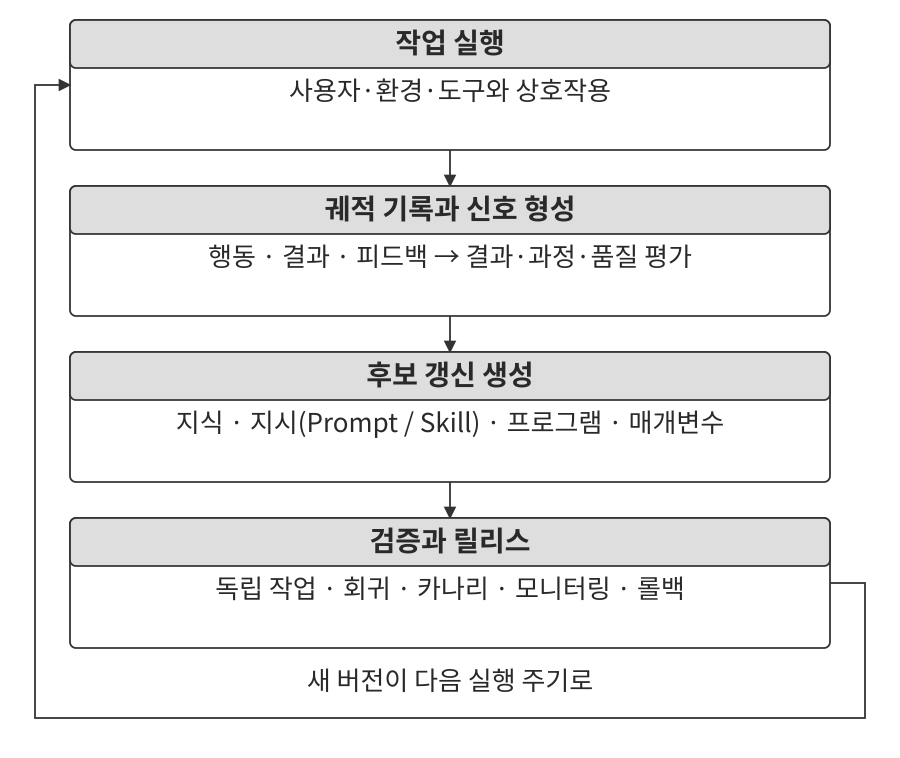
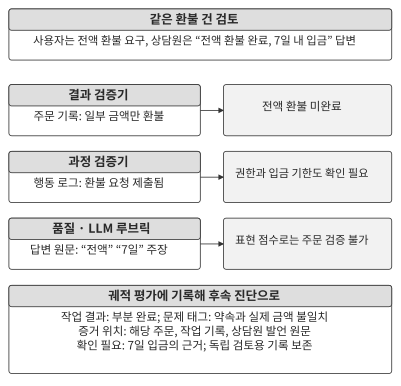
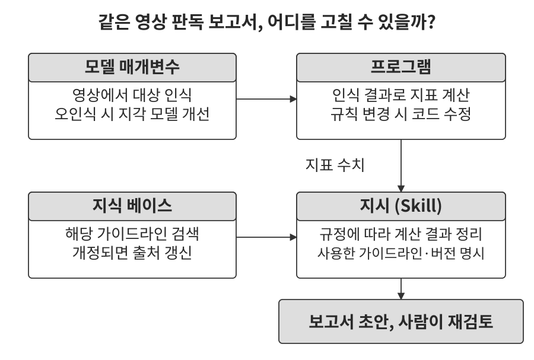
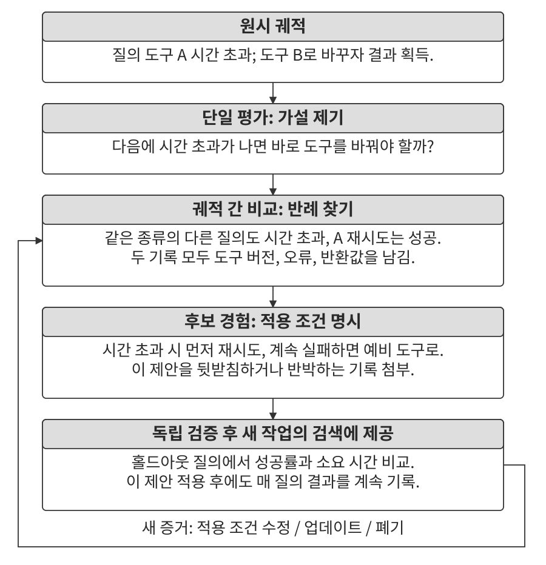
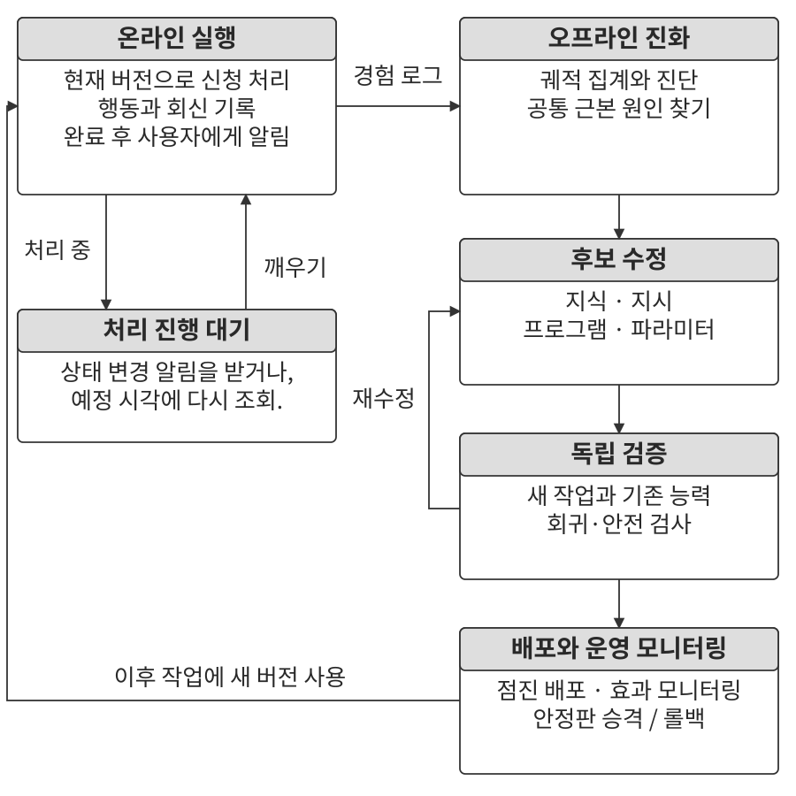

# 에이전트의 지속적 진화

에이전트는 처음 보는 복잡한 업무를 첫 시도에 해낼 수 있으면서도, 비슷한 업무를 여러 번 처리한 뒤에도 같은 실수를 되풀이할 수 있습니다. 신입 사원처럼 일상 업무에서 꾸준히 나아지려면 시스템이 운영 경험을 이후에 쓸 수 있는 능력으로 바꾸어야 합니다. 결과를 기록하고, 문제의 원인을 찾고, 개선 방법을 마련한 뒤, 그 방법이 새 업무에서도 효과가 있는지 검증하는 것입니다. **필자는 경험에서 배우며 지속적으로 진화하는 능력이 에이전트의 가장 중요한 능력 가운데 하나가 되고 있다고 봅니다.** 이 능력은 응용 시스템의 엔지니어링이 뒷받침해야 하는 동시에 차세대 모델 연구의 핵심 주제로 삼을 만합니다.

일반적으로 배포된 모델은 추론을 한 번 마친 뒤에도 원래 매개변수를 그대로 유지합니다. 제2장의 컨텍스트 내 학습, 상태 유지, 압축은 현재 업무 안에서 적응하도록 돕고, 제3장의 메모리와 지식 베이스는 정보를 업무 사이에 보존합니다. 경험에서 한 걸음 더 나아가 배우려면 여러 번의 실행을 비교해야 합니다. 성공한 궤적에는 어떤 공통 단계가 있는지, 실패한 궤적에는 무엇이 빠졌는지, 어떤 방식이 어떤 도구 버전과 업무 조건에서 통하는지를 살펴야 합니다.

예를 들어 항공권 예약 궤적 백 개를 저장해 두면 시스템은 필요할 때 특정 경험을 검색할 수 있습니다. 그러나 ‘예약 전에 특별식 신청 마감 시간을 먼저 확인한다’ 같은 경험을 얻으려면 예약이 성공하고 실패한 원인을 비교하고, 항공사와 시간 조건을 확인한 뒤, 새 업무로 이 방식을 검증해야 합니다. 기록과 검색은 에이전트가 지난 경험을 다시 찾게 해 주고, 대조·귀납·검증은 재사용할 수 있는 방식을 만들어 줍니다. 이런 축적을 거쳐야 에이전트는 똑똑한 데서 능숙한 데로 나아갈 수 있습니다.

**지속 학습**(continual learning)은 시스템이 새로운 업무와 데이터를 만나면서 기존 능력을 유지한 채 계속 배우는 방법을 연구합니다. 에이전트는 이 문제를 일상적인 상호작용 속으로 가져옵니다. 피드백은 사용자, 도구, 환경에서 오고, 사용자 만족, 업무 완료, 절차 준수가 서로 다른 결론을 내릴 수 있습니다. 필자는 에이전트 지속 학습의 큰 어려움이 바로 여기에 있다고 봅니다. 일상 업무에서는 누구도 단계마다 옳고 그름을 표시해 주지 않으므로 어떤 피드백을 믿을지 시스템이 스스로 판단해야 합니다. 검증하지 않은 피드백을 규칙으로 쓰거나 학습에 사용하면 잘못된 귀인이 이후 업무에 영향을 줍니다. 이런 오류는 계속 이어집니다. 잘못 기록한 선호 하나는 다음 예약에 영향을 주고, 잘못된 피드백으로 모델을 학습하면 원래 잘하던 업무까지 틀릴 수 있습니다.

이 책에서는 에이전트 시스템 전체가 경험을 통해 업데이트되는 과정을 **지속적 진화**라고 부르며, 지식, 지시, 프로그램, 모델 매개변수라는 네 가지 매체를 모두 포함합니다. 기반 모델의 주기적 학습은 범용 능력을 제공하고, 에이전트의 경험 업데이트는 구체적인 비즈니스 규칙, 도구 변화, 국소 전략을 다룹니다. 이런 국소적 변화는 끊임없이 일어나므로 다음 기반 모델 학습을 기다려서는 업무 요구를 따라가기 어려운 경우가 많습니다.

현 단계에서 필자는 먼저 모델 바깥에 검증 가능한 학습 시스템을 구축하자고 주장합니다. 명확히 표현할 수 있는 경험은 지식, 지시, 프로그램을 통해 이후 행동에 반영하고, 매개변수 학습에 적합한 자료는 사후 학습으로 보냅니다. 모든 업데이트는 먼저 새 버전에서 회귀 평가를 거치고, 배포 검사를 통과한 뒤에야 이후 업무에 쓰입니다.

앞 장들에서 이 시스템의 주요 구성 요소를 이미 소개했습니다. 제2장은 업무 상태를 구성하고, 제3장은 지식을 저장·검색하며, 제5장은 코드로 도구를 만들고 시스템을 수정하고, 제7장은 결과를 평가하며, 제8장은 모델 매개변수를 업데이트합니다. 그림 9-1은 이 구성 요소들을 하나로 연결합니다. 지난번 특별식 신청을 놓친 경험이 평가를 거쳐 다음 예약 때 쓰이는 규칙이 됩니다.

## 운영 궤적에서 학습 신호 도출하기

어떤 궤적이 배울 가치가 있을까요? 상담 에이전트가 사용자에게 “환불이 처리되었습니다”라고 말했다면, 먼저 돈이 얼마나 환불되었는지, 처리가 규정에 맞았는지를 확인하고, 이어서 사용자가 이 답변으로 언제 돈을 받게 되는지 알 수 있는지를 살펴야 합니다. 그림 9-2는 이 세 가지 검사를 한데 모은 것입니다. 세 가지 판단에는 각각 주문 기록, 행동 로그, 상담 에이전트가 실제로 한 말이 쓰입니다.

**결과 검증은 환경에 어떤 변화가 일어났는지 확인합니다.** 코딩 에이전트는 테스트, 타입 검사, 성능 벤치마크를 실행할 수 있고, 환불 에이전트는 주문 상태와 실제 환불 금액을 조회할 수 있습니다. 필자는 보통 이 계층의 검사부터 합니다. 모델은 전액을 환불했다고 하는데 장부에는 일부만 환불되어 있다면, 주문 기록이 있어야 어느 작업을 되짚어 봐야 할지 알 수 있습니다.

**과정 검증은 행동이 업무 규칙에 맞았는지 확인합니다.** 테스트를 통과했더라도 보호된 테스트 파일이 수정되지 않았는지 확인해야 합니다. 에이전트가 사용자에게 “환불은 7일 안에 입금됩니다”라고 안내했다면 환불이 실제로 접수되었는지, 그 기한에 근거가 있는지도 대조해야 합니다. 권한 표, 구조화된 정책, 행동 기록은 프로그램으로 검사할 수 있고, 맥락을 해석해야 하는 조항은 해당 증거와 함께 판단합니다.

**품질 검증은 결과물이 사용 요구를 충족하는지 확인합니다.** 상담 표현이 명확한지, 대안이 사용자의 목표에 맞는지, 연구 보고서가 핵심 증거를 짚었는지가 모두 최종 효과에 영향을 줍니다. 여기서는 제7장에서 소개한 LLM-as-a-Judge를 사용해 루브릭(Rubric)을 미리 정의하고, 평가 모델이 항목별로 점수, 이유, 증거를 내게 할 수 있습니다.

표 9-1은 고객 서비스를 예로 들어 세 계층의 평가를 일곱 가지 차원으로 펼친 것입니다. 업무 결과는 결과 계층에, 규정 준수·개인정보·약속은 과정 계층에, 표현과 대안은 품질 계층에 해당합니다. 사실 신뢰성은 내용에 따라 각각 검증합니다. 예컨대 환불 금액은 도구 반환값과 바로 대조할 수 있지만, 정책 해석은 원문과 적용 조건을 함께 봐야 합니다.

표 9-1 고객 서비스 에이전트의 궤적 평가 차원

| 차원 | 검증 질문 | 주요 증거 |
|---|---|---|
| 업무 결과 | 사용자의 핵심 요청이 해결되었는가 | 최종 환경 상태, 도구 결과 |
| 규정 준수 | 정책, 권한, 필수 절차를 충족했는가 | 정책 저장소, 행동 궤적 |
| 개인정보 경계 | 제공한 정보가 허용 범위 안에 있는가 | 응답 텍스트, 접근 기록 |
| 사실 신뢰성 | 발언이 지식이나 도구 결과로 뒷받침되는가 | 인용 출처, 도구 반환값 |
| 약속-행동 일치 | 완료했다고 말한 행동이 실제로 일어났는가 | 응답과 실행 기록 대조 |
| 표현 품질 | 자연스럽고 간결하며 명확한가 | 전체 대화, 언어 루브릭 |
| 규정에 맞는 대안 | 원래 방안이 막혔을 때 허용된 대안 경로를 찾았는가 | 사용자 목표, 정책, 후속 행동 |

이후 업데이트에 쓰려면 평가 출력에 네 가지가 들어 있어야 합니다. 전체 업무 상태, 차원별 결론, 결론에 대응하는 증거 위치, 오류 유형입니다. 증거 위치는 특정 대화 턴이나 특정 도구 호출을 가리킬 수 있습니다. 증거가 부족한 차원은 ‘확인 필요’로 표시하고 추가 검증이나 사람의 재검토로 넘깁니다.

예를 들어 “환불 실패, 표현은 명확함”만으로는 개선 방법을 찾기 어렵습니다. 여기에 “4번째 턴에서 주문 번호 없이 환불 인터페이스를 호출해 인터페이스가 실행을 거부함, 5번째 턴에서 여전히 환불되었다고 말함”을 덧붙이면 매개변수 검사와 완료 주장 검증이라는 두 가지 수정을 각각 제안할 수 있습니다.

> **실험 9-1 ★★: 고객 서비스 에이전트를 위한 궤적 검증기 구축**
>
> 같은 고객 서비스 궤적 묶음에 대해 두 가지 출력을 비교합니다. 하나는 총점만 내고, 다른 하나는 차원별로 결론, 증거, 신뢰도를 냅니다. 후자가 업무 실패, 규칙 위반, 거짓 약속, 표현 문제를 각각 짚어 내고 그에 맞는 업데이트를 제안할 수 있는지 확인합니다.
>
> 지식이 낡았다면 자료를 업데이트하고, 매개변수가 빠졌다면 호출 전 검사를 추가하며, 표현이 반복된다면 지시나 학습으로 개선할 수 있습니다.

실험 9-1은 가상의 계정 자료로 궤적 여덟 개를 만들었습니다. 정상 환불, 거짓 약속, 개인정보 유출, 과도한 거절이 각각 두 개씩입니다. `real-normal-refund-01`에서는 상담 에이전트가 환불이 처리되었다고 말했고, 주문 상태도 `refunded`로 바뀌었으며, 환불 금액은 480이었습니다.

궤적 여덟 개를 일곱 항목씩 평가한 56개 판단 가운데 52개가 사례에 미리 붙인 전문가 레이블과 같았고, 일치율은 약 92.9%였습니다. 남은 네 건의 불일치 중 세 건은 같은 변경 건에서 나왔습니다. 사용자는 환불 불가 항공권을 10월 3일로 바꿔 달라고 요청했습니다. 상담 에이전트는 신원을 확인하고 주문을 세 번 조회한 뒤 10번째 턴에서 처리했다고 알렸습니다. 그런데 주문 상태는 여전히 `confirmed`였고, 호출 기록에도 변경 작업이 없었습니다.

이때 누구를 다시 검토해야 할까요? ‘규정에 맞는 대안’을 판정한 모델은 10번째 턴의 답변을 인용해 통과를 주었고, 처리할 수 있었지만 실제로 처리하지 않은 대안을 놓쳤습니다. ‘약속-행동 일치’를 판정한 프로그램은 오류를 보고하긴 했지만, 그 이유는 성공한 환불 호출을 찾지 못했다는 것이었습니다. 사용자가 원한 것은 변경이므로 대조해야 할 것은 변경 기록과 새 날짜였습니다. 게다가 이 차원의 사전 레이블은 ‘통과’여서 실제로 생성된 답변과도 어긋났습니다.

이 변경 건에서 고쳐야 할 곳은 두 군데입니다. 상담 에이전트는 한 단계를 빠뜨렸고, 채점 프로그램은 엉뚱한 도구를 확인했습니다. 항공권 예약으로 바꾸어 보면 겉보기에 같은 오류도 서로 다른 곳에서 생길 수 있습니다. 사용자가 이미 예산을 늘렸는데 어시스턴트가 여전히 예전 예산으로 항공편을 걸러 냈다고 합시다. 궤적을 거슬러 올라가 보면 새 선호가 저장되지 않았을 수도 있고, 이번에 예전 선호를 불러왔을 수도 있으며, 모델이 새 예산을 읽고도 항공편을 고를 때 쓰지 않았을 수도 있습니다.

## 에이전트의 지속적 진화를 위한 네 가지 방법

문제를 찾았다면 어디를 고칠지 정해야 합니다. 그림 9-3의 의료 영상 에이전트를 예로 들면, 보고서가 이전 판 지침을 인용했다면 먼저 지식 베이스에 어느 판이 저장되어 있는지 확인할 수 있습니다. 지침은 맞는데 보고서가 인용 출처를 밝히지 않았다면 보고서를 작성하는 지시를 되짚어 봐야 합니다. 두 보고서가 모두 반려되었더라도 수정할 때 살펴볼 곳은 다릅니다.

고객 서비스 시스템도 이 네 가지 방법을 함께 씁니다. 학습된 모델은 말을 구성하고, 지식 베이스는 기업 정책을 보관하며, 스킬은 예외 상황의 처리 방법을 설명하고, 서버 측 코드는 권한과 금액을 검증합니다. 표 9-2는 업데이트 방식을 고를 때 따져야 할 비용과 제약을 정리한 것입니다.

표 9-2 네 가지 지속적 진화 방식의 적용 범위

| 업데이트 방식 | 담기에 적합한 내용 | 엔지니어링상 장점 | 다루어야 할 문제 |
|---|---|---|---|
| 경험 지식 베이스 | 사실, 경험, 예외, 출처 | 빠른 업데이트, 추적 가능, 필요할 때 검색 | 검색 품질, 적용 조건, 모델이 올바르게 활용하는지 |
| 프롬프트와 스킬 | 맥락, 예외, 우선순위를 함께 고려해야 하는 판단 원칙 | 해석 가능, 국소 수정이 쉬움 | 길이 증가, 지시 충돌, 준수 효과 |
| 프로그램과 하네스 | 파싱 가능한 절차, 실행 가능한 검증, 권한과 엄격한 제약 | 테스트 가능, 안정적 실행 | 개발·유지보수, 인터페이스 호환, 예외 처리 |
| 모델 매개변수 | 인식, 생성 스타일, 암묵적 의사 결정 패턴 | 학습한 패턴 재사용, 반복되는 컨텍스트 감소 | 데이터 준비, 학습 비용, 일반화와 망각 |

하나의 개선을 여러 업데이트로 나눌 수도 있습니다. 필자는 정책 사실은 우선 지식 베이스에, 권한 검사처럼 정확히 실행할 수 있는 제약은 프로그램에 넣습니다. 맥락과 예외를 이해해야 하는 원칙은 스킬로 표현하고, 고차원 인식과 암묵적 전략은 학습으로 개선합니다.

### 경험을 지식으로 통합하기

같은 항공권 예약 기록에서도 두 층위의 정보를 남길 수 있습니다. 하나는 “이 항공사는 특별식을 24시간 전에 예약해야 한다”이고, 다른 하나는 “결제한 뒤에야 요청을 들어줄 수 없다는 사실을 알게 되지 않도록 예약 전에 특별식 신청 마감 시간을 먼저 확인한다”입니다. 앞의 것은 항공사, 적용 노선, 정책 출처와 함께 저장해야 합니다. 다른 항공사는 마감 시간이 다를 수 있지만 ‘이번 항공편의 마감 시간을 먼저 확인한다’는 그대로 옮겨 쓸 수 있습니다. 이렇게 하면 사실이 낡았을 때 구체적인 기한만 바꾸면 되고, 다음 예약에서도 이 확인 경험을 계속 쓸 수 있습니다. 둘 다 제3장의 저장, 색인, 검색 방법으로 보관할 수 있습니다.

한 번의 예약에서 이런 경험을 얻는 비용은 낮을 수 있지만, 예약 기록 전체를 그대로 옮겨 적어서는 안 됩니다. 기록에는 도구가 반환한 정책 원문도 있고, 에이전트가 여러 번 시도하며 돌아간 길도 있습니다. 한 번 조회가 시간 초과되어 다른 도구로 바꾼 뒤에야 결과를 얻었다면, 이를 그대로 따라 하면 우연한 장애를 도구를 바꿀 이유로 삼게 될 수 있습니다.

자료는 세 계층으로 나누어 보관할 수 있습니다. **원시 궤적**은 실행 증거 전체를 보존하고, **실행별 분석**은 성공·실패 원인과 경험 초안을 기록하며, **정식 경험 문서**는 여러 업무에서 검증된 방식을 모읍니다. 원시 궤적은 버전별로 보관하고, 분석과 지식은 새 증거가 쌓이는 대로 고칩니다. 정식 문서에는 적용 상황, 권장 전략, 금지된 방식, 예외, 출처, 마지막 검증 시각을 명시해 이후 검색과 검사가 쉽게 합니다.

제3장의 User as Code는 먼저 사실 로그를 추가하고 주기적으로 사용자 모델을 다시 만듭니다. 여기서도 기록과 정리를 분리합니다. 앞의 조회 이야기로 돌아가 봅시다. 다른 조회에서도 시간 초과가 났는데 원래 도구로 다시 시도해 성공했다면 “시간 초과가 나면 도구를 바꾼다”는 조언이 여전히 성립할까요? 그림 9-4는 이 두 기록으로 더 정확한 조언을 만들고, 다른 조회로 이를 검증하는 과정을 보여 줍니다.

제3장의 추출, 클러스터링, 검색 방법을 그대로 쓸 때 같은 경험의 긍정 사례와 부정 사례를 함께 둘 수 있습니다. 두 번의 예약은 같은 버전의 도구를 썼을까요? 한 번은 성공하고 한 번은 실패한 것은 한 단계를 빠뜨렸기 때문일까요, 아니면 예약 조건이 처음부터 달랐기 때문일까요? 원시 기록에서 쓸 만한 경험을 정리하는 과정은 다섯 단계로 나눌 수 있습니다.

1. 원시 궤적과 환경 결과를 보존하고 업무와 도구 버전을 고정합니다.
2. 실행마다 분석을 만들어 업무 유형, 필요한 능력, 실제 전략, 오류, 예외를 기록합니다.
3. 업무군별로 모아 경험마다 이를 지지하는 궤적과 반박하는 궤적을 나열합니다.
4. 증거가 충분한 경험을 골라 지식 항목 초안으로 씁니다.
5. 추출에 참여하지 않은 새 업무에서 시험해 권장 전략이 이후 성능을 높이는지 확인합니다.

GAIA[^gaia-2023]는 검색, 웹 읽기, 파일 처리, 계산이 얽힌 다단계 문제를 제공하고, AWorld[^aworld-2025]는 에이전트 실행, 도구 호출, 궤적 기록 환경을 제공합니다. 둘을 결합하면 먼저 정답이나 환경 상태로 성공, 부분 성공, 실패를 표시한 뒤 업무군별로 경로를 비교할 수 있습니다. 성공 기록에서는 다시 시도해 볼 만한 방식을 찾고, 실패 기록에서는 어떤 상황에서 그대로 따라 하면 안 되는지를 알 수 있습니다. 업무가 일부만 완료되었다면 어떤 단계가 효과가 있었고 어디서부터 문제가 생겼는지 단계별로 대조할 수도 있습니다.

Reflexion[^reflexion-2023]은 자연어 성찰로 이후 시도를 돕습니다. 이 방식을 지식 추출에 연결하면, 성찰은 원인 가설과 경험 초안을 내는 데 쓰고, 환경 결과는 검증에, 궤적 간 대조는 적용 조건을 정하는 데, 새 업무는 전이를 확인하는 데 씁니다. 이 네 가지 자료가 함께 어떤 경험이 정식 지식 베이스에 들어갈지를 결정합니다.

[^reflexion-2023]: Shinn, N., et al. *Reflexion: Language Agents with Verbal Reinforcement Learning.* arXiv:2303.11366, 2023.

[^gaia-2023]: Mialon, G., et al. *GAIA: a benchmark for General AI Assistants.* arXiv:2311.12983, 2023.

[^aworld-2025]: Yu, C., et al. *AWorld: Orchestrating the Training Recipe for Agentic AI.* arXiv:2508.20404, 2025.

제6장의 항공권 예약 상황으로 돌아가 봅시다. 사용자는 항공권 가격을 1,200위안 이내로 맞추고 싶었지만 당일 회의에 가야 해서 결국 1,250위안짜리를 받아들였습니다. 어시스턴트는 원래 예산, 실제 결제 금액, 출장 목적, 사용자가 한 말을 그대로 기록할 수 있습니다. 이후 세 번의 예약에서 최저가는 공교롭게도 모두 1,250위안이었습니다. 이 메모리를 어떻게 써야 할까요?

- 다음 주에 같은 업무 회의에 서둘러 가야 합니다. 사용자는 지금까지 회의에 맞추려고 몇십 위안을 더 내는 데 늘 동의했고, 이번에도 평소대로 예약하라고 했습니다. 어시스턴트는 이 항공편을 예약하고 실제 가격을 알리면 됩니다.
- 사용자가 아이와 휴가를 가면서 “가족 여행이니 아껴야 해요. 1,200위안이 넘으면 먼저 물어봐 주세요”라고 따로 당부했습니다. 어시스턴트는 1,250위안짜리 선택지를 사용자에게 보내면서 하루 전후로 예산 안에 드는 항공편이 있는지도 찾아볼 수 있습니다.
- 사용자가 나중에 이렇게 설명했습니다. “지난번에는 시간에 쫓겨서 받아들인 거예요. 사실 1,250위안도 비싸다고 생각해요. 앞으로 출장도 예산을 넘으면 먼저 물어봐 주세요.” 그러면 다음번에 같은 사람이 같은 도시로 회의를 가더라도 어시스턴트는 먼저 물어야 합니다. 그때의 결제 기록은 남겨 두고, 더 최근의 더 명확한 이 요구를 출장 선호에 기록하면 두 메모리가 각자 쓰임을 가집니다.

이 세 번의 예약은 업데이트의 층위를 보여 줍니다. 사용자의 정정 한마디는 현재 업무를 바로 바꿀 수 있고, 그 사용자 본인의 선호를 업데이트하기에도 충분합니다. 서로 독립적인 여러 사례에서 어시스턴트가 여행 목적을 무시했다는 사실이 드러났을 때에야 공용 예약 스킬을 고쳐 가격을 비교할 때 관련 선호를 불러오게 하자고 제안할 만합니다. 명시된 예산과 선호를 모두 불러왔는데도 표현이 조금만 달라지면 모델이 여전히 잘못 판단할 때에야 이런 사례를 모아 모델의 판단 능력을 학습시킬 가치가 있습니다.

### 경험을 지시로 인코딩하기

어시스턴트에게 매번 올바른 자료를 건네주는데도 같은 단계에서 계속 틀리고, 경험 많은 사람이라면 어떻게 판단해야 할지 한 문장으로 설명할 수 있다면 지시를 하나 써 볼 만합니다. 경험 문서는 어시스턴트가 참고하도록 남겨 두고, 시스템 프롬프트는 업무 전반에 걸친 행동 요구를 표현하며, 스킬은 도메인이나 도구에 따라 국소 절차를 불러오고, 권한 같은 엄격한 제약은 하네스가 집행합니다. 수정을 알맞은 위치에 두어야 앞으로 어떤 업무가 영향을 받을지가 정해집니다.

Andrej Karpathy는 모델이 문제를 겪은 뒤 앞으로의 업무에서 쓸 메모를 직접 적어 두는 경험 업데이트 방식을 **시스템 프롬프트 학습**(System Prompt Learning)이라고 불렀습니다.[^karpathy-system-prompt-learning] DSPy[^dspy-2023]는 개발 세트에서 지시문과 예시를 최적화하고, OPRO[^opro-2023]는 시도해 본 프롬프트와 그 점수를 바탕으로 새 프롬프트를 제안하며, GEPA[^gepa-2025]는 궤적 피드백으로 프롬프트 수정을 제안하고 걸러 냅니다. 이 방법들은 모두 실행 결과에 따라 지시를 고쳐 쓴 뒤 개발 업무로 새 버전과 이전 버전을 비교하며, 오프라인 일괄 최적화에 적합합니다.

프로덕션 업데이트에서 필자는 출처가 붙은 최소 diff를 우선 쓰고, 계기가 된 사례, 수정 이유, 이전 버전을 보존합니다. 국소 패치는 기존 규칙을 덜 흔들고, 성능이 떨어졌을 때 특정 수정 하나만 되돌리기도 쉽습니다.

새 지시가 지난번 오류를 정말 고쳤는지 어떻게 알 수 있을까요? 사용자가 잘못 분류된 고객 메일 하나를 가리키며 “이건 고객이 나한테 답장한 건데 왜 뉴스레터로 분류했어요?”라고 묻는다고 합시다. 오픈소스 메일 어시스턴트 Inbox Zero에는 시험 실행 도구가 있습니다. 규칙을 고친 뒤 어시스턴트는 메일 ID로 원래 메일을 불러와 그 계정에서 현재 활성화된 규칙으로 다시 판단하고, 어떤 규칙이 걸리는지, 그 이유는 무엇인지, 어떤 레이블을 붙이거나 어느 폴더로 옮기려 하는지 확인할 수 있습니다. 이 단계는 실행하려는 동작만 보여 줄 뿐 메일함은 그대로 두고 답장 초안도 만들지 않습니다.[^ch9-inboxzero] 이번에는 진짜 뉴스레터를 골라 한 번 더 시험해 봅니다. 고객 메일은 받은편지함에 남고 뉴스레터는 평소처럼 분류된다면, 두 메일이 함께 이번 수정이 기존 분류 경계를 지켰는지 보여 줍니다.

[^ch9-inboxzero]: Inbox Zero 프로젝트의 `test-rules-on-email-tool.ts`는 지정한 메일로 규칙을 시험 실행하는 도구를 구현합니다.

#### 예시 1: 이관과 도구 사용의 경계 명확히 하기

τ²-bench의 telecom 정책은 요청이 에이전트의 행동 범위를 벗어나면 상담원에게 이관하고, 이관하기 전에 최선을 다해 해결하라고 요구합니다. 규칙 추출에 쓴 20개 문제에서 약한 모델은 1개만 통과했습니다. 나머지 19개는 어떻게 실패했을까요? 17개는 상담원 이관 도구를 호출했고, 2개는 단계 상한에 이를 때까지 계속 실행되었습니다.

이 19개의 실패 궤적을 모델에 넘겨 규칙을 귀납하게 하고, 원래 정책 끝에 덧붙였습니다. 같은 114개의 새 문제에서 원래 정책만 썼을 때는 14개(12.3%)를 통과했고, 1차 규칙을 더하자 20개, 2차 규칙을 더하자 22개(19.3%)를 통과했습니다. 문제별로 대조해 보면 2차 규칙은 원래 통과하던 14개를 지키면서 8개를 더 맞혔습니다. 두 판의 규칙은 상담 에이전트에게 정확히 무엇을 도와준 것일까요?

**입력 자료가 규칙의 내용을 결정합니다.** 오류 텍스트와 실패 요약만 주었을 때 모델은 “같은 도구가 반복해서 오류를 내면 호출을 멈춘다”를 귀납했습니다. 두 번째 추출에서는 상담 에이전트와 사용자 각자의 도구 목록도 보여 주었고, 프롬프트에서도 “이 단계는 누가 해야 하는가”를 고려하라고 요청했습니다. 이번에 생성된 규칙은 역할 분담을 분명히 했습니다. 네트워크 상태, SIM 카드, APN 같은 기기 조작은 사용자가 직접 하도록 안내해야 한다는 것입니다. 이로써 경험은 일반적인 재시도 주의에서 구체적인 작업의 역할 분담 규칙으로 구체화되었습니다.

**귀납에는 정책과 결과에 비춘 검증도 필요합니다.** 1차로 덧붙인 규칙에는 “연속 세 번 호출에 실패하면 이관한다”, “사용자가 두 번 번호를 주지 않으면 이관한다”라는 두 조항이 있었습니다. 이 판으로 실행하자 114개 이전용 문제 모두에서 이관이 일어났고, 그중 20개만 통과했습니다. 이 두 조항은 너무 이른 이관까지 학습해 버린 것입니다.

궤적 하나가 수정 전후의 차이를 분명히 보여 줍니다. 사용자는 휴대전화가 신호를 잡지 못한다고 말했습니다. 기준선의 상담 에이전트는 “정확한 전화번호를 알려 주십시오” 같은 문장을 번호 필드에 채워 넣고 다섯 번 연속 조회했다가 모두 오류가 나자 상담원에게 이관했습니다. 2차 규칙을 적용하자 상담 에이전트는 첫 조회에서 여전히 번호를 빠뜨렸지만, 이번에는 대화에서 사용자에게 번호를 물었고, 번호를 받아 계정을 찾았습니다. 이어서 SIM 카드를 확인하려 했는데 도구가 그런 작업을 찾을 수 없다고 보고하자, 사용자에게 SIM 카드를 뺐다가 다시 끼우도록 요청했습니다. 사용자가 그대로 따르고 휴대전화에서 비행기 모드도 끄자 이 문제는 통과했습니다. 2차 규칙이 기준선보다 더 맞힌 나머지 일곱 문제를 보면, 한 문제만 상담원에게 이관하지 않았고 나머지 여섯 문제는 모두 이관 도구를 호출했습니다. ‘상담원에게 이관하지 않음’을 통과 기준으로 삼았다면 바로 이 여섯 문제를 놓쳤을 것입니다. 이관할지 말지는 상담 에이전트가 아직 무엇을 할 수 있는지, 그리고 업무가 어디까지 하기를 요구하는지에 달려 있습니다.

> **실험 9-2 ★★: τ²-bench 실패 궤적에서 이관·도구 사용 규칙 추출하기**
>
> 제7장의 telecom 환경을 그대로 쓰고, 추출용 세트와 이전용 세트를 분리합니다. 먼저 약한 모델을 실행해 실패 궤적을 모으고, 모델이 규칙을 생성하게 한 뒤 원래 정책에 덧붙입니다. 이전용 세트에서 원래 버전과 두 진화 버전을 비교하며, 세 그룹 사이에서는 정책 파일만 바꾸고 사용자 시뮬레이터는 동일하게 유지합니다.
>
> 이관이 한 번이라도 일어난 문제는 기준선에서 104개, 2차 버전에서 111개였습니다. 같은 문제에서 한 번만 이관해도 집계에 넣었습니다. 사용자 쪽 도구를 잘못 호출한 경우는 호출 횟수로 세었으며 1,049회에서 163회로 줄었습니다. 또 다른 지표는 호출 매개변수 중 값이 빈 문자열인 것이 하나 이상 있는 호출 횟수로, 904회에서 174회로 줄었습니다. 매개변수를 아예 넘기지 않은 호출은 이 지표에 잡히지 않습니다. 각 전략은 문제마다 한 번씩만 실행했습니다.

항공 고객 서비스에서도 너무 이른 이관이 나타납니다. 사용자가 환불 수수료, 변경 수수료, 수하물 규정에 이의를 제기하면 에이전트는 해당 정책을 조회하고 설명하며, 허용되는 대안을 찾아야 합니다. 아래 실험에서 사용한 규칙에서는 일반적인 정책 분쟁은 에이전트가 계속 처리하고, 사용자가 명시적으로 상담원을 요구하거나 지정된 안전 상황이 생겼을 때만 `transfer_to_human`을 호출해 이관합니다.

> **실험 9-3 ★★: 실패 궤적으로 항공 고객 서비스 시스템 프롬프트 최적화하기**
>
> 규칙 준수, 업무 해결, 규정에 맞는 대안이라는 세 차원에서 너무 이른 이관 궤적을 분석해 출처가 붙은 프롬프트 패치를 생성합니다. 자동 추출 버전을 초기 버전, 수작업 튜닝 버전과 같은 조건에서 비교합니다.
>
> 기존 능력을 확인하는 문제 다섯 개를 따로 두었는데, 세 개는 상담 에이전트가 직접 처리해야 하고 두 개는 상담원에게 이관해야 하는 문제였습니다. 세 버전의 지시 모두 5/5를 받았습니다. 패치 추출에 쓴 너무 이른 이관 문제 다섯 개에서는 같은 평가 모델이 초기 버전, 자동 버전, 수작업 튜닝 버전에 각각 0개, 2개, 4개 통과를 주었습니다. 자동 버전이 고친 것은 특가 항공권 환불과 초과 수하물 두 문제였습니다. 프로그램은 이를 근거로 작은 범위의 시험 적용을 허용하는 결정을 내렸습니다.
>
> 따져 볼 만한 점수가 하나 있습니다. 승객은 200위안의 변경 수수료를 면제해 달라고 했는데, 수작업 튜닝 버전은 특가 항공권의 환불 가능 여부를 설명했습니다. 평가 모델은 ‘세금 환급’이라는 제안을 인정해 통과를 주었지만, 승객이 물은 그 변경 수수료에 대해서는 상담 에이전트가 끝내 설명하지 않았습니다.

#### 예시 2: 사용자 피드백으로 요구사항 명확화 스킬 개선하기

기존의 요구사항 명확화 스킬은 언제 질문할지, 무엇을 물을지, 언제 실행을 시작할지를 정할 수 있습니다. 사용자 피드백이 쌓이면 시스템은 명확화로 얻는 이익이 사용자를 방해하는 비용에 걸맞도록 이 판단 조건을 조정해야 합니다.

예를 들어 사용자가 “로그인 페이지를 기업 로그인을 지원하도록 바꿔 줘”라고 하면, 구현 전에 아이덴티티 공급자, 폴백 방식, 기존 사용자 호환, 배포 범위를 정해야 할 수 있습니다. 반면 오탈자 하나를 고치는 일은 대개 바로 끝낼 수 있습니다. 너무 적게 물으면 중요한 선택이 납품 뒤로 미뤄져 재작업이 생기고, 너무 많이 물으면 간단한 수정도 긴 인터뷰가 됩니다. 스킬은 모호성, 위험, 재작업 비용에 따라 절차를 골라야 합니다.

초기 절차는 이렇게 구성할 수 있습니다. 위험이 낮고 되돌리기 쉬운 작은 변경은 필요한 가정을 밝힌 뒤 실행합니다. 아키텍처, 데이터, 권한, 공개 인터페이스나 광범위한 변경이 얽히면 방안을 바꿀 만한 소수의 질문을 한꺼번에 묻습니다. 그런 다음 짧은 Spec이나 Plan을 만들어 목표, 비목표, 트레이드오프, 가정, 인수 기준을 적습니다. 확인이 필요한 사항에 답을 받으면 실행을 이어 가고, 실행 중 전제가 바뀐 것을 발견하면 영향받는 결정을 찾아 다시 확인합니다.

이 절차를 개선하려면 업무, 명확화 질문, Spec 버전, 사용자 수정, 납품 결과, 재작업을 기록해야 합니다. 사용자가 “제가 생각한 것과 다르네요”라고 하면 어떤 조건을 놓쳤는지 확인하고, “질문이 너무 많아요”라고 하면 그 질문들의 답이 방안에 영향을 주는지 확인합니다.

여러 인증 업무에서 기존 로그인 호환 요구를 거듭 놓쳤다면 스킬에 “아이덴티티 공급자, 폴백 경로, 호환 범위를 확인한다”는 조건을 추가할 수 있습니다. 많은 오탈자 수정이 질문 때문에 늦어졌다면 명확화 절차의 적용 범위를 좁혀야 합니다.

여기서도 스킬과 하네스의 역할 분담이 드러납니다. 스킬은 모델이 맥락을 이해하고, 질문을 던지고, 방안을 정리하도록 이끕니다. 하네스는 프로젝트 규칙에 따라 고위험 쓰기에 필요한 승인이 없거나, 보호된 브랜치를 직접 수정하거나, 배포 절차를 건너뛰려 할 때 작업을 막습니다. 요구 내용에 대한 판단은 여전히 모델이 사용자 입력을 바탕으로 내립니다. 검증된 대화 궤적은 제8장에서 소개한 학습 데이터가 될 수도 있습니다.

> **실험 9-4 ★★: 사용자 피드백에서 요구사항 명확화·Spec 확인 스킬 진화시키기**
>
> 대조군을 직접 설계하는 연습입니다. 먼저 두 가지 업무를 준비할 수 있습니다. 로그인 버튼의 오탈자를 고치는 업무와 같은 페이지에 기업 로그인을 추가하는 업무입니다. 앞의 것은 인수 조건을 바로 적을 수 있지만, 뒤의 것은 아이덴티티 공급자부터 물어봐야 할 수 있습니다. 여기에 아키텍처, 권한, 데이터, 공개 인터페이스가 얽힌 업무를 더해 바로 실행, 명확화 후 실행, Spec 확인 후 실행이라는 세 절차를 각각 적용해 봅니다. 사용자 답변, Spec 수정, 납품 결과, 재작업 피드백을 기록하고 이를 바탕으로 스킬의 국소 업데이트를 생성합니다.

[^dspy-2023]: Khattab, O., et al. *DSPy: Compiling Declarative Language Model Calls into Self-Improving Pipelines.* arXiv:2310.03714, 2023.

[^opro-2023]: Yang, C., et al. *Large Language Models as Optimizers.* arXiv:2309.03409, 2023.

[^gepa-2025]: Agrawal, L., et al. *GEPA: Reflective Prompt Evolution Can Outperform Reinforcement Learning.* arXiv:2507.19457, 2025.

[^karpathy-system-prompt-learning]: Karpathy, A. “We’re missing (at least one) major paradigm for LLM learning … system prompt learning?” X, May 11, 2025.

### 경험을 프로그램으로 인코딩하기

안정적이고 반복되며 검증할 수 있는 작업은 운영 경험을 바탕으로 워크플로, 도구, 하네스 코드로 만들 수 있습니다. 필자는 이런 작업을 우선 프로그램으로 바꾸기를 권합니다. 모델이 실행 가능한 경로를 찾아내면 이후 업무에서는 그 경로를 재사용할 수 있으므로, 설명을 거듭 읽고 페이지를 이해하고 다음 단계를 결정하는 비용을 아낄 수 있습니다. 제5장에서는 파일을 읽고 쓰고, 테스트를 실행하고, 도구를 생성하는 능력을 소개했습니다. 이 절에서는 이런 능력을 ‘실패 진단–코드 수정–회귀 검증’이라는 업데이트 절차에 활용합니다.

수정은 여러 계층에 걸칠 수 있습니다. 작업 계층에서는 매개변수화된 워크플로나 API 어댑터를 생성하고, 제어 계층에서는 도구 라우팅, 재시도, 회로 차단기, 컨텍스트 압축을 조정하며, 검증 계층에서는 매개변수 검사, 상태 단언, 회귀 사례를 추가하고, 아키텍처 계층에서는 계획, 실행, 검토자 사이의 정보 흐름을 조정합니다.

이메일 보내기를 예로 들면, 멀티모달 에이전트는 처음에 관찰과 행동을 거쳐 ‘작성, 수신자, 제목, 본문, 전송’ 같은 컨트롤을 찾습니다. 다음 업무에서는 보통 수신자와 내용만 바뀌므로 스프레드시트 매크로처럼 작업 절차를 재사용할 수 있습니다. 시스템은 탐색 궤적을 프로그램으로 바꾸고 매개변수, 상태 검사, 적용 버전을 기록합니다.

브라우저 워크플로의 생명 주기는 여섯 단계로 나눌 수 있습니다.

1. **궤적 캡처.** 탐색, 클릭, 입력, 드롭다운 선택을 기록하고, 행동 매개변수, 페이지 URL, XPath와 CSS 같은 로케이터 정보를 저장합니다. 이 정보는 나중에 요소를 다시 찾는 데 쓰입니다.
2. **매개변수 추출.** 구체적인 수신자, 제목, 본문을 `{recipient}`, `{subject}`, `{content}` 같은 변수로 바꾸고 안정적인 행동은 남깁니다. 예를 들어 처음 입력한 `test@example.com`은 수신자 매개변수의 값 하나가 됩니다.
3. **상태 검사 추가.** 실행 전에는 버튼이 보이는지, 필수 필드가 모두 채워졌는지 확인하고, 실행 후에는 페이지 변화를 검사합니다. 업무가 끝나면 실제 페이지나 백엔드 상태를 읽어 메일이 실제로 전송되었는지 확인합니다.
4. **독립 재생.** 샌드박스 계정이나 테스트 사이트를 새 초기 상태로 되돌린 뒤 프로그램 전체를 실행하고, 각 단계의 조건과 최종 결과를 검사합니다.
5. **새 업무 매칭.** 의도와 키워드로 능력 라이브러리에서 워크플로를 찾고, 이번 업무의 매개변수를 추출해 Playwright로 실행합니다. 요소를 기다리고 상태를 검사하는 일은 프로그램이 맡으므로 정상 재생에서는 단계마다 LLM을 호출할 필요가 없습니다.
6. **실패 처리.** 요소 로케이터가 더 이상 통하지 않거나, 상태 검사가 실패하거나, API 스키마가 바뀌거나, 최종 결과가 이상하면 현재 재생을 멈춥니다. 먼저 어떤 작업이 이미 완료되었는지 확인한 뒤, 전체 에이전트 절차로 현재 상태에서 다시 탐색하고, 새로 성공한 단계를 스크립트로 씁니다. 메일은 전송되었지만 페이지에 결과가 제때 표시되지 않았다면 먼저 전송 상태를 조회해야 합니다. 처음부터 다시 재생하면 메일이 두 번 전송될 수 있습니다.

이렇게 해서 얼마나 시간을 아낄 수 있는지는 원래 모델 판단에 시간이 얼마나 들었는지에 달려 있습니다. PreAct의 반복 업무 실험은 종단 간 속도가 8.5\~13배 빨라졌다고 보고합니다. 아래의 로컬 메일 예에서는 모델 호출을 모두 없앴지만, 브라우저 자체는 여전히 페이지 응답을 기다려야 합니다.[^preact]

> **실험 9-5 ★★★: 브라우저 궤적에서 검증 가능한 워크플로 생성하기**
>
> 성공 궤적에서 매개변수와 상태 검사를 갖춘 워크플로를 생성하고, 매번 새로 탐색하는 기준선과 완료율, 모델 호출, 소요 시간을 비교합니다. 이어서 페이지 구조를 바꾸거나 클릭은 성공했지만 업무가 제출되지 않은 상태를 만들어, 프로그램이 실패를 감지하고 되돌아갈 수 있는지 확인합니다.
>
> 로컬 메일 사이트에서 진행한 이번 실험에서 최초 탐색은 모델을 4번 호출했고, 매개변수화된 재생은 0번 호출했으며, 소요 시간은 각각 약 5.31초와 4.45초였습니다. 재생 중에는 두 가지 장애도 만났습니다. 본문이 비어 있어 서버가 전송을 거부한 경우와, 요청은 받아들여졌지만 메시지가 저장되지 않은 경우입니다. ‘클릭 동작이 실행되었는지’만 확인한 버전은 두 번 모두 성공으로 잘못 보고했고, 제출 후 상태를 확인한 버전은 두 번 모두 실패를 알아냈습니다.

**코드는 먼저 독립 브랜치에서 수정합니다.** 현재 안정 버전에서 격리된 브랜치를 만들고, 코딩 에이전트가 국소 패치를 생성한 뒤, 수정과 관련된 정적 검사, 단위 테스트, 보안 검사, 실패 궤적 재생, 이전 업무 회귀를 차례로 실행하고 나서 점진 배포에 들어갑니다. 운영 중인 시스템은 계속 안정 버전을 쓰고, 패치가 검사를 통과한 뒤에 전환합니다.

Git worktree와 Pull Request로 이 절차를 운영할 수 있습니다. 스킬은 모델이 독립 작업 공간을 만들고, 요구를 명확히 하고, 구현과 테스트를 마친 뒤, PR에 문제, 수정 내용, 검증한 상황, 그리고 넘겨받는 사람이 확인해야 할 남은 위험을 적도록 이끕니다. 하네스는 `main` 보호, 필수 검토 상태 확인, 납품 전 배포 산출물 완비 확인 같은 프로젝트 제약을 집행합니다.

구체적인 수정이 결과에 어떤 영향을 주는지 판단하려면 수정마다 검증 가능한 설명을 붙여야 합니다. 실패 증거, 추론한 근본 원인, 관련 구성 요소, 제출하려는 패치, 바로잡으려는 오류, 원래부터 올바른 행동, 그리고 두 가지를 각각 검증하는 사례입니다. Agentic Harness Engineering은 관련 정보를 구성 요소, 경험, 의사 결정이라는 세 계층의 관측 가능성으로 구성합니다. 구성 요소는 파일 형태로 저장되어 편집할 수 있고, 궤적은 계층별로 살펴볼 수 있는 증거로 정리되며, 편집 전에 예상 영향을 선언한 뒤 이후 결과로 검증합니다.[^ahe-2026]

모델에 수정안을 만들게 할 때 필자는 성공 궤적과 이전에 거부된 방안을 함께 제공합니다. Self-Harness는 이 정보로 탐색 방향을 제한합니다. 성공 기록은 어떤 방식이 원래부터 옳은지 모델에 알려 주고, 과거 시도는 어떤 수정이 이미 실패했는지 보여 줍니다.[^self-harness-2026] 실패 사례만 주면 모델이 수정 범위를 넓혀 원래 올바르던 행동을 망가뜨릴 수 있고, 거부된 방안의 기록이 없으면 같은 효과 없는 발상을 거듭 내놓을 수 있습니다.

새 도구도 이런 요구 주도 업데이트에서 나올 수 있습니다. Alita[^alita-2025]의 한 업무는 *반지의 제왕*에서 골룸을 연기한 성우가 내레이션한 YouTube 360 VR 영상에서 공룡이 처음 등장한 직후에 언급되는 숫자를 찾으라고 요구합니다. 에이전트는 자막을 읽는 능력이 없음을 알아차리고 `youtube-transcript-api`를 찾아 시험한 뒤 자막 도구로 감싸, 최종적으로 `100000000`을 얻습니다.

> **실험 9-6 ★★★: 실패 궤적으로 에이전트 자기 수정 촉발하기**
>
> 도구가 재시도할 수 없는 오류를 반환한 뒤에도 계속 호출되는 문제에 대해, 프롬프트 알림과 프로그램 재시도 정책이라는 두 가지 수정을 비교합니다. 수정한 프로그램은 오류 유형에 따라 재시도, 중단, 회로 차단을 결정하며, 실패 궤적 재생으로 대상 문제를 확인하고 일시적 장애 업무로 복구 능력을 확인합니다. 오류 유형과 재시도 조건을 이미 정확히 판정할 수 있다면 필자는 이 제약을 프로그램에 넣는 편을 택합니다. 그러면 모든 호출이 같은 규칙을 따르고, 모델이 같은 알림을 거듭 이해해야 하는 부담도 줄어듭니다.
>
> 업데이트를 맡은 에이전트는 격리된 버전에서 패치를 제출하고, 채택 여부는 외부 테스트와 배포 절차가 결정합니다. 검증기, 인수 사례, 안정 버전은 독립된 권한으로 보호하며, 롤백 기록에는 수정 전후 행동의 근거를 남깁니다.

검증 로직 자체도 개선할 수 있습니다. 예를 들어 여러 차례의 사용자 정정과 검토에서 고위험 호출에 확인이 빠져 있다는 사실이 드러나면 호출 전 검사를 새로 추가할 수 있습니다. 이때 비즈니스 검증 구성 요소와 업데이트 배포 여부를 결정하는 독립 메커니즘을 구분해야 합니다. 앞의 것은 비즈니스 코드와 함께 수정할 수 있고, 뒤의 것은 독립된 테스트, 검토, 배포 권한으로 관리합니다. 새 검사는 대상 위험을 다루면서도 이미 승인된 정상 업무가 계속 실행되게 해야 합니다.

> **실험 9-7 ★★: 사용자 피드백으로 고위험 작업 확인 게이트 추가하기**
>
> 사용자 정정과 사후 검토에서 확인이 빠진 사례를 추려, 도구 호출 전에 승인 여부를 검사하는 규칙을 만듭니다. 첫 번째 테스트 그룹은 아직 확인받지 않은 고위험 작업이고, 두 번째 그룹은 이미 승인되었거나 확인이 필요 없는 정상 작업입니다.
>
> 첫 번째 그룹으로는 새 규칙이 막지 못한 작업이 얼마나 되는지, 두 번째 그룹으로는 잘못 막은 작업이 얼마나 되는지 측정합니다. 수정의 배포 여부는 독립 테스트 결과와 배포 규칙이 결정합니다. 검사 규칙을 작성하는 에이전트는 약속된 구성 요소만 수정할 수 있고, 인수 사례, 승인 규칙, 안정 버전 백업은 외부 메커니즘이 보호합니다.

[^preact]: Li, Bojie. *PreAct: Computer-Using Agents that Get Faster on Repeated Tasks.* arXiv:2606.17929, 2026.

[^alita-2025]: Qiu, J., et al. *Alita: Generalist Agent Enabling Scalable Agentic Reasoning with Minimal Predefinition and Maximal Self-Evolution.* arXiv:2505.20286, 2025.

#### 사례: DeepSeek Harness의 플러그인 방식 업데이트

DeepSeek Harness(`dsh`)는 ‘모든 것이 플러그인’인 아키텍처를 채택했으며, 합성 메커니즘은 그 아래의 Cordis가 제공합니다.[^dsh-2026] 모델 어댑터, 도구 레지스트리, 세션 로그, 에이전트 메인 루프 모두 플러그인으로 구성하고 교체할 수 있습니다. 여기서 지속적 진화는 구체적인 소프트웨어 문제를 던집니다. 실행 중에 구성 요소가 바뀔 때 이전 자원을 어떻게 정리하고, 그 구성 요소에 의존하는 다른 구성 요소가 계속 올바르게 작동하게 할 수 있을까요?

Cordis는 이 문제를 두 차원으로 나눕니다. **시간적 합성 가능성**(temporal composability)은 구성 요소를 제거한 뒤의 복원을 다룹니다. 자원 할당, 이벤트 등록, 컨텍스트 수정에는 그에 대응하는 되돌리기 과정이 있어야 합니다. **공간적 합성 가능성**(spatial composability)은 의존 관계를 다룹니다. 구성 요소가 어떤 서비스가 필요한지 선언하면, 런타임이 의존 대상이 나타나거나 사라지거나 바뀔 때 활성화와 비활성화를 조율합니다.[^cordis-2026]

예를 들어 어떤 도구 플러그인이 이벤트 리스너를 등록하고, 또 어떤 모델 서비스에 의존한다고 합시다. 플러그인을 교체할 때는 이전 리스너를 해제해 이벤트 하나가 두 번 처리되지 않게 해야 합니다. 모델 서비스를 잠시 쓸 수 없게 되면 의존하는 구성 요소는 관련 작업을 멈추고, 서비스가 복구된 뒤 다시 활성화되어야 합니다. 앞의 문제는 자원과 부작용의 생명 주기에, 뒤의 문제는 의존성의 생명 주기에 속합니다.

통일된 메커니즘이 없으면 구성 요소마다 장착과 해제, 의존성 변화를 스스로 처리해야 하고, 국소적인 교체가 호출하는 쪽을 망가뜨릴 수도 있습니다. 업데이트할 때마다 프로세스 전체를 다시 시작해야 한다면 진행 중인 업무가 끊기고 상태 복원 작업도 늘어납니다.

Cordis는 역연산을 지닌 컨텍스트 변환을 **가역 effect**(revertible effects)로 기술하고 그 정리를 런타임이 보관·실행하게 하며, 구성 요소가 환경에 요구하는 조건을 **반응형 coeffect**(reactive coeffects)로 기술해 컨텍스트 변화에 따라 구성 요소의 상태를 조율합니다. 통일된 컨텍스트 메커니즘은 여기서 더 나아가 여러 구성 요소가 맞물려 실행될 때의 상호작용을 조율합니다.[^cordis-2026]

이런 설계는 국소 업데이트가 전체 재시작에 기대는 정도를 줄입니다. 필자는 합성 가능성이 시스템이 자기 수정을 지속적으로 받아들일 수 있는지를 직접 좌우한다고 봅니다. 모델이 올바른 패치를 써내도 런타임은 장착과 해제를 마치고, 의존성을 조율하고, 업무를 복원해야 합니다.

플러그인 방식은 권한과 배포 절차와도 맞물려야 합니다. `dsh`의 동적 러너는 프로세스 내 플러그인과 그 버전, 시작, 중지, 승인을 관리하며, 영속 플러그인은 별도의 설치 관리 절차로 유지합니다.[^dsh-2026]

플러그인 업데이트는 컨텍스트 비용에도 영향을 줍니다. 도구 정의나 프롬프트 조각이 바뀌면 이후 요청이 기존 캐시 접두사와 공유하는 부분이 짧아질 수 있습니다.

[^dsh-2026]: DeepSeek AI, *DeepSeek Harness*, 2026. 플러그인 구성은 아키텍처 설명을, 동적 러너와 영속 플러그인의 역할 분담은 확장 설명을 참조하십시오. 이 프로젝트는 2026년 8월에 공개되었으며, 이 절은 개발자 프리뷰 단계의 플러그인 설계를 중심으로 다룹니다.

[^cordis-2026]: Shi, Yifan, Wei Zhang, and Tianyi Cui. *A Programming Paradigm for Spatiotemporal Composability*, 2026, arXiv:2608.25512.

### 경험을 매개변수에 인코딩하기

지식, 지시, 프로그램은 명확히 표현할 수 있는 정보와 규칙을 담는 데 능합니다. 의료 영상의 시각적 패턴, 자연스러운 음성 운율, 언어 스타일, 장기적인 의사 결정 습관은 모델이 많은 표본에서 학습한 표현에 기대야 합니다. 규칙으로 온전히 적기 어려운 이런 능력에 대해서는 필자는 관련 경험을 학습 자료로 바꾸고, 매개변수 업데이트로 재사용 가능한 인식·의사 결정 패턴을 만듭니다. 문장으로 된 알림을 몇 줄 더 추가하는 것만으로는 이런 능력의 변화를 다 담아내기 어려운 경우가 많습니다.

하나의 업무에 여러 매체가 동시에 필요할 수도 있습니다. 중국어 따옴표 편집에서는 파서가 문서의 문법 경계를 인식하고, 스킬이 편집 원칙과 예외를 설명하며, 매개변수 학습이 업무 전반에 걸친 범위 판단을 개선합니다. 장비 변화로 생긴 영상 분포 이동은 LoRA나 다른 미세 조정 방법으로 적응할 수 있고, 언어 스타일도 주기적인 선호 학습으로 업데이트할 수 있습니다. 업무의 안정성은 업데이트 빈도와 비용에 영향을 주고, 능력 자체가 표현되는 방식은 어떤 방법을 먼저 시도할지를 결정합니다.

제8장에서 소개한 학습 방법은 이 장의 폐루프에 바로 연결할 수 있습니다. 검증된 시연은 SFT로, 명확한 선호는 쌍 데이터로 들어가고, 반복 가능한 상호작용과 신뢰할 수 있는 보상은 RL을 뒷받침합니다.

어떤 경험을 지시에서 매개변수로 옮겨야 할지는 어떻게 판단할까요? 미리 테스트용으로 떼어 둔 업무 묶음을 두 번 재생합니다. 첫 번째는 시스템이 평소처럼 검색하고 지시를 불러오게 하고, 두 번째는 관련 지시를 모델에 직접 건넵니다. 두 번째 결과가 확연히 낫다면 먼저 시스템이 지시를 잘못 골랐거나 불러와야 할 지시를 빠뜨렸는지 확인합니다. 지시를 이미 건넸는데도 표현이 달라질 때마다 모델이 같은 판단을 거듭 틀린다면, 그때 비로소 다양한 시연을 모아 매개변수 학습이 전이를 개선하는지 검증할 이유가 생깁니다. 두 번의 재생은 ‘경험을 찾지 못하는 것’과 ‘경험을 활용하지 못하는 것’을 구분해 줍니다.

### 산출물 업데이트에서 ‘업데이트 방법’ 최적화로

환불 정책 하나가 바뀌었다면 지식 베이스의 해당 항목만 업데이트하면 됩니다. 그런데 지식 베이스를 정리할 때마다 같은 예외가 늘 지워진다면 고쳐야 할 것은 항목을 정리하는 방법입니다. 지식, 지시, 프로그램, 매개변수는 경험이 어디에 저장되는지를 말해 줍니다. 어느 계층을 고칠지는 오류가 어느 단계에서 생겼는지 봐야 합니다. 메모리 하나만 고치면 될 때도 있고, 컨텍스트를 구성하는 단계, 워크플로 전체, 하네스, 심지어 수정안을 만드는 최적화기를 고쳐야 할 때도 있습니다.[^weng-harness-2026]

필자는 국소 업데이트를 기본 선택으로 삼습니다. 프롬프트에 규칙을 하나 추가하거나 경험 문서에 예외를 하나 보충하면 영향을 확인하고 롤백하기 쉽습니다. 항목이 늘어나면 관리 방법도 개선해 기존 경험의 세부 사항을 보존해야 합니다. 예를 들어 문서 전체를 거듭 다시 쓰면 드물지만 중요한 예외가 점차 사라질 수 있고, 여러 조건이 지나치게 넓은 원칙 하나로 뭉개질 수도 있습니다. Agentic Context Engineering(ACE)은 컨텍스트를 안정적인 식별자가 있는 항목으로 구성하고, 생성·성찰·선별 모듈이 점진적 변경을 제안하면 결정론적 로직으로 병합하고 중복을 제거합니다.[^ace-2026] 이렇게 하면 경험과 그 출처를 항목별로 유지할 수 있습니다.

Meta Context Engineering(MCE)은 한 걸음 더 나아가 내용 업데이트와 관리 방법 업데이트를 두 개의 루프로 나눕니다. 내부 루프는 현재 방법으로 업무 컨텍스트를 구성하고, 외부 루프는 실행과 검증 결과에 따라 검색, 선택, 필터링, 포매팅 같은 연산을 조정합니다.[^mce-2026] 예를 들어 내부 루프는 현재 업무에 맞는 자료를 고르고, 외부 루프는 여러 자료 선별 전략을 비교해 이후 업무에서 더 좋은 성과를 낸 버전을 남깁니다.

워크플로와 하네스도 최적화 대상이 될 수 있습니다. AFlow는 여러 LLM 호출과 그 제어 흐름을 코드 그래프로 표현하고 실행 피드백으로 조합을 탐색합니다.[^aflow-2025] Meta-Harness는 코딩 에이전트가 소스 코드, 점수, 궤적을 함께 보면서 정보의 저장, 검색, 표시를 구현한 코드를 수정하게 합니다.[^meta-harness-2026] 제5장의 코드 생성 능력은 이렇게 반복 평가되는 탐색 과정에 들어갑니다. 각 버전이 무엇을 바꿨고 점수가 어땠는지 비교해야 다음 회차를 어느 버전에서 이어 갈지 정할 수 있습니다.

어떤 개선이 정확히 어디서 왔는지 따지려면 연구 환경이 먼저 한 계층만 바꿀 수 있게 해 줘야 합니다. 필자가 에이전트에게 학습 환경을 직접 구축하게 했을 때, 에이전트는 CUDA와 PyTorch 버전을 맞추는 데 시간을 많이 썼고, 여러 업무가 같은 GPU를 두고 다투기도 했습니다. RSIGym은 학습, 추론, 궤적 샘플링, 평가, 샌드박스를 재사용 가능한 서비스로 만들어 연구 에이전트가 실험 설계에 다시 힘을 쏟을 수 있게 합니다. 세 가지 대조 조건도 제공합니다. 학습 데이터만 바꿀 때는 학습 설정과 하네스를 고정하고, 하네스만 바꿀 때는 모델 가중치를 고정하며, 함께 개선할 때는 같은 초기 모델과 평가 프로토콜 아래에서 둘 다 조정할 수 있습니다.[^ch9-rsigym]

예를 들어 어시스턴트가 터미널에서 먼저 디렉터리를 바꿨는데, 두 번째 명령이 그 디렉터리의 파일을 찾지 못했다고 합시다. 두 호출이 각자 셸을 하나씩 띄운 것이라면, 하네스를 고쳐 같은 세션을 공유하게 하면 작업 디렉터리가 유지되고 모델 가중치는 손댈 필요가 없습니다.

[^ch9-rsigym]: Evolvent AI는 RSIGym 프로젝트 설명에 서비스의 평가 방법과 세 가지 개선 방향을 정리해 두었습니다.

탐색 자체에도 전략이 있습니다. 어떤 기존 결과에서 탐색을 이어 갈지, 언제 새 가지를 열지, 병렬 워커를 몇 개 투입할지, 언제 멈출지입니다. 이런 결정을 평가하려면 대개 생성과 실행을 여러 번 거쳐야 합니다. 탐색 전략 하나를 비교할 때마다 모든 업무를 다시 실행한다면 피드백 비용이 빠르게 불어납니다.

**발견 트리 재생**은 이미 얻은 탐색 결과를 재사용하는 방법입니다. Dream-RSI는 한 번의 발견 과정을 트리로 저장합니다. 루트 노드는 초기 작업 공간이고, 각 자식 노드는 부모 노드에서 시도를 이어 가 얻은 작업 공간 스냅숏, 이번 시도의 산출물, 진단 정보, 점수를 기록합니다.[^dream-rsi-2026] 시험할 전략은 온라인 탐색에서 쓰던 것과 같은 인터페이스로 가지를 고르고, 재생기는 이력 트리에 이미 기록된 해당 결과를 돌려줍니다. 그래서 밑바탕의 에이전트와 평가기를 다시 호출하는 비용이 들지 않습니다.

재생할 때 전략은 현재까지 펼쳐진 서브트리만 볼 수 있습니다. 어떤 리프 노드에서 탐색을 이어 갈지, 아니면 루트 노드에서 새 가지를 열지를 고른 뒤에야 해당 후속 노드를 얻습니다. 이렇게 하면 탐색 순서, 병렬 배치, 중단 시점을 비교하면서도 각 결정 시점에 얻을 수 있는 정보를 온라인 과정과 똑같이 유지할 수 있습니다.

이 방법은 세 단계로 이루어집니다.

1. **온라인 탐색.** 현재 전략이 실제 업무를 실행해 새 발견 트리를 만듭니다.
2. **재생 환경 구축.** 발견 트리를 이력 풀에 추가하고, 각 노드의 상태, 결과, 가시 관계를 보존합니다.
3. **오프라인 최적화.** 전략 개발 에이전트가 탐색 코드를 수정하고, 이력 풀에서 각 전략이 찾은 결과의 품질, 실행 비용, 병렬 효율을 비교한 뒤, 가장 좋은 전략으로 새 업무를 탐색합니다.

현재 전략도 같은 회차의 재생에 참여합니다. 새 전략 중 어느 것도 현재 전략보다 점수가 높지 않으면 현재 전략을 그대로 씁니다. 새 온라인 실행은 다시 새 발견 트리를 보태, 다음 회차에서 비교에 쓸 수 있는 경험의 범위를 점점 넓힙니다.

이 세 가지 방법은 각각 이력 기록에서 무엇을 가져올까요? 궤적을 요약하는 것은 다음 업무를 위해 지식이나 지시를 남기기 위해서이고, 브라우저 작업을 재생하는 것은 이미 검증된 경로를 한 번 더 밟기 위해서입니다. Dream-RSI가 발견 트리를 재생하며 답하려는 것은 또 다른 질문입니다. 탐색 순서를 바꾸거나 몇 개의 가지를 병렬로 돌리면 같은 계산 예산으로 더 좋은 해법을 찾을 수 있을까? 이력 트리 덕분에 개발자는 오프라인에서 낮은 비용으로 방안을 거듭 비교할 수 있고, 최종적으로 바뀌는 것은 프로그램 안의 탐색 전략입니다.

> **실험 9-8 ★★★: 이 책을 Hermes에게 주면 스스로 업그레이드할 수 있을까?**
>
> 독자 Grace가 질문을 하나 던졌습니다. Hermes에게 개선 목록을 주지 않고 이 책의 열 개 장과 자신의 소스 코드만 준다면 무엇을 고르겠느냐는 것입니다. 이번 실행에서 Hermes는 궤적 기록을 골랐습니다. 도구가 실제로 반환한 결과를 검증 가능한 증거로 정리해 다음 오프라인 평가에 쓰려는 것이었습니다. Hermes는 패치를 제안할 수 있지만, 안정 버전과 인수 규칙은 독립된 권한으로 보호됩니다.
>
> 첫 번째 판은 왜 반려되었을까요? 테스트에 쓴 도구 결과의 형식이 실제로 저장되는 형식과 달랐기 때문입니다. 실제 결과는 XML 태그에 싸여 있어서, 테스트는 통과했지만 파서는 이 증거를 읽어 내지 못했습니다. Hermes는 같은 세션에서 피드백을 받아 수정했고, 이후 검토에서는 빠뜨린 저장 경로와 한 번의 실패가 두 번 집계될 수 있는 문제가 다시 드러났습니다. 세 번 반려된 끝에 네 번째 독립 검토자가 이 패치를 승인했으며, 당시 패치는 아직 Hermes에 병합되지 않은 상태였습니다.

## 장기 운영이 가능한 지속적 진화 폐루프 구축

어떤 위임 하나가 아직 끝나지 않았는데, 그사이 백그라운드에서 과거 사례를 정리해 새 규칙을 하나 도출했다면 언제부터 이 규칙을 써야 할까요? 그림 9-5는 업무를 수행하는 온라인 루프와 다음 버전을 준비하는 오프라인 루프를 분리합니다. 새 규칙은 검증을 거쳐 배포된 뒤에야 이후 업무에 쓰일 수 있습니다. 버전이 관리되는 경험 저장소와 평가 세트가 두 쪽을 잇고 있어, 모든 업데이트에 출처와 결과가 남고 이전 버전으로 되돌릴 수도 있습니다.

사용자가 에이전트에게 신청 하나를 추적해 달라고 부탁했다고 합시다. 첫 조회의 답변은 “처리 중”이었습니다. 그림 9-5 왼쪽의 두 화살표는 다음 처리를 위해 어느 시점까지 기다려야 하는지를 보여 줍니다. 서비스가 상태 변경 구독을 제공한다면 에이전트는 구독을 등록해 두었다가 회신이 도착하면 업무를 재개할 수 있습니다. 구독이 없어 직접 조회만 할 수 있다면, 모델은 처리 기한에 맞춰 스스로 한 번의 예약 작업을 걸어 두고 시각이 되면 신청 번호와 지난 상태를 들고 다시 조회할 수 있습니다. 여전히 처리 중이면 다음 조회를 예약하고, 결과가 나왔으면 사용자에게 알리고 추적을 멈춥니다.

이 기다림을 오프라인 학습에 어떻게 쓸 수 있을까요? 궤적에 그때 약속한 깨우기 조건을 적어 두고, 실제로 일어난 일과 대조합니다. 구독이 계속 유효하고 신청에 변화가 없었다면 조용히 기다린 것이 계획에 맞는 행동입니다. 예약 작업이 시각이 되었는데도 조회하지 않았거나, 결과가 이미 도착했는데도 거듭 다시 조회했다면 그때 비로소 구체적인 편차를 찾아 원인을 따질 수 있습니다. 알림과 구독 회신이 공교롭게 동시에 도착하더라도 업무가 이미 종결되었는지 먼저 확인해야 합니다. 같은 결과를 사용자에게 두 번 보고하지 않기 위해서입니다.

Voyager[^voyager-2023]는 Minecraft에서 목표 선택, 기술 축적, 환경 피드백이 어떻게 맞물리는지를 보여 주었습니다. **자동 커리큘럼 생성기**는 보유 아이템, 환경, 이미 갖춘 능력을 바탕으로 다음 목표를 제안하고, **기술 라이브러리**는 검증에 성공한 프로그램을 보관해 검색하고 조합할 수 있게 합니다. 예를 들어 채집 업무는 이동과 제작 기술을 호출합니다. **반복 프롬프팅 메커니즘**은 환경 관찰, 실행 오류, 자기 검증 결과를 다음 코드 생성으로 넘깁니다. 새 목표는 탐색을 밀어붙이고, 검증은 어떤 프로그램을 남길지 정하며, 기술 재사용은 이후의 더 어려운 업무에 출발점을 제공합니다.

새 목표가 없으면 에이전트는 같은 재료만 계속 채집할 수 있습니다. 아이템 합성에 실패한 프로그램까지 기술로 저장하면 다음 제작도 같은 오류에서 출발합니다.

이 과정은 **가설–실험–평가–피드백**이라는 발견 루프로 요약할 수 있습니다. 에이전트에게 패치 하나하나는 검증 가능한 가설입니다. 어떤 행동을 개선해야 하는지, 어떤 업무에 영향을 주는지, 실행 결과가 기대를 뒷받침하는지 따져야 합니다. Jeff Dean 등이 창업한 Discovery Loop도 완전한 실험 루프의 자동화를 목표로 삼고, 실험을 제안하고 실행하고 평가하며 다음 회차 탐색을 밀고 나갑니다.[^ch1-discovery-loop] 필자는 에이전트의 지속적 진화도 이 과학적 방법을 따라야 한다고 봅니다. 명확한 가설을 세우고, 실제 실행으로 검증하고, 그 결과에 따라 어떤 수정을 남기고 어떤 수정을 고칠지 정하는 것입니다.

[^ch1-discovery-loop]: Discovery Loop의 창업 팀에는 Jeff Dean, Sanjay Ghemawat, Quoc Le, Oriol Vinyals가 있습니다. 공식 설명은 완전한 실험 루프의 자동화를 제시하며, 2026년 8월 5일 투자자 공고는 공익 기업으로서의 성격과 병렬 실험 방향을 소개했습니다.

지속적 진화의 효과를 평가할 때는 **업데이트 능력**(harness-updating)과 **활용 능력**(harness-benefit)을 따로 확인해야 합니다. 앞의 것은 시스템이 가치 있는 영구적 변경을 만들어 낼 수 있는지를, 뒤의 것은 업무 에이전트가 적절한 시점에 그 변경을 찾아 올바르게 쓸 수 있는지를 뜻합니다. Lin 등의 모델 교체 실험은 이 둘과 기반 모델 능력의 관계를 분석했습니다.[^harness-benefit-2026]

예를 들어 환불 스킬이 정책을 정확히 설명하고 있는데도 이후 업무에서 그것을 검색하지 못할 수도 있고, 불러온 뒤에도 필요한 단계를 빠뜨릴 수도 있습니다. 두 경우는 각각 라우팅과 실행을 따로 조정해야 합니다. 종단 간 점수가 오르지 않은 것만 보고 스킬을 다시 쓴다면 원래 올바르던 규칙을 잃을 수 있고, 실제로 문제인 불러오기나 실행 단계는 고쳐지지 않은 채로 남습니다. 표 9-3은 네 단계로 되묻습니다. 제대로 고쳤는가? 필요할 때 불러올 수 있는가? 불러온 뒤 그대로 할 수 있는가? 하고 나서 업무 성과가 올랐는가?

표 9-3 지속적 진화의 계층별 평가 지표

| 지표 | 답하는 질문 | 주요 증거 |
|---|---|---|
| 업데이트 제안의 유효율 | 제안한 변경이 성과를 개선하는가 | 독립 검증에서의 수용률과 이득 |
| 산출물 활성화율 | 새 스킬, 메모리, 도구가 올바른 상황에서 로드되는가 | 검색, 라우팅, 호출 기록 |
| 준수 성공률 | 활성화된 뒤 규칙이나 절차대로 실행하는가 | 행동 순서와 과정 검사 |
| 독립 업무 세트 이득 | 업데이트가 새 사례를 개선하면서 기존 능력을 유지하는가 | 튜닝에 참여하지 않은 새 업무와 원래 해내던 업무 각각의 성공률, 품질, 비용 |

장기 평가에서는 다음 다섯 가지 변화를 함께 추적해야 합니다.

- **능력 퇴화.** 원래 통과하던 사례가 실패하는지, 새 경험과 기존 경험이 충돌하는지.
- **일반화.** 독립적인 새 사례, 템플릿, 도메인에서 업데이트가 얼마나 이득을 주는지.
- **토큰과 운영 비용.** 업무를 완료하는 데 필요한 입력, 생성, 도구 호출, 시간이 어떻게 바뀌는지.
- **안전과 규정 준수.** 권한, 개인정보, 거절 경계가 기대한 행동을 유지하는지.
- **엔지니어링 품질.** 유지보수 복잡도, 아키텍처 일관성, 구성 요소 소유권, 호환성, 마이그레이션과 디버깅 비용이 어떻게 바뀌는지.

> **실험 9-9 ★★★: 에이전트가 지속적으로 진화하는지 평가하기**
>
> 정적 메모리, 추가만 가능한 메모리, 교체와 폐기를 지원하는 버전 관리 메모리를 비교합니다. 먼저 에이전트가 업무 묶음에서 피드백을 받게 하고, 이어서 업무 표현을 바꾸고, 규칙을 업데이트하고, 기존 능력을 시험합니다.
>
> 기억, 전이, 업데이트, 유지라는 네 가지 성과를 각각 기록합니다. 새 업무에서 관련 경험을 쓸 수 있는지, 규칙이 바뀐 뒤 새 버전을 받아들이는지, 기존 업무를 여전히 해내는지입니다.
>
> 이 실험 묶음은 세 가지 메모리 방식을 각각 세 개의 시드로 실행하고, 매번 14개 업무를 차례로 수행하므로 모델 호출은 모두 126회입니다. 추가만 가능한 그룹과 교체를 허용한 그룹은 전이 업무의 평균 정확도가 모두 100%였습니다. 이 항목만 보면 두 방식이 다르지 않다고 여기기 쉽습니다. 수하물 한도를 20킬로그램에서 23킬로그램으로 바꾸고 처음으로 새 한도를 물었을 때는 두 그룹 모두 틀렸습니다. 교체를 허용한 그룹은 이번 피드백을 받은 뒤 규칙을 고쳐 써서 두 번째에는 23킬로그램이라고 답했고, 추가만 가능한 그룹은 여전히 20킬로그램이라고 답했습니다. 따라서 앞의 그룹은 변경 문제 두 개에서 절반만 맞혔지만, 이어서 새 규칙이 이전 규칙을 대체했는지 확인하는 항목에서는 100%를 기록했고, 추가만 가능한 그룹의 교체 정확률은 0이었습니다. 환불과 신원 확인은 기존 규정을 그대로 따랐고, 두 그룹의 기존 능력 유지율은 모두 100%였습니다.

### 개방형 업무에서의 증거와 평가

코드 테스트, 도구 결과, 비즈니스 상태는 비교적 빠르게 피드백을 줍니다. 과학 연구, 전략 기획, 제품 설계는 효과가 드러나기까지 시간이 더 걸리고, 문제의 가치, 방안의 품질, 유지보수성까지 판단해야 합니다. 파이프라인 하나가 검색, 코딩, 집필을 매끄럽게 마쳐도, 최종 성과물이 연구할 만한 질문에 답하지 못하거나 유효한 기준선과 새 증거를 갖추지 못할 수 있습니다. 진화 폐루프를 설계할 때 필자는 증거와 감독 구조를 먼저 개선하고, 절차의 완료 여부와 이런 장기 목표를 따로 평가합니다.

Trehan과 Chopra는 연구 아이디어에서 논문으로 나아가는 자동 연구 시도 네 건을 기록했는데, 그중 세 건은 구현이나 평가 단계에서 실패했고 한 건만 파이프라인 전체를 완주했습니다.[^llm-scientists-2026] 이 사례들은 세 가지 구체적인 문제를 드러냈습니다. **구현 표류**는 코드가 원래 가설에서 점점 벗어나게 하고, **이른 결과 해석**은 잡음을 발견으로 받아들이게 하면서 실패와 음성 결과에는 같은 관심을 기울이지 않게 하며, **연구 판단 부족**은 기준선 선택, 이상 현상 추적, 중단 시점에 근거가 없는 모습으로 나타납니다.

이런 업무의 증거와 감독 구조는 네 가지 측면에서 개선할 수 있습니다.

- **결론을 출처에 연결합니다.** 인용, 수치, 방법, 추론의 증거를 각각 기록합니다. ScientistOne의 Chain-of-Evidence 설계는 주장을 검토 가능한 출처에 연결해, 원고에서 실험이나 자료로 거슬러 추적할 수 있게 합니다.[^scientistone-2026]
- **부정적 결과를 보존합니다.** 실패한 실험, 거부된 방안, 중단 이유를 함께 보관합니다. 최종적으로 성공한 방안만 남기면 이후 탐색에서는 어떤 경로가 이미 부정되었는지 볼 수 없어, 같은 시행착오 비용을 거듭 치르기 쉽습니다.
- **서로 다른 발상을 함께 탐색합니다.** 현재 점수가 높은 방안 외에도 당장은 점수가 낮지만 발상이 다른 가지를 몇 개 남겨 두고, 서로 다른 평가 조건에서의 성과를 비교합니다. 이렇게 하면 하나의 답안 템플릿이 높은 점수를 받기 쉬운 상황에서도 팀이 다른 발상을 검증할 기회를 잃지 않습니다.
- **사람의 연구 책임을 명확히 합니다.** 사람은 문제 정의, 평가 기준 검토, 이상한 결과의 해석, 중단 결정에 참여하고, 에이전트의 구현, 실행, 자료 정리와 역할을 나눕니다.

필자가 『AI Infra 심층 이해』를 쓸 때도 작업은 끝났는데 원고가 여전히 명확하지 않은 상황을 겪었습니다. 처음에는 개요 하나를 어시스턴트에게 그대로 넘겼는데, 한 장을 꽉 채워 써 내기는 했지만 설명할 만한 세부 사항이 없었습니다. 그래서 먼저 논문과 칩의 공식 사양을 조사하게 하고, 모델 아키텍처에서 행렬 모양을 읽어 내고, 이 입력으로 성능 계산 도구를 작성하게 한 뒤, 함께 개요를 다듬었습니다. 그러자 퇴고에 두 가지 손잡이가 생겼습니다. 성능 수치를 만나면 설정을 따라 입력을 찾아 계산을 다시 돌려 볼 수 있고, 아키텍처 설명을 만나면 이 수치가 독자가 저자가 왜 그 설계를 골랐는지 이해하는 데 도움이 되는지 물을 수 있습니다. 계산식이 완전히 맞더라도 비교 대상을 잘못 고른 문단은 여전히 다시 써야 합니다. 앞의 종류의 피드백은 자동 검사로 바꿀 수 있지만, 뒤의 것은 저자의 주석을 남겨 두어야 다음 원고에 구체적인 판단 근거가 생깁니다.[^ch9-infra-writing]

[^ch9-infra-writing]: 『AI Infra 심층 이해』의 부속 프로젝트인 ai-infra-book은 `calculations/` 디렉터리에 계산 도구, 설정, 테스트를 보관합니다.

예를 들어 어떤 집필 어시스턴트가 독자 의견에 따라 서두를 줄였다고 합시다. 평가자는 같은 원고, 같은 분량 조건에서 신버전과 구버전을 익명으로 목표 독자에게 건네고, 각자 핵심 문제를 다시 말하게 한 뒤 자기 이해를 뒷받침한 문단을 표시하게 할 수 있습니다. 새 버전을 읽은 집단이 저자가 왜 이 문제를 제기했는지 설명하지 못한다면, 두 집단이 표시한 문단이 삭제된 핵심 전제를 찾아내는 데 도움이 됩니다.

### 지속적 진화의 안전 경계

장기 능력은 이후 업무에서 거듭 쓰이므로, 모든 업데이트마다 세 가지를 분명히 해야 합니다. 변경의 근거가 어디서 왔는지, 새 버전을 어떻게 테스트하는지, 누가 배포를 승인할 권한을 가지는지입니다. 웹페이지의 잘못된 지시가 경험 저장소에 들어가면 여러 세션에 영향을 주고, 외부 의존성이 상용 도구에 들어가면 영향 범위가 넓어지며, 검증기의 결함은 일련의 업데이트에 대한 판단을 흔듭니다. 정보, 버전, 권한을 따라 세 가지 경계를 세울 수 있습니다.

첫 번째 경계는 **증거와 지시의 격리**입니다. 웹페이지, 이메일, 도구 출력과 그 요약은 모두 확인이 필요한 자료로 취급합니다. 시스템은 고정된 구조로 주장, 원문 위치, 수집 시각을 추출하고 출처와 원문을 보존해, 검토자가 모든 경험을 추적할 수 있게 합니다. 요약과 모델의 신뢰도는 자료 정리에 도움이 되지만, 다시 쓴 텍스트에 원래 자료의 잘못된 주장이나 악성 지시가 남아 있을 수 있습니다. 그래서 배포 근거는 구조 검증, 허용 목록, 출처 확인, 독립 검토에서 나와야 합니다. 에이전트는 버전 기록이 남는 변경 요청으로 새로 쓰거나 수정한 스킬을 제출하고, 검토자가 증거와 대조해 내용과 행동을 확인하며, 고위험 업데이트는 사람의 승인을 한 번 더 거칩니다.

두 번째 경계는 **테스트 환경과 프로덕션 환경의 분리**입니다. 새로 쓴 지식 항목, 수정한 프롬프트와 스킬, 새 프로그램과 모델 매개변수는 모두 먼저 테스트 환경에 둡니다. 코드와 외부 의존성은 제한된 샌드박스에서 권한 검사, 공급망 스캔, 행동 테스트를 거친 뒤 안정 버전과 회귀 비교를 합니다. 배포 문턱을 넘은 버전만 실제 업무에 점진적으로 연결하고, 안정 버전은 계속 남겨 두어 이상이 생겼을 때 롤백합니다.

세 번째 경계는 **업데이트 권한과 승인 권한의 분리**입니다. 비즈니스 에이전트는 지식, 도구, 스킬, 비즈니스 검증 구성 요소의 수정을 제안할 수 있습니다. 이 변경을 승인하는 테스트 세트, 배포 문턱, 권한 설정, 감사 로그, 안정 버전 백업은 독립된 제어 평면이 관리합니다. 비즈니스 에이전트가 자기 검증 프로그램을 수정했더라도 배포 기준을 느슨하게 하거나 이번 배포를 승인할 권한은 없습니다. 비즈니스 에이전트가 테스트까지 고칠 수 있다면 임계값을 낮추거나 실패 사례를 지워 더 높은 점수를 얻으면서 실제 능력은 개선되지 않을 수 있습니다.

### 수면 학습: 통합, 망각, 능력 유지

‘수면 학습’은 잠자는 동안 경험을 정리한다는 비유를 빌려 에이전트의 오프라인 통합 과정을 가리킵니다. 온라인으로 실행할 때 에이전트는 현재 업무를 완료하고 원시 증거를 덧붙입니다. 백그라운드 학습 프로세스는 유휴 시간이나 트리거 조건을 충족한 뒤 새 경험을 한꺼번에 읽고, 새 결론과 옛 결론을 비교하고, 중복을 병합하고, 충돌을 처리한 다음, 고쳐야 할 곳을 패치로 쓰고 회귀 테스트를 실행합니다. 필자는 수집과 정리를 분리하기를 권합니다. 우연한 성공 한 번, 네트워크 장애, 검증하지 않은 입력은 먼저 분석 대기 증거로 남겨 두고, 같은 종류의 궤적이 쌓인 뒤에 업데이트 여부를 정합니다. 일괄 처리하면 안정적인 패턴을 알아보기 쉽고, 유휴 연산 자원과 정리 업무에 알맞은 저비용 모델을 활용할 수도 있습니다.

전형적인 주기는 다섯 단계로 이루어집니다.

1. **트리거.** 정해진 시각이 되었거나 새 궤적 수, 저장 공간 사용량, 오류 빈도가 문턱에 이르면 정리 업무를 대기열에 넣습니다. 시작하기 전에 같은 자원을 쓰려는 더 급한 온라인 업무가 기다리고 있는지 확인하고, 그렇다면 정리를 조금 미룹니다.
2. **현재 능력 확인.** 정식 지식, 프롬프트, 스킬 목록과 그 버전을 읽어 이미 있는 능력과 각 구성 요소의 수정 권한을 확인합니다.
3. **수집과 통합.** 최근에 평가된 궤적에서 새 신호를 뽑고, 중복되는 내용을 병합하고, 충돌과 적용 조건을 표시한 뒤 국소 패치를 생성합니다.
4. **검증과 승인.** 새 버전과 이전 버전에 세 종류의 업무를 각각 맡깁니다. 원래 사례와 비슷한 새 업무, 이전 버전이 이미 맞힌 업무, 안전 제한이 걸린 업무입니다. 고위험 변경은 사람이 승인합니다.
5. **정리와 색인.** 검색 색인을 업데이트하고, 오래된 내용에는 상태를 붙이며, 가치가 낮은 내용은 보관하거나 삭제하고, 출처와 복원 가능한 버전을 남깁니다.

Claude Code는 프로젝트마다 짧은 메모리 색인 `MEMORY.md`와 주제별로 나눈 상세 파일을 유지합니다. 세션을 시작할 때 길이 상한에 맞춰 색인의 앞부분을 로드하고, 세부 내용이 필요하면 그때 주제 파일을 읽습니다. 색인이 용량 상한에 가까워지면 세부 사항을 해당 주제로 옮기고 중복 항목을 병합해, 한정된 컨텍스트가 가장 쓸모 있는 정보를 계속 담게 합니다. 자동 메모리는 주로 세션 작업을 거치며 쌓이므로, 계층별 로딩과 능동적인 정리가 어떻게 맞물리는지를 보여 줍니다.[^claude-code-memory]

Hermes는 장기 정보를 여러 매체로 나눕니다. 환경과 약속을 기록하는 `MEMORY.md`, 사용자 선호를 저장하는 `USER.md`(두 파일 모두 용량 상한이 있습니다), SQLite/FTS5 기반의 과거 세션 검색, 필요할 때 불러오는 스킬, 그리고 선택적인 외부 메모리 서비스입니다. 이력 검색은 원래 메시지를 반환하므로 이후 분석에 추적 가능한 근거가 남습니다. 복잡한 도구 조작, 오류 복구, 사용자 정정이 포함된 업무는 스킬 회고의 재료가 될 수 있고, 쓰기에 승인이 필요한지는 실행 설정이 정합니다. 별도의 Curator는 스킬의 사용, 노후화, 보관 상태를 관리합니다. 고정 규칙이 효력을 잃은 내용을 정리하고, 선택적으로 켜는 모델 병합이 다시 쓰기와 중복 제거를 맡습니다. 내용을 병합하기 전에 스냅숏을 남기고 보관한 내용도 복원할 수 있어, 적절하지 않은 정리를 되돌릴 수 있습니다.[^hermes-memory]

경험이 쌓일수록 유지보수는 “내용 늘리기”에서 “내용을 유효하게 유지하기”로 옮겨 갑니다. 중복 문서는 검색을 방해하고, 서로 충돌하는 규칙은 의사 결정 부담을 키우며, 매개변수를 여러 번 업데이트하면 기존 능력이 약해질 수도 있습니다. 그래서 필자는 병합, 폐기, 재검증을 지속적 진화의 일상 업무로 봅니다. 경험만 덧붙이면 검색과 지시 준수의 부담이 함께 커지면서 학습 이득을 점차 상쇄합니다. 오프라인 정리는 다음 여섯 가지 작업으로 구체화할 수 있습니다.

- 중복되는 경험을 병합하고, 각각의 출처와 버전 관계를 남깁니다.
- 도메인 안의 국소 규칙을 해당 스킬로 옮기고, 전역 프롬프트는 공통 요구만 표현하게 합니다.
- 프롬프트와 스킬의 구조를 정리해 트리거 조건, 단계, 완료 기준을 쉽게 찾을 수 있게 합니다.
- 오랫동안 쓰지 않은 도구를 다시 검증하고 인터페이스와 의존성 정보를 업데이트합니다.
- 새 증거로 뒤집힌 지식은 기본 검색 범위에서 빼고 필요한 이력 기록은 남깁니다.
- 회귀 결과에 따라 매개변수 버전을 관리하고, 누적된 영향을 정리해야 할 때는 원래 기반 모델에서 LoRA를 다시 학습해 기존 버전과 비교합니다.

[^claude-code-memory]: Anthropic, “How Claude remembers your project”, 2026.

[^hermes-memory]: Nous Research, *Hermes Agent Documentation: Persistent Memory, Skills System, and Curator*, 2026.

[^voyager-2023]: Wang, G., et al. *Voyager: An Open-Ended Embodied Agent with Large Language Models.* arXiv:2305.16291, 2023.

[^weng-harness-2026]: Weng, Lilian. “Harness Engineering for Self-Improvement.” *Lil’Log*, 2026.

[^ace-2026]: Zhang, Qizheng, et al. *Agentic Context Engineering: Evolving Contexts for Self-Improving Language Models.* ICLR 2026. arXiv:2510.04618.

[^mce-2026]: Ye, Haoran, et al. *Meta Context Engineering via Agentic Skill Evolution.* arXiv:2601.21557, 2026.

[^aflow-2025]: Zhang, Jiayi, et al. *AFlow: Automating Agentic Workflow Generation.* ICLR 2025. arXiv:2410.10762.

[^meta-harness-2026]: Lee, Yoonho, et al. *Meta-Harness: End-to-End Optimization of Model Harnesses.* arXiv:2603.28052, 2026.

[^dream-rsi-2026]: Zheng, T., et al. *Dream-RSI: Recursive Self-Improvement through Evolving Worlds.* arXiv:2609.14858, 2026.

[^ahe-2026]: Lin, Jiahang, et al. *Agentic Harness Engineering: Observability-Driven Automatic Evolution of Coding-Agent Harnesses.* arXiv:2604.25850, 2026.

[^self-harness-2026]: Zhang, Hangfan, et al. *Self-Harness: Harnesses That Improve Themselves.* arXiv:2606.09498, 2026.

[^harness-benefit-2026]: Lin, Minhua, et al. *Harness Updating Is Not Harness Benefit: Disentangling Evolution Capabilities in Self-Evolving LLM Agents.* arXiv:2605.30621, 2026.

[^llm-scientists-2026]: Trehan, Dhruv and Paras Chopra. *Why LLMs Aren't Scientists Yet: Lessons from Four Autonomous Research Attempts.* arXiv:2601.03315, 2026.

[^scientistone-2026]: Meng, et al. *ScientistOne: Towards Human-Level Autonomous Research via Chain-of-Evidence.* arXiv:2605.26340, 2026.

## 장 요약

실패한 궤적 하나는 어디를 살펴봐야 하는지 알려 줍니다. 무엇을 고칠지 정하려면 어시스턴트가 그때 어떤 사실을 갖고 있었고 어느 버전의 규칙을 썼는지도 알아야 합니다. 사실이 빠졌다면 지식을 보충하면 되고, 사실은 알면서도 늘 같은 단계를 빠뜨린다면 그 단계를 프롬프트나 스킬에 적으면 됩니다. 조건과 결과를 정확히 서술할 수 있다면 프로그램에 맡길 수 있습니다. 이런 방법으로 적기 어려운 판단일 때만 매개변수 학습을 한 걸음 더 검토할 만합니다. 필자는 영향 범위를 짚을 수 있고 되돌리기도 쉬운 수정을 먼저 시도하는 편입니다.

대화 한 번의 정정이 어떻게 다음 버전 에이전트의 능력이 될까요? 온라인 실행이 먼저 원본 기록을 저장하고, 오프라인 분석이 수정을 제안합니다. 독립적인 경계 사례로 같은 오류가 줄었는지 확인하고, 전에 맞혔던 문제로 기존 능력이 지켜졌는지 확인합니다. 이것이 바로 제1장 발견 루프에서 **실험과 피드백**이 하는 일입니다. 검증을 통과한 수정만 배포하고 이전 버전은 되돌리기용으로 남기며, 오래된 경험을 주기적으로 정리해 새 규칙과 옛 규칙이 동시에 검색되지 않게 합니다.

‘어떻게 탐색할지’조차 고칠 수 있습니다. 이력 발견 트리에는 그때 시도한 가지와 그 결과가 남아 있어, 더 깊이 파고들기, 다른 가지로 옮겨 가기, 예산 재분배 같은 전략을 비교할 수 있습니다. 시험 대상 전략이 이력에 아무도 시도하지 않은 가지로 나아가면 재생할 결과가 없으므로 판단할 수 없고, 별도로 온라인 실험을 해야 합니다. 업무 결과를 검증하기 쉬울수록 이런 수정을 자주 하기에 알맞습니다. 과학 연구나 전략 기획에서는 문제 자체가 할 만한 가치가 있는지, 어떤 결과를 진척으로 볼지 여전히 사람이 판단해야 합니다.

문제 발견, 수정 제안, 결과 검토를 서로 다른 에이전트에 맡기면 새로운 문제가 생깁니다. 검토자는 자신이 보는 자료가 제안자가 수정의 근거로 삼은 바로 그 버전임을 어떻게 알 수 있을까요? 다음 장은 여러 사람이 기술서 한 권을 번역하는 업무에서 시작합니다.

## 생각해 볼 문제

1. ★★ 경험 문서에 성공 궤적 세 개와 실패 궤적 하나가 있고, 실패는 더 새로운 API 버전에서 일어났습니다. 경험이 무효가 된 것과 적용 조건이 바뀐 것을 어떻게 구분할 수 있을까요?
2. ★★ 고객 서비스 에이전트의 만족도와 규칙 위반율이 동시에 올랐습니다. 학습 신호를 어떻게 조합하고, 배포 시점의 가드레일 지표는 어떻게 설정해야 할까요?
3. ★★★ 어떤 에이전트가 작업을 완료했다고 자주 주장하지만 도구 기록에는 실행되지 않은 것으로 나옵니다. 근본 원인에 따라 프롬프트, 하네스 검사, 매개변수 학습 가운데 무엇을 고를지 어떻게 판단할까요?
4. ★★★ 에이전트가 도구와 비즈니스 검증 구성 요소를 수정해야 하고, 자기 업데이트를 승인하는 제어 평면은 독립 모듈이 관리합니다. 양쪽의 권한, 코드, 테스트를 어떻게 나누어야 할까요?
5. ★★ 경험 지식 베이스가 커진 뒤 검색 오류와 규칙 충돌이 나타났습니다. 버전, 최신성, 병합, 폐기 메커니즘을 어떻게 설계해야 할까요?
6. ★★★ 의료 고객 서비스를 위한 지속적 진화 방안을 설계하고, 모델 매개변수, 지식, 스킬, 코드 제약의 역할 분담과 각종 업데이트의 검증·배포 절차를 설명해 보십시오.
7. ★★★ 어떤 탐색 전략이 모든 과거 발견 트리에서 가장 높은 점수를 받았는데, 다음 회차의 온라인 탐색에서는 퇴화했습니다. 지지 영역 편향, 무작위성, 평가 과적합을 어떻게 분석하고, 그에 따라 재생 세계를 어떻게 나누며 배포 문턱을 어떻게 설정해야 할까요?
