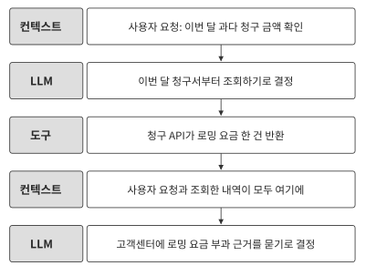
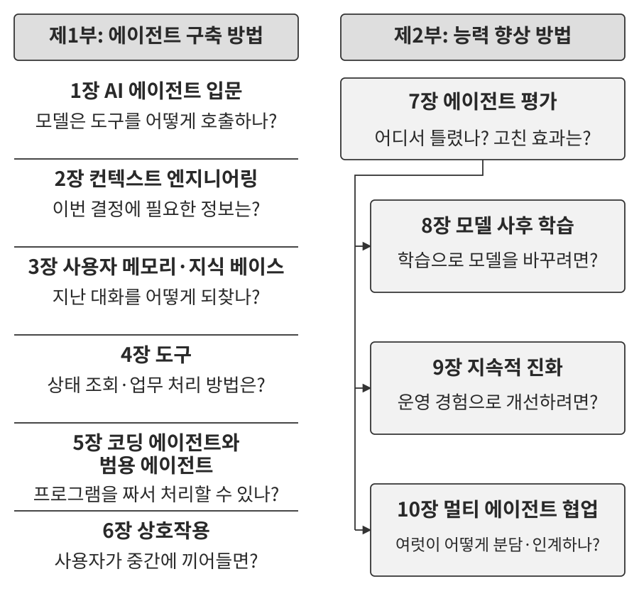

# 들어가며 {.unnumbered}

2025년 8월부터 2026년 초까지 저는 투링(Turing)에서 온라인 동영상 강의 ‘AI 에이전트 부트캠프’를 진행하며, 설명할 수 있고 검증할 수 있으며 재사용할 수 있는 엔지니어링 방법으로 AI 에이전트를 구축하는 법을 다루었습니다. 강의는 에이전트를 한 번 실행해 보는 데서 시작해, 에이전트가 왜 그런 아키텍처를 택하는지 분석하는 데로 나아갑니다. 각 설계가 어떤 문제를 풀고, 어떤 대가를 치르며, 어떤 업무에 적합한지를 살핍니다. 이 책은 그 강의 노트와 함께 제공한 실험을 바탕으로 엮었습니다.

> **이 책이 만들어진 과정: 사람과 AI의 협업 실천**
>
> 강의를 준비할 때 저는 먼저 개요를 Pine의 음성 에이전트에게 말로 들려주고, 자료를 조사해 초안을 쓰게 했습니다. 이렇게 말로 전달하며 협업하는 방식을 **위스퍼 코딩(whisper coding)**이라고 부릅니다. 강의가 끝나면 수강생들이 어느 단계에서 막혔는지, 어떤 실험 결과가 예상을 벗어났는지 살펴보고, 해당 예시와 논증을 다시 점검했습니다.

2025년 이후 저는 중요한 변화 하나를 지켜보았습니다. AI 연구와 산업 현장의 무게중심이 기반 모델의 능력을 끌어올리는 데서, 에이전트가 실제 업무를 완수하게 하는 데까지 넓어지고 있다는 것입니다. 그 결과 모델 학습과 응용도 더 긴밀하게 맞물리게 되었습니다. DeepSeek-R1 같은 추론 모델은 강화 학습이 수학, 프로그래밍, 추론 능력을 끌어올린다는 것을 보여 주었습니다.[^preface-r1] 에이전틱 강화 학습(Agentic Reinforcement Learning)은 도구 호출과 환경 상호작용을 학습에 포함시켜, 모델이 프로그래밍뿐 아니라 그래픽 인터페이스 조작까지 배우게 합니다. 후자를 흔히 Computer Use라고 부릅니다. 모델이 스크린숏을 보고 화면 상태를 판단한 다음, 클릭·입력·스크롤로 작업을 수행하는 것입니다. Manus, Claude Code, OpenClaw 같은 제품은 사용자가 업무를 직접 맡길 수 있게 했고, ‘코드 생성 + 파일 시스템’이 어떻게 범용 에이전트를 떠받치는지도 보여 주었습니다.

2026년 9월 Meta가 Muse를 내놓았습니다. 그 무렵 국내외에서 개인용 에이전트 제품이 우후죽순처럼 쏟아져 나왔습니다. 이 책에서 다루는 문제 가운데 상당수는 저와 팀이 그보다 앞서 Pine을 만들면서 이미 부딪혔던 것들입니다. 저는 Pine AI의 수석 과학자로서 동료들과 함께, 소비자를 대신해 일을 처리하는 개인용 에이전트 Pine을 개발했습니다. Pine은 2025년 1월 초 이미 미국에서 서비스를 시작했으며, 사용자는 Pine에게 판매자에게 전화를 걸어 요금을 협상하거나 환불을 요청하거나 구독을 해지하도록 맡길 수 있습니다.

판매자가 전화로 요금 일부를 감면해 주겠다고 약속하면, Pine이 그 자리에서 사용자에게 말할 수 있는 것은 ‘상담원이 감면을 약속했다’는 사실까지입니다. ‘돈이 이미 환불되었다’고 말하려면 청구서에 그 환불 내역이 나타날 때까지 기다려야 합니다. 이런 일을 처리하려면 모델이 사용자가 무엇을 승인했는지 기억하고, 다음에 무엇을 확인해야 하는지 알며, 일이 어디까지 진행되었는지도 구분할 수 있어야 합니다. 훗날 업계가 스킬(Skill), 하네스(Harness), 루프 엔지니어링(Loop Engineering)을 이야기하게 되었을 때, 그 가운데 상당수 방법은 저희가 바로 이런 통화를 처리하며 더듬어 찾아낸 것이었습니다.

- **스킬.** 저희는 업무에 필요할 때만 해당 프롬프트를 불러왔습니다. 도구가 많아진 뒤에는 모델이 명령줄로 도구를 호출하게 하여, 매 요청마다 모든 도구의 정의를 나열하지 않아도 되게 했습니다.
- **하네스.** 저희는 실행 환경, 현재 시각, 사용자의 작업 상태를 상태 표시줄에 적어 모델이 결정을 내릴 때 참고하게 했습니다. 모델은 때때로 결과를 지어내거나 도구를 잘못 호출하거나 지시를 빠뜨리고, 위험한 작업이 사용자가 승인한 범위를 넘어설 수도 있습니다. 그래서 실행 과정에 제약을 더했는데, 나중에 Claude Code에서도 비슷한 방식을 볼 수 있었습니다.
- **루프 엔지니어링.** 모델은 때때로 일을 절반만 해 놓고 끝났다고 선언합니다. 저희는 에이전트 하나가 일을 처리하고 다른 에이전트가 청구서나 주문 내역을 대조하게 했으며, 빠뜨린 일이 발견되면 되돌려 보내 마저 처리하게 했습니다. 이것이 제안자-검토자(proposer-reviewer) 분업입니다.

다른 모델 기업과 에이전트 팀도 비슷한 문제를 풀면서 서로 독립적으로 비슷한 방법에 도달했습니다. 이를 보며 저는 저희 팀이 겪은 어려움 가운데 상당수가 에이전트 시스템을 실제로 적용하려는 모든 이가 함께 마주하는 문제라는 확신을 더욱 굳혔습니다. ‘AI 에이전트 부트캠프’ 외에도 저는 2024년부터 2026년까지 중국과학원대학교에서 에이전트 실습 강의를 계속해 왔습니다. 두 강의의 수강생들이 던진 질문 덕분에 어떤 경험을 더 분명하게 설명해야 하는지 가려낼 수 있었습니다. 이 책을 오픈 소스로 공개하는 것도 더 많은 연구자와 엔지니어가 이 방법을 사용하고 검증하며 개선하기를 바라기 때문입니다.

**실천이 먼저이고 명명은 나중입니다.** 개발팀에게는 여기에 또 하나의 의미가 있습니다. 어떤 용어가 업계의 공통 인식이 될 무렵이면 선도 팀은 대개 이미 오랫동안 그 문제를 탐색해 온 뒤라는 것입니다. 자기만의 엔지니어링 강점을 쌓으려면 실제 사업에서 문제를 먼저 발견하고 해결을 시도해야 합니다. 이를 위해 저는 두 가지 조건이 핵심이라고 생각합니다.

**첫째, 에이전트의 능력에 충분히 높은 수준을 요구하는 실제 사업을 골라 꾸준히 피드백을 받아야 합니다.** Pine의 업무 하나는 몇 시간에서 몇 주까지 이어질 수 있고, 여러 당사자와 소통하며 장시간 통화하고, 복잡한 양식을 작성하고, 이메일을 여러 차례 주고받아야 합니다. 그러면서도 숫자는 정확해야 하고, 작업은 통제 가능해야 하며, 사용자의 이익을 지켜야 합니다. 이런 상황은 모델의 능력과 사업의 요구 사이의 간극을 끊임없이 드러내고, 팀이 하네스를 개선하도록 밀어붙입니다. 어떤 제품의 주된 가치가 특정 세대 모델의 약점을 메우는 데 그친다면, 다음 모델 업그레이드가 그 가치를 덮어 버릴 수 있어 팀이 지속적인 강점을 쌓기 어렵습니다.

**둘째, 체계적인 평가(Evaluation) 메커니즘을 구축해야 합니다.** 시스템을 고친 뒤 요금 협상 한 건이 성공했다면, 그것은 어시스턴트가 질문을 제대로 했기 때문일 수도 있고, 이번에 만난 상담원이 마침 감면 권한을 가지고 있었기 때문일 수도 있습니다. 같은 사례 묶음으로 새 버전과 이전 버전을 반복해서 비교해야 그 차이가 안정적인지 알 수 있습니다. 제7장에서는 성공 기준을 정하고, 평가 환경을 구축하고, 실패를 분석하고, 변경 사항을 검증하는 방법을 구체적으로 소개합니다.

Pine에서 저희는 요금 감면 업무를 통해 한 가지 방법을 배웠습니다. 검토자가 청구서에 찍힌 그 금액을 직접 확인하게 하는 것입니다. 같은 방법을 일정 변경에 적용하면 새 표가 발권되었는지를 확인해야 합니다. 구체적인 증거는 업무마다 달라지지만, 그 밑에는 공통된 원칙이 있습니다. 업무가 완료되었는지는 그 행동이 바깥 세계에 어떤 결과를 남겼는지를 보고 판단해야 한다는 것입니다. **훌륭한 원칙은 모델의 반복 주기를 넘어 살아남습니다.**

## 이 책의 사명 {.unnumbered}

누군가 휴대폰 요금 청구서를 어시스턴트에게 건네며 통신사에 연락해 감면을 협상해 달라고 부탁한다고 해 봅시다. 시작하기 전에 어시스턴트는 어느 항목의 요금이 문제인지 파악해야 합니다. 통화 중에는 상대의 설명을 듣고 조건을 되물을 수 있어야 합니다. 통화가 끝나면 상담원이 정확히 무엇을 약속했는지 사용자에게 알려야 합니다. 어시스턴트는 한 걸음 내디딜 때마다 세 가지 질문에 답해야 합니다. 지금 이 순간 어시스턴트는 무엇을 알고 있는가? 어떤 행동을 할 수 있는가? 무엇을 근거로 다음 단계를 고르는가? 이 책은 이 세 질문에서 출발해 에이전트의 구조, 구축 방법, 능력의 한계를 소개합니다. 핵심 공식은 **에이전트 = LLM + 컨텍스트 + 도구**입니다. LLM은 이해, 계획, 의사 결정을 맡고, 컨텍스트는 현재 결정에 필요한 정보를 담으며, 도구는 외부 환경과 연결되어 관측을 얻거나 행동을 실행합니다.

직관적인 비유로 말하면 LLM은 ‘두뇌’, 컨텍스트는 ‘현재 의사 결정의 시야’, 도구는 ‘감각과 손발’입니다. 시야에는 환경 정보, 대화 기록, 메모리와 지식이 들어 있고, 시스템 지시, 도구 정의, 업무 상태도 들어 있습니다. 검색, 읽기, 스크린숏은 정보를 가져오고, 클릭, 쓰기, 업무 API 호출은 외부 상태를 바꿉니다. 그림 0-1은 요금 문의 한 건을 단계별로 나누어 보여 줍니다. 처음 결정을 내릴 때 모델은 사용자가 요금에 의문이 있다는 사실만 알지만, 두 번째 결정에서는 어느 금액을 물어야 하는지까지 짚어 낼 수 있습니다.



강화 학습(Reinforcement Learning, RL)에 익숙한 독자라면 정책, 관측, 행동이라는 개념으로 이 분업을 이해할 수도 있습니다. LLM은 컨텍스트를 바탕으로 다음 단계를 고르므로 그 의사 결정 기능은 정책(Policy)에 가깝습니다. 컨텍스트는 이번 결정에 쓰이는 구체적인 관측과 기록을 담고, 도구는 관측과 행동의 인터페이스를 제공합니다. 관측 공간(Observation Space)은 어떤 관측을 얻을 수 있는지를, 행동 공간(Action Space)은 어떤 행동이 허용되는지를 기술하며, 둘은 함께 에이전트가 환경과 상호작용하는 범위를 규정합니다.[^preface-spaces] 제1장에서는 도구 호출 예시를 통해 이 개념들을 풀어 보고, 실제 운영 구현에서 모델과 하네스가 어떻게 역할을 나누는지 소개합니다.

> **더 생각해 보기: 생명에서 설계된 존재로**
>
> 엔지니어링 실천과 별개로, 에이전트는 지능 시스템의 진화에 관한 질문도 던집니다. 튜링상 수상자이자 강화 학습의 개척자인 리처드 서튼(Richard Sutton)은 우주의 진화를 먼지, 별, 생명, ‘설계된 존재(designed entities)’라는 네 단계로 요약했습니다.[^preface-sutton] 생물은 무작위 돌연변이와 자연 선택으로 진화하지만, 설계된 존재는 이미 있는 지능 시스템이 목적을 가지고 만들고 개선할 수 있습니다.
>
> 에이전트는 코드를 생성해 새로운 에이전트를 만들고, 실행 행태를 분석해 수정안을 내고 결과를 검증하면서 점차 스스로 부트스트랩(bootstrap)하고 지속적으로 진화할 수 있습니다. 한 프로그래머가 또 다른 프로그래머를 작성하고, 그 프로그래머가 다시 새로운 시스템을 만드는 데 참여하는 것과 비슷합니다. 자기 자신을 이해하고 개선할 수 있다는 이 가능성은 제가 코드 생성과 지속적 진화를 다룬 두 장을 쓰면서 가장 흥미를 느낀 문제 가운데 하나이기도 합니다.

## 책의 구성 {.unnumbered}

그림 0-2는 각 장의 관계를 보여 줍니다. 사용자가 통화 도중 갑자기 말을 바꾸었는데 어시스턴트가 여전히 예전 요구대로 일을 처리한다면, 왼쪽 열의 제6장부터 읽으며 어시스턴트가 사용자의 끼어들기를 어떻게 처리하는지 살펴볼 수 있습니다. 고친 뒤에는 다른 통화에서도 새 요구를 제대로 받아들이는지 어떻게 알 수 있을까요? 이때는 오른쪽 열 제7장의 평가 방법이 필요합니다. 그림에서 제7장으로부터 갈라져 나가는 세 화살표는, 평가 결과를 얻은 뒤 실패 원인에 따라 서로 다른 개선 방법을 고를 수 있음을 나타냅니다.



- **제1장(AI 에이전트 입문)**은 제품과 도구 호출 예시를 통해 핵심 구성 요소, 실행 루프, 하네스, 오케스트레이션 방식을 소개하고, 책 전체를 이해하기 위한 개념 틀을 세웁니다.
- **제2장(컨텍스트 엔지니어링)**은 이 책에서 가장 중요한 장으로, 모델이 지금 필요로 하는 정보를 어떻게 구성할지 다룹니다. 프롬프트 설계와 주문형 로딩에서 기록 관리까지 설명하고, KV 캐시와 연결해 이 방법들이 답변 품질과 실행 비용에 어떤 영향을 주는지 풀어 봅니다.
- **제3장(사용자 메모리와 지식 베이스)**은 세션을 넘나드는 정보를 어떻게 저장하고 꺼내 쓸지 다룹니다. 사용자 메모리에서 RAG, 구조화된 인덱스, 지식 업데이트까지 설명하며, 지속적인 지식을 검색하고 유지하는 방법을 익히도록 돕습니다.
- **제4장(도구)**은 에이전트가 어떻게 관측을 얻고, 행동을 실행하고, 협업을 요청하는지 다룹니다. 도구 분류, 인터페이스 설계, MCP, 실행 관리를 통해 외부 능력을 시스템에 연결하는 방법을 이해합니다.
- **제5장(코딩 에이전트와 범용 에이전트)**은 범용 에이전트의 핵심 아키텍처 방향 하나를 제시합니다. 코딩 에이전트를 실행의 중심에 두고, 파일 시스템을 작업 공간으로 삼는 것입니다. 먼저 개발 워크플로를 설명한 다음, 멀티미디어와 업무 시스템 등의 사례를 통해 에이전트가 어떻게 프로그램을 작성해 문제를 풀고, 나아가 도구를 만들고 새로운 에이전트를 구축하는지 보여 줍니다.
- **제6장(상호작용: 관측 공간과 행동 공간의 확장)**은 모달리티와 타이밍이라는 두 축에서 에이전트의 상호작용 방식을 다룹니다. 비동기 이벤트, 음성, Computer Use, 로봇을 통해 지속적 관측, 빠른 경로와 느린 경로, 실행 제어를 이해합니다.
- **제7장(에이전트 평가)**은 시스템의 성능과 변경 한 번의 효과를 어떻게 판단할지에 답합니다. 먼저 성공 기준, 환경, 데이터셋을 정하고, 이어서 검증기, 채점, 통계 분석을 설명하며, 마지막으로 실패 원인을 분석해 개선 방향을 찾습니다.
- **제8장(모델 사후 학습)**은 데이터와 환경으로 모델의 능력을 어떻게 갱신할지 다루며, 데이터 품질과 학습 환경에 우선 투자해야 한다고 주장합니다. 지도 미세 조정, 강화 학습, 보상 설계를 통해 시범 학습과 탐색이 왜 서로 다른 일반화 성능을 낳는지, 그리고 왜 알고리즘만 바꾸어서는 효과가 제한적인지 설명합니다.
- **제9장(에이전트의 지속적 진화)**은 운영 경험을 활용해 에이전트의 다음 버전을 어떻게 개선할지 다룹니다. 지식, 지시, 프로그램, 매개변수라는 네 가지 업데이트를 비교하고, 검증·배포·복구 절차로 장기적인 변화를 관리합니다.
- **제10장(멀티 에이전트 협업)**은 여러 구성원이 언제 추가 가치를 만드는지, 그리고 어떻게 분업하고 소통하고 조율하는지 다룹니다. 먼저 컨텍스트와 제어권을 어떻게 나눌지 설명하고, 이어서 사례와 함께 협업 메커니즘을 설명하고 실패 원인을 분석하며, 에이전트 사회와 경제가 어떤 모습일 수 있는지 논의합니다.

## 이 책을 읽는 방법 {.unnumbered}

- **에이전트 제품을 처음부터 구축한다면** 책 전체를 읽기를 권합니다. 먼저 제1장부터 제6장까지로 일을 처리할 수 있는 어시스턴트를 만들고, 제7장으로 어떤 업무에서 실수하기 쉬운지 검증하십시오. 뒤의 세 장은 이렇게 드러난 실패를 바탕으로 모델, 시스템, 구성원 간 분업을 어떻게 개선할지 다룹니다.
- **먼저 전체 그림을 잡고 싶다면** 제1장, 제2장, 제4장, 제7장을 차례로 읽으십시오. 도구 호출 한 번을 따라가며, 먼저 에이전트의 실행 루프를 익히고, 이어서 모델이 어떤 정보를 받는지와 도구가 실제로 무엇을 하는지 살펴본 다음, 마지막으로 평가를 통해 결과가 사용자의 요구에 맞는지 판단합니다. 제2장에서 KV 캐시를 다루는 부분은 처음 읽을 때 서두의 세 가지 결론만 익혀 두고, 실험을 해 본 뒤 다시 돌아와 밑바탕의 원리를 보아도 됩니다.
- **모델 학습을 중점적으로 공부한다면** 먼저 제1장과 제2장으로 에이전트의 작동 방식을 이해한 다음, 제7장의 평가 방법과 함께 제8장을 읽으십시오. 그러면 학습 목표를 실제 업무 성능과 연결해 볼 수 있습니다.
- **이미 운영 중인 에이전트를 유지 보수한다면** 제7장을 참고해 실제 업무 한 묶음을 골라 평가하십시오. 예를 들어 어시스턴트가 사용자에게 예전 가격을 안내했다면, 먼저 어시스턴트가 받은 견적이 어느 버전이었는지 확인합니다. 지식이나 절차가 낡았다면 이 실패를 들고 제9장을 읽으십시오. 견적과 도구가 모두 충분히 주어졌고 절차를 고친 뒤에도 모델이 계속 잘못 고른다면, 그때 제8장을 읽고 학습 데이터를 준비할 가치가 있는지 판단하십시오.

각 장에는 실험과 생각해 볼 문제가 있습니다. 실험에는 ‘실험 X-Y’ 형식으로 번호를 붙였으며, X는 장 번호, Y는 장 안의 순서를 뜻합니다. 별점은 난이도를 나타냅니다. ★는 입문 수준, ★★는 어느 정도 엔지니어링 경험이 필요한 수준, ★★★는 열린 질문이나 복잡한 시스템 설계를 다루는 수준입니다. 대부분의 실험에는 실행 가능한 코드가 있으며, 오픈 소스 저장소에 모아 두었습니다.

> **연계 코드 저장소**: `bojieli/ai-agent-book`

처음 실험을 한다면 ‘실험 1-1: 컨텍스트의 핵심 역할’부터 시작해 보십시오. Git을 사용한다면 터미널에서 다음을 실행합니다.

```bash
git clone https://github.com/bojieli/ai-agent-book.git
cd ai-agent-book
```

저장소 페이지에서 **Code → Download ZIP**을 선택해 압축을 풀어도 같은 디렉터리를 얻을 수 있습니다. 제1장 실험 색인(`chapter1/README.md`)에서 1-1번을 찾아 `chapter1/context/README.md`를 여십시오. 이후 ‘실험 X-Y’가 나오면 저장소의 `chapterX/README.md`에서 해당 프로젝트와 실행 방법을 찾을 수 있습니다. ‘재현 가이드’는 외부 프로젝트와 그 입수 방법을 안내하며, 설치 명령과 디렉터리 설명은 README에 모아 두었습니다.

## 선수 지식 {.unnumbered}

이 책은 기본적인 프로그래밍 능력을 갖추고 에이전트를 이해하고 구축하고 싶은 독자를 대상으로 합니다. 실험을 직접 해 보려면 다음 기초가 필요합니다.

**필수: 책 전체를 읽기 위한 기반**

- **Python 프로그래밍**: 문법, 자주 쓰는 자료 구조, pip 같은 패키지 관리 도구에 익숙하여 실험 코드를 읽고 수정할 수 있어야 합니다. 이 책의 실험은 대부분 Python을 기반으로 합니다.
- **LLM 사용 경험**: ChatGPT, Claude 또는 비슷한 제품을 사용해 보았고, 요청을 하고 응답을 읽고 이어서 질문하는 기본 과정에 익숙해야 합니다.
- **일반 소프트웨어 엔지니어링 지식**: 명령줄, Git, JSON, REST API를 알고, 이를 바탕으로 프로젝트를 실행하고 변경 사항을 확인하며 인터페이스 데이터를 읽을 수 있어야 합니다.

실험을 직접 할 때는 Claude Code, Codex, Cursor, TRAE 가운데 하나를 골라 쓰기를 강력히 권합니다. 코드 한 토막을 디버깅해 달라고 맡겨 보고, 그것이 어떤 파일을 읽고 어떤 도구를 호출하는지 지켜보십시오. 뒤에서 실행 루프와 컨텍스트 관리를 읽을 때 직접 겪어 본 경험과 견주어 볼 수 있습니다.

**권장: 장별로 보충하면 좋은 지식**

- **머신러닝 기초(제8장)**: 학습과 추론, 손실 함수, 경사 하강법, 과적합을 알면 모델 갱신 과정을 이해하는 데 도움이 됩니다.
- **수학 기초(제2장, 제3장, 제7장, 제8장)**: 벡터와 행렬은 임베딩과 어텐션을, 확률과 통계는 평가 지표와 기대 보상을 이해하는 데 도움이 됩니다. 이 책은 직관적인 설명과 실제 쓰임새에 초점을 둡니다.
- **웹 개발 기초(제6장)**: HTTP, WebSocket, 프런트엔드와 백엔드의 역할 분담을 알면 비동기 이벤트 아키텍처와 실시간 음성 통신을 이해하는 데 도움이 됩니다.
- **Transformer 기초(제2장, 제8장)**: 어텐션과 모델 구조를 알면 컨텍스트 계산과 사후 학습을 이해하는 데 도움이 됩니다. 체계적으로 공부하고 싶은 독자에게는 『도해 대규모 모델: 생성형 AI의 원리와 실전』(图解大模型：生成式 AI 原理与实战, Jay Alammar·Maarten Grootendorst 지음, 리보제 옮김, 투링 출판)을 권합니다. 그 책은 그림으로 Transformer, 사전 학습, 미세 조정을 설명하며, 이 책의 엔지니어링 관점을 잘 보완해 줍니다.

제8장의 사후 학습을 제외하면 나머지 장에서 쓰이는 수학과 머신러닝 지식은 많지 않으므로, 기본적인 프로그래밍 경험만 있으면 읽기 시작할 수 있습니다.

## 감사의 말 {.unnumbered}

이 책을 편집하고 ‘AI 에이전트 부트캠프’를 준비하는 데 애써 주신 투링의 멍거 선생님과 류메이잉 선생님께 감사드립니다. 중국과학원대학교에서 에이전트 실습 강의를 개설해 주신 류쥔밍 선생님께도 감사드립니다. 두 강의의 수강생 여러분께 감사드립니다. 여러분의 질문과 실험 피드백, 제안 덕분에 설명을 꾸준히 다듬을 수 있었고, 이 개념들에 대한 저의 이해도 깊어졌습니다.

Pine AI의 모든 동료에게 감사드립니다. 실제 사업에서 마주한 도전과 팀 안의 토론은 이 책에 담긴 많은 방법과 사례의 원천입니다. 여러분의 실천과 통찰 덕분에 이러한 인식을 계속 다듬을 수 있었습니다.

AI 업계의 지인 여러분께도 감사드립니다. 거듭된 교류 속에서 솔직하게 의견을 주고 서로 다른 경험과 판단을 나누어 주신 덕분에 모델과 에이전트를 더 깊이 이해할 수 있었습니다.

무엇보다 제 가족, 특히 아내 멍자잉에게 감사드립니다. 아내는 이 책을 쓰는 내내 저를 지지해 주었고, 원고에 소중한 의견도 많이 주었습니다.

[^preface-r1]: DeepSeek-AI, *DeepSeek-R1: Incentivizing Reasoning Capability in LLMs via Reinforcement Learning*, 2025.
[^preface-spaces]: Gymnasium 문서의 “Spaces” 절.
[^preface-sutton]: Richard Sutton과 Dwarkesh Patel의 인터뷰, 2025-09-26, “Succession to AI” 부분.
