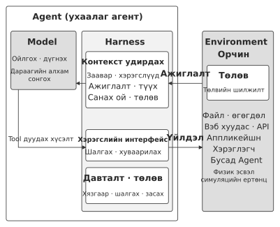
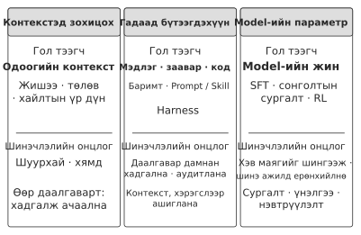
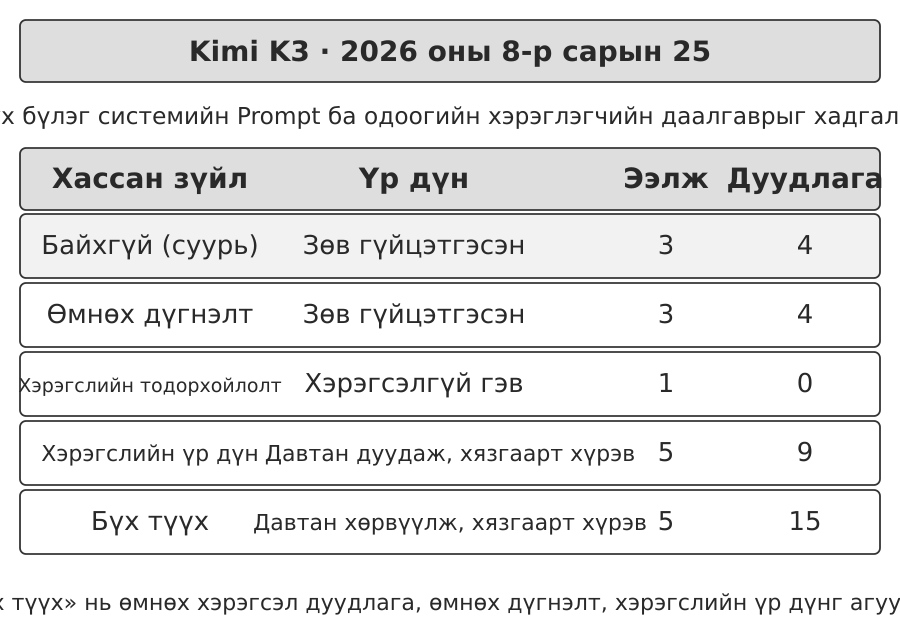
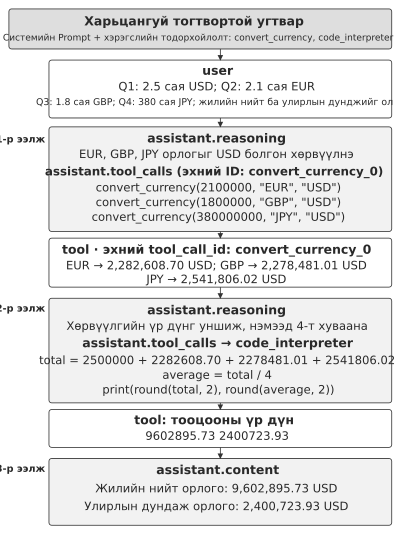
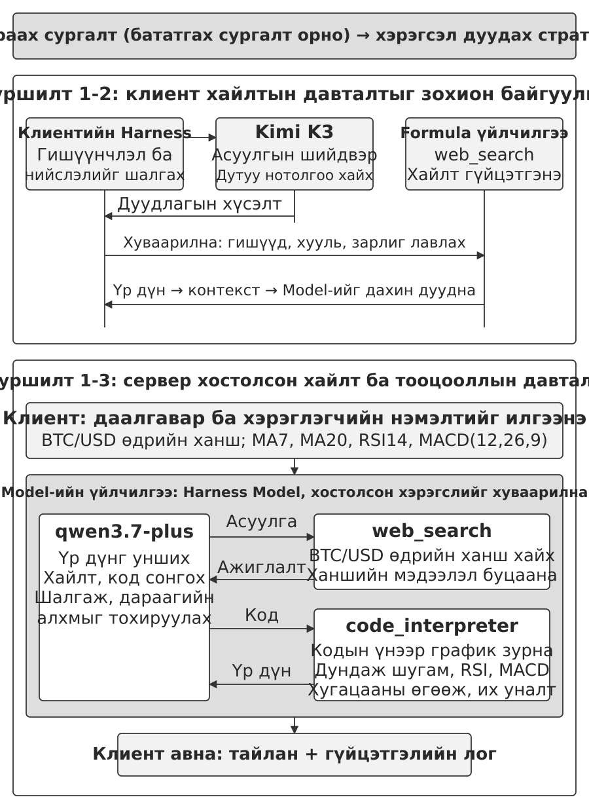
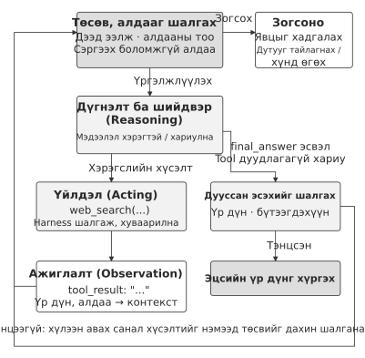
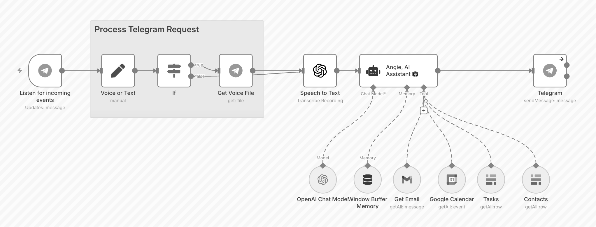

# AI Agent-ийн үндэс

Deep Research-ээр нэг сэдвийг судлуулахад тэр олон удаа хайж, уншаад эцэст нь тайлан нэгтгэж гаргадаг. Manus браузер удирдан онлайн даалгавар гүйцэтгэдэг, Doubao утасны туслах утсан дээр тасалбар захиалж, мессеж илгээдэг, Pine AI хэрэглэгчийн өмнөөс утсаар ярьж, үүрэн холбооны компанитай хэлэлцэн төлбөрийг бууруулдаг. Эдгээр нь бүгд AI Agent-ийн хэрэглээ юм.

Cursor-оор нэг функцийг засуулахад тэр функцийг олж, файлыг засварлаад тестийг ажиллуулдаг. Тест дахин унавал алдааны мэдээлэл нь дараагийн засварын үндэслэл болно; тест амжилттай болсон үед л танд үр дүнг тайлагнах нотолгоо түүнд бий болдог. Хайх, засварлах, тестлэх гэсэн гурван алхмын дарааллыг программд урьдчилан бичиж болох ч яг аль мөрийг засах, алдаа гарвал хаашаа буцахыг гүйцэтгэлийн явцад олж авсан мэдээлэл шийднэ. Зорилгодоо тулгуурлан үйлдэл сонгож, үр дүнгээс нь хамааран төлөвлөгөөгөө өөрчлөх ийм үйл явц судалгаа хийх, утсаар хэлэлцээр хийх зэрэг даалгаварт ч мөн адил явагддаг.

## Орчин үеийн Agent = LLM + Контекст + Хэрэгсэл

Энэ ном орчин үеийн Agent-ийн гурван төрлийн үүргийн бүрэлдэхүүнийг нэг томьёогоор илэрхийлдэг: **Agent = LLM (хэлний том загвар, Large Language Model) + Контекст + Хэрэгсэл**.

- **LLM бол Agent-ийн тархи.** Даалгаврыг ойлгох, алхмуудыг төлөвлөх, үйлдэл сонгох үүргийг хариуцна. Урьдчилсан сургалт Model-д хэлний чадвар болон ертөнцийн мэдлэгийг олгож, дараах сургалт нь зааврыг дагах, дүгнэлт хийх, хэрэгсэл дуудах зэрэг зан төлөвийг цааш нь хэвшүүлдэг. Удирдлагатай fine-tuning, бататгах сургалт зэрэг дараах сургалтын аргуудыг Бүлэг 8-д танилцуулна.
- **Контекст бол Agent-ийн тухайн мөчийн шийдвэрийн харах хүрээ.** Энэ удаагийн шийдвэрт хэрэгтэй мэдээллийг агуулна: заавар, хэрэгслийн тодорхойлолт, орчны ажиглалт, хэрэглэгчийн санах ой, салбарын мэдлэг, өмнөх мессежүүд, өөрийн төлөв болон даалгаврын явц.
- **Хэрэгсэл бол Agent-ийн мэдрэхүй ба гар хөл.** Интерфейсээр дамжуулан мэдээлэл авах эсвэл үйлдэл гүйцэтгэнэ. Хэрэгслийн систем нь тодорхойлолт, дуудлагын протокол болон адаптераас бүрдэх бөгөөд хайх, унших, дэлгэцийн зураг авах зэрэг ажиглалтын үйлдлээс гадна бичих, код ажиллуулах, дэд Agent-д даалгавар шилжүүлэх, хэрэглэгчтэй харилцах зэргийг дэмждэг.

Нэг хэрэгсэл хэд хэдэн үүрэг зэрэг гүйцэтгэж болно. Жишээ нь, Model командын мөрөөр файл уншихад буцаж ирсэн файлын агуулга дараагийн шийдвэрийн үндэслэл болдог; харин командын мөрөөр программ ажиллуулахад файл эсвэл процессын төлөв өөрчлөгдөж ч болно.

Та сая илгээмжээ задлаад үйлчилгээний ажилтнаас «Задалсны дараа буцааж болох уу?» гэж асуухыг хүсэж байна гэж бодъё. Систем **хайлтаар баяжуулсан үүсгэлт** (Retrieval-Augmented Generation, RAG) ашиглан дэлгүүрийн одоо мөрдөж буй буцаалтын журмыг хайж олоод, Model-оор тэр заалтад тулгуурлан хариулуулж болно.[^ch1-rag] Ганц асуулгыг дагаад л хэд хэдэн бүрэлдэхүүний үүрэг тодорхой харагдана. Журмын эх бичвэр болон индекс гадаад мэдлэгийн санд хадгалагдана; хайлтын хэрэгсэл асуултаар холбогдох хэсгүүдийг олж, Model-ийг дууддаг программ тэдгээр хэсгийг эх сурвалжийн хамт энэ удаагийн хүсэлтэд оруулна. Model «задалсан» гэсэн заалтыг уншаад журмыг тайлбарлаж чадна; хэрэв журам барааны төрлөөр ялгаатай бол эхлээд та юу худалдаж авсныг тодруулах хэрэгтэй болно.

[^ch1-rag]: Patrick Lewis нар, Retrieval-Augmented Generation for Knowledge-Intensive NLP Tasks, NeurIPS, 2020.

Энэ буцаалтын асуулгад хайлт эхлүүлэх нь Agent-ийн үйлдэл, буцаж ирсэн заалт нь түүний орчноос (Environment) авсан ажиглалт юм. Дараагийн алхам нь хариулах уу, эсвэл тодруулж асуух уу гэдэг нь заалтад юу бичсэнээс хамаарна. Ингэж бататгах сургалт ба кибернетикийн хэлдэг хаалттай давталт үүсдэг бөгөөд үүнийг Зураг 1-1-д үзүүлэв.



Зургийн гадна давхарга Agent ба орчны хилийг заана. Файл, өгөгдлийн сан, вэб хуудас, хэрэглэгч, бусад Agent, мөн физик эсвэл симуляцийн ертөнц бүгд түүний харилцах орчин болж болно. Зургийн дотор давхарга бодит үйлдвэрлэлийн хэрэгжилт дэх ажлын хуваарийг харуулна: **Model ойлгох, дүгнэх, шийдвэр гаргах үүрэгтэй; Harness нь Agent-ийн хил дотор, Model-оос гадна байрлаж, контекст, хэрэгслийн интерфейс, ажиллах давталт болон төлөвийг зохион байгуулж, хязгаарлалт, шалгалт, залруулгыг хэрэгжүүлнэ.** Harness орчныг үүсгэх, тусгаарлах эсвэл түүнд зуучлах боломжтой; харин файлын агуулга, процессын төлөв зэрэг нь үйлдлийн дагуу орчин дотор өөрчлөгддөг.[^ch1-harness]

[^ch1-harness]: LangChain-ийн «The Anatomy of an Agent Harness», Anthropic-ийн «Effective harnesses for long-running agents»-ийг үзнэ үү. Зарим хэрэгжилт sandbox-ийг ч Harness-д багтаадаг; Зураг 1-1 үйлдэл яг юуг өөрчилснийг мөрдөхөд хялбар болгох үүднээс орчныг тусад нь зурсан.

Иймээс энэ ном бие биеэ нөхөх хоёр задаргааг хэрэглэнэ: **«LLM + Контекст + Хэрэгсэл» нь үүргийн бүрэлдэхүүнийг, «Model + Harness» нь үйлдвэрлэлийн хэрэгжилтийг тайлбарлана.** Контекстийг Harness зохион байгуулаад Model-д өгнө; хэрэгсэл дуудах эсэхийг Model шийдэж, Harness шалгаж, хуваарилаад хэрэгсэл эсвэл орчинд гүйцэтгүүлнэ. Энгийн систем контекст угсрах, хэрэгслийг хуваарилахаас эхэлж, үйлдвэрлэлд ажиллахад шаардлагатай хязгаарлалт, шалгалт, залруулгын механизмуудыг аажмаар нэмж болно.

Бататгах сургалттай танил бол доорх хүснэгтийг «дараагийн алхмыг хэн шийдэх вэ, юунд тулгуурлан шийдэх вэ, хэрхэн хэрэгжүүлэх вэ» гэсэн гурван асуултаар уншиж болно. Энэ нь үүргээр нь хийсэн бүдүүвч зүйрлэл юм.

| Зөн совингийн ойлголт | Инженерийн бүрэлдэхүүн | Бататгах сургалтын холбогдох ойлголт | Утга |
|-----------|-----------|----------------------------|----------------------------------------------|
| **Тархи** | LLM | **Бодлого** (Policy) | Одоогийн мэдээлэлд тулгуурлан дараа нь юу хийхийг шийднэ |
| **Шийдвэрийн харах хүрээ** | Контекст | **Ажиглалт ба түүх** | Орчноос ирсэн мэдээлэл болон өмнөх түүхийг шийдвэрийн үндэслэл болгон зохион байгуулна |
| **Мэдрэхүй ба гар хөл** | Хэрэгсэл ба адаптер | **Ажиглалт ба үйлдлийн интерфейс** | Орчны мэдээллийг хэрхэн унших, үйлдлийг хэрхэн гаргах, дуудлага ба хариуны форматыг тогтооно |

### Ажиглалтын орон зай ба үйлдлийн орон зай: Model ба ертөнцийн интерфейс

**Ажиглалтын орон зай нь Agent ямар ажиглалт хүлээн авч болохыг, үйлдлийн орон зай нь ямар үйлдэл гаргаж болохыг тодорхойлно.** Нэг удаагийн дуудлага дахь контекст тодорхой мэдээллийг агуулж, ашиглаж болох хэрэгслүүд орчинтой харилцах интерфейсийг өгнө. Хэрэгслээс гадна хэрэглэгчийн оруулга, үйл явдлын мэдэгдэл зэрэг нь ч ажиглалт авчирч болно; хэрэгсэл дуудлагын параметр, эрх, ажиллах орчин хамтдаа үйлдлийн хүрээг хязгаарладаг.

Хоёр төрлийн доголдлыг тус тусад нь төсөөлье. Нэгдүгээрт, Model төлбөрийн баримтын төлбөр бүрийг тайлбарлаж чаддаг ч энэ сарын баримтыг авч чадахгүй байна. Хэрэглэгч уншихыг зөвшөөрсний дараа баримтыг хайж олоод Model-д өгсөн үед л тэр аль төлбөр маргаантай болохыг дүгнэж чадна. Хоёрдугаарт, хэрэглэгч туслахаас тарифаа солиулахыг хүссэн бөгөөд туслах тохирох багцыг аль хэдийн олсон ч дансны интерфейс зөвхөн лавлах боломж олгодог. Баримтыг дахин уншсан ч тэр өөрчлөлтийг хийж чадахгүй; түүнд холбогдох үйлдлийн эрх хэрэгтэй. Harness-ийн ажил бол уншсан материалыг контекстэд оруулж, Model-ийн сонгосон үйлдлийг хүлээн авч, параметр ба эрхийг шалгаад гүйцэтгэлийг хуваарилах явдал юм.

Иймээс **суурь Model тогтмол байх үед ажиглалтын болон үйлдлийн орон зайг тохируулах нь даалгаврын гүйцэтгэлийг сайжруулах инженерийн чухал арга юм.** Model гол баримтыг анзаарахгүй өнгөрөөж байвал холбогдох өгөгдлийг контекстэд оруулж болно; төстэй хэрэгслүүдийг байнга андуурч сонгож байвал давхардсан интерфейсүүдийг нэгтгэх эсвэл зөвхөн тухайн даалгаварт хэрэгтэй хэрэгслүүдийг ачаалж болно.

Видео үзэхэд эсрэг асуудал гарна: дүрс байнга байдаг ч дахин дүгнэх шаардлагатай өөрчлөлт цөөхөн. Туслах файл байршуулж дуусахыг хүлээж байна гэж бодъё. Явцын мөр бага зэрэг хөдлөх бүрд үндсэн Model-ийг дуудвал илүүдэл тооцоолол их болно; харин арав секунд тутамд нэг харвал хоромхон гараад алга болох алдааны мэдэгдлийг алдаж мэднэ. **Зохиогчийн бодлоор ажиглалтын орон зайг сийрэгжүүлэх нь Agent-ийн дизайны үндсэн асуудлын нэг юм.** Систем орчныг тасралтгүй ажиглаж, дараагийн үйлдлийг өөрчилж болзошгүй өөрчлөлтийг л шаардлагатай контекстийн хамт үндсэн Model-д дамжуулж болно.

**Manus: нэг даалгаварт судалгаа, программчлал, компьютер удирдлагыг хослуулах нь.** Deep Research хайх, уншихдаа сайн, Coding Agent код бичиж ажиллуулж чадна, Computer Use Agent интерфейсийг удирдаж чадна. Manus браузер, файлын систем, код гүйцэтгэл болон командын мөрийг үүлэн sandbox дотор нэгтгэснээр нэг Agent эхлээд мэдээлэл хайж, дараа нь файл боловсруулж, код ажиллуулаад, эцэст нь браузераар үйлдлээ гүйцээх боломжтой болсон. Браузер ба файл унших боломж олж авах мэдээллийг нэмэгдүүлж, код болон команд гүйцэтгэх боломж хослуулж болох үйлдлийг нэмэгдүүлсэн. **Зохиогчийн бодлоор энэ хослол нь ерөнхий зориулалтын Agent-ийн чухал нээлт юм: нэг Agent урьд нь тусдаа байсан бүтээгдэхүүний хилийг давж, мэдээлэл олох, өгөгдөл боловсруулах, үйлдэл гүйцэтгэхийг нэг бүтэн даалгавар болгон холбож чадна.**

**OpenClaw: интерфейсийг хэрэглэгчийн дижитал амьдрал руу сунгах нь.** OpenClaw нь WhatsApp, Telegram, Slack, Discord, iMessage зэрэг мессежийн сувгаар даалгавар хүлээн авч, үр дүнг буцаадаг бөгөөд хэрэглэгчийн төхөөрөмж дээр ажилладаг Gateway-ээр мессежийн суваг, Model болон хэрэгслүүдийг холбодог. Холбогдох хэрэгслийг тохируулж, зөвшөөрөл авсны дараа Agent локал файл боловсруулж, Google Drive, Notion зэрэг үүлэн үйлчилгээнд ч холбогдож чадна. Ингэснээр хэрэглэгчийн бүртгэл, төхөөрөмжүүдэд тархсан материал нэг даалгаврын боловсруулалтад орох боломжтой болдог. Эхэн үеийн Manus голдуу үүлэн sandbox дотор ажилладаг байсан тул хэрэглэгч файлаа байршуулах шаардлагатай байв; хожим нэмэгдсэн Google Drive холбогч болон My Computer ширээний функц үүлэн файл ба локал нөөцөд хандах хүрээг улам өргөжүүлсэн. Эдгээр хөгжил бүтээгдэхүүний чадварын өсөлт ихэвчлэн ажиглалт ба үйлдлийн интерфейсийн өргөжилтөөс үүсдэгийг харуулж байна[^ch1-agent-products].

[^ch1-agent-products]: Бүтээгдэхүүний бүтцийн талаар Manus-ийн албан ёсны Sandbox танилцуулга, Google Drive Connector танилцуулга, My Computer танилцуулга, мөн OpenClaw-ийн албан ёсны репозитори болон хэрэгслийн баримт бичгийг үзнэ үү. Яг ямар нөөцөд хандаж болохыг холбогч, хэрэгслийн тохиргоо болон хэрэглэгчийн зөвшөөрөл тодорхойлно.

Бүтээгдэхүүн бүрийн даалгавар өөр боловч бүгдийг нь шийдвэрийн үндэслэл, ашиглаж болох үйлдэл, гүйцэтгэлийн стратеги гэсэн гурван талаас ойлгож болно:

| Agent бүтээгдэхүүн | Контекст дэх гол мэдээлэл | Ашиглаж болох хэрэгсэл ба үйлдэл | Гүйцэтгэлийн стратеги |
|----------------|----------------------|----------------------------|------------------------------|
| **Cursor зэрэг Coding Agent** | Шаардлага, кодын хэсэг, хавтасны жагсаалт, терминалын гаралт | Код хайх, файл унших/бичих, команд ажиллуулах | Шаардлагыг ойлгох→холбогдох кодыг хайх→код засварлах→тестээр шалгах→алдаа засах |
| **Deep Research зэрэг хайлтын Agent** | Хайлтын үр дүн, вэб хуудасны агуулга, өгүүллийн хураангуй ба эшлэл | Хайлтын асуулга, вэб хуудас унших, тайлан үүсгэх | Байгаа мэдээлэлд тулгуурлан хайлтын чиглэлээ өөрчилж, бүрэн тайланг аажмаар нэгтгэнэ |
| **Browser Use зэрэг компьютер удирдах Agent** | Дэлгэцийн зураг, DOM эсвэл хүртээмжийн мод, үйлдлийн үр дүн | Дарах, бичих, гүйлгэх, дэлгэцийн зураг авах, код ажиллуулах | Интерфейсийг унших→зорилтот элементийг таних→үйлдэл хийх→үр дүнг шалгах |
| **Doubao зэрэг утасны туслах Agent** | Утасны дэлгэцийн зураг, App-ийн интерфейсийн төлөв, системийн хариу | Дарах, шудрах, бичих, App нээх | Шаардлагыг ойлгох→зорилтот App-ийг олох→үйлдэл хийх→дууссаныг баталгаажуулах |
| **Pine AI, Meta Muse зэрэг хувийн ажил гүйцэтгэх Agent** | Зөвшөөрөлтэйгөөр уншсан дансны бүртгэл, төлбөрийн баримт, үйлчилгээ үзүүлэгчийн мэдээлэл | Утсаар ярих, имэйл илгээх, маягт бөглөх, хэрэглэгчээс баталгаажуулах | Мэдээлэл цуглуулах→хэлэлцээрийн стратеги боловсруулах→үйлчилгээ үзүүлэгчтэй холбогдох→хэлэлцэх→үр дүнг тайлагнах |

**Хэрэглэгчийн даатгасан ажил хэрхэн гүйцэтгэж болох даалгавар болдог вэ?** Зохиогч Pine-д хувийн ажил гүйцэтгэх туслах хийж байхдаа хэрэглэгчид ихэвчлэн зөвхөн зорилгоо хэлдгийг анзаарсан. Жишээ нь, «Томилолтод явах онгоцны тасалбар захиалж өгөөч, 1200 юанаас хэтрэхгүй байвал сайн байна». Туслах эхлээд огноо, очих газар, энэ аялалд юу хамгийн чухал болохыг тодруулж, дутуу мэдээллийг цуглуулаад, хэрхэн гүйцэтгэх, ямар нөхцөлийн талаар тохиролцож болохыг хэрэглэгчтэй ярилцсаны дараа л үйлчилгээ үзүүлэгчтэй холбогдоно. Ажлын явцад гарсан шинэ нөхцөл байдал даалгаврыг өмнөх алхам руу буцааж ч болно.

Үйлчилгээний ажилтны олсон хамгийн хямд тасалбар 1250 юань байлаа гэж бодъё. Model нийтлэг мэдлэг, энэ аялалын онцлог, санаж буй хэрэглэгчийн зуршлыг нэгтгэн дүгнэнэ. Томилолтоор явж буй, тохиромжтой маршрутын төлөө бага зэрэг илүү төлөхөд ихэвчлэн бэлэн байдаг хэрэглэгчийн хувьд Pine шууд захиалж магадгүй; харин гэр бүлээрээ амрахаар явж буй, өмнө нь нийт зардалд анхаардгаа тодорхой хэлж байсан хэрэглэгчийн хувьд эхлээд зөрүүг хэрэглэгчид мэдэгдээд, ажилтнаас өөр нислэг хайхыг үргэлжлүүлэн хүсэж магадгүй. Хэрэв хэрэглэгч дараа нь «Дараа нь төсвөөс хэтэрсэн тасалбар гарвал эхлээд надаас асуу» гэж нэмж хэлбэл энэ санал хүсэлт дараагийн дүгнэлтэд ерөнхий туршлагаас илүү тодорхой үндэслэл болно.

Өөр нөхцөл байдлыг авч үзье. Банкны ажилтан баримт бичгийг гэрийн хаяг руу шуудангаар илгээхийг санал болгосон ч туслах хэрэглэгч гадаадад аялж байгааг санаж байна. Энэ удаа өөрчлөх ёстой зүйл нь хүргэх арга юм: туслах хүлээн авахад хүндрэлтэй байгааг тэр дор нь тайлбарлаж, имэйлээр илгээлгэхийг хичээж болно. Төлбөр хөнгөлөх тохиолдлыг харвал ажилтан утсаар амаар зөвшөөрөхөд туслах компанийн амлалтыг үнэн зөв тайлагнаж чадна; харин мөнгө бодитоор хасагдсан эсэхийг батлахын тулд дараагийн төлбөрийн баримтыг шинэ ажиглалт болгон авах шаардлагатай. Туслахын үйлдлийн орон зай бодит утасны дуудлага хүртэл өргөжиж болох ч түүний дүгнэлт ажиглалтын орон зайгаар хязгаарлагдсаар байна.

Даалгаварласан ажлын төрлөөр нь харвал энэ номд гурван төрлийн хэрэглээ гарна: өдөр тутмын ажил гүйцэтгэх, хамтарсан оффисын ажил, шинжлэх ухааны судалгаа. Нэг туслах өөр өөр төрлийн даалгавар хариуцаж болох бөгөөд ялгаа нь түүнд хэн эрх олгох, тэр юуг өөрчилж чадах, эцэст нь хэн хүлээн авахад оршино. Оффист нэг хамтран ажиллагч шалгалтын үр дүнгээ буцааж өгвөл ажлын хүсэлтийг хааж болох уу? Төслийн хариуцагч Multica дахь ажлын хүсэлт (Ticket) дээр туслахыг нэрээр нь дурдаж, төсвийн хүснэгтэд байгаа нэг зөрүүг шалгуулахаар хүссэн гэж бодъё. Энэ сэтгэгдэл шалгалтыг эхлүүлэх боловч ажлын хүсэлт анхны хариуцагчид хэвээр үлдэж, төлөв нь ч өөрчлөгдөхгүй. Туслах хоёр дүн болон тэдгээрийн эх сурвалжийг буцааж өгснөөр хамтран ажиллагчийн асуултад хариулсан; харин төсвийг бүхэлд нь илгээж болох эсэхийг хариуцагч бусад хийх ажлуудтай нь уялдуулан шийдэх ёстой.[^ch1-multica]

Шинжлэх ухааны даалгаварт ч мөн ижил асуулт тавьж болно: ахиц гарсныг юугаар батлах вэ? Google DeepMind-ийн AlphaEvolve матриц үржүүлэх алгоритм хайхдаа Model нэр дэвшигч программуудыг санал болгож, үнэлэгч тэдгээрийг ажиллуулан үржвэр зөв эсэх, хэдэн удаа үржүүлэлт хийснийг шалгадаг. Дараагийн хайлт сайн үр дүн үзүүлсэн программуудыг цааш нь сайжруулж болно. Судалгааны баг тэдгээрийн нэг алгоритм хоёр $4\times 4$ комплекс матрицын үржвэрийг 48 скаляр үржүүлэлтээр гүйцэтгэж чадна гэж мэдээлсэн. «Хэдэн удаа цөөн үржүүлсэн» гэдэг нь тоолох тодорхой объекттой бөгөөд алгоритм мөн матрицын зөв үржвэрийг гаргах ёстой.[^ch1-alphaevolve]

[^ch1-multica]: Multica, ажлын хүсэлтийн сэтгэгдэлд Agent-ийг нэрээр нь дурдах. Хамтын ажиллагаанд түр тусламж хүсэх болон хариуцлага шилжүүлэхийг хэрхэн ялгахыг Бүлэг 10-д авч үзнэ.

[^ch1-alphaevolve]: Google DeepMind, AlphaEvolve судалгааны тайлбар, 2025 оны 5-р сар. Энд үржүүлэлтийн тоо гэдэг нь алгоритм дахь скаляр үржүүлэлтийн тоог хэлнэ; бодит ажиллах хугацаа хэрэгжүүлэлт болон тоног төхөөрөмжөөс хамаарна.

Эдгээр системийн үйлдлийн орон зай **нээлттэй** шинжтэй. Хайлтын үг, оруулах текст, үүсгэсэн код болон үйлдлийн хослолыг урьдчилан бүрэн жагсаах боломжгүй ч үйлдэл бүр хэрэгсэл, параметр, эрх, ажиллах орчноор хязгаарлагдсаар байна. Тийм учраас гүйцэтгэж болох төлөвлөгөө шинэ ажиглалт дараагийн алхмыг өөрчлөх зайг үлдээх ёстой.

### Хэрэгсэл: Agent-ийн мэдрэхүй ба гар хөл

Хэрэгсэл Model-ийн шийдвэрийг гадаад орчноос унших эсвэл түүнд үйлдэл хийх хэлбэрээр хэрэгжүүлнэ. Хайх, унших хэрэгслүүд ажиглалт авчирч, файл бичих, команд гүйцэтгэх зэрэг хэрэгслүүд үйлдлийг хэрэгжүүлнэ. Model буцаж ирсэн үр дүнгээс үйлдлийн нөлөөг мэдэж, үргэлжлүүлэх, дахин оролдох эсвэл даалгаврыг дуусгахаа шийднэ.

Гол зориулалтаар нь энэ ном хэрэгслийг таван ангилалд хуваана. Нэг интерфейс хэд хэдэн зориулалттай байж болно; жишээ нь, дуут дуудлага мэдээлэл авахын зэрэгцээ хүсэлт дамжуулж ч чадна.

**Мэдрэх хэрэгсэл** мэдээлэл олж авна: хайлтын систем сүлжээний материал өгч, файл унших хэрэгсэл локал баримт бичигт хандаж, API болон өгөгдлийн сангийн интерфейс гадаад үйлчилгээ болон байгууллагын өгөгдөлтэй холбогдоно.

**Гүйцэтгэх хэрэгсэл** үйлдэл хийнэ: код ажиллуулах, файл өөрчлөх, системийн команд гүйцэтгэх эсвэл гадаад API дуудах замаар шийдвэрийг орчинд хэрэгжүүлнэ.

**Хамтын ажиллагааны хэрэгсэл** ажил хуваарилах, уялдуулахыг дэмжинэ: тусгай даалгаврыг дэд Agent-д шилжүүлж, үр дүнг цуглуулж, олон Agent-ийн ажлыг зохицуулна. Шийдвэрт хүний оролцоо шаардлагатай үед систем хэрэглэгчтэй харилцах интерфейсээр баталгаажуулалт хүсч болно.

**Үйл явдлаар өдөөгдөх хэрэгсэл** гадаад үйл явдлыг ажиллагаанд холбоно. Шинэ имэйл, товлосон цаг болох эсвэл Webhook-ийн буцах дуудлага бүгд даалгавар эхлүүлж болно. Үйл явдлын адаптер эдгээр оролтыг Agent-ийн боловсруулж чадах ажиглалт болгон хувиргаж, хуваарилалтын механизм гүйцэтгэлийг эхлүүлэх эсвэл сэргээнэ; өдөөх дүрмийг хөгжүүлэгч тохируулж болох бөгөөд зөвшөөрөгдсөн хэрэгсэл дуудлагаар ч бүртгэж болно.

**Хэрэглэгчтэй харилцах хэрэгсэл** хэрэглэгчид мэдээлэл хүргэж, санал хүсэлт цуглуулна: жишээ нь текст мессеж илгээх, дуут дуудлага хийх эсвэл имэйл илгээх. Эдгээрийг явцаа тайлагнах, баталгаажуулалт хүсэхэд ашиглах бөгөөд хэрэглэгчид хийх ажлыг нь өөрөө идэвхтэй сануулж ч болно.

Бүлэг 4-д эдгээр таван төрлийн хэрэгслийн дизайныг дэлгэрэнгүй авч үзнэ. Интерфейсийн тодорхойлолт Model хэрэгслийг зөв сонгож, параметрийг зөв бөглөх эсэхэд нөлөөлж, алдааны боловсруулалт бүтэлгүйтлийн дараа үргэлжлүүлж чадах эсэхийг шийдэж, эрхийн хяналт үйлдлийн нөлөөллийн хүрээг хязгаарлана. Харин MCP (Model Context Protocol, Model-ийн контекстийн протокол) хэрэгсэл илрүүлэх, дуудахад нэгдсэн холболтын аргыг санал болгож, өөр өөр системийн хоорондох тохируулгын ажлыг багасгадаг.

**Хэрэгсэл дуудах** (Tool Calling) гэдэг нь Model тохиролцсон форматаар үйлдлийн хүсэлт гаргах чадвар юм. Түгээмэл функц дуудах (Function Calling) арга хүсэлтийг хэрэгслийн нэр ба бүтэцлэгдсэн параметрээр илэрхийлдэг. Энэ ном «хэрэгсэл дуудах» гэсэн нэр томьёог нэгдмэл хэрэглэнэ.

Бээжингийн цаг агаарыг лавлах жишээг авъя. Model хотын нэрийг бичиж чадна, харин бодит температур Harness лавлагааг гүйцэтгэсний дараа л контекстэд гарч ирнэ. Энэ дуудлагын дөрвөн алхамт мессеж дараах байдалтай:

```text
1-р алхам: хэрэгслийг зарлах        2-р алхам: Model дуудахаар шийднэ
tools: [{                          assistant: {
  name: "get_weather",               tool_calls: [{
  parameters: {                        id: "call_1",
    city: "string"                     function: "get_weather",
  }                                    arguments: {city: "Бээжин"}
}]                                   }]
                                   }

3-р алхам: үр дүнг контекстэд нэмнэ  4-р алхам: Model үр дүнд тулгуурлан хариулна
tool: {                            assistant: {
  tool_call_id: "call_1",              content: "Бээжинд өнөөдөр 28°C, цэлмэг."
  content: '{"temp":28,"sky":"цэлмэг"}'  }
}
```

Энд `call_1` нь хэрэгслийн буцаасан утгыг дуудлагын хүсэлттэй холбоно. Хөгжүүлэгч хэрэгслийг хэрхэн дуудахыг тайлбарлаж, цаг агаар лавлах функцийг бичиж, лавлагааны үр дүнг Model-д буцааж өгнө; харин дуудах эсэх, аль хэрэгслийг дуудах, ямар параметр дамжуулахыг Model шийднэ. API мессежийн бүтцийг Бүлэг 2-т дэлгэрэнгүй танилцуулна.

Хэрэгсэл зохиохдоо эхлээд яг хүрэлцэхүйц чадвар олгож болно. Дөрвөн үйлдлийн тооцоонд параметр нь тодорхой тооны машин хангалттай; харин даалгавар хүснэгт унших, дутуу утгыг цэвэрлэх, статистик үзүүлэлт тооцох, график зурах хүртэл өргөжвөл хязгаарлагдмал Python кодын интерпретатор эдгээр алхмыг хослуулахад илүү тохиромжтой. Ерөнхий чадвар өргөжихийн хэрээр тусгаарлалт ба нөөцийн удирдлага ч дагаж хөгжих ёстой: код sandbox дотор ажиллаж, сүлжээнд хандах эрх анхнаасаа хаалттай байж, файлд хандах эрх зөвшөөрөгдсөн ажлын хавтсаар хязгаарлагдаж, гүйцэтгэлийн хугацаа, CPU, санах ой, гаралтын хэмжээнд дээд хязгаар тогтооно.

Нэг гүйцэтгэлийн явцыг тэмдэглэхэд ганц лог хэрэгсэл хангалттай. Харин хэдэн цаг, бүр хэдэн өдөр үргэлжлэх даалгаварт төлөвлөгөө, завсрын үр дүн, ажиллагааны лог, эцсийн олдворыг хяналттай виртуал ажлын хавтсанд хадгалж, Agent олон удаагийн гүйцэтгэлийн хооронд ажлаа үргэлжлүүлэх боломж олгох нь тохиромжтой. Хавтас унших/бичих замыг, багтаамж, файлын төрлийг хязгаарлаж, зам зөвшөөрөгдсөн хилээс хэтэрч байгаа эсэхийг шалгах ёстой.

Төлбөр хийх, өгөгдөл устгах, имэйл илгээх, үйлдвэрлэлийн орчинд байршуулах зэрэг үйлдэл өндөр эрсдэлтэй эсвэл бизнесийн тодорхой дүрэмтэй тул параметр нь тодорхой, эрх нь хязгаарлагдмал, бүх явц нь аудитлах боломжтой тусгай хэрэгсэл болгон боож, шаардлагатай үед урьдчилан харах болон хүний баталгаажуулалт нэмэх нь зохистой. **Ерөнхий суурь чадварууд хослуулах, судлан хайхыг дэмжиж, тусгай хэрэгслүүд өндөр эрсдэлтэй үйлдлийн хязгаарлалт ба бизнесийн дүрмийг хэрэгжүүлнэ.**

### LLM: Agent-ийн тархи

LLM бол Agent-ийн шийдвэр гаргах цөм юм. Хүсэлт хүлээн авмагцаа тэр эхлээд хэрэглэгчийн хэлсэн үгнээс зорилго ба хязгаарлалтыг ялган таньж, дараа нь нарийн төвөгтэй даалгаврыг гүйцэтгэж болох алхмууд болгон задална. Гүйцэтгэлийн явцад дараа нь юу хийх, хэрэгсэл дуудах эсэх, аль хэрэгслийг сонгох, параметрийг хэрхэн бөглөхийг ч шийдэх ёстой. Эдгээр чадвар урьдчилсан сургалтаар хуримтлуулсан мэдлэг, хэлний чадвар дээр суурилж, дараах сургалтаар даалгаварт тохирсон шийдвэр гаргах зан төлөв болон хэвшдэг. Ажлын урсгал ч, бие даасан Agent ч ийм дүгнэлт шаарддаг бөгөөд бодит үйлдлийг Harness, хэрэгсэл болон орчноор гүйцэтгэнэ.

Үйлдэл хийхээс өмнө төлөвлөж, урьдчилан тунгаах нь Agent-д хувилбаруудыг харьцуулах, үр дүнг урьдчилан таамаглах, үр ашиггүй оролдлогыг багасгахад тусалдаг. Жишээ нь, Model математикийн зүй тогтлоор тооцооны алхмыг шалгаж, шалтгаан-үр дагаврын холбоогоор доголдлыг шинжилж, хамаарлын дагуу үйлдлийн дарааллыг тогтоож болно. Model эхлээд дүгнэлтийн явцдаа өөр өөр хувилбарыг харьцуулж, үйлдлээ сонгосны дараа хэрэгслээр гүйцэтгүүлэхийг хүснэ. Уламжлалт бататгах сургалтын систем ч сурсан бодлого, утгын функц, орчны загвар эсвэл төлөвлөлтийн алгоритм ашиглан хайгуулаа зохион байгуулж чаддаг; LLM Agent-ийн онцлог нь тодорхой даалгавар эхлэхээс өмнө их хэмжээний урьдчилсан сургалтаар өргөн мэдлэг, асуудал шийдэх хэв маягийг аль хэдийн эзэмшсэн байдаг бөгөөд дараах сургалт эдгээр чадварыг ашиглах аргыг улам бэхжүүлдэгт оршино.

#### Model-д шингэсэн хэрэгсэл дуудлага

Салбарынхан нэгэн хөгжлийн чиг хандлагыг «Model бол Agent» (Model as Agent) гэж нэрлэдэг: төлөвлөлт болон хэрэгсэл дуудах шийдвэрийн улам их хэсгийг Model өөрөө гүйцэтгэх болж байна. Дараах сургалт, ялангуяа бататгах сургалтаар Model хэзээ хэрэгсэл дуудах, аль хэрэгслийг дуудах, ямар параметр дамжуулах, үр дүн авсны дараа хэрхэн үргэлжлүүлэхийг сурч чадна. Хөгжүүлэгч зорилго, интерфейс, хязгаарлалтыг өгч, Model даалгаврын явцад тулгуурлан тодорхой алхмуудыг зохион байгуулна.

Model-ийн бие даасан шийдвэрт Harness-ийн дэмжлэг хэрэгтэй. Harness гэдэг үг анх морины хазаар, хөллөгөө зэрэг тоноглолыг хэлдэг бөгөөд морины хүчийг тэрэгт дамжуулж, чиглэлийг нь удирдахад хэрэглэдэг. Agent-д Harness нь Model-ийн чадварыг тасралтгүй ажиллаж чадах даалгаврын үйл явц болгон зохион байгуулж, контекстийн удирдлага, хэрэгслийн интерфейс, хязгаарлалт, шалгалт, залруулгын үүргийг хариуцна. Энэ бүлгийн хоёрдугаар хагаст эдгээр таван үүргийг нэг бүрчлэн танилцуулна.

Model бие даан зохион байгуулж чадах үйлдэл олон байх тусам алдааны нөлөөлөх хүрээ ч томордог. Тиймээс Model ба Harness-ийг хамтад нь оновчлох шаардлагатай: Model төлөвлөлт, хэрэгсэл сонголтын чанарыг сайжруулж, Harness эрхийг удирдаж, үр дүнг шалгаж, бүтэлгүйтлийг боловсруулна. Model үйлдвэрлэгч энэ хоёр хэсгийг зэрэг сайжруулж чаддаг бөгөөд ийм хамтарсан давталт инженерийн чухал давуу тал болдог.

> **Model-ийн чадвар ба Harness-ийн хувьсал**
>
> Rich Sutton «Гашуун сургамж» (The Bitter Lesson) эссэдээ AI судалгааны нэгэн урт хугацааны чиг хандлагыг эргэн харсан: илүү их тооцооллын нөөц ашиглаж чадах хайлт болон сургалтын аргууд хүний гараар хийсэн салбарын нарийн дизайнд тулгуурласан аргуудыг аажмаар давж гарсаар ирсэн[^ch1-1]. Энэ чиглэлийн дагуу хэрэгсэл сонгох, алхмуудыг зохион байгуулах зэрэг өмнө нь гадаад урсгалд хариуцуулдаг байсан шийдвэрүүдийг сургалтаар дамжуулан Model-д аажмаар шингээж болно.
>
> Энэ номын байр суурь: **чиглэлийг нь хүлээн зөвшөөрч, хурдыг нь бодитоор тооцно.** Model Harness дахь шийдвэрийн үүргийн хэсгийг үргэлжлүүлэн өөртөө авсаар байх боловч нэг удаагийн сургалт ба нэвтрүүлэлт цаг хугацаа шаарддаг, харин бизнесийн дүрэм, хэрэглэгчийн хүсэл сонирхол байнга өөрчлөгддөг. Бодит бизнесийн хязгаарлалтыг Model-ийн параметрт нэг дор бүрэн бичих ч амаргүй. Тиймээс Model одоохондоо найдвартай гүйцэтгэж чадахгүй байгаа хэсгийг Harness түрүүлж нөхнө. **Model-ийн өнөөдрийн чадварын хил бол Harness-ийн өнөөдрийн үнэ цэнэ оршдог газар юм.** Энэ хуваарь Model-ийн чадварын өөрчлөлтийг дагаж өөрчлөгдөнө: Model нэг төрлийн шийдвэрийг эзэмших бүрд Harness холбогдох зохион байгуулалтаа багасгаж, шинэ бэрхшээлийг шийдэхэд шилжиж болно. Харин эрхийн хэрэгжилт, төлөвийг тогтвортой хадгалах, үр дүнг шалгах ажлыг ажиллах систем үргэлжлүүлэн хариуцна.

[^ch1-1]: Sutton, Rich. The Bitter Lesson, 2019.

#### Agent-ийн суралцах механизм: контекстэд дасан зохицохоос байнгын шинэчлэл хүртэл

Хэрэгсэл алдаа заасны дараа Agent энэ удаад файлыг өөр замаар хайж сурсан. Маргааш шинэ сесс эхлэхэд тэр энэ сургамжаа санах болов уу? Энэ туршлага хаана хадгалагдаж байгааг Зураг 1-2-оор мөрдвөл гурван өөр төрлийн шинэчлэлийг ялгаж чадна.



**Контекстэд дасан зохицох** нь даалгавар гүйцэтгэх явцад явагдана. Model жишээ, даалгаврын төлөв эсвэл хайлтын үр дүнг уншаад дараагийн зан төлөвөө тохируулж чадна. Жишээ нь, хэрэгсэл файл байхгүй гэж буцаавал Model замыг дахин хайгаад үргэлжлүүлж болно. Энэ зам хурдан хариу үйлдэлтэй, зардал багатай бөгөөд үр дүн нь контекстийн цонхны багтаамж, мэдээллийг зохион байгуулах аргаас хамаарна. Туршлагыг дараагийн даалгаварт ашиглахын тулд холбогдох мэдээллийг хадгалж, Model-д дахин өгөх хэрэгтэй. Контекстийг зохион байгуулах аргыг Бүлэг 2-т танилцуулна.

**Гадаад олдвор** (artifact) туршлагыг даалгавар дамжуулан хадгалж чадна. Баримт ба туршлагыг мэдлэгийн баримт бичигт, хэлээр илэрхийлж болох стратегийг Prompt эсвэл Skill-д бичиж, тодорхойлогдмол урсгал ба хязгаарлалтыг программ эсвэл Harness-ийн логик болгон бичнэ. Ийм олдворыг аудитлах, засварлахад хялбар бөгөөд ажиллах үед контекст эсвэл хэрэгслийн интерфейсээр дамжуулан шийдвэр ба гүйцэтгэлд оролцоно. Бүлэг 3–5-д холбогдох мэдлэг ба программын суурийг танилцуулж, Бүлэг 9-д үнэлгээ хийсэн ажиллагааны траектороос шинэчлэлийг хэрхэн үүсгэх, шалгах, нийтлэхийг авч үзнэ.

**Model-ийн параметр** сургалтаар шинэчлэгдэнэ. Эмнэлгийн дүрс ойлгох, хэлний хэв маяг, далд шийдвэрийн стратеги зэрэг чадвар нь нэг бүрчлэн дүрэм болгон бичихэд хэцүү олон хэв маягийг хамардаг тул өгөгдөл болон санал хүсэлтээс дараах сургалтаар сурч болно. Параметр шинэчлэхэд сургалт, үнэлгээ, нэвтрүүлэлтийн хөрөнгө оруулалт шаардагдах бөгөөд зорилго нь Model сурсан чадвараа шинэ даалгаварт ч хэрэглэж чаддаг болгох явдал юм. Холбогдох аргуудыг Бүлэг 8-д дэлгэрүүлнэ.

Нэг бүтэлгүйтлийг эхлээд тухайн үйлдлийг засахад ашиглаж, дараа нь төслийн тайлбар болгон цэгцлээд дараагийн Agent-д лавлуулж болно. Хэрэв ижил төрлийн алдаа олон төсөлд давтагдаж байвал эдгээр тохиолдлыг сургалтад ч ашиглаж болно.

### Контекст: Agent-ийн тухайн мөчийн шийдвэрийн харах хүрээ

Шийдвэр гаргахдаа хүн даалгаврын тайлбар, лавлах гарын авлага, харилцааны тэмдэглэл, хамгийн сүүлийн өгөгдлийг хамтад нь харах хэрэгтэй болдог. Agent-д ч ийм мэдээллийн цогц хэрэгтэй бөгөөд үүнийг контекст гэнэ. Нэг удаагийн LLM дуудлагад хүлээн авч болох мэдээллийн хэмжээг контекстийн цонх хязгаарлах бөгөөд түүнд юу оруулахыг сонгож, зохион байгуулах ажлыг Harness хариуцна. API-ийн үүднээс харвал энэ номын суурь хэрэгжилт таван төрлийн мэдээллийг агуулна:

- **Системийн Prompt** (System Prompt): хөгжүүлэгч эсвэл Harness бүтээх бөгөөд Agent-ийн дүр, даалгаврын хил, үйл ажиллагааны зарчмыг тайлбарлана. Prompt-ийн инженерчлэл эдгээр зааврыг тохируулах замаар ажлын хэв маягийг тодорхойлдог. Системийн Prompt сессийн туршид харьцангуй тогтвортой байж болох ба бүтээгдэхүүний тохиргооноос хамааран сесс дамнасан хэрэглэгчийн санах ой, тухайлбал хүсэл сонирхол, өмнөх үйлдэл, суурь мэдээлэл, эсвэл орчны одоогийн төлөвийг оруулж болно. Бодит эрхийг Harness болон орчин дахь хандалтын хяналт хэрэгжүүлнэ. Хэрэглэгчийн санах ойг Бүлэг 3-т танилцуулна.
- **Хэрэгслийн тодорхойлолт** (Tool Definitions): ашиглаж болох хэрэгслийн нэр, үүрэг, параметрийн форматыг зарлаж, Model-д үйлдэл сонгох, хүсэлт бүтээхэд тусална. Энэ номын суурь хэрэгжилтэд хэрэгслийн тодорхойлолтыг системийн Prompt-ийн хамт хүсэлтийн эхэнд байрлуулж, харьцангуй тогтвортой угтвар үүсгэнэ. Хэрэгсэл олон үед бүрэн schema-г шаардлагатай үед нь ачаалж, байгаа угтварыг хэвээр хадгалж болно; энэ аргыг Бүлэг 2 ба Бүлэг 4-т дэлгэрүүлнэ.
- **Хэрэглэгчийн мессеж** (User Messages): хэрэглэгчийн даалгавар ба нэмэлт оролтыг агуулах бөгөөд RAG (хайлтаар баяжуулсан үүсгэлт, Retrieval-Augmented Generation)-аар олж авсан гадаад мэдлэгийг, тухайлбал сургалтын өгөгдлийн хугацаанаас хойшхи мэдээлэл эсвэл хаалттай салбарын материалыг хавсаргаж болно. Хайлт ба мэдлэгийн зохион байгуулалтыг Бүлэг 3-т танилцуулна.
- **Model-ийн хариу** (Assistant Messages): хэрэглэгчид зориулсан текст `content`, хэрэгсэл дуудлагын хүсэлт `tool_calls`, мөн үйлчилгээний өгдөг дүгнэлтийн мэдээллийг агуулна. Энэ ном дүгнэлтийн мэдээллийг товчоор `reasoning` гэж бичнэ; үйлчилгээ бүр дүгнэлтийн агуулга, хураангуй эсвэл үргэлжлүүлэхэд зориулсан тунгалаг бус төлөвийг буцааж болно. Хэрэгсэл дуудах үед хариу дүгнэлтийн мэдээлэл ба дуудлагын хүсэлтийг, даалгавар дуусах үед дүгнэлтийн мэдээлэл ба эцсийн текстийг агуулж болно. Тодорхой талбарууд ба тэдгээрийн харагдах байдлыг Model-ийн үйлчилгээ тодорхойлно.
- **Хэрэгслийн гүйцэтгэлийн үр дүн** (Tool Results): гүйцэтгэлийн дараах буцах утга, алдаа эсвэл төлөвийг агуулж, мессежийн түүхэд нэмэгдсэний дараа дараагийн шийдвэрийн үндэслэл болно. Model үүнд тулгуурлан үйлдэл амжилттай болсон эсэх, тохируулга хэрэгтэй эсэхийг дүгнэж, энэ даалгаврын доторх давтан оролдлогыг багасгана.

Model-ийг дуудах бүрд Harness харьцангуй тогтвортой угтвар (системийн Prompt, хэрэгслийн тодорхойлолт)-ыг байнга өсөн нэмэгдэж буй мессежийн түүхийн хамт Model-д илгээх ёстой. Ингэснээр валют хөрвүүлэх хэрэгсэл өмнөх ээлжинд үр дүнгээ буцаасан байсан ч Model энэ ээлжинд нийт дүнг тооцохдоо түүнийг уншиж чадна.

Мэдээлэл бүр шийдвэрт ямар үүрэгтэйг **хасалтын туршилт** (Ablation Study)-аар шалгаж болно: даалгавар ба ажиллах нөхцөлийг тогтмол байлгаж, нэг удаад нэг төрлийн мэдээллийг хасаад, зан төлөвийн өөрчлөлтийг харьцуулна. Туршилт 1-1 дүр, хязгаарлалт, даалгаврын шаардлагыг тогтмол байлгахын тулд системийн Prompt болон одоогийн хэрэглэгчийн даалгаврыг хадгалж, хэрэгслийн тодорхойлолт, хэрэгслийн үр дүн, өмнөх дүгнэлтийн мэдээлэл, өмнөх мессежийг тус тусад нь хасна.

> **Туршилт 1-1 ★★: Контекстийн гол үүрэг**
>
> Agent-ээр нэг компанийн улирлын орлогыг нэгтгүүлнэ: нэгдүгээр улиралд 2.5 сая ам.доллар, хоёрдугаар улиралд 2.1 сая евро, гуравдугаар улиралд 1.8 сая фунт стерлинг, дөрөвдүгээр улиралд 380 сая иен. Даалгавар нь валют хөрвүүлэх хэрэгслээр орлогыг ам.доллар болгон нэгтгэж, дараа нь тооцооны хэрэгслээр жилийн нийт орлого ба улирлын дундаж орлогыг тооцож, үр дүнг хоёр оронтой бутархайгаар гаргахыг шаардана. Ингэснээр Model хэрэгсэл сонгохоос гадна аль хэдийн дуусгасан алхмууд ба буцаж ирсэн утгыг санах шаардлагатай болно.
>
> Туршилт бүрэн суурь хувилбар ба дөрвөн хасалтын бүлэгтэй бөгөөд бүлэг бүр хамгийн ихдээ таван ээлж ажиллана. Өмнөх дүгнэлтийн мэдээллийг хасахад ээлж бүрд Model дахин дүгнэлт хийхийг зөвшөөрсөөр байна; хэрэгслийн тодорхойлолтыг хасахад хүсэлтэд ашиглаж болох хэрэгсэл өгөхгүй; хэрэгслийн үр дүнг хасахад дуудлагын бичлэгийг үлдээж, буцаасан агуулгыг нууна; өмнөх мессежийг хасахад зөвхөн системийн Prompt, хэрэгслийн тодорхойлолт, одоогийн хэрэглэгчийн даалгаврыг үлдээнэ. Эхлээд таамаглаад үзээрэй: «иенийн ханшийг аль хэдийн лавласан» гэдгийг мэдэх нь болон «380 сая иен хэдэн ам.доллар болсон» гэдгийг мэдэх нь тус тус тооцооны аль алхмыг дэмжиж чадах вэ? Зураг 1-3-т таван бүлгийн үр дүнг үзүүлэв.
>
> 
>
> 2026 оны 8-р сарын 25-ны Kimi K3-ийн ажиллагаанд **бүрэн суурь хувилбар** гурван ээлж, дөрвөн хэрэгсэл дуудлагаар даалгаврыг гүйцэтгэж, жилийн нийт орлого 9,602,895.73 ам.доллар, улирлын дундаж орлого 2,400,723.93 ам.доллар гэсэн үр дүн гаргасан. **Өмнөх дүгнэлтийн мэдээллийг хассан** үед ч мөн адил ээлж, дуудлагын тоогоор зөв үр дүнд хүрсэн: хэрэгслийн бичлэг хөрвүүлгийн үр дүнг аль хэдийн хадгалсан байсан тул Model түүнд тулгуурлан дараагийн тооцоонд хэрэгтэй мэдээллийг сэргээж чадсан.
>
> **Хэрэгслийн тодорхойлолтыг хассан** үед Model хэрэгсэл дуудлага огт хийгээгүй бөгөөд валют хөрвүүлэх хэрэгсэл байхгүй гэдгийг мэдэгдсэн. **Хэрэгслийн үр дүнг хассан** үед Model ес удаа дуудлага хийсэн ч таван ээлжийн хязгаарт даалгаврыг дуусгаж чадаагүй; байгаа дуудлагын бичлэг хөрвүүлгээр хэдэн ам.доллар гарсныг түүнд хэлж чадахгүй. **Өмнөх мессежийг хассан** үед Model нийтдээ арван таван удаа дуудлага хийж, хөрвүүлгийг дахин дахин гүйцэтгээд мөн л таван ээлжийн төсвөө дуусгасан; өмнө нь хийсэн ажил дараагийн ээлжийн контекстэд ороогүй тул даалгаврын ахиц хуримтлагдаж чадаагүй.
>
> Өөр Model-оор ижил бодлогыг дахин хийцгээе. 9-р сарын 1-нд DeepSeek V4 Flash өмнөх дүгнэлтийн мэдээллийг хассан нөхцөлд мөн гурван ээлж, дөрвөн хэрэгсэл дуудлага хийсэн ч 9,600,000.00 ам.доллар гэж бодсон. Дутуу тооцогдсон 2,895.73 ам.доллар хаашаа алга болов? Анхны хөрвүүлгийн дуудлагыг харвал сэжүүр олдоно: хоёрдугаар улирлын орлого 2.1 сая евро байсан бөгөөд Model дүнг `2.1` гэж бичээд «сая»-аар тооцохоор төлөвлөсөн. Хэрэгсэл 2.1 евро хүлээн авч, хөрвүүлээд хоёр оронтой бутархайгаар тоймлоход 2.28 ам.доллар гарсан. Model дараа нь үүнийг 2.28 сая ам.доллар гэж нийт дүнд нэмсэн тул хөрвүүлгийн үеийн тоймлолын алдаа нэг сая дахин өссөн. Үлдсэн хоёр дүнг ч мөн адил хэлбэрээр бичсэн. Эцсийн нийлбэрийг бутархайн хоёр орон хүртэл хэвлэсэн ч өмнө нь тоймлоод хаясан тоо буцаж ирэхгүй.[^ch1-context-runs]
>
> Энэ харьцуулалт мэдээлэл бүрийн үүргийг харуулж байна: хэрэгслийн тодорхойлолт дуудаж болох чадварыг, хэрэгслийн үр дүн орчны баримтыг өгч, өмнөх мессеж даалгаврын явцыг хадгална. Харин өмнөх дүгнэлтийн мэдээллийн үнэ цэнэ нь одоогийн шийдвэрийн үндэслэлийг бусад бичлэгээс сэргээж чадах эсэхээс хамаарна.

[^ch1-context-runs]: Репозиторийн `chapter1/context/validation/` хавтсанд хоёр ажиллагааны ээлж бүрийн хүсэлт ба хариуг хадгалсан. 8-р сарын бичлэг `real_20260825T025409Z/evidence.json`-д, 9-р сарын бичлэг `real_20260901T163146Z/evidence.json`-д байна.

### ReAct давталт

**ReAct** (Reasoning + Acting) нь энэ давталтын нэгэн түгээмэл хэрэгжилт бөгөөд дүгнэлт ба үйлдлийг ээлжлүүлэн зохион байгуулдаг[^ch1-react]. Model эхлээд одоогийн мэдээллийг шинжилж, үйлдэл сонгоод, дараа нь хэрэгслийн буцаасан **ажиглалт**-д тулгуурлан төлөвлөгөөгөө тохируулна. Цаашдын жишээнүүдэд бид ээлж бүрийн шийдвэрийн үндэслэлийг товч `reasoning` талбараар илэрхийлж, үйлдлүүдийн хоорондох холбоог уншигчид ойлгоход тусална.

[^ch1-react]: Yao, Shunyu, et al. ReAct: Synergizing Reasoning and Acting in Language Models, ICLR 2023.

Даалгавар гүйцэтгэх явцад хуримтлагдсан шийдвэр, үйлдэл, ажиглалтын дарааллыг **траектор** (trajectory) гэнэ. Мессежийн түүх бол траекторыг тэмдэглэх нэг арга юм: хэрэглэгчийн мессеж даалгаврыг, Model-ийн хариу шийдвэр ба дуудлагын хүсэлтийг, хэрэгслийн мессеж гүйцэтгэлийн үр дүнг хадгална. Бүрэн ажиллагааны бичлэг цаг хугацаа, орчны төлөв, шалгалтын үр дүнг ч агуулж, алдаа засах болон үнэлгээнд ашиглагдана.

Энэ хэсгийн суурь хэрэгжилтэд **ээлж бүрийн контекст = харьцангуй тогтвортой угтвар + хуримтлагдсан мессежийн түүх** байна. Угтвар нь системийн Prompt ба хэрэгслийн тодорхойлолтыг агуулж, мессежийн түүх харилцан үйлчлэлийн явцад өснө. Зураг 1-4-т Туршилт 1-1-ийн гурван ээлжийн мессежийг түүвэрлэн үзүүлэв. Эхний ээлжийн гурван хөрвүүлгийн хүсэлтийг хараарай: аль үр дүн хоёрдугаар улирлын 2.1 сая евротой тохирох вэ?



Еврогийн хүсэлтийн ID нь `convert_currency_0`. Harness параметрийг шалгаж, хэрэгслийг гүйцэтгээд, мөн тэр ID-г хэрэгслийн мессежийн `tool_call_id`-д бичнэ. Ингэснээр 2,282,608.70 ам.долларын үр дүнг олж, хоёрдугаар ээлжийн нийлбэрт түүнийг зөв ашигласан эсэхийг шалгаж болно. Энэ дүнг дахин бодож баталгаажуулж болно: туршилтын тогтмол ханшийн хүснэгтэд 1 ам.доллар 0.92 евротой тэнцэх тул 2,100,000-ийг 0.92-т хувааж, хоёр оронтой бутархайгаар тоймлоход яг энэ тоо гарна. Хэрэгслийн буцаасан урвуу ханш 1.087 аль хэдийн тоймлогдсон тул түүнийг еврогийн дүнгээр шууд үржүүлбэл 91.30 ам.доллараар зөрнө.[^ch1-context-runs]

Ажиллах давталтыг доорх Python маягийн псевдокодоор илэрхийлж болно. Model дараагийн алхмыг шийдэж, Harness контекстийг угсран дуудлагыг шалгаж, хуваарилж, хэрэгсэл орчин дотор гүйцэтгэгдээд ажиглалт буцаана. Энд Model хэрэгсэл хүсэхээ болихыг дуусах нөхцөл болгосон; үйлдвэрлэлийн системийн шалгалт ба гарах механизмыг дараа дэлгэрүүлнэ.

```python
history = [user_request]

repeat:
    context = stable_prefix + history
    decision = Model(context)
    history.append(decision)

    if decision has no tool call:
        return decision.answer

    for call in decision.tool_calls:  # Хамааралгүй дуудлагуудыг зэрэг гүйцэтгэж болно
        validated_call = Harness.validate(call)
        observation = Harness.dispatch(validated_call)
        history.append(observation)
```

Доор 8-р сарын суурь ажиллагааны дарааллаар мессежүүдийг түүвэрлэв: анхны дуудлагын ID ба параметрийн нэрийг хадгалж, хөрвүүлгийн үр дүнгээс зөвхөн дүн ба валютыг үлдээж, тооцооны кодыг товчилсон. Хоёрдугаар ээлжид хүрэхдээ нийлбэрийн илэрхийллийн гишүүн бүр хаанаас ирснийг олоорой: улирлын орлого дөрөв байхад хэрэгсэл яагаад зөвхөн гурван хөрвүүлсэн үр дүн буцаасан бэ?

```text
Мессежийн түүх = [
  {role: "user",
   content: "Q1 2.5 сая USD, Q2 2.1 сая EUR, Q3 1.8 сая GBP, Q4 380 сая JPY. Хэрэгслээр USD болгон хөрвүүлж, жилийн нийт ба улирлын дундаж орлогыг тооцоол."},

  # 1-р ээлж: гурван хөрвүүлэлт хүснэ
  {role: "assistant",
   reasoning: "Эхлээд EUR, GBP, JPY орлогыг USD болгон хөрвүүлнэ.",
   tool_calls: [
     {id: "convert_currency_0", name: "convert_currency",
      args: {amount: 2100000, from_currency: "EUR", to_currency: "USD"}},
     {id: "convert_currency_1", name: "convert_currency",
      args: {amount: 1800000, from_currency: "GBP", to_currency: "USD"}},
     {id: "convert_currency_2", name: "convert_currency",
      args: {amount: 380000000, from_currency: "JPY", to_currency: "USD"}}
   ]},
  {role: "tool", tool_call_id: "convert_currency_0", content: "2282608.70 USD"},
  {role: "tool", tool_call_id: "convert_currency_1", content: "2278481.01 USD"},
  {role: "tool", tool_call_id: "convert_currency_2", content: "2541806.02 USD"},

  # 2-р ээлж: хөрвүүлгийн үр дүнгээр тооцно
  {role: "assistant",
   reasoning: "Q1 аль хэдийн USD тул бусад гурван дүнг нэмээд 4-т хуваана.",
   tool_calls: [
     {id: "code_interpreter_3", name: "code_interpreter",
      args: {code: """
        total = 2500000 + 2282608.70 + 2278481.01 + 2541806.02
        average = total / 4
        print(round(total, 2), round(average, 2))
      """}}
   ]},
  {role: "tool", tool_call_id: "code_interpreter_3",
   content: "9602895.73 2400723.93"},

  # 3-р ээлж: үр дүнг хүргэнэ
  {role: "assistant",
   reasoning: "Тооцоо дууссан, хоёр оронтой бутархайгаар тайлагнана.",
   content: "Жилийн нийт орлого 9,602,895.73 ам.доллар, улирлын дундаж орлого 2,400,723.93 ам.доллар."}
]
```

Нэгдүгээр улирлын 2.5 сая ам.доллар хэрэглэгчийн мессежид аль хэдийн байгаа тул нийлбэрт шууд оролцож болно. Үлдсэн гурван дүнг хэрэгслийн буцаасан утгаас авсан бөгөөд дөрвийг нэмээд 4-т хуваавал эцсийн улирлын дунджийг шалгаж болно. Энд Model-ийг нийт гурван удаа, хэрэгслийг дөрвөн удаа дуудсан: эхний ээлжид Model нэг дор харилцан хамааралгүй гурван хөрвүүлэлт хүсэж, хоёрдугаар ээлжид нэгтгэх кодыг ажиллуулахыг хүсэж, гуравдугаар ээлжид хэрэглэгчид шууд хариулсан.

Гүйцэтгэлийн явцыг бүтэцлэгдсэн траектор болгон тэмдэглэх нь хөгжүүлэгчид системээ сайжруулахад ч тусална. Хөгжүүлэгч хэрэглэгчийн хүсэлт, Model-ийн шийдвэр, дуудлагын параметр, хэрэгслийн үр дүнг дагаж бүтэлгүйтсэн шатыг олж чадна; олон траекторыг нэгтгэвэл давтагдсан үйлдлийг илрүүлэх, хэрэгслийн интерфейсийг сайжруулах, шийдвэрийн замыг оновчлох боломжтой. Үнэлж, шүүсэн туршлагыг мэдлэгийн санд бичиж болох бөгөөд Model-ийг сайжруулах дараах сургалтын өгөгдөл болгон ашиглаж ч болно. Бүлэг 7–9-д үнэлгээ, дараах сургалт, тасралтгүй хувьслыг тус тус танилцуулна.

Валют хөрвүүлэх даалгаварт хэдхэн хэрэгсэл дуудлага хангалттай байлаа. Хайлт ба шинжилгээний даалгавар ихэвчлэн илүү урт давталт шаардаж, мэдээлэл дутах, хэрэгсэл бүтэлгүйтэх нь ч илүү элбэг. Дараах хоёр туршилт ийм даалгавар хэрхэн алхам алхмаар урагшилдаг, клиент ба сервер тус бүр юуг хариуцдагийг харуулна.

> **Туршилт 1-2 ★: Kimi K3-ийн олон ээлжит хайлт ба асуулгын тохируулга**
>
> Судалгааны даалгавар ихэвчлэн олон удаагийн хайлт шаарддаг: эхлээд үндсэн баримтыг тогтоож, дараа нь дутуу нотолгоог мөшгиж, эцэст нь үр дүнг нэгтгэнэ. Энэ туршилтад Kimi K3-аар АСЕАН-ы гишүүнчлэл болон Индонезийн нийслэлийн статусыг шалгуулна. Даалгавар мөн анхны хайлтын дараа баталгаажаагүй баримтуудыг үргэлжлүүлэн хайхыг шаардана.
>
> Kimi K3 нь шинжээчдийн холимог (MoE, Mixture of Experts) архитектуртай, нийт 2.8 их наяд орчим параметртэй бөгөөд эх хэвээрээ хараа ойлгох чадвар болон сая token-ий контекстийг дэмждэг. MoE-г шинжээчдийн баг гэж зүйрлэж болно: token бүрийг боловсруулахад чиглүүлэх механизм зөвхөн хэсэг шинжээчийг сонгон тооцоололд оролцуулж, тооцооллын зардлыг хянадаг. Түүний дараах сургалт ерөнхий даалгавар, программчлал, Agent даалгаварт чиглэсэн бататгах сургалтыг агуулж, урт хугацааны гүйцэтгэлийн чадварыг гол болгон сайжруулсан[^ch1-k3].
>
> Энэ удаагийн траекторт Model эхлээд АСЕАН-ы албан ёсны гишүүнчлэлийн материалыг хайж, дараа нь гишүүдийн жагсаалт болон элссэн огноог нэмж шалгаад, асуулгаа Индонезийн нийслэл шилжүүлэхтэй холбоотой хууль тогтоомж, ерөнхийлөгчийн зарлиг, шүүхийн байгууллагын материал руу нарийсгасан. Даалгавар эцэст нь эх сурвалжийн холбоостой бүтэцлэгдсэн хариултаар дууссан.
>
> Энэ үйл явцыг мөрдвөл гурван талын ажлын хуваарь харагдана. **Model** асуулгын агуулга, дуудлагын параметр, дараагийн хайлтыг шийднэ; **клиентийн Harness** хэрэгслийн тодорхойлолтыг авч, Model-ийг дуудаж, хүсэлтийг Formula-д шилжүүлж, үр дүнг контекстэд нэмнэ; **Formula хэрэгслийн үйлчилгээ** вэбээс хайлт хийж, үр дүнг буцаана. Ингэж өмнөх ээлжийн хайлтын үр дүн дараагийн ээлжийн хүсэлтэд орж, Model түүнд тулгуурлан асуулгаа өөрчилж чадна[^ch1-2].
>
> Сургалт хэрэгсэл дуудах стратегийг Model-ийн параметрт шингээж болох бөгөөд хайлтын хэрэгжилт ба үр дүнг буцааж дамжуулахыг ажиллах систем хариуцна. Энэ хуваарь код гүйцэтгэл зэрэг бусад хэрэгсэлд ч мөн адил хамаарна: Model юуг ажиллуулахыг шийдэж, хэрэгслийн үйлчилгээ гүйцэтгэлийн орчныг хангаж, Harness дуудлага ба хариу холбоог зохион байгуулна.

[^ch1-k3]: Kimi Team. Kimi K3: Open Frontier Intelligence, 2026. Model-ийн бүтэц, контекстийн урт, дараах сургалтын аргыг техникийн тайлангаас; үйлчилгээнд холбогдох аргыг Kimi-гийн албан ёсны хэрэгслийн тайлбараас үзнэ үү.

[^ch1-2]: Хэрэгсэл дуудах шийдвэр болон хэрэгслийн гүйцэтгэлийн механизмыг тусад нь тайлбарлах хэрэгтэйг дагалдах репозиторийн 30 дугаар асуудалд (issue) тэмдэглэсэн уншигч asdlem-д талархал илэрхийлье.

> **Туршилт 1-3 ★: Responses API-ийн хостолсон судалгааны хаалттай давталт**
>
> Хайлтын дараа тооцоолол хийх шаардлага олонтаа гардаг. Жишээ нь, хэд хэдэн нийслэлийн дундаас хамгийн ойрхон хосыг олохын тулд эхлээд координатыг олж, дараа нь хотын хосуудыг жагсааж, зайг тооцох хэрэгтэй. Энэ туршилт Bailian-ы `qwen3.7-plus`-ийг ашиглан Responses API-аар сервер талд хостолсон хоёр хэрэгслийг дуудна: `web_search` материал ба эх сурвалжийг олж, `code_interpreter` sandbox дотор Python ажиллуулан тооцоолол хийж, график зурна[^ch1-hosted].
>
> Эхний даалгаварт энэ удаагийн ажиллагаанд Бруней, Камбож, Индонез, Лаос, Малайз, Мьянмар, Филиппин, Сингапур, Тайланд, Вьетнамын арван нийслэлийг сонгож тооцоолсон. Model координатыг хайж олоод, $10\times9/2=45$ хос хотыг жагсаах код бичиж, дэлхийн радиусыг 6,371 км гэж авсан бөмбөрцгийн загвараар Haversine томьёогоор их тойргийн зайг тооцсон. Энэ удаа хэрэглэсэн координатаар хамгийн ойрхон хос нь Куала-Лумпур ба Сингапур бөгөөд зай нь ойролцоогоор 316 км. Хайлт оролтыг хангаж, код дахин шалгаж болох тооцооллыг гүйцэтгэж, Model эх сурвалж, таамаглал, үр дүнг хариулт болгон зохион байгуулна.
>
> Хоёрдугаар даалгавар нь «сүүлийн нэг сарын биткойны ханшийн хөдөлгөөнийг хайж, техникийн шинжилгээ хий» гэсэн. Системийн Prompt-д өгөгдлийн эх сурвалж эсвэл үзүүлэлт тодорхойгүй бол эхлээд хэрэглэгчээс тодруулахыг заасан. Тиймээс Model эхлээд өгөгдлийн эх сурвалж ба шинжилгээний үзүүлэлтийг асуусан; хэрэглэгч CoinGecko-гийн BTC/USD өдрийн хаалтын ханш, мөн MA7, MA20, RSI14, MACD(12,26,9), хугацааны өгөөж, хамгийн их уналтыг нэмж хэлсний дараа Model хайлт ба тооцооллоо эхэлсэн.
>
> Энэ ажиллагааны код гүйцэтгэлийн баримтыг нээвэл амархан анзаарагдахгүй нэгэн нарийн зүйл харагдана. Ханшийн интерфейс рүү шууд хандахад дараалан хугацаа хэтэрсний дараа Model сүүлчийн Python кодондоо дараалсан 31 огноо үүсгэж, 31 үнийг жагсаалт болгон шууд бичсэн. Код энэ тоонуудаар үзүүлэлтүүдийг тооцож, графикийг ч sandbox дотор хадгалсан. Model тайландаа үнийг хайлтын материалаас авсан гэж бичсэн. Гүйцэтгэлийн баримт үзүүлэлт хэрхэн тооцогдсоныг тайлбарлаж чадах ч үнийн жагсаалт хаанаас ирсэн нь тодорхойгүй хэвээр үлддэг.
>
> Энэ хоёр даалгаварт хайлт ба код гүйцэтгэлийг хоёуланг нь сервер хостолж, Model буцаж ирсэн үр дүнд тулгуурлан дараагийн үйлдлээ шийдэж, серверийн Harness дуудлага бүрийг хооронд нь холбоно. Клиент даалгаврыг илгээж, үр дүнг хүлээн авна; тодруулах асуулт гарвал хэрэглэгчийн нэмэлт мэдээллийг илгээж, байгаа контекстийг үргэлжлүүлнэ. Зураг 1-5 энэ бүтцийг Туршилт 1-2-ын клиентийн давталттай харьцуулж, хайлт ба тооцооллын тодорхой алхмуудаар хоёр төрлийн ажлын хуваарийг харуулна.
>
> 

[^ch1-hosted]: Хостолсон хэрэгсэлд холбогдох аргыг Bailian-ы кодын интерпретаторын баримт бичгээс үзнэ үү. Энэ туршилтын Model, дуудлагын дараалал, үр дүн нь дагалдах ажиллагааны бичлэгт үндэслэсэн.

> **Интерфейсийн нэмэлт: чөлөөт форматтай хэрэгсэл дуудлага**
>
> Хэрэгслийн параметр чөлөөт форматтай текст ч байж болно. Жишээ нь, OpenAI Responses API-д `type: "custom"`-оор өөрийн хэрэгслийг зарласны дараа Model Python код эсвэл SQL асуулгыг шууд илгээж чадах тул олон мөр текстийг JSON мөрөнд оруулахад гардаг escape боловсруулалт багасна[^ch1-custom]. Ердийн функцийн хэрэгсэл бүтэцлэгдсэн параметрийг JSON schema-ийн дагуу хүлээн авна.
>
> Параметрийн формат ба гүйцэтгэх байршил нь хоорондоо хамааралгүй хоёр дизайны сонголт юм. Чөлөөт форматтай өөрийн хэрэгслийн оролтыг аппликейшн тал хүлээн авч, шалгаж, гүйцэтгээд үр дүнг буцаадаг; харин хостолсон кодын интерпретаторын хувьд sandbox ба гүйцэтгэлийн давталтыг сервер хангана.

[^ch1-custom]: OpenAI, Function calling; түүний Custom tools хэсэгт чөлөөт форматтай оролт болон дуудлагын үр дүнг буцаах аргыг танилцуулсан.

## Harness-ийн инженерчлэл: Model-оос гадуурх өрсөлдөх чадвар

Хоёр харилцагчийн үйлчилгээний аппликейшн ижил Model ашигладаг бөгөөд хоёулаа хэрэглэгчид «мөнгийг буцаасан» гэж хариулсан. Эхнийх нь зөвхөн энэ өгүүлбэрийг хадгалсан, харин хоёр дахь нь төлбөрийн үйлчилгээний буцаасан буцаалтын дүн болон гүйлгээний төлөвийг ч гаргаж харуулж чадна. Аль гүйлгээний буцаалт амжилттай болсныг мэдэхийн тулд хариултаас ухраад шалгаж болно: төлбөрийн үйлчилгээ юу гүйцэтгэсэн бэ? Model хариулахаасаа өмнө ямар баримт харсан бэ? Хэрэв дуудлагын хугацаа хэтэрсэн бол шалгах шаардлагатай энэ гүйлгээг хэн тэмдэглэж, дараагийн алхмыг хэрхэн шийдэх вэ?

Model нэг өгүүлбэр үүсгэх, төлбөрийн систем төлвөө өөрчлөх хоёр бол тус тусад нь нягтлах ёстой хоёр өөр зүйл. Өнөөгийн LLM холболтын онолын (connectionism) мэдрэлийн сүлжээний аргыг хэрэглэж, өгөгдлөөс token-ий нөхцөлт магадлалыг сурч, хариулт эсвэл хэрэгслийн хүсэлтийг алхам алхмаар үүсгэдэг.[^ch1-connectionism] Декодчлол бүрт ижил хариулт гарсан ч үүнээс мөнгө буцаагдсан эсэхийг мэдэж чадахгүй. Аппликейшн үйлдлийн хүсэлтийг гүйцэтгэлд илгээж, хэрэгслийн буцаасан үр дүнг тэмдэглээд, түүнийг Model-д өгч, үүнд тулгуурлан эцсийн хариултыг нягтлах ёстой. Эдгээр алхмыг зохион байгуулах нь Harness-ийн инженерчлэлийн шийдэх асуудал юм.

[^ch1-connectionism]: Хятадын Шинжлэх ухааны академийн салбаруудын Хиймэл оюуны зөвлөх судалгааны бүлэг, «Хиймэл оюунаар шинжлэх ухааны судалгааг чадавхжуулах: хиймэл оюуны шинжлэх ухааны тогтолцоо», Science Press, 2026, ISBN 978-7-03-084786-7, 1-р бүлгийн 1.1-р хэсэг.

Өмнө нь LLM, контекст, хэрэгслээр Agent-ийн үүргийн бүрэлдэхүүнийг тайлбарласан. Код ба үйлчилгээнд хэрэгжүүлэхэд Model оролтод тулгуурлан шийдвэр гаргаж, Harness оролтыг зохион байгуулах, хэрэгсэл дуудлагыг хуваарилах, хариу мэдээллийг боловсруулах үүргийг хүлээж, хэрэгсэл эсвэл орчин бодит үйлдлийг гүйцэтгэнэ. Энэ ном уг хуваарийг дараах томьёогоор илэрхийлж, Harness-ийн үүргийг таван чиг үүрэг болгон нэгтгэнэ:

> **Agent = Model + Harness**
>
> **Harness = Контекстийн удирдлага + Хэрэгслийн интерфейс + Хязгаарлалт + Шалгалт + Залруулга**
>
> **Agent $\leftrightarrow$ Environment**

Контекстийн удирдлага ба хэрэгслийн интерфейс Agent-ийн ажиллагааг тулж, хязгаарлалт, шалгалт, залруулга гүйцэтгэлийн найдвартай байдлыг дээшлүүлнэ. Мөнгө буцаах Agent-ийг жишээ болгон авъя. Harness буцаалтын журам, захиалга, хүсэлтийн шалтгааныг контекст болгон зохион байгуулж, хэрэгслийн интерфейсээр захиалгыг лавлаж, буцаалт эхлүүлнэ; гүйцэтгэхээс өмнө эрх ба дүнгийн дүрмийг шалгаж, гүйцэтгэсний дараа гүйлгээний төлөвийг лавлана. Хүсэлтийн хугацаа хэтэрвэл эхлээд буцаалт болсон эсэхийг тодруулж, дараа нь идемпотент шинжид нь тулгуурлан дахин оролдох, нөхөн төлөх, буцаах эсвэл хүнд шилжүүлэхийг шийднэ.

Энэ хуваарь системийн хилийг тогтооход ч тусалдаг. Хэрэгслийн тодорхойлолт, дуудлагын адаптер, sandbox-ийн эрх, дахин тохируулах механизм Harness-д хамаарна; sandbox дотор үйлдлийн дагуу өөрчлөгдөх файл ба процесс, гадаад өгөгдлийн сан, вэб хуудас, хэрэглэгч, физик ертөнц орчинд хамаарна. Симуляцийн орчин Agent-тэй нэг процесс дотор байрласан ч энэ хоёр орчны хувьсал ба үйлдлийн шийдвэрийн үүргийг тус тусад нь хүлээсээр байна.

| Чиг үүрэг | Үүрэг ба дизайны гол санаа | Бодит жишээ | Дэлгэрэнгүй |
| --- | --- | --- | --- |
| **Context (контекстийн удирдлага)** | Одоогийн шийдвэрт хэрэгтэй мэдээллийг сонгож зохион байгуулах, даалгаврын явц ба гол үндэслэлийг хадгалах | Системийн Prompt, мэдлэгийн сан, Agent-ийн төлвийн мөр, Sidecar зэрэгцээ лавлагаа | Бүлэг 2, 3 |
| **Tools (хэрэгслийн интерфейс)** | Ажиглалт ба үйлдлийн интерфейсийг хангах; нэр нь ойлгомжтой, параметр нь жишээтэй, буцах утга ба алдаа нь тодорхой | MCP хэрэгсэл, кодын интерпретатор, хайлтын хэрэгсэл | Бүлэг 4 |
| **Constrain (хязгаарлалт)** | Хамгийн бага эрхийн зарчмаар чадварыг нээж, гүйцэтгэхээс өмнө үйлдэл, параметр, зөвшөөрлийн хүрээг шалгах | Файлд хандах хүрээ, буцаалтын дүнгийн дээд хязгаар, хэрэгсэл дуудлагын зөвшөөрөл | Бүлэг 4 |
| **Verify (шалгалт)** | Шалгаж болох дүрэм, хэрэгслийн үр дүн, орчны төлвөөр үйлдлийг нягтлах; өгөгдлийн эх сурвалж ба хүчинтэй байдлыг мөн шалгах | Linter, төрлийн шалгалт, тест, гүйлгээний төлвийн тулгалт | Бүлэг 5, 6 |
| **Correct (залруулга)** | Алдааны төрлөөр дахин оролдох, үргэлжлүүлэх, нөхөн төлөх, буцаах эсвэл хүн гартаа авахыг сонгож, сэргээх оролдлогын тоог хязгаарлах | Чимээгүй дахин оролдлого, үүсгэлтийг үргэлжлүүлэх, автомат таслуур ажилласны дараа хүнд шилжүүлэх | Бүлэг 2, 5 |

Хязгаарлалтыг эмзэг чадваруудыг анхнаасаа хаалттай байлгахаас эхэлж болно: эмзэг нөөц эсвэл гадаад сөрөг нөлөө бүхий чадварыг тодорхой зөвшөөрөл авсны дараа л нээнэ. Энэ нь гар утасны App камер эсвэл байршлын эрх хүсдэгтэй адил. Харин шалгалт Model-ийн мэдэгдлийг нягталж болох нотолгоотой холбох ёстой. Жишээ нь, буцаалт амжилттай болсныг гүйлгээний систем дэх төлвөөр батлах ёстой; хэрэгсэл JSON буцаавал талбарын төрөл, утга, эх сурвалжийг ч шалгах хэрэгтэй. Model-ийн гаралт ч, гадаад хэрэгслийн агуулга ч буруу мэдээлэл эсвэл Prompt шургуулалтын (prompt injection) нөлөөнд өртөж болох тул итгэж болох шалгалтын логик бие даасан гүйцэтгэлийн хил дотор ажиллах ёстой.

Залруулгын механизм даалгаврыг сэргээх болон хэрэглэгчийн туршлагыг хоёуланг нь харгалзах хэрэгтэй. Түр зуурын доголдол гарвал төсвийн хүрээнд автоматаар дахин оролдож, хэрэглэгчийг байнга тасалдуулахаас зайлсхийж болно; гадаад сөрөг нөлөөтэй үйлдлийн хувьд эхлээд гүйцэтгэлийн төлвийг тодруулах ёстой. Бүтэлгүйтэл үргэлжилбэл давтан үйлдлийг зогсоож, одоогийн явц болон хүний оролцоо шаардлагатай асуудлуудыг тайлбарлах хэрэгтэй. Эдгээр таван чиг үүргийг өмнөх давталтад нэмбэл дараах псевдокод гарна:

```python
history = [user_request, Environment.observe()]

while Harness.within_budget():
    decision = Model(Harness.build_context(history))
    history.append(decision)

    if decision has no tool call:
        verdict = Harness.verify_completion(decision, Environment)
        if verdict.passed:
            return decision.answer
        history.append(verdict.feedback)
        continue

    for call in decision.tool_calls:
        permission = Harness.constrain(call)
        if permission.denied:
            history.append(permission.feedback)
            continue

        result = Harness.dispatch(call)
        verdict = Harness.verify(result, Environment)
        if not verdict.passed:
            result = Harness.correct(call, result, verdict)
        history.append(result)

return Harness.report_incomplete(history)
```

Энэ давталт хязгаарлалтыг гүйцэтгэлийн өмнө, шалгалтыг хэрэгсэл үр дүн буцаах болон даалгавар дуусах үед байрлуулж, залруулгын үр дүнг контекст рүү буцааж оруулна. Бүлэг 2-т API мессежийн давталтыг дэлгэрүүлж, Бүлэг 4, 5-д хэрэгслийн гүйцэтгэл ба автомат шалгалтыг танилцуулна.

**Үзүүлэнгээс үйлдвэрлэл рүү шилжихэд инженерийн анхаарлын төв контекст ба хэрэгслийг холбохоос хязгаарлалт, шалгалт, залруулга руу шилждэг.** Үзүүлэн цөөн хэдэн амжилттай даалгавраар чадвараа харуулж болно; харин бүтээгдэхүүн оролт өөрчлөгдөх, үйлчилгээ доголдох, удаан хугацаагаар ажиллах нөхцөлд тасралтгүй үр дүн хүргэх ёстой. Тиймээс эрх, төлөв, шалгалт, сэргээлт инженерийн хөрөнгө оруулалтын гол чиглэл болдог. Claude Code тодорхой жишээ болно: файл унших/бичих, команд гүйцэтгэх, хайлт хийхээс гадна эрхийн дүрэм, контекст шахах, файлын хяналтын цэг зэрэг механизмыг санал болгодог. Эрхийн дүрэм хэрэгслийн төрөл, үйлдлийн хүрээ, сонгосон горимоос хамааран баталгаажуулалт хэрэгтэй эсэхийг шийдэж, хяналтын цэг өөрийн тэмдэглэсэн файлын өөрчлөлтийг сэргээхийг дэмждэг[^ch1-claude-harness]. Автомат горимд Claude Code мөн бие даасан ангилагчаар хэрэгсэл дуудлагыг хянуулдаг. Энд Jev зэрэг тусгай дүгнэлтийн Model-д даатгахад тохиромжтой нэгэн төрлийн ажил бий: үндсэн Model даалгаврыг хэрхэн гүйцэтгэхээ бодож тунгаах ёстой бол туслах Model зөвхөн хүрээ нь тодорхой нэг асуултад хариулахад хангалттай, жишээ нь «Энэ үйлдэл хэрэглэгчийн саяхан даалгасан хүрээнээс хэтэрсэн үү?» Бүлэг 4-т хэрэгслийн зөвшөөрлийн жишээгээр ийм хуваарийг хэрхэн хийхийг тайлбарлана.

Эдгээр бүтээгдэхүүний механизмаас Harness бүтээхэд анхаарах хэдэн ажлыг нэгтгэн гаргаж болно:

- **Урсгалын төлвийн удирдлага**: аль алхам хүртэл гүйцэтгэсэн, аль үйлдэл дууссан, аль үр дүн баталгаажуулалт хүлээж байгааг тэмдэглэнэ.
- **Контекст шахах**: мэдээлэл өсөхийн хэрээр гол баримт, хязгаарлалт, явцыг хадгалж, дараагийн шийдвэрт зай гаргана.
- **Эрхийн ангилал**: унших, өөрчлөх, гадаад дуудлага зэрэг үйлдлийг ялгаж, эрсдэл ба зөвшөөрлийн хүрээгээр дүрмийг хэрэгжүүлнэ.
- **Автомат таслуур** (Circuit Breaker): дараалсан бүтэлгүйтэл босго хэмжээнд хүрэхэд дахин оролдлогыг зогсоож, нэг доголдол нөөцийг тасралтгүй зарцуулах эсвэл нөлөөллөө тэлэхээс сэргийлнэ; цахилгааны хэлхээнд гэмтэл гарахад автомат таслуур тасардагтай адил.
- **Алдаанаас сэргээх**: онцгой тохиолдлыг барьж, хяналтын цэг болон орчны төлөвтэй уялдуулан тогтвортой төлөв рүү буцах, дахин оролдох эсвэл хүнд буцааж шилжүүлэхийг сонгоно.

[^ch1-claude-harness]: Claude Code-ийн албан ёсны баримт бичиг: эрхийн тохиргоо, хяналтын цэг, интерактив команд ба контекст шахалт. Файлын хяналтын цэгийн сэргээх хүрээг хэрэгслийн бичлэг тодорхойлох бөгөөд гадаад үйлчилгээ дэх төлөвт тохирох сэргээх механизм хэрэгтэй.

### Prompt-ийн инженерчлэлээс Graph-ийн инженерчлэл хүртэл: инженерийн анхаарлын хүрээний тэлэлт

Бүтэлгүйтсэн даалгаврын Prompt-ийг солихоосоо өмнө бүтэлгүйтэл хаана гарсныг эхлээд харж болно. Model нэг хязгаарлалтыг буруу ойлгосон бол эхлээд зааврыг шалгах нь зөв; төлбөрийн баримт бүхэлдээ Model-д огт хүрээгүй бол мэдээллийн зохион байгуулалтыг шалгах хэрэгтэй; даалгавар тасарсны дараа аль хэдийн хийсэн алхмууд алга болсон бол ажиллах механизмыг шалгах ёстой. Даалгавар олон өдөр үргэлжлэх ажиллагаа болон олон гишүүний хамтын ажиллагаа руу тэлэхийн хэрээр тасралтгүй ажиллагаа ба гүйцэтгэлийн бүтэц ч үр дүнд нөлөөлнө. Доорх таван инженерийн өнцөг тус бүр нэг шалгах орцыг өгнө.

**Prompt-ийн инженерчлэл** (Prompt Engineering) зааврын илэрхийлэлд анхаардаг. Даалгаврын зорилго, хязгаарлалт, жишээг хэрхэн бичих нь Model хүсэлтийг хэрхэн ойлгож, үр дүн үүсгэхэд шууд нөлөөлнө.

**Контекстийн инженерчлэл** (Context Engineering) Model-ийн харж чадах бүх мэдээллийг, тухайлбал системийн заавар, хэрэгслийн тодорхойлолт, ярианы түүх, гадаад мэдлэгийг цааш нь зохион байгуулна. Prompt бол үүний зөвхөн нэг хэсэг бөгөөд хайлт, шахалт, төлвийн зохион байгуулалт ч мөн адил шийдвэрт нөлөөлдөг.

**Harness-ийн инженерчлэл** Model-ийн ажиллагаа ба орчинтой харилцах харилцан үйлчлэлд анхаардаг. Контекст бүтээх, хэрэгсэл хуваарилах, эрх, шалгалт, алдаанаас сэргээхийг гүйцэтгэж болох систем болгон зохион байгуулж, Model-д даалгаврыг тасралтгүй гүйцэтгэх боломж олгоно.

**Loop-ийн инженерчлэл** (Loop Engineering) тасралтгүй бие даасан ажиллагаанд анхаардаг: нэг ээлж дууссаны дараа хийх дараагийн ажлыг хэн илрүүлэх, хэзээ дахин эхлүүлэх, үр дүнг хэзээ шалгах, жинхэнэ дууссаныг ямар нөхцөлөөр дүгнэх. Бүлэг 10-д олон Agent-ийн хамтын ажиллагааны системтэй холбон энэ өнцгийг дэлгэрүүлнэ.

**Graph-ийн инженерчлэл** (Graph Engineering) олон гүйцэтгэлийн нэгжийн хослолд анхаардаг. Agent-ийн давталт, тодорхойлогдмол программ, хүний зөвшөөрөл зангилаа болж, ирмэг чиглүүлэлт ба хамаарлыг тогтоож, бүтэцлэгдсэн төлөв зангилаа хооронд дамжиж, гол хил дээр хяналтын цэг хадгалагдана. 2026 онд гарсан холбогдох хэлэлцүүлгүүд эдгээр зохион байгуулалтын асуудлыг энэ нэрээр нэгтгэн нэрлэсэн[^ch1-graph-engineering].

Harness контекстийн удирдлага болон нэг удаагийн даалгаврын давталтыг агуулж, гадна талын хуваарилалтын механизм даалгаврыг дахин дахин эхлүүлж болно; гүйцэтгэлийн граф Agent-ийн давталтыг агуулж болох бөгөөд нэг давталт ч граф хэлбэрийн ажлын урсгалыг дуудаж дэд даалгавар гүйцэтгүүлж болно.

**Нэр дэвшигч Model-ууд бүгд даалгаврыг гүйцэтгэх чадвартай болсон үед Model-оос гадуурх инженерийн практик бүтээгдэхүүний ялгааг ихэвчлэн шийддэг.** LangChain-ийн Terminal Bench 2.0 дээрх сайжруулалт тодорхой жишээ болно: GPT-5.2-Codex-ийг тогтмол ашиглаж, Harness-ийг тохируулснаар оноог 52.8%-иас 66.5% болгож өсгөсөн бөгөөд тухайн үеийн жагсаалтад гучаас доош байрнаас эхний тавд орсон. Сайжруулалтад дуусахаас өмнөх өөрийгөө шалгах, давтагдсан үйлдлийг илрүүлэх, орчны мэдээллийг нөхөх, дүгнэлтийн төсвийг хуваарилах зэрэг багтсан. Энэ өсөлт ажиллагааны траектор дахь бүтэлгүйтлийн хэв маягийг шинжилж, үүнд тулгуурлан Harness-ийг дахин дахин засаж, үнэлсний үр дүн юм[^ch1-langchain-harness].

[^ch1-graph-engineering]: Josh C. Simmons, We Are Entering the Graph Engineering Phase, 2026 оны 7-р сарын 4. Зангилаа, төрөлжүүлсэн холболт, хяналтын цэгтэй төлвийн талаар хэлэлцсэн. Холбогдох практикийг LangGraph, Microsoft Agent Framework-ийн ажлын урсгал, Google ADK-ийн албан ёсны материалаас ч үзэж болно.

[^ch1-langchain-harness]: Vivek Trivedy, Improving Deep Agents with harness engineering, 2026 оны 2-р сарын 17. Оноо ба жагсаалтын байр нь өгүүлэлд мэдээлсэн Model, жишиг тест, тестийн тохиргоонд хамаарна.

### Үр дүнтэй Agent бүтээх үндсэн зарчмууд

Дизайн хийж эхлэхээсээ өмнө хэрэглэгч яг аль алхмаа өөр хэн нэгэнд даатгахыг хүсэж байгааг эхлээд хар. Зохиогч нэгэн худалдан авалтын туршилт хийж үзсэн: туслах арван бараа сонгосон ч худалдан авагч эхэндээ нэгийг нь ч таалаагүй. Тэр эмэгтэй анх бараа гоё, хямд, аль болох муу сэтгэгдэлгүй байхыг хүсэж байсан. Өөрөө Taobao-гаар орж, нэг тойрон харьцуулсны дараа л аль шаардлагаасаа буулт хийж болохоо аажмаар шийдсэн бөгөөд эцэст нь сонгосон бараа нь яг анхны арвын нэг байв. Зөвхөн эцсийн худалдан авалтыг харвал анхны санал болголт хангалттай байсан мэт санагдана. Гэвч жагсаалтыг анх харах үедээ тэр шийдвэр гаргахад хүрэлцэхүйц сонголтоо хараахан тогтоогоогүй байсан. Туслах түүнд үзүүлэлтийг нягтлах, үнийг харьцуулахад тусалж, мөн төлөөлөх шинжтэй ялгаануудыг жагсааж, өөрөө үзэж сонгоход нь дэмжлэг үзүүлж болно.

Ижил асуултыг төлбөрийн маргаанд тавибал хариулт өөр болно. Хэрэглэгч нэг төлбөрийн учрыг олохыг хүссэн ч нэг цаг дараалал хүлээх ёстой учраас бууж өгч магадгүй; туслах түүний өмнөөс хүлээж, нягталснаар яг түүний хэмнэхийг хүссэн цагийг хэмнэнэ. Хүн ганцаараа хийж чадахгүй байсан даалгавар ч бий, жишээ нь программ бичиж чаддаггүй хүн туслахын тусламжтайгаар өөрт хэрэгтэй жижиг хэрэгсэл бүтээх. Даалгаварлах хүрээг сонгохдоо хэрэглэгчээс асууж болно: хэн нэгэн таны өмнөөс хийж өгвөл та аль алхмыг хамгийн их алгасахыг хүсэх вэ? Аль алхамд өөрөө оролцож байж л үр шим хүртэх вэ?

Anthropic үр дүнтэй Agent бүтээх туршлагыг гурван зарчимд нэгтгэсэн: энгийн байлгах, ил тод байлгах, Agent ба хэрэгслийн интерфейсийг нухацтай зохиох[^ch1-anthropic-building-effective-agents].

**Энгийн байлгах.** Даалгаврыг шийдэж чадах хамгийн энгийн шийдлээс эхэлж, үнэлгээгээр тогтвортой асуудал илэрсний дараа л механизм нэмнэ. API-г шууд дуудах нь оролт, гаралт, хяналтын урсгалыг харахад ихэвчлэн илүү хялбар; framework ашиглах үед ч тэр контекстийг хэрхэн зохион байгуулж, хэрэгслийг хэрхэн дуудаж байгааг мөрдөж чаддаг байх ёстой.

**Ил тод байлгах.** Хөгжүүлэгч нэг буцаалт яагаад бүтэлгүйтснийг ойлгохын тулд гүйцэтгэлийн бичлэгийг дагаж төлбөрийн интерфейсийн баримтыг олж болно. Харин хэрэглэгчид мөнгө буцаагдсан эсэх, дараагийн алхмыг хэн хийх нь чухал. Даалгаврын төлөвлөгөө, хэрэгслийн лог, гол шийдвэрүүдийг бүгдийг тэмдэглэж, явц болон баталгаажуулах шаардлагатай асуудлуудыг хэрэглэгчид мэдэгдэж болно.

**Хэрэгслийн интерфейсийг сайн зохиох.** ACI (Agent-Computer Interface, Agent—компьютерийн интерфейс) хэрэгслийг Agent-ийн ашиглах арга барилаас эхлэн зохиохыг чухалчилдаг: нэр нь ойлгомжтой, параметр нь тодорхой жишээтэй, буцах утга нь дараагийн шийдвэрт тохиромжтой байх ёстой бөгөөд буруу хэрэглэгдэхэд амархан хэсэгт гүйцэтгэж болох хязгаарлалт нэмэх хэрэгтэй. Интерфейс тодорхой байх тусам Model санаагаа зөв үйлдэл болгон хувиргахад хялбар болно.

Үүнд үйлдвэрлэлийн **алдаанаас сэргийлэх** (Poka-yoke) аргаас суралцаж болно. SIM картын тайрсан булан хэрэглэгчид суулгах чиглэлийг таньж мэдэхэд тусалдаг, богино долгионы зуухны хаалганы түгжээ хаалга нээгдэхэд халаалтыг зогсоодог. Хэрэгслийн дизайнд үүнийг тусгавал үйлдлийн төрлийг жагсаалт (enum)-аар хязгаарлаж, форматыг параметрийн шалгалтаар шалгаж, үйлчлэх хүрээг эрхийн хяналтаар хязгаарлаж болно. Model интерфейсийг хэрэгслийн тодорхойлолт ба буцаасан үр дүнгээр ойлгодог тул бүрхэг тайлбар олон ээлжит дуудлагад дахин дахин буруу хэрэглээ үүсгэнэ; тодорхой интерфейс ба гүйцэтгэлийн хязгаарлалт алдааг эх үүсвэрт нь багасгадаг.

[^ch1-anthropic-building-effective-agents]: Anthropic, Building effective agents, 2024 оны 12-р сар.

Цаашид Model сонгох, зохион байгуулалтын хэв загвар, хамгаалалтын хашлага ба аюулгүй байдал гэсэн гурван талаас дизайны сонголтуудыг дэлгэрүүлнэ: Model-ийн сонголт ашиглаж болох шийдвэр гаргах чадварыг тодорхойлж, зохион байгуулалт гүйцэтгэлийн замыг цэгцэлж, хамгаалалтын хашлага хязгаарлалт, шалгалт, залруулгыг тодорхой үйлдэлд хэрэгжүүлнэ.

### Model-ийг хэрхэн сонгох вэ

**Зөв Model сонгох нь Prompt-ийг дахин дахин өнгөлөхөөс ихэвчлэн илүү үр дүнтэй.** Model Agent хэр нарийн төвөгтэй даалгаврыг ойлгож чадах, хэрэгслийг зөв сонгож чадах эсэх, алдаа гарсны дараа хэрхэн тохируулахыг тодорхойлно. Даалгаврын мэдээлэл хангалттай, хэрэгсэл ашиглах боломжтой гэдгийг баталсны дараа ч төлөвлөлт эсвэл хэрэгсэл хэрэглээний алдаа давтагдсаар байвал эхлээд Model-ийн чадварыг харьцуулж, дараа нь Prompt ба зохион байгуулалтад хэр хөрөнгө оруулахаа шийдэх хэрэгтэй.

**Хаалттай эхтэй Model нь үйлчилгээний интерфейсээр хурдан холбогдоход тохиромжтой.** OpenAI-ийн GPT цуврал, Anthropic-ийн Claude цуврал бол энэ номд авч үзэх жишээнүүд юм. Үнэлэхдээ даалгаврын чадварыг харахаас гадна API-ийн санал болгодог хэрэгсэл дуудах арга, контекстийн багтаамж, үйлчилгээний хязгаарлалт болон зардлыг шалгах хэрэгтэй.

**Нээлттэй жинтэй Model байршуулах ба өөрчлөн тохируулах орон зай олгодог.** DeepSeek, Kimi, GLM зэрэг Model-ийг тухайн хувилбарын лицензийн нөхцөлийн дагуу өөрөө байршуулах эсвэл дараах сургалтад ашиглаж болно. Дотоод орчинд байршуулах нь өгөгдлийн урсгалыг хянахад тустай бөгөөд fine-tuning тодорхой даалгаварт тохируулж чадна. **Model-ийн чадвар хангалттай, дуудлагын хэмжээ тогтвортой бизнес болон өгөгдлийн урсгалыг хатуу хянах шаардлагатай бизнесийн хувьд зохиогч нээлттэй жинтэй шийдлийг түрүүлж үнэлдэг.**

Энэ номыг бичих үеийн зохиогчийн туршлагаас харахад нээлттэй жинтэй Model-ууд тэргүүлэгч Model-уудаас хагас жил хүрэхгүй л хоцорч байна.

**Model-ийн чадвар, бүтээгдэхүүний интерфейс, ашиглалтын дүрмийг зэрэг үнэлэх.** Нэг Model чат бүтээгдэхүүн, Coding Agent эсвэл API-аар үйлчилгээ үзүүлэхэд дуудаж болох хэрэгсэл, эрх, ажиллах хязгаарлалт ялгаатай байж болно. Кибер аюулгүй байдал, Model нэрэх ба гаргаж авах, хувийн өгөгдөл, өндөр эрсдэлтэй үйлдэл зэрэг бизнесийн хувьд үйлчилгээний ашиглалтын дүрмийг зүйл бүрээр нь нягтлах шаардлагатай.

**Олон алхамт Agent даалгаварт зохиогч дүгнэлтийн Model-ийг эхлэлийн цэг болгон түрүүлж сонгодог.** Төлөвлөлт, хэрэгсэл сонголт, үр дүнг нягтлах, бүтэлгүйтлээс сэргээх нь бүгд тасралтгүй дүгнэлт шаарддаг тул эдгээр шатанд илүү их дүгнэлтийн тооцоолол зарцуулах нь даалгаврын гүйцэтгэлийн чанарыг ихэвчлэн дээшлүүлдэг. Нэг алхамт ангилал, энгийн формат хөрвүүлэлт эсвэл Computer Use дахь зорилт нь тодорхой тогтмол байрлалд дарах зэрэгт илүү хөнгөн Model ч шаардлагыг хангаж болно.

**Хурдыг бүтэн даалгаврын хүрээнд хэмжих.** Agent ихэвчлэн олон ээлжит дараалсан дуудлага хийдэг тул Model ээлж бүрт үүсгэхэд зарцуулах хугацаа эхнээс эцэс хүртэлх хоцролтод хуримтлагдана. Нэг даалгавар хорин ээлж дүгнэлт шаардаж, ээлж бүр хоёр секундээр удаашралтай бол нийт хугацаа дөчин секундээр нэмэгдэнэ. Эхний token-ийг хүлээх, Model үүсгэх, хэрэгсэл гүйцэтгэх хугацаа бүгд энэ хугацаанд багтана.

**Мультимодал чадварыг оролтын хэлбэрээр шалгах.** Зураг, аудио эсвэл видео ойлгох шаардлагатай үед даалгаврын бодит материалаар холбогдох чадварыг үнэлэх хэрэгтэй, жишээ нь интерфейсийн дэлгэцийн зураг дээрх жижиг үсэг, яриан дахь таслалт, видео дахь тасралтгүй хөдөлгөөн.

### Зохион байгуулалтын хэв загвар: ажлын урсгал ба бие даасан ажиллагаа

Хэрэглэгчийн хүсэлтийг хүлээн авсны дараа дараагийн алхмыг хэн шийдэх вэ? Байгаа материал хангалттай, хүргэх үр дүн нь тодорхой даалгаварт Model-ийг нэг удаа дуудахад хангалттай; тогтмол алхмууд давтагддаг бол программ тэдгээрийг ажлын урсгал болгон зохион байгуулж болно; орчны хариу мэдээллээр замаа өөрчлөх шаардлагатай бол сонголтын эрхийг Model-д шилжүүлж болно. Ийм хуваарь контекст дуудлагуудын хооронд хэрхэн дамжих, хэрэгсэл хэзээ гүйцэтгэгдэхийг тодорхойлно.

«Сая сая чатын бичлэгээс хувийн санах ойг ялган гаргах» жишээг авъя. Нэг дизайн эхлээд яриаг хэсэглээд, хэд хэдэн Agent-ээр тус тусад нь баримт гаргах, эх үгийг тулгах, ярианд дурдсан хүмүүсийг таних, санах ойг цэгцлүүлж, эцэст нь өөр нэг Agent-ээр нэгтгэсэн үр дүнг дахин хянуулна. Систем мөн баримтуудын хоорондох холбоог графаар тэмдэглэж, аль чатын бичлэг боловсруулагдсаныг бүртгэж, хувилбар бүрийн үр дүнг зөвхөн унших агшин зураг (snapshot) болгон хадгалах ёстой. Эдгээр механизм тус бүр бодит асуудлыг шийддэг ч бүгдийг нь эхнээс нь нэвтрүүлбэл мэдээлэл дамжуулах, төлөв синхрончлох, алдааны байршлыг тогтоох ачаалал нэмэгдэнэ. Шинэ нөхцөл гарах бүрд салбар нэмсээр байвал Model контекстэд тулгуурлан хийж болох утгын дүгнэлтүүд аажмаар засварлахад хэцүү тогтмол дүрэм болон хувирна.

Илүү тохиромжтой эхлэл бол хангалттай чадвартай нэг Agent-д тодорхой зорилго, шаардлагатай контекст, хослуулж болох хэрэгсэл өгч, материалыг шалгах, өөр өөр мэдээллийг харьцуулах, зөрчлийг шийдэхийг өөрт нь даатгах явдал юм; эрх, эх материалын хамгаалалт, атомар нийтлэл зэрэг үргэлж биелэх ёстой дүрмийг программ хэрэгжүүлнэ. Үнэлгээгээр систем нэг төрлийн даалгавар дээр байнга алдаж байгаа нь илэрвэл тэр үед тусгай шалгагч, бие даасан Agent эсвэл тодорхойлогдмол урсгал нэмнэ. **Бүтцийн нарийн төвөгтэй байдлыг бизнесийн хязгаарлалт болон бодит бүтэлгүйтэл хөдөлгөх ёстой.** Manus энэ сонголтыг «Less structure, more intelligence.» гэж товчлон илэрхийлсэн.

#### Ажлын урсгалын хэв загвар: урьдчилан тодорхойлсон зохион байгуулалт

**Ажлын урсгал** (Workflow) урьдчилан тодорхойлсон кодын замаар Model ба хэрэгслийг зохион байгуулна. Хөгжүүлэгч зангилаа, холболт, салаалах нөхцөлийг тогтоож, зангилаа дотор LLM-ээр агуулга ойлгуулах эсвэл үүсгүүлж болно. Өөр өөр оролт ирэхэд систем программд тогтоосон нөхцөлийн дагуу харгалзах салаа руу орно.

Онгоцны тасалбар захиалах жишээгээр бизнесийн хялбаршуулсан урсгалыг дөрвөн зангилаатай болгон зохиож болно:

1. **Хэрэглэгчийн хэн болохыг баталгаажуулах**: таних үйлчилгээгээр данс болон үйлдлийн эрхийг баталгаажуулна.
2. **Нислэг хайж батлах**: боломжит нислэгийг лавлаж, хэрэглэгчээр маршрут, тасалбарын үнэ, буцаах ба солих дүрмийг батлуулна.
3. **Төлбөр гүйцэтгэх**: хэрэглэгч зөвшөөрсний дараа төлбөрийн интерфейсээр захиалгын төлбөрийг боловсруулна.
4. **Захиалгыг баталгаажуулах**: нийлүүлэгчийн журмын дагуу тасалбар гаргах эсвэл баталгаажуулалтыг гүйцээж, захиалгын үр дүнг хэрэглэгчид илгээнэ.

Model хайлтын зангилаа дотор байгалийн хэлээрх хүсэлтийг огноо, очих газар, шүүлтүүрийн нөхцөл болгон хувиргаж болох бөгөөд программ төлбөрийн зангилаа руу орох таних баталгаажуулалт, үнийн санал, зөвшөөрлийн төлвийг шалгана. Бодит захиалгын интерфейс эхлээд суудал түгжих, дараа нь төлбөр хийх эсвэл тасалбар гаргахыг шаардаж болох тул ажлын урсгал дарааллыг нийлүүлэгчийн гэрээний дагуу тогтоож, бүтэлгүйтлийн үед нөхөн төлөх замыг тодорхойлох ёстой.

Ажлын урсгалын давуу тал нь **урсгалын хяналт тодорхой** байдагт оршино: гол алхам, салаа, шалгах цэг бүгдийг шалгаж болох бөгөөд хөгжүүлэгч «дүн батлагдсан үед л төлбөр хийнэ» зэрэг дүрмийг кодоор хэрэгжүүлж чадна. Мөн зангилаа бүрийн эрх ба өгөгдөлд хандах хүрээг хязгаарлахад хялбар.

Тогтмол урсгалаар онцгой тохиолдлыг сайн боловсруулахын тулд хөгжүүлэгч холбогдох салаануудыг урьдчилан зохиох хэрэгтэй. Хэрэглэгч төлбөрийн шатанд маршрутаа өөрчлөх, эсвэл нислэг цуцлагдаж шийдлүүдийг дахин харьцуулах шаардлага гарвал систем зөвхөн урьдчилан зохиосон салаагаар боловсруулах эсвэл хяналтыг хүнд шилжүүлэх л боломжтой. Даалгаварт онцгой тохиолдол олон байх тусам эдгээр салааг засварлах зардал нэмэгдэнэ.

Өөр нэгэн ойлгомжтой ажлын урсгал бол **текстээс зураг үүсгэх** юм. Хэрэглэгч зөвхөн «AGI бий болсны дараах программистын ажлын дүр зургийг зурж өгөөч» гэж хэлж магадгүй. Ажлын урсгалд хоёр зангилаа зохион байгуулж болно:

1. **Prompt дахин бичих**: LLM ерөнхий хүсэлтийг гол дүр, орчин, найруулга, гэрэлтүүлэг, хэв маяг болгон дэлгэрүүлнэ. Жишээ нь, дүр зургийг «программист далайн эрэг дээр амарч, тархи-компьютерийн интерфейсээр AI ажилчдыг удирдаж байна» гэж төсөөлөөд, зорилтот Model-д тохирсон Prompt болгон цэгцэлнэ.
2. **Зураг үүсгэх**: цэгцэлсэн Prompt-ийг зураг үүсгэх Model-д өгч, зураг авна.

Зарим Stable Diffusion ажлын урсгалд хөгжүүлэгчид таслалаар тусгаарласан англи шошго, чанарын үг, сөрөг Prompt хэрэглэж дассан байдаг. Дахин бичих зангилаа энэ форматыг нэгтгэж, найруулгын нарийн ширийнийг ч нөхөж болно. Stable Diffusion байгалийн хэлээрх тайлбарыг ч хүлээн авч чадна[^ch1-image-prompt]. Энд LLM зангилаа хэрэглэгчийн хүсэлтийг зургийн Model-д тохирох оролт болгон цэгцэлж, бүтээлч нарийн ширийнийг нөхдөг тул үүнийг Harness дахь **тохируулах давхарга** гэж үзэж болно.

Зураг үүсгэх үйлчилгээ байгалийн хэлээрх хүсэлтийг шууд ойлгож чаддаг бол **зохиогч эх тайлбарыг шууд илгээж, зөвхөн оролтын форматад тохируулах зорилгоор нэмсэн дахин бичих дуудлагыг хасахыг илүүд үздэг.** Дахин бичих бүрд хязгаарлалт орхигдох эсвэл өөрчлөгдөх нэг боломж нэмэгддэг. Ерөнхий хүсэлт найруулгын эрэл хайгуул шаардах, эсвэл цуврал зураг нэгдмэл хэв маяг шаардах үед л дахин бичих зангилаанд эдгээр тодорхой бүтээлч даалгаврыг хариуцуулна.

[^ch1-image-prompt]: Stability AI, Stable Diffusion API reference; текст Prompt, сөрөг Prompt, хэв маяг зэрэг оролтыг танилцуулсан бөгөөд албан ёсны хэрэглээний жишээнүүд байгалийн хэлээрх тайлбарын хэрэглээг харуулсан.

> **Туршилт 1-4 ★: Текстээс зураг үүсгэх ажлын урсгал ба шууд үүсгэлтийн харьцуулалт**
>
> Ижил хүсэлтийг хоёр замаар илгээнэ. **Ажлын урсгалын зам** эхлээд Kimi K3-аар Prompt-ийг дахин бичүүлээд, Tongyi Wanxiang-аар зураг үүсгүүлнэ; **шууд үүсгэх зам** эх хүсэлтийг зураг үүсгэх үйлчилгээнд илгээнэ. Энэ удаагийн бичлэгт Gemini-ийн зургийн Model болон GPT-Image 2 гэсэн хоёр шууд үүсгэх үйлчилгээг ашигласан.
>
> Харьцуулалтад хоёр төрлийн хүсэлт багтсан. Тодорхой хүсэлтэд амралтын өдөр илүү цагаар ажиллаж буй программист, өглөөний нарны туяан дахь цонхны тавцан дээрх ногоон ургамал, мөн «Шөнө ганцаараа байхад ч нам гүм» гэсэн бичвэртэй дуу чимээ дарагч чихэвчний зурагт хуудас орсон; ерөнхий хүсэлтэд AGI бий болсны дараах программистын ажлын дүр зураг болон ирээдүйн хотын өглөө орсон.
>
> Чихэвчний зурагт хуудсыг авч үзвэл дахин бичих зангилаа царцмаг хар чихэвч, шөнө дундын хөх дэвсгэр, сарны гэрлийн хүрээ гэрэлтүүлэг, хоосон зай нэмж, зэрэгцээд `text`-ийг сөрөг Prompt-д оруулж, хятад бичвэрийг дараа нь нэмэхийг санал болгосон. Ингэснээр ажлын урсгал анх нэг удаа хүргэх ёстой зурагт хуудсыг зураг үүсгэх ба дараах эх бэлтгэл гэж хоёр хуваасан.

Model-ийн чадвар дээшлэхийн хэрээр тохируулах ажлын нэг хэсгийг Model эсвэл үйлчилгээний интерфейст даатгаж болно. Заавраар fine-tuning хийсэн болон дүгнэлтийн Model-ууд зарим few-shot жишээ болон «алхам алхмаар бод» гэсэн Prompt-оос хамаарах хамаарлыг багасгаж, бүтэцлэгдсэн гаралт ба Model-д шингэсэн хэрэгсэл дуудлага форматыг засах, JSON задлалтын алдааг тэсвэрлэхэд шаардагдах ажлыг багасгаж, зургийн Model-ийн хэл ойлгох чадвар Prompt дахин бичихийг хялбарчилсан. **Model шинэчлэгдсэний дараа үүргээ алдсан тохируулах кодыг идэвхтэй цэвэрлэх хэрэгтэй.** Урьд нь зайлшгүй байсан формат хөрвүүлэх, нөхөх алхмууд илүүдэл дуудлага, хоцролт, алдааны цэг болон хувирч болзошгүй.

#### Бие даасан Agent: динамик бие даасан шийдвэр

**Бие даасан Agent** (Autonomous Agent) даалгаврын явц ба орчны хариу мэдээлэлд тулгуурлан дараагийн алхмаа сонгодог бөгөөд гүйцэтгэлийн замыг урьдчилан бүрэн жагсаахад хэцүү асуудалд тохиромжтой. Хэрэглэгч «Ирэх лхагва гаригт Шанхай руу нисэх тасалбар захиалж өгөөч» гэвэл Agent эхлээд нислэг лавлаж, нэвтрэх шаардлага гарвал хэн болохыг баталгаажуулаад хайлтаа үргэлжлүүлнэ; хамгийн хямд хувилбар дамжин нислэгтэй болох нь мэдэгдвэл хэрэглэгчээс хүлээн зөвшөөрөх эсэхийг асууж, «зөвхөн шууд нислэг» гэсэн хариу авсны дараа нөхцөлөө өөрчилнө. Тэр зөвшөөрөгдсөн хүрээнд тодорхой алхмуудыг шийдэх боловч төлбөр зэрэг гол үйлдлүүд бизнесийн дүрмээр хязгаарлагдсаар байна.

Лавлагаа бүтэлгүйтвэл Model параметрийг өөрчлөн дахин оролдох, өөр аргаар лавлах эсвэл хэрэглэгчээс нэмэлт мэдээлэл хүсэж болно. Harness оролдлого бүрийг тэмдэглэж, энэ даалгаварт ашиглаж болох хугацаа эсвэл нөөцийг хязгаарлана.

Зураг 1-6-гийн хоёр тойрог хоёулаа төсвийн шалгалтаар дамжина. Зүүн тал нь хэрэгсэл үр дүн буцаасан тохиолдол, баруун тал нь Model дуусгахаар бэлдсэн боловч хүлээн авах шалгалтаар ямар нэг зүйл дутуу байгаа нь илэрсэн тохиолдол юм. Model `final_answer` зэрэг эцсийн гаралтын хэрэгслийг дуудах эсвэл хэрэгсэл дуудлагагүй хариу буцаах үед Harness шаардлагатай үр дүн бүрэн эсэхийг шалгана. Шалгалтыг давсан үед л хүлээлгэн өгнө; шаардлагатай олдвор дутуу бол Harness Model-д юу дутуу байгааг хэлж, гүйцэтгэлийг үргэлжлүүлүүлнэ. Сэргээх боломжгүй алдаа гарах, алдааны тоо хязгаараас хэтрэх эсвэл ээлжийн дээд хязгаарт хүрэх үед явцыг хадгалж, дуусаагүй хэсгийг тайлагнах эсвэл хүнд шилжүүлнэ.



Бие даасан давталт алхмын тоо нь даалгавраас хамааран өөрчлөгддөг нөхцөлд тохиромжтой, жишээ нь Coding Agent бодит кодын асуудлыг засах, Computer Use Agent интерфейсийг удирдах, дахин дахин хайж шинжлэх судалгааны даалгавар. SWE-bench бодит программ хангамжийн репозитори дахь асуудлаар код засах чадварыг хэмждэг. Ийм даалгаврын дараагийн алхам ихэвчлэн саяхан авсан тестийн гаралт, интерфейсийн төлөв эсвэл хайлтын үр дүнгээс хамаардаг.

#### Хоёр хэв загварыг сонгох ба хослуулах

Ажлын урсгал ба бие даасан Agent-ийг хослуулан хэрэглэж болно: программ гол урсгал, шалгалтын нөхцөл, эрхийг тогтоож, уян хатан дүгнэлт шаардлагатай зангилаа дотор бие даасан Agent ажиллуулна. Зураг 1-7-гийн дээд талын үргэлжилсэн шугамыг дагавал Telegram мессеж эхлээд төрлийн шалгалтаар дамжиж, дуут мессежийг эхлээд текст болгон хөрвүүлж, эцэст нь Telegram зангилаа хариуг буцааж илгээнэ. Одоо AI Agent-ийн доорх тасархай шугамыг хараарай: Gmail, Google Calendar зэрэг хэрэгслүүд бүгд энэ зангилаанд холбогдсон бөгөөд яг алийг нь дуудахыг Model мессежийн агуулгад тулгуурлан шийднэ[^ch1-n8n].



Өөр нэг арга бол **эхлээд бие даасан Agent-ээр ажлын урсгал үүсгүүлж, дараа нь шалгасан ажлын урсгалыг гүйцэтгэх** явдал юм. Agent даалгаварт тулгуурлан топологи зохиож, зохион байгуулалтын код үүсгэнэ; ажиллах систем код, эрх, оролтыг шалгасны дараа үүсгэсэн замын дагуу гүйцэтгэнэ. Давтан боловсруулах өгөгдөл эсвэл алхмын хувьд энэ нь хуваарилалт бүрд Model дуудах зардлыг багасгаж, зэрэгцээд даалгавар эхлэх үед урсгалыг динамикаар зохиох уян хатан байдлыг хадгалдаг. Бүлэг 10-д энэ хэлбэрийг цааш хэлэлцэнэ.

[^ch1-n8n]: n8n, AI Agent зангилааны баримт бичиг.

> **Хэрэгслийн лавлагаа: Agent-ийн framework ба платформууд**
>
> Framework бүр ажиллах давталт, төлвийн удирдлага, хэрэгсэл холболтыг өөр өөр түвшинд боож өгдөг.[^ch1-frameworks]
>
> | Framework／платформ | Үндсэн байр суурь | Зохион байгуулалтын арга | Хөгжүүлэлтийн арга | Түгээмэл хэрэглээ |
> | --- | --- | --- | --- | --- |
> | **Codex Harness** | Нэгтгэж болох Agent-ийн ажиллах орчин | Бие даасан давталт | Код ба интерфейсийн нэгтгэл | Coding Agent, бүтээгдэхүүнд суулгасан Agent |
> | **Claude Agent SDK** | Claude Code-ийн хэрэгсэл ба ажиллах давталтыг дахин ашиглах | Бие даасан давталт | Python, TypeScript | Кодын даалгавар, нарийн төвөгтэй хэрэгслийн даалгавар |
> | **LangChain / LangGraph** | Model ба хэрэгслийн нэгтгэл, төлвийн графын зохион байгуулалт | Ажлын урсгал ба бие даасан давталт | Код | Олон алхамт даалгавар, тогтвортой төлөв ба сэргээлт |
> | **n8n** | Дүрслэлт автоматжуулалтын платформ | Ажлын урсгал ба Agent зангилаа | Дүрслэлт, кодын зангилаа | Бизнесийн автоматжуулалт, үйлчилгээ холбох |
> | **Dify** | LLM аппликейшн хөгжүүлэх платформ | Ажлын урсгал, харилцан яриа ба Agent зангилаа | Дүрслэлт ба API | RAG, мэдлэгийн сан ба бизнесийн аппликейшн |
> | **CrewAI** | Олон Agent-ийн баг ба урсгалын зохион байгуулалт | Crews ба Flows | Код | Үүрэг хуваарилалт, хамтын ажиллагаа ба бизнесийн урсгал |
> | **OpenClaw** | Өөрөө байршуулж болох хувийн туслах | Бие даасан давталт ба үйл явдлаар хөтлөгдөх | Тохиргоо ба өргөтгөл | Олон платформын мессеж, хувийн даалгавар ба хэрэгслийн нэгтгэл |
> | **DeepSeek Harness** | Plugin-д суурилсан Agent-ийн ажиллах орчин | Хослуулж болох давталт ба plugin | Код ба тохиргоо | Ажиллах механизмыг өөрчлөн тохируулах, Agent хөгжүүлэлт ба судалгаа |
> | **Pi** | Товч Agent ба Coding Agent-ийн хэрэгслийн багц | Бие даасан давталт ба өргөтгөл | Код | Өөрийн хэрэгсэл, ажиллах давталт ба программчлалын туслах |
>
> Codex-ийг жишээ болговол хөгжүүлэгч ширээний аппликейшн, командын мөр эсвэл засварлагч дотроос даалгавраа шууд өгч болно. Хэрэв энэ чадварыг өөрийн бүтээгдэхүүнд суулгах бол ажиллах орчныг хэрхэн эхлүүлэх, үйл явдлыг хэрхэн хүлээн авах, зөвшөөрлийг хэрхэн боловсруулахыг бодолцох хэрэгтэй. Түгээмэл гурван холболтын арга бий: `codex exec` скрипт болон CI дахь интерактив бус даалгаварт тохиромжтой; Codex SDK аппликейшний код дотроос даалгавар эхлүүлэх, сэргээх, даалгаврын үйл явдлыг боловсруулахад хялбар; app-server хоёр чиглэлтэй JSON-RPC холбоогоор сесс, үйл явдлын урсгал, зөвшөөрлийн харилцан үйлчлэлийг дэмждэг тул өөрийн клиент бүтээхэд тохиромжтой[^ch1-codex-harness]. Харин Claude Agent SDK нь Claude Code-ийн хэрэгсэл, давталт, контекстийн удирдлагыг аппликейшнд нээлттэй болгодог бөгөөд хөгжүүлэгч SDK-аар эрх, сесс, hook-ийг тохируулж болно.

[^ch1-codex-harness]: OpenAI-ийн албан ёсны баримт бичиг: Codex SDK, Codex App Server.

[^ch1-frameworks]: Framework бүрийн чадвар ба интерфейсийг албан ёсны материалаас үзнэ үү: Claude Agent SDK, LangGraph, Dify Agent зангилаа, CrewAI, OpenClaw, DeepSeek Harness, Pi. n8n-ийн Agent зангилааг өмнө иш татсан эх сурвалжаас үзнэ үү.

Даалгавар хэрхэн урагшлахыг тогтоосны дараа алхам бүрийг гүйцэтгэж чадах эсэх, гүйцэтгэсний дараа шаардлага хангаж буй эсэхийг шалгах хэрэгтэй. Дараа танилцуулах хамгаалалтын хашлага хязгаарлалт, шалгалт, залруулгыг яг эдгээр байрлалд хэрэгжүүлдэг.

### Хамгаалалтын хашлага ба аюулгүй байдал

**Хамгаалалтын хашлага** (Guardrails) нь хязгаарлалт, шалгалт, залруулгыг системийн хил дээр хэрэгжүүлж, эмзэг мэдээлэл задрах, эрхээс хэтэрсэн үйлдэл, бүтээгдэхүүний шаардлагад нийцэхгүй гаралтыг хянахад ашиглагдана. Зохиохдоо эхлээд даалгавар дахь эрсдэлийг тодорхойлно: Model ямар өгөгдөл унших, ямар хэрэгсэл дуудаж болох, аль үйлдэл гадагш нөлөө үзүүлэх вэ; дараа нь эдгээр байрлалд тохирох шалгалт ба хяналтыг тогтооно.

Хамгаалалтын хашлагын үнэлгээ хаалтаас алгассан тохиолдол болон **буруу татгалзал**-ыг хоёуланг нь хамрах ёстой. Эхнийх нь аюултай хүсэлтийг нэвтрүүлсэн эсэхэд, сүүлийнх нь тодорхой зөвшөөрөгдсөн даалгаврыг буруу хаасан эсэхэд анхаардаг; жишээ нь зөвшөөрөлтэй аюулгүй байдлын тест эсвэл үйлчилгээний дүрэмд нийцсэн Model нэрэх судалгаа.

#### Хамгаалалтын хашлагын төрлүүд

Хамгаалалт үйлчлэх байрлалаар нь энэ ном хамгаалалтын хашлагыг **контекстийн давхарга, гүйцэтгэлийн давхарга, өгөгдлийн давхарга** гэж хуваана. Ийм давхаргачлалын инженерийн үнэ цэнэ нь аюулгүй байдал Model-ийн дүгнэлтээс хамаарах явдлыг алхам алхмаар багасгадагт оршино: контекстэд орох мэдээллийг эх сурвалж ба агуулгын шалгалтаар, бодит үйлдлийг гүйцэтгэлийн эрхээр хязгаарлаж, эцсийн унших/бичих үйлдлийг өгөгдлийн давхаргын дүрмээр дахин шүүнэ. Гурван давхарга хамтран ажилласнаар нэг шалгалтад орхигдсон асуудлыг дараагийн хил дээр илрүүлэх боломж үлддэг.

**Контекстийн давхарга** Model юу уншиж байгаа болон мэдээллийн эх сурвалжийг хэрхэн ялгахад анхаарна. Түгээмэл механизмууд:

- **Хамаарлын ангилал**: бүтээгдэхүүний даалгавраас хазайсан хүсэлтийг таньна; жишээ нь программчлалын туслах «Empire State Building хэр өндөр вэ» гэсэн асуулт хүлээн авбал бүтээгдэхүүний хүрээнээс хамааран хариулах эсвэл хэрэглэгчийг даалгавар руу нь буцаан чиглүүлнэ.
- **Аюулгүй байдлын ангилал**: Model-ийг аюулгүй байдлын дүрэм зөрчихөд өдөөх jailbreak хүсэлт болон оролтын өгөгдлийг хяналтын заавар болгон хувиргахыг оролдох Prompt шургуулалтыг таньна. Prompt шургуулалт хэрэглэгчийн оролтод ч гарч болох бөгөөд вэб хуудас, баримт бичиг эсвэл хэрэгслийн үр дүнгээр шууд бусаар контекстэд ч нэвтэрч болно.
- **Агуулгын хяналт**: хүчирхийлэл, ялгаварлан гадуурхалт зэрэг эмзэг сэдэвтэй агуулгыг зориулалт ба дүрмийн дагуу шалгаж, хэлэлцүүлэг, шинжилгээ ба зөвшөөрөгдөөгүй хэрэглээг ялгана.
- **Дүрмийн шалгалт ба эх сурвалжийн тэмдэглэгээ**: оролтын уртыг хязгаарлаж, талбарын форматыг шалгаж, итгэлгүй эх сурвалжийг тэмдэглэж, контекст дотор заавар ба өгөгдлийг ялгана. Өгөгдлийн сангийн дуудлагад SQL шургуулалтын эрсдэлийг параметрчилсэн асуулга зэрэг гүйцэтгэлийн талын механизмаар шийдэх ёстой.

**Аюулгүй байдалд чухал шалгалтыг Model-ийн контекстээс гадуур гүйцэтгэх ёстой.** Итгэлгүй агуулга Model-ийн дүгнэлтэд аль хэдийн нөлөөлсөн бол нэг Model-оор нэг контекст дотор өөрийгөө шалгуулахад тэр нөлөөнд өртсөн урьдчилсан нөхцөлөө үргэлжлүүлэн ашиглах магадлал өндөр. Эх сурвалжийн тэмдэглэгээ ба ангилагч ийм асуудлыг багасгахад тусалж, бие даасан эрх ба гүйцэтгэлийн шалгалт бодит үр дагаврыг хязгаарлана. Бүлэг 2-т контекстийн зохион байгуулалт болон Prompt шургуулалтаас хамгаалахыг дэлгэрүүлнэ.

Anthropic-ийн **Constitutional Classifiers** ангилагчийг зохион байгуулах өөр нэг аргыг харуулсан: байгалийн хэлээрх дүрмээр синтетик өгөгдөл үүсгэж, оролт ба гаралтыг шалгах чадварыг сургана. Дараагийн систем асуулт ба хариултыг хамтад нь дүгнэж, ангилагчид харилцан ярианд тулгуурлан утгыг ойлгох боломж олгосон; жишээ нь, дангаар нь харвал энгийн «хүнсний амтлагч» гэсэн илэрхийлэл контекстээс хамааран бодит байдал дээр химийн урвалжийг хэлж байж болно. Тооцооллын зардлыг бууруулахын тулд систем эхлээд дотоод идэвхжилтийг уншдаг хөнгөн датчикаар шүүж, дараа нь сэжигтэй харилцан яриаг илүү хүчтэй ангилагчдын хослолд дахин хянуулна. Эхний шат шүүлтийг хариуцаж, эцсийн дүгнэлтийг дахин хянах шат гаргадаг нь зардал ба буруу татгалзлын түвшинг тэнцвэржүүлэхэд тусалдаг[^ch1-3].

[^ch1-3]: Anthropic, Next-generation Constitutional Classifiers, 2026 оны 1-р сарын 9; Cunningham et al., Constitutional Classifiers++.

**Гүйцэтгэлийн давхарга** Model-ийн санал болгосон үйлдэл хүчин төгөлдөр болох эсэхэд анхаарна. Буцаах боломж, эрхийн хүрээ, санхүүгийн нөлөө, өгөгдлийн эмзэг байдлаар нь хэрэгсэл дуудлагыг бага, дунд, өндөр эрсдэлтэй гэж ангилж, бодит параметртэй нь уялдуулан динамикаар шалгаж болно. Нийтийн материал унших болон дансны мэдээлэл өөрчлөх нь өөр өөр хяналт шаардах бөгөөд өндөр эрсдэлтэй үйлдэлд бие даасан хяналт эсвэл хүний баталгаажуулалт нэмж болно.

Гүйцэтгэлийн шалгалтыг бие даасан эрхийн хилтэй механизм хэрэгжүүлэх ёстой, жишээ нь итгэмжлэгдсэн хяналтын процесс, хамгийн бага эрхтэй итгэмжлэл, sandbox, хүний зөвшөөрөл. Model итгэлгүй агуулгын нөлөөнд орсон ч бодит дуудлага эдгээр шалгалтаар заавал дамжих ёстой. Хэрэглэгчид буцаах хариу ч мөн нэг төрлийн үйлдэл: PII (хувь хүнийг таних мэдээлэл) шүүлт иргэний үнэмлэхний дугаар, утасны дугаар зэрэг эмзэг талбарыг шалгаж, гаралтын шалгалт агуулга бүтээгдэхүүний зориулалт ба брэндийн шаардлагад нийцэж буй эсэхийг шалгаж болно. Бүлэг 4-т хэрэгслийн эрсдэл ба гүйцэтгэлийн эрхийг танилцуулна.

**Өгөгдлийн давхарга** нөөцөд хандах болон өөрчлөхийг шууд хянана. Өгөгдлийн сангийн мөрийн түвшний аюулгүй байдлын бодлого одоогийн хэрэглэгч аль бичлэгт хандаж болохыг шийдэж, хязгаарлалт ба шалгагч бичилт хууль ёсны эсэхийг шалгаж, хяналттай view ба хадгалагдсан процедур гүйцэтгэж болох үйлдлийг хязгаарлаж, итгэмжлэгдсэн ажиллах орчин хэрэглэгчийн таних тэмдэг (identity) ба хандалтын контекстийг холбоно. Бодит унших/бичих үйлдэл бүр эдгээр механизмаар дамжиж, ажиллах итгэмжлэл ч эрхээр хязгаарлагдсан үед дээд давхаргын үүсгэсэн код шалгалт орхисон ч өгөгдлийн давхарга эрхээс хэтэрсэн унших/бичихээс татгалзаж чадна. Бүлэг 5-д динамикаар үүсгэсэн программ хангамжийн жишээгээр итгэлцлийн хилийг энэ давхаргад хэрхэн хэрэгжүүлэхийг тайлбарлана.

#### Хүний оролцоо

**Хүн оролцсон давталт** (human-in-the-loop, HITL) гэдэг нь систем зарим алхамд хүнээр дүгнэлт хийлгэх эсвэл ажлыг хүлээлгэн өгөхийг хэлнэ. Жишээ нь, туслах төлбөрийн баримтыг бие даан нягталж, хэрэглэгчийн сонгох шаардлагатай хоёр багц болон үнийн зөрүүг хэрэглэгчид илгээж, хариу авсны дараа үйлдлийг гүйцэтгэж болно. Нэг удаа нэмж асуух бүрд хэрэглэгч анхаарлаа нэмж зарцуулдаг; ийм зогсолт тавих эсэх нь буруу сонголтын үнэ болон хэрэглэгч хангалттай тодорхой зөвшөөрөл аль хэдийн өгсөн эсэхээс хамаарна. Нэвтрүүлэлтийн эхэн үед хүний санал хүсэлт багт бүтэлгүйтлийн хэв маягийг таних, захын тохиолдлуудыг нөхөх, үнэлгээг сайжруулахад ч тусалдаг. Харилцагчийн үйлчилгээний систем асуудлыг хүн ажилтанд шилжүүлж, Coding Agent шийдэгдээгүй асуудал болон одоогийн өөрчлөлтийг хөгжүүлэгчид буцааж өгч болно.

Хоёр төрлийн нөхцөл хүний оролцоог өдөөхөд онцгой тохиромжтой: нэг нь **бүтэлгүйтлийн босгыг давах**, жишээ нь дахин оролдлого эсвэл үйлдлийн тоо дээд хязгаарт хүрэх; нөгөө нь **өндөр эрсдэлтэй үйлдэл**, жишээ нь их хэмжээний буцаалт, төлбөр эсвэл буцаахад хэцүү өгөгдлийн өөрчлөлт. Өдөөх нөхцөлийг гүйцэтгэлийн дүрэмд бичиж, систем цаг алдалгүй зогсож, төлвөө хадгалаад шилжүүлж чаддаг байх ёстой.

Шилжүүлэхдээ анхны зорилго, гүйцэтгэсэн алхмууд, одоогийн үр дүн, бүтэлгүйтлийн шалтгаан, шийдэх шаардлагатай асуудлуудыг өгөх хэрэгтэй. Хэрэглэгч түр онлайн биш бол даалгаврыг хадгалж хүлээх, эсвэл урьдчилан тогтоосон дүрмийн дагуу бага эрсдэлтэй бие даасан ажлыг үргэлжлүүлж болно; зөвшөөрөл шаардлагатай үйлдлүүд хүлээгдэж буй төлөвтөө үлдэх ёстой. Ингэснээр хүн ажлыг хүлээн авмагцаа дараагийн алхмыг шууд шийдэж, даалгавар ч хадгалсан төлвөөсөө сэргэж чадна.

### Harness-ийн таван чиг үүрэг ба номын бүлгүүдийн уялдаа

**«LLM + Контекст + Хэрэгсэл» нь үүргийн бүрэлдэхүүнийг, «Model + Harness» нь үйлдвэрлэлийн хэрэгжилтийг тайлбарлана.** Эхнийх нь чадвар хаанаас ирдгийг, сүүлийнх нь систем хэрхэн ажилладгийг харуулна.

Доорх хүснэгтэд бүлэг бүрт авч үзэх Harness-ийн чиг үүрэг болон тэдгээрт харгалзах эрсдэлийг жагсаав.

| Harness-ийн чиг үүрэг | Гол бүлэг | Техникийн агуулга | Аюулгүй байдал ба найдвартай байдлын анхаарах зүйл |
| --- | --- | --- | --- |
| Контекстийн удирдлага | Бүлэг 2 | Prompt-ийн инженерчлэл, төлвийн мөр, контекст шахалт, Agent Skills | Prompt шургуулалт, контекстийн бохирдол, явц алдагдах |
| Контекстийн удирдлага (сесс дамнасан) | Бүлэг 3 | Хэрэглэгчийн санах ой, RAG, бүтэцлэгдсэн индекс, Agentic RAG | Эмзэг мэдээлэл задрах, эх сурвалж ба нууцлал |
| Хэрэгслийн интерфейс ба хязгаарлалт | Бүлэг 4 | Хэрэгслийн ангилал, эрхийн хяналт, MCP, хэрэгслийг идэвхтэй илрүүлэх | Буруу үйлдэл, эрхээс хэтэрсэн хандалт, буцаах боломжгүй үйлдэл |
| Шалгалт | Бүлэг 5, 7 | Тестэд суурилсан хөгжүүлэлт, кодоор илэрхийлсэн дүрэм, олдворын үнэлгээ | Таних тэмдэг ба хариуцлагын хил, үр дүнг буруу дүгнэх |
| Залруулга | Бүлэг 2, 5 | Контекстийг дахин бүтээх, аюулгүй дахин оролдлого, төлвийг нягтлах, буцаалт ба хүн гартаа авах | Давхар гүйцэтгэл, сэргээлт бүтэлгүйтэх, алдаа тархах |

Бүлэг 6-д харилцан үйлчлэлийн модаль ба цаг хугацааг, тухайлбал зураг, яриа, интерфейсийн үйлдэл, асинхрон үйл явдлыг цааш өргөжүүлнэ; эдгээр чадварт тохирох контекст ба хэрэгслийн интерфейс шаардлагатай. Бүлэг 7-д Agent-ийн бүхэлдээ гүйцэтгэлийг хэмжиж, Бүлэг 8, 9-д параметр болон гадаад олдворыг шинэчлэх замаар чадварыг тус тус сайжруулж, Бүлэг 10-д олон Agent хэрхэн ажлаа хуваарилж, харилцаж, зохицуулдгийг судална.

Аюулгүй байдал эдгээр бүх бүлгийг дамнана. Контекстийн болон гүйцэтгэлийн давхаргын хяналтыг голдуу Harness зохион байгуулж, өгөгдлийн давхаргын хандалтын хяналт орчны талд хэрэгждэг. Бүлэг бүр тодорхой технологитой холбон эдгээр хяналтыг хаана байрлуулж, хэрхэн уялдуулахыг тайлбарлана.

Anthropic-ийн урт хугацаанд ажилладаг Agent-ийн жишээ таван чиг үүргийн уялдааг харуулдаг: **эхлүүлэх Agent** орчныг тохируулж, даалгаврын жагсаалтыг задалж, дараа нь **гүйцэтгэх Agent** зүйл бүрийг ээлжлэн урагшлуулж, сесс бүр дуусахдаа явцын тэмдэглэл болон үргэлжлүүлж болох олдвор үлдээнэ. Шинэ сесс эдгээр тэмдэглэлийг уншаад ажлаа үргэлжлүүлж, тест болон даалгаврын жагсаалт ямар функц дуусаагүй байгааг системд дүгнэхэд тусална. Ийм зохион байгуулалт контекст дамнан ажил хүлээлгэн өгөхөд гардаг бэрхшээл болон хугацаанаас өмнө дууссан гэж зарлах асуудлыг зөөлрүүлсэн[^ch1-long-running]. Бүлэг 2 контекстийн зохион байгуулалтаас эхэлж, Бүлэг 5 Coding Agent-ийн бүрэн Harness-ийг цааш хэлэлцэнэ.

[^ch1-long-running]: Anthropic, Effective harnesses for long-running agents, 2025 оны 11-р сарын 26.

## Номыг дамнан хэрэглэгдэх дизайны хэв загварууд

Нэг Agent харилцагчийн үйлчилгээний журмыг шинэчлэх ёстой гэж төсөөлье. Хянагч өөрчлөгдсөн заалтын эх бичвэрийг олж чаддаг байх ёстой; Model гүйцэтгэх үедээ эхлээд зөвхөн журмын гарчгийг харахад хангалттай; шинэчилсний дараа хуучин хувилбарыг буцааж олж, урьд нь зөв хариулж чаддаг байсан асуултуудыг шалгах хэрэгтэй. Энэ ганц даалгаварт л доорх хэд хэдэн дизайны хэв загвар аль хэдийн гарч ирж байна.

**Санал гаргагч—хянагч (Proposer–Reviewer)** нь бүтээх ба дүгнэхийг бие даасан хоёр үүрэгт хуваарилна. Үйлчилгээний журам шинэчлэх жишээнд нэг Agent өөрчлөлтийн төсөл бичиж, нөгөө нь анхны заалтыг барин өөрчлөлтийг тулгана. Хянах арга нь юу ирүүлснээс хамаарна: слайдыг хянахдаа рендерлэсэн үр дүнг харж, кодыг хянахдаа тестийн гаралтыг харж, хэрэгсэл дуудлагыг хянахдаа параметрийг шалгаж болно. Хянагч даалгаврын суурь нөхцөлийг ойлгож, бие даасан контекстээр дүгнэлт гаргах ёстой бөгөөд ингэснээр бүтээгч талын урьдчилсан дүгнэлт хяналтад нөлөөлөх нь багасна. Model өөрийгөө хянахдаа өмнөх таамаглалаа үргэлжлүүлэн ашиглах хандлагатай байдаг бол бие даасан хяналт харалган цэгийг илрүүлэх боломжийг нэмэгдүүлж, эрхийн хил ба тодорхойлогдмол шалгалт гүйцэтгэлийг хязгаарлах үүргээ үргэлжлүүлэн хүлээнэ. Бүлэг 3-т мэдлэг шинэчлэхэд, Бүлэг 4-т хэрэгсэл дуудлагыг хянахад үүнийг ашиглаж, Sidecar зөвхөн унших хувилбарыг танилцуулна; Бүлэг 5-ын PPT, видео, логийн жишээ, Бүлэг 7-гийн UI үнэлгээ, Бүлэг 9-ийн дүрэм засварлах, Бүлэг 10-ын тэгш эрхт хамтын ажиллагаанд ч энэ хэв загварыг хэрэглэнэ.

**Алхам алхмаар нээх (Progressive Disclosure)** эхлээд хайж болох гарчиг эсвэл хураангуйг өгч, нарийн ширийнийг шаардлагатай үед нь ачаална. Ингэснээр контекстийн зардлыг хянахаас гадна Model-д сонголтын хүрээгээ эхлээд нарийсгахад тусална. Бүлэг 2-ын Agent Skills мета өгөгдлийг контекстэд байнга байлгаж, үндсэн агуулгыг шаардлагатай үед ачаалдаг; Бүлэг 3-ын шаталсан хайлт, Бүлэг 4-ийн хэрэгслийг идэвхтэй илрүүлэх ба хуудаслан тайрах, Бүлэг 10-ын Agent илрүүлэлт бүгд ижил төстэй аргыг хэрэглэдэг.

**Зөвхөн нэмэх, өөрчлөхгүй (Append-only)** өөрчлөлтийг нэмэлт бичлэгээр илэрхийлж, кэш, дахин тоглуулах, аудитад зориулж түүхийг хадгална. Бүлэг 2-т тогтвортой угтвар KV Cache-ийг дахин ашиглахад тустай; өөрчлөлт хэдий чинээ урд байна, түүний араас нөлөөлөгдөх кэш ихэвчлэн төдий чинээ их болно. Бүлэг 3-ын үйл явдалд суурилсан санах ой төлвийн өөрчлөлтийг шинэ үйл явдлаар тэмдэглэж, Бүлэг 4 хэрэгслийн schema-г шаардлагатай үед дараагийн контекстэд нэмдэг нь ч байгаа угтварыг хадгалах санааг ашигладаг; Бүлэг 6-ын хүлээн авах лог төрөл бүрийн эх сурвалжийн үйл явдлыг нэг бичлэгт нэмж, хуваарилах, дахин тоглуулах, алдаа хайхад ашиглана. Төлвийг шахах эсвэл шинэчлэх шаардлагатай үед шинэ хувилбар үүсгэхийн зэрэгцээ мөрдөхөд шаардлагатай бичлэгийг хадгалж болно.

**Хилийн багц + хадгалах багц (Boundary Set + Retention Set)** өөрчлөлтийг хоёр чиглэлээс шалгана: нэг багц энэ удаа засахыг хүссэн асуудлуудыг, нөгөө багц хуучин хувилбар аль хэдийн зөв гүйцэтгэж байсан даалгавруудыг агуулна. Жишээ нь, хэрэгслийн параметрийн нэг төрлийн алдааг зассаны дараа эдгээр алдааны жишээг дахин тестлэхээс гадна урьд нь гүйцэтгэж чаддаг байсан даалгавруудыг ч шалгах ёстой. Зөвхөн зорилтот жишээг тестлэвэл эдгээр жишээнд хэт тааруулсныг ахиц гэж андуурах амархан; зөвхөн байсан чадварыг тестлэвэл ямар ч үр дүнгүй өөрчлөлтийг хүлээн авч мэднэ. Бүлэг 7-гийн регрессийн үнэлгээ, Бүлэг 8-ын сургалт ба үнэлгээг тусгаарлах, Бүлэг 9-ийн шинэчлэлийн шалгалт бүгд ийм харьцуулалтыг ашиглаж, ашиг ба доройтлыг зэрэг шалгана.

**Хамгийн бага diff + буцааж болох** нь өөрчлөлт бүрийн хүрээ тодорхой, эх сурвалжтай, өмнөх хувилбар руу сэргээж болохуйц байхыг шаардана. Жижиг алхмаар өөрчлөх нь үр нөлөөг тодорхой өөрчлөлттэй холбоход хялбар бөгөөд бүтэлгүйтвэл буцаахад ч хялбар. Бүлэг 3-ын мэдлэгийн шинэчлэл, Бүлэг 5-ын кодын засвар, Бүлэг 9-ийн Prompt ба программын шинэчлэл бүгд энэ санааг баримталдаг. Контекст, гадаад олдвор, Model-ийн параметр тус бүр өөрийн сэргээх аргатай: оролтын агшин зураг, олдворын хувилбар эсвэл Model-ийн хяналтын цэгийг хадгалснаар харгалзах төлвийг сэргээж болно; аль хэдийн үүссэн гадаад сөрөг нөлөөг нөхөн төлөх механизмаар шийдэх шаардлагатай.

## Бүлгийн дүгнэлт

**Agent-ийн чадвар LLM, контекст, хэрэгслийн хамтын ажиллагаанаас үүсдэг.** Онгоцны тасалбарын жишээг эргэн харвал 1250 юанийн үнийн санал нь үйлчилгээний ажилтны өгсөн ажиглалт, томилолтын зорилго болон хэрэглэгчийн өмнөх санал хүсэлт одоогийн контекстийг бүрдүүлж, Model үүнд тулгуурлан үнийн саналыг хүлээн авах эсвэл үргэлжлүүлэн асуухыг сонгоно. Туслах утсаар үнийн хэлэлцээрээ үргэлжлүүлнэ; хэрэглэгчид «тасалбар захиалагдлаа» гэж хэлэхийн тулд захиалга амжилттай болсон хариу мэдээллийг авсан байх ёстой.

**Контекст ба хэрэгслийг өргөжүүлэх нь Agent-ийн чадварыг дээшлүүлэх хамгийн гол инженерийн аргуудын нэг юм.** Model тогтмол үед гол материалыг нөхөж, шаардлагатай үйлдлийг олгох нь урьд нь гүйцэтгэх боломжгүй байсан даалгаврыг ихэвчлэн хэрэгжих боломжтой болгодог. Manus ба OpenClaw-ийн жишээ ийм өргөтгөлийг харуулсан; хэрэгсэл, параметр, эрх, ажиллах орчин хамтдаа үйлдлийн хилийг тогтоодог.

**Контекстийн зохион байгуулалт ээлж бүрийн шийдвэрт нөлөөлнө.** Суурь хэрэгжилт харьцангуй тогтвортой угтвар болон хуримтлагдсан мессежийн түүхийг Model-д өгдөг. Хасалтын туршилтад хэрэгслийн тодорхойлолт Model-д ямар чадвар ашиглаж болохыг мэдүүлж, хэрэгслийн үр дүн тооцоонд хэрэгтэй баримтыг өгч, өмнөх мессеж аль хэдийн хийсэн алхмуудыг хадгалсан. Байгаа бичлэг шийдвэрийн үндэслэлийг сэргээхэд хангалттай үед Model өмнөх дүгнэлтийн мэдээллийг хассан ч даалгавраа үргэлжлүүлэн гүйцэтгэж чадна. ReAct дүгнэлт, үйлдэл, шинэ ажиглалтыг хооронд нь холбож, даалгаврыг алхам алхмаар урагшлуулах боломж олгодог.

**Harness бол Agent бүтээгдэхүүн инженерийн өрсөлдөх чадвар хуримтлуулах гол хэсэг юм.** Нэр дэвшигч Model-ууд бүгд үндсэн чадварын шаардлагыг хангаж чадах үед контекстийн удирдлага, хэрэгслийн интерфейс, хязгаарлалт, шалгалт, залруулга бүтээгдэхүүн тасралтгүй, найдвартай үр дүн хүргэж чадах эсэхийг шийднэ.

**Зохион байгуулалтыг энгийн шийдлээс эхэлж, шаардлагын дагуу нарийн төвөгтэй болгох хэрэгтэй.** Эхлээд нэг удаагийн дуудлагыг туршина; олон тогтмол алхам хэрэгтэй бол ажлын урсгал хэрэглэж, хариу мэдээллээр замаа өөрчлөх шаардлагатай үед л бие даасан Agent нэвтрүүлнэ. Энэ гурвыг хослуулан хэрэглэж ч болно.

Хэрэв туслах урьд нь боловсруулах эрхгүй байсан захиалгыг гүйцэтгэж эхэлбэл яах вэ? Эхлээд өгөгдлийн эх сурвалж, хэрэгслийн эрх, төлвийн өөрчлөлт гэсэн гурван шугамаар шалгана: Model аль бичлэгээс захиалгыг харсан бэ, гүйцэтгэлийн давхарга яагаад энэ үйлдлийг хүлээн авсан бэ, орчин дахь хандалтын хяналт түүнийг хааж чадсан уу. Өндөр эрсдэлтэй эсвэл зөвшөөрлөөс хэтэрсэн үйлдэлтэй тулгарвал туслах зогсоод хүнээр шийдүүлж болно. Шалгалтаар нэг зөвшөөрлийн дүрэм хэт өргөн бичигдсэн нь илэрлээ гэж бодъё; санал гаргагч зөвхөн тэр дүрмийг засаж болно. Хянагч эрхээс хэтэрсэн захиалгуудаар хилийн багц, хэвийн захиалгуудаар хадгалах багц бүрдүүлж, өөрчлөлтийн дараа хаах ёстойг нь хааж чадаж байгаа эсэх, гүйцэтгэх ёстойг нь үргэлжлүүлэн гүйцэтгэж байгаа эсэхийг шалгана. Дүрмийг шаардлагатай үед ачаалж болох бөгөөд өөрчлөлтийг түүхийн бичлэгт нэмж, хэрэгтэй үед хуучин хувилбарыг сэргээх боломжтой байлгана. Эдгээр арга цаашдын бүлгүүдэд дахин дахин хэрэглэгдэнэ.

Тасалбар захиалах утасны ярианд дахин эргэн оръё. Ажилтан 1250 юанийн үнэ хэлэх үед туслах үнийн санал, хэрэглэгчийн төсөв, өмнө тохиролцсон нөхцөлийг нэгэн зэрэг харах ёстой. Хэрэв яриа аль хэдийн хагас цаг үргэлжилсэн бол дараагийн ээлжид аль мессежийг хадгалах, аль мэдээллийг тусад нь хадгалаад хэрэгтэй үед нь дуудах вэ? Бүлэг 2 Model-ийн нэг удаагийн дуудлагын бодит оролтоос эхлэн энэ асуултад хариулна. Бататгах сургалт дахь Agent энд авч үзсэн LLM Agent-тэй ямар холбоотойг Бүлэг 8-д дэлгэрүүлнэ.

## Бүлгийн дараах бодох асуултууд

1. ★★ Хэрэв Model, контекст, хэрэгслийн зөвхөн нэгийг нь түрүүлж сайжруулах боломжтой бол хамгийн их хөрөнгө оруулах ёстой газрыг хэрхэн тодорхойлох вэ? Ямар үнэлгээний үр дүн таны сонголтыг өөрчлөх вэ?
2. ★★★ Ээлж бүрт нэмэгдэх мессежийн хэмжээ ойролцоогоор ижил бөгөөд ээлж бүрт өмнөх бүх түүхийг Model-д өгдөг гэж үзье. Хуримтлагдсан оролтын хэмжээ яагаад ээлжийн тооны ойролцоогоор квадратаар өсдөг вэ? Кэш, шахалт, түүхийг тайрах нь тус бүр ямар зардлыг өөрчилдөг вэ?
3. ★★ Model хэрэгсэл дуудах шийдвэрийн улам их хэсгийг хариуцаж, Harness ч илүү урт, илүү нарийн төвөгтэй даалгаврыг дэмжих шаардлагатай болж байна. Хоёулангийн үүрэг хэрхэн өөрчлөгдөх вэ? Аль механизмыг хялбарчилж, алийг нь бэхжүүлэх хэрэгтэй вэ?
4. ★★ Туршилтад хэрэгслийн үр дүн дутуу байх нь давтан дуудлагад хүргэсэн. Үйлдвэрлэлийн системд ийм төрлийн давталтыг өөр ямар шалтгаан үүсгэж болох вэ? Үүнийг хэрхэн илрүүлж, сэргээж, зогсох нөхцөлийг тогтоох вэ?
5. ★ Өдөр бүр ашигладаг нэг AI бүтээгдэхүүнээ сонгоод контекст дахь гол мэдээлэл, ашиглаж болох үйлдэл, гүйцэтгэлийн стратегийг тус тусад нь жагсаа. Аль шатанд хамгийн амархан бүтэлгүйтдэг вэ? Та үүнийг хэрхэн сайжруулах вэ?
6. ★★ Нислэгийн тасалбар захиалах харилцагчийн үйлчилгээнд нэг урсгал зохио: аль алхам ажлын урсгалд, аль нь бие даасан Agent-д тохиромжтой вэ? Хэрэглэгч маршрутаа гэнэт өөрчлөхөд хоёр хэсэг хэрхэн уялдаж ажиллах вэ?
7. ★★★ Ижил `delete_file` хэрэгслээр түр файл устгах болон системийн чухал файл устгахын эрсдэл өөр. Параметр, нөөцийн хүрээ, сэргээх боломжийг нэгтгэн динамик эрсдэлийн үнэлгээг хэрхэн хийх вэ?
8. ★★ Нээлттэй үйлдлийн орон зай урьдчилан бүрэн жагсаахад хэцүү агуулга ба үйлдлийн хослолыг зөвшөөрдөг. Ямар даалгаварт үйлдлийг цөөн тооны урьдчилан тодорхойлсон сонголтоор хязгаарлах нь илүү тохиромжтой вэ? Ийм хязгаарлалт ямар ашиг ба зардал авчрах вэ?
9. ★★ Agent хүний баталгаажуулалт шаардах үед хэрэглэгч онлайн биш, удаан хариулах эсвэл бүрхэг заавар өгч болно. Систем ямар төлвийг хадгалах, ямар ажлыг үргэлжлүүлж болох, аль үйлдлийг заавал хүлээх ёстой вэ?
10. ★★★ Model-ийн хөгжлийн хэрээр хялбарчлагдах нэг инженерийн аргыг жишээ болгон авч, тэр урьд нь ямар асуудлыг шийдэж байсан, түүний цаадах системийн дизайны зарчим хэрхэн үргэлжлэн үйлчилсээр байгааг тайлбарла.
