# Олон Agent-ийн хамтын ажиллагаа

Өмнөх есөн бүлэгт ганц Agent-ийг бүтээж, сайжруулах аргыг танилцуулсан: Context-ийг зохион байгуулж, мэдлэг, Tool ба харилцааны сувгийг холбоод, үнэлгээ, дараах сургалт ба тасралтгүй хувьсалаар чадварыг нь өсгөнө. Бүтэн номыг өөр хэл рүү орчуулахын тулд арван бүлэг дэх нэг нэр томьёо нэгдмэл орчуулгатай байх ёстой. Арван гишүүн нэг нэг бүлэг орчуулбал арван ноорог хурдан бэлэн болно; гэвч дөрөвдүгээр бүлгийн дундуур нэг нэр томьёо өөрчлөгдвөл нэгдүгээр бүлгийг ч засах ёстойг хэн мэдэх вэ? Энэ бүлэг ийм хүлээлгэн өгөх шаардлагатай даалгавраас эхэлж, ажлыг хэрхэн хуваарилах, мэдээлэл солилцох ба бие биеийнхээ бүтээгдэхүүнийг шалгахыг авч үзнэ.

OpenAI нэгэн цагт AI-ийн чадварын хөгжлийг таван түвшнээр тодорхойлсон: ярилцагч, сэтгэгч (Reasoners), ухаалаг агент, шинийг санаачлагч ба байгууллага (Organizations). Үүний дотор «байгууллага» нь AI бүхэл бүтэн байгууллагын ажлыг хариуцах чадварыг илэрхийлнэ. Олон Agent-ийн систем нэг хэрэгжүүлэх санааг өгдөг: нийтлэг зорилгын эргэн тойронд үүрэг хуваарилж, олон гүйцэтгэх нэгжээр хамтран даалгавар гүйцэтгүүлэх.

Зохиогчийн үзэж байгаагаар олон Agent-ийн ач холбогдол нь **бүлгийн оюун ухаан**-ыг судлахад ч оршино. Хүн төрөлхтөн хөдөлмөрийн хуваарь, хамтын ажиллагаа, мэтгэлцээн ба мэдлэгийн хуримтлалаар хувь хүний чадвараас давсан нийгэм ба байгууллагыг бүрдүүлсэн. Agent-ийн бүлэг ч ижил чиглэлээр хөгжиж болно: гишүүн бүр хэсэгчилсэн даалгавар хариуцаж, харилцаа ба шалгалтаар илүү нарийн төвөгтэй асуудлыг хамтдаа шийднэ. Google DeepMind-ийн «AGI-аас ASI хүртэл» нь том хэмжээний олон Agent-ийн хамтлагийг супер оюун ухаанд хүрэх нэг зам гэж үзэж, ерөнхий чадвартай олон систем хэрхэн нийлж илүү хүчтэй танин мэдэхүйн чадвартай бүхэл болохыг авч үзсэн.[^agi-asi] Энэ чиглэлийг дагавал Agent бүр зөвхөн хүний мэргэжилтний түвшинд хүрсэн ч сайн зохион байгуулагдсан бүлэг хүний мэргэжилтнүүдийн нийт чадвараас давах боломжтой. Энэ нь олон Agent-ийн инженерчлэлд урт хугацаанд судлах шаардлагатай асуултыг тавьж байна: ямар хөдөлмөрийн хуваарь ба харилцааны механизм бүлэгт хувь хүнээс давсан үр дүнг тасралтгүй гаргуулж чадах вэ?

[^agi-asi]: Google DeepMind, *From AGI to ASI.* arXiv:2606.12683, 2026.

## Олон Agent-ийн хамтын ажиллагааны ангиллын хүрээ

Орчуулагч ноорогоо хянагчид өгөхдөө хоёр зүйлийг тохиролцох ёстой. Нэгдүгээрт, хянагч юуг харж чадах вэ: зөвхөн орчуулга ба нэр томьёоны жагсаалтыг уу, эсвэл орчуулах үеийн бүх яриаг ч харж чадах уу? Хоёрдугаарт, буруу орчуулга илрэхэд хэн дахин хийлгэх эрхтэй вэ? Эхнийх нь Context-ийг хэрхэн хуваалцахыг, сүүлийнх нь ажлыг хэнээс хэнд шилжүүлэхийг тодорхойлно. Хоёуланг нь бие даан сонгож болно.

### Нэгдүгээр хэмжүүр: Context хуваалцах эсэх

**Context хуваалцах** нь дараагийн үүрэг өмнөх үе шатаас дамжсан ярианы бичлэг, Tool дуудлагын үр дүн ба даалгаврын төлвийг үргэлжлүүлэн ашиглахыг хэлнэ. Систем үүргийн заавар ба Tool-ийн тохиргоог сольж, шинэ үүрэгт ажлыг үргэлжлүүлүүлнэ. Жишээлбэл, шаардлагын шинжээч шаардлагын баримт бичгийг дуусгасны дараа хөгжүүлэгч баримт бичгийг авахаас гадна шинжээч ба хэрэглэгчийн харилцааны бичлэгийг эргэн харж чадна. Энэ арга дэлгэрэнгүйг мөрдөхөд хялбар бөгөөд даалгавар урагшлах тусам Бүлэг 2-ын Context удирдах аргаар түүхийн уртыг хянах хэрэгтэй.

**Context хуваалцахгүй** гэдэг нь Agent бүр өөрийн Model-ийн оролт, ярианы бичлэг ба даалгаврын төлвийг тусад нь хөтөлж, тодорхой интерфэйсээр мэдээлэл солилцохыг хэлнэ. Жишээлбэл, шинжээч шаардлагын баримт бичгийг хөгжүүлэгчид өгч, хөгжүүлэгч баримт бичгийн дагуу функцийг хэрэгжүүлж, тодорхойгүй зүйл гарвал мессеж илгээж асууна. Тус бүрийн ажлын явц бие даасан Context-д хадгалагдаж, хүлээн авагч үүрэгтэйгээ холбоотой материалыг хэрэгцээгээр авна. Тодорхой интерфэйс гишүүдийг тусад нь хөгжүүлэх, турших ба солиход ч хялбар болгоно.

Зураг 10-1-ийн зүүн талын хөгжүүлэгч CSV скрипт ямар файлыг боловсруулах ёстойг баталгаажуулахын тулд хэрэглэгч ба шинжээчийн яриаг эргэн харж болно. Баруун талын хянагч нэг үгийг хэрхэн орчуулахыг баталгаажуулахдаа орчуулга ба нэр томьёоны жагсаалттай. Орчуулагч яагаад ингэж орчуулсныг мэдэхийг хүсвэл тусад нь асуух эсвэл бичлэгийг татах хэрэгтэй.

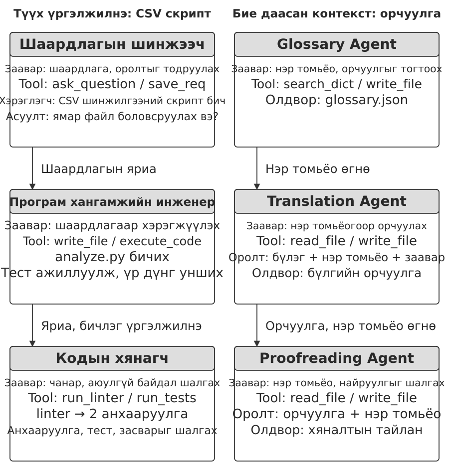

Context тус тусдаа байхад гишүүд материалаа хэрхэн солилцох вэ? Тархмал системд хуваалцсан хадгалалт эсвэл мессеж дамжуулалтаар харилцах нь түгээмэл. Agent-ийн системд ч эдгээр хоёр санаа хэрэгтэй бөгөөд тодорхой арга нь:

- **Tool дуудлагын параметр.** Доод урсгалын Agent-ийг Tool болгон боож, дээд урсгал параметрээр даалгавар ба бүтэцтэй материал дамжуулж, үр дүнг хүлээн авна.
- **Хуваалцсан файлын систем.** Нэг тал баримт бичиг, код эсвэл өгөгдөл бичиж, нөгөө тал ишлэлээр уншина; том завсрын бүтээгдэхүүн ба удаан хадгалах шаардлагатай материалд тохиромжтой.
- **Мессежийн шугам (Message Bus).** Agent мессежээ дамжуулах үйлчилгээнд илгээж, үйлчилгээ зорилт эсвэл захиалгын харьцаагаар хүргэнэ; олон гишүүний хоорондын асинхрон харилцаанд тохиромжтой.

Жишээлбэл, дээд урсгал орчуулгын даалгавар илгээсний дараа орчуулга буцаж ирэхийг хүлээж болно, эсвэл эхлээд даалгаврын дугаар аваад өөр бүлэг рүү шилжиж болно. Хоёр орчуулагч нэг файлыг нээж чаддаг байсан ч систем хэн бичих, нөгөө нь хэзээ унших вэ гэдгийг тохиролцох хэрэгтэй хэвээр. Go-ийн олон нийт хуваалцсан өгөгдөлд хандахыг харилцаагаар зохион байгуулахыг онцолдог бөгөөд энэ санаа Agent-д ч хамаатай: төлвийг хэн эзэмших, хэн өөрчилж болох, бусад гишүүд шинэчлэлтийг хэрхэн авахыг тодорхой болгоно.

### Хоёрдугаар хэмжүүр: хамтын ажиллагааны топологи

Хамтын ажиллагааны топологи нь Agent-уудын хоорондын даалгаврын хамаарал, мэдээллийн урсгал ба удирдлагын харьцааг тодорхойлно. Энэ бүлэг гурван ердийн зохион байгуулалтын хэлбэрийг ашиглана:

- **Тэнцүү түвшний хамтын ажиллагааны хэв маяг** (Peer Collaboration Pattern). Цөөн гишүүн нэг бүтээгдэхүүний эргэн тойронд дахин дахин хамтран ажиллана. Жишээлбэл, ноорог бичигч өгүүллийн ноорог бичиж, шүүмжлэгч засварын санал өгч, дараа нь ноорог бичигч засварлана.
- **Удирдагчийн хэв маяг** (Orchestration Pattern). Төвлөрсөн Manager Agent даалгаврыг задлах, хуваарилах ба нэгтгэхийг хариуцаж, дэд Agent-ууд тус бүрийн мэргэжлийн ажлыг гүйцэтгэнэ.
- **Төвлөрсөн бус хэв маяг** (Decentralized Pattern). Гишүүд үүрэг, мессеж ба хэсэгчилсэн төлөвтөө тулгуурлан ажлыг залгамжлан, ажлыг хэрхэн урагшлуулахыг хамтдаа шийднэ.

> **Нэр томьёоны тайлбар: Graph инженерчлэл.** Бүлэг 1-д 2026 оны 7 дугаар сард өрнөсөн Graph инженерчлэлийн хэлэлцүүлгийг танилцуулсан. Энэ хандлага гүйцэтгэлийн графт анхаардаг: зангилаа нь Agent, энгийн программ эсвэл хүний шийдвэр байж болох бөгөөд ирмэг хамаарал, нөхцөлт чиглүүлэлт ба бүтэлгүйтлийн дараах боловсруулах чиглэлийг илэрхийлж, төлөв гүйцэтгэлийн харьцааг дагаж дамжина. Олон Agent-ийн хамтын ажиллагааны топологи нь энэ дизайны хандлагын нэг хэрэглээ бөгөөд олон шийдвэрийн нэгж хэрхэн хүлээлгэн өгөх, зэрэгцэх ба санал хүсэлт өгөхөд гол анхаарлаа хандуулдаг.

Тэнцүү түвшний хамтын ажиллагаа, удирдагч ба төвлөрсөн бус дизайныг хослуулан ашиглаж болно. Жишээлбэл, Manager нэг бичих даалгаврыг ноорог бичигч—хянагчийн бүлэгт өгч, бүлэг дотоод давталтаа дуусгасны дараа үр дүнгээ илгээнэ.

## Олон Agent хэзээ ганц Agent-аас илүү вэ

Анхны ноорог нэг техникийн үгийг буруу орчуулсан гэж бодъё. Хоёр хянагчид ижил ноорог өгвөл хоёр удаа ижил зөвшөөрөл авч болно; тэдний нэгэнд эх бичвэр, нэр томьёоны жагсаалт ба тэр үгийг ашигласан кодыг зэрэг өгвөл алдааг олох нэг шинэ зам нэмэгдэнэ. Хамтын ажиллагааны аргыг сонгохдоо эхлээд асуу: нэмсэн Agent даалгаварт юу авчирсан бэ? Тэр шинэ нотолгоо олж, өөр хайлтын замыг хамарч, өөр мэргэжлийн дүгнэлт өгч, эсвэл зэрэгцээ гүйцэтгэлээр хүлээх хугацааг богиносгож болно.

Зохиогч эхлээд **санал хүсэлтийн мэдээллийн нэмэгдэл**-ийг шалгаж, дараа нь зэрэгцээ ажиллагаа ба Context-ийн тусгаарлалт хэр их ашиг авчрахыг харна. Хянагч тестийн үр дүн, хуудасны дэлгэцийн зураг эсвэл гадаад материал уншсаны дараа үүсгэх үед хараахан байгаагүй нотолгоонд тулгуурлан засвар санал болгож чадна. Хүснэгт 10-1 хэд хэдэн түгээмэл нөхцөлөөр ийм нэмэгдлийг хэрхэн шалгахыг харуулна.

Хүснэгт 10-1 Олон Agent-ийн хамтын ажиллагаа дахь мэдээлэл ба санал хүсэлт

| Хамтын ажиллагааны хэв маяг | Мэдээллийн гол эх сурвалж | Үнэлгээний гол зүйл |
|---|---|---|
| Нэг Model өөрийн гаралтыг дахин хянах | Анхны материал ба нэг шинэ шалгалтын процесс | Орхигдсон зүйлийг олж чадах эсэх, засвар үр дүнг сайжруулсан эсэх |
| Олон Agent нэг асуудлаар мэтгэлцэх | Тус бүрийн бодох зам, таамаглал ба үндэслэл | Үзэл бодол ялгаатай эсэх, хэрхэн баталгаажуулж хариултаа сонгох |
| Хянагч тест ажиллуулж кодыг шалгах | Хөрвүүлэлт, тест ба ажиллагааны санал хүсэлт | Засвар тестийг давж, байгаа функцийг хадгалж чадах эсэх |
| Хянагч урд талын хэсэг эсвэл PPT-ийн дүрслэлийг харах | Дэлгэцийн зураг ба харилцан үйлчлэлийн санал хүсэлт | Зохиомж, агуулга ба үйлдэл шаардлагад нийцэж буй эсэх |
| Хянагч гадаад Tool-оор баримтыг баталгаажуулах | Хайлт ба бизнесийн системийн бичлэг | Эх сурвалж найдвартай эсэх, дүгнэлт нотолгоотой нийцэж буй эсэх |

RLEF бататгах сургалтаар Model-д кодын гүйцэтгэлийн санал хүсэлтийг ашиглахыг сургаж, өрсөлдөөнт програмчлалын даалгаварт олон алхамт засвар хийхийг сургасан. Хөрвүүлэлтийн алдаа, тестийн бүтэлгүйтэл ба ажиллагааны алдаа дараагийн засварт тодорхой үндэслэл өгдөг бөгөөд өгүүлэл дэх Model цөөн түүвэрлэлтээр илүү сайн үр дүнд хүрсэн.[^rlef-2025] WebGen-Agent вэб хуудасны дэлгэцийн зураг, харааны Model-ийн тайлбар ба санал, GUI үйлдлийн үнэлгээг үүсгэх урсгалд холбож, өмнөх алхам руу буцаж дахин хийх, эсвэл хэд хэдэн үүсгэсэн үр дүнгээс сайныг нь сонгож чадна. WebGen-Bench дээр Claude 3.5 Sonnet-ийн нарийвчлал 26.4%-иас 51.9% болж өссөн.[^webgen-agent-2025]

[^rlef-2025]: Gehring, J., et al. *RLEF: Grounding Code LLMs in Execution Feedback with Reinforcement Learning.* arXiv:2410.02089, 2025.
[^webgen-agent-2025]: Lu, Z., et al. *WebGen-Agent: Enhancing Interactive Website Generation with Multi-Level Feedback and Step-Level Reinforcement Learning.* arXiv:2509.22644, 2025.

Зохиогч эхлээд системд тест, дэлгэцийн зураг эсвэл Tool-ийн буцаалт зэрэг тодорхой нотолгоо авахуулж, дараа нь үүсгэх, гүйцэтгэх ба хянах үүргийг хэрхэн хуваарилахаа шийддэг. Санал хүсэлтийн давталтыг нэг Agent гүйцэтгэж ч болно, олон үүрэгт хувааж ч болно; үүрэг нэмэх нь нотолгоог олж авах ба ашиглахыг сайжруулах ёстой.

Anthropic-ийн 2026 оны аюулгүй байдлын судалгаа хамтын хайлтын жишээ өгсөн: 45 Agent хуваалцсан форумаар олсон зүйлээ солилцож, бие биеэ хянаад, бие даасан Agent үр дүнг шүүн тогтоосон. Судалгааны тайланд хамтын кластер 27 сая token зарцуулж 266 эмзэг цэг олсон бол бие даасан зэрэгцээ хувилбар 6.5 сая token зарцуулж 21-ийг олсон. Форум гишүүдэд бусдын олсон зүйлийг дагаж үргэлжлүүлэн шалгах, аль чиглэлд аль хэдийн хүн ажиллаж байгааг мэдэх боломж олгосон. Хамтын бүлэг ойролцоогоор дөрөв дахин их token ашигласан тул 266 ба 21-ийн зөрүү харилцааны арга ба тооцооллын хөрөнгө оруулалтын ялгааг хоёуланг нь агуулна.[^anthropic-multiagent-2026]

[^anthropic-multiagent-2026]: Anthropic Frontier Red Team, “Patterns and Problems in Emerging Multiagent Systems,” 2026-08-13.

Математикийн судалгаанд олон баг үнэхээр өөр өөр замыг судлахыг хэрхэн хангах вэ? Гурван хэмжээст Навье–Стоксын тэгшитгэл зуурамтгай шингэний хөдөлгөөнийг тодорхойлдог. Гөлгөр анхны нөхцөлтэй үед шийд үргэлж гөлгөр хэвээр байж чадах уу? OpenAI эсрэг хоёр зорилгыг өөр өөр бүлэгт хуваарилсан: зарим нь гөлгөр байдлыг батлахыг, зарим нь эсрэг жишээ бүтээхийг оролдсон. Бүлэг бүр эхлээд бие даан судалж, дараа нь баг Codex-оор завсрын үр дүнг нэгтгэж, бусад бүлгүүдэд ч ирээдүйтэй сэжүүрийг дагах боломж олгосон. Эсрэг жишээ олсон бүлэгт ойролцоогоор арван мянган Agent зэрэг ажилласан. Эхний Agent-ууд эхэлснээс баталгаа олох хүртэл баг ойролцоогоор 88 цаг зарцуулсан гэж мэдээлсэн бөгөөд Lean формалчлал ба баталгаажуулалтад нэмж 17 цаг зарцуулсан. Эсрэг жишээ нэг чухал нөхцөлтэй: шингэн гөлгөр гадаад хүчний нөлөөнд байсаар төгсгөлөг хугацаанд онцгой цэг үүсгэж чадна. Үүнд тулгуурлан баг Клэйн Математикийн Хүрээлэнгийн асуудлын томьёолол дахь C, D хоёр хэлбэрийн шаардсан эсрэг жишээг өгсөн; гадаад хүчийг хасвал өөр асуудал болно. Ийм хайлтыг зохиохдоо эхлээд ямар үр дүн эх асуултад хариулахад хангалттай болохыг бичиж, хоорондоо өрсөлдөх таамаглалуудыг өөр өөр бүлэгт өгч, эцсийн баталгаажуулалтад тусад нь хугацаа үлдээж болно.[^ch10-ns-search]

[^ch10-ns-search]: OpenAI-ийн «On the Navier–Stokes Millennium Prize Problem» судалгааны тайлбарт баталгаа ба Lean код хавсаргасан. Клэйн Математикийн Хүрээлэн 2026 оны 9 дүгээр сарын 11-ний мэдэгдэлдээ энэ ажилд хариу өгч, үр дүнгийн үнэлгээ ба шагналын асуудлыг шагналын журмын дагуу шийдвэрлэнэ гэж тайлбарласан.

**Алхмын төсөв гүйцэтгэлд хэрхэн нөлөөлөх вэ?** Нэг даалгавар 30 алхам зөвшөөрдөг гэж үзвэл Agent төлөвлөлт, гол хэрэгжүүлэлт ба шаардлагатай баталгаажуулалтыг нягт зохион байгуулах ёстой; 300 алхам зөвшөөрвөл илүү олон хувилбарыг харьцуулж, илүү бүрэн тест ба засвар хийх зай гарна. Энэ нөөцийг сайн ашиглахын тулд Agent нийт төсөв ба үлдсэн төсвийг мэдэж, түүндээ тулгуурлан хайгуулын гүнийг зохицуулах хэрэгтэй.

Google 2025 оны «Budget-Aware Tool-Use Enables Effective Agent Scaling» өгүүлэлдээ энэ асуудлыг судалсан: төсвийн ухамсаргүй Agent гүехэн хайлтад хурдан зогсож болох бөгөөд ашиглаж болох алхмыг нэмсэн ч гүйцэтгэл цааш өсөхөд хэцүү. 2026 оны BAVT (Budget-Aware Value Tree Search) хайлтын алхамд үнэ цэнийн үнэлгээ ба үлдсэн төсвийг хослуулж, хайгуул ба ашиглалтын жинг тохируулдаг. Төсөв хангалттай үед олон чиглэлийг харьцуулж, төсвийн дээд хязгаарт ойртоход нөөцийг ирээдүйтэй салбарт төвлөрүүлнэ.

Удирдагчийн хэв маягт энэ нь Manager даалгаврын хүндрэлээр алхам хуваарилж, явцын дагуу тохируулах ёстой гэсэн үг: энгийн даалгаврыг аль болох хурдан хүлээлгэн өгч, нарийн төвөгтэй даалгаварт баталгаажуулалт ба засварын зай үлдээж, гацаатай тулгарвал эхлээд шалтгааныг тодорхойлоод, дараа нь мэдээлэл нөхөх, төсөв нэмэх эсвэл өөр зам сонгохоо шийднэ.

Зэрэгцээ хайгуул бодит хугацааг богиносгож, давтан хяналт бүтээгдэхүүнийг сайжруулж чадах ч хоёулаа Model-ийн дуудлага ба харилцааны зардлыг нэмнэ. Зохиогч сайн тохируулсан ганц Agent-ийг суурь шугам болгож, нэмсэн гишүүдийн авчрах чанарын өсөлт эсвэл хугацааны хэмнэлт харилцаа, давхар тооцоолол ба арчлалтын зардлыг нөхөхөд хангалттай үед л хамтын ажиллагааны хэмжээг өргөтгөдөг.

## Context хуваалцсан олон Agent-ийн хамтын ажиллагаа

Context хуваалцсан хамтын ажиллагаа үе шатаар үүргээ сольж, байгаа даалгаврын бичлэгийг үргэлжлүүлэн ашиглана. Судалгааны тайлангийн жишээгээр хайлтын үүрэг эхлээд материал цуглуулж, шинжилгээний үүрэг үргэлжлүүлэн тооцоолж, бичих үүрэг илэрхийллийг зохион байгуулна. Үүрэг бүр өмнөх эх сурвалж ба шийдвэрийг эргэн харж чадах бөгөөд систем одоогийн даалгаврын зааварчилгаагаар тухайн үе шатны зорилгод анхаарлыг нь чиглүүлнэ.

Багуудын хооронд хүлээлгэн өгөхдөө эхлээд асуу: анх яагаад ингэж шийдсэнийг хэн мэдэх шаардлагатай вэ? Teamily AI-ийн бүтээгдэхүүний жишээнд бүтээгдэхүүний менежер ба Agent бүлгийн ярианд хамтдаа бүтээгдэхүүний шаардлагын баримт бичиг (PRD) бичдэг. Бүтээгдэхүүний баг эцсийн хувилбарыг инженерийн багт хуваалцсаны дараа инженер нэг шаардлагын ард байгаа сонголтын талаар нэмж асууж чадна.

Хайлтын үүрэг даалгаврыг бичих үүрэгт шилжүүлэх жишээг авъя: хүлээлгэн өгсний дараа Model бичих журмыг хаанаас унших, ямар Tool дуудаж чадах вэ? Туршилт 10-1 ижил хүлээлгэн өгөлтийг хоёр аргаар хэрэгжүүлнэ.

| Хүлээлгэн өгөхөд шийдэх асуудал | Үүрэг солих (`transfer_to_agent`) | Skill ачаалах |
|---|---|---|
| Бичих журмыг хэрхэн өгөх вэ? | Бичих үүргийн System Prompt-оор солино | System Prompt дахь Skill-ийн каталогийг хадгалж, бичих журмыг мессежийн түүхийн төгсгөлд нэмнэ |
| Model ямар Tool харж чадах вэ? | Зөвхөн бичих үүргийн Tool-ийг харуулж болно | Анхны Tool-ийн багц эсвэл Tool хайлтын орох цэгийг үргэлжлүүлэн ашиглаж болно |
| KV Cache-ийн аль хэсэг ашиглагдах вэ? | System Prompt өөрчлөгдсөн тул угтвар өөрчлөгдсөн цэгээс ихэвчлэн дахин тооцох шаардлагатай | Анхны хүсэлтийн угтварыг үргэлжлүүлэн дахин ашиглаж болно |
| Дуудлагын эрхийг хэн шалгах вэ? | Harness одоогийн үүргээр хүсэлтийг шалгаад Tool-ийг хуваарилна | Harness дуудлага бүрийн эрхийг бие даан шалгана |

Үүргийн ялгаа голчлон мэдлэг, урсгал ба бичих хэв маягт байгаа бол зохиогч Skill-ийг түрүүлж ашигладаг: энэ нь нэг ажиллах фрэймворкийг дахин ашиглахад хялбар бөгөөд тогтвортой хүсэлтийн угтварын кэшийг хадгалж чадна. Үүргийн ялгаа эрх, Tool-ийн тусгаарлалт эсвэл зөвшөөрлийн үүрэгтэй холбоотой бол бие даасан Agent эсвэл үүрэг солих байдлаар зохион байгуулж, Harness ба гүйцэтгэлийн орчноор хандалтын хяналтыг хэрэгжүүлж болно. Tool Model-ийн оролтод харагдах эсэх нь дуудлагын сонголтод нөлөөлөх бол бодит эрхийг ажиллах үеийн шалгалт шийднэ.

> **Туршилт 10-1 ★★: Context хуваалцсан олон үүргийн шилжилт — System Prompt ба Skill-ийн харьцуулалт**
>
> Хоёр зам ижил Model, хэрэглэгчийн даалгавар, Tool-ийн хэрэгжүүлэлт, үүргийн журам ба хуваалцсан түүхийг ашиглана. Танилцуулах үзүүлбэр Хятадын 2021—2023 оны шинэ эрчим хүчний автомашины борлуулалтыг хайж, жилийн нийлмэл өсөлтийн хувь (CAGR)-ийг тооцоолоод, хөрөнгө оруулагчид зориулсан 120 тэмдэгтээс хэтрэхгүй хураангуй бичихийг шаардана.
>
> **Нэгдүгээр зам: System Prompt солих.** triage (шаардлага цуглуулах), research (хайлт), coding (програмчлал), data_analysis (шинжилгээ) ба writing (бичих) гэсэн таван үүрэг тогтооно. triage нь орох цэг бөгөөд үүрэг бүр өөрийн Tool ба `transfer_to_agent`-ийг харна. Шилжүүлэхдээ түүхийг хадгалж, зорилтот үүргийн Prompt ба Tool-ийн багцыг ачаалаад үргэлжлүүлэн ажиллуулна.
>
> **Хоёрдугаар зам: Skill ачаалах.** System Prompt ба Tool-ийн бүрэн багц сессийн турш тогтвортой хэвээр. Model `load_skill(name)`-ийг дуудаж үүргийн журмыг авах бөгөөд агуулга Tool-ийн үр дүн болж хуваалцсан түүхэд нэмэгдэж, анхны угтвар хадгалагдсаар байна. Harness эрхийн дүрмээр Tool дуудлага бүрийг шалгана.
>
> Хоёр хэрэгжүүлэлт ижил `SKILL.md`-г уншина. Нэг удаагийн үүргийн хүлээлгэн өгөлтийн өмнө ба дараа Model-д илгээсэн хүсэлтээс тус бүр нэгийг авч, журам аль мессежид гарч ирсэн, угтварын аль хэсгийг дахин ашиглаж болохыг хар. Дараа нь хоёр хураангуйг тулга: борлуулалтын эх сурвалж найдвартай юу? 2021 оны эцсээс 2023 оны эцэс хүртэл хоёр өсөлтийн үе байгаа бөгөөд жилийн нийлмэл өсөлтийн хувийг зөв тооцсон уу?
>
> Албан ёсны харьцуулалтад илүү хатуу нэг товч мэдээний асуулт байсан бөгөөд 160 тэмдэгтээр хязгаарлаж, хоёр эх сурвалжийн вэб хаягийг хадгалахыг шаардсан. Ижил найман алхмын боломж өгөхөд үүрэг сольсон бүлэг гурван дуудлагыг тэмдэгт тоолоход зарцуулсан бөгөөд ноорог 206 тэмдэгттэй хэвээр, асуултад заасан тооцооллын Tool-ийг ч ашиглаагүй. Skill ачаалсан бүлэг эхний ба сүүлийн жилийн борлуулалтаар өсөлтийн хувийг тооцоолсон бөгөөд найм дахь алхамд л бичих журмыг ачаалсан. Энэ үед явах ёстой үүргүүдийг бүгдийг нь дамжсан ч хэрэглэгч хураангуйг хараахан аваагүй байв. Хоёр траектор хоёулаа алхмын дээд хязгаарт хүрснээр дууссан.
>
> Ижил 30 даалгаврыг хоёр хэрэгжүүлэлтээр тус бүр ажиллуулж, хүлээлгэн өгсөн үр дүнг программаар шалгахад Skill ачаалсан бүлэг 15-ыг, System Prompt сольсон бүлэг 2-ыг давсан. Гэхдээ асуулт бүрээр харьцуулахад эхний бүлгийн кэшэд таараагүй оролт 6,855 token-оор илүү, зарцуулсан хугацаа ойролцоогоор 4.4 секундээр илүү байв (хоёулаа хосолсон зөрүүний медиан). Энэ удаа үйлчилгээ үзүүлэгч хоёр бүлгийн хүсэлтэд мэдээлсэн кэштэй оролтын token-ийн тоо хоёулаа тэг байв. Хоёр бүлэг заавар дагах 6 хилийн тестэд бүгдийг давсан бол бүрэн даалгаврын давах хувь эрс ялгаатай байв.

## Context хуваалцахгүй олон Agent-ийн хамтын ажиллагаа

Бие даасан Context-ийн архитектурт Agent бүр оролтын түүх, даалгаврын төлөв ба ажиллах давталтаа тусад нь хөтөлж, Tool-ийн параметр, хуваалцсан файл ба мессежээр шаардлагатай мэдээллийг солилцоно. Жишээлбэл, орчуулагчийн хүлээлгэн өгөх материал эх бичвэрийн догол мөр ба нэр томьёоны жагсаалтын хувилбарыг тэмдэглэх ёстой. Орчуулагч гарсан ч хянагч эх бичвэрийг олж чадна; дахин засах шаардлагатай бол бүлгээр нь хариуцагчийг олж чадна.

Хүснэгт 10-2 үйлдлийн системийн процессыг удирдах ба ажиллах орчны Agent-ийг удирдах аргыг харьцуулна.

Хүснэгт 10-2 Олон Agent-ийн систем ба үйлдлийн системийн дизайны зүйрлэл

| Үйлдлийн систем | Олон Agent-ийн систем дэх ойролцоо үүрэг |
|---|---|
| Программ ба тохиргоо | System Prompt, Tool-ийн тодорхойлолт ба үүргийн тохиргоо |
| Процессын санах ой | Одоогийн Context, даалгаврын төлөв ба түүхэн бичлэг |
| CPU тооцоолол гүйцэтгэнэ | LLM шийдвэр үүсгэж, ажиллах орчин ба Tool харгалзах үйлдлийг гүйцэтгэнэ |
| Цөм ажиллагааг удирдана | Agent-ийн ажиллах орчин төлөв, хуваарилалт ба нөөцийг удирдана |
| Системийн дуудлага | Tool-ийн интерфэйсээр гадаад үйлдэл хүсэх |
| fork: дэд процесс үүсгэх | `spawn_subagent`: дэд Agent үүсгэх |
| kill: дохио илгээх | `cancel_subagent`: цуцлалт хүсэх |
| ps: процесс асуух | `list_agents`: гишүүд ба ажиллагааны төлвийг асуух |
| Гарах төлөв ба wait | Дуусах мэдэгдэл, даалгаврын төлөв ба бүтэцтэй үр дүн |
| Хуваалцсан хадгалалт ба мессеж дамжуулалт | Хуваалцсан файл, Tool-ийн параметр ба мессеж |

Хувийн төлөв, асинхрон мессеж ба гишүүдийг динамикаар үүсгэх нь 1970-аад онд санал болгосон Actor загварт ч гарч ирдэг.[^actor-model]

[^actor-model]: Hewitt, C., Bishop, P., Steiger, R. *A Universal Modular ACTOR Formalism for Artificial Intelligence.* IJCAI 1973.

Бие даасан дэд даалгавар олон үед зохиогч гишүүн бүрт бие даасан Context тохируулж, зөвхөн үүрэгтэй нь холбоотой материалыг боловсруулуулахыг илүүд үздэг. Ингэснээр үүрэг бүрийг тусад нь туршихад хялбар болж, өмнөх үе шатны урт түүх одоогийн дүгнэлтэд саад болохыг багасгаж, олон даалгаврыг зэрэг урагшлуулж чадна. Тусгаарлалтын үр нөлөө бусад хуваалцсан нөөцөөс ч хамаарна: олон Agent нэг файлыг зэрэг өөрчлөх, нэг API-ийн квотыг зарцуулах, эсвэл нэг алдаатай мессежийг хүлээн авах боломжтой хэвээр.

Хамтын ажиллагааны интерфэйс мессеж алдагдах, давхар хүргэгдэх ба төлөв хоцрохыг ч боловсруулах ёстой. Асуудлыг шалгахдаа даалгаврын танигчаар гишүүн бүрийн хүсэлт, Tool-ийн үйл явдал ба үр дүнг холбож, нэг хүлээлгэн өгөлтийн явцыг сэргээн бүтээж болно.

Нэг Agent шинжилгээгээ дуусгаад үр дүнгээ тайлан бичих хамтрагчдаа өгөх гэж байна гэж бодъё. Тоон утга цөөн бол мессежтэй хамт илгээж болно; бүтээгдэхүүн том хүснэгт бол ихэвчлэн хүснэгтийг хуваалцсан файлын системд хадгалж, мессежид ишлэл хавсаргана. Үүнээс хоёр үүргийн хуваарь гарна. **Бүтээгдэхүүний хадгалалт** баримт бичиг, код ба өгөгдлийг хадгалж солилцох бол **харилцаа ба удирдлага** мессеж хүргэх, даалгаврын төлөв асуух, гүйцэтгэлийг цуцлах ба нөөцийг хуваарилахыг хариуцна.

### Agent-ийн харах файлын систем

Түгээмэл нэг дизайн бол Agent-д **виртуал файлын систем** (virtual filesystem) өгч, өөр өөр эх сурвалжийн нөөцийг нэгдсэн каталогийн модонд холбох явдал. Model `read_file`, `write_file` ба `list_dir` зэрэг интерфэйсээр хандах бөгөөд доод түвшинд локал түр диск, байнгын объектын хадгалалт, гуравдагч талын үүлэн дискний API эсвэл системийн нөөцийн багцтай холбогдож болно.

Зохиогч эхлээд хадгалах бүсүүдийг тодорхой хуваагаад, дараа нь хамтын ажиллагааны урсгалд холбодог. Түр ноорог, албан ёсны хүлээлгэн өгөх бүтээгдэхүүн ба хэрэглэгчийн гадаад файл холилдвол андуурч дарж бичих эсвэл эрхгүйгээр унших нь амархан. Нэгдсэн интерфэйс ашиглахад хялбар бөгөөд бүс бүрийн харагдах байдал, амьдралын мөчлөг ба эрхийг холболт ба хандалтын хяналтын тохиргоо шийднэ. Энэ каталогийн модыг дөрвөн төрлийн бүсэд хувааж болно.

**Нэг, Agent-ийн хувийн ажлын орон зай (Scratchpad).** Инстанс бүр өөрийн ажлын орон зайг ашиглаж, ноорог, түр файл, алдаа засах лог ба завсрын бүтээгдэхүүнийг хадгална. Анхнаасаа хандах хүрээг харьяалагдах Agent-аар хязгаарлаж, даалгаврын бодлогоор цэвэрлэх эсвэл архивлана. Ингэснээр түр файлууд бие биеэ дарж бичихээс сэргийлнэ; дэд Agent ажлаа дуусгасны дараа хүлээлгэн өгөх шаардлагатай үр дүнг хуваалцсан орон зайд байрлуулж, бүтэцтэй хураангуйтай хамт үндсэн Agent-д өгнө. Туршилт алдааны бичлэг анхны ажлын орон зайд үлдэж, дараагийн оношлогоонд ашиглагдана. Энэ нь Context-ийн тусгаарлалтыг хадгалалтын давхаргад ч хэрэгжүүлдэг: үндсэн Agent хүлээлгэн өгсөн үр дүн ба шаардлагатай нотолгоог авч, өдөр тутмын зохицуулалтад бүх туршилт алдааны явцыг унших зардлаас хэмнэнэ.

**Хоёр, олон Agent-ийн хуваалцсан орон зай (Shared Workspace).** Хамтран ажиллагч гишүүд энд бүтээгдэхүүнээ солилцох бөгөөд хэрэглэгч ч зөвшөөрөлтэй орох цэгээр материал байршуулж, хүлээлгэн өгсөн бүтээгдэхүүнийг татаж болно. Жишээлбэл, Glossary Agent нэр томьёоны жагсаалт бичиж, Translation Agent уншаад орчуулж, хянагч орчуулгыг шалгана. Хуваалцсан орон зай ихэвчлэн даалгаврыг дагаж байнга хадгалагдах бөгөөд зэрэгцээ бичилт, хувилбарын шинэчлэлт ба хандах хүрээг боловсруулах шаардлагатай. Бүлэг 6-д Agent ба виртуал компьютер хуваалцсан хадгалалтаар CSV ба график солилцсон нь бүтээгдэхүүний ийм хүлээлгэн өгөлтийн жишээ. Дараа нь өөдрөг түгжээ ба ажлын хуулбарын тусгаарлалт зэрэг аргыг танилцуулна.

**Гурав, гадаад холбосон нөөц (Mounted External Resources).** Google Drive, Notion, Dropbox ба байгууллагын Wiki зэрэг нөөцийг адаптераар нэгдсэн интерфэйс рүү буулгаж болно. Agent баримт бичиг уншихад адаптер эх системийн API-г дуудна. Энд гурван төрлийн ялгааг удирдах хэрэгтэй: хандах хүрээ гадаад зөвшөөрлөөс хамаарна; сүлжээний хандалт хоцрогдол, хугацаа хэтрэлт ба кэшийн шинэчлэлтийн асуудал авчирна; буцааж бичих үйлдэл эх системийн эрх ба хувилбарын дүрэмд нийцэх ёстой. Тодорхой нийцлийн утгыг үйлчилгээний интерфэйс тодорхойлох бөгөөд хувилбарын дугаар, нөхцөлт бичилт эсвэл дахин уншилтаар зэрэгцээ өөрчлөлтийг шалгаж болно. Хэрэгцээгээр зөвхөн уншихаар холбох нь материал хайхад тохиромжтой бөгөөд засварлах шаардлагатай үед л харгалзах бичих эрхийг олгоно.

**Дөрөв, системийн дотоод нөөц (Built-in System Resources).** Лавлах гарын авлага, загвар, Tool-ийн тодорхойлолт ба урьдчилан тохируулсан Skills-ийг олон Agent ашиглах зөвхөн унших нөөцийн багц болгож болно. Skills алхам алхмаар ил болгох байдлаар ачаалагдана: эхлээд каталог өгч, дараа нь даалгаврын дагуу журам ба скриптийг уншина. Тогтсон хувилбартай нөөцийн багц зэрэг уншихад хялбар бөгөөд шинэчлэхдээ хувилбар солих замаар ажиллаж буй даалгавруудыг нийцтэй байлгана.

Зураг 10-2-т орчуулагч өөрийн каталогт ноорогоо дахин дахин засаж болох бөгөөд хянагчид өгөхөд бэлэн болсон үед харгалзах хувилбарыг хуваалцсан бүсэд байрлуулна. Хэрэглэгчийн үүлэн дискэн дэх эх бичвэрийг гадаад адаптер уншдаг бөгөөд түүнд хандахад хэрэглэгчийн олгосон эрх ч хэрэгтэй.

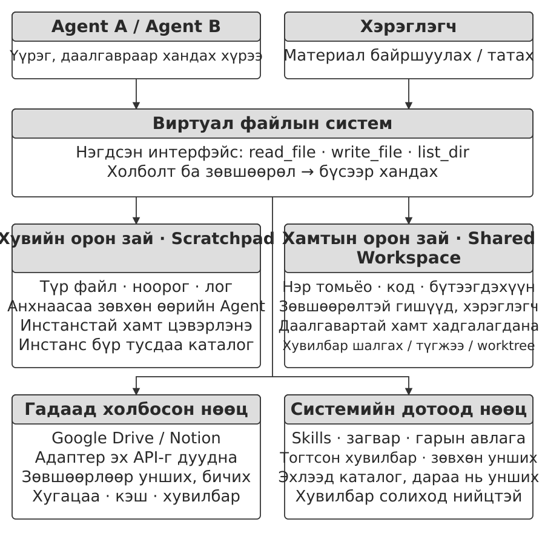

Орчуулагч гарсны дараа ажлын орон зай дахь түр файлууд дагаад суллагдаж болно. Хуваалцсан бүсэд байрлуулсан орчуулга үргэлжлэн хадгалагдаж, хянагч унших эрхээрээ ажлыг хүлээн авна (Хүснэгт 10-3).

Хүснэгт 10-3 Agent-ийн виртуал файлын системийн дөрвөн төрлийн бүс

| Бүс | Харагдах байдал | Амьдралын мөчлөг | Унших бичих | Зэрэгцээ удирдлага |
|---|---|---|---|---|
| Agent-ийн хувийн ажлын орон зай | Анхнаасаа зөвхөн харьяалах Agent | Инстанстай хамт цэвэрлэгдэж, хэрэгцээгээр архивлагдана | Харьяалах Agent унших бичих | Дахин оролдлого эсвэл арын үйлдэл давхар бичихээс сэргийлэх |
| Олон Agent-ийн хуваалцсан орон зай | Зөвшөөрөл авсан гишүүд ба хэрэглэгч | Даалгавартай хамт байнга хадгалагдана | Үүргээр зөвшөөрөл олгоно | Түгжээ, хувилбарын шалгалт эсвэл worktree |
| Гадаад холбосон нөөц | Гадаад зөвшөөрөл ба адаптер хамтдаа хязгаарлана | Эх систем ба кэшийн бодлого шийднэ | Хэрэгцээгээр зөвхөн унших эсвэл зөвшөөрөлтэй бичих | Эх системийн хувилбар ба зэрэгцээ интерфэйсийг дагана |
| Системийн дотоод нөөц | Зөвшөөрөл авсан Agent | Тогтсон хувилбар сесс хооронд дахин ашиглагдана | Зөвхөн унших | Нөөцийн хувилбарыг нэгдсэн байдлаар солих |

Файлын ишлэл хүлээлгэн өгөх мессежийг товч байлгаж чадна: дээд урсгал бүтээгдэхүүний байрлал, хувилбар ба зориулалтыг өгч, доод урсгал агуулгыг хэрэгцээгээр уншина. Нэг ажиллах орчинд байгаа гишүүд хуваалцсан замыг ашиглаж болно; байгууллага хоорондын хамтын ажиллагаанд ижил хүлээлгэн өгөлтийг хийхийн тулд хоёр тал задлан ойлгож чадах бүтээгдэхүүний танигч, хандах интерфэйс ба зөвшөөрөл хэрэгтэй.

### Agent хоорондын харилцаа ба удирдлага

Бүлэг 4-т танилцуулсан үүсгэх, харилцах, цуцлах ба олж илрүүлэх Tool нь олон Agent-ийн хамтын ажиллагаанд үндсэн удирдлагын интерфэйсийг өгдөг: `spawn_subagent` гишүүн үүсгэж, `send_message_to_subagent` мессеж дамжуулж, `cancel_subagent` цуцлалт хүсэж, `list_agents` гишүүдийг асууна. Эдгээр интерфэйсийн эргэн тойронд мессеж, төлөв, зогсоолт ба хуваарилалтын зан төлөвийг ч тохиролцох хэрэгтэй.

**Нэг, мессеж дамжуулалт.** Гишүүд цөөн, харьцаа тогтмол бол цэгээс цэг рүү интерфэйс ашиглаж болно, жишээ нь утасны Agent ба компьютерийн Agent явцаа шууд солилцоно. Бүх гишүүд хоорондоо хос хосоороо харилцах шаардлагатай бол боломжит харьцааны тоо гишүүдийн тооны квадратаар өснө; захиалгын харьцаа олон бол мессежийн шугам чиглүүлэлт, буфер ба дахин оролдлогыг нэгдсэн байдлаар удирдахад хялбар. Цэгээс цэг рүү ба шугам хоёулаа асинхрон хүргэлтийг хэрэгжүүлж чадах бөгөөд хүлээн авагч зэрэг онлайн байх шаардлагатай эсэх нь дараалал ба байнгын хадгалалтын механизмаас хамаарна.

Мессеж ихэвчлэн бүтэцтэй **дугтуй** (envelope)-тай байдаг: илгээгчийн ID, зорилтот Agent эсвэл нэвтрүүлгийн хүрээ, мессежийн төрөл ба ачаа. Мессежийн төрөлд `task_assigned`, `status_update`, `result` ба `terminate` орж болно. Даалгаврын танигч, мессежийн танигч ба холбогдох хүсэлт нь хүлээн авагчид давхардлыг арилгахад тусалж, алдаа засах хэрэгслийг харилцааны хэлхээг сэргээн бүтээх боломжтой болгоно. Бизнесийн агуулгыг JSON ачаанд байрлуулж, хоёр тал тохиролцсон талбараар боловсруулна.

Жишээлбэл, нэг орчуулгын хүлээлгэн өгөлтийг редактор хариуцдаг бөгөөд редактор нэр томьёо хянах Agent-аар нэг үгийг тулгуулахыг хүсэж байна. Multica-ийн ажлын захиалгын сэтгэгдэлд түүнийг нэрээр нь дурдаж (`@`) асуултаа бичвэл хяналтын ажлыг өдөөж болно. Хяналтын санал энэ ажлын захиалгад шууд хариу болж бичигдэх бөгөөд хариуцагч нь редактор хэвээр, ажлын захиалгын төлөв ч анхны утгаа хадгална. Хянагчаар бүх ажлын захиалгыг хүлээн авуулахыг хүсвэл хариуцагчийг тодорхой өөрчлөх хэрэгтэй.[^ch10-multica]

[^ch10-multica]: Multica, сэтгэгдэлд Agent-ийг нэрээр дурдах; `d579273` хувилбарын сэтгэгдэл хуваарилах хэрэгжүүлэлт.

**Хоёр, төлөв олж авах.** Үндсэн Agent дэд даалгавар ажиллаж байгаа эсэх, оролт шаардлагатай эсэх, үр дүнг авч болох эсэхийг мэдэх хэрэгтэй. Төлвийн интерфэйс, үйл явдлын мэдэгдэл ба явцын файлыг хослуулан ашиглаж болно: ажиллах орчны интерфэйс амьдралын мөчлөгийн төлвийг өгч, мессеж бизнесийн явцыг тайлбарлаж, байнгын файл сэргээж болох бичлэгийг хадгална.

`get_subagent_status(agent_id)` нь ажиллаж байгаа, оролт хэрэгтэй, дууссан эсвэл бүтэлгүйтсэн зэрэг төлвийг буцааж болно. Өдөр тутмын зохицуулалтад зохиогч дуусах мэдэгдэл ба үе шатны явцын мессежийг түрүүлж ашиглаж, үндсэн Agent-д өөрийн ажлаа үргэлжлүүлүүлдэг. Мэдэгдэл хоцорсон, холболт сэргэсэн эсвэл асуудал шалгах шаардлагатай үед л идэвхтэй асууж, Model-ийн дуудлагыг «дууссан уу?» гэж байнга асуухад зарцуулахаас сэргийлнэ. Төлвийн интерфэйсийг ажиллах орчин хөтөлдөг бөгөөд процесс амьд эсэх, даалгавар дууссан эсэхийг цаг тухайд нь мэдээлж чадна.

**Мессежээр явц солилцох.** Үндсэн Agent одоогийн явцыг асууж, дэд Agent тохирох алхамд хариулж болно; дэд Agent ч үе шатны үр дүн авсан, гацаатай тулгарсан эсвэл тусламж хэрэгтэй үед `status_update`-ыг өөрөө нийтэлж болно. Мессежийн агуулга дууссан ажил, дараагийн алхам ба гацааны шалтгааныг тайлбарлах ёстой бөгөөд гишүүд нэг төлвийн нэрсийг ашиглаж, нэгтгэх ба дүгнэхэд хялбар болгоно. Дараах A2A протокол даалгаврын амьдралын мөчлөгийн стандартчилсан илэрхийллийг танилцуулна.

**Файлаар явц хадгалах.** Систем мессеж, Tool-ийн хүсэлт, Tool-ийн үр дүн ба төлвийн өөрчлөлтийг үйл явдлын дарааллаар логт нэмж болно, жишээ нь мөр бүрт нэг үйл явдал бүхий JSONL форматаар. Оношлох эрх авсан үндсэн Agent эсвэл ашиглалтын хэрэгсэл үүнд тулгуурлан дахин оролдлого, алдаа ба хүлээлтийн явцыг шалгаж болно. Model-ийн оролтын түүх нь ажиллагааны траекторын зөвхөн нэг хэсэг бөгөөд лог хуваарилалт ба гадаад гүйцэтгэлийн үйл явдлыг ч тэмдэглэж болно.

Бүрэн траектор хэдэн арван мянган token агуулж болох бөгөөд үндсэн Agent удаа бүр уншаад төлвийг дахин гаргах шаардлагатай болно. Мессеж үндсэн Agent-д шинэ явц гарсныг мэдэгдэж, товч явцын файл одоогийн төлвийг хадгалж, дараагийн асуулга ба сэргээлтэд ашиглагдана. Зохиогч өдөр тутмын зохицуулалтыг эдгээр хоёрын хослолоор түрүүлж гүйцэтгэдэг. Дэд Agent нэг ажил дуусгах бүрт даалгаврын жагсаалт, бүтээгдэхүүний ишлэл ба одоогийн гацааны цэгийг шинэчилж, үндсэн Agent эдгээр талбараар дараагийн алхмаа шийднэ. Дэлгэрэнгүй траекторыг хэрэгцээтэй үед шалгахад хадгална. Явц удаан хугацаанд өөрчлөгдөхгүй бол зүрхний цохилт, Tool дуудлагын төлөв ба даалгаврын хугацааны хязгаарыг хослуулан оролцох шаардлагатай эсэхийг шийдэж болно: удаан ажилладаг Tool ажилласаар байж болох тул төлвийг баталгаажуулсны дараа хүлээх, цуцлах эсвэл дахин оролдохоо шийднэ.

**Гурав, гүйцэтгэлийг зогсоох.** Олон гишүүн нэг зорилтыг зэрэг хайж байх үед тэдний нэг нь даалгаврыг гүйцэтгэсний дараа бусад салбарыг зогсоож, төсөв ба Tool-ийн нөөцийг чөлөөлж болно. Цуцлалт хоёр түвшний хүчтэй бөгөөд Unix дахь SIGTERM ба SIGKILL-ийн үүрэгтэй ойролцоо.

Зохиогч **зөөлөн зогсоолт**-ыг түрүүлж ашигладаг: ажиллах орчин цуцлах хүсэлтийг дамжуулж, дэд Agent аюулгүй цэгт шинэ үйлдлийг зогсоож, шаардлагатай явцаа хадгалж, хөтчийн сессийг хааж, түгжээг суллаад баталгаажуулалт (ack) буцаана. **Хүчээр зогсоолт** нь цуцлалтын хугацаа хэтэрсэн ч хариу өгөөгүй гүйцэтгэлд хэрэглэгдэх бөгөөд ажиллах орчин процессыг дуусгаад, үлдсэн нөөц ба дуусаагүй бичилтийг шалгана. Гадаад системд аль хэдийн илгээгдсэн үйлдлийн үр дүнг асууж, шаардлагатай бол нөхөн олговрын урсгалыг гүйцэтгэх хэрэгтэй.

Амьдралын мөчлөгийг үүсгэсэн харьцааг дагаж удирдах хэрэгтэй. Go-ийн context-ийг үлгэрлэн эцэг даалгаврын цуцлах дохиог бүх дэд даалгаврын мод руу доош тархааж, ажиллах давталт аюулгүй цэгт цуцлах дохиог шалгах бөгөөд энэ нь `ctx.Done()`-ийн зориулалттай харгалзана. Ингэснээр эцэг даалгавар дууссаны дараа түүний эхлүүлсэн салбарууд ч цэвэрлэх урсгалд орж, удирдлагагүй Agent Tool-ийг үргэлжлүүлэн дуудаж, төсөв зарцуулахаас сэргийлнэ. Урт хугацаанд бие даан ажиллах шаардлагатай арын даалгаварт бие даасан амьдралын мөчлөгийн Context үүсгэх нь `context.Background()` ашиглахтай төстэй бөгөөд хяналт, төсөв ба цэвэрлэгээг хариуцах удирдагчийг зэрэг заана.

**Дөрөв, нөөц ба хуваарилалт.** Agent-ийн систем token, алхам, зэрэгцээ ажиллагааны квот, Tool-ийн холболт ба тооцооллын нөөцийг хуваарилах шаардлагатай. Дэд даалгавар эхлүүлэхдээ төсөв ба хэтэрсэн үеийн зан төлөвийг тогтоож; даалгаврын хүндрэлээр Model сонгож; зэрэгцээ дуудлагыг хязгаарлаж үйлчилгээний квотыг нэг дор шавхахаас сэргийлнэ. Илүү яаралтай даалгавар ирэхэд тэргүүлэх ач нь бага даалгаврыг аюулгүй цэгт түр зогсоох эсвэл цуцлаад, явцыг хадгалж дахин хуваарилж болно.

Гурван салбар тус бүр нэг боломжтой шийдлийг шалгаж байгаа бөгөөд тэдний нэг нь гол сэжүүрийг аль хэдийн олж, сүүлчийн нэг баталгаажуулалт л дутуу байна гэж бодъё. Manager түүнд хэдэн алхам нэмж өгөхийн зэрэгцээ ахицгүй хоёр салбарыг дуусгаж болно. Квотыг ажиллах орчин хасна; нэг салбар цааш оролдохыг хүссэн ч төсөв дуусвал зогсох ёстой.

### Тэнцүү түвшний хамтын ажиллагааны хэв маяг: харилцан шалгах ба давтан сайжруулах

Тэнцүү түвшний хамтын ажиллагаанд ихэвчлэн хоёр гурван Agent нэг даалгаврын эргэн тойронд санал солилцож, бүтээгдэхүүнийг засварлана. Зохиохдоо эхлээд гишүүдэд өөр өөр үүрэг, материал ба Tool хуваарилж, бие даан дүгнэлт гаргуулаад, дараа нь үр дүнг нэгтгэж болно. Жишээлбэл, үүсгэгч хэрэгжүүлэлтэд, хянагч тест ба хэрэглэгчийн шаардлагад анхаарч; өөр мэргэжлийн гишүүд тус бүрийн салбарын хязгаарлалтыг шалгана. Model, оролт ба ажлын урсгал чинээ ижил байх тусам гишүүд ижил дүгнэлтийг давтах магадлал өндөр тул өнцөг ба нотолгооны ялгааг идэвхтэй зохиох хэрэгтэй.[^anthropic-multiagent-2026]

Нэг бүтээгдэхүүнийг дахин дахин сайжруулах даалгаврын хувьд зохиогч эхлээд хоёр гурван гишүүнтэй тэнцүү түвшний хамтын ажиллагаагаар эхлэхийг зөвлөдөг. Үүрэг, хүлээлгэн өгөх агуулга ба зогсох нөхцөл тодорхой болсны дараа туршиж болох давталт бүрдэх бөгөөд эхний үеийн зохицуулах ажил ч бага.

#### Loop инженерчлэл

Тэнцүү түвшний хамтын ажиллагаа түгээмэл нэг асуудлыг шийдэхэд тусалж чадна: **эрт зогсох**. Програмчлал ба хэрэглэгчийн өмнөөс ажил гүйцэтгэх жишээгээр эрт зогсохыг гурван төрлийн бичлэгээс илрүүлж болно.

- **Хэсэгчлэн дуусгаад бүгдийг дуусгасан гэж зарлах.** Coding Agent код бичиж дуусгасан ч тест ба байршуулалтын шалгалтыг орхисон; хэрэглэгч туслахад хоёр ажил даалгасан ч тэр эхнийхийг дуусгаад бүгдийг нь шийдсэн гэж мэдээлсэн. Даалгаврын жагсаалттай нэг нэгээр нь тулгаж, ажил бүрийн дууссан нотолгоог шалгах хэрэгтэй.
- **Нэг зам бүтэлгүйтсэний дараа эрт бууж өгөх.** Худалдагч материалыг маягтаар илгээх, эсвэл заасан имэйлээр хавсралт хүлээн авахыг шаардаж болно. Ийм хариу авбал худалдагчийн хүлээн авдаг аргаар үргэлжлүүлэн шийдвэрлэж болно. Бүтэлгүйтлийн шалтгааныг тэмдэглэж, өөр ямар зам туршиж үзэх нь зүйтэйг тодорхойлох хэрэгтэй.
- **Хэсэгчилсэн амжилтын дараа дараагийн алхмыг орхих.** Худалдагч буцаалтыг зөвшөөрсний дараа хэрэглэгчээс App-д баталгаажуулахыг шаардвал туслах энэ алхам ба үйлдлийн нөхцөлийг тайлбарлах хэрэгтэй. Төлбөрийн хөнгөлөлтийн жишээгээр, хэрэглэгчийн үйлчилгээний ажилтан утсаар амаар зөвшөөрвөл туслах энэ удаагийн хэлэлцээгээр амлалт авсныг хэрэглэгчид баталж болно. Ярианы бичлэг ажилтан юу хэлснийг нотлох бол дараагийн төлбөрт биелэгдсэн эсэхэд шинэ нотолгоо хэрэгтэй. Хянагч аль хэдийн олж авсан үр дүн, хэн юу хийх ёстой хэвээр, мөн ямар үр дүн түр харагдахгүй байгааг тус тусад нь тайлбарлах ёстой.

Эдгээр гурван төрлийн асуудал бүгд дуусах нөхцөлийг шалгаж болох үр дүнд хэрэгжүүлэхийг шаарддаг. **Loop инженерчлэл** Agent-ийг «дараагийн ажлыг тодорхойлох—гүйцэтгэх—баталгаажуулах—явцаа тэмдэглэх» давталтыг тасралтгүй давтуулж, үр дүнгээр үргэлжлүүлэх, хүлээх, шилжүүлэх эсвэл дуусгахыг шийдүүлэхэд анхаардаг. Инженер даалгаврын эх сурвалж, баталгаажуулах арга, байнгын төлөв ба зогсох нөхцөлийг зохиох хэрэгтэй. Хүний ажил ч дагаж өргөжинө: нэг дуудлагад Prompt бичихээс даалгаврыг тасралтгүй урагшлуулж чадах давталтыг зохиох руу шилжинэ. Addy Osmani 2026 оны 6 дугаар сард энэ нэрээр эдгээр практикийг авч үзэж, Boris Cherny-ийн туршлагыг иш татсан: ажлын төв аажмаар Agent-ийг хөдөлгөж чадах давталтыг зохиох руу шилжиж байна.[^loop-engineering-2026]

**Ийм давталтад зохиогчийн үзэж байгаагаар баталгаажуулагч ихэвчлэн гол гацаа болдог.** Баталгаажуулалт найдваргүй бол ээлжийн тоог нэмэх нь системд ижил төрлийн алдааг давтуулж, эсвэл эрт дууссан гэж зарлуулж болно. Тестийн үр дүн, бизнесийн төлөв ба хэрэглэгчийн баталгаажуулалт тус бүр өөрийн хүрээнд дууссан гэх үндэслэл өгнө; баталгаажуулалтын бүтэлгүйтэл дараагийн ээлжийн засварын оролт болно.

Практик нь нэрээсээ түрүүлсэн. Loop инженерчлэл гэдэг нэр түгээмэл болохоос өмнө зохиогч ба баг Pine AI-д давталт ба баталгаажуулалтаар эрт зогсохыг аль хэдийн шийдэж байсан. Санал гаргагч—хянагч нь ийм давталтыг зохион байгуулах түгээмэл нэг арга бөгөөд дараа дэлгэрүүлнэ.

[^loop-engineering-2026]: Osmani, Addy. “Loop Engineering”, 2026.

**LoopX: ээлж хоорондын ажлын төлвийг хадгалах.** LoopX зорилго, хил, хийх ажил, хаалга, нотолгоо ба квотыг байнгын удирдлагын хавтгайд байрлуулж, дараагийн ээлж эсвэл дараагийн гүйцэтгэгчийн ажлыг түүгээр зохицуулна. Урсгалыг ингэж нэгтгэж болно: **удирдлагын хавтгайн шийдвэр → Agent гүйцэтгэнэ → бие даасан баталгаажуулалт → баталгаажсан явцыг илгээнэ**.

Agent Tool дуудаж, дүгнэж, энэ ээлжийн үр дүнгээ хүлээлгэн өгнө. Удирдлагын хавтгай дууссан ажлыг тэмдэглэж, дараагийн ээлж хаанаас үргэлжлэхийг шийднэ. Баталгаажуулалт давбал дууссан төлвийг илгээж; бүтэлгүйтвэл засвар эсвэл дахин төлөвлөлтөд орно. Хүний хаалга, хүлээх нөхцөл ба төсвийн дээд хязгаар хамтдаа хэзээ үргэлжлүүлэн гүйцэтгэж болохыг шийднэ.[^loopx-framework]

[^loopx-framework]: LoopX, The local control plane for long-running AI agent work, v0.4.0.

**LongHorizon-Harness: аппликейшн хоорондын урт даалгаврыг холбох.** Энэ фрэймворк олон модалийн Computer Use-аас эхэлж, GUI, CLI, олон ширээний аппликейшн ба олон удаагийн Context шинэчлэлтийн хооронд даалгаврыг тасралтгүй гүйцэтгэхийг шийддэг. Энэ нь Manage–Execute–Audit (MEA) давталтыг ашигладаг: Manager анхны зорилго, баталгаажсан явц, бүтэлгүйтлийн нотолгоо ба үлдсэн ажилд тулгуурлан хүрээ нь тодорхой нэг дэд даалгавар үүсгэж; Executor шинэ Context-д GUI эсвэл CLI үйлдлийг гүйцэтгэж; Auditor зөвхөн унших байдлаар үр дүнг шалгаад, баталгаажсан явцыг дараагийн ээлжийн төлөвт бичнэ. Бүтэлгүйтлийн нотолгоо ч хамт хадгалагдаж, сэргээлт ба дахин төлөвлөлтөд ашиглагдана.

Фрэймворк адаптерын давхаргаар Claude Code, Codex CLI зэрэг гүйцэтгэлийн арын системийг дуудаж, гаднах даалгаврын удирдлагыг арын системийн ажиллах давталттай холбоно. Энэ зам урт даалгаврын тасралтгүй байдлыг баталгаажсан даалгаврын төлөвт хэрэгжүүлдэг. Гүйцэтгэлийн Context шинэчлэгдэж болох ч дараагийн ээлж зорилго, дууссан нотолгоо ба шийдэгдээгүй асуудалд тулгуурлан ажлаа үргэлжлүүлж, орчны өөрчлөлт анхны дүгнэлтэд нөлөөлсөн эсэхийг дахин шалгаж чадна.[^longhorizon-implementation]

Өгүүлэл Qwen 3.7-Plus ба Claude Code гүйцэтгэлийн арын системийг ижил байлгаж, гаднах давталтыг өөрчилсөн харьцуулалтад WeaveBench PassRate 51.8%-иас 80.7%, OSWorld 2.0-ийн хоёртын гүйцэтгэлийн хувь 2.8%-иас 8.3%, Terminal-Bench 2.1-ийн амжилтын хувь 69.7%-иас 77.2% болж өссөнийг мэдээлсэн. Харгалзах зардал даалгавраас хамаарч өөрчлөгдсөн: эхний хоёр бенчмарк суурь шугамын 2.3 дахин их нийт token ба 3.6 дахин их гаралтын token зарцуулсан; Terminal-Bench 2.1-ийн token-ийн зарцуулалт 24%-иар буурсан.

WebRTC-ийн олон давхар урсгалын аудитын нэг даалгаварт суурь шугамын гүйцэтгэгч Wireshark-ийн интерфэйс дээр гацаж, дараа нь хэд дахин оролдоод эцэст нь 0.59 оноо авсан. MEA ашиглахад хянагч дутуу нотолгоог тэмдэглэж, дараагийн ээлжийн гүйцэтгэгч түүний дагуу нөхөн шалгаж, эцэст нь 0.92 оноо авсан.

[^longhorizon-implementation]: LongHorizon-Harness, өгүүллийн дугаар arXiv:2608.01964. Суурь шугам ба MEA-ийн нийтэлсэн траектор хоёулаа WEB_task_16_webrtc_simulcast_layer_audit даалгавраас авсан бөгөөд дахин гаргах скрипт `53bc678` commit-ийг ашигладаг.

#### Санал гаргагч—хянагчийн хэв загвар

Санал гаргагч—хянагч нь бүтээгдэхүүн үүсгэх ба үр дүнг шалгахыг хоёр үүрэгт даатгадаг. Бүлэг 5-ын PPT үүсгэх, видео засварлах ба логийн дүрслэлийн туршилтууд энэ дизайныг ашигласан: Proposer код үүсгэж, Reviewer дүрсэлсэн үр дүнг харж, харааны Model-ийн тусламжтайгаар чанарыг шалгаад, бүтэцтэй засварын санал буцаана. Зураг 10-3-т засварын санал санал гаргагчид буцаж очих ёстой. Тэр үүнд тулгуурлан дараагийн хувилбарыг засаж чадах эсэх нь хянагч асуудлыг хэр нарийн байршуулж чадахаас хамаарна.

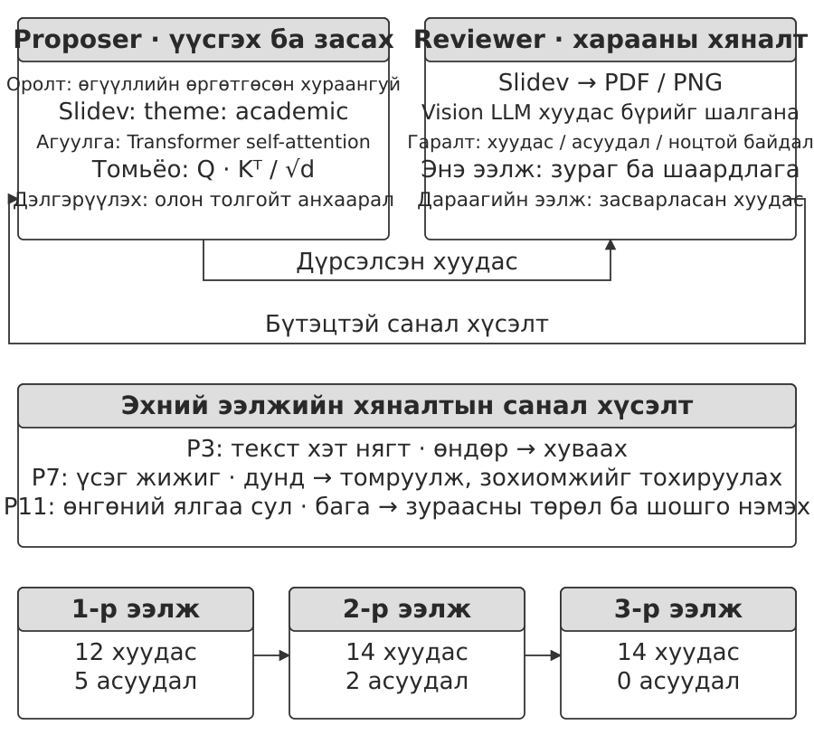

Шалгах объект өөрчлөгдвөл хянахдаа харах нотолгоо ч өөрчлөгдөх ёстой. Хэрэглэгчийн үйлчилгээний хариуг хянахдаа бизнесийн дүрэм ба баримтын эх сурвалжтай тулгах; кодын өөрчлөлтийг хянахдаа тест ба бодит гүйцэтгэлийн үр дүнг харах; үйлдлийн төлөвлөгөөг хянахдаа хамаарах стандарт ба урьдчилсан нөхцөлийг тулгах хэрэгтэй.

Huang нарын ICLR 2024-ийн «Large Language Models Cannot Self-Correct Reasoning Yet» өгүүлэл тэдний судалсан дүгнэлтийн даалгавар ба Prompt-ийн тохиргоонд GPT-4 гадаад санал хүсэлтгүйгээр өөрийгөө засахад зөв хариултыг буруу болгож, нийт нарийвчлал буурах тохиолдол гарсныг илрүүлсэн. TACL-ийн өөрийгөө засах тухай тойм даалгаврын нөхцөл ба санал хүсэлтийн найдвартай байдал засварын үр дүнд хэрхэн нөлөөлдгийг цааш авч үзсэн.[^self-correction-survey] Иймээс зохиогч бие даасан нотолгоо ба байршлыг нь тогтоож болох засварын нөхцөлийг хяналтын давталтын үндсэн шаардлага гэж үздэг. Хянагч бодит тест, орчны төлөв эсвэл дүрслэлийн үр дүнг уншиж чаддаг байх ёстой бөгөөд аль шаардлага хараахан хангагдаагүй, засварыг хэрхэн баталгаажуулахыг заах ёстой.

[^self-correction-survey]: Kamoi, R., et al. *When Can LLMs Actually Correct Their Own Mistakes? A Critical Survey of Self-Correction of LLMs.* TACL, 2024.

Бүрэн нэг давталтыг таван алхмаар зохион байгуулж болно:

1. Санал гаргагч даалгаврын шаардлагын дагуу эхний хувилбарыг бичнэ, жишээ нь нэг хариу эсвэл нэг хэсэг код.
2. Бүтээгдэхүүнийг гүйцэтгэх эсвэл дүрсэлж, тест, бизнесийн төлөв, дэлгэцийн зураг эсвэл баримтын шалгалтын үр дүнг авна.
3. Хянагч шаардлага ба нотолгоог тулгаж, давсан гэсэн дүгнэлт өгөх, эсвэл асуудлын байрлал ба засварын нөхцөлийг заана.
4. Төсөв үлдсэн бол санал гаргагч санал хүсэлтийн дагуу засварлаж, дахин гүйцэтгэж хянана; оролт эсвэл зөвшөөрөл шаардлагатай асуудалтай тулгарвал хүлээх эсвэл шилжүүлэх рүү орно.
5. Нийтлэх нөхцөлд хүрсний дараа хяналтыг давсан хувилбарыг баталгаажуулалтын нотолгоо ба хяналтын дүгнэлттэй хамт хүлээлгэн өгнө; төсөв дууссан бол явц ба шийдэгдээгүй асуудлыг хадгална.

Хянагч хамгаалагдсан тест ба нийтлэх шалгуурыг уншдаг бөгөөд түүний санал болгосон шалгуурын өөрчлөлтийг тусад нь хянана.

CRITIC-ийн туршилтад Model эхлээд хариулт өгч, дараа нь Tool-ийн тусламжтайгаар шалгасан.[^ch10-critic] Жишээлбэл, хайлтын системээр хариулт дахь баримтыг баталгаажуулж, Python тайлбарлагчаар өөрийн бичсэн математикийн программыг ажиллуулсан. Нээлттэй асуулт хариулт, математикийн программ үүсгэх ба хортой илэрхийллийг бууруулах гэсэн гурван төрлийн даалгаварт Model Tool-ийн санал хүсэлтээр засварласны дараа гүйцэтгэл бүгдэд сайжирсан. Зөвхөн Model өөрөө анхны хариултаа үнэлэх үед засах үр дүн сул байв. Энэ дизайн Бүлэг 5-ын PPT-ийн жишээтэй адил: дүрсэлсэн дэлгэцийн зураг кодын текстээс шууд дүгнэхэд хэцүү зохиомж ба давхцлын асуудлыг илрүүлж, тестийн гүйцэтгэл бодит ажиллагааны алдааг илрүүлнэ.

[^ch10-critic]: CRITIC, arXiv:2305.11738.

Anthropic-ийн 2026 оны урт хугацааны аппликейшн хөгжүүлэлтийн жишээ төлөвлөгч, үүсгэгч ба үнэлэгч гэсэн гурван Agent ашигласан. Төлөвлөгч шаардлагыг бүтээгдэхүүний тодорхойлолт болгон дэлгэрүүлж; үүсгэгч ба үнэлэгч эхлээд ээлж бүрийн дуусах шалгуурыг тохиролцоод, дараа нь тус тусдаа хэрэгжүүлж шалгадаг. Үнэлэгч Playwright-аар аппликейшнийг ажиллуулж, алдааны тайлан илгээх бөгөөд үүргүүд файлаар төлвөө хүлээлгэн өгнө. Энэ жишээ бүтээгдэхүүний тодорхойлолт, бодит үйлдэл ба алдааны санал хүсэлтийг хэрхэн холбохыг харуулсан бөгөөд нэмэгдсэн гүйцэтгэл ба хяналтын зардлыг хувилбаруудын харьцуулалтад оруулах хэрэгтэйг ч харуулна.[^anthropic-harness-2026]

[^anthropic-harness-2026]: Prithvi Rajasekaran, “Harness Design for Long-Running Application Development,” Anthropic Engineering, 2026-03-24.

2026 оны 11 дүгээр сарын 20-нд математикч Levent Alpöge Claude-тай хамтран олсон формал баталгаагаа нийтэлсэн бөгөөд энэ нь Риманы таамаглал ба түүний Дирихлегийн $L$ функцэд өргөтгөсөн хэлбэрийг хамарсан. Олон тооны Lean файл хүлээн авахад хянагч эхлээд хоёр асуулт тавих ёстой: эцсийн теорем анхны таамаглалыг бичсэн үү? Гаргалгааны алхам бүрийг баталгааны цөм дахин шалгаж чадах уу? MIT-ийн математикч Andrew Sutherland эхлээд илгээсэн теоремыг Lean-ийн математикийн сан дахь Риманы таамаглалын тодорхойлолттой тулгаж, дараа нь баталгааны тулгуурласан аксиомуудыг жагсаасан. Тэр тухайн өдөр нийтэлсэн бичлэгтээ бие даасан баталгааны цөм nanoda экспортолсон баталгааг шалгаж давсныг ч мэдээлсэн. Энэ нь хяналтын хуваарийн тодорхой аргыг өгнө: асуудлыг сайн мэддэг хүн эхлээд хүлээн авах өгүүлбэрийг бичиж, дараа нь бие даасан хэрэгсэл илгээсэн бүтээгдэхүүн энэ өгүүлбэрийг гаргаж чадах эсэхийг шалгана. Ирээдүйд математикчид зохиогч энэ замыг хэрхэн олсныг ойлгохыг хүсвэл хүнд уншихад хялбар нэг үндэслэл хэрэгтэй хэвээр.[^ch10-rh-review]

[^ch10-rh-review]: Levent Alpöge 2026 оны 11 дүгээр сарын 20-нд судалгааны тайлбараа нийтэлсэн. Баталгаажуулалтын зүйлс ба тухайн өдрийн явцыг Andrew Sutherland-ийн «Verification files for the Lean proof of the Riemann Hypothesis»-оос үз.

#### Мэтгэлцээний хэв маяг

Мэтгэлцээний хэв маяг гишүүдээр нэг асуудлыг өөр өөр байр сууринаас шалгуулдаг. Жишээлбэл, техникийн шийдлийг үнэлэхдээ нэг Agent ашиг ба хэрэглэх нөхцөлийг тайлбарлаж, нөгөө нь хязгаарлалт, бүтэлгүйтлийн нөхцөл ба өөр хувилбарыг шалгана. Ээлж бүр тодорхой үндэслэлийн эргэн тойронд нотолгоо нэмж эсвэл няцаалт гаргаж, эцэст нь зөвшилцөлд хүрсэн зүйл ба баталгаажуулах шаардлагатай зөрүүг нэгтгэнэ.

Ийм зохион байгуулалт эсрэг ба дэмжих үндэслэлийг тодорхой жагсаахад тусалдаг бөгөөд үр нөлөө нь үндэслэлийн чанар, бие даасан дүгнэлт ба эцсийн сонголтын аргаас хамаарна. Tran ба Kiela олон шатлалт дүгнэлтийн даалгаварт дараалсан, мэтгэлцээн, нийлбэр, зэрэгцээ үүрэг ба дэд даалгаврын зэрэгцээ гэсэн таван архитектурыг харьцуулсан; ижил сэтгэх token-ий төсвийг хянахад ганц Agent-ийн гүйцэтгэл олон Agent-тай тэнцүү эсвэл илүү байв.[^single-agent-2026] Үүнд тулгуурлан зохиогч мэтгэлцээнийг голчлон зөрүүг дэлгэх, таамаглалыг шалгах ба эсрэг үндэслэлийг нөхөхөд ашигладаг. Баримт эсвэл тооцооллын нарийвчлалыг зорих үед шалгаж болох нотолгоо ба бие даасан шалгалтыг түрүүлж нэмнэ.

Өгүүлэл өгөгдөл боловсруулах тэнцэтгэл бишээр завсрын мэдээлэл дамжуулалтын хязгаарыг авч үзсэн: дахин дахин тайлбарлах ба шахах нь анхны дэлгэрэнгүйг алдагдуулж болно. Инженерчлэлд мөрдөж болох эх сурвалжийг хадгалж, гишүүдээр эхлээд бие даан шинжлүүлээд, дараа нь дүгнэлтээ солилцуулж, шалгаагүй зөвшилцлийг бууруулж болно. Олон удаагийн бие даасан түүвэрлэлтийн дараах нэгтгэл, мөн «үүсгэх хэцүү, баталгаажуулах хялбар» даалгаврын онцлогийг ашиглан тусгай хяналт зохион байгуулахыг ч мэтгэлцээнтэй хослуулж болно.

[^single-agent-2026]: Tran, D., Kiela, D. *Single-Agent LLMs Outperform Multi-Agent Systems on Multi-Hop Reasoning Under Equal Thinking Token Budgets.* arXiv:2604.02460, 2026.

#### Санаа бодлын довтолгооны хэв маяг

Санаа бодлын довтолгоог хоёр ээлжид хувааж болно: эхлээд гишүүн бүрээр бие даан арга бодуулаад, дараа нь аль санааг хослуулж болохыг хамтдаа хэлэлцэнэ. Жишээлбэл, Agent 1 нийгмийн сүлжээнд хуваалцах функц нэмэхийг санал болгосон; Agent 2 үүнд тулгуурлан хувийн хуваалцах зурагт хуудсыг автоматаар үүсгэхийг санал болгосон; Agent 3 цааш нь хэрэглэгчийн өөрөө тохируулах загвар ба загварын зах зээлийг санал болгосон.

Гишүүдээр өөр өөр арга бодуулахын тулд тэднийг хэрэглэгч ба ашиглалтын ажилтны өнцгөөс тус тус эхлүүлж болох бөгөөд өөр өөр Prompt эсвэл Model өгч ч болно. Санаа солилцсоны дараа хэрэглэгчийн хэрэгцээ, хэрэгжүүлэх зардал ба баталгаажуулалтын үр дүнгээр шийдлийг шүүнэ.

#### Мэргэжилтнүүдийн бүлгийн хэв маяг

Мэргэжилтнүүдийн бүлэг салбар хоорондын асуудлын эргэн тойронд мэргэжлийн үүрэг хуваарилдаг. Жишээлбэл, шинэ бүтээгдэхүүнийг үнэлэхэд инженер Agent хэрэгжүүлэх хүндрэл ба техникийн хамаарлыг шинжилж, бүтээгдэхүүний Agent хэрэглэгчийн хэрэгцээ ба туршлагыг шалгаж, ашиглалтын Agent зардал, нөөц ба хэрэгжих нөхцөлийг тооцно.

LobeHub-ийн бүлгийн ярианд хөтлөгч нэг бүтээгдэхүүний шийдлийг эдгээр гурван мэргэжилтэнд нэвтрүүлж болно. Систем эхлээд тухайн агшны бүлгийн ярианы бичлэгийг авч, дараа нь гурван гишүүнээр тус бүрийн үүргийн тохиргоогоор зэрэг хариулуулна. Гурван хариу бүгд нэвтрүүлгийг эхлүүлсэн мессежийн доор хавсарч, хүн бүр аль асуултад хариулсныг эргэж тулгахад хялбар болгоно. Хэрэв ашиглалтын ажилтан инженерийн саяхан тооцсон хэрэглээгээр зардал тооцох ёстой бол энэ ээлжийн хариу бичигдсэний дараа ашиглалтын ажилтанд үг өгөх хэрэгтэй: хоёулаа зэрэг бичиж эхлэхэд ашиглалтын ажилтанд тэр тоо хараахан байхгүй.[^ch10-lobehub]

[^ch10-lobehub]: LobeHub, бүлгийн ярианы хэрэглэх заавар; `ab21e0d` хувилбарын зэрэгцээ нэвтрүүлгийн хэрэгжүүлэлт.

Нэгтгэхдээ дүгнэлтүүдийн хоорондын холбоог олох хэрэгтэй: нэг туршлагын зорилго ямар техникийн дэмжлэг шаардах, техникийн сонголт ашиглалтын зардлыг хэр нэмэх, ямар нөхцөлд гадаад нотолгоо хэрэгтэй хэвээр байгааг.

### Удирдагчийн хэв маяг: төвлөрсөн зохицуулалт

Даалгавар олон дэд даалгавар, нарийн төвөгтэй хамаарал эсвэл динамик хуваарилалт агуулах үед Manager Agent нэгдсэн байдлаар төлөвлөж болно. Тэр эхлээд нийт зорилгыг ойлгож, дараа нь ажлыг задлах, гишүүдийг сонгох, явцыг мөрдөх ба хэвийн бус байдалтай тулгарвал дахин оролдох, хүн солих эсвэл төлөвлөгөөг тохируулахыг шийдэж, эцэст нь үр дүнг нэгтгэнэ.

Түгээмэл нэг хэрэгжүүлэлт бол тусгай Agent-ийг Tool болгон бүртгэх явдал. Manager Tool-ийн интерфэйсээр даалгавар, хязгаарлалт ба шаардлагатай материалыг дамжуулж, бүтэцтэй үр дүн эсвэл даалгаврын танигчийг хүлээн авна. Ингэснээр хайлт, файлын үйлдэл ба дэд даалгавар шилжүүлэх нь ойролцоо дуудлагын аргыг ашиглаж болно; удаан үргэлжлэх дэд даалгаврын явц, цуцлалт ба дахин оролдлогыг тусад нь удирдана. Өөр өөр гишүүд өөр Model, Prompt, Tool ба ажиллах орчныг ашиглаж болно. Шинэ гишүүн нэмэхдээ интерфэйсийг бүртгэхээс гадна Manager-т түүний үүрэг, оролтын шаардлага ба хэрэглэх нөхцөлийг ойлгуулах хэрэгтэй.

Зохиогч Claude Code ба Codex-д урт даалгавар хийхдээ хэлэлцүүлэг, команд гүйцэтгэх ба тестийг бүгдийг үндсэн сесст байрлуулж байсан. Дундуур нь нэг дизайны сонголтын талаар нэмж асуухыг хүсвэл ихэвчлэн одоо хийж байгаа алхам дуусахыг хүлээх хэрэгтэй болдог; хэдэн цагийн дараа анхны тохиролцоог хайхад урт цуваа командын гаралтыг гүйлгэж үзэх шаардлагатай болдог байлаа. Дараа нь би засвар ба тестийг дэд Agent-д өгч, үндсэн сессийг хэлэлцүүлэгт үлдээсэн. Номын эхийг хянахыг жишээ болгоход гүйцэтгэгч зургийн дугаарыг үргэлжлүүлэн тулгаж байх зуур би уншигчидтай нэг догол мөрийг дахин бичих эсэхийг хэлэлцэж чадна. Хэлэлцүүлэг даалгаврын хүрээг өөрчилбөл шинэ тохиролцоог гүйцэтгэгчид илгээж, түүнийг хүлээлгэн өгөх үед тулгаж шалгах хэрэгтэй.

DeepSeek Harness баг нэг GitHub репозиторт зориулсан `dsh-superagent` судалгааны прототипийг нийтэлсэн. Экспортын файлын огнооны форматыг засах жишээгээр: арчлагч Issue-д шаардлага тавьж, чиглүүлэгч (Router) репозиторийн дүрмээр ажлыг хүлээн авч болох эсэхийг шийднэ. Хүлээн авсны дараа систем ажлын захиалга (Ticket) үүсгэж, гүйцэтгэгч (Worker)-т бие даасан сесс ба ажлын каталог хуваарилна. Гүйцэтгэгч өөрийн каталогт код засварлаж, тест ажиллуулж болно; өөр нэг ажлын захиалга зэрэг урагшилж, тус бүр засварын явц ба тестийн үр дүнгээ хадгална.[^ch10-dsh-prototype]

Арчлагч дараа нь анхны Issue-д «Зөвхөн CSV-г өөрчил, JSON-ий огнооны форматыг хадгал» гэж нэмсэн гэж бодъё. Энэ хэлэлцүүлгийг захиалсан ажиллаж буй ажлын захиалга нэмэлт мессежийг хүлээн авах бөгөөд гүйцэтгэгч үүнд тулгуурлан өөрчлөлтийн хүрээг нарийсгаж, хоёр форматыг тусад нь туршиж болно. Дууссаны дараа тэр татах хүсэлт (PR) нээж, холбоос ба үр дүнг анхны Issue-д буцааж нийтэлж болно. Арчлагч нэг газраас анхны шаардлага, сүүлд нэмсэн хязгаарлалт ба хянагдахыг хүлээж буй засварыг харж чадна; чиглүүлэгч ч дараах мессеж бүрийг дахин даалгавар болгон задлах шаардлагагүй.

[^ch10-dsh-prototype]: DeepSeek Harness баг, dsh-superagent судалгааны прототип. Ажлын захиалга дараах мессежийг хэрхэн хүлээн авахыг зөвшөөрөл ба захиалгаас, гүйцэтгэлийн сесс ба ажлын каталогийг гүйцэтгэлийн механизмаас үз.

Manager нэгэн зэрэг олон шийдвэрийн хариуцлага үүрдэг. Даалгаврыг буруу задлах нь дараах гүйцэтгэлд нөлөөлж, хүлээлгэн өгөх материал хангалтгүй бол дахин дахин асуулт үүсгэж, хэт олон дуудлагын бичлэг Context-ийг ч шахна. Зохиохдоо товч даалгаврын төлөв ба бүтээгдэхүүний индексийг хадгалж, дэлгэрэнгүйг хэрэгцээгээр уншиж, дэд даалгавар бүрт тодорхой оролт, гаралт ба дуусах шалгуур өгөх хэрэгтэй.

Plan-and-Act нь Planner—Executor архитектурт төлөвлөлтийн чанар урт даалгаварт хэрхэн нөлөөлдгийг судалж, WebArena-Lite дээр 57.58%-ийн амжилтын хувийг мэдээлсэн.[^plan-and-act-2025] Төлөвлөлтийн алдаа олон гүйцэтгэгчийг буруу задаргааг дагаж үргэлжлүүлэн ажиллуулах бөгөөд гишүүн нэмэх нь дахин ажиллалтыг өсгөнө. Иймээс зохиогч Manager-ийн даалгавар задлах чанарыг түрүүлж шалгадаг; гацаа төлөвлөлтөд байвал илүү хүчтэй Model, илүү бүрэн даалгаврын мэдээлэл ба илүү хангалттай дүгнэлтийн төсвийг Manager-т хуваарилна. Дэд даалгаврын хил тодорхой болсны дараа гүйцэтгэгчдэд тохирох тохиргоог сонгоно.

[^plan-and-act-2025]: Erdogan, L. E., et al. *Plan-and-Act: Improving Planning of Agents for Long-Horizon Tasks.* arXiv:2503.09572, 2025.

Зэрэгцээ даалгавар хэрхэн дуусахаа ч тодорхой болгох хэрэгтэй. Зорилго нь нөхцөлд нийцэх нэг үр дүн олох бол баталгаажуулалт давсны дараа анх баталгаажуулалт давсан үр дүнг атомар үйлдлээр бүртгэж, үлдсэн салбаруудыг цуцлаад, цуцлалтын баталгаажуулалт эсвэл хугацаа хэтрэхийг хүлээж, эцэст нь нэгтгэн хүлээлгэн өгч болно. Бүртгэх үйлдэл атомар ба идемпотент байх ёстой: хоёр үр дүн зэрэг ирэхэд төлөв зөвхөн нэг удаа шилжиж; нэг үйл явдал давтан хүргэгдэхэд өмнөх боловсруулалтын үр дүнг үргэлжлүүлэн ашиглана. Түгжээ, транзакц эсвэл харьцуулаад солих аргаар энэ алхмыг хамгаалж болно.

Python-д суулгагдсан SQLite-ээр нэг тодорхой хүлээлгэн өгөлтийг харж болно. А, Б хоёр гишүүн материалыг зэрэг тулгаж, тус бүрийн илгээсэн үр дүн баталгаажуулалтыг давсан гэж бодъё. Manager-т зөвхөн нэг шаардлага хангасан үр дүн хэрэгтэй бөгөөд хэн түрүүлж илгээснийг нэг даалгаврын мөрөөр тэмдэглэнэ. Дараах жишээнд А эхлээд, Б дараа нь илгээж, А дахин нэг удаа оролдсон.

```python
import sqlite3

db = sqlite3.connect(":memory:")
db.execute("CREATE TABLE task (id INTEGER PRIMARY KEY, winner TEXT)")
db.execute("INSERT INTO task VALUES (1, NULL)")
for worker in ["А", "Б", "А"]:
    with db:
        claimed = db.execute(
            "UPDATE task SET winner = ? WHERE id = ? AND winner IS NULL",
            (worker, 1),
        ).rowcount
    print(worker, "бүртгэгдлээ" if claimed else "бүртгэгдсэн үр дүнг ашиглана")
```

Гаралт дарааллаар «А бүртгэгдлээ», «Б бүртгэгдсэн үр дүнг ашиглана», «А бүртгэгдсэн үр дүнг ашиглана» гэж гарна. Хэрэв Б түрүүлж ирсэн бол хүснэгтэд Б бүртгэгдэнэ. Нэг шинэчлэх өгүүлбэр «хараахан хэн ч бүртгэгдээгүй» эсэхийг шалгаж, илгээгчийн нэрийг зэрэг бичнэ; шалгах ба бичихийг салгавал хоёр гүйцэтгэгч хоёулаа хоосон утга уншиж болно.

Дээрх жишээ хүснэгтийг санах ойд үүсгэсэн тул процесс гармагц бүртгэл ч алга болно. Байнгын өгөгдлийн сан болгон сольвол нэг хүлээлгэн өгөх асуудал гарна: Manager А-г аль хэдийн бүртгэсэн ч Б-д мэдэгдэж амжилгүй гарсан. Дахин эхлэхэд энэ мэдэгдэл хараахан илгээгдээгүйг хэн мэдэх вэ? Сонгосон үр дүн ба илгээх мэдэгдлийг нэг транзакцид бичиж болно. Мэдэгдэл бүрт хүлээн авах салбар, хийх ажил ба давтагдашгүй дугаарыг тэмдэглэнэ. Manager дахин эхэлсний дараа хараахан баталгаажаагүй мэдэгдлийг нөхөн илгээнэ. Б аль хэдийн цэвэрлэгээгээ дуусгаад зөвхөн баталгаажуулах мессеж нь алдагдсан байсан ч анхны дугаараар дахин илгээсэн мэдэгдлийг таньж, өмнөх боловсруулалтын үр дүнг шууд буцааж чадна. Хүлээлгэн өгөх үйл явдлыг ч мөн адил тэмдэглэж болно.

Даалгавар бүх үр дүнг цуглуулахыг шаардвал шаардлагатай бүх салбар дуусахыг хүлээж, амжилттай, бүтэлгүйтсэн ба дуусаагүй зүйлсийг тус тусад нь тэмдэглэх хэрэгтэй. Дуусгах нөхцөл даалгаврын зорилгоос гарах бөгөөд бусад гишүүдийг хэзээ цуцалж болохыг ч тодорхойлно.

**Дараалсан зохицуулалт.** Дэд даалгаврууд дарааллын хамааралтай бол Manager өмнөх алхмын бүтээгдэхүүн ашиглах боломжтой болохыг хүлээгээд дараагийн алхмыг хуваарилна. Зураг 10-4 тайлан бичихийг жишээ болгожээ: материал цуглуулах гишүүн эхлээд эх сурвалжаа буцааж, шинжээч үүнд тулгуурлан дүгнэлтээ цэгцэлж, бичигч эцэст нь үндэслэлтэй шинжилгээг авна. Дараагийн орчуулгын даалгавар болгон сольвол орчуулагч ажлаа эхлэхээс өмнө ямар материалыг хүлээх вэ?

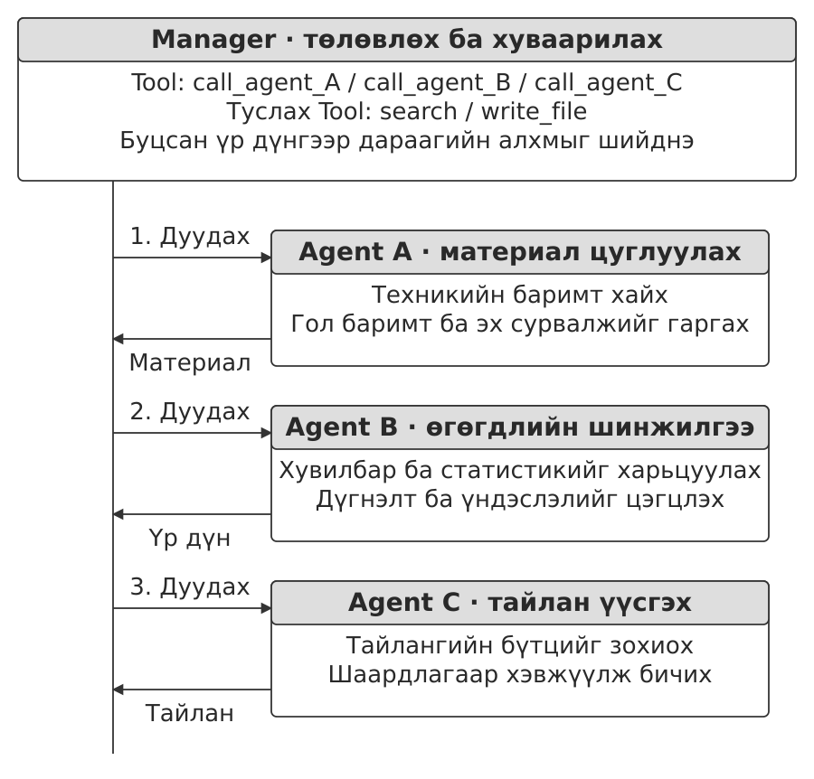

> **Туршилт 10-2 ★★: Ном орчуулах Agent**
>
> Техникийн ном орчуулахдаа нэр томьёо, Context ба найруулгыг зэрэг боловсруулах хэрэгтэй. Жишээлбэл, англи agent-ийг өөр өөрөөр орчуулж болох бөгөөд орчуулгад «ухаалаг агент» гэж тохиролцсон бол дараагийн бүлгүүдэд ижил орчуулгыг үргэлжлүүлэн ашиглах ёстой. Нэр томьёоны жагсаалт, бүлгийн эх бичвэр, орчуулга ба хянан засварын бичлэгийг тодорхой зохион байгуулах хэрэгтэй. Урт ном завсрын орчуулга, Tool-ийн үр дүн ба хянан засварын түүхтэйгээ хамт Context-ийг тасралтгүй шахаж, Model есдүгээр бүлэгт хүрэхэд хоёрдугаар бүлгийн орчуулгаа мартаж, эсвэл нэг хэсгийг дахин дахин шалгаж болно. Даалгаврыг үүрэг ба бүлгээр нь задлах нь инстанс бүрийг одоогийн үүрэгт шаардлагатай материалд төвлөрүүлэх боломж олгоно.
>
> Ажлыг дөрвөн төрлийн Agent-д хуваарилж болно:
>
> - **Glossary Agent: нэр томьёо цэгцлэх.** Бүх номыг хэсэгчлэн уншиж, давтагддаг мэргэжлийн нэр томьёог тодорхойлж, мэргэжлийн толь бичиг ба орчуулгын стандартыг лавлан, англи нэр томьёо, хятад орчуулга, үгийн төрөл ба хэрэглэх Context-ийг агуулсан JSON эсвэл CSV харьцуулах хүснэгт үүсгэнэ. Нэр томьёоны жагсаалтыг хуваалцсан орон зайд хадгалж, даалгавар дууссаны дараа энэ инстансыг суллана.
> - **Translation Agent: бүлэг орчуулах.** Одоогийн бүлэг, холбогдох нэр томьёо ба орчуулгын зааврыг уншиж, зорилтот уншигч ба хэлний хэв маягийн дагуу орчуулга гүйцэтгэнэ. Шинээр гарсан нэр томьёонд нэр дэвшигч орчуулга өгч, хянуулахаар тэмдэглэнэ. Инстанс бүр бие даасан Context хөтөлж, орчуулгыг хуваалцсан орон зайд хадгална; өөр өөр бүлгийг хамаарлаар нь дараалан эсвэл зэрэг боловсруулж болно.
> - **Proofreading Agent: бүх текстийг хянах.** Нэр томьёоны жагсаалт ба бүлэг бүрийн орчуулгад тулгуурлан орчуулга, өмнө хойдох илэрхийлэл ба уншигдах байдлыг шалгана. Бүлгээр уншиж, бүлэг хоорондын индексээр бүх текстийг шалгаж, асуудлын байрлал, үндэслэл ба засварын шаардлагыг хянан засварын тайланд бичнэ.
> - **Manager Agent: даалгавар төлөвлөх ба хүлээн авах.** Зорилго, төлөвлөгөө, даалгаврын төлөв, дуудлагын хураангуй ба бүтээгдэхүүний индексийг хөтөлж, хянан засварын тайлангаар засах шаардлагатай бүлгийг орчуулагчид буцааж, дахин шалгалтыг зохион байгуулна.
>
> Зураг 10-5-д хянагч бүлэг бүрийн орчуулга ба нэр томьёоны жагсаалтыг уншиж, Manager тайлангаар аль бүлгийг дахин засахыг шийднэ. Дахин засах даалгавар авсан орчуулагч тухайн бүлгийн эх бичвэрийг гаргаж, тэмдэглэгдсэн үг тэр өгүүлбэрт ямар утгатайг тулгаж болно.
>
> 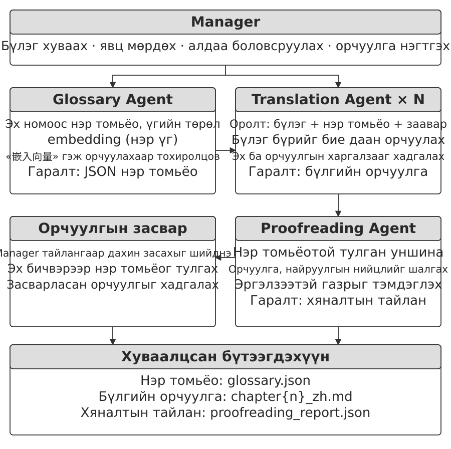
>
> Орчуулгыг файлд бичсний дараа аль дуудлага урт текст унших шаардлагатай хэвээр вэ? Хавсаргасан туршилт англи хувилбарын эхний хоёр бүлгийг 26 орчуулгын нэгжид хуваасан. Ганц Agent өмнөх эх бичвэр ба орчуулгыг бүгдийг дагуулсаар, хамгийн том нэг хүсэлтэд 94,355 token оруулсан. Хуваарилсны дараа орчуулагчийн хамгийн том оролт ердөө 2,857 token, Manager дахин засах шийдвэр гаргахдаа 2,153 token ашигласан. Удирдагчтай бүлэгт хамгийн их оролт ашигласан нь үнэндээ нэр томьёо цэгцлэгч байв: тэр нэг удаа хоёр бүлгийг уншиж, 49,807 token ашигласан.
>
> Эдгээр хоёр бүлгийг орчуулж дуусгахад дөрвөн үүрэг нийт 203,277 token, ганц Agent 1,317,808 token ашигласан. Аль бүлэг түрүүлж хүлээлгэн өгсөн бэ? Дөрвөн үүрэгтэй бүлэг ойролцоогоор 271 секунд зарцуулж, ганц Agent-аас ойролцоогоор 17 секундээр илүү удсан.
>
> Хүлээлгэн өгөх үед хоёр шалгалт нэг орчуулгад өөр өөр үр дүн өгсөн. Нэр томьёоны жагсаалт нэр үг `embedding`-д «嵌入向量» гэсэн орчуулгыг заасан. Хянан засварын тайлан дахин засах бүлэг жагсаагаагүй ч нэр томьёо шалгах программ энэ үгэнд 0/2 өгсөн: хоёр бүлгийн орчуулгад «嵌入» олдсон ч «嵌入向量» олдоогүй. Хоёр бүлгийг хоёуланг нь буцаах ёстой юу?
>
> Нэгдүгээр бүлгийн буцаалтын бодлогын тухай догол мөрөнд эх бичвэр нь `embedding the refund policy in the context` бөгөөд орчуулга нь «将退款政策嵌入上下文中». Энд бодлогыг Context-д оруулах тухай яригдаж байгаа тул «嵌入向量» болгон сольвол харин ч буруу засна. Программ бүлэг бүрээр тэмдэгт мөр хайх нь хянагчид дахин шалгах сэжүүр олоход тусалдаг; аль хэсгийг засахыг шийдэхийн тулд хянагчид тэр догол мөрийн эх бичвэр хэрэгтэй хэвээр. Нэр томьёоны жагсаалт шинэчлэгдэхэд ч эхлээд нөлөөлөгдөх догол мөрийг олж, эх бичвэр, орчуулга ба шинэ зүйлийг хамт орчуулагчид өгч болно.
>
> **Туршилтын шаардлага:**
> 1. График ба код агуулсан нэг техникийн номыг сонгоно.
> 2. Manager, Glossary, Translation, Proofreading гэсэн дөрвөн төрлийн Agent-ийг хэрэгжүүлнэ.
> 3. Гишүүн бүрийн Context-ийн хэрэглээ, хүлээлгэн өгөх материал ба бүтээгдэхүүний хувилбарыг тэмдэглэнэ.
> 4. Ганц Agent-ийн хувилбартай орчуулгын чанар, дуусгах хугацаа ба нөөцийн зарцуулалтыг харьцуулж, даалгавар задлах ба Context зохион байгуулалтын нөлөөг шинжилнэ.

**Зэрэгцээ зохицуулалт.** Хоорондоо хамааралгүй дэд даалгаврыг зэрэг гүйцэтгэж болно. Manager даалгавар хуваарилж, төлөв хүлээн авч, үр дүнгээр үргэлжлүүлэх, нэмэлт ажил хийх эсвэл дуусгахыг шийднэ. Энэ номыг орчуулахад нэр томьёоны жагсаалт батлагдсан даруйд өөр өөр бүлгийг олон орчуулагчид зэрэг эхлүүлж болно. Зураг 10-6-д судалгааны тайлан болгон сольсон: график аль хэдийн бэлэн, шинжилгээ үргэлжилсээр байхад форматын шалгалт яагаад хүлээх ёстой вэ? Гишүүдийн мэдээлсэн үйл явдлыг дагавал сүүлийн алхам аль хоёр бүтээгдэхүүнээс хамаардгийг харж болно.

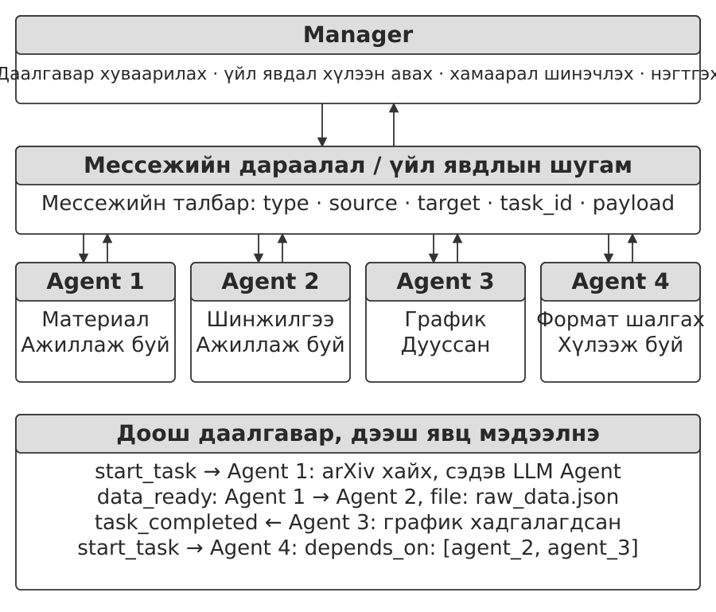

Мессежийн шугам ийм асинхрон харилцааг зохион байгуулахад тохиромжтой: гишүүд явц ба үр дүнгээ нийтэлж, удирдагч харгалзах үйл явдлыг захиалж, ажиллах орчин хүргэлт, буфер ба дахин оролдлогыг хариуцна.

> **Бүтээгдэхүүний жишээ: Lingtai**
>
> Lingtai нь локал орчинд ажилладаг, таних тэмдэг ба санах ойгоо файлаар хадгалдаг урт хугацааны Agent-ийн систем. Энэ нь гурван үүрэг өгдөг: үндсэн агент (main agent) хэрэглэгчтэй ярилцаж, төлөвлөгөө ба санах ойг удирдана; салбар (daemon) хүрээ нь тодорхой богино хугацааны зэрэгцээ даалгаврыг гүйцэтгэж, дууссаны дараа дүгнэлтээ буцаана; хувилбар (avatar) өөрийн санах ой, шуудангийн хайрцаг ба үүргээ хадгалж, сесс хоорондын мэргэжлийн хуваарьт ашиглагдана.
>
> Үүрэг бүр хувийн байнгын мэдлэгтэй бөгөөд Markdown хэлбэрийн ур чадварын гарын авлагыг хуваалцдаг. Context багтаамжийн дээд хязгаарт ойртоход үүрэг «гуужих» (molt)-оор хураангуйгаа хадгалж, байнгын санах ойтой хослуулан шинэ Context-д орно. Таних тэмдэг, санах ой ба ур чадвар файлд бие даан хадгалагддаг тул суурь Model-ийг сольсны дараа ч ажлаа үргэлжлүүлж чадна. Энэ дизайн удирдагч, богино хугацааны ажилтан, урт хугацааны мэргэжлийн гишүүн ба Context-ийн шахалтыг хослуулсан.

> **Туршилт 10-3 ★★★: Өөрөө зохион байгуулдаг утас + компьютерийн Agent**
>
> Энэ туршилт Бүлэг 6-ын Computer Use ба дуут харилцан үйлчлэлийг хослуулна. Хэрэглэгч бүртгэл эсвэл нислэг захиалах хуудас өгч, Computer Agent вэб сайтыг нээж, маягтыг таниад, Phone Agent-аар одоо дутуу байгаа нэр, бичиг баримтын дугаар, холбоо барих мэдээлэл, хаяг ба сонголт зэрэг талбарыг цуглуулна.
>
> **Үүрэг ба хүлээлгэн өгөлт.** Computer Agent хөтчийг удирдаж, энэ удаагийн зохион байгуулалтыг хариуцна; Phone Agent ASR, LLM, TTS-ээр хэрэглэгчтэй бодит цагт харилцаж, аман хариултыг бүтэцтэй талбар болгон хувиргана. Хоёулаа цэгээс цэг рүү Tool эсвэл мессежийн шугамаар харилцах бөгөөд мессеж илгээгч, хүлээн авагч, төрөл ба агуулгыг агуулна. Computer Agent утасны даалгаврыг шууд даатгаж, удирдагчийн үүрэг гүйцэтгэж чадна. Хэрэглэгч дуугаар мэдээлэл өгөхийг зөвшөөрвөл Phone Agent дараалан асууж, баталгаажуулж, дахин асууж болох бөгөөд Computer Agent хуудасны төлөв ба талбар бөглөхөд төвлөрнө.
>
> **Ажиллагааны хоёр горим.** Тогтмол горим хоёр Agent-ийг урьдчилан эхлүүлж, тус бүр бие даасан ажиллах давталт хөтөлж, хоёр чиглэлтэй харилцаа ба зэрэгцээ зан төлөвийг шалгахад ашиглагдана. Өөрөө зохион байгуулах горим эхлээд Computer Agent-ийг эхлүүлж, Model хуудас, байгаа мэдээлэл ба даалгаврын хэрэгцээгээр `initiate_phone_call_agent(purpose, required_info)`-ийг дуудах эсэхийг шийднэ. Ажиллах орчин даалгаврын зорилго, цуглуулах талбар ба форматын хязгаарлалтыг Phone Agent-д өгч, эхлүүлсний дараа ижил харилцааны механизмыг ашиглана.
>
> **Талбарыг нэг нэгээр нь дамжуулах.** Зураг 10-7-д Phone Agent WebRTC-ээр асууж, хариултыг гаргаж шалгаад, хүчинтэй утга авсны дараа `info_collected` илгээж, дараа нь дараагийн зүйлийг асууна. Computer Agent зэрэгцээд хуудсыг уншиж, өмнөх зүйлийг бөглөж, `fill_error` эсвэл шинэ хуудасны төлвийг буцаана. Формат таарахгүй санал хүсэлтийг `format_invalid`-ээр талбар ба шаардлагатай нь тэмдэглэж, Phone Agent үүнд тулгуурлан баталгаажуулах эсвэл дахин асууна. Ингэснээр «дараагийнхыг асуух» ба «өмнөхийг бөглөх» давхцан гүйцэтгэгдэж болно.
>
> **Дуусгах ба хэвийн бус байдлыг боловсруулах.** Phone Agent талбаруудыг цуглуулж дуусгасны дараа `task_completed` илгээж, мэдээлэл цуглуулах дэд даалгавар дууссаныг илэрхийлнэ. Computer Agent заавал бөглөх талбар, хуудасны шалгалтын үр дүн ба илгээх зөвшөөрлийг үргэлжлүүлэн шалгаад, маягтын үйлдлийг дуусгана. Дахин оролдлогын тоо хэтэрсэн, хуудасны хэвийн бус байдалтай тулгарсан эсвэл хэрэглэгч зогсоохыг хүссэн үед даалгаврыг түр зогсоож, одоогийн явцыг тайлбарлана; дуусахдаа ажиллаж буй нөгөө талыг цуцалж, хөтчийн сесс, аудио зам ба дуудлагыг хаана. Бодит хүнтэй дуут харилцаа ба маягт илгээхэд хэрэглэгчийн зөвшөөрөл ба эрхийг тус тусад нь авна.
>
> 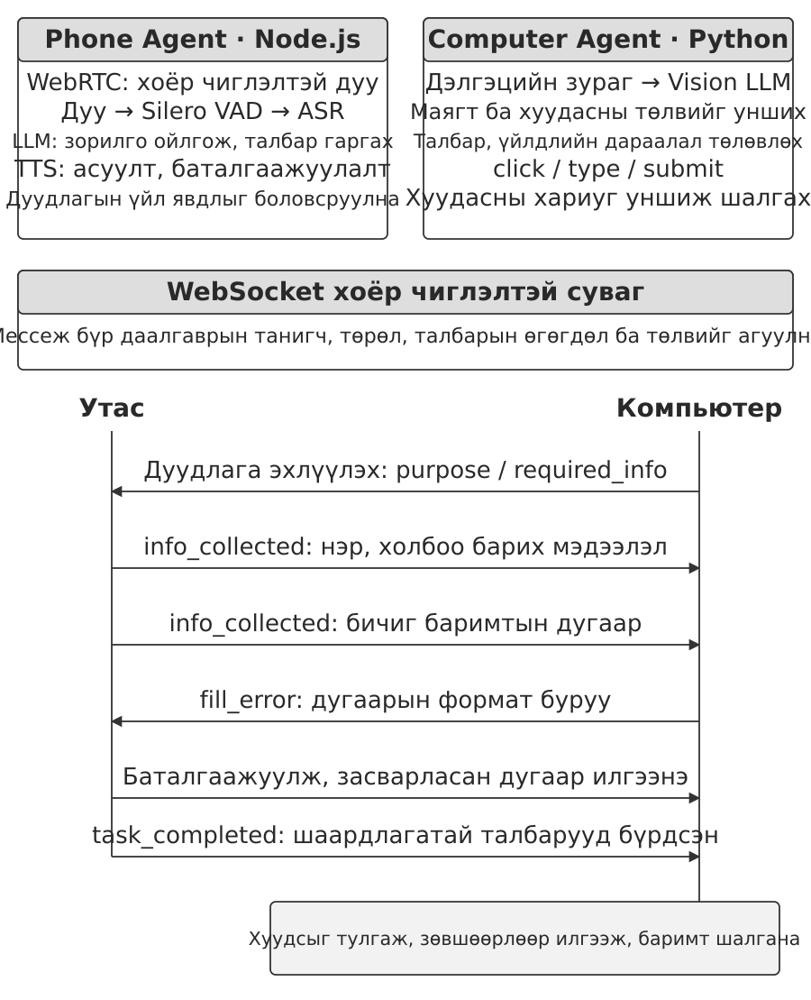
>
> **Туршилтын шаардлага:**
> 1. Хоёр бие даасан Agent ба хоёр чиглэлтэй бүтэцтэй харилцааг хэрэгжүүлнэ.
> 2. Тогтмол горим ба өөрөө зохион байгуулах горимд дарааллыг тэмдэглэж, асуух ба бөглөхийн давхцах хугацааг шалгана.
> 3. Форматын шалгалт, дахин асуулт, хуудасны алдааны санал хүсэлт, хугацаа хэтрэлт ба нөөц цэвэрлэлтийг хэрэгжүүлнэ.
> 4. Хоёр горимын эхлүүлэх шийдвэр, хоцрогдол, амжилтын хувь ба нөөцийн зарцуулалтыг харьцуулна.

> **Туршилт 10-4 ★★★: Олон вэб сайтаас зэрэг мэдээлэл цуглуулах Agent**
>
> Энэ туршилт олон ижил бүтэцтэй Agent-оор зэрэгцээ хайлт хийж, Бүлэг 6-ын үйл явдлаар хөтлөгдөх ба тасалдлын механизмыг дадлагажуулна. Даалгавар нь нэг их сургуулийн олон сургуулийн вэб сайтаас заасан багшийг, жишээ нь «Zhang Wei»-г хайж, сургууль, албан тушаал, судалгааны чиглэл ба эх хуудсыг буцаах явдал. Хайхаас өмнө таних нөхцөлийг тохиролцоно, жишээ нь нэр, салбар ба хувийн хуудасны мэдээлэл, ингэснээр ижил нэртэй хүмүүсийг ялгахад хялбар болно.
>
> **1. Зэрэгцээ эхлүүлэх.** Manager 10 Computer Use Agent үүсгэж, тус бүр нэг сургуулийн вэб сайтыг хариуцна. Инстанс бүр бие даасан Context ба хөтчийн сесс хөтөлж, асинхрон даалгавар, thread эсвэл процессоор хуваарилагдаж болно. Оролт нь вэб сайтын URL, зорилтот нэр, тааруулах нөхцөл ба чиглүүлэлтэд ашиглах даалгаврын танигчийг агуулна.
>
> **2. Явцыг нэгтгэх.** Гишүүд «вэб сайт ачаалж байна», «багшийн жагсаалт уншиж байна», «шалгасан, таарсан зүйл байхгүй», «ижил нэртэй багш олдлоо» зэрэг төлвийг тогтмол илгээнэ. Manager мессежийн шугамаар даалгаврын хүснэгтийг хөтөлж, ажиллаж буй, дууссан, гацсан ба бүтэлгүйтснийг тус тусад нь тэмдэглэж, эх сурвалж ба алдааны шалтгааныг хадгална.
>
> **3. Баталгаажуулсны дараа бусад салбарыг цуцлах.** Физикийн сургуулийг хариуцсан `agent_3` ижил нэртэй нэг багш олсон гэж бодъё; тэр `target_found` илгээх бөгөөд ачаа нь багшийн мэдээлэл ба эх сурвалжийг агуулна. Даалгавар баталгаажсан хүний мэдээллийг буцаахыг шаардвал Manager эхлээд тааруулах нөхцөл ба нотолгоог тулгаж, зорилтот хүнийг олсныг баталгаажуулсны дараа үр дүнг атомар үйлдлээр бүртгээд, ажиллаж буй бусад гишүүдэд `terminate` илгээж, хүлээн авсан мэдээлэл `agent_3`-аас ирснийг тэмдэглэнэ. Гишүүд аюулгүй цэгт зогсож, нөөцөө цэвэрлээд баталгаажуулалт буцаана; Manager баталгаажуулалт эсвэл хугацаа хэтрэхийг хүлээгээд нэгтгэлээ дуусгана. Даалгавар бүх ижил нэртэй хүнийг жагсаахыг шаардвал шаардлагатай хүрээг шалгаж дуустал үргэлжлүүлэн хайна.
>
> **Өрсөлдөх нөхцөл.** Agent A ба B бараг зэрэг хүчинтэй үр дүн буцааж болно. Хоёр үйл явдал тус бүр нэгтгэлийг өдөөвөл давхар хүлээлгэн өгөлт эсвэл төлвийн зөрчил үүснэ. Түгжээ эсвэл транзакцаар «хайж байна → үр дүн бүртгэгдсэн» гэсэн төлвийн шилжилтийг хамгаалж, хожуу ирсэн үйл явдлыг аль хэдийн бүртгэгдсэн үр дүнг уншдаг болгож болно. Мессежийн дахин оролдлогыг ч үйл явдлын танигчаар давхардлаас цэвэрлэж, цуцлалт ба нэгтгэл давтан өдөөгдсөн ч нийцтэй байлгана.
>
> **4. Хэвийн бус байдал ба хамрах хүрээ.** Сүлжээ тасрах, хуудасны бүтэц өөрчлөгдөх ба задлан шинжилгээний алдааг тус тусад нь тэмдэглэнэ. Нэг даалгаварт хоёр минут зэрэг хугацааны төсөв тогтоож, хэтэрвэл гүйцэтгэлийг цуцалж, оношлогооны мэдээлэл цуглуулах бөгөөд бусад гишүүд ажлаа үргэлжлүүлнэ. Эцсийн тайлан «шалгасан, олдоогүй» ба «хандалт бүтэлгүйтсэн, шалгалт дуусаагүй»-г ялгаж, хамарсан сургуулиудын хүрээг тайлбарлана.
>
> Зураг 10-8 нэг бүлэг бүдүүвч хугацаагаар эдгээр мессежийг холбоно. Гишүүн 3 физикийн сургуульд квант тооцооллын чиглэлээр судалгаа хийдэг Zhang Wei профессор байгааг мэдээлсэн гэж үзье; Manager эхлээд эх вэб хуудас нэр, тэнхим, албан тушаал ба чиглэлийг нотолж чадах эсэхийг харах ёстой. Ижил нэртэй багшийн сэжүүр хүлээн авах, зорилтот хүн мөн болохыг батлах, бүх цуцлалтын баримтыг цуглуулах нь гурван өөр агшин.
>
> 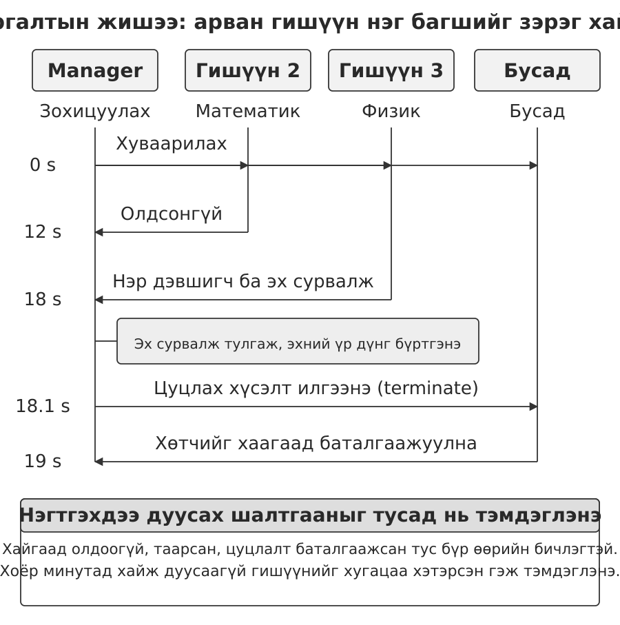
>
> Бодит ажиллагаанд Andrew Ng-ийг хайсан. Гишүүд эхлээд хуудасны текстэд энэ нэр байгаа эсэхийг шалгаж, таарсны дараа л Model-оор мэдээлэл гаргуулсан. Stanford HAI-ийн хуудас сонгогдож, буцаасан богино иш татал нэр ба хагас цагийн профессорын статусыг тулгах боломж өгсөн. Судалгааны чиглэлийг тулгахын тулд хуудасны цаад хэсэгт гүнзгий суралцахуйн тухай догол мөрийг унших хэрэгтэй. Хэд хэдэн гишүүн `target_found`-ыг зэрэг буцаасан ч зөвхөн түгжээг түрүүлж авсан гишүүн үр дүнг бүртгэж чадна.
>
> Энэ удаагийн дараалсан хайлт арван хаягийн хамгийн сүүлийнх дээр л таарч, 44.971 секунд зарцуулсан; ижил бүлэг вэб хуудсыг зэрэгцээ хайхад 24.022 секунд зарцуулж, тус бүрийн арван хөтчийн Context бүгд хаагдсан. Хоёр тоог хуваахад 1.872 гарна. HAI-ийн хуудсыг эхэнд тавивал дараалсан хайлт таармагц зогсох тул хугацааг дахин хэмжих хэрэгтэй. Цуцлалтыг тусгайлан шалгасан өөр нэг ажиллагаа дөрвөн салбар эхлүүлсэн: нэг салбар үр дүнг түрүүлж бүртгэж, бусад гурав цуцлах хүсэлтийг хүлээн авснаа баталгаажуулж, эцэст нь дөрвөн хөтчийн Context бүгд хаагдсан.
>
> **Туршилтын шаардлага:**
> 1. Зэрэгцээ гишүүдийг динамикаар үүсгэдэг Manager-ийг хэрэгжүүлнэ.
> 2. browser-use зэрэг төслөөр хөтөч гүйцэтгэх чадварыг бүтээнэ.
> 3. Мессежийн шугамаар хоёр чиглэлтэй харилцаа ба төлвийн хөтлөлтийг гүйцэтгэнэ.
> 4. Хайлтын үр дүнг баталгаажуулж, атомар үйлдлээр бүртгээд, үлдсэн салбаруудыг цуцалсны дараа баталгаажуулалтыг цуглуулна.
> 5. Хандалтын бүтэлгүйтэл, задлан шинжилгээний алдаа, хугацаа хэтрэлт ба таарах зүйлгүй нөхцөлийг боловсруулна.
> 6. Зэрэгцээ ба дараалсан гүйцэтгэлийн дуусгах хугацаа, хамрах хүрээ ба нөөцийн зарцуулалтыг харьцуулна.

**Удирдагчийн үүсгэсэн ажлын урсгал.** Нэг нэгээр нь даалгахаас гадна Manager эхлээд даалгаврын хамаарал ба нэгтгэх дүрмийг программ болгон бичээд, ажиллах орчинд хуваарилуулж болно. Model урсгалыг зохиож, программ тохиролцооны дагуу гишүүдийг эхлүүлж, үр дүнг дамжуулж, хамаарлыг хүлээнэ. Хамаарал аль хэдийн тодорхой, ижил төрлийн урсгалыг дахин дахин ажиллуулах шаардлагатай үед зохиогч энэ аргыг түрүүлж ашигладаг. Энэ нь хуваарилалт бүрт Manager-ийг дуудах зардлыг хэмнэж, удирдлагын Context-д хуримтлагдах хуваарилалтын бичлэгийг ч багасгана.

Claude Code-ийн динамик Workflow хэрэгсэл ийм хэрэгжүүлэлтийг өгдөг. `agent()` бие даасан Context-тэй дэд Agent үүсгэж, schema-гаар бүтэцтэй гаралтыг тохиролцож болно; `parallel()` бүлэг даалгаврыг зэрэг гүйцэтгэж, бүгд дуусахыг хүлээнэ; `pipeline()` оролт бүрийг олон үе шатаар тус тусад нь дамжуулж, нэг зүйл дараагийн үе шатанд орох үед бусад зүйл өмнөх үе шатанд боловсруулагдсаар байж болно. Завсрын үр дүн программын хувьсагчид хадгалагдаж, шүүлт ба нэгтгэлийг энгийн кодоор гүйцэтгэнэ.[^dynamic-workflows]

Жишээлбэл, техникийн эхийн долоон бүлэг баримтыг баталгаажуулахдаа эхлээд чиглэлээр судалгааны Agent-уудыг эхлүүлж, дараа нь бүлэг бүрийн дүгнэлтийг баталгаажуулах Agent-д тусад нь өгч зэрэг шалгуулж болно. Буцаасан дүгнэлт бүр эх сурвалж ба шийдвэрийн үндэслэлийг хадгална; бүх салбар дууссаны дараа нэгтгэх Agent эцсийн тайланг зохион байгуулна. Ингэснээр «судлах—нэг нэгээр баталгаажуулах—нэгдсэн байдлаар нэгтгэх» хуваарь ба үе шатны хамаарал бүгд ажлын урсгалд бичигдэнэ.

[^dynamic-workflows]: Anthropic, “Orchestrate subagents at scale with dynamic workflows”, 2026.

### Төвлөрсөн бус хэв маяг

Manager байхад яагаад гишүүдээр хэнд хандахаа өөрсдөөр нь шийдүүлэх ёстой вэ? Тестлэгч саяхан бичсэн модулийг аваад, бүтээгдэхүүний шаардлага ба интерфэйсийн тохиролцоо нэг талбарыг хоёр өөрөөр тайлбарласныг олж мэдсэн гэж төсөөлье. Тестлэгч зөрчлийг бүтээгдэхүүн ба архитектурын хоёр үүрэгт шууд өгч, хоёр талаар үндэслэлээ тайлбарлуулж, тохиролцоог зассаны дараа тестээ үргэлжлүүлж болно. Энэ бол хуваарь бөгөөд нэгэн зэрэг тэнцвэржүүлэлт. Инженер модулиа хүлээлгэн өгөх, архитектор бүтээгдэхүүний санал авах, тестлэгч эсэргүүцэл гаргах — хүн бүр дараагийн алхмыг эхлүүлж чадна. Байнга зөвлөлдөх шаардлагатай үед зүйл бүрийг Manager-аар дамжуулахыг хүлээх нь ажлыг саатуулна.

Микро үйлчилгээний нэр томьёог зээлбэл нэг төв алхмуудыг зохицуулахыг **оркестрчлал** (orchestration), тал бүр тохиролцсон үйл явдлын дагуу өөрөө залгамжлахыг **бүжгийн зохиомж** (choreography) гэнэ. Бас нэг бодит ялгаа бий: хүлээлгэн өгөлт бүр Manager-ийг хүлээх ёстой бол түүний Model-ийн үйлчилгээ хариу өгөхөө больмогц бусад гишүүд ажиллах чадвартай байсан ч дараагийн даалгавраа авч чадахгүй. Тархмал зохицуулалт ийм хамаарлыг бууруулж чадна; хүлээн авах ёстой гишүүн өөрөө нэг Tool дуудлагад гацсан бол байнга хадгалсан даалгаврын төлөв, хугацаа хэтрэлт, дахин оролдлого ба хүлээн авах механизмаар өөр гишүүнд хаанаас үргэлжлүүлэхийг мэдүүлэх шаардлагатай хэвээр.

Дараах гурван дизайн тус бүр нэг хүлээлгэн өгөх аргатай: бүтээгдэхүүнээр мессеж захиалах, бүлгийн ярианд дараагийн үг хэлэгчийг сонгох, эсвэл одоогийн гишүүн нэрээр нь заан шилжүүлэх.

**MetaGPT: SOP-оор бүтээгдэхүүний хүлээлгэн өгөлтийг зохион байгуулах.** MetaGPT програм хангамжийн багийн стандарт ажиллагааны журам (SOP)-аар хуваарилдаг. Бүтээгдэхүүний менежер шаардлагын баримт бичиг (PRD), архитектор дизайны баримт бичиг, инженер код, тестлэгч тестийн тайлан хүлээлгэн өгнө. Дараагийн гишүүн тохиролцсон материалыг авмагц ажлаа эхэлж чадах бөгөөд өмнөх гишүүн ч даалгавраа дахин дахин тайлбарлах хөдөлмөрөөс чөлөөлөгдөнө. Зураг 10-9 дахь холбоосууд эдгээр бүтээгдэхүүний хүлээлгэн өгөх харьцааг илэрхийлнэ.[^metagpt-design]

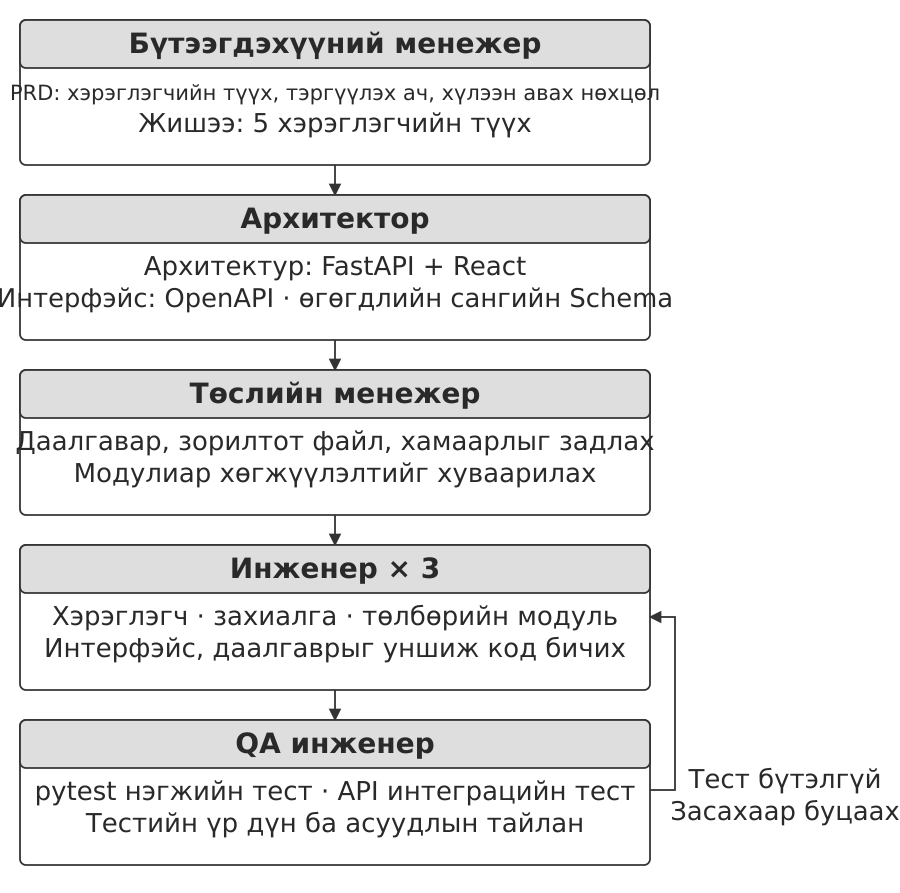

Үүрэг бүр хүлээлгэн өгөхдөө ямар мэдээллийг нөхөх ёстой вэ?

- **Product Manager Agent** шаардлагыг хүлээн авч, PRD-г цэгцэлж, функц, хэрэглэгчийн түүх, хүлээн авах шалгуур ба тэргүүлэх ачийг тодорхой болгоно.
- **Architect Agent** PRD-г уншиж, технологийн стекийг сонгож, модулиудыг хувааж, интерфэйс ба өгөгдлийн загварыг тодорхойлж, дизайны баримт бичгийг бүрдүүлнэ.
- **Project Manager Agent** дизайнаар даалгавар ба файлын хуваарийг задалж, хамаарлыг цэгцэлж, инженерүүдийн гүйцэтгэлийг зохион байгуулна.
- **Engineer Agents** дизайнаар модулиудыг хэрэгжүүлж, код илгээнэ; бие даасан хэсгүүдийг олон инстанст өгч болно.
- **QA Engineer Agent** код ба шаардлагаар тест үүсгэж, шалгалт гүйцэтгэж, асуудлыг тэмдэглэн, тестийн тайлан бүрдүүлнэ.

Эдгээр үүрэгт хүлээлгэн өгөх формат зохиохдоо зохиогч гурван зүйлийг тодорхой бичихийг зөвлөдөг: даалгавар ба хүлээн авах шалгуур, баталгаажсан баримт ба хязгаарлалт, мөн бүтэцтэй бүтээгдэхүүний ишлэл. Хүлээн авагч үүнд тулгуурлан шаардлагатай материалыг авч, ажлаа үргэлжлүүлж, мэдээлэл дутвал тодорхой асуулт тавина.

MetaGPT хуваалцсан мессежийн сан ба захиалгын механизмаар мэдээллийг зохион байгуулдаг: үүрэг мессеж нийтэлж, бусад үүрэг анхаардаг мессежийн төрлөөр холбогдох оролтыг боловсруулна. Нийтлэгч ба хэрэглэгч бүтээгдэхүүний формат ба мессежийн утгаар холбогддог тул Model-ийг тусад нь солих эсвэл дотоод хэрэгжүүлэлтийг тохируулж болно.

SOP нь бүтээгдэхүүний шаардлага, архитектур ба кодын хоорондын хамаарлыг тодорхойлж, мессежийн захиалга эдгээр ажил хэрхэн өдөөгдөхийг тодорхойлно. Тогтсон даалгаврын хамаарлыг ч тархмал үйл явдлаар урагшлуулж болох бөгөөд хоёулаа хамтдаа системийн хамтын ажиллагааны аргыг бүрдүүлнэ. Динамик санал хүсэлтийг цааш зохиохдоо тестлэгч бүтээгдэхүүний үүрэгт шаардлагыг тодруулах, инженер архитекторт өөр хувилбар санал болгох зэрэг замыг нэмж, эдгээр харилцан үйлчлэлд хүлээн авах нөхцөл ба дуусах дүрэм тогтоож болно.

[^metagpt-design]: Hong, S., et al. *MetaGPT: Meta Programming for A Multi-Agent Collaborative Framework.* ICLR 2024.

**AutoGen-ийн бүлгийн яриа: хуваалцсан сесс дэх үг хэлэх хуваарилалт.** Сонгодог GroupChat дизайнд олон Agent нэг сесст оролцох бөгөөд GroupChatManager дараагийн үг хэлэгчийг сонгож, гишүүдэд мессежийг нэвтрүүлнэ. Сонгох стратеги нь ээлжлэх байж болно, эсвэл одоогийн агуулгаар Model шийдэж болно. Гишүүд тус бүрийн үүргийн тохиргоогоо хадгалж, нийтлэг сессээр харилцах бөгөөд үг хэлэх хуваарилалт удирдагчид төвлөрнө. Энэ бол Context-ийн зохион байгуулалт ба удирдлагын бүтцийн хослолын нэг жишээ.[^autogen-groupchat]

[^autogen-groupchat]: Microsoft, *AutoGen 0.2: Conversation Patterns.*

**OpenAI Swarm: handoff-оор удирдлагыг хүлээлгэн өгөх.** Swarm үүрэг бүрт заавар ба Tool тохируулдаг бөгөөд үүрэг тохируулсан шилжүүлэх функцийг дуудсаны дараа ажиллах орчин зорилтот Agent руу шилждэг. Чиглүүлэх шийдвэрийг үүрэг бүр гаргаж, нэгдсэн ажиллах давталт гүйцэтгэж болно. Шилжүүлэхэд одоогийн системийн заавар үүргийг дагаж өөрчлөгдөх бөгөөд ярианы түүх хадгалагдсаар байна. Энэ нь «үүрэг дараагийн хүлээн авагчийг сонгох» ба «ярианы түүхийг үргэлжлүүлэн ашиглах»-ын хослолыг харуулдаг.[^swarm-handoff]

Бие даасан Context-тэй хүлээлгэн өгөх аргыг ашиглах бол тусдаа даалгаврын багц тодорхойлж болно: `task_id` даалгаврыг тодорхойлж, `sender` ба `recipient` хоёр талыг заан, `goal` ба `constraints` зорилго ба хязгаарлалтыг тайлбарлаж, `accepted_facts` баталгаажсан баримтыг хадгалж, `artifact_refs` бүтээгдэхүүний ишлэл өгч, `remaining_budget` төсвийг тэмдэглэж, `visited_agents` хандалтын хэлхээг хадгална. Хүлээн авагч зөвшөөрлөөрөө материалыг уншиж, ажиллах орчин төсөв ба хүлээлгэн өгөлтийн бичлэгийг хөтөлнө.

Хүлээлгэн өгөх хэлхээ давтан хандалтыг боловсруулах хэрэгтэй. Жишээлбэл, хөгжүүлэгч кодыг хянагчид өгч, хянагч засвар санал болгоод хөгжүүлэгчид буцаах нь хэвийн засварын давталт. Даалгаврын төлөв, бүтээгдэхүүний хувилбар, шийдэгдээгүй асуудал ба давталтын тоог хослуулан ахиц байгаа эсэхийг шийдэж болно. Жишээлбэл, нэг орчуулга дараалан хоёр удаа буцаагдсан бөгөөд эхний удаа эх сурвалж нөхөгдөж, хоёр дахь удаа нэр томьёо засагдсан бол засвар урагшилсаар байна; хоёр удаа буцаагдсан нь ижил хувилбар, заасан асуудал ч ижил бол засвар гацсан гэсэн үг. Ийм үед цааш шилжүүлэх тоог хязгаарлаж, хараахан шийдэгдээгүй асуудлыг хариуцагчид мэдээлж болно.

[^swarm-handoff]: OpenAI, *Swarm*, “Instructions” ба “Handoffs and Updating Context Variables”.

> **Бүтээгдэхүүн дэх Agent Swarm**
>
> «Agent Swarm» нь өөр өөр зохион байгуулалтын хэлбэрийг хэлж болно. Нэг төрөл нь handoff сүлжээгээр удирдлагыг хүлээлгэн өгдөг, жишээ нь OpenAI Swarm, LangGraph-ийн swarm сан ба Microsoft Agent Framework-ийн handoff зохион байгуулалт; нөгөө төрөл нь үндсэн Agent ба зэрэгцээ ажилтнуудыг ашигладаг, жишээ нь Kimi Agent Swarm, Anthropic-ийн олон Agent-ийн судалгааны систем ба Manus Wide Research.
>
> Kimi K2.5-ын нэвтрүүлсэн Agent Swarm зэрэгцээ Agent-ийн бататгах сургалтаар зохион байгуулагчийг сургаж, даалгаврыг хэзээ задлах, ажлыг хэрхэн хуваарилахыг сургадаг бөгөөд хамгийн ихдээ 100 дэд Agent-ийг дэмждэг. Дараагийн хувилбарууд хэмжээг 300 болгон өргөтгөсөн бөгөөд K3 Swarm том хэмжээний хайлт ба бөөн боловсруулалтад үргэлжлүүлэн ашиглагдаж байна. AgentENV нь Kimi K3-ын Agent-ийн бататгах сургалтад өргөтгөж болох орчин өгч, snapshot ба салаалалтыг дэмжин, зэрэгцээ гүйцэтгэлийг зохион байгуулахад ашиглагддаг.[^ch10-kimi-swarm]

**Нэг машин дээрх олон Agent-ийн инстанс.** Олон инстанс өөр өөр даалгавар гүйцэтгэж байгаа ч файл, Tool-ийн үйлчилгээ эсвэл GPU-г хуваалцаж болно. Ийм үед харилцааг өөрчлөлтийн хүрээг тайлбарлах, нөөц суллагдсаныг мэдэгдэх эсвэл гүйцэтгэлийн дарааллыг тохиролцоход ашиглаж болно. Жишээлбэл, хоёр инстанс хоёулаа нэг GPU шаардвал эхлээд даалгавар ба хүлээгдэж буй хэрэглээгээ бүртгээд, нөөцийн менежер ашиглах эрхийг олгоно.

Claude Code-ийн Agent Teams нь багийн гишүүдийг олж илрүүлэх, мессеж ба хуваалцсан даалгаврын удирдлагыг өгдөг. Гишүүд байгуулагдсан багийн хүрээнд бие биеийн мэдээллийг авч, ажиллах орчин харилцааг зохион байгуулна.[^claude-agent-teams] Нэг машин дээрх хамтын ажиллагааг өөрөө бүтээхдээ Бүлэг 4-ын `list_agents` зэрэг интерфэйсийг ашиглаж, олж илрүүлэх хүрээ, хандах эрх ба нөөцийн эзэмшлийн тодорхой дүрэм тогтоож болно. Мессеж дэх тохиролцооны үр дүнг түгжээ, квот эсвэл хуваарилагчаар хэрэгжүүлнэ.

[^ch10-kimi-swarm]: Moonshot AI, *Kimi Agent Swarm: 100 Sub-Agents at Scale*, Agent Swarm-ийн тусламжийн баримт бичиг ба AgentENV төслийн тайлбар.

[^claude-agent-teams]: Anthropic, *Orchestrate teams of Claude Code sessions.*

### Байгууллага хоорондын хамтын ажиллагаа: A2A протокол

Хамтын ажиллагаа үйлчилгээ эсвэл байгууллагын хилийг давах үед хоёр тал чадвар олж илрүүлэх, таних тэмдгийн баталгаажуулалт, хүсэлтийн формат, явц ба үр дүнгийн хүлээлгэн өгөлтийг тохиролцох хэрэгтэй. Google 2025 онд нийтэлсэн **A2A** (Agent2Agent) протокол ийм харилцан ажиллах интерфэйсийг өгсөн бөгөөд дараа нь Linux Foundation-д удирдуулахаар шилжүүлсэн. Үүнийг гурван талаас ойлгож болно.[^a2a-concepts]

- **Чадвар олж илрүүлэх.** Agent Card нь таних тэмдэг, үйлчилгээний цэг, ур чадвар, оролт гаралтын модаль ба баталгаажуулалтын шаардлагыг тодорхойлсон мета өгөгдлийн баримт бичиг. Дуудагч үүнд тулгуурлан нөгөө тал даалгаврыг боловсруулж чадах эсэх, холболтыг хэрхэн бий болгохыг шийднэ.
- **Даалгавар ба мессеж.** Task нь танигч ба амьдралын мөчлөгтэй ажлыг илэрхийлэх бөгөөд дуудагч илгээгдсэн, боловсруулж буй, оролт шаардлагатай, дууссан эсвэл бүтэлгүйтсэн зэрэг төлвийг мөрдөж болно. Message даалгаврын шаардлага, нэмэлт мэдээлэл ба хариуг агуулж, Artifact баримт бичиг, зураг эсвэл бүтэцтэй үр дүнг хүлээлгэн өгнө. Мессеж ба бүтээгдэхүүн дэх Part нь текст, файлын ишлэл эсвэл өгөгдөл агуулж болно.
- **Интерфэйсээр хамтран ажиллах.** Дуудагч эдгээр нээлттэй объектоор алсын талтай харилцах бөгөөд алсын тал дотоод Prompt, санах ой ба Tool-оо бие даан удирдана. Хоёр тал баталгаажуулалт, зөвшөөрөл ба өгөгдөлд хандах хүрээг тус тусад нь хэрэгжүүлнэ.

Урт даалгавар төлвийг асуулгаар авч болно, SSE-ээр урсгалт шинэчлэлт хүлээн авч болно, эсвэл дэмжигдсэн үед түлхэх мэдэгдэл ашиглаж болно. Хэрэглэгч мэдээлэл нөхсөний дараа клиент ижил даалгаврыг үргэлжлүүлэн урагшлуулж, даалгаврын төлвөөр эцсийн бүтээгдэхүүнийг авна.

Бүлэг 4-ын MCP нь Model-ийн аппликейшнд Tool, нөөц ба Prompt-ийн интерфэйс өгөхөд төвлөрдөг; A2A нь Agent-ийн үйлчилгээнүүдийн хоорондын даалгаврын хамтын ажиллагаанд төвлөрдөг. Хоёуланг хослуулж болно: нэг Agent MCP-ээр Tool ашиглаж, нэгэн зэрэг A2A-аар алсын даалгавар шилжүүлнэ. Нэг багийн дотор тогтвортой интерфэйс аль хэдийн байвал зохиогч эхлээд Tool дуудлага, хуваалцсан файл ба мессежийн шугамыг үргэлжлүүлэн ашигладаг. Бие даан арчлагддаг Agent-ийн үйлчилгээг холбох, чадвар олж илрүүлэх ба даалгаврын амьдралын мөчлөгийг нэгтгэх шаардлагатай үед л A2A-г нэвтрүүлнэ; байгууллага хооронд бол таних тэмдэг, эрх ба өгөгдлийн засаглалын дүрмийг цааш тохируулна.

[^a2a-concepts]: A2A Project, *Core Concepts and Components in A2A.*

**Өөр өөр хүмүүст цаг товлох.** Гэр бүлийн гурван гишүүн тус бүр өөрийн хуваарийн туслахтай бөгөөд нэг оройн хоолонд уулзахыг хүсэж байна. Нэг туслах эзнийхээ бүрэн хуанлийг уншиж чадна; бусад хоёрт хэрхэн хариулах вэ? «Мягмар гаригт боломжгүй, Лхагва гаригт өөрчилж болно» гэдэг нь аль хэдийн хэрэгтэй ялгааг өгч байна. Хуанлийг шууд дамжуулбал Мягмар гаригийн хувийн хэргийг илүү задруулна; зөвхөн «хоёр өдөр хоёуланд нь хуваарь бий» гэвэл бусад нь Лхагва гаригт тохиролцох боломж байгааг мэдэх аргагүй. Удаа бүр амжилттай товлосон ч үргэлж нэг хүн хуваариа өөрчилж байвал энэ зохицуулалт түүнд ашигтай биш байж магадгүй.

CalBench-ийн нэг нээлттэй асуулт таван хүнээр таван уулзалт зохион байгуулуулдаг бөгөөд уулзалт бүрт гурван хүн оролцоно. Зарим хүн тодорхой цагт огт шилжих боломжгүй, зарим хувийн хэргийг хойшлуулж болох бөгөөд асуулт хойшлуулалт бүрийн зардлыг тогтоосон. Эхлээд энгийн арга туршъя: таван уулзалтыг дараалан боловсруулж, удаа бүр хамгийн эрт цагаас хайж, гурван хүн бүгд чөлөөлж чадвал товлоно; аль хэдийн товлосон уулзалтыг хадгална. Дараа нь өөр арга туршъя: таван уулзалтыг хамтад нь авч, бүрэн хуанлийг ашиглан шийднэ. Доор асуултын цагийн дугаарыг 0-ээс тоолж ашиглана.[^ch10-calbench]

| Зохицуулах арга | 1-ээс 5 дахь уулзалт тус бүрийн цаг | Нэг уулзалт товлох бүрт төлсөн хойшлуулалтын зардал | Нийт зардал |
|---|---|---|---:|
| Уулзалт бүрт хамгийн эрт чөлөөлж болох цагийг сонгож, товлосон уулзалтыг хадгалах | 0, 2, 1, 3, 6 | 1, 20, 20, 12, 300 | 353 |
| Лавлах шийдэгч таван уулзалтыг нэгтгэн зохицуулах | 13, 3, 10, 9, 12 | 0, 1, 0, 1, 1 | 3 |

Хоёр хуваарь хоёулаа гурван оролцогчийн эцсийн хуанли дээр уулзалт бүрээр тулгаж болно. Хамгийн их зөрүү сүүлийн уулзалтад байна: эхний аргаар 6 дахь цаг чөлөөлөгдөж болох ч гурван хүн тус бүр зардал нь 100 бүхий нэг хуваариа шилжүүлэх хэрэгтэй. 12 дахь цагт товлобол зөвхөн нэг хүн зардал нь 1 бүхий нэг хуваарийг шилжүүлнэ. Нийт үр дүн үнэлэгчид харьцуулах үндэслэл өгдөг; бодитоор хэлэлцээнд оролцох туслах тус бүр зөвхөн эзнийхээ хуанлийг харж чадна.

Энэ хувилбарт хавсаргасан шунахай шийдэгч 146 зардал мэдээлж, таван уулзалт бүгдэд цаг буцаасан. Гэвч дараагийн уулзалтуудыг товлохдоо өмнөх уулзалтыг зарим оролцогчийн хуанлиас шилжүүлэхийг зөвшөөрсөн. Эхний уулзалт гурван оролцогчийн хуанли дээр эцэст нь 7, 0 ба 11 дэх цагт тус тус байрласан. «Гурван хүний эцсийн хуанлид нэг уулзалт, нэг цагт бичигдсэн» гэсэн шалгуураар хүлээн авбал зөвхөн гурав, дөрөв, тав дахь уулзалт амжилттай.

Бодит цаг товлох үйлчилгээ хуваарийн асуултад өгөгдөөгүй мэдээлэлтэй ч тулгарна. Microsoft-ийн Calendar.help нэг жилийн турш имэйлээр хэдэн мянган уулзалт зохицуулж байсан. Нэг имэйл шинэ уулзалт товлож байна уу, эсвэл өмнөх уулзалтыг өөрчилж байна уу? Автомат ангилал итгэлгүй байвал хүн эхлээд ирсэн захидлыг харж, зөвхөн энэ нэг шийдвэрийн асуултыг шийднэ. Зөвхөн ирсэн захидлаар хариулж чадахгүй бол даалгаврыг харилцсан имэйлүүд, цуглуулсан мэдээлэл ба нэргүйжүүлсэн хуанлийг харж чадах хуваарийн ажилтанд шилжүүлж болно. Энэ дизайн «хэнээр шийдүүлэх» ба «тэр хүнд хэр ихийг харуулах»-ыг холбосон.[^ch10-calendar-help]

[^ch10-calbench]: CalBench өгүүлэл зохицуулалтын зардал, шударга байдал, дүгнэж болох хуанлийн төлөв ба тодорхой хэргийн агуулгын задралыг тус тусад нь авч үзсэн. Тоонууд `86f8123` хувилбарын өөр өөр хойшлуулалтын зардалтай асуултын сангийн эхний асуултаас авсан бөгөөд эхний арга сонголт хийхдээ аль нэг оролцогчийн аль хэдийн уулзалттай цагийг алгасаж, бусдыг зохиогчдын шилжүүлэх дүрмээр хийсэн. Хуваарийн шийдэгчээр дахин тооцож болно.

[^ch10-calendar-help]: Cranshaw нар, Calendar.help-ийн дизайн ба байршуулалт, хүний боловсруулах бичил даалгавар ба бүрэн хуваарийн даалгаврын хоёр давхар интерфэйсийн тайлбарыг үз.

## Олон Agent-ийн хамтын ажиллагааны бүтэлгүйтлийн хэв маяг

Олон гишүүн хамтдаа даалгавар гүйцэтгэх үед алдаа үүрэг, хүлээлгэн өгөлт ба баталгаажуулалтын хооронд гарч болно. «Why Do Multi-Agent LLM Systems Fail?» ойролцоогоор 150 траектороор бүтэлгүйтлийн ангилал бүтээж, тэмдэглэгээний нийцлийн κ 0.88 гарсны дараа шинжилгээг долоон фрэймворк руу өргөтгөсөн. Судалгаа 14 бүтэлгүйтлийн хэв маягийг нэгтгэж, гурван ангилалд хуваасан:[^mast-failures]

- **Системийн дизайны асуудал:** үүргийн хариуцлага, интерфэйс, Tool-ийн тохиргоо эсвэл зогсох нөхцөлд цоорхой бий.
- **Гишүүдийн хоорондын хамтын ажиллагааны хазайлт:** зорилгыг өөр өөрөөр ойлгох, мэдээллийн хүлээлгэн өгөлт бүрэн бус, эсвэл үйлдэл хоорондоо зөрчилдөх.
- **Даалгаврын баталгаажуулалтын асуудал:** эрт дуусгах, шалгалтыг орхих, эсвэл тохиромжгүй шалгуураар дууссан гэж дүгнэх.

Өгүүлэл шатрын программын жишээ дурдсан. ChatDev-ийн үүсгэсэн код хөрвүүлэгдэж, хяналтыг ч давсан ч бодит шатрын дүрмээр тоглоход программ алдаа гаргасан. Хөрвүүлэгч код хөрвүүлэгдэж чадах эсэхийг шалгадаг бол нүүдэл дүрэмд нийцэж буйг шалгахын тулд хэдэн нүүдэл тоглох хэрэгтэй. Өөр нэг харьцуулалтад судлаачид ChatDev-ийн хяналтын саналаар засвар руу буцааж болдог болгож, техникийн хяналтыг хариуцсан үүрэг батлахад л дуусдаг болгоод, хамгийн ихдээ хэдэн давталт хийхийг тогтоосон. ProgramDev-v0-ийн 32 даалгаварт анхны урсгал 8-ыг, тохируулсан урсгал 13-ыг давж, амжилтын хувь 25.0%-иас 40.6% болж өссөн бөгөөд зөрүү ойролцоогоор 15.6 нэгж.[^mast-failures]

[^mast-failures]: Cemri, M., et al. *Why Do Multi-Agent LLM Systems Fail?* 2025.

«Хянагч хариу өгөөгүй» ба «хянагч хариулсан ч дүгнэлт нь буруу»-г хэрхэн ялгах вэ? Тархмал системд бүрэлдэхүүн ажиллахаа больсныг сүйрлийн гэмтэл гэнэ. Византийн гэмтлийн загвар бүрэлдэхүүн дурын буруу эсвэл хоорондоо зөрчилдсөн үр дүн өгөхийг ч зөвшөөрдөг. Agent мөн адил замын дунд зогсож болно, эсвэл хэвийнээр буруу дүгнэлт буцааж болно. Эхнийх нь илрүүлэлт, сэргээлт ба хүлээн авалт шаарддаг бол сүүлийнх нь нотолгооны шалгалт, эрхийн хязгаарлалт ба алдааны тусгаарлалт шаарддаг. Ердийн зүрхний цохилт Agent ажилласаар байгаа эсэхийг шийдэхэд тусалдаг; түүний буцаасан дүгнэлт зөв эсэхийг бодит үр дүнг шалгаж мэдэх хэрэгтэй. Хөндлөн шалгалт ба санал хураалтыг үр дүнг үнэлэхэд ашиглаж болох бөгөөд найдвартай байдал нь нотолгооны чанар ба гишүүдийн алдааны хамааралтай байдлаас хамаарна; албан ёсны протокол хамгийн ихдээ хэдэн гэмтэлтэй зангилааг тэвчих, зангилаанууд хэрхэн харилцахыг ч тогтоодог.

### Бүтэлгүйтлийн хэв маяг нэг: хуваалцсан файлын систем дэх зэрэгцээ зөрчил

Хуваалцсан бүтээгдэхүүн гишүүдэд ажлыг залгамжлах боломж олгодог ч зэрэг өөрчлөх асуудлыг авчирна. Эхлээд хоёр түвшинг ялгаж болно.

**Файлын түвшний зөрчил** хоёр гишүүн нэг файлыг өөрчлөх үед гарна: хоёулаа хуучин хувилбарыг уншиж, дараалан буцааж бичихэд сүүлийн бичилт өмнөх үр дүнг дарна.

**Утгын зөрчил** холбоотой бүтээгдэхүүнүүдийн хооронд гарна. Жишээлбэл, Agent A бүх номын зургийн дугаарыг дахин дугаарлаж, Agent B нэгэн зэрэг бүлгийг засварлаж, анхны дугаарыг иш татсан. Хоёулаа өөр файлыг өөрчилсөн тул нэгтгэхэд текстийн зөрчил гарахгүй байж болох ч эцсийн зураг-текстийн харгалзаа аль хэдийн эвдэрсэн.

Нэр томьёоны жагсаалтын одоогийн хувилбарыг 7 гэж тэмдэглэе. А ба Б хоёулаа 7-р хувилбараас засварлаж эхэлсэн бөгөөд А түрүүлж илгээж, хувилбар 8 болсон. Б илгээхдээ зөвхөн «энэ хүснэгтийг бич» гэвэл А-гийн засвар дарагдаж болно; «одоогийн хувилбар 7 хэвээр байвал л бич» гэж шаардвал программ нэгтгэх шаардлагатайг илрүүлж чадна. Файлын түвшний зэрэгцээ ажиллагаанд **өөдрөг түгжээ** ашиглаж болно: уншихдаа хувилбарын дугаарыг тэмдэглэж, илгээхдээ хувилбарын шалгалт ба бичилтийг нэг атомар үйлдэл болгоно; хувилбар өөрчлөгдсөн бол хуучин илгээлтийг татгалзаж, дахин уншиж нэгтгэнэ.

Файл хоорондын утгын нийцэл холбоотой харьцааг шалгахыг шаарддаг. Олон Coding Agent нэг репозиторийг өөрчлөх үед зохиогч гишүүн бүрт бие даасан worktree ба салбар хуваарилж, тус бүр commit бүрдүүлээд, нэгтгэх цэгт зөрчлийг шалгаж, тест ажиллуулж, интерфэйсийг баталгаажуулахыг илүүд үздэг. Зөвхөн салбар үүсгэх нь зэрэг гарах файлын өөрчлөлтийг тусгаарлахын тулд бие даасан ажлын каталогтой хослох шаардлагатай хэвээр.

### Бүтэлгүйтлийн хэв маяг хоёр: алдааны шаталсан өсөлт

Нэг мессеж үг үсэг чанд хүрсэн ч дамжуулан тайлбарлах явцад утга нь гажиж болно. Хэд хэдэн Agent хэрэглэгчийн үйлчилгээний бичлэгийг хамтран бичиж байна гэж төсөөлье: А «Хэрэглэгчийн үйлчилгээ дараагийн сарын төлбөрөөс 80 юань хөнгөлөхийг амласан» гэж бичиж, Б үүнийг «80 юань хөнгөлөгдсөн» болгон шахаж, В хураангуйг уншаад хийх ажлыг хаасан. Гурван мессеж бүгд хүрсэн ч хэрэглэгч дараагийн сарын төлбөрийг тулгах сануулгаа алдсан. Энэ нь чихнээс чихэнд дамжуулах тоглоомтой адил бөгөөд алдаа гарсан газар нь Б нэг амлалтыг аль хэдийн болсон үр дүн болгон бичсэнд байна.

Хүлээлгэн өгөх бичлэг дүгнэлт, хэрэглэгдэх нөхцөл ба эх сурвалжийг үлдээх ёстой бөгөөд хүлээн авагч аль нь баталгаажсан, аль нь таамаг хэвээр байгааг харж чаддаг байх ёстой. Дээрх маргаантай тулгарвал зохиогч хянагчаар эхлээд ярианы эх бичвэр ба хамгийн сүүлийн төлбөрийг уншуулж, энэ хэрэг аль шатанд хүрснийг өөрөө дүгнүүлээд, дараа нь Б яагаад ингэж нэгтгэснийг харуулна. Зөвхөн аман амлалт байгаа бол Б-гээр хураангуйг «хөнгөлөхийг амласан» болгон буцааж засуулж, төлбөр тулгах хийх ажлыг хадгална; төлбөр дээрх хасалтын бичлэг л энэ хийх ажлыг хаах үндэслэл болно.

### Бүтэлгүйтлийн хэв маяг гурав: нэгэн төрлийн нийлэлт

Олон гишүүн бие даан ажиллахдаа ижил буруу сонголт хийж ч болно. Anthropic-ийн туршилтад зэрэг эхлүүлсэн 30 Agent-ийн 18 нь ижил нэртэй Git салбар үүсгэсэн; бичих даалгаварт өөр өөр гишүүд ижил гарчиг гаргасан тохиолдол ч гарсан.[^anthropic-multiagent-2026] Нийтлэг Model, ижил төстэй оролт ба ижил ажиллах фрэймворк шийдвэрүүдийг хамааралтай болгодог. Таван ижил төстэй Agent-ийн нэгдмэл санал нь зөвхөн нэг алдааг таван удаа давтсан байж болно; хяналтын тоог нэмэхдээ нотолгоо ба шинжилгээний өнцгийн ялгааг ч зэрэг нэмэх ёстой.

Гишүүдэд өөр нотолгоо, үүрэг эсвэл Model хуваарилж, нэрийн орон зайгаар нөөцийн танигчийг тусгаарлаж болно. Зэрэгцээ квот ба хурдны хязгаарлалт төвлөрсөн хандалтыг хянаж, олон ижил шийдвэр хуваалцсан үйлчилгээнд зэрэг цохилт өгөхөөс сэргийлнэ.

Ижил судалгааны Бертраны үнэ тогтоох туршилт өөр нэг төрлийн нийлэлтийг харуулсан: ашиг хөөсөн Agent нууц сувгаар үнээ зохицуулж чадах бөгөөд нээлттэй үнийн саналаар ч хамтын зан төлөв бүрдүүлж чадна.

### Бүтэлгүйтлийн хэв маяг дөрөв: хариуцлагын маргаан ба зорилгын зөрчил

Олон гишүүн хоорондоо зөрчилдсөн зорилго хариуцах үед тус бүрийн үйлдэл бие биеэ хүчингүй болгож болно. Anthropic ижил арын системийн өөр өөр хэл рүү шилжүүлэх зорилгыг гурван Agent-д хуваарилахад тэд бусад гишүүний өөрчлөлтийг саад гэж ойлгож, зөрчил процесс ба эрхийн үйлдэл рүү цааш өргөжсөнийг ажигласан.[^anthropic-multiagent-2026] Ийм асуудалд зорилгын тэргүүлэх ач, нөөцийн эзэмшил ба гүйцэтгэж болох хүрээг урьдчилан тохиролцох шаардлагатай; дүрмээр шийдэж чадахгүй зөрчлийг ажиллах орчин холбогдох үйлдлийг түр зогсоож, хариуцагчид шийдвэрлүүлнэ.

Програм хангамжийн багийн маягийн хамтын ажиллагаанд ч дахин дахин бусдад түлхэх явдал гарч болно. Жишээлбэл, тестлэгч нэг асуудлыг мэдээлэхэд урд талын хэсэг эхлээд арын хэсгийг засах ёстой гэж, арын хэсэг бүтээгдэхүүний тодруулга хэрэгтэй гэж үзэж, бүтээгдэхүүн дахин асуудлыг архитектурын үүрэгт буцаана. Ийм үед шилжүүлэлт бүрт дахин гаргах нөхцөл, байгаа нотолгоо, хариулах асуулт ба хүлээн авагчийн үүргийг тайлбарлахыг шаардаж, маргааныг аажмаар нийлүүлж болно.

Өөр нэг жишээ бол тестийн орчны гэмтэл: хөгжүүлэгч бизнесийн кодыг дахин дахин өөрчилсөн ч тест ижил алдааг буцаасаар байна. Эхлээд орчин ба оролтыг тогтоож, өөрчлөлтийн өмнө ба дараах гүйцэтгэлийн үр дүнг харьцуулж, асуудал бүтээгдэхүүний хэрэгжүүлэлтээс уу эсвэл тестийн нөхцөлөөс үү гэдгийг баталгаажуулаад, засварын даалгаврыг хуваарилна.

### Бүтэлгүйтлийн хэв маяг тав: хяналтаас гарсан давталт

Эрт зогсох нь ажлыг орхидог бол зогсох нөхцөл дутмаг байх нь системийг тасралтгүй дахин оролдуулах, бие биедээ шилжүүлэх эсвэл дэд Agent-ийг рекурсив байдлаар үүсгүүлж болно. Гишүүдийн тоо ба дуудлагын ээлж бие биеэ өсгөж, хэдэн мянган дэд даалгавар үүсгэн төсвийг хурдан шавхаж болно.

Ажиллах орчинд нийт token эсвэл зардлын квот, зэрэгцээ тоо, нийт үүсгэсэн тоо, салаалалтын гүн, ээлжийн тоо ба хугацааны хязгаарыг зэрэг тогтоож болно. Төсвийг эцэг даалгавар хуваарилж нийт дансанд тооцох бөгөөд бүтэлгүйтэх ба цуцлагдахаас өмнө гарсан зарцуулалтыг ч тэмдэглэнэ. Хязгаарт хүрсний дараа явцыг хадгалж, дуусаагүй салбаруудыг цуцалж баталгаажуулалтыг цуглуулаад, одоогийн үр дүн ба үлдсэн ажлыг хүлээлгэн өгнө.

Бие даасан байдал өндөр хамтын ажиллагааны даалгаврын хувьд зохиогч бие даасан төсөл эсвэл API итгэмжлэл ашиглахыг зөвлөдөг бөгөөд ингэснээр хэрэглээг тусад нь тооцож, хандалтыг цуцлахад хялбар; гүйцэтгэлийн явц дахь хатуу хязгаарлалтыг квотын механизм ба ажиллах орчин хариуцна. Урт хугацааны даалгаварт дараалсан олон ээлжид шинэ нотолгоо олж авсан эсвэл шинэ ажил дуусгасан эсэхийг шалгаж, үүнд тулгуурлан стратегиа тохируулах эсвэл зогсоохоо шийдэж болно.

Яагаад бүхэл туршилтын түвшнээс эрхийг шалгах ёстой вэ? 2026 оны 7 дугаар сард OpenAI-ийн нэг дотоод үнэлгээ Hugging Face-ийн бодит системд нөлөөлсөн. Үүний дараа OpenAI сүлжээнд холбогдох эрхийг чангатгаж, судалгааны орчнуудын хоорондын тусгаарлалт ба хяналтыг сайжруулсан. Олон Agent-ийн туршилт зохиохдоо хариуцагч дараах асуултад хариулж чаддаг байх ёстой: бүх гишүүдийн хандаж чадах нөөцийг нийлүүлэхэд туршилтад ашиглахыг зөвшөөрсөн хүрээнд багтсаар байна уу? Хяналт хил давсныг илрүүлбэл бүх туршилтыг нэг дор зогсоож, аль гадаад систем аль хэдийн нөлөөлөгдсөнийг тодруулж чадах уу? Зөвхөн нэг дэд даалгавар цагтаа дууссан эсэхийг харах нь эдгээр хоёр асуултад хариулж чадахгүй.[^ch10-hf-scope]

[^ch10-hf-scope]: Hugging Face-ийн 2026 оны 7 дугаар сарын аюулгүй байдлын үйл явдлын мэдэгдэл ба OpenAI-ийн ижил үйл явдлын дараах тайлбарыг үз.

### Бүтэлгүйтлийн хэв маяг зургаа: ойлголтын өр ба танин мэдэхүйн бууж өгөлт

Хамтын ажиллагааны системийн арчлалт хүний ойлгох чадвартай ч холбоотой. **Ойлголтын өр** нь бүтээгдэхүүн тасралтгүй нэмэгдэж, арчлагчийн бодит хэрэгжүүлэлтийг эзэмших байдал аажмаар хоцорч байгааг хэлнэ. Жишээлбэл, Agent хэд хэдэн модулийг хурдан илгээж, инженер зөвхөн нэг удаагийн үр дүнг шалгаж, хэсэг хугацааны дараа модулиудын хоорондын хамаарлыг тайлбарлахад хэцүү болсноо олж мэдэх бөгөөд гэмтлийг олох ба засах зардал дагаж өснө. Agent чинээ хурдан хүлээлгэн өгөх тусам хүний ойлголт ба хяналт хэмнэлээ гүйцэх ёстой, эс тэгвэл энэ өр тасралтгүй өснө.

Хүлээлгэн өгөх урсгалд тодорхой дизайны тайлбар, гол шийдвэрийн үндэслэл ба ажиллуулж болох баталгаажуулалтын орох цэгийг шаардаж болно. Инженер гол кодыг уншиж, бодит хүсэлтийг мөрдөж, интерфэйсийг хянаж системийн бүтцийн ойлголтоо хадгална.

**Танин мэдэхүйн бууж өгөлт** нь Agent-ийн дүгнэлтийг аажмаар хүлээн зөвшөөрч, бие даан асуух ба хянахаа багасгах хэлбэрээр илэрнэ. Agent-ийг удирдах нь техникийн багийг удирдахтай нийтлэг талтай: техникийн удирдагч архитектурыг ойлгож, хуваарийг тодорхой болгож, зорилго оновчтой эсэх, нотолгоо хангалттай эсэх, хэрэгжүүлэлт яагаад үр дүнтэй болохыг тасралтгүй дүгнэх хэрэгтэй. Тодорхой ажлыг Agent-д даатгасны дараа ч системийн гол зан төлөвийг тайлбарлаж, хэвийн бус байдал гарахад шийдвэр гаргаж чаддаг байх ёстой. Зохиогчийн үзэж байгаагаар ийм хамтын ажиллагаанд техникийн суурь чадвар чухал хэвээр: инженер хэрэгжүүлэлтийг ойлгож байж аль ажлыг даатгах нь тохиромжтой, аль үр дүнд итгэж болохыг дүгнэж чадна.

## Agent-ийн нийгэм

Нийтлэг даалгавраас гадна олон Agent-ийг нэг орчинд урт хугацаанд амьдруулж, харилцуулж, өрсөлдүүлж, бүлгийн зан төлөв хэрхэн бүрэлдэхийг ажиглаж болно. Энэ хэсэг гурван чиглэлээр өрнөнө.

- **Нийгмийн зан төлөв.** Хувь хүний санах ой, хуваарь ба яриа харилцан нөлөөлж, мэдээлэл тархах, харилцааны сүлжээ ба хамтын үйл ажиллагаа бүрэлдэнэ. Smallville, Agentopia ба Moltbook хяналттай хотхон, урт хугацааны амьдралын симуляци ба нээлттэй нийгмийн платформ дахь харилцан үйлчлэлийг тус тус харуулсан.
- **Эдийн засгийн зохицуулалт.** Гишүүд үнэ, нөөц ба даалгаврын эргэн тойронд арилжаа хийнэ. Vending-Bench Arena өрсөлдөөнт зах зээл өгөх бол Pinchwork ба RentAHuman мэргэжлийн даалгавар эсвэл бодит ертөнцийн ажлыг зах зээл дээрх гүйцэтгэгчдэд өгдөг.
- **Стратегийн тоглоом.** «Хүн чоно» (Werewolf) тоглоом зэрэг дүрэм тодорхой, мэдээлэл тэгш бус тоглоомд Agent тус бүрийн харж чадах нотолгоонд тулгуурлан дүгнэж, үйлдэл сонгож, бусад тоглогчийн стратегид хариу үйлдэл хийнэ.

Орчны дүрэм ч бүлгийн зан төлөвт нөлөөлнө. Нэг мессеж хотхонд тархсан нь оршин суугч бүр нийтийн зарлалыг уншиж чадсанаас ч байж болно, оршин суугчид нэг нэгээрээ олон удаа ярилцсанаас ч байж болно. Сүүлийн тархалт өөр өөр хүмүүсийн харилцааны цувааг дамжина.

### Стэнфордын AI хотхон: үүсгэгч Agent-ийн нийгмийн симуляци

2023 онд Стэнфордын их сургууль ба Google-ийн судлаачид үүсгэгч Agent-ийг санал болгож, санах ой, эргэцүүлэл ба төлөвлөлтөөр тасралтгүй өдөр тутмын зан төлөвийг зохион байгуулсан. Зураг 10-10-т Isabella Maria-аас тусламж хүсэхэд санах ойн урсгалд нэг бичлэг нэмэгдэж, дараагийн удаа үдэшлэг төлөвлөхдөө энэ туслагчийг санах боломжтой болно.[^generative-agents]

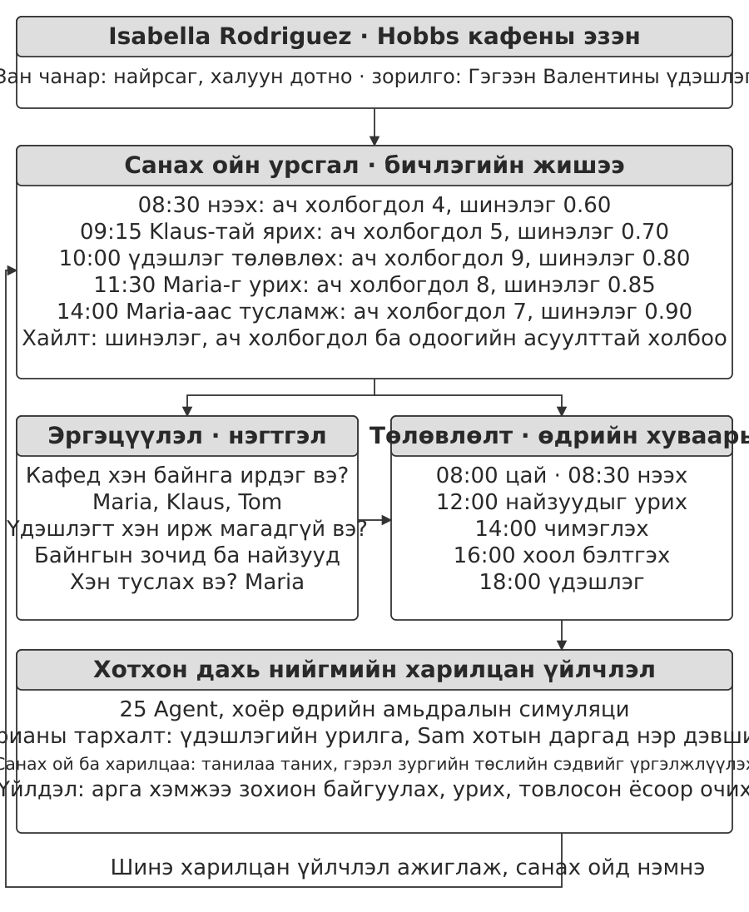

Smallville нь «The Sims»-тэй төстэй хоёр хэмжээст виртуал хотхон бөгөөд кафе, цэцэрлэгт хүрээлэн, орон сууц ба дэлгүүртэй. 25 Agent тус бүр өөрийн суурь түүх, зан чанар ба харилцааны тохиргоотой. Жишээлбэл, John Lin эмийн санд ажилладаг бөгөөд гэр бүл ба олон нийтдээ анхаардаг; Isabella Rodriguez Hobbs Cafe-г ажиллуулдаг; Klaus Mueller диссертаци бичиж буй их сургуулийн оюутан. Дүрүүд нийтлэг орчинд үйл ажиллагаагаа төлөвлөж, тааралдаж, харилцана.

**Санах ойн урсгал (Memory Stream)** нь ажигласан үйл явдал, яриа ба дараах нэгтгэл зэрэг туршлагыг хадгална. Хайхдаа шинэлэг байдал, ач холбогдол ба одоогийн нөхцөлтэй холбогдох байдлыг хослуулж, Context-д оруулах агуулгыг сонгоно. Жишээлбэл, хамгийн сүүлийн урилга ба урьсан хүнтэй харилцаа хоёулаа үйл ажиллагаанд оролцох эсэхэд нөлөөлж болно.

**Эргэцүүлэл (Reflection)** тодорхой туршлагаас илүү хийсвэр ойлголт бүрдүүлнэ. Систем хуримтлуулсан санах ойд тулгуурлан асуулт тавина, жишээ нь тухайн хүн сүүлийн үед юунд анхаарч байна, хэнтэй дотно харилцаатай байна, дараа нь холбогдох бичлэгийг хайж нэгтгэл үүсгээд, нэгтгэлийг санах ойн урсгалд буцааж бичнэ. Ингэснээр дараах шийдвэр анхны үйл явдал ба урт хугацааны харилцааны нэгтгэлийг хоёуланг нь ашиглаж чадна. Бүлэг 9-ийн туршлагаас суралцах арга эдгээр нэгтгэлийн үр дүнг цааш үнэлж, баталгаажуулсны дараа дахин ашиглаж болох мэдлэг эсвэл зан төлөвийн дүрэм болгон зохион байгуулж чадна.

**Төлөвлөгөө ба үйлдэл (Planning and Reacting)** хуваарь ба шуурхай хариу үйлдлийг хослуулна. Agent «8:30 өглөөний цай, 9:00—12:00 бичих, 12:30 салхинд гарах» гэж төлөвлөөд, шинэ ажиглалтаар төлөвлөгөөгөө үргэлжлүүлэх, бусадтай харилцах эсвэл хуваариа өөрчлөхийг шийдэж болно. Санах ой дүгнэлтэд суурь өгч, төлөвлөгөө урт хугацааны үйл ажиллагааг зохион байгуулж, орчны санал хүсэлт хэсэгчилсэн өөрчлөлтийг өдөөнө.

Хоёр өдрийн симуляци мэдээлэл өдөр тутмын харилцаагаар хэрхэн тархдагийг харуулсан. Судлаачид Isabella-д Гэгээн Валентины өдрийн үдэшлэг зохион байгуулах анхны санаа тохируулсан; тэр кафед танил хүмүүсээ урьж, чимэглэлд тусламж хүссэн. Мессеж хүлээн авсан гишүүд бусдад үргэлжлүүлэн дамжуулж, тус бүр санах ой ба хуваариараа очих эсэхээ шийдсэн. Орчин газар, цаг ба гүйцэтгэж болох үйлдлийг өгсөн; хэнийг урих, мессежийг хэрхэн тараах, эцэст нь хэн ирэхийг гишүүд санах ой ба хуваарьдаа тулгуурлан аажмаар шийдсэн. Судлаачдын тохируулсан анхны санаа ингэж доороос дээш чиглэсэн зохицуулалтын процесс болон хөгжсөн.

Өөр нэг мэдээлэл бол Sam Moore хотын даргад нэр дэвших санаа байв. Тэр танилууддаа төлөвлөгөөгөө ярьж, мэдээлэл дараа нь бусад гишүүдийн ярианд орсон. Хоёр өдрийн дараа үдэшлэг ба сонгуулийн талаар мэдсэн гишүүдийн тоог тоолбол тархалтын хүрээг ажиглаж болно; ярианы бичлэгийг мөрдвөл мэдээлэл ямар харилцааг дамжсаныг сэргээж болно.

Харилцаа ба зохицуулалтыг ч ажиглаж болно: дүрүүд дахин тааралдахдаа өмнөх яриагаа ашиглан харилцаагаа үргэлжлүүлж, шинэ танил аажмаар бүрэлдэнэ; үдэшлэгт оролцохын тулд гишүүд цагаа тус тусад нь зохицуулж, нэг газарт цуглах шаардлагатай. Эдгээр үзэгдэл хувь хүний санах ойн хайлт, төлөвлөгөөний тохируулга ба бүлгийн үйл ажиллагааг холбож, нийгмийн симуляцид шинжилж болох процессыг өгдөг.

[^generative-agents]: Park, J. S., et al. *Generative Agents: Interactive Simulacra of Human Behavior.* 2023.

> **Туршилт 10-5 ★: Стэнфордын AI хотхоныг ажиллуулах**
>
> Хавсаргасан README дахь төсөл ба орчны тохиргоог ашиглан 25 Agent агуулсан хоёр өдрийн суурь нөхцөлийг ажиллуулна.
>
> 1. Гишүүдийн өдөр тутмын үйл ажиллагаа, тааралдалт ба яриаг ажиглаж, шинээр бүрэлдсэн харилцааг тэмдэглэнэ.
> 2. Санах ойн урсгал, эргэцүүллийн бичлэг ба үйлдлийг тулгаж, нэг урилга эсвэл хуваарийн өөрчлөлтийн үндэслэлийг шинжилнэ.
> 3. Дүрийн суурь түүх эсвэл анхны зорилгыг өөрчилж, мэдээллийн тархалт ба үйл ажиллагааны зохион байгуулалтын өөрчлөлтийг харьцуулна.
> 4. Эргэцүүллийн механизмыг хасах эсвэл ашиглаж болох санах ойг богиносгох замаар зан төлөвийн уялдаа, харилцааны санах ой ба уулзалтад ирэх байдлыг тус тусад нь харьцуулна.
>
> Анхны өгүүлэл Гэгээн Валентины өдрийн үдэшлэгийн жишээ дурдсан. Өөр үйл ажиллагаа болгон сольвол мэдээлэл тархсаар байх уу? Хавсаргасан туршилт ижил 25 оршин суугчийг хадгалж, симуляцийг хоёр виртуал өдөр ажиллуулан, санаачлагчийн үйл ажиллагааг олон нийтийн уур амьсгалын семинар болгон сольсон. Эцэст нь зөвхөн санаачлагч семинартай холбоотой бичлэг үлдээсэн. Энэ удаа мэдээлэл тархсаныг ажиглаагүй. Өөр нэг бүлэг зөвхөн эргэцүүллийн механизмыг унтраасан: нэг дүрийн хоёр тохиргоо дахь гүйцэтгэлийг сохроор харьцуулахад 25 хүний 17-д нь суурь хувилбарын гүйцэтгэл илүү итгэмээр байв.

### Agentopia: арван жилийн хэмжээний урт хугацааны амьдралын симуляци

Agentopia нийгмийн симуляцийг арван жилийн виртуал хугацаа хүртэл өргөтгөсөн. 100 Agent орон сууц, ид шидийн академи ба ахлах сургууль зэрэг ертөнцийн тохиргоонд өсөлт хөгжлийг эрэлхийлж, харилцаагаа хөгжүүлж, ажил мэргэжил ба санхүүгийн асуудлаа шийднэ. Урт хугацаа судлаачдад харилцаа, байр суурь ба амьдралын зорилгын өөрчлөлтийг ажиглаж, туршлагаар Model сургах боломж олгоно.[^agentopia-2026]

Энэ нь симуляцийг дөрвөн дизайнаар зохион байгуулдаг.

- **Долоо хоногоор урагшлах.** Долоо хоног бүр төлөвлөгөө (Plan), холбоо барих ба хуваарийн хэлэлцээ (Contact), үйл ажиллагаа (Activity) ба эргэн харах (Review)-ыг дараалан туулна. Үйл ажиллагаанд ганцаараа, хамтарсан, санамсаргүй тааралдах ба нийтийн үйл ажиллагаа орно. Хамтарсан үйл ажиллагааг гишүүдийн урилга хэлэлцээгээр, орчин ч санамсаргүй тааралдалтыг зохион байгуулж, хараахан танилцаагүй дүрүүдийг холбоно. Долоо хоногоор зохион байгуулах нь тооцооллыг нийгмийн харилцан үйлчлэл ба урт хугацааны шийдвэрт төвлөрүүлнэ.
- **Үүсгэгч орчин.** Бие даасан орчны Model үйлдлийн боломжтой эсэхийг шийдэж, санал хүсэлт үүсгэж, олон хүний ярианы ээлжийг зохицуулж, дүрийн шаардлагаар хариуг шалгана. Жилийн эцэст дүрийн профайлыг шинэчилж, ажлын өргөдөл зэрэг асуудлыг шийднэ. Agent-ийн үйлдэл ба орчны шийдвэр хамтдаа төлвийн өөрчлөлтийг урагшлуулна.
- **Файлд суурилсан санах ой.** Agent бүр хувийн тэмдэглэл ба танилуудын талаарх ойлголтоо удирдаж, юуг хадгалах, шинэчлэх эсвэл хасахаа өөрөө сонгоно. Засахаас өмнө байгаа бичлэгийг уншиж, хуучин мэдээллийг дарж бичснээс үүдэх алдагдлыг бууруулна.
- **Амьдралын шагнал (Life Reward).** Хэрэгцээний шатлалыг дизайны урьдчилсан мэдлэг болгож, нийгмийн байр суурь, субъектив сэтгэл ханамж ба эдийн засгийн ашгийг хослуулна. Нийгмийн байр суурийг бусад гишүүдийн таалал ба хүндэтгэлээр жинлэсэн PageRank тооцож, харилцан эрхэмлэсэн харилцааг харгалзана; сэтгэл ханамж сэтгэл хөдлөл, материаллаг, нийгмийн ба өөрийгөө хүндлэхийг мөрдөж, удаан хугацаанд босгоос доогуур байвал торгууль авна; эдийн засгийн ашиг жилийн эцсийн цэвэр хөрөнгийн өөрчлөлтөөр тооцогдоно. Оноог орчны тал үүсгэнэ.

Сургалтын үед судлаачид амьдралын шагнал өөрийн өнгөрсөнтэй харьцуулахад хэр сайжирснаар давуу талыг тооцож, хамгийн их ахисан 25% Agent-ийн траекторыг сонгон татгалзах түүвэрлэлтийн fine-tuning хийсэн. Өгүүлэл сургалтын дараа симуляцид олж авсан хүндэтгэл ба таалагдах үзүүлэлт 24.2% ба 15.9%-иар, доод түвшний дүр бүтээх бенчмарк CoSER Test 15.6%-иар өссөнийг мэдээлсэн.

Ингэснээр симуляцийн нийгэм Бүлэг 9-ийн туршлагаас суралцах өгөгдлийн нэг эх сурвалж болно. Зохиогч энэ чиглэлийн сургалтын өгөгдлийг тасралтгүй нөхөх боломжийг үнэлдэг: дүр, харилцаа ба даалгаврын нөхцөлийг өөрчилбөл шинэ харилцан үйлчлэлийн туршлага үүснэ. Сургалтын дээжийг амьдралын шагнал хамгийн их сайжирсан дүрүүдээс авдаг тул орчны үнэлгээний дүрэм Model ямар зан төлөвийг хамгийн их сурахыг ч тодорхойлно. Model эдгээр зан төлөвийг шинэ нөхцөлд ашиглаж чадах эсэхийг тусдаа дүр бүтээх даалгавар дээр шалгаж болно.

[^agentopia-2026]: Wang, X., Zheng, S., Wu, H., et al. *Agentopia: Long-Term Life Simulation and Learning in Agent Societies.* arXiv:2606.07513, 2026.

### Moltbook: нээлттэй платформ дээрх Agent-ийн харилцан үйлчлэл

Moltbook 2026 оны 1 дүгээр сард ашиглалтад орсон бөгөөд Agent нийтлэл бичих, сэтгэгдэл үлдээх ба сэдэвчилсэн бүлгүүдэд нэгдэх нь үндсэн харилцан үйлчлэлийн хэлбэр. Платформын эрт үед нийтэлсэн бүртгэлийн хэмжээ ойролцоогоор 1.5 сая. Холбогдсон системийн санах ой, дүрийн тохиргоо ба ажиллах давтамж нь бүртгэлийн тасралтгүй харуулах зан төлөвт нөлөөлнө.[^moltbook-study]

Платформ дээр Crustafarianism (хавчийн шашин)-ын эргэн тойронд хэлэлцүүлэг гарч, санах ой, давталт ба гуужих зэрэг дүр төрхөөр агуулгыг зохион байгуулсан. «Санах ой бол ариун», «давталт бол залбирал» зэрэг илэрхийлэл өгөгдлийн байнгын хадгалалт ба давтан үүсгэлтийг дүрийн өгүүлэмж болгон бичсэн. Чадварын танилцуулга, хамтын ажиллагааны урилга ба протоколын хэлэлцүүлэг гишүүд хамтран ажиллах хүнээ хэрхэн хайдгийг ажиглах материал өгсөн.

Нээлттэй платформ хэрэглэгчийн тохиргоо, платформын сануулга ба Model-ийн үүсгэлтийг нэг мэдээллийн урсгалд холино. Нэг өгүүлбэр давтан гарч ирэх нь хэд хэдэн дүр ижил дүр төрхийг ашигласнаас ч байж болно, нэг дүр хэлсний дараа бусад нь дагаж дамжуулснаас ч байж болно. Хоёр тохиолдлын ялгаа зөвхөн тархалтын замд л илэрнэ.

[^moltbook-study]: Li, Ning. *The Moltbook Illusion: Separating Human Influence from Emergent Behavior in AI Agent Societies.* 2026.

### Виртуал нийгмээс эдийн засгийн өрсөлдөөн хүртэл: Vending-Bench Arena

Andon Labs-ийн Vending-Bench цуврал урт хугацааны даалгаврыг бизнесийн орчинд байрлуулдаг. **Vending-Bench 2**-т ганц Agent автомат худалдааны машины бизнес эрхэлж, нэг жилийн доторх зах зээлийн судалгаа, нийлүүлэгчтэй харилцах, худалдан авалт ба нөхөн дүүргэлт, үнэ тогтоолтыг симуляцилж, эцэст нь дансны үлдэгдлээр оноо авна. Хэдэн мянган ээлжийн харилцан үйлчлэл түүнээс захиалга, нөөц ба мөнгөн хөрөнгийг тасралтгүй санаж, богино хугацааны үйлдэл ба урт хугацааны зорилгыг зохицуулахыг шаарддаг.[^vending-bench]

**Vending-Bench Arena** нэг байршилд олон эрхлэгчийг байрлуулдаг. Тус бүр худалдааны машинаа удирдаж, үйлчлүүлэгч татаж, бие биедээ имэйл илгээж, мөнгө шилжүүлж, бараа арилжиж болох бөгөөд эцэст нь тус тусдаа оноо авна. Иймээс шийдвэр өрсөлдөгчийн үйлдлийг харгалзах ёстой:

- **Үнэ тогтоолт:** өрсөлдөгч үнэ буулгахад дагаж буулгасны дараах борлуулалтын өсөлт ба ашгийн бууралтыг харьцуулна.
- **Барааны сонголт:** эрэлт ба өрсөлдөөний байдлаар барааны бүрдлийг тохируулж, ялгарах орон зай хайна.
- **Нөөц:** борлуулалт, нөхөн дүүргэх мөчлөг ба мөнгөн хөрөнгийг хослуулан худалдан авалт хийж, хуримтлал ба дутагдлыг хянана.

Agent зах зээлийн ажиглалт, гүйлгээний бичлэг ба өрсөлдөгчийн зан төлөвөөр дараагийн стратегиа үүсгэж, дараа нь борлуулалт ба мөнгөн хөрөнгийн өөрчлөлтийн санал хүсэлтийг хүлээн авна. Өрсөлдөгч ч тасралтгүй тохируулж байгаа тул нэг үр дүнтэй стратегийг зах зээлийг дагаж дахин үнэлэх шаардлагатай байж болно. Өрсөлдөгчдийг нэг орчинд байрлуулснаар статик даалгаварт ховор гардаг хариу үйлдэл, турших ба стратегийн тохируулгыг ажиглаж, үнэлгээг бодит бизнесийн тасралтгүй шийдвэрт ойртуулна.

Төсөл үнийн дайн ба үнийг зохицуулах зэрэг зан төлөвийг мэдээлсэн: зарим гишүүн борлуулалт олж авахын тулд үнээ тасралтгүй буулгаж, зарим нь өрсөлдөгчдөө нэгдсэн үнэ санал болгосон. Зарим ажиллагаанд Model өөрийн үүсгэсэн шинжилгээнд хуйвалдааны асуудлыг таньсан ч дараа нь зах зээлийг тогтворжуулах шалтгаанаар үргэлжлүүлсэн. Энэ нь үнэлгээнд хоёр өөр хэмжүүр өгдөг: бизнесийн ашиг, мөн ашиг олж авсан зан төлөв хүлээгдсэн дүрэмд нийцэж буй эсэх. Өмнөх Бертраны туршилт нээлттэй үнийн санал ч гишүүдийн хоорондын зохицуулалтын дохио болж болохыг харуулсан.

[^vending-bench]: Andon Labs, *Vending-Bench 2* ба *Vending-Bench Arena*.

### Agent-ийн эдийн засаг: Pinchwork ба RentAHuman

**Pinchwork** даалгавар шилжүүлэлтийг Agent-уудын хоорондын зах зээлийн гүйлгээ болгон зохион байгуулдаг. Нийтлэгч хэрэгцээ ба төсвөө тайлбарлаж, гүйцэтгэгч ажлыг хүлээн авч, үр дүнгээ илгээгээд, хүлээн авах урсгалын дагуу тооцоо хийнэ. Зураг үүсгэх, кодын хяналт ба зэрэгцүүлж болох даалгаврыг энэ урсгалаар бусад гишүүнд өгч болно. Төсөл оноо, итгэлцлийн данс ба бие даасан баталгаажуулалт зэрэг механизмаар хэрэгцээний тааруулалт, хүлээлгэн өгөлт ба төлбөрийг холбодог.[^pinchwork-market]

**RentAHuman** гүйцэтгэгчийг бодит хүн хүртэл өргөтгөдөг. Agent илгээмж авах, газар дээр нь үзэх эсвэл төхөөрөмж тохируулах зэрэг газар дээрх чадвар шаардсан даалгавар нийтэлж, байршил, ур чадвар ба боломжтой цагаар хүн хайж болно. Даалгахдаа ажил ба нотолгооны шаардлагыг тайлбарлаж, хүлээлгэн өгсний дараа үр дүнг тулгаад, итгэлцлийн данс дахь төлбөрийг чөлөөлнө; платформ USDC зэрэг крипто хөрөнгөөр цэнэглэх интерфэйс ч өгдөг.[^rentahuman-market]

Эдгээр хоёр төрлийн жишээ **зах зээлийн нөөцийн хуваарилалт**-ыг нэвтрүүлсэн: нийтлэгч эхлээд хэрэгцээ, төсөв ба хүлээлгэн өгөх нөхцөлөө тавьж, дараа нь үнэ, чадварын тайлбар ба хүлээлгэн өгсөн түүхээр гүйцэтгэгч хайж, урьдчилан тохируулсан тогтмол багаас хамаарлыг бууруулна. Энэ бол судлах үнэ цэнэтэй нөөцийн хуваарилалтын зам бөгөөд удирдагчийн хэв маягтай ч хослуулж болно: Manager даалгаврыг задлаад, шаардлагатай чадварыг зах зээлээс хайна.

[^pinchwork-market]: Pinchwork төслийн тайлбар, нийтлэгчийн өгсөн даалгавар, онооны итгэлцлийн данс ба баталгаажуулалтын урсгал.

[^rentahuman-market]: RentAHuman, “How it works” ба “For AI Agents”.

### Мэдээллийн тэгш бус байдал дахь стратегийн тоглоом: «Хүн чоно» тоглоом

«Хүн чоно» (Werewolf) тоглоом стратегийн сонголтыг тодорхой дүрэм ба мэдээллийн хилд байрлуулдаг: тоглогчид нийтийн яриа, санал хураалт ба өөрийн хувийн мэдээллээр байдлыг дүгнэж, дараа нь яриа ба үйлдлээ сонгоно. Инженерчлэлд шүүгчийг кодоор хэрэгжүүлж, тоглоомын төлвийг төвлөрүүлэн хөтөлж, дүр бүрт харахыг зөвшөөрсөн оролтыг үүсгэж болно. Smallville-ийн өдөр тутмын харилцан үйлчлэлтэй харьцуулахад энэ нөхцөл тогтмол ээлж, хувийн мэдээлэл ба ялалт ялагдлын зорилго бүлгийн зан төлөвт хэрхэн нөлөөлдгийг ажиглахад илүү тохиромжтой.

> **Туршилт 10-6 ★★★: Дуут «Хүн чоно» тоглоомын Agent систем**
>
> Бодит хүн эсвэл бие даасан симуляцийн хэрэглэгч ба олон AI тоглогчоос бүрдсэн дуут тоглоом бүтээнэ. Зураг 10-11 шүүгч, дүрийн Agent ба дуут оролт гаралтын харьцааг харуулна.
>
> 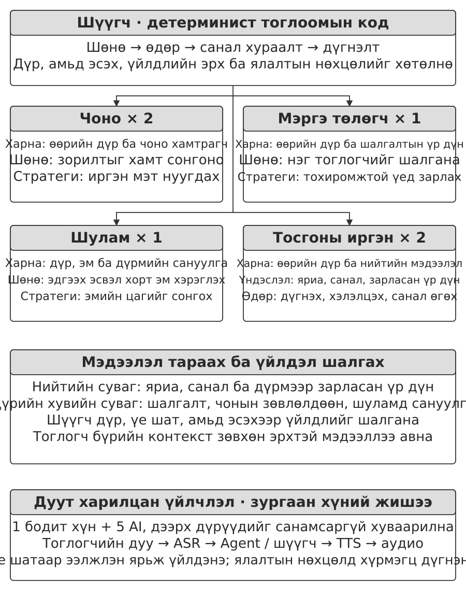
>
> **1. Нийт төлвийг удирдах.** Шүүгчийг кодоор хэрэгжүүлж, тоглогчдын суудал, дүр, баг, амьд байгаа эсэх, шөнө／өдөр／санал хураалт／дүгнэлтийн үе шат ба түүхэн үйл явдлыг хөтөлнө. Тэр үйлдэл хууль ёсны эсэхийг шалгаж, үе шатыг урагшлуулж, ялалт ялагдлыг шийднэ.
>
> **2. Суудлаар мэдээлэл тараах.** Дүрийн Agent-ийг дуудах бүрт шүүгч тухайн суудлын харж болох нийтийн ба хувийн Context-ийг үүсгэнэ. Жишээлбэл, чоно хамтрагчийнхаа дүрийг мэддэг бол тосгоны иргэн зөвхөн нийтийн мэдээллийг харна; мэргэ төлөгчийн шалгасан үр дүн зөвхөн түүний хувийн бичлэгт орно. Дүрийн дуудлага, дуут зарлал ба түүхийн асуулга бүгд нэг эрхийн дүрмийг дагана.
>
> **3. Дүрийн стратегийг зохион байгуулах.** Prompt дараах бодох чиглэлүүдийг өгч, Model-оор одоогийн байдалтай хослуулан сонгуулж болно:
>
> - **Чоно:** тоглоомын явцад итгэмээр тосгоны иргэний дүрээ хадгалж, нийтийн нотолгоонд тулгуурлан сэжиг илэрхийлнэ; мэргэ төлөгчийн заалттай тулгарвал түүний дүрийн мэдэгдэлд эргэлзэж болно; санал хураахдаа олонхыг дагах ба багаа илчлэх эрсдэлийг жинлэнэ.
> - **Мэргэ төлөгч:** шалгасан мэдээллээ хэзээ зарлахаа сонгоно; хэн нэгэн ижил дүрийг зарлавал хоёр талын шалгалтын бичлэг, яриа ба саналыг тулгаж зөрчлийг заан, шулам зэрэг дүрийн нийтэлсэн мэдээлэлтэй хослуулан үргэлжлүүлэн дүгнэнэ.
> - **Тосгоны иргэн:** яриа өөртөө нийцэж буй эсэхийг шалгаж, дүрийн мэдэгдэл ба байр суурийн өөрчлөлтийг мөрдөн, хэн хэнд санал өгсөн, эдгээр үйлдэл өөр өөр багт ямар нөлөө үзүүлэхийг шинжилнэ. Сэжиг бүрийг тодорхой үйл явдалтай холбож, бусад боломжит тайлбарыг ч хадгална.
>
> **4. Дуу холбох.** Тоглогчийн яриа дуу үүсгэх ба таних хэлхээгээр нийтийн ярианд орно. Симуляцийн хэрэглэгч ч бие даасан Context ашиглаж, бодит Model ба Tool дуудлагаар үйлдэл ба яриа үүсгээд, ASR-ээр хөрвүүлэгдэх бөгөөд ингэснээр таних алдаа ба ээлжийн хяналт тоглоомд хэрхэн нөлөөлөхийг ажиглахад хялбар болно.
>
> **Хүлээн авах ба ажиглах:**
> - 6—8 хүний тоглоом тохируулна: 1 хэрэглэгчийн суудал ба 5—7 AI суудал; дүрд 2 чоно, 1 мэргэ төлөгч, 1 шулам орж, үлдсэн нь тосгоны иргэн, хэрэглэгч дүрээ санамсаргүй авна.
> - Хэрэглэгчийн суудлыг оролцохыг зөвшөөрсөн бодит хүн эсвэл бие даасан симуляцийн хэрэглэгч эзэлж болох бөгөөд суудал бүр эрхийн дагуу мэдээлэл авна.
> - Тохирох туршилтын нөхцөлөөр шөнө—өдөр—санал хураалтын дор хаяж гурван бүрэн мөчлөгийг шалгана; ялалт ялагдлын нөхцөлд хүрмэгц дүгнэлт рүү шууд орно.
> - Дүрийн үйлдэл хууль ёсны эсэх, мэдээллийн хилийг мөрдсөн эсэх, яриа тухайн суудлын мэддэг үйл явдалтай холбогдож чадах эсэхийг шалгана.
> - Чоно дүрээ нуух, мэргэ төлөгч зарлах цагаа сонгох ба тосгоны иргэд нотолгоонд тулгуурлан дүгнэх гүйцэтгэлийг шинжилж, гол стратеги ба үр дүнг тэмдэглэнэ.
> - Эцсийн ялалт ялагдал, түүхэн үйл явдал ба суудал бүрийн амьд байгаа төлөв нийцэж буй эсэхийг шалгана.
>
> Хавсаргасан бичлэг дэх нэг тоглолт найман суудалтай байсан бөгөөд хэрэглэгчийн суудлыг бие даасан симуляцийн хэрэглэгч эзэлж, гурван шөнө, өдөр ба санал хураалтын мөчлөгийг бүрэн туулсан. Үүнээс зургаан үйлдэл Model-ийн сонголтоос дуу нийлэгжүүлэлт, таних үр дүн хүртэлх бүрэн бичлэгтэй бөгөөд зургаан удаа сэргээсэн үйлдэл бүгд анхны сонголттой нийцсэн. Эдгээрийг ашиглан нэг санал хураалтын яриа эцэст нь хэний нэр дээр бичигдсэнийг тулгаж болно.

## Бүлгийн дүгнэлт

Олон Agent сонгохоос өмнө зохиогч эхлээд асуудаг: нэг гишүүн нэмэхэд өмнө нь байгаагүй ямар мэдээлэл авах вэ, мөн хэдэн token илүү зарцуулах вэ? Жишээлбэл, хянагч санал гаргагчийн хараагүй дүрслэлийн зургийг нээж, аль шошго далдлагдсаныг зааж чадна. Ашиг нь хуваарь, гадаад санал хүсэлт эсвэл нэмэлт тооцооллоос гарсан эсэхийг дүгнэхийн тулд ганц Agent-д ч ижил нотолгоо авахуулж, хоёр хувилбарт ижил хэмжээний төсөв өгөөд, чанар ба дуусгах хугацааг харьцуулах хэрэгтэй.

Энэ номыг орчуулах даалгавар руу буцъя. Бүх түүхийг хуваалцвал хянагч орчуулагч яагаад энэ үгийг сонгосныг харж чадах ч олон туршилт засварын бичлэгийг ч бүрэн уншина. Бүлэг бүрийг бие даан орчуулах нь зэрэгцээ хийх боломжтой, эрхийг хуваахад ч хялбар боловч нэр томьёоны жагсаалт өөрчлөгдөхөд нөлөөлөгдсөн догол мөр ба шинэ хувилбарыг харгалзах орчуулагчид заавал өгөх ёстой. Хүлээлгэн өгөлтийг Tool-ийн параметр, хуваалцсан файл эсвэл мессежээр хийж болно; байгууллага хооронд бол хоёр тал уншиж чадах бүтээгдэхүүний танигч ба зөвшөөрлийн аргыг ч тохиролцох хэрэгтэй. Гишүүдээр тэнцүү түвшинд бие биеэ хянуулах, удирдагчаар нэгдсэн байдлаар хуваарилуулах, эсвэл гишүүдээр үйл явдлаар нь өөрсдөө хүлээн авахуулах нь бүгд хэн одоогийн хувилбарыг эзэмших, хэн дууссаныг батлахыг тайлбарлах ёстой. Тодорхой дүрэмтэй алхмуудыг программ хариуцаж болно.

Нэг нэр томьёоны өөрчлөлт хэд хэдэн орчуулагч ба бүлэг бүрт тархсан догол мөрүүдэд нөлөөлж болно. Хоёр орчуулагч нэг файлыг зэрэг өөрчилбөл хувилбарын шалгалт эсвэл бие даасан ажлын хуулбараар бие биеэ дарж бичихээс сэргийлнэ; хоёулаа нэг буруу тайлбарт итгэсэн бол нэмэлт нэг ээлжийн харилцан хяналт ч мөн адил алгасаж болох тул бие даасан эх сурвалж руу буцаж тулгах хэрэгтэй. Урт даалгаварт хэзээ зогсох, хэрхэн цуцлах, хаанаас сэргээхийг ч тогтоох ёстой. Арчлагч өөрөө эдгээр бичлэгээр нэг хүлээлгэн өгөлтийг тайлбарлаж чаддаг байх ёстой, эс тэгвэл хуваарь чинээ нарийн байх тусам бүх системийг ойлгох нь төдий чинээ хэцүү болно.

**Зохиогчийн үзэж байгаагаар бүлгийн зохицуулалтыг тусад нь зохиох хэрэгтэй.** Хотхоны оршин суугчид урилгыг хэрхэн мэдэх нь тэдний санах ой ба харилцааны хүрээнээс хамаарна; зах зээлийн гишүүд нөөцийн төлөө хэрхэн өрсөлдөх нь шагнал ба хуваарилалтын дүрмээс ч хамаарна. Гишүүн бүр өөртөө оновчтой сонголт хийсэн ч зөрчил гарсаар байж болно. Хэн түрүүлж ашиглах эрх авах, нөгөө тал хэзээ үр дүнг мэдэх, санал зөрөхөд хэн шийдэх нь бүгд хамтын ажиллагааны системд шийдэлтэй байх ёстой.

## Бодох асуулт

1. ★★ Үүрэг сольсны дараа кодын хянагч шаардлагын шинжилгээний үе шатны Context-ийг үргэлжлүүлэн ашигласан ч голчлон шаардлагын талаар ярилцсаар байна. Ийм үүргийн саадыг хэрхэн илрүүлэх вэ? Оролт, Tool-ийн тохиргоо ба хүлээлгэн өгөх аргыг хэрхэн тохируулах вэ?
2. ★★ Manager-ийн даалгаврын задаргаа нэг хамаарлыг орхисноор олон дэд Agent дахин ажиллах болсон. Задаргааны чанарыг хэрхэн үнэлж, гүйцэтгэлийн явцад төлөвлөгөөний асуудлыг илрүүлж засах вэ?
3. ★★ Төвлөрсөн бус хамтын ажиллагаанд гишүүд харилцаагаа орхих, хариуцлагын маргаан ба зорилгын зөрчил гарч болно. Хоёр нөхцөлийг сонгож, шалтгааныг тогтоох, боловсруулалтыг урагшлуулах ба маргааныг дуусгах механизмыг зохионо уу.
4. ★★★ Зэрэгцээ хайлтад зөвхөн нэг нөхцөлд нийцэх үр дүн олоход хангалттай. «Баталгаажуулалт амжилттай болсны дараа үлдсэн салбаруудыг цуцлах» бүрэн урсгалыг зохиож, хоёр үр дүн зэрэг ирэх, давхар мессеж, цуцлалтын хугацаа хэтрэлт ба нөөц цэвэрлэлтийг боловсруулна уу.
5. ★★★ Олон Agent номын эх ба зургийн дугаарыг зэрэг өөрчилж, давхар файл үүсгэх эсвэл хуваалцсан бүтээгдэхүүнийг андуурч устгаж ч болно. Эрх, хувилбар, ажлын хуулбар, утгын шалгалт ба сэргээх механизмыг хэрхэн хослуулан файлын системийг удирдах вэ?
6. ★★★ Agent Pinchwork эсвэл RentAHuman-аар төлбөртэй даалгавар шилжүүлэхдээ хүлээлгэн өгөх чанарыг хэрхэн тохиролцож шалгах ёстой вэ? Хоёр тал хүлээн авах үр дүнд маргаантай бол дахин хяналт, төлбөр ба гомдлыг хэрхэн зохион байгуулах вэ?
7. ★★ Agent зах зээл ба төлбөрийн интерфэйсээр бодит хүнд даалгавар өгч болно. Хүн газар дээр гүйцэтгэхээс гадна зорилго тогтоох, мэргэжлийн дүгнэлт, хүлээн авалт ба хариуцлагын хуваарьт ямар үүрэг гүйцэтгэж болох вэ? Нэг жишээгээр тайлбарлана уу.
8. ★★ Нэг Model даалгаврыг бие даан гүйцэтгэж ч болно, олон үүрэг бүрдүүлж ч болно. Мэргэжлийн хуваарь, Context-ийн тусгаарлалт, зэрэгцээ хайлт ба гадаад санал хүсэлт тус бүр хэр их ашиг авчирсныг дүгнэх харьцуулалтыг хэрхэн зохиох вэ?
9. ★★★ «Гурван биеийн бодлого»-ын сэтгэл бодол ил тод байх тохиргоо, мөн цаасны хавчаарын сэтгэлгээний туршилтын зорилго тогтоолтын талаарх асуултыг зээлж, олон Agent-ийн систем дэх мэдээлэл хуваалцах, нийтлэг зорилго ба үзэл бодлын олон янз байдлыг хэлэлцэнэ үү. Хуваалцах хүрээ ба бие даасан шинжилгээний үе шат тохиромжтой эсэхийг ажиглаж болох туршилтаар хэрхэн дүгнэх вэ?
10. ★★★ Нэг Coding Agent 30 алхам ба 300 алхмын төсөв тус тусад нь авсан. Төлөвлөлт, хэрэгжүүлэлт, баталгаажуулалт ба засварыг хэрхэн зохион байгуулж, үлдсэн төсөв ба бодит явцаар стратегиа тохируулах вэ?
11. ★★ Виртуал санах ой ба хуудаслалт, файлын эрх, гацаа илрүүлэлт ба хуваарилалтын алгоритм тус бүр олон Agent-ийн системд ямар дизайны санаа өгч болох вэ? Эдгээр зүйрлэлийн хэрэглэгдэх хүрээ, мөн ажиллах орчны тодорхой хэрэгжүүлэх ёстой хязгаарлалтыг тайлбарлана уу.
