# Контекстийн инженерчлэл

Бүлэг 1-д контекстийг Agent-ийн «одоогийн шийдвэрийн хараа»-тай зүйрлэсэн: Model дүгнэлт гаргах бүртээ яг тэр мөчид хүлээн авсан мэдээлэлдээ тулгуурладаг. **Контекстийн инженерчлэл** (Context Engineering) энэ мэдээллийг сонгох, зохион байгуулах, шинэчлэх үүрэгтэй. Үүнд системийн заавар, Tool-ийн тодорхойлолт, хэрэглэгчийн хүсэлт, өмнөх мессежүүд болон даалгаврын төлөв багтана. Harness нь Model-ийг дуудах бүрийн өмнө даалгаврын суурь мэдээлэл, хамгийн сүүлийн явцыг оролт болгон цэгцэлдэг. Зураг 2-1 контекстийн цонхны бүрэлдэхүүнийг бодит агуулгаар харуулна.

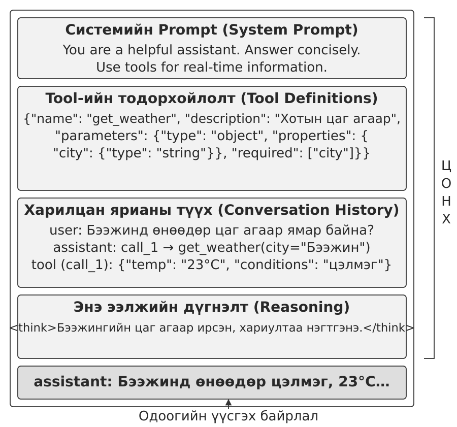

## Контекст: Model-ийн чадварыг тодорхой даалгаварт ашиглах нь

Туршлагатай нэгэн инженер дөнгөж багт нэгдээд «манай журмын дагуу тохиргоог өөрчил» гэсэн анхны даалгавар авлаа гэж төсөөлье. Тэр программ бичиж чадна, гэхдээ тохиргооны жинхэнэ эх сурвалж аль файл болох, аль талбарыг өөрчилж болох, өөрчлөлтөө хэрхэн шалгахаа хараахан мэдэхгүй. Бүх кодын санг гарт нь өгсөн ч буруу файлыг засаж мэднэ. Agent танихгүй төсөл хүлээн авахдаа яг ийм суурь мэдээлэл дутдаг.

«Энэ bug-ийг засаж өгөөч» гэсэн хүсэлтийг жишээ болгоё. Coding Agent-д ихэвчлэн гурван төрлийн суурь мэдээлэл хэрэгтэй:

- **Кодын бодит цагийн контекст:** хавтасны бүтэц, модулиудын үүрэг, үндсэн өгөгдлийн бүтэц, код бичих стандарт. Жишээлбэл, автоматаар үүсгэдэг тохиргооны файлыг засвал локал орчинд ажилласан ч дараагийн удаа үүсгэхэд дарагдана. Файлыг аль модуль үүсгэдгийг мэдсэн үед л засах ёстой газраа олно.
- **Ажлын журам:** Git салбарын стратеги, commit-ийн дүрэм, кодын хяналтын журам, CI/CD-ийн шаардлага. Agent үүнд тулгуурлан өөрчлөлт, тест, commit-оо төлөвлөж, ажиллуулах систем нь эрхийн дагуу эдгээр үйлдлийг гүйцэтгэнэ.
- **Орчны мэдээлэл:** хөгжүүлэлтийн тохиргоо, тестийн өгөгдлийн сантай холбогдох арга, тестийн орчинд байршуулах арга, API түлхүүрийг удирдах арга. Энэ мэдээлэл түүнд зөв ажиллах орчныг сонгож, локал болон тестийн орчны ялгааг ойлгоход тусална.

Төслийн код ч, тестийн өгөгдлийн сан ч Model-ийн контекстээс гадна байдаг. Автоматаар үүсгэдэг тохиргооны жишээн дээр Agent хайлтын Tool-ээр үүсгэгч скриптийг уншсаны дараа л хаанаас засаж эхлэхээ мэднэ. **Model өөрт байгаа чадвараа тухайн асуудалд ашиглаж чадах эсэхийг контекстийн чанар шийднэ.** **Их хэмжээний суурь мэдээлэлд тулгуурладаг даалгаварт хангалттай чадвартай Model бүрэн, үнэн зөв контексттэй байвал шаардлагатай материалгүй илүү хүчирхэг Model-оос сайн ажиллаж болно.**

**AI-д тулгуурласан баг байгуулахын тулд эхлээд гол мэдлэгээ баримтжуулах хэрэгтэй.** Тухайн үед тодорхой өгөгдлийн санг сонгосон шалтгааныг зөвхөн ахмад ажилтнууд санаж, бизнесийн дүрмийн өөрчлөлтийг зөвхөн хувийн чатанд дурдсан бол шинэ хамт олон ч, Agent ч ажлыг хүлээн авахдаа ижил асуудалтай тулгарна: баг юу хийснийг кодоос харж болох ч яагаад тэгж хийснийг олж харахгүй.

**Алсын зайнаас хамтран ажиллахад ээлтэй баг ихэвчлэн Agent-д ч ээлтэй байдаг.** Linux цөмийн хөгжүүлэгчид patch-ийг шуудангийн жагсаалтаар хэлэлцэж, хяналтын санал солилцдог бөгөөд хөгжүүлэлтийн журмын баримт бичигт patch-ийг хэрхэн илгээх, хянах, нэгтгэхийг тайлбарласан байдаг[^ch2-linux]. Шинэ оролцогч санаанд оромгүй өөрчлөлттэй таарвал тухайн patch-ийг мөрдөж, тэр үеийн маргааныг олж чадна; Agent суурь мэдээллийг нягтлахдаа ч энэ бүртгэлийг ашиглана.

Зохиогч Вэн Жяи-ийн WhynotTV-д өгсөн ярилцлагыг сонсоод түүний нэг санааг ингэж товчилсон: **хүн ч, Model ч Context-оос хамаардаг.** Хүн шийдвэр гаргахад оролцсон хамт олноосоо дахин асууж болно. Харин Model ямар суурь мэдээллийг унших нь баг ямар бүртгэл үлдээсэн, мөн Harness энэ удаагийн хүсэлтэд юуг оруулснаас хамаарна.[^ch2-weng]

[^ch2-linux]: Linux цөмийн албан ёсны баримт бичиг, How the development process works.

[^ch2-weng]: WhynotTV, «Вэн Жяи: OpenAI, GPT, бататгах сургалт, Infra, дараах сургалт, Tianshou, tuixue, нээлттэй эх, CMU, Цинхуа», Podcast #4.

ReAct өгүүлэлд харилцан үйлчлэлийн түүх шийдвэрт хэрхэн оролцдогийг албан ёсны илэрхийллээр тодорхойлсон[^ch2-react]. $t$ мөчид Agent орчноос $o_t\in\mathcal{O}$ ажиглалт хүлээн авч, $\pi(a_t\mid c_t)$ стратегийн дагуу $a_t\in\mathcal{A}$ үйлдлийг сонгоно. Энд контекст нь:

$$
c_t=(o_1,a_1,\ldots,o_{t-1},a_{t-1},o_t)
$$

Энэ илэрхийлэл **Agent-ийн дараагийн үйлдэл одоог хүртэлх харилцан үйлчлэлийн түүхээс хамаардаг** гэдгийг харуулна. Жишээлбэл, Agent аль файлыг шалгасан, Tool ямар алдаа буцаасан нь дараагийн сонголтод нөлөөлнө. LLM Agent-ийн хувьд хэрэглэгчийн оролт ба Tool-ийн үр дүн ажиглалтыг өгч, Tool дуудах болон гадагш өгсөн хариулт үйлдлийг бүртгэнэ; системийн заавар ба Tool-ийн тодорхойлолт даалгаврын дүрэм, ашиглах боломжтой интерфейсийг нэмж тайлбарлана.

Энэ бүлэгт эхлээд төлөвгүй (stateless) хүсэлтийн аргыг авч үзнэ: Harness ээлж бүрд мессеж болон Tool-ийн тодорхойлолтыг угсарч, дараа нь Model-ийг дуудна. Мессежийн бүрэн түүх даалгаврын явцыг хадгалахад тохиромжтой; түүх өсөх тусам хайлт, төлөвийн бүртгэл, шахалтын тусламжтайгаар дараагийн шийдвэрт хэрэгтэй мэдээллийг цонх дотор үлдээж болно. Контекстийн байрлал, төлөвийн мөр, шахалтын арга бүгд нэг л асуултыг тойрно: хязгаарлагдмал контекст дотор Model-д энэ алхамд хэрэгтэй мэдээллийг $c_t$-д хэрхэн багтаах вэ?

[^ch2-react]: Yao, Shunyu, et al., ReAct: Synergizing Reasoning and Acting in Language Models, ICLR 2023.

## Agent LLM-ийг хэрхэн дууддаг вэ: API-ийн контекстийн бүтцийг ойлгох нь

Эхлээд энгийн мэндчилгээн дээр мессежийн форматыг харж, дараа нь «Ванкуверт одоо хэдэн цаг болж байна, цаг агаар ямар байна?» гэсэн асуулт хоёр Tool дуудлагад хэрхэн хүргэдгийг үзнэ. Энэ хэсэгт Chat Completions-той нийцтэй интерфейс болон локал ажиллаж буй Qwen3-0.6B-г ашиглаж, төгсгөлд нь ээлж бүрийн хүсэлтийг Python-оор холбоно[^ch2-chat-api].

### Жишээнд гарах мессежийн дөрвөн үүрэг

Хүсэлт дэх **мессежийн жагсаалт** (`messages`) харилцан үйлчлэлийн мэдээллийг дарааллаар нь хадгална. Мессеж бүрийг **үүрэг** (`role`)-ээр тэмдэглэж, эх сурвалж болон зориулалтыг нь заана. Энэ хэсэгт дөрвөн үүрэг ашиглана:

- **system:** системийн Prompt. Энэ хэсэгт хөгжүүлэгчийн өгсөн дүр, зан үйлийн дүрэм, хязгаарлалтыг агуулж, мессежийн жагсаалтын эхэнд байрлана. Зарим Model-ийн интерфейс хөгжүүлэгчийн зааврыг `developer` үүргээр дамжуулдаг.
- **user:** хэрэглэгчийн мессеж; даалгавар, нэмэлт асуулт, нэмэлт шаардлагыг хадгална.
- **assistant:** Model-ийн хариулт; текст болон Tool дуудах хүсэлтийг агуулна. Эдгээр мессежийг дараагийн ээлжийн оролтод буцааж оруулбал Model өмнөх хариулт, үйлдлийн хүсэлтээ уншиж чадна.
- **tool:** Tool гүйцэтгэсний үр дүн. Harness буцах утгыг хүлээн авмагц Tool-ийн мессеж болгон бичиж, `tool_call_id`-ээр тодорхой дуудлагатай холбоно.

Tool-ийн тодорхойлолтыг хүсэлтийн дээд түвшний `tools` талбараар дамжуулж, ашиглах боломжтой Tool-үүдийн нэр, зориулалт, параметрийн форматыг жагсаана.

Model Tool-ийн тодорхойлолтод тулгуурлан дуудлагын хүсэлт үүсгэдэг. Тухайн үйлдлийг гүйцэтгэж чадах эсэхийг харин Harness болон ажиллах орчин шийднэ.

[^ch2-chat-api]: OpenAI, Chat Completions API-ийн лавлах; мессежийн үүрэг, Tool-ийн тодорхойлолт, дуудлагын үр дүнгийн талбаруудыг тайлбарласан. Qwen, Function Calling; нийцтэй үйлчилгээн дэх Tool дуудлага ба загварчлалыг тайлбарласан.

### Нэг ээлжийн харилцан яриа: хамгийн энгийн API дуудлага

Эхлээд нэг удаагийн асуулт хариултыг харъя. Хэрэглэгч «Hello, who are you?» гэж асуухад Harness системийн заавар болон хэрэглэгчийн асуултыг хамт Model руу илгээж, хариултыг нь уншина. Зураг 2-2 хүсэлт ба хариултын харгалзааг харуулна.

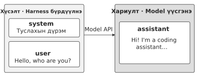

Доор локал Model-ийн интерфейсийн хэлбэрээр хүсэлт болон жишээ хариултыг бичив; кодын тайлбарт хэсэг бүрийн эх сурвалжийг тэмдэглэсэн:

```javascript
// Harness 构造请求
{
  "model": "Qwen3-0.6B",
  "messages": [
    {
      "role": "system",                           // 开发者提供的指令
      "content": "You are a helpful coding assistant. Follow user instructions."
    },
    {
      "role": "user",                              // 用户输入
      "content": "Hello, who are you?"
    }
  ]
}
```

```javascript
// API 返回响应
{
  "choices": [{
    "message": {
      "role": "assistant",                         // 模型生成
      "content": "Hi! I'm a coding assistant. I can help you write code, debug issues, and explain technical concepts. How can I help?"
    }
  }]
}
```

Хүсэлт нэг `system` мессеж, нэг `user` мессежтэй бөгөөд хариултын `choices[0].message` нь Model-ийн үүсгэсэн `assistant` мессежийг хадгална. Энд ашиглаж буй төлөвгүй интерфейст **дуудлага бүрд шаардлагатай контекстийг Harness хангана**. Дараагийн хүсэлт энэ яриаг үргэлжлүүлэх бол холбогдох түүхийг хамт илгээх ёстой.

### Tool дуудлагатай олон ээлжийн харилцан үйлчлэл: Agent-ийн үндсэн давталт

Одоо Tool шаардсан асуултыг авч үзье: «What's the current time and weather in Vancouver?» Үүнд хариулахын тулд эхлээд тухайн газрын цаг болон цаг агаарыг олж мэдэх хэрэгтэй. Зураг 2-3-т Harness Model-ийг анх дуудахад хоёр Tool-ийн хүсэлт ирнэ. Harness цагийн үйлчилгээ болон цаг агаарын үйлчилгээнээс тус тусад нь асууж, хоёр үр дүнг мессежийн түүхэд нэмээд Model-ийг хоёр дахь удаагаа дуудсаны дараа л хэрэглэгчид өгөх хариултыг авна.

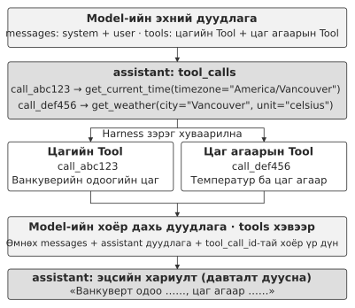

Эдгээр хоёр Tool-ийн алийг нь түрүүлж гүйцэтгэх вэ? Цагийн Tool-д цагийн бүс, цаг агаарын Tool-д хот болон температурын хэмжүүр хэрэгтэй. Хэрэглэгч зөвхөн Ванкувер гэж хэлсэн тул жишээн дэх Model үүнд тулгуурлан `America/Vancouver` болон `Vancouver`-ийг бөглөж, хэмжүүрт Цельсийг сонгосон. Цаг агаар асуухад цагийн Tool-ийн хариуг хүлээх шаардлагагүй тул хоёр асуулгыг зэрэг илгээж болно.

**API-г анх дуудах нь: Agent-ийн framework эхний хүсэлтийг илгээнэ:**

```javascript
// 第一次模型调用：Harness 构造请求
{
  "model": "Qwen3-0.6B",
  "messages": [
    {
      "role": "system",                           // 开发者提供的指令
      "content": "You are a helpful assistant. Use the provided tools to get real-time information when needed."
    },
    {
      "role": "user",                              // 用户输入
      "content": "What's the current time and weather in Vancouver?"
    }
  ],
  "tools": [                                       // 开发者定义的工具
    {
      "type": "function",
      "function": {
        "name": "get_current_time",
        "description": "Get the current date and time in a specific timezone",
        "parameters": {
          "type": "object",
          "properties": {
            "timezone": { "type": "string", "description": "Timezone name, e.g. America/Vancouver" }
          },
          "required": ["timezone"]
        }
      }
    },
    {
      "type": "function",
      "function": {
        "name": "get_weather",
        "description": "Get the current weather for a specific city",
        "parameters": {
          "type": "object",
          "properties": {
            "city": { "type": "string", "description": "City name" },
            "unit": { "type": "string", "enum": ["celsius", "fahrenheit"] }
          },
          "required": ["city", "unit"]
        }
      }
    }
  ]
}
```

Энэ `tools` жагсаалтыг хөгжүүлэгч урьдчилан тодорхойлсон бөгөөд нэр, тайлбар, параметрийн schema-г агуулна. Энэ жишээнд ээлж бүрийн хүсэлтэд ижил хоёр Tool-ийг өгдөг; Model жагсаалт болон хэрэглэгчийн асуултыг уншсаны дараа дуудах Tool-ээ сонгож, параметрийг бөглөнө.

**Model Tool дуудах хоёр хүсэлт буцаана:**

```javascript
// 模型返回工具调用请求
{
  "choices": [{
    "message": {
      "role": "assistant",                         // 模型生成
      "content": null,                             // 本轮没有文本回复
      "tool_calls": [                              // 请求调用两个工具
        {
          "id": "call_abc123",
          "type": "function",
          "function": {
            "name": "get_current_time",
            "arguments": "{\"timezone\": \"America/Vancouver\"}"
          }
        },
        {
          "id": "call_def456",
          "type": "function",
          "function": {
            "name": "get_weather",
            "arguments": "{\"city\": \"Vancouver\", \"unit\": \"celsius\"}"
          }
        }
      ]
    }
  }]
}
```

Хариултын `tool_calls` хоёр хүсэлттэй бөгөөд хүсэлт бүр өөрийн `id`, Tool-ийн нэр, параметртэй. `arguments` нь JSON-оор кодлогдсон тэмдэгт мөр тул гүйцэтгэх тал эхлээд задлан уншиж, дараа нь талбар болон утгыг шалгах хэрэгтэй. **Юуг дуудах, ямар параметр дамжуулахыг Model шийднэ; шалгах, хуваарилах ажлыг Harness хариуцна; цаг эсвэл цаг агаарын үйлчилгээнд хандах ажлыг Tool-ийн хэрэгжүүлэлт гүйцэтгэнэ.**

**Agent-ийн framework Tool-үүдийг гүйцэтгээд API-г хоёр дахь удаагаа дуудна:**

Harness хүсэлтийг шалгасны дараа хоёр Tool-ийг ажиллуулж, буцах утгуудыг `tool` мессеж болгон бичээд, өмнөх түүхийг шинэ үр дүнгийн хамт Model-д өгнө:

```javascript
// 第二次模型调用：追加工具结果
{
  "model": "Qwen3-0.6B",
  "messages": [
    {
      "role": "system",                           // 保留第一次请求中的消息
      "content": "You are a helpful assistant. Use the provided tools to get real-time information when needed."
    },
    {
      "role": "user",                              // 保留第一次请求中的消息
      "content": "What's the current time and weather in Vancouver?"
    },
    {
      "role": "assistant",                         // 保留前一轮模型的调用请求
      "content": null,
      "tool_calls": [
        { "id": "call_abc123", "type": "function", "function": { "name": "get_current_time", "arguments": "{\"timezone\": \"America/Vancouver\"}" } },
        { "id": "call_def456", "type": "function", "function": { "name": "get_weather", "arguments": "{\"city\": \"Vancouver\", \"unit\": \"celsius\"}" } }
      ]
    },
    {
      "role": "tool",                              // Harness 写入工具执行结果
      "tool_call_id": "call_abc123",
      "content": "{\"timezone\": \"America/Vancouver\", \"datetime\": \"2025-09-13T05:18:47\", \"day_of_week\": \"Saturday\"}"
    },
    {
      "role": "tool",                              // Harness 写入工具执行结果
      "tool_call_id": "call_def456",
      "content": "{\"city\": \"Vancouver\", \"temperature\": 13.2, \"unit\": \"celsius\", \"conditions\": \"clear\", \"humidity\": 93}"
    }
  ],
  "tools": [ ... ]                                 // 沿用前面的工具定义，此处省略
}
```

Хоёр дахь хүсэлтийг `call_def456`-ийн дагуу уншъя: өмнөх `assistant` мессежид энэ нь Ванкуверийн цаг агаарын асуулгын дугаар байсан; дараагийн `tool` мессеж мөн ижил дугаараар 13.2 ℃ болон цэлмэг тэнгэрийг буцаасан. Цаг агаарын хариу цагийнхаас түрүүлж ирсэн ч Harness үр дүнг хүсэлттэй нь зөв тааруулж чадна. Энэ ээлжид Model хэрэглэгчийн анхны асуулт, өөрийн илгээсэн хоёр асуулга, Tool-үүдийн буцаасан өгөгдлийг нэгэн зэрэг уншина. Ингээд хэрэглэгчид хариулах боломжтой болно.

**Model Tool-ийн үр дүнд тулгуурлан эцсийн хариултыг үүсгэнэ:**

```javascript
// 模型生成最终回复
{
  "choices": [{
    "message": {
      "role": "assistant",                         // 模型生成
      "content": "It's currently 5:18 AM on Saturday, September 13, 2025 in Vancouver.\n\nWeather: 13.2°C with clear skies and 93% humidity. It's quite cool this morning - you might want to grab a jacket."
    }
  }]
}
```

Хоёр дахь хариулт эцсийн текстийг өгч, `tool_calls` хоосон тул жишээн дэх давталт үүгээр дуусна. «Model-ийг дуудах → Tool гүйцэтгэх → үр дүнг буцаах → Model-ийг дахин дуудах» гэсэн энэ үйл явц бол Бүлэг 1-ийн ажиллах давталтыг API дээр бодитоор хэрэгжүүлсэн хэлбэр юм.

Хэрэглэгч «Токио яах вэ?» гэж нэмж асуувал Harness энэ мессежийг түүхийн төгсгөлд нэмээд Model-ийг дахин дуудна. Model «одоогийн цаг болон цаг агаарыг асуух» гэсэн даалгаврын суурь мэдээллийг үргэлжлүүлэн ашиглаж, Токиод зориулсан шинэ хүсэлт үүсгэнэ; Tool-үүд хариу буцаасны дараа шинэ хариултаа бүрдүүлнэ.

**Responses API ашиглавал Tool-ийн үр дүнг хэрхэн буцааж өгөх вэ?** Дээрх локал туршилт Chat Completions-той нийцтэй интерфейс ашигласан. OpenAI-ийн үйлчилгээгээр шинэ төсөл хөгжүүлж байгаа бол албан ёсоор Responses API-г зөвлөдөг. Ванкуверийн жишээгээ үргэлжлүүлье: програм хэрэглэгчийн асуултыг хүсэлтийн `input`-д оруулж, `tools`-д цаг болон цаг агаарын хоёр функцийг зарлана. Буцаж ирэх `output` нь төрөлтэй элементүүдийн цуваа байна. Тэдгээрийн дунд хоёр `function_call` гарвал програм тус бүрээс функцийн нэр, параметр, `call_id`-г уншиж, Tool-үүдийг тус тусад нь гүйцэтгэнэ.[^ch2-responses-loop]

Цаг агаарын функцийн дуудлагын дугаар `call_weather` гэж үзье. Тэгвэл дараагийн хүсэлтийн `input`-д дараах баталгааг оруулж болно; цагийн функц ч өөрийн дугаараар үр дүнгээ буцаах ёстой.

```json
{"type": "function_call_output", "call_id": "call_weather", "output": "{\"temperature\": 13.2, \"unit\": \"celsius\"}"}
```

`call_id` нэг баталгааг нэг функцийн дуудлагатай тааруулна. `previous_response_id` нь Model-ийн өмнөх хариултыг зааж, үйлчилгээнд тэр ээлжийн контекстийг үргэлжлүүлэх боломж олгоно. Хоёр дугаар өөр өөр объектыг заадаг. Ийм үргэлжлүүлэх аргыг ашиглах үед энэ ээлжид ч үргэлжлүүлэн ашиглах Tool-үүд болон дээд түвшний `instructions`-ийг өгөх шаардлагатай; өмнөх хүсэлтийн дээд түвшний заавар хариултын дугаараар автоматаар өвлөгдөхгүй. Model дахин Tool хүсэж болох тул програм дараагийн `output`-ийг уншаад дуусгах эсэхээ шийдэх хэрэгтэй. Бүлэг 1-ийн Туршилт 1-3 сервер талд байршуулсан хайлтыг ашигласан бол энд байгаа хоёр өөрийн тодорхойлсон функцийг програм өөрөө гүйцэтгэнэ.

[^ch2-responses-loop]: OpenAI, Responses API руу шилжих, функц дуудах болон хариулт үүсгэх параметрийн тайлбар.

### Agent-ийн үндсэн давталтыг кодоор хэрэгжүүлэх нь

Давталт доторх хоёр `messages.append` нь Model-ийн хариулт болон Tool гүйцэтгэсний үр дүнг тус тус хадгална. Цаг ч, температур ч Ванкуверийнх; хоёр дуудлагын ID-г сольчихвол дараагийн ээлжид Model «цаг асуух» дуудлага 13.2 хэм Цельс буцаасан гэж уншина.

Жишээ OpenAI Python SDK-аар нийцтэй үйлчилгээнд холбогдоно. Анхдагч хаяг нь өөрийн машин дээрх `http://localhost:8000/v1` бөгөөд аль хэдийн ажиллаж буй, нэвтрэлт шаардахгүй локал үйлчилгээнд тохирно. Эдгээр анхдагч утга Туршилт 2-1-ийн vLLM backend-д харгалзана. Тухайн туршилтын Ollama backend-ийг ашиглах бол хаягийг `http://localhost:11434/v1` болгож, Model-ийн нэрийг `qwen3:0.6b` болгон өөрчил. Өөр үйлчилгээнд холбогдох үед шаардлагатай бол `LLM_BASE_URL` болон `LLM_API_KEY` орчны хувьсагчийг тохируулж, доорх `model`-ийг бодит байршуулсан нэртэй тааруулна. Мессежүүдийг харьцуулахад хялбар болгох үүднээс цаг болон цаг агаарын Tool-үүд түр зуур өмнөх жишээний тогтмол өгөгдлийг ашиглана; бодит өгөгдөлд холбогдох үедээ эдгээр хоёр Tool-ийн хэрэгжүүлэлтийг солино.

```python
import json
import os

from openai import OpenAI

client = OpenAI(
    base_url=os.getenv("LLM_BASE_URL", "http://localhost:8000/v1"),
    api_key=os.getenv("LLM_API_KEY", "EMPTY"),
)

# 工具定义：名称、用途和参数结构
tools = [
    {
        "type": "function",
        "function": {
            "name": "get_current_time",
            "description": "Get the current date and time in a specific timezone",
            "parameters": {
                "type": "object",
                "properties": {
                    "timezone": {"type": "string", "description": "Timezone name, e.g. America/Vancouver"}
                },
                "required": ["timezone"],
            },
        },
    },
    {
        "type": "function",
        "function": {
            "name": "get_weather",
            "description": "Get the current weather for a specific city",
            "parameters": {
                "type": "object",
                "properties": {
                    "city": {"type": "string", "description": "City name"},
                    "unit": {"type": "string", "enum": ["celsius", "fahrenheit"]},
                },
                "required": ["city", "unit"],
            },
        },
    },
]

# 示例工具使用固定数据，参数与前面的温哥华查询一致。
def execute_tool(name, arguments):
    args = json.loads(arguments)
    if name == "get_current_time" and args == {"timezone": "America/Vancouver"}:
        result = {
            "timezone": "America/Vancouver",
            "datetime": "2025-09-13T05:18:47",
            "day_of_week": "Saturday",
        }
    elif name == "get_weather" and args == {"city": "Vancouver", "unit": "celsius"}:
        result = {
            "city": "Vancouver", "temperature": 13.2,
            "unit": "celsius", "conditions": "clear", "humidity": 93,
        }
    else:
        result = {"error": "示例仅提供温哥华时间和摄氏天气数据"}
    return json.dumps(result, ensure_ascii=False)

# 初始消息：指令与用户任务
messages = [
    {"role": "system", "content": "You are a helpful assistant. Use tools to get real-time information when needed."},
    {"role": "user", "content": "What's the current time and weather in Vancouver?"},
]

# 运行循环：最多调用模型八轮
rounds = 0
while rounds < 8:
    rounds += 1
    response = client.chat.completions.create(
        model="Qwen3-0.6B", messages=messages, tools=tools
    )
    assistant_message = response.choices[0].message

    # 保存模型回复，包括本轮的调用请求
    messages.append(assistant_message.model_dump(exclude_none=True))

    # 本例在模型给出不含工具调用的回复时结束
    if not assistant_message.tool_calls:
        print(assistant_message.content)
        break

    # 逐个执行并追加结果；独立调用也可以改为并行调度
    for tool_call in assistant_message.tool_calls:
        try:
            result = execute_tool(tool_call.function.name, tool_call.function.arguments)
        except json.JSONDecodeError:
            result = json.dumps({"error": "工具参数需要有效的 JSON"})
        messages.append({
            "role": "tool",
            "tool_call_id": tool_call.id,
            "content": result,
        })
    # 下一轮使用追加了结果的消息列表
else:
    print("已达到轮数上限，任务尚未完成。")
```

Model эхний ээлжид цаг болон цаг агаарыг зэрэг хүссэн гэж үзье. Энд `for` давталт эхлээд цагийг асууж, үр дүнг `messages`-д нэмээд, дараа нь цаг агаарыг асууж, хоёр дахь үр дүнг нэмнэ. Хоёулаа гүйцэтгэгдсэний дараа л програм `while`-ийн эхэнд буцаж, Model руу хоёр дахь хүсэлтээ илгээнэ. Эдгээр алхам бүрд `messages`-ийн агуулгыг задлан харвал Model удаа бүр юу хүлээн авсныг харж болно.

**Анхны төлөв (1 дэх дуудлагын өмнө):**
```text
messages = [
  { role: "system",  content: "You are a helpful assistant..." },     # 开发者写的
  { role: "user",    content: "What's the current time and weather in Vancouver?" },  # 用户输入
]
```

**Model-ийн 1 дэх дуудлага болон Tool-ийн гүйцэтгэл дууссаны дараа:**
```text
messages = [
  { role: "system",    content: "..." },
  { role: "user",      content: "What's the current time..." },
  { role: "assistant", tool_calls: [get_current_time, get_weather] },  # 模型生成的调用请求
  { role: "tool",      tool_call_id: "call_abc123", content: "{time...}" },  # 工具执行后由 Harness 写入
  { role: "tool",      tool_call_id: "call_def456", content: "{weather...}" },  # 工具执行后由 Harness 写入
]
```

**2 дахь дуудлагын дараа (Model эцсийн хариултаа буцааж, давталт дуусна):**
```text
messages = [
  { role: "system",    content: "..." },
  { role: "user",      content: "What's the current time..." },
  { role: "assistant", tool_calls: [get_current_time, get_weather] },
  { role: "tool",      tool_call_id: "call_abc123", content: "{time...}" },
  { role: "tool",      tool_call_id: "call_def456", content: "{weather...}" },
  { role: "assistant", content: "It's currently Saturday, Sep 13, 2025 in Vancouver..." },  # 最终回复
]
```

### API-ийн өнцгөөс контекстийн бүрэлдэхүүнийг харах нь

Зураг 2-4 нэг хүсэлтийг префикс ба мессежийн түүх гэсэн хоёр хэсэгт хуваана. Дөнгөж илгээсэн Ванкуверийн асуулгын үед түүхэд зөвхөн хэрэглэгчийн асуулт болон өмнөх харилцан яриа байсан. Хоёр асуулга дуусахад түүхэд Model-ийн санал болгосон Tool дуудлага болон хоёр Tool-ийн үр дүн нэмэгдэнэ.

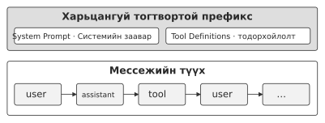

Иймээс дараалан илгээсэн хоёр хүсэлтийн эхэнд ижил байх хэсэг мессежийн түүх хүртэл үргэлжилж болно. Дараагийн дуудлага хуучин тооцооллын хэдийг дахин ашиглаж чадах нь энэ префикс хэр урт байснаас хамаарна.

Доорх Harness төдийлөн өөрчлөгддөггүй системийн заавар болон Tool-ийн тодорхойлолтыг эхэнд нь байрлуулж, ээлж бүрд зөвхөн түүхийн төгсгөлд одоогийн төлөвийг нэмдэг. Түүх хэт урт болвол эхлээд хуучин мессежүүдийг шахаж, дараа нь хүсэлтийг угсарна.

```python
stable_prefix = system_message
stable_tools = core_tool_schemas
history = load_message_history(session)
status_message = make_status_message(derive_current_state(history))

if estimated_tokens(stable_prefix, stable_tools, history, status_message) > budget:
    history = compress_old_evidence(
        history,
        preserve = [decisions, constraints, failures, citations]
    )

request.messages = [stable_prefix] + history + [status_message]
request.tools = stable_tools
response = call_model(request)
```

Шахахдаа шийдвэр, хязгаарлалт, алдаа, ишлэл зэрэг дараагийн ажилд хэрэгтэй мэдээллийг үлдээж, дуудлагын хүсэлт болон Tool-ийн үр дүнгийн холбоог хадгална. Уртын төсвөөс гадна мэдээллийн давталт болон хуучирсан байдал ч шахалт эхлүүлж болно; тодорхой стратегийг энэ бүлгийн хоёрдугаар хагаст дэлгэрэнгүй авч үзнэ.

> **Туршилт 2-1 ★: Локал LLM үйлчилгээг байршуулж, Tool дуудах**
>
> Энэ туршилтад Qwen3-0.6B-г локал ажиллуулж, «Ванкуверийн цаг болон цаг агаарыг асуух» даалгаврын дагуу мессеж Model, parser, Tool гүйцэтгэгчээр хэрхэн дамждгийг ажиглана. Зураг 2-5 локал үйлчилгээ болон клиентийн хуваарийг харуулна: сервер Model-ийг ачаалж, оролтыг боловсруулж, хариулт үүсгэдэг; клиент мессежийн түүхийг хадгалж, Tool-үүдийг хуваарилан ажиллуулж, үр дүнг буцаана.
>
> 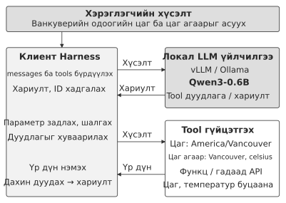
>
> **Эхлээд бүрэн нэг даалгаврыг мөрдөж үзье.** Model нэг ээлжийн гаралтад цаг болон температурыг асуух хүсэлт гаргаж, `America/Vancouver`, `Vancouver`, `celsius` зэрэг параметрийг тус тус бөглөнө. Клиент хоёр Tool-ийг зэрэгцүүлэн гүйцэтгэнэ. Эхний баталгаа орон нутгийн цагийг 11:11:28 гэж, хоёр дахь баталгаа температур 17.9 °C гэж өгнө. Хоёр үр дүнг Model руу буцаасны дараа тэр цагийг минутаар хүртэл хэлж, температур 17.9 °C гэж хариулаад энэ давталтыг дуусгана. Энэ ажиллагаа нь зургаан зуун сая параметртэй Model энэ даалгаварт хоёр Tool-ийг зөв сонгож, параметрийг бөглөж, буцах утгаар хэрэглэгчид хариулж чадаж байгааг харуулна.
>
> **Дараа нь түүхий гаралт API-ийн талбартай хэрхэн харгалзахыг харъя.** Qwen3-ийн сэтгэх горим `<think>` тэмдэглэгээ бүхий дүгнэлтийн агуулга үүсгэж болох бөгөөд Tool-ийн хүсэлт нь түүнд тохирох дуудлагын тэмдэглэгээг ашиглана. Сервер задлан уншсаны дараа клиент тусдаа `thinking` эсвэл Tool дуудлагын талбар хүлээн авч болно. Гаралтын хэсгүүдийн дараалал, хадгалагдах байдлыг Model-ийн загвар болон үйлчилгээний протокол хамт шийднэ.
>
> **Үргэлжлүүлэн урсгалт боловсруулалтыг ажиглая.** Интерфейс үйл явдал бүрд «бодож байна», «Tool дуудаж байна», «хариулт үүсгэж байна» зэрэг төлөвийг шинэчилж болно. Tool-ийн параметр ихэвчлэн хэд хэдэн хэсгээр ирдэг тул бүрэн хүсэлт болгон хуримтлуулах шаардлагатай; протокол дуудлага дууссаныг баталгаажуулж, параметр, эрх, хамаарлын шалгалт давсны дараа ажиллуулах систем хуваарилалтыг эхлүүлж болно. Бие даасан Tool-үүдийг зэрэг гүйцэтгэх боломжтой бөгөөд дараагийн гаралтын боловсруулалттайгаар урсгал шугам үүсгэж болно.
>
> **Төгсгөлд нь хурд болон кэшийг харьцуулъя.** Apple-ийн чиптэй Mac дээр хийсэн энэ удаагийн бүртгэлд Tool-ийн даалгаврын дундаж декодлох хурд секундэд ойролцоогоор 107 token байв. Token бол Model текстийг боловсруулах үндсэн нэгж бөгөөд хуваалтыг tokenizer шийднэ; нэг үг эсвэл ханз нэг буюу хэд хэдэн token-д харгалзаж болно. Декодлох хурд нь үүсгэж эхэлсний дараах гаралтын хурдыг илэрхийлнэ; хэрэглэгч хэр удаан хүлээх нь эхний token-ийн саатал, дүгнэлтийн урт, Tool-ийн зарцуулсан хугацаанаас ч хамаарна.
>
> Кэшийн харьцуулалтад ижил урт префикс ашиглаж, префиксийг хадгалсан ба префиксийн эхлэлийг өөрчилсөн хүсэлтүүдийг тус тусад нь туршсан. Энэ удаагийн таван хос харьцуулалтад префиксээ хадгалсан хүсэлтийн дөрөв нь илүү хурдан байв; хоёр бүлгийн дундаж эхний token-ийн саатал тус тус ойролцоогоор 1.30 секунд, 1.51 секунд байв. Дараагийн хэсэгт эдгээр хүсэлт тооцооллын хувьд юугаараа ялгаатай болохыг тайлбарлана.
>
> Энэ туршилт зохиогчийн төхөөрөмж дээрх Agent-д итгэлийг улам бэхжүүлэв: жижиг Model хэрэглэгчийн өөрийнх нь төхөөрөмж дээр ийм Tool дуудлагын даалгаврыг аль хэдийн гүйцэтгэж чадаж байна. **Төхөөрөмж дээрх Agent-ийн эрин олон хүний хүлээснээс илүү ойрхон байна.**

## KV Cache-д ээлтэй контекстийн загвар

Agent-ийн дараалсан хүсэлтүүд ихэвчлэн маш их мэдээллийг хуваалцдаг: системийн заавар, Tool-ийн тодорхойлолт, мөн өмнө нь болсон харилцан үйлчлэл. Хэрэв дүгнэлтийн систем (inference engine) эдгээр агуулгын завсрын тооцооллын үр дүнг дахин ашиглаж чадвал илүү их тооцооллыг шинэ мэдээлэлд зарцуулж болно. **KV Cache** нь анхаарлын тооцооллын давхарга бүрд аль хэдийн олдсон түлхүүр (Key) болон утгыг (Value) дараагийн token-уудад зориулж хадгална; **Prompt Cache** нь үүнээс цааш хүсэлтүүдийн хооронд нөхцөл хангасан префиксийн кэшийг дахин ашиглана[^ch2-kv-basics].

Хэрэглэгчийн үйлчилгээний Agent-ийг төсөөлье: Model-д одоогийн цагийг мэдүүлэхийн тулд хөгжүүлэгч системийн Prompt-ийн эхэнд `Current time: {{now}}` гэж нэмж, хүсэлт бүрд шинэчилдэг. Дараах бизнесийн дүрэм болон Tool-ийн тодорхойлолт хэвээрээ үлдэх боловч бодит оролт цагийн тэмдэглэгээнээс эхлэн өөрчлөгдөнө. Ижил префиксээр KV-г дахин ашигладаг үйлчилгээний хувьд энэ нь цагийн тэмдэглэгээ болон түүнээс хойшхи хэсгийг дахин тооцоолох шаардлага үүсгэж, оролтыг боловсруулах хугацаа, зардлыг нэмэгдүүлнэ.

Цагийг нэмэлт мессеж болгон бичих эсвэл шаардлагатай үед цагийн Tool-ийг дуудах нь байгаа префиксийг хадгална. Хоёр байрлал өгөх мэдээлэл нь ойролцоо боловч дахин тооцоолох хүрээ нь өөр.

Дараах гурван аргыг эхлээд санаж болно; дараах зарчим болон туршилтууд тус бүрийг нь тайлбарлана:

1. **Дахин ашиглах боломжтой префиксийг тогтвортой байлга.** Системийн заавар болон байнга хэрэглэдэг Tool-ийн тодорхойлолт тогтмол агуулга, дараалалтай байх ёстой.
2. **Ажиллагааны явцад гарсан өөрчлөлтийг ард нь нэм.** Цаг, үлдэгдэл, дуудлагын тоо, даалгаврын явцыг шинэ мессеж эсвэл Tool-ийн үр дүнгээр дамжуулж болно. Хамгийн сүүлийн төлөв хэзээнээс хүчин төгөлдөр болохыг тэмдэглэсэн байх ёстой, ингэснээр Model аль бүртгэл одоогийн шийдвэрт хамаарахыг ялгаж чадна.
3. **Мессежийг Model-ийн протоколын дагуу зохион байгуул.** Зөв үүрэг, дуудлагын ID, Tool-ийн үр дүнгийн формат ашиглаж, Model-ийн оролтыг харгалзах чатын загвараар үүсгэ. Кэш нь боловсруулсан префикс болон холбогдох тохиргоотой таардаг; мессежийн протокол нь Model заавар, хэрэглэгчийн хүсэлт, Tool-ийн буцах утгыг хэрхэн ялгахыг ч тодорхойлно.

Энэ хэсэгт ашиглаж буй учир шалтгааны анхаарлын (causal attention) Model-д дараагийн token-ууд нэмэгдсэнээр өмнөх байрлалд аль хэдийн тооцоологдсон төлөв өөрчлөгдөхгүй. Байгаа оролтыг өөрчлөхөд анхны өөрчлөгдсөн байрлал болон түүнээс хойшхи төлөв дахин тооцоологдох шаардлагатай; өөрчлөлтөөс өмнөх префикс дахин ашиглагдах боломжтой хэвээр байна. Сервер нь кэшийн блокийн хэмжээ, хадгалах хугацаа, ажиллагааны тохиргооноос хамааруулан бодит хит болох хүрээг шийднэ.

[^ch2-kv-basics]: Hugging Face, How caching works; давхарга бүрд K, V-г хадгалах, дахин ашиглах механизмыг тайлбарласан.

> **Туршилт 2-2 ★: Анхаарлын механизмыг визуалчлах нь**
>
> Эхлээд «Бээжингийн цаг агаар ямар вэ» гэсэн өгүүлбэрээр нэг удаагийн анхаарлын тооцооллыг ойлгоё. Үзүүлэхэд хялбар болгох үүднээс Зураг 2-6 энэ өгүүлбэрийг дөрвөн утга зүйн нэгжид хуваасан; бодит Model оролтыг tokenizer-аар хуваана. «ямар вэ» гэсэн байрлалыг боловсруулахдаа анхаарлын давхарга байгаа мэдээллээс одоогийн дүрслэлийг нийлүүлж гаргана. Query, Key, Value нь тус тус асуулт тавих, тааруулах, мэдээллийг нэгтгэх үүрэг гүйцэтгэнэ.
>
> | Вектор | Үүрэг | Энэ жишээн дэх ойлгомжтой утга |
> | --- | --- | --- |
> | **Query (асуулт)** | Одоогийн байрлал бусад байрлалтай тааруулахад ашиглах вектор | «ямар вэ» нь байгаа агуулгаас холбогдох мэдээллийг олох шаардлагатай |
> | **Key (түлхүүр)** | Байрлал бүрийн тааруулалтад оролцох вектор | «Бээжин», «цаг агаар» зэрэг байрлал тааруулах боломжтой дүрслэл өгнө |
> | **Value (утга)** | Жингээр нэгтгэсэн мэдээллийн вектор | Газар, цаг агаарын мэдээллийг харгалзах хувиар одоогийн дүрслэлд нэгтгэнэ |
>
> Key-г хайлтад ашиглах шошго, Value-г буцааж авсан агуулга гэж төсөөлж болно. Model доторх эдгээр вектор нь далд дүрслэлээс тооцоологдсон тоон утга бөгөөд тааруулах байдлыг нь сургалт бүрдүүлдэг.
>
> Нэг тооцоолол гурван алхамаас бүрдэнэ. Эхлээд одоогийн байрлал Query үүсгэнэ; дараа нь тэр байрлал бүрийн Key-тэй цэгийн үржвэр хийж, хуваах, учир шалтгааны маск (causal mask) болон softmax-аар дамжуулан нийлбэр нь 1 болох анхаарлын жинг гаргана; эцэст нь эдгээр жингээр Value-г жигнэж нэгтгэнэ. Цэгийн үржвэр нь хоёр бүлэг тоог байрлал бүрээр үржүүлж нэмэх үйлдэл бөгөөд softmax харагдах байрлалуудын оноог хэвийн жин болгон хувиргана. Байрлал бүрийн Value харгалзах жингээр нэгтгэлд оролцож, энэ анхаарлын толгойн гаралтыг хамт бүрдүүлнэ.
>
> Зураг 2-6-ийн сүүлийн мөрийг хэвтээ чиглэлд уншъя: «ямар вэ» байрлал «цаг агаар»-т 0.55 жин өгчээ. Энэ тоог «цаг агаар» байрлалын Value-тэй үржүүлж, бусад гурван байрлалын хувь нэмрийг нэмсэн үед л энэ анхаарлын толгой «ямар вэ» дээрх гаралтаа өгнө. «цаг агаар» мөр рүү шилжихэд баруун талд яагаад нэмэлт × гарч ирэв? Учир нь энэ байрлалыг тооцоолох үед дараалал «ямар вэ» хүрээгүй байсан.
>
> 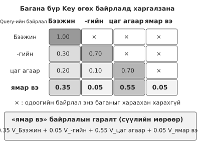
>
> Байрлал бүрийн жинг матриц болгон эмхэлбэл **анхаарлын халуун зургийг** (attention heatmap) олж авна. Мөр бүр нэг Query, багана бүр нэг Key-д харгалзаж, өнгөний гүн нь жингийн хэмжээг илэрхийлнэ. Учир шалтгааны маск нь одоогийн байрлалд өөрөө болон өмнөх байрлалуудыг уншихыг зөвшөөрдөг; зурагт хаагдсан байрлалыг ×-ээр тэмдэглэсэн бөгөөд тэдгээрийн softmax-ын дараах жин тэг байна. Энэ бүтэц оролтыг боловсруулах болон дараагийн үүсгэлтийн аль алинд хамаарна.
>
> Эндээс K, V кэшийн зориулалт ч харагдана: үүсгэлт үргэлжлэхэд шинэ байрлал байгаа байрлалуудын Key, Value-г уншсаар байна. Эдгээр векторыг хадгалснаар шинэ байрлал тэдгээрийг шууд ашиглан тааруулж, нэгтгэх боломжтой бөгөөд түүхэн байрлалуудыг давтан тооцоолох шаардлагагүй болно.
>
> Энэ жишиг жинг ойлгосны дараа Qwen3-0.6B-г ашиглан Model-ийн бодитоор тооцоолсон анхаарлын тархалтыг харъя. Туршилтад богино өгүүлбэр болон дүгнэлт, эцсийн хариулт агуулсан үүсгэлтийн дарааллыг тус тусад нь бүртгэж, өөр өөр давхаргын анхаарлын матрицыг харьцуулсан. Зураг 2-7 тус тус 0, 13, 27 дугаар давхаргыг харуулна: зүүн багана нь есөн token-тэй богино өгүүлбэр, баруун багана нь 17 × 23-ыг тооцоолсон үүсгэлтийн дараалал бөгөөд оролт, дүгнэлт, хариултын байрлалын хүрээг тэмдэглэсэн. Саарал өнгийг логарифм масштабаар авсан тул хүчтэй, сул анхаарлын жинг зэрэг харж болно.
>
> 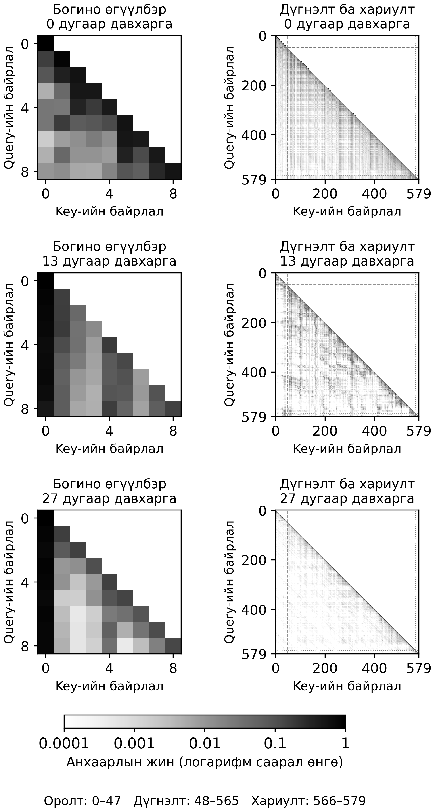
>
> Уншихдаа дөрвөн чиглэлээр дүн шинжилгээ хийж болно:
>
> 1. **Анхаарлын хуримтлал (Attention Sink).** Зарим давхарга дарааллын эхэнд харьцангуй их жин өгдөг, тэр ч байтугай эхний token маш бага утга агуулж байсан ч. Зураг 2-7-ийн зүүн баганы богино өгүүлбэрийг харъя. Зураг бүрт нэг давхаргын анхаарлын толгойнуудын дунджийг авсан. Матрицын эхний баганын есөн тооны дунджийг гаргавал есөн байрлал эхний token-д дунджаар хэр их жин хуваарилсныг тооцож болно. 0, 13, 27 дугаар давхаргад энэ нь тус тус 14.7%, 73.9%, 83.2% байв. Баруун баганы урт үүсгэлтийн дараалал руу шилжихэд 13 дугаар давхаргын энэ утга 28.0% болж өөрчлөгдөнө. softmax байрлал бүрийн жингийн нийлбэрийг 1 байхыг шаарддаг тул Model харьцангуй тогтвортой хүлээн авах байрлалыг сурч гаргаж чадна; StreamingLLM энэ үзэгдэл болон урсгалт дүгнэлт дэх үүргийг тусгайлан судалсан[^ch2-attention-sinks].
> 2. **Дүгнэлтийн бүс.** `<think>`-д харгалзах үүсгэлтийн интервалыг тэмдэглэж, эдгээр мөрөөр Model ямар Prompt, Tool-ийн тайлбар эсвэл өмнөх дүгнэлтэд анхаарсан байгааг харна. Гурвалжин учир шалтгааны маскаас үүсдэг бөгөөд гурвалжны доторх гүн нь байрлал бүрийн жингийн ялгааг илэрхийлнэ.
> 3. **Хариултын бүс.** Эцсийн хариултын үүсгэлтийн интервалыг тэмдэглээд, түүний анхны оролт болон өмнөх дүгнэлтэд хуваарилсан жинг харьцуулна. Энэ нь ямар байгаа мэдээлэл одоогийн анхаарлын нэгтгэлд орсныг тодорхойлоход тусална.
> 4. **Байрлалын ялгаа.** «Lost in the Middle» бүтээл урт контексттой асуулт хариулт болон түлхүүр-утгын хайлтад дунд байрлалын мэдээллийг үр дүнтэй ашиглахад хэцүү байдгийг ажигласан[^lost-in-the-middle]. Инженерчлэлийн хувьд байнга хэрэгтэй дүрмийг эхэнд, одоогийн зорилго болон явцыг төгсгөлд нь байрлуулахыг үүнд үндэслэн эрэмбэлж болно.

[^ch2-attention-sinks]: Xiao et al., Efficient Streaming Language Models with Attention Sinks, ICLR 2024.

[^lost-in-the-middle]: Liu et al., Lost in the Middle: How Language Models Use Long Contexts, TACL 2024.

### API мессежээс Model-ийн token руу: Chat Template

Дээрх API-ийн жишээ нь үүрэг бүхий мессежүүдийн бүлэг байсан бол анхаарлын зураг дээрх оролт нь token-уудын цуваа юм. **Chat Template (чатын загвар)** энэ хувиргалтыг гүйцэтгэнэ: мессежүүдэд үүрэг болон хил тэмдэглэгээ нэмж, Tool-ийн тайлбар болон буцах утгыг тохиролцсон байдлаар зохион байгуулж, дараа нь tokenizer-т кодлуулна. Зураг 2-8-ийн хоёр баганыг харьцуулъя: зүүн талд зөвхөн системийн заавар болон хэрэглэгчийн асуулт илгээгдсэн бол баруун талд яагаад нэг `assistant` нэмэгдэв? Тэр нь загвар дараагийн хариултад зориулж нэмсэн эхлэлийн тэмдэглэгээ. Дараа нь Tool дуудлага, дүгнэлтийн мэдээллийг хадгалах, кэшийн хит зэргийг хэлэлцэхдээ эдгээр тэмдэглэгээг дахин ашиглана.

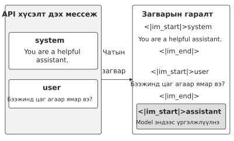

Qwen, Llama, Gemma зэрэг Model-ийн гэр бүл бүр өөрийн чатын загвартай. Ижил бүлэг API мессежийг өөр Model-д өгөхөд хувиргалтын үр дүнд гарах үүрэг, хил тэмдэглэгээ өөр байж болно. Hosting-той API-д хувиргалтыг ихэвчлэн сервер гүйцэтгэдэг бол өөрөө байршуулах үед дүгнэлтийн үйлчилгээнд Model-той таарах загварыг тохируулах шаардлагатай.

Хэрэглэгч «Ванкувер 17.9 °C» гэсэн өгүүлбэр илгээж, цаг агаарын Tool ч яг ижил текстийг буцаасан гэж үзье. Эдгээр хоёр мессежийг Qwen3-0.6B-ийн загварт тус тусад нь өгвөл Зураг 2-9-д үзүүлсэн хоёр оролт гарна. Хоёулаа `<|im_start|>user`-ээр эхэлдэг; аль тэмдэглэгээ текст Tool-ээс ирснийг илтгэж байна вэ?

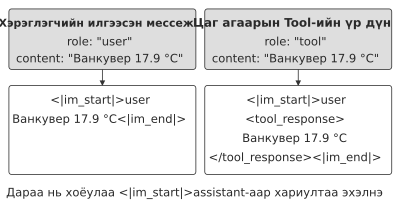

Баруун баганад нэг хос `<tool_response>` шошго нэмэгдсэн. Загвар нь мөн мессежийн үүргээр хэрэглэгчийн хамгийн сүүлийн асуултыг тодорхойлдог: энэ асуултаас өмнөх ээлжүүдэд зөвхөн хариултын агуулгыг үлдээдэг бол үүнээс хойш Tool-ийн харилцан үйлчлэл Model-ийн дүгнэлтийн мэдээллийг дагуулж болно[^ch2-qwen-template].

Жишээлбэл, Model файл шалгасны дараа дүн шинжилгээгээ үргэлжлүүлэх шаардлагатай хэвээр байна. Tool-ийн үр дүнг `tool` үүргээр буцаавал загвар үүнийг одоогийн даалгаврын Tool-ийн санал хүсэлт гэж танина; ижил үр дүнг энгийн `user` мессеж болгон шууд бичвэл загвар үүнийг шинэ асуулга гэж үзэж, өмнөх дүгнэлтийг хадгалах хүрээг өөрчилж болно. Энэ нь нэг бодлогыг үргэлжлүүлэн бодохдоо бодолтын ноорог хадгалахтай адил: Harness үйлчилгээний шаардсан дүгнэлтийн талбарыг хадгаж, зөв мессежийн бүтцээр үргэлжлүүлэн дуудах ёстой.

**Нэг ээлжийн дүгнэлтээс урт хугацааны Agent руу шилжихэд түүхэн бодолт аажмаар засварлах шаардлагатай даалгаврын төлөв болдог.** DeepSeek-R1-ийн эхний үеийн чатын загвар түүхэн хариултаас бодолтын хэсгийг хасч, зөвхөн эцсийн хариултыг үлдээдэг байсан[^ch2-r1-template]; харин дараагийн DeepSeek-ийн Tool дуудлагын протокол дүгнэлтийн мэдээллийг буцаахыг шаарддаг. Нэг асуулт хариулт дууссаны дараа эцсийн хариулт дараагийн ээлжид хэрэгтэй мэдээллийг аль хэдийн агуулж болно; харин Tool-ийн даалгавар хагас замдаа байх үед «энэ файлыг яагаад шалгав», «ямар таамаглалыг аль хэдийн үгүйсгэв» гэдэг нь зөвхөн завсрын дүгнэлтэд бичигдсэн байж болно. Энэ мэдээллийг хадгалах нь дараагийн ээлжид өмнөх бодлын дагуу ажиллахад тусална.

**Дүгнэлтийн мэдээллийг буцаах аргыг Model-ийн протокол шийднэ.** Холбохдоо `content`, `tool_calls` болон үйлчилгээний өгсөн дүгнэлтийн талбарыг зэрэг боловсруулах хэрэгтэй. Дараах хэдэн шийдэл үргэлжлүүлэх өөр өөр дүрмийг харуулна:

- **DeepSeek-ийн сэтгэх горим** дүгнэлтийг `reasoning_content`-оор буцаана. Түүний Tool дуудлагын протоколын дагуу хүсэлтэд `tools` байвал дараагийн хүсэлтүүд түүхэн дүгнэлтийг бүрэн буцаах ёстой, үүнд Tool дуудаагүй Model-ийн хариулт ч багтана; талбар дутуу бол 400 алдаа гарна. `tools`-гүй цэвэр чатын хүсэлтийн үед үйлчилгээ буцаасан түүхэн дүгнэлтийг үл тоомсорлодог[^ch2-deepseek-thinking].
- **Kimi-ийн сэтгэх ба Tool-ийн харилцан үйлчлэл** мөн ажиллагааны давталтад дүгнэлт, Tool-ийн хүсэлт, үр дүнг удирдах шаардлагатай. Kimi K2.5-ийн хосолсон сэтгэлгээний жишээгээр Model хэд хэдэн Tool дуудлагын хооронд дүгнэлтээ үргэлжлүүлж болох бөгөөд клиент протоколын дагуу Model-ийн мессежийг хадгалж, буцаана[^ch2-kimi-thinking].
- **GLM-ийн хадгалсан сэтгэлгээг** `thinking.clear_thinking: false`-ээр нээж, дараа нь `reasoning_content`-ийг бүрэн, анхны дарааллаар нь буцаана. Coding Plan болон стандарт API-ийн анхдагч тохиргоо өөр тул клиент шаардлагатай горимоо тодорхой сонгох ёстой[^ch2-glm-thinking].
- **Claude-ийн thinking block**-ийг гарын үсгийн хамт хадгалах шаардлагатай. preserved thinking-ийг дэмждэг Model блокийн гарал үүсэл болон префиксийг ч шалгана; дэлгэрэнгүй дүрмийг дараах «Кэшийг архитектурын хязгаарлалт гэж үзэх нь» хэсгээс үзнэ үү.

Эдгээр дүрэм дараалсан Tool дуудлагад ч, дунд нь Model солиход ч нөлөөлнө. Солих үед адаптацийн давхарга Tool-ийн хүсэлт, үр дүн, даалгаврын төлөвийг зорилтот интерфейсийн хүлээн авах хэлбэрт хувиргаж, дараа нь зорилтот Model-ийн дүрмээр дүгнэлтийн мэдээллийг боловсруулна. Бүлэг 5-ын Туршилт 5-1 ийм траекторийг үргэлжлүүлэх аргыг дэлгэрэнгүй авч үзнэ.

**Загвар нь кэшийн тааруулах оролтыг ч шийднэ.** Ижил мессежийн агуулга өөр загвар, өөр Tool-ийн дараалал эсвэл өөр цуваачлалаар боловсруулагдвал өөр token префикс үүсгэж болно. Байгаа KV-г дахин ашиглахын тулд холбогдох Model-ийн тохиргоо болон префиксийг ижил байлгах хэрэгтэй.

[^ch2-qwen-template]: Qwen3-0.6B-ийн tokenizer-ийн тохиргооны файл `tokenizer_config.json` чатын загварыг хадгалсан бөгөөд үүнд хэрэглэгчийн асуулга, дүгнэлтийн агуулга болон Tool-ийн хариултыг боловсруулах логик багтсан.

[^ch2-r1-template]: DeepSeek-R1-ийн албан ёсны чатын загвар энгийн түүхэн хариултад `</think>`-ийн дараах агуулгыг үлдээдэг; дараагийн Tool дуудлагын дүгнэлтийг буцаах дүрмийг DeepSeek-ийн Thinking Mode баримт бичгээс үзнэ үү.

[^ch2-deepseek-thinking]: DeepSeek, Thinking Mode.

[^ch2-kimi-thinking]: Moonshot AI, Kimi K2.5-ийн албан ёсны репозитори, Interleaved Thinking and Multi-Step Tool Call хэсэг.

[^ch2-glm-thinking]: Z.ai, Thinking Mode; хосолсон сэтгэлгээ, хадгалсан сэтгэлгээ болон endpoint-ийн анхдагч тохиргоог тайлбарласан.

### KV Cache-ийн зарчим ба хязгаарлалт

Model нэг хүсэлтийг боловсруулахдаа эхлээд оролтыг **prefill (урьдчилан дүүргэх)** хийж, байгаа token-уудын дүрслэлийг тооцоолно, дараа нь **decode (декодлох)** руу шилжиж, дараагийн token-уудыг нэг нэгээр үүсгэнэ. KV Cache декодлох явцад байгаа байрлалуудын K, V-г хадгална; хүсэлтүүдийн хоорондын префиксийн кэш өмнөх хүсэлтийн үлдээсэн ижил префиксийг улам дахин ашиглана.

Жишээлбэл, Agent зургаа дахь ээлжид 2,000 оролтын token хуримтлуулсан байв. Үйлчилгээ зөвхөн энэ хүсэлтийн доторх KV Cache-г ашиглавал эхлээд тэр 2,000 token-ыг боловсруулж, дараа нь кэшээр үүсгэлтээ үргэлжлүүлнэ. Хэрэв хүсэлтүүдийн хоорондын кэшэд тэдгээрийн нэг хэсэг ижил префикс аль хэдийн байвал prefill кэшлэгдээгүй байрлалаас үргэлжлүүлж болно. Зураг 2-10 ийм хүсэлтүүдийн хоорондын дахин ашиглалтыг харуулна.

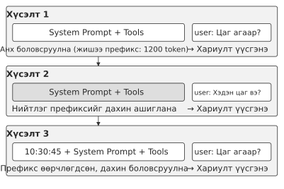

**Дөрвөн token-оор кэшийн өсөлтийг мөрдөж үзье.** Оролт `[A, B, C, D]` гэж үзье. Model D байрлалыг боловсруулахдаа D-ийн Query-г A, B, C, D-ийн Key-тэй тааруулж, дараа нь тэдгээрийн Value-г жингээр нэгтгэнэ. Давхарга бүрийн тооцооллын дараа D байрлалын эцсийн дүрслэл дараагийн E token-ыг таахад ашиглагдана. Энэ үед A-аас D хүртэлх байрлалын K, V давхарга бүрд хадгалагдсан байна.

Сэмпл авч E-г гаргасны дараа дараагийн алхамд E-г Model руу оруулж, түүний давхарга бүр дэх Query, Key, Value-г тооцоолно. E-ийн Query өмнөх кэш болон одоогийн байрлалын K, V-г уншиж, Model зургаа дахь token-ыг таана; E-ийн K, V зэрэг кэшэд нэмэгдэнэ. Ийнхүү үүсгэлтийн алхам бүрд өмнөх төлөвийг үргэлжлүүлэн ашиглаж, зөвхөн шинэ оролтын token-ын төлөвийг тооцоолно.

KV Cache-г огт ашиглахгүй бол E-г таахдаа A-аас D хүртэлх байрлалыг дахин боловсруулж, зургаа дахь token-ыг таахдаа дахин A-аас E хүртэлх байрлалыг боловсруулах шаардлагатай болно. Зөвхөн K, V давтан үүсгэх байрлалын тоогоор тооцвол хуримтлагдсан ажлын хэмжээ $1+2+\cdots+N$ гэж өснө. Кэш ашигласнаар түүхэн байрлалуудын давхарга бүрийн тооцоолол дахин ашиглагдана; шинэ байрлал харагдах K, V-г унших шаардлагатай хэвээр байна. Стандарт бүрэн анхаарлын декодлолд энэ уншилт, тааруулалт контекстийн урттай шугаман өсдөг тул урт контекст илүү их видео санах ой болон санах ойн зурвасын өргөн эзэлсээр байна.

**Оролтыг өөрчлөх нь дараагийн кэшэд яагаад нөлөөлдөг вэ?** Transformer-ийн давхаргууд далд дүрслэлийг дараалан боловсруулж, давхарга бүр өөрийн K, V-тэй байна. Аль нэг байрлал анхаарлын тооцоолол хийсний дараа түүний дүрслэлд өмнөх байрлалуудын мэдээлэл аль хэдийн нэгтгэгдсэн байдаг бөгөөд энэ нь дараагийн давхаргад дамжина. Иймээс $k$ дахь token өөрчлөгдөхөд нөлөө нь тухайн байрлалаас урагш, илүү өндөр давхаргууд руу тархана.

Ижил Model болон тооцооллын тохиргоонд $k$-ээс өмнөх байрлалууд зөвхөн урьд өмнөх оролтоос хамаардаг тул үргэлжлүүлэн дахин ашиглаж болно; харин $k$-ээс эхлэн нөлөөлөгдсөн төлөвийг дахин бүрдүүлэх шаардлагатай. Бодит үйлчилгээ ихэвчлэн кэшийн блокоор префиксийг тааруулдаг тул дахин тооцоолох хил блокийн хэмжээнээс ч хамаарна. Шинэчлэл урагш байх тусмаа ихэнх оролтыг дахин тооцоолох шаардлагатай болдог. Тогтвортой зааврыг эхэнд, шинэ төлөвийг ард нь байрлуулах нь яг энэ хамаарлыг ашиглаж байгаа хэрэг.

> **Туршилт 2-3 ★★: Контекст удирдах аргуудын харьцуулалт**
>
> Энэ туршилтад Agent файл олох, унших, хайх Tool-үүдийг ашиглан нэг ижил даалгаврыг гүйцэтгэж, тогтвортой нэмдэг нэг суурь хувилбар болон контекстийн таван өөрчлөлтийг харьцуулсан. Суурь хувилбар заавар болон Tool-ийн дарааллыг тогтвортой хадгалж, ээлж бүрд Model-ийн мессеж болон Tool-ийн үр дүнг нэмдэг. Бусад бүлэг тус бүр заавар, төлөв, Tool-ийн эрэмбэ эсвэл түүхийн илэрхийллийг өөрчилж, кэшийн статистик болон даалгаврын явц хэрхэн өөрчлөгдөхийг ажигласан.
>
> **Динамик системийн Prompt** ээлж бүрийн системийн зааварт одоогийн цагийг шинэчилдэг. Өөрчлөлтөөс өмнөх хэсэг хамтран ашиглагдах префикс хэвээр байж болох боловч цагийн мэдээллээс эхлэх дараагийн оролтыг дахин тааруулах эсвэл тооцоолох шаардлагатай. Цагийг шинэ мессеж болгон нэмэх, эсвэл цагийн Tool-ээр шаардлагатай үед авах замаар байнга хэрэгтэй бизнесийн дүрмийг үргэлжлүүлэн дахин ашиглаж болно.
>
> **Динамик хэрэглэгчийн тохиргоо** эхний мессежүүдэд үлдсэн дуудлагын тоо эсвэл дансны үлдэгдлийг шинэчилдэг. Төлөв нь өөрөө даалгаварт хэрэгтэй мэдээлэл тул загварын гол асуудал нь шинэчлэх байрлал юм: хамгийн сүүлийн төлөвийг төгсгөлд нэмж, хэзээнээс хүчин төгөлдөр болохыг тэмдэглэвэл явц ба префиксийг зэрэг хадгалж чадна. Дараах Agent-ийн төлөвийн мөр энэ зохион байгуулалтыг ашиглана.
>
> **Tool-ийн тодорхойлолтыг дахин эрэмбэлэх** нь ээлж бүрд Tool-ийн жагсаалтын дарааллыг өөрчилдөг. Нэр, параметр ижил боловч цуваачласны дараах token-ийн дараалал аль хэдийн өөрчлөгдсөн. Kimi K2.6-ийн ажиллагааны тайланг нээхэд суурь ба дахин эрэмбэлсэн бүлгийн `Hit%` хоёулаа 100% байна. Хоёр бүлэг үнэхээр ижил хэмжээний оролтыг дахин ашигласан уу? Суурь хувилбар гурван ээлжид нийт 7,567 token оруулснаас 768 нь кэшэд хит болсон; дахин эрэмбэлсэн бүлэг ч гурван ээлжтэй, 7,568 оролтын token-оос ердөө 256 нь хит болсон. Кэшлэгдсэн token-ийн тоог оролтын token-ийн тоонд хуваахад `Cache%` баганын 10.1% болон 3.4% гарна. Нөгөө `Hit%` багана нь хит байгаа эсэхийг тодорхойлсон хүсэлтээр тоологддог: суурь хувилбарт хоёр хит, дахин эрэмбэлсэн бүлэгт ердөө нэг хит бүртгэгдсэн бөгөөд хоёр бүлгийн бүртгэсэн хитгүй тоо тэг байна. Үлдсэн хүсэлтүүдийн хит байдлыг энэ бүртгэлээр дангаар нь дүгнэх боломжгүй. Tool-ийн дарааллыг тогтвортой байлгавал префикс шалтгаангүйгээр өөрчлөгдөхөөс сэргийлнэ.
>
> **Гүйлгэх цонх** зөвхөн хамгийн сүүлийн хэсэг түүхийг үлдээдэг. Аравхан ээлжийн харилцан үйлчлэл хадгалдаг гэж үзвэл арван тав дахь ээлжид хоёр дахь ээлжид авсан гол файлын агуулгыг уншиж чадахгүй байж мэднэ. Хамтран ашиглагдах префиксийг богиносгохоос гадна тайрах нь Model-ийн авах боломжтой баримт болон даалгаврын явцыг ч өөрчилнө. Хамт бэлтгэсэн хэрэгжүүлэлт сүүлийн зургаан түүхэн мессежээс эхэлж, Tool-ийн үр дүнд харгалзах дуудлагын хүсэлтийг урагш нөхөж бөглөдөг. Гүйлгэх цонхны бүлэг 2,224 оролтын token-оос 1,510-ыг дахин ашиглаж, кэшийн эзлэх хувь зургаан бүлгийн хамгийн өндөр болох 67.9% хүрсэн. Дараа нь Туршилт 2-3-ын гүйлгэх цонхны бүлгийн Tool-ийн бүртгэлийг харъя: Model гурван удаа файл хайж, дараа нь хоёр файл уншсан боловч хэрэглэгчийн шаардсан гурван өгүүлбэрийн дүгнэлтийг хүлээлгэж өгөөгүй.
>
> **Текстийг форматлах** нь үүрэг бүхий түүхийг `USER: ...`, `ASSISTANT: ...` зэрэг текст болгон дахин бичдэг. Энэ нь загвар дахь мессежийн хил болон Tool-ийн бүтцийг өөрчилдөг тул Model анхны хамаарлыг үндсэн текстээс сэргээх шаардлагатай болно. Энэ удаагийн текстэн бүлэг эцсийн хариултыг үүсгэсэн, кэшийн хит ч гарсан. Интерфейсийн өгдөг мессежийн үүрэг, дуудлагын ID, Tool-ийн үр дүнгийн талбар нь эдгээр хамаарлыг тогтвортой дамжуулахад тусална.
>
> Програм мессежийн жагсаалтыг дахин бүрдүүлсэн ч илгээсэн префикс болон кэшийн тохиргоо ижил бол энэ префикс дахин ашиглагдах боломж хэвээр байна.
>
> Хэрэглэгч хэр бага хүлээснийг мэдэхийг хүсвэл эхлээд таймер хаана зогсдогийг харах хэрэгтэй. Гүйлгэх цонхны бүлгийн эхний ээлжийн `ttft` ойролцоогоор 2.23 секунд байв. Програм энэ талбарыг TTFT (эхний token-ийн саатал) гэж нэрлэдэг ч урсгалт бус хүсэлт бүтэн хариултыг буцаасан үед л таймерыг зогсоодог.

### KV Cache ба Prompt Cache: хоёр түвшний кэш

Энэ хоёр түвшний кэшийг хоёр мөчөөр ялгаж болно. Model хариултынхаа хоёр дахь token-ыг үүсгэхдээ тухайн хүсэлт дэх байгаа байрлалуудын түлхүүр-утгын төлөвийг уншиж болно; энэ нь **KV Cache** юм. Хэсэг хугацааны дараа хэрэглэгч нэмж асууж, Harness шинэ хүсэлт илгээнэ; үйлчилгээ эхлээд өмнө нь хадгалсан ижил префиксийг олсон үед л энэ оролтыг бага тооцоолж чадна. Энэ нь **Prompt Cache**-д хамаарна. Эхнийх нь нэг үүсгэлт хэрхэн үргэлжлэхийг тайлбарладаг бол хоёр дахь нь хүсэлтүүдийн хооронд хадгалах, тааруулах механизмыг нэмж шаарддаг.

API үйлчилгээнд кэш нь префиксийн хамгийн бага урт, блокийн хэмжээ, хүчинтэй хугацаа, Model-ийн тохиргоо, tenant-ийн тусгаарлалтын хүрээнээс ч хамаарна. Дахин ашиглах префиксийг ижил кэшийн хүрээнд хайх ёстой. Жишээлбэл, Claude API кэшийг байгууллага болон ажлын орчноор тусгаарладаг; ижил текст өөр тусгаарлалтын хүрээнд гарвал кэш тус тусдаа үүснэ[^ch2-prompt-cache].

Төлбөрийг бичих ба унших үйлдлээр тусад нь тооцох шаардлагатай. Зарим Claude Model-ийн кэш унших үнэ энгийн оролтын үнийн аравны нэг байдаг бол анх бичихэд нэмэлт төлбөр гардаг. Ижил префиксийг хүчинтэй хугацаанд нь дахин дахин ашиглавал бичих төлбөрийг нэг л удаа төлж, дараагийн хит болсон хүсэлтүүд унших үнээр тооцогдоно.

[^ch2-prompt-cache]: Anthropic, Prompt caching; кэшийн тааруулалт, тусгаарлалт, хүчинтэй хугацаа, төлбөрийн тооцоог тайлбарласан.

### Кэшлэлтийг архитектурын хязгаарлалт гэж үзэх нь

**Үйлдвэрлэлийн системд кэш аль хэдийн архитектурын хязгаарлалт болсон.** Prompt хэрхэн эрэмбэлэгдэх, дэд Agent хаанаас эхлэх, сесс хэрхэн сэргээгдэх нь тооцооллын хэдийг дахин ашиглаж болохыг тодорхойлно. **Кэшийн хилийг загварын эхэнд төлөвлөх хэрэгтэй.** Эхлээд ямар агуулгыг хуваалцаж болох, ямар төлөв өөрчлөгдөхийг тодорхойлж, дараа нь Prompt болон сессийн бүтцийг зохион байгуулбал ажиллагааны явцад давтан тооцоолохыг багасгана. Урт хугацааны даалгаврын саатал, зардал аль хэдийн асуудал болсны дараа эдгээр бүтцийг өөрчлөх нь ихэвчлэн төлөвийн удирдлага, дэд Agent, сесс сэргээх хэсгийг хамт хөнддөг.

**Префиксийг тогтвортой байдлын дагуу байрлуул.** Олон даалгаварт хамтран ашиглагдах заавар болон Tool-ийн тодорхойлолтыг эхэнд нь тавьж, дараа нь хэрэглэгчийн профайл, сессийн төлөв, шинэ ажиглалтыг нэмж, хамрах хүрээгээр нь бүлэглэ. Жишээлбэл, үйлдлийн систем macOS/Linux гэсэн хоёр сонголттой, ажиллагааны горим энгийн/debug гэсэн хоёр, хэл хятад/англи гэсэн хоёр байвал гурван бие даасан нөхцөл хамгийн ихдээ $2\times2\times2=8$ төрлийн префиксийн хослол үүсгэнэ. Илүү их өөрчлөгддөг талбарыг хамтран ашиглах хэсгийн дараа байрлуулбал нийтлэг префиксийг дахин ашиглах боломж нэмэгдэнэ. Нийтлэг хэсгийн хамрах хүрээ үйлчилгээний байгууллага, ажлын орчин, нууцлалын хязгаарыг ч дагах ёстой.

**Дэд Agent-д дахин ашиглах боломжтой эхлэлийг сонго.** Дэд Agent эцэг Agent-ийн даалгаврын суурь мэдээллийг өвлөвөл хоёр талын ижил префиксийг дахин ашиглаж, дараа нь өөрийн дэд даалгавраа нэмж болно. Prompt, Tool-ийн дараалал, Model болон холбогдох тохиргоо хамт дахин ашиглах хүрээг тодорхойлно. Бие даасан үүрэг эсвэл тусгаарлагдсан контекст шаардсан дэд Agent-ийн оролтыг даалгаврын дагуу бүрдүүлж, дараа нь ямар нийтлэг хэсгийг хуваалцахад тохиромжтойг шалгана.

**Аль хэдийн илгээсэн агуулгыг хадгал.** Том Tool-ийн гаралтыг хураангуй эсвэл урьдчилан харагдац болгон шахахдаа Model руу бодитоор илгээсэн хувилбарыг хадгалах ёстой. Сессийг сэргээхдээ энэ бүртгэлийг дахин тоглуулбал тогтвортой мессежийн дарааллыг сэргээж чадна; сэргээх бүрд хураангуйг дахин үүсгэвэл шинэ найруулга, префиксийн өөрчлөлт орж ирж болно. Хураангуйг шинэчлэхдээ шинэ хувилбар нийтэлж, үүнээс хойш кэшийг хаанаас дахин бүрдүүлэхийг тодорхой зааж болно.

**Дүгнэлтийг хадгалах нь протоколын хязгаарлалтыг ч хангах ёстой.** Claude-ийн preserved thinking энэ асуудлын тодорхой жишээг өгдөг. Баримт бичигт энэ механизмыг distillation-аас хамгаалахад ашигладаг: үйлчилгээ thinking block-ийн гарын үсэг, түүнийг үүсгэсэн Model болон префиксийг шалгана. Claude Fable 5.1, Claude Opus 5.5 зэрэг префикс холболтыг дэмждэг Model-ийн хувьд блокийн өмнөх дээд түвшний `system`, `tools` болон мессежүүд хамт шалгалтын хүрээг бүрдүүлнэ; тэдгээрийн агуулгыг өөрчилбөл тухайн блок болон түүнээс хойшхи thinking block хүчингүй болно[^ch2-preserved-thinking].

Жишээлбэл, ээлж бүрд системийн цагийг дахин бичих, эхний мессеж дэх орчны мэдээллийг дахин рендэрлэх, хуучин Tool-ийн үр дүнг байран дээр нь богиносгох нь дараагийн дүгнэлтийн блокийн холбогдсон префиксийг өөрчилнө. Шалгалт эхлэхэд API 400 алдаа буцааж болно, эсвэл `prefix_mismatch_behavior` тохиргооны дагуу хүчингүй болсон блокийг хаяж, хүсэлтийг үргэлжлүүлэн боловсруулж болно. Сүүлийн тохиолдолд Model үлдсэн даалгаврын мэдээлэл болон Tool-ийн үр дүнг ашиглаж чаддаг ч хүчингүй болсон дүгнэлт энэ удаагийн оролтод оролцохгүй. 2026 оны 8 дугаар сарын 31-нээс хойш үүсгэсэн бүртгэлд префиксийн шалгалт анхдагчаар нээгддэг; өмнөх бүртгэлийг хэрхэн нээхийг протоколын тайлбараас үзнэ үү.

Ийм протокол холбохдоо сессийн дээд түвшний заавар болон Tool-ийн багцыг тогтвортой байлгаж, төлөвийн өөрчлөлтийг ард нь нэмж болно. Заавар эсвэл Tool-ийг дунд нь шинэчлэх шаардлагатай бол тухайн үйлчилгээний санал болгодог сессийн дотоод системийн мессеж, Tool-ийн өөрчлөлтийн блок зэрэг интерфейсийг ашиглана. thinking block-ийг тайрахдаа анхны дарааллын тасралтгүй интервалыг хадгалах ёстой: эхнээс эсвэл төгсгөлөөс устгаж болно, эсвэл бүгдийг устгаж болно; дунд нь цоорхой үлдээвэл дараагийн блокуудад нөлөөлнө, санаатайгаар устгасан блок устгасан хэвээрээ байх ёстой.

Дунд нь Model солих үед үйлчилгээ зорилтот Model анхны Model-ийн дүгнэлтийн блокийг уншиж чадах эсэхийг ч шалгана. Клиент анхны түүхийг хадгалж, үйлчилгээг нийцлийн дүрмээр боловсруулуулах ёстой; клиент өөрөө устгавал дараа нь анхны Model руу буцах үед эдгээр бүртгэлийг сэргээх боломжгүй болно.

[^ch2-preserved-thinking]: Anthropic, Preserved thinking; Model, префикс холболт, хүчингүй болгох боловсруулалт болон дүгнэлтийн блокийг тайрах дүрмийг тайлбарласан. Сессийн дотоод шинэчлэлтийн интерфейсийг Mid-conversation system messages and tool changes-аас үзнэ үү.

### Судалгааны өргөтгөл: засварлаж, хослуулж болох KV Cache

> Өмнөх загварууд бүгд префиксийг тааруулж тооцооллыг дахин ашигладаг. Зохиогч цааш нь судлахыг хүсдэг нэг асуулт байна: KV дотор аль хэдийн хадгалагдсан мэдээллийг шууд засварлаж, хослуулж, кэшийг контекстийн өөрчлөлтөд дасан зохицоох боломжтой юу? Зохиогч «Models Take Notes at Prefill» бүтээлд энэ мэдээллийг Model-ийн «тэмдэглэл»-тэй зүйрлэсэн[^ch2-2]: prefill олон давхаргын анхаарлын тооцооллоор дамжсаны дараа нэг талбарын нөлөө дараагийн байрлалуудын дүрслэлд аль хэдийн орсон байдаг. Жишээлбэл, «хэрэглэгчийн байгаа хот: Бээжин» гэдэг нь дараагийн газрын дүгнэлтэд нөлөөлж болно; зөвхөн энэ талбарын өөрийнх нь K, V-г сольсон ч дараагийн төлөв хуучин хотоос гаргасан дүгнэлтийг хадгалсаар байж мэднэ.
>
> Өгүүлэл интервенцийн аргаар талбарын өөрийнх нь KV болон дараагийн төлөвийн үүргийг ялгасан. Туршсан шийдвэрүүдэд талбарын өөрийн KV-ийн шууд хувь нэмэр 1%-иас доош байсан бөгөөд гол нөлөө нь доод урсгалын дүрслэлд хадгалагдсан байв. Эдгээр доод урсгалын үлдээсэн «тэмдэглэл»-ийн эргэн тойронд кэш ашиглах хоёр аргыг судалж болно.
>
> **Засварлах (Editing)** нь мэдээллийг тодорхой засаж, дараагийн тооцооллыг байгаа дүгнэлтийг шинэчлэхэд хүргэдэг. Өгүүлэл мөн туршсан 8B Model-ийн даалгаварт тодорхой бодолтын гинжин хэлхээ байгаа үед талбарыг дангаар нь засварласан ч зорилтот шийдвэрийг сэргээж чадах бөгөөд тооцооллын зардал бүрэн дахин тооцооллын ойролцоогоор 1% байсныг илрүүлсэн; энэ дүгнэлтийн процесс дутмаг үед хуучин доод урсгалын төлөв шийдвэрт нөлөөлсөөр, талбарын өөрчлөлт хүчин төгөлдөр болоход хүндрэлтэй байж болно.
>
> **Хослуулах (Composition)** нь урьдчилан тооцоолсон ур чадварын кэшийг шинэ контекстэд холбодог. Эргэлтийн байрлалын кодчилол (RoPE) ашигладаг Model-ийн хувьд эхлээд кэш дэх байрлалын дүрслэлийг тохируулж, дараа нь залгах шаардлагатай. Үүнийг аль хэдийн бичигдсэн нэг хуудас тэмдэглэлийг дахин дугаарлаж, өөр материалын ард залгахтай зүйрлэж болно. Өгүүлэл арван хоёр Model-ийг харьцуулсан бөгөөд залгасан ба бүрэн дахин тооцоолсон гаралтын logits-ийн косинусын ижилсэл 0.90–0.999 байв; кэшийг дахин байрлуулах болон залгах үйлдлийг уртаар нь шугаман боловсруулж, бүх контекстийн анхаарлыг дахин тооцоолохыг багасгаж болно.
>
> Засварын мэдээллийг ард нь нэмэх аргыг байгаа префиксийн кэштэй хослуулж ч болно. Өгүүллийн vLLM онлайн жишигт энэ хослол префиксийн кэшийн хит хувийг ойролцоогоор 98.5% хадгалж, p90 эхний token-ийн саатал суурь хувилбарын 1/398-аас 1/53 хүртэл байв.
>
> **Зохиогч энэ судалгааны чиглэлийг ирээдүйтэй гэж үздэг, учир нь энэ нь контекстийн шинэчлэлд байгаа тооцооллыг илүү их хадгалах боломж олгоно.** Agent санах ойн талбарыг байнга шинэчилж, төлөв нэмж, Tool-ийн тодорхойлолтыг сольдог; холбогдох төлөвийг тэмдэглэл шиг засварлаж, залгаж чадвал урт контекстийг арчлах зардал эрс буурах боломжтой.

[^ch2-2]: Li, Bojie, Models Take Notes at Prefill: KV Cache Can Be Editable and Composable, 2026. Засварлах, хослуулах болон онлайн кэшийн туршилтууд өөр өөр даалгавар, үзүүлэлт ашигласан; тодорхой тохиргоог өгүүллээс үзнэ үү.

### Кэшийн механизмаас контекстийн агуулгын загвар руу

Кэш тооцооллыг хэрхэн дахин ашиглахыг ойлгосны дараа ээлж бүрийн оролтод юу оруулах, энэ агуулгыг хэрхэн шинэчлэхийг шийдэх шаардлагатай. Дараах хэсэг гурван хэсэгт хуваагдана:

- **Промптын инженерчлэл ба Agent Skills:** эхлээд системийн заавар болон Tool-ийн тодорхойлолтыг зохиож, зорилго, дүрэм, ажиллах аргыг тодорхойлно; дараа нь аажмаар илрүүлэх (progressive disclosure) аргаар салбарын мэдлэгийг шаардлагатай үед ачаална. Промпт шургуулах халдлагаас хамгаалах нь гадны агуулга контекстэд орох үеийн эх сурвалж болон зааврын хилд анхаарна.
- **Agent-ийн төлөвийн мөр:** даалгаврын явц, орчны ажиглалтын хураангуй, дуудлагын тоо зэрэг төлөвийг Model-д өгч, урт түүхээс дахин гаргаж тооцоолох зардлыг бууруулна. Энэ нь утасны цаг, батарейн цэнэг, сүлжээний төлөв шиг одоогийн ажиллагааны байдлыг ил харагдахуйц байлгана.
- **Контекст шахах:** түүх өсөх үед дараагийн шийдвэрт хэрэгтэй мэдээллийг хадгалж, хэзээ шахах, хураангуйг хэрхэн зохион байгуулах, кэшийн дахин тооцоолол болон даалгаврын үргэлжлэлийг хэрхэн зохицуулахыг шийднэ.

## Промптын инженерчлэл: системийн Prompt-ийг оновчлох нь

Промптын инженерчлэл нь заавар, үйл явц, жишээгээр Model-ийг тодорхой даалгавар гүйцэтгэхэд чиглүүлдэг. Энэ хэсэгт **системийн Prompt** (System Prompt)-ыг голчлон авч үзнэ: энэ нь ажилтны гарын авлага шиг Agent-ийн хэн болох, зорилго, зан үйлийн дүрэм, ажлын урсгалыг тайлбарлана. Энэ бүлгийн API-ийн жишээнд эдгээр агуулгыг `system` мессежээр өгдөг.

### Өнгө аяс ба хэв маяг: хэрэглэгчид хэрхэн хандах вэ

Өнгө аясны шаардлагыг тодорхой илэрхийлэл болгох ёстой. Жишээлбэл, товч асуулт хариултад «You MUST answer concisely with fewer than 4 lines», өөрөөр хэлбэл дөрвөөс бага мөрөөр хариулахыг шаардаж болно. Даалгавар саатсан үед «keep your response to 1–2 sentences» гэж шаардаж, одоогийн төлөв болон дараагийн алхмыг нэг хоёр өгүүлбэрээр хэлж, хэрэглэгчид шийдвэрлэх зүйлээ шууд харуулж болно.

«NEVER do X» гэх мэт том үсгээр онцлохыг чухал шаардлагыг тодруулахад ашиглаж болно. Үүнээс илүү чухал нь шаардлага ямар тохиолдолд хамаарах, ямар үйлдэл хийх ёстойг тайлбарлах явдал юм.

### Бүтэцтэй промпт: түвшин ба агуулгын хил

Гарчиг, жагсаалт, шошго урт Prompt-ийг зохион байгуулахад тусална. Markdown гарчиг бүлэг, алхмыг илэрхийлэхэд, XML хэв маягийн шошго өөр өөр зориулалтын агуулгын блокийг тусгаарлахад тохиромжтой; жишээлбэл ажлын хавтасны мэдээллийг `<working_directory>`-ээр ороож болно. Шошгоны нэр агуулгын зориулалтыг шууд илэрхийлж, Model блок бүрийн хамаарлыг амархан ялгах ёстой.

Нэг Prompt дээр хоёр аргыг хослуулж болно:

```text
# 工具使用规范

## 文件操作
<file_operation>
- 读取文件前检查路径是否存在
- 修改已有文件前保存备份
</file_operation>

## 网络请求
<network_request>
- 超时时间设置为 30 秒
- 短暂故障最多重试 3 次
- 有外部副作用的请求，重试前先确认执行状态
</network_request>
```

Markdown уншихад хялбар түвшинг өгч, `<file_operation>` болон `<network_request>` нь дүрмийн хамрах хүрээг тусгаарлана. Жишээлбэл, «хамгийн ихдээ 3 удаа дахин оролдох» нь зөвхөн сүлжээний хүсэлтэд хамаарах бол файл засахдаа өмнөх бүлгийн нөөц хуулбарын дүрмийг дагана.

### Дүрмийг үйл явцаар зохион байгуулах нь

**Даалгавар тодорхой үе шаттай бол Prompt-ийг үйл явцаар зохион байгуулахыг эрхэмлэ.** Буцаан олголтыг жишээ болгоё: эхлээд захиалгыг олсон үед л буцаан олголтын бодлогоор энэ мөнгийг буцааж болох эсэхийг тодорхойлно. Захиалга олдохгүй бол хэрэглэгчээс захиалгын дугаар зэрэг мэдээллийг нөхөж өгөхийг хүснэ; захиалга нөхцөл хангавал буцаан олголтыг эхлүүлнэ. Ижил дүрмийг зуу гаруй зүйл бүхий нэг жагсаалтад тараан байрлуулбал алхам бүрд хамаарах зүйлийг дахин хайх шаардлагатай болно. Оролтын нөхцөл, боловсруулах дараалал, онцгой тохиолдлын гарах гарцыг харгалзах үе шатанд нь бичвэл Model одоо хаана явж байгаа, дараа нь юу хийх ёстойгоо дүгнэх үндэстэй болно.

Доор файл боловсруулахыг жишээ болгон шалгах, ангилах, урьдчилан боловсруулах, гүйцэтгэх, баталгаажуулах алхмуудыг нэг стандарт үйл ажиллагааны журам (SOP) болгон холбов:

```text
文件处理流程

步骤 1：检查
  确认文件存在且可以访问
  文件不存在 → 记录错误，停止处理
  ↓
步骤 2：分类
  结合扩展名与文件内容确定类型
  ↓
步骤 3：预处理
  配置文件 → 先备份
  大文件（>1 MB）→ 使用流式处理
  ↓
步骤 4：执行
  按文件类型执行相应处理
  ↓
步骤 5：验证
  检查处理后文件的完整性
```

Алхам бүр нэг орон нутгийн зорилго өгч, холбогдох дүрмийг тухайн алхмын доор байрлуулна. Файл байхгүй бол шалгах үе шатанд гарна; тохиргооны файлыг өөрчлөх шаардлагатай бол урьдчилан боловсруулах үе шатанд нөөц хуулбар хадгална. Гүйцэтгэлийн явцыг харин мессежийн түүх эсвэл төлөвийн бүртгэл Model-д өгнө.

### Бизнесийн дүрмийг нарийвчлах нь: бүтээгдэхүүний тохиролцоог тодорхой бичих

Нэг ижил захиалгын мэдээлэл аль төрлийн хүсэлтэд хамаарах, ямар үйлчилгээ тохирох, хэдий хэмжээний төлбөр авахыг юуны өмнө бүтээгдэхүүн болон үйл ажиллагааны баг тодорхой тохиролцох ёстой бизнесийн асуудал юм. Инженерийн хэрэгжүүлэлт дараа нь ажлыг хуваана: Prompt нь Model-д ямар талбар авах, аль үйлчилгээнээс асуухыг хэлж, Tool болон бизнесийн систем тодорхой тооцоолол, хязгаарлалтыг гүйцэтгэнэ.

Хэрэглэгчийн өмнөөс утасдаж захиалгын төлбөрийг бууруулах эсвэл буцаан олголт хүсдэг Agent-ийг жишээ болгоё. Баг «бүтэхгүй бол мөнгийг нь буцаана» гэх зарчмаар оролдох босгыг бууруулахын зэрэгцээ тусгай даалгаварт тодорхой төлбөрийн аргыг тогтоохыг хүсч байна. Төлбөрийн гурван төрөл зохиож болно:

- **Хэмнэсэн дүнгээс хувь авах:** хэлэлцээрээр одоогийн төлбөрийг бууруулж, бодитоор хэмнэсэн дүнгийн тодорхой хувийг, жишээлбэл 20%-ийг авна.
- **Үйлчилгээ бүрд тогтмол төлбөр авах:** ресторан захиалах зэрэг үйлчилгээний даалгаварт даалгаврын төрөл эсвэл нарийн төвөгтэй байдлаар нь төлбөр авна.
- **Хүнд даалгаврын урьдчилгаа:** тодорхой нөхцөл хангасан хүнд даалгаварт урьдчилгаа төлбөр болон буцаан олгохгүй нөхцөлийг урьдчилан тайлбарлаж, хэрэглэгч баталгаажуулсны дараа захиалгыг хүлээн авна.

«Даалгаврын нөхцөл байдлаас хамааран тохирох төлбөрийн төрлийг сонго» гэж бичвэл ангиллын хоёрдмол утга үлдсээр байна. «Өнгөрсөн сард авсан хувцсыг минь буцааж өгөөч» гэдэг нь төлсөн мөнгөө буцааж авахтай холбоотой бол «Netflix-ийн захиалгыг минь цуцлаад өгөөч» гэдэг нь ирээдүйн төлбөрийг зогсоохтой холбоотой. Хоёр үр дүнг хоёуланг нь мөнгө хэмнэсэн гэж өргөн утгаар ойлгож болох ч баг хувь авахыг зөвхөн одоогийн төлбөрийг хэлэлцээрээр бууруулах тохиолдолд хязгаарлаж, буцаан олголт болон үйлчилгээ цуцлахад нэгдсэн тогтмол төлбөр хэрэглэж болно.

Харгалзах Prompt-д ангиллын хилийг шууд бичиж болно: «NEVER use percentage_based_one_time for refunds and service cancellations. Use fixed_fee instead.» Өөрөөр хэлбэл, буцаан олголт болон үйлчилгээ цуцлахад `fixed_fee` хэрэглэж, зөвхөн одоогийн төлбөрийг хэлэлцээрээр бууруулахад хувь авах загварыг хэрэглэнэ.

Баг мөн энэ ажил бүтэх магадлал хэр байгааг үнэлэх хэрэгтэй. Худалдаачин ямар хүсэлтийг хүлээж авдаг, энэ хэрэглэгч нөхцөл хангаж байгаа эсэх, төлбөрийн баримтад ямар мөнгө тооцогдсон, өмнөх ижил төрлийн даалгавар хэрхэн бүтсэн зэрэг нь захиалгыг хүлээн авах аргад нөлөөлнө. Хэрэв дүрэм «60%-иас дээш бол буцаан олгох горимд, 30%-иас доош бол хүлээж авахгүй» гэсэн босго ашигладаг бол дундах интервал болон хилийн утгыг хэрхэн боловсруулахыг ч тодорхой бичих ёстой.

Мөнгөн дүнгийн тооцоонд нэгж, суурь, бүхэлчлэх дарааллыг тодорхой заах хэрэгтэй. Жишээлбэл, утасны зардлыг минут тутамд 0.05 ам.доллараар хуримтлуулж, нийлбэрийг бүхэл доллар хүртэл бүхэлчилнэ; хэмнэсэн дүнг одоогийн төлбөрийн баримтаар суурь болгоно. Одоогийн төлбөр 150 ам.доллар бөгөөд худалдаачин ирэх жил 180 ам.доллар болгож өсгөж магадгүй бол одоогийн үнийг хадгалснаар зайлсхийсэн боломжит өсөлтийг урьдчилан тохиролцсон аргачлалаар боловсруулах ёстой бөгөөд одоогийн төлбөрийг бууруулснаар хэмнэсэн дүнд автоматаар оруулж болохгүй.

Зохиогчийн зөвлөмж бол **бизнесийн дүрмийн загварыг бүтээгдэхүүний хариуцагч удирдах** явдал юм; тэрээр онлайн өгөгдөл, хэрэглэгчийн санал хүсэлт, үйл ажиллагааны туршлагад тулгуурлан эдгээр тодорхойлолтыг арчилна. Дараа нь инженерүүд үүнийг Prompt, Tool-ийн параметр, төлбөрийн логик, баталгаажуулах дүрэмд хэрэгжүүлнэ.

### Few-shot жишээ: хүлээгдэж буй зан үйлийг жишээгээр тайлбарлах

Гаралтын шаардлагыг хэдэн дүрмээр илэрхийлэхэд хэцүү үед **хийсвэр тайлбарыг улам овоолохоос илүү хоёр гурван чанартай жишээ өгөх нь илүү шууд.** Энэ аргыг **цөөн жишээний арга (few-shot examples)** гэнэ. Тодорхой бичвэрийн хэв маяг, бүтэцтэй тайлан, хэрэглэгчийн үйлчилгээний өнгө аяс зэргийг оролт болон хүлээгдэж буй гаралтын хосоор үзүүлэхэд тохиромжтой. Model одоогийн контекст дэх эдгээр жишээгээр хэв маягийг таньж, шинэ хүсэлтэд ашиглана.

Жишээг системийн Prompt-д байрлуулж, олон хүсэлтэд хамтран ашиглах агуулга болгож болно; эсвэл үзүүлэх зориулалттай `user`／`assistant` мессеж болгон зохион байгуулж, сессийн эхэнд ачаалж болно. **Нэг төрлийн даалгаврыг давтан боловсруулахдаа зохиогч шүүж сонгосон тогтмол жишээний багцыг эрхэмлэдэг.** Тогтмол жишээ префиксийг ч тогтвортой байлгана. Даалгаврын ялгаа их, тогтмол жишээ хамарч чадахгүй үед даалгавраар нь хайх аргыг авч үзнэ. Динамик сонголт хэрэглэхдээ нийтлэг зааврыг эхэнд хадгалж, сонгосон жишээг ард нь нэмж болно.

Өмнөх төлбөрийн дүрмийг үргэлжлүүлбэл андуурахад амархан хилийг хоёрхон жишээ тодорхой тайлбарлаж чадна. Хэрэглэгч сарын төлбөрийг 80 ам.доллараас 60 ам.доллар болгож хэлэлцэхийг туслахаас хүсвэл хэмнэсэн дүнгээс хувь авна; хэрэглэгч сард 80 ам.долларын үйлчилгээг цуцлахыг хүсвэл үйлчилгээ цуцлахын тогтмол төлбөр авна.

### Tool-ийн тодорхойлолтын загвар

Tool-ийн тодорхойлолт бол Agent-ийн ажиллагааны гарын авлага. Model нэр, тайлбараас Tool-ийг хэзээ дуудахаа дүгнэж, дараа нь параметрийн бүтцээр хүсэлтийг бөглөнө. Тодорхой тодорхойлолт Model-д Tool юу хийж чадах, ямар оролт шаардах, юу буцаах, дуудахын өмнө ямар нөхцөл хангах ёстойг мэдүүлэх ёстой.

Энэ мэдээллийг маш тодорхой бичиж болно. Жишээлбэл, хайлтын Tool-д «файлын агуулга хайхдаа тусгай хайлтын Tool ашигла» гэж шаардаж болно; цагийн Tool-д `timezone: "America/New_York"` гэж өгч, параметрийн бодит бичлэгийг харуулж болно; унших Tool-д «харилцан хамааралгүй уншилтыг багцаар дуудаж болно» гэж сануулж болно; засах Tool-д «эхлээд зорилтот файлыг уншиж, одоогийн агуулгад тулгуурлан засварла» гэж тайлбарлах ёстой. Эдгээр дөрвөн төрлийн тайлбар нь тус тус хэрэглээний хил, параметрийн формат, гүйцэтгэлийн үр ашиг, урьдчилсан хамаарлыг тодорхойлно. Бүлэг 4-т Tool-ийн интерфейсийн загварыг илүү олон жишээгээр хэлэлцэнэ.

Tool цөөн үед хүсэлт бүрт бүрэн `tools` тодорхойлолтыг өгч, дараагийн ээлжүүдэд нэр, агуулга, дарааллыг тогтвортой хадгалж болно. Tool олшрох үед бүрэн тодорхойлолт контекстийн их хэсгийг эзэлж, Model ижил төстэй Tool-үүдийг ялгах ачааллыг ч нэмэгдүүлнэ. Энэ үед **шаардлагатай үед ачаалах** аргыг хэрэглэж болно: эхлээд Model-д ямар чадварууд байгааг мэдүүлж, шаардлагатай үед холбогдох Tool-ийн бүрэн schema-г хайж ачаална. Доор авч үзэх Skills ч эхлээд каталог өгч, дараа нь дэлгэрэнгүйг ачаалах ийм зохион байгуулалтыг ашиглана.

OpenAI Responses API хойшлуулан ачаалах Tool-ийг `defer_loading: true`-ээр тэмдэглэдэг. Клиент удирддаг Tool хайлтын урсгалд Model `tool_search_call` илгээж, клиент `tool_search_output`-ээр сонгогдсон Tool-ийн тодорхойлолтыг буцаана; байнга хэрэглэдэг Tool-үүдийг шууд өгч, хойшлуулан ачаалах Tool-үүдтэй хамт ашиглаж ч болно[^ch2-toolsearch-oai]. Claude Code нь Tool хайлтыг дэмждэг Model болон үйлчилгээний тохиргоонд MCP Tool-үүдийг анхдагчаар шаардлагатай үед ачаалдаг: сессийн эхэнд Tool-ийн нэр болон серверийн тайлбарыг өгч, хайсны дараа бүрэн тодорхойлолтыг ачаална. Мөн босгын горимтой бөгөөд Tool-ийн тодорхойлолт контекстийн заасан хувьд хүрсний дараа хойшлуулан ачаалахыг идэвхжүүлдэг[^ch2-toolsearch-cc]. Codex-ийн Apps／Connectors Tool илрүүлэх загвар нь BM25-аар Tool-ийн мета өгөгдлийг хайж, таарсан Tool-үүдийг Model-ийн дараагийн дуудлагад өгдөг[^ch2-toolsearch-codex].

Шаардлагатай үед ачаалах арга префиксийн кэштэй ч зохицох ёстой. Сессийн явцад Tool-ийн тодорхойлолт нэмэхийг дэмждэг интерфейсийн хувьд байгаа агуулга байрандаа үлдэж, шинэ тодорхойлолт илрүүлсэн үр дүнгийн хамт дараагийн контекстэд нэмэгдэнэ. Учир шалтгааны анхаарлын үед token бүрийн K, V зөвхөн өөрөөсөө болон өмнөх агуулгаас хамаардаг тул төгсгөлд нэмсэн агуулга өмнөх префиксийг дахин ашиглах нөхцөлийг хадгална. Дараагийн ээлжүүд энэ түүхийн ард мессежээ үргэлжлүүлэн нэмж, аль хэдийн ачаалсан тодорхойлолт ч анхны байрандаа үлдэнэ. Зарим интерфейс шинэ Tool-ийг хүсэлтийн эхэн дэх `tools` багцад нэмдэг. Ийм үед шинэ тодорхойлолтын ард байрласан түүхэн мессежүүд огт өөрчлөгдөөгүй ч дахин тооцоологдох шаардлагатай болно.

[^ch2-toolsearch-oai]: OpenAI, Tool search, Responses API-ийн баримт бичиг.
[^ch2-toolsearch-cc]: Anthropic, Scale with MCP tool search, Claude Code-ийн баримт бичиг.
[^ch2-toolsearch-codex]: OpenAI Codex, Apps／Connectors Tool илрүүлэх загвар.

> **Туршилт 2-4 ★★: Промптын инженерчлэлийн хасалтын туршилт**
>
> Нэг Prompt дахь өнгө аяс, мэдээллийн зохион байгуулалт, Tool-ийн тайлбар тус бүр ямар үүрэгтэй вэ? Энэ туршилтад τ-bench-ийн агаарын тээврийн хэрэглэгчийн үйлчилгээний даалгаврыг ашиглан харьцуулалт хийсэн. τ-bench нь хэрэглэгчийн симуляци, бизнесийн Tool, дүрмээр харилцан үйлчлэлийн нөхцөл бүрдүүлж, даалгавар дууссаны дараах зорилтот төлөвийг шалгадаг; агаарын тээвэр болон жижиглэн худалдаа нь түүний хоёр даалгаврын салбар юм[^ch2-tau-bench].
>
> Энэ удаа Kimi K3-ийг гүйцэтгэх Model болон хэрэглэгчийг симуляцлах Model болгон ашиглаж, агаарын тээврийн хэрэглэгчийн үйлчилгээний ижил арван даалгавар дээр зургаан тохиргоо ажиллуулсан. Суурь хувилбар бүтэцтэй дүрэм, бүрэн Tool-ийн тайлбар, мэргэжлийн төвийг сахисан өнгө аясыг хадгалсан; бусад тохиргоо тус тус өнгө аясыг өөрчилж, дүрмийн зохион байгуулалтыг холиж, Tool-ийн тайлбарыг хасаж, мөн нэг бүлэг давхардсан өөрчлөлтийг нэмсэн.
>
> **Өнгө аясны харьцуулалт** даалгаврын дүрмийг хадгалж, илэрхийлэх аргыг өөрчилсөн. Trump хэв маяг «би танд түүхэн дэх хамгийн шилдэг нислэгийг захиалж өгнө» гэх мэт хэтрүүлсэн, өөртөө итгэлтэй уран үг ашигласан; Casual хэв маяг чөлөөтэй өнгө аяс, эможи ашигласан.
>
> **Мэдээллийн зохион байгуулалтын харьцуулалт** дүрмийн агуулгыг хадгалж, гарчиг болон дарааллыг холисон.
>
> **Tool-ийн тайлбарын харьцуулалт** нэр, функцийн гарын үсэг, параметрийн бүтцийг хадгалж, тайлбарын текстийг хассан. Tool-ийн нэр болон schema өөрөө ч мэдээлэл дамжуулдаг тул тайлбарыг хассаны дараах үр дүн үлдсэн мэдээлэл одоогийн даалгаврыг дэмжихэд хангалттай эсэхээс хамаарна.
>
> Энэ удаагийн арван даалгаврын дотроос суурь хувилбар долоог, Trump болон Casual өнгө аяс тус тус зургаа ба есийг, зохион байгуулалтыг холисон хувилбар наймыг, тайлбарыг хассан хувилбар есийг, давхардсан өөрчлөлттэй хувилбар наймыг давсан.

[^ch2-tau-bench]: Yao et al., τ-bench: A Benchmark for Tool-Agent-User Interaction in Real-World Domains, 2024.

### Промпт шургуулах халдлага: контекстийн аюулгүй байдлын гол аюул

Agent даалгавраа гүйцэтгэхийн тулд вэб хуудас, имэйл, баримт бичиг болон Tool-ийн буцах утгыг унших шаардлагатай. Эдгээр агуулга даалгаврын зорилгыг өөрчлөхийг оролдсон заавар ч агуулж болно. **Промпт шургуулах халдлага** (Prompt Injection) нь заавар болон боловсруулах материал хамт Model-ийн контекстэд ордог онцлогийг ашиглан итгэлийн түвшин багатай эх сурвалжийн агуулгыг үйлдлийн үндэслэл болгоход Model-ийг уруу татдаг. Жишээлбэл, хэрэглэгч вэб хуудсыг дүгнэхийг хүсэхэд вэб хуудас Agent-ийг дүгнэлттэй холбоогүй өөр үйлдэл хийхийг шаардана. Систем хэрэглэгчийн даалгаврын зорилгыг хадгалж, вэб хуудас дахь шаардлагыг дүн шинжилгээ хийх агуулга гэж үзэх ёстой.

Tool дуудах нь ийм хазайлтыг гадаад орчинд дамжуулна. Буруу хураангуй хэрэглэгчийг төөрөгдүүлж болох бол зөвшөөрөлгүй файлын өөрчлөлт, имэйл илгээх, өгөгдөл задруулах нь системийн төлөвийг шууд өөрчилнө. Эрсдэлд дүн шинжилгээ хийхдээ «агуулгын орц — контекстийн зохион байгуулалт — дуудлагын шийдвэр — бодит гүйцэтгэл»-ийн дагуу давхарга тус бүрээр шалгаж болно: гадны агуулга ямар Tool-ээр орж ирсэн, эх сурвалжийн мэдээлэл хадгалагдсан эсэх, Model ямар үйлдэл хүссэн, гүйцэтгэх давхарга тухайн үйлдлийг зөвшөөрөх эсэх[^ch2-injection-defense].

Контекстийн зохион байгуулалт юуны өмнө эх сурвалж болон эрхийн хилийг хадгалах ёстой:

- **Эх сурвалжийн тэмдэглэгээ.** Гадны материал контекстэд орохдоо вэб хуудас, имэйл эсвэл баримт бичгийн эх сурвалжийг хадгалж, агуулгыг тодорхой хилээр ороох хэрэгтэй. Жишээлбэл, `<external_content source="webpage">...</external_content>` нь дотор нь вэб хуудасны материал хадгалагдсаныг илэрхийлнэ. Тэмдэглэгээ болон түүний шинж чанарыг Harness үүсгэж, гадны текстийг хяналттай өгөгдлийн бүсэд байрлуулна.
- **Бүтэцтэй үүрэг.** Системийн дүрэм, хэрэглэгчийн хүсэлт, Tool-ийн үр дүнг интерфейсийн тохиролцооны дагуу тус тусад нь дамжуулна. Tool-ийн үр дүн дуудлагын ID-тэй харгалзах тул агуулга хаанаас ирснийг мөрдөхөд хялбар. Хураангуйлах эсвэл өөр Agent-д шилжүүлэхдээ ч энэ эх сурвалжийн холбоог хадгалах ёстой.
- **Оролтын шалгалт.** Даалгавраас хазайсан зааврын шинжтэй агуулгыг илрүүлж, задлан уншиж байхад орж ирсэн хамааралгүй агуулгыг цэвэрлэнэ. Шалгалтын үр дүнг Model болон гүйцэтгэх давхарга ашиглаж болно; эрх олгох шийдвэрийг харин хэрэглэгчийн хүсэлт болон системийн эрхэд үндэслэн гаргана.

Skills болон ажиллах үеийн төлөвт ч эх сурвалжийг удирдах шаардлагатай. Гуравдагч талын Skill суулгахдаа түүний заавар, иш татсан баримт бичиг, хамт ирсэн скриптийг шалгаж, шаардсан үйлдлүүд нь зориулалттайгаа нийцэж байгааг баталгаажуулах ёстой. Төлөвийн мөр дэх даалгаврын явц, эрх, тоолуурыг ажиллах орчин арчлах ёстой; вэб хуудаснаас гаргаж авсан баримт гадны эх сурвалжийн шошгоо хадгалсаар байна. Ингэснээр мэдээлэл хураангуйлагдах, дахин хадгалагдах эсвэл дахин ачаалагдсан ч систем түүний анхны итгэлийн хилийг таньж чадна.

Гүйцэтгэх давхарга эдгээр хилийг хэрэгжүүлнэ: Tool-ийн хандах хүрээг эрхээр хянаж, файл болон процессын үйл ажиллагааг sandbox-оор хязгаарлаж, өндөр эрсдэлтэй үйлдлийг дүрмийн дагуу баталгаажуулна. Model эрхээсээ хэтэрсэн дуудлага санал болгосон ч Harness болон орчин гүйцэтгэхээс өмнө хаах ёстой. Бүлэг 4, 5-д эдгээр механизмыг дэлгэрэнгүй авч үзэх бөгөөд Бүлэг 3-т хайлтын агуулга болон урт хугацааны санах ой дахь эх сурвалжийн удирдлагыг хэлэлцэнэ.

[^ch2-injection-defense]: Anthropic, How we contain Claude across products.

> **Туршилт 2-5 ★★: Промпт шургуулах халдлага ба хамгаалалтын туршилт**
>
> Энэ туршилт гадны агуулга контекстэд орсны дараа систем даалгаврын зорилго болон үйлдлийн эрхийг хэрхэн хадгалахыг шалгана. Туршилтад тусгаарлагдсан ажлын орчинд синтетик өгөгдөл ашигласан бөгөөд вэб хуудас унших, файл бичих, имэйлийн гаралт бүгд шалгаж болох бүртгэлтэй.
>
> Гурван төрлийн нөхцөл тус тус шууд хүсэлт, вэб хуудасны агуулга, сесс хоорондын санах ойг хамарна. Шууд хүсэлтийн нөхцөл Model синтетик хамгаалагдсан мэдээллийн гаралтын дүрмийг дагаж буй эсэхийг шалгана; вэб хуудасны нөхцөл дүгнэх даалгавар зөвшөөрөлгүй бичилт үүсгэж буй эсэхийг шалгана; санах ойн нөхцөл гадны материал санах ой болон хувирсны дараа шинэ сесс дэх үйлдэлд нөлөөлж буй эсэхийг шалгана.
>
> Дөрвөн бүлэг тохиргоо давхарга тус бүрээр хамгаалалт нэмнэ: суурь хувилбар мэдээлэл хамгаалах болон үйлдэл баталгаажуулах үндсэн дүрмийг агуулна; хоёр дахь бүлэг эх сурвалж болон зааврын хилийн тухай сануулгыг нэмнэ; гурав дахь бүлэг цаашлаад гадны агуулгын эх сурвалжийг тэмдэглэнэ; дөрөв дэх бүлэг ажиллах үеийн эрх олголтын шалгалт нэмж, файл бичих болон имэйл илгээхэд эрхийн шалгалт хийнэ.
>
> Энэ удаагийн Kimi K3-ийн ажиллагаа гурван төрлийн нөхцөл болон дөрвөн бүлэг тохиргоог хамарч, хослол бүрийг таван удаа давтаж, нийт жаран удаа ажилласан бөгөөд аль нь ч урьдчилан тогтоосон халдлагын зорилгод хүрээгүй.

## Динамик Prompt ба Agent Skills

Буцаан олголт, код засах, баримт бичиг цэгцлэх ажлыг зэрэг дэмждэг Agent ээлж бүрийн хүсэлтэд гурван бүрэн гарын авлага хавсаргавал нэг буцаан олголтыг боловсруулахад хамааралгүй кодын стандарт болон хэвлэлийн дүрэм цонхыг эзэлнэ. Ямар тайлбарыг үргэлж авч явах, юуг Model даалгавраа сонгосны дараа ачаалж болох вэ? Энэ асуулт динамик Prompt болон Skills-ийг бий болгосон.

Буцаан олголт хийхдээ Model эхлээд каталогоос буцаан олголтын гарын авлагыг олж, үүнийг уншаад, дараа нь түүнд иш татсан тусгай тасалбарын үнийн хүснэгтийг шалгах эсэхээ шийдэж болно. Зураг 2-11 ижил аргыг илтгэлийн файл хийхэд хэрэглэсэн байдлыг харуулна: Model каталогоос PPTX-ийг сонгож, шинэ илтгэл үүсгэх урсгалыг уншсаны дараа л HTML хөрвүүлэх зааврыг шалгана. Хэрэв даалгавар нь байгаа илтгэлийг засах бол өөр замаар XML лавлахыг шалгаж болно.

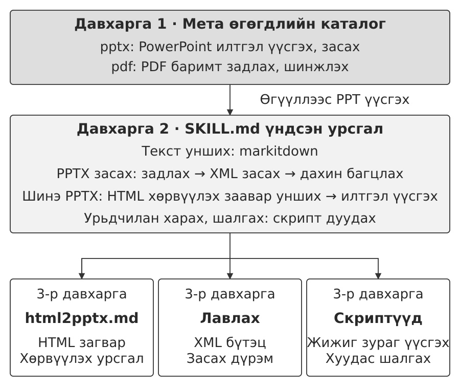

### Skills: салбарын чадварын хослуулж болох нэгж

**Agent Skills** нь нэг төрлийн даалгаврыг боловсруулах арга, лавлах материал, скрипт, загварыг дахин ашиглах боломжтой багц болгон боодог. Шинэ ажилтан ажилд орсон өдрөө компанийн бүх гарын авлагыг цээжлэх шаардлагагүйтэй адил Model ч ажил хийх үедээ л харгалзах бүлгийг нарийвчлан уншиж болно. Ийм ачаалах аргыг **аажмаар илрүүлэх (Progressive Disclosure)** гэнэ[^ch2-3].

Бүлэг 1-ийн арван барааг үргэлжлүүлэн ашиглаж, ямар мэдээллийг Skill болгон бичих нь зүйтэйг дүгнэе. Хэрэглэгч хүргэлтийн төлбөр орсон эцсийн үнийг харьцуулахыг хүсвэл задаргаа болон энэ удаагийн хүлээн авах хаяг одоогийн контекстэд ороход л хангалттай. Хэрэв баг худалдаачдын хооронд үнэ харьцуулах ажлыг давтан хийдэг бол үзүүлэлтийг хэрхэн тааруулах, нэгжийн үнэ ба багцын үнийг хэрхэн ялгах, хүргэлтийн төлбөр тодорхойгүйг хэрхэн тэмдэглэхийг нэг үнэ харьцуулах Skill болгон эмхэлж болно. Дараагийн удаа хэн нэгэн зөвхөн ямар загварууд байгааг харахыг хүсвэл каталог харагдсаар байх ба үнэ шалгах бүх урсгалыг хэрэглэгч үнэ харьцуулах шаардлагатай болох хүртэл ачаалахгүй байж болно.

**Эхний давхарга нь мета өгөгдөл.** Skill бүр өөрийгөө `SKILL.md`-ээр тайлбарладаг; файлын эхэн дэх YAML frontmatter `---`-ээр тусгаарлагдсан бөгөөд дотор нь `name` болон `description` байна. Ажиллах орчин эхлээд нэр болон тайлбарыг каталог болгон зохион байгуулж, одоогийн даалгаварт ямар Skill хэрэгтэйг Model-д дүгнүүлнэ. Каталогийн дараалал болон үзүүлэх хэлбэрийг Harness удирдаж, бүрэн урсгалыг сонгогдсоны дараа ачаална.

**Skill-ийн тайлбарыг юуны өмнө чиглүүлэлтийн нөхцөл болгон бичих хэрэгтэй.** Model үндсэн текстийг ачаалахаас өмнө түүнийг ашиглах эсэхээ шийдэх ёстой тул `description` эхлээд хэзээ тохирох, хэзээ алгасах ёстойг тайлбарлаж, дараа нь юу хийж чадахыг товчлох ёстой. Жишээлбэл, «help with backend» хэт өргөн хамрах бөгөөд бараг бүх backend даалгавар таарч мэднэ; «байгаа HTTP интерфейст интеграцын тест бичиж, нэвтрэлт, параметрийн шалгалт, алдааны хариултыг хамруулна» гэвэл тодорхой хүрээ өгнө. Андуурахад амархан даалгаврын хувьд «зөвхөн интерфейсийн шийдлийг хэлэлцэх үед ашиглах шаардлагагүй» гэх мэт хасах нөхцөлийг нэмж болно.

**Хоёр дахь давхарга нь үндсэн урсгал.** Skill сонгогдсоны дараа ажиллах орчин бүрэн зааврыг контекстэд илгээнэ. Хэрэглэгч `/pptx` төрлийн командыг илтэд оруулбал клиент шууд хайж ачаалж болно; Model өөрөө сонгох үед Skill Tool эсвэл файл унших Tool-ээр агуулгыг авна. Эхнийх нь Model идэвхжүүлэх дуудлага илгээх алхмыг хэмнэдэг бол хоёр дахь нь сонголт болон ачааллыг ажиллагааны траекторид үлдээдэг.

Энэ номын туршилтад ашигласан PPTX Skill-ийг жишээ болгоё. Үндсэн тайлбар нь хэд хэдэн түгээмэл замыг танилцуулна: Microsoft-ийн markitdown-оор илтгэлийн текстийг гаргаж авах, PPTX-ийг задалж доод түвшний XML-ийг харах, мөн шинэ илтгэл үүсгэх эсвэл засах ажлын урсгалыг сонгох. Model энэ давхаргын тайлбарыг уншсаны дараа одоогийн даалгаврын дагуу дараа нь аль материалыг унших, ямар төрлийн скрипт дуудахаа шийдэж чадна[^ch2-4].

**Гурав дахь давхарга нь дэлгэрэнгүй материал.** Нарийн төвөгтэй үйлдлүүд тусгай баримт бичгүүдэд тархсан бөгөөд үндсэн файл орох цэгийг өгнө. Энэ номд ашигласан хувилбарын `html2pptx.md` нь HTML-ээр илтгэл хэрхэн үүсгэхийг тайлбарлаж, бусад лавлах баримт формат болон засварын нарийн ширийнийг нөхнө. Agent даалгаврын дагуу эдгээр агуулгыг үргэлжлүүлэн уншиж, хамт ирсэн скрипт, материал, загварыг ашиглан үйлдлээ гүйцэтгэнэ.

[^ch2-3]: Anthropic, Equipping Agents for the Real World with Agent Skills, 2025; Agent Skills, How to add skills support to your agent.
[^ch2-4]: Anthropic, PPTX Skill. Энэ номын туршилт HTML хөрвүүлэх урсгалыг агуулсан хувилбарыг тогтмол ашигладаг; тодорхой хувилбар болон ажиллуулах аргыг хамт бэлтгэсэн туршилтын README-ээс үзнэ үү.
[^ch2-codex-skills]: OpenAI, Build skills; OpenAI Codex-ийн нээлттэй репозитори дахь Skills-ийн хэрэгжүүлэлт.
[^ch2-cc-skill-inject]: Claude Code, How Claude Code uses prompt caching, Invoking skills and commands; Agent Skills, How to add skills support to your agent, User-explicit activation.

### Ашиглахад тохиромжтой Skill-ийг хэрхэн бичих вэ

Ашиглахад тохиромжтой Skill дөрвөн асуултад хариулах ёстой: ямар даалгаварт тохирох, ямар дарааллаар боловсруулах, ямар нөхцөлд баталгаажуулалт шаардах, ажил дууссаныг хэрхэн дүгнэх. Бичигч өөрийн туршлагыг гүйцэтгэж болох алхмууд болгон эмхэлж, гол дүгнэлтүүдэд жишээ хавсаргах хэрэгтэй.

Бичих Skill-ийг жишээ болгоё. Баоюй хувийн илэрхийллийн зуршлаасаа эхлэн AI-ийн бичлэгийг сайжруулсан санааг[^ch2-baoyu-remove-ai-writing-flavor] лавлаж, агуулгыг дөрвөн хэсэгт зохион байгуулж болно:

- **Үүрэг ба уншигч:** хэнд үйлчлэх, даалгаврын төрөл, эцсийн бичвэрийн шаардлагыг тайлбарлана.
- **Үндсэн зарчим:** эхлээд байнга хэрэглэдэг гурваас таван дүгнэлтийг бичиж, тус бүрд засахаас өмнөх болон дараах тодорхой жишээ хавсаргана.
- **Түгээмэл алдаа ба хил:** гарах магадлалтай илэрхийллийн асуудал, эрхээс хэтэрсэн үйлдэл, онцгой тохиолдлыг бүртгэнэ.
- **Лавлах материал:** нэр томьёоны жагсаалт, загвар, жишиг бичвэр, тусгай тайлбарыг гүйцэтгэх үед лавлахаар хадгална.

Дүрмийг «хамрах хүрээ, үйлдэл, онцгой тохиолдол, шалгах арга»-ын дагуу бичиж болно. Жишээлбэл, урт өгүүлбэрийг богиносгох дүрэм ямар догол мөрөнд хамаарах, хэрхэн хуваах, хуваасны дараа нөхцөл болон дүгнэлт бүрэн хэвээр байгаа эсэхийг хэрхэн шалгахыг тайлбарлах ёстой.

Эхлэхдээ өөрийн сэтгэлд нийцсэн гурваас таван анхны нийтлэлийг сонгож, Agent-ээр үг хэрэглээ, өгүүлбэрийн бүтэц, догол мөрийн зохион байгуулалт, өнгө аясыг нэгтгэн дүгнүүлж, хорин орчим мөртэй анхны хувилбарыг үүсгэнэ. Дараа нь үүгээр шинэ сэдэв боловсруулж, зохиогч өгүүлбэр бүрийг засна. Засахаас өмнөх болон дараах ялгаа илүү тодорхой санал хүсэлт өгнө: аль үг илүүц, аль өгүүлбэрийг хуваах хэрэгтэй, хаана баримт дутуу, хаана техникийн нарийн ширийнийг нөхөх ёстой. Давтагдаж буй засваруудыг дүрэм болгон нэгтгэж, харгалзах жишээ болон хамрах хүрээг нь хадгална.

Skill гүйцэтгэх Tool болон загвар хавсаргаж ч болно. Жишээлбэл, PPTX Skill ажиллагааны тайлбар, задлан унших скрипт, үүсгэх скрипт, хуудасны загварын нөөцийг нэг дор байрлуулж, Model-д тайлбарын дагуу харгалзах нөөцийг дуудах боломж олгоно. Skill бүрийг бие даан тестлэх, шинэчлэх, хувилбарын удирдлагад оруулах боломжтой бөгөөд багийн гишүүд ч нэг урсгалыг тойрон туршлагаа тасралтгүй нэмж болно. **Skills-ийн урт хугацааны үнэ цэн нь салбарын туршлагыг тархмал байдлаар хуримтлуулж, бие даан нийтэлж, дахин ашиглах боломжийг олгодогт оршино.** Баг Agent-ийн чадварыг өргөжүүлэхдээ өөрсдийн сайн мэддэг Skill-ийг арчилж, аажмаар pip, npm-тэй төстэй програм хангамжийн багцын экосистем бүрдүүлж болно. Эдгээр Skill үндсэн системийн өгдөг илрүүлэх, ачаалах, гүйцэтгэх механизмыг хамтран ашиглаж болно.

**Харилцан үйлчлэлийн аргыг зохиохдоо Model-ийн аль хэдийн сургагдаж, дасан зохицсон хэв загварыг эрхэмлэх хэрэгтэй.** Үүргийн хуваарилалт, Tool-ийн үр дүнгийн формат, Skill ачаалах арга бүгд Model даалгаврыг хэрхэн үргэлжлүүлэхэд нөлөөлнө. Үйлдвэрлэгчийн өгдөг стандарт урсгал эхлэлийн цэг болоход тохиромжтой бөгөөд Model танихгүй форматаас утгыг дахин таамаглах ачааллыг бууруулна.

[^ch2-baoyu-remove-ai-writing-flavor]: Баоюй, «AI-ийн өнгийг Prompt-оор арилгахаа боль, чиглэл нь өөрөө буруу», 2026-02-14.

### Skills контекстэд хаана байрладаг вэ

Skills-ийн контекстийн зардал каталог болон үндсэн текст гэсэн хоёр хэсгээс бүрдэнэ. Каталог нь Model-д ашиглах боломжтой чадварыг олох боломж олгож, үндсэн текст сонгогдсоны дараа ажиллагааны урсгалыг өгнө. Стандарт нь шаардлагатай үед ачаалахыг шаарддаг бөгөөд мессежийн тодорхой үүрэг, боодол, шинэчлэх аргыг Harness хэрэгжүүлнэ.

Claude Code дуудлагын байрлалд Skill-ийн зааврыг `user` мессеж болгон сессэд нэмдэг[^ch2-cc-skill-inject]. Зураг 2-12 Model өөрөө идэвхжүүлсэн үеийн мессежийн нэг дарааллыг харуулна: эхлээд `Skill(skill: "pptx")` дуудлага илгээж, Tool-ийн хариуг хүлээн аваад, дараа нь нэмэгдсэн Skill-ийн үндсэн текстийг уншина. Тусгай идэвхжүүлэх Tool ашиглах үед Tool-ийн хариу дуудлагын баталгааг үүрч, үндсэн текстийг Harness тусад нь оруулж болно; энгийн файл унших Tool ашиглах үед үндсэн текстийг Tool-ийн үр дүнд шууд багтааж болно. Хэрэглэгч `/pptx`-ийг илтэд оруулбал клиент зааврыг шууд задлан оруулж, Model идэвхжүүлэх дуудлага илгээх алхмыг хэмнэж болно.

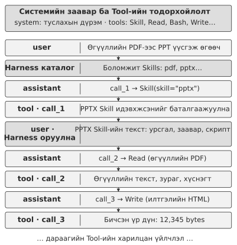{height=55%}

Codex-ийн Skills-ийн хэрэгжүүлэлт ч чадварын каталог болон сонгогдсон зааврыг тус тусад нь зохион байгуулдаг. Нээлттэй эх кодонд каталогийн нэг хэсэг `developer` контекстэд орж, зарим нь одоогийн ээлж болон гүйцэтгэх орчны хамт өгөгддөг; илтэд сонгогдсон Skill хэрэглэгчийн контекстийн хэсгээр нэмэгддэг. Каталогийн эх сурвалж болон ашиглах боломжтой гүйцэтгэх орчин тодорхой дараалалд нөлөөлнө[^ch2-codex-skills].

Зураг 2-13 шаардлагатай үед ачаалах үеийн кэшийн өсөлтийг харуулна; дахин ашиглах кэш хараахан үүсээгүй хүсэлтийг эхлэлийн цэг болгосон. Каталог анх удаа хүсэлтэд орохдоо боловсруулагдах шаардлагатай бөгөөд үндсэн текстийг анх ачаалахад ч тооцоолол нэмэгдэнэ; дараагийн хүсэлтүүд ижил префиксийг хадгалсан үед эдгээр агуулгыг кэшээс унших боломж гарна. Шинэ агуулгыг дуудлагын байрлалд нэмбэл өмнөх мессежүүд тогтвортой хэвээр байна. Аль хэдийн ачаалсан тайлбар түүхэд үлдсээр байх бөгөөд шинэчлэх шаардлагатай үед ажиллах орчны контекстийн стратегийн дагуу боловсруулна.

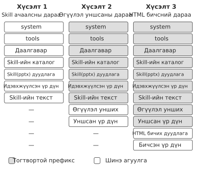

### Skills ба Tool-ийн хамаарал

Skill даалгаврын мэдлэг болон ажиллагааны урсгалыг өгч, Tool унших, гүйцэтгэх, үр дүн авах үүргийг хариуцна. Бүлэг 5-д танилцуулах долоон үндсэн Tool-ийг өөр өөр Skill-тэй хослуулж болно: нэг файл унших Tool илтгэлийн зааврыг ч, кодын стандартыг ч уншиж чадна; ерөнхий гүйцэтгэгч харгалзах скриптийг ажиллуулж чадна. Ингэснээр мэргэжлийн чадварыг урсгал болон нөөцөөр өргөжүүлж, үндсэн Tool-ийн багцыг харьцангуй тогтвортой байлгана.

Тусгай Tool-ийг ч Skill-тэй хамт ашиглаж болно. Өмнө дурдсан Tool хайлт Tool-ийн тодорхойлолтыг шаардлагатай үед өгөх үүрэгтэй бол Skill хэзээ дуудах, хэрхэн хослуулах, үр дүнг хэрхэн шалгахыг тайлбарлана. Хоёулаа байнга байх мэдээллийн хэмжээг хянаж, шинээр ачаалсан агуулгад тохирох байрлал товлох шаардлагатай. Бүлэг 4-т ерөнхий гүйцэтгэгч болон тусгай Tool-ийн сонголтыг хэлэлцэж, Бүлэг 9-д туршлагыг мэдлэг, заавар, програм эсвэл Model-ийн параметрийн алинд хадгалах нь зохимжтойг цааш хэлэлцэнэ.

> **Туршилт 2-6 ★★: Agent Skills ашиглан өгүүллээс илтгэл үүсгэх**
>
> Энэ туршилт «Attention Is All You Need» өгүүллийг материал болгон Agent илтгэл бэлтгэх мэргэжлийн урсгалыг шаардлагатай үед хэрхэн ачаалахыг харуулна. Даалгавар нь өгүүллийн PDF-ээс арав-арван таван хуудас илтгэл үүсгэж, асуудлын суурь, арга, гол үр дүн, дүгнэлтийг хамруулж, өгүүллийн зураг, хүснэгтээр тайлбарыг дэмжих явдал юм.
>
> Энэ удаагийн ажиллагаанд Kimi Code болон Anthropic-ийн албан ёсны PPTX Skill-ийг ашигласан. Agent эхлээд каталогоос PPTX Skill-ийг олж, түүний ажиллагааны тайлбарыг уншаад, үргэлжлүүлэн HTML хөрвүүлэх зааврыг уншиж, хамт ирсэн үүсгэх Tool-ийг дуудаж, эцэст нь жижиг зураг болон хуудас тус бүрийн рендэрээр хуудасны бүтцийг шалгасан. Алхам бүрд уншсан материал дараагийн үйлдэлд үйлчилж, бүрэн бэлтгэх урсгал даалгаврын дагуу аажмаар нээгдсэн.
>
> Эцсийн илтгэл арван гурван хуудастай бөгөөд өгүүллийн архитектурын зураг, анхаарлын механизмын зураг, туршилтын үр дүнгийн хүснэгт, анхаарлын визуалчлалын зургийг иш татсан.
>
> Үүсгэсний дараах шалгалт ч Skill-ийн ажлын урсгалд багтана. Энэ удаагийн ажиллагаанд доод индекс дутуу, жагсаалтын тэмдэг буруу, зураг иш татах зам алдаатай, тоон шошгоны нарийвчлалын асуудал гарсан бөгөөд Agent рендэрийн үр дүн болон бүтцийн шалгалтад тулгуурлан нэг бүрчлэн зассан. Эцсийн файл бүтцийн шалгалтыг давж, LibreOffice-оор дахин нээгдэж, рендэрлэгдсэн.

> **Туршилт 2-7 ★★: Хувийн жишиг бичвэрээс «AI-ийн өнгийг арилгах» бичих Skill үүсгэх**
>
> Энэ дасгал хувийн бичих туршлагыг дахин ашиглах боломжтой заавар болгон эмхэлнэ. Гурваас таван анхны нийтлэл бэлтгэж, Agent-ээр илэрхийллийн зуршлыг нэгтгэн дүгнүүлж, идэвхжих нөхцөл, гурваас таван зарчим болон харгалзах жишээ агуулсан анхны Skill-ийг үүсгэнэ.
>
> Нэг шинэ сэдвээр туршиж бичээд, зохиогч өгүүлбэр бүрийг засна. Хоёр хувилбарыг харьцуулж, хоосон үг хэрэглээ, хэт урт өгүүлбэр, учир шалтгааны холбоог орхисон, эсвэл ойлголтыг дэмжих тодорхой жишээг хассан зэрэг давтагдаж буй асуудлыг олно. Давтагдаж буй засварын аргыг Skill-д бичиж болно.

## Agent-ийн төлөвийн мөр: мета мэдээллээр Agent-ийн траекторийн удирдлагыг сайжруулах

Хэрэглэгч «Дахиад нэг залгаж болох уу?» гэж шахаж асуулаа. Зураг 2-14-ийн зүүн талд гурван удаагийн залгалтыг бүртгэсэн. Эхний удаа 45 минут хүлээсэн ч холбогдоогүй, гурав дахь удаадаа л сард 59 ам.доллар болгох тохиролцоонд хүрсэн. Энэ жишээний дүрмээр залгалт бүр нэг эрхийг эзэлдэг; ердөө хоёр удаа холбогдсон ч гурван эрх аль хэдийн дууссан. Harness ийм тоолуур, ажлын явц, баталгаажуулалт хүлээж буй асуудлуудыг мессежийн хамт шинэчлэгддэг нэг хураангуй болгон цэгцэлж болох бөгөөд үүнийг **Agent-ийн төлөвийн мөр (Agent Status Bar)** гэнэ.

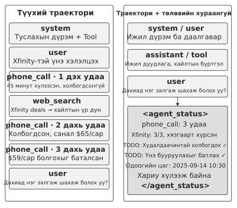

Гар утас цаг, батарейн цэнэг, сүлжээний дохиог дэлгэцийн дээд хэсэгт байрлуулдаг тул хүн нэг харахад одоогийн төлөвийг мэднэ. Зургийн баруун талын хураангуй ч ижил үүрэгтэй: туслах «хязгаарт хүрсэн», «хэрэглэгчийн баталгаажуулалтыг хүлээж байна» гэдгийг уншаад тохиролцсон үнийг хэрэглэгчид дамжуулж, хүлээн зөвшөөрөх эсэхийг шийдүүлж чадна. Harness Tool-ийн үр дүнг буцаахдаа хураангуйг хавсаргаж болно, эсвэл тусдаа төлөвийн мессеж нэмж болно.

### Түүхий бүртгэлээс тодорхой төлөв рүү

Утсаар хэрэглэгчид үйлчлэх даалгаврыг авч үзье: систем нэг даалгаврын хүрээнд худалдаачин бүр рүү гурваас илүү удаа залгахгүй байхыг шаарддаг. Гурван дуудлагын хооронд хайлт, материал унших, хэрэглэгчийн нэмэлт асуулт орж болно. Model үргэлжлүүлэн залгаж болох эсэхийг шийдэхийн тулд энэ түүхээс холбогдох бүх бүртгэлийг олж, худалдаачдыг ялгаж, хуримтлагдсан тоог тооцоолох шаардлагатай.

Ажиллах орчин дуудлага бүрийн дараа тоолуурыг шинэчилж, «энэ бол Xfinity руу хийсэн 3 дахь дуудлага, энэ даалгаврын хязгаарт хүрсэн» гэж шууд буцааж болно. Дараагийн шийдвэр энэ үр дүнг ашиглаж чадна. Дуудлагын тоог програм арчилж, Model даалгаврын явцтай уялдуулан дараа нь хүлээх, өөр суваг хайх, эсвэл одоогийн байдлыг хэрэглэгчид тайлбарлахыг шийднэ; гүйцэтгэх давхарга зэрэг тоолуурт тулгуурлан дараагийн залгах хүсэлтийг шалгана.

Энд байгаа инженерийн үнэ цэн нь **дараагийн шийдвэрт давтан хэрэгтэй болох төлөвийг урьдчилан цэгцлэх** явдал юм. Бүрэн дуудлагын бүртгэл ярианы агуулга болон боловсруулалтын явцыг хадгалсаар байх бөгөөд төлөвийн мөр нь шийдвэрт байнга хэрэглэгддэг статистик болон явцыг өгнө. **Давтан ашиглагдах статистикийг кодоор нэмэгдүүлэн арчлахыг эрхэмлэх ёстой.** Контекстээс нэг бүртгэл олох, бүх бүртгэлээс нийт тоог тооцоолох хоёр өөр ажил. Түүхий траекторийг хадгалснаар үнэн зөв, хүссэн үедээ авч болох статистикийн хүснэгт автоматаар гарч ирэхгүй. Model-ээр удаа бүр дахин гүйлгэж тоолуулах нь дүгнэлтийн token зарцуулахаас гадна орхих, давхар тоолох магадлалыг нэмэгдүүлнэ.

Зохиогч контекстийг «шүүх давхарга»-тай хамт ажиллах ёстой хайлтын системтэй зүйрлэдэг: түүхий бүртгэл ул мөрийг мөрдөхөд, шүүсэн төлөв шууд ашиглахад тохиромжтой. Тоолуур, хязгаар, баталгаажуулсан даалгаврын гүйцэтгэлийн төлөвийг кодоор арчлах нь зүйтэй; утга зүйн дүгнэлт шаардах мэдээллийг эхлээд нэг бүрчлэн гаргаж аваад, дараа нь нэгтгэн шалгаж болно. Ингэснээр Model шийдвэр гаргах бүртээ одоогийн төлөв болон шаардлагатай нотолгоог зэрэг харна.

Урт траектори гол мэдээллийг олоход ч хүндрэл нэмдэг. Хамгийн сүүлийн зорилго, хязгаарлалт, явцыг ард нь төвлөрүүлэн байрлуулбал Model одоогийн шийдвэрт хэрэгтэй мэдээллээ илүү амархан олно.

> **Туршилт 2-8 ★★: Анхаарлын визуалчлалаар Agent-ийн төлөвийн мөрийн нөлөөг ажиглах нь**
>
> Энэ туршилт Qwen3-0.6B-г ашиглан хэрэглэгчийн үйлчилгээний буцаан олголтын траектори бүрдүүлсэн: Agent Xfinity руу аль хэдийн гурван удаа залгасан, хооронд нь сүлжээний хайлт хийгдсэн, дараа нь хэрэглэгч «Дахиад утасдаж шахаж болох уу?» гэж нэмж асуусан. Системийн дүрэм нэг даалгаврын хүрээнд худалдаачин бүр рүү хамгийн ихдээ гурван удаа залгахаар хязгаарласан.
>
> Хоёр бүлэг оролт ижил түүх болон хэрэглэгчийн нэмэлт асуултыг хадгалсан. A бүлэг түүхий траекторийг шууд ашигласан; B бүлэг төгсгөлд нь дараах төлөвийг нэмсэн:
>
> ```xml
> <agent_status>
> Current State:
> - Tool call summary: 'phone_call' has been invoked 3 times (Xfinity: 3 times)
> - Constraint check: Maximum calls to Xfinity reached (3/3)
> </agent_status>
> ```
>
> Бүлэг бүрийг гурван удаа ажиллуулсан. A бүлэг хоёр удаа үргэлжлүүлэн залгахаас тодорхой татгалзаж, нэг удаа бусад гаралтын ангилалд орсон; B бүлэг гурван удаа бүгд тодорхой татгалзсан. Хоёр бүлэгт ч дүрэм зөрчин үргэлжлүүлэн залгасан гэж дүгнэгдсэн гаралт гараагүй. Энэ харьцуулалтыг давтан гаргахдаа `chapter2/attention_visualization` руу орж, `python run_status_bar_experiment.py --output runs/status-bar-reproduction`-ийг ажиллуулна. Энэ удаагийн ажиллагааны оролт болон удаа бүрийн үр дүн туршилтын хавтасны `runs/exp2-7-qwen3-0.6b-20260730-v2/comparison.json`-д хадгалагдсан.
>
> Анхаарлын зураг үүсгэлтийн бүс түүхэн дуудлага, хайлтын үр дүн, хэрэглэгчийн нэмэлт асуулт, төлөвийн мөрд хуваарилсан жингийн тархалтыг харуулна.

Зохиогч Noah Shi-тэй хамтран хийсэн ContextDistill-Bench судалгаа урьдчилан шүүсэн төлөвийн ашгийг цааш судалсан[^ch2-8]. Энэхүү жишиг тестийн хамарсан төлөвийн асуулгад харьцангуй жижиг Model ч тодорхой төлөвийн тусламжтайгаар өндөр нарийвчлалд хүрч чадсан; тэргүүлэх Model-уудын бодох хэмжээ, саатал, асуулгын зардал ойролцоогоор нэг эрэмбээр буурч болно. Жишээлбэл, Claude 4 Sonnet-ийн мянган асуулга тутмын зардал ойролцоогоор 35.46 ам.доллараас 3.51 ам.доллар болж буурсан. **Энэ загвар үйл явдал болох үед төлөвийг арчилдаг тул асуулга бүрд түүхийг гүйлгэх зардлыг хэмнэдэг.** Хураангуйн талбарууд тогтсоны дараа түүх үргэлжлэн өссөн ч асуулга зөвхөн эдгээр хэдэн талбарыг уншихад хангалттай.

[^ch2-8]: Li, Bojie and Noah Shi. *Distill, Don't Retrieve: Inference-Time Context Distillation for LLM Agent Reasoning.* 2026.

### Agent-ийн төлөвийн мөрийн бүрэлдэхүүн

Төлөвийн мөр ихэвчлэн гурван төрлийн мэдээлэл агуулдаг бөгөөд тус тус «юу хийх ёстой», «саяхан юу болсон», «одоо ямар төлөвт байгаа» гэсэн асуултад хариулна.

**Даалгаврын төлөвлөгөө** нь зорилго, алхам, гүйцэтгэлийн байдлыг бүртгэнэ. Нарийн төвөгтэй даалгаврыг TODO жагсаалт болгон задалж, зүйл бүрд төлөв болон шаардлагатай хамаарлыг хадгалж болно. Model одоогийн алхмыг боловсруулж байхдаа анхны шаардлага, гол хязгаарлалт, дараагийн ажлыг харсаар байна; нэг алхмыг дуусгасны дараа жагсаалтыг шинэчилнэ.

**Үйл явдлын хажуугийн сувгийн мэдээлэл (Side-channel Information)** нь үйл явдал болох үеийн нөхцөлийг нөхдөг; жишээлбэл цаг хугацаа, газарзүйн байршил, сүүлийн хариултаас хойш өнгөрсөн хугацаа. Эдгээр мета өгөгдөл үйл явдлын хамт хадгалагдаж, Model-д дарааллын хамаарал болон нөхцөл байдлыг ойлгоход тусална. «Хариу хараахан ирээгүй» гэсэн ижил өгүүлбэр хүсэлт илгээснээс хоёр минутын дараа эсвэл хоёр хоногийн дараа гарсан эсэхээс хамаарч өөр өөр боловсруулалт шаардаж болно.

**Орчны одоогийн төлөвийн ажиглалтын хураангуй** нь одоогийн цаг, ажлын хавтас, Tool дуудсан тоо, гажуудлын сануулгыг өгнө. Энэ нь CLI, GUI одоогийн хавтас эсвэл ажиллагааны төлөвийг харуулдагтай төстэй үүрэгтэй: дараагийн үйлдэлд тодорхой үндэслэл өгнө. Жишээлбэл, давтан дуудлагын сануулга Model-ийг бүтэлгүйтлийн шалтгааныг шалгахад түлхэж, үлдсэн төсөв хайлтаа үргэлжлүүлэх эсэхийг шийдэхэд тусална.

Үйл явдлын мета өгөгдөл үйл явдлын хамт нэмэгдсэний дараа ихэвчлэн тогтвортой байх бол даалгаврын явц болон орчны төлөв тасралтгүй өөрчлөгдөнө. Хоёр төрлийн мэдээллийг тус тусын шинэчлэлтийн аргаар түүхэнд бичих ёстой бөгөөд доор мессежийн бүтэцтэй уялдуулан тайлбарлана.

### Контекст доторх Agent-ийн төлөвийн мөрийн тодорхой байрлал

Энэ хэсгийн жишээнд Harness мессежийн төгсгөлд нэг `user` мессеж нэмж, төлөвийн хураангуйг дамжуулна. Энд байгаа `user` нь сонгосон API-ийн мессежийн үүрэг бөгөөд төлөвийн агуулгыг ажиллах орчин үүсгэж, шошгоор зориулалтыг нь тайлбарлана. Өөр интерфейс ашиглах үед түүний дэмждэг контекстийн блокийг ашиглах, эсвэл харгалзах Tool-ийн үр дүнгийн хамт төлөвийг өгч болно. Өмнө дурдсан, бодит хэрэглэгчийн асуулгаар түүхэн дүгнэлтийг тайрдаг загвар ашиглах үед ажиллагааны төлөвийг Tool-ийн үр дүнгийн хамт өгч, загвар дүгнэлтийн мэдээллийг одоогийн даалгаврын дагуу үргэлжлүүлэн хадгалах боломж олгож болно.

Зураг 2-15-аас хэрэглэгчийн анхны даалгаврыг олоод, хамгийн сүүлийн төлөв аль ээлжид бичигдсэнийг харъя. Анхны хүсэлтийг хадгалсан үед л утасны дуудлага дууссаны дараа хоёр зүйлийг зэрэг шалгаж чадна: хэрэглэгч юу хийлгэхийг хүссэн, одоо аль шатанд хүрсэн.

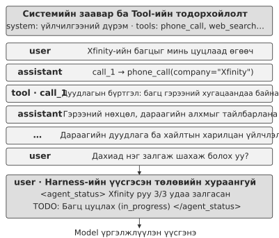

Зургийн дарааллыг мессежийн жагсаалт болгон бичвэл доорх байдалтай. Харьцуулахад хялбар болгох үүднээс давтагдсан ээлжүүд болон дуудлагын зарим талбарыг орхисон.

```text
messages: [
  { role: "system", content: "You are a customer service assistant..." }
  { role: "user", content: "Help me cancel my Xfinity plan" }
  { role: "assistant", tool_calls: [{ id: "call_1", ... }] }
  { role: "tool", tool_call_id: "call_1", content: "Call log..." }
  { role: "assistant", tool_calls: [{ id: "call_2", ... }] }
  { role: "tool", tool_call_id: "call_2", content: "Call log..." }
  ...其余轮次...
  { role: "user", content: "Can you call them again to follow up?" }
  { role: "user", content: "<agent_status>
      Current State:
      - phone_call invoked 3 times (Xfinity: 3/3 max)
      - Current time: 2025-09-14 10:30:45
      - TODO: [1] Cancel plan (in_progress)
    </agent_status>" }
]
```

Сүүлийн мессеж дуудлагын тоо, хязгаар, цаг, даалгаврын явцыг нэг дор төвлөрүүлсэн. Model эдгээр талбарыг шууд ашиглахын зэрэгцээ өмнөх дуудлагын ID-ээр тодорхой бүртгэлийг эргэн шалгаж болно.

Энэ мессежийг нэмсний дараа өмнөх token-ийн дараалал өөрчлөгдөхгүй тул префиксийг дахин ашиглах үндсэн нөхцөлийг хангасаар байна. Дараагийн ээлжид хуучин төлөвийг хэрхэн боловсруулах нь контекстийн эзлэх хэмжээ болон кэшийн зардлын хооронд сонголт хийхийг шаардана.

### Төлөв шинэчлэх хоёр хэрэгжүүлэлт ба тэдгээрийн кэшийн зардал

Дараагийн ээлжид нэг TODO дуусаж болно, эсвэл нэг Tool дуудлага нэмэгдэж болно. Harness төлөвийг шинэчлэх шаардлагатай бөгөөд түгээмэл хоёр арга бий.

**Ээлж бүрд солих:** шинэ хүсэлт бүрдүүлэхдээ өмнөх төлөвийг хасаж, төгсгөлд хамгийн сүүлийн төлөвийг нэмнэ. Контекстэд зөвхөн нэг одоогийн төлөв үлдэх тул Model ашиглахад хялбар. Жишээлбэл, өмнөх хүсэлт «даалгаврын тайлбар, төлөв A» байсан бол энэ удаа «даалгаврын тайлбар, Tool-ийн үр дүн, төлөв B» байна. Даалгаврын тайлбар кэшэд хит болсоор байна; Tool-ийн үр дүн анх удаа илгээгдэж байгаа тул угаасаа тооцоолох шаардлагатай. Хэрэв өмнөх хүсэлтэд төлөв A-ийн ард өөр мессежүүд байсан бол A-г хассанаар л тэдгээр мессеж анхны префиксийн таарцаа алдана. Энэ хүсэлтэд Model зөвхөн B-г харна. A-г эргэн харах шаардлагатай бол ажиллагааны логоос тухайн үеийн агшин зургийг гаргаж болно.

**Байнга нэмэх:** байгаа төлөвийн бүртгэлийг хадгалж, удаа бүр төгсгөлд шинэ төлөв нэмнэ. Түүхэн префикс тогтвортой хэвээр байх бөгөөд төлөвийн өөрчлөлтийг мөрдөхөд ч хялбар. Хуучин төлөвүүд аажмаар контекстийг эзлэх тул цаг эсвэл хувилбарыг тодорхой заах шаардлагатай; ингэснээр Model хамгийн сүүлийн бүртгэлд тулгуурлан одоогийн байдлыг дүгнэнэ. Claude Code файлын өөрчлөлтийн сануулгыг сессэд нэмдэг арга ч энэ загварын санааг илэрхийлдэг.

Төлөв маш богино, түүний ард аль хэдийн их хэмжээний Tool-ийн үр дүн кэшлэгдсэн үед хуучин төлөвийг хадгалах нь урт дагаварыг дахин тооцоолохоос хэмнэлттэй байж болно; төлөв харьцангуй урт бөгөөд байнга шинэчлэгддэг бол солих нь түүхэн төлөвийн хуримтлалыг хянана.

Зааглах цэгийг бүдүүвч загвараар тооцоолж болно: төлөв бүрийг $S$ token, солих бүрд хуучин төлөвийн ард дахин тооцоолох шаардлагатай кэшлэгдсэн дагаварыг дунджаар $R$ token (энэ ээлжид анх илгээсэн агуулгыг тооцохгүй), нийт $N$ удаа төлөв оруулсан, кэшлэгдсэн оролтын нэгжийн үнийг энгийн оролтын $\alpha$ дахин гэж үзье. Хоёр аргад нийтлэг зардлыг үл тоомсорловол $C_{\text{солих}} \approx (N-1)(1-\alpha)R$, $C_{\text{нэмэх}} \approx \alpha S N(N-1)/2$. $N>1$ үед $\alpha SN/2 < (1-\alpha)R$ бол байнга нэмэх аргын тооцоолсон зардал бага; эсрэг тохиолдолд ээлж бүрд солих нь хэмнэлттэй. Энд энгийн оролтын нэгжийн үнийг зардлын нэгж болгосон: солих арга нэмж төлөх нь дагавар кэшээс уншихын оронд дахин боловсруулагдах үнийн зөрүү бол нэмэх арга нэмж төлөх нь түүхэн төлөвүүдийг давтан унших зардал юм.

Жишээ авъя: удаа бүр 100 token-ий төлөв оруулж, нийт 10 удаа оруулсан, кэш уншилтыг энгийн оролтын үнийн аравны нэгээр тооцно. Нэмэх арга дараагийн хүсэлтүүдэд тус тус 1, 2, ……, 9 хуучин төлөвийг нэмж уншиж, нэмэлт зардал нь 450 энгийн оролтын token-тэй тэнцэнэ. Хэрэв төлөв солих нь ард нь байгаа дунджаар 1000 кэшлэгдсэн token-ийг дахин боловсруулахад хүргэвэл есөн удаагийн солилтын нэмэлт зардал 8100 энгийн оролтын token-тэй тэнцэх тул нэмэх нь хэмнэлттэй. Хэрэв хуучин төлөв угаасаа кэшийн төгсгөлд байсан, ард нь кэшлэгдсэн агуулга огт байхгүй бол томьёо дахь $R=0$ болж, шууд солих нь харин ч эдгээр 450 token-тэй тэнцэх зардлыг хэмнэнэ.

> **Туршилт 2-9 ★★: Agent-ийн төлөвийн мөрийн хэд хэдэн хэрэгцээтэй техник**
>
> Энэ туршилт төлөвийн мөрийн таван техникийг хэрэгжүүлсэн бөгөөд тус тусад нь асааж болно, хослуулан ч ашиглаж болно. Техник бүр нэг төрлийн тодорхой мэдээлэл өгч, Model-д дараагийн үйлдлээ шийдэхэд тусална.
>
> **Цагийн тэмдэглэгээг мөрдөх** нь хэрэглэгчийн мессеж болон Tool-ийн хариултад үйл явдлын цагийг бүртгэнэ; жишээлбэл `[2025-09-14 10:30:45]`. Цаг үйл явдлын хамт түүхэнд бичигдэж, дараагийн ээлжүүдэд анхны утгаараа хадгалагдана; одоогийн цагийг харин шинэ төлөвийн мессежээр шинэчилнэ. Туршилт мөн цагийн симуляци өгч, Model «өчигдрийн файл» болон «өнөөдрийн засвар»-ыг ялгаж чадах эсэх, хүлээсэн хугацааг зөв ойлгож байгаа эсэхийг шалгана.
>
> **Tool дуудлагын тоолуур** нь Tool бүрийн хуримтлагдсан дуудлагын тоог толь бичгээр арчилж, хариултад `Tool call #3 for 'read_file'` гэж тэмдэглэнэ. Алдааны агуулгатай уялдуулан Model үргэлжлүүлэн оролдох эсэхээ дүгнэж чадна. Жишээлбэл, анх уншиж чадаагүй бол замыг шалгаад, дараа нь хавтсыг жагсаана; олон удаа бүтэлгүйтвэл орлох файл хайх эсвэл хэрэглэгчид дутуу байгааг тайлбарлана. Дахин оролдох тоог хязгаарлах шаардлагатай бол ажиллах орчин тоолуурын дагуу хязгаарыг мөрдүүлэх ёстой.
>
> **TODO жагсаалтын удирдлага** нь `rewrite_todo_list` болон `update_todo_status` гэсэн хоёр Tool өгнө. Зүйл бүр давтагдашгүй таних тэмдэг, агуулга, цагийн тэмдэглэгээ болон `pending`, `in_progress`, `completed`, `cancelled` гэсэн дөрвөн төлөвтэй. Жагсаалт «юу хийсэн, юу дутуу байгаа»-г нэг дор хадгалдаг бөгөөд Manus даалгаврын төлөвлөгөөг давтан харуулж зорилгыг харагдахуйц байлгадаг санаатай төстэй.
>
> **Дэлгэрэнгүй алдааны мэдээлэл** нь алдааны төрөл ба тайлбар, дуудлагын параметрийн JSON, дуудлагын стек, засах зөвлөмжийг өгнө. Жишээлбэл, `FileNotFoundError` тулгарвал Model-д файлын нэр, одоогийн хавтас, үнэмлэхүй замыг нягтлахыг сануулж болно. Параметр буруу оролтыг олоход, дуудлагын стек бүтэлгүйтсэн байрлалыг хайхад тусалж, засах зөвлөмж дараагийн шалгах чиглэлийг өгнө. Эдгээр агуулгыг Model руу буцаахаас өмнө нэвтрэх мэдээлэл зэрэг нууц талбарыг цэвэрлэж, урт стекийн хэмжээг хянах ёстой.
>
> **Системийн төлөвийг мэдрэх** нь одоогийн цаг, ажлын хавтас, үйлдлийн систем, Shell болон Python-ийн хувилбарыг өгнө. Туршилтын командын Tool тусдаа хавтас солих үйлдлийг таньж, ажиллах орчны арчилдаг ажлын хавтсыг шинэчлээд, дараагийн дуудлагуудад ашиглана; нийлмэл команд доторх дэд процессын хавтасны өөрчлөлт харгалзах процессын гүйцэтгэлийн хүрээг дагана. Орчны талбарууд Model-д ашиглах боломжтой Tool сонгоход ч тусална; жишээлбэл бодит систем болон суулгасан програм хангамжаас хамааран `apt` эсвэл `brew`-ийг сонгоно.
>
> Энэ удаагийн Kimi K3-ийн харьцуулалтад даалгаврын төрөл бүр таван тохиолдолтой байв. Цагийн тэмдэглэгээ болон хосолсон тохиргоо хоёулаа таваас тавыг давсан бол харьцуулах бүлгүүд тус бүр гурвыг давсан; Tool дуудлагын тоолуур болон системийн төлөвийн асаасан, унтраасан бүлгүүд бүгд тавыг давсан. TODO тохиргоо тэгийг, харьцуулах бүлэг нэгийг давсан; дэлгэрэнгүй алдааны тохиргоо дөрвийг, харьцуулах бүлэг тавыг давсан.

**Төлөвийн мөрийг аль болох кодоор арчлах ёстой.** Model доторх статистик болон хязгаарлалтыг шууд ашигладаг тул «гурван удаа залгасан» гэсэн нэг буруу бичлэг дараагийн үйлдлийг өөрчилж болно. Тоолуур, цаг, төлөвийн шилжилтийг програмд даатга; утга зүйн ойлголт шаардлагатай үед эхлээд Model-ээр нэг бүрчлэн гаргуулж, дараа нь кодоор нэгтгэн шалгах бөгөөд Model-ээр урт түүхийг нэг дор тоолуулахаас зайлсхий. Түүхий үйл явдал, гаргасан үр дүн, эцсийн төлөвийн хоорондын харгалзааг хадгалбал давхар тоолох, орхих, эх сурвалж андуурахыг илрүүлэхэд хялбар.

Төлөвийн мөр ямар мэдээллийг нэгтгэхийг урьдчилан сонгох шаардлагатай. Жишээлбэл, «гурван удаа залгасан» гэдэг нь дахин залгаж болох эсэхийг дүгнэхэд хангалттай ч «хоёр дахь дуудлагад үйлчилгээний ажилтан юу амласан бэ» гэдэгт хариулж чадахгүй. Зөвхөн статистик утга хэрэгтэй дараагийн даалгаврын хувьд төлөвийн хураангуйгаар түүхийг сольж, түүхий бүртгэлийг архивлаж болно; ярианы агуулгыг шалгах шаардлагатай үед индексээр эх текстийг уншина. Хураангуйн талбарын загвар ямар асуултад шууд хариулж болохыг, мөн хэзээ эргэн шалгах шаардлагатайг тодорхойлно.

## Контекст шахах стратеги

Нэгэн судалгааны даалгавар арван урт вэб хуудас уншсаны дараа цонхонд ердөө хоёр материал багтах зай үлдсэн гэж үзье. Эхлээд Model-оос дараагийн ээлжид юу хийх ёстойг асуу: хоёр үнийн саналыг харьцуулах бол үнэ, хүчинтэй нөхцөл, эх сурвалжийг үлдээнэ; ишлэлийг дахин шалгах бол эх текстийг буцааж авч болох байрлалыг хадгална. Аль хэдийн шалгасан боловч хамааралгүй вэб хуудасны үндсэн текстийг архивлаж, шинэ оролт болон гаралтад зай гаргаж болно. Энд хэр их зай чөлөөлснийг тооцохоос гадна өөр нэг тооцоо хийх ёстой: хассан материал дараа нь хэрэгтэй болвол буцааж олоход ямар зардал гарах вэ?

### Шахалтын гурван зорилго

**Урт болон зардлыг хянах.** 128K token-ий цонхыг жишээ болговол урт вэб хуудас, том файл түүний нэлээд хэсгийг эзэлж болно. Harness дараагийн оролт, Model-ийн гаралт, Tool-ийн харилцан үйлчлэлд төсөв үлдээх шаардлагатай.

**Дараагийн шийдвэрт хэрэгтэй мэдлэгийг цэгцлэх.** Арав гаруй ээлжийн хайлт нэг үйл явдлыг давтан дурдаж болох бөгөөд хоорондоо зөрчилдсөн мэдээлэл ч үлдээж болно. Үүнийг «A, B баталгаажсан, C-д нотолгоо дутуу хэвээр» гэж цэгцэлбэл Model дуусаагүй асуудал дээрээ үргэлжлүүлэн ажиллах боломжтой болно. Хураангуй баримтуудын хоорондын хамаарал, эх сурвалж, шийдэгдээгүй асуудлыг хадгалж, дараагийн шийдвэрт тодорхой үндэслэл өгөх ёстой.

**Урт даалгаврыг тасралтгүй урагшлуулах.** Зарим Model цонх дуусах дөхлөө гэж үзэхдээ ажлаа эрт дуусгадаг бөгөөд энэ үзэгдлийг **контекстийн түгшүүр (Context Anxiety)** гэнэ. Anthropic Sonnet 4.5-ийн урт даалгаврын тестэд шахалтын дараа ч ийм зан үйл гарч болохыг илрүүлсэн тул бүтэцтэй хүлээлцэх бүртгэл ашиглаж, контекстийг дахин тохируулсны дараа гүйцэтгэлээ үргэлжлүүлдэг[^ch2-7].

[^ch2-7]: Prithvi Rajasekaran, Harness design for long-running application development, Anthropic Engineering, 2026.

### Давтан тооцоолсон үр дүнг ашиглаж болох мэдлэг болгон цэгцлэх

Төлөвийн мөр тоолуур болон явцыг урьдчилан арчилдаг бол хураангуй урт текст дэх баримт болон хамаарлыг цааш цэгцэлдэг. Хоёулаа тархай бутархай мэдээллийг урьдчилан цэгцэлж, дараагийн шийдвэрт шууд ашиглах боломж олгоно.

Тэжээвэр амьтны дэлгүүрийг шалгах жишээг харъя:

> Тор 1: хар муур. Тор 2: цагаан муур. Тор 3: хар муур. Тор 4: хар муур. Тор 5: цагаан муур.
> ……(нийт 100 тор, үүнээс 90 хар муур, 10 цагаан муур)

«37 дугаар торонд ямар муур байна» гэдэгт хариулахын тулд харгалзах бүртгэлийг олох шаардлагатай; «хар, цагаан муур тус бүр хэд байна» гэдэгт хариулахын тулд бүх бүртгэлийг нэгтгэх шаардлагатай. Хэрэв нийт тоог дараа нь олон удаа ашиглах бол «хар муур 90, цагаан муур 10» гэж урьдчилан тооцоолж хадгалснаар удаа бүр эхнээс нь тоолохоос зайлсхийж болно. Ийм тодорхой нэгтгэлийг програм гүйцэтгэхэд тохиромжтой бөгөөд Model статистикийн үр дүнд тулгуурлан бизнесийн асуултад үргэлжлүүлэн хариулж болно.

Хураангуйн агуулгыг даалгаврын дагуу сонгох ёстой. Хоёр төрлийн муурын нийт тоог л хадгалах нь тооны асуултад хариулахад хангалттай; 37 дугаар торны байдлын талаар хариулахын тулд тор тус бүрийн бүртгэл эсвэл харгалзах индекс шаардлагатай.

Цонхонд зай үлдсэн байсан ч хэт урт эсвэл холимог контекст мэдээллийн ашиглалтад нөлөөлж болно: Model гол баримтыг орхих, аль хэдийн шийдэгдсэн асуудлыг дахин боловсруулах, эсвэл хуучирсан төлөвийг одоогийн шийдвэрт ашиглах. Контекст өсөхийн хэрээр гардаг ийм гүйцэтгэлийн доройтлыг ихэвчлэн **контекстийн ялзрал (Context Rot)** гэдэг. Энэ нь даалгаврын гүйцэтгэл муудах хэлбэрээр илэрдэг; хүсэлт багтаамжийн хязгаараас хэтэрвэл харин цонх халих үзэгдэл гарна.

**Цонхонд зай байсан ч давтан ашиглагдаж буй мэдлэгийг идэвхтэй цэгцлэх ёстой.** Гол дүгнэлтүүдийг аль хэдийн нэгтгэх боломжтой байхад Model-ээр урт түүхээс дахин дахин хайлгах нь тооцооллыг тасралтгүй зарцуулж, орхигдол нэмэгдүүлнэ. Хайлтын даалгавар баталгаажсан баримт, эх сурвалж, шалгах асуудлуудыг хадгалж болно; програмчлалын даалгавар архитектурын шийдвэр, өөрчлөлтийн хүрээ, тестийн үр дүн, бүтэлгүйтлийн шалтгааныг хадгалж болно.

Контекст дэх жишээнүүд Model шинэ асуудлыг хэрхэн боловсруулахад ч нөлөөлдөг. Dherin нарын судалгаа Transformer дахь анхаарлын давхарга болон MLP-ийн хослолоос эхлэн тодорхой урагш тооцооллыг контексттэй холбоотой бага рангийн жингийн шинэчлэл болгон илэрхийлж, контекст доторх суралцахуйн онолын нэг тайлбарыг өгсөн[^ch2-6]. Бодит дүгнэлтийн үед Model-ийн жин өөрчлөгдөхгүй бөгөөд жишээнүүд одоогийн оролтоор дамжуулан гаралтад нөлөөлнө. Ийм туршлагыг дараагийн сессүүдэд дахин ашиглахыг хүсвэл санах ой, жишээ эсвэл Skill болгон цэгцэлж, даалгаврын дагуу ачаалж болно; Бүлэг 9-д туршлага хуримтлуулах аргыг цааш хэлэлцэнэ.

[^ch2-6]: Benoit Dherin et al., Learning without training: The implicit dynamics of in-context learning, 2025.

### Шахалт ба KV Cache-ийн хоорондын сонголт

Шахалт ихэвчлэн Model-ийг хоёр удаа дуудах хооронд явагдана. Harness үлдсэн төсөв болон даалгаврын явцад тулгуурлан дараагийн хүсэлтэд хэрэгтэй мессежийг цэгцэлж, дараа нь Model руу илгээнэ. Түүхийг солих нь префиксийг өөрчилдөг тул шахалтын ашиг болон кэшийг дахин бүрдүүлэх зардлыг зэрэг харгалзах шаардлагатай.

Нэгдүгээрт, хэрэглэгдсээр байгаа системийн заавар болон Tool-ийн тодорхойлолтыг тогтвортой байлга. Тэд эхэнд байрладаг тул дараагийн түүхийг шахсан ч энэ префиксийг үргэлжлүүлэн дахин ашиглаж болно. Хоёрдугаарт, шахах тодорхой объектыг сонго: урт Tool-ийн үр дүнг хураангуйгаар сольж, дууссан олон ээлжийн харилцан үйлчлэлийг үе шатны бүртгэл болгон нэгтгэж болно. Солих байрлалаас өмнөх кэш дахин ашиглагдах боломжтой хэвээр бөгөөд солих байрлал болон түүнээс хойшхи агуулгыг шинэ префиксээр боловсруулах шаардлагатай.

**Түүхийн шахалтыг багцаар хийхийг эрхэмлэж, ээлж бүрд нэг префиксийг дахин бичихээс зайлсхий.** Шахсны дараа ээлж бүрийн оролт богиносох ч шахалтын дуудлага болон дагаварыг дахин тооцоолоход нөөц зарцуулна. Эхлүүлэх мөчийг цонхны ачаалал, хүлээгдэж буй дараагийн ээлжийн тоо, даалгаврын үе шаттай уялдуулан тодорхойлж болно: урт Tool-ийн үр дүн бөөнөөрөө гарсны дараа багцаар цэгцлэх, нэг үе шат дууссаны дараа хүлээлцэх хураангуй хадгалах нь түүхийг байнга өөрчлөх зардлыг бууруулна. Сүүлийн хэдэн ээлжийг хадгалахдаа Tool дуудлага болон буцах утга хос хосоороо байгаа эсэхийг шалгаж, дуусаагүй үйлдлийн төлөвийг хураангуйд бичих ёстой.

Шахахдаа дүгнэлтийн мэдээллийг буцаах протоколыг ч шалгах ёстой. Зарим Model-ийн түүхэн thinking түүнийг үүсгэх үеийн префикстэй холбогдсон байдаг. Эдгээр блокийн өмнөх түүхийг сольвол үлдсэн thinking шинэ префикстэй таарахгүй байж болно. Ийм протокол ашиглах үед сессийг хураангуй болгон цэгцэлж, нөлөөлөгдсөн хуучин thinking-ийг цэвэрлээд, Model-ийг хураангуйгаас дүгнэлтээ үргэлжлүүлэх боломж олгож болно; эсвэл серверийн дэмждэг шахалт эсвэл контекст засварлах механизмыг ашиглаж болно.

Эхлээд Зураг 2-16 дахь тусгай хураангуйг харъя: боловсруулсны дараах тэмдэгтийн тоо анхныхаасаа ердөө 10.9% байхад үндсэн Agent-ийн хуримтлуулан зарцуулсан token зургаан бүлгийн дотроос хамгийн их байна. Энэ хоёр тоо яагаад зэрэг үнэн байж болдгийг тайлбарлахын тулд ямар материал шахагдсан, мөн тэр материал хэдэн ээлжийн хүсэлтээр Model руу илгээгдсэнийг мөрдөх хэрэгтэй.

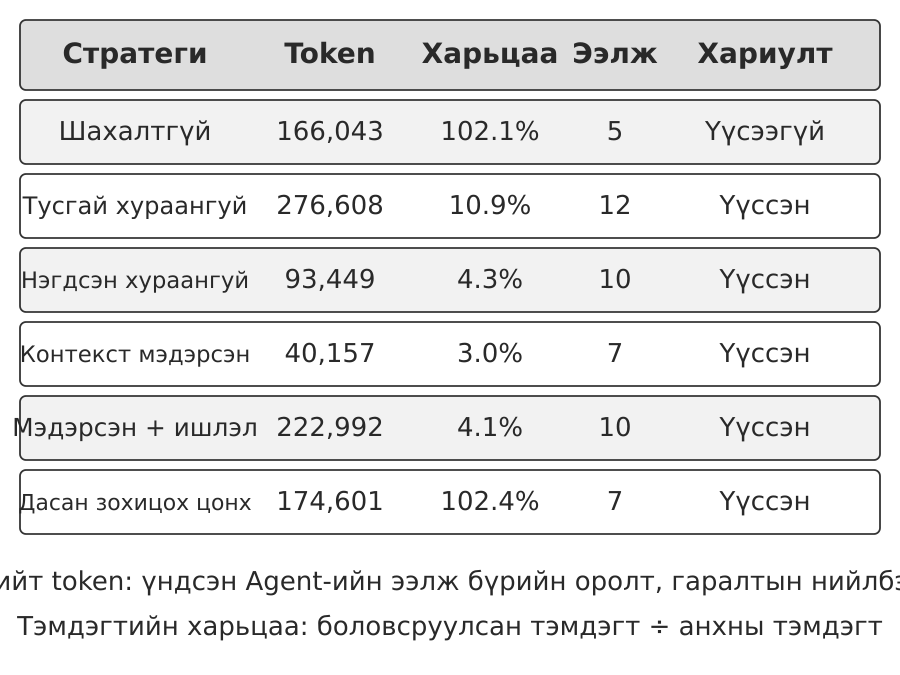

> **Туршилт 2-10 ★★★: Контекст шахах стратегийн харьцуулалт**
>
> Энэ туршилт Kimi K3-аар OpenAI-ийн хамтран үүсгэн байгуулагчдын карьерын төлөвийг судалсан. Даалгавар нь хүмүүсийн жагсаалтыг аажмаар бүрдүүлж, туршлага болон албан тушаалын өөрчлөлтийг хайж, дараа нь холбогдох баримтыг эх сурвалжтай нь харгалзуулах шаардлагатай. Шахалт болон халилтын боловсруулалтыг ажиглахын тулд туршилт програмын талын контекстийн төсвийг 128,000 token болгож, шахалтгүй суурь хувилбарыг хадгалаад, таван боловсруулах аргыг харьцуулсан бөгөөд тус бүр хамгийн ихдээ 15 ээлж ажилласан[^ch2-compression-results].
>
> **Стратеги 1: Шахалтгүй.** Хайлт болон хуудас уншсан үр дүн түүхэнд бүрэн орно. Долоон Tool дуудлага 367,246 түүхий тэмдэгт тооцсон. Програм тав дахь ээлжид хамгаалалт идэвхжүүлж зогссон бөгөөд үндсэн Agent-ийн хуримтлагдсан хэрэглээ 166,043 token байв. Хуучин хувилбар хамгаалалтыг удаа бүрийн хүсэлтийн оролтын token-ийн нийлбэрээр идэвхжүүлдэг байсан тул алдааны мэдээлэл дэх 165,227 нь хуримтлагдсан оролт юм. Жишээлбэл, нэг ижил түүх гурван ээлжийн хүсэлтэд тус бүр нэг удаа илгээгдвэл гурван удаа хуримтлагдан тооцогдоно.
>
> **Стратеги 2: Тусгай хураангуй.** Хайлтын үр дүн бүрд тусад нь хоёроос гурван догол мөр хураангуй үүсгэж, хуудас бүрийн гол агуулгыг хадгална. Энэ аргыг зэрэгцүүлэн боловсруулахад хялбар бөгөөд хуудасны хилийг хадгалахад тохиромжтой; олон хуудас нэг үйл явдлын тухай өгүүлэх үед давхардсан мэдээлэл түүхэд орсоор байна. Энэ тохиргоо арван хоёр ээлжээр эцсийн хариултыг үүсгэж, үндсэн Agent нийт 276,608 token зарцуулсан бөгөөд тэмдэгтийн шахалтын харьцаа 10.9% байв.
>
> **Стратеги 3: Нэгдсэн хураангуй.** Нэг багц хайлтын үр дүнг нэгтгэж, дараа нь цогц хураангуй үүсгэдэг тул давхардсан баримт болон өөр өөр эх сурвалжийн хамаарлыг цэгцлэхэд хялбар. Энэ тохиргоо арван ээлжээр эцсийн хариултыг үүсгэж, үндсэн Agent нийт 93,449 token зарцуулсан бөгөөд тэмдэгтийн шахалтын харьцаа 4.3% байв.
>
> **Стратеги 4: Контекстийг мэдэрсэн хураангуй.** Шахахдаа одоогийн асуулга болон аль хэдийн мэдэж байгаа мэдээллийг хамт өгнө; жишээлбэл Prompt-д `Given the search query: {query}` болон `Current context: {context}`-ийг нэмнэ. Model үүнд тулгуурлан одоогийн асуудалд хамааралтай баримтыг хадгалж, байгаа хураангуйн дутуу хэсгийг түрүүлж нөхнө. Энэ тохиргоо долоон ээлжээр эцсийн хариултыг үүсгэж, үндсэн Agent нийт 40,157 token зарцуулсан бөгөөд тэмдэгтийн шахалтын харьцаа 3.0% байв. Үүнээс нэг удаагийн шахалт ойролцоогоор зуун тавин мянган тэмдэгтийг хоёр мянга орчим тэмдэгт болгон цэгцэлж, хүмүүсийн нэр болон албан тушаалын өөрчлөлтийг хадгалсан.
>
> **Стратеги 5: Ишлэлтэй, контекстийг мэдэрсэн хураангуй.** Даалгаварт хамааралтай хураангуйд баримтад харгалзах эх сурвалжийн холбоосыг хадгална. Энэ тохиргоо арван ээлжээр эцсийн хариултыг үүсгэж, үндсэн Agent нийт 222,992 token зарцуулсан. Tool-ийн бүртгэлээр нэгтгэвэл боловсруулсан материал 52,891 тэмдэгт, эх текст 1,295,044 тэмдэгт байсан бөгөөд хоёрыг хуваахад ойролцоогоор 4.1% гарна.
>
> **Стратеги 6: Дасан зохицох цонхжуулалт.** Эхэн үед түүхий материалыг хадгалж, оролт босгод хүрсний дараа багцаар цэгцэлнэ. Туршилт гурван механизм ашигласан: төсвийн 80%-иас хэтрэх үед шахалтыг идэвхжүүлэх; хараахан шахагдаагүй Tool-ийн үр дүнг нэгтгэн боловсруулах; боловсруулсан үр дүнд `[COMPRESSED]` тэмдэглэгээ нэмж, давтан хураангуйлахаас сэргийлэх. Энэ туршилтын 128,000 token-ий төсвөөр идэвхжүүлэх босго 102,400 token байна. Энэ тохиргоо долоон ээлжээр эцсийн хариултыг үүсгэж, үндсэн Agent нийт 174,601 token зарцуулсан. Түүхэн бүртгэл хуримтлагдсан оролтоор босгыг идэвхжүүлдэг байсан бөгөөд дараа нь програмыг хамгийн сүүлийн хүсэлтийн оролтын хэмжээг шалгадаг болгож өөрчилсөн.
>
> Зураг 2-17 зургаан стратегийн оролт, гаралтыг харьцуулна.
>
> 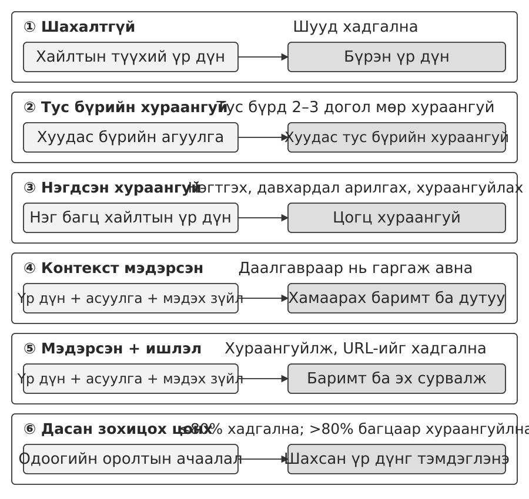
>
> Зураг 2-16-ийн тоонуудыг харьцуулахдаа гурван хэмжигдэхүүнийг ялгах хэрэгтэй: нэг хүсэлтийн оролт цонхны төсөвт хүрсэн эсэхийг шийднэ, хуримтлагдсан token олон ээлжийн дуудлагын хэрэглээг илэрхийлнэ, тэмдэгтийн шахалтын харьцаа нь тооцоонд орсон материалын боловсруулсны дараах урт болон анхны уртын харьцааг тодорхойлно. Энд байгаа хуримтлагдсан хэрэглээ нь үндсэн Agent-ийн ээлж бүрийн хүсэлтийн оролт, гаралтаас бүрдэх бөгөөд хураангуй үүсгэх бие даасан Model-ийн хүсэлтүүд энэ талбарт ороогүй.
>
> Туршилтыг давтан гүйцэтгэхдээ хамт бэлтгэсэн зааврын дагуу Model болон бодит хайлтын үйлчилгээг тохируулж, туршилтын хавтаст `python experiment.py -m kimi-k3 -n 15 -o results/reproduction.json`-ийг ажиллуулна. Стратеги бүрийн `metrics`-ийг уншиж, `total_compressed_size / total_original_size`-аар тэмдэгтийн харьцааг дахин тооцоолж, дараа нь `total_tokens` болон `iterations`-ийг харьцуулна. Шахалтгүй суурь хувилбар ч хайлтын үндсэн текстэд гарчиг, URL зэрэг форматыг нэмдэг тул боловсруулсны дараах тэмдэгтийн тоо эх текстээс бага зэрэг их байж болно. Туршилтын програм эцсийн хариулт хүлээн авсан л бол тухайн бүлгийг дууссан гэж тэмдэглэдэг. Хоёр бэлэн бүтээгдэхүүнээс нэг хүнийг шалгаж үзээрэй: ишлэлтэй бүлэг Pamela Vagata-ийн ажилладаг байгууллагыг Pebblebed гэж бичсэн бол цонхжуулалтын бүлгийн нэгтгэсэн хүснэгт Stripe гэж бичжээ. Эхний хариулт байгууллагын вэбсайтыг дурдсан ч нээж болох вэб хуудасны холбоос өгөөгүй. Хоёр бүлэг хоёулаа нэгтгэсэн хүснэгт хүлээлгэн өгсөн ч өгсөн хүний мэдээлэл нь хоорондоо зөрчилдсөн.

[^ch2-compression-results]: Туршилт 2-10-ийн үр дүнгийн файл `kimi_k3_real_20260718.json` стратеги бүрийн статистикийн талбар, эцсийн хариулт, цагийн тэмдэглэгээг хадгалсан бөгөөд тэмдэгтийн харьцааг шууд дахин тооцоолж болно. 2026 оны 7 дугаар сарын 18-ны ажиллагаа хуучин хамгаалалтын нөхцөлийг ашигласан; 7 дугаар сарын 22-ны кодын засвар (commit `aea4d72`) хуримтлагдсан оролтыг хамгийн сүүлийн ээлжийн хүсэлтийн оролтоор сольсон.

### Үйлдвэрлэлийн түвшний шаталсан шахалтын механизм

Tool-ийн гаралтын бүтэн текстийг түр хадгалах шаардлагатай байж болно, дууссан алхмуудыг архивлаж болно, одоогийн хязгаарлалт харагдсаар байх ёстой; доорх таван төрлийн механизм тус тус өөр өөр ашиглалтын давтамж, хадгалах хугацаанд тохирно.

1. **Tool-ийн үр дүнгийн төсвийн хяналт.** Том хэмжээний гаралтыг гадаад санд хадгалж, контекстэд хураангуй урьдчилан харагдац болон унших орох цэгийг үлдээнэ. Урьдчилан харагдац түүхэд орсон бол агуулгыг нь тогтвортой байлгана; илүү дэлгэрэнгүй мэдээлэл хэрэгтэй бол холбогдох хэсгийг уншиж, үр дүнг нэмнэ.
2. **Хамааралгүй агуулгыг цэвэрлэх.** Вэб хуудасны навигацын мөр, давтагдсан хөл хэсэг зэргийг үр дүн контекстэд орохоос өмнө шүүж болно. Түүхэнд аль хэдийн орсон агуулгыг устгах шаардлагатай бол эхлээд дараагийн даалгавар болон ишлэл түүнээс хамаарсаар байгаа эсэхийг баталгаажуулж, дараа нь түүхийг өөрчлөхөд гарах кэшийн зардлыг тооцоол.
3. **API түвшний контекст засварлалт.** Ийм чадварыг дэмждэг үйлчилгээ дүрмийн дагуу хуучин Tool-ийн үр дүнг цэвэрлэж болно. Клиент идэвхжүүлэх нөхцөлийг тохируулж, үйлчилгээний буцаасан засварын мэдээллийг боловсруулах шаардлагатай. Цэвэрлэх хүрээ болон кэшийн зан төлөвийг интерфейсийн тохиролцоо шийддэг тул оролтын төсвийн хяналттай хамт холбоход тохиромжтой.
4. **Архивын хэлбэрийн хураангуй.** Ээлж эсвэл даалгаврын үе шатаар зорилго, үйлдэл, үр дүн, дуусаагүй ажлыг бүртгэж, гүйцэтгэлийн дарааллыг хадгална. Үүнийг даалгаврын өөрчлөлтийн бүртгэл гэж ойлгож болно: дараа нь аль нэг шийдвэрийг аль алхамд гаргасан, юунд үндэслэснийг олж болно.
5. **Сессийг бүхэлд нь шахах.** Хэсэгчилсэн цэвэрлэгээ төсвийг хангаж чадахгүй үед одоогийн зорилго, хязгаарлалт, баталгаажсан баримт, гол шийдвэр, дараагийн ажлыг хүлээлцэх хураангуй болгон цэгцэлнэ. Эхлээд байгаа сессийн тэмдэглэлийг цэгцэлж, дараа нь бүх түүхийг нэгтгэж болно. Шахалт дараалан бүтэлгүйтвэл дахин оролдох хязгаар эсвэл хамгаалах таслуур механизмаар давтан дуудлагыг зогсоож, сэргээж болох төлөвийг хадгалаад, оролтыг багасгах эсвэл хүнээр боловсруулахыг сонгоно.

Эдгээр механизмыг давхарга болгон хослуулж болно: орцын хяналт нэг удаагийн том гаралтыг багасгаж, хэсэгчилсэн цэгцлэлт өдөр тутмын өсөлтийг хянаж, үе шатны хураангуй болон бүхэлд нь шахах нь урт даалгаварт хүлээлцэх мэдээллийг хадгална.

Зохиогч dsh-superagent-ийг уншихдаа нэг нарийн зүйлийг анзаарсан: үйл явдал болон Tool-ийн үр дүн эхлээд хураангуй болон объектын ID-г илгээж, нарийн мэдээлэл хэрэгтэй үед ID-гаар уншиж болно. Ард талд нэг багц тест ажиллаж дуусаад урд талд зөвхөн «хоёр тест унасан» гэж мэдээлсэн гэж үзье. Урд тал явцыг мэдээлж чадах ч хэрэглэгчийн дараа нь асуух «өчигдрийн тэр хоёр мөн үү?» гэдэгт хариулж чадахгүй. Хэрэв хураангуйд энэ удаагийн тестийн бүртгэлийн таних тэмдэг хавсаргасан бол урд тал унасан тестийн нэрийг буцааж аваад өчигдрийн бүртгэлтэй харьцуулж чадна.

### Шахалтын стратегийн загварын зарчим

Шахсны дараа юуг хадгалахаа шийдэхдээ дараах дөрвөн талаас шалгаж болно. Даалгавар дамнан туршлага хуримтлуулах үйл явцыг Бүлэг 9-д дэлгэрэнгүй авч үзнэ.

- **Даалгаврын үнэ цэнээр хэмжээг хуваарилах.** Хүмүүсийн жагсаалт, хэн хэнтэйгээ ямар холбоотой, одоо шалгах асуудлуудыг ихэвчлэн шууд хадгалах ёстой; дүгнэлтийг дэмжих гол нотолгооны эх сурвалж болон шаардлагатай нарийн мэдээллийг хадгална; навигацын мөр, зар сурталчилгаа, давтагдсан агуулгыг цэвэрлэж болно. Баримт маргаантай үед нотолгоонуудын хоорондын ялгаа ч чухал мэдээлэлд тооцогдоно.
- **Утгын бүрэн бүтэн байдлыг хадгалах.** Жишээлбэл, «Sutskever 2024 оны 5 дугаар сард OpenAI-аас гарсан» гэдэгт хүн, цаг хугацаа, үйлдэл, байгууллага хамтдаа нэг баримтыг бүрдүүлнэ. Шахахдаа эдгээр бүрэлдэхүүнийг хадгалж, зөвхөн «Sutskever гарсан» гэх мэт тайлбарлахад хэцүү хэсэг үлдээхээс зайлсхийх ёстой.
- **Дараагийн асуултыг тойруулан агуулгыг зохион байгуулах.** «Үүсгэн байгуулагчдын жагсаалтыг олох» нь хүмүүсийг бүрэн хамрах шаардлагатай бол «хувь хүний намтрыг ойлгох» нь туршлага, цаг хугацааны дараалал, эх сурвалж шаардана. Нэг материалаас өөр өөр даалгаварт өөр өөр хураангуй үүсгэж болно: хайлт хамралтад, дүн шинжилгээ хамаарал ба үндэслэлд анхаарах бол бүтээлч ажилд хэрэгтэй нарийн мэдээлэл, жишээг ч хадгалах шаардлагатай.
- **Хураангуй гүйцэтгэлийг дэмжиж чадах эсэхийг шалгах.** Утгын хураангуй даалгаврыг ойлгож, давхардлыг арилгаж, нөхцөл болон онцгой тохиолдлыг хадгалах шаардлагатай. **Нарийн төвөгтэй материалын утгын шахалтад ойлгох чадвар нь үндсэн Model-той ойролцоо Model-ийг эрхэмлэх ёстой.** Шахагч ямар нөхцөл, онцгой тохиолдол, нотолгоо дараагийн ажилд нөлөөлөхийг дүгнэх шаардлагатай; эдгээр агуулга хаягдвал үндсэн Model хэдий хүчирхэг ч нөхөж сэргээхэд хэцүү.

Эхэн үеийн архитектурын шийдвэр, хязгаарлалтын цаад шалтгаан, бүтэлгүйтсэн зам урт түүхэд амархан орхигддог. **Урт даалгаварт явцын баримт бичгийг тогтмол шинэчлэх ёстой**; «юуг шийдсэн, яагаад ингэж шийдсэн, юуг баталгаажуулсан, дараа нь юу хийх» гэдгийг хадгална. Prompt эсвэл Skill шинэчлэх мөчийг тогтоож, Harness даалгавар хүлээлцэх үед харгалзах бүртгэлийг ачаална. Ийм баримт бичиг гүйцэтгэгч, хянагч болон дараагийн Agent-д байгаа ажлыг ойлгоход ч тустай.

### Дэд Agent-ийн контекстийн тусгаарлалт

**Хүлээлгэн өгөх хил нь тодорхой, их хэмжээний завсрын материал үүсгэх даалгаварт зохиогч дэд Agent-ийн тусгаарлалтыг эрхэмлэдэг.** Өргөн хүрээний хайлт зөвхөн судлах шатанд хэрэгтэй олон материалыг уншдаг тул эхлээд тусгаарлавал эдгээр агуулга үндсэн даалгаварт тасралтгүй саад болохыг багасгана. Үндсэн Agent даалгаврыг бие даасан контексттэй дэд Agent-д шилжүүлж, дэд Agent завсрын үр дүнг уншаад, дүгнэлт, нотолгооны байршил, шийдэгдээгүй асуудлыг буцаана. Иймээс үндсэн Agent-ийн контекстэд зөвхөн дараагийн шийдвэрт хэрэгтэй мэдээллийг үлдээхэд хангалттай.

Жишээлбэл, «төлбөрийн callback-ийг боловсруулдаг функцийг олох» даалгаврыг үндсэн Agent шууд хайвал арав гаруй файл унших шаардлагатай байж болно. Хайлтын дэд Agent-д даатгавал функцийн нэр, байрлах модуль, дуудагдах цэгүүд, дүгнэлтийн үндэслэлийг буцаахыг шаардаж болно. Түүний хариулт «төлбөрийн модуль дахь `handle_callback` callback-ийг боловсруулдаг, өөр хоёр дуудагдах цэг бий» гэх мэт байж, байршлыг нь олж болох ишлэлийг хавсаргана. Үндсэн Agent эдгээр үр дүнд тулгуурлан холбогдох кодыг үргэлжлүүлэн унших эсэхээ шийднэ.

Даалгаврын тайлбар хангалттай бүрэн байх ёстой: зорилго юу, хайлтын хүрээ хэр том, ямар хязгаарлалтыг дагах, ямар форматаар буцаах, хоёрдмол утга тулгарвал хэрхэн шийдэх. Хэрэв даалгавар шилжүүлэх хүсэлт болон буцсан үр дүн хоёулаа түүхэд нэмэгдвэл үндсэн Agent-ийн анхны префикс дахин ашиглагдах боломжтой хэвээр байна.

Бүлэг 4-т дэд Agent-ийг Tool болгон ашиглах интерфейсийн загварыг хэлэлцэж, Бүлэг 10-т олон Agent-ийн систем дэх контекстийн ажил хуваарилалтыг цааш хэлэлцэнэ.

## Бүлгийн дүгнэлт

Хэрэглэгчийн үйлчилгээний туслах гурав дахь удаагаа залгаж дууссаны дараа ажлаа хэрхэн үргэлжлүүлэх вэ? Дараагийн ээлжийн хүсэлт энэ дуудлагын Tool-ийн баталгааг авч явж, дуудлагын ID-ээр залгасан үйлдэлтэй харгалзуулна. Төлөвийн мөр ашигласан тоог гурав болгон шинэчилж, хараахан тохиролцоогүй нөхцөлүүдийг жагсаана. Системийн дүрэм болон Tool-ийн тодорхойлолт тогтвортой префикст үлдэж, тодорхой ажил гүйцэтгэх шаардлагатай үед харгалзах Skill-ийг ачаална. Ингэснээр талбар бүр эх сурвалжтай байх бөгөөд дараагийн дуудлагаар ямар агуулга өөрчлөгдөхийг ч харж болно.

Дуудлага удаашрах тусам Tool-ийн буцаах үр дүн олширдог бол үр дүнгийн уртыг хязгаарлаж, аль хэдийн дууссан хэсгийг эх сурвалжтай хураангуй болгон цэгцэлж, эсвэл бие даан гүйцэтгэж болох ажлыг дэд Agent-д даатгаж, зөвхөн дүгнэлт болон нотолгоог нь буцааж авч болно.

Энэ даалгавар дууссаны дараа гурван удаа залгасан тоолуурыг даалгаврын хамт архивлаж болно. Гэвч хэрэглэгч «цаашид ажлын өдрүүдийн үдээс хойш надтай холбогдоорой» гэж тусгайлан захисан бол энэ өгүүлбэрийг зөвхөн дуудлагын хураангуйд үлдээвэл дараагийн удаа даалгавар хүлээн авах туслах огт харахгүй байж мэднэ. Урт хугацаанд хэрэгтэй мэдээллийг хэрхэн хадгалах, тохирох даалгаварт үүнийг хэрхэн буцааж олох вэ? Бүлэг 3-т даалгавар дамнасан хэрэглэгчийн санах ой болон хуваалцсан мэдлэгийн санг хэлэлцэнэ.

## Бүлгийн дараах бодох асуултууд

1. ★★★ Туршилт 2-3-ын гүйлгэх цонхны ажиллагааны бүртгэлийг уншина уу: таван Tool дуудлага тус бүр юу хийсэн бэ? Давтан дуудлага түүхийг тайрснаас үүдсэн эсэхийг дүгнэхийн тулд өөр юуг бүртгэж, ямар харьцуулалт хийх шаардлагатай вэ? Гол төлөвийг хадгалах тайрах аргыг зохиож, түүний префиксийн кэшэд үзүүлэх нөлөөг тайлбарлана уу. Бүртгэлийг `chapter2/kv-cache/result_sliding_window_20260718_kimi_k2_6.json`-аас үзнэ үү.
2. ★★ Qwen3-ийн Chat Template түүхэн бодолтыг хамгийн сүүлийн бодит хэрэглэгчийн асуулгын байрлалаар боловсруулдаг. Нэг ReAct давталт зуу гаруй ээлж үргэлжилбэл аажмаар өсөх дүгнэлтийн агуулгыг та хэрхэн удирдах вэ? Түүхэн бодолтыг тайрах, буцаах, префикс холбох протоколуудыг харьцуулж, Harness хэрхэн дасан зохицох ёстойг тайлбарлана уу.
3. ★★ Зуун тавин мянга орчим тэмдэгт бүхий хайлтын материалыг хоёр мянган тэмдэгт болгон шахах шаардлагатай гэж үзье. Та ямар баримт, хамаарал, эх сурвалжийг хадгалах вэ? Хураангуй дараагийн асуултыг дэмжихэд хангалттай эсэхийг хэрхэн шалгах, орхигдсон нарийн мэдээллийг хэрхэн сэргээх вэ?
4. ★★ Tool дуудлагын тоолуур нэг дуудлагыг бүртгэлгүй орхисны улмаас төлөвийн мөр үлдсэн тоог буруу өгсөн. Үйл явдлын бүртгэл, нэгтгэлийн шалгалт, гүйцэтгэх давхаргын шалгалтыг зохиож, ийм зөрүүг хэрхэн илрүүлж засахыг тайлбарлана уу.
5. ★★ Туршилт 2-4 өнгө аяс, мэдээллийн зохион байгуулалт, Tool-ийн тайлбарыг харьцуулсан. Системийн Prompt-ийг олон хүн удаан хугацаанд арчилдаг бол та хувилбарыг хэрхэн удирдах, дүрмийн зөрчлийг хэрхэн шалгах, өөрчлөлт бүрийг регрессийн даалгавраар хэрхэн үнэлэх вэ?
6. ★★★ Тэжээвэр амьтны дэлгүүрийн жишээ нэг бүртгэлийн хайлт болон нийт статистикийг зэрэг агуулдаг. Систем эдгээр хоёр төрлийн асуултад үр дүнтэй хариулж чадахаар түүхий бүртгэл, статистикийн хураангуй, асуулгын чиглүүлэлтийг зохиож, хураангуйг хэзээ шинэчлэх шаардлагатайг тайлбарлана уу.
7. ★★★ Нэг Skill каталогт байгаа боловч Model үүнийг одоогийн даалгаварт тохирохыг илрүүлсэнгүй. Тайлбар, каталогийн зохион байгуулалт, илт идэвхжүүлэлт, үнэлгээний жишээ гэсэн дөрвөн талаас асуудлыг хэрхэн шалгах вэ?
8. ★★ Skill амжилттай ачаалагдсан ч Model доторх баталгаажуулах алхмыг орхисон. Идэвхжүүлэлт, ойлголт, Tool ашиглалт, дуусгалтын дүгнэлтийн аль хэсэгт асуудал байгааг ялгах харьцуулсан туршилт зохиож, өөр өөр Model-уудын гүйцэтгэлийг харьцуулна уу.
9. ★★★ Систем олон Tool агуулдаг бөгөөд Tool-ийн багц байнга өөрчлөгддөг. Тогтмол тодорхойлолт, Tool-ийн каталог, шаардлагатай үед ачаалсан үр дүн, ажиллах үеийн төлөвийн байрлалыг та хэрхэн зохион байгуулах вэ? Илрүүлэлтийн нарийвчлал, контекстийн төсөв, кэшийн хитийг зэрэг харгалзана уу.
