# Хэрэглэгчийн санах ой ба мэдлэгийн сан

Хэрэглэгч өнгөрсөн долоо хоногт туслахдаа цонхны суудалд дуртай гэдгээ хэлсэн бөгөөд өнөөдөр зөвхөн «Токио руу дахиад нэг билет захиалаад өг» гэж хэлжээ. Энэ удаагийн хүсэлтэд өмнөх сонголтыг хаанаас олж ирэх вэ? Агаарын тээврийн компани өчигдөр ачаа тээшийн журмаа өөрчилсөн бол шинэ заалтыг хаанаас шалгах вэ? Өмнөх бүлэгт нэг даалгаврын контекстийг хэрхэн зохион байгуулахыг авч үзсэн. Энэ бүлэгт хэрэглэгчийн хэлсэн зүйлийг хаанаас эргүүлж олох, агаарын тээврийн шинэ журмыг хаанаас лавлах, мөн эдгээр хоёр төрлийн мэдээллийг тус тусад нь хэзээ шинэчлэх ёстойг авч үзнэ.

**Хэрэглэгчийн санах ой** нь тодорхой нэг хэрэглэгчийн эргэн тойронд мэдээллийг зохион байгуулж, түүний сонголт, зуршил, хэрэгцээ, туршлагыг тэмдэглэдэг. Ингэснээр Agent дараагийн сессүүдэд ч хэрэглэгчийн нөхцөл байдалд тохируулан үйлчилгээгээ үргэлжлүүлж чадна. **Мэдлэгийн сан** харин тодорхой эрхийн хүрээнд олон хэрэглэгчийн хамтран ашигладаг мэдээлэл бөгөөд салбарын хууль тогтоомж, байгууллагын ажлын журам, техникийн баримт бичиг зэрэг нь үүнд хамаарна. Эхнийх нь Agent-д үйлчлүүлэгчээ таньж мэдэхэд тусалдаг бол сүүлийнх нь даалгавар гүйцэтгэхэд шаардлагатай салбарын мэдлэгийг өгдөг.

Хоёулаа мэдээллийг хэрхэн хадгалах, хэрэгтэй үед хэрхэн олох гэсэн асуудлыг шийдэх ёстой бөгөөд баримт хоорондын зөрчил, хуучирсан агуулга, хайлтаар орхигдсон мэдээлэл зэрэгтэй адилхан тулгардаг. Векторын хайлт, бүтэцлэгдсэн индекс, мэдлэгийн шахалт зэрэг технологийг энэ хоёр төрлийн системд зэрэг ашиглаж болно. Зураг 3-1-д энэ бүлгийн бүтцийг үзүүлэв: эхлээд хэрэглэгчийн санах ойн дүрслэл ба удирдлагыг авч үзээд, дараа нь хайлтаар баяжуулсан үүсгэлт (RAG)-ийг танилцуулж, эцэст нь хайлтын аргуудыг сесс хоорондын санах ой болон илүү нарийн мэдлэгийн зохион байгуулалтад хэрэглэнэ.

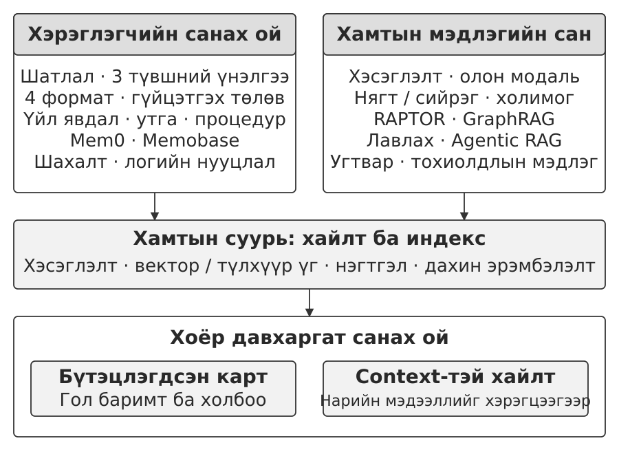

## Хэрэглэгчийн санах ойн систем

«Ирэх долоо хоногт би гадаадад байна, банкны бичиг баримтыг имэйлээр явуулаарай» гэсэн өгүүлбэрийг задалж уншъя. Хэрэглэгч хугацаатай аяллын тухай хэлээд, тэр аяллын хугацаанд бичиг баримт хүлээн авах арга замаа зааж өгчээ. Банк бичиг баримт шуудангаар илгээх гэж байвал туслах үүнд үндэслэн цахимаар хүргүүлэхийг хүсэж болно. Харин аялал дууссаны дараа шуудангийн асуудал дахин гарвал тухайн үеийн нөхцөлийг шинээр харах ёстой. Хэрэв зөвхөн «хэрэглэгч цаасан захидалд дургүй» гэж хадгалсан бол хожим энэ санах ойг хайлтаар олсон ч хамаарах хүрээг нь буруу хэрэглэнэ.

Одоо онгоцны билетийн жишээг авъя. Хэрэглэгч «өнгөрсөн удаагийн 1250-ийн билет миний бодсоноос үнэтэй байсан» гэж хэлбэл систем дор хаяж тэр үеийн үнийн санал, тухайн үеийн төсөв, аяллын нөхцөл, энэ удаагийн санал хүсэлтийг хадгалж чадна. Дараа нь ижил төстэй нөхцөл гарахад Model үүнд тулгуурлан төсвөөс хэтэрсэн үнийн саналыг илүү болгоомжтой авч үзнэ. Хэрэв хэрэглэгч тусад нь «цаашид гэр бүлийн аяллын үед заавал надаас эхлээд асуугаарай» гэж хэлбэл энэ нь ирээдүйн гэр бүлийн аялалд асуух тодорхой нөхцөлийг тогтоож байгаа хэрэг. Эндээс гурван төрлийн мэдээллийг ялгаж болно: хэрэглэгч бодитоор юу хэлсэн, тэр үед ямар нөхцөлд байсан, Model энэ туршлагаас юуг дүгнэн гаргасан.

Харилцан яриа дуусахад LLM-ээр эдгээр бичлэгийг цэгцлүүлж, цаашид хэрэг болох баримтыг байнгын хадгалалтад бичиж болно. Шинэ даалгавар эхлэхэд зөвхөн холбогдох бөгөөд одоо ч хүчинтэй бичлэгүүдийг контекстэд оруулна.

Жишээлбэл, хэрэглэгч онгоцны билет захиалахдаа дараах мэдээллийг өгсөн гэж үзье:

```text
User: Help me book a flight to Tokyo next Friday. I prefer window seats
      and I'm vegetarian, so I'll need a special meal.
Agent: I'll search for flights to Tokyo for next Friday...
       [calls flight_search tool, returns 3 options]
Agent: Here are your options. Based on your preference, I've filtered for
       window seat availability. Shall I book the ANA direct flight?
User: Yes, and use my United MileagePlus number 12345678.
```

Харилцан яриа дууссаны дараа санах ой гаргагч дараах дөрвөн бичлэгийг цэгцэлж гаргаж болно:

```text
Extracted memories:
- User prefers window seats (preference)
- User is vegetarian, needs special meals on flights (dietary restriction)
- User's United MileagePlus number: 12345678 (loyalty program)
- User has travel plans to Tokyo (recent activity)
```

Энэ жишээнд гурван боловсруулалт багтсан. **Сонгомол гаргалт** нь суудлын сонголт, хоолны шаардлага, гишүүнчлэлийн дугаарыг үлдээж, «хайлт гурван сонголт буцаасан» гэх мэт түр зуурын нарийн мэдээллийг шүүж хаядаг. **Хийсвэрлэл** нь хэрэглэгчийн тодорхой илэрхийлсэн цонхны суудлын сонголтыг цаашид билет захиалахад ашиглаж болох дүрэм болгон цэгцэлдэг. **Бүтэцжүүлэлт** нь баримт бүрт ангилал тэмдэглэж, хайх болон шинэчлэхэд хялбар болгодог. Токиогийн аяллын хувьд мөн хөдлөх огноо, одоогийн төлөвийг тэмдэглэх ёстой. «Ирэх баасан гараг» гэснийг сессийн огноотой уялдуулан хөрвүүлэх шаардлагатай бөгөөд аялал дуусах буюу цуцлагдсаны дараа төлөвийг шинэчилнэ. Ингэснээр урт хугацааны сонголт ба ойрын үйл ажиллагааг тус тусын хүчинтэй хугацааны дагуу хөтлөх боломжтой болно.

Хувийн туслах Today-ийн бүтээгдэхүүний тайлбарт нэг жишээ гардаг. Хэрэглэгч долоо хоног бүрийн мягмар, пүрэв гарагт бэлтгэл хийж, хагас марафонд бэлдэж байгаагаа хэлжээ. Зургаан долоо хоногийн дараа хэрэглэгчийн зөвшөөрлөөр холбогдсон нойрны бүртгэлээс түүнийг өчигдөр шөнө маш бага унтсан нь харагдав. Туслах энэ хоёр мэдээллийг уялдуулж, тухайн өдрийн өндөр ачаалалтай интервал бэлтгэлийг хойшлуулахыг санал болгожээ. Энд аль мэдээллийг хэр удаан санах вэ? Бэлтгэлийн төлөвлөгөө тэмцээнд бэлдэх бүх хугацаанд хэрэгтэй, харин өчигдөр шөнийн нойрны бүртгэлд огноо заавал хавсаргах ёстой. Хэрэглэгч энэ удаагийн хуваарийн өөрчлөлтийг зөвшөөрсөн ч цаашид бүгдийг өөрчлөхийг хэлээгүй л бол ирэх пүрэв гарагийн бэлтгэл анхны төлөвлөгөөгөөрөө явна. Today мөн санал гаргах ба хуанли өөрчлөхийг хоёр тусдаа алхам болгосон бөгөөд хоёр дахь алхамд хэрэглэгчийн баталгаажуулалт шаардлагатай.[^ch3-today]

[^ch3-today]: Today баг «What Is Today» нийтлэлдээ санах ой ба тухайн өдрийн мэдээлэл хэрхэн хамтран ажилладгийг хагас марафоны бэлтгэлийн жишээгээр тайлбарласан. Үүсгэн байгуулагч нь «Meet Today» нийтлэлдээ хуанли өөрчлөхийн өмнөх баталгаажуулалтын механизмыг тайлбарласан.

### Санах ойн чадварын үнэлгээ: гурван түвшний хүрээ

Нийтэд нээлттэй жишиг **LoCoMo** (Long-term Conversational Memory, урт хугацааны харилцан ярианы санах ой) нь дунджаар 300 орчим ээлж, хамгийн ихдээ 35 сесс бүхий урт ярианаас бүрдэх бөгөөд асуулт хариулт, үйл явдлын хураангуй, олон модальт харилцан яриа үүсгэх даалгавраар санах ойн чадварыг шалгадаг. Асуулт хариултыг таван төрөлд хуваадаг. Нэг алхамт асуултын хариуг нэг сессээс олж болно, олон алхамт асуултад хэд хэдэн сессийн сэжүүрийг нийлүүлэх шаардлагатай, цаг хугацааны дүгнэлтийн асуултад үйл явдлын өмнө хойно болсон дарааллыг ч тогтоох хэрэгтэй. Нээлттэй домэйны мэдлэгийн асуулт нь хэрэглэгчийн хэлсэн зүйлийг гадны мэдлэгтэй хослуулахыг шаарддаг. Билет захиалгын жишээгээ үргэлжлүүлбэл, хэрэглэгч зөвхөн «ирэх долоо хоногт Токио руу явна» гэж хэлсэн бол «очих газарт ямар мөнгөн тэмдэгт хэрэглэдэг вэ» гэсэн асуултад хариулахын тулд Токиогийн тухай сэжүүрийг санахаас гадна тэнд иен хэрэглэдгийг мэдэх хэрэгтэй. Хэрэв хэрэглэгчийн хэзээ ч хэлж байгаагүй нислэгийн дугаарыг асуувал туслах мэдээлэл хүрэлцэхгүй байгааг хэлэх ёстой. Ийм хариулах боломжгүй асуултыг таньж чадах эсэхийг шалгадаг нь яг эсрэг тэсрэг (adversarial) асуултууд юм.[^ch3-locomo]

[^ch3-locomo]: Maharana нарын LoCoMo өгүүллийн (arXiv:2402.17753) 4.1-р хэсэгт таван төрлийн асуулт хариултын тодорхойлолтыг өгсөн. Зохиогчдын төслийн хуудсанд өгөгдөл болон сессийн жишээнүүд бий.

Ийм жишгүүд болон санах ойн бүтээгдэхүүний практикт үндэслэн зохиогч анхаарах ёстой чадварыг найман зүйлд нэгтгэв:

- **Хувийн мэдээлэл хадгалах**: хэрэглэгчийн хэн болох зэрэг урт хугацааны мэдээллийг үнэн зөв хадгалж, эргүүлэн гаргах.
- **Сонголтыг хянах**: хэрэглэгчийн сонголтыг тэмдэглэж, шинээр тодорхой илэрхийлэх бүрд шинэчлэх.
- **Контекст солих**: сэдэв солигдсоны дараа ч холбогдох суурь мэдээллийг үргэлжлүүлэн ашиглах.
- **Санах ой шинэчлэх**: хэрэглэгчийн өмнөх баримтад оруулсан нэмэлт, засварыг зөв боловсруулах.
- **Олон сессийн залгамж чанар**: шинэ харилцан ярианд өмнө хадгалсан мэдээллийг ашиглах.
- **Нарийн сэтгэлгээ**: санах ойн хэд хэдэн хэсгийг холбох. Жишээлбэл, хэрэглэгч газрын самарт харшилтай гэдгээ өмнө нь хэлсэн бол Тайланд хоолны тухай ярихдаа үүнийг санаж, орц найрлагыг шалгахыг сануулах ёстой.
- **Цаг хугацааг мэдрэх**: огноог хадгалах, харьцангуй цагийг тайлбарлах, үйл явдлын хоорондох хугацааг тооцоолох.
- **Зөрчлийг шийдвэрлэх**: хоорондоо таарахгүй мэдээллийг илрүүлж, эх сурвалж, цаг хугацаа, хамаарах объектод нь үндэслэн дүгнэлт гаргах.

Agent-ийн бодит даалгаварт тулгуурлан энэ ном цааш нь гурван түвшний үнэлгээний хүрээг ашиглана. Туршилт 3-1, 3-2 эхлээд үүгээр санах ойн дүрслэлүүдийг харьцуулна; Туршилт 3-9 ба 3-11 дараа нь ижил хүрээгээр хайлтын аргуудыг үнэлнэ.

**Нэгдүгээр түвшин: үндсэн эргэн санах.** Хэрэглэгчийн шууд өгсөн, утга нь тодорхой мэдээллийг үнэн зөв хадгалж, эргүүлэн гаргах. Жишээлбэл, хэрэглэгч «миний гишүүнчлэлийн дугаар 12345» гэж хэлсэн бол дараа нь билет захиалахад бүтэн дугаарыг буцааж чаддаг байх ёстой. Энэ түвшин голчлон баримт алдагдсан, андуурагдсан эсвэл өөрчлөгдсөн эсэхийг шалгадаг.

**Хоёрдугаар түвшин: олон сессээс хайх.** Өөр өөр үеийн, өөр өөр объектод хамаарах харилцан ярианаас холбогдох мэдээллийг бүрэн цуглуулж, одоогийн хүсэлт хэнд хамаатай, ямар бичлэгүүд хэрэгтэйг тогтоох. Хэрэглэгч хоёр машинтай атлаа зөвхөн «миний машинд засвар үйлчилгээ захиалаад өг» гэж хэлбэл систем эхлээд хоёр машины мэдээллийг гаргаж ирээд аль нь болохыг тодруулах ёстой. Зээлийн төлөвийг лавлахдаа хүчин төгөлдөр болсон гэрээ ба өмнө нь лавлаж байсан үнийн саналыг ялгах шаардлагатай. «Лос Анжелесийн аялал»-ыг цуцлахдаа онгоцны билет, зочид буудал зэрэг захиалгыг нэг аялалд холбох хэрэгтэй.

**Гуравдугаар түвшин: идэвхтэй үйлчилгээ.** Одоогийн даалгаварт үндэслэн хэрэглэгчийн нэг бүрчлэн дурдаагүй холбогдох асуудлуудыг илрүүлэх. Жишээлбэл, олон улсын нислэг захиалахдаа хэдэн сарын өмнө хадгалсан паспортын мэдээлэлтэй холбож, хүчинтэй хугацаа нь аяллын шаардлагыг хангаж байгаа эсэхийг шалгах; утас эвдэрсэн үед төхөөрөмжийн баталгаа, кредит картын нэмэлт баталгаа, үүрэн холбооны операторын даатгалыг нэгтгэж, боломжит шийдлүүдийг жагсаах; татварын тайлангийн материал бэлдэхдээ жилийн турших бичлэгээс хувьцааны арилжаа, чөлөөт хөдөлмөрийн орлого, үл хөдлөх хөрөнгийн татварын баримтыг бүрэн цуглуулах.

> **Туршилт 3-1 ★: Гурван түвшний хүрээгээр санах ойн системийг үнэлэх**
>
> Үнэлгээний багц түвшин бүрт 20, нийт 60 тохиолдолтой. Нэгдүгээр түвшин голчлон нэг сессээс бүрдэнэ; хоёр, гуравдугаар түвшинд өөр өөр цаг хугацаа, объектод хамаарах олон хэсэг сесс багтсан бөгөөд объектыг холбох, мэдээлэл шинэчлэх, идэвхтэй сануулах чадварыг шалгана.
>
> Тохиолдол бүрийг хоёр алхмаар гүйцэтгэнэ. Эхлээд сессүүдийг хэсэг хэсгээр нь оруулна: Model эхний хэсэгт үндэслэн санах ой үүсгэж, дараагийн удаа бүр зөвхөн одоо байгаа санах ой ба шинэ сессийг хүлээн авч, шинэчилсэн санах ойг гаргана. Үүнээс хойш Model өмнөх сессийн эх бичвэрийг уншиж чадахгүй тул тэр үед ярьсан асуудлын талаар хариулахдаа зөвхөн санах ойд бичигдсэн мэдээлэлд л найдна. Бүх сессийг боловсруулсны дараа шинэ асуулт оруулж, Agent-ээс санах ойдоо үндэслэн хариулахыг шаардана.
>
> Үнэлгээнд LLM-as-a-judge аргыг ашиглана: бие даасан шүүгч Model жишиг хариулт ба оноо өгөх шаардлагатай тулган, хариултад багтсан баримт болон алдааг шалгана. Энэ удаагийн ажиллуулалтад санах ой болон хариултыг Doubao Seed 1.6-аар үүсгэж, Moonshot Model-оор оноо өгсөн. Шүүгч анхны харилцан яриаг харж чадна, харин хариулт өгөх Model зөвхөн эцэст нь үлдсэн санах ойг л харна.
>
> Онооны хуудсыг хэрхэн унших вэ? Жишээлбэл, хэрэглэгч зөвхөн өргөн зурвасын интернэт үйлчилгээний дансны дугаараа олохыг хүсчээ. Сайжруулсан тэмдэглэлийн бүлэгт туслах зөв дугаарыг хариулсан. Шүүгч үнэн зөв байдал, эргэн санах, дүгнэлт тус бүрт 4 оноо, харин идэвхтэй байдалд ердөө 1 оноо өгсөн ч энэ асуулт тэнцсэн хэвээр байна. Программын тэнцэх нөхцөл нь эхний гурван үзүүлэлт тус бүр дор хаяж 3 оноо (дээд тал нь 4 оноо) авах, мөн шүүгч үндэслэлгүй эсвэл анхны үгтэй зөрчилдсөн чухал баримт илрүүлээгүй байх явдал юм. Идэвхтэй байдал нийт оноонд нөлөөлдөг тул зөвхөн тэнцсэн тоог хараад туслах хэр зэрэг идэвхтэй тусалснийг мэдэх боломжгүй.

### Санах ойн шаталсан бүтэц

«Өнгөрсөн удаа аль нислэгийг захиалсан бэ» гэсэн асуултад хариулахын тулд нэг үйл явдлыг олох хэрэгтэй; «билет захиалахдаа ямар суудлыг түрүүлж сонгох вэ» гэсэн асуултад хариулахын тулд олон удаагийн харилцан үйлчлэлээс хуримтлагдсан сонголтыг гаргаж ирэх хэрэгтэй. Хоёр асуулт хоёулаа нэг хүнд хамаатай ч бичлэгийн нарийвчлал ба хайлтын арга нь өөр өөр байхыг шаарддаг.

**Траектор (trajectory)** нь Agent-ийн нэг удаагийн ажиллагааны үйл явдлыг цаг хугацааны дарааллаар тэмдэглэдэг бөгөөд үүнд хэрэглэгчийн мессеж, Model-ийн хариу, Tool дуудах ба гүйцэтгэлийн үр дүн багтана. Зөвхөн нэмдэг, өөрчилдөггүй (append-only) үйл явдлын логийг ашиглавал шинэ үйл явдлыг төгсгөлд нь залгаж, анхны бичлэгийг мөрдөн шалгахад зориулж хадгална. Harness траектороос түүхийг сонгох, төлөвийг гаргах эсвэл хураангуй үүсгэх замаар ээлж бүрт Model-д бодитоор илгээх контекстийг бүрдүүлж болно.

**Хэрэглэгчийн урт хугацааны санах ой** нь сонголт, хүмүүсийн хоорондын харилцаа, өнгөрсөн үйл ажиллагааны хураангуй, баталгаажсан баримт зэрэг харилцан яриа хооронд хэрэгтэй мэдээллийг хадгалж, хэрэглэгчийн ID зэрэг таних тэмдгээр хэнд хамаарахыг тогтоодог. Шинэ илэрхийлэл хуучин бичлэгийг нөхөх, засах эсвэл орлох боломжтой тул урт хугацааны санах ойг нэгтгэж, шинэчилж байх шаардлагатай. Унших ба арчлахыг Agent Tool-ийг шууд дуудаж гүйцэтгэж болно, эсвэл Harness сесс ачаалах, дуусах буюу ар талд цэгцлэх үед өдөөж болно.

**Бизнесийн төлөв** нь даалгавар ямар логик үе шатанд байгааг илэрхийлдэг, тухайлбал «тодруулах шаардлагатай», «боловсруулж байна», «төлбөр хүлээж байна», «дууссан». Программ эдгээр төлөвийг шалгаж, дараа нь ямар үйл явдал хүлээх, ямар үйлдэл гүйцэтгэхээ шийддэг. Бүлэг 6-д үйл явдалд суурилсан архитектур дахь төлөвийн удирдлагыг дэлгэрэнгүй авч үзнэ.

Эдгээр гурван төрлийн бичлэг хамтран ажиллаж болно: траектор гүйцэтгэлийн үндэслэлийг, урт хугацааны санах ой сесс хоорондын суурь мэдээллийг өгч, бизнесийн төлөв одоогийн даалгавар хаана хүртэл явсныг харуулна. Доор урт хугацааны санах ойн дүрслэл, удирдлага, хайлтыг голчлон авч үзнэ.

### Хэрэглэгчийн санах ойн дөрвөн хадгалах формат

Ганцхан имэйл хаяг өөрчлөх гэж байгаа бол тэр зүйлийг шууд олох нь хамгийн тохиромжтой; харин яагаад хаягаа өөрчилснийг ойлгох гэж байгаа бол үйл явдлын явцыг уншиж байж мэднэ. Зураг 3-2-ын зүүн дээд хэсэгт имэйл, компани, албан тушаалыг тус тусад нь хадгалсан бол баруун дээд хэсэгт албан тушаал, баг, төслийг нэг дор бичсэн. Доорх хоёр картыг харъя: цаашид албан тушаалыг шинэчлэх, эсвэл зүрхний эмчид хэн үзүүлсэн болохыг ялгах шаардлага гарвал аль талбарыг тус тус шалгах вэ?

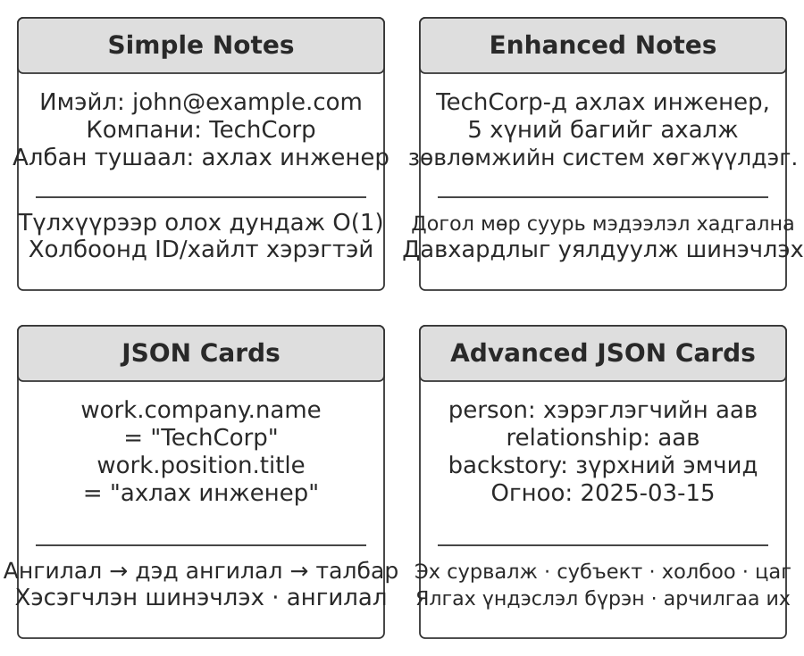

**Simple Notes** нь санах ой бүрийг «Хэрэглэгчийн имэйл: john@example.com» гэх мэт богино баримт болгон бичдэг. Нэг бичлэгийг унших, бичихэд хялбар; тогтвортой түлхүүрээр хэш хүснэгтээс байршлыг нь олбол хайх ба шинэчлэх дундаж хугацааны төвөгшил ихэвчлэн O(1) байна. Харин олон тэмдэглэлээс утгаар нь хайхын тулд хайлтын индекс байгуулах шаардлагатай. Хэт жижиглэн хуваавал хоорондын холбоо алдагдана: «TechCorp-д ахлах инженерээр ажиллаж, зөвлөмжийн систем хөгжүүлэх ажлыг хариуцдаг» гэснийг компани, албан тушаал, төсөл гэсэн хоорондоо холбоогүй гурван бичлэг болгон задалбал дараа нь тэд нэг ажилд хамаарах эсэхийг дахин тогтоох хэрэгтэй болно.

**Enhanced Notes** нь баримтыг суурь мэдээлэлтэй нь хамт бүтэн догол мөрөөр хадгалдаг. Жишээлбэл: «Хэрэглэгч TechCorp-д ахлах программ хангамжийн инженерээр ажилладаг, машин сургалтын чиглэлээр гурван жил ажилласан, одоо 5 хүний бүрэлдэхүүнтэй зөвлөмжийн системийн төслийг удирдаж байна.» Компани, албан тушаал, туршлага, багийн хоорондын холбоо нэг догол мөрөнд хадгалагдана. Үүний төлөөс нь зарим баримт хэд хэдэн догол мөрөнд давхардаж болох явдал; албан тушаал өөрчлөгдсөний дараа холбогдох бүх догол мөрийг олж шинэчлэх шаардлагатай бөгөөд эс тэгвээс шинэ, хуучин бичлэг зэрэг оршино.

**JSON Cards** нь мэдээллийг «ангилал — дэд ангилал — түлхүүр-утгын хос» хэлбэрээр зохион байгуулдаг, тухайлбал `personal.contact.email` болон `work.position.title`. Албан тушаалын талбарыг өөрчлөхдөө `work.company.name` зэрэг бусад талбарыг хэвээр үлдээж болох тул хэсэгчилсэн шинэчлэлтэд тохиромжтой. Ангиллыг зохиохдоо огтлолцсон мэдээллийг ч бодолцох хэрэгтэй: «амралтын өдрүүдэд Python-оор хувийн төсөл хөгжүүлдэг» гэдэг нь цаг хугацаа, техникийн сонголт, үйл ажиллагаа гурвуулантай нь холбогдоно. Нэг үйл ажиллагааны бичлэг хадгалаад хэд хэдэн шошго нэмэх, эсвэл холбогдох ангиллуудыг лавлагаагаар холбох замаар эдгээр уялдааг хадгалж болно.

**Advanced JSON Cards** нь баримтаас гадна эх сурвалжийн суурь мэдээлэл `backstory`, субъект `person`, хэрэглэгчтэй холбоо `relationship`, мөн цагийн тэмдэг нэмдэг. Эдгээр талбар нь мэдээлэл хэнд хамаарах, хэзээ мэдэгдсэн, ямар нөхцөлд хэрэглэгдэхийг системд таньж мэдэхэд тусалдаг. Жишээлбэл, «Доктор Жан» гэдэг нь хэрэглэгчийн шүдний эмч ч байж болно, хэрэглэгчийн аавын зүрхний эмч ч байж болно; нэрийг үзүүлэгч, ураг төрлийн холбоо, мэргэшлийн хамт хадгалбал андуурал багасна.

Хэрэглэгч «гэр бүлийнхнийхээ жилийн эрүүл мэндийн үзлэгийг товлоод өг» гэхэд систем `person` болон `relationship`-ээр гэр бүлийн гишүүдийг олоод, `backstory`-ээс холбогдох түүхийг уншиж болно. Талбар баялаг байх тусам гаргах болон шинэчлэх үед боловсруулах холбоо ч олшрох болно. Зохиогч мэдээллийн ач холбогдол ба холбоосын хэрэгцээнд нь тохируулан холимог хадгалалт хэрэглэхийг зөвлөдөг: гол хүмүүс, гэрээ, урт хугацааны сонголтыг Advanced JSON Cards-аар хадгалж эх сурвалж, холбоог нь үлдээх; тоо нь олон, холбоо багатай энгийн баримтыг Simple Notes-оор хадгалж, гаргах ба арчлах зардлыг бууруулах. Хоёр төрлийн бичлэгийг таних тэмдэг эсвэл лавлагаагаар холбож, хэрэгтэй үед нь хамт гаргаж ирнэ.

> **Туршилт 3-2 ★★: Санах ойн дөрвөн форматын харьцуулалт**
>
> Дагалдах хэрэгжүүлэлт дөрвөн форматад санах ой үүсгэх, шинэчлэх, хайх нэгдсэн интерфейс өгч, Туршилт 3-1-ийн ижил 60 тохиолдол дээр эцсийн хариултыг харьцуулдаг.
>
> Энэ удаагийн ажиллуулалтад Simple Notes, Enhanced Notes, JSON Cards, Advanced JSON Cards тус тус 48, 52, 51, 49 тохиолдолд тэнцсэн. Хоёрдугаар түвшинд Enhanced Notes 16, Advanced JSON Cards 12 тохиолдолд тэнцсэн; гуравдугаар түвшинд хоёулаа 19 тохиолдолд тэнцсэн. Санах ой арчлах, хариулах, үнэлэх бүх шатыг оруулбал Enhanced Notes ойролцоогоор 990 мянга, Advanced JSON Cards ойролцоогоор 1.55 сая token зарцуулсан бөгөөд сүүлийнх нь Model дуудлагын дундаж хугацаа ч илүү урт байв.
>
> Хоёрдугаар түвшний стриминг үйлчилгээний захиалгын асуултыг жишээ болгон авъя. Хэрэглэгч зардлаа хэмнэхийг хүсэж, ямар үйлчилгээнд бүртгүүлсэн, тус бүр нь хэд байдгийг асуужээ. Сайжруулсан тэмдэглэлийн бүлэг Netflix, Disney+, Max-ийн сарын төлбөрийг 22.99, 19.99, 19.99 ам.доллар гэж жагсаасан. Ахисан түвшний JSON картын бүлэг зөвхөн Max-ийн үнийг хэлээд, Max-ийн хоёр хямд багцыг нэмж жагсаасан. Зөвлөмж хичнээн тодорхой байлаа ч нөгөө хоёр төлбөрийн мэдээллийг нөхөж чадахгүй.
>
> Асуудал аль шинэчлэлтээс эхэлсэн бэ? Ахисан түвшний картын бүлгийн удаа бүр хадгалсан санах ойг харвал эхний сессийн дараа Netflix байсан, хоёр дахь сессийн дараа зөвхөн Disney+-ийн холбогдох бичлэг үлдсэн, гурав дахь сессийн дараа дахиад зөвхөн Max үлдсэн байна. Асуулт тавих үед эхний хоёр захиалга санах ойгоос аль хэдийн алга болсон байжээ.

### Мэдлэгийн дүрслэлийн ахисан хэлбэр: гүйцэтгэж болох код

Баримтыг хадгалсны дараа нэгтгэн тоолох, зөрчил шалгах, бизнесийн дүрмийн дагуу дараагийн алхмыг тодорхойлох хэрэгтэй болдог. Зохиогч **User as Code** (UaC)-д хэрэглэгчийн мэдээллийг төрөлтэй Python объект болгон зохион байгуулж, эдгээр үйлдлийг функц болгон бичихийг туршсан[^uac]. Model харилцан ярианаас баримтыг гаргаж, программ тодорхой тодорхойлогдсон тооцооллыг гүйцэтгэдэг.

Огноо харьцуулах, мөнгөн дүн нэгтгэх, тодорхой бизнесийн хязгаарлалт зэрэгт зохиогч тооцооллыг функц болгон бичихийг илүүд үздэг бөгөөд ингэснээр ижил баримтын багцаас давтан гаргаж, шалгаж болох үр дүн гарна. Ингэснээр Model утгын ойлголтод анхаарлаа төвлөрүүлж, урт харилцан ярианд дахин дахин цээжээр тооцоолох, дүрэм тулгах ачааллаа бууруулна; санах ойн дүрслэл ба хэрэглээг ч нэг кодын хүрээнд шалгах боломжтой болно.

UaC хоёр үе шаттай урсгал ашигладаг: эхлээд гаргасан баримтыг логт залгаж, дараа нь үе үе шалгах цэг үүсгэн, логоос төрөлтэй төлөвийг дахин бүтээнэ. Лог нь баримтын эх сурвалж ба өөрчлөлтийн явцыг хадгалж, төлөвийн объект нь одоогийн байдлаар асууж болох талбаруудыг өгдөг.

Паспорт ба аяллыг жишээ болгон авбал төлөвийг дараах байдлаар тодорхойлж болно:

```python
from dataclasses import dataclass
from datetime import date

@dataclass
class PassportInfo:
    number: str
    country: str
    expiry_date: date

@dataclass
class Trip:
    destination: str
    departure_date: date
    is_international: bool

@dataclass
class UserState:
    passport: PassportInfo
    trips: list[Trip]

state = UserState(
    passport=PassportInfo("AB1234567", "US", date(2025, 2, 18)),
    trips=[
        Trip("Tokyo", date(2025, 1, 15), True),
        Trip("Paris", date(2025, 6, 10), True),
    ],
)
```

**Нэгтгэсэн статистик** нь бичлэгүүдийг шууд гүйж тоолдог. Жишээлбэл, 2025 онд бүртгэгдсэн олон улсын аяллын тоог тооцоолъё:

```python
count = sum(
    1 for trip in state.trips
    if trip.is_international and trip.departure_date.year == 2025
)
# count == 2
```

**Зөрчил шалгах** нь хоёр талбарын багцыг урьдчилан тогтоосон дүрмээр тулгадаг. Доор эмийн ангиллын тохирлыг жишээ болгон, нэмэлт шалгалт шаардлагатай зүйлсийг боловсруулалтын дараалалд хэрхэн оруулахыг харуулав:

```python
def find_allergy_matches(profile):
    matches = []
    for medication in profile.current_medications:
        for allergy in profile.allergies:
            if medication.drug_class == allergy.drug_class:
                matches.append((medication, allergy))
    return matches
```

Тохирол бүр харгалзах эмийн хэрэглээний бичлэг ба харшлын бичлэгийг хадгалдаг тул дараагийн урсгал үүнд үндэслэн шалгаж, салбарын дүрмийн дагуу сануулах, хянуулахаар шилжүүлэх эсвэл мэдээлэл нэмж авах эсэхийг шийднэ.

**Хязгаарлалт шалгах** нь төлөв шинэчлэгдэх бүрд автоматаар ажиллаж болно. Жишээлбэл, аяллын нэгэн дүрэм хөдлөх үед паспорт дор хаяж 180 хоногийн хүчинтэй хугацаатай байхыг шаарддаг бол хоногийн тоог параметрээр дамжуулж болно:

```python
def passport_alerts(state, required_days):
    alerts = []
    for trip in state.trips:
        if trip.is_international:
            days = (state.passport.expiry_date - trip.departure_date).days
            if days < required_days:
                alerts.append((trip.destination, days))
    return alerts

alerts = passport_alerts(state, required_days=180)
```

Жишээн дэх 180 хоногоор тооцвол Токио руу явахад паспортын хүчинтэй хугацаа ердөө 34 хоног үлдсэн, Парис руу хөдлөх өдөр гэхэд аль хэдийн дууссан байна. Хэрэглэгч паспортаа сольсны дараа программ шинэ огноогоор энэ хоёр аяллыг дахин тооцоолж болно.

[^uac]: Li, Bojie, User as Code: Executable Memory for Personalized Agents, 2026.

### Хэрэглэгчийн санах ойн танин мэдэхүйн шинжлэх ухааны үндэс

Танин мэдэхүйн шинжлэх ухаан санах ойг агуулга болон хэрэглэх арга барилаар нь хэд хэдэн төрөлд ялгадаг. Эдгээр ойлголт Agent-ийн урт хугацааны мэдээллийг зохион байгуулахад ч тус болно:

- **Үйл явдлын санах ой (episodic memory)** нь тодорхой үйл явдлыг цаг хугацаа, оролцогчид, явцтай нь хадгалдаг. Хүний жишээ бол «өнгөрсөн лхагва гарагт хамт ажиллагсадтайгаа Итали ресторанд оройн хоол идсэн»; Agent-д үүнтэй «хэрэглэгч ирэх баасан гарагт ANA-ийн нислэгээр Токио руу явахаар төлөвлөж байна» гэсэн бичлэг харгалзах бөгөөд дараа нь захиалга амжилттай болсон эсэх, өөрчлөгдсөн эсэхийг ч тэмдэглэж болно.
- **Утгын санах ой (semantic memory)** нь баримт ба ойлголтыг хадгалдаг. Хүний жишээ бол «Италийн нийслэл Ром»; Agent-д «хэрэглэгч цагаан хоолтон», «хэрэглэгч цонхны суудлыг илүүд үздэг» гэсэн бичлэг харгалзана. Ийм мэдээлэл хэрэглэгчийн тодорхой хэлсэн үгнээс ч, олон удаагийн туршлагаас нэгтгэн дүгнэснээс ч гарч болох бөгөөд эх сурвалжийг тэмдэглэх нь хоёрыг ялгахад тусална.
- **Процедурын санах ой (procedural memory)** нь ур чадвар болон үйлдлийн дараалалтай холбоотой. Хүний жишээ бол дугуй унах; Agent-ийн инженерчлэлд дахин ашиглаж болох урсгалыг жишээ болгож болно, тухайлбал «шууд нислэг хайх → суудлын сонголтыг баталгаажуулах → байнгын зорчигчийн дугаар ашиглах → хоол захиалах».

Бүлэг 1-ийн худалдан авалтын бичлэгийг эргэн харвал «арван бараа үзээд нэгийг нь худалдаж авсан» гэдэг нь нэг удаагийн худалдан авалтын үйл явдлыг тэмдэглэхэд хангалттай ч үүнээс хэрэглэгч цаашид юунд дуртайг дүгнэхэд хэцүү. Тэр энэ загварт дуртай байж болно, эсвэл зүгээр л тухайн өдөртөө хүргэгдэх байсан болохоор сонгосон байж болно. Хэрэв тэр дараа нь «цаашид энэ төрлийн бараа авахдаа өдөртөө хүргэх боломжтой эсэхийг эхлээд харж байгаарай» гэвэл хамрах хүрээ бүхий урт хугацааны нэг сонголт нэмэгдэнэ. Дараа нь ижил төрлийн бараа санал болгохдоо хүргэлтийн хугацааг түрүүлж шалгаж, энэ шүүлтүүрийн нөхцөл аль удаагийн санал хүсэлтээс гарсныг ч түүнд тайлбарлаж болно.

Хүснэгт 3-1 энэ ангиллыг өмнөх санах ойн шатлал, хадгалах форматтай нэг дор харуулж, гурвуулаа тус бүр ямар асуултад хариулдгийг тайлбарлав.

Хүснэгт 3-1: Санах ойн дизайны гурван тал

| Дизайны тал | Хариулах асуулт | Тодорхой ангилал |
| --- | --- | --- |
| Бичлэгийн шатлал | Мэдээлэл ямар үүрэг гүйцэтгэх вэ? | Траектор, хэрэглэгчийн урт хугацааны санах ой, бизнесийн төлөв |
| Хадгалах формат | Ямар бүтцээр дүрслэх вэ? | Simple Notes, Enhanced Notes, JSON Cards, Advanced JSON Cards |
| Санах ойн агуулга | Ямар төрлийн мэдээлэл хадгалах вэ? | Үйл явдлын санах ой, утгын санах ой, процедурын санах ой |

Жишээлбэл, «хэрэглэгч цонхны суудлыг илүүд үздэг» гэдэг нь утгын санах ойд хамаарах бөгөөд Simple Notes-оор урт хугацааны санах ойд хадгалж болно; билет захиалах бүхэл бүтэн урсгал нь процедурын санах ойд хамаарах бөгөөд эх сурвалж ба хэрэглэх нөхцөл бүхий картаар хадгалж болно.

### Санах ойн хүрээний жишээнүүд

Хэрэглэгч «би сүүлийн үед хонгилын суудалд суудаг болсон» гэж хэлсэн ч хуучин бичлэгт «цонхны суудалд дуртай» гэж бичигдсэн байна. Систем бичих үедээ суудлын сонголтыг шинэчилж болно, эсвэл хоёр илэрхийллийг хоёуланг нь хадгалаад, дараагийн удаа билет захиалахдаа аль нь хамаарахыг шийдэж болно. Доор эхлээд Mem0 ийм зөрчлийг аль шатанд шийддэгийг, дараа нь Memobase хэрэглэгчийн хувийн төрх болон тодорхой үйл явдлыг хэрхэн тусад нь тэмдэглэдгийг харъя.

**Mem0: зөрчил шийдвэрлэх байрлалыг өөрчлөх.** 2025 оны өгүүлэл болон v2-ийн урсгал бичих үедээ шинэ, хуучин баримтыг харьцуулдаг байсан бол дараагийн v3 баримтыг залгах ба холимог хайлтыг ашигладаг болсон. Зураг 3-3 энэ хоёр зохион байгуулалтыг харьцуулж харуулна.

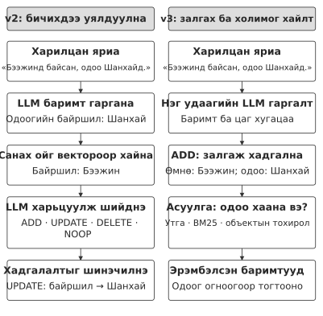

Эртний урсгалд LLM эхлээд харилцан ярианаас нэр дэвшигч баримтыг гаргаж, дараа нь ойролцоо одоо байгаа санах ойг хайж олоод **ADD**, **UPDATE**, **DELETE** эсвэл **NOOP** гүйцэтгэхээ шийддэг. Хэрэглэгч эхлээд «би Бээжинд амьдардаг», дараа нь «би Шанхай руу нүүсэн» гэж хэлбэл систем одоогийн оршин суугаа газрыг Шанхай болгон шинэчилж болно. Ингэснээр хайлтын үед цэгцэлсэн баримтыг авахад хялбар болох ч арчлах үед засвар, цаг хугацааны өөрчлөлт, өөр объектыг зөв таньж, шинэчлэлтийн үндэслэлийг хадгалах хэрэгтэй бөгөөд ингэж байж алдаа илэрсэн үед буцааж шалгах боломжтой. Өгүүлэлд мөн объект ба харилцаагаар холбоо бүхий мэдлэгийг илэрхийлдэг график санах ойн хувилбар **Mem0-g**-г санал болгосон[^ch3-mem0-paper].

v3 автомат гаргалтыг нэг удаагийн LLM дуудлага болгож, зөвхөн **ADD** бичлэг залгадаг болсон. Бээжин ба Шанхайн тухай хоёр мэдээллийг цаг хугацааны суурь мэдээлэлтэй нь хамт хадгалж, хайлтын үед контекстэд тулгуурлан одоогийн оршин суугаа газрыг тогтоож болно. Хайлтад утгын ижил төстэй байдал, BM25 түлхүүр үг, объектын тохирлыг зэрэг ашигладаг; баталгаажсан, гүйцэтгэгдсэн үйлдлийг ч баримт болгон гаргаж болно. Шилжилтийн гарын авлагад LoCoMo-ийн оноо 71.4-өөс 91.6 болж, LongMemEval 67.8-аас 93.4 болж өссөн гэж мэдээлсэн. Энэ нээлттэй эхийн хувилбар объектын холбоосыг дотоод хайлтад ашиглаж, гадны график хадгалалтын интерфейс болон `relations` буцах утгыг хассан; график санах ойг удирдлагатай платформ (hosted platform) санал болгодог[^ch3-mem0-migration].

Энэхүү хувьсал санах ойн систем зөрчлийн дүгнэлтийг бичих шатнаас унших шат руу шилжүүлж болохыг харуулж байна. Бичих үед хоёр хүний туршлагыг андуурч нэгтгэх, эсвэл нэмэлт мэдээллийг засвар гэж үзвэл дараагийн хариултууд алдаатай одоогийн төлөвийг байнга дагаж болно. Залгаж хадгалах нь шинэ, хуучин нотолгоог хоёуланг нь дүгнэлтэд оролцуулж, бичих үед бичлэг бүрээр шийдвэр гаргах Model дуудлагыг ч багасгадаг. Байнга өөрчлөгддөг, тухайн үед зөрчлийг тогтооход хэцүү хэрэглэгчийн санах ойн хувьд зохиогч эхлээд баримтыг цаг хугацаа, эх сурвалжтай нь хадгалж, тодорхой асуултад хариулах үедээ хүчинтэй төлөвийг цэгцэлж гаргахыг илүүд үздэг.

[^ch3-mem0-paper]: Chhikara нар, Mem0: Building Production-Ready AI Agents with Scalable Long-Term Memory, 2025.

[^ch3-mem0-migration]: Mem0, Open Source: Migrating to the New Memory Algorithm.

**Memobase: хэрэглэгчийн хувийн төрх ба үйл явдлын санах ой.** Memobase урт хугацааны мэдээллийг хоёр хэсэгт зохион байгуулдаг. **Хэрэглэгчийн хувийн төрх (profile)** нь харьцангуй тогтвортой шинж чанарыг сэдэв ба дэд сэдвээр хадгалдаг, тухайлбал `basic_info` доорх нэр, `interest` доорх сонирхол, `work` доорх албан тушаал. Хөгжүүлэгч гаргах ёстой талбаруудыг тохируулж, хувийн төрхийн хүрээ ба нарийвчлалыг хянаж болно. **Үйл явдлын санах ой (event memory)** нь хэрэглэгчийн туршлагыг цаг хугацаатай нь тэмдэглэж, «төсвийн талаар хамгийн сүүлд хэзээ ярилцсан бэ» гэх мэт асуултад системийг хариулах боломжтой болгодог.

Memobase шинэ харилцан яриаг эхлээд буферт хийж, буфер тогтоосон хэмжээнд хүрэх буюу сесс тогтоосон хугацаанд идэвхгүй байсны дараа багцаар нь боловсруулдаг бөгөөд сесс дуусахад шууд өдөөж ч болно. Ингэснээр олон мессеж нэг цэгцлэх урсгалыг хуваалцаж, хайлтын үед аль хэдийн үүссэн хувийн төрх ба үйл явдлыг уншина. Асинхрон шинэчлэлт одоогийн харилцан үйлчлэлд санах ой гаргахыг хүлээх хугацааг багасгадаг; хамгийн сүүлийн баримтыг нэн даруй ашиглах шаардлагатай бол энэ удаагийн боловсруулалт дуусахыг хүлээж болно[^ch3-memobase].

[^ch3-memobase]: Memobase, албан ёсны төслийн тайлбар; хувийн төрхийн талбар, үйл явдлын санах ой, буфер, синхрон шинэчлэлтийн интерфейсийг багтаасан.

Туслах өмнөх удаагийн билет захиалгын явцыг санахаас гадна хэрэглэгчийн суудлын сонголт, билет буцаах журмыг ч мэдэх шаардлагатай бол Зураг 3-4-т үзүүлсэн шиг үйл явдал, баримт, урсгалыг тусад нь хадгалж болно. Даалгавар ирэх бүрд хэрэгтэй хэсгийг нь ажлын санах ойд оруулна.

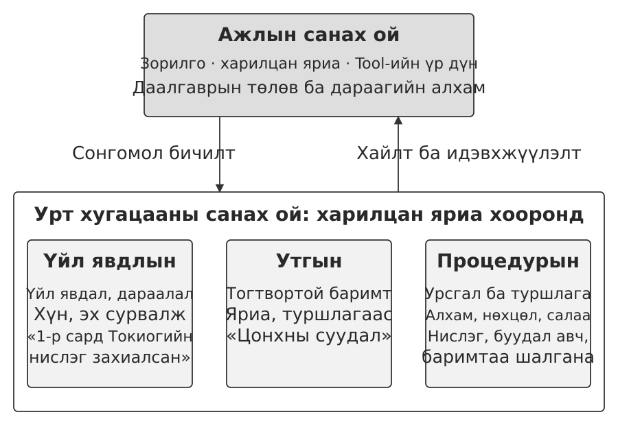

Үйл явдлын санах ой нь үйл явдлын дараалал ба цагийн тэмдэг, сэтгэл хөдлөлийн тэмдэглэгээ, даалгаврын таних тэмдэг зэрэг мета өгөгдлийг хадгалж, цаг хугацаа ба сэдвийн хайлтыг хослуулах боломж олгодог. Жишээлбэл, «төсвийн талаар хамгийн сүүлд ярилцсан» гэдэгт сэдвийн тохирол ба цаг хугацааны эрэмбэ хоёулаа хэрэгтэй. Утгын санах ой үйл явдлаас гаргасан баримт ба сонголтыг, процедурын санах ой дахин дахин ашиглагддаг урсгалыг хадгалдаг.

**Ажлын санах ой (working memory)** нь одоогийн зорилго, даалгаврын төлөв, гаргаж ирсэн холбогдох мэдээллийг зохион байгуулдаг. Harness траектор ба урт хугацааны хадгалалтаас агуулга сонгож, одоогийн контекстэд ачаална; даалгаврын явцад гарсан шинэ баримтыг цэгцэлсний дараа урт хугацааны санах ойд бичнэ. Траектор юу хэрхэн болсныг тэмдэглэж, ажлын санах ой дараагийн шийдвэрт хэрэгтэй мэдээллийг төвлөрүүлэн хадгалдаг бөгөөд хоёулаа үйл явдлын таних тэмдэг ба эх сурвалжаар холбогддог.

RAG-аар хэрэглэгчийн санах ойг уншихдаа эхлээд одоогийн хүсэлтэд үндэслэн холбогдох байж болох санах ойн багцыг олоод, дараа нь аль нь ажлын санах ойд орохыг шийднэ. Туслах өнөөдөр хэрэглэгчид суудал сонгоход туслах гэж байна гэж бодъё. Хайлт хоёр өгүүлбэр олжээ: «томилолтоор явахдаа цонхны суудалд дуртай» ба «өнгөрсөн удаа өвдөг гэмтсэн тул буцах нислэгт хонгилын суудал сонгоод өг». Хоёулаа суудал сонголттой маш холбоотой ч хоёр дахь нь зөвхөн тэр үеийн буцах нислэгт тавьсан шаардлага. Холбоо хамаарлаар дахин эрэмбэлж, тэргүүн байранд тавьсан ч энэ нь өнөөдөр хамаарах эсэх асуултад хариулахгүй.

Ийм тохиолдолд зохиогч нэр дэвшигч санах ойг Jev мэтийн дүгнэлт гаргагч Model-оор шүүхийг илүү ирээдүйтэй гэж үздэг. Энэ удаагийн аялал, хэрэглэгчийн одоогийн шаардлага, мөн санах ой бүрийн анхны үг, огноо, хэрэглэх нөхцөлийг хамтад нь өгч, бичлэг бүрээр «энэ удаа хамаарна», «зөвхөн лавлагаанд» эсвэл «үндэслэл хангалтгүй» гэж дүгнүүлнэ. Өнөөдөр бас томилолт бол эхний бичлэгийг суудал сонгох үндэслэл болгож болно; хэрэглэгч өвдөг нь одоо ч эдгээгүй гэж дөнгөж хэлсэн бол хоёр дахь бичлэгийг гаргаж ирээд асууж тодруулах нь зүйтэй.

### Санах ойг шахах ба цэгцлэх механизм

Байнга онгоцны билет захиалдаг хэрэглэгч «цонхны суудал» гэж арван удаа дурдсан байж болно. Тэдгээрийн есөн нь нэг захиалгыг давтан ярьсан байж мэднэ; дурдсан тоог шууд сонголтын хүч гэж үзвэл нэг үйл явдлын жинг хэт өсгөнө. Цэгцлэхдээ эхлээд эх сурвалж ба үйл явдлыг тодорхойлж, дараа нь давхардсан бичлэгийг нэгтгэж, хожуу хийгдсэн засвар байгаа эсэхийг шалгаад, эцэст нь аль зүй тогтлыг ирээдүйн даалгаварт ашиглахад тохиромжтойг шийднэ. «Өнгөрсөн удаагийн тэр цонхны суудал сайхан байсан» гэсэн үг гарвал Jev мэтийн дүгнэлт гаргагч Model-д энэ өгүүлбэр ба холбогдох захиалгыг уншуулж, зөвхөн «өмнөх нислэгээ дурсаж байна», «энэ удаагийн шаардлага тавьж байна» эсвэл «урт хугацааны сонголтоо илэрхийлж байна» гэсний алинд нь хамаарахыг тогтоолгож болно. Захиалга таарахгүй, эсвэл хэд хэдэн тайлбар бүгд утга учиртай байвал анхны үгийг хадгалаад, билет захиалах үед нь дахин шалгана. Ийм нэг удаагийн хэсэгчилсэн дүгнэлт нэг туршлагыг дахин дахин шинэ нотолгоо мэт тооцохоос сэргийлж чадна.

1. **Цэгцлэх объектоо шүүх.** Хандалтын давтамж, бичлэгийн огноо, сэтгэл хөдлөлийн тэмдэглэгээ, мэдээллийн өвөрмөц байдлыг эрэмбэлэх дохио болгон ашиглаж болно. Жишээлбэл, гурван өдрийн өмнө үүсгэгдсэн, таван удаа хандсан, сэтгэл хөдлөлийн тэмдэглэгээ нь хүчтэй, давхардалгүй бичлэгийг тусад нь хадгалах нь зүйтэй; ерэн өдрийн өмнө үүсгэгдсэн, ганцхан удаа хандсан, бас өөр гурван бичлэгтэй маш давхардсан бичлэгийг холбогдох бичлэгтэй түрүүлж нэгтгэж болно. Систем эхлээд оноогоор цэгцлэх шаардлагатай бичлэгүүдийг шүүж, дараа нь бизнесийн дүрмийн дагуу шахах, нэгтгэх эсвэл устгахыг шийдэж болно. Урт хугацааны хязгаарлалт ба хүчин төгөлдөр гэрээнд хандалт бага байсан ч хүчинтэй хугацаа нь дуустал хадгалах ёстой.
2. **Бүлэглэж, хураангуй үүсгэх.** Төстэй бичлэгүүдийг бүлэглэж, нийтлэг агуулгыг нэг хураангуйгаар хадгална. Жишээлбэл, цаг агаарын тухай олон удаагийн харилцан яриаг «хэрэглэгч цаг агаарыг байнга асуудаг, ялангуяа бороо орох эсэхийг сонирхдог» гэж цэгцэлж болно. Тодорхой огноо ба анхны асуултыг архивт хадгалж, хураангуйг анхны бичлэгтэй холбосноор дараа нь буцааж шалгах боломжтой.
3. **Зүй тогтол ба урсгалыг гаргах.** Олон удаагийн худалдан авалтын бичлэгээс «үнэ чанарын харьцаа сайтай бүтээгдэхүүнийг илүүд үздэг, хэрэглэгчдийн үнэлгээг чухалчилдаг» гэж нэгтгэн дүгнэх, эсвэл бараа сонгох алхмуудыг гаргаж авах.

### Нууцлалын хамгаалалт: логийн нууцлал

Хэрэглэгчийн санах ойд хэн болох, холбоо барих мэдээлэл, дансны мэдээлэл ихэвчлэн багтдаг. Систем даалгавраас хамааран ямар талбар Model-ийн оролтод орохыг, үйл ажиллагааны хэрэгцээнээс хамааран ямар агуулга логт орохыг шийдэх хэрэгтэй. Нууцлалыг логт бичихийн өмнө хийж, нууц хэсгүүдийг төрлийн шошго эсвэл тогтвортой орлуулагчаар сольж, асуудал шалгахад шаардлагатай бүтцийг хадгалж болно.

> **Туршилт 3-3 ★★: Локал Model дээр суурилсан логийн нууцлал**
>
> Энэ туршилтад Ollama-аар локал Qwen3-0.6B-г дуудаж, логийн нууц хэсгүүдийг өөрийн машин дээр таньдаг. Жижиг Model хэрэглээний түвшний төхөөрөмж дээр байршуулахад тохиромжтой бөгөөд 1.7B, 4B зэрэг хэмжээ рүү сольж, таних чанар ба боловсруулах хугацааг харьцуулж болно. Анхны лог локал орчноосоо гарах ёсгүй бол таних ба солихыг ч өөрийн машин дээр гүйцэтгэж, нууцалсан үр дүнг дараагийн үйлчилгээнд дамжуулна.
>
> Туршилтын материалд иргэний үнэмлэхний дугаар, банкны картын дугаар зэрэг бүтэцлэгдсэн дугаар, хаяг зэрэг хагас бүтэцлэгдсэн агуулга, мөн байгалийн хэлээр задруулсан нууц үг зэрэг нууц мэдээлэл багтсан. Model JSON Schema-ийн дагуу мэдээллийн төрөл, текст дэх байрлал, итгэлцлийн түвшинг буцааж, программ үүнд үндэслэн эх бичвэрийг солино. Харьцуулах бүлэг тогтмол илэрхийлэл (regex) ашиглана; холимог бүлэг эхлээд regex-ээр тааруулаад, үлдсэн текстийг Model-оор боловсруулна.
>
> Эхлээд хоёр мөр логийг харъя. Эхнийх нь иргэний үнэмлэхний дугаар ба гар утасны дугаартай; regex зөвхөн гар утасны дугаарыг нууцалсан тул эргэн татах түвшин (recall) $1/2$ байна. Хоёр дахь мөрөнд regex АНУ-ын нийгмийн даатгалын дугаар ба банкны картын дугаарыг бүгдийг нь олсон ч хэлбэр нь төстэй ажлын хүсэлтийн дугаарыг ч мөн нуусан. Тэмдэглэсэн гурван газрын зөвхөн хоёр нь нууцлах шаардлагатай байсан тул нарийвчлал (precision) $2/3$ байна. Зөвхөн нууц утга логт үлдсэн эсэхийг шалгавал хоёр дахь мөр тэнцэнэ; харилцагчийн үйлчилгээний ажилтан энэ логоор ажлын хүсэлтийг хайх үедээ л сэжүүр алга болсныг олж мэднэ.
>
> Нийт 12 жишээний мөр бүрээр recall-ийг тооцоолоод дундажлахад regex, Model, холимог шийдэл тус бүр ойролцоогоор 50%, 69%, 78% байв. Сольсны дараа мөр бүрээр тоолоход гурван шийдэл тус тус 9, 3, 2 нууц утга үлдээсэн. Аль нэгийг сонгохдоо боловсруулах хугацааг ч харах хэрэгтэй: энэ машин дээр regex мөр бүрт дунджаар 0.1 миллисекунд, Model болон холимог шийдэл хоёулаа бараг 3 секунд зарцуулсан. Логийн хэмжээ их бол хэлбэр нь тогтвортой талбаруудыг эхлээд regex-ээр боловсруулж, контекстэд тулгуурлан дүгнэх шаардлагатай хэсгүүдийг л Model-оор нэмж шалгуулж болно.

Бичлэг олшрох тусам дараагийн алхам нь олон мянган мэдээллээс одоогийн даалгаварт хэрэгтэйг нь олох явдал болно. Доор танилцуулах RAG технологийг хамтын мэдлэгийн санд ч, хэрэглэгчийн санах ойн хайлтад ч ашиглаж болно.

## RAG-ийн үндэс: Agent-ийн мэдлэг олж авах дамжуулах хоолойг байгуулах

Нэгэн дэлгүүр мөнгө буцаах журмаа өөрчилсөн байтал хэрэглэгч ирж «өнгөрсөн сард авсан бараагаа одоо яаж буцааж мөнгөө авах вэ?» гэж асуужээ. Зөв хариулахын тулд эхлээд энэ захиалгад хамаарах заалтыг олоод, дараа нь нөхцөл ба алхмуудыг ойлгомжтой тайлбарлах хэрэгтэй. **Хайлтаар баяжуулсан үүсгэлт** (Retrieval-Augmented Generation, RAG) энэ хоёр алхмыг холбож, Model-д дэлгүүрийн дотоод материалыг ашиглах, мөн сургалт дууссаны дараа зарлагдсан журмыг ч хэрэглэх боломж олгодог.

Эхлээд ганцхан хувилбар журамтай тохиолдлоос эхэлье. Доор хялбаршуулсан интерфейсээр нэг дэлгүүрийн мөнгө буцаах урсгалыг хайж, хайлтын үр дүн Model-ийн хариултад хэрхэн орж байгааг ажиглая:

```python
query = "мөнгө буцаах урсгал"
results = retriever.search(query, top_k=2)
# results = [
#   "Мөнгө буцаах журам: захиалгыг хүлээн авснаас хойш 7 хоногийн дотор бүтэн дүнгээр буцаалт хүсэж болно, захиалгын дугаар шаардлагатай. Мөнгө 3–5 ажлын өдөрт орж ирнэ.",
#   "Мөнгө буцаах үйлдэл: „Миний захиалга“ руу орж, захиалгаа сонгоод „Буцаалт хүсэх“-ийг дарна."
# ]
answer = llm.generate(system="Та харилцагчийн үйлчилгээний туслах.", context=results, question=query)
# Хариултад хүсэх хугацаа, шаардлагатай мэдээлэл, үйлдлийн алхам, мөнгө орох хугацаа багтана.
```

Зураг 3-5 ба код дахь хайлтын хоёр үр дүнг тулгаж харъя. Буцаалт хүсэх алхмууд «мөнгө буцаах үйлдэл»-ээс, мөнгө 3–5 ажлын өдөрт орж ирэх нь «мөнгө буцаах журам»-аас гарсан. Хэрэв хайлтын үр дүнд зөвхөн үйлдлийн алхмууд үлдсэн бол Model хэрэглэгчид мөнгө хэзээ орж ирэхийг хэлэх үндэслэлтэй хэвээр байх уу? Энэ асуулт гарын авлагыг хэрхэн хэсэглэхтэй холбоотой.

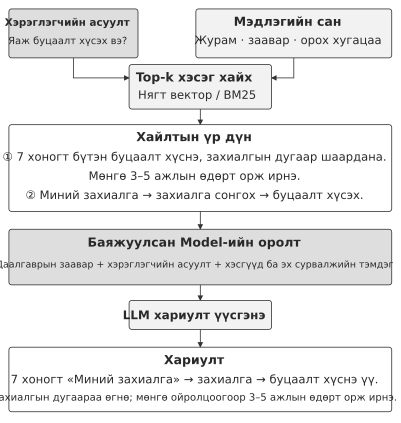

### Баримт бичгийг хэсэглэх (Chunking)

Борлуулалтын дараах үйлчилгээний гарын авлагад эхлээд «долоо хоногийн дотор буцааж болно» гэж бичээд, дараагийн догол мөрөнд онцгой барааг тайлбарласан гэж бодъё. Зөвхөн эхний өгүүлбэрийг гаргаж ирвэл онцгой барааг ч буцааж болно гэж амлах эрсдэлтэй; бүх гарын авлагыг нэг хайлтын нэгж болговол угсралт, тохиргоо, алдаа засварын агуулга хамт орж ирэх тул вектор мөнгө буцаах сэдвийг тодруулж чадахгүй. **Хэсэглэх (chunking)** нь энэ хоёр туйлын хооронд хэмжээг сонгож, нэг хэсэг текст өөрийн нөхцөлийг тайлбарлахад хангалттай, тодорхой асуултаар олдоход ч хялбар байхыг зорьдог. Хэсгийн урт нь embedding Model-ийн оролтын хязгаарт багтах ёстой бөгөөд дараагийн үүсгэлтэд зориулж контекстэд зай үлдээх хэрэгтэй.

Түгээмэл аргууд гурван төрөл байна.

**Тогтмол хэмжээгээр хуваах** нь token-ий тоогоор хуваадаг, жишээлбэл хэсэг бүр 512 token, хөрш хэсгүүд 50–100 token давхцана. Давхцал нь хилийн ойролцоох агуулгыг өөр нэг хэсэгт бүтнээр нь орох боломж олгодог. Энэ арга хэсгийн уртыг хянахад хялбар; харин зүсэх цэг догол мөр, код эсвэл хүснэгтийн дунд таарч болно.

**Рекурсив буюу бүтцийг харгалзан хуваах** нь бүлэг, догол мөр зэрэг байгалийн хилээр түрүүлж хуваагаад, хэт урт хэсэгт таарвал өгүүлбэр зэрэг жижиг нэгжээр дахин хуваадаг. Markdown-ийн гарчиг ба HTML элементүүд бүтцийн сэжүүр өгч чадна. Кодын блок, хүснэгт, гарчигтай холбоотой үндсэн бичвэрт тусгай боловсруулалтын дүрэм хэрэглэж болно. Бүтэц нь тодорхой техникийн баримт бичгийн хувьд зохиогч энэ аргаас эхлэхийг зөвлөдөг: эхлээд бэлэн бүлэг, догол мөрийг ашиглаад, хэт урт хэсгийг нарийвчлан хуваах нь шууд тасдахаас илүү бүрэн утгыг хадгалах нь элбэг.

**Утгаар хуваах** нь хөрш өгүүлбэрүүд буюу өгүүлбэрийн бүлгүүдийн embedding-ийн ижил төстэй байдлыг тооцоолж, сэдэв мэдэгдэхүйц өөрчлөгдсөн газар зүсдэг. Энэ нь embedding-ийн тооцооллыг нэмэгдүүлэх ч нэг сэдвийг нэг хэсэгт хадгалах боломжтой.

Хайгч зөвхөн «тус компанийн орлого 3%-иар өссөн» гэсэн нэг өгүүлбэр буцаасан гэж бодъё. Аль компани? Аль улирал? Тоог зөв олсон ч асуултад хариулах үндэслэл нь өмнөх догол мөрөнд байна. Харин бүх санхүүгийн тайланг нэг хэсэгт хийвэл улирал ба компанийн нэр хадгалагдах ч орлогыг хайхад ажилд авах, тоног төхөөрөмж худалдан авах тухай догол мөрүүд хамт орж ирнэ. Эдгээр агуулга бас нэг векторыг хуваалцах тул орлогын сэдэв векторт тийм ч тод илрэхгүй байж мэднэ. Бодитоор хэсгийн хэмжээг сонгохдоо хэсэг бүр 256–1024 token, хөрш хэсгүүд 10%–20% давхцахаас эхэлж туршиж болно.

Гарчиг, эх сурвалж, цаг хугацаа зэрэг мета өгөгдлийг хэсэгтэй хамт хадгалж болно. Цаашид авч үзэх контекстийг харгалзсан хайлт хэсэг бүрт эх бичвэр дэх суурь мэдээллийг нь нэмж, бие даан хайх үед заасан зүйл ба хүрээг тодорхойлоход тусална.

### Нягт embedding: текстийг вектороор дүрслэх

**Embedding** нь үг, өгүүлбэр эсвэл текстийн хэсгийг `[0.2, -0.5, 0.8, ...]` гэх мэт тоон вектор руу буулгадаг. Хайлтын Model сургалтаар холбоотой асуулга ба баримт бичгийг вектор орон зайд өндөр ижил төстэй байлгахыг сурдаг. «Нягт» гэдэг нь векторын ихэнх хэмжээс тэг биш утгатай бөгөөд хамтдаа текстийн мэдээллийг илэрхийлдэг гэсэн үг; цаашид авч үзэх сийрэг дүрслэлд харин цөөн хэмжээс л тэг биш байдаг.

Вектор орон зайг өндөр хэмжээст газрын зураг гэж төсөөлж болно: текстийн хэсэг бүр нэг байрлалд харгалзах бөгөөд хайлт гэдэг нь асуулгад ойр агуулгыг тэндээс хайх явдал юм. Түгээмэл хэмжүүрийн нэг нь **косинусын ижил төстэй байдал**:

$$
\operatorname{cos}(A,B)=\frac{A\cdot B}{\|A\|\,\|B\|}
$$

Скаляр үржвэр $A\cdot B$ нь харгалзах хэмжээсүүдийг үржүүлээд нийлбэрийг нь авдаг, модуль $\|A\|$ нь хэмжээс бүрийн квадратуудын нийлбэрийн квадрат язгуур юм. Хоёр модульд хуваасны дараа үр дүн зөвхөн чиглэлийн харьцааг илэрхийлнэ. Тэг биш векторын хувьд косинусын утга $[-1,1]$ мужид байх бөгөөд 1-д ойртох тусам чиглэл илүү давхцана. Өөр өөр хайлтын Model скаляр үржвэр эсвэл Евклидийн зайг ч ашигладаг. Хоёр векторыг нэгж урттай болгон нормчилбол скаляр үржвэр косинусын ижил төстэй байдалтай тэнцүү болно.

> **Гараар тооцоолох: гурван өгүүлбэрийн косинусын ижил төстэй байдал**
>
> «Муур хэрхэн тэжээх вэ» $A=(0.9,0.5,0.1)$, «муур тэжээх заавар» $B=(0.8,0.6,0.1)$, «хувьцааны хөрөнгө оруулалтын стратеги» $C=(0.1,0.1,0.9)$ гэсэн гурван жишээ вектор авъя.
>
> $A\cdot B=0.9\times0.8+0.5\times0.6+0.1\times0.1=1.03$. Хоёулангийнх нь модуль тус тус $\sqrt{1.07}$ ба $\sqrt{1.01}$ тул ижил төстэй байдал ойролцоогоор **0.991**.
>
> $A\cdot C=0.9\times0.1+0.5\times0.1+0.1\times0.9=0.23$, $C$-ийн модуль $\sqrt{0.83}$ тул ижил төстэй байдал ойролцоогоор **0.244**. Энэ векторуудын хувьд муур тэжээх тухай асуулга тэжээх зааварт илүү ойр байна.

Бодит Model-ууд ихэвчлэн хэдэн зуугаас хэдэн мянган хэмжээст дүрслэл ашигладаг.

#### Word2Vec-ээс контекстийг харгалзах дүрслэл хүртэл

Зураг 3-6 тогтмол үгийн вектороос эхэлнэ. **Word2Vec** үгсийн хамт тохиолдох байдалд тулгуурлан үг бүрийн тогтмол векторыг сурдаг. Зарим харилцаа векторын үйлдлээр илэрдэг бөгөөд сонгодог жишээ нь «хаан − эрэгтэй + эмэгтэй ≈ хатан хаан». Тогтмол дүрслэлийн хязгаарлалт ч ойлгомжтой: `bank` үг `river bank` (голын эрэг) болон `investment bank` (хөрөнгө оруулалтын банк)-д ижил үгийн вектор ашиглана.

**GloVe** бүх корпусаас үг хоорондын хамт тохиолдох тоог статистикаар гаргаж, жинлэсэн хамгийн бага квадратын зорилгоор үгийн векторыг сурдаг. Word2Vec локал цонх дахь таамаглах даалгаварт төвлөрдөг бол GloVe глобал хамт тохиолдох статистикийг сургалтад шууд оруулдаг; хоёулаа үг бүрт тогтмол дүрслэл сурдаг[^ch3-glove].

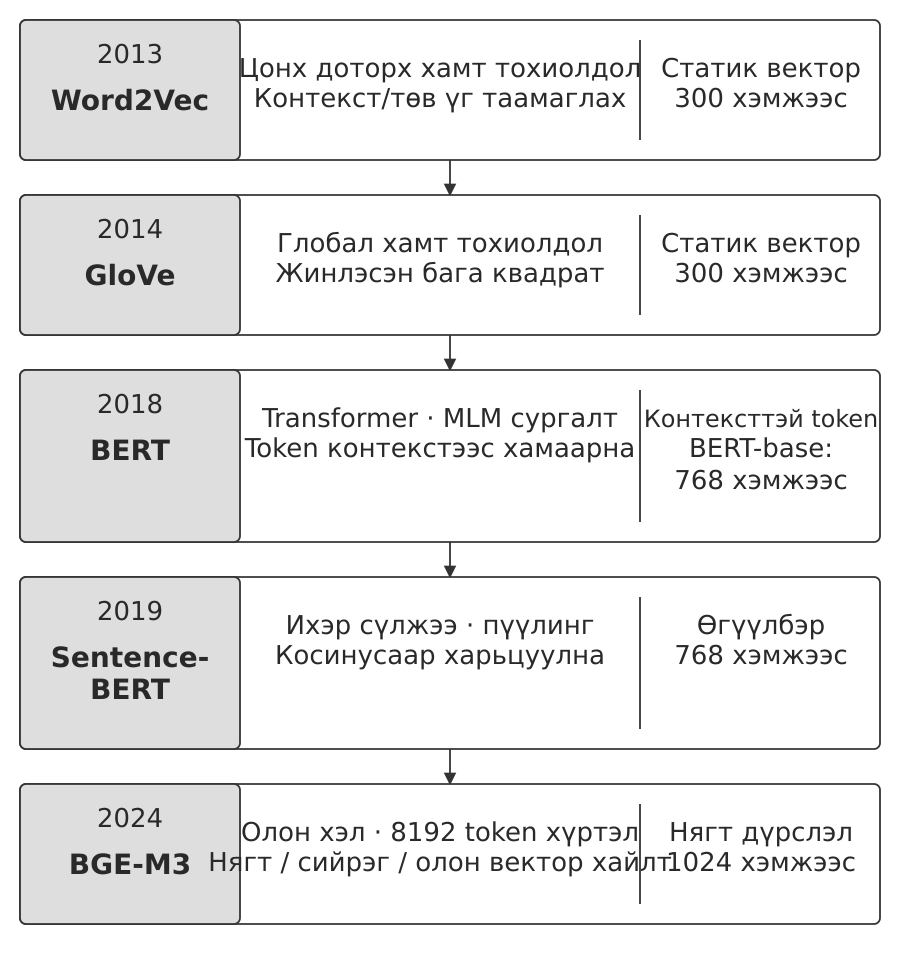

**BERT** мэтийн контекстийг харгалзах Model-д нэг token-ий дүрслэл өгүүлбэрээс хамааран өөрчлөгддөг. Өөртөө анхаарах (self-attention) механизмын тусламжтайгаар Model «шинэ бүтээгдэхүүн танилцуулав» ба «хоёр кило худалдаж авав» гэсэн сэжүүрт тулгуурлан хоёр өгүүлбэр дэх «алим» (Apple)-д өөр өөр дүрслэл тооцоолж чадна. Хайлтад зориулсан embedding Model token-ий дүрслэлүүдийг асуулга эсвэл баримт бичгийн вектор болгон нэгтгэх ёстой бөгөөд харгалзах сургалтаар хоёрыг харьцуулж болохуйц болгох хэрэгтэй.

**Sentence-BERT** нь BERT-ийг пүүлинг (pooling), ихэр буюу гурвалсан сүлжээний бүтэцтэй хослуулж, шууд харьцуулж болох өгүүлбэрийн векторыг сургадаг. Баримт бичгийг урьдчилан кодлоод индекст хадгалж болох тул асуулга ирэхэд зөвхөн асуулгыг кодлоод векторын ижил төстэй байдлыг тооцоолоход хангалттай. Урьдчилан кодлох нь асуулга бүрт бүх баримт бичгийн дүрслэлийг дахин тооцоолох зардлыг арилгадаг[^ch3-sbert].

**BGE-M3** нягт, сийрэг, олон векторт хайлтын дүрслэлийг зэрэг санал болгож, олон хэл болон харьцангуй урт оролтыг дэмждэг; энэ хэсэгт үүний нягт дүрслэлээр нэг векторт хайлтыг тайлбарлана[^ch3-bge-m3]. Model-ийн хүлээн авах урт хэсэглэх шийдэлд нөлөөлдөг: анхны BERT-ийн ердийн хязгаар 512 token, BGE-M3 бол 8192 token хүртэл дэмждэг.

[^ch3-bge-m3]: Chen нарын M3-Embedding өгүүлэл (arXiv:2402.03216) гурван төрлийн хайлтын дүрслэлийг хэрхэн хамтад нь сургадгийг танилцуулсан. Мөн BAAI-ийн BGE-M3 Model-ийн тайлбарыг үзнэ үү; үүнд дүрслэлийн арга, хэмжээс, оролтын урт, хэрэглэх аргыг багтаасан.

> **Туршилт 3-4 ★★: Хоёр төрлийн ойролцоо хамгийн ойр хөршийн индексийг харьцуулах**
>
> Баримт бичгийн векторыг бэлдсэний дараа асуулгад ойр векторыг хурдан олох хэрэгтэй. Нэг бүрчлэн тооцоолбол яг хамгийн ойр хөршүүдийг гаргаж болох ч өгөгдлийн хэмжээ өсөхөд **ойролцоо хамгийн ойр хөршийн** (Approximate Nearest Neighbor, ANN) индекс хянах боломжтой хэмжээний recall-ийн алдагдлыг асуулгын хурдаар солилцдог. Энэ туршилтад ижил бодит embedding болон ижил асуулгууд дээр ANNOY ба HNSW-г харьцуулж, яг хайлтын үр дүнг жишиг болгоно. Жишээлбэл, нэг асуулгын яг хайлт арван хамгийн ойр хөршийг жагсаасан, ойролцоо индексийн буцаасан арван үр дүнд тэдгээрийн найм нь багтсан бол энэ асуулгын Recall@10 нь 0.8 болно. Энэ тоо индекс яг хамгийн ойр хөршүүдийн хэдийг нь хадгалсныг хэмждэг.
>
> ANNOY нэр дэвшигчдийн хүрээг санамсаргүй проекцын олон модоор нарийсгадаг; HNSW шаталсан хөршийн граф ашиглаж, эхлээд сийрэг дээд давхаргад зорилтот муж руу хурдан дөхөөд, дараа нь илүү нягт доод давхарга руу орж хайдаг. Зураг 3-7 HNSW-ийн шаталсан бүтцийг харуулна.
>
> 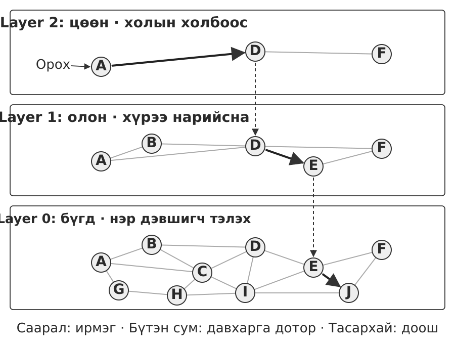
>
> Хүснэгт 3-2: ANNOY ба HNSW-ийн хэрэгжүүлэлтийн сонголт
>
> | Харьцуулах тал | ANNOY | HNSW (hnswlib-ийн жишээгээр) |
> | --- | --- | --- |
> | Индексийн бүтэц | Санамсаргүй проекцын олон мод | Шаталсан хөршийн граф |
> | Байгуулах зардал | Модны тоо, векторын тоо, хэмжээсээс хамаарна | Хөршийн хэмжээ, байгуулах үеийн хайлтын хүрээ, өгөгдлийн хэмжээнээс хамаарна |
> | Санах ой ба файл | Статик индекс санах ойн проекц (memory map) ба олон процессын хуваалцаалтыг дэмжинэ | Вектор ба графын хөршийн холбоог хадгалах бөгөөд хөршийн хэмжээ зардалд нөлөөлнө |
> | Нэмэлт шинэчлэлт | Индекс байгуулсны дараа шинэ бичлэг нэмэхэд дахин байгуулах шаардлагатай | Нэмэх, шинэчлэх, устгасан гэж тэмдэглэхийг дэмжинэ; багтаамжийг удирдах хэрэгтэй |
> | Recall ба хурд | Модны тоо ба асуулгын хайлтын төсвөөр тохируулна | Байгуулах параметр ба асуулгын хайлтын хүрээгээр тохируулна |
> | Хэрэглэх нөхцөл | Түгээх, хуваалцахад хялбар статик индекс | Тасралтгүй бичигдэж, асуугддаг динамик индекс |
>
> Энэ удаагийн ажиллуулалтад эхлээд 240 хэсэг текстээр сан байгуулсан. Ижил 20 асуулгын хувьд хоёр индекс хоёулаа яг хайлтаар олдсон эхний 10 хамгийн ойр хөршийг бүгдийг нь олсон. Анх сан байгуулахад ANNOY Linux контейнерт ойролцоогоор 13 миллисекунд, HNSW локал орчинд ойролцоогоор 78 миллисекундэд байгуулагдсан; хадгалсан индекс тус тус ойролцоогоор 1.40 MB ба 1.02 MB. Дараа нь үлдсэн 60 хэсгийг нэмэхэд ANNOY индексээ дахин байгуулж, HNSW шинэ векторуудыг шууд оруулсан. Энэ үед санд нийт 300 хэсэг байх тул өмнөх хамгийн ойр хөршүүд ч өөрчлөгдөж болно. Шинэ сан дээр яг хайлтыг дахин хийсний дараа ч хоёр индексийн дундаж recall 100% хэвээр байв.

[^ch3-ann]: Spotify-ийн Annoy төслийн тайлбарт зөвхөн уншигдах индексийг хэрхэн байгуулах, санах ойн проекцоор индексийг ачаалах, мөн `search_k`-аар асуулгын үед шалгах зангилааны тоог хэрхэн тохируулахыг танилцуулсан. hnswlib төслийн тайлбарын Python интерфейсийн хэсэгт вектор нэмэх `add_items` арга болон асуулгын хүрээг тохируулах `set_ef` аргыг өгсөн.

**Индексийг мэдлэг хэрхэн шинэчлэгддэгээс хамааруулан сонгох хэрэгтэй.** Корпус тогтмол хугацаанд багцаар гарч, олон процесс нэг зөвхөн уншигдах индексийг хуваалцдаг бол зохиогч эхлээд ANNOY-г авч үзнэ; шинэ баримт бичиг тасралтгүй хүлээн авч, онлайнаар оруулах шаардлагатай бол HNSW-г түрүүлж сонгоно. Embedding Model утгын дүрслэлийг тодорхойлж, индекс эдгээр дүрслэлийг тохиромжтой саатал ба шинэчлэлтийн зардлаар ашиглаж чадах эсэхийг тодорхойлдог бөгөөд хоёулаа хамтдаа хайлтын үйлчилгээний үр дүнг тодорхойлно.

ANNOY-ийн модны тоо ба хайлтын төсөв, эсвэл HNSW-ийн хөршийн хэмжээ ба хайлтын хүрээг тохируулж, recall ба саатлын өөрчлөлтийг ажиглаж болно[^ch3-ann]. Индексийн recall нь зорилтот хамгийн ойр хөршүүдийг олсон эсэхийг хэмждэг; эдгээр хөрш хэрэглэгчийн асуултад хариулж чадах эсэх нь embedding-ийн дүрслэл ба материалын агуулгаас хамаарна.

### Сийрэг дүрслэл: түлхүүр үгээс холбоо хамаарлын оноо хүртэл

**Сийрэг дүрслэл** нь өндөр хэмжээст вектор ашигладаг бөгөөд үүний цөөн хэмжээс л тэг биш байдаг. Уламжлалт түлхүүр үгийн хайлт нэр томьёог хэмжээс болгож, баримт бичигт гарсан үгсэд жин оноодог. Үүний үндэс нь **үгийн уутны Model** (Bag of Words, BoW): үг болон гарсан тоог нь хадгалж, дарааллыг үл тоомсорлодог. Тиймээс «муур нохойг хөөв» ба «нохой муурыг хөөв» хоёр ижил үгийн уутны дүрслэлтэй.

Ийм дүрслэл нэр, дугаар, техникийн нэр томьёог тааруулахад тохиромжтой. Доор TF-IDF-ээс эхэлж, үгийн давтамж ба баримт бичгийн давтамж хэрхэн эрэмбийн оноо болж хувирдгийг тайлбарлая.

#### TF-IDF-ээс BM25 хүртэл

**TF-IDF** (Term Frequency–Inverse Document Frequency, үгийн давтамж — урвуу баримт бичгийн давтамж) хоёр дохиог хослуулдаг: үг одоогийн баримт бичигт хэдэн удаа гарсан, мөн бүх корпуст хэр түгээмэл байдаг. 100 өгүүллийн 60 нь «загвар», ердөө 3 нь «нэрэлт» гэсэн үгтэй гэж бодъё; «загварын нэрэлт» гэж хайхад «нэрэлт» илүү ялгах үүрэгтэй.

Нэг үндсэн бичиглэл нь:

$$\operatorname{TF\!\text{-}\!IDF}(t,d)=\operatorname{TF}(t,d)\times\operatorname{IDF}(t),\qquad \operatorname{IDF}(t)=\ln\frac{N}{\operatorname{DF}(t)}$$

$\operatorname{TF}(t,d)$ нь $t$ үг $d$ баримт бичигт гарсан тоо, $\operatorname{DF}(t)$ нь тухайн үгийг агуулсан баримт бичгийн тоо, $N$ нь баримт бичгийн нийт тоо. Энэ томьёогоор нэг үг арван удаа гарахад оруулах онооны хувь нэмэр таван удаа гарснаас хоёр дахин их болно; урт баримт бичиг ч зөвхөн үг ихтэй учраас өндөр оноо авч болно. TF-IDF олон төрлийн нормчлолын хувилбартай бөгөөд доорх BM25 харин үгийн давтамжийн ханалт ба уртын нормчлолоор энэ хоёр нөлөөг зохицуулдаг.

**BM25** асуулгын үг бүрийн хувь нэмрийг нэмдэг:

$$\operatorname{Score}(Q,D)=\sum_i\operatorname{IDF}_{\mathrm{BM25}}(q_i)\cdot\frac{\operatorname{TF}(q_i,D)(k_1+1)}{\operatorname{TF}(q_i,D)+k_1\left(1-b+b\frac{|D|}{\operatorname{avgdl}}\right)}$$

Энд $q_i$ нь асуулгын үг, $|D|$ нь баримт бичгийн урт, $\operatorname{avgdl}$ нь баримт бичгийн дундаж урт. $k_1$ нь үгийн давтамжийн ханалтын түвшинг хянаж, $b$ нь уртын нормчлолын хүчийг хянадаг бөгөөд 0 үед энэ залруулга унтарна. Зураг 3-8 эдгээр гишүүнийг тусад нь тооцоолсон. Эхлээд баримт бичгийн уртыг тогтоож, асуулгын үгийг нэгээс гурван удаа гарахаар нэмэгдүүлж, нэг удаа илүү гарах бүрд хэдэн оноо нэмэгдэхийг харна; дараа нь үгийн давтамжийг тогтоож, зөвхөн баримт бичгийн уртыг хоёр дахин нэмэгдүүлнэ. Хамгийн доод мөрөнд хоёр үг баримт бичгийн цуглуулгад хэр түгээмэл байгааг харьцуулсан.

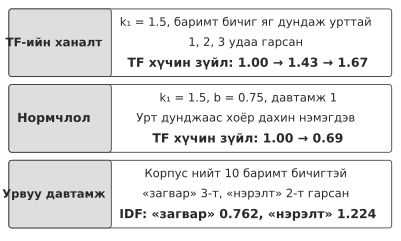

Зургийн эхний мөрөнд хоёр дахь удаа гарах нь үгийн давтамжийн хүчин зүйлийг ойролцоогоор 0.43-аар нэмэгдүүлсэн бол гурав дахь удаа ердөө 0.24 орчмоор нэмэгдүүлсэн нь үгийн давтамжийн ханалт юм. Хоёр дахь мөрөнд ижил үг хоёуланд нь нэг л удаа гарсан ч урт баримт бичигт төдийлөн тодорхой биш тул уртын залруулга үгийн давтамжийн хүчин зүйлийг нь бууруулсан. Үүнийг IDF-ээр үржүүлж байж энэ үгийн нийт онооны хувь нэмэр гарна.

Дээрх томьёонд тодорхойлох нэг гишүүн үлдсэн: ижил гурван удаа гарсан ч ховор үг яагаад түгээмэл үгээс илүү хэрэгтэй байдаг вэ? Энэ хэсэгт үгэнд доорх урвуу баримт бичгийн давтамжаар жин оноодог:

$$\operatorname{IDF}_{\mathrm{BM25}}(t)=\ln\frac{N-\operatorname{DF}(t)+0.5}{\operatorname{DF}(t)+0.5}$$

Хүртвэр нь тухайн үгийг агуулаагүй баримт бичгийн тоо, хуваарь нь тухайн үгийг агуулсан баримт бичгийн тоо бөгөөд хоёуланд нь 0.5 нэмж зөөлрүүлснээр баримт бичгийн давтамж 0 эсвэл $N$ байх үед ч тооцоолох боломжтой. Ховор үг илүү өндөр жин авна; баримт бичгийн талаас илүү хувь нь тухайн үгийг агуулбал энэ томьёо сөрөг утга өгнө. Дагалдах хэрэгжүүлэлт бодит оноо өгөх жингийн доод хязгаарыг $10^{-6}$ гэж тогтоож, анхны утгыг шалгахад зориулж хадгалдаг.

> **Туршилт 3-5 ★★: BM25 хайлтын системийг тэгээс хэрэгжүүлэх**
>
> Энэ туршилтад үг задлах, туслах үг боловсруулах, урвуу индекс, оноо өгөхийг дараалан гүйцэтгэнэ. Туслах үг (stop word) боловсруулалт «ба», «нь» зэрэг өндөр давтамжтай үгсийг шүүж хаяж болно. **Урвуу индекс** үг бүр аль баримт бичигт гарсан болон харгалзах давтамжийг тэмдэглэдэг; энэ нь номын ард байдаг нэр томьёоны хэлхээстэй адил бөгөөд «TCP» гэж хайвал 45, 112, 203-р хуудсыг олоод, тэдгээр байрлалын агуулгыг уншина.
>
> «Загварын нэрэлт» гэсэн асуулгыг гараар нэг тооцоолъё. Корпус 10 баримт бичигтэй, дундаж урт 250 үг, $k_1=1.5$, $b=0.75$ гэж үзье. «Загвар» 3 баримт бичигт гарсан бөгөөд IDF ойролцоогоор 0.762; «нэрэлт» 2 баримт бичигт гарсан бөгөөд IDF ойролцоогоор 1.224. Доорх хүснэгтэд үг бүрээр таарсан баримт бичиг, үгийн давтамж, баримт бичгийн уртыг жагсаав. Эдгээр утгыг томьёонд орлуулбал үг бүрийн баримт бичгийн оноонд оруулах хувь нэмрийг тооцоолж болно.
>
> | Асуулгын үг | Баримт бичиг | Үгийн давтамж TF | Баримт бичгийн урт | BM25 хувь нэмэр |
> | --- | --- | ---: | ---: | ---: |
> | загвар | doc_1 | 5 | 200 | 1.52 |
> | загвар | doc_3 | 2 | 500 | 0.82 |
> | загвар | doc_7 | 8 | 150 | 1.68 |
> | нэрэлт | doc_1 | 3 | 200 | 2.15 |
> | нэрэлт | doc_5 | 1 | 250 | 1.22 |
>
> Хоёр үгийн doc_1 дэх хувь нэмрийг нэмбэл ойролцоогоор 3.67 болох бөгөөд эрэмбэ нь **doc_1 (3.67) > doc_7 (1.68) > doc_5 (1.22) > doc_3 (0.82)**. doc_1-д «нэрэлт»-ийн давтамж «загвар»-аас бага ч ховор тул эцсийн хувь нэмэр нь илүү их байна; мөн хоёр үгтэй зэрэг таарсан нь нийт оноог улам өсгөсөн.
>
> Одоо дагалдах туршилтын англи корпусаас `cat` гэж хайя. Холбоотой гэж тэмдэглэгдсэн хоёр богино өгүүллийн нэг нь `kitten`, нөгөө нь `feline` гэж бичсэн тул урвуу индексээс `cat` олдохгүй, нэр дэвшигчийн жагсаалт хоосон байна. Өмнөх үгийн давтамжийн жинг хичнээн өндөр тохируулсан ч оноо өгөх баримт бичиг нэг ч алга. Энэ хоёр богино өгүүллийн үгээр сольж хайвал тус бүр нь нэр дэвшигчийн жагсаалтад орж ирэхийг харж болно.

### Холимог хайлт: хоёр замын үр дүнг нэгтгээд дахин эрэмбэлэх

Зарим асуултад ижил утгатай үгсийг урьдчилан бүрэн жагсаахад хэцүү. Туршилт 3-6-д «ашиглагдахгүй байгаа heap санах ойг хэрхэн автоматаар буцааж авах вэ» гэсэн асуулт байдаг бол зорилтот богино өгүүлэлд «автомат санах ойн удирдлага хөгжүүлэгчийг объектыг гараар чөлөөлөх ажлаас чөлөөлдөг» гэж бичсэн байна. Англи асуулга ба богино өгүүлэл нийтлэг нэр томьёогүй тул түлхүүр үгийн хайлт нэгийг ч олж чадаагүй, харин векторын хайлт зорилтот өгүүллийг тэргүүн байранд тавьсан. Загварын дугаар XR-7003-аар хайхад түлхүүр үгийн хайлт харгалзах загварыг шууд олсон бол векторын хайлт хэд хэдэн ойролцоо загварыг ч жагсаасан.

**Холимог хайлт** эхлээд түлхүүр үг ба вектороор тус тусад нь холбогдох догол мөрүүдийг хайгаад, дараа нь аль догол мөрийг Model-д өгөх нь зүйтэйг шийддэг. Мэдлэгийн санд яг таних тэмдэг ба байгалийн хэлний тайлбар хоёулаа байгаа бол зохиогч үүнээс эхлэхийг зөвлөдөг. Зураг 3-9-ийн дагуу XR-7003-ыг мөрдье: хоёр зам хоёулаа үүнийг тэргүүн байранд тавьсан тул нэгтгэх үед хоёр эрэмбийн хувь нэмэр авна. Дахин эрэмбэлэлт хоёрдугаар байрыг сольсон ч хэрэглэгчийн хамгийн түрүүнд харах загвар зөв хэвээр байна.

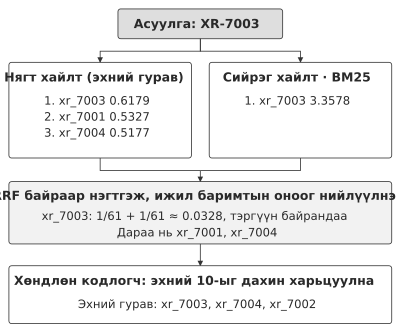

Эхний шат нь **зэрэгцээ хайлт**: асуулгыг нягт ба сийрэг хайлтын хөдөлгүүрт илгээж, тус бүр холбоотой байж болох баримт бичгийн багцыг гаргаж ирнэ. Хоёр зам ижил эх бичвэр ашиглаж болно, эсвэл тус тусын Model-ийн шаардлагын дагуу урьдчилан боловсруулж болно.

Хоёр дахь шат нь **үр дүнг нэгтгэх**: хоёр замын үр дүн дэх ижил баримт бичгийг нэгтгээд, нэгдсэн эрэмбэ тогтооно. Косинусын ижил төстэй байдал ба BM25-ын тоон хэмжүүр өөр тул шууд нэмбэл утга нь том зам үр дүнг давамгайлах магадлалтай. Нэг арга нь оноог эхлээд тохируулах буюу нормчлоод, жинлэн хослуулах; нөгөө арга нь **урвуу эрэмбийн нэгтгэл** (Reciprocal Rank Fusion, RRF) бөгөөд зам бүрийн байраар тооцоолдог:

$$\operatorname{RRF}(d)=\sum_{j:\,d\in R_j}\frac{1}{k+\operatorname{rank}_j(d)}$$

$R_j$ нь $j$-р замын үр дүн, байр 1-ээс эхэлнэ; баримт бичиг аль нэг замд гараагүй бол тэр замын хувь нэмэр тэг. Зөөлрүүлэх тогтмол $k$-г ихэвчлэн 60 гэж авна; энэ нь том байх тусам эхний хэдэн байрын онооны зөрүү багасна. RRF өөр өөр оноо өгөх аргыг хослуулахад хялбар ч зөвхөн байрыг хадгалдаг тул анхны оноон дахь хүч сулын ялгааг өөр аргаар ашиглах хэрэгтэй.

Хоёр замт хайлтын жишээг тооцоолж үзье. Хэрэглэгч «буцаасан мөнгө хэдэн хоногт орж ирэх вэ» гэж асуужээ. А баримт бичиг түлхүүр үгийн хайлтад нэгдүгээр байрт орсон боловч векторын хайлтын эхний байруудад гараагүй; Б баримт бичиг хоёр замд хоёуланд нь хоёрдугаар байрт орсон. $k=60$ гэж авбал А $1/61$ буюу ойролцоогоор 0.0164, Б $1/62+1/62$ буюу ойролцоогоор 0.0323 оноо авна. Нэгтгэсний дараа Б нь А-аас өмнө орно. Энэ үр дүн зөвхөн хоёр хайлтын зам хоёулаа Б-г олсныг харуулна. Б үнэхээр мөнгө орж ирэх хугацаанд хариулсан эсэхийг мэдэхийн тулд түүнд «буцаалтыг хэрхэн хүсэх» гэж бичсэн үү, эсвэл «буцаасан мөнгө хэзээ орж ирэх» гэж бичсэн үү гэдгийг харах хэрэгтэй.

Гурав дахь шатанд **мэдрэлийн дахин эрэмбэлэлт** нэмж болно. Систем нэгтгэсний дараах эхний байруудын баримт бичгийг, жишээлбэл эхний 50-ийг гаргаж, дахин эрэмбэлэх Model-оор баримт бичиг бүр асуулгатай хэр холбоотойг үнэлүүлнэ. Дахин эрэмбэлэлт эдгээр 50-ийн дарааллыг өөрчилж чадна. Хэрэв үнэхээр хэрэгтэй баримт бичиг огт сонгогдоогүй бол дээд урсгал руу буцаж хайлтаа сайжруулах хэрэгтэй.

Энд түгээмэл хэрэглэгддэг Model нь **хөндлөн кодлогч (cross-encoder)**: асуулга ба нэр дэвшигч баримт бичгийг хамт оруулж, хоёр хэсгийг Model дотор харилцан үйлчлүүлж, холбоо хамаарлын оноо гаргадаг. Хайлтын шатны **хос кодлогч (bi-encoder)** харин асуулга ба баримт бичгийг тусад нь кодлох тул баримт бичгийн векторыг урьдчилан тооцоолж, асуулгын үед зөвхөн векторын хайлт хийнэ. Эхнийх нь цөөн баримт бичгийг нарийвчлан эрэмбэлэхэд, сүүлийнх нь олон баримт бичгээс анхан шатны шүүлт хийхэд тохиромжтой. Үүнийг анкет шүүх ба ярилцлагатай зүйрлэж болно: эхлээд бэлэн шинж чанараар хүрээг нарийсгаад, дараа нь тодорхой шаардлагын эргэн тойронд гүнзгий харьцуулна. BGE Reranker v2 M3 нь энэ шатанд ашиглаж болох Model-уудын нэг[^ch3-reranker].

[^ch3-reranker]: BAAI, BGE Reranker v2 M3 Model-ийн тайлбар; асуулга—баримт бичгийн оролт ба холбоо хамаарлын оноог танилцуулсан.

Холбогдох материал нэр дэвшигчдийн санд аль хэдийн орсон хэрнээ холбоогүй материалын ард байнга эрэмбэлэгддэг бол зохиогч хөндлөн кодлогчийн дахин эрэмбэлэлтийг түрүүлж үнэлдэг. Энэ нь асуулт ба баримт бичгийг хамтад нь уншдаг тул баримт бичиг дэх нөхцөл, хязгаарлах үг, нарийн зүйлс асуултын шаардлагад нийцэж байгаа эсэхийг шууд харьцуулж чадна. Хүснэгт 3-3-т түгээмэл гурван үзүүлэлтийг жагсаав.

Хүснэгт 3-3: Хайлтын чанарын гурван үзүүлэлт

| Үзүүлэлт | Тооцоолол ба утга |
| --- | --- |
| recall@k (эргэн татах түвшин) | Эхний k үр дүн дэх холбоотой баримт бичгийн тоог тухайн асуулгын бүх холбоотой баримт бичгийн тоонд хувааж, холбогдох агуулгын хэдийг олсныг хэмжинэ; туршилтын багцад ихэвчлэн асуулга бүрээр дундажлана |
| MRR (дундаж урвуу эрэмбэ) | Асуулга бүрт анхны холбоотой баримт бичгийн байрын урвууг аваад дундажлана; эхний байр 1, аравдугаар байр 0.1, олдоогүй бол 0 |
| nDCG@k (нормчилсон хорогдсон хуримтлагдсан ашиг) | Үр дүнд холбоо хамаарлын зэргээр оноо өгч, хойд байруудыг хорогдуулаад, хамгийн тохиромжтой эрэмбийн оноонд хувааж, эхний k үр дүнгийн эрэмбийн ерөнхий чанарыг хэмжинэ |

Мөн **олдох түвшин (hit rate)**-ийг тэмдэглэж болно: хэдэн асуулга эхний k үр дүндээ дор хаяж нэг холбоотой баримт бичиг олсон бэ? Жишээлбэл, нэг асуултад гурван материал хэрэгтэй, эхний хорин үр дүнд тэдгээрийн хоёрыг л олсон гэж бодъё. Энэ асуулгад холбоотой баримт олдсон тул «огт олдоогүй» алдааны тоонд орохгүй ч recall@20 нь ердөө $2/3$, материалын $1/3$ нь олдоогүй хэвээр байна. Хэрэв асуулт бүр ганцхан зорилтот баримт бичигтэй бол түүнийг олсон асуулт 1, алдсан асуулт 0 оноо авна. Ижил хайлтын үр дүнгээр дундажлавал олдох түвшин дундаж recall-тэй тэнцүү болно.

> **Туршилт 3-6 ★★: Сийрэг, нягт, нэгтгэл ба дахин эрэмбэлэлтийг харьцуулах**
>
> Энэ туршилтад ижил 12 тэмдэглэгээтэй асуулга дээр таван тохиргоог харьцуулна: сийрэг хайлт, нягт хайлт, RRF нэгтгэл, жинлэсэн нэгтгэл, мөн нэгтгэлийн дараах дахин эрэмбэлэлт. Асуулгууд утгын ижил төстэй байдал, яг нэр, олон хэл, техникийн кодыг хамарсан бөгөөд тэдгээрийн хоёр нь ургамал нарны гэрлийг хэрхэн хоол тэжээл болгон хувиргадгийг англи ба хятад хэлээр асуудаг. Нягт Model-оор Qwen3-Embedding-0.6B, дахин эрэмбэлэхэд MS MARCO MiniLM хөндлөн кодлогчийг ашиглаж, зам бүр хамгийн ихдээ 10 баримт бичиг гаргаж, дахин эрэмбэлэгч RRF-ийн эхний байруудын хамгийн ихдээ 10 баримт бичгийг боловсруулна. Recall ба nDCG зөвхөн эцсийн эрэмбийн эхний 3-ыг харах бол MRR буцаасан жагсаалтын дагуу анхны холбоотой баримт бичгийг хайна.
>
> Эхлээд Туршилт 3-6-гийн ажиллуулалтын бүртгэл дэх асуулт бүрийн эрэмбийг нээж, фотосинтезийн хоёр асуултын хайлтын үр дүнг харьцуулъя. Англи асуултын зорилтот баримт бичиг нэгдүгээр байрандаа хэвээр байна. Хятад асуулт эхлээд программчлалын хэл ба галт уулын тухай баримт бичиг буцааж, зөвхөн гурав дахь нь фотосинтезийн тухай байв. Асуулт бүрт холбоотой гэж тэмдэглэсэн ганцхан баримт бичиг байх бөгөөд хоёр асуулт хоёулаа эхний гуравтаа үүнийг олсон тул recall@3 хоёулаа 1. Гэхдээ хятад асуултын анхны холбоотой баримт бичиг гуравдугаар байрт орсон тул урвуу эрэмбэ нь ердөө $1/3$. Энэ туршилтын оноо өгөх аргаар гуравдугаар байрны ашиг $1/\log_2(3+1)=0.5$, нэгдүгээр байрных 1 тул хятад асуултын nDCG@3 нь 0.5 байна.
>
> Одоо бүх 12 асуултыг харъя. Дахин эрэмбэлсний дараа хятад фотосинтезийн асуултаас гадна heap санах ойг буцааж авах тухай нэг асуултын зорилтот баримт бичиг нэгдүгээр байраас хоёрдугаар байр руу ухарсан. Үлдсэн арван асуулт тэргүүн байраа хадгалсан тул дахин эрэмбэлсний дараах MRR нь $(10+1/2+1/3)/12\approx0.903$. Харьцуулахад нягт хайлт ба RRF-ийн MRR хоёулаа 1. Хоёулангийнх нь nDCG@3 ч 1 байсан бол дахин эрэмбэлсний дараа ойролцоогоор 0.928 болж буурсан. Зөвхөн дундаж recall-ийг харвал эдгээр байрны өөрчлөлт харагдахгүй: сийрэг хайлтын recall@3 нь 0.833, бусад дөрвөн бүлгийнх бүгд 1.
>
> Одоо энэ асуултын багцад нэг тохиргоо сонгох хэрэгтэй гэж бодъё. Дахин эрэмбэлэлтэд зарцуулсан хугацаа юу авчирсан бэ? Энэ CPU дээр RRF хайлт эхлүүлснээс эрэмбэ гаргах хүртэл асуулт бүрт дунджаар ойролцоогоор 194 миллисекунд зарцуулсан; дахин эрэмбэлэлтийг залгахад ойролцоогоор 237 миллисекунд болсон. Илүү зарцуулсан 43 орчим миллисекунд нэмэлт зорилтот баримт бичиг олоогүй бөгөөд хоёр асуултын зөв хариултыг хойш нь түлхсэн.

## Мэдлэгийг зохион байгуулах ба хайх

Мэдлэгийг зохион байгуулах арга нь бичлэг бүрт юу багтахыг, хайгч нь эдгээр бичлэгээс юуг гаргаж ирэхийг тодорхойлдог. Техникийн гарын авлага, хууль эрх зүйн баримт бичиг, эрдэм шинжилгээний өгүүллийн догол мөрүүд бүлгийн шатлал, ойлголтын хамаарал, баримт бичиг хоорондын эшлэлээр холбогддог. Эдгээр бүтцийг хадгалбал асуулга тодорхой нотолгоо ба илүү дээд түвшний ерөнхий дүгнэлтэд зэрэг хүрэх боломжтой болно.

Энэ хэсэгт зохион байгуулалтын хэд хэдэн аргыг дарааллаар нь авч үзнэ: RAPTOR ба GraphRAG шаталсан буюу харилцааны индекс байгуулдаг; OpenViking контекстийн нөөцийг лавлахаар зохион байгуулдаг; нэмэлт шинэчлэлт ба үечилсэн цэгцлэлт мэдлэгийн цаг үеэ олсон байдлыг хадгалдаг; Agent-д суурилсан RAG нь Agent-д одоо байгаа үр дүндээ тулгуурлан хайлтаа үргэлжлүүлэх боломж олгодог; контекстийг харгалзсан хайлт хэсгүүдэд суурь мэдээлэл нэмдэг; эцэст нь өгөгдлийн багцаас дахин ашиглаж болох мэдлэгийг гаргаж авна. Эдгээр нь дүрслэл, индекс, шинэчлэлт, асуулгын явцад тус тусад нь нөлөөлөх бөгөөд хэрэглэгчийн санах ойд хослуулан хэрэглэж ч болно.

Эхлээд асуулгад хэрэгтэй мэдээлэл ба анхны бичлэгийн хоорондох зөрүүг ойлгохын тулд хоёр жишээ харъя.

**Жишээ нэг: хар муур, цагаан муурыг тоолох.** Өмнөх бүлэгт программаар 100 торыг бүгдийг нь тоолуулж, 90 хар муур, 10 цагаан муур гэсэн үр дүн гаргасан. Энэ удаа хайгчаас зөвхөн эхэнд эрэмбэлэгдсэн 20 бичлэгийг буцаахыг хүсье. Тэдгээрийн 18 нь өнгөний хүчинтэй мэдээлэл өгсөн, 15 нь хар муур, 3 нь цагаан муур гэж бодъё. Тооцоолж гарсан 83.3% (15/18) нь эдгээр хүчинтэй бичлэг дэх хар муурын эзлэх хувь; харин бүх дэлгүүрийн хар муурын эзлэх хувь 90% (90/100) юм. Хайгч бичлэгийг холбоо хамаарлаар нь сонгодог бөгөөд бүх дэлгүүрийг төлөөлөх түүвэр авдаггүй.

Хэрэв бүх дэлгүүрийн эзлэх хувийг байнга асуудаг бол бүх торыг урьдчилан тоолж, хар ба цагаан муур тус бүр хэд байгааг хадгалаад, тооллогын хүрээ ба шинэчилсэн огноог тэмдэглэж болно. Торонд байгаа муур солигдвол харгалзах дэлгэрэнгүй бичлэгийг шинэчилж, нийт тоог дахин тооцоолно. Хэн нэгэн 37-р торонд юу байгааг асуувал тэр нэг дэлгэрэнгүй бичлэгийг л хайж олох хэрэгтэй хэвээр.

**Жишээ хоёр: сувилагч эмчийн авсан хөнгөлөлтийг эдэлж чадах уу?** Xfinity-ийн хөнгөлөлтийн зөвлөгөөг тойруулан зохиосон сургалтын нөхцөл байдлыг жишээ болгон авъя: ажлын хүсэлтүүдэд ахмад цэрэг John шалгалтад тэнцсэн, эмч Sarah хөнгөлөлт авсан, багш Mike-д шаардлага хангахгүй гэж мэдэгдсэн байна. Ажлын хүсэлт бүр нэг удаагийн шийдвэрийг тэмдэглэдэг. Хэрэв нэг сувилагч ирж өөрөө хөнгөлөлт эдэлж чадах эсэхээ асуувал зөвхөн төстэй ажлын хүсэлтийг хайх нь гурван асуудалтай тулгарна.

- **Мэргэжил ойролцоо ч ижил хөнгөлөлт эдлэх албагүй.** «Сувилагч» ба «эмч» утгаараа ойр тул Sarah-ийн бичлэг эхэнд гарч ирж магадгүй; хөнгөлөлт хамаарах эсэх нь урамшууллын нөхцөлд хэн хүсэлт гаргаж болох, ямар баримт бичиг үзүүлэх ёстойг хэрхэн заасныг шалтгаална.
- **Ганц нэг ажлын хүсэлт хамаарах нөхцөлийг бүрэн жагсаадаггүй.** Нэг хүн шалгалтад тэнцсэн нь зөвхөн тэр хүн тухайн үеийн нөхцөлд ямар үр дүн авсныг шууд харуулна; хайлтын тоог нэмэгдүүлсэн ч өмнө нь гарч байгаагүй ангилал буюу онцгой тохиолдлыг олж чадахгүй байж мэднэ.
- **Материалын хүрээ тодорхой бус.** Ажлын хүсэлтүүд өөр өөр урамшуулал эсвэл өөр өөр цаг үеэс гарсан байж болно. Эхлээд аль бичлэг хамаарахыг, мөн бодлогын ямар үндэслэл дутуу байгааг тогтоох хэрэгтэй.

Индекслэх үедээ нэг урамшууллын ажлын хүсэлтүүдийг хооронд нь холбоод, харгалзах албан ёсны нөхцөлийг лавлаж, хамрагдах объект, онцгой тохиолдол, хүчин төгөлдөр болох хугацаа, заалтын эх сурвалжийг дүрмийн карт болгон цэгцэлж болно. Жишээлбэл, энэ сургалтын нөхцөл байдлын заалт идэвхтэй алба хаагч ба ахмад цэрэг, лицензтэй эмнэлгийн ажилтныг тодорхой хамруулж, багшийн ангиллыг хассан бол эдгээр нөхцөлийг нэг бүрчлэн хадгална; сувилагч эмнэлгийн ажилтны хүрээнд багтах эсэхийг ч заалтаар баталгаажуулна. Ажлын хүсэлтүүдийг үргэлжлүүлэн хадгалж, бодит шийдвэрлэлтийн явцыг тайлбарлах, хэрэгжилтийн зөрүүг илрүүлэхэд ашиглана.

Энэ хоёр жишээ өөр өөр мэдээллийн хэрэгцээг харуулж байна: муур тоолоход бүх дэлгүүрийн торыг тоолох хэрэгтэй, хэн хөнгөлөлт эдлэхийг тогтооход бүрэн нөхцөл ба онцгой тохиолдлыг шалгах хэрэгтэй. Ийм асуулгын хувьд зохиогч статистик ба дүрмийн цэгцлэлтийг сан байгуулах шат руу урагшлуулахыг дэмждэг. Зөвхөн гаргаж ирэх хэсгийн тоог нэмэгдүүлбэл Model тооллогын бүрэн хүрээ, эсвэл энэ удаагийн хүсэлт зөвшөөрөгдөх эсэхийг шийдэх заалтыг харж чадахгүй хэвээр байж магадгүй. Даалгаврын эргэн тойронд статистикийн хураангуй, дүрмийн карт, эх сурвалжийн холбоог байгуулбал хайлт дүгнэлт гаргахад хангалттай мэдээллийг нэг удаад авч, анхны материал руу үргэлжлүүлэн буцаж шалгах боломжтой болно.

### Бүтэцлэгдсэн индекс: шатлал ба холбоос байгуулах

Урт тайлан уншихад «засварын хүсэлтэд аль хэсгийг бөглөх вэ» гэсэн асуултын хариуг ихэвчлэн нэг догол мөрөөс олж болно; харин «хэд хэдэн төрлийн гэмтэл яагаад дахин дахин гардаг вэ» гэдэг нь хэд хэдэн бүлгийг хамардаг. Ийм асуултуудыг хоёуланг нь хангахыг хүсвэл сан байгуулах үедээ хураангуй үүсгэх, шатлал байгуулах, эсвэл объект ба харилцааг гаргаж авч болно. Доорх RAPTOR рекурсив хураангуйгаар шатлал үүсгэдэг бол GraphRAG объектын харилцаа ба нийгэмлэгийн хураангуйгаар материалыг зохион байгуулдаг.

**RAPTOR** (Recursive Abstractive Processing for Tree-Organized Retrieval) текстийн хэсгүүдээс эхэлж, хэсэг бүрийг вектор болгон кодлоод, ижил төстэй байдлаар нь хэд хэдэн бүлэгт хуваагаад, бүлэг бүрт хураангуй үүсгэдэг. Хураангуйг шинэ багц текстийн хэсэг гэж үзээд эдгээр алхмыг давтвал Зураг 3-10-д үзүүлсэн мод гарна. Сумны дагуу 3, 4, 5-р текстийн хэсгээс дээш харвал тэд хамтдаа B хураангуйг үүсгэнэ; цааш дээшлэхэд A, B, C гурван бүлгийн хураангуй нийлж глобал хураангуй болно.[^ch3-raptor]

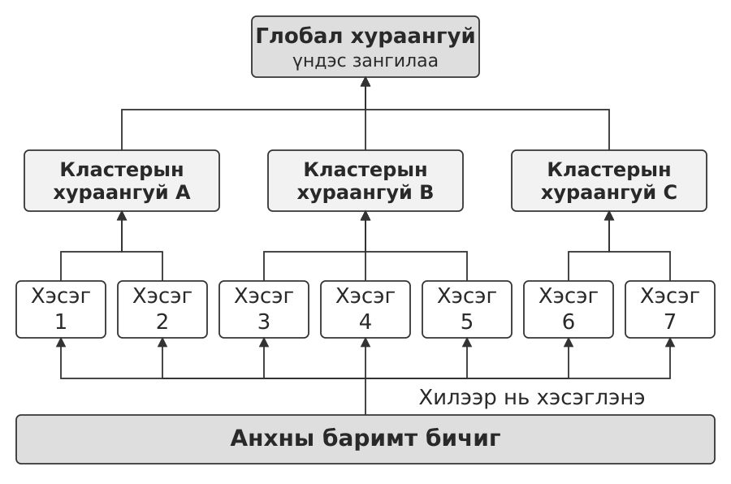

Жишээлбэл, «SSE2 нь 128 битийн XMM регистрт бүхэл тооны SIMD үйлдэл гүйцэтгэхийг дэмждэг» ба «SSE4.2 мөр харьцуулах заавар нэмсэн» гэсэн хоёрыг «x86 SIMD зааврын багцын хувьсал» гэсэн хураангуйд багтааж болно. Нарийн асуулт доод түвшний хэсгүүдтэй, тойм асуулт дээд түвшний хураангуйтай таарч болно. Асуулга шатлалын дагуу алхам алхмаар гүнзгийрч ч болно, эсвэл бүх түвшний зангилааг нийлүүлэн хайж, хамгийн холбоотой багцыг сонгож ч болно.

[^ch3-raptor]: Sarthi нар, RAPTOR: Recursive Abstractive Processing for Tree-Organized Retrieval, 2024.

**GraphRAG** объект, харилцаа, нийгэмлэгийн хураангуйгаар мэдлэгийг зохион байгуулдаг. Энэ нь нэг харилцааг «субъект — харилцаа — объект» гэсэн гурвалаар тэмдэглэдэг, тухайлбал (Хятад, нийслэл нь, Бээжин) эсвэл (Жан Сань, ажилладаг, Tencent). Хоёр бичлэг нэг объектыг дурдсан л бол графт холбогдож чадна. Зураг 3-11-д байгаа хоёр эмч хоёулаа Жан овогтой. Хэрэглэгч «миний шүдний эмчийн ажилладаг эмнэлгийн хаяг» гэж асуувал систем аль харилцааг дагаж хайх ёстой вэ?

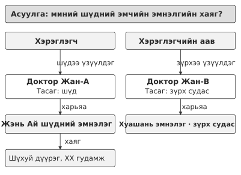

1. **Граф байгуулахдаа ижил нэртэй объектыг ялгах.** Нэг Доктор Жан Жэнь Ай шүдний эмнэлэгт хэрэглэгчийн шүдийг эмчилдэг, нөгөө нь Хуашань эмнэлэгт хэрэглэгчийн аавын зүрхийг эмчилдэг. Систем объект гаргаж, бичлэгүүдийг нэгтгэхдээ эдгээр сэжүүрт үндэслэн хоёр эмчид өөр өөр таних тэмдэг оноож болно. Өмнөх `person`, `relationship` талбарууд ч ижил үүрэгтэй. `bank` өгүүлбэрт голын эрэг үү, банк уу гэдгийг тогтоох нь үгийн утгын ялгалт; бичлэг аль Доктор Жаны тухай болохыг тогтоох нь объектын ялгалт.
2. **Асуулгын үед харилцааны гинжээр хайх.** Хэрэглэгчээс эхлээд «хэрэглэгч → эмч → эмнэлэг → хаяг» гэж алхам алхмаар хайвал хэд хэдэн бичлэгт тархсан мэдээллийг нэг хариулт болгон холбож чадна.

Microsoft-ын GraphRAG-ийн индексийн урсгал эхлээд текстийн нэгжүүдээс объект ба харилцааг гаргаж, дараа нь нийгэмлэг илрүүлэх аргаар нягт холбогдсон объектын бүлгүүдийг таньж, нийгэмлэгийн шатлал ба хураангуйг үүсгэдэг. Нэг объектын талаар асуухад локал хайлт түүний холбогдох мэдээлэл ба эх бичвэрийг хослуулдаг; бүх корпусын сэдвийн талаар асуухад глобал хайлт нийгэмлэгийн хураангуйгаар хариултаа зохион байгуулдаг[^ch3-graphrag].

[^ch3-graphrag]: Microsoft GraphRAG, индекс ба асуулгын тойм, локал хайлт ба глобал хайлт.

Харилцааны дүрслэл нөхцөл ба цаг хугацааг ч багтаах шаардлагатай. Жишээлбэл, «хэрэв ирэх долоо хоногт бас бороо орвол би далайн эрэг явахаа цуцалж, музей рүү явна» гэдэгт нөхцөл, хүчинтэй хугацаа, нөөц үйлдэл багтсан. Хэрэв зөвхөн (хэрэглэгч, төлөвлөгөөтэй, далайн эргийн аялал) ба (хэрэглэгч, нөөц төлөвлөгөөтэй, музейн аялал) гэж гаргавал шилжих нөхцөл алдагдана. Анхны бүтэн өгүүлбэрийг хадгалж, «ирэх долоо хоногт бороо орвол» гэсэн хязгаарлалтыг нөхцөлийн зангилаа, үйл явдлын зангилаа эсвэл бүтэцлэгдсэн талбараар илэрхийлж, харилцааг эх бичвэр рүү заалгаж болно.

Хэрэглэгчийн санах ойн хувьд зохиогч **байгалийн хэл ба бүтэцлэгдсэн индексийг шатлан хослуулахыг** илүү зөвлөдөг: бүтэн илэрхийллийг байгалийн хэлээр хадгалж, объект, цаг хугацаа, эх сурвалжийг мета өгөгдлөөр тэмдэглээд, байнга холбох шаардлагатай агуулгад графын индекс байгуулна.

> **Туршилт 3-7 ★★★: Шаталсан хураангуй ба харилцааны индексийг харьцуулах**
>
> Энэ туршилтад Intel архитектурын гарын авлагаас SSE, AVX болон төлөвийн удирдлагатай холбоотой 14 хуудсыг сонгож, хоёр сургалтын хэрэгжүүлэлт байгуулна. Шаталсан хураангуйн салбар эхлээд хуудас бүрийн хураангуйг үүсгээд, гурван бүлэгт нэгтгэж, бүлгийн хураангуй ба үндсэн хураангуйг үүсгэнэ; харилцааны индексийн салбар объект ба харилцааг гаргаж, нийгэмлэгийн хураангуй үүсгэнэ. Хоёр бүлэг ижил материал ба найман асуулт ашиглаж, ойлголтын нарийн зүйлс ба харилцааны дүгнэлтийг харьцуулна.
>
> «SSE программчлалын орчныг тайлбарла» гэж асуухад шаталсан хураангуй SSE-ийн тойм ба регистрийн нарийн зүйлстэй зэрэг таарч чадна. Энэ хэрэгжүүлэлтэд бүх түвшний зангилааг хамтад нь хайж, хамгийн холбоотой таваас нь сонгоно. Харилцааны салбар харин холбогдох объектоос хөршүүд рүү тэлж, нийгэмлэгийн хураангуйтай хослуулан контекстийг бүрдүүлнэ. «SSE → XMM регистр → хөвөгч таслалтай үйлдэл → ADDPS» гэх мэт харилцааны дагуу ойлголтыг тодорхой зааварт холбож болно.
>
> Илүү төвөгтэй асуулт бол «процессор AVX-г дэмждэг гэж зарласан бол программ AVX-г шууд ашиглаж чадах уу?» гэдэг. Үүнд процессорын чадвар ба үйлдлийн системийн төлөвийн удирдлагыг холбох хэрэгтэй: CPUID-ийн AVX, OSXSAVE тугийг шалгаад, XCR0-г уншиж, XMM ба YMM төлөв хоёулаа идэвхжсэн эсэхийг баталгаажуулна. Энэ асуултад графын хайлтын программд өгсөн төгсгөлийн цэгийн сэжүүр нь CPUID ба YMM. Программ хоёрыг холбосон хамгийн богино замыг XSAVE, CR4.OSXSAVE, XCR0-ээр дамжуулан олоод, тэр замыг Model-д өгч хариулуулна.
>
> Найман асуултын эх сурвалжийн хуудасны дундаж хамралт хоёр бүлэгт хоёуланд нь ойролцоогоор 95.8% байв.

Зохиогч эхлээд хэсэглэлт ба холимог хайлтаа сайн хийж, баримт бичиг хоорондын нэгтгэл ба харилцааны асуулгын хэрэгцээ дахин дахин гарах үед бүтэцлэгдсэн индекс байгуулахыг зөвлөдөг. Мөнгө буцаах журмын нэг догол мөрийг олоход ихэвчлэн хэсэглэлт ба холимог хайлт хангалттай; харин SSE ба AVX-г харьцуулах, эсвэл ерөнхий архитектураас тодорхой заавар хүртэл хайхад догол мөр хоорондын хураангуй ба харилцааны индекс илүү хэрэгтэй.

### Файлын системийн парадигм: лавлахын бүтцээр мэдлэг зохион байгуулах

**OpenViking** санах ой, нөөц, Skill-ийг виртуал файлын системээр зохион байгуулдаг. Бичлэг бүрд `viking://` URI-аар хандах бөгөөд Agent лавлахыг үзэж, тоймыг уншаад, хэрэгтэй агуулга руу хандаж болно[^ch3-openviking-uri]. Мэдээллийн зориулалтаар нь лавлахуудыг гурван бүлэг гэж ойлгож болно: гадны нөөц, хэрэглэгчийн материал, мөн Agent-ийн ашигладаг Skill ба туршлага. Хэрэглэгч ба Agent-ийн таних тэмдэг тус тусын нэрийн орон зайг цааш нь хязгаарладаг.

| Агуулга | Ердийн зориулалт |
| --- | --- |
| Resources | Техникийн баримт бичиг, кодын сан, вэб хуудас зэрэг гадны материал |
| User memories | Тодорхой хэрэглэгчийн сонголт, зуршил, туршлага |
| Skills ба Agent memories | Дахин ашиглаж болох урсгал, даалгаврын бүртгэл, баталгаажуулах шаардлагатай туршлага |

URI нэгдсэн байршуулах аргыг өгч, физик хадгалалт ба индексийг үйлчилгээ удирддаг. Лавлахын интерфейс Agent-д сэдвээр давхарга давхаргаар үзэх, мөн утгын хайлтыг холбогдох дэд модонд хязгаарлах боломж олгодог. Файлын системийн маягийн хандалт, агуулгын хадгалалт, векторын индекс хамтдаа үйлчилгээг бүрдүүлж болно.

[^ch3-openviking-uri]: OpenViking, Viking URI ба системийн архитектур.

OpenViking агуулгыг **L0, L1, L2** гэсэн гурван түвшинд хуваадаг: L0 нь лавлах холбоотой эсэхийг хурдан тогтооход зориулсан богино хураангуй; L1 нь гол агуулга ба навигацын орох цэгийг тайлбарласан лавлахын тойм; L2 нь нарийвчлан унших шаардлагатай үндсэн бичвэр. Лавлахын түвшний хураангуй ба тоймыг `.abstract.md` болон `.overview.md`-д тус тусад нь хадгалдаг. Тэдгээрийн бичвэр үүсгэх төсөв тус тус 256 ба 4000 тэмдэгт[^ch3-openviking-layers].

Асуулга эхлээд хураангуйг уншиж байршлаа тогтоогоод, дараа нь тоймыг уншиж файлаа сонгож, эцэст нь эх бичвэрийг ачаалж болно. Энэ нь Бүлэг 2-ын Skills-ийн шат дараалсан ил болголттой төстэй: хөнгөн лавлах илрүүлэлтийг дэмжиж, бүрэн агуулгыг даалгаврын хэрэгцээгээр ачаална. Яг тоон утга, нөхцөл эсвэл анхны үг хэллэг шаардлагатай бол харгалзах үндсэн бичвэрийг үргэлжлүүлэн гаргаж ирэх хэрэгтэй.

[^ch3-openviking-layers]: OpenViking, Context Layers (L0/L1/L2). L0, L1 нь лавлахын түвшинд үүсгэсэн дүрслэл; L2 нь анхны файл эсвэл задлан шинжилсэн үндсэн бичвэр байж болно.

Хүн ба Agent хамтран арчлах шаардлагатай мэдлэгийн хувьд зохиогч **Markdown цэвэр текст ба хувилбарын хяналтаар** удирдахыг илүүд үздэг. Хүн мэдлэгийг шууд уншиж, засварлаж, залруулж чадах бөгөөд Agent ч ижил файлын интерфейсийг ашиглаж, ажлын салбар дээр шинэчлэлт санал болгоод, хянагдсаны дараа нийтэлж болно. Хувилбарын хяналт өөрчлөлт бүрийн зөрүүг хадгалж, алдаатай шинэчлэлтийг буцаах боломж олгодог. Сесс дуусахад хэрэглэгчийн сонголт тухайн хэрэглэгчийн санах ойд, үйлдлийн явц даалгаврын бүртгэлд орно. Даалгаврын бүртгэл үр дүнгийн үнэлгээ, траектор хоорондын нэгтгэл, дараагийн баталгаажуулалтыг давсны дараа Бүлэг 9-д авч үзэх туршлага болж хувирч болно.

Мэдлэгийг файлын системээр зохион байгуулахдаа **холбогдох бичлэгүүдэд холбоос ба индекс заавал байгуулах** хэрэгтэй. Бие биеэ иш татдаггүй олон файлын хоорондын холбоог зөвхөн бүх бичвэрийг гүйлгэх эсвэл утгын хайлтаар дахин хайж олох боломжтой; файл олон болох тусам Agent аль хэдийн олсон агуулгаасаа цааш мөрдөх нь хэцүү болно. Холбоос тодорхой хайх замыг өгч чадна, жишээлбэл мөнгө буцаах журмаас онцгой заалт руу, гэрээний хураангуйгаас гарын үсэг зурсан бүртгэл рүү, хүний бичлэгээс холбогдох үйл явдал руу заах. Нүүр хуудас гол сэдвүүдийг тайлбарлаж, индекс хуудас навигаци өгч, бичлэг хоорондын хөндлөн эшлэл хажуу тийш хайхыг дэмждэг. Энэ арга нэвтэрхий толийн бичлэгийн зохион байгуулалттай төстэй бөгөөд харилцааны тодорхой хэсгийг харьцангуй хөнгөн аргаар хадгалж чадна.

Сан байгуулахдаа аль бичлэгийг хамт ашиглаж болох, аль төлөвлөгөөнөөс нэг удаагийн боловсруулалтад зөвхөн нэгийг нь сонгох ёстойг ч тэмдэглэж болно. Жишээлбэл, харилцагчийн үйлчилгээ захиалга цуцлах хүсэлтийг шийдвэрлэхдээ хэрэглэгчид хариулахдаа үг хэллэгийн журам ба нууцлалын журмыг зэрэг баримтлах ёстой тул хоёр журмыг хамт контекстэд оруулж болно. Агуулах ачилт цуцлахад зориулж хоёр төлөвлөгөө бэлдсэн бол тус бүрийн хэрэглэх нөхцөлийг индекст тодорхой бичих хэрэгтэй. Нэг илгээмжийн хувьд агуулахаас гараагүй бол гаргах баримтыг цуцалж, тээвэрлэгчид аль хэдийн хүлээлгэн өгсөн бол саатуулах хүсэлт гаргана. Ажлын хүсэлтэд зөвхөн «захиалгыг цуцлаач» гэж байвал Agent эхлээд илгээмжийн төлөвийг шалгаад, дараа нь хамаарах төлөвлөгөөг ачаална.

Холбоосын арчилгааг шинэчлэлтийн урсгалд оруулах хэрэгтэй: шинэ бичлэг нэмэхийн өмнө одоо байгаа бичлэгийг хайж, нэгтгэх үү, шинээр үүсгэх үү гэдгийг тогтооно; бичсэний дараа холбогдох эшлэлийг нэмж, харьяалах лавлахын индексийг шинэчилнэ. Холбоос уншигчийг заалт руу хөтөлж чадах ч тэр заалт гарт байгаа захиалгад хамаарах эсэх нь хэзээнээс хүчин төгөлдөр болсноос шалтгаална.

### Мэдлэгийг хэрхэн шинэчлэх ёстой вэ

Нэг журам өнөөдөр өөрчлөгдвөл хэрэглэгч маргааш «одоо яах ёстой вэ» гэж асууж ч магадгүй, «өнгөрсөн сард миний захиалгыг яагаад тэгж шийдвэрлэсэн бэ» гэж асууж ч магадгүй. Хуучин заалтыг шинэ заалтаар дарж бичвэл хоёр дахь асуулт тухайн үеийн үндэслэлээ алдана. **Нэмэлт шинэчлэлт** шинэ нотолгоог цаг алдалгүй бичиж, **үечилсэн цэгцлэлт** илүү өргөн хүрээнээс давхардал, зөрчил, бүтцийн өөрчлөлтийг илрүүлдэг; хоёр зам хоёулаа хувилбар, нотолгооны эшлэлийг хадгалж, нийтлэхээс өмнө шалгаж байж асуултаас хамааран хамаарах хугацааг сонгох боломжтой.

#### Хэрэглэгчийн санах ой ба мэдлэгийн сангийн нэмэлт шинэчлэлт

Зохиогчийн зөвлөмж: **мэдлэгийн санг кодын сан гэж үзэж, мэдлэгийн өөрчлөлт бүрийг нэг Pull Request (PR) гэж үз.** Нэг шинэчлэлт тодорхой өөрчлөлтийн хүрээтэй байж, өөрчлөлтийг дэмжих нотолгоог хавсаргаж, хянагчид шалгуулах ёстой. Markdown баримт бичиг, дүрмийн файл, User as Code-ийн гүйцэтгэж болох төлөв бүгд энэ урсгалд багтаж болно. Хувилбарын түүх арчлагчдад өөрчлөлтийг харах, шалтгааныг мөрдөх, алдаатай нийтлэлийн дараа сэргээхэд тусалдаг.

Бүлэг 1-ийн **санал гаргагч—хянагч** хэв загварыг үргэлжлүүлбэл нэг шинэчлэлтийг дараах байдлаар хийж болно:

1. **Санал гаргагч өөрчлөлт үүсгэнэ.** Proposer Agent шинэ нотолгоог уншиж, одоо байгаа мэдлэгийг хайж, шинэ, засах эсвэл хуучирсан бичлэгийг олоод, ажлын салбар дээр хүрээ нь тодорхой өөрчлөлт санал болгоно. Үүний зэрэгцээ холбоос, лавлахын индекс, цаг хугацааны мэдээлэл, нотолгооны эшлэлийг арчилна.
2. **Хянагч бие даан шалгана.** Reviewer Agent өөрчлөлтийн өмнөх ба дараах агуулгыг анхны нотолгоотой тулган, шинэ мэдэгдэл эх сурвалжтай эсэх, хэрэглэх нөхцөл бүрэн бичигдсэн эсэх, өөр файлуудын мэдэгдэл хоорондоо нийцэж байгаа эсэх, мөн хассан догол мөрөнд хэрэгтэй мэдээлэл үлдсэн эсэхийг шалгана. Асуудал илэрвэл тодорхой бичлэг ба үндэслэлийг зааж, юуг нэмэх, сэргээх эсвэл засахыг тайлбарлана.
3. **Давтаж, шийдвэр гаргана.** Санал гаргагч саналын дагуу засаж, хянагч дахин шалгана. Хяналтад тэнцсэний дараа нэгтгэх урсгал руу орно; ээлжийн тоо буюу зардлын дээд хязгаарт хүрсэн ч маргаантай хэвээр байвал энэ өөрчлөлтийг ажлын салбарт үлдээж, хүнээр хянуулна.
4. **Шалгаж, нийтэлнэ.** Формат, холбоос, мета өгөгдөл, эрхийн шошгыг автоматаар шалгана; гүйцэтгэж болох мэдлэг мөн төрлийн шалгалт ба холбогдох тестийг давах ёстой. Нэгтгэсний дараа тогтоосон мэдлэгийн хувилбараас нөлөөлөлд өртсөн хэсэг, хураангуй, векторын индексийг дахин байгуулж, үйлчилгээний хувилбарыг нийтэлнэ.

Энэ урсгал өгөгдлийн гурван давхаргад харгалздаг. **Анхны нотолгооны давхарга** харилцан яриа, гүйцэтгэлийн траектор, бизнесийн баримт бичиг, Tool-ийн үр дүнг хадгална; **мэдлэгийн давхарга** боловсруулсан, засварлаж болох текст эсвэл кодыг хадгална; **үйлчилгээний давхарга** тодорхой мэдлэгийн хувилбараас үүсгэсэн индексийг хадгална. Өөрчлөлтийн бүртгэл нотолгооны таних тэмдэг, мэдлэгийн хувилбар, хяналтын санал, эцсийн шийдвэрийг холбодог тул арчлагч нэг мэдлэг яагаад бичигдсэн, хэзээнээс хүчин төгөлдөр болсныг мөрдөж чадна. Анхны нотолгоог хадгалах бодлогын дагуу архивлаж, индексийг мэдлэгийн хувилбараас дахин үүсгэж болно. Өмнө дурдсан залгах маягийн санах ой шинэ, хуучин баримтыг эх сурвалжтай нь хадгалахад тохиромжтой; энд байгаа хяналтын урсгал эдгээр нотолгоог ашиглаж болох мэдлэгийн хувилбар болгон цэгцлэх үүрэгтэй. Асуулгын үед шийдэгдээгүй зөрчил гарвал нотолгоо руу буцаж шалгаад, даалгаврын нөхцөлтэй уялдуулан дүгнэж болно.

Энэ зохиомжид **санал гаргагч ба хянагч хоёулаа Tool дуудаж, тасралтгүй хайлт хийж чаддаг Agent байх ёстой.** Санал гаргагч нөлөөлөлд өртсөн бичлэгийг олохын тулд хэд хэдэн бичлэг хайх шаардлагатай байж болно; хянагч ч эшлэлийн дагуу үргэлжлүүлэн хайх, хувилбаруудыг харьцуулах эсвэл шалгалт гүйцэтгэх хэрэгтэй болж магадгүй. Файлын хайлт, нотолгооны хайлт, зөрүү харах, тест хийх Tool нь тэдэнд эдгээр дараагийн алхмыг гүйцэтгэх боломж олгодог бөгөөд харгалзах чадвартай Coding Agent ийм ажлыг хариуцаж чадна.

Хоёулангийнх нь хайлтын хүрээ одоогийн өөрчлөлтөд хамаарах мэдлэг ба анхны нотолгоог хамрах ёстой бөгөөд хэрэглэгч, түрээслэгч (tenant), даалгаврын эрхээр хязгаарлагдана. Хяналтын траектор, иш татсан Tool-ийн үр дүн, санал хүсэлтийг хамт архивлаж, хянагч бодитоор юуг шалгасныг дараа нь шалгаж болно.

Model сонгохдоо зохиогч чадвар нь ойролцоо, өөр өөр гэр бүлийн Model-уудын хослолыг түрүүлж ашиглахыг зөвлөдөг, тухайлбал Claude ба GPT, DeepSeek ба Kimi. Өөр өөр сургалтын өгөгдөл ба дүгнэлтийн зуршил өөр өөр дүгнэлт авчирч болно. Хянагч нотолгоог бие даан хайж, өөрчлөлт дэх мэдэгдэл ба нөхцөлийг тулгах ёстой. Эрхийг ажиллаж буй систем хэрэгжүүлэх ёстой: санал гаргагч ажлын салбарт бичиж, хянагч нотолгоог уншиж дүгнэлтээ илгээж, нэгтгэх ба нийтлэх үйлчилгээ үндсэн сан ба онлайн индексийг шинэчлэх эрхийг эзэмшинэ.

#### Хэрэглэгчийн санах ой ба мэдлэгийн сангийн үечилсэн цэгцлэлт

Олон удаагийн хэсэгчилсэн шинэчлэлтийн дараа нэг баримт хэд хэдэн файлд тархаж, шинэ, хуучин илэрхийлэл зэрэг оршиж болно. Үечилсэн цэгцлэлт лавлах, цаг хугацаа эсвэл сэдвээс эхэлж эдгээр хуримтлагдсан асуудлыг шалгадаг. Энэ нь Бүлэг 9-д авч үзэх үечилсэн эргэн дүгнэлттэй нийтлэг ажлын арга барилтай: урд талд шинэ нотолгоо хуримтлуулж, ар талд төвлөрүүлэн цэгцэлж, дараагийн даалгаварт ашиглаж болох бичлэг бүрдүүлнэ.

Цэгцлэлт гурван ажлыг багтаана.

1. **Давхардлыг арилгах, нэгтгэх, бүтцийг тохируулах.** Давхардсан, хуучирсан эсвэл хэт жижиглэгдсэн бичлэгийг олж, холбогдох агуулгыг нэгтгэж, хэт том файлыг хувааж, холбоос, нүүр хуудас, индекс хуудсыг шинэчилнэ. Үйлчилгээнээс хуучин илэрхийллийг хасахдаа түүнийг орлосон харилцаа болон анхны үндэслэлийг тэмдэглэнэ.
2. **Анхны материал руу буцаж шалгах.** Хэрэв цэгцлэлт бүр зөвхөн өмнөх ээлжийн хураангуйг дахин бичвэл эртний орхигдол ба буруу ойлголт ээлж бүрээр дамжсаар байна. Тиймээс харилцан яриа, гүйцэтгэлийн траектор, бизнесийн баримт бичиг, Tool-ийн гаралттай тулган хураангуй гол баримтыг орхисон эсэх, үгүйсгэл, цаг хугацаа эсвэл нөхцөлийг алдсан эсэх, таамаглалыг баттай дүгнэлт мэт бичсэн эсэхийг шалгах хэрэгтэй. Том мэдлэгийн санг лавлах, цаг хугацаа эсвэл сэдвээр багцлан боловсруулж, хамралтын жагсаалтаар шалгасан, шалгах ёстой, маргаантай хэсгийг тэмдэглэн, бүх санг шалгаж дуустал үргэлжлүүлж болно.
3. **Зөрчил ба хамрах хүрээг шийдвэрлэх.** Зөрчилтэй бичлэгүүдийн эх сурвалж, мөн цаг хугацаа, объект, газар нутаг, даалгавар, урьдчилсан нөхцөлийг харьцуулна. Хоёр мэдээлэл өөр өөр нөхцөлд хамаарах бол тус бүрийн хүрээг нөхөж бичнэ; шинэ нотолгоо хуучин дүрмийг тодорхой орлож байвал хувилбарын харилцааг хадгална; үндэслэл хангалтгүй бол баталгаажуулах зүйл ба нэмж шаардлагатай нотолгоог тэмдэглэнэ.

Цэгцлэлтийн үр дүнг мөн өөрчлөлт болгон хяналтад илгээнэ. Том хэмжээний бүтцийн өөрчлөлтийг лавлах эсвэл сэдвээр хэд хэдэн PR болгон хувааж, цэгцлэх төлөвлөгөө ба хамралтын жагсаалтыг хуваалцаж болно; холбогдох өөрчлөлтүүд тэнцсэний дараа үүсмэл индексийг дахин байгуулж, ердийн хайлт ба асуулт хариултын тохиолдлуудыг дахин ажиллуулж, өмнө олддог байсан мэдлэг хандах боломжтой хэвээр байгаа эсэхийг шалгана. Өдөөх аргад долоо хоног, сар зэрэг тогтмол хугацааг ашиглаж болно, эсвэл шинэ бичлэгийн тоо, зөрчлийн тоо, хайлтын чанарын өөрчлөлтөд үндэслэн босго тогтоож болно.

**Хүчингүй болсон агуулгыг идэвхгүй болгох.** Хэсэг ба хураангуй хувилбар, хүчин төгөлдөр болох хугацаа, хүчингүй болох хугацаагаа хадгалах ёстой. Хуучин журам орлогдсоны дараа одоогийн бизнесийн асуулга хүчингүй хувилбарыг шүүж хаяна; түүхэн асуулга харин зорилтот хугацааны дагуу харгалзах дүрмийг уншина. Ингэснээр хамгийн сүүлийн мэдлэгийг ашиглахаас гадна өнгөрсөн шийдвэрлэлтийн үр дүнг ч тайлбарлаж чадна.

**Эрх ба түрээслэгчийн тусгаарлалт.** Эрхийн шүүлтийг хайлтын давхаргад гүйцэтгэх ёстой: хайлтын үйлчилгээ эхлээд дуудагчийн хэн болохоор хайж болох баримт бичгийн хүрээг тогтоогоод, дараа нь тэр хүрээнээс холбогдох материалыг хайна. Өөр хэрэглэгчийн хувийн материалыг контекстэд нэгэнт оруулбал Model хариулах эсвэл Tool дуудахдаа үүнийг задруулж болзошгүй. Эх бичвэр, хураангуй, харилцааны ирмэг, кэшийн үр дүн бүгд зохих хандалтын хүрээг өвлөх ёстой бөгөөд ингэж байж үүсмэл агуулгаар дамжуулан өөр хэрэглэгч эсвэл түрээслэгчийн мэдээлэл гадагшлахаас сэргийлнэ. Үйлчилгээ бие даасан индекс эсвэл албадан шүүх чадвартай хуваалцсан индекс ашиглаж болох бөгөөд гол нь асуулга бүрт эрхийн хязгаарлалтыг хэрэгжүүлэх явдал юм.

### Agent-д суурилсан RAG: хайлтын явцыг Agent удирдах нь

Эхлээд нэг удаагийн хайлт хангалттай эсэхийг асууя. Жишээлбэл, «борлуулалтын дараах үйлчилгээний утасны дугаар хэд вэ» гэсэн асуултад одоо мөрдөж буй үйлчилгээний гарын авлага ихэвчлэн хариулт өгч чадах тул зохиогч нэг удаа хайгаад үүсгэх энгийн замыг хэвээр ашиглахыг зөвлөдөг. Харин хэрэглэгч «миний авсан энэ загварыг өнгөрсөн сарын баталгааны нөхцөлөөр солиулж болох уу» гэж асуувал эхний хайлт зөвхөн бүтээгдэхүүний цувралыг олох тул өнгөрсөн сарын солих нөхцөлийг тогтоож чадахгүй. Хайлтыг Tool болгон нээж өгвөл Agent өмнөх хайлтын буцаасан сэжүүрээр дараагийн асуулгаа бүрдүүлж чадна. Нэмж хайх эсэх, дараа нь юуг хайхыг Agent шийддэг энэ аргыг **Agent-д суурилсан RAG (Agentic RAG)** гэж нэрлэдэг. Зураг 3-12-той тулгавал эхний удаа буцаасан бүтээгдэхүүний материал яг адилхан. Баруун талын зам тухайн үед хамаарах заалтыг олохын тулд ямар нэмэлт сэжүүр ашигласан бэ?

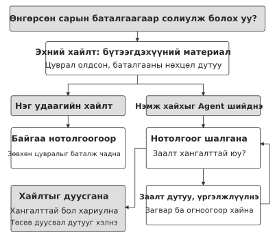

ReAct-ийг жишээ болгон авбал Model эхлээд асуултыг шинжилж, асуулгаа сонгоод `knowledge_base_search`-ийг дуудна; Tool ажиглалт буцаасны дараа Model нотолгоо хангалттай эсэхийг дүгнэнэ. Нөхцөл эсвэл холбогдох объект дутуу бол асуулгаа өөрчлөн дахин хайна; материал хангалттай бол эх сурвалжтай нь уялдуулан хариулт үүсгэнэ. Harness түүх, Tool дуудлага, төсвийг арчилж, хязгаарт хүрэхэд хайлтыг зогсоох эсвэл тодруулах руу шилжинэ.

Одоо Зураг 3-13-ыг харъя. Мэдлэгийн сангийн арын хэсгийг векторын индексээс харилцааны граф болгон сольсон ч Model ижил Tool-ийн интерфейсээр хайлт хүссээр байж болно. Хэрэв буцаасан баримт бичигт санамсаргүй нэг заавар байвал Model түүнийг дагаж гүйцэтгэж болох уу?

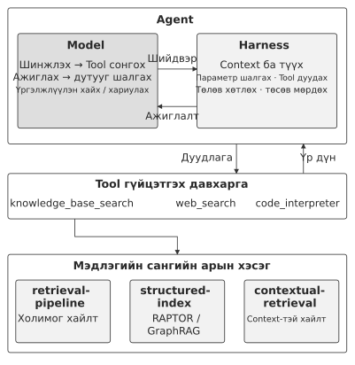

**Хайлтын агуулгын итгэлцлийн хил.** Гадны баримт бичигт Model-ийн үйлдлийг өөрчлөхийг оролдсон текст байж болох бөгөөд санд орохоос өмнө худал баримт нэмэгдсэн байж ч болно. Эхнийх нь шууд бус Prompt шургуулалт (indirect prompt injection), сүүлийнх нь мэдлэгийн санг хордуулах явдал юм. Шийдвэрлэхдээ агуулгын эх сурвалж ба гүйцэтгэх эрхийг зэрэг удирдах хэрэгтэй: хайлтын үр дүнд эх сурвалж, хувилбар, эшлэлийн байрлалыг хавсаргаж, хариултын нотолгоо болгон ашиглана; мөнгө шилжүүлэх, устгах, гадагш захидал илгээх зэрэг үйлдлийг Harness ба гүйцэтгэх орчин хэрэглэгчийн зөвшөөрөлд үндэслэн шалгана. Санд оруулахын өмнөх хяналт, эх сурвалжийг мөрдөх, баримт шалгах нь алдаатай мэдлэгийн тархалтыг цааш хязгаарладаг. Бүлэг 2-т танилцуулсан эх сурвалжийн тэмдэглэгээ ба Бүлэг 4-ийн Tool-ийн хязгаарлалт энд хамтдаа үүргээ гүйцэтгэнэ.

> **Туршилт 3-8 ★★: Нэг удаагийн хайлт ба олон ээлжийн хайлтыг харьцуулах**
>
> Энэ туршилтад ижил хятад хэлний хууль эрх зүйн материал, ижил BM25 хайгч, ижил Model ашиглаж, долоон асуулт дээр хоёр горимыг харьцуулна: суурь горим анхны асуултаар нэг удаа хайдаг, Agent горим Model-д асуулгаа тохируулахыг зөвшөөрч, хамгийн ихдээ дөрвөн удаа хайлт хийдэг.
>
> «Аргагүй хамгаалалтыг хэрхэн зохицуулсан бэ» гэх мэт асуулгад шууд хайхад гол заалтыг олж болно. Илүү төвөгтэй жишээ бол «согтуугаар болгоомжгүйгээр хүний биед хүнд гэмтэл учруулсан, өмнө нь хулгайн хэргээр ял шийтгүүлж байсан бол ялыг хэрхэн оногдуулах вэ» гэсэн асуулт. Энэ нь одоогийн үйлдэл, согтуу байдал, өмнөх бүртгэлийг зэрэг хамардаг тул хайлтад холбогдох материалыг тус тусад нь олоод, хэрэглэх нөхцөлийг шалгах хэрэгтэй.
>
> Бодит ажиллуулалтад дараалан «согтуугаар болгоомжгүй хүнд гэмтэл учруулах хулгайн өмнөх ял ял оногдуулах», «согтуу гэмт хэрэг ял оногдуулах», «хулгайн өмнөх ял ял оногдуулахад нөлөөлөх эрүүгийн хууль», «өмнөх ял ял оногдуулахад нөлөөлөх эрүүгийн хууль» гэж хайсан. Үүний дараа Model «давтан гэмт хэрэг тогтоох эрүүгийн хууль» гэж санал болгосон боловч энэ үед хайлтын төсөв дууссан байсан тул Harness төсөв дууссан тухай мэдээлэл буцаасан.
>
> Туршилтад ангилсан дөрвөн төвөгтэй асуултын хувьд зорилтот хуулийн заалтын хамралт ойролцоогоор 8%-иас 92% болж өссөн, дундаж хайлтын тоо нэгээс 3.5 болж нэмэгдсэн, хариулах шатны дундаж хугацаа ойролцоогоор 8 секундээс 66 секунд болж уртассан. Гурван энгийн асуултын нотолгооны хамралт бүгд 100% байсан бөгөөд хоёр бүлэг хоёулаа ганц л удаа хайсан.

Ижил хайлтын давталтыг хэрэглэгчийн түүхэнд ч ашиглаж болно. Доор Туршилт 3-1-ийн гурван түвшний үнэлгээний багцыг үргэлжлүүлэн ашиглаж, Agent сесс хоорондын бичлэгээс баримт хэрхэн гаргаж ирэх, объектыг хэрхэн ялгах, шинэчлэлтийг хэрхэн боловсруулахыг ажиглая.

> **Туршилт 3-9 ★★: Agent-д суурилсан хайлтаар хэрэглэгчийн санах ойг унших**
>
> Энэ туршилтад бүрэн харилцан ярианы түүхийг мэдлэгийн сан болгож, цонхоор хувааж индекс байгуулаад, Agent-д `search_user_memory` Tool өгнө. Цонхны хэмжээг тохируулж болно; энэ удаагийн ажиллуулалтад хэсэг бүр найман ээлж харилцан яриатай, хөрш хэсгүүд хоёр ээлжээр давхцаж, сессийн таних тэмдэг, цаг хугацаа, бизнесийн мета өгөгдлийг хадгалсан. Асуулга хамгийн ихдээ гурван удаа гүйцэтгэгдэж, удаа бүр дөрвөн хэсэг гаргаж ирнэ.
>
> Үндсэн эргэн санах нь тодорхой талбарын эргэн тойронд хайж болно, жишээлбэл «миний чекийн дансны дугаар хэд вэ». Олон сессийн асуултад объект бүрэн эсэхийг ч шалгах хэрэгтэй: хэрэглэгч Honda Accord ба Tesla Model 3 хоёулаа байгаа бол машины үйлчилгээний хуваарийг асуухад систем хоёр машин болон тус бүрийн цаг захиалгын төлөвийг ялгах ёстой.
>
> Үүнд тулгуурлан нэг хайлтын маршрут зохиож болно: эхлээд машин ба үйлчилгээний бичлэгийг хайх; нөгөө машины сэжүүр илэрвэл Tesla-гийн хуваарийг асуух; эцэст нь Honda-гийн одоо байгаа цаг захиалгыг тайлбарлаад, хэрэглэгч Tesla-д бас цаг захиалах хэрэгтэй эсэхийг тодруулах. Энэ удаагийн бодит бүртгэлд зөвхөн `scheduled car services` гэсэн нэг асуулга гүйцэтгэгдсэн бөгөөд энгийн хайлтын бүлгийн хариулт Honda-д төвлөрч, Tesla-г орхисон.
>
> Өөр нэг төрлийн бэрхшээл дараалсан өөрчлөлтөөс үүсдэг. Мөнгө шилжүүлгийн жишээнд эхнэр нь шилжүүлгийн тохиргоо хийж, нөхөр нь дараа нь дүн ба огноог өөрчилж, эхнэр нь дахин тохируулсан. Бичлэгүүдийг гаргаж ирсний дараа цаг хугацаа, объект, баталгаажуулалтын төлөвөөр өөрчлөлтийг сэргээж, эцэст нь хүчин төгөлдөр болсон зааврыг олох хэрэгтэй. Одоогийн хэсэглэлт цаг хугацааны мэдээллийг хадгалсан ч хайлт гол өөрчлөлтийг орхиж болзошгүй тул хэсгүүдэд үйл явдлын суурь мэдээллийг нэмж болно.
>
> Эдгээр 60 тохиолдлын 18 нь нэг удаа, 6 нь хоёр удаа хайсан бол 36 нь гурван удаагаа бүрэн ашигласан. Энгийн хэсэглэлтийн хайлтын бүлэг 47 тохиолдолд тэнцсэн: үндсэн эргэн санах 19, олон сессээс хайх 15, идэвхтэй үйлчилгээ 13. Дараагийн хэсэгт ижил тохиолдлууд дээр контекстийн угтвар ба бүтэцлэгдсэн санах ойг үргэлжлүүлэн харьцуулж, тус бүр ямар мэдээлэл нэмж өгснийг шинжилнэ.

### Контекстийг харгалзсан хайлт: хэсгүүдэд суурь мэдээлэл нэмэх

Нөгөө санхүүгийн тайлан руугаа буцъя. ACME компанийн 2025 оны хоёрдугаар улирлын гүйцэтгэлийг хайхад асуулгад компанийн нэр, он байгаа ч «тус компанийн орлого 3%-иар өссөн» гэж бичсэн хэсэгт яг энэ хоёр үг алга. Хэсгийг томсгохоос гадна энэ богино бичвэрийг хэвээр үлдээж, дутуу суурь мэдээллийг өмнө нь нэмж болно. **контекстийг харгалзсан хайлт (Contextual Retrieval)** индекс байгуулах үедээ хэсэг бүрт богино суурь угтвар үүсгээд, угтварыг эх бичвэртэй хамт хайлтад ашигладаг[^ch3-1]. Зураг 3-14 энэ боловсруулалтын явцыг харуулна.

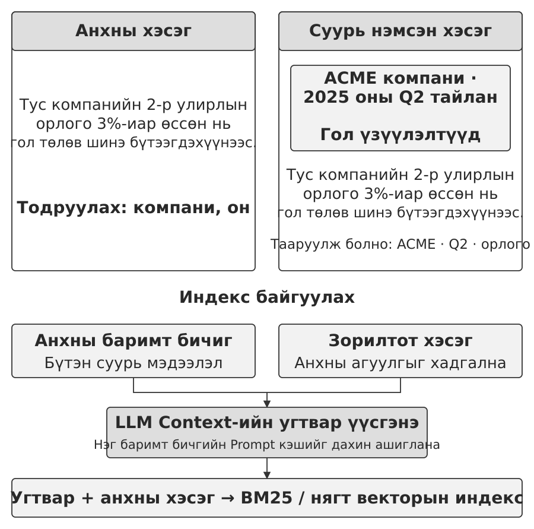

Жишээлбэл, угтвар «энэ догол мөр ACME компанийн 2025 оны хоёрдугаар улирлын тайлангийн гол гүйцэтгэлийн үзүүлэлтийн хэсгээс гаралтай» гэж тайлбарлаж болно. Үүсгэхдээ эх бичвэр ба зорилтот хэсгийг хамт өгч, Model-оор үнэхээр үндэслэлтэй заасан зүйл, цаг хугацаа, бүлгийн мэдээллийг нэмүүлнэ. Ингэснээр BM25 компанийн нэр, улирал зэрэг тааруулж болох нэр томьёотой болж, нягт embedding ч эдгээр суурь мэдээллийг хэсгийн дүрслэлд тусгаж чадна.

Энэ нь Бүлэг 2-ын контекстийг харгалзсан шахалттай хамт хэрэглэгдэж болно: индексийн үед мэдлэгийн хэсэгт суурь мэдээлэл нэмж, холбогдох мэдээллийг олох боломжийг нэмэгдүүлнэ; ажиллах үед одоогийн даалгаварт тулгуурлан гаргаж ирсэн түүхийг цэгцэлж, оролтын уртыг хянана. Эхнийх нь хэсгийн хайгдах чадварт, сүүлийнх нь одоогийн шийдвэрт хэрэгтэй мэдээлэл ба төсөвт анхаардаг.

[^ch3-1]: Anthropic, Introducing Contextual Retrieval, 2024 оны 9-р сар.

> **Туршилт 3-10 ★★: Анхны хэсэглэлт ба контекстээр баяжуулсан хэсэглэлтийг харьцуулах**
>
> Энэ туршилтад ижил материалд хоёр индекс байгуулна: нэг нь анхны хэсгүүдийг ашиглаж, нөгөө нь Model-ийн үүсгэсэн угтварыг нэмнэ. Асуулга ба зорилтот тэмдэглэгээг ижил байлгаж, BM25, нягт хайлт, холимог хайлтыг тус тусад нь харьцуулна.
>
> Өмнөх санхүүгийн тайлангийн жишээг үргэлжлүүлбэл «ACME компанийн сүүлийн үеийн орлогын өсөлт» гэж асуухад олдсон хэсэг зорилтот компани, хугацаа, өсөлтийн өгөгдлийг зэрэг агуулж байгаа эсэхийг шалгаж болно. Зөвхөн «орлогын өсөлт» гэдэг нь өөр компанитай таарч магадгүй; угтвар нэмсний дараа компанийн нэр ба цаг хугацаа эрэмбэлэлтэд оролцох боломжтой болно.
>
> Энэ удаагийн 15 асуулгад угтвар нэмсний дараа BM25-ын recall@1 нь 0.60-аас 0.80 болж, нягт хайлтынх ойролцоогоор 0.867-оос 0.933 болж өссөн; хоёулангийнх нь recall@3 тус тус 0.867 ба 1.0 хэвээр байв. Холимог хайлтын recall@5 нь 14/15-аас 15/15 болсон. Нэмж олдсон нь аль асуулт вэ? Бүх Хятадын Ардын Төлөөлөгчдийн Их Хурлын Байнгын хорооны бүрэн эрхийг асуухад зорилтот хэсэг бүрэн эрхүүдийг жагсаасан ч өгүүлэгч нь дутуу байв. Угтвар нэмсний дараа BM25 үүнийг 16-р байраас 12-р байр руу дэвшүүлсэн ч эхний тавын гадна хэвээр үлдсэн; холимог хайлт 6-р байраас 5-р байр руу дэвшүүлснээр л эхний тавд орсон. Эх бичвэрийг дахин харвал эхний хэсэгт (1)-ээс (4) хүртэлх бүрэн эрх, тав дахь хэсэгт (4)-өөс (22) хүртэлх бүрэн эрх жагсаагдсан байна. Оноо зөвхөн тэмдэглэсэн тав дахь хэсэг сонгогдсон эсэхийг шалгадаг ч бүх бүрэн эрхийг жагсаахын тулд хоёр хэсгийг залгах хэрэгтэй.
>
> Угтвар үүсгэх нь индексийн үеийн дуудлагыг нэмэгдүүлдэг. Нэг баримт бичгийн олон хэсэгт суурь мэдээлэл үүсгэхдээ баримт бичгийн угтварын кэшийг дахин ашиглаж болно. Anthropic 2024 оны тайландаа 800 token-ий хэсэг, 8000 token-ий баримт бичиг, тогтоосон Prompt-ийн уртаар тооцоолоход баримт бичгийн сая token тутамд нэг удаагийн боловсруулалтын зардал ойролцоогоор 1.02 ам.доллар гэж мэдээлсэн.
>
> Тус тайланд контексттэй embedding-ийг BM25-тай хослуулснаар top-20 хайлтын алдааны түвшин 5.7%-иас 2.9% болж, харьцангуй ойролцоогоор 49%-иар буурсан; дахин эрэмбэлэлт нэмсний дараа 1.9% болж, харьцангуй ойролцоогоор 67%-иар буурсан. Тайланд ашигласан алдааны түвшин нь $1-\mathrm{recall@20}$.

Дахин дахин хайгддаг, агуулга нь харьцангуй тогтвортой материалын сангийн хувьд зохиогч индекс байгуулах үедээ хэсгийн суурь мэдээллийг түрүүлж нөхөхийг зөвлөдөг бөгөөд нэг удаагийн боловсруулалт дараагийн олон асуулгад үйлчилж чадна. Компанийн нэр, үйл явдлын субъект, цаг хугацаа хуваах үед алдагдсан бол зөвхөн хайлтын тоог нэмэгдүүлэх нь заасан зүйл нь тодорхойгүй хэсгүүдийг гаргаж ирсээр байж болно. Угтвар үүсгэхдээ эдгээр сэжүүрийг нөхвөл дараагийн хайлт тэдгээрийг ашиглан материалыг олж чадна.

> **Туршилт 3-11 ★★★: Контекстийн угтвар ба бүтэцлэгдсэн картаар санах ойг баяжуулах**
>
> Харилцан яриан дахь «за, үүнийг л захиалъя» гэсэн үгийг өмнөх бараа эсвэл аялалтай холбох хэрэгтэй. Хэрэв эх бичвэрт Шанхайгаас Сиэтл рүү, 500 ам.долларын нэг талын билетийн тухай ярьсан бол угтвар эдгээр суурь мэдээллийг нэмж, баталгаажуулалт болсон сесс ба цаг хугацааг хадгалж болно.
>
> Энэ туршилтад энгийн хэсэглэлт дээр хоёр тохиргоо нэмнэ: контекстийн угтварын бүлэг, мөн Advanced JSON Cards-ийг зэрэг ачаалдаг хоёр давхаргат санах ойн бүлэг. Model эхлээд энгийн индекс дээр үндэслэн хайлтын дараалал үүсгээд, ижил асуулгуудыг хоёр индекст ашиглана; хоёр давхаргат бүлэг ижил баяжуулсан хайлтын үр дүнг ашиглаж, бүтэцлэгдсэн картыг нэмнэ.
>
> Мөнгө шилжүүлгийн жишээнд угтварууд Patricia шилжүүлэг эхлүүлсэн, James тохиргоог өөрчилсөн, Patricia дахин тохируулсныг тус тусад нь тайлбарлаж, үйл явдлын дарааллыг тогтооход тусалсан. Анхны бичлэгт өгсөн эцсийн төлөв нь 95,000 ам.доллар, 10-р сарын 1 бөгөөд өмнөх тохиргоонууд орлогдсон байна. Энэ удаа гурван бүлэг бүгд энэ төлөвийг зөв олсон.
>
> Хоёр давхаргат бүтэц идэвхтэй холбоосыг ч дэмжиж чадна. Карт «Токиогийн аялал», «паспортын хүчинтэй хугацаа» зэрэг гол баримтыг хадгалж, дэлгэрэнгүй харилцан яриаг хэрэгцээгээр хайна. 1-р сарын 15-аас 22-ны аялал, 2-р сарын 18-нд хугацаа нь дуусах паспортыг жишээ болгон авбал систем эхлээд огноо ойрхон байгааг илрүүлээд, паспорт сунгасан бичлэг ба аяллын шаардлагыг хайж, эцэст нь хэрэглэгчид дуусаагүй бэлтгэлийн ажлаа баталгаажуулахыг сануулж болно. Энэ аяллын тохиолдолд гурван бүлгийн хариулт бүгд үнэлгээнд тэнцсэн; карт ба хайлтын ялгаа голчлон доорх машин болон сесс хоорондын тохиолдлуудад илэрсэн.
>
> Бүх 60 тохиолдлоос энгийн хайлт, контекстийн угтвар, хоёр давхаргат санах ой тус тус 47, 52, 57 тохиолдолд тэнцсэн. Угтварын бүлгийн идэвхтэй үйлчилгээний тохиолдол 13-аас 18 болж нэмэгдсэн; хоёр давхаргат бүлэг олон сессээс хайх түвшинд бүх 20-д тэнцэж, идэвхтэй үйлчилгээний түвшинд мөн 18-д тэнцсэн. Машины тохиолдолд карт хоёр дахь машины мэдээллийг нэмж өгснөөр өмнө нь орхигдсон объектыг хариултад хамруулахад тусалсан. Одоо нэг ухралтыг харъя: хэрэглэгч үл хөдлөх хөрөнгийн усны хохирлын даатгалын хамрах хүрээг асуухад энгийн бүлэг өөрийн амьдардаг байр ба түрээсийн байрыг хоёуланг нь дурдсан бол угтварын бүлэг түрээсийн байрыг орхисон. Асуулт бүрээр тулгавал угтварын бүлэг энгийн бүлгээс 8 асуултад илүү зөв хариулсан ч өмнө нь зөв хариулж байсан 3 асуултаа алдсан.

**Идэвхтэй үйлчилгээ шаардлагатай үед зохиогч гол баримтыг байнга контекстэд байлгаж, дэлгэрэнгүй бичлэгийг хэрэгцээгээр хайдаг хоёр давхаргат архитектурыг түрүүлж сонгодог.** Зөвхөн хайлтад найдвал Model холбогдох бичлэгийг олохын тулд юуг асуухаа урьдчилан мэдэх шаардлагатай болдог; харах хүрээнд нь хараахан ороогүй паспорт, машин эсвэл гэр бүлийн харилцаа үүнээс болж амархан орхигдоно. Цөөн тооны гол баримтыг эхлээд контекстэд оруулбал Model холбоосыг илрүүлж, асуулга дэвшүүлээд, анхны нарийн мэдээллийг гаргаж ирэхэд тусална. Байнга байлгах мэдээллийг сонгохдоо хүмүүсийн харилцаа, одоогийн хязгаарлалт, дуусаагүй ажлыг харгалзах хэрэгтэй; хайлтын үр дүн харин эх сурвалж, цаг хугацаа, өөрчлөлтийн үндэслэлээ хадгална.

### Өгөгдлийн багцаас мэдлэг гаргах: тохиолдлоос бүтэцлэгдсэн дүрслэл хүртэл

Мэдлэг олон тооны тохиолдлыг цэгцлэхээс ч гарч болно. Шүүхийн шийдвэр, харилцагчийн үйлчилгээний ажлын хүсэлт, засварын бүртгэлд олон хэрэгтэй мэдээлэл тодорхой өгүүлэмжид тархсан байдаг. Даалгавар олон тохиолдлоос зүй тогтол нэгтгэх, үр дүнг харьцуулах эсвэл юуг нэмж асуухаа шийдэхийг шаардах үед зохиогч эхлээд нэгдсэн талбаруудыг гаргаж, дараа нь статистик ба загвар (прототип)-ыг цэгцлэхийг зөвлөдөг. Цөөн хэдэн төстэй тохиолдлыг л гаргаж ирвэл бүх өгөгдлийн багцын тархалтыг харахад хэцүү; талбаруудыг нэгтгэсний дараа бүх бичлэгт статистик хийж, дараагийн тусгай тохиолдлын асуулгад тойм өгөх боломжтой болно.

Энэ явцыг хоёр алхамд хувааж болно. **Мэдлэг гаргах** нь анхны тайлбарыг бүтэцлэгдсэн бичлэг болгон хувиргаж, талбарын утга, авах утга, эх сурвалжийг тодорхой болгоно; **хэв шинжийн шинжилгээ** нь статистик ба кластерчлалыг ашиглан төстэй тохиолдлууд болон тэдгээрийн нийтлэг шинж чанарыг хайна. Зураг 3-15 тохиолдлоос мэдлэг гаргах, шинж чанарыг кодлох, прототипээр хайх хүртэлх урсгалыг харуулна.

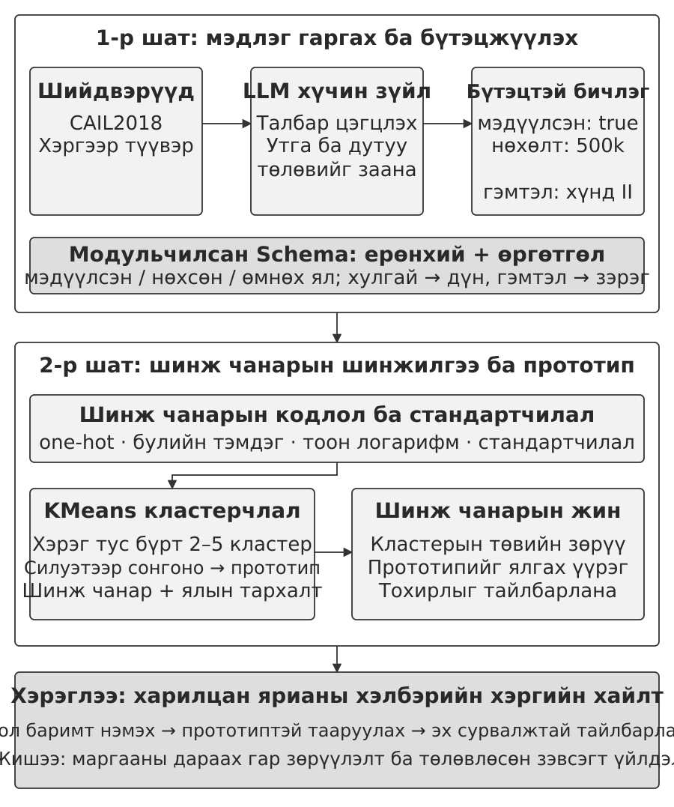

> **Туршилт 3-12 ★★★: Шүүхийн хэргээс хүчин зүйл ба прототип гаргах**
>
> Энэ туршилтад CAIL2018-ийн эрүүгийн хэргийн материалыг ашиглаж, хулгай, санаатай гэмтэл учруулах, залилан гэсэн гурван төрлийн түүвэр сонгон, «хүчин зүйл илрүүлэх — талбар гаргах — кластерчлах — прототип тайлбарлах» гэсэн сургалтын урсгалыг байгуулна[^ch3-cail]. Төрөл бүрээс 120 бичлэгийг загварчлалд авч, өөр 20-ийг хадгалж, нийт 360 загварчлалын түүвэр ба 60 хадгалсан түүвэр бүрдүүлнэ.
>
> **Талбаруудыг илрүүлж, цэгцлэх.** Model эхлээд загварчлалын түүврийг багцаар уншиж, хэрэгтэй байж болох хүчин зүйлсийг санал болгоод, модульчилсан Schema болгон нэгтгэнэ. Ерөнхий хэсэг нь сайн дураар гэмт хэргээ мэдүүлсэн эсэх, хохирол нөхсөн эсэх зэрэг олон гэмт хэрэгт анхаарах талбаруудыг хадгална; өргөтгөлийн хэсэг нь хэргийн мөнгөн дүн, гэмтлийн байдал зэрэг тодорхой гэмт хэрэгт хамаарах мэдээллийг хадгална. Энэ удаагийн цэгцлэлтээр 16 ерөнхий талбар, мөн тус бүр 12, 12, 11 талбартай гурван өргөтгөл гарсан. Талбар бүрийн авах утга ба дутуу төлөвийг тодорхойлох хэрэгтэй бөгөөд ингэснээр нэгэн жигд гаргах боломжтой.
>
> **Талбаруудыг вектор болгон кодлох.** Ангиллын талбарт one-hot кодлол ашиглаж болно: хулгай, дээрэм, залилан гэсэн гурван ангиллыг жишээ болгон авбал тус тус `[1,0,0]`, `[0,1,0]`, `[0,0,1]` гэж кодлох бөгөөд байрлал бүр зөвхөн тухайн ангилалд хамаарах эсэхийг илэрхийлнэ. Харин 1, 2, 3 гэж ашиглавал зарим алгоритмд ангилал хоорондын дараалал ба зайг оруулчихна. «Сайн дураар мэдүүлсэн эсэх», «хохирол нөхсөн эсэх» зэрэг талбарт баталгаажсан хоёр төлөвийг 1 ба 0-оор илэрхийлж болно; эх бичвэрт дурдаагүй тохиолдлыг тусад нь боловсруулж, дутуу утгыг автоматаар үгүйсгэл гэж үзэхээс зайлсхийх хэрэгтэй.
>
> Мөнгөн дүн зэрэг хүрээ нь өргөн сөрөг бус тоон утгад энэ хэрэгжүүлэлт эхлээд $\ln(1+x)$-ээр хэмжээсийг шахаад, дараа нь стандартчилалд оруулдаг. Нэг талбарт олон ангилал зэрэг гарч болох бол, жишээлбэл нэг бичлэгт хэд хэдэн арга хэмжээ багтсан бол ангилал бүрт тусдаа заагч бит тавьж, multi-hot кодлол үүсгэж болно.
>
> **Хэргийн прототип байгуулах.** Кодолсон шинж чанаруудыг стандартчилаад, гэмт хэргийн төрлөөр тус тусад нь кластерчилна. Энэ хэрэгжүүлэлт хоёроос таван кластерыг харьцуулж, силуэт коэффициентээр бүлэглэлийг сонгож, эцэст нь 11 прототип үүсгэсэн. Прототип бүр түүврийн тоо, гол шинж чанар, мөн түүврийн ялын хугацааны медиан, квартиль, мужийг хадгална. Жишээлбэл, зөрчлийн шалтгаан, үйлдлийн арга, гэмтлийн үр дагаврыг тойруулан маргалдсаны дараа гар зөрүүлсэн зөрчил ба урьдчилан төлөвлөж зэвсэг барьсан үйлдэл гэх мэт өөр өөр шинж чанарын хослолыг харьцуулж болно; тодорхой бүлэглэлийг гаргасан үр дүн ба кластерчлал хамтран тодорхойлно.
>
> **Шинж чанар ба тохирлын үр дүнг тайлбарлах.** Программ кластер бүрийн стандартчилсан төвийн зөрүүнд үндэслэн шинж чанар прототипийг ялгахад ямар жинтэй болохыг тооцоолно. Прототипийн тохирол нь шинэ хэргийг ижил шинж чанарын орон зайд буулгаж, ойролцоо бүлгийн статистик хураангуй ба үндэслэлийг гаргаж ирээд, Model-д тайлбар бүрдүүлэхэд өгнө.
>
> Энэ удаа 60 хадгалсан түүврээс 12-ыг сонгож тайлбар үүсгээд, бие даасан Model-оор үнэлүүлсэн. Эхлээд тэдгээрийн нэг хулгайн түүврийг харъя: түүний таарсан прототип ганцхан загварчлалын бичлэгтэй, ялын хугацаа нь 4 сар тул хамгийн бага, медиан, хамгийн их утга бүгд 4. Үүсгэгч энэ тоог үнэн зөв мэдээлж, лавлах ганцхан бичлэг байгааг ч дурдсан. Үнэлгээч «тоо прототипэд үнэнч эсэх»-д 4 оноо (дээд оноо) өгсөн боловч хадгалсан түүврийн бодит шошго 8 сар байв.
>
> Прототипийн хайлтыг харилцан ярианд ашиглах бол эхлээд дутуу ямар баримт тохиролд нөлөөлж болохыг асууж, хариултад үндэслэн дахин хайж болно.

[^ch3-cail]: CAIL2018, албан ёсны өгөгдлийн багцын төсөл. Дагалдах туршилт нээлттэй материалаас түүвэр авч, түүврийн дотоод хуваалтаар загварчлал ба үнэлгээг хийсэн.

Тохиолдлоос прототип хүртэл явахад мэдлэгийн санд хайж болох статистик дүрслэлийн нэг давхарга нэмэгддэг. Эх бичвэр нотолгоо өгч, талбар тооцооллыг дэмжиж, прототип төстэй түүврүүдийн нийтлэг шинж чанарыг нэгтгэн дүгнэдэг; энэ гурав харгалзах холбоогоо хадгалж байж гаргалтын алдаа эсвэл түүврийн хазайлт илэрсэн үед буцаж шалгаж, засах боломжтой.

### Шинэ чиглэлийн судалгаа: олон модальт ба параметрт санах ой

Хэрэглэгч өмнө нь байршуулсан зургаа заагаад «яг энэ өнгийг авъя» гэж хэлсэн гэж төсөөлье. Хэрэв систем тэр үед зөвхөн «цэнхэр хүрэм» гэсэн хоёр үг хадгалсан бол дараагийн удаа хоёр өөр цэнхэр өнгийг ялгаж чадахгүй байж мэднэ. Дуу хоолойн тембр, график дахь орон зайн харилцаа ч текст рүү хөрвүүлэхэд нарийн мэдээллээ алддаг. Ирээдүйн асуулгад эдгээр мэдээллийг олж ирэх боломж олгохын тулд анхны материалыг хадгалах, Model-ийн ашиглаж болох дүрслэлийг хадгалах, эсвэл цааш нь Model доторх байнгын санах ойг судалж болно.

**Эхний зам: анхны материал ба текстийн индексийг хослуулах.** Жишээлбэл, хэрэглэгчийн зөвшөөрсөн цомог цэгцлэх даалгаварт хүмүүсийн нүүр зэрэг хэсэгчилсэн мужийг тайрч хадгалаад, Markdown бичлэгт зургийг иш татаж, зураг авсан цаг, нөхцөл, хэрэглэгчийн өгсөн хүний шошгыг зэрэг тэмдэглэж болно. Хайлтын үед эхлээд тайлбарт үндэслэн холбоотой байж болох хэдэн зургийг олоод, дараа нь анхны зураг эсвэл тайрсан мужийг уншиж, гадаад төрхийн нарийн зүйлсийг харьцуулна. Дууны хэсгийг ч цаг хугацаа, эх сурвалж, бичвэрт буулгасантай нь холбож, хэрэгцээгээр анхны аудиог дахин тоглуулж болно. Текст орох цэгийг өгч, анхны материал үгээр нэгтгэн илэрхийлэхэд хэцүү нарийн зүйлсийг хадгална.

**Хоёр дахь зам: embedding хадгалж, хэрэгцээгээр ачаалах.** Харааны эсвэл аудионы кодлогч материалыг вектор болгон хувиргаж, индекст хадгалан ижил төстэй байдлын хайлтад ашиглаж болно. Жишээлбэл, зургийн хэсэгчилсэн муж эсвэл дууны хэсгийг кодлоод, харгалзах санах ойн бичлэгт тус тусад нь холбоно. Хэрэв Model сургагдсан проекцын давхарга ба санах ойн интерфейсийг дэмждэг бол контекстэд нэг багц үүр нөөцөлж, эдгээр тасралтгүй векторыг оруулан Model-оор анхаарлын механизмаар хандуулж болно. Энд кодлогчийн дүрслэл ба хэлний Model-ийн дотоод дүрслэлийг уялдуулах асуудлыг шийдэх шаардлагатай.

Зохиогч Noah Shi-тэй хамтран хийсэн анхан шатны судалгаа энэ асуудлыг хоёр алхамд задалсан. Хамтын зурагт хоёр хүн байгаа бөгөөд хэрэглэгч «цонхны дэргэд зогсож байгаа хүн өмнө нь уулзсан тэр хүн мөн үү?» гэж асуужээ. Эхлээд «цонхны дэргэд» гэдэгт үндэслэн хэрэглэгчийн заасан хүнийг олоод, дараа нь тэр хүний зургийг өмнө хадгалсан түүвэртэй харьцуулах хэрэгтэй. Эхний алхамд хүнээ буруу сонговол хоёр дахь алхамд хичнээн зөв таньсан ч өөр асуултад хариулсан болно. Өгүүлэлд мөн нэр зэрэг яг хуулж бичиж болох баримтыг текстийн санах ойд үлдээж, хоёр төрлийн мэдээлэлд тус бүрт тохирох хэрэглэх аргыг өгсөн.[^ch3-perceptmem]

[^ch3-perceptmem]: Li, Bojie, Noah Shi, Parametric Multimodal User Memory; дагалдах төсөл `19PINE-AI/multimodal-user-memory` нь хэрэгжүүлэлт болон PerceptMem туршилтыг агуулдаг. Хамтын зургийн асуулт нь сургалтын жишээ.

**Гурав дахь зам: Model доторх байнгын санах ой.** Хэрэглэгч бүрт LoRA сургах нь хувийн баримтыг Model-д бичих нэг арга юм. «Хэрэглэгч хаана амьдардаг вэ» гэж шууд асуух ба хаягт үндэслэн аялал төлөвлөх нь санах ойг ашиглах өөр өөр шаардлагатай: эхнийх нь баримтыг уншдаг бол сүүлийнх нь баримтыг цаашдын дүгнэлтэд ашиглах ёстой. Зөвхөн баримтыг давтан хэлэх чиглэлээр сургавал Model хариултыг санаж байгаа ч төвөгтэй даалгаварт түүнийг өөрөө ашиглахгүй байж болно. Тиймээс сургалтын түүвэрт шууд асуулт ба эдгээр баримтаас хамаарах даалгавар хоёулаа багтах шаардлагатай.

Зохиогчийн **User as Engram** судалгаа текстийн баримтыг Engram Model-ийн локал санах ойн хүснэгтэд бичиж, хуваалцсан адаптераар эдгээр баримтыг дүгнэлтэд хэрхэн ашиглахыг сургадаг[^engram]. Хэш түлхүүртэй N-gram хайлт хүснэгтийн бичлэгийг байршуулж, хаалтын механизм гаргаж ирсэн агуулгыг Model руу дамжуулна; хэрэглэгч бүр локал хүснэгтийн бичлэгээ хадгалж, дүгнэлтийн хэсгийг хуваалцаж болно. Өгүүлэл текстийн баримтын туршилтандаа шууд эргэн санах ба шууд бус дүгнэлтийг харьцуулж, хэрэглэгч бүрийн санах ойн агуулга ба хуваалцсан дүгнэлтийн чадварыг хэрхэн тусад нь удирдахыг харуулсан.

[^engram]: Li, Bojie, User as Engram: Internalizing Per-User Memory as Local Parametric Edits, 2026.

Энэ замыг олон модальт руу өргөтгөхийн тулд зураг эсвэл аудионы дүрслэлийг хаяглах, бичих, унших механизмыг зохиох шаардлагатай.

## Бүлгийн дүгнэлт

Бүлгийн эхэн дэх билет захиалах даалгавар руу буцъя. «Би цонхны суудалд дуртай» гэдэг нь энэ хэрэглэгчээс гарсан бол «хэдэн ачаа авч явж болох» гэдгийг аяллын өдөр хамаарах агаарын тээврийн компанийн заалтаас шалгах ёстой. Хоёр мэдээллийг хоёуланг нь нэг өгүүлбэр болгон хадгалбал хамгийн чухал ялгааг амархан алдана: эхнийх нь хэнд хамаарах, сүүлийнх нь хэзээнээс хүчин төгөлдөр болох. Хадгалахдаа эх сурвалж, цаг хугацаа, хэрэглэх нөхцөлийг үлдээж байж гаргаж ирсний дараа энэ удаа ашиглаж болох эсэхийг дүгнэх үндэслэлтэй болно. Ганц баримтыг богино тэмдэглэл болгон бичихэд тохиромжтой; хүмүүсийн харилцааг тайлбарлах эсвэл учир шалтгааныг хадгалах шаардлагатай бол карт эсвэл эх бичвэрийн догол мөр ашиглаж болно; огноо ба тоо хэмжээг төрөлтэй талбар болгон хадгалж, программаар тооцоолуулж ч болно.

Хэрэв туслах ачааны хэмжээг буруу хэлсэн бол эхлээд одоо мөрдөж буй заалт санд орсон эсэхийг шалгаад, дараа нь заалт аль хэсэгт хуваагдсан, хайгч үүнийг олсон эсэх, дахин эрэмбэлсний дараа хэддүгээр байрт орсныг шалгаж, эцэст нь Model ямар материал авсныг харна. Эх бичвэр их байвал бүтэцлэгдсэн тоймыг контекстэд үлдээж, нарийн зүйлсийг хэрэгцээгээр хайж болно. Бүлгийн хураангуй сэдэв олоход, харилцааны индекс холбоос хайхад тусалдаг; хэсэг заасан зүйлээ алдсан бол эх сурвалжийн суурь мэдээллийг нэмж болно; нэг удаагийн хайлтаар нотолгоо дутуу хэвээр байвал Agent асуулгаа сольж үргэлжлүүлэн хайж болно.

Агаарын тээврийн компани шинэ журам зарласны дараа эхлээд жижиг хүрээний шинэчлэлт хийж, шинэ, хуучин заалтын хүчин төгөлдөр болох огноо ба эх сурвалжийг хадгалж болно; хуримтлагдсан давхардсан бичлэг, зөрчил, бүтцийн өөрчлөлтийг үе үе цэгцэлнэ. Санал гаргагч өөрчлөлт илгээж, хянагч нотолгоог тулгаж, зөвшөөрсний дараа үйлчилгээний индексийг дахин байгуулна. Хувилбарын бүртгэлтэй бол өмнө нь буруу хариулсан асуултыг дахин ажиллуулж, хуучин хариулт тухайн үед аль материалд тулгуурласныг ч тодруулж чадна. Гүйцэтгэлийн үр дүнгээс туршлагыг цааш хэрхэн хуримтлуулахыг Бүлэг 9-д тусгайлан авч үзнэ.

Хоёр ачаа тээвэрлүүлж болохыг олсон нь зөвхөн «дүрэм зөвшөөрөх үү» гэдэгт хариулсан хэрэг. Хэрэглэгчийн өмнөөс ачааг захиалгад нэмэхийн тулд туслах ямар Tool дуудаж болох, ямар параметр хэрэгтэй, ямар баталгаа хүлээн авбал ажил бүтсэн гэж үзэхийг мэдэх ёстой. Энэ бол дараагийн бүлгийн эхлэл юм.

## Бүлгийн дараах бодох асуултууд

1. ★★ Хэрэглэгч: «5-р сарын 1-нд би A-аас B руу нүүнэ, 5-р сарын 10-аас 20-ны хооронд C зочид буудалд байрлана, энэ хугацаанд төлбөрийн баримтыг имэйлээр явуулаарай» гэж хэлжээ. 5-р сарын 15-нд туслах гэрийн хаяг, түр байрлах газар, төлбөрийн баримт хүргэх аргын талаар хэрхэн хариулах ёстой вэ? Бичлэг ба асуулгын дүрмийг зохиож, үсгийн алдааны засвар эсвэл хоорондоо зөрчилдсөн хаягийг хэрхэн боловсруулахыг тайлбарлана уу.
2. ★★ Анхны баримт бичигт зөрчилтэй мэдээлэл байвал контекстийн угтвар алдааг хамт индекст бичиж болзошгүй. Та эх сурвалж, хувилбар, тодорхойгүй зүйлсийг хэрхэн хадгалж, хайлт ба үүсгэлтийн шатанд эдгээр мэдээллийг хэрхэн ашиглах вэ?
3. ★★ Графикийг текст рүү хөрвүүлсний дараа ямар орон зайн харилцаа амархан алдагдах вэ? Хүснэгт, архитектурын схем эсвэл шугаман графикаар жишээ авч, анхны зураг, бүтэцлэгдсэн дүрслэл, текстийн индекс хамтран хайлт хийх шийдлийг зохионо уу.
4. ★★★ Model ба урт контекстийн чадвар сайжрах тусам хэсэглэлт, индекс, хайлтын урсгалын аль ажлыг Model-д шилжүүлж болох вэ? Rich Sutton-ийн «Гашуун сургамж» (The Bitter Lesson) дахь хайлт ба сургалтын тухай хэлэлцүүлэгтэй уялдуулан шинжилж, бүтэн оролт ба хэрэгцээгээр хайх аргыг харьцуулах туршилт зохиож, даалгаврын чанар, тооцооллын зардал, эрхийн хязгаарлалтыг зэрэг шалгана уу.
5. ★★★ Model салбарын их хэмжээний мэдлэгийг аль хэдийн эзэмшсэн бол гадны мэдлэгийн сан юуг хадгалсаар байх ёстой вэ? Нийтийн ерөнхий мэдлэг, тасралтгүй шинэчлэгддэг дүрэм, хувийн материал, яг мөрдөх шаардлагатай нотолгоог тус тусад нь авч үзнэ үү.
6. ★ RAPTOR-ийн олон түвшний хураангуй ба GraphRAG-ийн объектын харилцаа, нийгэмлэгийн хураангуй тус бүр ямар асуулгыг дэмждэг вэ? Ерөнхий тойм, хэсэгчилсэн нарийн зүйл, олон алхамт холбоос тус бүрт нэг жишээ гаргаж, ямар нотолгоо шалгах шаардлагатайг тайлбарлана уу.
7. ★★ Лавлах, холбоос, векторын индекс мэдлэгийг хэрхэн хамтран зохион байгуулдаг вэ? Хүн ба Agent хамтран арчлах шаардлагатай мэдлэгийн сан зохиож, навигаци, утгын хайлт, хувилбарын шинэчлэлт, эрхийн шүүлт тус бүр хаана байрлахыг тайлбарлана уу.
8. ★★★ Тохиолдлоос талбар гаргаж кластерчилсны дараа прототип хэрэгтэй эсэхийг хэрхэн тогтоох вэ? Кластерын шинж чанарын ач холбогдол, үр дүнг таамаглах чадвар, учир шалтгааны тайлбарыг ялгаж, хадгалсан түүврийн үнэлгээ ба мэргэжилтний давтан хяналтын урсгалыг зохионо уу.
9. ★★★ Markdown хэрэглэгчийн санах ойн санд нэмэлт шинэчлэлт ба үечилсэн цэгцлэлтийн урсгал зохионо уу. Хэрэв хянагч ба санал гаргагч ижил Model ашигладаг бөгөөд хянагч зөвхөн санал гаргагчийн сонгосон хэсгүүдийг харж чаддаг бол ямар алдаа амархан орхигдох вэ? Нотолгооны хамралт, Tool-ийн эрх, хяналтын үнэлгээ гэсэн гурван талаас сайжруулна уу.

[^ch3-glove]: Pennington нар, GloVe: Global Vectors for Word Representation, 2014.

[^ch3-sbert]: Reimers ба Gurevych, Sentence-BERT: Sentence Embeddings using Siamese BERT-Networks, 2019.
