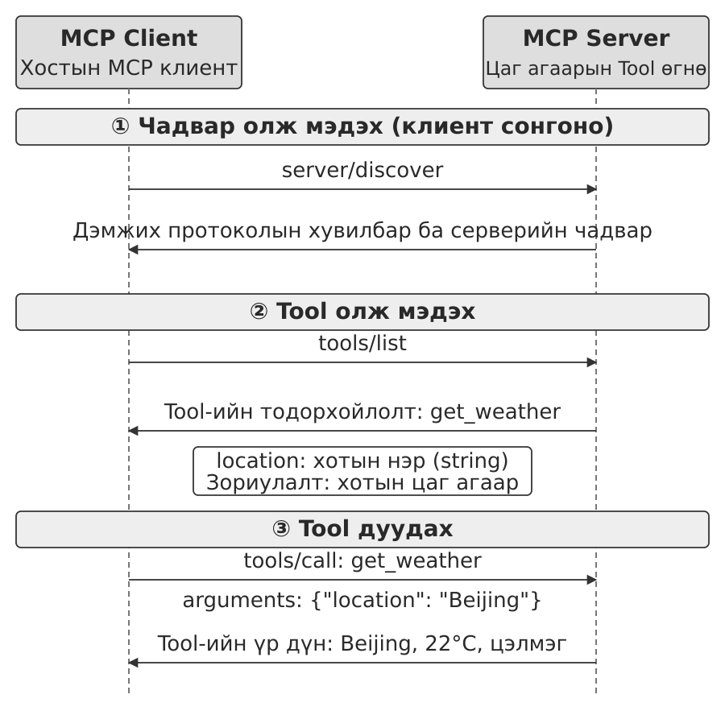
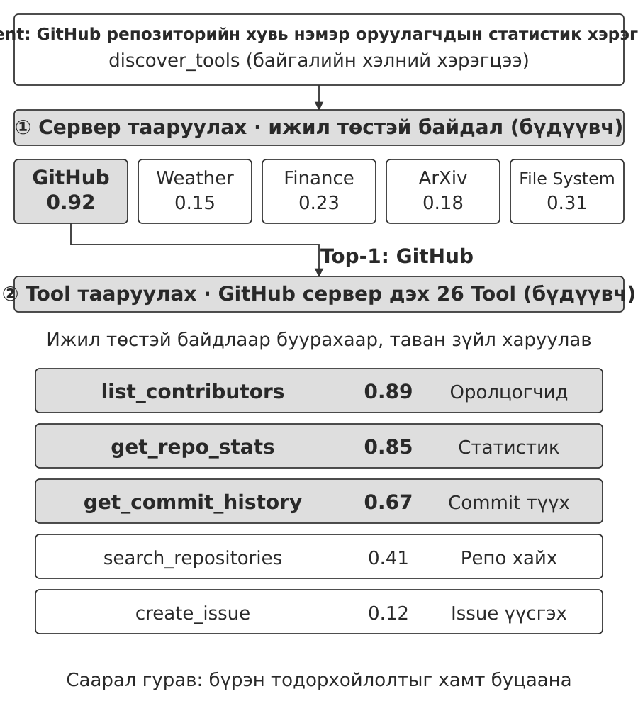
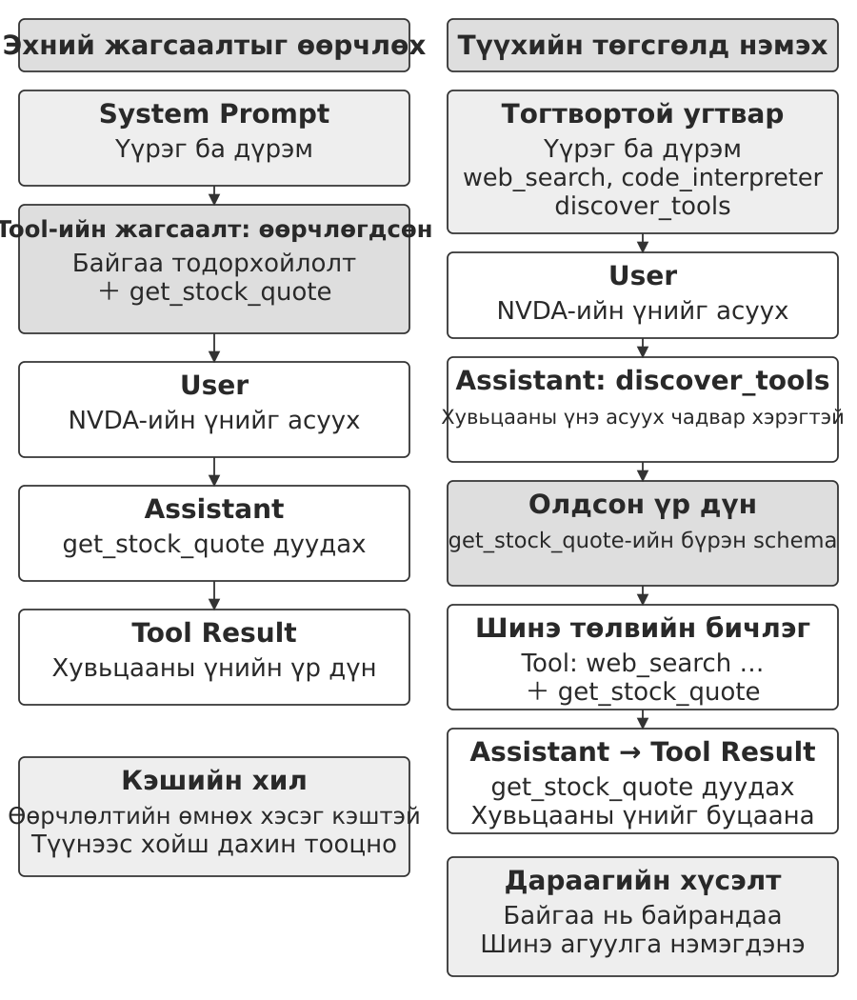
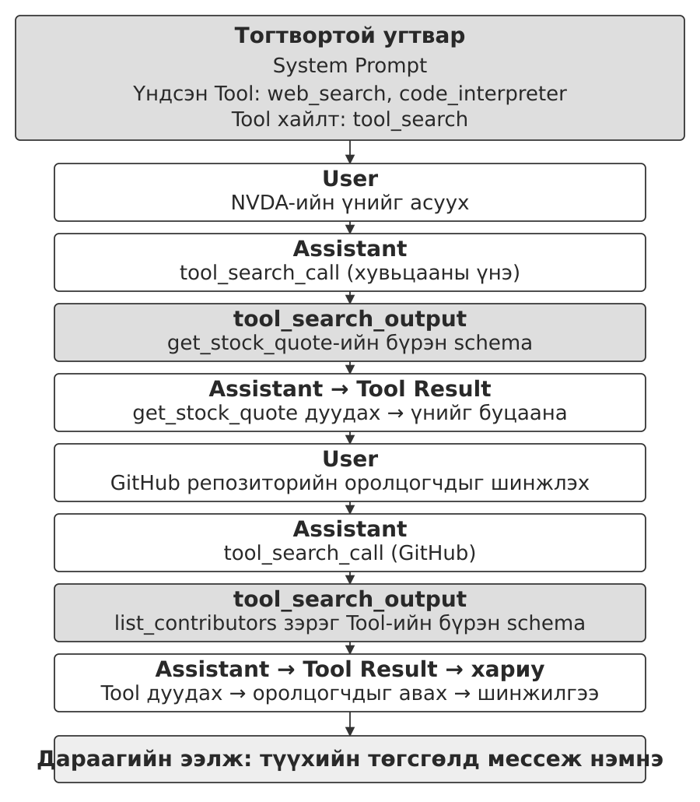

# Tool (хэрэгсэл)

Шинжлэх ухааны уран зөгнөлийн «Her» кинонд AI туслах Samantha имэйлийг цэгцэлж, хариу бичихэд туслаж, хэвлэлийн ажлыг шийдвэрлэж, өөр өөр харилцааны сувгийн хооронд шилждэг. Ийм туслах хэлний ойлголтоо гадаад системд хийх үйлдэл болгон хувиргах шаардлагатай. Agent эдгээр харилцан үйлчлэлийг **Tool**-оор гүйцэтгэдэг. Tool бол түүний «мэдрэхүй ба гар хөл» бөгөөд ажиглалт өгөхөөс гадна үйлдэл гүйцэтгэдэг. Энэ номд авч үзэх Manus, OpenClaw зэрэг ерөнхий Agent ч дижитал ертөнцөд хандахдаа Tool ашиглах ёстой.

Хэрэглэгч «Харилцагчийн имэйлд дурдсан хүргэх өдрийг олоод, хүснэгт болгож надад илгээ» гэж хэллээ гэж бодъё. Model аль имэйлийг шалгахаа шийдэж чадна, харин эх бичвэрийг уншихын тулд шуудангийн хайрцагт хандах, хүснэгтийг илгээхийн тулд илгээх интерфэйс дуудах хэрэгтэй. Эдгээр Tool-ийг хэрхэн зохиох, Model хэрэгтэй үед нь тэдгээрийг хэрхэн олох вэ? Энэ бүлэг эхлээд таван төрлийн Tool-ийг ялгаж, дараа нь Tool-ийн тодорхойлолт, холболт ба олж илрүүлэх асуудлыг авч үзээд, эцэст нь мэдрэх, гүйцэтгэх, хамтын ажиллагааны интерфэйсийг тус тус зохионо. Үйл явдлын өдөөлт ба хэрэглэгчтэй харилцах нь Agent-ийг хэзээ сэрээх, сувгийн хооронд мессежийг хэрхэн дамжуулах асуудлыг ч хамрах тул Бүлэг 6-д дэлгэрүүлнэ.

## Tool-ийн ангилал

Имэйл шалгах жишээг авч үзвэл, Model дараагийн алхамдаа юу хийхээ сонгож, Harness параметр ба эрхийг шалгаад хүсэлт илгээж, шуудангийн үйлчилгээ бодитоор өгөгдөл уншиж, бичнэ. Бүлэг 1-д мэдрэх, гүйцэтгэх, хамтын ажиллагаа, хэрэглэгчтэй харилцах ба үйл явдлын өдөөлтийн Tool-ийг зориулалтаар нь ялгасан. Эхний дөрвөн төрлийг Agent өөрөө дуудаж, харин үйл явдлын өдөөлтийн Tool нь гадаад үйл явдал Agent-ийг сэрээх боломж олгодог (Хүснэгт 4-1).

Хүснэгт 4-1 Таван төрлийн Tool-ийн дуудлагын чиглэл ба үндсэн зориулалт

| Tool-ийн төрөл | Дуудлагын чиглэл | Үндсэн зориулалт |
| --- | --- | --- |
| Мэдрэх Tool | Agent өөрөө дуудна | Гадаад мэдээлэл олж авах |
| Гүйцэтгэх Tool | Agent өөрөө дуудна | Тооцоолол гүйцэтгэх эсвэл гадаад төлөвийг өөрчлөх |
| Хамтын ажиллагааны Tool | Agent өөрөө дуудна | Даалгавар шилжүүлэх, мессеж солилцох, өөр Agent эсвэл хүнтэй зохицуулах |
| Хэрэглэгчтэй харилцах Tool | Agent өөрөө дуудна | Хэрэглэгчид хариулах, үр дүнг харуулах эсвэл сануулга илгээх |
| Үйл явдлын өдөөлтийн Tool | Хөгжүүлэгч тохируулна эсвэл Agent бүртгэнэ, гадаад үйл явдал өдөөнө | Заасан үйл явдал болоход Agent-ийг сэрээх |

**Мэдрэх Tool** нь Agent-д гадаад мэдээлэл олгоно, жишээ нь сүлжээний хайлт `web_search`, мэдлэгийн сангийн хайлт `knowledge_base_search`, вэб хуудас унших `fetch_url`, файлын нэрээр хайх `find_file`, файлын агуулгаар хайх `grep_file` ба файл унших `read_file`.

**Гүйцэтгэх Tool** нь Agent-д тооцоолол гүйцэтгэх эсвэл гадаад төлөвийг өөрчлөх боломж олгоно, жишээ нь командын мөр `shell_exec`, код тайлбарлагч `code_interpreter`, файл бичих `write_file`, файл засварлах `edit_file` ба имэйл илгээх `send_email`. Нэг ерөнхий гүйцэтгэгч зөвхөн унших тооцоолол ч хийж, өгөгдлийг өөрчилж ч чадна.

**Хамтын ажиллагааны Tool** нь даалгавар шилжүүлэх ба мессеж солилцохыг дэмжинэ, жишээ нь дэд Agent үүсгэх `spawn_subagent`, мессеж илгээх `send_message_to_subagent`, дэд Agent-ийг цуцлах `cancel_subagent` ба боломжтой Agent-ийг олж мэдэх `list_agents`. Бие даасан даалгаврыг зэрэгцээ гүйцэтгэж болно, жишээ нь OpenAI-ийн хэд хэдэн хамтран үүсгэн байгуулагчийн замналыг тус тус судлах; өөр өөр даалгаврыг өөр өөр Model, Tool, Prompt ба Context-оор тохируулсан Agent-д ч даатгаж болно. Аравдугаар бүлэгт хөдөлмөрийн хуваарь ба хамтын ажиллагааны архитектурыг дэлгэрүүлнэ.

**Хэрэглэгчтэй харилцах Tool** нь хэрэглэгчид мэдээлэл дамжуулна, жишээ нь мессеж хариулах `reply_to_user`, бүтэцтэй карт илгээх `send_card_to_user` ба сануулга илгээх `send_user_notification`. Харилцан үйлчлэл хэд хэдэн суваг руу өргөжих эсвэл арын сануулга шаардагдах үед систем мессеж илгээхийг тодорхой Tool дуудлага болгон боож, хүлээн авагч, агуулга ба хүргэлтийн төлөвийг нэгдсэн байдлаар удирдаж болно.

**Үйл явдлын өдөөлтийн Tool** нь гадаад үйл явдлыг Agent-ийн ажиллагаатай холбоно, жишээ нь таймер `set_timer`, арын даалгаврыг хянах `monitor_shell` ба үйл явдлын эх сурвалж холбох `connect_channel`. Бүх процесс хоёр алхмаас бүрдэнэ: бүртгэх үед хөгжүүлэгч урьдчилан тохируулах, эсвэл Agent зөвшөөрөгдсөн дуудлагаар сонирхож буй үйл явдлаа зарлана; үйл явдал болсны дараа хуваарилах систем дуудлага эсвэл үйл явдлын мессежийг хүлээн авч, Agent-ийг сэрээн боловсруулна. Шинэ имэйл, системийн сэрэмжлүүлэг, цагийн сануулга ба арын даалгаврын дуусалт бүгд ажиллагааны шинэ орох цэг болж чадна.

Эхэнд авсан имэйлийн даалгаврыг эргэн харъя: эх захидлыг нээж хүргэх өдрийг авах нь мэдрэх; нэгтгэл хүснэгт үүсгэж хадгалах нь ажлын орон зайг өөрчлөх тул гүйцэтгэх; хүснэгтийг даалгагчид хүргэх нь хэрэглэгчтэй харилцах төрөлд багтана. Хэрэв систем дараагийн харилцагчийн имэйл ирэхэд автоматаар үргэлжлүүлбэл л үйл явдлын өдөөлт нэмэгдэнэ. Нэг шуудангийн үйлчилгээ эдгээр хэд хэдэн үүргийг давж гүйцэтгэж чадна. Дараа нь шийдэх асуудал бол Model-д өгөх Tool хэр нарийвчилсан байх вэ: имэйл шалгах, үндсэн бичвэрийг унших, хавсралтыг олохыг тус тусад нь хийлгэх үү, эсвэл байнга дараалан хийгддэг хэд хэдэн алхмыг нэгтгэж өгөх үү?

## Tool зохиох ерөнхий зарчим

Tool-ийг анх холбох үед API-ийн цэг бүрийг шууд боох нь түгээмэл арга байсан. Энэ нь холбоход хурдан боловч маш нарийн ширхэгтэй интерфэйсийн бөөгнөрөл бий болгодог. Agent нэг даалгаврыг гүйцэтгэхийн тулд объектыг дахин дахин хайж, шинж чанарыг уншиж, нөхцөлийг шалгаад, дараа нь гүйцэтгэх интерфэйсийг дуудах шаардлагатай болж болно. Tool зохиохдоо эдгээр үйлдлийг түгээмэл даалгаврын эргэн тойронд нэгтгэж болно, жишээ нь харилцагч хайх ба мессеж илгээхийг холбох, эсвэл лог хайлтаар холбогдох мөрүүд ба тэдгээрийн Context-ийг шууд буцаах[^ch4-tool-design].

**Tool-ийг Agent-ийн гүйцэтгэх ёстой даалгаврын эргэн тойронд зохиох ёстой.** Agent-ийн ашиглах аргаас эхэлж интерфэйс зохиох энэ хандлагыг **ACI** (Agent-Computer Interface, Agent—компьютерийн интерфэйс) гэнэ. HCI нь хүн компьютертой хэрхэн харилцахад анхаардаг бол ACI нь Model үйлдлийг хэрхэн сонгох, параметрийг хэрхэн бүрдүүлэх, санал хүсэлтийг хэрхэн ойлгож алдаагаа засах талд анхаарна.

[^ch4-tool-design]: Anthropic, *Writing effective tools for AI agents—using AI agents*, 2025.

### Чадамжийн илэрхийлэх хэлбэр: тусгай Tool, ерөнхий гүйцэтгэгч ба Skill

«Аппликейшн байршуулах» ажлыг Model-д даалгахад гурван төрлийн үйлдлийн интерфэйс зохиож болно. Эхнийх нь зөвхөн нэг `deploy_app`-ыг ил гаргаж, алхам бүрийг сервер тал гүйцэтгэнэ; хоёр дахь нь бүтээх, багцлах ба байршуулахыг тус тусад нь ил гаргаж, дараагийн алхмыг хэзээ дуудахыг Model шийднэ; гурав дахь нь алхмуудыг Skill-д бичээд, Model терминалд гүйцэтгэнэ. Хэрэв бүтээлт амжилтгүй болбол эхнийх нь Tool-ийн үр дүнгээр Model-д аль алхамд алдаа гарсныг хэлэх ёстой, харин сүүлийн хоёр нь энэ бүтээлтийн алдааг шууд Model-д өгч чадна.

- **Тусгай Tool** нь тодорхой үйлдэлд бүтэцтэй интерфэйс өгнө. Хөгжүүлэгч параметрийн Schema, шалгах дүрэм, гүйцэтгэх логик ба буцаах форматыг тодорхойлдог тул тус тусад нь турших, зөвшөөрөл олгоход хялбар; Tool-ийн тодорхойлолт Context-д орсны дараа эзлэх хэмжээ нь талбар, тайлбар ба жишээний уртаас хамаарна.
- **Ерөнхий гүйцэтгэгчийг Skill-тэй хамт** ашиглана: терминал эсвэл код тайлбарлагч гүйцэтгэх чадвар өгч, Skill нь урсгал, хэрэглэх нөхцөл ба ажиллах аргыг тайлбарлана. Хост эхлээд нэр ба товч танилцуулгыг ачаалж, сонгосны дараа бүрэн тайлбар ба холбогдох нөөцийг уншиж болно.

Жишээлбэл, нэг байршуулалтын Skill дараах алхмуудыг дараалан тайлбарлаж болно: `npm run build`-ээр төслийг бүтээх, `docker build -t app:latest .`-ээр имиж багцлах, дараа нь `kubectl apply -f deploy.yaml`-ээр манифестод тодорхойлсон нөөцийг одоогийн кластерт хэрэглэх. Agent эдгээр алхмыг терминалын Tool-оор гүйцэтгэж, нэг гүйцэтгэлийн орох цэгийг дахин ашиглана.

Tool-ийг хэрхэн хэрэгжүүлэх ба Model түүний тайлбарыг хэзээ унших нь хоёр өөр асуудал. Хэдэн зуун тусгай Tool зөвхөн индексээ харуулж, Schema-г хэрэгцээгээр нь ачаалж болно; цөөн Skill бол каталогийг Context-д байнга байлгаж, хэмжээ нь өсөхөд хайлт нэмж болно. Тусгай интерфэйс эсвэл ерөнхий гүйцэтгэгчийг сонгох нь параметрийг хэрхэн дамжуулах, кодыг хэрхэн арчлахад нөлөөлнө; бүгдийг нэг дор өгөх эсвэл хэрэгцээгээр нь ачаалахыг сонгох нь Model энэ алхамд ямар Tool-ийг харж чадахад нөлөөлнө. Дараах «Tool хэтэрхий олон болбол яах вэ» хэсэгт ил болгох стратегийг авч үзнэ.

**Зохиогч ерөнхий Tool-ийг түрүүлж ашиглаж, дараа нь эрх, параметр ба гүйцэтгэлийн шаардлагаар тусгай интерфэйс нэмэхийг зөвлөдөг.** Жишээлбэл, sandbox дотор `code_interpreter`-т SymPy, NumPy ба pandas-ыг тохируулбал Agent Python бичиж дөрвөн үйлдлийн тооцоолол, симболын тооцоолол, массивын боловсруулалт ба өгөгдлийн шинжилгээг хийж чадна. Энэ нь Model-ийн код үүсгэх чадварыг бүрэн ашиглах боломж олгоно: нэг тайлбарлагч олон алгоритмыг агуулж, урьд нь бодоогүй шинэ асуудлыг шийдэхийн тулд байгаа сангуудыг хослуулж чадна. Model код үүсгэх, гүйцэтгэх орчин гүйцэтгэж, файл, сүлжээ ба нөөцийн хандалтыг хязгаарлах үүрэгтэй.

Тусгай Tool ашигласан ч зохиогч ойролцоо функцтэй, байнга хамт ашиглагддаг үйлдлийг эхлээд нэгтгэхийг зөвлөдөг. Интерфэйс хэт нарийн болбол Model илүү олон нэр ба хуваарийг санаж, нэг даалгаврыг гүйцэтгэхэд илүү олон дуудлага хийх шаардлагатай болно. Нэгтгэхдээ голчлон **функцийн ижил төстэй байдал** ба **ашиглах нөхцөлийн давхцлыг** харна. Жишээлбэл, `extract_pdf_text`, `extract_docx_content`, `extract_pptx_content` бүгд баримт бичиг хүлээн авч текст гаргадаг тул `read_document` болгон нэгтгэж, форматыг `file_type`-оор ялгаж болно. Model зөвхөн нэгдсэн орох цэгийг сонгох бөгөөд шинэ формат нэмэгдсэн ч параметр ба буцаах бүтцийг үргэлжлүүлэн ашиглаж болно.

Дараах дөрвөн тохиолдолд тусгай интерфэйс онцгой тохиромжтой.

1. **Нарийн зөвшөөрөл ба аудит шаардлагатай.** Үйлдвэрлэлийн өгөгдлийн сангийн бичлэгийг хүрээ нь тодорхой үйлдэл болгон боож, сервер тал хэрэглэгчийн эрх, зорилтот хүснэгт ба өөрчилж болох талбарыг шалгаж, үйлдлийн үндэслэлийг тэмдэглэж болно.
2. **Платформын ялгааг далдлах шаардлагатай.** grep, find зэрэг үйлдлийг shell-ээр гүйцэтгэж болох ч тусгай файл хайлтын Tool нь macOS, Windows ба Linux-ийн параметр ба хариу өгөх хэлбэрийг нэгтгэж, жишээ нь файлын нэр, мөрийн дугаар ба таарсан хэсгийг тогтмол буцааж чадна.
3. **Үйлдлийн давтамж маш өндөр.** Өндөр давтамжтай үйлдэлд богино, тогтвортой орох цэг өгч, скрипт дахин дахин үүсгэх ба урсгалыг тайлбарлах зардлыг бууруулж болно.
4. **Параметрийн хамаарал нарийн төвөгтэй.** Оруулсан объект, талбарын хамаарал ба нарийн төвөгтэй утгын хязгаарлалтыг Schema ба бизнесийн шалгалтаар хамт илэрхийлэх нь тохиромжтой.

**Параметр чинээ нарийн төвөгтэй бол дамжуулах арга төдий чинээ чухал.** Бүтэцтэй Tool дуудлага оролтыг ихэвчлэн JSON Schema-гаар тодорхойлдог бөгөөд зарим Model үйлчилгээ хязгаарласан үүсгэлтийг дэмжиж, параметр нь дэмжигдэх Schema дүрмийг хангадаг. Буцаах утгын бүтцийг Tool-ийн интерфэйс тохиролцож, хост үр дүнг Model-д өгнө. Төрөл ба форматын шалгалтаас гадна эрх, объект байгаа эсэх, хэд хэдэн талбар бизнесийн нөхцөлийг хангаж буй эсэхийг Harness ба Tool үйлчилгээ шалгана.

Skill нь тусгай Tool-ийг хэрхэн дуудахыг тайлбарлаж болох бөгөөд Agent-д CLI ашиглахыг ч зааж болно. Сүүлийн арга Model-д командын мөрийн синтакс, хашилт ба escape-ийг зэрэг боловсруулахыг шаарддаг ба shell бүрийн дүрэм ч өөр өөр. Параметр чинээ нарийн төвөгтэй бол Model-д зөв боловсруулах шаардлагатай дэлгэрэнгүй зүйл төдий чинээ олон. Нарийн төвөгтэй оруулсан параметртэй тулгарвал эхлээд тэдгээрийг JSON болгон бичээд, дараа нь команд тэр файлыг уншихаар болгож, олон давхар escape-ийг багасгаж, гүйцэтгэхээс өмнө агуулгыг шалгаж болно.

**Skill нь бизнесийн ажилтнуудад шууд бичих ба засварлах боломж олгодог.** Бизнесийг сайн мэддэг хүн алхмуудыг өөрөө бичиж, эсвэл Agent-ийн боловсруулсан тайлбараас засварлаж эхэлж болно. Урсгалын дараалал өөрчлөгдсөн, зарим алхам зөвхөн тодорхой харилцагчид хамааралтай, эсвэл жишээг солих шаардлагатай бол тайлбарын бичвэрийг шууд засахад л хангалттай бөгөөд Tool-ийн кодыг засах, интерфэйсийг дахин байршуулах ажил хэмнэгдэнэ. Agent Skills-ийн стандартын дагуу `SKILL.md`-ийн мета өгөгдөл нь тогтоосон форматаар, үндсэн хэсэг нь Markdown-аар бичигдэх бөгөөд скрипт, лавлах баримт бичиг ба нөөцийг хавсаргаж болно[^ch4-skill-format].

[^ch4-skill-format]: Agent Skills, формат ба стандарт: мета өгөгдөл, үндсэн хэсэг, хавсаргасан нөөц ба алхам алхмаар ачаалах.

Чадамжийн хэлбэрийг сонгохдоо дөрвөн хэмжүүрийг хослуулж болно.

- **Аюулгүй байдал ба эрх**: тусгай интерфэйс үйлдлийн хүрээг хязгаарлахад тохиромжтой; ерөнхий гүйцэтгэгч нь sandbox, итгэмжлэл ба нөөцийн эрхээр гүйцэтгэх чадварыг хянана.
- **Параметрийн нарийн төвөгтэй байдал**: нарийн төвөгтэй бүтэц Schema ба бизнесийн шалгалтад тохиромжтой; энгийн үйлдэл CLI-аар шууд параметр дамжуулж болно.
- **Өөрчлөлтийн давтамж**: байнга өөрчлөгддөг урсгалыг Skill-д бичих нь тэргүүлэх бөгөөд бизнесийн ажилтан тайлбар ба жишээг шууд засаж чадна; тогтвортой, давтан ашиглагддаг доод түвшний үйлдлийг Tool эсвэл скрипт болгон боож өгнө.
- **Model-ийн чадвар**: код найдвартай үүсгэж, командын мөрийг боловсруулж чаддаг Model-ийг Skill ба ерөнхий гүйцэтгэгчийн хослолоор чадвар бүрдүүлэхэд түрүүлж ашиглаж, тусгай Tool-ийн тоог багасгана; Model сул, нарийн төвөгтэй параметрт байнга алддаг бол бүтэцтэй интерфэйсээр хязгаарлалтыг илүү их үүрэглүүлнэ.

**Код нь олон Tool дуудлагыг зохион байгуулж ч чадна.** Хэд хэдэн вэб хуудсыг татаж, талбарыг гаргах үед Model дараалал, шүүлт ба нэгтгэлийг гүйцэтгэх скрипт үүсгэж болно. Вэб хуудсын бүрэн текст гүйцэтгэх орчны хувьсагчид үлдэж, зөвхөн сонгосон талбар ба статистикийн үр дүн Context-д буцаж ирнэ. Программ дахь нөхцөл, давталт ба алдаа боловсруулалт нь алхам бүрийг холбож, Model нэгтгэсэн үр дүнг шууд шинжилнэ. Бөөнөөр татах, шүүх ба тоолох зэрэг алхмууд нь аль хэдийн тодорхой даалгаврын хувьд зохиогч кодыг түрүүлж ашиглаж, Model Tool-ийг дараалан дуудаж, завсрын үр дүнг унших нааш цааш хөдөлгөөнийг багасгадаг. Завсрын үр дүн чинээ олон, буцаах талбар чинээ товч бол энэ зохицуулалтын хэмнэх Context төдий чинээ их. Тавдугаар бүлэгт ийм кодын зохион байгуулалтыг дэлгэрүүлнэ.

Ийм интерфэйсийг ихэвчлэн **Code Mode** гэж нэрлэдэг. Cloudflare-ийн MCP серверийг жишээ болгоход, Model эхлээд `search()`-оор хайлтын программ бичиж, OpenAPI-ийн тодорхойлолтоос шаардлагатай цэг ба параметрийг олно; дараа нь `execute()`-оор эдгээр цэгийг дууддаг JavaScript илгээнэ. Жишээлбэл, нөхцөлд тохирох DNS бичлэгийг жагсаахын тулд программ хуудас бүрийг асууж, шүүж, зөвхөн таарсан бичлэгийг буцааж болно. Эхний алхам нь бүх интерфэйсийн гарын авлагыг Context-д хийх зардлыг, хоёр дахь алхам нь хуудас бүрийн үр дүнг Model-д буцаах нааш цааш хөдөлгөөнийг хэмнэнэ. Гүйцэтгэгчийн таних тэмдэг аль бүсийг уншиж, бичлэгийг өөрчилж чадах эсэхийг сервер талын зөвшөөрөл хэвээр шийднэ.[^ch4-code-mode]

[^ch4-code-mode]: Cloudflare, Code Mode-ийн MCP хэрэгжүүлэлт; Armin Ronacher Pi 1.0-ийн жишээгээр Harness-ийн өгдөг Tool ба гүйцэтгэх орчны хуваарийг авч үзсэн.

### Tool-ийн тодорхойлолт: зориулалт, параметр ба санал хүсэлтийг тайлбарлах

Tool-д тайлбар бичихдээ эхлээд түүнийг хамгийн амархан буруу ашиглах хүсэлтийг төсөөлж болно. Хэрэглэгч «Гэрээнд дурдсан торгуулийн хэмжээтэй заалтыг олоод өг» гэвэл файлын нэрээр хайх нь зөвхөн нэр таарсан файлыг буцаана; зам олдсон ч Model үндсэн бичвэрийг унших хэрэгтэй хэвээр. Tool-ийн тайлбар нь Model-д аль интерфэйсийг сонгох, дуудахдаа юу өгөх, энэ үр дүн ямар асуултад хариулахад хангалттай болохыг тодорхойлоход туслах ёстой.

**Хэзээ ашиглахыг тайлбарла.** Сүлжээний хайлтын тайлбарыг «Бодит цагийн мэдээлэл авах эсвэл үл мэдэгдэх баримт хайх үед ашигла» гэж бичвэл Model хэрэглэгчийн хэрэгцээг Tool-ийн зориулалттай харьцуулж чадна. Зөвхөн «холбогдох агуулга хайх» гэвэл Model хайлтын хүрээ ба хэрэглэх нөхцөлийг өөрөө таамаглах ёстой болно.

**Оролт ба хайлтын хүрээг тодорхой болго.** Жишээлбэл, файлын нэрээр хайх Tool «Файлын нэр ба замаар тааруулна; файл доторх текстийг хайх бол `grep_file` ашигла» гэж тайлбарлаж болно. Зэргэлдээ Tool-уудын хуваарийг тодорхой бичвэл Model нэг дуудлагад зөв орох цэгийг сонгоход тусална. **Зохиогчийн үзэж байгаагаар, хилийн нөхцөлийг тодорхой болгох нь боломжуудыг жагсаахаас илүү чухал байдаг.** Tool ямар оролт хүлээж авах, аль хүрээг хайх, хоосон үр дүн эсвэл алдаа гарвал хэрхэн ажиллах нь Model-ийн дараагийн шийдвэрт шууд нөлөөлнө.

**Параметрийг спецификаци ба жишээгээр тайлбарла.** `timestamp`-ыг «RFC3339 формат, жишээ нь `2024-03-15T14:30:00Z`» гэж бичиж болно. Model нарийн төвөгтэй даалгаварт ажиллахдаа Tool-ийг сонгож, түүхэн траектороос мэдээлэл гаргаж, дараагийн алхмуудыг зэрэг жинлэх шаардлагатай бөгөөд параметрийн формат нь зөвхөн нэг дэлгэрэнгүй зүйл юм. Бүрэн тэмдэгт мөр нь шууд харьцуулж болох форматыг өгдөг тул Model түүний дагуу параметрийг бүрдүүлж, нэр томьёог дахин тайлбарлах үеийн алдааны боломжийг бууруулна.

Үүний нэгэн адил, `phone`-ыг ингэж бичиж болно: «Утасны дугаар, E.164 олон улсын дугаарын хэлбэрээр, `+`-аар эхэлж, дараа нь улсын код ба дугаар орно, үлдсэн хэсэг нь зөвхөн цифр, зай эсвэл тусгаарлагчгүй. Жишээ нь `+8613888888888` (Хятад) эсвэл `+12025551234` (АНУ).»

**Буцаах бүтэц ба гүйцэтгэлийн зардлыг тайлбарла.** Жишээлбэл, «JSON массив буцаана, элемент бүр `title`, `url`, `snippet` гэсэн гурван талбартай» гэвэл Model гарчиг, эх сурвалж ба хураангуйг гаргахад хялбар. Удаан үргэлжлэх Tool-ийн хувьд хэмжсэн орчинд хүлээгдэх хугацаа ба өөр орох цэгийг тэмдэглэж болно, жишээ нь «Бүрэн вэб хуудсыг уншихад 5～10 секунд шаардагдаж болно; зөвхөн мета мэдээлэл хэрэгтэй бол `get_page_metadata` дууд».

Мөн 1～5 ширхэг шалгагдсан дуудлагын жишээ хавсаргаж, хамгийн бага параметр, түгээмэл хослол ба нарийн төвөгтэй нөхцөлийг хамарч болно. JSON Schema нь төрөл, заавал талбар, утгын хүрээ ба зарим талбарын хамаарлыг илэрхийлж чадна[^ch4-json-schema]; жишээ нь эдгээр дүрэм тодорхой даалгаварт хэрхэн хэрэглэгдэхийг харуулна, жишээ нь цагийн тамга секунд эсвэл миллисекундээр байх, шүүлтийн нөхцөл хэрхэн орооцолдох, аль сонголтот талбар ихэвчлэн хамт гарч ирэх. Anthropic 2025 онд мэдээлсэн дотоод нарийн төвөгтэй параметрийн туршилтад Tool дуудлагын жишээ нэмснээр нарийвчлал 72%-иас 90% болж өссөн[^ch4-tool-examples].

[^ch4-json-schema]: JSON Schema, объектын төрөл ба шинж чанарын хязгаарлалт. Model-ийн интерфэйсийн дэмжих Schema түлхүүр үгсийн хүрээг холбогдох үйлчилгээ тогтооно.

[^ch4-tool-examples]: Anthropic, *Introducing advanced tool use on the Claude Developer Platform*, 2025 оны 11 дүгээр сарын 24, Tool Use Examples хэсэг.

Agent Tool-ийг байнга буруу сонгодог бол зохиогч **эхлээд Tool-ийн тайлбарыг шалгахыг** зөвлөдөг: хэд хэдэн Tool ойролцоо нэр хэрэглэж байна уу, хайлтын хүрээ тодорхой юу, параметрт жишээ дутаж байна уу. Энэ арга нь Skill-ийн нэр, товч танилцуулга ба ажиллагааны тайлбарт ч мөн адил хамаарна.

### Параметр дамжуулалтын үнэнч байдал

Model нэг хэсэг эх бичвэрийг солихыг шаардсан ч гүйцэтгэгч тал «олдсонгүй» гэж мэдээлэв. Model-оор дахин томьёолуулахаас өмнө хоёр тал ижил тэмдэгт мөр хүлээн авсан эсэхийг асуу. Дуудлага задлан шинжилгэх, цуваа болгох, прокси ба ажиллах орчны боодолоор дамждаг тул давхарга бүр агуулгыг өөрчилж болно. **Параметрийн үнэнч байдал** нь гүйцэтгэгч талын харж буй утга ба Model-ийн илгээсэн утга ижил утгатай байхыг шаардана; протоколын escape нь дамжуулах хэлбэрийг өөрчилж болох ч задсаны дараах хашилт ба мөр шилжилт хэвээр үлдэх ёстой.

2026 оны эхээр Cursor-ийн нэг хувилбарт гарсан муруй хашилтын хувиргалтын асуудлыг жишээ болгоё. Орлуулах Tool нь `old_string` ба `new_string` хүлээн авч, яг тааруулалтаар файлыг өөрчилдөг. Унших Tool хятад муруй хашилт `“`, `”`-г буцаадаг бөгөөд эдгээр нь `\u201c`, `\u201d`-тэй харгалзана; Model эх бичвэрийг `old_string`-д хийсэн ч параметр дамжуулах явцад англи шулуун хашилт `"` болж хувирсан. Файл дахь эх бичвэр хэвээр үлдсэн тул орлуулах Tool «таарсан зүйл олдсонгүй» гэж буцаасан. Дахин уншиж, эх бичвэрийг дахин хуулсан ч мөн адил бүтэлгүйтэл давтагдана.

Бичих чиглэлд ч нөлөөлнө. Model муруй хашилт бичихийг шаардсан ч файлд эцэст нь шулуун хашилт хадгалагддаг. Дараа нь файлыг уншихад Model-ийн харсан агуулга бичихээр төлөвлөсөн агуулгаасаа зөрүүтэй байж, дахин засахыг оролдож болно; хувиргалт үргэлжилсээр байвал дахин оролдлого бүр ижил алдааг давтана.

Өөр нэг төрлийн асуудал бол **чимээгүй параметрийн оруулалт**. Нэг IDE-ийн bash Tool нь `git commit`-д AI-ийн гэсэн тэмдэглэгээний параметрийг автоматаар хавсаргадаг. Хуучин хувилбарын Git тэр параметрийг танихгүй тул commit алдаа гаргана. Model зөвхөн өөрийн үүсгэсэн командыг хардаг тул commit-ийн мессеж эсвэл өөр параметрийг дахин дахин тохируулж болох ч бодит алдааны эх сурвалжид хэзээ ч хүрдэггүй.

Ийм асуудлыг шалгахдаа Model-ийн үүсгэсэн параметр, дамжуулсны дараах параметр, бодитоор гүйцэтгэсэн хүсэлт ба буцсан үр дүнг зэрэгцүүлж харьцуул. Интерфэйс нэгдсэн кодчилол хийх эсвэл гүйцэтгэлийн параметр нэмдэг бол хувиргах дүрмээ тодорхой бичиж, бодитоор хэрэглэсэн утгыг буцаах ёстой. Яг тааруулах Tool-ийн хувьд нэг илүү зай, нэг дутуу мөр шилжилт эсвэл өөрчлөгдсөн нэг хашилт хүртэл таарахгүй болоход хүрч болно. Model гүйцэтгэгч тал юу хүлээн авсныг мэдсэн тохиолдолд л дараагийн дуудлагаа зөв засаж чадна.

## Tool-ийн экосистем: MCP ба Skill Hub

Өөр өөр Model-ийн интерфэйс ба Agent-ийн фрэймворк нь Tool-оо өөрийн аргаар тодорхойлдог, жишээ нь function calling, tool use ба LangChain-ийн Tool хийсвэрлэл. Нэг гадаад үйлчилгээг эдгээр интерфэйс ба фрэймворк тус бүрт тохируулах бол тодорхойлолт, параметр ба үр дүнгийн форматыг дахин дахин боловсруулах шаардлагатай. Anthropic 2024 оны 11 дүгээр сард нийтэлсэн **Model Context Protocol (MCP)** нь Model-ийн аппликейшнд Tool ба өгөгдөлд хандах нэгдсэн протоколыг өгдөг[^ch4-mcp-origin].

MCP-г ойлгохын тулд эхлээд хост, клиент ба сервер гэсэн гурван үүргийг харна. **Хост (host)** нь Agent-ийн аппликейшн эсвэл IDE бөгөөд Model-ийн харилцан үйлчлэл, Context-ийн зохион байгуулалт ба эрхийн удирдлагыг хариуцна; хост дахь **MCP клиент** протоколын мессежийг хариуцаж; **MCP сервер** Tool, нөөц ба Prompt загварыг өгдөг бөгөөд локал процессоор ажиллаж эсвэл алсын үйлчилгээ болон байршиж болно[^ch4-mcp-architecture].

**Tool-ийн тодорхойлолт ба дуудлага.** Клиент `tools/list`-ээр боломжтой Tool-ийг авч, жагсаалт хуудаслан буцаж болно. Tool бүр нэр, тайлбар ба `inputSchema`-ыг агуулна; бүтэцтэй үр дүнг `outputSchema`-аар формат тохиролцож болно. Model Tool-ийг сонгож параметрийг үүсгэсний дараа хост шалгалтыг гүйцэтгэж, клиент `tools/call` илгээж, сервер гүйцэтгэсний дараа үр дүнг буцаана. Аль тодорхойлолт ба үр дүнг Model-ийн Context-д оруулахыг хост шийднэ[^ch4-mcp-tools].

Зураг 4-1-д клиент цаг агаарын Tool-ийн нэр ба параметрийг авсан ч Бээжингийн цаг агаарыг мэдэхийн тулд дахин нэг дуудлага хийх ёстой. Хавсаргасан хэрэгжүүлэлт MCP 2026-07-28-ыг ашигладаг бөгөөд хүсэлт бүр протоколын хувилбар, клиентийн мэдээлэл ба чадварыг дагуулна, клиент мөн эхлээд `server/discover` дуудаж серверийн дэмжих хувилбар ба чадварыг мэдэж болно. Эрт хувилбарт `initialize` гар барилтын үед сессийг үүсгэдэг байсан тул холбогдох үед хоёр талын дэмжих хувилбараар харилцан үйлчлэлийн аргыг сонгох шаардлагатай[^ch4-mcp-versioning].

Мөн адил цаг агаарыг олж чадахгүй байх үед Зураг 4-1-д хоёр өөр шалгалтын эхлэл бий. Хост серверт холбогдсон ч `tools/list` дуудахад цаг агаарын Tool олдохгүй бол сервер ямар Tool нийтэлсэн, клиент хуудасласан жагсаалтыг бүрэн уншсан эсэхийг тулгах хэрэгтэй. Model Tool-ийг зөв сонгосон ч сервер хотын нэрийг дутуу гэж мэдээлбэл, дуудлагын бичлэгээс `arguments`-ыг олж, талбарын нэр Tool-ийн тодорхойлолтын шаардсан `location` мөн эсэхийг тулгана.

**Дамжуулах арга.** stdio нь локал дэд процессын стандарт оролт ба стандарт гаралтаар JSON-RPC мессеж дамжуулна. Streamable HTTP нь хүсэлтийг HTTP-ээр илгээдэг бөгөөд хариу нь JSON байж болно, эсвэл SSE урсгалаар алхам алхмаар буцаж болно. Streamable HTTP нь эрт үеийн HTTP+SSE дамжуулах схемийг орлож, SSE-г урсгалт хариуны арга болгон үргэлжлүүлэн ашигладаг[^ch4-mcp-transports].

**Нөөц ба Prompt загвар.** Нөөц (resources) нь уншиж болох өгөгдлийг өгнө, жишээ нь файлын агуулга ба өгөгдлийн сангийн бичлэг; хост URI-аар жагсааж, уншиж, холбогдох агуулгыг сонгож болно. Prompt загвар (prompts) нь дахин ашиглаж болох мессеж эсвэл даалгаврын загварыг өгч, хэрэглэгч ба клиент сонгон ашиглана. Tool нь хайлт ба уншилтыг ч хариуцаж чаддаг тул эдгээр гурван примитив харилцан үйлчлэлийн интерфэйсээр хуваарилагдана: Tool дуудлагын орох цэг, нөөц өгөгдлийн орох цэг, Prompt загвар даалгаврын орох цэг болно[^ch4-mcp-primitives].

MCP-ийн гол үнэ цэнэ нь нэг Tool-ийн хэрэгжүүлэлтийг олон Agent бүтээгдэхүүнд үйлчлүүлэх боломж олгодогт оршино. Нэгдсэн протокол нь нэг серверийг нийцтэй хост, жишээ нь Cursor, Claude Desktop ба OpenClaw-д дахин ашиглуулах боломж олгож, хөгжүүлэгч ч чадвар өөрөө ба түүний санал хүсэлтийн чанарт илүү анхаарч чадна. Хост протокол дахь Tool-ийн тодорхойлолтыг Model-д ашиглаж болох интерфэйс болгон хувиргана.

**Skill Hub нь чадварын багцыг олж, түгээх боломж өгдөг.** Нэг Skill ихэвчлэн `SKILL.md`-г агуулж, скрипт ба лавлах материал хавсаргаж болно. Түгээх платформ хэрэглэгчид эдгээр файлыг хайх, суулгах ба шинэчлэхэд тусална. Vercel 2026 оны 1 дүгээр сард skills.sh-ийг танилцуулж, ур чадварын каталог ба суулгах хэрэгсэл өгсөн; OpenClaw экосистемийн ClawHub ч ур чадвар хайх ба хувилбарын менежмент санал болгодог[^ch4-skills-sh][^ch4-clawhub]. Суулгасны дараа хост ачаалах стратегийнхаа дагуу нэр, товч танилцуулга ба бүрэн тайлбарыг уншина. MCP ч өргөтгөлөөр Skills-ийг олж унших боломж өгч, чадварын багц ба харилцааны протоколыг хамт ашиглаж болно[^ch4-skills-over-mcp].

**Холболт ба Context-ийн ачааллыг тусад нь удирдана.** MCP клиент Tool-ийн жагсаалтыг авсны дараа Model-д бүрэн өгч болно, эсвэл эхлээд индексийг хадгалж, тодорхойлолтыг хэрэгцээгээр ачаалж болно. Skill ч эхлээд `name` ба `description`-ыг харуулж, сонгосны дараа үндсэн хэсгийг уншиж болно. Tool-ийн зөвшөөрөгдсөн жагсаалт аль чадвар боломжтойг, хойшлуулсан ачаалалт аль тодорхойлолт одоо харагдахыг шийднэ.

**Гуравдагч талын чадварыг холбохдоо түүний өгч буй агуулга ба бодитоор гүйцэтгэх үйлдлийг тусад нь шалга.** Тайлбар, буцаах агуулга ба хавсаргасан код өөр өөр субъектээс гаралтай бөгөөд зөвшөөрлийн хүрээ ч өөр байж болно. MCP-ийн жишээгээр гурван төрлийн асуудлыг тусад нь шалгаж болно.

1. **Tool-ийн тайлбарт хордлого хийх.** Тайлбарт Tool-ийн зориулалттай холбоогүй үйлдлийн шаардлага хавсарч, Model-ийг одоогийн даалгавраас халихад хүргэж болно. Энэ нь Prompt-ийн оруулалтад багтана: гаднаас өгсөн агуулга Model-ийн зан төлөвийг өөрчлөх оролдлого.
2. **Сервер ба хамаарал өөрчлөгдөх.** Серверийн шинэчлэлт Tool-ийн зан төлөвийг өөрчилж, хамаарлын шинэчлэл эсвэл алсын үйлчилгээнд халдсан тохиолдол буцаах үр дүнг бохирдуулж болно.
3. **Ижил нэртэй Tool-ийн төөрөгдөл.** Өөр өөр сервер ижил эсвэл ойролцоо нэртэй Tool өгч болох тул Model эсвэл чиглүүлэх давхарга зорилтот объектыг буруу сонгож болно. Хост серверийн таних тэмдэг ба Tool-ийн нэрийн холбоог хадгалж, гарал үүслийг харуулж, хуваарилахдаа зорилтотыг шалгах ёстой.

Холбохоос өмнө тайлбар ба хэрэгжүүлэлтийг хянаж, хянаж болох байршуулалтын хувилбарыг тогтоож, шинэчлэлт бүрийг дахин шалгана; сервер бүр даалгаварт тохирох хамгийн бага эрхтэй итгэмжлэл ашиглана. Алсын үйлчилгээг өөр тал арчлах бол Tool-ийн тодорхойлолт ба зан төлөвийн өөрчлөлтийг хянах шаардлагатай.

Ажиллах үед энэ бүлгийн дараа авч үзэх Sidecar ашиглан бүтэцтэй дуудлага ба шаардлагатай даалгаврын үндэслэлийг бие даан хянаж болно. Дуудлагын параметр дахь зам, текст ба зорилтот хаягийг ч шалгах ёстой өгөгдөл гэж үзнэ. Хяналтын үр дүн ба детерминист эрхийн дүрэм хамт гүйцэтгэх эсэхийг шийднэ. Тавдугаар бүлэгт Simon Willison-ийн «үхлийн гурван хүчин зүйл»-ийг хувийн өгөгдөл, гадаад оролт ба гадагш харилцааны хослолын эрсдэлийг шинжлэхэд ашиглана.

Skill-ийн хавсаргасан скрипт, локал MCP сервер ба алсын үйлчилгээ тус бүр гүйцэтгэх байрлал ба эрхийн хүрээтэй. Хянахдаа кодын гарал үүсэл, ажиллах орчин, файл ба сүлжээний эрх, мөн итгэмжлэлийн урсгалыг шалгана; гаднаас өгсөн алхам бусад програмыг татах эсвэл ажиллуулахыг зааварлаж байвал ч энэ шалгалтын хэлхээнд оруулна. Платформын скан нэмэлт сэжүүр өгч болох ч ажиллуулах тусгаарлалт, хамгийн бага эрх ба өөрчлөлтийн хяналт нь бодит гүйцэтгэлийг шууд хянана.

[^ch4-mcp-origin]: Anthropic, *Introducing the Model Context Protocol*, 2024 оны 11 дүгээр сарын 25.
[^ch4-mcp-architecture]: MCP 2026-07-28 хувилбарын стандарт, архитектур ба протоколын тойм гэсэн хоёр хэсэг.
[^ch4-mcp-tools]: MCP, Tools, үүнд Tool-ийн жагсаалт, оролт ба гаралтын Schema ба дуудлагын үр дүн.
[^ch4-mcp-versioning]: MCP, *Versioning and Compatibility*, хүсэлт бүрийн мета өгөгдөл, чадвар олж мэдэх ба хуучин хувилбарын гар барилтын нийцлийн аргыг тайлбарласан.
[^ch4-mcp-transports]: MCP, дамжуулалтын тойм ба 2025-11-25 дамжуулалтын стандарт, сүүлийнх нь Streamable HTTP-ийн эрт үеийн HTTP+SSE схемийг орлох хамаарлыг тайлбарласан.
[^ch4-mcp-primitives]: MCP, Resources ба Prompts гэсэн хоёр хэсэг.
[^ch4-skills-sh]: Vercel, *Introducing skills, the open agent skills ecosystem*, 2026 оны 1 дүгээр сарын 20.
[^ch4-clawhub]: OpenClaw, ClawHub-ийн хэрэглэх заавар.

## Tool хэтэрхий олон болбол яах вэ: шаталсан зохион байгуулалт ба Tool-ийг идэвхтэй олж илрүүлэх

Tool-ийн тоо арав гаруйгаас хэдэн зуу, мянга болон өсөхөд Model тохирох чадварыг олохоос гадна ойролцоо интерфэйсүүдийн ялгааг ойлгох ёстой болно. Бүх тодорхойлолт Context-ийг эзэлнэ; тодорхойлолт Prompt-ийн угтварт байрласан бол Tool нэмэх, хасах эсвэл дахин эрэмбэлэх нь дахин ашиглаж болох кэшийн угтварыг богиносгож ч болно. Нэр, зориулалт ойролцоо Tool чинээ олон бол Model буруу орох цэг сонгох эсвэл шаардлагатай чадварыг орхих магадлал төдий чинээ өндөр. Иймээс том хэмжээний Tool-ийн санг анхнаасаа хэрэгцээгээр ачаалж, ангиллын каталог ба олж илрүүлэх интерфэйсийг сайн зохиож, Model эхлээд одоогийн даалгаварт холбогдох Tool-ийг олоод, дараа нь тус бүрийн зориулалтаар нэгийг сонгох боломж олгох ёстой.

Tool олж илрүүлэхийг даалгавраар зохион байгуулсан гарын авлагыг эргүүлэхтэй адилтгаж болно. Гарчиг эхлээд Model-д аль хэсгээс хайхыг хэлнэ; гүйцэтгэх явцад шинэ хэрэгцээ гарвал буцаж ирээд үргэлжлүүлэн хайж болно; нэг чадварыг сонгосны дараа параметр, үйлдлийн дараалал ба жишээг уншина. Доорх ангиллын индекс, идэвхтэй хайлт ба Skill эдгээр гурван асуудлыг тус тус шийднэ; тусгай Tool ба ерөнхий гүйцэтгэгч хоёулаа эдгээр орох цэгээр Model-д хүрч болно.

### Шаталсан зохион байгуулалт ба хэрэгцээгээр ачаалах

**Эхлээд индекс өгч, ашиглах үед нь тодорхойлолтыг ачаал.** Tool-ийн каталог Context-ийн их хэсгийг эзэлж болно. Anthropic нэг жишээ дурдсан: GitHub, Slack зэрэг таван MCP сервер нийт 58 Tool өгдөг бөгөөд бүрэн тодорхойлолт нь ойролцоогоор 55 мянган token эзэлдэг[^ch4-tool-search-eval]. Cursor эдгээр тайлбарыг файлын каталогоор удирдаж, анхны Context-д зөвхөн Tool-ийн нэр зэрэг товч мэдээллийг өгч, Agent даалгаврын дагуу бүрэн тодорхойлолтыг лавладаг. Cursor 2026 оны 1 дүгээр сард нийтэлсэн A/B туршилтад MCP Tool-ийг бодитоор дуудсан даалгаврын хувьд энэ арга Agent-ийн нийт token-ийн зарцуулалтыг 46.9%-иар бууруулсан; хэмнэлтийн хэмжээ холбосон MCP-ийн тоогоор өөрчлөгддөг[^ch4-cursor-discovery].

Pi-ийн эрт үеийн дизайн нь README хавсаргасан CLI хэрэгслийг түрүүлж ашиглаж, Agent хэрэглээг хэрэгцээгээр нь уншаад, командын мөрөөр чадварыг дуудах боломж олгодог[^ch4-pi-no-mcp]. Олон нийтийн өргөтгөл `pi-mcp-adapter` ижил санааг MCP-д хэрэглэсэн: анхнаасаа Model-д ойролцоогоор 200 token-той нэг прокси Tool өгч, Model дарааллаар Tool хайж, тодорхойлолтыг харж, дуудлага хийнэ; сервер анхны дуудлага хүртэл хойшлогдон эхэлнэ. Pi-ийн дараагийн 0.99 хувилбар ч дотоод MCP дэмжлэг нэмж, хэрэгцээгээр олж илрүүлэх механизмыг ашигласан[^ch4-pi-mcp-adapter]. Эдгээр хэрэгжүүлэлт протоколын холболт ба Context-ийн ачааллыг тусад нь боловсруулдаг: арын хэсэг MCP үйлчилгээнд холбогдож, урд хэсэг товч индекс эсвэл прокси интерфэйсээр Model-д хэрэгтэй чадвараа олоход тусална.

[^ch4-cursor-discovery]: Cursor, *Dynamic context discovery*, 2026 оны 1 дүгээр сарын 6.
[^ch4-pi-no-mcp]: Mario Zechner, *What if you don’t need MCP at all?*, 2025 оны 11 дүгээр сарын 2, CLI ба баримт бичгийг хэрэгцээгээр унших дизайны санааг танилцуулсан.
[^ch4-pi-mcp-adapter]: pi-mcp-adapter, төслийн README дахь прокси Tool, хойшлуулсан эхлүүлэлт ба Pi-ийн дотоод MCP-тэй харьцуулалт.

**Tool-ийн каталогийг даалгавраар зохион байгуул.** Tool олширох үед мэдээлэл олж авах аргаар нь бүлэглэж, Model эхлээд ангиллаа тогтоогоод, дараа нь тодорхой интерфэйсийг сонгох боломж олгож болно:

- **Хайлтын Tool**: сэжүүрээр мэдээллийн байрлалыг хайна, жишээ нь сүлжээний хайлт, мэдлэгийн сангийн хайлт ба файлын хайлт.
- **Унших Tool**: мэдэгдэж буй байрлалаас агуулга авна, жишээ нь вэб хуудас, баримт бичиг эсвэл заасан бичлэгийг унших.
- **Задлан шинжлэх Tool**: бүтэцгүй агуулгаас мэдээлэл гаргана, жишээ нь зургийн OCR, видео шинжилгээ ба аудио хөрвүүлэлт.
- **Асуулгын Tool**: бүтэцтэй өгөгдөлд талбар ба нөхцөлөөр хандана, жишээ нь цаг агаарын API, хувьцааны API ба өгөгдлийн сангийн асуулга.

«Нэг өгүүлэл ямар өгөгдөл ашигласныг олох» жишээг авч үзвэл, хайлт эхлээд нэр дэвшигч өгүүлэл ба хаягийг буцааж, унших Tool хаягаар эх бичвэрийг татаж, задлан шинжлэх Tool хүснэгтийг олоход тусална. Хэрэв эхний алхамд ижил нэртэй өөр өгүүллийг эхэнд тавьсан бол дараа нь хүснэгтийг яг зөв уншсан ч хариулт буруу болно.

**Эхлээд хайлтаар Tool-ийн хүрээг нарийсга.** Хост даалгаврын тайлбарт үндэслэн Tool-ийн нэр, товч танилцуулга ба параметрийн тайлбарт түлхүүр үгийн эсвэл семантик хайлт хийж, зөвхөн таарсан Tool-ийн тодорхойлолтыг Model-д өгч болно. Буцаасан Tool хэт цөөн бол дараагийн алхамд хэрэгтэй интерфэйс орхигдож болно; хэт олон бол Context-ийг эзэлж, сонгоход ч хэцүү болно. Анхны хайлтыг хэрэглэгчийн хүсэлтээр хийж, дараагийнхыг даалгаврын явцаар нөхөж болно.

### Model-ийн өөрийн чадвараар Tool-ийг идэвхтэй олж илрүүлэх

Нарийн төвөгтэй даалгаврын Tool-ийн хэрэгцээ гүйцэтгэлийн явцад аажмаар илэрдэг. Жишээлбэл, «Debug the file» эхлээд файл уншиж, дараа нь хамаарлыг хайж, тест ажиллуулж, алдааг шинжлэх шаардлагатай болж болно. Даалгаврын эхэнд ганц удаа хайвал дараа хэрэгтэй чадварыг орхих магадлалтай.

**Agent хэрэгтэй үедээ хүсэлт гаргах боломж олго.** MCP-Zero нь Model-д гүйцэтгэх явцдаа бүтэцтэй чадварын хүсэлт үүсгэх боломж олгодог, жишээ нь `server`-ээр GitHub-ийг заах, `tool`-оор «репозитор хайж, мета өгөгдөл буцаах»-ыг тайлбарлах. Систем эхлээд серверийг, дараа нь серверийн доторх Tool-ийг тааруулж, сонгосон тодорхойлолтыг Context-д нэмнэ; буцаасан Tool даалгаврыг хангаж чадахгүй бол Model хүсэлтээ тохируулж, үргэлжлүүлэн хайж болно. Өгүүллийн бүтээсэн MCP-tools өгөгдлийн багц 308 сервер, 2797 Tool агуулдаг; APIBank-ийн бүх Tool-ийн багцын туршилтад нэг ээлжит ба олон ээлжит тохиргооны аль алинд нь Tool-ийн Prompt-ийн зардал ойролцоогоор 98%-иар буурсан[^mcp-zero-2025].

Инженерчлэлд мөн `web_search`, `code_interpreter` зэрэг үндсэн Tool-ийг хадгалж, нэг Tool хайх интерфэйс нэмж болно. Model дутуу байгаа чадвараа тайлбарлахад хайлтын интерфэйс хэдэн таарсан Tool-ийн тодорхойлолтыг буцааж, Model тэдгээрээс нэгийг сонгон дуудна. Anthropic-ийн Tool Search Tool нь ийм хэрэгцээгээр олж илрүүлэх аргыг ашигладаг: байнга хэрэглэгддэг Tool-ийг шууд ачаалж, бусдыг `defer_loading`-оор хойшлуулан ачаална. Anthropic нийтэлсэн дотоод MCP үнэлгээнд Tool хайлтыг идэвхжүүлсний дараа Opus 4-ийн нарийвчлал 49%-иас 74% болж өссөн[^ch4-tool-search-eval].

[^mcp-zero-2025]: Xiang Fei, Xiawu Zheng, Hao Feng, *MCP-Zero: Proactive Toolchain Construction for LLM Agents from Scratch*, 2025. Ойролцоогоор 98%-ийн зардлын бууралт нь APIBank-ийн бүх Tool-ийн багцын тохиргооноос гарсан, өгүүллийн хүснэгт 1-ийг үз.
[^ch4-tool-search-eval]: Anthropic, *Introducing advanced tool use on the Claude Developer Platform*, 2025 оны 11 дүгээр сарын 24, Tool Search Tool хэсэг.

**Эхлээд серверийг, дараа нь Tool-ийг ол.** MCP сервер ихэвчлэн нэг платформ эсвэл бизнесийн эргэн тойронд хэсэг Tool өгдөг. Зураг 4-2-ын жишээнд эхлээд чадварын тайлбараар GitHub серверийг сонгоод, дараа нь түүний Tool-оос гурван нэр дэвшигчийг шилсэн. Ижил нэртэй үйлдэл өөр өөр платформд хамаарч болох тул эхний алхамд холбоогүй олон нэр дэвшигчийг хасаж болно. Гэвч энэ алхамд зөв серверийг орхисон бол дараагийн алхамд Tool-уудыг хичнээн нарийн харьцуулсан ч буцааж олж чадахгүй.

Вектор хайлт ашиглах үед сервер ба Tool-ийн тайлбарын embedding-ийг урьдчилан тооцоолж, каталог өөрчлөгдөхөд нэмэгдлээр шинэчилж болно. Давхарга бүрт тааруулалтын чанарыг шалгах ёстой: сервер эсвэл Tool-ийн нэр дэвшигчийн ижил төстэй байдал тогтоосон босгоос доогуур бол «тохирох Tool олдсонгүй» гэж буцааж, Agent нөхцөлөө нэмж, хэрэгцээгээ дахин томьёолоод оролдох боломж олгоно. Ерөнхий гүйцэтгэгчээр гүйцэтгэж болох даалгаврын хувьд үндсэн Tool-уудын хослолоор хэрэгжүүлж ч болно; шинэ Tool үүсгэж хадгалах аргыг Бүлэг 9-д авч үзнэ.

**Динамик ачаалалтыг KV Cache-тэй зохицуул.** Tool-ийн тодорхойлолтыг хаана байрлуулах нь угтварыг дахин ашиглахад нөлөөлнө. Шинэ Tool олдох бүрт хүсэлтийн эхэн дэх Tool-ийн жагсаалтыг өөрчилбөл цуваа болгосон угтвар өөрчлөгдөж, кэшийг зөвхөн анхны өөрчлөгдсөн байрлал хүртэл дахин ашиглана. Зураг 4-3-ын зүүн, баруун баганыг харьцуулбал ялгаа нь шинэ Tool анх хаана гарч ирэхэд байна. Баруун талд System Prompt, үндсэн Tool ба хайлтын интерфэйс тогтвортой хэвээр, шинэ Tool-ийн тодорхойлолт олж илрүүлсэн үр дүнгийн дагуу түүхэнд нэмэгдэнэ; дараагийн хүсэлтүүд байгаа тодорхойлолтын байрлалыг хадгалж, мессежийг үргэлжлүүлэн нэмнэ.

Бүлэг 2-т танилцуулсан OpenAI-ийн `tool_search`, `defer_loading` ба `tool_search_output`, мөн Anthropic-ийн `tool_reference` бүгд Tool-ийн тодорхойлолтыг хэрэгцээгээр ачаалахыг дэмждэг. Төлвийн мөр боломжтой Tool-ийн нэрсийн товч жагсаалтыг тусад нь хөтөлж, Model-д одоогийн чадвараа мэдэхэд тусалж болно.

Зураг 4-4-т Tool олж илрүүлсэн хоёр удааг тэмдэглэсэн. Model GitHub-ийн хувь нэмэр оруулагчдыг шинжилж эхлэх үед өмнө нь хувьцааны үнэ асуухад ашигласан Tool-ийн тодорхойлолт анхны байрандаа хэвээр байна.

Ийм дизайн нь Model ярианд шинээр ачаалагдсан Tool-ийн тодорхойлолтыг ойлгож, түүний дагуу параметр бөглөж, дуудлага хийж чадахыг шаардана. Туршилт 4-1 нь ижил хэсэг даалгаврыг Tool ачаалах хоёр аргад өгч, тус бүр Context-д хэдий хэмжээний тодорхойлолт илгээснийг харьцуулна.

> **Туршилт 4-1 ★★★: Tool-ийг идэвхтэй олж илрүүлэх**
>
> Tool олж илрүүлэх нь Model-ийн удаа бүр тулгарах тодорхойлолтын текстийг хэрхэн багасгах вэ? Энэ туршилт Qwen3-4B-г ашиглан 127 Tool агуулсан нэг MCP сервер дээр бүрэн ачаалалт ба идэвхтэй олж илрүүлэлтийг харьцуулна. Хоёр бүлэг тус бүр гурван даалгавар гүйцэтгэнэ: Apple компанийн хувьцааны үнэ ба холбогдох мэдээг асуух; transformer-тэй холбоотой өгүүлэл хайж эхний гурвыг татах; GitHub репозиторийн хувь нэмэр оруулагчдын статистикийг авч график үүсгэх. Эдгээр даалгаврт санхүү ба хайлт, өгүүлэл хайх ба татах, өгөгдлийн асуулга ба код гүйцэтгэх чадвар тус тус шаардлагатай.
>
> **Бүрэн ачаалалт**: System Prompt-д бүх Tool-ийн бүрэн schema-г оруулна. 2026 оны 8 дугаар сарын 25-ны хавсаргасан ажиллагааны бичлэгт 127 Tool багтсан бөгөөд бүх каталогийг нэг токенизатороор (o200k) тоолоход 50,597 token гарсан.
>
> **Идэвхтэй олж илрүүлэлт**: System Prompt-д зөвхөн `web_search`, `code_interpreter` ба `discover_tools`-ийг үлдээнэ. Model чадварын дутагдалтай тулгарахад хэрэгцээгээ байгалийн хэлээр тайлбарлана, жишээ нь «Надад хувьцааны үнэ асуух чадвар хэрэгтэй». `discover_tools` вектор ижил төстэй байдлаар таван нэр дэвшигч Tool-ийг хайж, бүрэн тодорхойлолтыг ярианы түүхэнд нэмж, төлвийн мөр дэх боломжтой Tool-ийн нэрсийг шинэчилнэ. Дараа нь Model Tool-ийг сонгож, даалгавраа үргэлжлүүлнэ.
>
> **Ажиллагааны үр дүн**: Дээрх даалгаврын дарааллаар идэвхтэй олж илрүүлэх бүлэг тус бүр 3,939, 1,853, 2,632 token-ий Tool-ийн тодорхойлолт нэмсэн. Хоёр бүлэг аль аль нь даалгавар бүрт шаардлагатай чадварыг сонгосон бөгөөд гүйцэтгэлийн адаптерын давхарга даалгаврын параметрийг бөглөх, бөөнөөр татах, график зурах код үүсгэх ажлыг хариуцаж, эцэст нь Tool дуудлага ба бүтээгдэхүүний шалгалтыг давсан.
>
> Tool-ийн тодорхойлолт богиноссоныг хараад дахин асуух хэрэгтэй: Model цөөн уншсан учраас зөв сонгосон уу, эсвэл андуурагдах Tool цөөрсөн учраас уу? Анхны хоёр бүлэгт шүүх арга, мессежийн байрлал, төлвийн мөр, олж илрүүлэх сануулга ба дуудлагын ээлжийн тоо ч хамт өөрчлөгдсөн. Хавсаргасан нэг алхамт сонголтын туршилт (`selection_ablation.py`) асуултыг «эхний алхамд аль Tool-ийг сонгох» болгож нарийсгана. Эхлээд ижил нэр дэвшигчдийг хадгалж, системийн мессежид дүүргэгч текст нэмбэл оролтыг уртасгасны дараа сонголт өөрчлөгдөх эсэхийг харж болно. Дараа нь эдгээр нэр дэвшигчийг хадгалсан хэвээр ижил хэмжээний саатуулагч Tool нэмж, дүүргэгч текстийг багасгаж, хоёр бүлгийн оролтыг хоёуланг нь 6,144 token болгоно. Ингэснээр зөв Tool анхны нэр дэвшигчдийн дотор хэвээр байх тул хэдэн илүү саатуулагч ямар нөлөө үзүүлэхийг тусад нь судалж болно.
>
> Tool-ийг санамсаргүй сонгоход эхний алхамд хэрэгтэй интерфэйс жагсаалтад огт байхгүй байж болно. Зөвхөн тэр нь жагсаалтад аль хэдийн гарсан атал Model өөр Tool сонгосон тохиолдолд л Model буруу сонгосон гэж тооцно.
>
> Хувьцааны асуулгын даалгаврын алхам бүрийн бичлэгт хэрэглэгч үнэндээ хоёр зүйл асуусан: хувьцааны үнэ хэр өөрчлөгдсөн бэ, энэ өөрчлөлтийг ямар мэдээ тайлбарлах вэ? Эхний хайлт таван Tool олсон бөгөөд Model гуравдугаарт эрэмбэлэгдсэн `yfinance_quote`-ийг сонгосон. Энэ удаагийн үнэ 310.34 ам.доллар, өмнөх хаалтын үнэ 309.35 ам.доллараас ойролцоогоор 0.32%-иар өссөн тул эхний асуултыг шууд шалгаж болно. Хоёр дахь асуултад анхны каталогт байсан `web_search` ашиглагдсан. Тэр таван хайлтын үр дүн буцаасан ч хураангуй нь голчлон зах зээлийн үнийг жагсааж, тухайн өдрийн өсөлтийг тайлбарлах тодорхой үйл явдал өгөөгүй. Шаардлагатай хоёр Tool хоёулаа сонгогдсон тул чадварын хамрах хүрээ бүтэн оноо авсан; хэрэглэгч өсөлтийн шалтгааныг мэдэхийг хүсвэл огноотой мэдээллийг үргэлжлүүлэн хайх хэрэгтэй.

### Skills: Tool олж илрүүлэхийг «хэрэгцээгээр лавлах» болгох

Бүлэг 2-т Skills-ийн алхам алхмаар ил болгох (Progressive Disclosure) аргыг танилцуулсан. Tool зохиох талаас нь харвал энэ нь чадварыг ашиглах аргыг хэрэгцээгээр лавлаж болох материалын багц болгон зохион байгуулдаг: Model эхлээд товч танилцуулгаар Skill-ийг сонгож, дараа нь үйлдлийн алхмыг уншаад, эцэст нь даалгаврын хэрэгцээгээр Tool дуудах эсвэл скрипт гүйцэтгэнэ.

**Алхам алхмаар ил болгох нь гурван алхамтай.** Эхлэх үед Skill бүрийн `name` ба `description`-ыг ачаалж, Model-д ямар чадвар байгаа, тус бүр ямар даалгаварт тохирохыг мэдүүлнэ; сонгосны дараа бүрэн `SKILL.md`-г уншина; гүйцэтгэх явцад түүний иш татсан баримт бичиг, загвар эсвэл скриптийг лавлана[^ch4-skill-format]. Жишээлбэл, PDF боловсруулахдаа эхлээд текст гаргах эсвэл маягт бөглөх хэрэгтэй эсэхийг тодорхойлоод, дараа нь харгалзах тайлбарыг уншина. Ингэснээр тодорхой үйлдэлд хэрэгтэй дэлгэрэнгүй мэдээлэл чадварын багц дотор үлдэж, даалгаврын явцад алхам алхмаар Context-д орно. Каталогийн нийт зардал Skill-ийн тоо ба товч танилцуулгын уртаас хамаарна.

Энэ нь лавлах ном ашиглахтай төстэй: эхлээд гарчгийг харж, холбогдох зүйл рүү эргүүлж, тодорхой асуудалтай тулгарвал жишээг үргэлжлүүлэн лавлана. Хэмжээ нь бага, голчлон үйлдлийн урсгал ба лавлах материалаас бүрдсэн чадварын сангийн хувьд зохиогч Skill-ийн каталог ба файл уншилтыг түрүүлж ашигладаг. Энэ нь Model-ийн баримт бичиг унших ба ерөнхий Tool дуудах чадварыг дахин ашиглаж, эхлэхдээ зөвхөн товч танилцуулга, иш татал ба үйлдлийн тайлбарыг арчлахад хангалттай тул бие даасан Tool хайлтын үйлчилгээ хэрэггүй болно. Чадварын сан томорч, каталогийг гүйлгэж үзэхэд хэцүү болсны дараа түлхүүр үгийн эсвэл семантик хайлт нэмнэ.

Тусгай Tool-ийг ч хэрэгцээгээр ачаалж болно. Хост серверийн нэрийн орон зай, зөвшөөрөгдсөн жагсаалт ба хайлтын Tool-ийг хослуулан одоогийн даалгавар ямар тодорхойлолтыг харж болохыг шийдээд, Tool хайх интерфэйсээр тэдгээрийг Context-д нэмж болно. Харин Skills нь алхам, жишээ ба лавлах материалыг нэг файлын бүтцэд байрлуулдаг тул зохиогч бичих, арчлахад хялбар.

Нэг PDF маягт бөглөх тайлбар олон ярианд дахин дахин ашиглагддаг бол тайлбарыг унших үеийн Model-ийн тооцооллыг ч дахин ашиглаж болох уу? Эхлээд хоёр тохиолдлыг ялгая. Нэг ярианы дотор шинэ тайлбарыг төгсгөлд нэмбэл өмнөх ижил угтвар кэшид таарах боломжтой. Өөр ярианд тайлбарын текст яг ижил байсан ч өмнөх хэрэглэгчийн хүсэлт, материал ба байрлал ихэвчлэн өөрчлөгдсөн байх тул энгийн угтвар кэш тэр хэсгийн тооцооллыг шууд дахин ашиглаж чадахгүй. Бүлэг 2-т танилцуулсан нийлүүлж болох KV Cache-ийн судалгаа энэ агуулгыг тусад нь урьдчилан тооцоолоод, эргэлтийн байрлалын кодчиллыг (RoPE) тохируулж, шинэ Context-д залгахыг оролддог. Байрлал дахин тогтоох ба залгах тооцооллын хэмжээ хэсгийн уртаар шугаман өснө.

MCP ба Skill Hub түгээх ажлыг хамтран хариуцаж ч болно. Skill Hub чадварын багцыг хайх, суулгах ба шинэчлэхийг хариуцаж; MCP-ийн Skills өргөтгөл клиентэд серверийн өгсөн Skill-ийг олж, унших боломж олгодог[^ch4-skills-over-mcp]. Нэг үйлдлийн мэдлэгийг локал чадварын багцаар ачаалж ч болно, тэр өргөтгөлийг дэмждэг MCP үйлчилгээгээр өгч ч болно.

[^ch4-skills-over-mcp]: Model Context Protocol, *Skills Over MCP Charter*, Skills өргөтгөлийн олж илрүүлэх, түгээх ба унших үүргийг тайлбарласан.

Tool аль хэдийн олдсон бол Model-д юу буцаавал хэрэгтэй вэ? Харилцагчийн имэйлийн жишээгээр, зөвхөн файлын нэр буцаах нь эх захидлын байрлалыг олоход хангалттай ч хүргэх өдрийг тулгахын тулд эх өгүүлбэрийг унших хэрэгтэй хэвээр. Мэдрэх Tool-ийн дизайн яг энэ ялгаанаас эхэлнэ.

## Мэдрэх Tool

Хэрэглэгч нэг тайлан дахь нийт дүнг тооцож шалгахыг хүсэж байна гэж бодъё. Хайлтын Tool нэг таарсан хураангуй буцаадаг бөгөөд энэ нь тайланг олоход хангалттай ч дүн ямар нэгжээр илэрхийлэгдсэнийг заавал харуулахгүй. Model хураангуйг дагаж эх хүснэгтийг уншин, баганын нэр, нэгж ба нийт дүнгийн мөрийг харсан үед л тооцож шалгах нөхцөл бүрдэнэ. Мэдрэх Tool зохиохдоо энд хоорондоо холбоотой хоёр асуулт бий: энэ удаа ямар материал буцаах вэ, материал хангалтгүй бол Model хаанаас үргэлжлүүлэн унших вэ?

Нэг хайлт хэдэн арван мянган тэмдэгт буцааж, нэг PDF хэдэн зуун хуудас урт байж болно. Бүлэг 2-ын **Context-ийг харгалзсан шахалт**-тай хослуулж, гаралт тогтоосон босгоос давахад одоогийн асуултад холбогдох агуулгыг гаргаж болно. Жишээлбэл, 10000 тэмдэгтийг өдөөх цэг болгож, хураангуй буцаахын зэрэгцээ эх үр дүнг унших орох цэгийг хадгалж, Model иш татал, хүснэгт эсвэл дэлгэрэнгүйг үргэлжлүүлэн тулгах боломж олгоно.

**Эхлээд хайлтын үр дүнг жагсааж, Model аль нэгийг сонговол түүний бүрэн текстийг уншина.** Буцаах жагсаалт гарчиг, байрлал ба хураангуй хэсгийг агуулж, Agent-д аль үр дүнг унших нь зүйтэйг шийдэхэд тусална. Үр дүн олон бол хуудаслалт эсвэл курсор (`cursor`) ашиглана: анхнаасаа эхний хэдэн үр дүнг буцааж, дараагийн хуудсыг авах аргыг тайлбарлана; нийт тоог авч болох бол хамт буцаана. Model байгаа нотолгоондоо тулгуурлан үргэлжлүүлэн хуудас эргүүлэх, эсвэл нэг үр дүнг нээж эх бичвэрийг уншихаа шийдэж болно.

**Том файлыг хэсгээр нь уншиж, тасалсан бол хүрээг нь тэмдэглэ.** Унших интерфэйс `offset`, `limit` зэрэг параметрийг дэмжиж, тэдгээр нь мөр, байт эсвэл бичлэгийн алийг нэгж болгодгийг тайлбарлах ёстой. Жишээлбэл, «Нийт 5000 мөрөөс 1—200-р мөрийг харуулав» гэж буцааж, үргэлжлүүлэн унших параметрийг хамт өгнө. Хүрээний мэдээлэл нь Agent-д одоогийн агуулга бүрэн эсэхийг шийдэхэд тусалж, байрлалаар буцаж шалгахад ч хялбар болгоно. Чимээгүй тасалбал Model бүгдийг уншсан гэж андуурч, улмаар «энэ хэсэгт гараагүй»-г «бүх материалд байхгүй» гэж дүгнэх магадлалтай. Дундах агуулгыг орхисон бол орхисон байрлал ба үлдсэн агуулгыг унших аргыг тэмдэглэх ёстой.

**Зөвхөн унших үйлдлийг кэш ба зэрэгцээ ажиллагаанд ашигла.** Бизнесийн өгөгдлийг зөвхөн унших хандалтын үр дүнг ихэвчлэн дахин ашиглаж болох бөгөөд зэрэгцээ гүйцэтгэхэд ч хялбар, жишээ нь таван файлыг зэрэг унших эсвэл бие даасан гурван хайлт зэрэг эхлүүлэх. Кэшийн түлхүүр нь асуулгын параметр, хэрэглэгчийн таних тэмдэг ба зөвшөөрлийн хүрээг агуулах ёстой; цаг агаар, хувьцааны үнэ ба хайлтын үр дүнд тохирох хүчинтэй хугацаа (TTL) тогтоох хэрэгтэй. Зэрэгцээ уншилтад хурдыг хянаж, гадаад өгөгдлийн шинэчлэлтийн нөлөөг харгалзах ёстой: нэгдмэл харагдац шаардлагатай даалгаварт snapshot, хувилбарын дугаар эсвэл цуглуулсан цагийг ашиглан олон уншилтыг зохицуулж болно.

**Даалгавраас хамаарч олон модалийн гаралтыг сонго.** Дэлгэцийн зураг, график ба сканнердсан баримтыг харааны оролт дэмждэг Model-д шууд өгч болно, эсвэл эхлээд OCR, баримт задлах зэрэг Tool-оор текст гаргаж болно. Текст гаргах нь хайх, иш татах ба шахахад хялбар; зургийг хадгалах нь хуудасны зохиомж, хүснэгтийн мөр баганын хамаарал ба интерфэйсийн байрлалыг ойлгоход тустай. Голчлон текстэн агуулгыг боловсруулахдаа эхлээд гаргасан үр дүнг буцааж болно; UI, нарийн төвөгтэй хүснэгт эсвэл дизайны ноорогтой холбоотой бол Model-д харгалзах зургийг харах боломж олгох ёстой. Хоёр хэлбэрийг хослуулан ашиглаж ч болно.

Мэдрэх Tool нь уншигчийн нүдээр таньж болох зүйлийг тулгаж болох ажиглалт болгон хувиргаж ч чадна. Coscientist-ийн судлаачид улаан, шар, цэнхэр гурван өнгөний дээжийг нүхтэй хавтангийн мэдэгдэж буй гурван байрлалд тавьж, туслахад өнгө бүр аль нүхэнд байгааг тодорхойлуулсан. Хавтан уншигч долгионы урт бүрийн шингээлтийн өгөгдлийг буцааж, туслах Python-оор шингээлтийн оргилыг олсон. Энэ хүртэл олж авсан зүйл нь долгионы урт ба нүхний байрлалын харгалзаа бөгөөд нүх бүрт өнгийг бичихийн тулд эдгээр оргилыг тайлбарлах хэрэгтэй. Өгүүлэлд нэг нарийн зүйлийг тэмдэглэсэн: судлаачид туслахад өөр өнгө гэрлийг хэрхэн шингээдгийг бодохыг сануулсны дараа л тэр гурван дээжийг зөв таньсан.[^ch4-coscientist-colours]

[^ch4-coscientist-colours]: Boiko нар, *Autonomous chemical research with large language models*, Nature, 2023. Туршилтын зохион байгуулалтыг зураг 4 ба зохиогчдын нийтэлсэн хялбаршуулсан хэрэгжүүлэлтээс үз.

> **Туршилт 4-2 ★★: Мэдрэх Tool-ийн MCP сервер**
>
> Энэ туршилт түгээмэл мэдээлэл олж авах чадваруудыг нэг MCP серверт холбож, интерфэйсийг таван төрлийн нөхцөлөөр зохион байгуулна:
>
> - **Хайх ба олж авах**: сүлжээний хайлт, локал мэдлэгийн сангийн хайлт ба файл татах.
> - **Олон модалийн ойлголт**: вэб хуудас унших, PDF, Word, PPT баримтаас гаргах, зургийн OCR ба харааны шинжилгээ, мөн аудио видеог хөрвүүлж шинжлэх.
> - **Файлын систем**: файл унших, агуулгаар хайх ба каталог үзэх; сервер мөн хуулах, зөөх, устгах үйлдлийг өгдөг бөгөөд эдгээрийн эрхийг гүйцэтгэх Tool-ийн журмаар удирдана.
> - **Нээлттэй өгөгдлийн эх сурвалж**: цаг агаар, хувьцааны үнэ, валютын ханш, Wikipedia ба arXiv-ийн өгүүлэл.
> - **Хувийн өгөгдлийн эх сурвалж**: хэрэглэгчийн зөвшөөрлөөр хуанли ба Notion-ий агуулгыг унших.
>
> Энэ удаагийн ажиллагаа эхний дөрвөн төрлийн нөхцөлийг хамарсан. Эхлээд баримт уншилтыг харъя: Tool нэг хуудас PDF-ийг нээж, хуудасны тоо ба гаргасан текстийг буцаасан бөгөөд үүнийг эх хуудастай тулгаж болно. Дараа нь хуанлийн асуулгыг харъя: тэр ч бас нэг MCP хариу буцаасан, гадна талын алдааны тэмдэг худал байсан ч дотор нь `success: false` ба `missing_credentials` гэж бичигдсэн байв. Үүнд үндэслэн туслах хэрэглэгчид «Хуанли унших зөвшөөрөл хараахан аваагүй байна» гэж хэлж чадна; харин «Тэр өдөр хуваарь байхгүй» гэж хариулбал асууж чадаагүй хүсэлтийг асуулгын үр дүн гэж андуурсан болно. Notion-ий асуулга ч итгэмжлэл тохируулах алхам дээр зогссон.

### Олон модалийн мэдрэхүй

График агуулсан нэг PDF-д хоёр асуулт тавья: «Зохиогч дүгнэлтдээ ямар хувилбарыг санал болгосон бэ?» ба «Аль муруй түрүүлж босгыг давсан бэ?» Эхний асуултыг ихэвчлэн гаргасан текстээр хайж олж болох бол хоёр дахь нь тайлбар, координат ба муруйн орон зайн харьцааг шаардана. Зураг, аудио, видео ба PDF-тэй тулгарахад тухайн модалийг дэмждэг үндсэн Model-д шууд өгч болно, эсвэл эхлээд текст болгон хувиргаж болно, эсвэл Model олон модалийн шинжилгээний Tool-ийг хэрэгцээгээр дуудаж болно.

#### Олон модалийн төрөлх боловсруулалт

**Олон модалийн төрөлх боловсруулалт** нь үндсэн Model-д асуултад хариулахдаа хараа эсвэл аудио зэрэг оролтыг шууд ашиглах боломж олгоно. Qwen-VL, LLaVA зэрэг хараа-хэлний Model-ийн жишээгээр, ердийн бүтэц нь харааны кодлогч, холбох модуль ба хэлний Model-оос бүрдэнэ: харааны кодлогч зургаас шинж чанар гаргаж, холбох модуль эдгээр шинж чанарыг хэлний Model хүлээн авч болох дүрслэл болгон хувиргаад, текстэн зааварчилгаатай хамт дүгнэлтэд оролцуулна[^ch4-vlm-architecture].

**Vision Transformer (ViT)** ашиглах үед зургийг зургийн хэсэг (patch) болгон хувааж, хэсэг бүрийг кодлож харааны шинж чанар үүсгэнэ. Model эдгээр шинж чанарыг проекц, дахин түүвэрлэлт зэрэг холболтоор хүлээн авч, анхаарлын механизмаар зургийн агуулга ба текстэн асуултын хоорондын хамаарлыг боловсруулна. Жишээлбэл, «Хүснэгтийн баруун доод буланд ямар тоо байна вэ» гэж хариулахад Model текст, байрлал ба хүснэгтийн бүтцийг зэрэг ашиглах шаардлагатай.

Даалгавар зохиомж, график ба текстийн хоорондын хамаарлыг дахин дахин тулгахыг шаардах үед зохиогч харгалзах чадвартай үндсэн Model-д эх материалыг шууд харуулахыг илүүд үздэг. Харааны мэдээлэл дараагийн дүгнэлтэд тасралтгүй оролцох нь олон удаагийн дамжуулан тайлбарлалтын явцад дэлгэрэнгүй алдагдах боломжийг бууруулна.

PDF-ийг ихэвчлэн эхлээд оролт боловсруулах давхарга задлах, эсвэл хуудсыг зураг болгон дүрсэлж Model-д өгдөг. Хуудасны зургийг хадгалах нь хуудасны зохиомж, график ба зураг-текстийн харгалзааг шинжлэхэд тустай; урт баримтын хувьд хуудасны тоо, нягтрал ба хуваах аргыг хянаж, даалгаварт шаардлагатай дэлгэрэнгүйг Model боловсруулж чадах хүрээнд оруулах хэрэгтэй.

[^ch4-vlm-architecture]: Bai нар, *Qwen-VL: A Versatile Vision-Language Model for Understanding, Localization, Text Reading, and Beyond*, 2023; Liu нар, *Improved Baselines with Visual Instruction Tuning*, 2023, харааны кодлогч ба түүнийг хэлний Model-той холбох бүтцийг тус тус танилцуулсан.

#### Текст болгон гаргах

**Текст болгон гаргах (Extract to Text)** нь боловсруулалтыг хоёр алхамд хуваана: эхлээд баримт задлах, OCR эсвэл аудио хөрвүүлэх Tool-оор текст олж авч, дараа нь хэлний Model хайлт, хураангуй ба асуулт хариултыг гүйцэтгэнэ. GLM 5.2, DeepSeek V4 Flash зэрэг текстийн Model энэ замаар баримт бичиг ба аудио видео дахь текстэн мэдээллийг боловсруулж чадна[^ch4-text-models].

Голчлон текстээс бүрдсэн PDF-ийн хувьд текстийг шууд гаргах нь хуудас бүрийн дэлгэцийн зургийг оруулахаас ихэвчлэн илүү нягт бөгөөд хайх, иш татахад ч хялбар. Зургийн оролтын token-ийн тоо нягтрал, хуваалт ба Model-ийн кодлох аргаас хамаардаг; текстийн оролтын хэмжээ гаргасан агуулга ба токенчлох аргаас хамаарна.

Гаргасан үр дүн даалгаврын тулгуурласан хамаарлыг хадгалах ёстой. Энгийн OCR зураг дахь тоог танисан ч тоо ба тэнхлэгийн шошгоны харгалзааг алдаж болно; зөвхөн PDF-ийн текстийн давхаргыг уншвал зурагт суулгасан графикийг орхиж болно. Хуудасны зохиомжийн шинжилгээ ба хүснэгт задлалт нь догол мөрийн дараалал, мөр баганын бүтэц эсвэл байрлалын тэмдгийг цаашид хадгалж чадна.

[^ch4-text-models]: Z.AI, GLM-5.2 Model-ийн баримт бичиг, оролтын модаль нь текст; DeepSeek, DeepSeek-V4-Flash Model-ийн карт, текст үүсгэх Model ба түүний хэрэглээг өгсөн.

#### Tool болгосон олон модалийн шинжилгээ

**Tool болгосон олон модалийн шинжилгээ** нь үндсэн Model-д одоогийн асуултаас хамааран хараа, аудио эсвэл баримт шинжилгээний чадварыг дуудах боломж олгоно. Жишээлбэл, `analyze_image`, `analyze_pdf`, `analyze_audio` нь файлын иш ба байгалийн хэлний асуултыг хүлээн авч, шинжилгээний үр дүнг буцаана. Үндсэн Model хэзээ дуудах, юу асуух, үр дүнг хэрхэн ашиглахыг шийдэж; Tool доторх Model харгалзах модалийг боловсруулахад төвлөрнө.

Үндсэн Model зөвхөн текст дэмждэг атал даалгавар харааны дэлгэрэнгүйгээс хамаарах үед зохиогч ийм шинжилгээний Tool-ийг түрүүлж нэмдэг.

Жишээлбэл, Agent эхлээд тайлангийн үндсэн текстийг уншиж, хэрэглэгчийн асуусан улирлын орлого зөвхөн графикт байгааг олж мэдээд, зургийн шинжилгээний Tool-ийг дуудаж «Улирал бүрийн орлого хэд вэ» гэж асууна. Tool тоон утга ба харгалзах улирлыг буцаасны дараа үндсэн Model өсөлт эсвэл зөрүүг үргэлжлүүлэн тооцно. Үндсэн Model-ийн Context-д зөвхөн асуулт ба шинжилгээний үр дүн үлдэх бөгөөд эх зургийг Tool боловсруулна.

> **Туршилт 4-3 ★★: Олон модалийн мэдээлэл гаргах: гурван технологийн хандлагын харьцуулсан шинжилгээ**
>
> Энэ туршилт улирлын орлогын нэг баганан график ба тэр графикийг агуулсан PDF тайланг ашиглан мэдээлэл дамжуулах гурван аргыг харьцуулна. Графикт дөрвөн улирлын орлого дарааллаар 120 сая, 150 сая, 95 сая ба 180 сая ам.доллар; тайлангийн үндсэн текст зөвхөн өөрчлөлтийн чиг хандлагыг тайлбарласан. Зураг ба PDF тус бүрд хоёр асуулт тавина: «Аль улиралд орлого хамгийн өндөр байсан бэ, яг хэд вэ?» «Аль улиралд орлого хамгийн бага байсан бэ, орлого хэд вэ, дөрөвдүгээр улирал түүнээс хэдээр илүү вэ?»
>
> **Зургийг шууд харах** үед эх зураг эсвэл PDF хуудасны зургийг асуулттай хамт Model-д өгнө. **Текст болгон гаргах** үед OCR ба PDF текстийн гаргалтын үр дүнгээр тус тус хариулна. **Tool-ийг хэрэгцээгээр дуудах** үед Model эхлээд гаргасан текстийг уншиж, тоон утга эсвэл харгалзаа хангалтгүйг олж мэдээд `inspect_visual`-ийг дуудаж эх зургийг хараад хариултаа бүрдүүлнэ. Гурван зам ижил Doubao Model-ийг ашиглаж, мэдээлэл дамжуулах арга хариултад хэрхэн нөлөөлөхийг харьцуулна.
>
> Энэ удаагийн «материал—асуулт»-ын дөрвөн хослолд зургийг шууд харах ба Tool-ийг хэрэгцээгээр дуудах нь бүгд зөв хариулсан; текст гаргах бүлэг аль нь ч бүрэн зөв хариулаагүй. Үүний дотор нэг хариултыг зөв гэж андуурахад амархан: зөвхөн зургийн OCR үр дүнг уншсан Model «Эхний улирал хамгийн бага, 95 сая ам.доллар, дөрөвдүгээр улирал түүнээс 85 сая ам.доллараар илүү» гэж хариулсан. Дүн ба зөрүү хоёулаа зөв, харин улирал буруу. Model-ийн хүлээн авсан текстийг эргэн харвал баганын оройн дүн ба босоо тэнхлэгийн хуваарь холилдож, улирлын шошго тусдаа сүүлийн мөрөнд байсан; эдгээр текстээс хоёр тоог олсон ч аль улирал аль баганатай харгалзахыг мэдэх боломжгүй. Харааны Tool эх зургийг эргэн харсны дараа л 95 сая ам.долларыг гуравдугаар улиралтай харгалзуулсан.
>
> Тэр графикийг агуулсан PDF болгон солиход алдааны шалтгаан дахин өөрчлөгдсөн. PDF-ийн үндсэн текстэд жилийн дундах уналт ба сүүлийн улирлын сэргэлтийг дурдсан бөгөөд яг дүнгүүд бүгд суулгасан зурагт байсан. Хамгийн өндөр орлогын тухай асуухад зөвхөн үндсэн текстийг уншсан Model дөрөвдүгээр улирлыг заасан ба яг утгыг өгөх боломжгүйг ч тайлбарласан. Энэ үед хамгийн хэрэгтэй дараагийн алхам бол графиктай хуудсыг харааны Tool-д өгөх явдал.
>
> Харааны Tool-ийг хэрэгцээгээр дуудах нь нэмэлт нэг ээлжийн асуулт ба буцаалт үүсгэсэн бөгөөд энэ удаагийн ажиллагааны хоцрогдол ч түүнийг дагаж өссөн.

## Гүйцэтгэх Tool

Гүйцэтгэх Tool нь Agent-д файл бичих, программ ажиллуулах ба гадаад системийг өөрчлөх боломж олгоно. Мэдрэх Tool хэрэгтэй мэдээлэл олж авахад төвлөрдөг бол гүйцэтгэх Tool нь үйлдлээс үүссэн өөрчлөлтийг ч удирдах ёстой. Зохиохдоо гурван асуултад зэрэг хариулах хэрэгтэй: энэ үйлдэл даалгаврын зөвшөөрөлд нийцэж байна уу, гүйцэтгэлийн хүрээг хэрхэн хязгаарлах вэ, дууссаны дараа үр дүнг хэрхэн баталгаажуулах вэ. Файлыг андуурч устгах, үйлчилгээ тасрах эсвэл давхар илгээх зэрэг алдаа бүгд эдгээр хилтэй холбоотой.

«Байгаа захиалгын хүлээн авагчийн хаягийг өөрчлөх» жишээг авч үзвэл, хэрэглэгчийн өгсөн шинэ хаягийг олох, өөрчлөлтийг илгээх, захиалгаас шинэ хаягийг дахин унших нь ажиглаж болох гурван агшин юм. Илгээсний дараа холболт тасарвал клиент зөвхөн баримт хараахан ирээгүйг мэдэх бөгөөд үүнээс сервер тал бичээгүй гэж дүгнэх боломжгүй. Сэргээхдээ эхлээд тэр захиалгын одоогийн төлвийг асууж, дараа нь дахин оролдох эсэхээ шийдэж болно. Дахин уншихад хуучин хаяг хэвээр байвал үйлчилгээ хоцорч шинэчилж болох эсэхийг ч шалгах хэрэгтэй; хүсэлтийн танигч байгаа бол тэр удаагийн өөрчлөлтийн төлвийг танигчаар нь түрүүлж тулгана. Ганц уншилтад тулгуурлан дахин илгээвэл нэг үйлдлийг хоёр удаа хийх магадлал хэвээр байна.

Заримдаа хийх нь зүйтэй ажлыг олж мэдэх ба түүнийг гүйцэтгэх нь хоёр өөр эрх шаарддаг. OpenAI **dots**-ыг танилцуулахдаа эрт үеийн нэг хэрэглэгчийн туршлагыг ярьсан: түүний dot тэр хүн нэг сэтгүүлд нэхэмжлэх илгээхээ мартсаныг анзаарч, нэхэмжлэхийг бэлтгээд, түүний зөвшөөрлийг авсны дараа л илгээсэн. Бүтээгдэхүүний тайлбарын дагуу хэрэглэгч шинэ ажил даалгаагүй үед dot холбогдсон аппликейшнүүдэд сэжүүрийг өөрөө хайж болох бөгөөд энэ үе шатны Tool зөвхөн уншиж чадна, мессеж илгээх, аппликейшн доторх агуулгыг өөрчлөх эсвэл хөтөч удирдах боломжгүй.[^ch4-dots]

[^ch4-dots]: OpenAI, 2026 оны 9 дүгээр сарын 29-нд нийтэлсэн *Introducing dots*, нэхэмжлэхийн жишээ ба арын идэвхтэй хайлтын зөвхөн унших хязгаарлалтыг нийтлэлийн тайлбараас үз.

**Параметр ба эрхийг давхаргаар шалга.**

Эхлээд оролтыг шалгана. Файлын Tool зорилтот замыг задлан шинжилж, бодит хандах байрлал зөвшөөрөгдсөн хүрээнд байгааг баталгаажуулж, симболын холбоос зэрэг зорилтот байрлалыг өөрчилж болох нөхцөлийг боловсруулах ёстой; командын Tool программ, параметр ба тайлбарлах шаардлагатай скриптийг ялгах ёстой; гадаад API талбарын төрөл, формат ба утгын хүрээг шалгах ёстой. Параметр буруу бол тодорхой талбар ба алдааны шалтгааныг буцааж, Model засаад дахин илгээх боломж олгоно.

Дараа нь эрхийг шалгана. Файлын хандалт унших бичих хүрээгээр хязгаарлагдаж, процесс хязгаарлагдмал таних тэмдэг ашиглаж, гадаад API даалгаварт харгалзах зөвшөөрөл ба итгэмжлэлийг ашиглах ёстой. Квот ба хурдны хязгаарлалт нөөцийн хэрэглээг хязгаарлана. Командын хар жагсаалт мэдэгдэж буй аюултай хэв маягийг хаах боломжтой бол командын задлан шинжилгээ ба Model-ийн хяналт үйлдлийн утгыг тодорхойлоход тусална; доод түвшний файлын систем, сүлжээ ба процессын эрх бодит нөлөөллийн хүрээг хязгаарлана. Тавдугаар бүлэгт эдгээр механизмыг хэрхэн хослуулахыг дэлгэрүүлнэ.

**Санал гаргагч—хянагч: үйлдлийн төлөвлөгөө ба гүйцэтгэлийн үр дүнг бие даан шалгах.**

Бүлэг 1-д танилцуулсан **санал гаргагч—хянагч (Proposer–Reviewer) хэв загвар**-ыг гүйцэтгэх Tool-д ч хэрэглэж болно: санал гаргагч үйлдлийн төлөвлөгөө үүсгэж, хянагч даалгаврын зорилго, зөвшөөрөл ба хүлээн авах шалгуураар шалгана. Шалгалт хийх цаг хугацаагаар нь урьдчилсан зөвшөөрөл ба дараах баталгаажуулалт гэж хувааж болно.

**Урьдчилсан зөвшөөрөл** нь үйлдлийг илгээхээс өмнө хийгдэнэ. Жишээлбэл, имэйл илгээхээс өмнө хянагч хүлээн авагч, үндсэн текст, хавсралт ба илгээх хүрээ хэрэглэгчийн шаардлагад нийцэж буйг шалгана; чухал тохиргоог өөрчлөхөөс өмнө зорилтот орчин, өөрчлөлтийн агуулга ба сэргээх төлөвлөгөөг шалгана. Harness хяналтын үр дүнгээр гүйцэтгэх, засварлахыг шаардах эсвэл хүнд шилжүүлэхээ шийднэ.

Зохиогч нарийн төвөгтэй хяналтад чадвар ойролцоо, сургалтын суурь өөр Model сонгохыг илүүд үздэг, жишээ нь GPT ба Claude цувралыг хөндлөн шалгуулах, эсвэл Kimi ба DeepSeek цувралыг бие биенээ хянуулах. Ойролцоо чадвар хянагчид нарийн төвөгтэй төлөвлөгөөг ойлгох боломж олгож, өөр сургалтын суурь нийтлэг сохор цэгийг бууруулах боломжтой. Нэг гэр бүлийн Model ижил төстэй таамаглал дагаж, хоёр хяналт хоёулаа нэг асуудлыг алгасаж болно; чадварын зөрүү хэт их бол хянагч төлөвлөгөөн дэх гол алдааг олж харахгүй байж болно. Чадварын шаардлагыг хяналтын даалгавар тодорхойлно: нарийн төвөгтэй төлөвлөгөөг ойлгоход хүчтэй дүгнэх чадвар хэрэгтэй бол тодорхой дүрмээр энгийн талбарыг шалгахад жижиг Model ашиглаж болно.

Хоёр тал ижил даалгаврын зорилго, зөвшөөрлийн хил ба хүлээн авах шалгуурыг ашиглаж, дүгнэлт гаргахад шаардлагатай нотолгоог авах ёстой. Prompt өөр өөр үүрэг хуваарилж болно: санал гаргагч үйлдлийг зохион байгуулж, хянагч эрсдэл, орхигдсон зүйл ба дүрмийн мөрдөлтийг голчлон шалгана.

Татгалзахдаа тодорхой шалтгааныг Tool-ийн үр дүн болгон траекторт нэмнэ, жишээ нь «Хүлээн авагч баталгаажсан хүрээнээс хэтэрсэн, илгээх жагсаалтаа тулгана уу». Model үүнд үндэслэн төлөвлөгөөгөө засаж болно; дараалан татгалзсан эсвэл зөвшөөрөл тодорхойгүй бол хэрэглэгчид шийдвэрлүүлнэ. Төлбөр авах, имэйл илгээх, чухал тохиргоог өөрчлөх ба гадаад нөөц үүсгэх зэрэг үйлдэлд нөлөөллийн хүрээгээр зөвшөөрлийн түвшин тогтоож болно; хүрээ нь тодорхой, сэргээж болох ердийн үйлдлийг урьдчилан тохируулсан дүрмээр боловсруулж болно.

**Дараах баталгаажуулалт** нь гүйцэтгэсний дараа бүтээгдэхүүн ба системийн төлвийг шалгана. Зохиогч шалгах аргаа солихыг зөвлөдөг бөгөөд хянагч ажиллагааны үр дүн эсвэл эцсийн дүр төрхийг шууд шалгана. Нэг кодыг дахин дахин уншвал үүсгэх үеийн таамаглалыг үргэлжлүүлэн дагах магадлалтай; харагдах, ажиллуулж болох бүтээгдэхүүн болгон сольвол кодын гадаргуугаас харагдахгүй алдааг илрүүлж чадна. Жишээлбэл, кодоор баримт үүсгэсний дараа хуудсыг дүрсэлж зохиомжийг шалгах; тохиргоог өөрчилсний дараа тусгаарлагдсан орчинд программ ажиллуулж тохиргоо хэрэгжсэн эсэхийг шалгах; өгөгдөл бичсний дараа зорилтот бичлэгийг дахин уншиж агуулгыг тулгах. Тавдугаар бүлэгт үзүүлэнгийн жишээгээр энэ давталтыг харуулна: санал гаргагч код үүсгэж, хянагч дүрсэлсэн дэлгэцийн зургийг шалгаад, засах шаардлагатай байрлалыг буцааж мэдэгдэнэ.

**Sidecar: үндсэн давталтыг дагалдан ажиллах шалгах модуль.**

Sidecar нь микро үйлчилгээний архитектур дахь «хажуугийн тэрэг»-ийн зүйрлэлийг зээлсэн бөгөөд үндсэн Agent-ийг дагалдан ажиллаж, тусгай ажил хариуцдаг туслах модулийг хэлнэ. Аюулгүй байдлын шалгалтад хэрэглэхэд дуудлагыг гүйцэтгэхээс өмнө тодорхой үйлдлийг хянана; Context боловсруулахад хэрэглэхэд санах ойг зэрэгцээ шүүх эсвэл Tool-ийн үр дүнг шахаж ч чадна.

Claude Code-ийн Auto Mode нь нэг Tool дуудлагыг зөвшөөрч болох эсэхийг автоматаар шийддэг. Anthropic 2026 оны 3 дугаар сард нийтэлсэн хэрэгжүүлэлтэд ердийн зөвшөөрлийн дүрэм зарим дуудлагыг эхлээд боловсруулж, үлдсэнийг Model-ийн ангилагчид шилжүүлдэг; ангилагч эхлээд хурдан шийдээд, хаагдсан дуудлагыг цааш нь шинжилдэг. Тэр хэрэглэгчийн мессеж ба Tool дуудлагыг уншиж, үндсэн Model-ийн тайлбар текст ба Tool-ийн буцаасан агуулгыг хасдаг бөгөөд ингэснээр хэрэглэгчийн зорилго ба бодит үйлдэл дээр төвлөрч шийдвэр гаргана[^ch4-auto-mode].

Өөрийн шалгах модулийг зохиохдоо Tool-ийн нэр, зорилтот нөөц, параметр, үйлдлийн төрөл ба холбогдох зөвшөөрлийг оролт болгож болно. Жишээлбэл, файл устгахаас өмнө зорилтот зүйл зөвшөөрөгдсөн хүрээнд байгаа эсэх, цэвэрлэх бүтээгдэхүүнд хамаарах эсэх, нэмэлт баталгаажуулалт шаардлагатай эсэхийг тулгана.

Шалгалтыг үндсэн Model дараагийн агуулга эсвэл интерфэйсийн шинэчлэлтийг үүсгэхтэй зэрэгцүүлэн хийж, нэмэлт хүлээлтийг богиносгож болно; шалгагдаж буй дуудлага зөвшөөрөл хүлээх ёстой. Жишээлбэл, хэрэглэгч «тохиргоог хар» гэж хэлсэн атал үндсэн Model файлд буцааж бичихээр бэлтгэж байна. Зам бүрэн хууль ёсны байж болох ч үйлдлийн утга харахаас өөрчлөх рүү шилжсэн байна. Ийм шалгалтыг зохиохдоо Jev мэтийн шийдвэрлэх Model-оор хэрэглэгчийн эх үг ба Tool-ийн параметрийг тулгаж, «хүсэлтэд нийцсэн», «хүсэлтээс хэтэрсэн» ба «нэмэлт баталгаажуулалт шаардлагатай»-г ялгаж болно. Ангиллын үр дүнг зөвшөөрлийн урсгал ашиглах бөгөөд файлын хандалтын эрхийг гүйцэтгэлийн давхарга удаа бүр шалгасаар байна.

[^ch4-auto-mode]: Anthropic, *How we built Claude Code auto mode: a safer way to skip permissions*, 2026 оны 3 дугаар сарын 25, эрхийн давхаргачлал, дуудлагын ангилагч ба оролтын тусгаарлалтын аргыг танилцуулсан.

Санал гаргагч—хянагч нь үүргийн хуваарийг, Sidecar нь туслах модуль ба үндсэн давталтын ажиллагааны харьцааг тодорхойлно. Хянагчийн үүргийг Sidecar гүйцэтгэж болох бөгөөд Sidecar өөр ажил ч гүйцэтгэж болно. Хүснэгт 4-2 нь энэ хэсэгт авч үзсэн ердийн хэрэглээгээр хоёуланг нь харьцуулна.

Хүснэгт 4-2 Санал гаргагч—хянагч механизм ба Sidecar механизмын харьцуулалт

| Хэмжүүр | Санал гаргагч—хянагч | Sidecar |
| --- | --- | --- |
| Үндсэн үүрэг | Санал эсвэл үр дүнг бие даан шалгах | Үндсэн давталтыг дагалдан тусгай ажил хариуцах |
| Ажиллах үе | Үйлдлийн өмнөх зөвшөөрөл, эсвэл үйлдлийн дараах баталгаажуулалт | Хэрэгцээгээр өдөөгдөж, үндсэн давталттай зэрэгцэн ажиллаж болно |
| Шалгах объект | Төлөвлөгөө, үйлдэл ба түүний үр дүн | Tool дуудлага, санах ой, Tool-ийн гаралт гэх мэт |
| Оролтын зохион байгуулалт | Даалгаврын шалгуурыг хуваалцаж, бие даасан дүгнэлтэд хэрэгтэй нотолгоо өгнө | Үүргээр нь шаардлагатай талбар ба Context-ийг сонгоно |
| Ердийн хэрэглээ | Чухал үйлдлийн зөвшөөрөл, баримтын чанарын шалгалт, тохиргооны баталгаажуулалт | Дуудлагын хаалга, санах ойн шүүлт, гаралтын хураангуй |

Context нөхөхөд ашиглах үед Sidecar нь үндсэн Model одоогийн алхмыг боловсруулж байх зуур холбогдох хэрэглэгчийн санах ойг шүүж, урт Tool-ийн гаралтыг нэгтгэж, эсвэл дараагийн алхамд хэрэгтэй өгөгдлийг асууж болно. Үндсэн давталт тохирох байрлалд үр дүнг хүлээн авч, дараалсан хүлээлтийг багасгана.

**Автомат баталгаажуулалт ба санал хүсэлтийн хаалттай давталт.**

**Зохиогчийн зөвлөмж: автоматаар баталгаажуулж болох үйлдлийн үр дүнгийн хувьд баталгаажуулалтыг Tool-ийн урсгалд оруул.** Жишээлбэл, `write_file` код бичсний дараа хэлээс хамааран синтакс шалгагч эсвэл linter дуудаж, оношлогоог файлын байрлал, мөрийн дугаар, алдааны төрөл ба тайлбар болгон цэгцлээд, бичлэгийн төлөвтэй хамт буцааж болно. Agent «10-р мөр: хувьсагч `result` тодорхойлогдоогүй» гэдгийг харсны дараа асуудлыг олж засаж чадна.

Tool үйлдлийн төлөв ба баталгаажуулалтын төлвийг тусад нь мэдээлэх ёстой: файл бичигдсэн ч шалгалт амжилтгүй байж болно. Синтакс шалгалт задлан шинжлэх боломжгүй кодыг илрүүлж, статик шалгалт нэр, төрөл эсвэл дүрмийн зарим асуудлыг ч илрүүлж чадна; функц зөв эсэхийг харгалзах тест эсвэл ажиллагааны үр дүн шаардана.

**Урт гаралтыг тасдах ба хадгалах.**

Терминалын лог ба программын гаралт маш урт байж болно. Босго тогтоож болно, жишээ нь 200 мөр эсвэл 10000 тэмдэгтээс давахад бүрэн үр дүнг буцаж шалгаж болох бүтээгдэхүүн болгон хадгалж, Context-д зөвхөн эхний ба сүүлийн хэсгийг буцаана:

- Эхний 50 мөрийг хадгалж, эхлэлийн мэдээлэл ба анхны Context-ийг өгнө.
- Сүүлийн 50 мөрийг хадгалж, дуусах төлөв эсвэл төгсгөлийн алдааг өгнө.
- Орхисон хүрээг тэмдэглэнэ, жишээ нь «Дундах 8523 мөрийг орхисон, бүрэн гаралтыг хадгалсан».
- Бүтээгдэхүүний иш ба унших аргыг буцааж, Agent `read_file`-аар үргэлжлүүлэн харах эсвэл хайх боломж олгоно.

Дуудлага бүр бие даасан бүтээгдэхүүний танигч ашиглаж, дараагийн гаралт өмнөх бичлэгийг дарж бичихээс сэргийлнэ. Tool-ийн буцаах утга гарах төлөв, тасдалтын тэмдэг ба бүтээгдэхүүний байрлалыг зэрэг хадгалж, одоогийн хураангуйг бүрэн бичлэгтэй харгалзуулахад хялбар болгоно.

**Гүйцэтгэлийн орчны тусгаарлалт ба sandbox.**

Python тайлбарлагч ба Shell зэрэг ерөнхий Tool нь Model-ийн үүсгэсэн программыг гүйцэтгэж чадна. Түүний хандах хүрээг ажиллах таних тэмдэг, файлын систем ба сүлжээний бодлого хамтдаа тодорхойлно. Python-ийн виртуал орчин (venv) багцын хамаарлыг тусгаарладаг ч код нь тухайн процессын файл, сүлжээ ба системийн эрхийг ашигласаар байна; эдгээр чадварыг хязгаарлахад үйлдлийн систем эсвэл виртуалчлалын механизм хэрэгтэй.

Түгээмэл байршуулах аргууд:

- **Хязгаарлагдмал локал процесс**: өөрийн машин дээр ажиллаж, хязгаарлагдмал хэрэглэгч, ажлын орон зайн унших бичих дүрэм ба сүлжээний бодлогоор хандах хүрээг хянана. Coding Agent-ийн локал гүйцэтгэл ихэвчлэн энэ байршуулалтын хэлбэрт багтах бөгөөд тодорхой эрхийг хост тохируулна.
- **Контейнер**: нэрийн орон зайгаар процесс, файлын систем ба сүлжээний харагдацыг тусгаарлаж, нөөцийн хяналтаар хэрэглээг хязгаарлана. Контейнер хосттой цөмөө хуваалцдаг тул бодит хил нь холбосон каталог, процессын эрх ба контейнерийн тохиргооноос ч хамаарна[^ch4-docker-isolation].
- **microVM эсвэл виртуал машин**: виртуалчлалаар даалгаварт бие даасан цөм өгнө. Firecracker зэрэг microVM нь хүчтэй тусгаарлалт шаардлагатай атал эхлэх хугацаа ба нөөцийн зардалд анхаардаг нөхцөлд тохиромжтой[^ch4-firecracker].

Локал хөгжүүлэлт, итгэмжлэгдсэн оролт ба тодорхой хүрээтэй даалгаврын хувьд хязгаарлагдмал процесс ба ажлын орон зайн дүрмээс эхэлж болно; гарал үүсэл нь тодорхойгүй код гүйцэтгэх эсвэл мэдрэг итгэмжлэлтэй ажиллах шаардлагатай бол тусгаарлалтын түвшинг өсгөж, контейнер эсвэл бие даасан цөмтэй microVM-ийг түрүүлж ашиглаж, итгэмжлэлийн ил гаралтыг хязгаарлах хэрэгтэй. Даалгавар зөвхөн материал унших бол холбогдох каталогийг зөвхөн уншихаар холбож болно; бүтээгдэхүүн бичих шаардлагатай бол гаралтын орон зайг тусад нь өгнө. Гүйцэтгэлийн орчин CPU, санах ой, диск, процессын тоо ба сүлжээний хандалтыг ч хязгаарлаж, ажиллах хугацааны хязгаар тогтоож, хяналтаас гарсан даалгаврыг зогсоож, нөөцийг буцаан авахад хялбар болгох ёстой.

Тусгаарлалтын аргыг сонгосны дараа зардлын нэг асуулт үлдэнэ: энэ орчныг хэнд зориулж, хэр удаан хадгалах вэ? Зохиогч анхны Agent-аа хийхдээ нэг Go үйлчилгээ олон хэрэглэгчийн зэрэгцээ хүсэлтийг хариуцдаг байв. Вэб хуудсанд хандахдаа headless хөтөч дуудаж, байршуулсан файлыг GCS эсвэл Google Drive-д хадгалаад, даалгаварт хэрэгтэй үед нь татдаг байлаа. Зохиогчийн тухайн үеийн тооцоогоор, хэрэглэгч бүрт байнгын үүлэн виртуал машин бэлтгэвэл нэг sandbox сард хэдэн арван ам.доллар зарцуулж болох байв. Хэрэглэгч энэ сард ганц удаа ажил хийлгэхээр ирсэн ч орчин түүнийг байнга хүлээж байх болно.

Нэг даалгаврыг задалж энэ тооцоог хийж болно. Хэрэглэгч өнөөдөр нэхэмжлэх байршуулж, дараа долоо хоногт туслахаар тулгуулна гэж бодъё. Долоо хоног хадгалах шаардлагатай нь нэхэмжлэх ба даалгаврын бичлэг; тулгахдаа шинээр үүсгэсэн скрипт гүйцэтгэх шаардлагатай бол тэр үед л тусгаарлагдсан орчин хуваарилж, энэ удаа унших зөвшөөрөл авсан файлыг өгөөд, үр дүнг хадгалсны дараа буцаан авч болно. Инстансын ажиллах хугацаагаар төлбөр тооцдог, машины тохиргоо ижил, тулгалт өөрөө 10 минут үргэлжилнэ гэж үзье. Нэг машиныг долоо хоног хоосон хүлээлгээд тулгуулбал 168 цаг 10 минутын тооцооллын төлбөр төлнө. Хэрэгцээгээр эхлүүлэхэд орчин бэлтгэхэд 2 минут зарцуулбал энэ удаа нийт 12 минут төлбөр тооцогдоно.

Хэрэглэгч дараа долоо хоногт аль хэдийн нээгдсэн ширээний компьютер дээр үргэлжлүүлэн ажиллах бол зөвхөн файлаа сэргээх нь хангалтгүй байж болно. Аппликейшнийг өмнөх хуудсанд нь сэргээхэд хэр удах вэ? Хадгалаагүй ажлыг сэргээж чадах уу? Эдгээр хоёр асуултад хариулсны дараа л орчныг үлдээх нь зүйтэй эсэхийг мэднэ. Тавдугаар бүлэгт командын мөрийн сессийг авч үзэхдээ энэ ялгааг дахин ашиглана.

[^ch4-docker-isolation]: Docker, *Docker Engine security*, нэрийн орон зай, нөөцийн хяналт, цөм ба процессын эрх контейнерийн тусгаарлалтад хэрхэн нөлөөлөхийг тайлбарласан.
[^ch4-firecracker]: Firecracker, Design, KVM-д суурилсан microVM архитектурыг танилцуулсан.

**Tool гүйцэтгэлийн ажиглагдах байдал.**

Ажиллагааны бичлэг «хэн ямар үйлдэл эхлүүлсэн, ямар нөөцөд нөлөөлсөн, үр дүн нь юу байсан» гэдэгт хариулж чадах ёстой. Дуудлага бүрт дуудлагын ID, цаг, Tool-ийн нэр, шаардлагатай параметр, зорилтот нөөц, гүйцэтгэлийн төлөв ба зарцуулсан хугацааг тэмдэглэж, даалгавар ба зөвшөөрлийн бичлэгтэй холбоно. Итгэмжлэл ба мэдрэг агуулгыг нууцлах эсвэл хандалтыг хязгаарлах шаардлагатай. Дуудлагын давтамж, амжилтын хувь, хугацаа хэтрэлтийн хувь ба зарцуулсан хугацааг нэгтгэснээр удаан Tool, давтагдсан бүтэлгүйтэл ба нөөцийн гацааг олж болно; хэвийн бус байдал босгод хүрвэл сэрэмжлүүлэг өдөөх эсвэл холбогдох гүйцэтгэлийг түр зогсооно.

**Идемпотент чанар ба цуцлалтын утга.**

Туслах нэг захиалга илгээж, худалдагч захиалга үүсгэсэн ч баримт замдаа алдагдсан гэж бодъё. Туслах хүсэлтийн хугацаа хэтэрснийг харна. Хэрэв тэр ижил захиалгыг дахин илгээвэл хэрэглэгч зөвхөн нэгийг худалдаж авахыг хүссэнийг худалдагч яаж мэдэх вэ?

Нэг арга бол туслахад анх илгээхээс өмнө **идемпотент түлхүүр** хадгалуулах явдал. Нэг хэрэглэгч энэ захиалгыг дахин оролдоход анхны түлхүүр ба анхны параметрийг хэрэглэнэ. Сервер тал түлхүүрийг үйлдлийн төрөл, параметр ба боловсруулалтын төлөвтэй холбож, атомаар бүртгэж, давхардлыг арилгана. Ингэснээр хоёр хүсэлт хүлээн авсан ч зөвхөн нэг захиалга үүсгэх бөгөөд үүнийг **идемпотент чанар** гэнэ. Сүлжээний хүсэлт бүр өөрийн дуудлагын ID-тай байж болох тул аль нь хугацаа хэтэрсэн, аль нь баримт хүлээн авсныг мөрдөхөд хялбар.

Гадаад Tool холбохдоо хоёр тохиролцоог сайн уншина: нэг түлхүүрийг өөр параметртэй хослуулбал юу болох вэ? Сервер тал энэ түлхүүрийг хэр удаан санах вэ? Жишээлбэл, Stripe API v1 параметр нь өөрчлөгдсөн дахин оролдлогыг татгалздаг. Түлхүүрийг дор хаяж 24 цаг хадгалсны дараа устгаж болно; хуучин түлхүүр устсан бол түүгээр илгээхэд шинэ хүсэлт гэж үзнэ. Хэд хоногийн дараа даалгавраа сэргээсэн туслах эхлээд бизнесийн дугаараар өмнөх үйлдлийг тулгах ёстой.[^ch4-idempotency]

Дахин оролдохоос өмнө зорилтот төлвийг асууж ч болно, жишээ нь бизнесийн дугаараар захиалга хайх, эсвэл файл уншиж хүлээгдсэн агуулга бичигдсэн эсэхийг баталгаажуулах. Зэрэгцээ хүсэлтүүд асуусны дараа зэрэг өөрчлөлт эхлүүлж болох тул давхар үйлдлээс сэргийлэхэд давтагдашгүй хязгаарлалт, нөхцөлт шинэчлэлт эсвэл сервер талын идемпотент дэмжлэг хэрэгтэй.

Имэйл илгээх, утасдах ба мөнгө шилжүүлэх зэрэг үйлдэл гадаад нөлөө үүсгэдэг тул «урьдчилсан шалгалт—баталгаажуулалт—илгээлт» урсгалыг ашиглаж болно: эхлээд зорилт, агуулга, дүн эсвэл бусад бизнесийн нөхцөлийг шалгаж, дараа нь зөвшөөрлийн шаардлагаар баталгаажуулаад, эцэст нь илгээнэ. Зөвшөөрөл нь үйлдэл шаардлагад нийцэж буйг шалгаж, идемпотент чанар ба төлвийн асуулга илгээсний дараах дахин оролдлогыг хариуцна. Сервер тал үр дүнг түр баталгаажуулж чадахгүй бол даалгаврыг «үр дүн баталгаажуулалт хүлээж буй» гэж тэмдэглэж, хүсэлтийн танигчийг хадгалаад үргэлжлүүлэн асуух эсвэл хүнээр тулгуулна.

Цуцлалтын тухай ч тодорхой тохиролцоо хэрэгтэй. Даалгавар хараахан эхлээгүй бол дараалаас хасаж болно; локал процесс ажиллаж байвал процессыг зогсоож нөөцийг буцаан авч болно; гадаад систем хүсэлтийг аль хэдийн хүлээн авсан бол цуцлах, буцаах эсвэл нөхөн олговрыг дэмждэг эсэхийг асуух хэрэгтэй. Tool одоогийн төлвийг буцааж, Agent-д «хүлээхээ больсон», «аль хэдийн зогссон» ба «гадаад үйлдэл дууссан»-ыг ялгах боломж олгох ёстой.

[^ch4-idempotency]: Stripe, *Idempotent requests*, идемпотент түлхүүр, давтан хүсэлтийн үр дүнг дахин ашиглах, параметрийн нийцэл ба хадгалах хугацааг тайлбарласан.

> **Туршилт 4-4 ★★: Гүйцэтгэх Tool-ийн MCP сервер**
>
> Энэ туршилт файл, программ, гадаад систем ба график интерфэйсийн үйлдлийг MCP-д холбож, дуудлагын төрөл бүрт шалгалт ба санал хүсэлтийг зохион байгуулна:
>
> - **Файл бичих ба засварлах**: Python, JavaScript-ийн синтаксыг шалгаж, бүтэцтэй оношлогоо буцааж, засварын үр дүн ба ажлын орон зайн хилийг шалгана.
> - **Терминалын гүйцэтгэл**: команд ба үр дүнг тэмдэглэж, хугацааны хязгаар тогтоож, хянах шаардлагатай үйлдэлд бие даасан Model дуудна.
> - **Код тайлбарлагч**: сүлжээ, файлын систем ба нөөцийн хэрэглээг хязгаарласан контейнерт Python ажиллуулна.
> - **Урт гаралтын боловсруулалт**: тасдсан хэсгийг буцааж, бүрэн гаралтыг байнга хадгалж, дараа унших орох цэгийг өгнө.
> - **Өгөгдлийн үйлдэл**: Excel унших бичих, томьёо хэрэглэх, дэлгэцийн зураг дүрсэлж харагдах үр дүнг шалгах.
> - **Гадаад систем**: Webhook дуудах, GitHub PR үүсгэх, мөн хуанлийн үйл явдал ба имэйл илгээх интерфэйс өгөх.
> - **График интерфэйс**: хөтчийн навигаци ба дэлгэцийн зураг, виртуал ширээний компьютер дахь гарын үйлдэл, мөн Android эмуляторын интерфэйсийн удирдлага.
>
> Ширээний компьютерийн жишээ гараар вэб хуудас нээж дэлгэцийн зураг авна; утасны жишээ Wi-Fi тохиргоог нээж, одоогийн интерфэйсийг шалгаад, үндсэн дэлгэц рүү буцна.
>
> Хүснэгтийн үйлдлийг харъя. Tool тоо хэмжээг нэгжийн үнээр үржүүлж, хоёр зардал 25 ба 21, нийт 46 гарсан. Экспортолсон PDF-ийг нээхэд эхний хуудсанд зүйл, тоо хэмжээ ба нэгжийн үнэ жагсаагдсан бөгөөд хоёр дахь хуудас руу эргүүлсний дараа л дүн харагдсан. Tool зөвхөн эхний хуудсыг дэлгэцээр авсан тул зураг дээр «Grand total» байгаа ч хажууд нь тоо байхгүй. Хэрэв даалгавар хүн нэг харахад нийт дүнг тулгаж болох нэхэмжлэх хүлээлгэн өгөхийг шаардаж байвал томьёо зөв тооцогдсоны дараа хэвлэх зохиомжийг тохируулж, урьдчилан харахыг дахин нэг шалгах хэрэгтэй.

## Хамтын ажиллагааны Tool

Өөр нэг Agent-аар материал шалгуулах, эсвэл хүн шийдэх ёстой бизнесийн асуудалтай тулгарах үед одоогийн Agent ажлаа хэрхэн шилжүүлэх вэ? Хамтын ажиллагааны Tool нь нөгөө талаас юу хийлгэхээ тайлбарлахаас гадна ямар үр дүн буцааж өгөхийг тохиролцох ёстой. Жишээлбэл, хайлт даалгахдаа ямар материал олохыг тайлбарлаж, хяналт даалгахдаа шалгах төлөвлөгөөг хавсаргаж, хүнээс зөвшөөрөл хүсэхдээ шийдэх ёстой асуудлуудыг жагсаана.

Олон Agent зэрэг ажиллах үед даалгаврын хуваарилалт машины нөөцийн хуваарилалт болон хэрэгжих ёстой. Зохиогч өөрийн машин дээр хоёр төрлийн гэмтэл харсан: зэрэгцээ даалгаврууд тус бүр кодыг бүтнээр нь хуулж, нэг өдрийн дотор 3 TB дискийг дүүргэсэн; өөр нэг бүлэг даалгавар зуун цөмтэй серверийг бүрэн эзэлж, хүн нэвтрэхэд ч хэцүү болсон. Даалгавар бүрт зөвхөн ялгааг тэмдэглэдэг бие даасан ажлын орон зай өгч, дууссаны дараа түр файлыг цэвэрлэж, хүлээлгэн өгөх файлыг тусад нь хадгалж болно. Бие даасан ажлын орон зай дискийг хэмнэдэг ч хэдэн арван даалгавар CPU-г зэрэг эзлэхийг хаахгүй. Арын даалгаварт квот тогтоож, харилцан үйлчлэлийн хүсэлтийн тэргүүлэх ачийг өсгөсөн тохиолдолд л хүн машинд нэвтэрч гэмтлийг засах боломжтой болно.

Харилцагчийн имэйлийг цэгцлэх жишээгээ үргэлжлүүлье. Өөр нэг Agent-аар хавсралтаас хүргэх хугацааг гаргуулж болох ч түүнд эх захидлын танигчийг хамт өгч, «огноо, харгалзах эх өгүүлбэр, байрлах хавсралт»-ыг буцаахыг шаардах ёстой. Үндсэн Agent хоорондоо зөрчилдсөн хоёр огноо хүлээн авсны дараа л нэг нь захиалга өгсөн өдөр, нөгөө нь амласан хүргэх өдөр гэдгийг ялгаж чадна; зөвхөн «цэгцэлж дууслаа» гэсэн нэг өгүүлбэр хүлээн авбал зөрүүг шийдэж чадахгүй.

**Дэд Agent-ийг үүргээр нь тохируул.**

Мэргэжлийн мэдлэг ба ажлын урсгалыг эхлээд Skill-ээр хэрэгцээгээр ачаалж болно. Даалгавар бие даасан Context, өөр Tool-ийн эрх эсвэл зэрэгцээ боловсруулалт шаардсан үед тусад нь тохируулсан дэд Agent-д даатгана. Дэд Agent бүрт үүргийнх нь дагуу Prompt, Tool-ийн багц ба мэдлэгийн эх сурвалжийг тохируулж, бүх дүрэм ба завсрын материалыг нэг Context-д байрлуулснаас үүдэх саадыг багасгана. Жишээлбэл, материал хайх Agent эх сурвалж ба нотолгоо өгөх, код шалгах Agent асуудлыг олох, үндсэн Agent даалгавар хуваарилж үр дүнг нэгтгэх үүрэгтэй. Хуваарилахдаа хуваалцсан нөөцөд хандах аргыг ч тохиролцож, олон Agent нэг файлыг зэрэг өөрчлөх эсвэл гадаад үйлдлийг давхар илгээхээс сэргийлэх хэрэгтэй.

Дэд Agent-ийн Prompt дараах зүйлсийг тайлбарлах ёстой:

- **Үүрэг ба зорилго**: үүргийг шууд хэлнэ, жишээ нь «Чи тайлан дахь тоон утга ба эх сурвалжийг тулгах үүрэгтэй», мөн энэ удаагийн даалгаврын дуусах шалгуурыг өгнө.
- **Мэдээллийн эх сурвалж**: үндсэн Agent-ийн даалгаврын тайлбар, хэрэглэгчийн нэмэлт ба Tool-ийн үр дүнг ялгана. Уншихад туслах зорилгоор `[FROM_MAIN_AGENT]`, `[FROM_USER]`, `[TOOL_RESULT]` зэрэг шошго ашиглаж болох бөгөөд бодит эх сурвалж ба мессежийн үүргийг Harness хадгална. Гадаад текст дэх ижил нэртэй шошгыг өгөгдөл гэж үзнэ.
- **Даалгаврын хил**: боловсруулж болох хүрээ, ашиглаж болох Tool, нөөцийн эрх, мөн мэдээлэл дутах эсвэл зөрчилтэй тулгарах үед мэдээлэх аргыг тодорхой болгоно.
- **Гаралтын тохиролцоо**: тохиролцсон JSON эсвэл Markdown бүтцээр дүгнэлт, нотолгоо, шийдэгдээгүй асуудал ба одоогийн төлвийг буцааж, үндсэн Agent үргэлжлүүлэн боловсруулахад хялбар болгоно.

**Дэд Agent-ийн амьдралын мөчлөгийг удирд.**

Хамтын ажиллагааны интерфэйсийг эхлүүлэх, мессеж, төлөв ба олж илрүүлэх гэсэн хэдэн төрлийн примитив болгон зохион байгуулж болно. `spawn_subagent` дэд Agent үүсгэж даалгавар хуваарилна, `cancel_subagent` даалгавар утгаа алдсан үед зогсоохыг хүснэ; `send_message_to_subagent` нэмэлт шаардлага дамжуулж, дэд Agent ч явцаа мэдээлэх эсвэл тодруулга хүсэж болно; `get_subagent_status` төлөв ба үр дүнг асууна. Систем мөн `list_agents`-ээр Agent-уудын үүрэг, боломжтой төлөв ба даалгаврын харьяаллыг жагсааж, үндсэн Agent-д хамтран ажиллагчаа олоход тусалж болно.

Эдгээр интерфэйс олон төрлийн дуудлагын аргыг дэмжиж чадна. **Синхрон дуудлага** үр дүнг хүлээгээд үргэлжилдэг тул хугацаа богино эсвэл дараагийн алхам нь түүний үр дүнгээс хамаарах даалгаварт тохиромжтой; **асинхрон дуудлага** эхлээд даалгаврын ID буцааж, үндсэн Agent бусад ажлаа хийж байгаад төлвийн асуулга эсвэл дуусах үйл явдлаар үр дүнг авна; **урсгалт хамтын ажиллагаа** нэмэгдлийн мессежийг тасралтгүй буцааж, үе шатны үр дүнг эрт ашиглахад хялбар; **олон ээлжит харилцан үйлчлэл** хоёр талд нэмж асуух ба нөхцөлөө нөхөх боломж олгоно.

Даалгаврын ID нь үүсгэлт, мессеж, үр дүн ба цуцлалтыг холбоно. Harness дараалалд байгаа, ажиллаж буй, дууссан, амжилтгүй, цуцлагдсан зэрэг төлвийг хөтөлж, аль төлөвт мессеж хүлээн авч болохыг, цуцалсны дараа аль хэдийн болсон гадаад үйлдлийг хэрхэн боловсруулахыг тодорхой болгох ёстой. Context дамжуулалт, хамтын ажиллагааны топологи ба олон Agent-ийн хуваарийг Бүлэг 10-т дэлгэрүүлнэ.

**Хүний шийдвэр шаардлагатай үед оролцоо хүс.**

HITL (Human-in-the-Loop, давталт дахь хүн) нь хэрэглэгчийн сонголт, зөвшөөрөл эсвэл мэргэжлийн дүгнэлт нөхөх шаардлагатай шатыг боловсруулахад тохиромжтой. Хүсэлт нь шийдэх асуудал, сонгож болох үйлдэл ба үр дагаврыг төвлөрүүлэн харуулж, хүнд дүгнэлт гаргах боломж олгох ёстой. Жишээлбэл, төлөвлөгөө бэлэн болж, гүйцэтгэлд тодорхой зөвшөөрөл шаардагдах үед зөвшөөрөлд илгээнэ; даалгаварт шаардлагатай нөхцөл дутвал нэмэлт мэдээлэл хүснэ.

Хүний хариу удаан байж болох тул хүсэлтэд хүчинтэй хугацаа ба хугацаа хэтэрсэн үеийн үйлдлийг тогтоох хэрэгтэй. Жишээлбэл, таван минут хүлээсний дараа хүлээгдэж буй төлвийг хадгалах, тэр хариунаас хамаарах үйлдлийг түр зогсоох, эсвэл урьдчилан зөвшөөрсөн болгоомжтой хувилбарыг гүйцэтгэх. Хүсэлтийн хугацаа дууссан, цуцлагдсан эсвэл аль хэдийн шийдэгдсэний дараа давтан хариулахад одоогийн төлвийг буцаах ёстой; дахин шийдвэр гаргах шаардлагатай бол шинэ хүсэлт үүсгэнэ. Мэдэгдлийг тэргүүлэх ачаар илгээж болно: яаралтай хүсэлт тохируулсан шуурхай сувгийг ашиглаж, ердийн хүсэлт имэйл эсвэл хийх ажлын дараалалд орно.

Хүний зөвшөөрөл, татгалзал ба засварын шалтгаан санал хүсэлтийн өгөгдөл ч болж болно. Эхлээд тухайн үеийн даалгавар, нотолгоо ба шийдвэрийг хадгалж, дараа нь аль туршлагыг дахин ашиглаж болохыг үнэлнэ: тодорхой бизнесийн дүрэм мэдлэгийн сан эсвэл Skill-д орж, сонголтын дүгнэлтийг үнэлгээ эсвэл дараах сургалтын дээж болгон цэгцэлж болно. Есдүгээр бүлэгт эдгээр траекторыг хэрхэн шүүх ба шинэчлэх аргыг хэрхэн сонгохыг авч үзнэ.

> **Туршилт 4-5 ★★: Хамтын ажиллагааны Tool-ийн MCP сервер**
>
> Энэ туршилт дэд Agent-ийн удирдлага, хүний туслалцаа ба мэдэгдлийн интерфэйсийг хэрэгжүүлж, Context дамжуулах хоёр арга болон синхрон, асинхрон дуудлагыг дадлагажуулна.
>
> Эхлээд нэг буцаалтын лавлагааг хүлээн авъя. Бараа гурван өдрийн өмнө худалдан авсан, дүн нь 80 Сингапур доллар. Дэлгүүрийн дүрэмд худалдан авснаас хойш долоо хоногийн дотор, дүн нь 100 Сингапур доллараас бага буцаалтыг зөвшөөрч болно гэжээ. Үндсэн Agent «Дэлгүүрийн дүрмээр энэ буцаалт шаардлага хангаж буй эсэхийг шийд» гэсэн ажлыг дэд Agent-д өгөхдөө даалгавартай хамт ямар баримтыг илгээх ёстой вэ?
>
> `mcp_spawn_subagent`-аар синхрон даалгахад зөвхөн шаардлагатай Context-ийг дамжуулсан бүлэг худалдан авалтын бичлэгийг орхиж, зөвхөн дэлгүүрийн дүрмийг илгээсэн. Баримтын гадна талын төлөв `completed`, учир нь дэд Agent хариулсан; хариуг нээвэл дотор нь төлөв `need_info`, дүн ба худалдан авсан цаг дутуу. Үндсэн Agent `mcp_send_message_to_subagent`-аар «бараа ашиглагдаагүй» гэж нэмсэн ч эдгээр хоёр асуултад хариулж чадаагүй. Model-оор хураангуй үүсгэсэн бүлэг гурван өдөр, 80 Сингапур доллар ба дэлгүүрийн дүрмийг хамт дамжуулсны дараа л «буцаалтын нөхцөл хангагдсан» гэсэн дүгнэлт гарсан.
>
> Асинхрон даалгалт руу шилжихэд эхлүүлэх баримт `task_id` ба `subagent_id`-г зэрэг өгсөн. Энэ туршилтын интерфэйсэд төлөв асуух, мессеж нэмэх эсвэл цуцлалт хүсэхэд `subagent_id` параметрийг ашигладаг. Энэ танигчийг дагаж нэг дэд Agent-ийн `running`-ээс `completed` хүртэлх бичлэгийг олж болно. Хүнээс зөвшөөрөл хүсэхэд тусдаа `request_id` бий: `mcp_request_admin_approval` зөвшөөрөл хүсэж, `mcp_request_admin_input` нэмэлт мэдээлэл хүснэ. Бодит ажиллагаанд администратор энэ туршилтын бичлэгийг нийтлэхийг зөвшөөрсөн. Өөр нэг хүсэлт нэг секунд хүлээгээд хугацаа хэтэрч, баримтад `approved: false` ба `timeout: true` хоёулаа бичигдсэн; үүнд үндэслэн үндсэн Agent-д зөвхөн зөвшөөрөл хараахан аваагүйг мэдээлж болно.
>
> Хавсаргасан сервер мөн имэйл, Telegram ба Slack мессеж илгээх интерфэйсийг өгдөг.

## Бүлгийн дүгнэлт

Model-д нэг чадвар холбохдоо хоёр зүйлийг тусад нь шийдэх хэрэгтэй. Нэгдүгээрт, түүнд энэ чадварыг хэрхэн ашиглуулах вэ? **Зохиогч ихэвчлэн ерөнхий гүйцэтгэгчийг эхэлж сонгодог** бөгөөд Model-оор код бичүүлж үйлдлүүдийг хослуулна. Тусад нь зөвшөөрөл шаардах үйлдэл, буруу бөглөхөд амархан нарийн төвөгтэй параметр, байнга давтагддаг дуудлага эсвэл платформын ялгаатай тулгарвал тусгай интерфэйс болгон боож өгнө. Хоёрдугаарт, Model энэ чадварыг хэзээ харах шаардлагатай вэ? Нэг Tool MCP-ээр холбогдсон байсан ч Model эхлээд каталогийг хараад, ашиглах үедээ бүрэн тодорхойлолтыг уншиж болно. Skill Hub-ийн түгээдэг үйлдлийн тайлбар, скрипт ба лавлах материалыг ч мөн адил хэрэгцээгээр ачаалж болно.

Эхэнд дурдсан хүргэх хугацааны хүснэгтээр интерфэйс хангалттай эсэхийг шалгая. Туслах имэйл ба хавсралтаас **нотолгоо авахдаа** урт үр дүнг хуудаслах эсвэл хүрээгээр уншиж болох ч тасалсан газарт тэмдэг байх ёстой, хүснэгт эсвэл зургийг шахахдаа ч огноо ба захиалгын харгалзааг хадгалах ёстой. Туслах илгээх үйлдлийг **гүйцэтгэхээс** өмнө хүлээн авагч ба хавсралтыг тулгах ёстой; илгээх үед холболт тасарвал эхлээд мессежийн танигчаар сервер тал хүлээн авсан эсэхийг асууж, дараа нь дахин оролдох эсэхээ шийднэ. Гүйцэтгэх скриптийг sandbox-д байрлуулж болох бол гадаад бичих үйлдэлд идемпотент шалгалт хэрэгтэй. Цуцлалт хүссэн даалгаврын хувьд баримтыг дахин уншиж, аль үйлдэл бодитоор зогссоныг баталгаажуулах хэрэгтэй. Хавсралт шалгах ажлыг өөр Agent-д **даатгахдаа** даалгаврын танигчаар явцыг асууж, нэмэлт мессеж илгээж, даалгаврыг цуцалж чаддаг байх, хоорондоо зөрчилдсөн хоёр бичлэгтэй тулгарвал хүнээр шийдүүлж чаддаг байх ёстой.

Одоо Tool туслахад нэг захиалгын хүргэх хугацааг олох боломж олгож байна. Хэрэв шуудангийн хайрцаг ба хүснэгтийн системийн аль алинд нь бэлэн нэгтгэлийн интерфэйс байхгүй бол тэр өөрөө нэгийг бичиж, дараа дахин ашиглаж чадах уу? Тавдугаар бүлэг эндээс эхэлнэ. Шинэ имэйл ирэхэд туслахыг хэрхэн сэрээх, хэрэглэгч онлайн биш үед үр дүнг хэрхэн хүргэхийг Бүлэг 6-д авч үзнэ.

## Бодох асуулт

1. ★★ MCP нь Tool-ийн холболтыг Agent-ийн фрэймворкоос салгадаг. Урсгалт үр дүн, хоёр чиглэлтэй харилцан үйлчлэл эсвэл урт даалгаврын төлвийн удирдлагын аль нэг хэрэгцээг сонгож, түүнд ямар протоколын чадвар, ямар хостын чадвар хэрэгтэйг тайлбарлаад, байгаа MCP-д холбоход нөхөх шаардлагатай дизайныг хэлэлцэнэ үү.
2. ★★ Олон MCP сервер ижил төстэй Tool өгөх үед хэрхэн сонгох вэ? «Нэг нь хураангуй, нөгөө нь бүрэн текст буцаадаг» жишээгээр Tool-ийн тайлбар, эх сурвалжийн тэмдэг ба сонголтын үндэслэлийг зохиож, Agent энэ ялгааг ашиглах боломжтой болгоно уу.
3. ★★ Код бичсний дараа шалгалт ажиллуулахаас гадна «гүйцэтгэл—баталгаажуулалт—санал хүсэлт»-ийг өөр ямар нөхцөлд ашиглаж болох вэ? Хоёр жишээ сонгож, баталгаажуулах арга, бүтэлгүйтлийн санал хүсэлт ба зардлыг тайлбарлаад, хэзээ шууд баталгаажуулах, түүвэрлэн баталгаажуулах эсвэл асинхрон баталгаажуулах нь тохиромжтойг хэлэлцэнэ үү.
4. ★★ Мянга мянган Tool-тэй тулгарахад идэвхтэй олж илрүүлэхээс гадна чадварыг өөр ямар аргаар зохион байгуулж болох вэ? Ангиллын каталог, ажлын урсгалын загвар эсвэл ерөнхий гүйцэтгэгчийг хослуулан нэг хувилбарын хэрэглэх нөхцөл ба давуу сул талыг тайлбарлана уу.
