# Код бичих Agent ба ерөнхий Agent

Хэрэглэгч танд захиалга, буцаалтын бүртгэлтэй гурван борлуулалтын хүснэгт өгөөд, буцаалтын хувь хамгийн өндөр барааг олж, үндэслэлийг нь тайлан болгон бичихийг хүслээ гэж бодъё. Agent энэ нээлттэй даалгаврыг гүйцэтгэхийн тулд эхлээд хүснэгтийн толгой, нэгжийг ойлгож, өгөгдлийг нэгтгэх программ бичээд, хэвийн бус утгуудыг анхны бүртгэлтэй тулгах хэрэгтэй. Тулгах явцад хоёр хүснэгтэд барааны нэр өөр байгааг олж мэдвэл программаа буцаж засах шаардлагатай. Өмнөх бүлгүүдэд танилцуулсан Context, санах ой, мэдлэгийн сан, Tools нь ийм нааш цааш хөдөлгөөнд тус бүрдээ хэрэгтэй. Энэ бүлэг программчлалын даалгавраас эхэлж, ижил ажлын аргыг судалгаа, контент бүтээх, өгөгдлийн шинжилгээ рүү алхам алхмаар өргөтгөнө.

Нээлттэй даалгавар гүйцэтгэх ерөнхий Agent-ийн архитектурын талаарх зохиогчийн дүгнэлт: **код бичих Agent-ийг гүйцэтгэлийн цөм, файлын системийг ажлын орон зай болгоно.** Код бичих Agent код бичиж, засварлаж, ажиллуулж чаддаг; файлын систем код, өгөгдөл, санах ой, завсрын үр дүнг хадгална. Энэ хоёр хослоход Agent даалгаврын шаардлагын дагуу программ бичиж, үр дүнг файл болгон хадгалж, дараагийн алхмуудад үргэлжлүүлэн ашиглах боломжтой болно.

Код үүсгэх нь **мета-чадвар** юм: Agent кодоор байгаа Tools-ийг зохион байгуулж ч болно, шинэ хэрэгцээнд зориулж шинэ Tool хэрэгжүүлж ч болно. Код мөн дүрэм, дүгнэлтийн алхмыг тодорхой илэрхийлж чадна. Жишээлбэл, «18-аас дээш настай бөгөөд бодит нэрээр баталгаажсан» гэдгийг `age > 18 and verified` гэж бичвэл энэ дүрмийг хэдэн оролтын хослолоор шалгаж болно. Баталгаажсан хоёр хүний нэг нь 18, нөгөө нь 19 настай бол зөвхөн сүүлийнх нь тэнцэх ёстой. Хэрэв энэ 19 настай өргөдөл гаргагч бодит нэрээр баталгаажаагүй бол өргөдлийг мөн татгалзах ёстой.

Энэ бүлэг эхлээд код бичих Agent-ийн үндсэн Tools-ийг танилцуулж, OpenClaw-ийн жишээгээр код ба файлын систем ерөнхий даалгаврыг хэрхэн дэмждэгийг тайлбарлаад, дараа нь ажлын урсгал, Harness болон тодорхой хэрэгжүүлэлтийг дэлгэрүүлнэ. Үүний дараа код үүсгэлтийн хэрэглээг зургаан чиглэлээр авч үзнэ: сэтгэх, бизнесийн дүрэм, мультимедиа, системийн адаптер, генератив UI, Agent-ийн өөрийгөө бүтээх (bootstrapping).

## Код бичих Agent

### Код бичих нь Agent-ийн үндсэн чадвар

**Зохиогч код үүсгэлтийг ерөнхий Agent-ийн үндсэн чадвар болгохыг дэмждэг.** Математик тооцоог шийдэгчид даатгаж, өгөгдөл боловсруулахад программын сан дуудаж, давтагддаг үйлдлийг скрипт болгон бичиж болно; шинэ формат эсвэл интерфэйстэй тулгарвал Agent задлах, тохируулах логикийг өөрөө үүсгэж чадна. Үндсэн Tools гүйцэтгэлийн орох цэгийг өгч, код эдгээр чадварыг даалгаварт шаардлагатай алхмууд болгон хослуулна.

Нэг даалгавар авч үзье: «Репозитор дахь үлдсэн бүх TODO тайлбарыг цэгцэлж, ач холбогдлоор нь ангилаад issue үүсгэ.» Эхлээд TODO-г хайж, тайлбарын өмнө, хойно буй кодыг уншиж, аль нь зөвхөн өөртөө үлдээсэн сануулга, аль нь тусдаа даалгавар болгох ёстойг ялгана. Файлын нэр, мөрийн дугаар, дүгнэлтийн үндэслэлийг цэгцэлсний дараа зөвшөөрөл авсны үндсэн дээр issue үүсгэж болно. Ангиллын үр дүнг репозиторт хадгалах шаардлагатай бол л файл бичих хэрэг гарна. Ийм төрлийн даалгаварт команд ажиллуулах, код засварлах зэрэг үйлдэл ч орно. Сургалтын зорилгоор бид дараах долоон үндсэн Tool-ийг ашиглана:

1. **Code Interpreter (код тайлбарлагч)**: Python зэрэг кодыг ажиллуулж тооцоолол, өгөгдөл боловсруулалт, график зурах ажлыг гүйцэтгэнэ; sandbox-оор файл, сүлжээ, нөөцийн хандалтыг хязгаарлана.
2. **Bash Shell (командын мөрийн терминал)**: бүтээх, тест ажиллуулах, файл боловсруулах зэрэг командыг гүйцэтгэж, гаралт болон гарах төлөвийг буцаана.
3. **Файл унших Tool**: код, тохиргоо, баримт бичиг, логийг уншина; агуулгыг мужаар нь авахыг дэмжинэ.
4. **Файл бичих Tool**: файл үүсгэх эсвэл бүх агуулгыг нь солино.
5. **Файл засварлах Tool**: байгаа файлыг хэсэгчлэн өөрчилнө; засвар үйлчилгээ, давталттай хөгжүүлэлтэд тохиромжтой.
6. **Файлын нэрээр хайх Tool (Glob)**: загвараар файл олно, жишээлбэл `**/*.py`-ээр Python файлуудыг хайна.
7. **Файлын агуулгаар хайх Tool (Grep)**: үг эсвэл загвар хайж, файлын нэр, мөрийн дугаар, тохирсон агуулгыг буцаана, жишээлбэл аль нэг функц хаана дуудагдаж байгааг олно.

Эдгээр долоон Tool голдуу Бүлэг 4-т авч үзсэн мэдрэх ба гүйцэтгэх чадварыг хамарна. Хамтын ажиллагаа, үйл явдлаар өдөөгдөх ажиллагаа, хэрэглэгчтэй харилцахыг хэрэглээний шаардлагаар нэмж холбож болно. Tool-ийн тоо, интерфэйсийн нарийвчлалыг хэрэгжүүлэлт тодорхойлно: Shell каталог үзэх, хайх, уншихыг бүгдийг хийж чадна, харин тусдаа файлын Tools нэгдсэн параметр, бүтэцтэй хариу өгнө. Жишээлбэл, Codex команд гүйцэтгэх Tool-оор унших, хайх ажлыг хийж, файлын өөрчлөлтийг `apply_patch`-аар илэрхийлдэг; патч зорилтот файл, өөрчлөх байрлал, нэмж хассан агуулгыг нэг дор цуглуулдаг тул шалгах, дахин тоглуулахад хялбар.

Даалгаврыг «Python файлууд дахь TODO-ийн жагсаалтыг цэгцлэх» болгож нарийсгаад Tools хэрхэн хамтран ажилладгийг харъя:

| Алхам | Үйлдэл | Буцах үр дүн эсвэл бүтээгдэхүүн |
| --- | --- | --- |
| Тайлбар хайх | Grep-ээр `TODO` хайж, `**/*.py`-ээр хүрээг хязгаарлана | `api.py`-ийн 42-р мөр: add rate limiting; `db.py`-ийн 15-р мөр: migrate to PostgreSQL; `test_api.py`-ийн 8-р мөр: add edge case tests |
| Жагсаалт цэгцлэх | Write-аар `TODO_LIST.md`-д бичнэ | Гурван хийх ажил, тус бүрийн файл, мөрийн дугаар, тайлбар |
| Үр дүнг мэдэгдэх | Жагсаалтын байрлал, хамрах хүрээг хэрэглэгчид мэдэгдэнэ | Python файлуудаас нийт гурван TODO олдсон |

Хэрэв хэрэглэгч модулиар тоолж, баганан график зурахыг нэмж хүсвэл Agent Python программ үүсгээд Code Interpreter-т тооцоолуулж, зуруулж болно; ач холбогдлыг тодорхойлох шаардлагатай бол холбогдох хэрэгжүүлэлт, тест эсвэл байгаа issue-г үргэлжлүүлэн уншиж, дүгнэлтийн үндэслэлээ олно.

### Кейс: Manus-аас OpenClaw хүртэл — ерөнхий Agent-ийн код бичих цөм

Manus, OpenClaw зэрэг ерөнхий Agent нэг даалгаврын дотор мэдээлэл хайж, компьютер удирдаж, код ажиллуулж чаддаг. Эдгээр ажлыг ихэвчлэн нэг хэсэг программ холбодог: интерфэйсээс өгөгдөл татаж, хайлтын үр дүнг цэгцэлж, график, баримт бичиг болгоно. Дараа нь ижил төрлийн даалгавар хийхэд энэ программыг дахин ашиглаж болно.

Жишээлбэл, программын сангууд OOXML (Office Open XML) форматтай Word баримт, PowerPoint үзүүлэнг шууд үүсгэж, засварлаж чадна; PDF тайланг Markdown, HTML эсвэл LaTeX-ээс үүсгэж, өгөгдлийн шинжилгээ, дүрслэлийг Python-оор хийж болно. Тогтвортой вэб үйлдлийг ч дахин ашиглах скрипт болгон цэгцэлж болно; нэг амжилттай үйлдлээс дахин ашиглах алхмуудыг хэрхэн гаргаж авахыг Бүлэг 9-д дэлгэрэнгүй авч үзнэ.

**Нэг үйлдэлд ашиглах боломжтой API эсвэл командын мөрийн интерфэйс аль хэдийн байгаа бол зохиогч кодоор дуудахыг түрүүлж сонгодог.** Бүтэцтэй параметр нь дахин дахин дэлгэцийн зураг авах, харааны байршил тогтоох, товших зардлыг хэмнэж, скриптийг хадгалах, тестлэх, дахин ашиглах боломжтой болгоно. Computer Use удирдаж болох программ хангамжийн хүрээг өргөтгөдөг; харин түүний дотор аль хэдийн ажиллаж батлагдсан, давтан гүйцэтгэгдэх алхмуудыг код болгон бэхжүүлбэл зардал, хоцролтыг цаашид бууруулна. Зураг 5-1 дэх файлын систем хэд хэдэн дуудлагыг хооронд нь холбодог. Нэг дуудлагын хадгалсан өгөгдлийн файл дараагийн шинжилгээний скриптийн оролт болж болно.

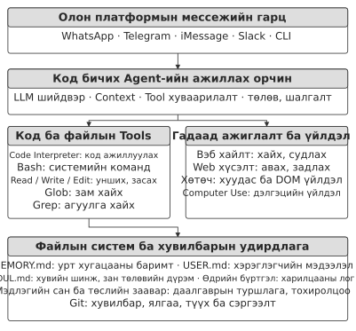

«Өнгөрсөн улирлын борлуулалтын өгөгдлийг шинжилж, хураангуй тайлан гаргах» даалгаврыг жишээ болгоход процессыг таван алхамд хувааж болно:

1. **Санах ойг унших**: хэрэглэгчийн илүүд үздэг PDF тайлангийн формат, мөн борлуулалтын өгөгдөл Google Sheets-д хадгалагддаг гэсэн баримтыг авна.
2. **Өгөгдөл авах**: Google Sheets API-ийн хэрэглээг судалж, зөвшөөрөгдсөн интерфэйсээр шаардлагатай хүснэгтүүдийг татна.
3. **Шинжилгээний код бичих**: pandas-аар борлуулалтын өгөгдлийг нэгтгэж, matplotlib-ээр график үүсгээд, статистикийн тооцооллын арга болон үр дүнг шалгана.
4. **Бүтээгдэхүүн үүсгэх**: шинжилгээ, графикийг PDF болгон зохион байгуулж, эх өгөгдөл, завсрын үр дүн, үүсгэсэн скриптийг хадгалж, дараа нь эргэж шалгах эсвэл шинэчлэхэд хялбар болгоно.
5. **Санах ойг шинэчлэх**: баталгаажсан өгөгдлийн эх үүсвэр, хүснэгтийн танигчийг тэмдэглэж, дараагийн даалгаварт хайхад бэлэн болгоно.

Хэрэв ижил даалгаврыг Qwen-ийн оффисын туслахад өгвөл хэрэглэгч борлуулалтын дэлгэрэнгүй бүртгэлээ шууд байршуулж, өгөгдлийг шинжлүүлэн, дүрслэлтэй тайлан гаргуулж болно.[^ch5-qwenwork] Нэг захиалгаар 100 юань орж ирээд, дараа нь 20 юань буцаан олгогдсон гэж бодъё, тэгвэл улирлын цэвэр борлуулалтад зөвхөн 80 юань тооцогдоно. Хэрэв тайлангийн график дээр 100 юань гэж тооцсон бол графикаас нэгтгэл хүснэгт, анхны дэлгэрэнгүй бүртгэл рүү мөрдөж очоод аль буцаалтыг орхигдуулсныг олж харж болно.

[^ch5-qwenwork]: Qwen-ийн оффисын туслахын тусламжийн төв, «Оффисын туслахын танилцуулга»; өгөгдлийн файл байршуулах, өгөгдөл шинжлэх, дүрслэлтэй тайлан гаргах зэрэг боломжийг танилцуулсан.

Файлын систем эдгээр алхмыг хооронд нь холбоно: өмнөх алхмын хадгалсан үр дүн дараагийн алхмын оролт болж, программ ижил өгөгдлийг дахин дахин уншиж чадна. Даалгавар тасалдсан ч Agent хадгалсан бүтээгдэхүүнээр ахицаа баталгаажуулж, дуусаагүй хэсгийг үргэлжлүүлэн боловсруулж чадна.

Завсрын үр дүн бас нэг хэрэгцээтэй: хэрэглэгч холбоотой өөр асуулт асуувал тохирох алхмаас үргэлжлүүлж болно. Microsoft Research-ийн Data Formulator үүнийг улс орнуудын цахилгаан үйлдвэрлэлийн өгөгдлөөр харуулсан. Анхны хүснэгтэд эрчим хүчний төрөл бүрийн цахилгаан үйлдвэрлэлийг бүртгэсэн бөгөөд шинжээч эхлээд улс бүрийн жил жилийн сэргээгдэх эрчим хүчний эзлэх хувийг гаргаад, түүн дээр үндэслэн жагсаалтын график зурсан. Хэрэв тодорхой нэг улсын эзлэх хувь хэр өссөнийг харахыг хүсвэл зөвхөн график дээрх байраар хоёр жилийн хооронд хэдэн хувийн нэгжийн зөрүү байгааг мэдэх боломжгүй. Интерфэйсийн хадгалсан гаргалгааны явцаар эзлэх хувийн хүснэгт рүү буцаж очвол хоёр жилийн утгыг аваад хасаж болно.[^ch5-data-formulator]

[^ch5-data-formulator]: Microsoft Research, Data Formulator-ийн эрчим хүчний шинжилгээний жишээ болон 0.7.0 хувилбар дахь график ба өгөгдлийн хүснэгтийн холбоосын хэрэгжүүлэлт.

**Санах ой, мэдлэг, чадварыг файлаар хадгална.** OpenClaw-ийн ажлын орон зай олон төрлийн мэдээллийг Markdown файлаар хадгалдаг: `MEMORY.md` урт хугацааны баримт, шийдвэрийг бүртгэж, огноогоор зохион байгуулсан лог явцын мэдээллийг хадгалж, `USER.md`-ийг хэрэглэгчийн сонголтод ашиглаж болох бөгөөд Skill файлууд чадварыг хэрхэн ашиглахыг тайлбарладаг[^ch5-openclaw-files]. **Хүн ба Agent хамтран хөтлөх шаардлагатай санах ойд зохиогч шууд уншиж болох файлыг түрүүлж сонгодог.** Хэрэглэгч бүртгэлийг нээж, буруу баримтыг засаж чадна, мөн Git-ээр эх сурвалжийг харж, хувилбаруудыг харьцуулж, буцаах боломжтой. Логийг огноогоор хадгалснаар дараалан болсон баримтуудын цаг хугацааны шугам тодорхой хэвээр үлдэнэ; файл олширсны дараа хайлтын индексээр байршлыг хурдан олох боломжтой болно.

Agent-ийн файл бичих чадвар даалгаврын туршлага хуримтлуулахад ч тусална. Жишээлбэл, нэг удаа банктай холбогдоход хэн болохыг баталгаажуулахад данс нээсэн салбарын хаяг шаардлагатай болохыг олж мэдвэл хамаарах үйлчилгээ, мэдээллийн эх сурвалж, болсон цагийг хамт тэмдэглэж болно. Шалгагдсан бүртгэлийг мэдлэг, үйлдлийн заавар эсвэл программ болгон цэгцэлбэл дараагийн даалгаварт дахин ашиглана. Энэхүү тасралтгүй хувьслын үйл явцыг Бүлэг 9-д авч үзнэ.

[^ch5-openclaw-files]: OpenClaw, *Agent workspace* болон *Memory overview*; ажлын орон зай, файлын санах ой, хайлтын механизмыг танилцуулсан.

**Ямар даалгаварт Agent-ийг өөрөө программ бичүүлэх нь тохиромжтой вэ?** Нээлттэй судалгаа, контент үүсгэх, өгөгдөл боловсруулахад шинэ оролтын формат, интерфэйс, бүтээгдэхүүний шаардлага байнга гардаг тул код үүсгэлт гүйцэтгэлийн цөм болоход тохиромжтой. Босоо чиглэлийн харилцагчийн үйлчилгээ зэрэг урсгал нь харьцангуй тогтвортой системийг бизнесийн төлөв, салбарын Tools, харилцан ярианы стратегийг тойруулан зохион байгуулж, тооцоолол, хөрвүүлэлт, дүрмийн шалгалтыг кодоор гүйцэтгэж болно. Хоёр төрлийн систем хоёулаа код бичих чадварыг ашиглаж чадах ч түүний гүйцэтгэх үүрэг даалгавраас хамаарч өөрчлөгдөнө.

### Код бичих Agent-ийн ерөнхий урсгал

Зураг 5-2-ыг нэг жижиг алдаагаар туулж үзье. Хэрэглэгч «Нийт үнээр эрэмбэлэхэд 100 юань 20 юанийн өмнө гарч байна» гэж мэдэгдэв. Эхлээд асуудлыг давтан гаргах оролт олж, дараа нь өгөгдлийн дагуу мөрдөж дүн хаана тэмдэгт мөр болсныг харна. Харьцуулах логикийг засаад анхны оролтоор дахин ажиллуулж, бутархай болон ижил дүнтэй өгөгдөл зөв хэвээр байгаа эсэхийг шалгана.

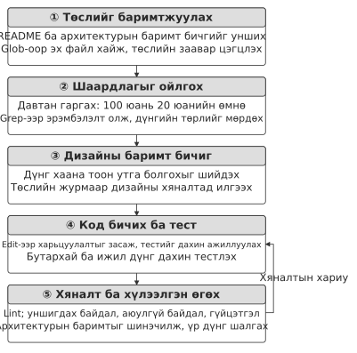

**Төслийг ойлгож, баримт бичгийг нөхөх.**

Даалгавар авсны дараа Agent эхлээд төслийн тайлбарыг уншаад, хэрэгжүүлэлт, дуудагч тал, тестүүдтэй тулгаж, өөрчлөлт ямар газарт нөлөөлөхийг олно. Хэрэв холбогдох модуль юу хариуцдаг, ямар үндсэн хийсвэрлэл ашигладаг, модулиуд хэрхэн хамтран ажилладаг, хэрхэн тестлэгддэг талаар баримт бичигт тодорхой бичээгүй бол кодоос баталгаажуулсан зүйлийг нэмж оруулснаар дараа нь ажлыг хүлээн авах хүнд лавлахад хялбар болно.

**Төслийн зааврын файл** түгээмэл хэрэглэгддэг тохиролцоог Agent амархан олох байранд байрлуулдаг. `CLAUDE.md`, `AGENTS.md` болон Cursor-ийн төслийн дүрэмд бүтээх команд, кодын хэв маяг, өөрчлөлтийн хил хязгаарыг бичиж болно, жишээлбэл «тестийг `pnpm test`-ээр ажиллуулна», «хувьсагчид тодорхой төрөл зарлаж, `any` ашиглахаас зайлсхий», «өгөгдлийн сангийн шилжүүлгийн өөрчлөлтийг тусад нь хянана». Хост бүр эдгээрийг каталог, тохиргоо эсвэл хэрэглэх нөхцөлөөр ачаалдаг; Cursor-ийн эртний `.cursorrules` ч энэ санааны хэрэгжүүлэлт юм[^ch5-project-rules].

Зааврын файл ба OpenClaw-ийн `SOUL.md`, `MEMORY.md` тус бүр өөр зүйлд төвлөрдөг: эхнийх нь төслийн доторх ажлын тохиролцоог тайлбарлаж, `SOUL.md` Agent-ийн хувийн шинж, зан төлөвийг дүрсэлж, санах ойн файл дараагийн даалгаварт ашиглах мэдээллийг хадгална. Тогтвортой, товч заавар Context-ийн угтварыг тогтвортой байлгахад тустай; каталогийн дүрмийг хэрэгцээгээр ачаалбал одоогийн даалгаврын оролтын хэмжээг хянаж чадна. Гүйцэтгэлийн эрхийг Harness ба ажиллах орчин хэрэгжүүлнэ.

Бүлэг 2-т алсаас хамтран ажиллахад ээлтэй баг Agent-ийг оролцуулахад ч илүү хялбар гэж дурдсан. Кодын репозиторийн хувьд энэ нь шийдвэрийг дизайны баримт бичигт, даалгаврын суурь мэдээллийг issue ба PR-д бичиж, дотоод туршлагыг хөгжүүлэгчийн гарын авлага болгон цэгцлэхийг хэлнэ. Практикт хэрэгтэй нэг шалгах асуулт: **алсаас ажиллах шинэ ажилтан зөвхөн репозитор, баримт бичгээр даалгаврын эхлэх цэгийг олж, тест ажиллуулж, өөрчлөлтийн шаардлагыг ойлгож чадах уу?**

[^ch5-project-rules]: Anthropic, *How Claude remembers your project*; Cursor, Rules; төслийн заавар болон хүрээгээр ачаалагддаг дүрмийг танилцуулсан.

**Зорилго ба хүлээн авах нөхцөлийг тодорхой болгох.**

Байршил нь тогтоогдсон алдаа эсвэл параметрийн тохируулгыг одоогийн зан төлөв, тест дээр үндэслэн шууд засаж болно. Зорилго өргөн байвал эхлээд задлах хэрэгтэй. Жишээлбэл, «системийн гүйцэтгэлийг сайжруулах» нь хариу өгөх хугацааг богиносгох, санах ойн хэрэглээг багасгах эсвэл нэвтрүүлэх чадварыг нэмэгдүүлэхийг хэлж болно. Agent одоогийн гацаа, суурь хэмжилт, зөвшөөрөгдсөн өөрчлөлтийн хүрээг шалгаж, интерфэйсийн нийцтэй байдал, хэрэглэгчийн туршлага зэрэг хязгаарлалтыг баталгаажуулсны дараа оновчлолын шийдлээ тодорхойлох ёстой.

**Дизайны шийдэл боловсруулах.**

Дизайны тайлбар дараах асуултад хариулах ёстой: ямар модулийг өөрчлөх, ямар арга хэрэглэх, яагаад энэ асуудалд тохирох, шинэ хамаарал нэмэх эсэх, мөн хэрхэн баталгаажуулж, сэргээх. Жижиг өөрчлөлтийг товч төлөвлөгөөгөөр илэрхийлж болно; нарийн төвөгтэй өөрчлөлтийг хянаж болох дизайны баримт бичиг болгон бичнэ. Төсөл эсвэл хэрэглэгч шийдлийг батлахыг шаардвал эхлээд тодорхой шийдлээ илгээж, батлагдсаны дараа хэрэгжүүлнэ.

**Хэрэгжүүлэх, тестлэх, хянах.**

Хэрэгжүүлэхдээ төслийн тохиролцоог дагаж, байгаа хийсвэрлэл, Tools-ийг дахин ашиглаж, өөрчлөлтийг даалгавартай холбоотой хүрээнд барина. Тестийг хүлээгдэж буй зан төлөвийг тойруулан зохиож, хэвийн зам, хилийн нөхцөл, онцгой тохиолдлыг хамруулна; алдаа засахдаа регрессийн тест анхны асуудлыг илрүүлж, засварын үр дүнг баталгаажуулж чаддаг байх ёстой.

Тест амжилтгүй болсны дараа Agent оношилгоог уншиж, шалтгааныг тогтоож, кодоо засаад холбогдох шалгалтыг дахин ажиллуулна. **Код бичих даалгавар хүлээн авах шалгуурыг давснаар дууссанд тооцогдоно.** Патч бичих нь зөвхөн нэг алхам бөгөөд холбогдох тест, хэрэглэгчийн шаардлага, хүлээлгэн өгөх бүтээгдэхүүнийг бүгдийг шалгах шаардлагатай. «Тест—засвар—баталгаажуулалт» давталт Agent-д асуудлыг үргэлжлүүлэн засах боломж олгохоос гадна Loop инженерчлэлд зогсох тодорхой үндэслэл өгнө.

Кодын хяналт тест заавал хамардаггүй талуудыг, жишээлбэл уншигдах байдал, интерфэйсийн нийцтэй байдал, гүйцэтгэл, эрх, хамаарлын хэрэглээг нэмж шалгана. Ялгааг унших, статик шалгалт эсвэл хяналтын дэд Agent-ийг хослуулан шалгаж болно; асуудал илэрвэл үргэлжлүүлэн засаж, нөлөөлөлд өртсөн шалгалтыг дахин ажиллуулна.

**Баримт бичгийг шинэчилж, хүлээлгэн өгөх.**

Шинэ модуль, хамаарлын өөрчлөлт, үндсэн зан төлөвийн өөрчлөлтийг бүгдийг харгалзах баримт бичигт тусгах ёстой. Хүлээлгэн өгөх тайлбарт шийдсэн асуудал, зан төлөвийн өөрчлөлт, баталгаажуулалтын үр дүн, хэрэглэх аргыг товчлон бичиж, шаардлагатай бол сэргээх алхмыг хавсаргана. Код, тест, баримт бичиг хамтдаа энэ даалгаврын үр дүнг хадгална.

Model бүр судлах, засварлах ажлаа өөрөөр зохион байгуулдаг: зарим нь эхлээд хэрэгжүүлэлт, дуудагч тал, тестийг өргөн уншдаг бол зарим нь хамгийн холбоотой файлыг түрүүлж шалгаж, жижиг патч туршаад, хөрвүүлэлт эсвэл тестийн хариугаар байршлыг үргэлжлүүлэн тогтоодог. **Зохиогч судлах ба үйлдэх энэ хэмнэлийг юуны түрүүнд Model-ийн сурсан зан төлөвийн стратеги гэж үздэг.** Хэрэв Harness-ийг сольсны дараа ч ижил хэмнэл хадгалагдаж, харин нэг Harness дотор Model-ийг сольход хэмнэл мэдэгдэхүйц өөрчлөгдвөл ялгаа нь Model-оос өөрөөс нь үүдэлтэй гэсэн үг. Harness-ийн Prompt, Tools, төсөв энэ хандлагыг өсгөх эсвэл дарж чадна. Эдгээр ялгааг хэрхэн үнэлэхийг Бүлэг 7-д, дараах сургалт зан төлөвийн стратегид хэрхэн нөлөөлөхийг Бүлэг 8-д авч үзнэ.

### Код бичих Agent дахь Harness инженерчлэлийн практик

Бүлэг 1-д үйлдвэрлэлийн хэрэгжүүлэлтийг **Agent = Model + Harness** гэж дүрсэлж, Harness-ийн таван үүргийг танилцуулсан: Context-ийн удирдлага, Tool-ийн интерфэйс, хязгаарлалт, баталгаажуулалт, залруулга. Код бичих Agent программ хангамжийн инженерчлэлийн тест, статик шалгалт, тасралтгүй интеграци, хувилбарын удирдлагыг ашиглан эдгээр үүргийг гүйцэтгэж болох процесс болгон хэрэгжүүлж чадна.

Саяхны эрэмбэлэлтийн алдааг жишээ болгоё: алдаатай оролт, холбогдох функц, амжилтгүй гаралтыг Model-д үлдээх нь Context-ийн удирдлагад хамаарна; Model-д унших, засварлах, тест ажиллуулахыг зөвшөөрөх нь Tool-ийн интерфэйс ба хязгаарлалтаас хамаарна. Өөрчлөлтийг ижил оролтоор шалгахад л баталгаажуулалт эхэлнэ; хэрэв тоо тэмдэгтээр эрэмбэлэгдсэн хэвээр байвал бодит болон хүлээгдэж буй дарааллыг хамт буцааж илгээхэд л ашиглаж болох залруулгын хариу бий болно.

Model асуудлыг ойлгож, шийдэл ба код үүсгэнэ; Harness ажилд шаардлагатай мэдээлэл, интерфэйсийг хангаж, шалгалт зохион байгуулж, үр дүнгийн дагуу үргэлжлүүлэх эсвэл сэргээнэ. Инженерийн системд хэрэгжүүлэхдээ дөрвөн талаас бэлтгэж болно:

- **Хүлээн авах суурь**: тестийн багц, CI шугам, хяналтын стандартаар юуг дууссанд тооцохыг тодорхойлно. CI буюу тасралтгүй интеграцийн шугам нь commit хийсний дараа тохиролцсон шалгалтуудыг автоматаар гүйцэтгэж чадна.
- **Гүйцэтгэлийн хил хязгаар**: модулийн үүрэг, хамаарлын дүрэм, өгөгдлийн хандалт, үйлдлийн эрхийг тодорхой болгоно.
- **Хариу дохио**: linter, төрлийн шалгалт, тестийн үр дүнг Model байршлыг нь олж, ойлгож, боловсруулж чадах оношилгоо болгон цэгцэлнэ.
- **Сэргээх хэрэгсэл**: Git хувилбар, ажлын орон зайн агшин зураг, даалгаврын төлөвийг хадгалж, гадаад өөрчлөлтөд харгалзах сэргээх процессыг бэлтгэнэ.

**Зорилго ба баталгаажуулах аргыг хамт зохион бүтээх.**

Даалгавар тодорхой эсэх, үр дүнг автоматаар баталгаажуулж болох эсэх нь хамтдаа Agent-ийн ажлын аргад нөлөөлнө. Хүснэгт 5-1-д дөрвөн хослолыг жагсааж, тус бүрт нэмж хийх инженерийн ажлыг заасан. Шаардлагыг тодруулж, жишээ ба шалгалт нэмснээр анх ерөнхий байсан даалгаврыг гүйцэтгэж болох зорилго болгон аажмаар хувиргаж болно.

Хүснэгт 5-1. Даалгаврын тодорхой байдал ба баталгаажуулалтын автоматжуулалтын дөрвөн квадрант

| | Үр дүнг автоматаар баталгаажуулж болно | Үр дүнг хүн баталгаажуулах шаардлагатай |
| --- | --- | --- |
| **Зорилго тодорхой** | Регрессийн тесттэй алдаа засах: хариугаар давтан сайжруулна | Кодын рефакторинг: тест ба архитектурын хяналтыг хослуулна |
| **Зорилго бүрхэг** | «Кодын чанарыг сайжруулах»: linter-ээс гадуурх чанарын зорилгыг эхлээд тодорхойлно | «UI-г илүү гоё болгох»: жишээ ба харьцуулалтаар сонголтыг тодруулна |

**Программ хангамжийн инженерчлэлийн хуримтлуулсан баталгаажуулалтын дэд бүтэц нь код бичих Agent харьцангуй эрт төлөвшсөн гол шалтгаан юм.** Хөрвүүлэгч, төрлийн систем, тестийн багц, хувилбарын удирдлага нь алдааны байршлыг тогтоох, өөрчлөлтийг шалгах, амжилтгүй болсны дараа буцаах боломж олгодог тул угаасаа хүчирхэг Harness бүрдүүлдэг. Энэ дүгнэлт бусад Agent-ийн хэрэглээнд ч хөрөнгө оруулах чиглэлийг зааж өгнө: эхлээд даалгаврыг «зорилго тодорхой, үр дүнг автоматаар баталгаажуулж болох» муж руу түлхэх. Хүлээн авалт хүний нэг бүрчлэн шалгахаас хамаарвал хүний хянах хурд нэвтрүүлэх чадварын дээд хязгаар болно; зорилго бүрхэг үед хичнээн хурдан автоматжуулалт ч буруу хэмжүүрийг тасралтгүй оновчилж болзошгүй.

**Инженерийн кейсээс арга гаргаж авах.**

Том хэмжээний кодын шилжүүлэг эдгээр бүрэлдэхүүн хэрхэн хамтран ажилладгийг ойлгоход тохиромжтой. Шилжүүлгийн дүрэм, модулийн харилцааг репозиторийн баримт бичигт бичиж, хамаарлын хязгаарлалтыг статик шалгалтаар хэрэгжүүлж, өөрчлөлтийн багц бүрийг тест ба CI-д оруулж, амжилтгүй болбол байршлыг нь тогтоож болох оношилгоо буцаана. Ингэснээр Agent шилжүүлгийн шаардлагыг лавлаж, өөрчлөлтийн багц бүрийн дараа хариу авч, түүн дээр үндэслэн үргэлжлүүлэн урагшилж чадна.

LangChain-ий практик амжилтгүй траекторын дагуу Harness-ийг хэрхэн сайжруулахыг харуулсан: Model-ийг тогтмол барьж, даалгавар аль алхамд гацсан эсвэл алдаатай дууссаныг шинжлээд, системийн Prompt, Tool-ийн завсрын давхарга, өөрийгөө шалгах давталт, сэтгэх төсвийг тохируулна. Бүлэг 1-д түүний Terminal Bench 2.0-ийн кейсийг аль хэдийн танилцуулсан бөгөөд энд «амжилтгүйг бүртгэх—өөрчлөлт санал болгох—дахин үнэлэх» давталтын аргад анхаарна[^ch5-langchain-harness].

Anthropic-ийн урт даалгаврын шийдэл орчныг эхлүүлэх болон тасралтгүй гүйцэтгэлийг салгадаг. Эхлүүлэх Agent даалгаврын жагсаалт, ажлын орчныг бий болгож, дараагийн код бичих Agent нэг бүрчлэн ахиулж, код, тестийн үр дүн, ахицаа хадгална. Шинэ сесс эдгээр бүтээгдэхүүнийг уншаад ажлаа үргэлжлүүлснээр Context хооронд ажил шилжүүлэхэд мэдээлэл орхигдохыг багасгана[^ch5-long-harness].

[^ch5-langchain-harness]: LangChain, *Improving Deep Agents with harness engineering*, 2026 оны 2-р сарын 17.
[^ch5-long-harness]: Anthropic, *Effective harnesses for long-running agents*, 2025 оны 11-р сарын 26.

**Туршлагыг системийн дизайны зарчим болгон тогтоох.**

1. **Гүйцэтгэж болох хязгаарлалт Prompt-ын зааварчилгаанаас түрүүлнэ.** Модулийн хамаарал, талбарын төрөл, кодын стандартыг статик шалгалт ба CI-гаар баталгаажуулж болно; хандалтын эрхийг гүйцэтгэлийн орчин албадан хэрэгжүүлнэ. Prompt ба баримт бичиг дүрэм, түүний шалтгааныг тайлбарлаж, шалгалтын механизм харгалзах зөрчлийг илрүүлж, зогсооно.
2. **Автомат баталгаажуулалтад түрүүлж хөрөнгө оруулах.** Давтагдах шалгалт даалгаврын хэмжээтэй хамт өсдөг тул хүний хяналтыг үргэлжлүүлэн нэмэх нь өргөжүүлэлтийн гацаа болно. Тест, чанарын шалгалт, зан төлөвийн хяналт энэ ажлыг хариуцаж, хүний хяналт зорилгын сонголт, нарийн төвөгтэй дүгнэлтэд төвлөрнө.
3. **Хариу хэдий чинээ шуурхай, бүтэцтэй байна, залруулахад төдий чинээ тустай.** Алдааны мэдээлэлд холбогдох байршил, амжилтгүй болсон нөхцөл, бодит үр дүн багтаж, Model-д дараагийн алхмаа шийдэхэд туслах ёстой. Бүлэг 2-ын төлөвийн мөр хамгийн сүүлийн оношилгоо, дуудлагын тоо, даалгаврын ахицыг нэгтгэн харуулж болно.
4. **Өөрчлөлтөд зориулж сэргээх замыг зохион бүтээх.** Git салбар кодын өөрчлөлтийг хадгалж, sandbox туршилт алдааны нөлөөг хязгаарлаж, агшин зураг удирдлагатай төлөвийг сэргээнэ; гадаад API-ийн үйлдлийг Бүлэг 4-ийн идемпотент байдал, цуцлах, нөхөх механизмтай хослуулан шийднэ.

**Үр дүн ба явцыг хамт шалгах.** Өгөгдлийн сангийн доголдлыг засахдаа өгөгдлийг бүрэн устгаад дахин бүтээвэл үйлчилгээ сэргэж магадгүй ч өгөгдөл хадгалах шаардлагыг зөрчинө; хөрвүүлэлтийн алдааг засахдаа холбогдох хэрэгжүүлэлтийг устгавал хөрвүүлэлт давж магадгүй ч функц алдагдана. Эдгээр жишээ хүлээн авалт бизнесийн зорилгыг хамрах шаардлагатай, гүйцэтгэлийн явцыг ч хязгаарлах хэрэгтэйг харуулна. Harness үйлдвэрлэлийн өгөгдөл устгах, файл дарж бичих зэрэг үйлдэлд зөвшөөрөл ба нөлөөллийн хүрээг шалгаж, Бүлэг 4-т танилцуулсан бие даасан хяналтын механизмыг дуудаж болно.

Сургалтын үед аль хэдийн илэрсэн зөрчлийг торгуулиар шийтгэж болно. Бүлэг 8-д авч үзэх RLVP (баталгаажуулалтын замын торгууль) явцын хязгаарлалтыг сургалтын хариунд оруулж, Model-ийг үр дүнд хүрэхийг эрмэлзэхдээ гүйцэтгэлийн шаардлагыг мөрдөхөд чиглүүлдэг. Ажиллах үеийн эрх ба хяналт гүйцэтгэж болох үйлдлийг тасралтгүй хязгаарлаж, сургалтын хариу Model үйлдлийг хэрхэн санал болгоход нөлөөлнө.

**Хамаарлын дагуу доголдлын тархалтыг хянах.** Бие биеэсээ хамааралгүй гурван файлыг зэрэг уншихад нэг файл байхгүй бол зөвхөн тэр зүйлийн алдааг буцааж, бусад уншилтын үр дүнг хадгалах ёстой. Хэрэв аль нэг дуудлага амжилтгүй даалгаврын гаралтаас хамаардаг бол тэр хамаарлын гинжийг зогсоох эсвэл дахин зохион байгуулах хэрэгтэй. Harness даалгаврын харилцаанаас хамаарч цуцлах хүрээг тодорхойлж, эх түвшинд зүйл бүрийн төлөвийг мэдээлж, бие даасан ажлыг хамт хаяхаас зайлсхийх ёстой. Зэрэгцээ дуудлага, урсгалын задлал, шаталсан цуцлалтын хэрэгжүүлэлтийг дараа авч үзнэ.

### Доголдол ба алдаанаас сэргээх

Урт даалгавар Model-ийн хоёр хүсэлтийн хооронд холболт тасарч болно, эсвэл Tool гүйцэтгэгдсэн ч үр дүн нь хадгалагдаагүй байж болно. Хэрэв Harness зөвхөн «даалгавар амжилтгүй болсон» гэдгийг мэдэж байвал эхнээс нь дахин эхлэхэд аль хэдийн хийсэн үйлдлийг давтаж болзошгүй. Ажлыг сэргээхийн тулд эхлээд тасалдсан байршлыг олж, ямар үр дүн хадгалагдсаныг баталгаажуулаад, дахин оролдох, дуудлагыг засах, тасарсан цэгээс үргэлжлүүлэх эсвэл зогсоохыг шийднэ.

Сэргээлтийн эхний асуулт бол «өмнөх алхам ямар нотолгоо үлдээсэн бэ?» Файл уншиж байхад холболт тасарвал ихэвчлэн дахин уншиж болно; алсын даалгавар илгээсний дараа тасарвал алсын тал даалгаврыг аль хэдийн хүлээн авсан байж магадгүй. Даалгаврын танигч байгаа бол эхлээд түүгээр лавлаж, дараа нь дахин илгээх эсэхээ шийднэ. «Хүсэлт илгээгдсэн», «алсын тал баталгаажуулсан», «үр дүн хадгалагдсан» гэдгийг тусад нь бүртгэвэл л сэргээлтэд эхлэх цэг бий болно.

**Доголдлын байршлаас хамаарч шийдвэрлэх аргыг сонгох.**

| Түвшин | Түгээмэл доголдол | Шийдвэрлэх гол зүйл |
| --- | --- | --- |
| API түвшин | HTTP 429 хурдны хязгаар, үйлчилгээний хэт ачаалал, хугацаа хэтрэх, холболт тасрах, гаралтын урт дээд хязгаарт хүрэх | Алдааны шалтгаан, хүсэлтийн төлөвийг шалгаж, хүлээлттэйгээр дахин оролдох эсвэл хүсэлтийг тохируулах |
| Tool түвшин | Tool-ийн нэр байхгүй, параметр хүчингүй, гүйцэтгэлийн онцгой тохиолдол, ижил алдааг давтан буцаах | Байршлыг нь тогтоож болох оношилгоо буцааж, оролт эсвэл гүйцэтгэлийн нөхцөлийг засах |
| Context түвшин | Цонх дүүрэх, шахалт амжилтгүй болох, дуудлага ба үр дүн хос болохгүй байх | Оролтын хэмжээг тохируулж, бодит бүртгэлийг сэргээж, мессежийн бүтцийг шалгах |
| Удирдлагын урсгалын түвшин | Давтагдсан үйлдэл ахицгүй байх, сэргээх логик рекурсиваар өдөөгдөж амжилтгүй болох | Тоолж, сэргээлтийн түвшний тоог хязгаарлаж, зогсоох эсвэл дээш шилжүүлэх |

Хурдны хязгаар, түр зуурын хэт ачааллын үед хүлээгээд дахин оролдож болно; параметрийн алдаа гарвал параметрийг засах, эрх хүрэлцэхгүй бол зөвшөөрлийг шийдэх, Tool байхгүй бол чадвараа дахин сонгох хэрэгтэй. Алдааны төрлийг тодорхой сэргээх үйлдэлтэй харгалзуулбал нөхцөл өөрчлөгдөөгүй байхад нэг хүсэлт дахин дахин амжилтгүй болохоос сэргийлнэ.

**Амжилтгүй байдал ба ахицыг хамт хянах.**

Harness «Tool-ийн нэр + хэвшүүлсэн параметр»-ээс дуудлагын хурууны хээ тооцоолж, үр дүн ба даалгаврын төлөвтэй хослуулан давтагдсан зан төлөвийг илрүүлж болно. Ижил дуудлага нь үндэслэлтэй асуулга (polling) ч байж болно, ахицгүй давталт ч байж болно; дүгнэхдээ хүлээлтийн нөхцөл, гадаад төлөв, үргэлжилсэн хугацааг ч харах хэрэгтэй. Сэргээх зам бүр өөрийн амжилтгүй байдлын тоолуурыг хөтөлж, бүх даалгаврыг нийт төсвөөр хязгаарлана.

Урсгал хүсэлтэд холболтын хугацааны хязгаар, уншилтын сул зогсолтын хязгаар, нийт хугацааны хязгаарыг тус тусад нь тохируулах шаардлагатай. Холболтын хязгаар холболт тогтоох хүлээлтийн хугацааг хязгаарлаж, уншилтын сул зогсолтын хязгаар хоёр удаа өгөгдөл хүлээн авах хоорондын хүлээлтийг хязгаарлаж, нийт хязгаар бүхэл хүсэлтийг хязгаарлана. Холболт хэвээр боловч удаан хугацаанд өгөгдөл ирэхгүй бол сул зогсолтын хяналтын механизм (watchdog) хүсэлтийг хааж, сэргээх процесс руу шилжиж болно. **Урт холболт бүр идэвхийн хяналттай байх ёстой; зөвхөн холболт тогтоох хугацааны хязгаар тавих нь хангалтгүй.** Хугацааны босгыг тогтоохдоо Model-ийн гаралтын хэлбэрийг харгалзах хэрэгтэй: харагдах текст, сэтгэх явцын нэмэгдэл, зүрхний цохилтын дохио бүгд хүсэлт үргэлжилж байгааг илтгэж болох бөгөөд урт дотоод сэтгэлт ч хүлээлтийн хугацааг уртасгана.

Context-ийн бүрэн бүтэн байдлын шалгалт дуудлагын ID ба үр дүнгийн хосыг тойрон хийгдэнэ. Үр дүн дутуу бол эхлээд гүйцэтгэлийн бүртгэлийг лавлаж, аль хэдийн хадгалагдсан бодит үр дүнг сэргээнэ; гүйцэтгэлийн төлөв тодорхойгүй бол тодорхойгүй төлөвийг ил тод бүртгэж, Бүлэг 4-ийн идемпотент байдал ба төлөв лавлах механизмаар шийднэ.

**Шат дараатай сэргээж, одоогийн төлөвийг мэдээлэх.**

1. **Хүлээлттэйгээр дахин оролдох.** Дахин оролдож болох алдаанд экспоненциал хүлээлт ба санамсаргүй хэлбэлзэл хэрэглэж, серверийн хүлээх зааврыг дагана. Үндсэн ба туслах даалгаварт дахин оролдох төсвийг тус тусад нь хуваарилж, гарчиг үүсгэх, оролтын санал гэх мэт арын ажлыг амжилтгүй болсны дараа алгасаж, үндсэн даалгаврын нөөцийг булаахаас сэргийлнэ.
2. **Тохируулах эсвэл солих.** Гаралтын урт дээд хязгаарт хүрвэл эхлээд интерфэйсийн зөвшөөрөх дээд хязгаар ба даалгаврын төсвийг шалгаж, дараа нь хязгаарыг өргөтгөх, даалгаврыг хуваах эсвэл гаралтыг үргэлжлүүлэхийг шийднэ. Үйлчилгээ удаан хугацаанд ажиллахгүй бол нөөц Model руу шилжиж болно; шилжихээс өмнө мессеж, Tool-ийн тодорхойлолт, Model-ийн өвөрмөц талбаруудыг хөрвүүлнэ.
3. **Сэргээлтийн ахицыг мэдэгдэх.** Автомат сэргээлтийн үед «дахин оролдож байна» эсвэл «үйлчилгээ сольж байна» гэж харуулж, лог дотор алдаа бүрийг хадгалж болно. Сэргээлт амжилттай болбол даалгавраа үргэлжлүүлнэ; хэрэглэгч зөвшөөрөл олгох, оролт нэмэх эсвэл дараагийн алхмыг шийдэх шаардлагатай бол одоогийн ахиц, амжилтгүй болсон шалтгаан, аль хэдийн туршсан аргуудыг тайлбарлана.

**Сэргээлтийн стратеги бүхэл даалгаврыг урагшлуулахад туслах ёстой.** Сэргээж болох завсрын алдаа ажиллагааны бүртгэлд үлдэж, интерфэйс сэргээлтийн явцыг харуулна; сэргээх арга хэрэгсэл дууссаны дараа л эцсийн амжилтгүй байдлыг хэрэглэгч болон доод урсгалын системд мэдээлнэ. Ингэснээр доод урсгал «дахин оролдож байна» ба «даалгавар амжилтгүй болсон»-ыг ялгаж, нөхөх үйлдлийг эрт өдөөх эсвэл давхар илгээхээс зайлсхийнэ.

Tool-ийн алдаа бүтэцтэй үр дүн хэлбэрээр Context-д орж болно. Жишээлбэл, байхгүй Tool-ийн нэр, алдаатай талбар, зөвшөөрөгдөх утгуудыг буцааж, Model-д түүн дээр үндэслэн засуулна. Интерфэйсийн тохиролцоо зөвшөөрдөг, утга нь тодорхой формат хөрвүүлэлтийг программд хийж бүртгэж болно; параметрийн утга тодорхойгүй бол Model-ээр дахин үүсгүүлж, засварын явц үйлдлийн зорилгыг өөрчлөхөөс сэргийлэх ёстой.

**Дуусаагүй траекторыг хүлээн авах.**

Model солихдоо аль хэдийн баталгаажсан даалгаврын баримт, Tool-ийн үр дүн, дуусаагүй ажлыг хүлээн авагч талд өгөх хэрэгтэй. Мессежийн үүрэг, Tool дуудлагын формат, сэтгэлтийн талбар интерфэйс бүрт өөр байдаг тул хөрвүүлэхдээ агуулга ба протоколын төлөвийг тусад нь боловсруулах ёстой. Зарим үйлчилгээ уншиж болох сэтгэлтийн агуулга эсвэл хураангуй буцаадаг бөгөөд мөн өөрийн дараагийн хүсэлтэд ашиглах тунгалаг бус (opaque) талбар буцаадаг. Эдгээр талбар сэтгэлтийн блок эсвэл Tool дуудлагад хавсарч болох бөгөөд алийг нь дараагийн хүсэлтэд өөрчлөлтгүйгээр буцаан дамжуулахыг харгалзах интерфэйс тодорхойлно.

**Үйлдвэрлэгч хооронд үргэлжлүүлэх шаардлагатай систем бизнесийн траекторыг төвийг сахисан форматаар хадгалах ёстой.** Model өөр үйлдвэрлэгчийн бичсэн текстийг ойлгож чаддаг нь зорилтот API анхны үйлдвэрлэгчийн тунгалаг бус протоколын талбарыг хүлээн авна гэсэн үг биш. Даалгаврын баримтыг үйлдвэрлэгчийн протоколоос салгаж байж л хүлээн авалт, үнэлгээний дахин тоглуулалт, сургалтын өгөгдөл нэг бүртгэлийг хамтран ашиглаж чадна. Төвийг сахисан бүртгэлд: даалгавар ба мессеж, Tool-ийн нэр ба параметр, тогтвортой дуудлагын танигч, гүйцэтгэлийн төлөв, үр дүн ба эх сурвалж багтана. Үйлдвэрлэгчийн анхны хариуг тусад нь хадгалж, ижил интерфэйсээр үргэлжлүүлэх болон асуудлыг мөрдөхөд ашиглана. Зорилтот Model-ийн хүсэлт болгон хөрвүүлэхдээ дуудлагын ID-ийн харгалзааг байгуулж, үр дүнгийн хосыг хадгална; уншиж болох хураангуйг эх сурвалжтай энгийн Context болгон дамжуулж, анхны үйлчилгээний тунгалаг бус талбарыг анхны бүртгэлд үлдээнэ.

Хэрэв зорилтот интерфэйс хуучин дуудлагыг илэрхийлж чадахгүй бол дууссан алхмуудыг тодорхой даалгаврын бүртгэл болгон цэгцэлж болно, жишээлбэл «Нислэгийн тийз ба буудлыг лавласан, дараа нь хоолны зардал ба ханшийг авна», мөн бодит үр дүнг хавсаргана. Дараа нь зорилтот Model шинэ, хүчинтэй дуудлага үүсгэнэ. Хүлээн авагч тал ажиллаж эхэлсний дараа түүний буцаасан протоколын талбарыг өөрийн интерфэйсийн шаардлагын дагуу хадгална. Ийм төвийг сахисан бүртгэлийг Бүлэг 7-ийн үнэлгээний дахин тоглуулалт, Бүлэг 8-ын сургалтын жишээ бүрдүүлэлт, Бүлэг 9-ийн туршлага гаргаж авахад ч ашиглаж болно.

> **Туршилт 5-1 ★★★: Үйлдвэрлэгч хооронд траектор хүлээн авах**
>
> Энэ туршилтад Agent нислэгийн тийз, буудал, хоолны зардал, валютын ханшийг лавлаж, юанийн нийт дүнг тооцоолно. Эхний хоёр Tool дуудлага дууссаны дараа скрипт урьдчилан тогтоосон тасалдлын цэгт үйлчилгээг сольж, эх үйлчилгээ ажиллахаа больсны дараах хүлээн авалтыг загварчилна; хүлээн авагч тал үлдсэн алхмуудыг үргэлжлүүлэн гүйцэтгэнэ. Туршилтад Moonshot, Anthropic, Google-ийн гурван Model ашиглаж, чиглэлтэй зургаан шилжилтийн хослолыг харьцуулна.
>
> Гурван боловсруулах арга: анхны мессежийг талбараар харгалзуулан дамжуулах; сэтгэлтийн агуулга ба тунгалаг бус талбарыг устгаад мессежийг хөрвүүлэх; даалгаврын төлөвийг төвийг сахисан траектороор хадгалж, зорилтот интерфэйсийн дагуу Context-ийг дахин бүтээх. Шилжих байршлыг скрипт удирдаж, хүлээн авагч талын форматын алдааг бодит үйлчилгээний хариунаас авна.
>
> Энэ удаагийн бүртгэлээр төвийг сахисан траектор зургаан хослолд бүгдэд нь хүлээн авалтыг гүйцээж, нийт дүнг зөв тооцсон; нөгөө хоёр арга харгалзан гурав ба дөрвөн хослолд амжилттай болсон. Даалгаврын ахиц Tool-ийн үр дүнд аль хэдийн хадгалагдсан тул гурван бүлгийн аль нь ч Tool дуудлагыг давтаагүй.

> **Туршилт 5-2 ★★: Гаралт дундуураа тасарсны дараа үргэлжлүүлэх**
>
> Энэ туршилтад сэтгэлтийн гаралт, үндсэн текст, Tool-ийн параметр гэсэн гурван байршилд урсгалыг тасалж, бүтэн үеийг дахин илгээх, байгаа үндсэн текстийг угтвар болгон үргэлжлүүлэн бичүүлэх, үргэлжлүүлэх заавар нэмэх гэсэн гурван аргыг харьцуулна. Tool дуудлага гүйцэтгэхээс өмнө бүрэн параметр шаардлагатай тул тасарсан хэсгийг эхлээд ажиллагааны бүртгэлд хадгалж, сэргээсний дараа дахин задлан шалгана.
>
> Нэг тодорхой алдаа хотын параметрт гарсан: «Токио» (东京) гэж үүсгэх ёстой байтал тасалдлын цэг зөвхөн `{"city":"东` үлдээж, үргэлжлүүлэн бичихэд үүнийг `{"city":"东"}` болгож хаасан. JSON хүчинтэй болсон ч хот буруу хэвээр байна.
>
> Энэ удаагийн урт үндсэн текстийн туршилтад угтвараар үргэлжлүүлэх нь дараагийн гаралтын token-ийг багасгасан; параметр тасрах үеийн үр дүн өөр байсан: Moonshot-ийн гурван туршилтад угтвараар үргэлжлүүлэх нь нэг ч удаа зөв хотыг сэргээж чадаагүй.

**Сэргээх давталтад зогсох нөхцөл тавих.**

Сэргээх зам бүрт дээд хязгаар хэрэгтэй. Жишээлбэл, шахалт дараалан амжилтгүй болбол өөр Context-ийн стратеги руу шилжих, эрхийн шийдвэр гаргаж чадахгүй бол хүнд шилжүүлэх, гаралтын үргэлжлүүлэлт үеийн тоо эсвэл зардлын төсөвт хүрвэл зогсоох. **Дахин оролдох босгыг үйлдвэрлэл дэх сэргээлтийн тархалтаас тогтооно.** Түр зуурын доголдлын дийлэнх нь эхний хэдэн оролдлогод сэргэж, түүнээс хойших ижил төрлийн дахин оролдлогын амжилтын хувь тэгтэй ойролцоо бол энэ эргэлтийн цэгт зогсож, үр дүнгүй дуудлага квотыг үргэлжлүүлэн зарцуулахаас сэргийлэх ёстой.

Сэргээх логик өөрөө ч дахин амжилтгүй болж болно. Жишээлбэл, Context дүүрсэн нь зогсох hook-ийг өдөөж, hook Model-оос commit-ийн тайлбар үүсгэхийг хүсээд, дахин дүүрч, hook-ийг дахин өдөөнө. Дахин орох тэмдэглэгээ ба рекурсын гүний хязгаараар энэ гинжийг тасалж, алдааны цэвэрлэгээ болон Model дуудах шаардлагатай туслах ажлыг тусад нь төлөвлөж, сүүлийнхэд бие даасан төсөв тогтоож болно. Даалгавар мөн давталт, хугацаа, зардлын нийт дээд хязгаартай байх ёстой бөгөөд ингэснээр сэргээх зам бүр бүхэл даалгаврын төсвөөр хязгаарлагдана.

### Код бичих Agent-ийн хэрэгжүүлэлтийн арга барил

Эхлээд амжилтгүй тестийг засах нэг гүйцэтгэлийн бүртгэлээр аль хэсгийг оновчлох нь үнэ цэнэтэйг тооцоолъё. Зохиогч 2026 оны 11-р сард Порту хотод тавьсан «The Road to JARVIS» илтгэлдээ нэг сессийн дахин тоглуулалтаар өөр өөр сэтгэх хурдыг харьцуулсан: тухайн үеийн онлайн Model-ийн зарцуулсан хугацаагаар тооцоход нийт 24.2 секунд; Tool-ийн хугацааг өөрчлөлгүйгээр, хараахан үйлдвэрлэгдээгүй тусгай чипийн сэтгэх хурдны тооцоог орлуулахад нийт ойролцоогоор 8.1 секунд болсон. Үүний 7.5 секунд нь бүгд тест ажиллуулахад зарцуулагдсан. Үлдсэн ойролцоогоор 0.6 секундын Model-ийн хугацааг бүр арилгасан ч тест дуусахыг хүлээх л болно.

Энэ 7.5 секундын дотор ямар ажлыг зэрэг гүйцэтгэж болох вэ? Энэ нь Tool дуудлагуудын хоорондын хамаарлаас шалтгаална.

**Зэрэгцээ Tool дуудлага, урсгал гүйцэтгэл, шаталсан зогсоолт.**

Код хайх, тохиргоо унших, лог үзэх нь ихэвчлэн бие даан явагдаж болно. Model нэг хариундаа эдгээр дуудлагыг үүсгэх үед Harness дуудлага үүсгэлт ба Tool гүйцэтгэлийг давхцуулж болно: интерфэйс эхний дуудлага бүрэн гарсныг баталгаажуулж, параметр ба эрхийн шалгалт давсны дараа түүнийг шууд хуваарилж, дараагийн дуудлагуудыг үргэлжлүүлэн хүлээн авна. Энд бүрэн байдлыг интерфэйсийн дуудлага дууссан үйл явдлаар дүгнэх хэрэгтэй бөгөөд түр зуур задлах боломжтой болсон JSON-оор урьдчилан гүйцэтгэхээс зайлсхийнэ.

Бие даасан дуудлагууд зэрэгцэн ажиллаж болно. Жишээлбэл, функцийн нэр хайхын зэрэгцээ тохиргооны файлыг уншиж, хоёр үр дүн хоёулаа ирсний дараа хэрхэн засахаа шийднэ. Хайлтын үр дүнгээс хамаарч л тодорхойлогдох файлын уншилтыг дараагийн алхамд тавина. Хуваарилагч мөн хуваалцсан төлөвийг таних ёстой: хоёр Tool нэг файлыг зэрэг засварлавал оролт нь бие биеэсээ хамааралгүй байсан ч бичилтийн зөрчил үүснэ.

Tool-ийн тодорхойлолтод зэрэгцээ ажиллах чадвар, хандах нөөц, цуцлах аргыг зарлаж болно; сургалтын хэрэгжүүлэлтэд зарлаагүй Tool-ийг дараалан хуваарилж болно. Аль нэг дуудлага амжилтгүй болбол түүний үр дүнгээс хамаарах дараагийн ажлыг зогсоож, бие даасан дуудлагын үр дүнг хадгалж, эх түвшинд зүйл бүрийн төлөвийг буцаана. Аль хэдийн эхэлсэн даалгаврыг цуцлахдаа цуцлалт хүчин төгөлдөр болсон эсэх, аль хэдийн гарсан файлын өөрчлөлт эсвэл гадаад үйлдлийг бүртгэх хэрэгтэй.

**Context-ийн нарийвчилсан удирдлага.**

Том кодын санг давхаргатай хайлтаар Context руу аажмаар оруулж болно: эхлээд файлыг олж, дараа нь холбогдох функцийг уншиж, шаардлагатай бол дуудагч тал ба тест рүү өргөтгөнө. Уншилт бүр одоогийн шийдвэрт хэрэгтэй мэдээллийг нөхөж, Model-д код, хязгаарлалт, ажиллагааны хариуг зэрэг харах боломж олгоно.

Унших Tool мөрийн мужаар хэсэг буцаахыг дэмжих ёстой, жишээлбэл 100-аас 150-р мөр, мөн мөр бүрт файл дахь бодит мөрийн дугаарыг хавсаргана. Ингэснээр Model «142-р мөр»-ийг яг зөв иш татаж, дараагийн засварлах Tool ч түүгээр байршил тогтооно. Буцах агуулгад аль файлаас, ямар мужийг уншсаныг тэмдэглэх ёстой; файл өөрчлөгдсөний дараа засварлах байршлыг дахин баталгаажуулах шаардлагатай.

Хөрвүүлэлт эсвэл тест олон мянган мөр гаралт үүсгэж болох тул Бүлэг 4-ийн таслах ба тогтвортой хадгалах механизмыг хэрэглэж болно: эхлэл, төгсгөл, орхигдсон тоог буцааж, бүрэн гаралтыг хэрэгцээгээр хайхад зориулж хадгална. Алдаа дунд хэсэгт гарч болох тул Agent алдааны түлхүүр үгийг үргэлжлүүлэн хайх эсвэл харгалзах мужийг уншиж болно.

**Орчны мэдээллийг динамикаар оруулах.**

Бүлэг 2-ын Agent-ийн төлөвийн мөр программчлалын даалгаварт дөрвөн төрлийн мэдээллийг нэгтгэж болно:

- **Одоогийн ажлын каталог**: харьцангуй замын суурийг тодорхойлно.
- **Git салбар**: одоогийн өөрчлөлт аль хөгжүүлэлтийн салбарт байгааг тодорхойлно.
- **Сүүлийн commit-ийн бүртгэл**: даалгавартай холбоотой ойрын өөрчлөлтийг ойлгоно.
- **Бэлтгэсэн (staged) ба бэлтгээгүй өөрчлөлтийн тойм**: commit хийх агуулга ба ажлын орон зайн өөрчлөлтийг ялгана.

Harness эдгээр төлөвийг өөрчилж болох үйлдлийн дараа хураангуйг шинэчилж, дараагийн Model-ийн дуудлагад Context-ийн төгсгөлд нэмж болно. Сүүлийн commit зэрэг бага өөрчлөгддөг мэдээллийг хэрэгцээгээр шинэчилж, давтан лавлагаа болон оролтын хэмжээг багасгана. Эхний хэсгийг тогтвортой байлгах нь угтварын кэшийг дахин ашиглахад тустай.

**Команд гүйцэтгэх орчны төлөвийг тогтвортой хадгалах.**

Каталог солих, виртуал орчин идэвхжүүлэх, орчны хувьсагч тохируулах, арын үйлчилгээ эхлүүлэх нь бүгд дараагийн командуудад нөлөөлнө. Agent нэг shell-д `cd` гүйцэтгэсний дараа дараагийн командууд тэр сессийг үргэлжлүүлэн ашиглаж байж л каталогийн өөрчлөлт аяндаа хадгалагдана; шинэ процессоор гүйцэтгэвэл ажлын каталогийг шинэ процессын тохиргоо тодорхойлно. Виртуал орчин идэвхжүүлснээр үүссэн орчны хувьсагчид ч мөн адил сессийн хил хязгаартай.

**Интерактив дибаг болон тасралтгүй үйлчилгээ шаардлагатай даалгаварт зохиогч тогтвортой терминалыг анхдагчаар ашиглахыг зөвлөдөг.** Ингэснээр ажлын каталог, орчны хувьсагч, сессийн төлөв хадгалагдаж, хөгжүүлэгч нэг терминалд тасралтгүй ажилладаг дадалтай нийцнэ. Harness сесс бүрт танигч оноож, ажлын каталог, ажиллаж буй процесс, гарах төлөвийг хянаснаар Model дараагийн команд аль орчинд гүйцэтгэгдэхийг мэдэнэ. Өөр нэг хэрэгжүүлэлт бол команд бүрт ажлын каталог ба орчны тохиргоог ил тод дамжуулж, дахин бүтээж болох тохиргоогоор нийцтэй байдлыг хадгалах явдал юм.

Зэрэгцээ даалгаврууд бие даасан сесс эсвэл тодорхой орчны агшин зураг ашиглах ёстой бөгөөд ингэснээр нэг каталогийн шилжилт өөр даалгаварт нөлөөлөхөөс сэргийлнэ. Даалгавар дуусахад арын процессуудыг нэгдсэн байдлаар цэвэрлэж, даалгаврыг сэргээхдээ сесс амьд хэвээр байгаа эсэхийг дахин шалгана. Жишээлбэл, маргааш нь эргэж ирээд тест үргэлжлүүлэн ажиллуулахад код ба хамаарлын жагсаалтыг ажлын орон зайгаас дахин уншиж болно; харин өчигдөр терминалд эхлүүлсэн үйлчилгээний процесс ажиллаж байгаа эсэхийг эхлээд шалгах хэрэгтэй. Энэ нь Бүлэг 4-т sandbox-ийн зардлыг тооцоолохдоо ялгах шаардлагатай хоёр төлөв юм.

**Шууд синтаксийн хариу механизм.**

Файл бичсэний дараа Tool-ийн давхарга харгалзах хэлний синтакс шалгагч эсвэл linter-ийг автоматаар ажиллуулж, оношилгоог Tool-ийн буцах утга болгон Model-д өгч болно. Жишээлбэл, хаалт дутуу бол файл, мөр ба баганын байршил, алдааны төрлийг буцааж, Model дараагийн үед засаж, IDE-ийн шууд тэмдэглэгээтэй төстэй хариу бий болно.

Шалгалтын хүрээг өөрчлөлтийн хэмжээгээр өргөтгөж болно: эхлээд өөрчилсөн файлыг шалгаж, дараа нь нөлөөлөлд өртсөн модулийн тестийг ажиллуулж, эцэст нь хүлээлгэн өгөх шаардлагын дагуу регрессийн шалгалт гүйцэтгэнэ. Хөнгөн шалгалт орон нутгийн асуудлыг эрт илрүүлэхэд тусалж, интеграцийн тест модуль хоорондын зан төлөвийг шалгана.

### Код бичих Agent дахь хайлтын Tools

Хэрэв алдааны мэдээнд «дүнгийн талбар дутуу» гэж байвал эхлээд эх текстийг хайгаад, алдаа шидсэн газраас дуудагчийг мөрдөж болно. Хэрэв хэрэглэгч зөвхөн «эрэмбэлэлтэд асуудал байна» гэж хэлсэн, харин код англи нэршил ашигладаг бол энэ өгүүлбэрийг үг үгээр хайх нь төдийлөн ашиггүй. Эхлээд үр дүнг харуулж буй интерфэйсийг олж, талбар, дуудлагын харилцаа, тестийн өгөгдлийн дагуу эрэмбэлэх логик хүртэл мөрдөж болно. Зураг 5-3-ын дөрвөн төрлийн хайлтын Tool тус бүр өөр сэжүүр ашигладаг; эхний хайлт юу буцаах нь дараагийн удаа аль Tool руу шилжихийг ихэвчлэн тодорхойлно.

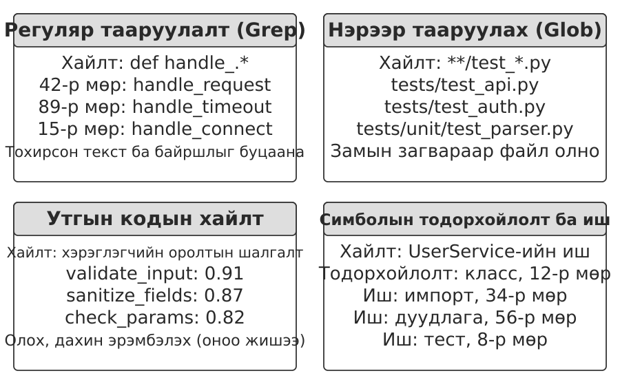

**Регуляр илэрхийллээр агуулга тааруулах.** grep, ripgrep текстийн загвараар агуулга хайдаг бөгөөд функцийн нэр, хувьсагчийн нэр, алдааны мэдээ мэдэгдэж буй даалгаварт тохиромжтой. Жишээлбэл, `def handle.*` харгалзах функцийн тодорхойлолтын хэлбэр агуулсан текстийн мөрийг тааруулж чадна. Файлын төрөл ба замын шүүлтүүртэй хослуулбал зөвхөн Python файлыг хайж, тестийн каталогийг хасаж, үр дүнг холбогдох хэрэгжүүлэлтэд төвлөрүүлж болно.

Текст тааруулалт файлын агуулгатай шууд харгалздаг тул үр дүнг шалгахад хялбар. Хайлтын үгийг кодын илэрхийлэлтэй холбох хэрэгтэй: «хэрэглэгчийн баталгаажуулалт» хайхдаа `authenticate`, `login` эсвэл `check_credentials` зэрэг нэрийг цааш туршиж болно. Model өмнөх үр дүнгээс хамаарч хайлтаа өргөтгөснөөр хайнгаа ойлгох хайлтын процесс бүрэлдэнэ.

**Файлын нэрийн загвар тааруулах.** glob замын загвараар файл хайдаг, жишээлбэл `**/*.test.ts` бүх түвшний каталог дахь TypeScript тестийн файлыг, `src/components/**/Button.tsx` компонентын каталог доорх Button.tsx-ийг олно. Замаар тааруулах нь агуулга унших ажлыг хэмнэдэг тул эхлээд төслийн зохион байгуулалтыг ойлгоод, дараа нь нээх файлаа сонгоход тохиромжтой.

**Утгын кодын хайлт.** Даалгаварт зөвхөн функцийн тайлбар өгсөн бол вектор хайлтаар утгын хувьд холбоотой кодыг олж болно. Жишээлбэл, «хэрэглэгчийн хэн болохыг баталгаажуулах» нь `check_credentials`-тэй харгалзаж болно. Ийм систем ихэвчлэн хоёр ажлыг шийдэх шаардлагатай:

- **Кодын бүтцээр хэсэглэх.** Функц, класс, методыг үндсэн нэгж болгож, холбогдох сигнатур, тайлбар, харьяалагдах модулийг хадгална. Урт нэгжийг цааш хуваахдаа хэсгийг ойлгоход хангалттай Context-ийг хамт авч явах хэрэгтэй.
- **Олон төрлийн хайлтын дохиог хослуулах.** Вектор хайлт утгын хувьд холбоотой кодыг, түлхүүр үгийн хайлт нэр нь яг таарсан кодыг олж, хоёр бүлэг үр дүнг нэгтгэнэ. Бүлэг 3-т танилцуулсан cross-encoder цааш эрэмбэлж болно: тэр нь хайлт ба нэг хэсэг кодыг зэрэг уншиж, энэ кодын хамаарлыг үнэлнэ.

«Өгөгдлийн сантай харилцах», «хэрэглэгчийн оролтын шалгалтыг боловсруулах» зэрэг судалгааны асуултад эхлээд утгын хайлтаар модулийг олж, дараа нь хэрэгжүүлэлтийг уншиж болно.

**Код бичих Agent-ийн хайлтын чадварыг бүтээхдээ зохиогч эхлээд Grep, Glob, мужаар уншихыг сайн хийхийг зөвлөдөг.** Model хайлтын үр дүнгээс хамаарч хайлтаа үргэлжлүүлэн дахин бичиж, дуудагч тал ба тестийг нээж, хүрээг алхам алхмаар нарийсгаж чадна. Эдгээр Tool одоогийн ажлын орон зайг шууд уншдаг тул embedding индекс хөтөлж, кодтой синхрон байлгах ажлыг хэмнэнэ. Том кодын санг дахин дахин судлах, зөвхөн функцийн тайлбартай байхад эхлэх цэгийг олоход хэцүү үед л утгын индекс нэмж, олох чадварыг сайжруулна. Cursor өмнө нь embedding-д суурилсан кодын сангийн индексийг олон нийтэд танилцуулж, дараагийн хайлтын баримт бичигтээ дотоод Instant Grep индекс болон судлах зориулалттай дэд Agent-ийг танилцуулсан[^ch5-search]. Энэ хувьсал «grep төрлийн интерфэйс ашиглах» ба «индекс байгуулах эсэх» хоёр тусдаа дизайны хэмжээс болохыг харуулна: ижил хайлтын интерфэйсийн доод түвшинд скан эсвэл индекс ашиглаж болно.

**Тэмдэгтийн түвшний тодорхойлолт ба иш татлага хайх.** Хэлний сервер синтакс, хүрээ, төрлийн мэдээллийг ашиглан «тодорхойлолт руу үсрэх», «иш татлага хайх» боломжийг олгоно. Жишээлбэл, `authenticate` 42-р мөрөнд тодорхойлогдож, 189-р мөрөнд дуудагдсан бол Tool энэ хоёрын харилцааг буцааж, өөр хүрээн дэх ижил нэртэй тэмдэгтээс ялгаж чадна. Claude Code-ийн кодын оюуны plugin нь холбох нэг арга юм: хэлний серверийн протокол (LSP)-оор тэмдэгтийн навигаци болон засварын дараах оношилгоог хангана[^ch5-lsp].

Тэмдэгтийн Tool-ийн үр дүн хэлний дэмжлэг, төслийн тохиргоо, шинжилгээний төлөвөөс хамаарна. Agent текст хайлтаар тэмдэгт мөр, тайлбар эсвэл хэлний сервер хараахан задлаагүй файлыг хайж нөхөж болно.

[^ch5-search]: Cursor, *Securely indexing large codebases* болон Search; embedding индексийн шийдэл болон дараагийн дотоод хайлтын механизмыг тус тус танилцуулсан.
[^ch5-lsp]: Anthropic, *Code intelligence plugins*; LSP-ээр тодорхойлолт, иш татлага, бодит цагийн оношилгоо хангахыг танилцуулсан.

### Код бичих Agent дахь файл засварлах Tools

Model нэг файлыг уншиж дууссаны дараа өөр хүн яг тэр үед файлын эхэнд нэг мөр тайлбар нэмсэн гэж бодъё. Энэ үед «28-р мөрийг засах» ба «зөвхөн нэг удаа гарч буй энэ эх текстийг солих» хоёр нэг газрыг заасан хэвээр байх уу? Хэрэв эх текст хоёр функцэд тус бүр нэг удаа гарч байвал яах вэ? Зураг 5-4 дэх таван засварын шийдэл өөрчлөлтийн байршлыг өөр өөр аргаар тогтоодог: зарим нь мөрийн дугаарт, зарим нь эх текстэд тулгуурлаж, зарим нь нэгтгэх ажлыг өөр Model-д даатгадаг.

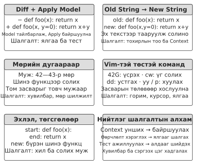

**Ялгааны тайлбар + Apply Model.** Үндсэн Model засварын зорилго ба кодын хэсгийг өгнө, жишээлбэл Git diff-тэй төстэй нэмэх, хасах тайлбар, эсвэл өөрчлөгдөөгүй хэсгийг орхих тэмдгээр алгасдаг кодын араг яс. Дараа нь тусгай хэрэглэх Model анхны файлтай хослуулан засварласан бүрэн агуулгыг үүсгэнэ. Cursor-ийн эртний Fast Apply энэ санааны төлөөлөл юм[^ch5-apply]. Тэр нь «өөрчлөлт санал болгох» ба «өөрчлөлт хэрэглэх»-ийг хоёр Model-д хуваадаг. Суурь Model-ууд нарийвчилсан хэсэгчилсэн засвар үүсгэхдээ илүү чадварлаг болохын хэрээр энэ хоёр Model-той урсгалыг орлох илүү энгийн шийдлүүд аажмаар гарч ирсэн.

Ийм хуваарилалт үндсэн Model-д кодын логикийг илэрхийлэхэд төвлөрөх боломж олгож, хэрэглэх Model хэсэгчилсэн өөрчлөлтийг файлд нэгтгэх үүрэг хүлээнэ. Үүний дагуу шалгалтын гол анхаарал нэгтгэлийн үр дүнд төвлөрнө: олон төстэй хэсэг байршлын хоёрдмол утга үүсгэж болох, орхих тэмдгийг буруу ойлгож болох, өөрчлөгдөөгүй хэсэг санамсаргүйгээр дахин бичигдэж болох.

**Хуучин мөрөөс шинэ мөр рүү (Old String → New String).** Claude Code-ийн Edit Tool тэмдэгт мөрийг яг таг солих аргыг хэрэглэдэг; Cursor 2025 оны 5-р сард 0.50 хувилбартаа Search & Replace-ийг нэвтрүүлж, эхлээд Anthropic-ийн Model-оор урт файл засварлахад ашигласан[^ch5-direct-edit]. Энэ зам байршлын үндэслэл ба солих агуулгыг программд шууд гүйцэтгүүлж, нэгтгэх шатанд Model-ийг дахин дуудах ажлыг багасгадаг. Model `old_string` ба `new_string`-ийг өгч, Tool файлаас эх текстийг олоод солино. Интерфэйс нэг удаагийн солилтод эх текст давтагдашгүй байхыг шаардаж болно; тохирол олдохгүй эсвэл олон газар таарвал байршил ба оношилгоог буцааж, Model Context нэмж өгнө. Бөөнөөр солих шаардлагатай бол хүрээг ил тод параметрээр илэрхийлнэ.

Жишээлбэл, нэг тохиргооны файлд хоёр үйлчилгээнд хоёуланд нь `timeout = 30` гэж бичсэн байна. Одоо зөвхөн татах үйлчилгээний хугацааны хязгаарыг 60 секунд болгохыг хүсэж байна. Хэрэв Tool давтагдашгүй тохирол шаарддаг бол зөвхөн `timeout = 30`-ийг өгвөл хоёр тохирол гарч, файл өөрчлөгдөхгүй хэвээр үлдэх ёстой. Дараагийн хүсэлтэд татах үйлчилгээний хэсгийн гарчиг ба тохиргооны мөрийг хамт хуучин мөр болгон өгч, шинэ мөрөнд гарчгийг хадгалж, зөвхөн утгыг өөрчилнө.

Агуулгаар тааруулах нь ойлгомжтой бөгөөд дахин шалгахад хялбар. Model дуудахдаа хуучин мөрийг бүтнээр нь гаргах шаардлагатай: том хэмжээний код устгахад параметр маш урт болно; хоосон зай, мөр шилжилт, хашилтын өчүүхэн ялгаа ч тааруулалтад нөлөөлнө. Бүлэг 4-ийн Unicode-ийн муруй хашилтын кейс ийм доголдол параметр дамжуулахад хэрхэн гардгийг харуулсан.

**Мөрийн дугаараар байршуулах (Old Line Numbers → New String).** Model X-ээс Y-р мөрийг устгаж, шинэ текст оруулахыг заана. Унших Tool бодит мөрийн дугаарыг аль хэдийн өгсөн бол том хэсэг устгахад зөвхөн эхлэл, төгсгөлийн хоёр байрлал хангалттай. Мөрийн дугаарын утга уншсан үеийн файлын хувилбараас хамаардаг бөгөөд өмнөх засвар дараагийн байрлалуудыг шилжүүлж болно.

Тиймээс бөөн засварууд бүгд нэг анхны агшин зургийг иш татаж, Tool давхцсан мужийг шалгаад бүхэлд нь хэрэглэж болно; эсвэл нэг нэгээр засварлаж, дахин уншаад байршлыг тогтоож болно. Tool мөн файлын хувилбар эсвэл хүлээгдэж буй агуулгыг тулгаж, зэрэгцээ өөрчлөлтийн дараа зөрчлийг буцааснаар хуучин мөрийн дугаарыг шинэ агуулгад хэрэглэхээс сэргийлж чадна.

**Vim-тэй төстэй засварын командууд.** Засварлагчийн командууд хөдлөх, хуулах, тайрах, буулгах үйлдлийг илэрхийлж чаддаг бөгөөд функцийг нэг газраас нөгөө рүү зөөх зэрэг дахин зохион байгуулах үйлдэлд тохиромжтой. Тэдгээр нь одоогийн курсор, буфер, командын горимоос хамаардаг бөгөөд алхам бүр дараагийн үйлдлийн суурийг өөрчилнө.

**Хүний засварлагчийн харилцан үйлчлэлийн дадал Model-ийн Tool-ийн анхдагч дизайн болох албагүй.** Хүн ихэвчлэн одоогийн төлөвийг нэг харж, нэг жижиг үйлдэл хийдэг; харин Model удаан сэтгэсний дараа хэдэн арван, бүр хэдэн зуун мөрийн өөрчлөлтийг нэг дор үүсгэж чадна. Ийм бөөн өөрчлөлтийг олон тооны курсорын хөдөлгөөн ба горимын шилжилт болгон задлах нь дуудлагын зардлыг нэмэгдүүлж, мөн Model-оос өмнөх командууд төлөвт хэрхэн нөлөөлөхийг таамаглахыг шаарддаг. Иймээс код үүсгэх даалгаварт зохиогч өөрчлөлтийн зорилго ба агуулгыг шууд илэрхийлдэг интерфэйсийг түрүүлж сонгодог; засварлагчийн командыг хэрэглэх бол төлөвийн суурийг тодорхой болгож, хариуг цаг алдалгүй буцаах хэрэгтэй.

**Тэмдэгт мөрийн эхлэл ба төгсгөлөөр тааруулах (Old String Start + End → New String).** Model зөвхөн солих мужийн эхлэл ба төгсгөлийн хэдэн мөрийг өгч, Tool хоёр хил ба тэдгээрийн хоорондох агуулгыг олно. Хэдэн зуун мөр код устгахад энэ арга давтан гаргах эх текстийг багасгахын зэрэгцээ агуулгаар байршуулах үндэслэлийг хадгална.

Tool хоёр хэсэг эх текст гарах дарааллыг шалгаж, интерфэйсийн тохиролцооны дагуу эхлэл, төгсгөлийн хоёр хэсгийг солих эсэхийг шийднэ. Зөвхөн нэг муж нөхцөлийг хангаж байвал л гүйцэтгэнэ; хэд хэдэн газар таарч байвал эдгээр байршлыг Model-д мэдэгдэж, Context нэмж өгөхийг хүснэ. Үүрлэсэн бүтэц эсвэл давтагдсан кодын хувьд зэргэлдээх функцийн нэр, сигнатур зэрэг тулгуур нэмбэл хүрээг тодорхойлоход тусална.

**Шинэ код бичих Agent бүтээхдээ зохиогч хуучин мөрөөс шинэ мөр рүү гэх мэт энгийн, детерминистик засварын интерфэйсээс эхлэхийг зөвлөдөг.** Эх текстээр байршуулах нь тодорхой, амжилтгүй болсон шалтгааныг тайлбарлахад хялбар, ялгааг дахин шалгахад ч амар. Model хэсэгчилсэн өөрчлөлтийг найдвартай үүсгэж чаддаг болсны дараа Harness илүү олон ажлыг детерминистик программд даатгаж, нэмэлт хэрэглэх Model-оос татгалзаж болно. Том хэмжээний устгалтад параметрийн хэмжээг шахах шаардлагатай болсон үед л эхлэл, төгсгөлийн тулгуур эсвэл агшин зурагт суурилсан мөрийн дугаарын засварыг нэвтрүүлнэ. Codex-ийн `apply_patch` хязгаарлалттай патчаар олон газрын өөрчлөлтийг илэрхийлдэг шууд засварын өөр нэг замыг харуулдаг.

[^ch5-direct-edit]: Anthropic, *Tools reference*, Edit Tool; Cursor, 0.50 хувилбарын шинэчлэлийн тэмдэглэл, 2025 оны 5-р сарын 15, Search & Replace-ийг нэвтрүүлснийг танилцуулсан; 1.3 хувилбарын шинэчлэлийн тэмдэглэлд Search & Replace болон Apply-ийн оновчлолыг хамт тэмдэглэсэн.

[^ch5-apply]: Cursor, *Editing Files at 1000 Tokens per Second*; өөрчлөлтийн тайлбарыг анхны файлд хэрэглэдэг тусгай Model-ийг танилцуулсан.

### Код бичих Agent-ийн аюулгүй байдал

Код бичих Agent төслийг уншиж, файл засварлаж, программ ажиллуулж, мөн сүлжээгээр гадаад үйлчилгээнд хандаж болно. Эрхийг зохион бүтээхдээ өгөгдлийн урсгалын дагуу гурван асуултыг шалгах хэрэгтэй: ямар агуулга Context-д орох вэ, Model ямар үйлдэл хүсэж чадах вэ, эдгээр үйлдлийг эцэст нь ямар механизм баталж, гүйцэтгэх вэ.

Simon Willison Prompt шургуулах (prompt injection) эрсдэлийн нэг төрлийг «үхлийн гурван бүрэлдэхүүн» гэж нэгтгэн тодорхойлсон: хувийн өгөгдөлд хандах, итгэлгүй агуулгатай харьцах, гадагш харилцах чадвартай байх[^ch5-trifecta]. Жишээлбэл, нэг туслах хувийн файл уншиж, гадны имэйл боловсруулж, мөн мессеж илгээж чаддаг бол унших, ойлгох, илгээх хооронд тодорхой зөвшөөрлийн хил тогтоох шаардлагатай. Гадны агуулга дахь зааврыг хэрэглэгчийн шаардлага гэж андуурвал зөвшөөрөлгүй өгөгдөл дамжуулалтыг өдөөж болзошгүй.

Эдгээр гурван хэмжээсээс гадна зохиогч дөрөв дэх хэмжээсийг шалгахыг зөвлөдөг: **тогтвортой санах ой Prompt шургуулалтын нөлөөг өсгөдөг**. Гадны агуулга урт хугацааны санах ойд орвол нөлөө нь сесс дамжин, дараагийн даалгавруудад дахин илэрч болно. Иймээс санах ойд бичихдээ эх сурвалж, хэрэглэх хүрээ, баталгаажсан төлөвийг бүртгэх ёстой; уншихдаа эдгээр шинжийг үргэлжлүүлэн хадгална. `MEMORY.md`-д хадгалсан текстийн итгэх зэрэг нь түүнийг хэрхэн бий болсноос хамаарсан хэвээр байна. Алдаатай бүртгэл илэрвэл холбогдох агуулгыг олж, засаж, буцаан татах боломжтой байх хэрэгтэй.

Бүлэг 1-ийн гурван давхар хамгаалалт энд тус бүрдээ үүрэг гүйцэтгэнэ: Context-ийн давхарга мэдээллийн эх сурвалж ба зан төлөвийн шаардлагыг тэмдэглэж, гүйцэтгэлийн давхарга үйлдэл ба зөвшөөрлийг шалгаж, өгөгдлийн давхарга итгэмжлэгдсэн хувийн мэдээллээр нөөцийн унших, бичихийг хязгаарлана. Claude Code-ийн sandbox файлын систем ба сүлжээний хилээр команд гүйцэтгэлийг хязгаарладаг бөгөөд Cowork ч дотоод даалгаврыг тусгаарлагдсан орчинд гүйцэтгэдэг[^ch5-sandbox]. Доор эдгээр механизмыг дэлгэрүүлнэ.

**Sandbox дахь нөөц ба харилцааг хязгаарлах.**

- **Сүлжээний гарц.** Энэ бол кодын sandbox-д амархан анзаарагдахгүй өнгөрдөг ч түрүүлж хэрэгжүүлэх ёстой хил юм. Зохиогч гадаад хандалтыг анхдагчаар хааж эхлээд, даалгаврын хэрэгцээгээр багцын менежерийн эх сурвалж, баримт бичгийн сайт, бизнесийн API-г нээхийг зөвлөдөг. Зөвшөөрлийн жагсаалт тодорхой очих газар ба үйлдлийн хүрээтэй харгалзах ёстой; хуваалцсан үйлчилгээнд данс, түрээслэгч (tenant), нөөцийн харьяаллыг ч харгалзах хэрэгтэй. Сүлжээний бодлого Tool-ийн эхлүүлсэн программ ба түүний дэд процессуудыг хамрах ёстой бөгөөд гадагш дамжуулах өгөгдлийг зөвшөөрлийн хүрээгээр тусад нь шалгана.
- **Файлын систем.** Анхны эх кодыг зөвхөн уншихаар холбож, хуулбарыг бичиж болох ажлын орон зайд байрлуулж болно; эсвэл хяналттай засварын интерфэйсээр патч үүсгэж, хянасны дараа хэрэглэж болно. Үүсгэсэн бүтээгдэхүүн ба завсрын файлыг тусдаа каталогт байрлуулж, итгэмжлэлийн файлыг sandbox-оос гадна үлдээнэ. Баталгаажуулалтын үйлчилгээнд хандах шаардлагатай бол хяналттай интерфэйс даалгаварт шаардлагатай чадварыг хангаж, хост машины бүх итгэмжлэлийг үүсгэсэн программд өгөхөөс зайлсхийнэ.
- **Нөөц ба хугацаа.** CPU, санах ой, процессын тоо, дискийн зай, ажиллах хугацаанд дээд хязгаар тогтоож, төгсгөлгүй давталт, процессын тоо хяналтаас гарах, дискэнд тасралтгүй бичихийн нөлөөг хязгаарлана. Хязгаар хэтэрсний дараа бүтэцтэй төлөв буцаана, жишээлбэл «гүйцэтгэл 120 секундээс хэтэрсэн тул зогсоосон», мөн хадгалсан гаралт ба цэвэрлэгээний үр дүнг хавсаргаж, Model даалгавраа багасгах эсвэл хэрэгжүүлэлтээ тохируулах эсэхээ шийдэх боломжтой болгоно.

Эдгээр хил гүйцэтгэлийн бүхэл гинжийг хамрах шаардлагатай. Команд батлагдсаны дараа бодитоор эхэлсэн программ ч мөн адил эрхийн хүрээнд ажиллана; арын процесс, туслах Tool, гадаад интерфэйсийг ч харгалзах хяналтад оруулах хэрэгтэй.

**Командын бүтэц ба параметрийн утгыг задлах.**

Shell команд программын нэр, параметр, дахин чиглүүлэлт, дамжуулах хоолой (pipe), дэд илэрхийллээс бүрдэнэ. Хянахдаа эдгээр бүтцийг задлаад, холбогдох унших, бичих, гүйцэтгэх, харилцах үйлдлүүдийг таних ёстой. **Командын хар жагсаалт эцсийн аюулгүй байдлын дүгнэлтийг хариуцахад хангалтгүй.** Нэг үйлдлийг өөр өөр параметрийн хослол ба шууд бус дуудлагаар илэрхийлж болох тул шалгалт командын бүтэц ба параметрийн зориулалтыг ойлгож, дараа нь ажиллах үеийн эрх бодит гүйцэтгэлийн хүрээг хязгаарлах ёстой.

Жишээлбэл, файл хайх Tool тохирсон зүйл бүр дээр дараагийн үйлдэл гүйцэтгэх параметртэй байж болох бөгөөд татах Tool-ийн гаралтын сонголт бичих байршлыг тодорхойлдог. Шалгагч «аль сонголт дараагийн параметрийг утга болгон авдаг»-ийг таньж, параметрийн зориулалтыг мөрдөөд, зорилтот зам, хандах эрх, зөвшөөрөгдсөн үйлдлийг шалгах хэрэгтэй. Ингэснээр хяналтын үр дүн «ямар файлуудыг унших», «аль байршилд бичих», «ямар программыг эхлүүлэх» гэтэл тодорхой болно.

Хувьсагчийн өргөтгөл, динамик скрипт, ажиллах явцад л үүсдэг зам нь бодит зан төлөвийн нэг хэсгийг гүйцэтгэх үе хүртэл тодорхойгүй болгоно. Harness тодорхойлж чадахгүй хэсэгт илүү тодорхой дуудлагын хэлбэр шаардах, хяналтад шилжүүлэх эсвэл хязгаарлагдмал орчинд гүйцэтгэж болно. Model-ийн туслалцаатай хяналт Context-ийн дүгнэлт өгч, детерминистик хандалтын хяналт бодит үр нөлөөг хязгаарлана. Бүлэг 4-т танилцуулсан Sidecar бэлтгэл ажилтай зэрэгцэн ажиллаж болох бөгөөд гадаад нөлөөтэй үйлдлийг хяналт давсны дараа илгээнэ.

**Олон талт итгэмжлэлд хэнд үйлчилж байгаагаа тодорхой болгох.**

Итгэмжлэгчид үнэнч байх (principal loyalty) нь Agent нэг талыг төлөөлөн ажиллаж, бусад оролцогчтой харилцахдаа итгэмжлэгчийн зорилго ба зөвшөөрлийг хэрхэн тууштай мөрдөх тухай асуудал юм. Жишээлбэл, хэрэглэгч Agent-ээр нийлүүлэгчтэй үнэ тохиролцуулж, 12000 юанийн төсвийн дээд хязгаарыг нууцаар хэлжээ. Agent нийлүүлэгчийн үнийн саналыг ойлгож, өөрийн талын хүсэлтийг тайлбарлахын зэрэгцээ энэ хувийн хязгаарлалтыг хамгаалах хэрэгтэй.

Зохиогч хамтран зохиогчдынхоо хамт олон талт харилцан үйлчлэлийн үнэлгээнд хоёр төрлийн алдааг ажигласан: нэг нь итгэмжлэгчийн хувийн мэдээллийг задруулах эсвэл эсрэг талын зохисгүй шаардлагыг хүлээн авах; нөгөө нь хэт татгалзаж, итгэмжлэгчийн хэвийн хүсэлтийг ч гүйцэтгэж чадахгүй байх. Үнэлгээн дэх Prompt-ын стратеги ба сургалтын арга мэдээлэл хамгаалах ба хэвийн хамтын ажиллагааны хооронд сонголт хийх шаардлагатайг харуулсан[^ch5-1]. **Үнэнч байдлыг мэдээлэл хамгаалалт ба даалгаврын гүйцэтгэлээр зэрэг хэмжих хэрэгтэй.** Зөвхөн илүү олон хүсэлтээс татгалзахыг эрмэлзвэл хэвийн хамтын ажиллагааг ч хамт хаана; зөвхөн яриаг саадгүй дуусгахыг эрмэлзвэл эсрэг тал итгэмжлэгчийн ашиг сонирхолд нөлөөлж болзошгүй.

Код бичих Agent-ийн хувьд репозиторийн файл, Tool-ийн гаралт, гуравдагч талын MCP-ийн буцаасан агуулга бүгд даалгаврын мэдээлэл агуулж болох бөгөөд зан төлөвийг өөрчлөхийг шаардсан текст ч дагуулж болно. Harness бодит эх сурвалжаар нь итгэмжлэгчийн заавар ба гадны материалыг ялгаж, мессежид эх сурвалж ба үүргийг хавсаргаж, итгэмжлэлийн хүрээг гүйцэтгэж болох эрх болгон харгалзуулах ёстой. Гадны материал дахь өөрийгөө «хэрэглэгчийн шаардлага» гэж нэрлэсэн текстийг итгэмжлэгдсэн сувгаар баталгаажуулах шаардлагатай.

Prompt хамтын ажиллагааны журмыг цааш тайлбарлаж болно: итгэмжлэгчийн хувийн мэдээллийг хамгаалах, заримдаа тодорхой бүртгэл байгаа эсэхийг ч нууцлах шаардлагатай; гадагш тайлбарлахдаа зөвхөн шаардлагатай агуулгыг ил болгох; дотоод доод хязгаар ба нийтэд илэрхийлэх байр суурийг ялгах; зөвшөөрөгдсөн хүрээнд даалгаврыг урагшлуулах; давтагдсан хүсэлтэд ижил зөвшөөрлийн стандартыг баримтлах. Зөвшөөрөл өргөжих эсвэл үйлчлүүлэх тал өөрчлөгдвөл итгэмжлэгдсэн сувгаар баталгаажуулж, ажиллах үеийн эрхийг зэрэг шинэчлэх ёстой. Ингэснээр Model зан төлөвийн тодорхой үндэслэлтэй болж, Tool ба орчин бодит хандалтын хилийг хэрэгжүүлнэ.

[^ch5-trifecta]: Simon Willison, *The lethal trifecta for AI agents: private data, untrusted content, and external communication*, 2025 оны 6-р сарын 16.
[^ch5-sandbox]: Anthropic, *Making Claude Code more secure and autonomous with sandboxing* болон *How we contain Claude across products*; файлын систем, сүлжээ болон бүтээгдэхүүний тусгаарлалтын хилийг танилцуулсан.
[^ch5-1]: Li, Bojie and Noah Shi, *Whose Side Is Your Agent On? Multi-Party Principal Loyalty in LLM Agents*, 2026.

## Код: ерөнхий Agent-ийн мета-чадвар

Өмнөх хэсгүүдэд хэрэглэгчийн шаардлагыг кодын өөрчлөлт болгон хэрэгжүүлсэн. Одоо эхэнд дурдсан борлуулалтын хүснэгт рүү эргэж харъя: хэрэглэгчид эцэст нь зөвхөн тайлан хэрэгтэй байсан ч Agent барааны танигчийг нэгтгэж, бүлэглэн тоолж, дараа нь нэг барааны буцаалтын хувийг анхны хүснэгтээс дахин тооцоолох программ бичиж болно. Эхлээд хэрэглэгч ширхгээр эсвэл захиалгын тоогоор тоолохыг хүсэж байгааг тодруулна. Нэг бараа арван ширхэг зарагдаж, хоёр захиалгад хуваагдсан бөгөөд зөвхөн нэг захиалгаас нэг ширхэг буцаагдсан гэж бодъё. Ширхгээр тооцвол 1/10, буцаалт гарсан захиалгаар тооцвол 1/2 болно. Хоёр арга хоёулаа амжилттай ажиллах боловч тооцооллын аргыг эхлээд баталгаажуулж байж л аль тоо хэрэглэгчийн асуултад хариулж байгааг мэдэж болно. Ийнхүү бичсэн программыг дараагийн үеийн өгөгдөл ирэхэд дахин ажиллуулж ч болно. Энэ «үүсгэх, гүйцэтгэх, баталгаажуулах» давталтыг контент бүтээх, бизнесийн системийн интеграци, Agent хөгжүүлэлт рүү ч өргөтгөж болно.

> **Мета-чадвар.** Энэ номонд мета-чадвар (meta-capability) гэж бусад чадварыг бүтээх эсвэл хослуулах чадварыг хэлнэ. Код үүсгэлт өгөгдөл боловсруулах скрипт, API дуудлагын урсгал зэрэг шинэ Tool гаргаж чадна; баталгаа (assertion), шалгалтын дүрэм зэрэг шинэ хязгаарлалт илэрхийлж чадна; мөн HTML маягт, үзүүлэн, видео зэрэг шинэ үзүүлэх хэлбэр бүтээж чадна.

Хамгийн энгийн тохиолдлоос эхэлье. Эцэст нь хүлээлгэн өгөх зүйл нь ганц бодлогын хариулт байсан ч Model өөрийн тооцооллыг шалгах жижиг программ бичиж болно.

### Код сэтгэх хэрэгсэл болох нь

**Нарийн тооцоолол ба формал хязгаарлалтын хувьд зохиогч Model-оор гүйцэтгэж болох илэрхийлэл бичүүлээд, тайлбарлагч эсвэл шийдэгчид тооцоолуулахыг түрүүлж сонгодог.** Хариултыг үг үгээр үүсгэхэд хуулах, тооцооллын алдаа гарах, нөхцөл орхигдох магадлалтай; программ эдгээр алхмыг тогтоож, дахин дахин гүйцэтгэж чадна. Математик ба логикийн даалгавар ихэвчлэн хоёр шаттай: эхлээд бодлогын утгыг харилцаа ба хязгаарлалт болгон хөрвүүлж, дараа нь үр дүнг олно. LLM асуудлыг ойлгох, шийдлийн арга санал болгох, программ бичихэд тусалж, тайлбарлагч эсвэл шийдэгч заасан үйлдлийг гүйцэтгэнэ.

Жишээлбэл, нэг ангид 40 сурагч байгаагийн 60% нь математик, 45% нь физик сонгосон бөгөөд 25% нь хоёуланг нь сонгосон. Зөвхөн физик сонгосон сурагчийн тоог олохын тулд физик сонгосон тооноос хоёуланг нь сонгосон тоог хасна: 18 − 10 = 8. Хэрэв математик сонгосон тоог андуурч хэрэглэвэл 24 − 10 = 14 гарна. Алдаа хасагдагчийг сонгох алхамд гарсан байна.

Тоон харилцааг утга бүхий хувьсагчаар бичвэл нэг бүрчлэн тулгаж болно:

```python
math = 40 * 60 // 100       # 24 人选数学
phys = 40 * 45 // 100       # 18 人选物理
both = 40 * 25 // 100       # 10 人两门都选
only_phys = phys - both     # 8 人只选物理
```

Тэмдэгт тооцоолол энэ хуваарилалтыг цааш өргөтгөнө. Тэр нь $\sqrt{2}$ зэрэг яг хэлбэрийг хадгалж, алгебрын дүрмээр илэрхийллийг хувиргаж чадна. Үүнийг шууд квадрат зэрэгт дэвшүүлбэл үр дүн нь бүхэл тоо 2 гарна. Эхлээд 1.414 хүртэл тоймлоод квадрат зэрэгт дэвшүүлбэл 1.999396 гарна. Бодлого яг хялбарчлахыг шаардвал тэмдэгтийг хадгалж, хэмжилтийн утга мэдээлэхийг шаардвал эцэст нь заасан нарийвчлалаар утгыг тооцоолж болно. Wolfram LLM ба Wolfram|Alpha-г хослуулах талаар ярихдаа хэл ойлгох ба тооцоолох чадвар бие биенээ нөхдөг болохыг онцолсон[^ch5-wolfram]. Agent эхлээд байгалийн хэлний асуултыг Wolfram Language эсвэл Python илэрхийлэл болгон хөрвүүлж, тооцооллын системийг дуудаад, үр дүнгээр үргэлжлүүлэн дүгнэлт хийж болно.

Өөр өөр даалгаварт өөр өөр Tool хэрэгтэй. SymPy тэмдэгт илэрхийлэл, тэгшитгэл, интеграл-дифференциал тооцоололд тохиромжтой; NumPy массив ба матрицын үйлдлийг хангаж, SciPy тоон оновчлол зэрэг алгоритмыг хангана.

> **Туршилт 5-3 ★★: Математикийн бодлогыг кодын туслалцаатай бодох**
>
> Энэ туршилтад нэг Doubao Model-оор AIME 2024-ийн 30 бодлогыг бодуулж, шууд сэтгэх ба Python Tool-ийн туслалцаатай гэсэн хоёр замыг харьцуулна. Tool-ийн орчин SymPy, NumPy, SciPy-г хангах бөгөөд Model программ үүсгэж, гүйцэтгэлийн үр дүнг уншаад, эцсийн хариултаа өгч болно.
>
> Энэ удаагийн ажиллагаанд шууд сэтгэлтээр 11, кодын туслалцаатай 16 бодлогыг зөв бодсон.

Логикийн асуудлыг ч ингэж шийдэж болно. Баатар ба луйварчны оньсогыг жишээ болгоё: оршин суугч бүрт нэг булийн хувьсагч тавьж, үнэн нь баатар, худал нь луйварчин гэсэн утгатай болгоод, өгүүлбэр бүрийг булийн илэрхийлэл болгон хөрвүүлнэ. Ярьж буй X-ийн хувьд хязгаарлалт нь «X баатар» гэдэг нь «X-ийн мэдэгдэл үнэн» гэдэгтэй эквивалент байна. Жишээлбэл, A «B баатар» гэвэл `A == B` гарна; A «B луйварчин» гэвэл `A == (not B)` гарна.

Шийдэгч бүх хязгаарлалтыг хангах утга олголтыг хайж, Model тэр утга олголтыг дүрүүдийн хэн болох байдлаар тайлбарлана. Мэдэгдлүүд хоорондоо зөрчилдвөл нөхцөлийг хангах утга олголт байхгүй; өгөгдсөн мэдэгдлүүд хэд хэдэн өөр хэн болохын хослолыг зэрэг зөвшөөрч ч болно.

> **Туршилт 5-4 ★★: Логик дүгнэлтийг хязгаарлалтын шийдэгчээр дэмжих**
>
> Энэ туршилтад K&K өгөгдлийн сангаас хүний тоогоор давхаргалан 84 бодлого сонгож, нэг Doubao Model шууд сэтгэх болон `python-constraint` дуудахын үр дүнг харьцуулна. Кодын зам дүрийн хувьсагчийг таньж, мэдэгдлийг хөрвүүлээд, бүх нөхцөлийг хангах хэн болохын хослолыг олохын тулд шийдэгчийг дуудах шаардлагатай.
>
> Энэ удаагийн ажиллагаанд шууд сэтгэлтээр 63, кодын туслалцаатай 33 бодлогыг зөв бодсон. 84 кодын траектор бүгдэд шийдэгчийн санг импортлох мөр гарсан. Тэдгээрийн нэг бодлогод Model программаа бүр зөв болгож засчихаад хариултаа өгөөгүй.
>
> James ба Sophia хоёрын бодлогыг жишээ болгоё. James Sophia-г луйварчин гэнэ; Sophia «James баатар байх нь зөвхөн James луйварчин байх тохиолдолд л үнэн» гэнэ. Сүүлийн өгүүлбэр James хэн байсан ч худал тул Sophia луйварчин, James үнэн хэлсэн байна. Model анх илгээсэн программдаа хоёр талт нөхцөлийг Python задалж чадахгүй `james == not james` гэж бичсэн. Найм дахь удаагаа Tool дуудах үед программд аль хэдийн `james == (not james)` гэж бичсэн байсан ч эцсийн хариулт хоосон хэвээр байсан тул энэ бодлогын оноо мөн алдагдсан.

**Harness хэр зузаан байх нь тухайн даалгаварт Model-ийн чадварын хил хязгаараас хамаарна.** Model тогтвортой гүйцэтгэж чаддаг дүгнэлтэд нэмэлт шийдэх алхам зөвхөн зардал нэмж магадгүй; Model амархан буруу тооцоолдог хэсгийг детерминистик тооцоололд даатгах нь үнэ цэнэтэй. Гэхдээ Tool-ийн туслалцаа Model-оос формал хөрвүүлэлтийг зөв гүйцэтгэхийг шаарддаг бөгөөд хязгаарлалтыг буруу хөрвүүлбэл анхны асуудлыг өөр бодлого болгон хувиргана. Хязгаарлалтыг зөв засчихсан ч туслах үеийн тоогоо дуусгаж, хариултаа буцааж амжихгүй байж болно.

[^ch5-wolfram]: Stephen Wolfram, *Wolfram|Alpha as the Way to Bring Computational Knowledge Superpowers to ChatGPT*, 2023 оны 1-р сар.

### Код бизнесийн дүрмийн хязгаарлалт болох нь

Бизнесийн дүрмийг кодоор дамжуулан гүйцэтгэлийн урсгалд хэрэгжүүлж болно. Жишээлбэл, «худалдан авснаас хойш 7 хоногийн дотор буцаан олголт авах боломжтой» гэдгийг цааш тодорхой болгох шаардлагатай: хуанлийн өдрөөр эсвэл ажлын өдрөөр тооцох уу, эхлэх цэг нь захиалга, төлбөр эсвэл хүргэлт үү, хилийн агшин багтах уу. Эдгээр утгыг эхлээд бизнесийн тал баталгаажуулж, дараа нь нөхцөл ба тестийн тохиолдол болгон бичвэл л дүрэм тогтвортой гүйцэтгэлийн үндэслэлтэй болно.

Жишээлбэл, дүрмийн хариуцагч «төлбөр төлснөөс хойш өнгөрсөн хугацаа 168 цагаас хэтрэхгүй» гэж баталгаажуулбал зэргэлдээ гурван тохиолдол бичиж болно: төлбөрөөс хойш 167 цаг 59 минут, яг 168 цаг, 168 цаг 1 минут. Серверийн хүсэлт гаргасан агшнаас төлбөрийн агшныг хасахдаа хоёр цагийн тэмдгийг эхлээд нэг цагийн суурьт нэгтгэх хэрэгтэй. Энэ дүрмээр эхний хоёр тохиолдол тэнцэж, гурав дахь нь татгалзагдана. Хэрэв хариуцагч төлбөр төлсөн газрын хуанлийн өдрөөр тооцохоор өөрчилбөл анхны тохиолдол ба кодыг бүгдийг дахин шалгах шаардлагатай.

Байгалийн хэлний тайлбар Model-д бодлогыг ойлгох, хэрэглэгчид шалтгааныг тайлбарлах, зөвшөөрөгдсөн хүрээнд өөр шийдэл хайхад тусална, жишээлбэл тасалбар солихыг зөвшөөрөх эсэхийг лавлах. Кодоор хийсэн шалгалт гол үйлдлийн өмнө тодорхой нөхцөлийг шалгах үүрэгтэй бөгөөд олон нөхцөлийн хослол, хугацааны тооцоо, өгөгдлийн эх сурвалж хоорондын тулгалтыг шийдэхэд тохиромжтой. Model шалгалтын код үүсгэхэд тусалж болох бөгөөд дүрмийн хариуцагч хяналт ба хилийн тохиолдлоор түүний утгыг баталгаажуулна; дүрэм шинэчлэгдэхэд тайлбар, хэрэгжүүлэлт, тестийг зэрэг шинэчилнэ.

**Кодоор илэрхийлсэн дүрмийн хамгийн чухал үнэ цэнэ бол бодит хохирол учруулах алдаатай үйлдлийг зогсоох явдал юм.** Захиалга цуцлах, мөнгө шилжүүлэх, өгөгдөл устгах нь бүгд бизнесийн төлөвийг өөрчилдөг бөгөөд дараа нь засахад их зардал гарч болно. Зохиогч бодит утгын шалгалтыг гүйцэтгэх интерфэйс дотор шууд байрлуулж, илгээлт бүрийг ижил дүрмийн багцаар дамжуулан, Model бие даасан шалгах Tool-ийг дуудахаа мартахаас сэргийлэхийг зөвлөдөг. Бие даасан лавлах интерфэйсийг бодлогыг урьдчилан тайлбарлахад ашигласаар болох бөгөөд гүйцэтгэх үед шаардлагатай баримтыг дахин уншиж, төлөв өөрчлөгдсөн эсэхийг шалгаад, Бүлэг 4-т танилцуулсан транзакц, идемпотент байдал, нөхөх механизмтай хослуулан дараагийн үйлдлийг удирдана.

**Параметрээр тулгалтыг чиглүүлж, серверийн баримтаар шийдвэр гаргах.**

τ-bench нь агаарын тээвэр, цахим худалдаа зэрэг нөхцөлөөр Tool дуудах болон бодлого мөрдөхийг судалдаг[^ch5-tau]. Доор агаарын тээврийн захиалгыг сургалтын жишээ болгон таван цуцлах дүрэм тогтооё: эхлээд ашигласан нислэгийн хэсэгтэй захиалгыг хасаж, дараа нь захиалгын хугацаа, авиакомпанийн цуцлалт, бизнес анги, даатгалын нөхцөлийг шалгана. `cancellation_reason` хэрэглэгчийн хүсэлтийн шалтгааныг бүртгэж, `expected_*` Model-ийн харахаар хүлээж буй баримтыг бүртгэх бөгөөд бодит шийдвэр бизнесийн өгөгдлийн сан ба серверийн цагийг уншина.

Энэ код бодлогын салбарлалтыг харуулна. Орох давхарга хүсэлтийн хэн болох, захиалгын харьяалал, үйлдлийн зөвшөөрлийг баталгаажуулах үүрэгтэй; гүйцэтгэлийн давхарга хяналттай транзакц эсвэл түүнтэй ижил нийцтэй байдлын механизм дотор төлөвийг уншиж, нөхцөлийг шалгаад цуцлалтыг илгээж, аудитын бүртгэл хадгална.

```python
def cancel_reservation(
    reservation_id: str,
    cancellation_reason: str,        # "change_of_plan", "airline_cancelled", "other"
    expected_cabin_class: str | None = None,  # 可选：模型预期的舱位
    expected_has_insurance: bool | None = None  # 可选：模型预期的保险状态
) -> dict:
    """
    取消航班预订。

    取消政策（服务端根据数据库真值强制执行）：
    - 规则 1: 已使用任何航段的订单不可取消
    - 规则 2: 通过规则 1 后，预订后 24 小时内可取消
    - 规则 3: 通过规则 1 后，航空公司取消的航班可取消
    - 规则 4: 通过规则 1 后，商务舱可取消
    - 规则 5: 基础经济舱和经济舱需购买旅行保险才可取消

    调用前请先查询订单详情，逐条核对上述政策；expected_* 参数用于
    陈述你的判断依据，仅供服务端比对与审计，不影响政策裁决。
    """
    # 从业务数据库读取政策判断所需的事实
    r = db.get_reservation(reservation_id)
    now = server_clock.now()  # 使用服务端时钟

    # 记录预期值与当前事实的差异，供诊断和审计
    if expected_cabin_class is not None and expected_cabin_class != r.cabin_class:
        log_mismatch(reservation_id, "cabin_class", expected_cabin_class, r.cabin_class)
    if expected_has_insurance is not None and expected_has_insurance != r.has_insurance:
        log_mismatch(reservation_id, "has_insurance", expected_has_insurance, r.has_insurance)

    if r.any_segment_used:
        return {"success": False, "reason": "Cannot cancel with used segments"}

    hours_since_booking = (now - r.booking_time).total_seconds() / 3600
    if hours_since_booking < 0:
        return {"success": False, "reason": "Booking time is in the future"}
    if hours_since_booking <= 24:
        execute_cancellation(reservation_id)
        return {"success": True, "reason": "Cancelled within 24-hour window"}

    if r.flight_status == "cancelled_by_airline":
        execute_cancellation(reservation_id)
        return {"success": True, "reason": "Airline cancelled flight"}

    if r.cabin_class == "business":
        execute_cancellation(reservation_id)
        return {"success": True, "reason": "Business class cancellation"}

    if r.cabin_class in ["basic_economy", "economy"]:
        if r.has_insurance:
            execute_cancellation(reservation_id)
            return {"success": True, "reason": f"{r.cabin_class} with insurance"}
        return {"success": False, "reason": f"{r.cabin_class} requires insurance"}

    return {"success": False, "reason": "Does not meet cancellation policy"}
```

**Параметр Model-д нэг бүрчлэн тулгахад тусална.** Tool-ийн тайлбар цуцлах бодлогыг жагсааж, эхлээд захиалгыг лавлахыг шаарддаг. Model ангилал ба даатгалын төлөвийг `expected_cabin_class`, `expected_has_insurance`-д бөглөж, шийдвэрийн үндэслэлээ дуудлагын бүртгэлд гаргаж болно. Сонголттой параметр тулгах орох цэг өгдөг ч лавлагаа ба тулгалт бодитоор хийгдсэн эсэхийг траектороос шалгах шаардлагатай. Урсгал заавал эхлээд лавлахыг шаардвал Harness лавлагааны бүртгэл ба хүчинтэй хугацааг шалгаж болно.

Жишээлбэл, захиалга 24 цагаас хэтэрсэн, нислэг хэвийн явагдаж байгаа, эдийн засгийн ангилалтай бөгөөд даатгал аваагүй бол Model үүн дээр үндэслэн энэ жишээний бодлогоор цуцлах боломжгүйг тайлбарлаж, тасалбар солих зэрэг зөвшөөрөгдсөн сонголтыг лавлаж болно.

**Сервер одоогийн баримтын дагуу дүрмийг гүйцэтгэнэ.** Ангилал, даатгал, захиалгын хугацаа, нислэгийн хэсгийн ашиглалт, нислэгийн төлөвийг бүгдийг бизнесийн өгөгдлийн эх сурвалжаас уншина; хугацааны цонхыг серверийн цагаар тооцоолно. `expected_*`-ийн зөрүүг оношилгоонд, `cancellation_reason`-ийг хүсэлтийн зорилгыг бүртгэхэд ашиглана. Авиакомпани цуцалсан эсэх зэрэг баримтыг сервер нягталдаг тул хэрэглэгч хүсэлтдээ «авиакомпани цуцалсан» гэж бичсэн ч анхнаасаа буцаан олголтгүй тасалбар буцаан олголттой болохгүй.

Өгөгдлийн эх сурвалжийн бие даасан байдлыг хандалтын хяналтад ч хэрэгжүүлэх шаардлагатай: захиалгын баримтыг хэн өөрчилж болох, хэзээ шинэчлэх, түүхийг хэрхэн хадгалах нь бүгд шалгалтын найдвартай байдалд нөлөөлнө. Зэрэгцээ үйлдэл лавласны дараа төлөвийг өөрчилж болох тул буцаан олголт илгээх үед сервер захиалгын төлөвийг дахин уншиж, энэ тасалбар буцаан олголт авах боломжтой хэвээр байгааг баталгаажуулж, давхардсан хүсэлтэд ижил боловсруулалтын үр дүн буцаана.

> **Туршилт 5-5 ★★: Жижиг Model ба кодоор илэрхийлсэн бизнесийн дүрэм**
>
> Энэ туршилтад Qwen3-4B ашиглан агаарын тээврийн буцаан олголтын тогтмол 60 кейс дээр хоёр хэрэгжүүлэлтийг харьцуулна. Хоёр бүлэг хоёулаа Model-д байгалийн хэлний бодлого өгдөг; хяналтын бүлгийн цуцлах Tool дуудлагыг хүлээн авмагц шууд буцаан олголт хийдэг бол кодын бүлэг гүйцэтгэхээс өмнө загварчилсан өгөгдлийн сан ба серверийн цагийг уншиж, буцаан олголтын эрхийг шалгадаг.
>
> Туршилтад хялбарчилсан бодлого ашигласан: уян хатан эдийн засгийн болон бизнес ангиллыг буцаах боломжтой; үндсэн эдийн засгийн ангиллыг захиалснаас хойш 24 цагийн дотор, эсвэл авиакомпани цуцалсан, ноцтой саатал гарсан үед буцааж болно. Тулгах параметр нь `expected_refundable` ба `expected_reason` бөгөөд Model-ийн буцаан олголтын эрх ба шалтгааны талаарх дүгнэлтийг тус тус бүртгэнэ.
>
> Үнэлэхдээ эхлээд мөнгө буцаагдсан эсэхийг харж, дараа нь энэ тасалбарыг бодлогоор буцаах ёстой эсэхтэй тулгана. Энэ шалгуураар хяналтын бүлэг 57, кодын бүлэг 55 кейсийг зөв шийдсэн. Хоёр бүлгийн аль нь ч шаардлага хангаагүй зорчигчид мөнгө буцаагаагүй бөгөөд алдсан оноо бүгд буцаах ёстой байтал буцаагаагүй захиалгаас гарсан: хяналтын бүлэгт 3, кодын бүлэгт 5 кейс. Зорчигчид мөн харилцагчийн үйлчилгээ шалтгааныг тайлбарласан эсэх, татгалзсаны дараа юу хийж болохыг сонирхдог. Туршилтад эцсийн хариулт дахь бодлогын тайлбар ба өөр хувилбарыг тусад нь шалгасан бөгөөд эдгээр шалгалт дээрх буцаан олголтын оноонд тооцогдоогүй.

[^ch5-tau]: Sierra Research, τ-bench: A Benchmark for Tool-Agent-User Interaction in Real-World Domains; агаарын тээвэр, цахим худалдааны нөхцөл дэх бодлого, Tools, харилцан үйлчлэлийн даалгаврыг хангадаг.

### Кодоор удирдсан мультимедиа үүсгэлт

Үзүүлэн, техникийн тайлан, интерактив хуудас бүгд агуулгыг зохион байгуулах ба харагдах байдлаар илэрхийлэх гэсэн хоёр ажлыг агуулдаг. Agent эхлээд бүтцийг код эсвэл тэмдэглэгээний хэлээр бичээд, дараа нь дүрслэх Tool дуудаж харж болох бүтээгдэхүүн үүсгэж болно. Жишээлбэл, HTML хуудасны бүтцийг илэрхийлж, CSS байршил ба хэв маягийг удирдаж, JavaScript харилцан үйлчлэлийг хэрэгжүүлнэ. Ингэснээр элементийн байрлал ба хэв маяг өөрчилж болох параметр болж, бөөнөөр тохируулах, давтан үүсгэх, хувилбар харьцуулахад хялбар болно.

Программаар үүсгэх нь бүтэцтэй, дахин дахин засварлах шаардлагатай агуулгад тохиромжтой. GUI шууд харах, хэсэгчлэн удирдах орох цэг өгдөг бөгөөд хоёр аргыг хослуулан ашиглаж болно.

**PPT үүсгэх Agent.**

Эрдэм шинжилгээний илтгэл өгүүллийн асуудал, арга, туршилт, дүгнэлтийг хуудас хуудсаар дэлгэрэх тайлбар болгон зохион байгуулах шаардлагатай. Agent эхлээд хуудас бүр ямар асуултад хариулахыг төлөвлөж, дараа нь гол санаа ба графикийг сонгоод, эцэст нь слайдын эх кодыг үүсгэж болно. Slidev Markdown-ийг агуулгын орох цэг болгож, HTML ба Vue компонентыг дэмждэг тул энэ процессыг гүйцэтгэж болох үүсгэлтийн урсгал болгон зохион байгуулахад тохиромжтой[^ch5-slidev].

Хэрэв зохион байгуулагч өмнөх жилийн нэг илтгэлийг загвар болгон өгсөн бол түүний хуудасны бүтцийг шууд ашиглаж болно. PPTAgent эхлээд жишиг файлын хуудас бүрийн зориулалтыг шинжилж, дараа нь шинэ тоймд тохирох жишиг хуудсыг сонгоод, хуудасны доторх объектыг кодоор засварладаг. Жишээлбэл, шинэ илтгэл туршилтын үр дүнг ярих бол анхнаасаа хоёр бүлэг үр дүнг зэрэгцүүлэн харуулахад зориулагдсан хуудсыг сонгож, түүний зураг ба тайлбарыг солино. Ийм дахин ашиглалт нэг шалгалт шаарддаг: хоёр зураг хоёулаа энэ удаагийн туршилтын үр дүнгээр солигдсон ч хажуугийн догол мөр өнгөрсөн жилийн туршилтыг тайлбарласаар байх уу? Өгүүлэлд ашигласан хувилбар текстийн хайрцгийг элемент ба догол мөрийн дугаараар засварладаг. Хэрэв зөвхөн зургийг солибол анхны тайлбар хуудсан дээр үлдэнэ.[^ch5-pptagent]

[^ch5-pptagent]: Zheng нар, PPTAgent өгүүлэл, EMNLP 2025. Өгүүллийн дагалдах код `pptagent/apis.py`-д догол мөрөөр засварлах интерфэйсийг хэрэгжүүлсэн.

Текст ба зургийг зөв сольсон ч байршил алдаатай хэвээр байж болно. Жишээлбэл, зурагт хоёр мөр тайлбар нэмэхэд хөрвүүлэлт давж болох ч текст координатын тэнхлэгийг дарж болно. Зураг 5-5-д хянагч дүрсэлсэн дэлгэцийн зургийг харж байж л ийм саналыг байршлыг хариуцсан санал болгогч руу буцааж чадна.

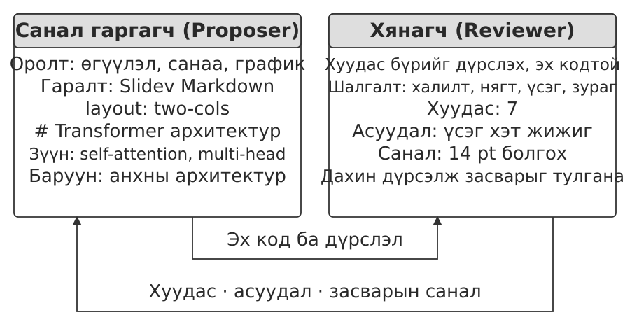

- **Санал болгогч (Proposer)** өгүүллийг уншиж, тайлбарын бүтцийг төлөвлөж, Slidev эх кодыг бичээд, хариуны дагуу хуудсыг засварлана.
- **Хянагч (Reviewer)** Tool-оор хуудсыг дүрсэлж, харааны Model-оор агуулгын нягт, уншигдах байдал, байршил, зураг ба текстийн харгалзааг шалгаж, хуудасны дугаар, асуудлын төрөл, ноцтой байдал, засварын санал агуулсан бүтэцтэй хариу буцаана.

Хариу засварыг шууд чиглүүлж чаддаг байх ёстой. Жишээлбэл, «3-р хуудсанд гол санаа хэт олон байна, аргын тойм ба тооцооллын алхам гэсэн хоёр хуудас болгон хуваа»; «7-р хуудасны кодын үсгийн хэмжээ хэт жижиг, эхлээд 14 pt болгон томруулаад, проекторт уншигдах эсэхийг шалга». Баримтын алдаа ба графикийг буруу уншсаныг түрүүлж засаад, дараа нь байршил ба харааны нарийн зүйлийг шийднэ.

Хэсэгчилсэн засварт мөн аль объектыг засахыг тодорхойлох хэрэгтэй. Feishu-гийн слайд дахь Doubao ажлын туслах хэрэглэгчид хуудасны элементийг сонгоод, хөвөгч хэрэгслийн мөрөөр засварын шаардлага тавих боломж олгодог.[^ch5-doubao-work] Нэг хуудсанд хоёр текстийн хайрцаг байгаа гэж бодъё: нэг нь ярилцлагын анхны ишлэл, нөгөө нь илтгэгчийн бичсэн дүгнэлт. Хэрэглэгч дүгнэлтийг сонгоод «хоёр мөр болгон товчил» гэж хүснэ. Сонгосон текстийн хайрцаг өөрчлөлтийн хүрээг хязгаарлана. Дүгнэлтийг дахин бичиж болох ч хажуугийн ишлэлд ярилцлага өгсөн хүний анхны үгийг хадгалах ёстой.

[^ch5-doubao-work]: Feishu-гийн тусламжийн төв, «Слайдад Doubao ажлын туслахыг ашиглах».

Санал болгогч засварласны дараа дахин дүрсэлж, хянагч шинэ хувилбарыг шалгаад, өмнөх үеийн асуудал шийдэгдсэн эсэхийг баталгаажуулна. Давталтад гарах хоёр төрлийн нөхцөл тавина: агуулга ба хэвлэлийн тодорхой шаардлагад хүрэх, эсвэл үеийн тоо, хугацаа, зардлын төсвөө дуусгах, жишээлбэл хамгийн ихдээ 5 удаа засварлах. Хүлээлгэн өгөхдөө одоогийн хувилбар ба шийдэгдээгүй асуудлуудыг хадгалж, дараагийн хяналтад хялбар болгоно.

Энэ нь Бүлэг 4-ийн үйлдэл батлахтай санал болгогч—хянагч загварыг хуваалцдаг. Үйлдэл батлах нь голдуу тодорхой нэг үйлдлийг гүйцэтгэж болох эсэхийг дүгнэдэг; агуулгын хяналт олон удаагийн хариугаар бүтээгдэхүүнийг сайжруулдаг. Хоёулаа даалгаврын шаардлагыг хуваалцаж, байршлыг нь тогтоож болох дүгнэлтийн үндэслэл өгч, дараагийн урсгалыг Harness шийдэх шаардлагатай. Өөр Model-ийн гэр бүлийг ашиглах нь хяналтын өөр өнцөг өгч чадна.

**Зохиогч хоёр Agent-ийн хуваарилалтын Context-ийн удирдлага дахь давуу талыг чухалчилдаг.** Хоёр үүрэг тус бүр өөрт хэрэгтэй мэдээллийг хадгалж чадна: хянагч үе бүрт хамгийн сүүлийн дэлгэцийн зураг, хяналтын стандарт, шаардлагатай асуудлын жагсаалтыг хүлээн авна; санал болгогч эх код, засварын зорилго, бүтэцтэй текстэн хариуг хадгална. Хуудасны зураг хянагчийн Context-д үлдэж, үндсэн траектор богино текстэн хариугаар засварыг үргэлжлүүлэн урагшлуулна. Хяналт бүр хамгийн сүүлийн хуудсыг тойрон явагдах тул түүхэн дэлгэцийн зургийн саадыг багасгаж, Context-ийн өсөлтийг ч хянана.

> **Туршилт 5-6 ★★: Өгүүлэлд суурилсан PPT-ийг автоматаар үүсгэх**
>
> Энэ туршилтад «Attention Is All You Need» өгүүллийн PDF-ээс 20 хуудас Slidev слайд үүсгэнэ. Agent өгүүллийн бүтэц ба гол санааг гаргаж авч, эх сурвалжийн бүртгэлтэй анхны өгүүллийн гурван зургийг ашиглан хуудас хуудсаар тайлбарыг зохион байгуулна. Дүрсэлсний дараа текст халих, графикийн уншигдах байдал, зураг ба текстийн харгалзааг шалгаад, хариуны дагуу засварлана.
>
> Ганц Agent өөрийгөө хянах ба санал болгогч—хянагчийн хуваарилалтыг харьцуулав. Энэ удаагийн ажиллагаанд хоёр эцсийн хувилбар нэг бие даасан үнэлгээний урсгалд хоёулаа 95 оноо авсан; хуваарилалтын шийдлийн оргил оролт ойролцоогоор 24 мянган token, түүхэн дэлгэцийн зургийг хадгалсан ганц Agent-ийн шийдэл ойролцоогоор 93 мянган token байв.

> **Туршилт 5-7 ★★: Өгүүллийн тайлбар видеог автоматаар үүсгэх**
>
> Слайдын үндсэн дээр Agent хуудас бүрт ярианы хэлээр тайлбар бичиж, зураг дээрх объект, харилцаа, дүгнэлтийг тайлбарлаад, TTS дуудаж дуу хоолой нийлэгжүүлж болно. Илтгэлийн текстийг хуудастай хамт харааны хянагчид өгч, дурдсан элемент дэлгэц дээр гарч байгаа эсэх, тайлбар графиктай нийцэж байгаа эсэхийг шалгана.
>
> Видео бүтээхдээ туршилт өмнөх хэсгийн үүсгэлтийн урсгалыг ашиглаж, арай эртний 22 хуудастай хувилбарыг (v2) сонгосон. Дарааллаар нь 12 хуудас сонгосны дараа видеоны сүүлийн дэлгэц анхны хувилбарын 21-р хуудаснаас гарсан. Өмнөх хэсэгт оноо ба зарцуулалтыг харьцуулахдаа дараа гарсан 20 хуудастай хувилбарыг (v9) ашигласан. Хуудсыг сонгосны дараа Kimi-ээр илтгэлийн текст үүсгэж, Qwen-ий харааны Model-оор зураг ба текстийн харилцааг хянуулаад, Fish Audio-оор хуудас бүрийн дуу хоолойг нийлэгжүүлсэн. FFmpeg аудио хэсэг бүрийн бодит үргэлжлэх хугацаагаар хуудас харуулах хугацааг тохируулж, ойролцоогоор 8.6 минутын тайлбар видео нийлэгжүүлсэн.
>
> Зураг 5-6-д слайд, илтгэлийн текст, дуу хоолой эцэст нь л видео болж нийлдэг. Зарим асуудлыг энэ алхамд л сонсож мэднэ: хуудас солигдох үед нэг өгүүлбэр дуусаагүй үлдсэн эсэх, цаашлах тусам дуу ба дүрс улам зөрөөд байгаа эсэх.
>
> 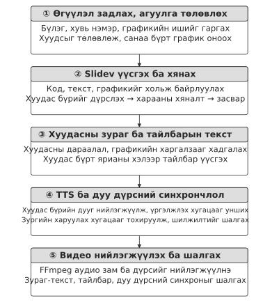

[^ch5-slidev]: Slidev, *Getting Started*; Markdown ба вэб технологид суурилан үзүүлэн үүсгэх, харуулах, экспортлохыг танилцуулсан.

**Видео засварлах Agent.**

**Видео засварт скриптээр илэрхийлж болох үйлдлийг программын интерфэйсээр түрүүлж гүйцэтгэх ёстой.** Цагийн шугам, давхарга, хадмал, аудио зам нь нарийн төвөгтэй GUI самбаруудад тархсан байдаг тул дахин дахин байршуулах, чирэх нь хоцролт ба алдааг нэмэгдүүлнэ; программын интерфэйс үйлдлийг цагийн муж, зам, эффектийн параметрээр шууд илэрхийлж чадна. Blender-ийн Python интерфэйс ба FFmpeg хоёулаа засварын ажлын нэг хэсгийг давтан гүйцэтгэж болох скрипт болгон зохион байгуулж чадна.

Agent эхлээд «серфинг хийж буй хэсгийг тайрч ав» гэх мэт шаардлагыг ойлгоод, бичлэг дэх зорилтот мужийг олж, тайрах, байрлуулах, аудио зам боловсруулах код үүсгэж болно. Санал болгогч засварын төлөвлөгөө ба скриптийг хариуцаж, хянагч дүрсэлсэн үр дүнг шалгана; орхигдол, хамааралгүй хэсэг эсвэл хадмал дарагдсан тохиолдолд тодорхой цагийн цэг ба асуудлыг хариу болгон санал болгогчид засуулна. Гол кадр орчин ба байршлыг шалгахад тохиромжтой бөгөөд хөдөлгөөний тасралтгүй байдал, дуу дүрсний синхрончлолыг шалгахад зэргэлдээ кадр эсвэл тасралтгүй хэсгийг шалгах хэрэгтэй.

> **Туршилт 5-8 ★★: API-д суурилсан ухаалаг видео засвар**
>
> Энэ туршилт зорилтот байршил тогтоох, скрипт үүсгэх, үр дүнг хянахыг нэг урсгал болгон холбоно. Эхлээд видеоны иш, зорилтот асуулт, кадр авах завсрыг видео шинжлэх дэд Agent-д өгч, тэр нь олон тооны дүрсийг боловсруулаад үндсэн Agent-д цагийн муж ба үндэслэлийг буцаана.
>
> Байршлыг хоёр алхмаар тогтооно. Эхний алхамд 10 секунд тутамд нэг кадр авч, зорилтын ойролцоо хүрээг хайна, жишээлбэл «серфинг 40—110 дахь секундэд»; хоёрдугаар алхамд нэр дэвшсэн муж ба ойролцоох хилийг тойрон секунд тутамд нэг кадр авч, эхлэх ба дуусах байрлалыг нарийвчлан тогтооно. Бүдүүн түүвэрлэлтийн завсраас богино үзэгдэл хоёр кадрын хооронд орж болох тул зорилтын үргэлжлэх хугацаагаар түүвэрлэлтийг нэмэгдүүлэх эсвэл хоёр кадрын хоорондох дүрсийг эргэн харж болно.
>
> Мужийг тогтоосны дараа санал болгогч Blender Python скрипт үүсгэж, тайрах болон шаардлагатай хадмал, хурд өөрчлөх зэрэг үйлдлийг гүйцэтгэнэ. Хянагч урьдчилан харах хувилбарыг үзэж, тохируулах шаардлагатай хил ба эффектийг зааж өгнө; засвар тэнцсэний дараа бүрэн бичлэгийг гаргана.
>
> Бодитоор тайрсан нь том цагаан туулай ганцаараа зүлгэн дээгүүр алхаж буй бичлэг байв. 10 секунд тутамд нэг кадр харахад Model хүрээг 10-аас 20 дахь секунд гэж тогтоосон. Хэрэв 10 дахь секундээс шууд тайрвал бичлэгийн эхний хэсэг алдагдана. Иймээс программ өмнө, хойно нь 5 секундээр өргөтгөж, 5-аас 25 дахь секундийн хооронд секунд тутамд нэг кадр харж, нэр дэвшсэн мужийг 9-өөс 12 дахь секунд болгон нарийсгав. Хянагч хэсэгт зэргэлдээ дүрс орсныг дахин илрүүлж, засварласан муж 9.25-аас 11.00 дахь секунд болсон. Хүний тэмдэглэсэн 9.08-аас 11.20 дахь секундтэй харьцуулахад эхлэл 0.17 секунд хоцорч, төгсгөл 0.20 секунд эрт байсан бөгөөд хоёр үзүүр хоёулаа алдаа 3 секундээс хэтрэхгүй байх шаардлагыг хангасан.
>
> Цагийн код зөвхөн хаана тайрсныг шалгаж чадна. Ижил хадмал ба удаашруулсан хөдөлгөөнийг зориуд буруу сонгосон бичлэг дээр тавивал хянагч алдааг таньж чадах уу? Туршилт эхлээд 0-ээс 3 дахь секундийн харьцуулах хэсгийг шалгуулаад, дараа нь засварласан дүрслэлийг үзүүлсэн. Хянах объектод дүрс дэх том цагаан туулай, доод хэсгийн хадмал, хурд өөрчилсний дараах үргэлжлэх хугацаа багтсан.

**3D ба үйлдвэрийн эд анги: тохирох үүсгэх аргыг сонгох.**

**Хэмжээ ба угсралтын харилцаа нь хатуу хязгаарлалт болдог үйлдвэрийн эд ангид параметрт кодоор үүсгэхийг түрүүлж сонгох; голдуу байгалийн хэлбэр, гадаад төрхийг эрхэмлэдэг объектод үүсгэгч Model-ийг түрүүлж авч үзэх.** Энэ сонголт бүтээгдэхүүнийг цөөн параметрээр нарийн тодорхойлж болох эсэх, мөн засварласны дараа ямар харилцааг хадгалах шаардлагатай эсэхээс хамаарна. CadQuery, OpenSCAD, Blender скрипт засварлаж болох бүтээх процесс өгдөг бол Hunyuan 3D зэрэг Model сурсан хэлбэрийн урьдчилсан мэдлэгээ ашиглан нарийн төвөгтэй гадаад төрх үүсгэдэг.

**Тодорхойлолт параметрчлэхэд тохирох эсэх.** Хялбарчилсан фланцын үндсэн геометрийн харилцааг гадна диаметр, зузаан, нүхний байрлалын тойргийн диаметр, нүхний диаметр, нүхний тоогоор илэрхийлж болно. Код параметр ба бүтээх алхмыг харгалзуулдаг тул дахин дахин тохируулахад тохиромжтой. Харин нэг вааран ургамал, нэг Тайху чулуу эсвэл нэг хүний нүүр олон тооны тогтворгүй хэлбэр агуулдаг тул үүсгэгч Model гадаад төрхийг бүтээхэд тусалж болох бөгөөд программын арга ч өсөлтийн дүрэм, санамсаргүй процесс, хөрөнгийн хослолоор нарийн хэсгийг үүсгэж болно.

**Нарийвчлалыг хэрхэн шалгах.** Нүхний диаметр 5 mm, хүлцэл ±0.05 mm гэх мэт шаардлагын хувьд эхлээд нэгж, координатын систем, хэмжих аргыг тодорхой болгож, дараа нь Model-ийн хэмжээг техникийн үзүүлэлттэй харьцуулна. Параметрт Model-ийн геометрийн объектыг шууд шалгаж болно; торыг огтлол, нүх, хүрээлэх хэмжээ зэрэг аргаар хэмжиж, дискретчлэлийн алдааг тооцно.

**Хэрхэн хадгалж, засварлах.** B-rep (хилээр дүрслэх) биетийн хилийг гадаргуу, ирмэг, оройгоор дүрсэлдэг бол гурвалжин тор гадаргууг хавтгай хэсгүүдээр ойролцоолдог. CadQuery CAD өгөгдөл солилцоход зориулж STEP экспортлохоос гадна STL тор ч экспортлож чадна; засварлаж болох параметр ба бүтээх логик CadQuery-ийн эх кодод хадгалагдана[^ch5-cad]. CNC боловсруулалтын урсгалд орохын тулд технологийн төлөвлөлт, багажны зам, машинд тохируулах шаардлагатай.

Жишээлбэл, суурилуулах нүхийг M5-д тохирохоос M6-д тохирох болгон өөрчлөхөд нүхний диаметрийн параметрийг засаад, дахин үүсгэсний дараа гадна диаметр, зузаан, нүхний байрлал хэвээр байгаа эсэхийг дахин шалгаж болно. Үүсгэгч Model-ийн засварын арга интерфэйсийн чадвараас хамаарна: дахин үүсгэж ч болно, хэсэгчилсэн засвар болон дараагийн геометрийн боловсруулалтыг хослуулж ч болно.

Хоёр замыг хослуулахдаа ч хуваарилалтыг тодорхой болгох ёстой: хэмжээ ба угсралтын харилцааг параметрт кодод, бүтэц ба чөлөөт гадаад төрхийг үүсгэгч Model-д даатгана. **Гол хэмжээг дахин дахин нарийн засварлах шаардлагатай бол засварлаж болох бүтээх процесс нэг удаа үүсгэсэн гадаад төрхөөс илүү үнэ цэнэтэй.**

> **Туршилт 5-9 ★★: Нэг эд ангийг үүсгэх хоёр зам — код ба үүсгэгч Model**
>
> Энэ туршилтад гадна диаметр 80 mm, зузаан 10 mm фланц үүсгэж, диаметр 60 mm нүхний байрлалын тойрог дээр дөрвөн суурилуулах нүхийг жигд байрлуулахыг шаардана. Угсралтын утгыг тодорхой болгохын тулд анхны үзүүлэлтэд M5-д тохирох 5.5 mm нэвт нүх, засварын хүсэлтэд M6-д тохирох 6.5 mm нэвт нүх авсан.
>
> Кодын замд Model CadQuery программ үүсгэж, гүйцэтгэсний дараа STEP ба STL экспортлоно; үүсгэгч Model-ийн замд эхлээд бүтээгдэхүүний жишиг зураг үүсгээд, Hunyuan 3D-д өгч тор үүсгэнэ. Гадна диаметр, зузаан, нүхний тоо, нүхний диаметр, нүхний байрлал, суурилуулах гадаргууг шалгаж, нэгж ба тэнхлэгийн чиглэлийг бүртгэнэ.
>
> Model зөвхөн заасан хэмжээг өөрчилснийг хэрхэн мэдэх вэ? Засварлахаас өмнөх ба дараах экспортолсон STL-ийг харьцуулахад дөрвөн суурилуулах нүхний дундаж диаметр 5.499 mm-ээс 6.499 mm болж өссөн; хоёр эд ангийн гадна диаметр хоёулаа 80 mm, зузаан хоёулаа 10 mm, нүхний байрлалын тойргийн диаметр гурван аравтын оронгоор хоёулаа 60.000 mm байв. Үүсгэгч Model-ийн замын анхны торонд тодорхой физик масштаб байгаагүй. Хэмжих программ Z тэнхлэгийн дагуу дунд огтлол авсан ч нүхний дотор цагиргийг олоогүй. Дөрвөн нүх дискийг нэвтэлсэн эсэхийг тогтоохын тулд суурилуулах гадаргууг таньж, түүний нормалын дагуу өөр өөр гүнд огтлол авах шаардлагатай. Дахин үүсгэсний дараа ерөнхий хэлбэр ба чиглэл хоёулаа өөрчлөгдсөн.
>
> Эцэст нь өөр бодлого авъя: байгалийн мэт харагдах вааран ургамлын зураг хүлээлгэн өгөх бол хэрхэн хүлээн авах вэ? Туршилтад matplotlib-ээр нэг вааран ургамал зурж, Gemini-ээр нөгөөг үүсгээд, нэг харааны Model-оор байгалийн байдлыг арван онооны системээр үнэлүүлсэн. Хоёр зураг 3 ба 8 оноо тус тус авсан. Энэ оноо үнэлэгч Model аль зургийг бодит ургамалтай илүү төстэй гэж үзсэнд хариулдаг. Фланц руу буцвал бүтээгдэхүүний зурагт дөрвөн нүх байгаа мэт харагдсан ч угсралтын хувьд нүхний байрлал ба диаметрийг гурван хэмжээст эд анги дээр тулгах шаардлагатай хэвээр.

[^ch5-cad]: CadQuery, *Importing and Exporting Files*; STEP, STL зэрэг форматыг танилцуулж, бүрэн параметрийн мэдээлэл CadQuery-ийн Python эх кодод хадгалагддагийг тайлбарласан.

### Код системийн адаптер болох нь

Гадаад үйлчилгээнүүдийн интерфэйс, баталгаажуулалтын арга, өгөгдлийн формат өөр өөр байдаг. Agent баримт бичиг ба хариуны жишээг уншиж, HTTP клиент үүсгэж, баталгаажуулалтын толгойг тохируулж, буцах утгыг задлаад, дээд урсгалын талбарыг доод урсгалд хэрэгтэй бүтэц рүү хөрвүүлж чадна. Энд код системийн адаптерын үүргийг гүйцэтгэж, байгаа үйлчилгээнүүдийг шинэ даалгаврын урсгал болгон хослуулна.

Жишээлбэл, төлбөрийн үйлчилгээнээс уншсан дүнгийн талбар фэнээр (юанийн зуугийн нэг) илэрхийлэгддэг, харин тайлан юаниар харуулдаг бол JSON-ийг амжилттай задалсан нь зөвхөн формат нийцэж байгааг илтгэнэ. 25 юанийн гүйлгээ дээд урсгалд бүхэл тоо 2500 байна. Энэ тоог тайланд шууд оруулбал 25 юань 2500 юань болно.

Адаптер оролт гаралт, алдааны боловсруулалт, хувилбарын хүрээг тодорхой болгох шаардлагатай. Жишээ Model-д талбарыг ойлгоход тусалж, интерфэйсийн тохиролцоо ба тест дутуу утга, хуудаслалт, хэвийн бус хариу, хувилбарын өөрчлөлтийг шалгана. Итгэмжлэлийг гүйцэтгэлийн орчин удирдаж, үүсгэсэн код хяналттай интерфэйсээр зөвшөөрөгдсөн чадварыг ашиглана. Баталгаажуулалт давсны дараа адаптерыг хадгалж, дахин ашиглаж болох бөгөөд дараа нь формат өөрчлөгдвөл засварын урсгалд оруулна.

Зөвхөн график интерфэйстэй системд ч төстэй аргыг хэрэглэж болно. Agent эхлээд Бүлэг 6-д танилцуулах Computer Use-ээр даалгаврыг гүйцэтгээд, дараа нь тогтвортой үйлдлийн алхмуудыг RPA Tool болгон бэхжүүлнэ. Интерфэйсийн удирдлага, нэвтрэх төлөв, хуудасны урсгал өөрчлөгдөхөд Tool хазайлтыг илрүүлж, байршлаа дахин тогтоох шаардлагатай. Амжилттай траектороос ажлын урсгалыг хэрхэн гаргаж авах, баталгаажуулах, дахин ашиглахыг Бүлэг 9-д цааш авч үзнэ.

**Agent-ийн логийг задлах ба дүрслэх.**

Нэг нарийн төвөгтэй даалгавар Model-ийн олон хүсэлт, Tool-ийн гүйцэтгэл, дэд Agent-ийн харилцан үйлчлэлийг агуулж болно. Логийн тойм алхмуудын харилцаа, төлөв, зарцуулсан хугацааг харуулж, дэлгэхэд тодорхой оролт гаралтыг харуулснаар уншигчид аль нэг алхамд юу болсныг мөрдөхөд тусална. Шинэ талбар, үүрлэсэн бүтэц, форматын хувилбар бүгд задлал ба харуулалтад нөлөөлнө.

Дасан зохицох задлал эдгээр өөрчлөлтийг «өөрчлөлтийг илрүүлэх—задлагч үүсгэх—үр дүнг баталгаажуулах» давталтаар шийдэнэ. Задлал амжилтгүй болбол систем анхны жишээ, алдааны байршил, хүлээгдэж буй талбарыг хадгалаад, интерфэйсийн тохиролцоо ба үүсгэгчийн хувилбартай тулгаж, өөрчлөлт хүлээгдэж байсанд нийцэх эсэхийг дүгнэнэ. Форматын шинэчлэл гэдгийг баталгаажуулсны дараа л Agent-ээр шинэ задлагч бичүүлнэ. Хэрэв лог бичдэг программ алдаа гаргасан бол анхны логийг хадгалж, доголдлыг мэдээлснээр шинэ задлагч алдааг ч хэвийн формат гэж үзэхээс сэргийлнэ. Шинээр бичсэн кодыг эхлээд хязгаарлагдмал орчинд ажиллуулж, эхлээд талбар ба тэдгээрийн утгыг шалгаад, дараа нь хэвийн жишээ, талбар дутуу жишээ, хуучин форматын регрессийн тохиолдлоор баталгаажуулна. Тэнцсэний дараа шинэ задлагчийг бүртгэж, хувилбар ба хамаарах форматыг хадгална; амжилтгүй жишээг мөрдөх, дахин оролдоход зориулж үргэлжлүүлэн хадгална.

Задлал ба харуулалт тус бүр өөрийн шалгах аргатай. Программ цагийн тэмдэг, төлөв, тоон төрөл, дуудлагын холбоосыг шалгаж; хөтчийн дүрслэл хуудас хэвийн ажиллаж байгаа эсэхийг шалгаж, харааны Model хүснэгт, цагийн шугам, шошго тодорхой эсэхийг шалгахад тусална. Халуун шинэчлэлийн үед өмнөх хувилбар ба буцах орох цэгийг хадгалснаар шинэ форматын дэмжлэгийг ажиллаж буй системд аажмаар нэвтрүүлж болно.

> **Туршилт 5-10 ★★★: Дасан зохицох логийн задлалын систем**
>
> Энэ туршилтад эхлээд лог үүсгэх хоёр процесс ажиллуулж, нэг нь босоо зураасаар тусгаарласан формат, нөгөө нь үүрлэсэн хаалттай формат гаргана. Анхны задлагч эдгээр жишээг боловсруулж чадахгүй тул систем Model-оос хоёр задлах функц үүсгэхийг хүсэж, тест давсны дараа халуунаар ачаалаад, өмнө нь амжилтгүй болсон логийг задална.
>
> Эхний формат `timestamp`, `level`, `module`, `step`, `message`-ийг гаргаж авна; хоёр дахь нь мөн Tool-ийн нэр, зарцуулсан хугацаа, төлөвийг хамарна. Ажиллагааны бүртгэлд хоёр төрөл тус бүрийн гурван лог задлагдаж, шинээр үүсгэсэн хөдөлгүүр ч хадгалсан задлагчийг ачаалж, холимог логийн урсгалыг үргэлжлүүлэн боловсруулсан.
>
> Задлалын үр дүнг Chromium хүснэгт болгон дүрсэлж, харааны хяналт баганын нэр, мөрийн агуулга, уншигдах байдлыг шалгана.

**Agent-ийн гүйцэтгэлийн логийг автоматаар шинжлэх ба асуудлыг оношлох.**

Бүтэцтэй траектор задалж авсны дараа Agent архитектурын баримт бичиг ба PRD (бүтээгдэхүүний шаардлагын баримт бичиг)-тэй хослуулан хүлээгдэж буй урсгал ба бодит үйлдлийг харьцуулж болно. Жишээлбэл, буцаан олголт хийхээс өмнө энэ захиалгыг буцааж болох эсэхийг шалгасан уу? Нөөцийн үйлчилгээний хугацаа хэтэрсний дараа программ тохиролцооны дагуу кэшээс лавлах болж өөрчилсөн үү?

Асуудлын тайланд ач холбогдол, модуль, илрэл, нотолгоо, сайжруулах санал багтаж болно. Agent мөн үүн дээр үндэслэн регрессийн тест үүсгэж, асуудалд харгалзах оролт ба хүлээн авах нөхцөлийг тогтоож болно. Тестийн хүрээ хяналттай орчинд хүсэлтийг дахин тоглуулах эсвэл хадгалсан Tool-ийн хариуг уншиж, алдаатай ба засварласан хувилбарын зан төлөвийг харьцуулна. Гадагш бичих үйлдлийг тусгаарлагдсан орчин эсвэл орлуулах интерфэйсээр гүйцэтгэж, дахин тоглуулалтын нөлөөллийн хүрээг хяналттай байлгана.

Баталгаа (assertion) шалгах шаардлагатай шинжтэй харгалзах ёстой. Жишээлбэл, логт буцаан олголтын шалгалт гарсан нь зөвхөн программ шалгасныг илтгэнэ. Энэ мөнгийг зөв буцаасан эсэхийг мэдэхийн тулд программ эхлээд шалгаад дараа нь буцаасан эсэх, шалгалтын үр дүн буцаан олголтыг зөвшөөрсөн эсэх, мөн захиалга эцэст нь ямар төлөвтэй болсныг харах хэрэгтэй.

Оношилгоог дахин хянасны дараа Agent харгалзах зөвшөөрөл авч MCP-ээр GitHub Issue үүсгэж, модулиар хариуцагчийг санал болгож болно. Хэрэв ижил алдаанд аль хэдийн ажлын зүйл байгаа бол шинэ нотолгоог түүнд нэгтгэнэ.

> **Туршилт 5-11 ★★★: Үйлдвэрлэлийн логийн ухаалаг оношилгооны систем**
>
> Энэ туршилтад дотоод HTTP үйлчилгээгээр хоёр бизнесийн траектор үүсгэнэ: нэг бүртгэл систем захиалгыг буцааж болох эсэхийг шалгалгүйгээр мөнгө буцаасныг, нөгөө нь нөөцийн лавлагааны хугацаа хэтэрсний дараа кэшээс өгөгдөл авах болж өөрчлөөгүйг харуулна. Model архитектурын баримт бичиг ба шаардлагын тайлбартай хослуулан траектор ба үеийн ишлэл агуулсан асуудлын тайлан үүсгээд, гүйцэтгэж болох гурван регрессийн тест үүсгэнэ.
>
> Зураг 5-7 нэг оношилгооны тайланг траектор ба регрессийн тестийн хооронд байрлуулдаг. Тайлан «систем шалгалтыг алгасаж, шууд мөнгө буцаасан» гэж заасан. Траектор руу буцаж нотолгоо хайя: дуудлагын бүртгэлд аль алхам дутуу байна вэ? Цааш тестийг харъя: хэрэв дараа нь энэ алхам дахин орхигдвол тест илрүүлж чадах уу?
>
> 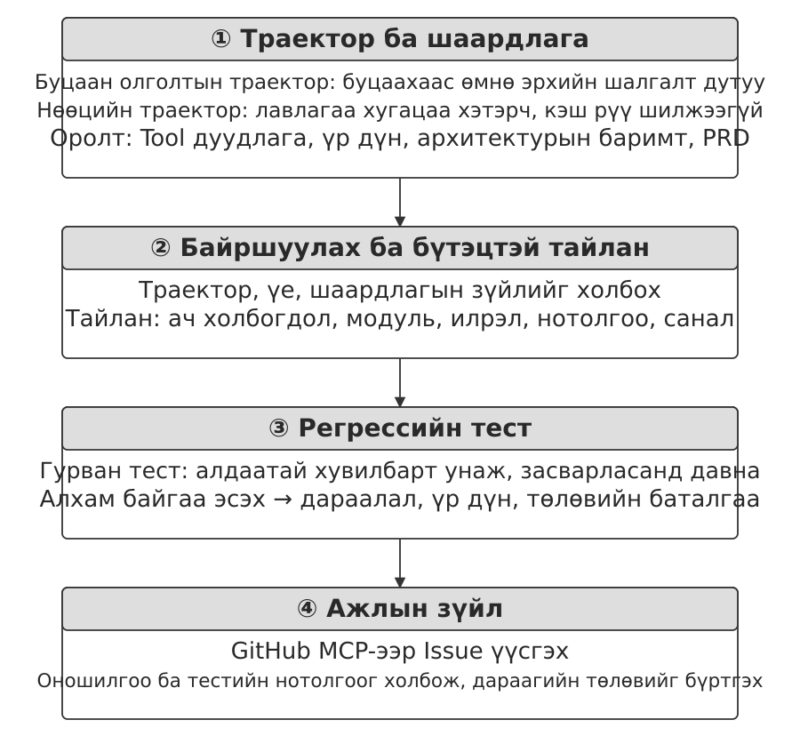
>
> Гурван тест алдаатай хувилбар дээр бүгд амжилтгүй болж, засварласан хувилбар руу сольсны дараа бүгд давсан. Тэдгээрийн нэг тест зөвхөн программ буцаан олголтын шалгах Tool-ийг дуудсан эсэхийг дүгнэдэг. Программ эхлээд мөнгө буцааж, дараа нь л энэ захиалгыг буцааж болох эсэхийг шалгасан ч энэ тест давна. Ажиллагааны бүртгэлд GitHub MCP ажлын зүйл үүсгэсэн баримт ч хадгалагдсан тул оношилгооны тайланг хөгжүүлэгчид өгсний дараах харгалзах ажлын тасалбарыг түүгээр олж болно.
>

### Код генератив UI болох нь

Хэрэв хэрэглэгч Agent-ийн боловсруулж буй материалыг өөрөө засах шаардлагатай бол интерфэйсийг хоёр тал хамтран ашигладаг ажлын ширээ болгож болно. Аяллын хуваарийг жишээ болгоё: туслах аль зогсоолыг засаж байгааг хэрэглэгчид харуулж, засварыг хүлээж авах, аль нэг өөрчлөлтийг батлах эсвэл цуцлах боломж олгоно. Хэрэв хэрэглэгч дөнгөж сая явах өдрийг баасан гараг болгон өөрчилсөн бол туслах дараа нь энэ шинэ хуваарь дээр үргэлжлүүлэн ажиллах ёстой. Хоёр тал нэг харагдах төлөвийг хуваалцаж, засварлаж буй талбарыг одоо хэн удирдаж байгааг тохиролцсон үед л харангаа засах боломжтой болно.

Хэрэглэгч аяллын гурван хувилбарыг харьцуулахыг хүсэж байна гэж төсөөлье. Очих газар хараахан тодорхойгүй үед яриа нэмэлт асуулт тавихад тохиромжтой; очих газар тодорхой болсны дараа хэрэглэгчээр өдрөө шууд сонгуулж, хүний тоог бөглүүлэх нь хэдэн хэсэг текстийг нааш цааш тулгахаас илүү хялбар; эцэст нь нийт үнэ өдрөөс хамаарч хэрхэн өөрчлөгдөхийг харьцуулахад нэг график ялгааг нүдэнд ил харуулна. Agent даалгаврын дагуу харгалзах маягт, график эсвэл хэрэглээний интерфэйс үүсгэж, хэрэглэгчээр шууд бөглүүлэх, сонгуулах, удирдуулах нь генератив UI (Generative UI) юм.

**Интерфэйс ба харилцан үйлчлэлийг протоколоор дүрслэх.**

Интерфэйс үүсгэх хоёр хэрэгжүүлэлтийн зам бий: HTML, JavaScript зэрэг код гаргаж, хяналттай орчинд гүйцэтгүүлэх; тунхаглалын бүтэц гаргаж, клиентийн компонентоор дүрслүүлэх. Эхнийх нь тусгай байршил ба харилцан үйлчлэлийг хэрэгжүүлэхэд хялбар бол сүүлийнх нь ашиглаж болох чадварыг клиентийн өгдөг компонент ба үйлдлийн хүрээнд хязгаарладаг.

A2UI (Agent-to-User Interface) тунхаглалын дүрслэл ашигладаг. Agent компонент, өгөгдлийн холболт, шинэчлэлийг илэрхийлсэн бүтэцтэй мессеж үүсгэж, клиент өөрийн компонентоор интерфэйсийг харуулна[^ch5-ui-protocols]. Жишээлбэл, хэрэглээ карт, товч, текстийн талбар, хүснэгтийн компонент өгч болох бөгөөд Agent түүн дээр үндэслэн «Борлуулалтын өгөгдөл» гарчигтай, гурван мөр хоёр баганатай хүснэгтийг дүрсэлнэ. Компонентын жагсаалтыг график, газрын зураг зэрэг чадвараар өргөтгөж ч болно.

AG-UI (Agent–User Interaction) Agent ба front-end хоорондын үйл явдлын харилцан үйлчлэлийг хариуцаж, мессеж, Tool дуудлага, төлөвийн шинэчлэлийг дамжуулдаг бөгөөд A2UI-ийн интерфэйсийн мессежийг ч тээж чадна. Хоёуланг хослуулбал A2UI юуг харуулахыг дүрсэлж, AG-UI back-end-ийн гүйцэтгэл ба front-end-ийн харилцан үйлчлэлийг холбоно.

Клиент интерфэйсийн шинэчлэлийг аажмаар хүлээн авч, тохирох дүрслэгчээр вэб, гар утас эсвэл ширээний орчинд харуулж болно. Клиент компонентын шинж, өгөгдлийн холболт, үйлдлийн хүсэлтийг шалгаж, сервер бизнесийн эрхийг үргэлжлүүлэн шалгана; компонент дахь холбоос, баялаг текст, өгөгдлийн хандалт ч тус бүр өөрийн боловсруулах дүрэмтэй байх шаардлагатай.

Кодыг шууд үүсгэх үед хамаарал, нөөцийн хандалт, гүйцэтгэлийн эрхийг шалгаж, үүсгэсэн интерфэйсийг хост хэрэглээний эмзэг төлөвөөс тусгаарлах хэрэгтэй. Гадны материал дахь Prompt шургуулалт үүсгэх процесст нөлөөлж болох бөгөөд хөтөч дэх скрипт гүйцэтгэлийн эрсдэл хуудсыг хэрхэн ачаалж, тусгаарласнаас ч хамаарна.

**Интерактив үр дүнг HTML-ээр хүлээлгэн өгөх.**

**Өгөгдөл, үзүүлэн, тасралтгүй шинэчлэгдэх үр дүн агуулсан судалгааны хүлээлгэн өгөлтөд зохиогч HTML вэб сайтыг түрүүлж сонгодог.** Урт шугаман Markdown тайлан уншигчаас Context-ийг байнга эргэж хайхыг шаарддаг; интерактив вэб хуудас тайлбар, өгөгдөл, үзүүлэнг нэг орох цэгт байрлуулж чадна: уншигч график үзэж, сонирхсон жишээгээ шүүж, аль нэг үр дүнгийн дэлгэрэнгүйг дэлгэж, үзүүлэнг удирдан системийн зан төлөвийг ойлгоно. Agent ч даалгавар урагшлахын хэрээр хуудсыг шинэчилж, одоогийн үр дүн ба нотолгоог тасралтгүй бүртгүүлж болно.

Зохиогчийн судалгааны практикийг жишээ болгоход судалгааны төсөл бүр нэг интерактив вэб сайттай бөгөөд түүнийг судалгааны явц дахь амьд баримт бичиг ба эцсийн хүлээлгэн өгөх бүтээгдэхүүн болгон зэрэг ашиглаж, Agent-ээр туршилт урагшлахын хэрээр агуулгыг тасралтгүй нэмүүлдэг. Эдгээр сайт голдуу гурван ажил гүйцэтгэдэг.

Нэгдүгээрт, **туршилтын өгөгдлийг мөрдөх**. Хуудас жишээ, Prompt, Model-ийн хариулт, үнэлгээг холбож, нэг бүрчлэн шалгахыг дэмжинэ. Жишээлбэл, нэг төрлийн хариулт байнга бага оноо авч байвал үнэлгээний бүртгэлийн дагуу анхны хариулт ба Prompt-ийг олж болно.

Хоёрдугаарт, **сургалтын үзүүлэлтийг хянах**. Зохиогч сургалтын дотоод төлөвийг илэрхийлэх дохиог «дотоод эрхтний үзүүлэлт» гэж нэрлэдэг: сургалтын ба баталгаажуулалтын алдагдал, градиентын норм, сурах хурд, мөн бататгах сургалт дахь шагнал, KL зөрүү, бодлогын энтропи гэх мэт. Хэлний Model-ийн хувьд мөн perplexity-ээр өгөгдсөн текстийн дарааллыг хэр сайн таамаглаж байгааг хэмжиж болно. Эрүүл мэндийн үзлэгийн физиологийн үзүүлэлттэй адил эдгээр муруй заримдаа эцсийн даалгаврын үр дүнгээс эрт асуудлыг илрүүлж чадна. Тэдгээрийг даалгаврын нарийвчлалтай хамт харах нь нийлэхгүй байх, градиентын хэвийн бус байдал, сургалтын доройтол аль үе шатанд гарсныг тогтооход тусална.

Гуравдугаарт, **ажиллах зарчмыг харуулах**. Хэд хэдэн модуль хэрхэн хамтран ажилладгийг танилцуулахдаа хуудас уншигчид нэг оролтыг өөрчилж, завсрын төлөвийг харж, дараа нь гаралтын өөрчлөлтийг туршилтын бүртгэлтэй харьцуулах боломж олгоно.

Ажил хэдэн цаг үргэлжлэхэд хэрэглэгч хэрхэн завшаанаар ажлыг хүлээн авах вэ? Зохиогч код бичих Agent ашиглахдаа нэг өгүүлбэр аман заавар ажлыг гүйцэтгэж буй Agent-д яг очиж, үр дүнг харахыг хүссэн үедээ хэзээ ч нээж, шинэ хувилбар гарах эсвэл миний шийдэх ёстой асуудал гарахад л сануулахыг хүсдэг. Жишээлбэл, хоёр тайлан зэрэг үүсгэгдэж байна. Хэрэглэгч борлуулалтын тайланг нээж, хоёр дахь графикийг заан «үүнийг цэвэр орлогоор дахин зур» гэнэ. Интерфэйс одоогийн тайлан ба графикийн танигчийг заавартай хамт илгээх ёстой. График засагдсаны дараа мэдэгдлээр шинэ хувилбарыг шууд нээж болно; хэрэв «цэвэр орлого» хоёр өөр боломжит тооцоололтой бол туслах сонгох хоёр тооцооллыг хэрэглэгчид жагсааж өгөх ёстой.

**Хэрэглэгчийн зорилгыг тодруулах.**

Хэрэглэгч «Бээжин рүү нэг нислэгийн тийз захиалмаар байна» гэхэд очих газар тодорхой болсон ч хөдлөх хот, огноо, нэг чиглэлийн эсвэл хоёр талын эсэхийг нөхөх шаардлагатай. Agent нэг удаагийн ярианд асуултуудаа нэгтгэн тавьж болно, эсвэл маягт үүсгэж холбогдох нөхцөлүүдийг нэг хуудсан дээр харуулж болно.

Маягт дахь удирдлагууд өөр өөр төрлийн мэдээлэлтэй харгалзана: текстийн талбар нээлттэй оролт цуглуулж, унжих цэс ба нэг сонголтот удирдлага сонгож болох зүйлсийг жагсааж, сонголтын хайрцаг олныг сонгохыг дэмжиж, огноо сонгогч цаг хугацааг бөглөхөд тусална. JavaScript шаталсан харилцааг илэрхийлж болно, жишээлбэл «хоёр талын»-ийг сонгосны дараа буцах огноог харуулж, буцах огноо хөдлөх огнооноос эрт биш эсэхийг шалгана. Сонголт өөрчлөгдөх үед хүчингүй болсон талбарыг зэрэг цэвэрлэх эсвэл үл тоох хэрэгтэй.

Зураг 5-8 доорх туршилтын нэг ажиллагаанаас авсан. Энэ илгээлтийг дагаж харъя: хөтчийн буцаасан дөрвөн талбарт очих газар байхгүй, тэгвэл Model зорчигч Бээжин рүү явахыг хаанаас мэдсэн бэ?

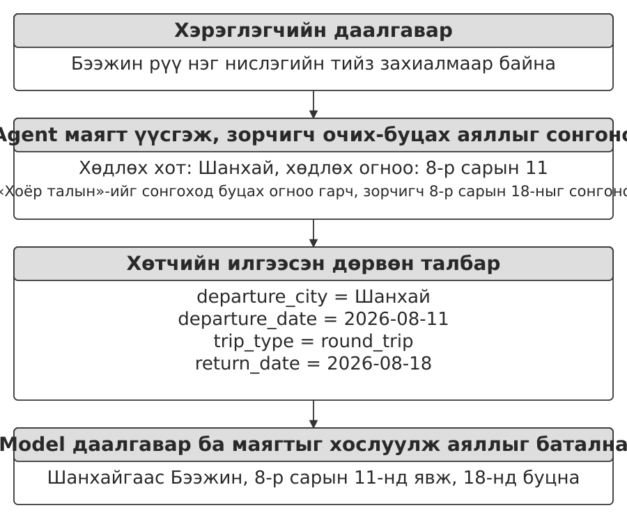

> **Туршилт 5-12 ★★: Динамик маягт үүсгэх замаар зорилго тодруулах систем**
>
> Энэ туршилт «Бээжин рүү нэг нислэгийн тийз захиалмаар байна»-аас эхэлж, Model-оор HTML маягт үүсгүүлнэ: хөдлөх хотод текстийн талбар, хөдлөх огноонд огноо сонгогч ашиглаж, аяллын төрөлд нэг чиглэлийн ба хоёр талын сонголт өгч, хоёр талыг сонгосон үед буцах огноог харуулна.
>
> Программ анхны даалгавар ба маягтын өгөгдлийг хамт Model-д буцааж өгнө. Хэрэв зөвхөн илгээсэн талбаруудыг үлдээвэл удирдлага бүрийг зөв бөглөсөн ч очих газар дутуу хэвээр байна.
>
> Ижил маягтаар нэг алхам цааш туршъя: буцах огноог бөглөсний дараа нэг чиглэлийн болгож өөрчилнө. Хуудас буцах огнооны талбарыг нуусан ч илгээсэн JSON нэг чиглэлийн болон 8-р сарын 18-ны буцах огноог зэрэг хадгалсан байв. Нэг чиглэлийн болгож өөрчлөхөд клиент хүчингүй болсон буцах огноог мөн цэвэрлэх ёстой.

[^ch5-ui-protocols]: A2UI-ийн албан ёсны баримт бичиг болон *AG-UI Overview*; тунхаглалын интерфэйсийн дүрслэл болон Agent—front-end-ийн үйл явдлын харилцан үйлчлэлийг тус тус танилцуулсан.

**SQL лавлагаа үүсгэх.**

Хэрэглэгч байгалийн хэлээр өгөгдлийн сангийн лавлагаа тавьж, Agent хүснэгтийн бүтэц ба бизнесийн тооцооллын аргын дагуу SQL үүсгэж болно. **Бүрэн лавлагааны хүснэгтийг харуулахдаа зохиогч Artifact горимыг түрүүлж сонгож, үр дүнг өгөгдлийн сангаас шууд интерфэйс рүү оруулдаг.** Model-оор том хүснэгтийг уншуулж, мөр мөрөөр давтуулах нь token-ий хэрэглээ ба хүлээх хугацааг нэмэгдүүлж, хуулах алдаа ч гаргана. SQL шалгаж болох лавлагааны бүтээгдэхүүн болон хадгалагдана; шалтгааныг шинжлэх эсвэл чиг хандлагыг нэгтгэх шаардлагатай үед л шаардлагатай нэгтгэсэн үр дүнг Model-д өгнө.

Зураг 5-9-д хэрэглэгч хэлтэс бүрийн ажиллаж буй хүний тоог харахыг хүссэн бөгөөд хуудас өгөгдлийн сангийн буцаасан статистикийн хүснэгтийг шууд харуулж болно. Хэрэв хэрэглэгч дараа нь «Маркетингийн хэлтэс судалгаа хөгжүүлэлтийн хэлтсээс хэдэн хүнээр илүү вэ» гэж асуувал Model хүснэгтээс 9 ба 5-ыг аваад 4 хүний зөрүүтэйг тооцоолоход хангалттай. Хэрэв «өнгөрсөн сард ч ийм зөрүүтэй байсан уу» гэж нэмж асуувал нүдний өмнөх энэ хүснэгт хангалтгүй болж, өнгөрсөн сарын статистикийн огноогоор дахин лавлах хэрэгтэй.

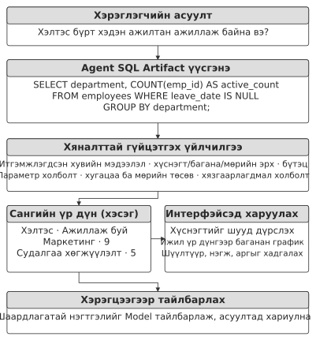

Гүйцэтгэх үйлчилгээ итгэмжлэгдсэн хувийн мэдээллээр хандаж болох хүснэгт, багана, мөрийг тодорхойлж, хязгаарлагдмал өгөгдлийн сангийн данс ашиглан, SQL-ийн бүтэц ба үйлдлийн төрлийг шалгана. Лавлагааны нөхцөлийг батлагдсан зөвхөн унших лавлагаагаар хязгаарлаж, функцийн дуудлага, хугацааны төсөв, буцах мөрийн тоо, өгөгдлийн хүрээг хянаж болно; хэрэглэгчийн оруулсан утгыг параметрт холболтоор дамжуулна.

Agent мөн дүрслэлийн бүтээгдэхүүн үүсгэж болно, жишээлбэл хэлтсийн нэгтгэлийг баганан графикаар харуулах. Гүйцэтгэх үйлчилгээ лавлагааны үр дүнг хяналттай дүрслэлийн ажиллах орчинд өгч, интерфэйс зөвхөн зөвшөөрөгдсөн өгөгдөл ба харилцан үйлчлэлийг харуулна.

> **Туршилт 5-13 ★★: Байгалийн хэлээр харилцдаг ERP Agent**
>
> Энэ туршилт ERP (аж ахуйн нэгжийн нөөцийн төлөвлөлт) дахь ажилтан ба цалингийн лавлагааг жишээ болгон, бизнесийн асуултаас SQL хэрхэн үүсгэж, өгөгдлийн сангийн үр дүнг хуудас руу шууд оруулахыг судална. PostgreSQL-д хоёр хүснэгт үүсгэнэ: ажилтны хүснэгтэд ажилтны ID, нэр, хэлтэс, зэрэглэл, ажилд орсон огноо, ажлаас гарсан огноо багтах бөгөөд гарсан огноо хоосон бол ажиллаж байгааг илэрхийлнэ; цалингийн хүснэгтэд ажилтны ID, цалин олгосон огноо, цалин багтах бөгөөд ажилтан бүрт сард нэг бүртгэл байна.
>
> Agent эдгээр хоёр хүснэгтээр дараах арван асуултыг шийднэ:
>
> 1. Ажилтан бүр дунджаар хэр удаан ажилладаг вэ?
> 2. Хэлтэс бүрт хэдэн ажилтан ажиллаж байна вэ?
> 3. Аль хэлтсийн ажилтнуудын дундаж зэрэглэл хамгийн өндөр вэ?
> 4. Хэлтэс бүрт энэ жил ба өнгөрсөн жил тус бүр хэдэн хүн шинээр ажилд орсон бэ?
> 5. Уржнан жилийн 3-р сараас өнгөрсөн жилийн 5-р сар хүртэл A хэлтсийн дундаж цалин хэд вэ?
> 6. Өнгөрсөн жил A ба B хэлтсийн аль нь дундаж цалин өндөр байсан бэ?
> 7. Энэ жил зэрэглэл бүрийн ажилтны дундаж цалин хэд вэ?
> 8. Ажилд орсноос хойш нэг жил хүртэл, нэгээс хоёр жил, хоёроос гурван жил болсон ажилтнуудын сүүлийн нэг сарын дундаж цалин хэд вэ?
> 9. Өнгөрсөн жилээс энэ жил хүртэл цалин нь хамгийн их өссөн 10 ажилтан хэн бэ?
> 10. Цалингийн өр байгаа юу (аль нэг сард ажиллаж байсан ч цалин олгоогүй)?
>
> Лавлахаас өмнө статистикийн тооцооллын аргыг тодорхой болгох хэрэгтэй. Жишээлбэл, ажиллаж буй ажилтны ажилласан хугацааг лавлагааны суурь өдөр хүртэл, гарсан ажилтных гарсан өдөр хүртэл тооцно; «дундаж цалин»-г цалин олголтын бүртгэлээр эсвэл ажилтнаар дунджлахыг тодорхойлох хэрэгтэй; цалингийн өсөлтийн эрэмбэд өнгөрсөн жил бүртгэлгүй ажилтныг шийдэх хэрэгтэй.
>
> Энэ удаагийн ажиллагаанд арван SQL үүсгэж гүйцэтгэсэн бөгөөд үр дүн бүгд бие даасан жишиг тооцоололтой таарсан, дараа нь хөтөч хүснэгтийг шууд дүрсэлсэн. Model хүснэгтийн бүтэц, даалгавар, шаардлагатай гүйцэтгэлийн хариуг хүлээн авч, өгөгдлийн сангийн мөрийн өгөгдөл хэрэглээгээр дамжин интерфэйс рүү очсон.

**Программ хангамжийг динамикаар үүсгэх.**

Agent шаардлагаас эхлэн интерфэйс ба харилцан үйлчлэлийн логикийг үүсгээд, хэрэглэгчийн үйлдлээр үргэлжлүүлэн засварлаж болно. Anthropic 2025 онд гаргасан түр зуурын судалгааны урьдчилсан хувилбар «Imagine with Claude» ийм харилцан үйлчлэлийг харуулсан: хэрэглэгч интерфэйсийг судалж, Model харгалзах программ хангамжийн туршлагыг тасралтгүй үүсгэнэ[^ch5-imagine].

**Бодит бүтээгдэхүүний хувьд зохиогч байгаа хүрээн дээр тохируулахыг илүү ирээдүйтэй гэж үздэг.** Бүхэл хэрэглээг тэгээс тасралтгүй үүсгэх нь үүсгэх, дүрслэх, баталгаажуулах зардлыг дахин дахин төлөх болно; тогтвортой хүрээг хадгалж, хэрэглэгчийн сонирхдог интерфэйс ба урсгалыг нээлттэй болговол найдвартай хувийн туршлагыг илүү хурдан хангаж чадна. Хэрэглэгч «товчийг цэнхэр болго», «хажуугийн самбарт түргэн цэс нэм», «илүү уншигдахуйц үсгийн хэв сонго» гэвэл Agent холбогдох компонентыг олж, кодыг засаад, урьдчилан харах хувилбараар үр дүнг шалгана. Суурь хүрээ тогтвортой хуудасны бүтэц ба бизнесийн интерфэйсийг хангаж, тохируулах хүрээг өнгө, үсгийн хэвээс эхлэн байршил ба компонент хүртэл аажмаар өргөтгөж болно.

Хөгжүүлэлтийн орчны HMR (Hot Module Replacement, модулийг халуунаар солих) код өөрчлөгдсөний дараа нөлөөлөлд өртсөн front-end модулийг шинэчилж чадна. Төлөв хадгалагдах эсэх нь хүрээний интеграци, шинэчлэлийн хил, өөрчлөлтийн төрлөөс хамаарна; бүрэн дахин ачаалах шаардлагатай бол хэрэглээ шаардлагатай төлөвөө хадгалах ёстой. FastAPI-ийн хөгжүүлэлтийн горим дахь reload серверийн программыг дахин ачаалдаг бөгөөд энэ хоёр тус бүр front-end модуль ба back-end процесст үйлчилнэ[^ch5-hmr].

> **Туршилт 5-14 ★★: Яриагаар интерфэйс тохируулах систем**
>
> Энэ туршилтад React front-end ба FastAPI back-end-ээс бүрдсэн чат хэрэглээ бүтээж, хөгжүүлэлтийн орчинд front-end-ийн HMR ба back-end-ийн reload-ыг идэвхжүүлнэ. Model дараалсан гурван удаагийн хүсэлтээр өнгө, үсгийн хэв, гарчгийг засварлаж, хөтөч засвар бүрийн дараах бодит интерфэйсийг шалгана.
>
> Энэ удаагийн ажиллагаанд Vite-ийн HMR үйл явдлууд бүртгэгдсэн бөгөөд гурван засварын аль нь ч бүтэн хуудасны шилжилт үүсгээгүй, байсан чатын төлөв хадгалагдаж, эцсийн бүтээлт амжилттай болсон.

[^ch5-imagine]: Anthropic, *Introducing Claude Sonnet 4.5*; Model-той хамт гаргасан түр зуурын судалгааны урьдчилсан хувилбар Imagine with Claude-ийг танилцуулсан.
[^ch5-hmr]: *Vite HMR API* болон *FastAPI CLI*; front-end-ийн халуун шинэчлэл болон хөгжүүлэлтийн серверийн автомат дахин ачааллыг тус тус танилцуулсан.

**Эрхийн хилийг динамик бизнесийн кодоос хамааралгүй болгох.**

**Бизнесийн кодыг Agent хэдий чинээ амархан динамикаар дахин бичдэг байна, эцсийн эрхийн хил төдий чинээ тогтвортой өгөгдөл хандалтын давхарга руу доош шилжих ёстой.** Уламжлалт хэрэглээ эрхийн шийдвэрийг хянагдсан бизнесийн кодод бичдэг; үүсгэсэн код байнга өөрчлөгдөхөд аль нэг шинэ зам ижил шалгалтыг орхигдуулж болно. Унших, бичих бүрийг бие даасан өгөгдөл хандалтын үйлчилгээгээр дамжуулж байж л эрхийн хязгаарлалтыг хадгалж чадна. Жишээлбэл, ажилд авах хэрэглээ нэр дэвшигчдийн жагсаалт ба үйлдлийн маягтыг динамикаар үүсгэж болох бол нэр дэвшигч аль байгууллагад харьяалагдах, ажилд авах ажилтан ямар талбарыг шинэчилж болохыг итгэмжлэгдсэн өгөгдөл хандалтын үйлчилгээ тасралтгүй шалгана.

Энд дизайны зорилго нь: **үүсгэсэн код алдаа гаргасан ч итгэмжлэгдсэн өгөгдөл хандалтын давхарга эрхийн хязгаарлалтыг албадан хэрэгжүүлж чадах явдал.** Энэ нь Бүлэг 1-ийн өгөгдлийн давхаргын хамгаалалтын үргэлжлэл юм: заавал мөрдөх дүрмийг холбогдох бүх үйлдэл заавал дамжих байранд байрлуулах. Өгөгдлийн сангийн мөрийн түвшний аюулгүй байдлын бодлого бүртгэлийн хандалтыг хязгаарлаж, хязгаарлалт ба шалгагч хүчинтэй төлөвийг шалгаж, хяналттай харагдац, хадгалагдсан процедур эсвэл өгөгдлийн үйлчилгээ зөвшөөрөгдсөн үйлдлийг хангана. Хэрэглээний давхарга урьдчилан шалгаж, хэрэглэгчид тайлбарлаж болох ч эцсийн унших, бичихийг итгэмжлэгдсэн өгөгдлийн үйлчилгээ ба өгөгдлийн сангийн эрх хянасаар байна.

Үйлдэл бүрт мөн итгэмжлэгдсэн **хандалтын Context** (access context) хэрэгтэй бөгөөд үүнд хэрэглэгч, түрээслэгч, үүрэг эсвэл Agent-ийн хувийн мэдээлэл багтана. Баталгаажуулалтын үйлчилгээ ба итгэмжлэгдсэн ажиллах орчин хувийн мэдээллийг бий болгож холбох үүрэгтэй бөгөөд өгөгдлийн үйлчилгээ түүн дээр үндэслэн зөвшөөрөл олгоно. Динамик код даалгаврыг гүйцэтгэхэд шаардлагатай хязгаарлагдмал интерфэйсийг авч, итгэмжлэл ба бодлогын удирдлагын эрхийг бие даасан бүрэлдэхүүн хадгална. Өгөгдлийн сангийн бүх холболт, туслах лавлагаа, арын боловсруулалт ижил хандалтын хүрээг мөрдөх ёстой.

Жишээлбэл, PostgreSQL-ийн мөрийн түвшний аюулгүй байдлыг өгөгдлийн сангийн үүргийн тохиргоотой хослуулан ашиглах шаардлагатай. Хэрэглээний холболт бодлогоор хязгаарлагдсан үүрэг ашиглаж, хэрэглээний данс хандалтын бодлогыг өөрчлөх эрхгүй байна[^ch5-rls]. Дүрэм ба хувийн мэдээллийг холбох механизм бие даасан хяналтад орж, бизнесийн интерфэйс энэ хүрээнд тасралтгүй өөрчлөгдөж болно.

Эрх ба өгөгдлийн бүрэн бүтэн байдал мөн өөр өөр үүрэгтэй. Ажилд авах ажилтан нэр дэвшигчийн бүртгэлийг засах эрхтэй болсны дараа төлөвийн машин «шүүгдсэн»-ээс «ярилцлага хийсэн» рүү шилжихийг зөвшөөрөх эсэхийг үргэлжлүүлэн шалгана; цалингийн шалгагч холбогдох албан тушаалыг уншиж, хүссэн цалин албан тушаалын хүрээнд байгаа эсэхийг шалгана; ишлэлийн шалгалт албан тушаал ба нэр дэвшигчийн харилцаа хүчинтэй эсэхийг баталгаажуулна.

> **Туршилт 5-15 ★★★: Динамикаар үүсгэсэн программ хангамжийн эрх суулгасан өгөгдлийн объект**
>
> Энэ туршилт PostgreSQL дээрх Python объект хадгалалтын прототип өгч, эрхийн дүрэм, шалгагч, объектын харилцаа, дараагийн хариу үйлдлийн зарлалыг өгөгдлийн төрөлд байрлуулна. Уншихдаа хандалтын эрхийг шалгана; үүсгэх ба шинэчлэхдээ эхлээд эрх ба бизнесийн шалгалт гүйцэтгэж, ишлэлийн харилцааг шалгаад, дараа нь тогтвортой хадгалж, зарласан дараагийн хариу үйлдлийг дараалалд нэмж, хариу үйлдлийн гинжийн гүнийг хязгаарлана.
>
> Ажилд авах жишээнд албан тушаал, нэр дэвшигч, ярилцлага, үнэлгээ зэрэг объект багтана. Нэр дэвшигч өргөдөл, шүүлт, ярилцлага, ажлын санал илгээх, ажилд авах гэсэн шатыг дараалан туулах бөгөөд холбогдох шатнаас татгалзсан төлөвт ч орж болно; цалингийн хүрээ холбогдох албан тушаалаас ирнэ. Жишээнд хэвийн төлөвийн шинэчлэл, хүчингүй төлөвийн шилжилт, албан тушаалын цалингийн хүрээнээс хэтрэх, өөр түрээслэгчийн хандалт зэрэг шалгалт тавьсан нь уншигчид зөвшөөрөл ба бизнесийн шалгалт тус бүр ямар асуудлыг шийддэгийг ойлгоход тусална.
>
> Прототип `AccessContext`-ээр хэрэглэгч, үүрэг, байгууллагын шинжийг илэрхийлж, сургалтын скрипт эдгээр Context-ийг шууд байгуулж өөр өөр хувийн мэдээллийг загварчилна. Байршуулах үед баталгаажуулалтын орох цэг Context-ийг бий болгож, объект хадгалалт ба үүсгэсэн кодыг тодорхой үйлчилгээ эсвэл эрхийн хилийн хоёр талд тусгаарлана.

[^ch5-rls]: PostgreSQL, *Row Security Policies*; үүрэг ба үйлдлээр мөрийн түвшний аюулгүй байдлын бодлого тохируулах болон түүний хамрах хүрээг танилцуулсан.

### Код код бүтээх нь: Agent-ийн өөрийгөө бүтээх (bootstrapping)

Код үүсгэх чадварыг Agent-ийг өөрийг нь хөгжүүлэхэд ч ашиглаж болно. Бүтээгч даалгаврын шаардлагыг хүлээн авч, шинэ Agent-ийн Prompt, Tools, ажиллах давталтыг үүсгэх эсвэл засварлаад, тест болон бодит харилцан үйлчлэлээр бүтээгдэхүүнийг шалгана. Зураг 5-10 энэ өөрийгөө бүтээх давталтыг харуулна: байгаа хэрэгжүүлэлт эхлэх цэг өгч, даалгаврын хариу засварыг түлхэж, баталгаажуулалтын үр дүн аль өөрчлөлтийг хадгалж болохыг шийднэ.

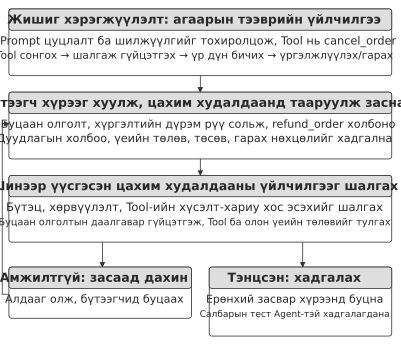

Нэг засвар ерөнхий чадварыг сайжруулсан уу, эсвэл саяхан харсан бодлогод санамсаргүй дасан зохицсон уу гэдгийг хэрхэн ялгах вэ? Бүтээгчид өгөөгүй нэг даалгаврыг нөөцөлж үлдээнэ. Жишээлбэл, нэг дэлгүүрийн өгөгдлөөр үнэ хянах Agent хөгжүүлээд, түүнд өөр дэлгүүрийн жишээг өгөхийн зэрэгцээ анхны даалгаврыг дахин ажиллуулна.

**Agent-ийн ажиллах орчныг арчлах.**

Шинэ Agent-ийн ажиллагаа тохиргоо, итгэмжлэл, сессийн төлөв, үйлчилгээ, sandbox-оос хамаарна. OpenClaw-ийн `doctor` команд арчлалтын Tool-ийн нэг жишээ болно: тэр нь хуучин тохиргооны шилжүүлэг, OAuth итгэмжлэлийн төлөв, сессийн түгжээ, plugin-ийн суулгалт, гарцын эрүүл байдал, sandbox-ийн дүрс зэрэг асуудлыг шалгаж, засварын санал өгөх эсвэл харгалзах засварыг гүйцэтгэдэг[^ch5-doctor].

Эдгээр детерминистик шалгалт өөрийгөө арчлах процессын суурь болж чадна. Илрүүлэх дүрэм мэдэгдэж буй доголдлыг хамарч, засварын үйлдэл тодорхой оролт ба хүлээгдэж буй үр дүнтэй байна. Agent-ийн оношилгооны процессыг цааш зохион бүтээхдээ хараахан шийдэгдээгүй асуудлыг лог, тохиргоо, шалгалтын үр дүнгийн хамт Model-д өгч, аль тохиргоог хэрхэн засах гэж байгаагаа тайлбарлуулж болно; гүйцэтгэлийн давхарга эрх ба засварын хүрээг шалгаад, эрүүл байдлын шалгалт ба регрессийн тестийг ажиллуулна. Тохиргооны агшин зураг, өөрчлөлтийн бүртгэл, буцах орох цэг засвар амжилтгүй болсны дараа системд ажлаа сэргээхэд тусална.

**Инженерийн туршлагыг жишиг хэрэгжүүлэлтээр дамжуулах.**

Тусгай зориулалтын Agent бүтээх нь салбарын логик ба ерөнхий дэд бүтцийг зэрэг хамардаг. Үүсгэсэн үр дүнг шалгахдаа дөрвөн төрлийн асуултаас эхэлж болно:

1. **Context ба ажиллах давталт.** Үүрэг, Tool дуудлагын танигч, Tool-ийн үр дүнгийн хоорондох холбоог хадгалж, олон үеийн төлөв, зогсох нөхцөл, төсөв, онцгой тохиолдлоос сэргээхийг шалгана. Бүтэцтэй мессеж протоколын харилцааг хадгалахад хялбар; тогтвортой угтвар Prompt-ийн кэшийн нөхцөлийг бүрдүүлнэ.
2. **Tool-ийн интерфэйс.** Tool-ийн тайлбар зориулалт, хэрэглэх нөхцөл, ашиглах хил хязгаарыг тодорхой бичиж, параметр төрөл, утга, тодорхой жишээг агуулна. Гүйцэтгэлийн давхарга параметр, хувийн мэдээлэл, бизнесийн төлөвийг үргэлжлүүлэн шалгана.
3. **Model ба API-ийн сонголт.** Model сургалтын өгөгдөлд олон давтагдсан хуучин Model, хуучин интерфэйсийг ашиглах хандлагатай тул код чөлөөтэй бичигдсэн ч сонголт хоцрогдсон байж болно. Бүтээгчид арчлагдаж буй сонголтын материал өгөх, эсвэл албан ёсны баримт бичгийг хайлгаж, Model-ийн чадвар, интерфэйсийн хувилбар, дуудах аргыг тулгуулна. Үүсгэсний дараах бодит дуудлага тохиргоо ажиллаж байгаа эсэхийг шалгана.
4. **Хамаарал ба экосистемийн нийцтэй байдал.** Сангийн арчлалтын төлөв, хувилбар, интерфэйсийн өөрчлөлтийг шалгаж, хамаарлын суулгалт, хөрвүүлэлтийн шалгалт, тестээр хослуулсан программыг баталгаажуулна.

**Тусгай зориулалтын Agent бүтээхдээ зохиогч бүтээгчээр эхлээд баталгаажсан жишиг хэрэгжүүлэлтийг хуулбарлуулж, дараа нь салбарт тохируулан засварлуулахыг түрүүлж сонгодог.** Prompt мессежийн протокол, төлөвийн удирдлага, сэргээх механизмын бүх нарийн зүйлийг бүрэн хамарч чадахгүй ч жишиг код эдгээр инженерийн туршлагыг шинэ системд шууд авчирч чадна. Model программчлалд чадварлаг байсан ч даалгаврын тайлбарт ил тод заагаагүй ажиллах нөхцөлийг орхигдуулж болох бөгөөд хүрээг дахин ашиглах нь ийм давтагдах алдааг багасгана. Бүтээгч тохирох суурь хүрээг хуулбарлаж, шинэ үүрэгт тохируулан системийн Prompt-ийг өөрчилж, салбарын Tools-ийг нэмж хасаж, бизнесийн логикийг засаад, харгалзах тестийг нэмнэ. Мессеж боловсруулах, дуудлагын холбоо, төлөвийн удирдлага, гарах замыг хүрээ хангаж, салбарын өөрчлөлтийг шинээр нэмсэн тохиолдлоор баталгаажуулна.

Хэрэв загвар хамаагүй хурдан байсан бол «хэдэн функц дутуу хийсэн» гэсэн тайлбарыг хэрхэн үгүйсгэх вэ? Доор хоёр бүлэг бүтээгчээр ижил төрлийн Agent хүлээлгэн өгүүлж, ижил шалгалтын багцад оруулна.

> **Туршилт 5-16 ★★★: Agent бүтээж чаддаг Agent хөгжүүлэх**
>
> Нэг бүтээгч Model-оор хувилбар гаргахыг хянах Agent бүтээлгэнэ: нэг багц байршуулалтын шалгалтын бүртгэлийг уншаад, заавал шалгах зүйлсийн аль нэг нь тэнцээгүй бол хувилбар гаргахаас татгалзаж, үндэслэлийг заана. Тэгээс бүтээхэд Model ажиллах давталт, Tool-ийн протокол, салбарын Tools, командын мөрийн орох цэг, тестийг бичих шаардлагатай. Загварын зам эхлээд бүтэцтэй бүртгэл шалгаж чаддаг нэг Agent-ийг хуулбарлах бөгөөд Model зөвхөн салбарын үзүүлэлтийг бөглөхөд хангалттай. Жишээлбэл, төлөв аль талбарт хадгалагддаг, ямар утга тэнцсэнийг илэрхийлдэг вэ? Бүтээх скрипт үзүүлэлтийн дагуу системийн Prompt, Tool-ийн тодорхойлолт, тайлбар баримт бичгийг үүсгэнэ. Байгаа Python Tool үзүүлэлтийг уншиж шалгалтыг гүйцэтгэнэ. Хоёр зам хоёулаа мета-программчлалыг илэрхийлдэг: программаар бусад программыг үүсгэх эсвэл засварлах.
>
> Зураг 5-11-д хоёр зам нэг хүлээн авах нөхцөлийн багц дээр нийлдэг.
>
> 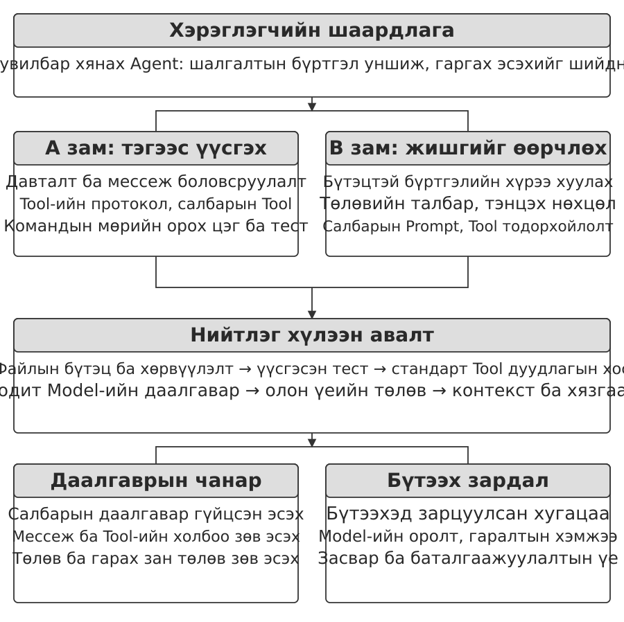
>
> Хоёр зам ижил даалгаврын шаардлага ба хүлээн авах нөхцөлийг ашиглана. Эхлээд бүтээгдэхүүний бүтэц, хөрвүүлэлт, тестийг шалгаж, дараа нь стандарт мессеж дэх Tool дуудлага ба үр дүнгийн холбоог шалгаад, эцэст нь бодит Model-ийн даалгавар ба олон үеийн харилцан үйлчлэлийг ажиллуулж, Context-ийн тайралт, төлөвийн удирдлага, дуудлагын тооны хязгаарыг баталгаажуулна.
>
> Хадгалсан Kimi K3-ийн харьцуулалтад хоёр бүлэг тус бүр детерминистик 39/39 шалгалтыг давж, бодит Model-ийн даалгавар ба олон үеийн төлөвийн шалгалтыг ч хоёулаа давсан. Загварын зам бүтээхдээ 1,181 token, ойролцоогоор 25 секунд, тэгээс бүтээх зам 381,814 token, ойролцоогоор 90 минут зарцуулсан.
>

[^ch5-doctor]: OpenClaw, Doctor; тохиргоо ба төлөвийн шалгалт, шилжүүлэг, засварын боломжийг танилцуулсан.

## Бүлгийн дүгнэлт

**Код бичих Agent харьцангуй эрт төлөвшсөн бөгөөд үүний амархан анзаарагдахгүй нэг шалтгаан бий: программ хангамжийн инженерчлэлд төрлийн систем, тестийн багц, хувилбарын удирдлага, дибагийн хэрэгслүүд аль хэдийн бэлэн байсан.** Кодыг буруу засвал тест ихэвчлэн аль бүлэг оролт хүлээгээгүй үр дүн өгснийг зааж чадна; өөр аргаар засвал анхны оролтоор дахин туршиж болно. Энэ туршлагыг бусад даалгаварт хэрэглэхдээ эхлээд гурван тодорхой асуулт тавина: алдааг хэрхэн илрүүлэх, мэдэгдэж буй төлөв рүү хэрхэн сэргээх, хэзээ зогсоод хүнд шилжүүлэх вэ? Жишээлбэл, буцаан олголтын дуудлагын дундуур холболт тасарвал Harness эхлээд дансаа шалгаад, дараа нь дахин оролдох эсэхээ шийдэх ёстой, эс тэгвээс нэг доголдлоос сэргээх оролдлого хоёр дахь буцаан олголт болон хувирч болзошгүй.

Код мөн нэг удаагийн дүгнэлтийг дахин дахин ашиглаж болох зүйл болгон хадгалж чадна. Математикийн бодлого дахь тоочилт, логикийн бодлого дахь хязгаарлалтыг программд нэг бүрчлэн шалгуулж болно; буцаан олголтын дүрмийг гүйцэтгэх орох цэгийн шалгалт болгон бичиж, сервер захиалгын бодит төлөвийг уншаад нэвтрүүлэх эсэхийг шийдэх боломжтой болгоно. Логийн формат өөрчлөгдвөл задлагчийг засаад, энэ удаа алдаа гаргасан жишээг регрессийн тест болгон үлдээж болно. Эдгээр гурван тохиолдолд хоёулаа код ажиллуулж болох ч шалгуур нь өөр өөр: шийд бодлогын нөхцөлийг хангаж байгаа эсэх, буцаан олголт бодлогод нийцэж байгаа эсэх, шинэ задлагч өмнө нь орхигдсон талбарыг уншиж чадаж байгаа эсэх.

Хүлээлгэн өгөх зүйл нь баримт бичиг, видео эсвэл геометрийн Model бол дүрслэлийн үр дүн, дуу дүрс синхрон эсэх, хэмжээ зөв эсэхийг ч шалгаж, хянагчаар бодит бүтээгдэхүүнийг нэг үзүүлэх хэрэгтэй. Хүлээлгэн өгөх зүйл нь маягт, лавлагаа эсвэл дүрслэл бол хэрэглэгч ойлгож, удирдаж чадах эсэхээс гадна ард нь буй гүйцэтгэх үйлчилгээ эрхийн дагуу өгөгдөл авч байгаа эсэхийг шалгах хэрэгтэй. Хэрэв код үүсгэж буй зүйл нь өөр нэг Agent бол зохиогч эхлээд баталгаажсан хүрээг дахин ашиглаж, салбарын Tools ба бизнесийн логикийг үүсгээд, дараа нь дуудлагын протокол, үе дамнасан төлөв, бодит даалгаврын үр дүнг шалгахыг илүүд үздэг. Ийнхүү хуримтлагдсан Tools, шалгагч, тестийг дараагийн даалгаварт үргэлжлүүлэн ашиглаж болно.

Код даалгаврыг дахин дахин гүйцэтгэх боломж олгодог ч орчин түүнийг дуусахыг заавал хүлээхгүй. Нэг лавлагаа ажиллаж байх хооронд хэрэглэгч бодлоо өөрчилсөн байж болно. Ийм өөрчлөлт явагдаж буй харилцан үйлчлэлд хэрхэн нэвтэрч ордгийг Бүлэг 6-д авч үзнэ.

## Бүлгийн дараах бодох асуултууд

1. ★★ Төслийн файл уншиж, хамаарал суулгаж, тест ажиллуулах шаардлагатай код бичих Agent-д зориулж sandbox зохион бүтээ. Файл, сүлжээ, процесс, нөөцийн эрхийг хэрхэн тохируулах вэ? Даалгаварт эрх өргөтгөх шаардлагатай болбол хүсэлтийг хэрхэн илэрхийлж, хүрээг шалгаж, бүртгэлийг хадгалах вэ?
2. ★★★ Бүтээгч олон үеийн Agent-ийг дараалан үүсгэж, засварлах явцад хүрээний доголдол ба салбарын алдаа аажмаар хуримтлагдаж болно. Жишиг хувилбар, регрессийн тест, зан төлөвийн үнэлгээ, буцаах механизмаар ийм өөрчлөлтийг хэрхэн мөрдөх вэ?
3. ★★ Логийн форматын өөрчлөлт хэвийн шинэчлэлээс ч, үүсгэгчийн доголдлоос ч үүдэлтэй байж болно. Дасан зохицох задлалын систем ямар нотолгоог хадгалж, ямар нөхцөлөөр шинэ задлагч нэмэх, хэвийн бус байдлыг мэдээлэх эсвэл боловсруулалтыг түр зогсоохыг шийдэх ёстой вэ?
4. ★★ Санал болгогч—хянагчийн давталтад хянагч хуудасны мэдээллийн нягтыг зохистой гэж үзсэн ч хэрэглэгч хэт бөөгнөрсөн гэж мэдэрчээ. Хэрэглэгчийн сонголтыг жишээ, үнэлгээний нөхцөл, харилцан үйлчлэлийн хариу болгон хэрхэн хувиргаж, дараагийн засварууд шаардлагад нийцэж байгаа эсэхийг хэрхэн шалгах вэ?
5. ★★ Код бичих Agent мэдлэгийн сан, архитектурын баримт бичиг, төслийн зааврыг шинэчилж, үйлдлийн дарааллыг код болгон бэхжүүлж чадна. Илүүдэл эсвэл хуучирсан дүрмийг хэрхэн таньж, дүрэмд хамрах хүрээ, баталгаажуулах арга, гарах нөхцөлийг хэрхэн зохион бүтээх вэ? Нэг амжилттай засвараас Бүлэг 9-д авч үзэх тасралтгүй хувьсал руу шилжихийн тулд өөр ямар хуримтлал ба үнэлгээний механизм хэрэгтэй вэ?
6. ★ Алсаас хамтран ажиллахад ээлтэй баг ихэвчлэн Agent-д ажлын мэдээлэл авахад ч хялбар байдаг. Сайн мэдэх нэг төслийн шаардлага, архитектур, шийдвэрийн бүртгэл, хүлээн авах стандартыг шалгаж, хамгийн их нөхөх шаардлагатай баримт бичгийг жагсааж, тэдгээр нь Agent-д ямар тодорхой даалгавар гүйцэтгэхэд туслахыг тайлбарла.
7. ★★★ Хувийн өгөгдөлд хандах, итгэлгүй агуулга боловсруулах, гадагш харилцах, тогтвортой санах ой ашиглахыг зэрэг хийдэг Agent-ийн хувьд хувийн мэдээллийн зөвшөөрөл, эх сурвалжийн тэмдэглэгээ, өгөгдлийн урсгалын шалгалт, санах ойд бичихийн хяналтыг хэрхэн зохион байгуулах вэ? Нэг хэвийн бизнесийн урсгалаар эдгээр шалгалтын байршлыг тайлбарла.
8. ★★ SQL ба HTML-ийн Artifact горимд Model бүтээгдэхүүн үүсгэж, гүйцэтгэх үйлчилгээ лавлагаа эсвэл дүрслэлийг боловсруулж, интерфэйс үр дүнг шууд харуулна. Ямар мэдээллийг Model-д дахин өгч тайлбарлуулах нь тохиромжтой вэ? Лавлагааны эрх, нөөцийн төсөв, хуудасны тусгаарлалт, харуулсан үр дүнгийн нийцтэй байдлыг хэрхэн шалгах вэ?
9. ★★ Tool өгөгдлийн сан дахь бизнесийн төлөвөөр дүрмийг шалгаж, параметрийн тайлбар Model-д дуудлага бэлтгэхэд тусалдаг. Захиалга цуцлахыг жишээ болгон байгалийн хэлний бодлого, параметрийн жишээ, гүйцэтгэлийн давхаргын шалгалт, хилийн тест тус бүр ямар үүрэг хүлээдгийг тайлбарла; бодлого өөрчлөгдсөний дараа ямар агуулгыг зэрэг шинэчлэх шаардлагатай вэ?
