# Харилцан үйлчлэл: ажиглалт ба үйлдлийн орон зайг өргөтгөх нь

**Суурь Model тогтмол байхад ажиглалт ба үйлдлийн интерфейсийг дахин зохион байгуулах, эсвэл өргөтгөх нь Agent-ийн даалгаврын гүйцэтгэлийг сайжруулах хамгийн үр дүнтэй инженерийн арга хэрэгслийн нэг байдаг.** Өмнөх бүлгүүдэд Agent ихэвчлэн хэрэглэгчийг ярьж дуусахыг хүлээгээд, дараа нь мэдээлэл хайж, Tool дуудаж, хариу өгдөг байв. Гэтэл Agent Tool-ийн үр дүнг хүлээж байх хооронд хэрэглэгч ч, гадаад орчин ч өөрчлөгдсөөр байдаг.

Хэрэглэгч туслахдаа нислэгийн тасалбараа өөрчлүүлэхийг даалгасан гэж бодъё. Туслах үйлчилгээний ажилтнаас нислэгийн талаар лавлаж байх зуур хэрэглэгч "Надад бас нэг тээшээ бүртгүүлэх хэрэгтэй" гэж бичиж илгээнэ. Ажилтан ярьсаар байх хооронд дэлгэцэн дээрх тасалбарын үнэ ч өөрчлөгдөж магадгүй. Туслах энэ үнэд бүртгэлтэй тээш багтсан эсэхийг цаг алдалгүй тодруулж, түрүүн хэлсэн үнэ хүчинтэй хэвээр байгаа эсэхийг ч анхаарах ёстой. Энд дизайны хоёр асуулт гарч ирнэ: туслах өөрчлөлтийн талаар ямар сувгаар мэдэх вэ, хэзээ хариу үйлдэл хийж чадах вэ? Энэ бүлэгт эхлээд асинхроноор ирэх имэйл болон Tool-ийн үр дүнг авч үзээд, дараа нь тасралтгүй яриа, дэлгэцийн өөрчлөлт, роботын үйлдлийн эргэх холбоог судална.

## Модаль ба өдөөх мөчийн өргөтгөл

**Модаль** нь мэдээлэл болон үйлдлийн хэлбэрийг заана. Agent текст уншиж, дуу сонсож, дэлгэц харж, эргүүлэх моментын дохио хүлээн авч чадна; мөн текст гаргах, яриа нийлэгжүүлэх, интерфейс дээр дарах, үе мөчийг хөдөлгөх боломжтой.

**Өдөөх мөч** нь мэдээлэл хэзээ ирэх, үйлдэл хэзээ эхлэх, систем хэзээ хариу үзүүлэхтэй холбоотой. Мэдээллийг Agent өөрөө лавлаж авч болно, эсвэл гадаад үйлчилгээ түлхэж илгээж болно. Tool үр дүнгээ шууд буцааж болно, эсвэл эхлээд даалгавар эхлүүлээд дараа нь дууссанаа мэдэгдэж болно. Шинэ үйл явдал ирэхэд систем одоогийн ажлаа таслах эсэх, тасалсан даалгавраа хэрхэн сэргээхээ шийдэх шаардлагатай.

| Хэмжээс | Мэдээлэл авах ба ажиглалтын интерфейс | Үйлдэл ба гүйцэтгэлийн интерфейс |
|---|---|---|
| Агуулгын зохион байгуулалт (Бүлэг 2–5) | Context, санах ой ба мэдлэгийн сан шийдвэрт хэрэгтэй мэдээллийг зохион байгуулна | Tool ба код гүйцэтгэж болох үйлдлийг илэрхийлнэ |
| Модаль (энэ бүлэг) | Яриа, дэлгэц, физик мэдрэгч | Ярих, дарах, үе мөчний хөдөлгөөн |
| Мөч (энэ бүлэг) | Идэвхтэй лавлах, үйл явдлыг түлхэх, тасралтгүй оролт | Олон ээлжээр гүйцэтгэх, цуцлах, давуу эрхээр таслах, сэргээх |

Context нь тухайн нэг шийдвэрт шаардлагатай мэдээллийг агуулдаг бол ажиглалтын орон зай нь системийн хүлээн авч болох мэдээллийн хүрээг тодорхойлно. Tool нь тодорхой интерфейс гаргаж өгдөг бол үйлдлийн орон зай нь системд гүйцэтгэхийг зөвшөөрсөн үйлдлийн хүрээг тодорхойлно. Интерфейсийг өргөтгөсөн ч эдгээр хүрээ төхөөрөмжийн чадвар, параметр, эрх, ажиллах орчноор хязгаарлагдсаар байна.

Tool дуудах олон интерфейс мессежийг ээлжээр зохион байгуулдаг: Model дуудлага санал болгоно, систем Tool-ийн үр дүнг нэмнэ, дараа нь дараагийн ээлжийн дүгнэлт эхэлнэ. Үйл явдалд суурилсан систем энэ протокол дээр гадаад өөрчлөлтийг удирдах ёстой. Интерфейс төрөлх асинхроныг дэмждэг бол Tool хүлээгдэж байх хооронд шинэ шаардлага хүлээн авч, үр дүн ирсний дараа үргэлжлүүлэн боловсруулж болно. Синхрон интерфейс ашиглах үед харин Harness дараалал, даалгаврын бариул (handle), хуваарилалтын механизмаар харилцан үйлчлэлийг зохион байгуулна. Энэ хоёр замыг доор тус тусад нь авч үзнэ.

Хувилбар бүрийн эргэх холбооны хэмнэл эрс ялгаатай. Доорх хүснэгтэд түгээмэл цаг хугацааны масштабыг жагсаав.

| Түгээмэл масштаб | Хувилбар | Ажиглалтын талын өөрчлөлт | Үйлдлийн талын боловсруулалт |
|---|---|---|---|
| Секундээс хоног хүртэл | Асинхрон ба үйл явдалд суурилсан | Гадаад үйл явдал Agent-ийг сэрээнэ | Эхлээд даалгавар эхлүүлж, дараагийн үйл явдлууд явц ба дууссаныг мэдэгдэнэ |
| Хэдэн арван миллисекундээс секунд хүртэл | Яриа | Аудиог тасралтгүй хүлээн авна | Урсгалаар гаргаж, яриа таслах ба тоглуулахыг зогсоохыг боловсруулна |
| Секундээс бага хугацаанаас секунд хүртэл | Computer Use | Дэлгэц байнга өөрчлөгдөнө | Үйлдэл бүрийн дараа интерфейсийн төлөвийг дахин авна |
| Миллисекундийн удирдлагын мөчлөг | Роботын доод түвшний удирдлага | Мэдрэгчээс тасралтгүй эргэх холбоо ирнэ | Богино хэсэгчилсэн үйлдэл гүйцэтгэж, удирдлага ба зогсоох дохионд хариу үзүүлнэ |

## Асинхрон ба үйл явдалд суурилсан систем: ертөнц өөрөө хаалга тогшихуй

Бүлэг 4-т мэдрэх, гүйцэтгэх, хамтран ажиллах Tool-үүдийг танилцуулсан. Энэ хэсэгт үйл явдлаар өдөөгдөх Tool ба хэрэглэгчтэй харилцах Tool-ийг авч үзнэ. Үйл явдлаар өдөөгдөх Tool орчны өөрчлөлтийг Agent руу дамжуулдаг бол харилцааны Tool нь Agent-д даалгавраа гүйцэтгэх явцдаа хэрэглэгчтэй холбогдох боломж олгоно. Harness эдгээр оролт, гаралтыг ажиллаж буй даалгавартай холбож, тасралтгүй ажилладаг үйл явдлын давталтыг бүрдүүлнэ.

### Асинхрон яагаад хэрэгтэй вэ

Синхрон дуудлагад үр дүн буцаж иртэл хүлээсний дараа л дуудагч одоогийн урсгалаа үргэлжлүүлнэ. Асинхрон дуудлага харин эхлээд даалгаврын бариулыг (даалгаврыг лавлах, удирдахад ашиглах таних тэмдэг) буцаадаг, эсвэл дууссаныг нь хожим мэдэгдэхээр тохиролцдог тул дуудагч хүлээх хугацаандаа өөр ажил хийж чадна. Ингэснээр систем ажиллаж буй олон даалгаврыг зохион байгуулж, нөөц ба хамаарлыг харгалзан аль үйлдлүүдийг зэрэг гүйцэтгэж болохыг шийднэ.

Agent-ийг имэйл, утасны дуудлага, зочин хүлээн авах ажлыг хариуцсан нарийн бичгийн дарга гэж төсөөлж болно. Тэрээр хариу захидал хүлээж байх зуураа материалаа цэгцэлж, яаралтай дуудлага ирэхэд одоогийн ажлынхаа явцыг түр тэмдэглэж аваад, ярьж дууссаныхаа дараа анхны ажилдаа буцаж ордог. Инженерийн хэрэгжүүлэлтэд үүнийг гурван зүйлээр шийднэ:

- **Урт даалгаврыг харилцан яриаас салгах.** Файлын шинжилгээ, утасны дуудлага, бүтээлтийн даалгавар ар талд үргэлжилж, хэрэглэгч энэ хооронд явцыг лавлах, шаардлага нэмэх боломжтой байна.
- **Үйл явдлын давуу эрэмбэ.** Яаралтай зогсоох дохио удирдлагын урсгалд цаг алдалгүй орж, ердийн шинэчлэлүүд дараалалд зогсоно, бие даасан лавлагааг зэрэгцээ сесст өгч болно.
- **Таслах ба сэргээх.** Даалгаврын төлөвийг хадгалж, аль хэдийн хийгдсэн үйлдлүүдийг тэмдэглэж, сэргээхдээ хүчинтэй хэвээр байгаа нөхцөлүүдийг дахин шалгана.

Claude Duet-ийн судалгааны урьдчилсан хувилбар үүний нэг жишээг харуулдаг. Хэрэглэгч үдээс хойш хоёр цагт уулзалттай бөгөөд нөгөө компанийн тухай товч мэдээллийг урьдчилан авахыг хүсэж байна. Тэрээр дуут мессеж үлдээгээд аппаа хааж болно. Бэлтгэл ажил үүлэн дээр үргэлжилж, хэрэглэгч хүссэн үедээ даалгаврын хуудсыг нээж явцыг харах боломжтой. Хэрэглэгчээс нэмэлт мэдээлэл хэрэгтэй болох юм уу товч мэдээлэл бэлэн болоход туслах үндсэн харилцан яриа руу буцаж ирж мэдэгдэнэ. Энд хэрэглэгч явсны дараа ч даалгавар урагшилсаар байгаа нь асинхрон гүйцэтгэлийг илэрхийлж байна. Дараа нь авч үзэх бүрэн дуплекс яриа өөр нэг шаардлага тавьдаг: нэг тал ярьж байхад нөгөө талын таслан оролцохыг сонссоор байх ёстой.[^ch6-duet]

Model-ийн API мессежийн дарааллын талаар ч тохиролцоотой байдаг. Зарим интерфейс Tool-ийн дуудлага ба үр дүн бүрэн хосолсны дараа л дараагийн ээлжийн хүсэлтийг хүлээн авдаг бол зарим нь Tool-ийг хүлээлгэн байлгаж, дараагийн шинэчлэлийг хүлээн авахыг зөвшөөрдөг. Хэрэглээний асинхрон функц хүлээлт ба гүйцэтгэлийг зохицуулдаг бол Model-ийн протокол мессежийг хэзээ илгээж болохыг тогтооно.

Зураг 6-1-д шинэ мессеж ч, Tool-ийн үр дүн ч дараалалд орж болох ч дараалалд хэрхэн хүрэх нь эх сурвалжаасаа хамаарна. Үйлчилгээ түлхэх мэдэгдлийг дэмждэг бол төлөв өөрчлөгдөнгүүт мэдэгдэл илгээж чадна. Үйлчилгээ зөвхөн лавлах интерфейстэй бол адаптер тогтмол хугацаанд шалгаж, өөрчлөлт илэрмэгц үйл явдал үүсгэнэ. Цаг хэмжигчийн хугацаа дуусах нь ч үйл явдал үүсгэж болно. Дараа нь үйл явдлын давталт эдгээр оролтыг Agent руу дамжуулна.

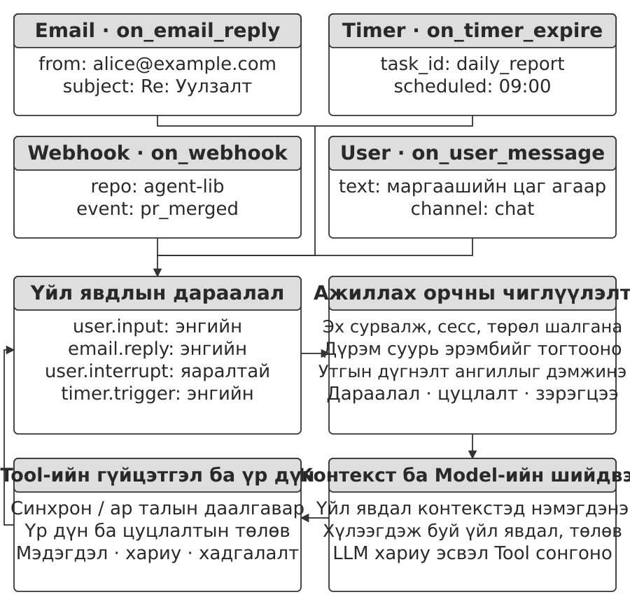

### OpenClaw дахь үйл явдалд суурилсан механизмын хэрэгжүүлэлт

OpenClaw нь Gateway-ээр дамжуулан мессежийн сувгуудад холбогдож, үйл явдлыг Agent-ийн ажиллах орчин руу чиглүүлдэг. Түүний автоматжуулалтын механизмд дотоод Hooks, хуваарьт ажил, Heartbeat, гадаад Webhook зэрэг орох цэгүүд багтана[^ch6-automation]. Эдгээрийг өдөөх нөхцөлөөр нь ингэж ангилж ойлгож болно:

- **Hooks (үйл явдлын дэгээ)** нь фреймворкийн дотоод үйл явдалд, жишээлбэл сесс үүсэх, дахин тохируулагдах, ажиллагааны амьдралын мөчлөг өөрчлөгдөхөд хариу үзүүлнэ.
- **Cron (хуваарьт ажил)** нь заасан цагт эсвэл тодорхой давтамжтайгаар ажил гүйцэтгэнэ. Жишээлбэл, `0 9 * * 5` нь тохируулсан цагийн бүсээр долоо хоног бүрийн баасан гарагийн өглөөний 9 цагт өдөөгдөнө гэсэн үг.
- **Heartbeat (зүрхний цохилт)** нь Agent-ийг тогтмол сэрээж, анхаарах ёстой зүйлсийг шалгуулна.
- **Webhook (гадаад буцах дуудлага)** нь гадаад үйлчилгээнээс ирүүлсэн үйл явдлыг хүлээн авч, баталгаажуулалт ба чиглүүлэлтийн дараа боловсруулалтыг өдөөнө.

Долоо хоногийн тайланг товлосон цагт ажиллуулах нь тохиромжтой. Байнга хянах ёстой хийх ажлуудыг тогтмол шалгаж болно. Шинэ имэйл, үйлчилгээний буцах дуудлагыг харин түлхэх мэдэгдлээр авбал илрүүлэх хоцролтыг богиносгоно.

**PineClaw-ийн утасны дуудлагын үйл явдал.** Pine AI нь хэрэглэгчийн өмнөөс утасдаж, төлбөрийн хэлэлцээр, захиалга цуцлах, даатгалын нөхөн төлбөр зэрэг асуудлыг шийддэг. PineClaw нь ийм утасны даалгаврыг OpenClaw-д холбодог. Яриа ихэвчлэн тодорхой хугацаанд үргэлжлэх бөгөөд энэ хооронд хэрэглэгчийн оролцоо шаардлагатай болж болно:

- **Хэн болохыг баталгаажуулах.** Үйлчилгээний ажилтан дансны эзнээс баталгаажуулалт хийхийг, жишээлбэл аюулгүй байдлын код эсвэл нэг удаагийн нууц үг оруулахыг шаардана.
- **Гурван талт яриа.** Ажилтан дансны эзэнтэй шууд ярихыг хүсвэл хэрэглэгчид цаг алдалгүй мэдэгдэж, утсаа авахыг сануулах хэрэгтэй.
- **Шийдвэр батлах.** Ажилтан өөр хувилбар санал болговол урд талын Agent энэ удаагийн даалгавар болон хэрэглэгчийн өмнөх сонголтыг харгалзан хүлээн зөвшөөрч болох эсэхийг дүгнэнэ. Хэрэглэгч өөрөө шийдэх шаардлагатай бол тодорхой сонголтуудыг хэрэглэгчид илгээж, зэрэгцээд ажилтантай бусад нөхцөлийг үргэлжлүүлэн тулгана.

Жишээлбэл, ажилтан дансны эзнийг гурван талт ярианд нэгдэхийг хүсчээ. Мэдэгдэл хэдий чинээ эрт хүрнэ, хоёр тал утсан дээр дэмий хүлээх хугацаа төдий чинээ богиносно. PineClaw-ийн жишээнд Channel механизм ашиглаж, Gateway ба Pine API-ийн хооронд утасны дуудлагын үйл явдлыг холбодог: дуудлага холбогдох, хэрэглэгчийн оролт шаардах, яриа дуусах нь тус тусдаа үйл явдлын урсгалд орж, Agent үүний дагуу даалгавраа шинэчилж, хэрэглэгчид мэдэгдэнэ.

**Миний бодлоор, идэвхтэй үйлчилгээ цагтаа хүрэхийн тулд үйл явдлын эх сурвалж өөрөө төлөв өөрчлөгдөх үед Agent-д мэдэгдэх нь хамгийн зөв.** Мэдэгдэл сувгаар ирсний дараа Harness харгалзах даалгаврыг олж, давхардсан эсэх, хугацаа нь дууссан эсэхийг шалгаж, дараагийн алхмыг Model шийднэ. Хэрэглэгчээс хэн болохоо баталгаажуулахыг шаардвал интерфейс итгэмжлэгдсэн баталгаажуулалтын хаалгыг нээх ёстой бөгөөд баталгаажуулалтын үр дүн дараа нь шинэ үйл явдал болж анхны даалгавар руу буцна.

### Үйл явдлаар өдөөгдөх Tool

"Үйлчлүүлэгч хариу бичмэгц надад сануулаарай" гэж туслахад даалгавал тэр маргааш яг цагтаа хэрхэн сэрэх вэ? Эхлээд шуудангийн хайрцаг захидал ирэх үед үйл явдал түлхэж чадах эсэхийг шалгана. Зөвхөн өөрөө лавлаж болдог системийн хувьд дараагийн шалгах цагийг санах шаардлагатай. Доорх гурван жишээ интерфейс эдгээр хүлээлтийн нөхцөлийг ажиллах орчинд хадгалуулдаг тул Model одоогийн ээлжийн ажлаа дуусгаж болно.

**Цаг хэмжигч (`set_timer`)** нь даалгаврыг тохиролцсон цагт сэрээхэд хэрэглэгдэнэ. Нэг удаагийн цаг хэмжигч нь "Ирэх даваа гарагийн өглөөний 10 цагт банк руу утасдаж орон сууцны зээлийн явцыг лавла" гэх мэт ажилд тохирно. Давтагдах цаг хэмжигч нь үйлчилгээний эрүүл мэндийг цаг тутам шалгахад тохиромжтой. Имэйл илгээгээд хариуг хүлээх, ажлын бус цаг таарвал дараа нь дахин залгах зэргийг ч цаг хэмжигчээр товлож болно. Интерфейс нь цагийн бүс, өдөөх нөхцөл, даалгаврын таних тэмдгийг хадгалж, цуцлах эсвэл өөрчлөх боломжийг олгох ёстой. Гадаад үйлчилгээ зөвхөн лавлагааг дэмждэг бол хуваарьт ажил явцыг тогтмол шалгах үүргийг ч гүйцэтгэж болно.

**Ар талын даалгаврын хяналт (`monitor_shell`)** нь удаан ажилладаг командыг явцын үйл явдал болгон хувиргахад хэрэглэгдэнэ. Эхлүүлэхэд даалгаврын таних тэмдгийг буцааж, ажиллах явцад шинэ гаралт, түлхүүр үг эсвэл төлөвийн өөрчлөлтөөр мэдэгдэж, дуусахад гарах төлөв ба үр дүнг тайлагнана.

Model-оор явцыг дахин дахин лавлуулбал төлөв өөрчлөгдөөгүй байсан ч Model дуудах зардал гарна. Зөвхөн дууссан мэдэгдлийг хүлээвэл явцын дундах доголдлыг алдаж магадгүй. Иймээс хяналтыг ажиллах орчинд даатгаж, хэрэгтэй явц, алдаа эсвэл зогсонги байдал гарсан үед л Model-ийг сэрээхийг зөвлөж байна. Ингэснээр бүтээлт явагдаж байх хооронд харилцаагаа үргэлжлүүлж, хэвийн бус байдалд цаг алдалгүй оролцох боломжтой болно. Хяналтын дүрэмд шүүлт, нэгтгэл, давтамжийн хязгаарлалт тохируулж, логийн мөр бүр Model-ийн нэг дуудлагыг өдөөхөөс сэргийлж болно.

Жишээлбэл, Model шийдвэрлэгдэж буй ажлын хүсэлтийн төлөвийн шинэчлэлд бүртгүүлсний дараа энэ ээлжийн дүгнэлтээ дуусгаж, хүсэлтийн дугаар бүхий мэдэгдэл түүнийг сэрээхийг хүлээж болно. Нөгөө тал зөвхөн лавлах боломж олгодог бол Model дараагийн шалгалтад зориулж өөрөө хуваарьт ажил тохируулж болно. Тэр цагт "боловсруулагдаж байна" гэсэн хариу авбал дахин товлоно; хүсэлт шийдвэрлэгдсэн бол цаашдын шалгалтыг цуцална. Аль ч аргад хүлээх үүргийг ажиллах орчин хариуцаж, Model зөвхөн мэдэгдэл ирэх буюу цаг хэмжигчийн хугацаа дуусах үед дүгнэлт гаргана.

**Гадаад үйл явдлын суваг (`connect_channel`)** нь имэйл, шуурхай мессеж эсвэл API-ийн буцах дуудлагад бүртгүүлэхэд хэрэглэгдэнэ. Сувгийн адаптер эх сурвалжийг баталгаажуулж, үйлчилгээний өөрийн таних тэмдгийг урсгал (thread) болон холбоотой объект руу буулгаад, нэгдсэн форматтай үйл явдал илгээнэ. Үүнийг дараагийн "Холболтын давхарга" хэсэгт дэлгэрүүлнэ. PineClaw-ийн утасны төлөвийн мэдэгдэл энэ төрөлд хамаарна.

Гурван төрлийн Tool аль аль нь өдөөх нөхцөл, шүүлтийн дүрэм, үйл явдлын ачааллыг (payload) тодорхой зааж өгөх ёстой. Ачаалалд үйл явдлын таних тэмдэг, болсон цаг, эх сурвалж, холбогдох даалгавар болон зайлшгүй агуулга багтах ёстой бөгөөд ингэснээр Agent тухайн үйл явдал хүчинтэй хэвээр байгаа эсэх, дараагийн алхамд ямар мэдээлэл хэрэгтэйг дүгнэж чадна.

### Хэрэглэгчтэй харилцах Tool

Тасалбар өөрчлөх даалгавар руу буцъя. Үйлчилгээний ажилтнаас асуух, хэрэглэгчид шууд хариулж болох баталгаажуулах мессеж илгээх, даалгаврын бүртгэлд "хариу хүлээж байна" гэж тэмдэглэх гэсэн гурван үйлдэл гурван өөр газар бичигдэнэ. Хэрэглэгч түр холдож болох бөгөөд нөхцөл нэмэх, шийдвэр батлах, үр дүн хүлээн авах шаардлага гарахад эргэж ирнэ.

Харилцан ярианы интерфейс эцсийн хариу, Tool-ийн явц, гүйцэтгэлийн үр дүнг харуулж болно. Харилцааны Tool харин хүлээн авагч, суваг, мессежийн агуулга, хавсралтыг тодорхой заана. Model юу илэрхийлэхээ шийдэж, Harness хүлээн авагч ба эрхийг шалгаж, мессежийн үйлчилгээ хүргэлтийг гүйцэтгэнэ. Ажиллах орчин эцсийн хариуг анхны харилцан яриа руу автоматаар чиглүүлж ч болно. Энэ хоёр аргыг хослуулан хэрэглэж болно.

OpenClaw-ийн олон сувгийн харилцаа нь хэрэглэгчид нарийн бичгийн даргатайгаа холбогдох шиг мессеж илгээх, явцыг хүлээх, сануулга хүлээн авах боломж олгодог. Энэхүү "амьд хүнтэй харьцаж буй мэдрэмж" нь даалгаврын тасралтгүй төлөв, цаг үеэ олсон харилцаанаас үүсдэг. Хэрэглэгч өөрийн дассан сувгаар даалгавраа үргэлжлүүлж болох тул Agent хэн болох, сесс, мессежийн холбоосыг нэгдмэл байлгах ёстой.

Харилцааны агуулга даалгавраас хамаарч өөр байж болно: товч явцыг текстээр, нарийн үр дүнг зураг эсвэл файл хавсаргаж, бөглөх мэдээллийг бүтэцлэгдсэн картаар, харилцан үйлчлэлтэй бүтээлийг Бүлэг 5-д танилцуулсан генератив UI-аар илгээнэ. Суваг хүргэгдсэн эсвэл уншсан тухай баримтыг дэмждэг бол систем тухайн төлөвийг хадгална. Амжилтгүй болсны дараах дахин оролдлого, давхардсан мессеж, сувгийн хоорондын синхрончлол ч хүргэлтийн бүртгэлд орно.

**Олон сувгийн мэдэгдэл ба хэрэглэгчийг эргүүлэн татах.**

Шуурхай мессеж, SMS, имэйл, утасны дуудлага, аппын түлхэх мэдэгдэл тус бүр өөр өөр яаралтай байдал ба агуулгын хэлбэрт тохирдог. Agent яаралтай байдал, хэрэглэгчийн сонголт, одоогийн төлөв, мессежийн уртыг харгалзан суваг сонгож болно. Шууд баталгаажуулах шаардлагатай утасны үйл явдалд цаг алдалгүй сануулга ашиглаж, бүрэн тайланг имэйл эсвэл аппын холбоосоор хүргэж болно.

Би нэгэн удаа туслахдаа ATC хурлын зочид буудлын үнийг хянуулж байлаа. Туслах өдөр бүр нэг цагт мессеж илгээж, үнэ зорилтот хэмжээнд хүртэл буураагүй гэж мэдээлдэг байв. Нэг удаа үнэ богино хугацаанд буурсан ч тэр боломжийг барьж авсан нь миний өөрөө бичсэн скрипт байсан юм. Богино хугацааны хямд үнэ хоёр шалгалтын хооронд гарч болно. Туслах цагтаа илрүүлсэн ч мессеж хоцорч хүрвэл хэрэглэгч захиалгаа алдаж мэднэ. Үнэ буураагүй өдрүүдэд хуваарьт шалгалт ердийнхөөрөө ажилласаар байж болох ч хэрэглэгч өдөр бүр ижил агуулгатай мессеж унших шаардлагагүй. Бүлэг 7-д таван минутын хямдралын цонхоор ийм сануулгыг шалгана.

Урт даалгавар дуусахад мэдэгдэл хэрэглэгчийг үр дүнгийн хуудас руу буцааж авчирна. Өдөр тутмын хураангуй, долоо хоногийн тайланг харин тохиролцсон хэмнэлээр илгээнэ. Олон сувгийн стратегид давхардал арилгах, чимээгүй цаг, шатлан дээшлүүлэх нөхцөлийг тохируулах хэрэгтэй. Жишээлбэл, анхны сануулгад хариу ирээгүй бол өөр суваг руу шилжих эсэх. Мэдэгдлийн бүртгэлийг даалгаврын төлөвтэй холбосноор хэрэглэгч хүлээн авсан мессежээсээ шууд ажлаа үргэлжлүүлэх боломжтой болно.

### Виртуал хувийн дүр ба тусгаарлагдсан гүйцэтгэлийн орчин

Бүлэг 4-т "Her" киноны Samantha-гийн жишээгээр ерөнхий зориулалтын туслах Tool-ээр дамжин дижитал ертөнцөд хэрхэн нэвтэрдгийг тайлбарласан. Ийм туслахыг хэрэгжүүлэхийн тулд түүнийг ямар нэрийн өмнөөс ажиллах, ямар нөөцөд хандаж болохыг тодорхой болгох хэрэгтэй. **Би ерөнхий зориулалтын туслахад бие даасан виртуал хувийн дүр олгохыг илүүд үздэг.** Тусгай ажлын имэйл, утасны дугаар, хадгалах зай, тооцооллын орчин нь Agent-ийг өөрийн ажлын данстай нарийн бичгийн дарга шиг тодорхой төлөөлөгчийн нэрээр хэрэглэгчийн өмнөөс ажил хэрэг шийдвэрлэх боломжтой болгоно. Бие даасан хувийн дүр нь туслахын өдөр тутмын ажлыг хэрэглэгчийн хувийн данснаас тусгаарлаж, тусад нь эрх олгох, аудит хийх, эрхийг цуцлахад хялбар болгодог. Алдаатай үйлдэл гарсан ч нөлөөллийн хүрээг хязгаарлахад амар. Хэрэглэгчийн дансанд заавал хандах шаардлагатай даалгаврын хувьд хүрээ нь хязгаарлагдсан зөвшөөрлөөр шаардлагатай эрхийг авна.

Утасны дугаар хэнийх вэ гэдэг нь нөгөө тал эргэж залгахад хэн ажлыг үргэлжлүүлэхийг тодорхойлно. Manus-ийн Cue нь туслахад бие даасан дугаар олгож, ирсэн дуудлагад хариулаад, ярианы хураангуйг хэрэглэгчид үлдээж чаддаг. Хэрэв худалдаа эрхлэгч туслахын үлдээсэн эргэж залгах дугаарыг хүлээн авбал үйлчилгээний ажилтан залгахад өмнө нь асуудлыг хариуцаж байсан туслахтай шууд холбогдоно.[^ch6-cue]

Төлбөрийн хөнгөлөлтийг жишээ болгоё. Туслах эрх бүхий төлөөлөгчийн нэрээр худалдаа эрхлэгчтэй холбогдож болно. Ажилтан эзнээс нь аман баталгаажуулалт шаардвал хэрэглэгчийг гурван талт ярианд урьж, баталгаажуулалт дууссаны дараа туслах яриагаа үргэлжлүүлнэ. Худалдаа эрхлэгч хэрэглэгч рүү эргэж залгах бол хэргийн дугаар, аль хэдийн тохирсон зүйлс, шалгах шаардлагатай асуултуудыг урьдчилан хэрэглэгчид өгнө. Хэрэглэгчид тайлагнахдаа гарт буй нотолгоогоо ч тодорхой хэлэх ёстой: ажилтан хөнгөлөлт үзүүлнэ гэж амаар зөвшөөрсөн бол энэ амлалтыг тэмдэглэнэ; дараа нь төлбөрийн хуудас шинэчлэгдсэнийг шалгаж мэдсэн үедээ л төлбөр бодитоор хөнгөлөгдсөн гэж тайлагнана.

Би Бээжинд байхдаа Bank of America-гийн зээлийн картаа дахин захиалахад Pine банктай холбогдож, яаралтай карт нөхөн олгохыг зохион байгуулж, яаралтай үйлчилгээний 15 долларын хураамжийг чөлөөлүүлж чадсан. Яриа дуусах үед туслах банк юуг хүлээн авсан, аль хураамжийг чөлөөлөхийг зөвшөөрснийг тайлагнах боломжтой болсон байв. Хэд хоногийн дараа хэрэглэгч "Шинэ карт хаана явна?" гэж асуувал логистикийн мэдээллийг дахин шалгах юм уу хүлээн авагчаас лавлах шаардлагатай.

Виртуал компьютер ба виртуал гар утас тасралтгүй ажилладаг үйлдлийн орчинг бүрдүүлнэ. Виртуал машин ширээний үйлдлийн систем ажиллуулж чадна, контейнер нь процесс ба хамаарлыг тусгаарлахад тохиромжтой, Android эмулятор гар утасны аппуудыг ажиллуулна. Эдгээр нь ар талд ажиллах боломжтой бөгөөд автомат үйлдэл хэрэглэгчийн одоогийн ажилд саад болохыг багасгана. Тусгаарлалтын хүрээг сүлжээ, холболт (mount), итгэмжлэл, ажиллах эрх хамтдаа тодорхойлдог; эдгээр тохиргоо нь Agent ямар өгөгдөл ба гадаад системд хүрч болохыг ч нэгэн зэрэг тогтооно.

Ажлаасаа гараад компьютераа унтраасны дараа Tencent WorkBuddy-ийн байгууллагын хувилбараар долоо хоногийн тайлан гаргуулах хүсэлтэй, гэтэл энэ долоо хоногийн борлуулалтын хүснэгт зөвхөн ажлын компьютер дээр байгаа гэж бодъё. Дотоод даалгавар сонговол туслах тэр хүснэгтийг уншиж чадна, гэхдээ компьютер асаалттай, клиент онлайн байх ёстой. Үүлэн даалгавар сонговол компьютераа унтраасан ч туслах үргэлжлүүлэн ажиллана; гэхдээ тайланд ашиглахыг зөвшөөрсөн өгөгдлөө урьдчилан даалгаварт байршуулах, эсвэл үүлэн даалгавар хандаж чадах мэдээллийн санд оруулсан байх нөхцөлтэй. Борлуулалтын хүснэгт заавал энэ компьютер дээр үлдэх ёстой бол компьютер онлайн байх үед боловсруулахаар товлох хэрэгтэй.

Вэб хуудас болон гар утасны апп мөн хэн болохыг баталгаажуулах, баталгаажуулах код оруулах, хүн гараар батлахыг шаардаж болно. Холбогдохдоо үйлчилгээний өгдөг API ба зөвшөөрлийн аргыг түрүүлж ашиглана. График интерфейсээр баталгаажуулах шаардлагатай бол VNC/RDP алсын ширээгээр хэрэглэгчийг өөрөө нэвтрүүлж, энэ хугацаанд автомат үйлдлийг түр зогсооно. Хэрэглэгч дуусгасны дараа систем сессийн төлөвийг шалгаад даалгавраа сэргээнэ. Токен ба сессийг хүчинтэй хугацааных нь дагуу хадгалж, зөвшөөрлийг цуцлах эсвэл даалгавар дуусахад бодлогын дагуу цэвэрлэнэ.

Agent ба виртуал орчин **хуваалцсан файлын систем**-ээр өгөгдөл солилцож болно. Жишээлбэл, хэрэглэгч CSV байршуулахад виртуал компьютер файлыг уншиж, шинжилгээ хийгээд графикийг хуваалцсан хадгалах санд буцааж бичнэ. Ажиллах орчин графикийн файлын байршлыг Agent-д өгч, дараа нь хэрэглэгчид хандаж болох татах холбоос гаргаж өгнө. Том файлын агуулга хадгалах санд үлдэж, Model хэрэгтэй үедээ хураангуй эсвэл хэсгийг нь уншина.

[^ch6-dsh-threads]: DeepSeek, dsh-superagent прототипийн домэйн загвар, зөвшөөрөл ба бүртгэлийн дүрэм.
[^ch6-dsh-sessions]: DeepSeek, dsh-superagent прототип, хувилбар `8c32a9d`. Хоёр төрлийн сессийн үүргийг `docs/004-prompts.md`-аас, гүйцэтгэлийн сесс ба ажлын хавтсыг `docs/003-execution.md`-аас, үндсэн сесс рүү илгээх мессежийн форматыг `docs/007-architecture.md`-аас үзнэ үү.
[^ch6-duet]: Anthropic, *Get started with Claude Duet*. Уулзалтын өмнөх товч мэдээлэл, даалгаврын хуудас, үндсэн харилцан ярианы мэдэгдлийг танилцуулсан.
[^ch6-cue]: Manus, *Introducing Manus 2.0*. Cue-ийн бие даасан утасны дугаар, ирсэн дуудлагад хариулах, ярианы хураангуйг танилцуулсан.
[^ch6-automation]: OpenClaw, Automation. Дотоод Hooks, хуваарьт ажил, Heartbeat, гадаад Webhook зэрэг автоматжуулалтын орох цэгүүдийг танилцуулсан.

### Холболтын давхарга: олон эх сурвалж, нэг үйл явдал

Нэгэн онлайн дэлгүүрийн үйлчилгээний Agent буцаан олголт шийдвэрлэж байна: худалдан авагч аппын үйлчилгээний чатад хүсэлт гаргажээ; дүн нь Agent-ийн эрхээс давсан тул тэр WeCom-ийн борлуулалтын дараах үйлчилгээний бүлэгт менежерээс батлуулахаар хүсэлт тавина; төлбөрийн үйлчилгээ буцаан олголт амжилттай болсны дараа Webhook илгээнэ; захиалгын систем дараа нь Kafka дээр төлөвийн өөрчлөлтийг нийтэлнэ. Дөрвөн мессеж нэг л захиалгын тухай боловч өөр өөр замаар ирж байна. Эх сурвалж олширч, холбоос бүр дахин оролдлого, давхардал арилгалт, дарааллыг өөр өөрийнхөөрөө шийдвэл ажиллах орчин эдгээр ялгаанаас болж бутран задарна. **Холболтын давхарга нь үйл явдал системд орсны дараах хэлбэрийг нэгтгэж, ирэхээс өмнөх эх сурвалж бүрийн чадварын ялгааг хадгална.** Зураг 6-2-т энэ давхаргажилтыг харуулав.

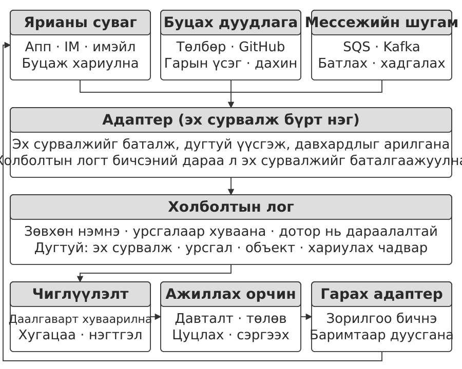

Түгээмэл эх сурвалж дөрвөн төрөл байна. **Харилцан ярианы суваг** гэдэгт бүтээгдэхүүний өөрийн чатын интерфейс, WeCom, Feishu, Slack зэрэг шуурхай мессеж, мөн имэйл хамаарах бөгөөд Agent ирсэн газарт нь буцаж хариулж чадна. **Буцах дуудлага** нь гадаад үйлчилгээ төлөв өөрчлөгдөх үед дууддаг HTTP интерфейс бөгөөд ихэвчлэн гарын үсэгтэй, зөвхөн мэдэгдэл авчирдаг. Хүргэлт амжилтгүй болбол зарим үйлчилгээ автоматаар дахин оролддог бол GitHub-ийн хувьд гараар эсвэл API-аар дахин илгээх шаардлагатай. **Мессежийн шугам**, тухайлбал SQS, Kafka нь дотоод үйлчилгээнүүдийн бизнесийн үйл явдлыг дамжуулж, баталгаажуулалт ба хадгалалтын тодорхой утга зүйтэй байдаг. **Цаг хэмжигч, тогтмол шалгалт, дотоод үйл явдал**-ыг систем өөрөө үүсгэдэг тул нэг логт бичихэд хангалттай. Доорх хүснэгтэд эхний гурван төрлийг харьцуулав.[^ch6-ingress-mq][^ch6-ingress-callback]

| | Аппын чат | WeCom / Feishu | Имэйл | Webhook | SQS | Kafka |
|---|---|---|---|---|---|---|
| Ирэх арга | Байнгын холболт | Буцах дуудлага эсвэл байнгын холболт | Түлхэх эсвэл тогтмол шалгах | Буцах дуудлага | Хэрэглэгч татаж авна | Хэрэглэгч татаж авна |
| Дараалал хадгалагдах хүрээ | Харилцан ярианы дотор | Ихэнх үйл явдалд баталгаагүй | Баталгаагүй | Баталгаагүй | Стандарт дараалалд баталгаагүй, FIFO-д мессежийн бүлгээр | Хуваалтын дотор |
| Давхардал арилгах төрөлх үндэс | Клиентийн мессежийн ID | Мессежийн ID, үйл явдлын ID | Message-ID | Хүргэлтийн ID | Мессежийн ID; FIFO-д нэмэлт `MessageDeduplicationId` | Сэдэв, хуваалт ба байрлал |
| Дахин тоглуулах боломж | Өөрийн бүртгэлээс хамаарна | Буцах дуудлагыг өөрийг нь дахин тоглуулж болохгүй; Feishu-д түүхэн мессежийн интерфейсээр нөхөж татаж болно | Шуудангийн хайрцгийг дахин уншиж болно | Үйлчилгээнээс хамаарна | Устгасны дараа боломжгүй | Хадгалах хугацаанд боломжтой |
| Баталгаажуулах арга | Клиентийн баримт | Хугацаанд нь амжилттай хариу буцаах | Уншсан байрлалаа өөрөө тэмдэглэх | Хугацаанд нь 2xx буцаах | Мессежийг устгах | Байрлалыг баталгаажуулах |
| Хариу илгээх зам | Анхны чат | Анхны чат | Хариу захидал | Байхгүй | Байхгүй | Байхгүй |

**Нэгдсэн дугтуй.**

Адаптер анхны мессежийг нэгдсэн форматтай **дугтуй** (envelope) болгон хөрвүүлнэ. Дугтуйд зөвхөн ирэх үед тогтоож болох баримтуудыг бичнэ; давуу эрэмбэ ба боловсруулах хугацааг чиглүүлэлтийн дүрэм нэмнэ, үйлчлүүлэгчийн зэрэглэл ба захиалгын төлөвийг бизнесийн систем нэмнэ, боловсруулалтын төлөвийг тусад нь хадгална. Худалдан авагчийн буцаан олголтын хүсэлтийг ингэж бичиж болно:

```json
{
  "id": "evt_7f3a",
  "source": {"type": "app_chat", "sender": "user:u_5521", "verified": true},
  "dedupe_key": "app:msg:msg_1029",
  "thread": "app:conv:conv_88",
  "kind": "message",
  "correlation": ["order:12345"],
  "content": {"type": "text", "text": "这个订单我想退款"},
  "raw_ref": "raw/2026-11-23/app/msg_1029.json",
  "reply": {"via": "app_chat", "target": "app:conv:conv_88"},
  "occurred_at": "2026-11-23T14:02:09+08:00",
  "expires_at": null
}
```

- `source`: эх сурвалжийн төрөл ба баталгаажсан илгээгч. "Баталгаажсан" эсэхийг адаптер гарын үсэг, токен эсвэл сувгийн дансаар тогтооно; мессежийн агуулга дахь өөрийгөө танилцуулсан үг тооцогдохгүй. Ажиллах орчин эрхийг энэ талбараар шийднэ.
- `dedupe_key`: давхардал арилгах түлхүүр. Юуг давхардал гэж үзэх нь эх сурвалжийн утга зүйгээс хамаарна. Хүргэлтийн ID, мессежийн ID, хуваалт ба байрлал нь нэг удаагийн хүргэлтийг тодорхойлж, дамжуулалтын түвшний дахин илгээлтийг хаана. Бизнесийн мессеж идемпотент түлхүүртэй (idempotency key), жишээлбэл буцаан олголтын дугаар дээр төлөв нэмсэн бол адаптер түүнийг гаргаж авснаар л бизнесийн давхардлыг хааж чадна. Хэрэглэгчийн чат эсрэгээрээ: худалдан авагч "буцаан олголт" гэж хоёр удаа хэлбэл энэ нь хоёр тусдаа мессеж тул зөвхөн клиентийн мессежийн ID-аар давхардлыг арилгана.
- `raw_ref`: анхны ачааллыг өөрчлөлтгүй хадгалсан хуулбар. Адаптерын алдааг шалгахад зөвхөн үүнд л найдаж болно.
- `reply`: аль гарах адаптераар, аль хүлээн авагч руу илгээх. Төлбөрийн буцах дуудлагад хариу илгээх зам байхгүй тул энэ талбар хоосон байна.
- `occurred_at` нь эх сурвалжийн өгсөн болсон цаг; `expires_at` нь хүчинтэй хугацаа бөгөөд үнийн санал, баталгаажуулах код зэрэг үйл явдалд л бөглөнө.

**Урсгал ба холбоос.**

Худалдан авагч эхлээд "буцаан олголт" гэж хэлээд, араас нь "За яахав, солиулъя" гэж нэмбэл энэ хоёр мессежийн дарааллыг солих ёсгүй. Харин өөр худалдан авагчийн мессеж эдгээртэй хамааралгүй тул зэрэгцээ боловсруулж болно. **Холболтын давхарга зөвхөн урсгалын дотор дарааллыг баталгаажуулна.** Адаптер эх сурвалжийн өөрийн дарааллын нэгжийг `thread` руу буулгана: аппын нэг харилцан яриа, SQS FIFO-ийн мессежийн бүлэг (`MessageGroupId`), Kafka-ийн хуваалтын түлхүүр, GitHub-ийн буцах дуудлага дахь Issue эсвэл PR-ийн дугаар. Эх сурвалж дарааллыг баталгаажуулдаггүй бол ажиллах орчин `occurred_at` эсвэл эх сурвалжийн өгсөн хувилбарын дугаараар хоцорч ирсэн хуучин төлөвийг таньдаг. Жишээлбэл, "буцаан олголт амжилттай" гэсний дараа ирсэн "буцаан олголт боловсруулагдаж байна" гэх мэт.

Энэ буцаан олголтын дөрвөн мессеж дөрвөн өөр урсгалд хамаарна. Тэдгээрийг нэг урсгал болгон нийлүүлэх нь багагүй зардалтай: борлуулалтын дараах бүлгийн хамааралгүй нэг яриа хүртэл худалдан авагчийн мессежийн ард дараалалд зогсох болно, урсгалын таних тэмдэг ихэвчлэн хуваалтын түлхүүрийн үүрэг давхар гүйцэтгэдэг тул хожим өөрчилбөл өгөгдөл шилжүүлэх шаардлагатай. **Холбоог тусдаа талбараар илэрхийлж, урсгалыг дахин бичихгүй.** `correlation` нь үйл явдалд хамаарах бизнесийн объектуудыг жагсааж, даалгавар холбоотой объектынхоо дагуу хамаарах урсгалуудад бүртгүүлнэ.

**Баталгаажуулах мөчийг явцаас салгах.**

**Адаптер Agent боловсруулж дуустал хүлээлгүй, үйл явдлыг холболтын логт бичсэний дараа эх сурвалжид баталгаажуулалт буцаах ёстой.** Feishu-ийн үйл явдлын буцах дуудлага 3 секундэд, WeCom 5 секундэд хариу шаарддаг бөгөөд хугацаа хэтэрвэл дахин түлхэнэ. SQS-ийн мессежийг харагдахгүй байх хугацаанд нь устгаагүй бол дахин нэг удаа татагдана. Боловсруулж дууссаны дараа баталгаажуулвал Model-ийн арай удаан нэг дуудлага л давхар хүргэлтийг дагуулна. Эхлээд логт бичээд дараа нь баталгаажуулбал эх сурвалж бүрийн хүргэлтийн баталгаа нэг өгүүлбэрт нэгтгэгдэнэ: **үйл явдал бүр холболтын логт дор хаяж нэг удаа орно (at-least-once)**, дахин илгээгдсэнийг нь давхардал арилгах түлхүүр хаана.

Холболтын лог нь ирсэн захидлын хайрцаг (inbox) бөгөөд Бүлэг 1-ийн зөвхөн нэмж бичих, өөрчлөхгүй байх зарчмыг баримталж, урсгалаар хуваагдана. Kafka-г холболтын лог болгон ашиглах бол давхардлыг арилгахын тулд тусдаа өвөрмөц хязгаарлалт бүхий хадгалалт ашиглах, эсвэл хэрэглэгч талд давхардал арилгах түлхүүрээр шүүх хэрэгтэй. Kafka хэрэглээний өгсөн түлхүүрээр бичилтийг татгалзаж чаддаггүй бөгөөд түүний идемпотент үйлдвэрлэгч зөвхөн үйлдвэрлэгчийн өөрийн дахин оролдлогыг л хамардаг.

Систем гурван төрлийн явцыг тусад нь хадгалах ёстой:

| Явц | Бүртгэх агуулга | Хэн хариуцах |
|---|---|---|
| Эх сурвалжийн явц | Kafka-ийн байрлал, SQS-ийн хүлээн авах бариул, шуудангийн хайрцгийн уншсан байрлал | Адаптер |
| Хуваарилалтын явц | Лог дахь үйл явдлыг аль даалгавруудад шилжүүлсэн | Чиглүүлэлт |
| Даалгаврын төлөв | Аль алхам хүртэл боловсруулсан, хариу аль хэдийн илгээгдсэн эсэх | Ажиллах орчин |

Байрлалыг даалгаврын явц гэж үзвэл логийг дахин тоглуулахад аль хэдийн илгээсэн хариу дахин илгээгдэнэ. Тусад нь салгасны дараа дахин тоглуулалт зөвхөн хуваарилалтын явцад нөлөөлнө. Гарах чиглэлд илгээх захидлын хайрцаг (outbox) харгалзана: илгээхээс өмнө илгээх зорилго ба идемпотент түлхүүрийг тэмдэглэж, сувгаас баримт ирэхэд дууссан гэж тэмдэглэнэ. Дахин эхлүүлсний дараа хэрхэн тулгахыг доорх "Имэйлийн үйл явдлаас суурь давталт бүтээх нь" хэсгээс үзнэ үү.

**Хүчинтэй хугацаа, нэгтгэл ба буцах даралт.**

Нэг урсгал дээр секундэд хэдэн зуун үйл явдал цутгаж ирвэл тэдгээрийг нэг бүрчлэн Model-д өгөх ёсгүй. Чиглүүлэлт хуваарилахаасаа өмнө хуримтлалыг цэгцэлнэ:

- **Хүчинтэй хугацаа.** Үнийн санал, баталгаажуулах код, аль хэдийн сэргэсэн сэрэмжлүүлэг хугацаа өнгөрмөгц утгаа алдана. `expires_at` хэтэрсэн үйл явдлыг зөвхөн мөрт тэмдэглэж, Model-ийг дахин сэрээхгүй.
- **Нэгтгэл.** `kind` нь хоёр төрлийн үйл явдлыг ялгана. Төлөвийн үйл явдал нь тодорхой объектын одоогийн утгыг илэрхийлдэг, жишээлбэл төлбөрийн буцах дуудлага дахь буцаан олголтын төлөв, Kafka дахь захиалгын төлөв. Нэг урсгалд олон ширхэг хуримтлагдвал зөвхөн хамгийн сүүлийнхийг Model-д өгч, завсрын утгуудыг логт үлдээнэ. Мессежийн үйл явдал нь хэн нэгний хэлсэн үг эсвэл өгсөн заавар, жишээлбэл худалдан авагчийн мессеж, менежерийн дарсан товч зэрэг бөгөөд тэдгээрийг багцлан Model-д өгч болох ч хаяж болохгүй.
- **Буцах даралт.** Татдаг төрлийн эх сурвалжийн хувьд татах хурдаа сааруулж, хуримтлалыг эх сурвалж дээр нь үлдээж болно. Түлхдэг төрлийн эх сурвалжийг түр зогсоох боломжгүй тул адаптер ердийнхөөрөө логт бичиж баталгаажуулах бөгөөд хуримтлал холболтын лог руу шилжиж, дээрх хоёр дүрмээр шингэнэ.

**Нэг буцаан олголт дөрвөн эх сурвалжаар дамжих нь.**

1. Худалдан авагч аппын чатад буцаан олголтын хүсэлт гаргана. Адаптер клиентийн мессежийн ID-аар давхардлыг арилгаж, логт бичээд клиентэд баримт буцаана. Чиглүүлэлт `order:12345`-аар буцаан олголтын даалгавар үүсгэж, даалгавар энэ ярианы урсгалд бүртгүүлнэ.
2. Дүн эрхээс давсан тул Agent WeCom-ийн борлуулалтын дараах үйлчилгээний бүлэгт батлуулах карт илгээж, картын таних тэмдгийг даалгаварт тэмдэглэнэ. Менежер "Зөвшөөрөх" товчийг дарахад адаптер логт бичээд амжилттай хариу буцааж, картын таних тэмдгийн дагуу холбоотой объектыг нэмнэ.
3. Agent буцаан олголтын интерфейсийг дуудсаны дараа төлбөрийн үйлчилгээ "буцаан олголт амжилттай" гэж хоёр удаа буцах дуудлага илгээнэ. Хүргэлтийн ID ижил тул хоёр дахь нь давхардал гэж хаагдана.
4. Захиалгын систем Kafka дээр "захиалгын төлбөр буцаагдсан" гэж нийтэлнэ. Энэ нь буцах дуудлагын хэлсэнтэй нэг л үйл явдал. Хоёр адаптер аль аль нь ачааллаас буцаан олголтын дугаар дээр төлөв нэмж давхардал арилгах түлхүүр болгосон бол энэ үйл явдал холболтын шатандаа хаагдана. Харин тус тусдаа хүргэлтийн ID, хуваалт ба байрлалаар давхардлыг арилгасан бол хоёулаа логт орох бөгөөд ажиллах орчин даалгаварт буцаан олголт аль хэдийн батлагдсаныг олж хараад зөвхөн мөрт тэмдэглэнэ.
5. Буцах дуудлага ч, Kafka-ийн үйл явдал ч хариу илгээх замгүй. Ажиллах орчин 1-р алхмын ярианы урсгалын `reply`-г ашиглан аппын гарах адаптераар худалдан авагчид мэдэгдэнэ.

4-р алхам бол холболтын давхаргын давхардал арилгалтын хязгаар юм: ямар давхардлыг хааж чадах нь адаптер ямар давхардал арилгах түлхүүр зарласнаас хамаарна; хаагдаагүйг нь даалгаврын төлөвөөр шийднэ. Үйл явдал даалгаварт хуваарилагдсаны дараа одоо байгаа сессийн араас залгах уу, шинэ сесс нээх үү гэдэг нь Context-ийн удирдлагын асуудал юм: сессүүдийн хоорондох мэдээллийг Бүлэг 3-ын санах ойгоор дамжуулах бөгөөд Context-ийг хуваалцаж болох эсэхийг Бүлэг 10-аас үзнэ үү.

[^ch6-ingress-mq]: Amazon Web Services, "Amazon SQS standard queues"; "Amazon SQS visibility timeout"; "Using the message deduplication ID in Amazon SQS"; "Using the message group ID with Amazon SQS FIFO Queues". Apache Kafka 4.4-ийн баримт бичиг, "Design" хэсгийн "Consumer Position" ба "Message Delivery Semantics". Шалгасан огноо: 2026-11-24.
[^ch6-ingress-callback]: Feishu Open Platform, "Үйл явдлын тойм"; "Харилцан ярианы түүхэн мессеж авах". WeCom Developer Center, "Мессеж ба үйл явдал хүлээн авах" доорх "Тойм". GitHub Docs, "Best practices for using webhooks"; "Handling failed webhook deliveries". Шалгасан огноо: 2026-11-24.

### Үйл явдлыг боловсруулах механизм

Хэрэглэгчийн мессеж, Tool-ийн үр дүн, цаг хэмжигч, хамтын ажиллагааны хүсэлт нэг Agent руу нэгэн зэрэг орж ирж болно. Ажиллах орчин эдгээр үйл явдлыг хадгалж, боловсруулах дарааллыг тогтоогоод, холбогдох мэдээллийг Model-д өгөх ёстой. **Үйл явдлын давталт** (event loop) энэ процессыг тасралтгүй урагшлуулна: дарааллаас үйл явдал гаргаж авна, даалгаврын төлөвийг шинэчилнэ, Model-ийн хүсэлтийг бүрдүүлнэ, Tool-ийг хуваарилна, дараа нь шинэ оролт эсвэл дууссан мэдэгдлийг хүлээнэ. Go програм goroutine, channel, `select`-ээр олон замын мессежийг зохион байгуулдаг нь ч ижил санаа юм.

dsh-superagent прототипийг жишээ болгоё. Нэг GitHub төсөлд нэг Issue доорх хэлэлцүүлэг ба нэг татах хүсэлт (PR) доорх хэлэлцүүлэг хоёр өөр харилцан ярианы урсгалд (Thread) хамаарна. Шинэ ажил хүлээн авах эсэхийг шийдэх шаардлагатай үед систем урсгалын төлөвийг уншиж, Model-оор үнэлүүлнэ (Eval). Нэг урсгал дээр нэгэн зэрэг хамгийн ихдээ нэг үнэлгээ явагдах боловч олон ажлын хүсэлт (Ticket) түүнд бүртгүүлж болно. Алдаа засах, баримт бичиг нөхөх хоёр ажлын хүсэлт аль аль нь нэг PR-д бүртгүүлсэн гэж бодъё. Хянагч PR доор сэтгэгдэл үлдээвэл хоёр хүсэлт аль аль нь энэ мессежийг Context болгон хүлээн авна. Үүний дараа хэн нэгэн Issue доор алдааг давтан үүсгэх нөхцөлийг нэмж бичвэл энэ мессеж тухайн Issue-д бүртгүүлсэн ажлын хүсэлт рүү хүрнэ. Мессеж хэнд хүрэх нь урсгал ба бүртгэлийн харилцаанаас хамаарна. Мессеж хүлээн авсны дараа юу хийж болох нь харин ажлын хүсэлт бүрийн анхны зөвшөөрлөөр тодорхойлогдсон хэвээр байна.[^ch6-dsh-threads]

dsh-superagent мөн "хүнтэй харьцах" ба "ажил хийх"-ийг өөр өөр сесст даатгасан. Үндсэн сесс (Main Session) зөвхөн ажил хүлээн авах, хариулах, зөвшөөрөл бичих үүрэгтэй; кодыг уншдаггүй бөгөөд үр дүн хүлээж зогсдоггүй. Ажлын хүсэлт бүр өөрийн гүйцэтгэлийн сесстэй (Executor Session) бөгөөд тусдаа ажлын хавтаст код өөрчилж, тест ажиллуулна. Гүйцэтгэлийн сесс засаж дуусгасан, гацсан эсвэл хүнээс асуух шаардлагатай болсон үедээ л үндсэн сесс рүү хураангуй ба унших хаягийг хавсаргасан нэг мессеж илгээнэ. Энэ нь Бүлэг 2-т дурдсан "хураангуй ба объектын ID" юм. Ингэснээр үндсэн сесс дараагийн хүсэлтийг хүлээн авах завтай байнга байх бөгөөд хүнээс асуух, мэдэгдэл илгээх, зогсоох бүгд түүгээр дамжих тул амлалт зөвхөн нэг цэгээс гарна. Дараа нь ярианы хэсэгт авч үзэх хурдан ба удаан Model нь бодит цагийн ярианд хэрэгжсэн ийм хуваарилалт юм.[^ch6-dsh-sessions]

Синхрон Model-ийн интерфейс ихэвчлэн нэг удаагийн үүсгэлт дуусах юм уу Tool-ийн үр дүн бүрэн нэмэгдсэний дараа дараагийн багц мессежийг хүлээн авдаг. Энд **аюулгүй цэг** тогтоож болно: ажиллах орчин эхлээд дууссан мессеж, ажиллаж буй дуудлага, одоогийн даалгаврын явцыг тэмдэглээд, дараа нь шинэ боловсруулалтын алхам руу шилжинэ. Төрөлх асинхрон интерфейс харин ажиллах явцад шинэчлэл хүлээн авах протоколыг олгодог бөгөөд хэзээ үргэлжлүүлэхийг интерфейс ба ажиллах орчин хамтдаа зохицуулна.

Цуцлалт ч гүйцэтгэгчийн оролцоог шаарддаг. Model үүсгэлтээ зогсоосон ч ар талын Tool ажилласаар байж болно. Гүйцэтгэгч цуцлах дохиог хүлээн авч, бодит төлөвөө тайлагнах ёстой бөгөөд энэ нь Go-ийн даалгавар `ctx.Done()`-г шалгаад цэвэрлэгээ хийдэгтэй адил. Аль хэдийн дууссан бичилт, илгээлт, төлбөрийг харгалзах бизнесийн процессоор буцаах эсвэл нөхөн олговор олгох замаар шийднэ.

**Боловсруулалтын гурван стратеги.**

Зураг 6-3-т шинэ үйл явдал ирэхэд байж болох гурван сонголтыг харьцуулав. Дараалалд зогсоовол хариу өгөх хугацаа дараагийн аюулгүй цэгт хэзээ хүрэхээс хамаарна. Одоогийн даалгаврыг цуцалбал аль үйлдлүүд дууссан, хаанаас сэргээж болохыг тодруулах хэрэгтэй. Өөр давталт нээвэл хоёр даалгавар нэг нөөцийн төлөө өрсөлдөх эсэхийг шалгах шаардлагатай.

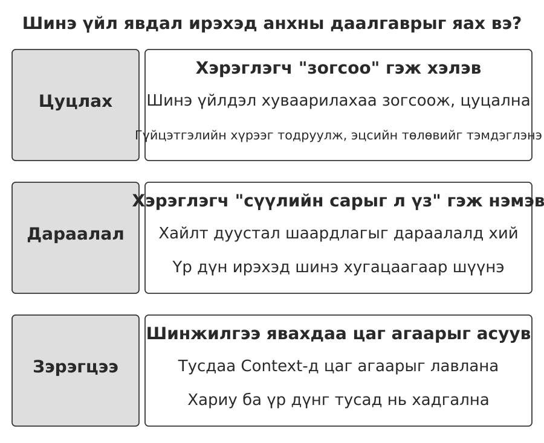

**Цуцлалтад суурилсан боловсруулалт (Cancellation-Based)** нь хэрэглэгчийн зогсоох заавар эсвэл шууд боловсруулах шаардлагатай удирдлагын үйл явдалд тохирно. Ажиллах орчин эхлээд холбогдох үйлдлүүдийг цааш хуваарилахаа зогсоож, үүсгэгдэж буй хүсэлт болон цуцалж болох Tool-үүдэд зогсоох дохио илгээгээд, дууссан мессеж, Tool-ийн төлөв, цуцлалтын баримтыг хадгална. Дараа нь шинэ үйл явдал шийдвэрийн Context-д орно. Жишээлбэл, хэрэглэгч "Зогс! Би буруу хэлчихлээ" гэвэл систем эхлээд цаашдын гүйцэтгэлийг хязгаарлаж, дараа нь одоогийн бодит төлөвийг харгалзан даалгаврыг дахин тодруулна. Боловсруулагдаагүй дарааллын зүйлс таних тэмдэг ба төлөвөө хадгалж, холбоотой хүрээнийхээ дагуу дахин эрэмбэлэгдэнэ.

**Дараалалд суурилсан боловсруулалт (Queued)** нь ердийн нэмэлт мэдээлэл ба явцын шинэчлэлд тохирно. Үйл явдал дараалалд орж, дараагийн аюулгүй цэг дээр Tool-ийн үр дүнтэй хамт Model-д өгөгдөнө. Жишээлбэл, хайлт явагдаж байхад хэрэглэгч "Зөвхөн сүүлийн нэг сарын үр дүнг үз" гэж нэмбэл хайлтын үр дүн ирсний дараа Model үр дүн ба шинэ нөхцөлийг хамтад нь уншаад шүүх үү, дахин хайх уу гэдгээ шийднэ.

**Зэрэгцээ боловсруулалт (Parallel)** нь үндсэн даалгавраас хамааралгүй, цаг алдалгүй хариулах шаардлагатай хүсэлтэд тохирно. Жишээлбэл, их хэмжээний өгөгдлийн шинжилгээ явагдаж байх үед хэрэглэгч цаг агаар асуувал систем тусдаа сесс үүсгэн лавлагааг гүйцэтгэж болно.

**Яаралтай байдал ба чиглүүлэлт.**

Үйл явдлын төрөл анхны сэжүүр өгнө: `user.interrupt`, итгэмжлэгдсэн хяналтын заавар, системийн сэрэмжлүүлэг өндөр давуу эрэмбийн сувагт орж болно; `user.input`, `agent.input`, `tool.result`, `timer.trigger`-ийг агуулга ба даалгаврын төлөвтэй нь хослуулан дүгнэнэ. Илгээгч мессеждээ өөрийгөө "яаралтай" гэж бичсэн ч систем эрхийг баталгаажсан хувийн мэдээлэл ба дүрмээр тогтооно.

Мессежийн утгыг ойлгох шаардлагатай чиглүүлэлтийн шийдвэрт хөнгөн ангиллын Model ашиглахыг зөвлөж байна: "Яг одоо зогс" нь цуцлалтад, "Өнөөдөр цаг агаар ямар байна?" нь зэрэгцээ боловсруулалтад, "Тайланг хятадаар бичээрэй" нь ихэвчлэн одоогийн даалгаврын нэмэлтийн дараалалд орно. Тодорхой зогсоох оролтыг ажиллах орчин шууд боловсруулж, утгын ангиллыг ойлголт шаардсан бусад мессежид ашиглана.

Ерөнхий зориулалтын Model ч мессежид шошго наах чадвартай. Гэвч "боловсруулах шаардлагатай" гэсэн хэдхэн үг гаргахын тулд ч Model даалгаврын тайлбар ба мессежийн агуулгыг бүхэлд нь уншина. Шинэ мессеж бүрт ингэж дүгнэвэл дуудлагын зардал мессежийн тоотой хамт өснө, жинхэнэ яаралтай мессеж ч Model шошго өгөхийг хүлээж байж л цааш явна. TypeSafe-ийн Jev нь сонголтууд нь урьдчилан тогтоогдсон ийм төрлийн шийдвэрийг тусгайлан гүйцэтгэдэг. Түүнд нэг мессеж ба одоогийн даалгаврын төлөвийг өгөхөд сонголт бүрийн магадлалыг харьцангуй бага зардал, бага хоцролттойгоор зэрэгцүүлэн гаргана.[^ch6-jev]

Бүлэг 1-т авч үзсэн ажиглалтын орон зайг сийрэгжүүлэх санаа энд аль мессеж шинэ дүгнэлт өдөөхийг тодорхойлно. Feishu-ийн мессеж ба GitHub Issue-ийн сэтгэгдлийг жишээ болгоё. Програм эхлээд үйл явдлын дугаараар давхардсан мэдэгдлийг шүүж, дараа нь шинэ мессеж одоо байгаа даалгаврыг нөхөж байна уу, эсвэл үндсэн Model-ийн боловсруулах шаардлагатай шинэ хүсэлт гаргаж байна уу гэдгийг Jev-ээр дүгнүүлнэ. "Өчигдөр хэлсэн давтан үүсгэх алхмуудыг нэмж байна" гэсэн мессеж уншвал Model зөвхөн энэ нь нэмэлт тайлбар гэдгийг дүгнэхэд хангалттай. Аль Issue-г нөхөж байгааг програм сэтгэгдэлд хавсаргасан дугаараас шууд уншина.

Model өндөр магадлал гаргасан ч өөрийн итгэлийг хэтрүүлэн үнэлсэн байж болно. Жишээлбэл, 100 мессеж бүгд ойролцоогоор 90%-ийн магадлалтайгаар "одоо байгаа даалгаврыг нөхсөн" гэж ангилагдсан ч бодит байдал дээр тэдгээрийн зөвхөн 60 нь энэ төрөлд хамаарч байж болно. Энэ багцыг одоо байгаа даалгаварт автоматаар нэгтгэвэл үлдсэн 40 мессежийн жинхэнэ зорилгыг алдана.

[^ch6-jev]: TypeSafe нь Jev-ийн нийтлэлдээ урьдчилан тодорхойлсон гаралт, магадлалыг зэрэгцээ буцаах, мөн шийдвэрийн калибровкийг зорилго болгосон RLCD сургалтын аргыг танилцуулсан.

### Имэйлийн үйл явдлаас суурь давталт бүтээх нь

Шинэ имэйл боловсруулж байсан процесс гэнэт дахин эхэлсэн гэж бодъё. Имэйлийн таних тэмдэг нь анхны эхийг олоход тусална, гэхдээ өмнөх хариу илгээгдсэн эсэхийг хэлж чадахгүй. Дараалалд орох, имэйл унших, Tool дуудах, шуудангийн хайрцгийг шинэчлэх, хэрэглэгчид мэдэгдэх хүртэлх бичих үйлдэл ба буцаж ирсэн баримт бүрийг нэг имэйлийн нэр дор хамт бүртгэх нь зүйтэй. Дахин эхэлсний дараа хүсэлт илгээгдсэн ч баримт ирээгүй бол эхлээд шуудангийн хайрцгийн бодит төлөвийг шалгаж, дараа нь дахин илгээх эсэхээ шийднэ.

> **Туршилт 6-1 ★★★: Үйл явдалд суурилсан имэйл боловсруулах Agent**
>
> Энэ туршилт туршилтын шуудангийн хайрцгийг оролтын цэг болгон үйл явдлын бүртгэл, дараалал, даалгаврын боловсруулалтыг дасгална. Эхлээд шинэ имэйлийг бүтэцлэгдсэн үйл явдал болгон цэгцэлж, ирсэн дарааллаар нь боловсруулна. Дараа нь имэйлийн түүх, хавсралт унших, мэдлэг лавлах, мэдэгдэл зэрэг Tool-үүдийг холбоно. Зураг 6-4-ийн дагуу нэг уулзалтын урилгыг дагаж, үйл явдлын давталтаас хуанлийн зөрчил шалгах ба ноорог бичих хоёр алхмыг, дараа нь хадгалалтын давхаргаас энэ имэйлийн боловсруулалтын бүртгэлийг ол.
>
> 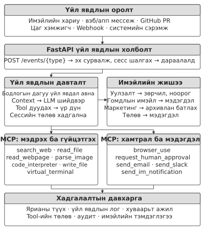
>
> Нэг дарааллыг олон төрлийн эх сурвалжаар өргөтгөж болно: имэйл ирэх, IM эсвэл SMS мессеж, GitHub PR ба Issue-ийн шинэчлэл, цаг хэмжигч, гадаад Webhook, мөн хэрэглэгч офлайн болох, процессын хугацаа хэтрэх, нөөцийн сэрэмжлүүлэг зэрэг дотоод үйл явдал. Адаптер бүр эх сурвалжийг баталгаажуулж, холбоотой мэдээллийг нэмэх үүрэгтэй бөгөөд боловсруулалтын үр дүнг үйл явдлын таних тэмдгээр буцааж бичнэ.
>
> Хүлээн авалтыг гурван туршилтын имэйлээр шалгана: уулзалтын урилга хуанлийн зөрчлийн шалгалтыг өдөөж, хүлээн авах эсвэл татгалзах ноорог үүсгэнэ; хэрэглэгчийн гомдол гол мэдээлэл гаргах, өндөр давуу эрхийн тэмдэглэгээ тавих, хэрэглэгчид мэдэгдэх үйлдлийг өдөөнө; маркетингийн имэйлийг дүрмийн дагуу архивлана.
>
> Одоогийн дагалдах бүртгэл интерфейсийн баримт бичгийг тулгаж, баталгаажуулалтын туршилт хийж дууссан боловч туршилтын шуудангийн хайрцгийн холболт хүчинтэй итгэмжлэл хүлээж байна.
>
> **Өргөтгөл (сонголтоор): олон эх сурвалжийн холболт ба алдааны шахалт.** Туршилтын шуудангийн хайрцгаас гадна нэг дотоодын Webhook төгсгөлийн цэг ба нэг SQS дараалал (дотоодын симуляц ашиглаж болно) холбоно. Адаптер бүр эх сурвалжийг баталгаажуулж, дугтуй үүсгээд, холболтын логт бичсэний дараа эх сурвалжид баталгаажуулалт буцаана; ажиллах орчин логоос үйл явдлыг уншиж, урсгалын дарааллаар боловсруулна. Дараа нь гурван төрлийн алдаа шахна:
>
> 1. **Давхар хүргэлт.** Webhook-ийн төгсгөлийн цэг ижил хүргэлтийн ID-тай хүсэлтийг хоёр удаа хүлээн авч, логт зөвхөн нэг үйл явдал гарч ирнэ.
> 2. **Баталгаажуулахаас өмнө нуралт.** Адаптер логт бичсэний дараа, SQS мессежийг устгахаас өмнө зогсоогдов; мессеж дахин харагдаж дахин уншигдсаны дараа ч логт зөвхөн нэг үйл явдал байна.
> 3. **Баримтаас өмнө нуралт.** Ажиллах орчин хариу илгээсний дараа, баримтыг бүртгэхээс өмнө зогсоогдож, дахин эхэлсний дараа логоос дахин тоглуулав. Суваг идемпотент түлхүүр дэмждэг эсвэл илгээсэн мессежээ лавлаж чаддаг (жишээлбэл шуудангийн хайрцгийн илгээсэн хэсэг) бол ижил хариу дахин илгээгдэхгүй; хоёулаа байхгүй сувгийн хувьд энэ хариуг хүний баталгаажуулалт хүлээж байна гэж тэмдэглэхээс өөр аргагүй.
>
> Гурван төрлийн алдаа бүгд логт ул мөр үлдээх ёстой: аль хүргэлт давхардал гэж хаагдав, аль мессеж дахин уншигдав, аль хариу нягталсны дараа дахин илгээгдээгүй.
>
> Энэ өргөтгөлийн дагалдах код офлайнаар ажиллаж чадна, API Key шаардлагагүй. Туршилтын шуудангийн хайрцаг ба SQS дараалал хоёулаа дотоод файлаар симуляцлагдсан бөгөөд дээрх итгэмжлэл хүлээж буй бодит шуудангийн хайрцгаас тусдаа байна. Симуляцлагдсан дараалал харагдахгүй байх хугацаа, хүлээн авах бариул, мессежийн бүлгийн доторх дарааллыг хадгалсан. Нуралтыг эх процесс заасан цэг дээр охин процессыг шууд зогсоож бий болгоно. Хариу илгээх суваг бүр нэг аргыг үзүүлнэ: имэйл илгээсэн бүртгэлээ шалгана, аппын чат идемпотент түлхүүр хэрэглэнэ, SMS-д хоёулаа байхгүй. Дахин үзэхдээ `chapter6/agent-with-event-trigger` руу орж `python multisource_demo.py`-г ажиллуулахад терминал гурван төрлийн алдааны үлдээсэн лог бүртгэлийг нэг бүрчлэн хэвлэнэ. Дагалдах ажиллагааны бүртгэлд гурван төрлийн алдааны шалгалт бүгд тэнцсэн.
>

Имэйлийн дараалал дараалсан боловсруулалтын суурийг тавьсан. Дараа нь удаан ажилладаг Tool-үүдийг нэмж, хүлээх хугацаанд шинэ шаардлагыг хэрхэн хүлээн авах, даалгавар цуцлах, ажлаа сэргээх талаар авч үзнэ.

### Төрөлх асинхрон байхгүй үеийн нийцтэй шийдэл

Agent имэйл ноороглож байгаад `search_contacts`-ийг дуудаж холбоо барих хүнийг хайж эхэлсэн гэж бодъё. Үр дүн хараахан ирээгүй байтал хэрэглэгч "Түр хүлээ, эхлээд маргаашийн цаг агаарыг хар" гэж хүсэв. Одоогийн Model-ийн интерфейс Tool дуудлага бүрт үр дүн нь бүрэн ирсэн байхыг шаарддаг бол Harness ар талын төлөвийг интерфейсийн хүлээн авдаг мессежийн дараалал болгон хувиргах шаардлагатай.

**Ар талын төлөвийг синхрон мессежийн формоор илэрхийлэх.**

**Синхрон интерфейстэй нийцүүлэхдээ хэвийн дуудлага ба бодит үр дүнгийн хослолыг аль болох хадгалж, зөвхөн дунд нь даалгавар солих үед төлөвийн хариу нэмэх хэрэгтэй.** Дуудлага бүрт "ажилласаар байна" гэж эрт бөглөвөл мөр нь дуусаагүй төлөвөөр дүүрч, Model бодит үр дүнг дагах ачаа нэмэгдэнэ. Тодорхойдоо таван дүрмийг баримталж болно:

1. **Бүрэн дуудлагыг бүртгэх.** API-аас дууссан assistant мессеж ба Tool дуудлагын зүйлсийг мөрт бичиж, дуудлагын таних тэмдгийг хадгална. Сервер талын дүгнэлтийн төлөвийг үйлчилгээ үзүүлэгчийн заасан үргэлжлүүлэх аргаар хадгална.
2. **Бодит дууссанг бүртгэх.** Tool дууссаны дараа бодит үр дүн, даалгаврын таних тэмдэг, гүйцэтгэлийн төлөвийг бичнэ. Гүйцэтгэлийн явцад даалгаврын менежер дуусаагүй төлөвийг тасралтгүй хадгална.
3. **Солих үед одоогийн төлөвийг мэдээлэх.** Ийм үр дүнгийн ачааллыг зөвшөөрдөг интерфейсийн хувьд дуусаагүй дуудлагад тодорхой төлөвийн мэдээлэл буцааж болно, жишээлбэл "даалгавар ар талд ажилласаар байна, үр дүн хараахан гараагүй", дараа нь хэрэглэгчийн үйл явдлыг нэмнэ. Төлөвийн хариу дахь даалгаврын таних тэмдэг нь дараа ирэх дууссан мэдэгдэлтэй холбогдоно.
4. **Тасласны дараах мессежийг цэгцлэх.** Дундаас үргэлжлүүлэх чадвар байхгүй бол дуусаагүй үүсгэлтийг цуцалж, батлагдсан дууссан мессеж ба Tool-ийн төлөвийг хадгалаад, шинэ хүсэлт илгээнэ. Дуусаагүй гаралтыг интерфейсийн дүрмийн дагуу боловсруулж, тасархай параметрийг гүйцэтгэж болох дуудлага гэж үзэхээс сэргийлнэ.
5. **Энгийн үйл явдлыг багцаар хүлээн авах.** Нэмэлт мэдээлэл дараалалд орж, одоогийн мөчлөг дуусах эсвэл заасан аюулгүй цэгт нэгдсэн байдлаар илгээгдэж, аль үйл явдлыг боловсруулсныг тэмдэглэнэ.

Холбоо барих хүн хайх жишээнд бүрэн дуудлага эхлээд мөрт бичигдэнэ; хэрэглэгч даалгавар солих үед Harness хайлт ажилласаар байгаа тухай төлөвийн хариу нэмээд цаг агаарын хүсэлтийг илгээнэ. Холбоо барих хүний үр дүн хожим эх сурвалж ба даалгаврын таних тэмдэг бүхий шинэ үйл явдал болж Context-д орж, Agent дараа нь имэйлийн ноорогоо үргэлжлүүлнэ. Анхны дуудлага аль хэдийн төлөвийн хариу авсан бол дараагийн үр дүнг адаптерын тохиролцсон үйл явдлын хэлбэрээр дамжуулж, дуудлага ба үр дүнгийн хослолыг хадгална.

Төлөвийн хариу зөвхөн одоогийн гүйцэтгэлийн явцыг мэдээлнэ. Холбоо барих хүний өгөгдлөөс хамаарах алхмууд бодит үр дүн ирсний дараа л үргэлжилнэ. Даалгаврын менежер `running`, `completed`, `cancelled`, `failed` зэрэг төлөвийг хадгалж, хариу илгээх эсвэл дараагийн Tool-ийг гүйцэтгэхээс өмнө хамаарлууд биелсэн эсэхийг шалгана.

**Даалгаврын бариулаар асинхрон Tool зохиох.**

Шинээр зохиох урт даалгаврын Tool-ийн хувьд "эхлүүлэх"-ийг бүрэн гүйцэтгэл бүхий нэг үйлдэл гэж тодорхойлж, бодит даалгаврын бариулыг шууд буцаахыг илүүд үздэг. Ингэснээр Model "аль хэдийн эхэлсэн" ба "аль хэдийн дууссан"-ыг ялгаж, дараагийн лавлагаа, цуцлалт, үр дүнгийн үйл явдалд нэгдсэн холбоосын үндэс олдоно. Жишээлбэл, `initiate_phone_call` утасны даалгавар эхлүүлж, даалгаврын таних тэмдэг ба "залгаж байна" гэсэн төлөвийг буцаана; `phone_call_connected`, `phone_call_ended` нь холбогдсон ба дууссан тухай тус тусдаа мэдэгдэнэ.

Tool-ийн тайлбарт "Энэ Tool утасны даалгавар эхлүүлж, амжилттай болбол даалгаврын ID буцаана. Та өөр ажил үргэлжлүүлж болно; ярианы явц ба дууссан үр дүн тусдаа үйл явдлаар ирнэ" гэж тодорхой бичих ёстой. Tool-ийн нэр нь энэ нь эхлүүлэх үйлдэл гэдгийг, буцаах бүтэц ба дараагийн үйл явдлууд нь даалгавар хэрхэн урагшилж, хэрхэн дуусахыг илэрхийлнэ. Дараа нь систем даалгаврын ID-аар лавлах, цуцлах, сэргээх интерфейсүүдийг гаргаж өгснөөр Model одоо юу хийж болохоо мэдэх болно.

**Багц үйл явдлыг нэг бүрчлэн боловсруулах.**

Олон үйл явдал нэгэн зэрэг Context-д орох үед Model зөвхөн сүүлийнхэд нь хариулж, өмнө нь тавьсан шаардлагыг алдаж магадгүй. Ажиллах орчин тэдгээрийн боловсруулалтын төлөвийг тус тусдаа хадгалж, хариулагдаагүй нөхцөлүүд үргэлжлүүлэн харагдах боломжтой болгох ёстой. Промпт Model-оос нэг бүрчлэн шалгуулахыг шаардаж болох бөгөөд төлөвийн мөрөнд боловсруулаагүй мэдээллийг жагсаана:

```text
[Боловсруулаагүй үйл явдал 1/4] database_query-ийн үр дүн: ……
[Боловсруулаагүй үйл явдал 2/4] Хэрэглэгчийн нэмэлт: зөвхөн Бээжингийн бүсийн өгөгдлийг үзэх
[Боловсруулаагүй үйл явдал 3/4] Системийн сануулга: тайлангийн эцсийн хугацаа 30 минут үлдлээ
[Боловсруулаагүй үйл явдал 4/4] Хэрэглэгчийн асуулт: явц ямар байна?
```

Багцын хураангуйд "1 Tool-ийн үр дүн, 2 хэрэглэгчийн мессеж, 1 системийн сануулга" гэж сануулж болно. Ажиллах орчин үйл явдлыг даалгаврын хязгаарлалттай нэмж холбоно: бүсийн нөхцөл хайлтын хүрээг шинэчилж, эцсийн хугацаа хуваарилалтад нөлөөлж, явцын асуултад хариулах шаардлагатай. Боловсруулсны дараа дууссан, хүлээж буй эсвэл тодруулах шаардлагатай гэсэн төлөвийг тэмдэглэж, шийдэгдээгүй зүйлсийг дараагийн ээлжид үргэлжлүүлэн хадгална.

Нэг даалгаврын дугаар эхлүүлэлт, явцын тайлан, эцсийн гүйцэтгэлийн үр дүнг нэг холбоос болгон холбодог. Хэрэв дунд нь хэн нэгэн зогсоохыг шаардвал энэ дугаарын дор цуцлалтын баримт байгаа эсэхийг дахин шалгах хэрэгтэй.

> **Туршилт 6-2 ★★★: Зэрэгцээ гүйцэтгэл ба таслах чадвартай асинхрон Agent**
>
> Энэ туршилт эхлээд асинхрон ажиллах орчныг шалгаж, дараа нь Model-ийг холбож шийдвэрийг шалгана. Дагалдах ажиллагааны бүртгэл бодит үйлдлийн системийн охин процессоор дөрвөн хувилбарыг гүйцэтгэсэн бөгөөд үйл явдлын хуваарилалт ба тайланг детерминит скрипт удирдсан.
>
> 1. **Ар талд гүйцэтгэх ба шууд хариулах.** Хэдэн секунд үргэлжлэх шинжилгээний процессыг эхлүүлж, даалгаврын таних тэмдгийг шууд буцаана; хүлээх хугацаанд одоогийн цагийг асуухад хариулж, дууссаны дараа шинжилгээний үр дүнг хүлээн авна.
> 2. **Дараалал ба багц боловсруулалт.** Урт даалгаврын үеэр "японоор хариул" ба "вэб хуудас болгон цэгцэл" гэсэн хоёр шаардлагыг дараалан нэмж, даалгавар дууссаны дараа үр дүн ба хоёр шаардлагыг нэг багц болгон боловсруулна. Скрипт япон хэл дээрх HTML үүсгэнэ.
> 3. **Цуцлах ба сэргээх.** "Шинжилгээг зогсоо" хүлээн авсныг үзүүлэхдээ үүсгэгдэж буй Model-ийн ээлжийг тасалж, ажиллаж буй бүх ар талын даалгаврыг зогсоохыг шаардана. Энэ удаад тасаллыг скрипт илгээсэн бөгөөд тэр үед зөвхөн нэг шинжилгээний процесс T1 ажиллаж байсан. 0.803 дахь секундэд тасаллын үйл явдал T1-ийн явцыг 18% гэж тэмдэглэсэн; 0.806 дахь секундэд байж систем түүний гарах код −15-ыг тэмдэглэсэн. Яг дараа нь эхэлсэн T2 нь шинэ даалгавар байв. 4.436 дахь секундэд хүлээн авсан нь T2-ийн үр дүн бөгөөд T1 дууссан тухай буцах дуудлага өдөөгөөгүй.
> 4. **Зэрэгцээ даалгавар ба явцын шийдвэр.** Гурван шинжилгээний процессыг зэрэг эхлүүлж, логик цагийн алхам бүрт тус тусдаа 3%, 2%, 1%-иар урагшилна. Энэ туршилтын зэрэгцээ явцын бүртгэлд хамгийн хурдан T1 дуусах үед лавлагааны баримт T2 68%, T3 34% хүрснийг харуулсан. Зураг 6-5-ыг дагавал явц нь 50%-иас хэтрээгүй даалгаврыг цуцална. Скрипт зөвхөн T3-ыг цуцалж, эцэст нь T1 ба T2-ийн үр дүнг хүлээн авав. Энэ нь нэг ажиллах орчин бүхэл багцыг зогсоох дохионд хариу үзүүлэх эсэхээс гадна ашигтай хэвээр байгаа зэрэгцээ ажлыг хадгалж чаддагийг харуулна.
>
> 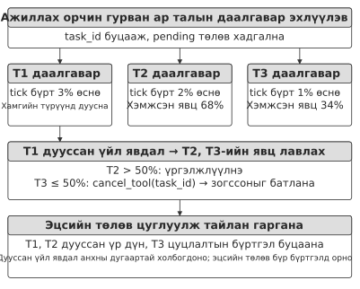
>

### Model-ийн төрөлх асинхрон: GPT-6 Astra

Өмнөх шийдэл Harness-ээр синхрон мессежийн форматтай нийцүүлдэг байсан. Төрөлх асинхрон интерфейс харин Tool буцаж ирээгүй байхад Model шууд бие даасан ажил үргэлжлүүлж, үр дүнг дараа нь хүлээн авахыг зөвшөөрдөг. 2026 оны 9-р сарын байдлаар GPT-6 Astra нь асинхрон Tool дуудах (Async tool calling) ба ээлжийн дунд чиглүүлэх (Mid-turn steering) боломжийг санал болгож, Tool-ийн хүлээлт ба хэрэглэгчийн шинэчлэлийг тус тусдаа боловсруулдаг. Зураг 6-6-д синхрон интерфейстэй нийцүүлэлт ба төрөлх асинхрон мессежийн урсгалыг харьцуулав.[^ch6-22][^ch6-23]

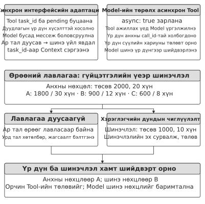

**Tool-ийг хүлээх хугацаанд бие даасан ажил үргэлжлүүлэх.** Жишээлбэл, Agent хурлын өрөөний лавлагаа эхлүүлсний дараа хөтөлбөр ба бэлтгэлийн жагсаалтыг эмхэтгэж болно; лавлагаа буцаж ирсний дараа үнэ ба багтаамжийг харьцуулна. Tool-ийн тодорхойлолт дахь `async: true` нь асинхрон чадварыг зарлаж, хэрэглээ бүрэн дуудлагын зүйлийг хүлээн авсны дараа гүйцэтгэл эхлүүлж, дуудлагын таних тэмдэг `call_id`-г хадгална. Үр дүн ирэхэд хэрэглээ анхны таних тэмдгээр үр дүнг буцааж, хамгийн сүүлийн хариуны төлөвт залгана. Дараагийн ажлыг Model зохиож, Harness дуудлагын холбоос ба даалгаврын амьдралын мөчлөгийг удирдана.[^ch6-22]

**Даалгавар явагдаж байх үед шинэ шаардлага хүлээн авах.** Хэрэглэгч Model бодож байх юмуу хариултаа зохиож байх үед "төсөв 1000 болго", "оролцогчдын тоог 10 болго" гэж нэмж болно. Хэрэглээ ижил холболтоор чиглүүлэх үйл явдал илгээж, сервер хүлээн авснаа баталгаажуулсны дараа одоогийн хариуны төлөвийн дагуу боловсруулна. Холболт тасарч дахин холбогдсоны дараа хэрэглээ хадгалсан үйл явдал ба хариуны төлөвийн дагуу даалгавраа сэргээж болно.[^ch6-23]

Энэ хоёр чадварыг хослуулж хэрэглэж болно: өрөөний лавлагаа үргэлжилсээр байх зуур хэрэглэгчийн шинэ шаардлага дараагийн шийдвэрт орж, лавлагааны үр дүн ирсний дараа сонголтоо хийнэ. Гүйцэтгэгч ар талын даалгаврын бодит төлөвийг нэгэн зэрэг хадгална. Лавлагааг зогсоох юмуу захиалгыг цуцлах шаардлага гарах үед Harness харгалзах интерфейсийг дуудаж, баримтыг шалгана; аль хэдийн дууссан бизнесийн үйлдлийг буцаах эсвэл нөхөн олговрын урсгал руу шилжүүлнэ.

Model ба интерфейс төрөлх асинхроныг дэмждэг бол төрөлх протоколыг түрүүлж ашиглаж, Tool-ийн түр зогсолт, хэрэглэгчийн шинэчлэл, хариуны үргэлжлэл интерфейсийн тохиролцооны дагуу урсана. Синхрон нийцлийн давхарга нь гол төлөв одоо байгаа Model болон хуучин интерфейст үйлчилнэ; Model-ийг шинэчилсний дараа зөвхөн мессежийн хослолыг нөхөхөд ашиглагдаж байсан нийцлийн логикийг аажмаар хасч, инженерийн хөрөнгө оруулалтаа даалгаврын төлөв, цуцлалт, сэргээлтэд төвлөрүүлж болно.

### Асинхрон даалгаврыг найдвартай боловсруулах

Найдвартай асинхрон харилцан үйлчлэл мессеж, даалгавар, гүйцэтгэлийн төлөвийг нэгэн зэрэг шалгахыг шаарддаг.

1. **Үр дүнгийн харьяалал.** Хоцорсон үр дүн анхны дуудлагын таних тэмдгийг хамт авч явж, хэрэглээ үүнийг харгалзах даалгаварт буулгана; тухайн үр дүнгээс хамаарах шийдвэр өгөгдөл ирсний дараа үргэлжилнэ.
2. **Сэргээлт ба цуцлалт.** Хэрэглэгч шаардлагаа өөрчилсний дараа систем хүчинтэй хэвээр байгаа ажлыг хадгалж, дараагийн алхмуудыг шинэчилж, аль ар талын даалгавар үргэлжлэх, аль нь зогссоныг тодорхой мэдэгдэнэ.
3. **Олон шаардлага.** Төсөв, хүний тоо, бүс, эцсийн хугацаа тус тусдаа даалгаврын төлөвт орж, эцсийн үр дүнд эдгээр нөхцөлийг нэг бүрчлэн шалгана.

> **Туршилт 6-3 ★★★: Model-ийн төрөлх асинхрон ба ээлжийн дунд чиглүүлэлт**
>
> Энэ туршилтад Agent төсөв ба хүний тооны шаардлагад нийцсэн хамгийн хямд өрөөг симуляцлагдсан хуралд сонгоно. Анхны төсөв 2000, хүний тоо 20; лавлагааны Tool 8 секунд хүлээсний дараа гурван өрөөний үнийн санал ба багтаамжийг буцаана.
>
> | Өрөө | Үнэ | Багтаамж |
> |---|---:|---:|
> | A | 1800 | 30 |
> | B | 900 | 12 |
> | C | 600 | 8 |
>
> Анхны нөхцөлд A-г сонгох ёстой. Чиглүүлэлтийн бүлэг даалгавар явагдаж байх үед хоёр шинэчлэл хүлээн авна: төсөв 1000 болж, хүний тоо 10 болсон тул энэ үед B-г сонгох ёстой. Tool нэгэн зэрэг шинээр үүсгэсэн баримт буцааж, эцсийн хариулт түүнийг иш татах ёстой бөгөөд ингэснээр Model бодитоор ирсэн үр дүнг ашигласан эсэхийг шалгана.
>
> Туршилт таван бүлэгтэй, бүлэг бүрт гурван удаа: синхрон Tool, төрөлх асинхрон Tool, дүгнэлтийн үеийн чиглүүлэлт, асинхрон Tool-ийг хүлээх үеийн чиглүүлэлт, мөн чиглүүлэлтийн чадваргүй Model-ийн хяналтын бүлэг. Эхний хоёр бүлэг хүлээх хугацаанд бие даасан бэлтгэлийн жагсаалт гаргаж чадах эсэхийг харьцуулна; чиглүүлэлтийн хоёр бүлэг төсөв ба хүний тоо нэгэн зэрэг хүчин төгөлдөр болсон эсэхийг шалгана; чадварын хяналт интерфейс дэмжихгүй гэдгээ тодорхой мэдэгдэж байгаа эсэхийг шалгана.
>
> Хадгалсан ажиллагааны бүртгэлд асинхрон Tool-ийн бүлэг хүлээх хугацаанд бие даасан жагсаалтаа гаргаж, чиглүүлэлтийн хоёр бүлэг шинэ нөхцлийн дагуу B-г сонгосон. Tool-той бүх гүйцэтгэл лавлагааг зөвхөн нэг удаа хийж, бодит үр дүнг анхны дуудлагад буцаасан; хяналтын Model-ийн интерфейс харин нэг үүсгэлтийн дунд шинэ шаардлага хүлээн авч чадахгүй гэдгээ тодорхой хариулсан. Синхрон ба асинхрон бүлгийн нийт хугацаа ойролцоо байсан бөгөөд гол ялгаа нь хүлээх хугацаанд өөр ажил урагшилж чадсан эсэхэд илэрсэн.
>
> Хэрэв Model зөвхөн хүний тоо 10 болсныг санаж, хуучин 2000-ын төсвөөр сонгосон бол аль өрөөг сонгох байсан бэ? A ч, B ч багтана, хамгийн хямд нь мөн л B байна. Тиймээс өрөө зөв сонгогдсон байх нь төсөв шинэчлэгдсэн эсэхийг хараахан харуулахгүй.
>
> Хүний тоо өөрчлөгдсөн тул аль хэдийн илгээсэн лавлагааг дахин хийх шаардлагатай юу? Энэ туршилтын Tool-д шүүлтийн параметр байхгүй тул гурван өрөөг бүгдийг нь буцаадаг. Туслах замд явж буй үр дүнг дахин ашиглаж, тэр ирсний дараа 10 хүн, 1000-ын төсвөөр шүүж болно. Хэрэв Tool зөвхөн 20 ба түүнээс дээш хүн багтах өрөөг буцаадаг бол хуучин үр дүнд зөвхөн A үлдэх бөгөөд 12 хүн багтах B огт байхгүй. Энэ үед хуучин жагсаалт дотор хүний тоог 10 болгосон ч B-г сонгохгүй өнгөрнө. Анхны лавлагаа B-г аль хэдийн шүүж хаясан бол дахин нэг удаа лавлах шаардлагатай.

Асинхрон механизм гадаад өөрчлөлтийг даалгавар урагшилж байх үед системд оруулах боломж олгодог. Яриа, дэлгэц, роботын харилцан үйлчлэл эргэх холбооны мөчлөгийг улам богиносгодог: систем оролтыг тасралтгүй хүлээн авч, тохиромжтой мөчид гаралт ба үйлдлээ тохируулах шаардлагатай.

## Яриа: хүн ба машины хамгийн байгалийн интерфейс

Яриа нь хэрэглэгчид гар, нүдээ өөр ажилд завгүй байх үед ч Agent-д шаардлагаа тайлбарлах, нөхцөл нэмэх, үр дүнг батлах боломж олгодог. Дуут оролтын арга нь хэлсэн үгийг текст болгох бөгөөд дуут Agent үүнээс цааш харилцан яриа, Tool дуудах, хариу тоглуулах ажлыг удирддаг. Хоёулаа өмнөх хэсэгт дурдсан whisper coding-ийг дэмжиж чадна.

Энэ хэсэгт хоёр хэрэглээг авч үзнэ: хэрэглэгч Agent-тай шууд харилцах, Agent хэрэглэгчийн өмнөөс гадаад хүмүүстэй харилцах. Эхнийх нь таних, хариулах, ярианд таслан орохыг чухалчилдаг бол хоёр дахь нь ярианы явцад хэн болохыг баталгаажуулах, бизнесийн лавлагаа хийх, шийдвэр гаргах ажлыг ч гүйцэтгэх шаардлагатай.

### Харилцан үйлчлэлийн цагийн дараалал: каскадаас бүрэн дуплекс хүртэл

OpenAI GPT-Live-ийн танилцуулгадаа каскад, ээлжид суурилсан аудио Model, бүрэн дуплекс гэсэн гурван төрлийн дуут харилцан үйлчлэлийг эргэн харсан[^ch6-12]. Энэхүү хувьслын зам "хэзээ ярих, хэзээ сонссоор байх"-ыг аажмаар Model-ийн тасралтгүй шийдвэрт шилжүүлдэг. Каскад системд голчлон төгсгөлийн цэгийн логик шилжилтийг зохион байгуулдаг бол бүрэн дуплекс Model тасралтгүй дуу ба харилцан ярианы төлөвийг хослуулан давхцал, зогсолт, таслан орохыг боловсруулж чадна.

| Парадигм | Гол бүтэц | Хэрэгжүүлэхэд хялбар чадвар | Гол дизайны асуудал |
|---|---|---|---|
| Каскад | VAD, ASR, LLM, TTS-ийн хуваарилалт | Модулийг тусад нь сольж, оролт гаралтыг хэсэг хэсгээр шалгана | Модулиудын хоорондын хоцролт, транскрипцид алдагдсан акустик мэдээлэл |
| Ээлжид суурилсан төгсгөлөөс төгсгөлийн аудио Model | Model аудиог шууд хүлээн авч, шууд үүсгэнэ | Аялга, сэтгэл хөдлөл зэрэг мэдээллийг ашиглан хариу зохионо | Яриа дууссан эсэхийг тодорхойлох, ээлж солих ба хариу өгөх мөч |
| Бүрэн дуплекс | Аудиог тасралтгүй хүлээн авч, гаралт үүсгэнэ | Давхарлан ярих, дэмжих, таслан орох ба тасралтгүй харилцаа | Тасралтгүй төлөв, гаралтын удирдлага ба харилцан үйлчлэлийн үнэлгээ |

Model аудиог шууд боловсруулж чадах эсэх, оролт гаралт нь урсгал хэлбэртэй эсэх, нэгэн зэрэг сонсож, ярьж чадах эсэх нь тус тусдаа шалгаж болох чадвар юм. Каскад системд урсгалын модуль ба таслах удирдлагыг нэмж болно; төгсгөлөөс төгсгөлийн Model-ийн харилцааны хэмнэл нь харин тодорхой зохиомжоос хамаарна.

[^ch6-12]: OpenAI, *Introducing GPT-Live*, 2026-07-08. Каскад, ээлжид суурилсан аудио Model ба бүрэн дуплекс харилцан үйлчлэлийг танилцуулсан.

### Парадигм нэг · Каскад дамжуулах шугам (Cascading)

Каскад систем дуут харилцан яриаг хэдэн модульд хуваадаг. Дуут идэвхжил таних (VAD) аудио дахь ярианы хэсгийг олж, төгсгөлийн цэгийн логик энэ хэсгийг хэзээ илгээхийг шийднэ; автомат яриа таних (ASR) аудиог текст болгоно; LLM хүсэлтийг ойлгож хариу үүсгэнэ; яриа нийлэгжүүлэх (TTS) хариуг тоглуулж болох аудио болгоно. Зураг 6-7-д дарааллаар гүйцэтгэдэг үндсэн бүтцийг харуулав.

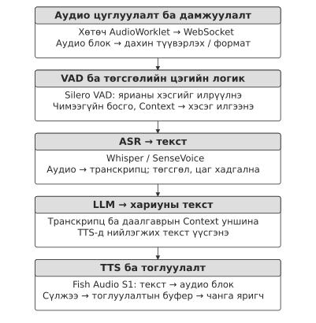

Акустик VAD хэн нэгэн ярьж байгаа хэсгийг олдог тул дараагийн таних үйлдэл урт чимээгүй хэсгийг алгасаж болно. Гэвч ижил нэг зогсолт "Би захиалах гэсэн юм……" гэсний дараа гарах нь "Пүрэв гарагийн өглөө тасалбар байна уу?" гэсний дараа гарахтай ижил утгагүй. Утгын VAD (утгын төгсгөлийн цэг таних) эхний тохиолдолд дуугаа үргэлжлүүлэн авч, хоёр дахь тохиолдолд л яриаг харилцан ярианы Model-д шилжүүлж чадна. Энэ бол дуут ажиглалтыг цаг хугацаагаар сийрэгжүүлэх явдал юм: тасралтгүй нэг дуунаас зөвхөн цөөн хэдэн мөчид дүгнэлт өдөөгдөнө. Харин ярих эсэхийг тухайн өгүүлбэрийг сонссон Model өөрөө шийднэ; тэр сонссоор байж болно, эсвэл эхлээд нислэгээ лавлаж болно.

| Модуль | Үүрэг | Хүлээлт эсвэл алдааны түгээмэл эх сурвалж |
|---|---|---|
| VAD ба төгсгөлийн цэгийн логик | Яриаг илрүүлж, хэзээ илгээхийг шийднэ | Чимээгүйн босго, шуугиан ба дундах зогсолт |
| ASR | Аудиог текст болгоно | Декодлох хугацаа, хүний нэр ба тусгай нэр томьёог таних |
| LLM | Ойлгож, дүгнэж, хариу үүсгэнэ | Хүсэлтийн дараалал, эхний хэсэг хариуны үүсгэлт |
| TTS ба тоглуулалт | Аудио нийлэгжүүлж, чанга яригч руу хүргэнэ | Эхний багцын нийлэгжилт, сүлжээний дамжуулалт ба тоглуулалтын буфер |

Бүрэн цуваа хэрэгжүүлэлтэд хэрэглэгч ярьж дууссаны дараа төгсгөлийн цэг батлах, транскрипц, хариу үүсгэх, эхний аудиог хүлээх шат дараалан ирнэ. Зураг 6-8-ын жишээнд хэрэглэгч эхний хариуг сонсох хүртэл 1.4 секунд өнгөрсөн бөгөөд хамгийн урт хэсэг нь систем хэрэглэгч ярьж дууссаныг батлахыг хүлээсэн 500 миллисекунд юм. Транскрипцийг 100 миллисекундээс 50 болтол богиносгосон ч хэрэглэгч ердөө 50 миллисекунд бага хүлээнэ.

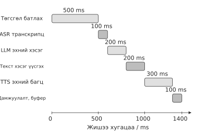

Үйлчилгээний ачаалал дараалалд хүлээх хугацаа нэмнэ. Зураг 6-9-д M/M/1 нэг үйлчилгээний цэгийн загвараар энэ хамаарлыг тайлбарлав: ирэлт Пуассоны процесс, үйлчилгээний хугацаа экспоненциал тархалтад захирагдаж, дундаж үйлчилгээний хугацаа $S$, ашиглалт $\rho<1$ үед үйлчилгээ ба дарааллыг багтаасан дундаж нийт хугацаа $W=S/(1-\rho)$ болно. $S=1$ секунд гэж аваад ашиглалт 0.5-аас 0.8 болтол өсөхөд дундаж нийт хугацаа 2 секундээс 5 секунд болж өснө. Үүний дотор үйлчилгээ өөрөө дунджаар 1 секунд хэвээр эзэлж, нэмэгдсэн 3 секунд бүгд дараалалд зарцуулагдана. Хүсэлт боловсруулах хүчин чадалд ойртох тусам богино хугацааны урсгалын хэлбэлзэл хуримтлал үүсгэдэг.

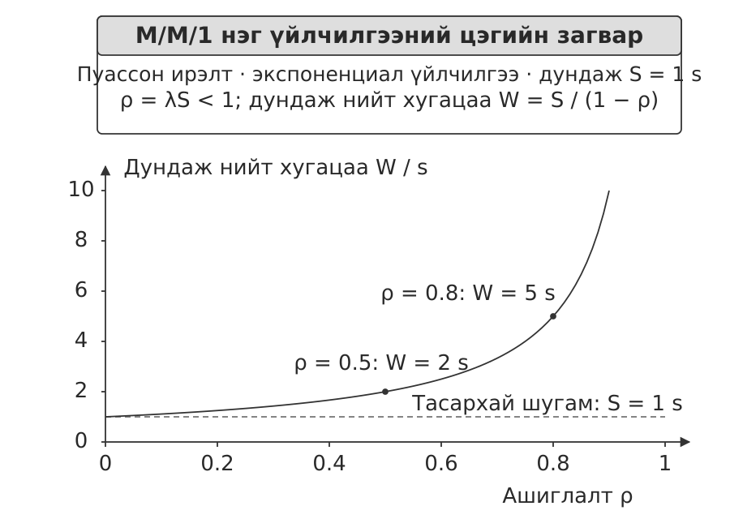

> **Туршилт 6-4 ★: Уламжлалт дуут Agent бүтээх**
>
> Туслах пүрэв гарагийн нислэгийг зарлаж байтал та "Түр хүлээ, би баасан гарагийн тасалбар захиалахыг хүсэж байна" гэж засаж байна. Хөтөч микрофоны аудиог WebSocket-ээр арын хэсэгт дамжуулна. Silero VAD та ярьж эхэлснийг илрүүлмэгц арын хэсэг `speech_start` илгээж, хөтөч тоглуулалтаа зогсоож, дараалалд орсон хуучин аудиог цэвэрлэнэ. Энэ үед туслах та аль өдрийг өөрчилснийг хараахан мэдэхгүй. Та ярьж дуусаад чимээгүй байдал анхдагч 500 миллисекундээс хэтэрсний дараа байж арын хэсэг `speech_end` илгээж, энэ аудиог дотоод Whisper tiny руу транскрипцид өгнө.
>
> Doubao текст буцааж эхэлснээс хэрэглэгч хариуг сонсох хүртэл хэр удах вэ? Нэг удаагийн бичлэг тоглуулалтын бүртгэлд транскрипци 2.710 секунд зарцуулсан. Doubao хүсэлт илгээгдснээс хойш 0.749 секундэд эхний token-ыг буцааж, 0.792 секундэд бүрэн хариуг буцаасан. Тоглуулах програм текст бүрэн цуугдахыг хүлээгээд байж Fish S1-д өгч нийлэгжүүлсэн; дахин 2.819 секунд өнгөрсний дараа арын хэсэг эхний аудионы багцыг хүлээн авсан. Төгсгөлийн цэг тодорхойлогдсоноос хойш энэ гурван хэсгийн цуваа хугацааг нэмбэл ойролцоогоор **6.321 секунд** болно. Архивласан тайланд 6.279 секунд гэж бичсэн бөгөөд тэр нь бүхэл хариу үүсгэх хугацааны оронд эхний token-ын хугацааг авсан байна.
>
> Энэ 6.321 секунд зөвхөн арын хэсгийн боловсруулалтыг хамарна. Хэрэглэгч эхлээд чимээгүй байдлын шалгалт өгүүлбэр дууссан гэж үзэх хүртэл, эцэст нь аудио хөтөч рүү хүрч тоглуулж эхлэх хүртэл хүлээх ёстой.

#### Цуваанаас урсгалт мэдрэхүй рүү

Цуваа шийдэл хэсэг хэсгээр шалгахад хялбар боловч гурван асуудлыг илрүүлдэг. Чимээгүй байдлыг хүлээх нь төгсгөлийн цэгийн хоцролтыг нэмдэг; транскрипцлагдсан текст аялга, сэтгэл хөдлөл, орчны дууг алдаж магадгүй; зогсолтоор аудиог хуваах үед имэйл хаяг, хүний нэр эсвэл тусгай нэр томьёо бүрэн Context-оо алдаж болно. Каскад архитектурыг аль хэдийн ашиглаж буй системд эхлээд урсгалын шинэчлэл хийхийг зөвлөж байна: үе шат бүрээс нэмэлт үр дүнг аль болох эрт гаргуулж, таних, дүгнэлт, тоглуулалтыг давхардуулж, батлагдсан ба өөрчлөгдөж болох хэсгүүдийг зэрэг хадгална. Ингэснээр одоо байгаа модулиудыг дахин ашиглаж, хүлээлт хаанаас үүсч байгааг аажмаар тодорхойлж болно.

- **ASR сонсож байхдаа хөрвүүлэх.** Аудиог тасралтгүй хүлээн авч, түр транскрипц гаргана; дараагийн аудио ирэхэд тогтворгүй хэсгийг засаж, төгсгөлийн цэг батлагдах үед эцсийн текстийг өгнө.
- **LLM-ийн таамагласан гүйцэтгэл.** Түр транскрипцийг ашиглан хариуг урьдчилан бэлтгэнэ. Эцсийн текст батлагдсаны дараа оролт ижил эсэх, хийсэн ажил хүчинтэй хэвээр эсэхийг шалгаад хадгалах, тохируулах эсвэл дахин үүсгэхээ шийднэ. Гадаад руу илгээх, бизнесийн бичилт хийх зэрэг үйлдлийг шаардлагатай нөхцөл батлагдсаны дараа гүйцэтгэнэ.
- **LLM-ийн хэсэгчилсэн гаралт.** Тоглуулахад тохиромжтой нэг хэсэг текст бүрэн болмогц TTS-д өгнө; хуваахдаа өгүүлбэрийн утга, цэг таслал, аялгын сэжүүрийг хадгална.
- **TTS-ийн нэмэлт нийлэгжилт.** Аудионы багцууд аажмаар буцаж ирснээр дараагийн текст үүсгэх, нийлэгжүүлэх, тоглуулах үйлдлүүд давхардаж болно. Таслан орох үед үүсгэлтийн даалгавар ба тоглуулалтын буферт хараахан гараагүй агуулгыг зэрэг боловсруулна.

Whisper-ийн ердийн транскрипцийн хэрэгжүүлэлт аудиог цонхоор кодлож, декодлодог[^ch6-whisper]. Гаднаас хэсэглэх эсвэл хуримтлагдсан угтварыг дахин дахин илгээх замаар нэмэлт транскрипцийн урсгал бүтээж болох бөгөөд тасралтгүй төлөвийг дахин ашиглах, давхар кодлох зардал, түүхэн текстийн засварыг тодорхой хэрэгжүүлэлт удирдах ёстой. Төрөлх урсгалт таних Model харин архитектур ба сургалтынхаа хүрээнд тасралтгүй оролтыг шууд боловсруулна.

Аудио хэлний Model дээр суурилсан мэдрэхүйн систем текст ба акустик үйл явдлыг хамт гаргаж чадна. Түүхэн аудио, транскрипц, үгийн зөвлөмж нь хүний нэр, брэнд, тусгай нэр томьёог танихад тусалдаг бөгөөд түүхийг хэр их хадгалах нь Context ба кэшийн зохиомжоос хамаарна. "Хэрэглэгч ярьж дууссан эсэх"-ийг Model утгын бүрэн бүтэн байдал ба чимээгүй байдлыг хослуулан дүгнэж чадна. "Би захиалах гэсэн юм……" гэсэн зогсолт дээр бодит цагийн систем зөвхөн энэ гурван үгийг л сонссон тул цаашид ямар огноо залгахыг мэдэх аргагүй.

Транскрипцээс гадна интерфейс дараах үйл явдлыг тохиролцож болно: `speak_start`, `speak_end` нь яриа эхлэх ба дуусахыг, `interrupt` нь таслахыг, `emotion` нь сэтгэл хөдлөлийн төлөвийг илэрхийлнэ; `laugh`, `sigh`, `noise` нь инээд, санаа алдах, орчны дууг тэмдэглэнэ. Эдгээр үйл явдлыг текст ба цагийн тэмдэглэгээтэй хамт Agent-д өгч болно.

> **Туршилт 6-5 ★: Qwen2-Audio ашиглан урсгалт дуут мэдрэхүйг загварчлах**
>
> Энэ туршилт аудионы угтварыг алхам алхмаар өргөтгөж, эхнээс одоогийн мөч хүртэлх аудиог Qwen2-Audio руу дахин дахин өгч, транскрипц ба акустик үйл явдал оролттой хамт хэрхэн өөрчлөгдөхийг ажиглана. Харьцуулах зам нь 600 миллисекундын чимээгүй байдлын төгсгөлийн цэг ба Whisper ашиглана. Тестэд хэвийн яриа, 900 миллисекундын зогсолт оруулсан урт өгүүлбэр, ягаан шуугиан хольсон яриа багтсан.
>
> Энэ удаагийн дотоод квантлагдсан Model-ийн гүйцэтгэл 13 удаагийн угтварын дүгнэлтийг хадгалсан бөгөөд нэг удаа ойролцоогоор 8—11 секунд шаардсан. Дундах зогсолт харьцуулах замын хуваалтыг өдөөсөн; аудио Model шуугианыг илрүүлсэн бөгөөд ханиалга ба инээдийг ч буруу илрүүлсэн.

[^ch6-whisper]: OpenAI, Whisper. Аудиог цонхоор транскрипцлах ба Model-ийн хэрэгжүүлэлтийг танилцуулсан.

### Парадигм хоёр · Төгсгөлөөс төгсгөлийн олон модальт Model (Omni)

Төгсгөлөөс төгсгөлийн аудио Model дууг шууд хүлээн авч, хэл ба акустик мэдээллийг хослуулан хариу үүсгээд, аудио гаралтын салбараар яриа нийлэгжүүлнэ. Аудиог шууд боловсруулбал ярианы хурд, өндөр, зогсолт, орчны дууг ашиглаж болно; эхлээд транскрипц хийгээд хариулах нь завсрын текстийг шалгах, модулийг тусад нь солиход хялбар.

Эдгээр акустик шинж ойлголтод нөлөөлдөг. Жишээлбэл, "Тайлангаа үдийн хоолны өмнө илгээнэ үү" гэсэн нэг өгүүлбэрийг яаралтай хэлэх ба удаан хэлэх нь сонсогчид өөр мэдрэмж төрүүлнэ. Гаралтын үед ч Model зогсолт, өргөлт, аялгаар утгыг зохион байгуулж чадна.

Аудиог шууд боловсруулдаг систем ч хэрэглэгч ярьж дуустал хүлээгээд хариулж болно. Жишээлбэл, хэрэглэгч утасны дугаараа хэлэхдээ нэг зогсовол систем энэ тоонуудын цуваа дууссан эсэхийг дүгнэх ёстой. Төгсгөлийн цэг таних нь хэзээ хариулахыг шийднэ; нөгөө тал зарлаж байх зуур таслан орвол систем Model-ийн үүсгэлт ба чанга яригчийн тоглуулалтыг зохицуулах шаардлагатай.[^ch6-audio-architectures]

> **Туршилт 6-6 ★★: MiniCPM-o 4.5-ыг дотооддоо ажиллуулж, төгсгөлөөс төгсгөл ба өөрөө каскадлах аргыг харьцуулах**
>
> Энэ туршилт ижил MiniCPM-o 4.5 Model-ийг тогтмол ашиглаж, бодох горимыг унтраагаад хоёр замыг харьцуулна: аудионоос шууд асуултад хариулах, мөн эхлээд Model-ээр транскрипц хийгээд зөвхөн транскрипцэд тулгуурлан хариулах. Оролтод амаар хэлсэн хоёр арифметикийн бодлого, текстийн хувьд ижил боловч хурд нь өөр хоёр яриа багтсан.
>
> Хоёр зам тус бүр гурван бодлогыг зөв бодсон бөгөөд алдаа өөр өөр газарт гарсан. Аудиог шууд боловсруулах зам нэг бодлогын twelve boxes-ыг 8 гэж сонсоод тооцоог буруу гаргасан; транскрипцийн зам 12-ыг зөв хадгалсан. Ярианы хурдны бодлогод хоёр аудио "Please send the report before lunch." гэж хэлсэн бөгөөд транскрипц хийсний дараа текст бүрэн ижил болж, хурдны мэдээлэл алдагдсан; аудиог шууд боловсруулах зам харин хоёр өөр хурдыг зөв ялгасан.
>
> Туршилт оролтын ойлголт ба аудио гаралтыг холбосон 24 kHz-ын яриа нэмж үүсгэсэн.

### Парадигм гурав · Бүрэн дуплекс харилцан үйлчлэлийн Model

Бүрэн дуплекс систем ярьж байхдаа сонсдог тул хамгийн тод мэдрэгдэх сайжруулалт нь ярилцаж байх үеийн амьд хүнтэй харилцаж буй мэдрэмж юм. "Лхагва гарагийн…… үгүй, пүрэв гарагийн тасалбар захиалах гэсэн юм" гэсэн өгүүлбэрийг уншиж үзээрэй: дундах зогсолт энэ өөрөө засах үйлдлийг багтааж чадна; хэрэв туслах лхагва гарагийн нислэгийг аль хэдийн зарлаж эхэлсэн бол "үгүй, пүрэв" гэдгийг сонсмогц зогсох ёстой. Өөр нэг тохиромжтой мөч бол нөгөө тал аяллаа тайлбарлаж байх үед богинохон дэмжих үг түүнд туслах нь сонсож байгааг мэдрүүлэх явдал юм. Аудиог тасралтгүй хүлээн авснаар л ярих, сонсох, зогсох, Tool дуудах хооронд ийм сонголт хийх нөхцөл бүрдэнэ. Синхрон орчуулгад ч оролт гаралтын давхцал шаардлагатай.

Kyutai 2024 онд нийтэлсэн **Moshi** нь хэрэглэгч ба Model-ийн аудио урсгалыг тус тусдаа загварчилж, зэрэгцээ урсгалаар давхарлан ярих ба таслан орохыг илэрхийлдэг[^ch6-moshi]. Эдгээр цагийн харилцааг оролтод хадгалснаар Model хэзээ хариулах, хэзээ сонссоор байхыг сурч чадна.

Thinking Machines Lab-ийн харилцан үйлчлэлийн Model тасралтгүй оролт гаралтыг ижил урттай богино хэсгүүдэд хувааж, хэсэг бүр 200 миллисекундыг хамардаг бөгөөд үүнийг микро ээлж (micro-turn) гэж нэрлэдэг[^ch6-14]. Зураг 6-10-ын цагийн тэнхлэгийн хоёр дахь нүдийг харвал туслах "пүрэв" гэдэг үгийн "рэв"-ийг хэлсээр байтал хэрэглэгчийн огноог засаж буй "үгүй" гэдэг үг аль хэдийн чихэнд хүрч байна. Гурав дахь нүдэнд туслах зогсоод, хэрэглэгч "баасан" гэж хэлж дуусахыг сонссоор байна.

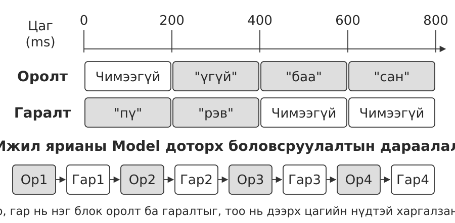

Зургийн доод хагасыг дахин уншъя. Ярианы хоёр тал давхарлаж болох хоёр урсгал дуу сонсдог бол Model нэг дарааллын дагуу оролтын хэсэг, гаралтын хэсгийг ээлжлэн боловсруулж чадна. Чимээгүй байдал ч нэг нүд эзэлдэг тул туслах бага зэрэг сонсоод байж л ярьж эхэлнэ. Зураг дахь 200 миллисекунд нь энэ хэрэгжүүлэлтийн хэсэглэх урт; хэрэглэгч таслан орсноос чанга яригч бодитоор зогсох хүртэл боловсруулалт ба тоглуулалтын буферийн зарцуулсан хугацааг нэмж тооцох ёстой.

[^ch6-moshi]: Kyutai, *Moshi: a speech-text foundation model for real-time dialogue*, 2024. Хэрэглэгч ба Model-ийн зэрэгцээ аудио урсгалыг танилцуулсан.
[^ch6-14]: Thinking Machines Lab, *Interaction Models: A Scalable Approach to Human-AI Collaboration*. Микро ээлж, олон урсгалт харилцан үйлчлэл, арын даалгавар даалгах аргыг танилцуулсан.

### Танин мэдэхүйн цаг: бодит цагийн харилцан үйлчлэл ба гүнзгий сэтгэлгээ

Pine-ийн үйлчилгээний утасны дуудлагад ажилтан өгүүлбэрийнхээ талыг хэлэхэд туслах заримдаа хүлээх, заримдаа бүдэгхэн хариу дэмжих ёстой; өөрөө ярьж байх үедээ ч нөгөө талын таслан хэлсэн засварыг сонсох хэрэгтэй. Чухам ийм учраас би Moshi-гийн энэ чиглэлийг ирээдүйтэй гэж үздэг: цагийг зөв барьж чадвал нөгөө тал утасны цаана үнэхээр хэн нэгэн сонсож байна гэж мэдрэх болно. Мэдээлэл лавлах шаардлагатай хүсэлт гарвал цагийн өөр нэг тооцоог хийх хэрэгтэй: асуултыг ойлгосноос олсон хариуг хэлэх хүртэл хэдэн удаа гар солигдох вэ?

Урд талын дуут Model шууд дуудаж чадах Tool-ийг урд тал нь дуудна. Нислэг лавлахад Model-ийн ердөө хоёр дуудлага хангалттай: урд тал хэрэглэгчийн өгсөн нөхцлөөр лавлаад, үр дүнг мэдээлнэ. Даалгах бол дөрвөн удаа хэрэгтэй: урд тал даалгавар тайлбарлаж, ар тал лавлагаа эхлүүлж, ар тал үр дүнг эмхэтгэж, урд тал дахин хэлнэ. Бодит цагийн Model параметрийг буруу бөглөж магадгүй тул Tool-ийг ар тал дуудаж, урд тал нь хэзээ сонсох, хэзээ ярихаа төвлөрч шийдэх ёстой гэсэн өөр байр суурь ч бий.

GPT-Live-1-ийн урд талд бизнесийн функцийг шууд дуудах интерфейс байхгүй тул зөвхөн ар талын Agent-д даалгаж чадна. OpenAI Realtime-ийн GPT-Realtime урд талаас функцийг шууд дуудахыг дэмждэг. Doubao бодит цагийн дуут Model 3.0 (Seeduplex) цэвэр төгсгөлөөс төгсгөлийн горимд урд талаас шууд дуудахыг дэмждэг бол хосолмол зохион байгуулалтад гадаад хэлний Model дуудна.[^ch6-voice-tools]

Урд тал ба ар талын Model дуудлага бүрт тус тусдаа $L_f$ ба $L_b$ хугацаа зарцуулж, Tool $T$ хугацаа зарцуулдаг гэж үзье. Хэрэглэгч ярьж дуусахаас үр дүнг сонсох хүртэл шууд дуудлагад ойролцоогоор $2L_f+T$, даалгаварт ойролцоогоор $2L_f+2L_b+T$ шаардлагатай. Даалгаварт нэмэгдэх $2L_b$ нь Tool-ийн $T$ хугацаанаас хамааралгүй. Хэрэглэгчийн санах ой зэрэг ээлж бүрт хэрэглэгдэж болох мэдээллийг ажиллах орчин урьдчилан лавлаж Context-д хийж болох бөгөөд урд тал зөвхөн нэг удаа Model дуудахад хангалттай тул ойролцоогоор $L_f+T$ болно; хэрэглэгч ярихаас өмнө аль хэдийн лавласан бол $T$ хүртэл хэмнэгдэнэ.

Олон алхмын дүгнэлт шаарддаг даалгаврыг, жишээлбэл хэд хэдэн тасалбар өөрчлөх хувилбарыг харьцуулахыг ар талд даатгах нь зүйтэй. Тасалбар захиалах нь мөнгө авах ба тасалбар гаргахтай холбоотой тул Tool-ийг хэн дуудсанаас үл хамааран хэрэглэгч баталсны дараа л захиалга хийх ёстой. Нислэгийн үр дүнг амаар хураангуйлж, бүрэн хүснэгтийг дэлгэцэнд харуулж болох бөгөөд энэ нь Tool-ийг хэн дуудсантай хамааралгүй.

> **Туршилт 6-7 ★★: Дуут Agent-ийн Tool-ийг урд тал дуудах уу, ар тал дуудах уу**
>
> Урд талыг Doubao бодит цагийн дуут Model 3.0-оор, ар талыг Volcano Ark-ийн DeepSeek V4 Pro-оор бүтээнэ. Цаг агаар лавлах, хэрэглэгчийн санах ой лавлах, вэб хайлт, нислэг лавлах, тасалбар захиалах гэсэн таван симуляцлагдсан Tool бэлтгэж, тэдгээрийг тогтоосон хугацаанд үр дүн буцаадаг болгоно; нислэг лавлах ба тасалбар захиалах нь 2—5 секунд хүлээх шаардлагатай. Хэрэглэгчийн бичлэгийг урьдчилан нийлэгжүүлж, тоглуулах бүрт ижил хувилбарын бичлэгийг ашиглана.
>
> Дөрвөн хуваарилалт тогтоов. Эхнийх нь бүх Tool-ийг урд тал дуудна. Хоёр дахь нь бүх Tool-ийг ар тал дуудаж, урд тал зөвхөн даалгаж чадна. Үлдсэн хоёрт цаг агаарыг урд тал лавлаж, ажиллах орчин сесс эхлэхэд хэрэглэгчийн санах ойг Context-д хийж, вэб хайлт ба тасалбар захиалгыг ар тал хариуцна. Хоёрын ялгаа нь нислэгийг урд тал эсвэл ар тал лавлах явдал юм. Урд тал хэрэглэгчийн дууг шууд сонсдог бол ар тал дуу сонсож чадахгүй, зөвхөн текст уншина. Doubao-гийн интерфейс хэрэглэгчийн өгүүлбэр бүрийг сонссоны дараа яриа таних замаар гарсан текстийг тусдаа буцаадаг бөгөөд үүнийг транскрипц гэж нэрлэдэг. Даалгахдаа транскрипц ба туслахын хэлсэн үгийг дарааллаар нь ярианы бүртгэл болгон цэгцэлж, энэ удаагийн ярианд аль хэдийн гүйцэтгэсэн Tool дуудлага ба урд талын бичсэн даалгаврын тайлбарыг хамт ар тал руу өгнө. Хуваарилалт бүрийн дор дараах хувилбар бүрийг 10 удаа давтан туршина.
>
> 1. Цаг агаар ба нислэгийг тус тусад нь лавлана. Хэрэглэгч ярьж дууссанаас эхлэн лавлагааны үр дүнг сонсох хүртэл цаг хэмжиж, "Би лавлаад үзье" гэх мэт шилжилтийн үгийг хариулт гэж тооцохгүй. Шууд дуудлага ба даалгаврын хүлээлтийн медианыг харьцуулна. Миний туршилтад цаг агаар лавлахад эдгээр нь 2.81 секунд ба 6.96 секунд болсон.
> 2. Эхлээд нислэгийг лавлаад, дараа нь тасалбар сонгож, батална. Өмнөх ээлжийн лавлагааны үр дүн, хэрэглэгчийн саяхан хэлсэн үг, хэрэглэгчийн мэдээлэлтэй тулгаж, тасалбар захиалгын 13 талбарыг нэг бүрчлэн шалгаж, захиалгын хугацаа хэрэглэгчийн баталгаажуулалтаас хойш байгаа эсэхийг шалгана. Миний туршилтад дөрвөн хуваарилалт бүгд бүх талбарыг зөв бөглөж, бүгд хэрэглэгч баталсны дараа л захиалсан.
> 3. Хамт олонд тасалбар захиалахаар өөрчилж, нэрийг нь ханз бүрээр нь тайлбарлан хэлсэн бичлэгийг тоглуулна: "陈嘉怡 — Чэнь гэдэг овог, жя ба и гэсэн хоёр ханз, ханз бүрийг аль үгийнх болохыг тайлбарласан." Бичлэг, ярианы транскрипц, захиалгын нэрийг тулгаж, урд тал шууд захиалах ба даалгаж захиалах тохиолдолд нэрийг зөв бөглөсөн эсэхийг шалгана. Миний туршилтад урд тал шууд захиалсан 10 удаад бүгд зөв болсон; транскрипц харин нэрийг ижил дуудлагатай өөр ханз "陈佳宜"-аар бичсэн тул даалгасан зарим захиалгад нэр буруу бөглөгдсөн.
> 4. Нислэгийн лавлагааны үр дүн буцаж ирэхээс өмнө цаг агаарыг асуусан бичлэгийг тоглуулж, урд тал цаг агаарын асуултад хариулсан эсэх, дараа нь нислэгийн үр дүнг хэлсэн эсэхийг сонсоно. Миний туршилтад цаг агаарын асуулт бүгд хариулт авсан боловч анхны нислэгийн үр дүнг бараг дахин хэлээгүй.

Даалгах шаардлага гарвал урд тал итгэлтэй байгаа нэр, тоо, хэрэглэгчийн саяхан хийсэн засварыг даалгаврын тайлбарт бичих ёстой бөгөөд ингэснээр ар тал транскрипцийн алдаанаас болж параметрийг буруу бөглөхөөс сэргийлнэ. Ажиллах орчин хараахан хэлээгүй үр дүнг тэмдэглэж, урд тал таслан орсон асуултад хариулсны дараа үргэлжлүүлэн мэдээлэх боломжтой болгох ёстой.

Хурдан Model "Би лавлаад үзье" гэж нэг өгүүлбэр хэлэхэд л үйлчилгээний ажилтан туслах шаардлагыг зөв сонссоныг мэдэх болно. Харин тасалбарын үнийг хэзээ хэлж чадах нь лавлагаа ба дүгнэлт яриатай хэрхэн хослолдохоос хамаарна. Зураг 6-11-д гурван зохион байгуулалтыг харуулав: эхлээд хариу өгөөд дараа нь гүнзгий хариулах, урд тал тасралтгүй харилцаж ар талын зөвлөмжийг хүлээн авах, мөн бодол ба илэрхийлэл хэсэг хэсгээрээ зэрэгцэн урагших.

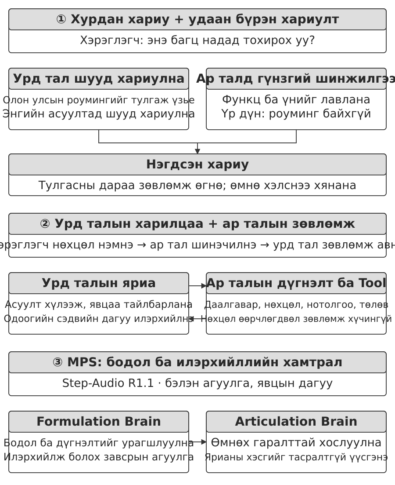

#### Шийдэл нэг: Хурдан сэтгэлгээгээр дэмжиж, удаан сэтгэлгээгээр хариулах

Хурдан Model эхлээд товч дэмжлэг өгч, удаан Model ар талд шинжилгээгээ дуусгаад нарийн хариултыг нэмнэ. Ийм зохиомж хүсэлтийг хүлээн авснаа аль болох эрт баталж чаддаг ч хоёр хариултын уялдаа холбоог удирдах шаардлагатай. Жишээлбэл, хурдан Model эхлээд нэг багц худалдан авахыг санал болгоод, удаан Model дараа нь багцад чухал функц дутуу байгааг олж мэдвэл өмнөх ба дараах зөвлөмж зөрчилдөнө. Зөрчлийн үндэс нь хоёр тал бие даан хариулж, дүгнэлтийн үндэслэл ба дүгнэлтийн явц нь өөр байж болох явдал юм. Хурдан Model-ийн хэлсэн зөвлөмж хэрэглэгчийн шийдвэрт аль хэдийн орж, хэрэглэгч түүний дагуу үйлдэл хийж ч магадгүй; удаан Model дараа нь засахад өөрчлөлтийг тайлбарлах, аль хэдийн үүссэн нөлөөг шийдвэрлэх шаардлагатай болно.

Тиймээс урд тал даалгаврыг баталгаажуулах ба бизнесийн дүгнэлтийг ялгах ёстой. "Энэ багцад энэ функц байгаа эсэхийг би тулгаж үзье" гэдгийг шууд хэлж болох боловч худалдан авах зөвлөмж нь шаардлагатай лавлагаа ба шинжилгээг хүлээнэ. Ар талын үр дүн буцаж ирэхэд систем түүнийг аль хэдийн хэлсэн агуулгатай тулгаад дараагийн хариуг зохино. Энгийн асуултыг хурдан Model шууд гүйцэтгэж, давхар боловсруулалтыг багасгаж болно.

#### Шийдэл хоёр: Хурдан сэтгэлгээгээр харилцаж, удаан сэтгэлгээгээр сануулах

Дуу ба дэлгэц ч ажлаа хувааж болно. "Энэ сарын нэхэмжлэлд роумингийн 15 еврогийн нэмэгдэл орсон" гэж амаар хэлбэл хэрэглэгч гол зүйлийг шууд ойлгоно; анхны дүн, одоогийн үнэ, маргаантай зүйлсийн дэлгэрэнгүйг дэлгэцэнд үлдээвэл хэрэглэгч өөрийн хурдаар тулгаж шалгана. Тодорхой нэг үйлдлийг батлахыг дарж сонгуулж, мэдрэмтгий мэдээллийг худалдаа эрхлэгчийн хүлээн зөвшөөрсөн оролтын интерфейсээр хэрэглэгч өөрөө бөглөнө. Урд тал зөвхөн "баталгаажуулалт дууссан" гэсэн төлөвийг хүлээж аваад яриаг байгалийн байдлаар үргэлжлүүлэхэд хангалттай.

Зорчигч Pine-ээр пүрэв гарагийн өглөө Шанхай руу нисэх тасалбар захиалахыг хүсч, төсөв 1200 юань, үд дундаас өмнө хурлын танхимд хүрэх ёстой гэж бодъё. Pine агаарын тээврийн үйлчилгээний ажилтантай ярьж байхдаа ар тал руу "цаас шургуулна": "Өглөөний аравт Хунцяо руу буувал нисэх онгоцны буудлаас хурлын танхимд амжиж хүрэх үү?" Ажилтан сул суудлыг шалгаад Pine-д "Аравт Хунцяо руу буух нислэг дууссан. Арав хагаст Пудун руу буух нэг нислэг байна, тасалбар 1250 юань" гэж хэлнэ. Хэрэв ар тал зөвхөн урд талын шургуулсан цаасыг харж чаддаг бол тэр Хунцяогоос гарах замыг тооцсоор байна. Урд тал дахин нэг өгүүлбэр тайлбарлах ёстой: "Пудунгаар дахин тооц, арав хагаст бууна, хурлын танхим ба ирэх цаг өөрчлөгдөхгүй."

Өөр нэг арга бол ярианы бүртгэлийг ч дарааллаар нь ар тал руу синхрончлох явдал юм. Ар тал ярианы бүртгэлээс ажилтны хэлсэн нисэх онгоцны буудал ба буух цагийг аль хэдийн уншсан тул урд тал "Энэ нислэгээр амжих эсэхийг тооцоод өг" гэж хэлэхэд л ижил даалгаврыг даалгаж чадна. Бүртгэлийг синхрончлохдоо хэн юу хэлснийг тодорхой тэмдэглэх ёстой; урд тал тасалдуулж, хараахан тоглуулаагүй хагас өгүүлбэрийг ч аль хэдийн хэлсэн агуулгаас ялгах хэрэгтэй. Ярианы транскрипц чухал мэдээллийг алгасах юмуу буруу бичиж магадгүй. Урд тал зөв сонссон нэр, тоо, хэрэглэгчийн засварыг даалгаврын тайлбарт бичих ёстой. Хоёр бүртгэл зөрвөл ар тал даалгаврын тайлбарыг баримтална. Ар тал лавлагаагаа дуусгаад урд талд зөвхөн хурлын танхимд хэдэн цагт хүрч болох, хугацаа хэр чанга байгааг хэлэхэд хангалттай. Замын дагуу ямар маршрут шалгасан, газрын зургийн интерфейс ямар талбар буцаасан зэргийг ар талд лавлах зориулалтаар үлдээж болно. Үр дүнг гартаа авсан урд тал ажилтантай үргэлжлүүлэн хэлэлцэнэ.

Бүлэг 1-ийн тэр бизнес зорчигч тасалбарын үнийг 1200 юаниас доош байлгахыг хүсч байсан. Өмнө нь ажлын аялалд тохирох нислэгийн төлөө бага зэрэг илүү төлөхөд бэлэн байсан бөгөөд энэ удаад ч өөр дээд хязгаар тогтоогоогүй. Хамгийн доод үнэ 1250 юань гэдгийг сонсоод туслах түүний өмнөөс захиалж болно. Харин үргэлж нарийн тооцоолдог, гэр бүлээрээ аялахаар явж буй хэрэглэгчийн хувьд энэ 50 юаниас эхлээд асуух ёстой. Ингээд урд тал хоёр яриаг зэрэг хариуцах шаардлагатай болно:

- Хэрэглэгч рүү: "Энэ нислэгийн хамгийн доод үнэ 1250 юань, төсвөөс 50 юань илүү байна. Захиалах уу?"
- Ажилтан руу үргэлжлүүлэн: "Энэ нислэгийг хэсэг хугацаанд үнээ хадгалж өгч чадах уу? Мөн өдрийн арай хожуу явах 1200 юаниас доош үнэтэй нислэг байна уу?" Ажилтан тасалбар шалгах хооронд урд тал ачааны эрх ба буцаах, өөрчлөх нөхцлийг ч тодруулж болно.

Ингэснээр хэрэглэгч эргэж ирэхэд хэдэн сонголт харж, ажилтан ч цаашид юу шалгахаа мэдэж байна. Хэрэв хэрэглэгч дараа нь "Өнгөрсөн удаа яаралтай хуралдаж байсан. Цаашид ажлын аялалд төсвөөс хэтэрвэл надаас эхлээд асуугаарай" гэж тайлбарлавал дараагийн удаад энэ шинэ шаардлын дагуу ажиллана.

Хэн болохыг батлахыг хүлээх үед ярианы хэмнэл өөр болно. Ажилтан баталгаажуулах код илгээсэн гэж хэлэхэд урд тал "За, түр хүлээнэ үү, зорчигчоос утсаа харж үзэхийг хүсье" гэж хариулж болно. Зорчигч хараахан хүлээн аваагүй гэж мессеж бичвэл ажилтантай SMS ямар дугаарын сүүлийн цифр рүү явсан, хэр удааны дараа дахин илгээж болохыг асууна. Зорчигч худалдаа эрхлэгчийн заасан сувгаар баталгаажуулалтаа дуусгасны дараа урд тал ажлаа үргэлжлүүлнэ. Ийм ярианд бага зэрэг илүү хүлээх, тасалбарыг арай хожуу гаргах нь хэрэглэгчийг яг тэр мөчид шийдвэр гаргахыг шахахаас дээр.

Энэ үед ар талаас "анхны үнийн санал шинэчлэгдлээ" гэсэн мэдэгдэл ирнэ. Урд тал эхлээд ажилтантай шинэ үнийг тулгаж, дараа нь хэрэглэгчид хэлнэ. Хэрэв хэрэглэгч яг энэ үед "Захиалж болно" гэж хариулбал энэ хариу өмнө нь түүнд хэлсэн 1250 юанийн үнийн саналд хамаарна. Урд тал шинэ үнэ ба өмнө олгосон зөвшөөрлийг харгалзан дахин баталгаажуулах шаардлагатай эсэхийг шийднэ. Ар тал зөвхөн мэдээлэл өгдөг бөгөөд ажилтантай ярих, амлалт өгөх нь үргэлж урд талын үүрэг хэвээр байна. Мессежид нислэг, үнэ хүчинтэй байх нөхцөл, цагийг хавсаргаснаар урд тал аль үнийн санал хугацаа хэтэрснийг танина.

"Үнэ өөрчлөгдсөн, тулгаж үзээрэй" гэсэн ижил ар талын мессеж хэзээ ирснээс урд тал хариуг хэрхэн залгах нь хамаарна. Ажилтан "Хамгийн доод үнэ нь……" гэж дөнгөж эхэлсэн бол урд тал дүнг сонсоод дуусгаж болно. Ажилтан үнээ аль хэдийн хэлээд хариу хүлээж байгаа бол шинэ үнийг асуух нь тохиромжтой. Зорчигч утсан дээр дөнгөж "Түр хүлээ, би огноогоо өөрчиллөө" гэж таслан хэлсэн бол эхлээд шинэ огноог тодруулаад, анхны нислэгийг дахин тулгах шаардлагатай эсэхийг шийднэ. Ижил нэг "За" гэдэг үг ажилтан нөхцлөө тайлбарлаж байх үед сонсож байгаагаа илэрхийлж болох бол "Би одоо тасалбарыг тань гаргаж өгье?" гэсний дараа худалдан авалтыг зөвшөөрсөн гэж ойлгогдож болно. Зөвхөн транскрипцлагдсан текстээр харвал ийм ялгаа алдагдана.

#### Шийдэл гурав: Бодол ба илэрхийлэл хэсэг хэсгээрээ зэрэгцэн урагших

Step-Audio цуврал хоёр холбогдох жишээ өгдөг. **Модальд зангуулсан дүгнэлтийн дестилляци (MGRD)** нь дүгнэлтийн үндэслэдэг мэдээлэлд анхаарна: өндөр, хэмнэл, аялга зэрэг акустик шинжээр дүгнэлтийн өгөгдөл бүрдүүлж шүүж, давтан дестилляцаар аудионы ойлголтыг сайжруулна. Step-Audio R1 нь бататгах сургалтын шатанд аудионы бодлогыг хоёр зүйлээр оноодог: зөв хариулбал 0.8 оноо, дүгнэлтийн явцаа бичвэл нэмэлт 0.2 оноо өгдөг. Сүүлийнх нь Model-ийг үндэслэлээ бичихийг урамшуулна; харин дүгнэлт бичлэг дэх акустик сэжүүрийг ашигласан эсэхийг өмнөх дээжийн шүүлтээр шалгана.[^ch6-mgrd]

**Mind-Paced Speaking (MPS)** нь дүгнэлт ба илэрхийллийн цагийн дараалалд анхаарч, бодол бүрдүүлэх модуль (Formulation Brain) ба илэрхийллийн модуль (Articulation Brain) ашиглан бодлын процессыг ярианы үүсгэлтэд чиглүүлнэ. Step-Audio R1.1-ийн бодит цагийн шийдэл энэ аргыг ашигласан.[^ch6-mps]

Хоёр модуль явцынхаа дагуу мэдээлэл солилцоно: бодол тасралтгүй урагшилж, илэрхийлэл аль хэдийн бэлэн болсон агуулга ба өмнөх гаралтын дагуу яриаг зохион байгуулна. Ингэснээр илэрхийллийн нэг хэсэг дараагийн дүгнэлттэй давхардаж, аль хэдийн хэлсэн агуулгын хяналт хадгалагдана.

[^ch6-mgrd]: StepFun, *Step-Audio-R1 Technical Report*. Модальд зангуулсан дүгнэлтийн дестилляцийг танилцуулсан.
[^ch6-mps]: StepFun, *Mind-Paced Speaking: A Dual-Brain Approach to Real-Time Reasoning in Spoken Language Models* ба Step-Audio-R1.1-ийн Model карт. Бодол ба илэрхийллийн хоёр модуль, тэдгээрийн бодит цагийн системд хэрэглэгдэх аргыг танилцуулсан.

#### Модулийн хуваарилалт ба шинэчлэх арга

**Хурдан ба удаан сэтгэлгээний хуваарилалтад би нэг инженерийн давуу талыг онцлохыг хүсэж байна: харилцан үйлчлэлийн чадвар ба дүгнэлтийн чадвар тус тусдаа хөгжиж болно.** Илүү хүчирхэг дүгнэлтийн Model гарсны дараа систем ар талаа сольж болно. Ингэснээр ар тал дүгнэлтийн Model-ийн дэвшлийг дагаж, урд тал сонсох, хариулах, таслан орох туршлагаа тасралтгүй сайжруулна. Урд тал даалгавар ба хэрэглэгчийн нэмэлт мэдээллийг ойлгох шаардлагатай бол ар тал нь урт дүгнэлт, төлөвлөлт, гүйцэтгэлд төвлөрнө.

**Дүгнэлтийн Model хурдан шинэчлэгдэж, баг бүр бизнесийн чадвараа тасралтгүй ахиулах шаардлагатай үед би сольж болох хурдан ба удаан хуваарилалтыг илүүд үздэг.** Энэ хуваарилалт дүгнэлтийн Model-ийг шинэчлэх бүрт бүхэл дуут системийг дахин сургах ачааг хасдаг. Харин завсрын дүгнэлтийг илэрхийллийг шууд удирдахад ашиглах шаардлагатай, үүнд тохирох сургалтын нөөц байгаа үед илүү нягт хамтын ажиллагааны шийдлийг сонгоно.

Pine AI-ийн дуут Agent нь урд талын хурдан сэтгэлгээ ба ар талын удаан сэтгэлгээг хослуулсан архитектур ашигладаг. Түүний нийтэлсэн нийтлэл тасралтгүй яриа, бизнесийн дүгнэлт, Tool-ийн үйлдлийг хослуулах аргыг танилцуулж, τ²-bench-ийн дуут төрөлд тэргүүлсэн үр дүнгээ мэдээлсэн[^ch6-17].

Эдгээр хослолыг ойлгохдоо гурван зохиомжийн хэмжээсийг ялгаж болно: **аудионы зам** нь Model дууг шууд боловсруулах уу, транскрипцээр шилжүүлэх үү гэдгийг; **сонсох, ярих цагийн дараалал** нь оролт гаралт ээлжээр эсвэл зэрэгцэн урагших эсэхийг; **танин мэдэхүйн хуваарилалт** нь бодит цагийн харилцан үйлчлэл ба гүнзгий дүгнэлт төлөвийг хэрхэн хуваалцаж, үр дүнг хэрхэн солилцохыг тодорхойлно. Систем аудиог шууд боловсруулж, бүрэн дуплексийг хадгалахын зэрэгцээ нарийн төвөгтэй даалгаврыг бие даасан ар талын Model-д даатгаж болно. Thinking Machines Lab-ийн харилцан үйлчлэлийн Model ба GPT-Live хоёулаа ийм хослолыг үзүүлдэг.

[^ch6-17]: Pine AI, *The Most Natural Human-Computer Interface Is Your Voice*. Хурдан ба удаан сэтгэлгээний архитектур ба түүний мэдээлсэн дуут даалгаврын үнэлгээний үр дүнг танилцуулсан. Тайланд жагсаалтыг τ²-bench voice гэж нэрлэсэн.

### Хүнтэй улам төстэй яриа нийлэгжүүлэлт

Зогсолт, ярианы хурд, өргөлт нь сонсогчид өгүүлбэрийн бүтэц ба яригчийн зорилгыг ойлгоход тусална. Жишээлбэл, утасны дугаарыг хэлэхдээ зохих хэсгүүдэд хуваах, нарийн нөхцлийг тайлбарлахдаа хурдаа сааруулах, лавлагааны үр дүнг хүлээхдээ юу боловсруулж байгаагаа эхлээд хэлэх нь зүйтэй. Миний бодлоор тохиромжтой зогсолт ба хэмнэлийн өөрчлөлт яриаг илүү байгалийн болгохоос гадна даалгавар хэрхэн урагшилж байгааг хэрэглэгч сонсоод мэдэх боломжтой болгодог. Дуут удирдлагыг эдгээр тодорхой хэрэглээг тойруулан зохиож болно.

Үндсэн LLM текстэд `[THINKING]`, `[EMO:happy]`, `[SPEED:0.8x]` зэрэг удирдлагын тэмдэглэгээ оруулж болно. Гүйцэтгэлийн давхарга тэмдэглэгээг задалж, текстийг яриа ба зогсолтын хэсгүүдэд хуваагаад, нийлэгжүүлэх интерфейсийн дэмждэг сэтгэл хөдлөл, хэв маяг эсвэл жишиг дуу руу буулгана. Тэмдэглэгээний утгыг хэрэглээ өөрөө тодорхойлно: `0.8x`-ыг удаан хурдны зэрэглэлд буулгаж болно; зогсолтыг тоглуулагч оруулж, инээд ба санаа алдахыг дэмждэг дуут тэмдэглэгээ юмуу үүсгэх чадвараар илэрхийлнэ.

Жишиг дууны шийдэл нэг яригчийн өөр өөр илэрхийллийг сан болгон зохион байгуулна. Текст бүрт тохирох сэтгэл хөдлөл, ярианы хурд, хэв маягийг сонгож, нийлэгжүүлсний дараа дарааллаар нь залгана. Удирдлагын төлөвт үйлчлэх хүрээг зааж өгөх ёстой, жишээлбэл сэтгэл хөдлөл дараагийн өөрчлөлт хүртэл үргэлжилж, зогсолт зөвхөн тухайн байрлалд л үйлчилнэ.

> **Туршилт 6-8 ★★: Fish Audio-гийн удирдлагын тэмдэглэгээнд суурилсан TTS**
>
> Энэ туршилт Fish Audio S1-ээр 24 жишиг дуунаас бүрдсэн ярианы сан бүрдүүлнэ: дөрвөн төрлийн сэтгэл хөдлөл, гурван зэрэглэлийн ярианы хурд ба хоёр хэв маягийн хослол. Задлагч тэмдэглэгээ бүхий хариуг ярианы хэсэг ба чимээгүй байдлын хэсэг болгон хөрвүүлж, гүйцэтгэлийн давхарга хэсэг бүрт жишиг дуу сонгон нийлэгжүүлнэ.
>
> Гурван тохиргоог харьцуулна: удирдлагын тэмдэглэгээгүй, нэг жишиг дуутай, олон жишиг дуутай. Хариуны агуулгыг ижил байлгаж, тэмдэглэгээ хүлээсэн тохиргоо руу чиглэж байгаа эсэхийг шалгаад, зогсолт, сэтгэл хөдлөл, дууны өнгийн өөрчлөлтийг сонсож үзнэ.
>
> Хадгалсан сонсголын шалгалтад аудио ойлголтын Model ашиглаж, гурван тохиргоог ээлжлэн өөр дарааллаар үзүүлэн байгалийн байдал, сэтгэл хөдлөлийн тохирол, бодлын зогсолт, дууны өнгийн нэгдмэл байдал, үйлчилгээний ажилтны мэдрэмжийг үнэлсэн. Олон жишиг дуутай бүлэг нийлмэл оноогоор хамгийн өндөр, нэг жишиг дуутай бүлэг тэмдэглэгээгүй бүлгээс доогуур гарсан.

## Computer Use: GUI-г автоматжуулах Agent

Вэб хуудсан дээрх хүргэлтийн хаягаа өөрчлөхийг Agent-аас хүссэн гэж бодъё. Тэр эхлээд хаягийн талбарыг олж, шинэ хаягаа оруулаад, дэлгэцэнд буцаж харагдсан утгаар хадгалсан эсэхийг батлах ёстой. Хэрэв дарахаас өмнө нэвтрэх цонх гарч ирвэл өмнөх дэлгэцийн зураг дахь товчны координат өөрчлөгдөөгүй ч энэ даралтын объект аль хэдийн өөр болсон байна. Computer Use нь дэлгэц, хулгана, гарын тусламжтайгаар хөтөч, хүснэгт эсвэл системийн тохиргоог удирддаг бөгөөд гол ажил нь үйлдэл бүрийг нүдний өмнөх интерфейстэй нийцүүлэх явдал юм.

Зураг 6-12-ын **мэдрэх—бодох—үйлдэх** давталтыг дагаж, Model шинэ хаяг оруулахаас өмнө юуг батлах ёстойг харъя. Тэр дэлгэцийн зураг ба даалгаврын явцын дагуу дарах байрлалаа сонгоно, Harness параметр ба эрхийг шалгаад гүйцэтгэлийн давхаргад шилжүүлнэ. Даралт амжилттай болсон нь зөвхөн энэ даралт илгээгдсэнийг илэрхийлнэ. Дараагийн дэлгэцийн зурагт оролтын фокус хаана байгаа нь цааш хаягаа аюулгүй оруулж болох эсэхийг тодорхойлно.

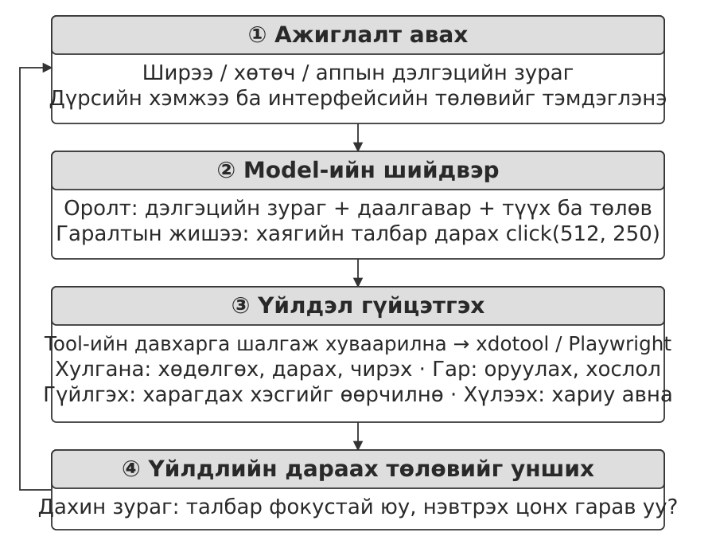

Туслах хаягаа бөглөсний дараа аль "Хадгалах" товчийг дарахыг гүйцэтгэгчид хэрхэн хэлэх вэ? Дэлгэцийн координат ч, элементийн дугаар ч зорилтыг зааж чадах боловч Model ба Tool-д тавих шаардлага нь өөр.

### Үйлдлийн орон зайн зохиомж

Зураг 6-13-т Anthropic-ийн Computer Use жишиг хэрэгжүүлэлт график интерфейс, команд гүйцэтгэх, файл засварлах гэсэн гурван төрлийн Tool өгдөг. Зөвхөн график интерфейсийн төрлийг харахад өгөгдөл хоёр чиглэлд урсана: дарах үйлдэл гүйцэтгэгч рүү илгээгдэж, дарсны дараах дэлгэцийн зураг Model руу буцаж, дараагийн ээлжийн шийдвэрийн ажиглалт болно. Төрөлх API Tool-ийн форматыг тогтоодог; өөр Model ашиглах бол тохируулгын давхарга дэлгэцийн зураг, үйлдлийн хүсэлт, гүйцэтгэлийн үр дүнг тухайн интерфейсийн хүлээн авах мессеж болгон хөрвүүлэх ёстой.[^ch6-computer-tools]

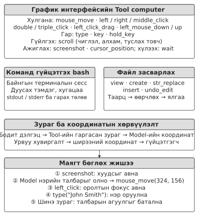

**GUI удирдах Tool.** Хулганы үйлдэлд хөдөлгөх, зүүн/баруун/дунд товчоор дарах, хоёр удаа дарах, гурван удаа дарах, чирэх орно; илүү нарийн интерфейс дарах ба суллахыг тусад нь илэрхийлж болно. Гүйлгэхэд чиглэл ба хэмжээ шаардлагатай бөгөөд зарим хэрэгжүүлэлт туслах товчийг ч дэмждэг. Гарын интерфейс текст оруулах, товчны хослол, товч дарж барих боломж олгоно. Дэлгэцийн зураг ба курсорын байрлал төлөвийг авахад, хүлээх интерфейс хуудас ачаалах эсвэл хөдөлгөөнт дүрсэд хугацаа үлдээхэд хэрэглэгдэнэ. Tool-ийн хувилбар нь тодорхой үйлдлийн багцыг тогтоох бөгөөд Harness ашиглаж буй интерфейсийн дагуу параметрийг шалгана.

**Команд гүйцэтгэх Tool.** Байнгын терминал дуудлагуудын хооронд ажлын хавтас ба орчны төлөвийг хадгалж чадна. Жишээлбэл, нэг дуудлагад хавтас сольсны дараа дараагийн дуудлага тэр хавтаст үргэлжлүүлэн ажиллана. Жишиг хэрэгжүүлэлт харуулын мөрөөр команд дууссаныг таньж, хугацааны хязгаар тогтоож болно; хугацаа хэтэрсний дараах процессын төлөвийг гүйцэтгэгч шалгах шаардлагатай хэвээр.

**Файл засварлах Tool.** Мөр орлуулах интерфейс анхны текстээр өөрчлөх хүрээг тодорхойлох бөгөөд харах, үүсгэх, оруулах, буцаах боломжийг ч олгож болно. Гүйцэтгэхээс өмнө тааралдсан байрлал ба тоог, гүйцэтгэсний дараа ялгааг шалгана; хоёр дуудлагын хооронд файл өөрчлөгдсөн бол холбогдох агуулгыг дахин уншина. Бүлэг 5-д танилцуулсан засварлах стратегийг энд дахин ашиглаж болно.

> **Туршилт 6-9 ★: Anthropic Computer Use-ийн жишиг хэрэгжүүлэлтийг ажиллуулах**
>
> Энэ туршилт албан ёсны контейнерын жишээний Ubuntu ширээ, хөтөч, Tool гүйцэтгэлийн давхаргыг ашиглана. Хэрэглэгч даалгавар оруулсны дараа Model дэлгэцийн зургийг уншиж үйлдэл буцааж, гүйцэтгэлийн давхарга ширээг удирдаад, шинэ дэлгэцийн зургийг Model-д буцааж өгнө.
>
> Дагалдах даалгавар нь Сан Францискогийн цаг агаарыг лавлах. Хадгалсан мөр эхлээд Google руу хандаж, баталгаажуулах код тааралдсаны дараа ажиллагааны явцын сэргээх зааврын дагуу нийтэд нээлттэй Open-Meteo өгөгдөл рүү шилжиж, эцэст нь температур ба цаг агаарын байдлыг мэдээлсэн. Бүртгэлд ширээний 15 үйлдэл ба харгалзах дэлгэцийн зураг багтсан тул дарах, товч дарах, текст оруулах, хүлээх нь хуудсыг хэрхэн өөрчилснийг ээлж бүрээр шалгаж болно.
>
> Нээлттэй Model-оор хөтөч удирдах замыг Туршилт 6-10-аас үзнэ үү.

### Харааны байршуулалт (Grounding)

Model-оор хайлтын талбарыг даруулахдаа асуултыг хоёр хэлбэрээр тавьж болно. Нэг нь дэлгэцийн зургийг үзүүлж, дарах координатыг хэлүүлэх. Нөгөө нь нэр дэвшигч зорилтуудад дугаар өгч, хайлтын талбарыг сонгуулах; дугаарыг дэлгэцийн зураг дахь нэр дэвшигч мужид тэмдэглэж ч болно, хөтчийн өгсөн элементийн жагсаалтаас ч авч болно. Доор эдгээр гурван замыг тус тусад нь танилцуулна. Дугаар сонгох үед гүйцэтгэлийн давхарга дугаарыг бодит зорилт руу сэргээх үүрэгтэй; координатыг шууд хэлэх үед Model зорилтын байршлыг өөрөө тооцох ёстой тул байршуулалтын сургалт ба дэлгэцийн нягтралд тохируулах шаардлага илүү өндөр.

**Set-of-Mark: харааны тэмдэглэгээ.**

Set-of-Mark (SoM) зураг дээр иш татаж болох дугаар давхарлаж, харааны мужийг Model-ийн гаралттай холбодог. Анхны ажилд сегментчлэл зэрэг аргаар нэр дэвшигч муж үүсгэсэн, жишээлбэл SAM, SEEM ашиглан муж олоод тэмдэглэгээ тавьсан. Model дугаар сонгосны дараа гүйцэтгэлийн давхарга харгалзах мужийн дагуу үйлдлийн байрлалыг тогтооно. Энэ аргыг DOM байхгүй ширээний программ эсвэл тоглоомын интерфейст ашиглаж болох ч дарах ёстой удирдлагын элемент дугаартай муж дотор орсон байх, Model тэр нь аль дугаартай харгалзахыг тод харж чадах ёстой.[^ch6-som]

**Бүтэцлэгдсэн элементийн индекс.**

Хөтөч өөр төрлийн сэжүүр ч өгч чадна. Баримт бичгийн объектын загвар (DOM) нь хуудсанд ямар элементүүд байгаа, тэдгээрийн шатлалыг тайлбарладаг; байрлалын мэдээлэл элемент хаана харагдахыг өгнө; хүртээмжийн мод (accessibility tree) нь туслах технологид хэрэгтэй үүрэг ба хүртээмжтэй нэрийг хадгална. Жишээлбэл, зөвхөн томруулдаг шилний дүрстэй товчинд хуудас "Хайх" гэсэн хүртээмжтэй нэр өгсөн бол Agent түүнийг үүрэг ба нэрээр нь олох боломжтой. browser-use зэрэг шийдлийн жишээгээр систем Chrome DevTools Protocol (CDP) зэрэг хөтчийн дибаг интерфейсээр элементийн мэдээлэл авч, оролтын талбар, товч, холбоосыг таньж, одоогийн хуудсан дээрх эдгээр үйлдэл хийж болох элементүүдэд дугаар өгнө. Зураг 6-14-т Model хуудасны баруун дээд буланд байгаа [2]-ыг сонгожээ. Энэ дугаар Submit товчийг нэг удаа дарах үйлдэл болж хэрхэн хувирах вэ?

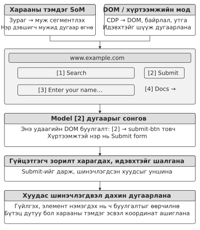

Боловсруулалтыг дөрвөн алхамд хувааж болно: DOM, байрлал ба боломжтой хүртээмжийн мэдээллийг унших; харилцан үйлчлэх боломжтой элементүүдийг шүүх; одоогийн хуудасны дугаарын буулгалтыг үүсгэх; элементийн тайлбар ба шаардлагатай тэмдэглэгээтэй дэлгэцийн зургийг Model-д өгөх. Жишээлбэл, Model дараах дугаартай дөрвөн элементийг харж болно:

```text
Дэлгэцийн зурагт [1], [2], [3], [4] гэж тэмдэглэсэн

[1] <input type="text" placeholder="Search" aria-label="Search" />
[2] <button id="submit-btn" aria-label="Submit form" />
[3] <input type="text" placeholder="Enter your name" value="" />
[4] <a href="/docs" aria-label="Documentation" />
```

Model дугаар сонгосны дараа гүйцэтгэлийн давхарга түүнийг элементийн лавлагаа эсвэл координат болгон задлаж, зорилт харагдсаар, харилцан үйлчлэх боломжтой хэвээр байгаа эсэхийг шалгаад, үйлдлийг гүйцэтгэнэ. Хуудас шинэчлэгдэх, гүйлгэх эсвэл элемент динамикаар нэмэгдсэний дараа буулгалтыг шинэчилж, хугацаа нь өнгөрсөн дугаар ашиглахаас сэргийлнэ. Бүтэцлэгдсэн индекс шошго, үүрэг, текстийг ашиглаж чаддаг бол Canvas, далдлагдсан эсвэл утгын тэмдэглэгээ дутуу хэсгийг дэлгэцийн зурагтай хослуулж дүгнэх шаардлагатай. Жагсаасан элемент олон байх тусам, дэлгэцийн зураг том байх тусам Context руу орох мэдээлэл ч олшрно.

**Координатыг шууд таамаглах.**

Координатын зам Model-оор дэлгэцийн зураг ба зорилтын тайлбараас байрлалыг шууд гаргуулна, жишээлбэл "Илгээх товчийг дар" гэснийг тодорхой нэг цэг рүү буулгана. SeeClick зэрэг GUI байршуулалтын судалгаа болон Claude-ийн Computer Use координатын гаралтыг ашигладаг. Гүйцэтгэлийн давхарга зургийн координатыг бодит ширээний координат руу хөрвүүлэх үүрэгтэй.

Дэлгэцийн зургийг масштаблах үед хоёр координатын систем ижил хувиргалт ашиглах ёстой. 2560×1440 ширээг жишээ болгоход Model руу илгээсэн зураг 1366×768 бол Model-ийн өгсөн (683, 384) нь дараахтай харгалзана:

$$
x = 683 \times \frac{2560}{1366} = 1280,\qquad
y = 384 \times \frac{1440}{768} = 720
$$

Зураг 6-15-д хоёр хэмжээсийн өргөн өндрийн харьцаа ойролцоо байна. Хэрэв дэлгэцийн зурагт харьцаагаа хадгалахын тулд хар хүрээ нэмсэн бол Model-ийн өгсөн координатад хоосон зай орсон байна; анхны дэлгэцийн координат руу буцааж хөрвүүлэхээс өмнө харгалзах дүүргэлтийн шилжилтийг хасаад, дараа нь масштабын коэффициентоор хөрвүүлнэ. Тайрах, дэлгэцийн масштаб, олон дэлгэцийн эх цэг ч буулгалтыг өөрчилдөг тул Tool-ийн давхарга бодит хувиргалтын параметрийг хадгалах ёстой.

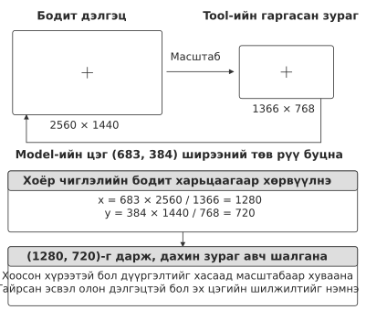

Жишиг хэрэгжүүлэлт XGA (1024×768), WXGA (1280×800), FWXGA (1366×768) зэрэг зорилтот хэмжээг ашиглаж байсан. Өргөн өндрийн харьцааг хүчээр өөрчилбөл удирдлагын элементийн хэлбэр гажина; буруу урвуу буулгалт ашиглавал зөв таамаглалыг буруу байрлал руу буулгана.[^ch6-computer-tools]

**Бүтэцлэгдсэн мэдээлэл бүрэн байх үед би DOM эсвэл хүртээмжийн модны индексийг илүүд үздэг.** Элементийн нэр, үүрэг, лавлагаа байршуулалтад шууд оролцож, Model пикселийн байрлалыг тухай бүрт нь тооцох ажлыг багасгана. Бүтэц байхгүй үед ерөнхий харааны Model эхлээд SoM-тэй хослон тэмдэглэсэн мужуудаас нэгийг сонгож болно; GUI байршуулалтын сургалт авсан Model харин координатыг шууд таамаглаж, тусдаа тэмдэглэгээг алгасаж чадна.

> **Туршилт 6-10 ★: browser-use ашиглан хөтчийн автомат үйлдэл хэрэгжүүлэх**
>
> Энэ туршилт Qwen3-VL 32B Instruct-оор browser-use-ийг удирдаж, хөтчийн төлөв, элементийн мэдээлэл, дэлгэцийн зургаар үйлдэл үүсгэнэ. Даалгавар нь Сан Францискогийн цаг агаарыг лавлах: хайлтын талбарыг олж, "San Francisco weather today" гэж оруулаад, лавлагааг илгээж, температур ба цаг агаарын байдлыг гаргаж авна.
>
> Туршилт 6-10-ын код ба ажиллуулах заавар хоёр оролтын замыг өгдөг. OpenRouter-ийн түлхүүртэй бол удирдлагатай харааны Model ашиглаж болно; vLLM, SGLang зэрэг нийцтэй үйлчилгээ аль хэдийн байгаа бол `OPEN_MODEL_BASE_URL` ба `OPEN_MODEL_MODEL`-ийг өөрийн төгсгөлийн цэг ба Model руу зааж, үйлчилгээний шаардлагын дагуу түлхүүр тохируулна. Хоёр зам аль аль нь эхлээд туршилтын хавтаст `python main.py --dry-run`-ийг ажиллуулж тохиргоог шалгаад, дараа нь зааврын дагуу бодит лавлагааг эхлүүлнэ.
>
> Хадгалсан гүйцэтгэл 16 алхам харилцан үйлчлэлийг дуусгаж, 15 дэлгэцийн зураг хадгалсан. Google-д баталгаажуулах код гарч ирсний дараа даалгавар weather.com-оос үр дүн авахаар шилжсэн.

[^ch6-computer-tools]: Anthropic, Computer Use Tool-ийн баримт бичиг ба жишиг хэрэгжүүлэлт. Хувилбарчилсан үйлдлийн интерфейс, гүйцэтгэлийн давхарга, дэлгэцийн зургийн боловсруулалтыг танилцуулсан.
[^ch6-som]: Microsoft, *Set-of-Mark Prompting*, 2023; browser-use-ийн DOM үйлчилгээний хэрэгжүүлэлт бүтэцлэгдсэн элемент боловсруулах жишээ өгдөг.

### Хөдөлгөөнт дүрс харж, дуу сонсдог Computer Use Agent

Хуудас хадгалсны дараа "Синхрончлол амжилтгүй" гэж богинохон харуулаад алга болжээ, гэтэл хэдэн секундын зайтай авсан хоёр дэлгэцийн зураг хоёулаа ижил маягтыг харуулж байна. Эдгээр хоёр зургийг дахин харсан ч Model хооронд нь юу болсныг сэргээж чадахгүй байх магадлал өндөр. Видео, хөдөлгөөнт дүрс, богино мэдэгдэл, хурлын яриа ч ижил асуудалтай. **Тасралтгүй өөрчлөгддөг интерфейсийн хувьд ажиглалтын интерфейсийг сайжруулалтын гол объект болгохыг би дэмждэг.** Өөрчлөлтөөр дараагийн алхмаа шийдэхийн тулд үйлдлүүдийн хооронд гарсан үйл явдал эсвэл дүрсийг ч хадгалах шаардлагатай.

Миний хамтран зохиогчдын хамт санал болгосон **Agent–Computer Observation Interface (AOI, Agent ба компьютерийн ажиглалтын интерфейс)** нь тасралтгүй дэлгэц ба аудиог Model хүлээн авч чадах зураг ба текст болгон хувиргадаг[^ch6-9]. Интерфейс гурван бүрэлдэхүүнтэй:

- **Үйлдлийн хоорондох гол кадрыг цуглуулах.** Үндсэн давталт ажиллаж байх хугацаанд дүрсийн өөрчлөлтийг хянаж, пикселийн ялгаа эсвэл хөнгөн харааны Model-оор нэр дэвшигч кадруудыг шүүгээд, хэрэгтэй дүрсийг дараагийн шийдвэрт өгнө.
- **Дууны түвшнээр хаалгалсан транскрипц.** Дуу илрүүлсний дараа яриа танилтыг дуудаж, транскрипц ба цагийн мэдээллийг ажиглалтын бүртгэлд нэмснээр Agent хурлын агуулга эсвэл аман зааврыг ашиглахад тусална.
- **Байнгын дүрс тайлбар.** Гол дүрсийг текстээр хураангуйлна; анхны зураг Context-оос гарсны дараа ч текст болсон өөрчлөлтийг хадгалж, дараагийн алхмууд иш татах боломжтой болно.

Жишээлбэл, видеонд нэг цэсний үйлдлийг үзүүлсэн бол Model завсрын дүрс ба харгалзах тайлбарыг хүлээн авснаар тоглуулалт дууссаны дараа ч тэр алхмыг үргэлжлүүлэн лавлаж чадна. Өгүүллийн задлан шинжилгээний үр дүнгээс харахад байнгын текст тайлбар ашиг тусад онцгой чухал үүрэгтэй байсан бол гол кадрыг нарийн сонгох нь бага хувь нэмэр оруулсан; зарим Model хэт олон зураг нэмэхэд харин ч муудсан.

Түрүүний маягт хадгалах жишээ рүү буцъя. Гол кадр "Синхрончлол амжилтгүй"-г барьж авсан ч анхны зураг Context-оос гармагц Model зөвхөн үлдсэн тайлбарт найдана. "Хуудсанд мэдэгдэл гарч ирэв" гэдэг нь хадгалалт амжилттай болсныг ч, амжилтгүй болсныг ч илэрхийлж болно; "Синхрончлол амжилтгүй, хаяг хадгалагдсангүй" гэсэн тайлбар л дараагийн алхмыг шийдэх сэжүүрийг хадгална.

[^ch6-9]: Bojie Li, Noah Shi, *Agent-Computer Observation Interfaces Enable Dynamic Computer Use*, 2026. AOI ба түүний бүрэлдэхүүн хэсгүүдийн задлан шинжилгээг танилцуулсан.

### Computer Use-ийн ертөнцийн Model

Ажиглалтыг цагтаа авсны дараа Agent үйлдлээ сонгож, гүйцэтгэлийг хүлээх шаардлагатай. OSWorld-Human судалгаа Agent-ийн үйлдлийн үр ашгийг хүний мөртэй харьцуулж, илүүдэл алхам, Model дуудлага зэрэг цаг зарцуулалтын эх сурвалжийг шинжилсэн[^ch6-osworld-human].

Ертөнцийн Model төлөвлөлтөд үйлдлийн үр дагаврын таамаглал өгдөг. Ширээний төлөвт цонх, фокус, гүйлгэлтийн байрлал, оруулсан агуулга, ачааллын явц багтаж болно; эрх, сүлжээний үр дүн зэрэг мэдээллийг харгалзах интерфейсээр нэмэх шаардлагатай. Model одоогийн боломжтой төлөв ба нэр дэвшигч үйлдлийн дагуу дараагийн төлөвийг таамаглана:

```text
Одоогийн төлөв + click / type / scroll / wait → таамагласан дараагийн төлөв
```

Хүн компьютер ашиглахдаа ихэвчлэн дарахаасаа өмнө дараагийн алхмыг төсөөлсөн байдаг; интерфейс хүлээлтэд нийцвэл үргэлжлүүлж, санамсаргүй зүйл гарвал л зогсоод шалгадаг. Ертөнцийн Model нь Agent-д үүнтэй төстэй таамагласан гүйцэтгэлийн үндэслэл өгч чадна: төлөвлөгч нэр дэвшигч үйлдлүүдийг урьдчилан харьцуулж, хуудас ачаалж байх хугацаанд дараагийн алхмуудыг бэлтгэж, бодит төлөв батлагдсаны дараа гүйцэтгэлээ үргэлжлүүлснээр даралт бүрийн дараа эхнээс нь дахин төлөвлөх хүлээлтийг багасгана. Жишээлбэл, VS Code-д шинэ Python файл үүсгэж hello world бичихэд файлын модонд шинэ файл гарах, засварлах мужид код байх, хадгалах төлөв шинэчлэгдэх зэрэг өөрчлөлт хүлээгдэнэ. Гүйцэтгэсний дараа эдгээр өөрчлөлтийг шалгаж, хүлээлтэд нийцвэл үргэлжлүүлж, зөрүү гарвал дахин байршуулж, дахин төлөвлөнө.

Файл устгах зэрэг үйлдэлд мөн бие даасан гүйцэтгэлийн нөхцөл шаардлагатай: зорилт зөв эсэх, устгахыг зөвшөөрсөн эсэх, сэргээж болох эсэх, хэрэглэгчийн баталгаажуулалт хэрэгтэй эсэх. Таамаглал боломжит үр дүнг ойлгоход тусалдаг ч бодит эрх ба бизнесийн нөхцлийг гүйцэтгэлийн давхарга шалгана.

**Photon-1-ийн далд төлөвийн таамаглал.** Induction Labs 2026 оны 7-р сард Photon-1-ийг танилцуулсан: видео кадрыг дискрет далд token болгон кодлож, дараагийн token-ыг таамаглах замаар төлөвийн өөрчлөлтийг сурдаг. Компанийн мэдээлснээр урьдчилсан сургалтад ойролцоогоор 30 мянган H200 GPU цаг зарцуулсан. Төлөвийн таамаглал далд token дотор хийгдэж, туслах зураг үүсгэгч тэдгээрийг харж болох дүрс болгон сэргээж, хүн таамаглалыг шалгах боломж олгоно. Төлөвлөлт ба үйлдэл үүсгэлт дотоод дүрслэлийг шууд ашиглаж, алхам бүрт бүтэн дэлгэцийн зураг үүсгэх зардлыг хэмнэж чадна.[^ch6-20]

Энэ шийдэл цаашлаад fine-tuning-ээр заавар ба үйлдлийн форматыг сурдаг: эхлээд хүрэхийг хүссэн төлөвөө таамаглаж, дараа нь тэр төлөв рүү хүргэх үйлдлийг үүсгээд, виртуал машин дотор онлайн сургалтаар даалгаврын гүйцэтгэлийг сайжруулна. Үйлдлээр нөхцөлдүүлсэн fine-tuning харин өгөгдсөн үйлдлийн дараах ширээний өөрчлөлтийг таамаглахад хэрэглэгдэнэ. Энэ хоёр хэрэглээ төлөвлөлт ба симуляцийг тус тусад нь холбож, төлөвийн дүрслэл Computer Use-д хэрхэн оролцохыг харуулдаг.

[^ch6-osworld-human]: Reyna Abhyankar нар, *OSWorld-Human: Benchmarking the Efficiency of Computer-Use Agents*. Даалгаврын мөр ба цаг хугацааны зардлыг шинжилсэн.
[^ch6-20]: David Li, Jonathan Li, *Scaling Video Pretraining with Imagination Models*, Induction Labs, 2026-07-23. Photon-1-ийн урьдчилсан сургалт, үйлдлийн сургалт ба төлөвийн симуляцийг танилцуулсан.
[^ch6-21]: Google DeepMind, *Genie 3: A new frontier for world models*, 2025-08-05; Zachary Lin нар, *Cosmos World Foundation Model Platform for Physical AI*, 2025.

### Гар утас: техникийн интерфейс ба экосистемийн хамтын ажиллагаа

Гар утсан дээр ажиглах—шийдэх—үйлдэх давталт хэвээр ч үйлдэл нь ихэвчлэн мэдрэгчтэй дэлгэцийн хөдөлгөөн хэлбэртэй байдаг. Нэг координат дарах байрлал, удаан дарах байрлал эсвэл шудрах эхлэлийг илэрхийлж болох тул интерфейст хөдөлгөөний төрөл, үргэлжлэх хугацаа, замнал ч шаардлагатай. Дэлгэц эргэх, зөөлөн гар гарч ирэх, системийн цонх гарах нь ч үйлдэл хийх боломжтой мужийг өөрчилдөг.

Android-ийн `AccessibilityService` нь зөвшөөрөгдсөн хүрээнд интерфейсийн мэдээллийг уншиж, харгалзах үйлдлийг гүйцэтгэж чадах бөгөөд хөдөлгөөний интерфейс харгалзах чадвараа зарлах шаардлагатай[^ch6-android]. Дэлгэцийн зураг, хүртээмжийн мод, системийн автоматжуулалтын интерфейсийг хослуулан хэрэглэж болох ч бодит боломжийн хүрээг үйлдлийн систем, аппын хэрэгжүүлэлт, зөвшөөрөл тодорхойлно. Бүлэг 7-д танилцуулах AndroidWorld зэрэг жишиг тест бодит аппын даалгаварт эдгээр үйлдэл хүлээгдсэн үр дүнг гаргаж чадах эсэхийг шалгадаг.

**Миний бодлоор гар утсан дээр хэрэгжүүлэхэд экосистемийн саад техникийн асуудлаас ихэвчлэн хэцүү байдаг.** Платформ ямар үйлдлийг төлөөлөгчид даатгаж болох, данс, төлбөр, өгөгдлийн зөвшөөрлийг хэрхэн олгох, алдаа гарсны дараа хариуцлагыг хэрхэн мөрдөхийг тогтоох шаардлагатай. Эдгээр тохиролцоо Agent-ийн гүйцэтгэж чадах даалгаврын хүрээнд шууд нөлөөлнө.

Үүний нэг бүтцийн ашиг сонирхлын зөрчил нь урсгал ба анхаарлаас үүсдэг. Олон апп зар сурталчилгаа үзүүлэх, контент санал болгох, худалдааны орох цэгээр орлого олдог; хэрэглэгч лавлагаа эсвэл худалдан авалтыг Agent-аар шууд хийлгэвэл хуудас үзэх зам богиносч, санал болголт ба зар сурталчилгааны авах анхаарал ч өөрчлөгдөж болно. Эдгээр шатаар орлого олдог платформын хувьд төлөөлөгчийн үйлдэл анхны орлогын эх үүсвэрт хүрнэ. Тиймээс платформ интерфейсээ нээх, арилжааны орлого хуваах, төлөөлөгчийн хувийн дүрийг удирдах асуудлыг дахин авч үзэх шаардлагатай болно.

[^ch6-android]: Android Developers, AccessibilityService. Интерфейсэд хандах, үйлдэл ба хөдөлгөөний чадварыг танилцуулсан.

## Роботын үйлдэл: XLeRobot-оор ширээ цэгцлэх жишээ

Улаан аягыг тавиур дээр тавьж, шар хаягдал цаасыг хогийн хайрцагт хийгээд, эцэст нь ширээ цэгцлэгдсэн эсэхийг батлах — энэ даалгавар мэдрэхүй, төлөвлөлт, удирдлагыг хооронд нь холбодог. Хавчуур аяганд ойртох үед камер дахь байрлал өөрчлөгдөнө; аягыг барьж өргөсний дараа гар ширээн дээрх бусад объектоос зайлсхийх ёстой; цаасыг эхний удаад барьж чадаагүй бол систем бүтэлгүйтлийг илрүүлж, дахин оролдох хэрэгтэй. Үйлдэл бүр дараагийн шийдвэрийн нөхцлийг өөрчилнө.

Энэ хэсэгт энэ даалгаврын дагуу таван туршилт зохион байгуулна. Туршилт 6-11 ба 6-13 бодит робот дээрх алсын удирдлага ба бие даасан үйлдлийн практик зохиомжийг өгнө; Туршилт 6-12, 6-14, 6-15 дотоод симуляц ашиглан удирдлагын суурь түвшин, бүтэлгүйтлээс сэргээх, харааны нөхцлийн өөрчлөлтийг тус тусад нь судална.

Нэг роботыг хүн камераар байнга харж удирдаж болно, Model дүрсийг уншиж, ур чадвар сонгоод удирдлагын системд гүйцэтгүүлж ч болно. Даалгавар ба тоног төхөөрөмжийг тогтмол байлгавал хоёр аргын ялгааг дөрвөн асуултаар шинжилж болно: хүн юуг гүйцэтгэхийг хүсэж байна, дараа нь аль дэд даалгаврыг эхэлж хийх, одоогийн ур чадвар ямар үйлдэл гаргах, үйлдлийн дараах орчин төлөвлөгөөнд нийцэж байна уу. Урт хугацааны төлөвлөлт аяга ба хаягдал цаасыг боловсруулах дарааллыг тогтоож, VLA бодлого эсвэл урьдчилан тодорхойлсон үйлдлийн примитив барих ба тавих ажлыг хариуцаж, ертөнцийн Model үйлдлийн үр дагаврыг тооцоход тусалж, симуляцаас бодит байдал руу шилжүүлэх нь дүрс, шүргэлт, гүйцэтгэгчийн шинж чанарын өөрчлөлтийг шийднэ.

### Тоног төхөөрөмж ба алгоритмын хуваарилалт

Ширээг бие даан цэгцлэх оролдлого бүтэлгүйтвэл эхлээд алсын удирдлагаар тоног төхөөрөмж даалгаврыг гүйцэтгэж чадах эсэхийг шалгаж болно. Камер, механик гар, хавчуур, ширээний зохион байгуулалт, хүлээн авах нөхцлийг тогтмол байлгаж, мэдрэхүй ба удирдлагын хаалттай хүрээг операторт шилжүүлнэ. Хүн олон удаагийн оролдлогод тогтвортой гүйцэтгэж байхад бие даасан систем дахин дахин бүтэлгүйтэж байвал энэ тоног төхөөрөмж одоогийн даалгаврыг гүйцэтгэх чадвартай, саад нь голчлон бие даасан удирдлагын алгоритм ба эргэх холбоонд байна гэсэн үг. Энэ үед эхлээд объектын байршуулалт, ур чадварын сонголт, үйлдлийн хугацаа, бүтэлгүйтлээс сэргээхийг шалгаж, алсын удирдлагад үр дүнтэй байсан засварын аргыг бие даасан системд сургах хэрэгтэй.

XLeRobot нь гар, Xbox удирдлага, Switch Joy-Con-оор алсын удирдлага хийхийг дэмждэг бөгөөд VR удирдлагыг эхлээд симуляцын орчинд туршиж болно.[^ch6-1] Хавчуур аяганд ойртох үед оператор хурдаа сааруулна; аяга гулсмагц барих цэгээ засах ёстой. Хавчуур цаасыг барьж чадаагүй бол дахин нэг харах хэрэгтэй; объект байрандаа орсны дараа ч нэг харж батлах шаардлагатай. Ажиглалтад тулгуурласан эдгээр засварыг бүгдийг нь үзүүлэх өгөгдөлд бүртгэх нь зүйтэй. Хожим робот бие даан ажиллахдаа ч гулсалт ба барьж чадаагүйг мөн адил илрүүлж чадах ёстой.

> **Туршилт 6-11 ★: Бодит XLeRobot-ийг алсаас удирдаж ширээ цэгцлэх**
>
> Калибровк, хязгаарлагч, яаралтай зогсоолтын шалгалтыг дуусгасан XLeRobot-ийн ажлын талбарт улаан аяга, тавиур, шар хаягдал цаас, хогийн хайрцаг байрлуулна. Калибровк хийсэн нэг алсын удирдлагын аргаар тогтмол даалгавар гүйцэтгэнэ: "Улаан аягыг тавиур дээр тавьж, шар хаягдал цаасыг хогийн хайрцагт хийгээд, эцэст нь ширээний төлөвийг батал." Олон удаа давтаж, камерын дүрс, операторын оролт, механик гарын төлөв, үйлдлийн хугацаа, барих бүтэлгүйтэл ба дахин оролдлогын тоог бүртгэнэ.
>
> Удаа бүрийн төгсгөлд аяга тавиур дотор, хаягдал цаас хогийн хайрцаг дотор байгаа, механик гар аюулгүй байрлалдаа буцсан эсэхийг баталж, бүх явцын мөргөлдөөн, хязгаар зөрчил, хүний оролцооны бүртгэлийг шалгана. Бүтэлгүйтэл аль алхамд гарсан, оператор хэрхэн сэргээсэн, эцсийн үр дүнг хамтад нь шинжилбэл бие даасан удирдлагын харьцуулах суурь түвшин бүрдэнэ.

Симуляцын туршилт харин объектын тоо ба анхны байрлалыг дахин дахин өөрчлөх, мэдэгдэж буй төлөвт удирдлагын процессыг тусад нь судлахад тохиромжтой. Хоёр хэмжээст ширээний загвар объектод ойртох, зорилт руу зөөх, дараагийн объектыг боловсруулах гурван үе шатаар илэрхийлж, дуусгах алхмын тоо ба замын уртаар удирдлагын зардлыг тодорхойлж болно.

> **Туршилт 6-12 ★: Симуляторт ижил даалгаврын хамгийн тохиромжтой удирдлагын суурь түвшинг бий болгох**
>
> Хоёр хэмжээст ширээнд объект ба зорилтын байрлалыг санамсаргүйгээр үүсгэж, удирдагчаар координатыг шууд уншуулан, объектод дараалан ойртож, харгалзах зорилт руу зөөгөөд, дараагийн объектыг боловсруулна. Анхны байрлал ба объектын тоог өөрчилж, амжилтын хувь, дуусгах алхмын тоо, замын уртыг харьцуулна.
>
> Эхлээд нэг объектын бүтэн мөрийг дагана: удирдагч объектод хүрсний дараа зөөх үе шатанд орж, зорилтод хүрсний дараа л дууссан тоог нэмнэ. Дараа нь объектын тоог нэмж, объект бүр энэ хоёр хүрэх нөхцлийг давсан эсэхийг шалгана. Дагалдах хоёр хэмжээст симуляц таван санамсаргүй үрээр 1, 2, 3, 4 объектыг тус тус байрлуулж, хослол бүрийг 512 удаа ажиллуулсан бөгөөд нийт 10,240 удаа бүгд амжилттай дууссан. Удирдагч координатыг шууд уншиж чаддаг бөгөөд объектыг зөөх нь бодит хавчуураас хамаардаггүй.

### Роботын удирдлагын үндсэн бүтэц

Ширээг нэг удаа цэгцлэхэд хэдэн минут шаардагдаж болох ч үе мөчний удирдлага тасралтгүй, цаг алдалгүй шинэчлэгдэх ёстой. Систем ажлыг цаг хугацааны масштабаар хувааж, дээд түвшний төлөвлөлтөөр даалгаврын дарааллыг тогтоож, ур чадварын бодлогоор хөдөлгөөн үүсгэж, доод түвшний удирдагчаар гүйцэтгэлийг дагаж болно:

| Түвшин | Гол асуулт | Гаралт | Цаг хугацааны масштаб ба тохиргооны жишээ |
| --- | --- | --- | --- |
| Даалгаврын зорилго | Хүн юуг гүйцэтгэхийг хүсэж байна | "Аяга ба хаягдал цаасыг байранд нь оруул" | Минутын түвшний даалгавар |
| Урт хугацааны төлөвлөлт | Юуг эхэлж, юуг дараа нь хийх | Эхлээд аягыг, дараа нь хаягдал цаасыг боловсруулж, эцэст нь шалгана | Секундээс минут |
| Үндсэн ур чадвар | Одоо ямар төлөвийн өөрчлөлтийг гүйцэтгэх | `pick(red_cup)`, `place(red_cup, tray)` | Нэг ур чадвар хэдэн секунд үргэлжилж болно, жишээлбэл 1—3 секунд |
| VLA / ур чадварын бодлого | Одоогийн ур чадварыг яг яаж хөдөлж гүйцэтгэх | Хавчуурын үйлдэл, төгсгөлийн байрлал-чиглэл эсвэл үе мөчний нэг хэсэг замнал | 1—10 Hz-ээр дүгнэлт хийхээр тохируулж болно |
| Доод түвшний удирдлага ба аюулгүй байдлын давхарга | Хэрхэн тогтвортой, цаг алдалгүй гүйцэтгэх | Үе мөч эсвэл төгсгөлийн удирдлагын хэмжигдэхүүн, хурдны хязгаар ба яаралтай зогсоолт | Удирдагчийг хэдэн арваас хэдэн мянган Hz хүртэл тохируулж болно |

Төлөвлөгч дүрмийн програм, VLM эсвэл оновчлогч ашиглаж болох бөгөөд VLA ур чадварын сонголтын зарим хэсгийг ч хариуцаж болно. **Миний зөвлөмж бол даалгаврын дараалал ба нүдний өмнөх үйлдлийг тусад нь боловсруулах явдал юм.** Дээд түвшний дүгнэлт төлөвлөгөө зохион байгуулахад хугацаа шаарддаг бол доод түвшний удирдлага байрлал ба хүчний өөрчлөлтөд цаг алдалгүй хариу үзүүлэх ёстой; хоёуланг нь өөр өөрт тохирох хэмнэлээр ажиллуулснаар л төлөвлөлт ба удирдлагыг зэрэг хангаж чадна.

Энэ хэсэгт дээд түвшний Model-д `observe_scene`, `pick`, `place`, `verify_state`, `stop` гэсэн таван төрлийн Tool өгч, ажиглах, барих, тавих, шалгах, зогсоход тус тус ашиглана. Harness параметр, ажлын талбар, одоогийн төлөвийг шалгаж, гүйцэтгэгч шалгалтыг давсан ур чадварыг механик гарын үйлдэл болгон хөрвүүлж, хурдны хязгаар ба хугацааны хэтрэлтийг зохицуулна. Үе мөчний өнцөг ба тасралтгүй замналыг ур чадварын бодлого ба удирдагч үүсгэх тул Model-ийн ур чадварын сонголт ба бодит хөдөлгөөний хооронд тодорхой интерфейс бүрдэнэ.

### Урт хугацааны төлөвлөлт ба даалгаврын задаргаа

Хэрэглэгч "Ширээгээ цэвэрхэн цэгцэл" гэхэд төлөвлөгч эхлээд объектууд ба тэдгээрийн зорилтот мужийг таньж, боловсруулах дарааллыг тогтоогоод, алхам бүрийн эхлэх нөхцөл, дуусах нөхцөл, үйлдлийн хязгаарлалтыг тодорхой бичнэ. Жишээлбэл, цэгцлэх дараалал ийм байж болно:

```text
Улаан аягыг боловсруулах → Шар цаасыг цэвэрлэх → Ширээг шалгах
```

"Улаан аягыг боловсруулах"-ыг цааш хоёр үйлдэл ба нэг шалгалтад задална:

```text
pick(red_cup) → place(red_cup, tray) → verify_state()
```

"Аягыг өргөж тавиур дээр тавих"-ыг жишээ болгоё. Механик гар барих програмаа ажиллуулж дуусгасан нь зөвхөн тэр програм дууссаныг илэрхийлнэ. Дараагийн өргөх алхмаас өмнө хавчуурын эргэх холбоо эсвэл шинэ зургаар аягыг үнэхээр барьсан эсэхийг дүгнэх шаардлагатай. Хоосон барьсан бол аягыг дахин байршуулна; хэн нэгэн тавиурыг зөөсөн бол амжилттай барьсан нь хүчинтэй хэвээр тул зөвхөн тавих үйлдлийг дахин төлөвлөхөд хангалттай. Ур чадвар бүрийг шалгаж болох нэг төлөвийн өөрчлөлттэй харгалзуулж, үйлдэл ба үргэлжлэх хугацааг хязгаарлаад, гүйцэтгэлийн төлөв ба шинэ ажиглалтыг буцаавал төлөвлөгч бодитоор алдаа гарсан алхмаас сэргээж чадна.

> **Туршилт 6-13 ★★: Gemini Robotics-ER 1.5-аар XLeRobot-оор бие даан ширээ цэгцлүүлэх**
>
> Туршилт 6-11-ийн тоног төхөөрөмж, ширээний зохион байгуулалт, даалгавар, хүлээн авах нөхцлийг хэвээр ашиглаж, биет дүгнэлтийн Model ажиглалт ба төлөвлөлтийг хариуцна. RoboCrew-ийн зохион байгуулалтын аргыг жишиг болгон энэ даалгаварт `observe_scene`, `pick`, `place`, `verify_state`, `stop` гэсэн таван Tool зохионо.[^ch6-2]
>
> Model эхлээд ширээний ажиглалтыг уншиж, боловсруулах дарааллыг шийдээд, калибровк хийсэн барих ба тавих ур чадварыг дуудна. Ур чадвар бүрийг дуусгасны дараа шинэ ажиглалт авч, дараах нөхцлийг шалгана; бүтэлгүйтвэл одоогийн төлөвийн дагуу дахин оролдох эсвэл зогсохыг сонгоно. Ажиллах систем яаралтай зогсоолтын дохио хүлээн авах, хязгаар зөрчлийг илрүүлэх эсвэл гол төлөвийг баталж чадахгүй үед гүйцэтгэлийг шууд зогсооно; Model ч `stop`-оор даалгаврыг өөрөө дуусгаж болно.
>
> Эцэст нь шинэ орчны ажиглалтаар аяга тавиур дотор, хаягдал цаас хогийн хайрцаг дотор байгаа, механик гар аюулгүй байрлалдаа буцсаныг баталж, мөргөлдөөн ба хязгаар зөрчлийн бүртгэлийг тулгана. Оператор эхлүүлэх, яаралтай зогсоох, газар дээр нь хянах үүргийг хариуцаж, явцын дундах гараар оролцоог тусад нь бүртгэнэ.

Туршилт 6-13 нь бодит роботын үйлдлийг хэрхэн холбох, цэгцлэлтийн үр дүнг хэрхэн хүлээн авахыг тайлбарласан боловч дагалдах бүртгэлд энэ даалгаврын бодит робот дээрх туршилт хараахан байхгүй. Доор эхлээд симуляцын орчинд гурван аргыг харьцуулна: төлөвлөгөөний дагуу нээлттэй хүрээгээр гүйцэтгэх, алхам бүрийн дараа үр дүнг шалгах, мөн үйлдлийн үр дагаврыг урьдчилан таамаглах. Даалгаврын зорилго ба таван төрлийн Tool ижил хэвээр, доголдлыг ч дахин дахин өдөөж болох тул гурван арга ижил нэг алдаатай тулгарахад тус бүр хэрхэн шийдэхийг ажиглахад хялбар.

### VLA удирдлага

VLA нь Vision-Language-Action-ийн товчлол, өөрөөр хэлбэл хараа—хэл—үйлдлийн Model юм. Тэр одоогийн дүрс, даалгаврын заавар болон боломжтой роботын төлөвт тулгуурлан дараа гүйцэтгэх үйлдлийг үүсгэнэ:

```text
Одоогийн ажиглалт + ур чадварын заавар → үйлдэл эсвэл үйлдлийн дараалал
```

Ширээ цэгцлэх жишээнд дээд түвшний төлөвлөгч `pick(red_cup)`-ийг илгээж, ур чадварын бодлого дүрсийн дагуу аяганд аль талаас ойртох, хавчуурыг хэзээ хаах, гараа ямар замналаар өргөхийг шийднэ. Энэ хэсэг хөдөлгөөнийг гүйцэтгэсний дараа систем ширээний ажиглалтыг дахин авч, аяга баригдсаныг батлаад `place(red_cup, tray)` руу шилжинэ. Tool-ийн интерфейс хүлээгдэж буй төлөвийн өөрчлөлтийг тохиролцдог бол VLA энэ өөрчлөлтийг тасралтгүй үйлдлээр хэрэгжүүлж сурна.

Үйлдлийг өөр өөр хэлбэрээр дүрсэлж болно. RT-2 ба анхны OpenVLA үйлдлийн хэмжээс бүрийн утгыг дискрет token болгон квантлаж, хэлний Model-ийн үүсгэх аргаар гаргадаг; π₀ урсгалын тохируулгаар (flow matching) тасралтгүй үйлдлийн блок үүсгэдэг. Эхнийх нь авторегрессив үүсгэлтийн фреймворкийг дахин ашиглахад тохиромжтой, сүүлийнх нь тасралтгүй нэг хэсэг үйлдлийн тархалтыг шууд загварчилна.[^ch6-15]

Model-ийн дүгнэлт ба гүйцэтгэгчийн удирдлага ихэвчлэн өөр өөр давтамжаар шинэчлэгддэг. Үйлдлийг блоклох (action chunking) нь Model-оор нэг удаад ирээдүйн богино хэсэг үйлдэл үүсгүүлж, удирдлагын урсгалаар илүү өндөр давтамжтай гүйцэтгүүлнэ. Цаашлаад дүгнэлт ба гүйцэтгэлийг давхардуулбал систем одоогийн үйлдлийн блокийг гүйцэтгэж байхдаа дараагийн блокийг бэлтгэж, хүлээлтийг багасгана. Үйлдлийн блокуудыг залгахдаа замналын тасралтгүй байдал ба ажиглалтын шинэлэг байдлыг ч зохицуулах шаардлагатай: гар аяга руу сунаж байхад аяга түлхэгдсэн бол үлдсэн үйлдэл хуучин байрлал руу чиглэсээр байж болно. Нэг удаа бодитоор гүйцэтгэх хэсгийг богиносгох, шинэ ажиглалтаар гулсуулан шинэчлэх, эсвэл хэвийн бус байдал илэрмэгц үйлдлийг таслах нь хариу үзүүлэх хурдыг нэмэгдүүлнэ; гэвч эдгээр сонголт дүгнэлт ба хуваарилалтын зардлыг ч нэмдэг.

### VLA-ийн өгөгдөл ба байршуулалтын нөхцөл

"Аягыг барьж өргө"-г тогтвортойгоор үйлдэл болгон хувиргахын тулд дараах төрлийн ялгааг зэрэг шийдэх хэрэгтэй:

- **Сургалтын өгөгдлийн хамрах хүрээ**: ашиглах боломжтой роботын үйлдлийн үзүүлэн интернетийн текст ба зургаас хамаагүй цөөн. "Аяга" гэж юу болохыг мэдэх нь хангалтгүй, хэрхэн хүч хэрэглэхийг дүгнэхийн тулд бодитоор барьж үзсэн туршлага хэрэгтэй. Үзүүлэн аяганы материал, хэлбэр, байрлал, үрэлтийн нөхцлийг хамрах ёстой. Ижил барих чиглэл шаазан аяга ба зөөлөн цаасан аяга дээр өөр үр дүн гаргаж болно.
- **Үйлдэл ба үр дагаврын сургалтын зорилт**: зан төлөвийг хуулбарлах нь голчлон үзүүлэгч одоогийн нөхцөлд ямар үйлдэл хийхийг сурдаг. Олон үйлдлийн үр дагаврыг харьцуулах шаардлагатай бол төлөвийн таамаглал эсвэл үйлдлийн үр дүнгийн үнэлгээг нэмж болно.
- **Роботын бие ба интерфейс**: эрх чөлөөний зэрэг, координатын систем, хавчуурын бүтэц, гүйцэтгэгчийн хоцролт нь үйлдэл тоног төхөөрөмж дээр хэрхэн буухыг тодорхойлно. Бодлогыг шилжүүлэхдээ үйлдлийн дүрслэл, калибровкийн параметр, удирдлагын мөчлөгийг тааруулах шаардлагатай.
- **Ажиглалтын шинэлэг байдал**: үйлдлийн блок гүйцэтгэгдэж байх үед объект хөдлөх, далдлагдах эсвэл унаж болно. Систем шинэ ажиглалтыг хэзээ авах, түүгээр үлдсэн үйлдлийг хэзээ шинэчлэхийг тогтоох ёстой.

Эдгээр нөхцөл харааны таних, ур чадварын удирдлага, орчны өөрчлөлтийг хооронд нь холбоно. Аяган дахь шингэн зөөх хурдад нөлөөлж, ширээний ирмэг дэх цахилгааны утас боломжит замыг өөрчилж, цаас ба ширээний шүргэлт барих аргад нөлөөлнө. Төлөвлөгч эдгээр үр дагаврыг урьдчилан харьцуулж чадвал ур чадварын сонголтод илүү олон үндэслэл өгнө.

### Ертөнцийн Model

Роботын төлөвлөлтөд үйлдлээр нөхцөлдүүлсэн ертөнцийн Model-ийг "үйлдлийн үр дүнг таамаглагч" гэж ойлгож болно: одоогийн төлөв ба нэр дэвшигч үйлдлийг өгөхөд дараа нь юу болохыг тооцоолно.

```text
Одоогийн төлөв + нэр дэвшигч үйлдэл
    → дараагийн төлөв эсвэл ирээдүйн хэсгийг таамаглах
    → нэр дэвшигч үр дүнг харьцуулах
    → үйлдэл сонгох, дахин төлөвлөх эсвэл зогсох
```

Энэ процесс гурван ажлыг багтаана: одоогийн төлөвийг дүрслэх, үйлдлээс үүсэх төлөвийн өөрчлөлтийг таамаглах, дараа нь төлөвлөгч эсвэл удирдагчаар үүний дагуу үйлдэл сонгуулах. Төлөв нь объектын байрлал, баригдсан эсэх зэрэг бүтэцлэгдсэн хувьсагч байж болно, зурагнаас гаргаж авсан дотоод дүрслэл ч байж болно. V-JEPA 2 эхлээд видеоноос төлөвийн дүрслэл ба таамаглалыг сурч, цааш сургасан V-JEPA 2-AC нь үйлдлийн нөхцлийг нэвтрүүлж, роботын төлөвлөлтөд хэрэглэгддэг. Үйлдлийг ирээдүйн ажиглалттай холбох нь ертөнц—үйлдлийн Model-ийн (World-Action Model) загварчлалын нэг чиглэл юм.[^ch6-16]

Ертөнцийн Model роботод гурван үе шатанд тусалж чадна: гар хүрэхээс өмнө барих, түлхэх эсвэл хүлээх нь тус бүр ямар үр дүнд хүргэхийг таамаглах; гүйцэтгэх үед таамаглал ба бодит ажиглалтыг тулгаж, зөрүү илэрвэл үйлдлээ тохируулах эсвэл дахин төлөвлөх; сургалтын үед видео, симуляцын өгөгдөл, бүтэлгүйтсэн мөрийг ашиглан төлөвийн өөрчлөлтийг сурч, бодит робот дээрх туршилт-алдааг багасгах.

Шар хаягдал цаас улаан аяганд хэсэгчлэн далдлагдсан гэж бодъё. Төлөвлөгч "эхлээд цаасыг барих", "эхлээд аягыг холдуулах", "өөр чиглэлээс барих" гэснийг харьцуулж болно. Би ертөнцийн Model-оор даалгаварт шууд хамааралтай, шалгаж болох эдгээр төлөвийн өөрчлөлтийг түрүүлж таамаглуулахыг илүүд үздэг. Цаасыг барихад хялбар болох эсэх, аяга мөргөгдөж унах эсэхийг дүгнэж чадвал нэр дэвшигч үйлдлүүдийг эрэмбэлж болно. Model-ийн төлөвийн дүрслэл ба сургалтын зорилтыг эдгээр дүгнэлтийг тойруулан зохиох ёстой. Model ирээдүйн дүрс үүсгэдэг бол би эхлээд дүрс эдгээр үйлдлийн үр дагаврыг үнэн зөв тусгаж чадаж байгаа эсэхийг шалгаад, дараа нь харааны нарийн ширийнийг нэмэх эсэхийг авч үзнэ; зургийн бодитой мэт байдлын үнэ цэнэ эцсийн дүндээ төлөвлөлт ба удирдлагын сайжруулалтад илрэх ёстой. Гүйцэтгэсний дараа систем камер ба роботын төлөвөөр бодит үр дүнг шалгаж, үргэлжлүүлэх, дахин оролдох эсвэл төлөвлөгөөгөө солихыг шийднэ.

Таамаглалын хүрээ урт байх тусам алдаа хуримтлагдах нь амархан. Практикт эхлээд богино хугацааны үр дагаврыг таамаглаж, жижиг хэсгийг гүйцэтгээд, шинэ ажиглалтаар дахин төлөвлөж, таамаглалын тодорхой бус байдлыг сонголтод тусгаж болно. Генератив ертөнцийн Model харилцан үйлчлэлтэй симуляц ба дүрслэлийн орчин ч олгож чадна; удирдлагад ашиглахдаа үйлдлийн нөхцөл, шүргэлтийн зүй тогтол, таамаглалын алдааг нэмж шалгах шаардлагатай. Тоног төхөөрөмжийн хязгаарлагч, яаралтай зогсоолт, бодит цагийн удирдлагыг гүйцэтгэлийн систем үргэлжлүүлэн хариуцна.[^ch6-21]

> **Туршилт 6-14 ★★: Симуляторт бие даан ширээ цэгцлэх гурван хаалттай хүрээг харьцуулах**
>
> Улаан аяга ба шар хаягдал цаасыг бүтэцлэгдсэн төлөвөөр илэрхийлнэ: объект бүр "ширээн дээр", "өргөгдсөн", "тавигдсан" гэсэн гурван үе шатны аль нэгэнд байх ба зорилтот муж ашиглах боломжтой эсэхийг тэмдэглэнэ. Симулятор ажиглах, барих, тавих, шалгах, зогсох гэсэн таван төрлийн Tool өгч, хаягдал цаасыг барих үед хамгийн ихдээ нэг удаа түр зуурын бүтэлгүйтэл шахна.
>
> Гурван удирдлагын аргыг харьцуулна. **Нээлттэй хүрээгээр гүйцэтгэх** нь тогтмол дарааллаар дөрвөн үйлдлийг гүйцэтгэнэ. **Алхам бүрээр шалгах** нь үйлдэл бүрийн дараах төлөвийг уншиж, бүтэлгүйтвэл шинэ ажиглалт аваад, одоо гүйцэтгэж болох алхмыг сонгоно. **Таамаглалд суурилсан гүйцэтгэл** нь жижиг нейрон сүлжээгээр "төлөв ба үйлдлээс дараагийн төлөв рүү" буулгалтыг сурч, таамагласан байрлуулалтын явцаар гүйцэтгэж болох үйлдлүүдийг эрэмбэлнэ.
>
> Даалгавар дууссан байдал, Tool дуудсан тоо, бүтэлгүйтлээс сэргэх процессыг харьцуулна. Жишээлбэл, хаягдал цаасыг барих оролдлого бүтэлгүйтсэний дараа цаас ширээн дээр үлдсэн хэвээр тул шууд тавих үйлдэл гүйцэтгэвэл объект өргөгдөөгүй учир бүтэлгүйтнэ; төлөвийг уншаад барихыг дахин оролдсоны дараа л тавихыг үргэлжлүүлж чадна. Эргэх холбоотой хоёр стратеги төгсгөлд нь `verify_state`-ийг дуудаж байрлуулалтын төлөвийг шалгана.
>
> Эхлээд доголдол шахаагүй оролдлогуудыг харвал гурван стратеги бүгд даалгавраа гүйцэтгэнэ. Доголдол шахах магадлалыг 50% болгоход стратеги бүр гурван үр дээр 384 удаа (үр бүрт 128 удаа) ажилласан. Нээлттэй хүрээ оролдлого бүрт мөн л 4 удаа Tool дуудаж, зөвхөн 205 удаа амжилттай болсон. Алхам бүрээр шалгах ба таамаглалд суурилсан гүйцэтгэл хоёулаа 384 оролдлогыг бүгдийг гүйцэтгэж, дунджаар ойролцоогоор 6.93 удаа дуудлага хийсэн. Нэмэлт дуудлагууд удирдагчид хоосон барьсныг илрүүлж сэргэх боломж олгосон. Зөвхөн нэг удаа сэргээж болох доголдол шахсан энэ даалгаварт дараагийн төлөвийг таамаглах нь шууд шалгахаас илүү нэг ч оролдлого аварч чадаагүй.

### Симуляцын орчноос бодит робот руу

Симуляцын ширээнээс бодит робот руу шилжихийн тулд орчны ялгааг нэг бүрчлэн шийдэх хэрэгтэй. Дүрсийн хувьд ижил аяга, тавиур өөр дэвсгэр, гэрэлтүүлэг, камерын байрлал, далдлалтын харилцаанд гарч ирнэ; хөдөлгөөний хувьд үрэлт, мэдрэгчийн шуугиан, гүйцэтгэгчийн хоцролт замнал ба барилтад нөлөөлнө.

Домэйн санамсаргүйжүүлэлт нь сургалтын үед дэвсгэр, объектын гадаад төрх, гэрэлтүүлэг эсвэл шуугианыг өөрчилж, Model-оор олон нөхцөлд ижил дүгнэлт гаргуулах арга юм. Туршилт 6-15 зөвхөн үүний нэг холбоосыг судална: объект ба зорилтот мужийг харсны дараа аль тийш хөдлөх ёстой вэ?

> **Туршилт 6-15 ★★★: Ижил ширээний даалгаврын RGB орчин хоорондын тест**
>
> Объектыг тойргоор, зорилтот мужийг дөрвөлжингөөр илэрхийлж, RGB ширээний зураг үүсгэнэ. Model хоёрын харьцангуй байрлалын дагуу зүүн, баруун, дээш, доош гэсэн дөрвөн хөдөлгөөний чиглэлийн аль нэгийг гаргана; хоёр байрлал хангалттай ойр болоход туршилтаар тодорхойлсон `grasp` шошгыг гаргана. Энэ шошго нь хоёр хэмжээст байрлал ойртох нөхцлийг хангасныг илэрхийлнэ.
>
> Ижил бүтэцтэй дөрвөн бүлэг харааны бодлого сургана: харааны нөхцөл тогтмол, голчлон дэвсгэрийг өөрчилсөн, голчлон объектын гадаад төрхийг өөрчилсөн, мөн олон өөрчлөлтийг хослуулсан. Бүлэг бүрийн бодлогыг анхны нөхцөл ба шинэ өнгө, бүтэц, тод байдал, шуугиан агуулсан тестийн зураг дээр тус тусад нь ашиглаж, чиглэлийн дүгнэлтийн нарийвчлалыг харьцуулаад, алдаатай дүгнэсэн зургуудыг үзнэ.
>
> Тестийн домэйн бүр, үр бүрт 1,024 нийлэг зураг байна. Эхлээд гурван үрийн дундаж нарийвчлалыг харьцуулъя: харааны нөхцөл тогтмолоор сургасан бодлого анхны домэйнд 93.03%, шинэ бүтэц ба шуугиантай зорилтот домэйнд (`target_realistic`) 54.82% болтлоо буурсан; олон өөрчлөлтийг хослуулан сургасан бодлого анхны домэйнд 87.50% байсан бол ижил зорилтот домэйнд 76.11%-д хүрсэн. Зөвхөн дэвсгэрийг санамсаргүйжүүлсэн бүлэг энэ зорилтот домэйнд ердөө 36.88% гарсан.[^ch6-6]

## Дүгнэлт

Эхний тасалбар өөрчлөх утасны дуудлага руу буцъя. Ар тал нислэг лавлаж байх үед хэрэглэгч тээшний шаардлага нэмсэн. Лавлагааны үр дүн хэрэглэгчийн мессежээс хойш ирсэн ч хуучин асуултад хариулсан байж болно. Үйл явдлын дараалал мессежийн эх сурвалж, даалгаврын таних тэмдэг, дарааллын харилцааг хадгалж байж л урд тал шинэ шаардлагыг давуу эрэмбийн дагуу хүлээн авч, анхны лавлагааг үргэлжлүүлэх, цуцлах эсвэл нөхцлийг нь өөрчлөн дахин лавлахыг шийдэж чадна. Энэ бол **мөчийн** асуудал бөгөөд хүсэлтийг зөвхөн яриа болгож солиод шийдэгдэхгүй.

Яриа нэг давхар шаардлага нэмдэг. Үнэ зарлаж байхдаа хэрэглэгчийн таслан хэлэхийг сонссоор байх ёстой; огноо өөрчлөгдмөгц хоцорсон зарлалыг зогсоох хэрэгтэй. Каскад ба төгсгөлөөс төгсгөл нь дуу таних, дүгнэлт, үүсгэлтийг хэрхэн дамжихыг, бүрэн дуплекс нь хэрэглэгч ба туслах нэгэн зэрэг сонсож, ярьж чадах эсэхийг тодорхойлно.

Дэлгэц эсвэл механик гар руу шилжсэн ч ижил асуудал хэвээр, зөвхөн **ажиглалт ба үйлдлийн хэлбэр** өөрчлөгддөг. Товчны координатыг өмнөх дэлгэцийн зургаас авсан бол хуудас шинэчлэгдсэний дараа дахин байршуулах ёстой; механик гар нэг удаад тасралтгүй үйлдлийн богино хэсгийг таамаглаж үе мөчний хөдөлгөөнийг жигд болгож чадах ч үйлдлийн хэсэг урт байх тусам гүйцэтгэлийн дундах өөрчлөлтөд хариу үзүүлэх нь улам хэцүү болно. Дээд түвшний төлөвлөлт, ур чадвар, доод түвшний удирдлага өөр өөр цаг хугацааны масштабаар ажилладаг бөгөөд аягыг тавиур дээр үнэхээр тавьсан эсэхийг эцэст нь ширээг дахин харж мэдэх ёстой. Эдгээр харилцан үйлчлэлийг хамтад нь бичвэл тэдгээрийн нийтлэг дарааллыг олж харж болно:

```text
Ажиглалт авах
  → одоогийн төлөв ба гүйцэтгэх мөчийг дүгнэх
  → хариу эсвэл үйлдэл сонгох
  → гүйцэтгэж, орчны эргэх холбоог авах
  → үргэлжлүүлэх, засах, дахин оролдох, зогсох эсвэл дахин төлөвлөх
```

Энэ урсгал доголдлын байршлыг тогтооход тусална. Хэрэглэгч таслан ормогц хуучин үнийн санал тоглогдсоор байвал урд талыг хэн сэрээх үүрэгтэй, тоглуулалтыг давуу эрхээр тасалж чадах эсэх, цуцлах дохио аль аюулгүй цэгт хүрснийг шалгана; цагтаа зогссон ч хуучин огноог хэлсээр байвал урд ба ар талын шилжүүлгийн дагуу лавлагааны үр дүнг мөрдөнө. Засварласны дараа илүү олон утасны ярианд зөв ажиллахыг хэрхэн батлах вэ? Эндээс эхлэн ном чадварыг сайжруулах сэдэв рүү шилжинэ. Бүлэг 7-д эхлээд даалгаврыг хэрхэн зохиох, бүтэлгүйтлийг бүртгэх, өөрчлөлтийг харьцуулах талаар өгүүлэх бөгөөд дараах сургалт, тасралтгүй хувьсал, олон Agent-ийн хамтын ажиллагаа бүгд энэ үнэлгээний аргыг ашиглана.

[^ch6-1]: XLeRobot, Teleop баримт бичиг.
[^ch6-2]: Google DeepMind, *Gemini Robotics-ER 1.5*. XLeRobot, LLM Agent удирдлага. XLeRobot-ийн эх жишээ Model ба Tool дуудлагын зохион байгуулалтыг харуулдаг; энэ хэсэг ижил зохион байгуулалтын зарчмыг баримталсан боловч үйлдлийн Tool-ийг калибровк хийсэн ширээний барих, тавих, шалгах, зогсоох примитиваар хязгаарласан.
[^ch6-6]: LeRobot, Sim2Real заавар.
[^ch6-15]: Moo Jin Kim нар, *OpenVLA: An Open-Source Vision-Language-Action Model*, arXiv:2406.09246, 2024. Мөн RT-2 төслийн тайлбар ба Physical Intelligence-ийн *Our First Generalist Policy*-г үзнэ үү.
[^ch6-16]: Meta AI, *Introducing the V-JEPA 2 world model and new benchmarks for physical reasoning*, 2025 оны 6-р сарын 11. Техникийн тайлангийн дугаар arXiv:2506.09985.
[^ch6-22]: OpenAI, "Async tool calling"; "Using GPT-6 Astra". Шалгасан огноо: 2026-09-05.
[^ch6-23]: OpenAI, "Mid-turn steering". Шалгасан огноо: 2026-09-05.

[^ch6-audio-architectures]: OpenAI, *Voice activity detection*. Дуут идэвхжил ба утгын дүгнэлтээр ээлжийн хил тогтоох хоёр аргыг танилцуулсан.
[^ch6-voice-tools]: OpenAI-ийн GPT-Live-1 ба GPT-Realtime Model-ийн тайлбар ар талд даалгах ба функц дуудахыг тус тусад нь танилцуулсан. Doubao бодит цагийн дуут Model 3.0-ийг холбох аргыг Volcano Engine-ий "Function Calling" баримт бичгээс үзнэ үү.

## Бүлгийн дараах бодох асуултууд

1. ★★ Асинхрон Agent шинэ үйл явдал хүлээн авахад түүний одоогийн даалгавартай харьцах давуу эрэмбийг дүгнэх шаардлагатай. Хэрэв энэ дүгнэлт утгын ойлголт шаарддаг бол, жишээлбэл хэрэглэгч нөхцөл нэмж байна уу, эсвэл шууд зогсоохыг шаардаж байна уу гэдгийг таних бол дүрмийн хөдөлгүүр ба LLM-ийн үүргийг хэрхэн хуваарилах вэ? Хариу өгөх хугацаа, зардал, буруу дүгнэлтийн үр дагаврыг харьцуулна уу.
2. ★★ Үйл явдлын дараалалд 20 үйл явдал хуримтлагджээ: 10 Tool-ийн үр дүн, 5 хэрэглэгчийн мессеж, 5 системийн сануулга. Model даалгаврын хамаарлыг мөрдөж, чухал өөрчлөлтөд хариулж чадахын тулд та тэдгээрийн дараалал, формат, боловсруулалтын төлөвийг хэрхэн зохион байгуулах вэ?
3. ★★★ Agent тусгай имэйл ба утасны дугаар ашиглаж болно, эсвэл зөвшөөрөл авсны дараа хэрэглэгчийн хувийн дансыг удирдаж болно. Ар талд ажиллах, нөгөө талын хэн болохыг шалгах шаардлага, эрхийн хүрээ ба аудитыг харгалзан хувийн дүрийн хоёр арга тус бүр ямар хувилбарт тохирохыг хэлэлцэнэ үү.
4. ★★ Төгсгөлөөс төгсгөлийн дуут Model аудиог шууд боловсруулдаг тул завсрын шатны алдааг гаднаас тогтооход хэцүү. Мэдрэхүйн алдаа, дүгнэлтийн алдаа, илэрхийллийн алдааг ялгахын тулд ажиглалт ба харьцуулах туршилтыг хэрхэн зохиох вэ?
5. ★ Step-Audio R1.1-ийн MPS нь бодол ба илэрхийллийг хамтад нь урагшлуулдаг. Систем зогсолт, явцын тайлбар, хэсэгчилсэн илэрхийллийг хэрхэн ашиглах ёстой вэ? Дараагийн дүгнэлт аль хэдийн хэлсэн дүгнэлтийг өөрчилбөл хэрхэн шийдвэрлэх вэ?
6. ★★ SoM-ийн харааны мужийн тэмдэглэгээ ба DOM элементийн индекс хоёулаа Model-д хаана үйлдэл хийхийг нэг дугаараар заах боломж олгодог. Стандарт бус удирдлагын элемент, далдлалт эсвэл динамик өөрчлөлттэй тулгарвал дахин тэмдэглэх, координат таамаглах, үйлдлийн дараах шалгалтыг хэрхэн хослуулах вэ?
7. ★★ Алсын удирдлагын өгөгдлийн чанарт операторын ур чадвар нөлөөлдөг. Чичирхийлэл, тойруу зам, зогсолт, барилтын бүтэлгүйтэл VLA-ийн сургалтад хэрхэн нөлөөлөх вэ? Үнэ цэнэтэй бүтэлгүйтлээс сэргэх процессыг хадгалахын зэрэгцээ өгөгдлийг хэрхэн шүүх вэ?
8. ★★★ Яриа, Computer Use, робот бүгд нэгдсэн Model, модульчилсан каскад, эсвэл урд талын харилцан үйлчлэл ба ар талын дүгнэлтийн хуваарилалтыг ашиглаж болно. Ирэх таван жилийг харахад та эдгээр замыг хэрхэн хослуулахыг илүүд үзэх вэ? Хоцролт, ажиглагдах байдал, шинэчлэлийн зардал, даалгаврын эрсдэлийг харгалзан дүгнэлтээ тайлбарлана уу.
9. ★★ Стандарт Web хуудас DOM эсвэл хүртээмжийн мэдээлэл өгч чаддаг бол Canvas, WebGL ба өөрөө зурдаг удирдлагын элемент ихэвчлэн харааны байршуулалтад найддаг. Бүтэцлэгдсэн ба харааны хоёр замыг зэрэг хадгалах нь ямар зардал нэмж, ямар ашиг өгөх вэ?
10. ★★ Үйлдлийг блоклох нь VLA-д нэг удаад ирээдүйн нэг хэсэг үйлдэл үүсгүүлдэг. Гүйцэтгэлийн үеэр объект хөдөлсөн бол гүйцэтгэлийн үр ашиг ба хариу үзүүлэх хурдыг зэрэг хангахын тулд блокийн урт, дахин ажиглах, ар талын дүгнэлт, үйлдлийг таслахыг хэрхэн зохицуулах вэ?
11. ★★★ Хурдан харилцан үйлчлэл цаг алдалгүй үйлдэл шаарддаг. Дуут хариу, вэб маягт илгээх, роботын барилтыг тус тусад нь жишээ болгон үйлдлийн зэрэглэл, төлөвийн баталгаажуулалт, зогсоох механизмыг зохиож, хариу үзүүлэх хурдыг даалгаврын үр дагавартай нийцүүлнэ үү.
12. ★★★ Сэрээх, аюулгүй цэг, цуцлах, давуу эрхээр таслах эсвэл хурдан ба удаан хуваарилалт гэсэн примитивүүдээс нэгийг сонгож, үйл явдалд суурилсан даалгавар ба роботын үйлдлийн блоклолт дахь хэрэгжүүлэлтийг нь харьцуулна уу. Орчны өөрчлөлтийн хурд, үйлдлийг буцааж болох эсэх, ажиглалтын зардал зохиомжид хэрхэн нөлөөлөх вэ?
13. ★★ Нэг захиалгын худалдан авагчийн чат, батлах хэлэлцүүлэг, төлбөрийн буцах дуудлагыг нэг урсгалд оруулах ёстой юу? Боловсруулах дараалал, зэрэгцээ байдлын түвшин, хуваалтын түлхүүрийн шилжүүлэг, эрхийн тусгаарлалт гэсэн дөрвөн талаас урсгалыг нэгтгэх ба холбоотой объектоор бүртгүүлэх хоёр аргыг харьцуулна уу.
14. ★★ Аяллын дуут туслах цаг агаар лавлах, хэрэглэгчийн санах ойг унших, вэб хайх, нислэг лавлах, тасалбар захиалах ёстой. Урд тал, ар тал, ажиллах орчин ажлыг хэрхэн хуваах вэ? Хэрэглэгч хамт явах хүний нэрийг амаар хэлж, нислэгийн үр дүнг хүлээж байхдаа цаг агаарын талаар таслан асуувал буруу тасалбар захиалах эсвэл үр дүнг мэдээлэхгүй орхихоос хэрхэн сэргийлэх вэ?
