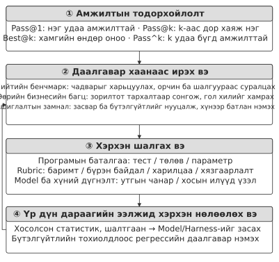
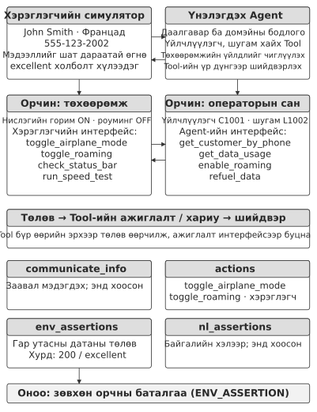
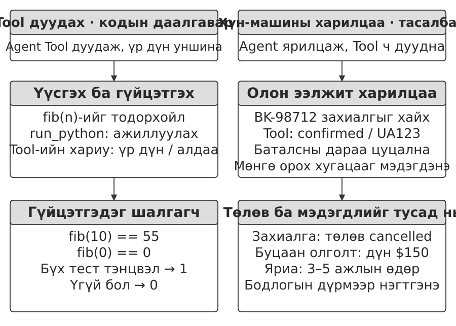
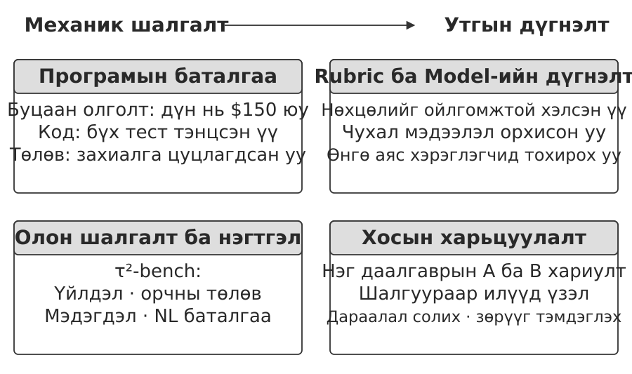
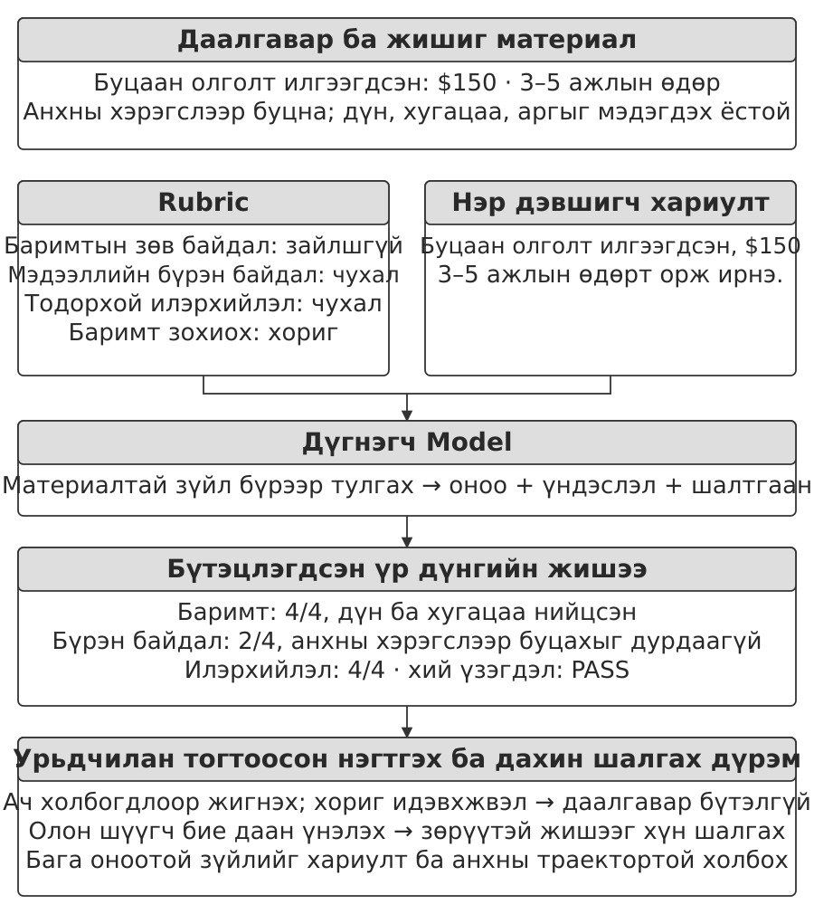
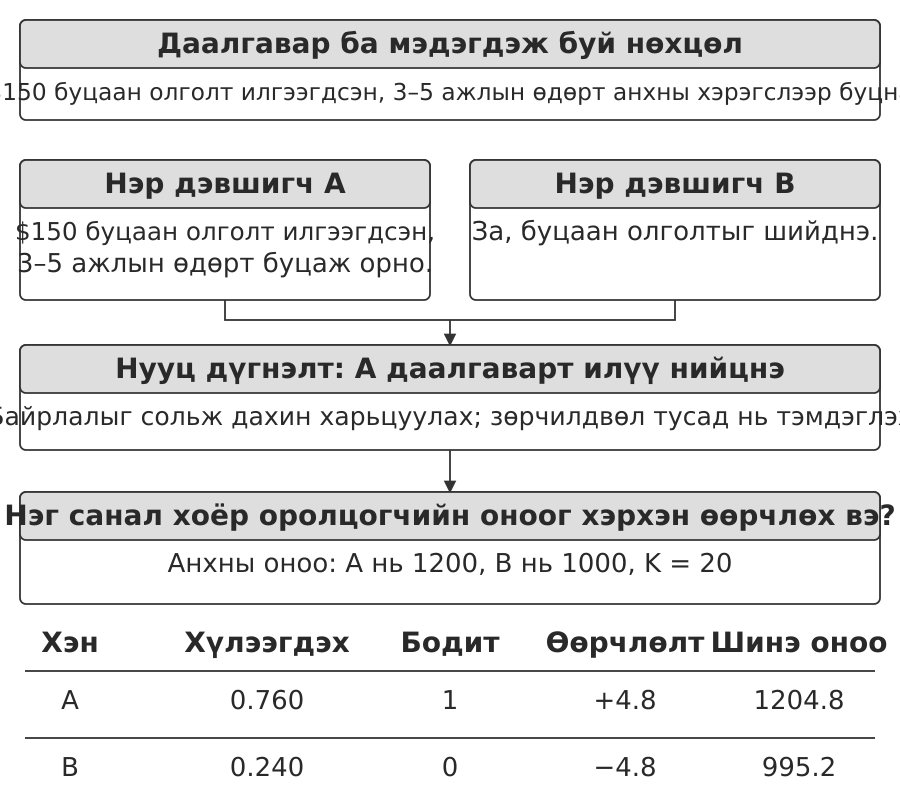
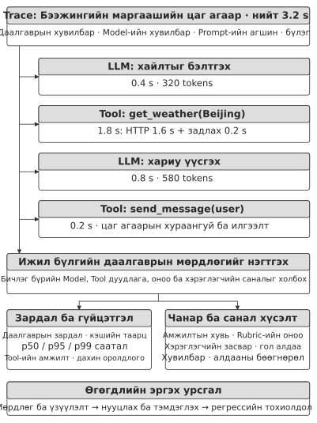
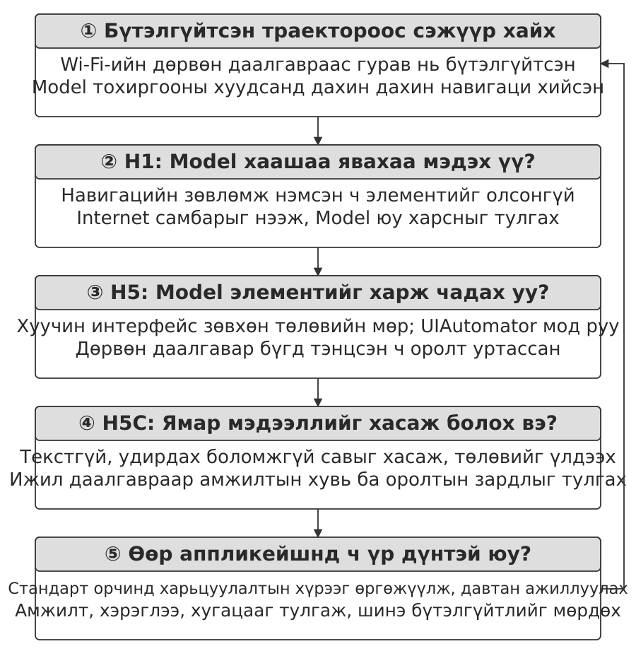
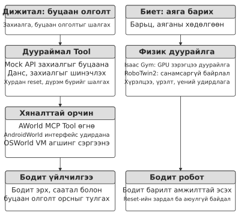
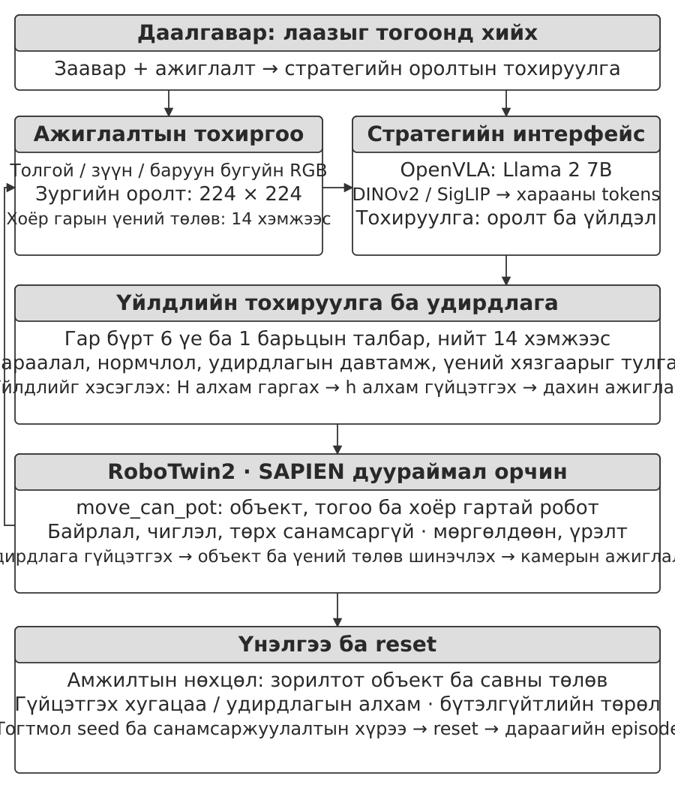

# Agent-ийг үнэлэх

Өмнөх зургаан бүлэгт ганц Agent-ийг хэрхэн бүтээхийг авч үзсэн: Context, санах ой, мэдлэгийн сан, Tools, код, мөн ажиглалт ба үйлдлийн интерфейс. Систем бэлэн болсны дараа давтан ажиллуулж болох хэсэг даалгаврын тусламжтайгаар түүний юу хийж чадах, ямар нөхцөлд амархан алддаг, дараагийн ээлжинд юуг засах ёстойг тогтоох хэрэгтэй. Үнэлгээний үр дүн нь мөн дараах сургалт болон тасралтгүй хувьсалд эргэх холбоо болдог.

Хөгжүүлэлтийн явцад олон сонголтыг бодит даалгавар дээр харьцуулж шийдэх шаардлага гардаг: аль Model-ийг ашиглах, ямар Tools нээх, мэдлэгийн санд ямар агуулга, ямар индекс хэрэглэх, хэрэглэгчийн санах ой, Prompt болон Skill-үүдийг хэрхэн зохион байгуулах, Harness-д ямар хязгаарлалт нэмэх вэ. Эдгээр сонголт бас бие биедээ нөлөөлдөг. Жишээлбэл, Tool-ийн тайлбарыг дэлгэрэнгүй болгох нь параметрийн алдааг багасгаж болох ч Context-ийн зардлыг нэмэгдүүлнэ; шалгах алхам нэмбэл амжилтын хувь өсөж болох ч гүйцэтгэх хугацаа уртасна.

**Харьцуулсан туршилт** нь ижил даалгавар, ижил нөхцөлд өөр өөр шийдлийг харьцуулж, амжилтын хувь, зарцуулсан хугацаа, зардлын өөрчлөлтийг бүртгэдэг. **Абляцийн туршилт** нь хайлтын дахин эрэмбэлэлт, төлөвийн хураангуй, үр дүнгийн шалгалт зэрэг бүрэлдэхүүнийг хасах буюу унтрааж, системийн гүйцэтгэл хэрхэн өөрчлөгдөхийг ажигладаг. Ээлж бүрт юуг өөрчилснөө тодорхой заагаад, бусад нөхцөлийг тогтвортой барьж, хэмжилтийг давтвал инженерийн сонголт ба даалгаврын үр дүнгийн хоорондын холбоог алхам алхмаар тогтоож чадна. Зохиогч харьцуулалт, абляцийг өдөр тутмын хөгжүүлэлтийн нэг хэсэг болгохыг зөвлөдөг. Цөөхөн амжилттай замналд л найдвал санамсаргүй амжилтыг сайжруулалт гэж андуурах, эсвэл зарим төрлийн даалгаврын ашгийг хараад бусад даалгаврын ухралтыг анзааралгүй өнгөрөөх нь амархан.

**Үнэлгээний объект нь Model ба Harness-ээс бүрдсэн бүхэл Agent байх ёстой.** Model нь даалгаврыг хэрхэн ойлгож, ямар үйлдэл сонгохыг шийддэг бол Harness нь Context-ийг зохион байгуулж, Tool-уудыг дуудаж, төлөвийг хадгалж, шалгалт хийдэг. Нэг Model өөр өөр Tools эсвэл эргэх холбооны урсгалд холбогдохдоо өөр өөр үр дүн гаргаж болно. Бүлэг 5-д танилцуулсан Coding Harness яг ийм харьцуулалтын жишээ болдог.

Model ба Harness-ийн уялдааг **Model солих туршилт (model swap)**-аар судалж болно: эхлээд ажиллах орчин болон даалгаврыг тогтоогоод, Model-ийг сольж, эцсийн үр дүн болон алдааны тархалтыг харьцуулна. Илүү хүчтэй Model ч мөн адил алхам дээр бүтэлгүйтэж байвал Tool дутуу эсэх, эргэх холбоо цагтаа ирж байгаа эсэх, оноолт зорилгыг бүрэн хамарч байгаа эсэхийг шалгана; харин даалгаврын гүйцэтгэл Model-оос хамаарч эрс өөрчлөгдөж байвал ямар сэтгэн бодох, төлөвлөх, заавар дагах чадвар үр дүнд нөлөөлснийг шинжилнэ.

Model солих болон бүрэлдэхүүний абляцийг хослуулж болно. Жишээлбэл, хоёр Model-оор «төлөвийн хураангуйтай», «төлөвийн хураангуйгүй» гэсэн хоёр тохиргоог тус тусад нь ажиллуулж, хураангуй нь хоёуланд нь урт даалгаврыг сэргээхэд тусалж байгаа эсэх, ашиг нь Model-оос хамаарах эсэхийг шалгана. Ингэснээр Model-уудын ялгааг шинжлэхийн зэрэгцээ Harness-ийн аль нэг бүрэлдэхүүн ямар нөхцөлд үр дүнтэй болохыг олж мэдэж болно.

Үнэлгээ бас Model шинэчлэхэд хийх регрессийн шалгалт юм. Шинэ Model нийтийн бенчмарк дээр ахиц гаргасан ч зарим бизнесийн даалгавар дээр ухарч болно; өөрийн даалгаврын багц эдгээр өөрчлөлтийг ил гаргадаг. Зохиогч «ирээдүйн Model-д зориулж бүтээгдэхүүн хөгжүүлэх» зарчмыг баримталдаг: Tools, бизнесийн урсгал болон үнэлгээний багцыг урьдчилан бэлтгээд, шинэ Model-ууд ижил даалгавар дээр хэрхэн ажиллахыг тасралтгүй хянана. Амжилтын хувь, хариу өгөх хугацаа, зардал бүтээгдэхүүний шаардлагад хүрсэн үед л ашиглалтад гаргана.

Ашиглалтад гаргах шаардлагыг үнэлгээний систем болгон хэрхэн бичих вэ? Зураг 7-1-ийг уншихдаа нэг туршилтыг дагаж доош нь мөрдөөрэй: юуг хэмжих, даалгаврыг хаанаас сонгох, амжилтыг ямар нотолгоогоор тогтоох, эцэст нь үр дүнг хэрхэн бүртгэж харьцуулах вэ?



## Нэг даалгавраас үнэлгээг ойлгох нь: τ²-bench-ийн telecom домэйн

Эхлээд гар утасны интернэтийн нэг гэмтлийг авч үзье. John Smith 555-123-2002 дугаар ашигладаг, одоо Францад байгаа бөгөөд утасных нь төлөвийн мөрөнд «No Service» гэж харагдаж байна. Тэр сүлжээгээ сэргээхийг хүсч байгаа бөгөөд хурдны тест excellent гарвал л асуудал шийдэгдсэн гэж үзнэ; шаардлагатай бол 2.0 GB дата цэнэглэхэд бэлэн, харин одоогийн багцаа хадгалахыг хүсдэг.

Энэ жишээ Sierra-гийн τ²-bench-ийн telecom домэйноос авсан. Орчин нь операторын арын системийг болон хэрэглэгчийн төхөөрөмжийг зэрэг дуурайдаг бөгөөд үйлчлүүлэгчийн Agent болон хэрэглэгчийн симулятор тус бүр Tool ашиглан төлөвийн өөрт хамаарах хэсгийг уншиж, өөрчилдөг. Үнэлгээ нь хоёр талын харилцааг дагаж асуудал хэрхэн илэрсэн, үйлдлүүд хэрхэн гүйцэтгэгдсэн, эцэст нь сүлжээ сэргэсэн эсэхийг шалгах ёстой.[^ch7-tau2-task]

### Даалгаврын тодорхойлолтын дөрвөн хэсэг

Өөр нэг үйлчлүүлэгчийн Agent-д ижил даалгаврыг шийдүүлэхийн тулд эхлээд утас болон дансны төлөвийг сэргээж, дуураймал хэрэглэгчийг ижил шаардлагын дагуу шалгалтад хамтран оролцуулж, эцэст нь ижил шалгуураар оноо өгөх хэрэгтэй. Доорх хүснэгтэд даалгаврын тодорхойлолтын дөрвөн хэсгийг жагсаав. Хүснэгтийг уншихдаа нэг ялгааг анхаараарай: даалгавар зохиогч утасны анхны тохиргоог мэддэг, харин яриа эхлэх үед үйлчлүүлэгчийн ажилтан болон хэрэглэгч тус бүр хэр ихийг мэддэг вэ?

| Хэсэг | Талбар | Энэ жишээний агуулга |
| --- | --- | --- |
| Тасалбар | `ticket` | Хэрэглэгч, дугаар, байгаа улс, интернэтэд холбогдохгүй байгаа шинж тэмдэг, хурдны тестийн шаардлага ба багцын хязгаарлалт |
| Хэрэглэгчийн хувилбар | `user_scenario.instructions` | Хэрэглэгч юу мэддэг, асуулт ирэхэд юуг хэрхэн шалгах, асуудал шийдэгдснийг хэзээ батлах |
| Анхны төлөв | `initial_state.initialization_actions` | Хэрэглэгчийн мэдээлэл ба байршлыг тохируулах, нислэгийн горимыг асаах, төхөөрөмжийн роумингийг унтраах, операторын талд роуминг идэвхжүүлэх |
| Үнэлгээний шалгуур | `evaluation_criteria` | Үйлдэл болон орчны төлөвийг шалгах; `reward_basis` нь аль зүйлсийг оноонд тооцохыг заана |

**Хэрэглэгч юу мэддэг вэ.** `known_info` нь нэр, дугаар болон байгаа улсыг өгдөг. Нислэгийн горим асаалттай, төхөөрөмжийн роуминг унтраалттай гэдэг нь орчны төлөвт хадгалагддаг тул хэрэглэгчийн симулятор Tool дуудаж шалгасны дараа л үүнийг үйлчлүүлэгчийн ажилтанд хэлж чадна. Хэрэглэгчийн мэддэг зүйлийг тусдаа талбар болгосноор симулятор шууд хариулж болох мэдээлэл болон бодитоор шалгах шаардлагатай мэдээллийг ялгаж чаддаг. Зөвхөн Prompt-д «бүгдийг нэг дор бүү хэл» гэж бичих нь аль баримтыг хэзээ илчлэхийг тогтвортой хянахад хүндрэлтэй. Ийм зохион байгуулалт нь мэдээллийг шат дараатай илчлэх (Progressive Information Disclosure) зарчмыг хэрэгжүүлдэг: яриа «Би интернэтэд орж чадахгүй байна» гэснээс эхэлж, Agent асуулт асууж, үйлдэл чиглүүлэх замаар шалгахад шаардлагатай мэдээллийг алхам алхмаар олж авна.

**Хэрэглэгч хэрхэн хариу үйлдэл үзүүлэх вэ.** `task_instructions` нь анхны засвар бүтэлгүйтсэний дараа бага зэрэг дургүйцэл илэрхийлэх, хурдны тест excellent гарсан үед л асуудал шийдэгдсэнийг батлах, төхөөрөмжтэй холбоотой хариултыг Tool-ийн үр дүнд үндэслэх ёстойг заадаг. poor, fair, good нь бүгд энэ даалгаврын зорилгод хүрээгүйд тооцогдоно. Бодит баримтад тулгуурлах (Grounding) шаардлага нь хэрэглэгчийг дуураймал орчны бодит төлөвт үндэслэн хариулахыг баталгаажуулдаг. Энэ хязгаарлалт байхгүй бол дуураймал хэрэглэгч үйлчлүүлэгчийн ажилтны «одоо болсон байх» гэсэн үгийг дагаад зөвшөөрч болох бөгөөд хоёр талын яриа саадгүй мэт харагдавч төхөөрөмжийн гэмтэл хэвээр үлдэнэ.

**Хоёр тал ямар төлөвөөс эхлэх вэ.** Хэрэглэгчийн талд `set_user_info`-оор хэрэглэгчийн мэдээллийг тохируулж, `set_user_location(abroad=true)`-аар гадаадад байгааг илэрхийлээд, дараа нь `turn_airplane_mode_on` болон `turn_roaming_off`-ыг гүйцэтгэнэ. Операторын талд `enable_roaming`-аар `C1001` үйлчлүүлэгчийн `L1002` шугамд роуминг нээнэ. Тиймээс арын системийн хайлт роуминг нээлттэй гэж харуулах ч утас нь нислэгийн горим болон төхөөрөмжийн роумингийн тохиргооны улмаас сүлжээнд холбогдож чадахгүй хэвээр байна. Арын системийн хайлтаас олдохгүй мэдээллийг олж авахын тулд үйлчлүүлэгчийн ажилтан хэрэглэгчийг төхөөрөмжөө шалгахад чиглүүлэх хэрэгтэй.

**Ямар шалгалтууд оноог шийдэх вэ.** `actions` нь хэрэглэгчийн талын `toggle_airplane_mode` болон `toggle_roaming`-ыг жагсаадаг. `env_assertions` нь гар утасны датаны төлөвийн шалгалт, мөн `expected_speed=200`, `expected_desc="excellent"` параметртэй хурдны тестийн шалгалтыг агуулна. Даалгаврын формат нь бас `communicate_info` болон `nl_assertions` талбаруудыг өгдөг бөгөөд эдгээр нь хэрэглэгчид заавал мэдэгдэх ёстой мэдээлэл болон байгалийн хэлээрх баталгааг тус тус тодорхойлдог; энэ даалгаварт хоёулаа хоосон.

Энэ даалгаврын `reward_basis` нь `ENV_ASSERTION`-ийг сонгосон тул нийт шагнал орчны баталгаанаас хамаарна. Үйлдлийн шалгалт үр дүнд харагдаж болох ч нийт оноонд орох эсэхийг онооны тохиргоо шийднэ.

### Ажиллагааны замналыг дагаж үр дүнг шалгах

Дагалдах туршилтад telecom-ийн таван даалгавар сонгож, тус бүрийг нэг удаа ажиллуулсан; үйлчлүүлэгчийн Agent болон хэрэглэгчийн симулятор хоёулаа GPT-4.1 mini ашигласан бөгөөд эцэст нь дөрвөн даалгавар тэнцсэн. Доор эхлээд дээрх Франц дахь роумингийн даалгаврыг задлан шинжилж, дараа нь бүтэлгүйтсэн даалгавартай харьцуулна.

> **Туршилт 7-1 ★: τ²-bench-ийг ажиллуулж, τ-bench-ээс хэрхэн хөгжсөнийг харьцуулах**
>
> Эхлээд нэг даалгаврын хэрэглэгчийн хувилбар, эхлүүлэх үйлдлүүд болон оноолтын нөхцөлийг уншаад, дараа нь бүрэн харилцааг нэг удаа ажиллуул. Замналын дагуу үйлчлүүлэгчийн ажилтны хайлт, хэрэглэгчийн үйлдэл, төлөвийн өөрчлөлт, хүлээн авалтын үр дүнг тэмдэглэж, дүгнэлт бүр аль мэдээлэлд тулгуурласныг шалга.
>
> τ-bench ба τ²-bench-ийг харьцуулахдаа хэрэглэгч Tool ашиглан орчныг өөрчилж чадах эсэх, ийм өөрчлөлт үйлчлүүлэгчийн ажилтанд ямар уялдуулах шаардлага үүсгэж байгааг гол анхаарч ажигла.
>
> Зураг 7-2-ыг харахдаа эхлээд утасны нислэгийн горимыг хэн унтрааж чадахыг, дараа нь операторын роумингийн тохиргоог хэн өөрчилж чадахыг олоорой. Хоёр талын хийж чадах зүйл өөр учраас үйлчлүүлэгчийн ажилтан өөрийн үйлдлээ хийж дуусаад ч хэрэглэгчээс утсан дээрээ хурдны тест хийхийг хүсэх шаардлагатай болдог.
>
> 

Франц дахь роумингийн даалгаврыг шийдэхдээ Agent эхлээд дансыг тодорхойлсон. Дугаараар `C1001` үйлчлүүлэгчийг олж, `L1001`, `L1002`, `L1003`-ын датаны мэдээллийг шалгасан ч `L1001`-ийн дэлгэрэнгүй мэдээлэлд үндэслэн буруу дүгнэлт хийсэн: хэрэглэгчийн өгсөн 555-123-2002 идэвхтэй шугамуудын дунд байхгүй, хамгийн ойр дугаар нь 555-123-2001 гэжээ. Хэрэглэгч дугаараа зөв гэж зүтгэсний дараа Agent `L1002`-ыг үргэлжлүүлэн шалгаж, сая зөв шугамыг баталсан.

Үүний дараа хэрэглэгчийн симулятор `check_network_status` болон `check_status_bar`-ыг дуудсан. Буцаж ирсэн төлөвт нислэгийн горим асаалттай, үүрэн сүлжээ үйлчилгээгүй, гар утасны дата асаалттай, төхөөрөмжийн роуминг унтраалттай гэж байв. Үүнд үндэслэн хэрэглэгч «Утас нислэгийн горимд байна, дата роуминг ч бас унтраалттай байна. Эхлээд нислэгийн горимыг унтраах хэрэгтэй юу?» гэж мэдэгдсэн. Энд хайлтыг хэрэглэгчийн талын Tool гүйцэтгэж, үр дүн нь ярианы замаар үйлчлүүлэгчийн ажилтанд дамжсан.

Энэ бол **давхар хяналт (Dual-Control)** механизм юм: үйлчлүүлэгчийн ажилтан операторын арын системийг шалгаж, удирддаг бол хэрэглэгчийн симулятор төлөвийн мөр харах, нислэгийн горим сэлгэх, SIM картыг сугалж дахин хийх, хурдны тест ажиллуулах зэрэг өөрийн бие даасан төхөөрөмжийн Tool-уудтай. Хоёр тал харилцан ярилцаж үйлдлээ уялдуулдаг бөгөөд орчин нь тал тус бүрийн үүсгэсэн төлөвийн өөрчлөлтийг бүртгэдэг.

Agent дараа нь хэрэглэгчийг нислэгийн горимыг унтрааж, төхөөрөмжийн роумингийг асаахад чиглүүлсэн бөгөөд төлөвийн мөрөнд 5G дохио гарч ирэв. Хэрэглэгч `run_speed_test`-ыг ажиллуулж, 275 Mbps, Excellent гэсэн үр дүн авснаар асуудал шийдэгдснийг батлав. Орчны хоёр баталгаа хоёулаа тэнцсэн тул энэ даалгаврын шагнал 1.0 боллоо.

Энэ амжилттай замнал ч гэсэн явцын асуудлыг ил гаргасан. Бодлогын дагуу үйлчлүүлэгчийн ажилтан нэг удаад зөвхөн нэг Tool дуудах ёстой байтал Agent нэг мессеждээ `get_customer_by_phone` болон `get_customer_by_name`-ыг зэрэг дуудсан. Энэ даалгаврын нийт оноонд зөвхөн орчны баталгаа ордог тул энэ үйлдэл шагналыг өөрчлөөгүй.

Бүтэлгүйтсэн өөр нэг замналд буруу сонгосон шугам эцсээ хүртэл засагдаагүй тул дараагийн бүх шалгалт ч зорилгоосоо хазайсан. Хэрэглэгчийн дугаар мөн л 555-123-2002 байсан ч Agent `L1001`-ийг сонгож, тэр шугамын 3.2/5 GB хэрэглээг ашиглан шалгалтаа үргэлжлүүлсэн. Tool аль хэдийн `L1001` нь 555-123-2001-д харгалзана гэж буцаасан ч Agent шугамаа засаагүй бөгөөд хамааралгүй олон ээлжийн шалгалтын дараа хүний оператор руу шилжүүлсэн. Хэрэглэгчийн тал дата хэмнэх горимыг амжилттай унтраасан ч зөв шугам болох `L1002`-т шаардлагатай 2 GB дата цэнэглэлт хийгдээгүй тул орчны гурван баталгаа бүгд тэнцээгүй.

Хоёр замналыг харьцуулбал эцсийн оноог тодорхой сайжруулах цэгүүд болгон задалж болно: дугаар ба шугамын харгалзааг тулгах, шинэ нотолгоогоор дүгнэлтээ засах, төхөөрөмжийн болон арын системийн төлөвийг ялгах, шаардлагатай цэнэглэлт хийгдсэн эсэхийг шалгах. Урт замналаас ийм гол эргэлтийн цэгүүдийг хэрхэн олохыг доорх алдааны шалтгааныг тогтоох хэсэгт үргэлжлүүлэн авч үзнэ.

[^ch7-tau2-task]: Sierra Research-ийн τ²-bench нь telecom домэйны `user_tools.py`-д хэрэглэгчийн Tool-уудыг тодорхойлдог бөгөөд оноолтын эхлэл цэг нь `evaluator.py`. Жишээний агуулга болон үр дүнг дагалдах материалд хадгалсан таван даалгавар ба ажиллагааны замналд үндэслэн нэгтгэв.

## Үнэлгээний үзүүлэлт: амжилтыг тодорхойлох нь

Таван даалгавраас дөрөв тэнцсэн нь энэ удаагийн ажиллагааны ерөнхий дүнг өгдөг. Үүнд үндэслэн бүтээгдэхүүний шийдвэр гаргахын тулд даалгаврын төрөл болон бүтэлгүйтлийн үнэ цэнийг тодорхой болгох хэрэгтэй. Буцаан олголтын үйлчилгээ нь шаардлага хангасан буцаан олголтыг тогтмол гүйцэтгэх ёстой; програм бичихдээ хэд хэдэн хувилбар үүсгэж, тестээр ажилладаг, зөв үр дүн өгдөг хувилбарыг шүүж болно; судалгаа хийхдээ ч хэд хэдэн таамаглал дэвшүүлээд, судлаач өөрөө шалгаж болно. Үнэлгээний үзүүлэлт нь ийм хэрэглээний хэлбэрт нийцэх ёстой.

### Техникийн гайхамшиг: олон оролдлогын чадварыг Pass@k-аар хэмжих

Зохиогч сэтгэл хөдөлгөм зарим Agent-ийн үзүүлбэрийг «техникийн гайхамшиг» гэж нэрлэдэг: системд хангалттай хугацаа, оролдох боломж олгоход өмнө нь автоматжуулахад хэцүү байсан ажлыг гүйцэтгэдэг. Судалгааны шинжтэй ажилд нэг л шалгагдсан амжилттай замнал үнэ цэнэ авчирч болно. **Pass@k** үзүүлэлт нь ийм хэрэглээнд тохирдог: нэг даалгаврыг $k$ удаа ажиллуулж, дор хаяж нэг удаа тэнцвэл амжилттай гэж тооцно. Тасралтгүй оноотой даалгаврын хувьд $k$ удаагийн хамгийн өндөр оноог мэдээлж болох бөгөөд үүнийг **Best@k** гэнэ.

Жишээлбэл, Anthropic хэд хэдэн Claude хувилбарыг хамтран C хөрвүүлэгч бүтээлгэж, удаан хугацааны ажиллагаа, тестийн эргэх холбоо, ажлын хуваарилалт нь нарийн төвөгтэй инженерийн ажлыг дэмжиж чадахыг харуулсан. Судлаачид математикийн эсрэг жишээ хайхдаа ч Model-оор олон дахин оролдуулж, эцэст нь аль нэг эсрэг жишээ үнэн эсэхийг бие даан шалгаж болно. Програм хангамжийн аюулгүй байдлын хяналтад Model-ийн мэдээлсэн сэжигтэй асуудлуудыг дахин нягталж болох бол чөлөөт бүтээлч ажилд хэд хэдэн бүтээлээс шилдгийг нь сонгож болно.[^ch7-long-running]

Хэрэглээний бүтээгдэхүүнүүд ч нарийн төвөгтэй даалгавраар чадвараа харуулдаг. Manus нь Agent-д виртуал компьютер өгснөөр хэрэглэгч түүнийг интерфейс удирдаж, мэдээлэл хайж, ажлаа тасралтгүй гүйцэтгэж байгааг харах боломжтой болгодог. OpenClaw нь шуурхай мессежээр даалгавар хүлээн авч, тохируулсан бөгөөд зөвшөөрөгдсөн файл, үйлчилгээнд хандаж, явцын дунд ахицаа мэдээлж, нэмэлт мэдээлэл хүсдэг бөгөөд цагийн механизмаар сэрж хийх ажлуудаа шалгаж ч чаддаг. Ийм тодорхой үйлдлүүд нь хэрэглэгчдэд Agent-ийн хэрэглээг ойлгоход хялбар болгодог.

Зохиогчийн бодлоор шинэ төрлийн даалгавар гүйцэтгэж чадахыг харуулсан үзүүлбэр нь эдгээр бүтээгдэхүүн хэрэглэгчдийг татах чухал хүчин зүйл юм.

### Бизнесийн найдвартай байдал: Pass^k-д анхаарах

Бизнесийн урсгал ихэвчлэн олон удаагийн ажиллагаа бүрт зөв үр дүн хүргэхийг шаарддаг. **Pass^k** нь нэг даалгаврыг $k$ удаа ажиллуулахад бүгд тэнцсэн эсэхийг хэмждэг бөгөөд «pass power k» гэж уншиж болно. Даалгаврын тэнцэх нөхцөл нь эцсийн үр дүн, бодлогын хэрэгжилт, эрхийн хязгаарлалтыг зэрэг хамарч болох ба ажиллагаа бүрийг ижил нөхцөлөөр шалгана.

Ажиллагаа бүр бие биенээсээ хамааралгүй, нэг удаагийн амжилтын магадлал $p$ гэж үзвэл:

$$
\mathrm{Pass@k}=1-(1-p)^k,\qquad
\mathrm{Pass}^{k}=p^k.
$$

Жишээлбэл, $p=0.6$, $k=5$ үед Pass@5 ойролцоогоор 99.0%, Pass^5 ойролцоогоор 7.8% болно. Эхнийх нь таван оролдлогоос ихэвчлэн нэг амжилт олдоно гэсэн үг бол хоёр дахь нь таван удаа бүгд амжилттай болох магадлал маш бага хэвээр байгааг харуулна.

Бодит үр дүнгийн багцыг уншихдаа эхлээд томьёо ашиглахгүй байж болно. Нэг даалгаврыг таван удаа ажиллуулахад «тэнцсэн, унасан, тэнцсэн, тэнцсэн, унасан» гарсан гэж үзье. Энэ бүлгийн Pass@5 нь 1, Pass^5 нь 0 бөгөөд нэг удаагийн амжилтын хувийг 3/5 гэж тооцно. Дээрх 99.0% ба 7.8% өөр асуултад хариулдаг: оролдлого бүрийн амжилтын магадлал 0.6 гэдэг нь мэдэгдэж байгаа үед таван оролдлогыг нэг бүлэг болгон олон дахин давтвал хэдэн бүлэг харгалзах шалгуурт хүрэх вэ?

Нэг бүртгэлээр шалгахад илүү хялбар өөр асуултад ч хариулж болно: дээрх таван ажиллагаанаас дурын хоёрыг сонговол хосуудын хэдэн хувь нь тэнцэх вэ? Ажиллагаа бүрийг нэг карт гэж үзээд буцааж хийлгүйгээр хоёр карт сугалбал нийт арван хос гарна. Зөвхөн хоёр бүтэлгүй картаас бүрдсэн хос л хоёулаа бүтэлгүйтдэг тул есөн хос дор хаяж нэг удаа амжилттай байх бөгөөд Pass@2-ын түүврийн үнэлгээ 9/10 болно. Гурван амжилттай карт хоорондоо гурван хос үүсгэх тул Pass^2-ын түүврийн үнэлгээ 3/10 болно. τ²-bench яг ийм аргаар даалгавар бүрээр бүгд тэнцсэн хослолыг тоолдог: нэг даалгаврыг $n$ удаа ажиллуулж $s$ удаа амжилттай болсон бол тэдгээрээс $k$-г сонгоход бүгд тэнцсэн хослолын эзлэх хувь нь $\binom{s}{k}/\binom{n}{k}$ бөгөөд энд $1\le k\le n$.[^ch7-tau2-metrics]

Одоо Туршилт 7-1-ийн 4/5-ыг дахин харъя. Тэр таван замнал таван өөр даалгаварт хамаарах бөгөөд даалгавар бүрт ганцхан карт байгаа тул нэг ч хос үүсгэж чадахгүй. Эдгээр даалгаврын Pass^2-ыг үнэлэхийн тулд даалгавар бүрт бие даасан ажиллагаа нэмж, тус тусад нь тооцоод нэгтгэх хэрэгтэй. 0.8-ыг шууд квадрат зэрэгт дэвшүүлбэл эдгээр даалгаврын амжилтын магадлал бүгд ижил, оролдлого бүр бие даасан гэж нэмэлтээр таамагласантай адил болно.

[^ch7-tau2-metrics]: τ²-bench-ийн туршилтын хувилбар (8d005b0 засвар) нь `agent_metrics.py`-д даалгавар бүрээр Pass^k-г тооцдог. Амжилтын тоо $k$-аас бага үед бүгд тэнцсэн хослолын тоо тэг болно.

Тооцоолохдоо статистикийн нэгжийг нэг мөр байлгах хэрэгтэй. Нэг даалгаврын таван түүвэр нь тухайн даалгаврын давтагдах гүйцэтгэлийг хэмждэг бол ашиглалтад дараалсан таван өөр даалгавар нь даалгаврын хүндрэл болон хандалтын тархалтаас бас хамаарна. Даалгаврууд өөр өөр амжилтын магадлалтай бол эхлээд тус бүрийн давтагдах амжилтын үзүүлэлтийг тооцоод, дараа нь даалгаврын жингээр нэгтгэж болно. Хуваалцсан төлөв, кэш эсвэл ижил гэмтэл ч олон удаагийн ажиллагааг хамааралтай болгодог.

**«Мэдээлэл хангалтгүй» гэж хариулахыг зөвшөөрсөн үед хуваарийг хэрхэн сонгох вэ?** Ном зохиолын туслах 100 асуулт хүлээн авч, 80-д нь хариулснаас 68 нь зөв байсан гэж төсөөлье. Өгсөн хариултад найддаг уншигчийн хувьд 68/80 буюу 85% чухал; харин энэ багц ажлыг бүрэн дуусгах ёстой хүнд 68/100 буюу 68% мөн чухал. Үлдсэн 20 асуултад нотолгоо нэмж хайх эсвэл хүнд шилжүүлэх шаардлагатай.

PaperQA2 нь LitQA2-ийн ном зохиолын 248 асуулт дээр «мэдээлэл хангалтгүй» гэж сонгох боломжтой. Өгүүлэлд гурван удаагийн ажиллагааны дунджийг мэдээлсэн: систем бодитой хариулт өгсөн тохиолдолд зөв хариултын хувь 85.2%; бүх асуултаар тооцвол 66.0%, үүнээс гадна 21.9%-д нь мэдээлэл хангалтгүй гэж сонгосон. Есөн хүн хариулагчийн харгалзах хоёр үзүүлэлт 73.8% ба 67.7% байв. Өгүүлэлд эхний үзүүлэлтийн ялгаа статистикийн хувьд ач холбогдолтой, хоёр дахь нь ач холбогдлын түвшинд хүрээгүй гэж мэдээлжээ.[^ch7-paperqa2-denominators]

[^ch7-paperqa2-denominators]: Skarlinski нар, *Language Agents Achieve Superhuman Synthesis of Scientific Knowledge*, 2024, 2-р хэсэг болон 2-р зургийг үзнэ үү.

Эцсийн төлөв нь ижил хоёр замналын зардал өөр байж болно. Төлбөрийн баримт шалгах жишээг авъя: А нэг удаагийн хайлтаар зөв дүнг буцаасан. Б хоёр удаа хайсны эцэст мөн адил хариулт өгсөн. Хоёр хайлт ижил хүсэлтийн танигчтай байсан бөгөөд эхнийх нь хугацаа хэтэрсэн бол дахин оролдлого нь даалгаврыг сэргээхэд тусалсан гэсэн үг. Хэрэв эхний хайлтын үр дүн амжилттай хүрсэн байсан бол хоёр дахь хайлт нь хүлээх хугацаа болон Tool-ийн зардлыг дэмий нэмсэн болно.

Ажиллагаа нь бичих үйлдэл эсвэл бусад гадаад нөлөө агуулж байвал туршилт бүрийн өмнө тогтоосон анхны төлөвийг сэргээж, туршилтын орчинд үйлдлээ гүйцэтгээд бүх оролдлогыг бүртгэнэ. Бүтээгдэхүүн бүтэлгүйтлийн дараа дахин оролдохыг зөвшөөрдөг бол дахин оролдлогын тоо, сэргээх алхмууд болон гүйцэтгэлийн зардлыг урсгалын үнэлгээнд хамт оруулна; анхны бүтэлгүйтлийн бүртгэлийг хадгалсаар байх нь нэг удаагийн гүйцэтгэл ба сэргээлтийн дараах үр дүнг ялгахад тусална.

[^ch7-long-running]: Anthropic, Building a C compiler with a team of parallel Claudes, 2026-02-05; олон хувилбарын хамтын ажиллагаа, урт хугацааны гүйцэтгэл болон тестийн эргэх холбоог танилцуулсан.

## Үнэлгээний орчин

Өмнө нь шугамаа буруу сонгосон тэр ажиллагааг дахин шалгах гэж байна гэж бодъё. Шалгагч ижил хэрэглэгч, ижил хоёр шугам, ижил анхны багцыг харах шаардлагатай. Хэрэв эхний ажиллагаа аль нэг шугамыг аль хэдийн өөрчилсөн бол шууд дахин ажиллуулахад үр дүнгийн өөрчлөлт Model-оос үүдсэн үү, өгөгдлийн сангаас үүдсэн үү гэдгийг ялгаж чадахгүй. Үнэлгээний орчин нь даалгаврын эхлэлийг бий болгож, харилцааны интерфейсийг хангаж, явцыг бүртгэж, төгсгөлийг шалгах үүрэгтэй.

### Таван бүрэлдэхүүн

telecom-ийн даалгаврыг жишээ болгон үнэлгээний орчныг таван хэсэгт задалж болно.

**Өгөгдлийн багц (Dataset)** нь даалгаврын тодорхойлолтыг хадгална: хэрэглэгчийн суурь мэдээлэл, зан үйлийн шаардлага, анхны төлөв, хүлээн авах нөхцөл. Нэг бичлэг нэг тохиолдолд харгалзах бөгөөд ажиллах үед оролцогч бүрийн үүргийн дагуу мэдээллийг хуваарилна.

**Орчны төлөв (Environment State)** нь даалгавар гүйцэтгэх явц дахь өөрчлөгдөх мэдээллийг хадгална: үйлчлүүлэгч, шугам, багц, төлбөрийн баримт, мөн төхөөрөмжийн нислэгийн горим, роуминг, дата хэмнэх тохиргоо гэх мэт. Шинэ ээлж эхлэхэд орчин эхлээд суурь өгөгдлийг сэргээж, дараа нь `initialization_actions`-ийг гүйцэтгэн тухайн даалгаварт заасан гэмтлийг үүсгэнэ. Өмнөх ээлжийн цэнэглэлт эсвэл тохиргооны өөрчлөлт дараагийн ээлжид орж ирэхээс сэргийлэхийн тулд цэвэрлэгээ ба эхлүүлэлт уялдаатай байх ёстой.

**Tool интерфейс (Tools)** нь оролцогчид юуг уншиж, юуг өөрчилж чадахыг тодорхойлно. Үйлчлүүлэгчийн ажилтан үйлчлүүлэгч хайх, хэрэглээ шалгах, дата цэнэглэх, хүний оператор руу шилжүүлэх боломжтой; хэрэглэгч төхөөрөмжийн төлөвийг харах, унтраалга сэлгэх, хурдны тест хийх боломжтой. Tool-ийн нарийвчлал нь шалгаж буй чадварт нийцэх ёстой: оношилгоо ба төлөвлөлтийг үнэлэх бол Agent-д хайлт ба үйлдлийг өөрөө хослуулахыг үлдээнэ; харин «интернэтийн асуудлыг засах» Tool-ийг шууд өгвөл туршилтын гол анхаарал энэ чадварыг хэзээ дуудах тал руу шилжинэ.

**Үнэлгээний шалгуур (Rubric)** нь үр дүнг хэрхэн дүгнэхийг тайлбарлана. telecom-ийн даалгавар үйлдэл, орчны төлөв, шаардлагатай харилцаа болон байгалийн хэлээрх шаардлагыг шалгаж, `reward_basis`-ээр аль шалгалтыг нийт оноонд оруулахыг тогтооно.

**Гүйцэтгэлийн протокол (Interaction Protocol)** нь ярих ээлж, Tool дуудах болон зогсоохыг зохицуулна. Хэрэглэгчийн симулятор `###STOP###` гаргаж харилцааг дуусгаж болох ба гүйцэтгэгч нь ээлжийн тоо зэрэг төсвийг тогтооно. Дуусгасан шалтгаан болон даалгаврын оноог тусад нь бүртгэнэ: хэрэглэгч яриагаа зогсоосон ч зорилгод хүрсэн эсэхийг орчны баталгаа шийдсээр байна; төсөв дууссан тохиолдолд ч сүүлийн төлөв болон дуусаагүй алхмуудыг хадгалах хэрэгтэй.

### Хүн-машины харилцааны ба Tool дуудах үнэлгээний орчин

telecom-ийн даалгаварт тасралтгүй хариулж, төхөөрөмж удирддаг хэрэглэгчийн симулятор байдаг. Харин код засах, өгөгдөл шинжлэх, математик бодох даалгаврууд ихэвчлэн даалгаврын заавраар эхэлж, дараа нь Agent голчлон Tool-уудтай харилцдаг. Хоёр төрлийн орчинд хоёуланд нь даалгавар, төлөв, интерфейс, оноолт болон гүйцэтгэлийн протокол хэрэгтэй; ялгаа нь ярилцагчийг дуурайх шаардлагатай эсэх, хоёр тал үйлдлээ хэрхэн уялдуулах явдалд оршино.

Кодын даалгаврын гаралтыг тестээр, өгөгдлийн сангийн даалгаврыг өөрчлөгдсөн бичлэгийг хайж шалгаж болох бол чөлөөт шинжилгээний агуулгыг хүн эсвэл Model-оор үнэлүүлэх шаардлагатай байж болно. Хүн-машины харилцааны даалгаварт ихэвчлэн хоёр нотолгоог нийлүүлэх хэрэгтэй болдог. Жишээлбэл, гар утасны сүлжээ сэргэсэн эсэхийг төхөөрөмжийн төлөвөөс харна; харин үйлчлүүлэгчийн ажилтан дугаарыг тодруулсан эсэх, хэрэглэгчийн үйлдлийг чиглүүлсэн эсэхийг ярианаас харна. Зураг 7-3 дахь буцаан олголт ч мөн адил: захиалга цуцлагдсан эсэхийг өгөгдлийн сангаас шалгаж болох бол мөнгө хэзээ орж ирэхийг үйлчлүүлэгчийн ажилтан мэдэгдсэн эсэхийг ярианаас хайх хэрэгтэй.



Verifiers-д эдгээр хоёр төрлийн даалгаврыг өөр өөр орчны интерфейсээс эхлүүлж болно. Хүснэгт 7-1-д v0.1.9 хувилбарын нэг ээлжийн хариулт, олон ээлжийн Tool дуудах, ажиллагааны төлөв оруулах, хамгаалагдсан орчны (sandbox) нөөц удирдах интерфейсүүдийг кодтой тулгахад хялбар байхаар жагсаав.[^ch7-verifiers-env]

Хүснэгт 7-1: Verifiers-ийн орчны төрлүүдийн харьцуулалт

| Орчны төрөл | Үндсэн үүрэг | Tool ба төлөвийн боловсруулалт | Түгээмэл хэрэглээ |
|---|---|---|---|
| `SingleTurnEnv` | Нэг ээлжийн хариултыг зохион байгуулах | Нэг хариултын дараа оноо өгөх | Математикийн бодлого, нэг ээлжийн асуулт-хариулт |
| `ToolEnv` | Олон ээлжийн Tool-ийн харилцааг зохион байгуулах | Ажиллагааны замналыг хадгалж, Tool-ийг дуудаж, үр дүнг хүлээн авах | Хайлт ба мэдээллийн нэгтгэл |
| `StatefulToolEnv` | Ажиллагааны төлөвийг Tool-ийн гүйцэтгэлд холбох | Одоогийн төлөвт үндэслэн Tool-ийн параметрийг нөхөх эсвэл төлөвийг шинэчлэх | Тухайн даалгаварт өгөгдлийн сан эсвэл нөөцийн танигчийг холбох |
| `SandboxEnv` | Тусгаарлагдсан гүйцэтгэлийн орчныг удирдах | Ажиллагаанд sandbox хуваарилж, доторх Tool-уудыг ашиглах | Код ажиллуулах, файл ба тестийн үр дүнг шалгах |

Жишээлбэл, хоёр даалгавар өгөгдлийн санг зэрэг өөрчилж байвал гүйцэтгэгч тус бүрийн өгөгдлийн сангийн танигчийг Tool дуудлагад оруулж, замнал бүрийг өөрт харгалзах өгөгдөл дээр ажиллуулж болно. Гүйцэтгэл бүтэлгүйтвэл Tool нь дараагийн алхмын дүгнэлтэд хэрэглэж болох мэдээллийг буцаах ёстой: объект байхгүй, параметр шаардлага хангахгүй, үйлчилгээний хугацаа хэтэрсэн гэх мэт. Үнэлгээний систем ажиглалт, дуудлага, гүйцэтгэлийн үр дүн болон шагналыг хадгалснаар шинжилгээний үед алдааг тодорхой алхам хүртэл байршуулж чадна.

[^ch7-verifiers-env]: Prime Intellect, Verifiers v0.1.9-ийн ToolEnv ба StatefulToolEnv; олон ээлжийн замнал, Tool хуваарилалт болон төлөвийн параметр оруулахыг харуулсан.

## Үнэлгээний өгөгдлийн багцын дизайн

Одоо таван telecom бодлогыг гаргалтын шийдвэрт чиглүүлэх үнэлгээний багц болгон өргөтгөе. Хэрэв шинээр нэмсэн бүх бодлого «заасан дугаарт роуминг нээх» төрлийн байвал систем нэг дансны хоёр шугамыг ялгаж сураагүй байсан ч өндөр оноо авч магадгүй. Үнэлгээний дүнгээр үйлчлүүлэгчийн Agent-ийг ашиглалтад гаргах эсэхийг шийдэх бол бодлогыг бодит тасалбарт тулгуурлан сонгох хэрэгтэй: энгийн үйлчилгээ ч, шугамыг амархан андуурах хэцүү тохиолдол ч орсон байх ёстой бөгөөд оноо өгөхдөө үйлчлүүлэгчийн ажилтан эцэст нь аль шугамыг өөрчилснийг шалгах шаардлагатай. Ашиглалтад гарсны дараа ч эдгээр бодлогыг арчилж, хэрэглэгчдийн бодитоор даалгадаг ажлыг тасралтгүй тусгадаг байлгах хэрэгтэй.

### Бенчмаркийн дизайныг харьцуулах нь

Хүснэгт 7-2-т зургаан бенчмаркийг шалгадаг чадвар, даалгаврын эх сурвалж, ажиллах орчин, шалгах аргаар нь зэрэгцүүлэн харуулав.

Хүснэгт 7-2: Хэд хэдэн Agent бенчмаркийн гол дизайны сонголтууд

| Бенчмарк | Шалгах чадвар | Даалгаврын эх сурвалж ба зохион байгуулалт | Ажиллах орчин | Шалгах арга |
|---|---|---|---|---|
| τ²-bench | Үйлчлүүлэгчтэй харилцах ба Tool удирдах | Домэйны даалгавар ба гэмтлийн хослол | Хэрэглэгчийн симулятор, төхөөрөмж ба бизнесийн өгөгдлийн сан | Зүйл тус бүрээр шалгаж, `reward_basis`-ийн дагуу оноо өгөх |
| SWE-bench Verified | Кодын асуудал засах | Бодит GitHub issue, хүн шүүсэн | Кодын репозитор ба тестийн орчин | `FAIL_TO_PASS` ба `PASS_TO_PASS` тест |
| AndroidWorld | Android аппликейшн удирдах | Параметржүүлсэн даалгаврын загвар | Бодит аппликейшн ажиллуулдаг Android эмулятор | Төхөөрөмж, файл эсвэл аппликейшний дотоод төлөвийг унших |
| OSWorld | Ширээний ба олон аппликейшн дамнасан удирдлага | Бодит хэрэглээний нөхцөл, даалгаврын эхлэлийг тохируулсан | Виртуал машин ба ширээний аппликейшн | Даалгаврын гүйцэтгэлийн төлөв ба бүтээгдэхүүнээр шалгах |
| Terminal-Bench | Терминал дахь инженерийн даалгавар | Хүний зохиосон даалгавар ба тест | Контейнер ба даалгаварт шаардлагатай хамаарлууд | Файл, програмын ажиллагаа ба тестийн үр дүн |
| GAIA | Ерөнхий туслахын мэдээлэл боловсруулалт | Хүний бичсэн асуулт, заримд нь хавсралт материал | Сүлжээ, файл ба туслах Tools | Хариултын форматыг хэвшүүлсний дараа харьцуулах |

### Шалгагч

Шалгагч нь даалгаврын зорилгыг шалгаж болох нотолгоотой холбодог. Кодын даалгаварт тест ажиллуулах, ширээний даалгаварт аппликейшн эсвэл файлын төлөвийг унших, мэдээлэл хайх даалгаварт хариулт ба эх сурвалжийг тулгах шаардлагатай. **Хүлээн авалт нь бие даан олж авсан нотолгоонд тулгуурлах ёстой.** Agent бүх алхмыг гүйцэтгэсэн гэсэн бүрэн тайлан бичиж болох ч шалгагч бүтээгдэхүүнийг бодитоор ажиллуулж, төлөвийг уншиж, эх сурвалжийг тулгах ёстой. Гүйцэтгэлийн тайланг шалгах объектыг олоход ашиглах бөгөөд оноог эдгээр шалгалт шийднэ.

Хэрэглэгч төлбөрийн аппликейшнээ нээгээд туслахаас «энэ сард өрөөний хамтрагчаас ирсэн бүх төлбөрийн хүсэлтийг зөвшөөр» гэж хүссэн гэж төсөөлье. Хүлээгдэж буй гурван хүсэлт байна гэж үзье: өрөөний хамтрагчийн энэ сарынх, мөн тэр хамтрагчийн өнгөрсөн сарынх, хамт ажиллагчийн энэ сарынх. Эхнийх нь зөвшөөрөгдөх ёстой бол сүүлийн хоёр нь хүлээгдэж буй төлөвтөө үлдэх ёстой. Зөвхөн эхнийхийг шалгавал гурвууланг нь зөвшөөрсөн туслах ч бүтэн оноо авна; зөвхөн сүүлийн хоёрыг шалгавал юу ч хийгээгүй туслах ч тэнцэнэ. AppWorld дуураймал төлбөрийн аппликейшнд яг энэ бодлогыг тавьсан. Шалгагчийг зохиохдоо эхлээд үйлдлээс өмнөх өгөгдөлд үндэслэн хэрэглэгчийн зөвшөөрсөн хүсэлтүүдийг тодорхойлж, тэдгээр бүгд зөвшөөрөгдсөн эсэхийг шалгаад, эцэст нь үйлдлийн дараах бичлэгээс эсрэгээр нь шалгаж болно: туслах өөр аль хүсэлтүүдэд хүрсэн бэ?[^ch7-appworld-scope]

[^ch7-appworld-scope]: Trivedi нар, *AppWorld*, ACL 2024; 2-р зурагт даалгавар ба хүлээн авах нөхцөлийг өгсөн.

Шинжлэх ухааны хайлт ч шалгахад хялбар бүтээгдэхүүн гаргаж болно. FunSearch найман хэмжээст огторгуйд аль болох олон цэг сонгох ёстой: хэмжээс бүр зөвхөн 0, 1 эсвэл 2 утга авах бөгөөд үйлдлүүдийг 3-ын модулиар гүйцэтгэнэ, сонгосон цэгүүдээс дурын гурав нь нэг шулуун дээр орших ёсгүй. Судлаачид цэгийг алхам алхмаар сонгох програмын хүрээг бичиж, нэр дэвшигч цэгүүдийг эрэмбэлэх функцийг Model-оор санал болгуулаад, бодитоор байгуулсан зөв цэгийн олонлогийн хэмжээгээр оноо өгсөн. Өгүүлэл хэвлэгдэх үед мэдэгдэж байсан байгуулалт 496 цэг сонгож чаддаг байсан бол шинэ програм 512 цэгийн жагсаалт гаргасан.[^ch7-funsearch-cap]

Та зөвхөн жагсаалтыг татаж аваад энэ үр дүнг бие даан шалгаж болно. Эхлээд жагсаалтад 512 ялгаатай найман хэмжээст вектор байгаа бөгөөд координат бүр заасан мужид байгааг баталгаажуул. Дараа нь дурын хоёр ялгаатай $a,b$ цэгийг авахад тэдгээрийн шулуун дээр зөвхөн гурван цэг байх бөгөөд гурав дахь цэг нь $c=-a-b \pmod{3}$ байна. Жишээлбэл, хоёр хэмжээст огторгуйд $(0,0)$ ба $(1,2)$-ыг авбал гурав дахь цэг нь $(2,1)$ болно. Ижил үйлдлийг найман хэмжээст координат тус бүрд хэрэглэж, жагсаалтын 130,816 ялгаатай хосыг бүгдийг нь давтан шалгахад гаргасан гурав дахь цэгүүдийн нэг нь ч жагсаалтад байхгүй. Энэ нь дор хаяж 512 цэг сонгож болохыг батлахад хангалттай. Харин 513 цэг сонгох боломжгүй гэдгийг батлахын тулд дээд хязгаарын баталгаа хэрэгтэй.

[^ch7-funsearch-cap]: Romera-Paredes нар, *Mathematical discoveries from program search with large language models*, Nature, 2023 онд цахимаар хэвлэгдсэн. Зохиогчид найман хэмжээст цэгийн олонлог болон шалгалтад ашигласан тооцооллын notebook-ийг тусад нь нийтэлсэн.

**SWE-bench-ийн хоёр төрлийн тест засвар болон регрессийг тус тус шалгадаг.** `FAIL_TO_PASS` нь засварын өмнө унадаг, засварын дараа тэнцэх ёстой тест; `PASS_TO_PASS` нь өмнө нь тэнцдэг байсан, засварын дараа ч тэнцсээр байх ёстой тест. Эхнийх нь заасан асуудлыг шалгадаг бол хоёр дахь нь одоо байгаа тестүүдийн хамарсан үйлдэл хадгалагдсан эсэхийг шалгадаг.[^ch7-swe-verified]

**OSWorld нь аппликейшний бүтээгдэхүүнийг гүйцэтгэлд суурилсан шалгалтаар шалгадаг.** Анхны хувилбар нь гүйцэтгэлд суурилсан 134 үнэлгээний функц агуулдаг бөгөөд даалгаврын тохиргоотой хослуулан файл, аппликейшний өгөгдөл эсвэл системийн төлөвийг уншдаг.[^ch7-osworld-design] Жишээлбэл, хүснэгт засахыг шаардсан бол заасан нүд ба томьёог шалгаж болно; хөтчийн тохиргоог шинэчлэхийг шаардсан бол холбогдох тохиргоог уншиж болно.

**Terminal-Bench нь инженерийн даалгаврыг ажиллуулсан үр дүнгээр нь хүлээн авдаг.** Linux цөм бүтээх жишээ нь эх кодын өөрчлөлт, хөрвүүлэлт, initramfs болон QEMU-ээр эхлүүлэхийг дараалуулан холбодог; үүнд Linux 6.9, `start_kernel` доторх өөрийн `printk`, эхлүүлэх бүртгэл дэх мессеж нь бүгд тодорхой шалгах цэг болдог.

Бүлэг 5-д захиалгаас борлуулалтын дүнг тулгах тухай ярьсан. Хэрэв туслах хорин сувгийн улирлын тайлан авчирвал хаанаас нь шалгаж эхлэх вэ? Tencent WorkBuddy Bench-д нийтэд нээлттэй нэг тооцоо тулгах бодлого бий. Хоёр ажлын хуудас хоёулаа сувгийн өгөгдөл: тооцооны дүнг өмнөх улиралтай харьцуулах ёстой бол орлогын дүнг өнгөрсөн оны мөн улиралтай харьцуулах ёстой. Хоёр суурь үеийг хоёуланг нь өмнөх улирал гэж бөглөсөн ч хүснэгтийн толгой болон сувгийн тоо бүрэн зөв байж болно. Тооцооны хүснэгтийн «Цзиньсю амьдралын төв» (ажлын номд `锦绣生活馆`) сувгийг жишээ болгон авъя: дэлгэрэнгүй бичлэгээс давхардсан мөр болон улирал дутуу бичлэгийг хасаж, суваг ба улирлаар нэгтгэвэл нийт гүйлгээний дүн 1,569,231.00-аас 1,787,311.03 болж өссөн, зөрүү нь 218,080.03 болохыг тооцож болно. Оноолтын програм хоёр хүснэгтийн сувгийн хамралтыг шалгаж, дараа нь заасан хоёр сувгийн тоон утгыг түүвэрлэн шалгадаг. Энэ бодлогод сувгийн хамралтын шалгалт хорин сувгийг бүгдийг хамардаг бол тоон утгын шалгалт зөвхөн түүвэрлэсэн хоёрыг хамардаг.[^ch7-workbuddy-office]

[^ch7-workbuddy-office]: Tencent WorkBuddy Bench-ийн оффисын даалгавар `channel-period-compare-L4-017`. Ашигласан өгөгдлийн багц (3e8ad83 засвар) нь эх ажлын ном, жишиг хариулт болон оноолтын програмыг хавсаргасан.

Шалгагчийг цаг хугацаанд мэдрэмтгий даалгавраар шалгаж болно. Хэрэглэгч тодорхой зочид буудлын өрөөний үнэ 950 юаниас доош буухад сануулахыг хүссэн гэж бодъё. Үнэ 10:00-д 1000 юань, 10:10-д 900 юань болж буугаад, 10:15-д дахин 1000 юань болсон. 10:12-т өрөөний төрөл ба захиалгын холбоостой үнэ буурсан тухай сануулга илгээвэл хэрэглэгч захиалах боломжтой хэвээр байна. Өдөр бүр «үнэ хараахан буугаагүй» гэж нэг мессеж илгээгээд яг энэ таван минутыг алдвал долоо хоног тасралтгүй ажилласан ч даалгаврыг биелүүлээгүй болно. Оноо өгөхдөө нөхцөл хангасан цонхны тоо, цонхны дотор цагтаа сануулсан тоо, өөрчлөлтгүй үед хэрэглэгчийг дэмий саатуулсан тоог тус тусад нь бүртгэнэ. Хэрэв үнэлэгч өөрөө ч өдөрт нэг удаагийн үнийг л хадгалсан бол алдагдсан цонхыг огт тоолж чадахгүй. Мэдээлэхгүй орхисон тохиолдлыг хэмжихийн тулд эхлээд цагийн тэмдэгтэй бүрэн үнийн дахин тоглуулалтыг бэлтгээд, шалгаж буй системийг өөрийн давтамжаар шалгуулах хэрэгтэй.

### Даалгаврын хүндрэлийн ангилал

Даалгаврын багц янз бүрийн хүндрэлийг хамарч, хүндрэл хаанаас үүдэлтэйг тайлбарлах ёстой. Суурь даалгавар чадвар ухарсан эсэхийг шалгадаг бол хэцүү даалгавар нь ирээдүйн Model-уудын ахицыг хэмжих зай үлдээдэг; бодлогуудыг удалгүй бүгдийг нь тэнцчихвэл үнэлгээний багц сонголтыг цаашид чиглүүлж чадахаа болино. Tool-ийн төрөл, үйлдлийн урт, мэдээллийн тархалт, орчны тодорхойгүй байдал эсвэл шаардлагатай мэргэжлийн мэдлэгээр ангилж, систем ямар нөхцөлд илт муудаж байгааг харж болно.

GAIA-гийн 466 асуулт гурван түвшинд хуваагддаг. Хялбар даалгаврууд ихэвчлэн цөөн Tool, цөөн алхам шаарддаг бол хэцүү даалгаврууд олон алхамт мэдээллийн нэгтгэл, нарийн хослол шаарддаг. Анхны өгүүлэлд хүн тэмдэглэгчдийн гурван түвшний зөв хариултын хувь 93.9%, 91.8%, 87.3% байсан бол plugin-тай GPT-4-ийн харгалзах үр дүн 30.3%, 9.7%, 0% байжээ.[^ch7-gaia-design]

Terminal-Bench-ийн даалгаврын хамрах хүрээ мөн адил өргөн: Model бүртгэх нь MLflow ашиглахыг шаарддаг, олон бүрэлдэхүүнт байршуулалт нь Git үйлчилгээ ба Web үйлчилгээг уялдуулах шаардлагатай бол нууц үг сэргээх болон FEAL-ийн дифференциал шинжилгээ нь тусгай алгоритмын мэдлэг нэмдэг.

Бизнесийн даалгаврууд бодлогын хил хязгаарыг ч хамрах шаардлагатай. Жишээлбэл, хэрэглэгч үйлчлүүлэгчийн ажилтан захиалга цуцлахыг аль хэдийн зөвшөөрсөн гэж мэдэгдвэл систем зөвшөөрөл болон захиалгын төлөвийг шалгаж, дараа нь бодлогын дагуу цуцлах эсэхээ шийдэх ёстой. Ийм тохиолдол нь Agent зөрчилтэй мэдээллийг нотолгоонд тулгуурлан хэрхэн шийдэхийг шалгадаг бөгөөд хэвийн үйлчилгээний даалгавартай хос болгон тохируулж болно.

### Өгөгдөл алдагдахаас сэргийлэх

**Олон эх сурвалжийн хослол ба тусгай хавсралт.** Хэрэв Model хайлтын үр дүнгээс бодлого болон бэлэн хариултыг олж чадвал нэг удаа зөв хариулсан нь хайлт ба сэтгэн бодох чадварыг хэр зэрэг баталж чадах вэ? GAIA олон алхамт хайлт болон тусгай хавсралтаар ийм боломжийг багасгадаг. Жишээлбэл, эхлээд тодорхой өдрийн одон орны зурагнаас сансрын нисгэгчийг таньж, дараа нь түүний харьяалагдах сансрын нисгэгчдийн бүлгийг хайж, гишүүдийн тойрог замд байсан хугацааг харьцуулаад, эцэст нь шаардлагын дагуу овог болон минутын тоог гаргана. Цэгтэй таслал, тоог бүхэлчлэх, мянгатын тусгаарлагч зэрэг нь бүгд хариултын тохиролцоо юм. Тусгайлан бэлтгэсэн PDF, аудио болон зургууд оролтын хослолыг нэмэгдүүлдэг. Нийтэд нээлттэй бодлогууд сургалтын материалд орж болзошгүй. Тиймээс зөвхөн үнэлгээнд зориулсан тусдаа багц бодлого нөөцөлж, аль бодлогыг сургалтад ашигласныг бүртгэх хэрэгтэй.[^ch7-gaia-design]

**Параметржүүлсэн жишээ.** AndroidWorld нь даалгавар бүрт эхлүүлэх, гүйцэтгэлийг шалгах, цэвэрлэх логик өгч, параметрээр өөр өөр жишээ үүсгэдэг.[^ch7-androidworld-design] Жишээлбэл, «`[CONTACT_NAME]` харилцагчийн утасны дугаарыг `[NEW_PHONE]` болгон өөрчил» гэсэн даалгаварт үйлдлийн зорилгыг хэвээр хадгалан харилцагч болон дугаарыг өөрчилж болно. Параметрийн өөрчлөлт нь Model одоогийн даалгаврын дагуу ажиллаж байгаа эсэхийг шалгадаг; зарим параметрийг тогтоож, бусдыг нь өөрчилбөл тодорхой хүчин зүйлийн нөлөөг судлахад ч хялбар болно.

**Канарын танигч.** Бенчмаркийн файлд өвөрмөц canary GUID суулгаж, өгөгдлийг хуулбарласан эсвэл өөр корпуст холилдсон ул мөрийг илрүүлэхэд ашиглаж болно. Terminal-Bench-ийн даалгаврын файлууд ийм тэмдэг ашигладаг. Алдагдлыг дүгнэхдээ Model танигчийг одоогийн Context эсвэл хайлтын үр дүнд харсан эсэхийг шалгаж, өгөгдлийн эх сурвалжийн мөрдөлттэй хослуулах хэрэгтэй; тэмдэг илэрсэн нь шалгалт эхлүүлэх шалтгаан болох ч сургалтын өгөгдөлд хамаарах эсэхийг тогтоохын тулд нэмэлт нотолгоо хэрэгтэй.

### Чанарын хяналт ба урт хугацааны арчилгаа

Хэрэв ижил telecom бодлого өчигдөр тэнцээд өнөөдөр унасан бол Agent-ийн өөрчлөлтийг шалгахаас гадна дараах асуултад хариулж чаддаг байх ёстой: анхны шугам өөрчлөгдсөн үү? Хэрэглэгчийн симулятор ижил дүрмийн дагуу хамтран ажилласаар байна уу? Шалгах нөхцөл ижил зорилгыг хэмжсээр байна уу? Нэг ажиллагааны эхлэл, харилцаа, төгсгөлийг дагаж арчилгааны таван ажлыг тодорхойлж болно.

1. **Хэрэглэгчийн мэдээллийн хүрээг тодорхой болгох.** `known_info`-г зан үйлийн шаардлагаас салгаж, хайлт ба тодруулах алхмуудыг тодорхой мэдээллийн эхлэлтэй болгоно.
2. **Хүлээн авах нөхцөлийг тодорхой бичих.** «Сүлжээ сэргэсэн» гэдгийг гар утасны датаны төлөв, хурдны тестийн утга болон үнэлгээгээр илэрхийлж, даалгаврын бодитоор шаардсан үр дүнг шалгана.
3. **Дуураймал хэрэглэгчийн хариултын үндэслэлийг хязгаарлах.** Төхөөрөмжийн төлөв нь Tool-ийн буцаасан үр дүнгээс ирэх бөгөөд сэтгэл хөдлөл, тэвчээрийн дүрмийг харилцааг зохион байгуулахад ашиглана.
4. **Хоёр талын үйлдлийг илэрхийлэх.** Хэрэглэгч болон үйлчлүүлэгчийн ажилтан тус тусдаа орчныг өөрчилдөг бөгөөд дараагийн шийдвэрүүд нь боломжтой Tool эсвэл ярианаас шинэ төлөвийн мэдээлэл авдаг.
5. **Даалгавар ба гэмтлийг хослуулах.** Тодорхой үүсгэх дүрмийн дагуу гэмтлийн хослол болон даалгаврын параметрийг өөрчилж, жишээ бүр шийдэгдэх боломжтой эсэх, анхны төлөв нь даалгаврын тодорхойлолтод нийцэж байгаа эсэхийг шалгана.

**SWE-bench Verified нь гаргахаас өмнөх хүний шүүлтийг харуулдаг.** Төсөл Python-ий туршлагатай 93 хөгжүүлэгчийг урьж, санамсаргүйгээр сонгосон 1699 жишээг тэмдэглүүлсэн бөгөөд асуудлын тайлбар хангалттай эсэх, тест зөв шийдлийг гологдуулах эсэхийг гол анхаарч шалгаад, засварын хүндрэлийг үнэлсэн; жишээ бүрийг гурван тэмдэглэгч бие даан шалгасан. Нийтэлсэн Verified багц 500 жишээтэй.[^ch7-swe-verified] Шүүлтийн дүрэм болон хүндрэлийн тархалтыг хамт нийтэлсэн учраас хэрэглэгчид даалгаврын багцыг багасгасны дараа ямар чадварын шаардлага үлдсэнийг дүгнэх боломжтой. Agent-ийн даалгаварт ихэвчлэн олон ээлжийн Model дуудлага болон орчны үйлдэл шаардагддаг тул бүрхэг эсвэл шийдэлгүй бодлого регресс бүрт төсвийг дахин дахин зарцуулна. Зохиогч эхлээд ийм шуугианыг цэвэрлэж, дараа нь даалгаврын тоог нэмэгдүүлэхийг зөвлөдөг; өндөр чанартай жижиг үнэлгээний багцыг ойр ойрхон ажиллуулахад тохиромжтой бөгөөд бүтэлгүйтлийг тайлбарлахад ч хялбар.

**OSWorld-Verified нь гаргасны дараах арчилгааг харуулдаг.** Төсөл анхны хувилбар гарснаас хойш 15 орчим сарын дараа 300 гаруй санал хүсэлтийг цэгцэлж засварласан бөгөөд үүнд арав орчим хүний баг хоёр сар төвлөрөн ажилласан.[^ch7-osworld-verified]

Жишээлбэл, вэб хуудасны бүтэц өөрчлөгдсөний дараа төлөв задлах логикийг шинэчлэх; баримт бичгийн даалгавар эхлэхээс өмнө аппликейшн ачаалагдсан, файл нээгдсэн, курсор заасан байрлалд байгааг баталгаажуулах; шалгах нөхцөлийг өөрчилсний дараа зөв ба буруу бүтээгдэхүүнээр регрессийн шалгалт хийх шаардлагатай.

> **Туршилт 7-2 ★: Бенчмаркийн даалгаврыг өөрөө гүйцэтгэх**
>
> GAIA, AndroidWorld, SWE-bench Verified, Terminal-Bench, OSWorld-Verified болон τ²-bench-ээс даалгавар сонгож, бенчмарк тус бүрийн хүндрэлийн тодорхойлолтын дагуу хялбар, дунд, хэцүү тус бүр нэг бодлого авна. Эхлээд даалгаврыг бие даан гүйцэтгээд, дараа нь албан ёсны оноолтыг шалга; үйлдлийн зам, тулгарсан бүрхэг байдал болон эцсийн бүтээгдэхүүнээ бүртгэ.
>
> Дагалдах материалд Codex эдгээр зургаан төрлийн бенчмаркийг гүйцэтгэсэн 18 жишээг хадгалсан бөгөөд өөрийн бодлын явцтай тулгахад ашиглаж болно. Үүнээс GAIA-гийн атомын зайн бодлого бүхэлчлэх формат дээр оноолтын программтай зөрсөн; AndroidWorld-ийн үржүүлэх бодлогод 840 гэж бодож гаргасан ч хуудас шаардлагатай амжилттай төлөвт хүрээгүй. Мөн τ²-bench-д нууц хэрэглэгчийг локал Model-оор дуурайлгасан. 18 жишээнээс 13 нь тэнцсэн.
>
> Дууссаны дараа шинжил: бодлого олон үндэслэлтэй тайлбарыг зөвшөөрч байна уу, шалгагч эдгээр тайлбарыг хамарч байна уу, зөв завсрын үр дүнд хүрсний дараа хүлээн авалтад тэнцэхийн тулд өөр ямар үйлдэл хийх шаардлагатай вэ.

### Үнэлгээний багцын гурван эх сурвалж

Ашиглалтын үнэлгээ нь нийтийн бенчмарк, өөрөө бүтээсэн бизнесийн даалгавар болон ашиглалтын замналыг хослуулж болно. Гурвуулаа өөр өөр үүрэг гүйцэтгэж, системийн хэрэглээний хүрээг хамтдаа хамардаг.

**Нийтийн бенчмарк** нь Model-уудыг анхан шатанд харьцуулахад тохиромжтой бөгөөд даалгаврын дизайн, параметржүүлсэн үүсгэлт, шалгагчийн жишиг болдог. Зохиогч тэдгээрийг нэр дэвшигч Model-уудыг анхан шатанд шүүхэд ашиглаж, дараа нь өөрөө бүтээсэн бизнесийн багцын үр дүнд үндэслэн сонголт болон гаргалтыг шийддэг.

**Өөрөө бүтээсэн бизнесийн багц** нь бодит хэрэглэгчийн зорилго, Tools болон бодлогыг тойрон даалгавруудыг зохион байгуулдаг бөгөөд Model сонгох, Harness сайжруулахад ашиглагдана. τ²-bench-ийн бүтцийг жишээ болгон домэйны өгөгдөл, хэрэглэгчийн хувилбар, Tools болон төлөвийн шалгалтыг тохируулаад, даалгаврын хүндрэл болон хэрэглэгчийн симуляторын зан үйлийг тааруулж болно.

**Ашиглалтын замналын эргэх урсгал** нь бодит ажиллагаанаас орхигдсон зүйлсийг илрүүлдэг: хэрэглэгчийн засвар, сөрөг санал, бизнесийн төлөвийн хэвийн бус байдал, эсвэл замналын хяналтаар илэрсэн алдаа гэх мэт. Зөвшөөрлийн дагуу боловсруулж, хувийн мэдээллийг арилгасны дараа хүн бүтэлгүйтлийн шалтгааныг нягталж, шаардлагатай даалгаврын нөхцөлийг сэргээгээд регрессийн багцад оруулна. Хэрэглэгчийн санал нь асуудлыг олох сэжүүр бөгөөд онооны шошгыг бодит төлөвтэй тулган батлах шаардлагатай.

Эхлэх үедээ нийтийн бенчмарк болон гараар бичсэн цөөн бизнесийн даалгавар ашиглаж болно; ашиглалтад гарсны дараа бодит алдаа болон бизнесийн шинэ нөхцөлийг регрессийн тохиолдлын гол нэмэлт эх сурвалж болгох хэрэгтэй. Эдгээр даалгавар нь хэрэглэгчдийн тулгарсан асуудлаас шууд ирдэг тул дизайны үе шатанд орхигдсон нөхцөлүүдийг тасралтгүй нөхөж чадна.

[^ch7-swe-verified]: OpenAI, Introducing SWE-bench Verified, 2024; тестийн ангилал, тэмдэглэгээний стандарт болон хүний шүүлтийг танилцуулсан.
[^ch7-osworld-design]: OSWorld төслийн тайлбарт даалгаврын эхлүүлэлт болон гүйцэтгэлд суурилсан үнэлгээг жагсаасан; 134 үнэлгээний функц нь анхны хувилбарын тоо.
[^ch7-gaia-design]: Grégoire Mialon нар, GAIA: A Benchmark for General AI Assistants; анхны өгүүлэлд даалгаврын түвшин, хариултын стандарт болон хүн ба Model-ийн тохиргоог тайлбарласан.
[^ch7-androidworld-design]: Christopher Rawles нар, AndroidWorld: A Dynamic Benchmarking Environment for Autonomous Agents; параметржүүлсэн даалгавар болон төхөөрөмжийн төлөвөөр хүлээн авахыг танилцуулсан.
[^ch7-osworld-verified]: XLANG Lab, Introducing OSWorld-Verified, 2025; олон нийтийн санал хүсэлт, эхлүүлэлт болон шалгагчийн засварыг танилцуулсан.

## Автоматжуулсан үнэлгээний аргууд

Автоматжуулсан үнэлгээ нь шалгах объектоо тодорхой болгохоос эхэлдэг. SWE-bench тестийн багцаар кодын үйлдлийг шалгадаг, AndroidWorld аппликейшний төлөвийг хайдаг, GAIA хариултын төрлөөр хэвшүүлсний дараа хариултуудыг харьцуулдаг. Эдгээр шалгалтыг програм гүйцэтгэж чадах тул дахин дахин ажиллуулахад тохиромжтой. Харин τ²-bench олон төрлийн шалгуурыг хослуулдаг: Tool дуудлага болон орчны төлөвийг шууд тулгаж болох бол байгалийн хэлээрх шаардлагыг Model-оор дүгнүүлж болно. Нэг даалгаварт ихэвчлэн энэ хоёр аргыг хоёуланг нь зэрэг хэрэглэх шаардлага гардаг.

Програмчилсан шалгалт оношилгооны мэдээлэл ч өгдөг. Энэ бүлгийн эхэнд гарсан telecom даалгаврыг авбал роумингийн тохиргоо, датаны үлдэгдэл, цэнэглэлтийн үйлдлийг тус тусад нь шалгаснаар аль нөхцөл хараахан биелээгүйг мэдэж болно. Шугамыг буруу сонгосон агшинг цааш нь олохын тулд шалгалтын үр дүнг дуудлагын замналтай холбох хэрэгтэй.

Чөлөөт гаралтын хувьд чанарын шаардлагыг илүү тодорхой бичих шаардлагатай. Гомдлын хариу нь шийдвэрлэх арга замыг тайлбарлаж, үйлчлүүлэгчийн сэтгэл хөдлөл болон асуудалд нийцсэн байх ёстой; судалгааны тайлан гол баримтуудыг хамарч, дүгнэлт нь эх сурвалжаар батлагдсан байх ёстой; санах ойн хариулт хүн, цаг хугацаа, үйл явдлыг зөв холбох ёстой. Эдгээр шаардлагын хувьд **Rubric (үнэлгээний шалгуур)**-аар шалгуурыг зүйл тус бүрээр жагсааж, **LLM-as-a-Judge (Model-оор дүгнүүлэх)** аргаар материалд үндэслэн оноо өгүүлж болно.

**Програмаар шалгаж болох нөхцөлийг зохиогч нэн тэргүүнд програмын шалгалт болгон бичдэг.** Формат, тоон утга, эрх болон эцсийн төлөв нь ихэвчлэн тодорхой шалгууртай бөгөөд оролт ба орчныг тогтоосны дараа дахин дахин шалгах боломжтой, зардлыг нь ч тооцоолоход хялбар. Нэг хариултад хоёр төрлийн оноолтын арга хоёулаа хэрэг болж болно. Зураг 7-4-ийг жишээ болгон авбал буцаан олголтын дүнг тулгахад зөвхөн тоог харьцуулахад хангалттай; харин үйлчлүүлэгчийн ажилтан буцаан олголтын нөхцөлийг ойлгомжтой тайлбарласан эсэхийг дүгнэхийн тулд бүх догол мөрийг уншиж ойлгох хэрэгтэй. Энэ зүйлийг Model-оор үнэлүүлээд, хүн түүвэрлэн шалгаж тааруулж болно.



### LLM-as-a-Judge: чанарын шаардлагыг зүйл тус бүрийн оноо болгох

Зураг 7-5-д үйлчлүүлэгчийн ажилтан буцаан олголтын дүн болон мөнгө орж ирэх хугацааг зөв хэлсэн атлаа бүрэн байдлын хувьд яагаад ердөө 2 оноо авсан бэ? Үнэлгээний шалгуур буцаан олголт хаашаа очихыг тайлбарлахыг шаарддаг бөгөөд хариултаас «анхны төлбөрийн хэрэгслээр буцаана» гэдэг орхигдсон. Дүгнэгч Model аль зүйл орхигдсоныг заахын тулд даалгавар, үнэлгээний шалгуур болон жишиг материалыг зэрэг харах шаардлагатай.



Дүгнэгч Model-ийг эхлээд тааруулах хэрэгтэй. Түгээмэл нэг асуудал бол **уртын хазайлт**: агуулга нь адил төстэй үед урт хариулт өндөр оноо авах хандлагатай. Баримт ба дүгнэлт нь ижил, илэрхийллийн урт нь өөр жишээнүүдийг бэлтгэж, оноо хариултын уртаас хамаарч өөрчлөгдөж байгаа эсэхийг шалгаж болно; хоёр хариултыг хамт дүгнүүлэхдээ тэдгээрийн дарааллыг сольж, дүгнэгч Model нөгөөг нь сонгох эсэхийг харж болно. Даалгавар өөрөө товч байхыг шаарддаг бол үүнийг Rubric-т бичиж, зохих урттай жишээ өгнө. Бөөнөөр нь тооцсон статистик дахь «өндөр оноо урт хариулттай хамааралтай» гэсэн зүй тогтлыг сэжүүр олоход ашиглаж болох ч дараа нь мэдээллийн хэмжээ, зөв байдал, даалгаврын хүндрэлийг харьцуулж тодорхой шалтгааныг тогтоох хэрэгтэй.

**Rubric-ийн дизайны дөрвөн зарчим.** Scale AI-ийн «Rubrics as Rewards» мэргэжилтний удирдамж, бүрэн хамралт, ач холбогдлоор жигнэх, өөртөө бүрэн байх гэсэн дөрвөн зарчмыг дэвшүүлсэн.[^ch7-rubrics] Agent-ийн үнэлгээнд үүнийг дараах байдлаар хэрэгжүүлж болно:

(1) **Мэргэжилтний удирдамжид тулгуурлах.** Эхлээд бизнесийг сайн мэдэх хүнээр жишиг хариулт, гол баримтууд болон алдаа гаргахад амархан харилцааг бичүүлнэ. Жишээлбэл, санах ойн даалгаварт аль даатгалын гэрээ хэнийх болох, хуучин хаягийг шинэ хаяг хэзээ сольсныг тодорхой заах шаардлагатай.

(2) **Бүрэн хамрах.** Шаардлагатай мэдээлэл, харилцааны дүгнэлт, илэрхийллийн шаардлага болон өндөр эрсдэлтэй алдаа буюу **урхи (Pitfall)**-ыг зэрэг жагсаана. Үйлчлүүлэгчийн хариуг шаардлагад хариулсан эсэх, дараагийн алхмыг өгсөн эсэх, буцаан олголтын тухай зохиомол амлалт өгсөн эсэхээр шалгаж болно.

(3) **Ач холбогдлоор жигнэх.** Зайлшгүй зүйл (Essential), чухал зүйл (Important), сонгомол зүйл (Optional)-ийг ялгаж, урхинд оноо хасах дүрэм тогтооно. Даалгаврыг шууд бүтэлгүйтүүлэх алдааны хувьд **хориг (Veto)** нэмж болно: жишээлбэл, санах ойн даалгаварт хэрэглэгчийн дансны дугаарыг зохиож бичсэн бол илэрхийлэл нь хичнээн саадгүй, бусад мэдээлэл нь бүрэн байсан ч тухайн удаагийн даалгаврыг бүтэлгүйтсэнд тооцно.

(4) **Үнэлгээний шалгуур өөртөө бүрэн байх.** Оноолтын зүйлд дүгнэхэд шаардлагатай баримт, нөхцөл болон хүлээн зөвшөөрөх хүрээг тодорхой бичнэ. Жишээлбэл, «үйлчлүүлэгчийн одоогийн хаягийг зөв хариулах»-ыг «шинэчлэгдсэн Шанхай дахь хаягийг хариулах; Бээжин дэх хаяг дараагийн ярианд хүчингүй болсон» гэж тодорхой болгож болно.

Хэмжээс бүрт тодорхой онооны шатлал болон хил хязгаарын тохиолдол хэрэгтэй. Эхлээд цөөн хариултаар туршилтын үнэлгээ хийж, хүн ба Model хооронд, өөр өөр үнэлэгчдийн хооронд гарсан зөрүүг цуглуулаад, жишиг тохиолдлуудыг нэмнэ. Жишээлбэл, хариулт шаардлагатай түлхүүр үгийг агуулсан ч хоёр хүний туршлагыг нийлүүлж бичсэн бол харилцааны дүгнэлтэд оноо хасах ёстой. Ийм жишиг тохиолдол **шагналын луйвар (Reward Hacking)**-ыг илрүүлэхэд тусалдаг: систем өндөр оноо авсан ч бодит үйлдэл нь даалгаврын зорилгоос хазайсан байдаг.

Доор нэг харилцан ярианы хоорондох санах ойн асуултад бүрэн Rubric зохиоё. Эхний түүхэнд «Миний охиныг Lily гэдэг» гэж, хоёр дахь түүхэнд «Lily-ийн хүүхдийн эмч нь Dr. Chen, өнөөдөр түүнийг давтан үзлэгт авчирлаа» гэж бичсэн. Хэрэглэгч «Миний охины хүүхдийн эмч хэн бэ?» гэж асуужээ. Хоёр түүх хамтдаа «Таны охин Lily-ийн хүүхдийн эмч бол Dr. Chen» гэсэн хариултыг дэмждэг.

| Хэмжээс ба ач холбогдол | 4 оноо: маш сайн | 3 оноо: сайн | 2 оноо: хэсэгчлэн хангасан | 1 оноо: хангаагүй |
| --- | --- | --- | --- | --- |
| Баримтын зөв байдал: зайлшгүй зүйл | Эмчийн нэр болон хүмүүсийн харилцаа хоёулаа зөв | Dr. Chen гэж зөв хариулсан ч хүний хэн болохыг орхисон | Dr. Chen-ийг дурдсан ч өөр эмчийг бас боломжит хариулт болгон жагсаасан | Эмчийн нэр буруу, эсвэл хангалттай нотолгоо байхад мэдэхгүй гэж хариулсан |
| Мэдээллийн бүрэн байдал: чухал зүйл | «Lily — хүүхдийн эмч — Dr. Chen» гэсэн харгалзааг тодорхой тайлбарласан | Эмчийн нэрийг товч хариулсан нь одоогийн асуултыг хангасан | Зөвхөн эмнэлэг эсвэл үйл явдлыг хариулж, эмчийн нэрийг орхисон | Холбогдох мэдээлэл өгөөгүй |
| Холбоосын зөв байдал: чухал зүйл | Хоёр түүхийг зөв холбож, тайлбар шаардлагатай үед харгалзах үндэслэлээс иш татсан | Хариулт дахь хүмүүсийн харилцаа зөв, үндэслэлийг дэлгэрүүлээгүй | Холбогдох хүнийг олсон ч харилцаа нь бүрхэг хэвээр | Хэрэглэгч өөрийнх нь эсвэл өөр хүүхдийн эмчийг Lily-тэй холбосон |

**Хий үзэгдлийг илрүүлэхэд тусдаа хориг тавина.** Хариулт дахь баримтууд түүхээр батлагдсан байх ёстой; үзлэгийн огноо, оношийн үр дүн эсвэл эмчийн хэн болохыг зохиосон бол бүтэлгүйтсэнд тооцно. Энэ жишээнд хориг идэвхжвэл нийт оноог тэглэхээр тохиролцов. Холбоосын зөв байдлыг хариулт, иш татсан зүйл болон ажиглаж болох замналд үндэслэн үнэлэх бөгөөд товч хариулт ч даалгаврыг биелүүлж чадна.

Оноолт бодит ярианд тохирох эсэхийг хил хязгаарын тохиолдлууд шийддэг. Хэрэглэгч хэд хэдэн охинтой, асуулт дахь заалтыг тодорхойлох боломжгүй үед зөв үйлдэл нь тодруулах асуулт асуух; түүх Lily-г тодорхой зааж байгаа бол шууд хариулж болно. «Dr. Chen» ба «Чэнь эмч» нэг хүн мөн эсэхийг түүх дэх өөр нэр, байгууллага, хүмүүсийн харилцаатай уялдуулан тогтооно.

**Оноолтын зүйл олон бол дүгнэгч Model-оор эхлээд үнэлүүлж болно.** Мянган хариулт байгаа бөгөөд тус бүрт хорин зүйл шалгах шаардлагатай бол хорин мянган дүгнэлт гарна. Хүснэгт дэх хүмүүсийн харилцааг авч үзвэл «Dr. Chen бол Lily-ийн хүүхдийн эмч» ба «Dr. Chen бол миний хүүхдийн эмч, Lily намайг дагаж очсон» гэсэн хоёр өгүүлбэр ижил нэрс агуулдаг ч дүгнэлт нь өөр. Нэр, үгийн дараалал, үгүйсгэх үг тус бүрд тааруулах дүрэм бичихийн оронд шалгуурыг нэг өгүүлбэрээр шууд бичиж болно: «Асуулт болон хоёр түүхэд үндэслэвэл хариулт энэ эмчийг хэрэглэгчийн охинтой зөв холбосон уу?» Эдгээр материал, үнэлэх хариулт болон шалгуурыг Jev мэт дүгнэгч Model-д өгч, «нийцнэ», «нийцэхгүй», «тогтоох боломжгүй» гэснээс сонгуулна. Энэ асуулт эмчийг буруу хүнтэй холбосон хариултыг илрүүлж чадна. Хүснэгт дэх холбоосын зөв байдлын дөрвөн шатлалыг ялгах бол дөрвөн шатлалын шалгуурыг сонголт болгон шууд жагсааж, «тогтоох боломжгүй»-г дахин шалгахад үлдээж болно. Нэг хариултын өөр өөр хэмжээсийг зэрэгцүүлэн дүгнүүлж, эцэст нь програмаар зүйл тус бүрийн оноог нэгтгэж, хий үзэгдлийн хориг зэрэг тодорхой дүрмийг гүйцэтгэнэ.

Энэ оноолтын аргыг хурдан хэрэгжүүлэх бол TypeSafe-ийн албан ёсны Jev мэт тэргүүлэх дүгнэгч Model-ийг шууд дуудаж болно. Оноолтын дүрмийг Prompt болгон бичиж, сонгох шатлалуудыг өгөөд, удаа бүр үнэлэх хариулт болон харгалзах түүхийн материалыг илгээвэл дүгнэлтийн үр дүнг хурдан авна. Өдөр бүр ижил дүрмээр олон хариулт үнэлэх шаардлагатай бөгөөд нэг удаагийн зардлыг цааш бууруулахыг хүсвэл өөрийн дүгнэгч Model-ийг нэрлэх (distillation) аргаар бэлтгэж болно. Эхлээд үнэлгээний зохиогч шатлал бүрийн шалгуурыг тодорхой бичиж, дараа нь DeepSeek, Kimi, GPT, Claude эсвэл Gemini зэрэг тэргүүлэх Model-ийг багш болгон дүрмийн дагуу жишээнүүдэд оноо өгүүлнэ. Шалгасан «материал, хариулт, багшийн өгсөн шатлал»-аас нийлэг сургалтын багц бүрдүүлж, Бүлэг 8-ын хяналттай fine-tuning аргаар жижиг сурагч Model сургана. Сургасан сурагч Model өдөр тутмын оноолтыг хариуцаж чадна.

> **Туршилт 7-3 ★★: Rubric-т суурилсан хэрэглэгчийн санах ойн үнэлгээний систем бүтээх**
>
> Бүлэг 3-ын хэрэглэгчийн санах ойн үнэлгээний хүрээнд бүтэцлэгдсэн оноолтыг хэрэгжүүлж, суурь сэргээн санах, олон ярианы тодруулга, ярианы хоорондох далд холбоос гэсэн гурван түвшний даалгаврыг хамруул. Үнэлгээний хэмжээсүүд нь баримтын зөв байдал, баримтын бүрэн байдал, холбоосын зөв байдал, санаачилга, мөн бие даасан хий үзэгдлийн илрүүлэлт юм.
>
> Баримтын зөв байдал нь тоо, огноо, нэр зэрэг өгсөн мэдээллийг шалгана; баримтын бүрэн байдал нь хариултад байх ёстой гол баримтуудыг шалгана; холбоосын зөв байдал нь хүн, цаг хугацаа, үйл явдлын хоорондын харилцааг шалгана; санаачилга нь үндэслэлтэй зөвлөмж эсвэл эрсдэлийн сануулгыг цагтаа өгсөн эсэхийг шалгана. Эхний дөрвөн зүйлд дөрвөн шатлалт оноо хэрэглэж, шатлал бүрт тодорхой шалгуур өгөөд, жишээ болон хил хязгаарын тохиолдол нэмнэ; хий үзэгдлийн илрүүлэлт нь хоригийн зүйл болно.
>
> Хэрэгжүүлэлтэд эхний хоёр зүйлийн талбарын нэрийг Precision ба Recall хэвээр үлдээсэн бөгөөд тэдгээрт Rubric-ийн шатлалыг бүртгэдэг. Статистикийн утгаараа нарийвчлал ба бүрэн хамралтыг мэдээлэх бол тоолж болох баримтын нэгжийг нэмж тодорхойлж, зөв баримтын өгсөн баримтад эзлэх хувь, хамрагдсан зайлшгүй баримтын бүх зайлшгүй баримтад эзлэх хувийг тус тусад нь тооцох хэрэгтэй.
>
> Туршилтын үр дүнг уншихдаа эхлээд даалгавар тэнцсэн эсэхийг, дараа нь хэдэн оноо авсныг харна. Баримтын зөв байдал, баримтын бүрэн байдал, холбоосын зөв байдал гурвуулаа 3 оноонд хүрч, хий үзэгдлийн хориг идэвхжээгүй бол даалгавар тэнцсэнд тооцогдоно. Тасралтгүй шагналд санаачилгыг ч оруулна: дөрвөн зүйл тус бүрийг $(s-1)/3$ болгон хөрвүүлж, дунджийг авна; хий үзэгдэл гарвал шагнал тэг болно. Жишээлбэл, Туршилт 7-12-т BGE-M3-аар хайж, дахин эрэмбэлэлтийг алгасаж, Doubao-оор хариулуулсан нэг бүлэг бий. Үүний даатгалын нөхөн төлбөрийн нэг бодлогын дөрвөн зүйл дараалан 3, 3, 3, 2 оноо авсан. Энэ нь даалгаварт тэнцсэн бөгөөд тасралтгүй шагнал нь ойролцоогоор 0.583 болсон.

> **Туршилт 7-4 ★★: Advanced JSON Cards ба RAG-ийн харьцуулсан үнэлгээ**
>
> Ижил 60 асуулт дээр санах ойн гурван шийдлийг харьцуул: цэвэр Advanced JSON Cards нь бүтэцлэгдсэн картуудыг Context-д байрлуулна; цэвэр RAG нь яриаг хэсэгчилж, холбогдох агуулгыг хайна; холимог систем нь гол баримтуудыг Context-д байнга байлгаж, шаардлагатай үед анхны яриаг хайна. Гурван түвшин тус бүр 20 асуулттай тул нийт 180 «шийдэл — асуулт» хослол үүснэ.
>
> Гурван шийдэл ижил асуулт, эх яриа, хариулах Model болон оноолтын дүрэм ашиглаж, түвшин тус бүрийн амжилтын хувь, хий үзэгдлийн хориг болон зардлыг тус тусад нь тооцно. Цаашлаад нэг асуултын гурван үр дүнг зэрэгцүүлж, холимог систем аль асуултад бие биеэ нөхөж, аль асуултад мэдээлэл сонгох эсвэл нэгтгэх явцад алдагдал гаргасныг шинжил.

Хүснэгт 7-3-т энэ туршилтын түүхэн нэгтгэлийг ашиглав. Түвшин бүр 20 асуулттай тул хүснэгтэд 5 хувийн нэгжийн зөрүү нь нэг асуултын зөрүүтэй тэнцүү.

Хүснэгт 7-3: Хэрэглэгчийн санах ойн гурван системийн түвшин тус бүрийн амжилтын хувь

| Систем | Суурь сэргээн санах | Олон ярианы тодруулга | Ярианы хоорондох далд холбоос | Нийт |
| --- | ---: | ---: | ---: | ---: |
| Advanced JSON Cards | 95% | 60% | 50% | 68.3% (41/60) |
| RAG | 90% | 40% | 15% | 48.3% (29/60) |
| Холимог систем | 80% | 70% | 50% | 66.7% (40/60) |

Эхлээд цэвэр RAG-ийг харъя. Суурь сэргээн санах асуултад тэр 18-д нь зөв хариулсан бол картын шийдэл 19-д нь зөв хариулсан; харин ярианы хоорондох далд холбоосын асуултад цэвэр RAG ердөө 3-т нь, картын шийдэл 10-т нь зөв хариулсан. Энэ 7 асуултын зөрүү хаанаас үүссэнийг ойлгохын тулд эхлээд RAG буруу хариулсан нэг асуултыг сонгож, хайлтын үр дүнд холбоос тогтооход шаардлагатай хоёр яриа орсон эсэхийг харж болно. Хэрэв хоёулаа байгаа бол хариулт аль хоёр хүн эсвэл аль хоёр үйл явдлыг холбосныг шалгана. Зөвхөн амжилтын хувийг харвал материалыг бүрэн олоогүй юу, эсвэл Model материалыг уншсан ч харилцааг буруу холбосон уу гэдгийг ялгаж чадахгүй.

**Хоёр санах ойн механизмыг нэгтгэвэл хоёулангийнх нь давуу тал өөрөө аяндаа гарах уу?** Холимог систем олон ярианы тодруулгад 14 асуултад зөв хариулж, картын шийдлийн 12, цэвэр RAG-ийн 8-аас давсан. Гэвч түүхэн нэгтгэлд тусад нь харах ёстой хоёр бүлэг асуулт бүртгэгдсэн: 3 асуултад зөвхөн холимог систем зөв хариулсан бол өөр 8 асуултад дор хаяж нэг дан шийдэл зөв хариулсан атлаа холимог систем буруу хариулсан. Ингэж тооцвол дор хаяж нэг дан шийдэл зөв хариулж чадах асуулт нийт $40-3+8=45$ байгаа бол бодитоор ажилласан холимог систем 40-д нь зөв хариулсан. 45 гэдэг нь хоёр хариултын хуудсыг дараа нь нийлүүлж гаргасан жишиг; системийг өөрөө энэ үр дүнд хүргэхийн тулд хариулах үедээ санах ойгоо хэрхэн сонгож ашиглах асуудлыг шийдэх хэрэгтэй. 180 удаагийн дүгнэлтээс өөр 28-д нь хий үзэгдлийн хориг идэвхжсэн.

**Ижил гаралтай Model ба олон эх сурвалжийн дүгнэлт.**

Agent болон дүгнэгч Model нэг зүйлийг хоёулаа мэдэхгүй байж болох бөгөөд нэг төрлийн илэрхийллийг хоёулаа илүүд үзэж болно. Хоёулаа нэг Model-ийн гэр бүлд хамаарах үед эдгээр хандлага оноолтод нөлөөлж байгаа эсэхийг онцгойлон шалгах хэрэгтэй. Agent оноолтын Model-д таалагддаг хэв маягийг сурчихаад оноолтын Model илрүүлж чаддаггүй баримтын алдаагаа гаргасаар байвал оноо өссөөр байж болно. Энэ бол үнэлгээн дэх Гудхартын хуулийн нэг жишээ: үзүүлэлтийг дахин дахин оновчлох зорилт болговол үзүүлэлт бодит чанарыг хэмжих чадвараа аажмаар алдаж болно.

Чухал хувилбар гаргахын өмнө болон гол бизнесийн тогтмол шалгалтад зохиогч олон эх сурвалжийн дүгнэлт хэрэглэхийг зөвлөдөг: өөр өөр Model-ийн гэр бүлээр ижил Rubric ашиглан бие даан оноо өгүүлнэ, жишээлбэл даалгаврыг Claude гүйцэтгээд, GPT болон Gemini дүгнэнэ. Эхлээд хүний тэмдэглэсэн жишээнүүдээр үнэлэгч тус бүрийн нарийвчлал болон зөрүүг хэмжиж, дараа нь хэрхэн нэгтгэхээ шийднэ: энгийн оноонд жигнэсэн дундаж авч болох бол бүтэлгүйтлийн гол нөхцөлийг урьдчилан тогтоосон дүрмээр шийдэж, зөрүү ихтэй жишээг хүнээр дахин шалгуулна. Өдөр тутмын ажиллагаанд нэг дүгнэгч Model ашиглаж, дээрх шалгалтаар оноолтын шилжилтийг цагтаа илрүүлж болно.

**Олон модальт LLM-as-a-Judge.**

Олон модальт дүгнэлт нь ижил урсгалыг аудио, зураг, видео руу өргөтгөдөг. Оноолтын материал нь дүгнэх ёстой шинж чанаруудыг хамарсан байх ёстой:

- **TTS-ийн үнэлгээ**: унших зөв байдал, байгалийн байдал, сэтгэл хөдлөлийн илэрхийлэл, дуу хоолойн тогтвортой байдлыг шалгана. Үгийн алдааны хувь (WER) нь голчлон танисан текстийн үгийн түвшний алдааг харуулдаг бол аялга, дуу хоолойг аудиог сонсож дүгнэх шаардлагатай.
- **ASR-ийн үнэлгээ**: таних алдааны нөлөөг даалгавартай уялдуулан дүгнэнэ. Жишээлбэл, «мянгыг шилжүүл» гэдгийг «түмийг» гэж танивал үйлдлийн параметр өөрчлөгдөнө; дүн, огноо, хүний нэрийг гол талбар болгон тусад нь тогтоож болно; энгийн үгийн алдааг ч агуулгатай нь уялдуулан дүгнэх хэрэгтэй.
- **UI-ийн үнэлгээ**: санал гаргагч — хянагч горимоор дэлгэцийн зураг дээрх текстийн халилт, ялгарал, товчлуурын байрлалыг хянаж, товчлуур ажиллаж байгаа эсэхийг бодит харилцаагаар шалгана. Энд Бүлэг 5-ын хянах механизмыг үүсгэсэн үр дүнг үнэлэхэд ашиглаж байна.
- **Видео засварын үнэлгээ**: түлхүүр кадраар дүрсийн агуулга ба эффектийг, засварын цэгийн орчмын тасралтгүй хэсгээр эхлэх ба дуусах агшин, шилжилт, дуу дүрсийн тохирлыг шалгана. Түүвэрлэх хүрээг үнэлэх зүйлээс хамааруулан тогтооно.

> **Туршилт 7-5 ★★: TTS-ийн чанарын бүрэн автомат үнэлгээний дамжлага бүтээх**
>
> Дөрвөн хэмжээст Rubric зохио. Зөв байдал нь орхигдол, буруу дуудлага, нэмэлтийг шалгана; байгалийн байдал нь завсарлага, өргөлт, урсгал болон аялгыг шалгана; сэтгэл хөдлөлийн илэрхийлэл нь текстийн агуулга ба заасан хэв маягт нийцэж байгаа эсэхийг шалгана; дуу хоолойн тогтвортой байдал нь зорилтот илтгэгч өгөгдсөн үед жишиг яриа болон нийлэг яриаг харьцуулна. Сэтгэл хөдлөлийн оноонд жишээ өгч, асуух, онцлох, гуниглах зэрэг илэрхийллийг хэлний хэвшилтэй уялдуулан дүгнэх хэрэгтэй.
>
> Туршилтын корпус нь нэг өгүүлбэр ба урт догол мөр, мэдээ ба өгүүллэг ба яриа, төвийг сахисан ба догдолсон ба гунигтай өнгө, мөн тоо, өвөрмөц нэр, олон дуудлагатай үсэгт, нутгийн аялгууны үгсийг хамарна. Үүсгэх модуль OpenAI, ElevenLabs, Fish Audio, MiniMax, Doubao зэрэг үйлчилгээнд холбогдож болно. Дүгнэх модуль нь эх текст, үнэлэх нийлэг яриа, Rubric болон даалгаварт шаардлагатай жишиг аудиог аудиог шууд хүлээн авдаг Model-д өгч, хэмжээс тус бүрээр оноо өгүүлж, үндэслэлийг тайлбарлуулна.
>
> Үр дүнг үйлчилгээ, корпусын төрөл, оноолтын хэмжээсээр нэгтгэж, өндөр оноо, бага оноо болон үнэлгээний зөрүү ихтэй жишээнүүдийг сонгон хүнээр нууцаар сонсуулна.

Дагалдах туршилтад хоёр TTS тохиргоо тус бүрээс тоо, олон дуудлагатай үсэгт, урт өгүүлбэр, догдолсон өнгө гэсэн дөрвөн төрлийн жишээ авч, Voxtral-аар шууд сонсож үнэлүүлснээр нийт 8 оноолтын бичлэг гарсан. Таван онооны системээр хоёр тохиргооны зөв байдал хоёулаа 5.00, байгалийн байдал хоёулаа 4.00; Fish Audio-гийн сэтгэл хөдлөлийн илэрхийлэл ба дуу хоолойн тогтвортой байдлын дундаж 4.00, 3.00 байсан бол OpenAI-гийнх 3.75, 2.75 байв. Энэ хоёр 0.25 онооны зөрүү хоёулаа тооны бодлогоос гарсан: үлдсэн гурван бодлогын дөрвөн зүйлийн оноо зүйл бүрээр ижил. Олон дуудлагатай үсэгтийн бодлогыг жишээ болгон авбал эх текстийн төгсгөлд «还得还清所有欠款» (бүх өрөө бас төлж барагдуулах ёстой) гэж бичсэн бөгөөд хоёр «还»-ийг тус тус hái ба huán гэж дуудах ёстой. Үнэлгээ хоёр бичлэгийн зөв байдалд хоёуланд нь бүтэн оноо өгч, үндэслэл нь ч яг адил байсан ч юу сонссоноо үг тус бүрээр заагаагүй.

Энэ туршилт жишиг аудио үнэлгээний зорилгод хэрхэн нөлөөлдгийг ч харуулдаг. Бичлэг дэх жишиг аудио Fish S1-ээс авсан бөгөөд дуу хоолойн оноо нь нийлэг яриа энэ жишиг бичлэгтэй хэр төстэй сонсогдож байгааг хэмждэг. Ерөнхий TTS-ийг харьцуулахдаа унших, байгалийн байдал, хэв маягийг тус тусад нь мэдээлж болно; харин дуу хоолой хувилах шийдлүүдийг харьцуулахдаа бүгдийг нэг зорилтот илтгэгчийг дуурайлгаж, төстэй байдлын оноог хүний нууц сонсголтоор тааруулна. Жишиг материал ч «юу сайн гэж тооцогдох»-ыг тодорхойлдог: жишиг хариулт нь юуг хариулах ёстойг заадаг бол жишиг зураг эсвэл аудио нь харьцуулах дүрс эсвэл дууны шинж чанарыг өгдөг.

Rubric-ийг гараар бичих нь оношилгооны хэмжээсийг хурдан бий болгодог. Үнэлгээний цар хүрээ томрох тусам оноолтыг гүйцэтгэх тусгай **үүсгэгч шагналын Model** сургаж болох бөгөөд холбогдох сургалтын аргыг Бүлэг 8-д авч үзнэ. Одоо зүйл тус бүрийн оноог ажиллагааны замналтай холбож, засаж болох тодорхой алхмуудыг хайя.

### Алдааны шалтгааныг тогтоох: бүх замналаас анхны алдааг олох

Даалгавар бүтэлгүйтсэний дараа эхлээд хүлээн авах нөхцөлийг ажиллагааны замналтай зэрэгцүүлж, даалгаврыг зорилгоосоо хамгийн түрүүнд хазайлгасан шийдвэрийг хайна. Энэ ажлыг **алдааны шалтгааныг тогтоох (failure attribution)** гэнэ. Хэрэгтэй шалтгааны бичлэг нь алдааны ангилал, холбогдох алхам, Tool-ийн дуудлага эсвэл Model-ийн гаралт, дүгнэлтийг дэмжих нотолгоо, мөн дараагийн нөлөөг агуулах ёстой. Хамгийн сүүлд гарсан алдааны мэдээ ихэвчлэн өмнөх алдааны үр дагавар л байдаг; мэдээллийн эх сурвалж болон төлөвийн өөрчлөлтийг урагш нь мөрдөж байж засах ёстой байрыг олно.

Ашиглалтын асуудлыг голчлон гурван төрлийн дохиогоор илрүүлдэг: хэрэглэгчийн тодорхой засвар, хэрэглэгч сөрөг үнэлгээ дарах буюу сөрөг санал өгөх, мөн дараа нь хийсэн төлөвийн шалгалт, дүрмийн шалгалт эсвэл Model-ийн хяналтаар илэрсэн хэвийн бус байдал. Зохиогч хөгжүүлэгчдэд асуудалтай замналуудын нэг хэсгийг өөрсдөө нарийвчлан уншаад, дараа нь бөөнөөр шалтгаан тогтоох урсгал бий болгохыг зөвлөдөг. Бүтэлгүйтлийн ангилал нь бүтээгдэхүүний шийдвэрийг агуулдаг: ямар үйлдэлд баталгаажуулалт хэрэгтэй, ямар санаачилгатай зөвлөмж хэм хэмжээнээс хэтэрсэн бэ гэдгийг эхлээд тодорхой шаардлага болгон хөрвүүлж байж тэмдэглэгч Model түүгээр ажиллаж чадна. Жишээлбэл, «хэрэглэгчийн өмнөөс санаачлан гүйцэтгэх» ба «эхлээд хэрэглэгчээр батлуулах» хоёрын хил нь одоогийн зөвшөөрөл, үйлдлийн нөлөө, бүтээгдэхүүний тохиролцооноос хамаарна. Model бөөнөөр тэмдэглэхэд тусалж болох ч эдгээр хилийг бүтээгдэхүүн болон инженерийн удирдагчид тааруулна.

Coding Agent-ийг жишээ болгон доорх есөн төрлийн асуудлаас эхэлж болно. Тохиолдол нэмэгдэх тусам дэд ангилал болгон нарийвчилж, ангиллын шалгуур, эерэг ба сөрөг жишээ, шалтгаан тогтоох урсгалыг тэмдэглэгч Agent-ийн Prompt эсвэл Skill-д бичнэ.

| Алдааны ангилал | Түгээмэл илрэл | Байршлыг олох арга |
| --- | --- | --- |
| Шаардлагыг ойлгох ба бүрхэг байдлыг шийдэх | Шаардлагын нөхцөлийг орхисон; өөрчлөлтийн хүрээ хазайсан; ижил нэртэй хоёр тохиргооны файлаас үндэслэлгүй сонгосон | Хэрэглэгчийн шаардлагыг бодит үйлдэлтэй тулгаж анхны хазайлтыг хайх, тухайн үед олж болох мэдээллийг шалгах |
| Урсгал ба журмын дутагдал | Репозиторийн шаардсан тест эсвэл төлөвлөгөөг алгассан; дотоод хэрэгжүүлэлт байхад гадаад хамаарал оруулсан; архитектурын тохиролцоог зөрчсөн | Тодорхой тохиролцоог анх зөрчсөн үйлдлийг олж, дүрэм өгөгдсөн эсвэл уншиж болох байсан эсэхийг шалгах |
| Tool дуудах алдаа | Засвар дахин дахин таарахгүй байх; параметр эсвэл schema буруу; тусгай тэмдэгтийн escape буруу | Анхны хүсэлт, Tool-ийн хариу болон дуудлагын өмнөх төлөвийг тулгаж, интерфейсийн тохиролцоонд анх нийцээгүй оролтыг олох |
| Шалгалтын гажуудал | Бүтэлгүйтлийг нуухын тулд баталгааг өөрчилсөн, тест алгассан эсвэл шалгах логикийг сольсон; тест ажиллуулаагүй атлаа тэнцсэн гэж мэдэгдсэн | Шалгах логикийн өөрчлөлтийн зорилгыг шалгаж, гүйцэтгэсэн гэсэн мэдэгдлийг бодит гүйцэтгэлийн бичлэгтэй тулгах |
| Бүрэн бус өөрчлөлт | Функцийн гарын үсгийг өөрчилсөн ч динамик дуудлага, өөр хэлний холболт эсвэл холбогдох schema-г орхисон | Нөлөөлөх хүрээг өөрчилсөн байрлалтай тулгаж, орхигдсон хамаарал болон хайлтын явцыг мөрдөх |
| Хэрэглэгчид өгсөн мэдээллийн алдаа | Дүн, төлөв эсвэл цагийг буруу дамжуулсан; хэсэгчлэн гүйцэтгэснийг бүрэн гүйцэтгэсэн гэж хэлсэн; заавал мэдэгдэх зүйлийг орхисон | Эцсийн хариуг Tool-ийн үр дүн, эцсийн төлөв болон мэдэгдэх шаардлагатай зүйл тус бүрээр тулгах |
| Нийцтэй байдал ба функциональ бус регресс | Нийтийн API-ийн өөрчлөлт дуудагч талыг эвдсэн; өгөгдлийн бүтцийн өөрчлөлтөд шаардлагатай шилжүүлэлт байхгүй; гүйцэтгэл эсвэл нөөцийн хэрэглээ муудсан | Интерфейсийн гэрээ, шилжүүлэлтийн шаардлага болон гүйцэтгэлийн суурь түвшинг шалгаж, өөрчлөлт оруулсан алхмыг олох |
| Гүйцэтгэлийн хэвийн бус байдал | Гаралт тасарсан, хугацаа хэтэрсэн, холболт тасарсан эсвэл төгсгөлийн ажил дуусаагүй | Model зогссон шалтгаан, Harness-ийн ажиллагааны үйл явдал болон Tool үйлчилгээний төлөвийг зэрэгцүүлэх |
| Даалгаврыг эрт зогсоох | Олон зорилттой даалгаврын зөвхөн хэсгийг гүйцэтгэсэн; туршиж болох үндэслэлтэй шийдэл байсаар атал дуусгасан | Үлдсэн зорилт, туршсан шийдэл болон зогсох нөхцөлийг тулгаж, дуусгах шийдвэрийг олох |

Шалтгааны бичлэгт **шууд алдаа, шалтгааны таамаглал болон дараагийн шинж тэмдэг**-ийг ялгах ёстой. Жишээлбэл, `edit_file` нь `old_string` таарахгүй гэж буцаасны дараа Agent яг хэвээр нь гурван удаа дахин оролдсон: таарахгүй байгаа нь шууд алдаа, гурван удаагийн дахин оролдлого нь сэргээх стратегийн асуудлыг харуулна; дуудлагын өмнөх файлын агуулгыг цааш шалгаж байж мөрийг буруу үүсгэсэн үү, файлыг зэрэгцээгээр өөрчилсөн үү, эсвэл Tool-ийн тааруулах дүрмийг буруу ойлгосон уу гэдгийг ялгаж чадна.

Их хэмжээний шалтгаан тогтоолтод зохиогч эхлээд дүрмээр алдаатай байж болох ажиллагааны бичлэгүүдийг олж, дараа нь Model-оор өмнөх ба дараах алхмуудтай уялдуулан шалтгааныг шинжлүүлдэг. Тест ажилласан эсэх, интерфейс өөрчлөгдсөн эсэх зэрэг дохиог хямдаар гаргаж авах боломжтой тул Model-ийн дуудлагыг утгын дүгнэлт шаардлагатай хэсэгт төвлөрүүлнэ. Жишээлбэл, тест тэнцсэн гэсэн мэдэгдлийг гүйцэтгэлийн бичлэгтэй тулгаж, баталгаа эсвэл алгасах тэмдэгтэй холбоотой өөрчлөлтийг тэмдэглэж, schema-гийн өөрчлөлтөд харгалзах шилжүүлэлт байгаа эсэхийг шалгана. Дараа нь Model эсвэл хүн даалгаврын зорилготой уялдуулан эдгээр өөрчлөлт үндэслэлтэй эсэхийг дүгнэнэ.

#### Эцсийн төлөв ба эцсийн хариуг тусад нь хүлээн авах

Хэрэглэгч Agent-ийн эцсийн хариуг хүлээн авдаг бол бизнесийн систем үйлдлийн үүсгэсэн төлөвийг хадгалдаг тул хоёуланг нь хүлээн авах шалгалт хийх шаардлагатай. Буцаан олголтыг илгээсэн бол дүн, боловсруулалтын төлөв болон дараагийн алхмыг зөв мэдэгдэх ёстой; даалгаврын зөвхөн хэсгийг гүйцэтгэсэн бол гүйцэтгэсэн болон хүлээгдэж буй зүйлийг тус бүрээр тайлбарлах ёстой. Орчны төлөвийг шалгах болон заавал мэдэгдэх зүйлийг шалгахад бие даасан оноолтын зүйл ашиглавал гүйцэтгэлийн алдаа ба дамжуулалтын алдааг ялгахад хялбар болно.

Хэрэглэгчийн өмнөөс үйлчилгээ гүйцэтгэдэг туслах хэрэглэгчийн даалгавраар худалдагчаас төлбөр хөнгөлөхийг хүсэж байна гэж төсөөлье. Ярианы үеэр худалдагчийн ажилтан «энэ төлбөрийг бид хасна» гэж хэлсэн бөгөөд бичлэгээр **ажилтан амаар зөвшөөрсөн** гэдгийг баталж болно. Эцсийн нэхэмжлэлийг хэрэглэгч хүлээн авдаг. Хэрэглэгчид мэдээлэхдээ ч энэ үйл үгийг хадгалах ёстой: «Ажилтан хөнгөлөхийг зөвшөөрсөн.» Ийм даалгаврыг амаар өгсөн амлалтын хувьд тооцох нь зүйн хэрэг. Харин бодитоор хасагдсан хувийг тооцох бол шинэ нэхэмжлэл эсвэл хэрэглэгчийн дараагийн баталгаажуулалт хэрэгтэй.

Нэг даалгаврыг заримдаа хэд хэдэн сувгийн хооронд дамжуулах шаардлага гардаг. Худалдагч хэрэглэгч рүү шууд эргэж залгах бол туслах дуудлагын зорилго, аль хэдийн тохиролцсон зүйлс, хариулт хүлээж буй асуултуудыг урьдчилан хэрэглэгчид илгээж болно. Худалдагч эзэмшигч өөрөө амаар баталгаажуулахыг шаардвал туслах хэрэглэгчээс юу хийх шаардлагатайг тайлбарлаж, гурван талын дуудлагад холбож, баталгаажуулалт дууссаны дараа үргэлжлүүлэн гүйцэтгэнэ. Нэг удаагийн баталгаажуулах код ирвэл кодын зааврыг дагаж, хэрэглэгч худалдагчийн заасан итгэмжлэгдсэн интерфейсээр харгалзах баталгаажуулалтыг хийнэ. Эдгээр үйлдлийг хэрхэн үнэлэх вэ? Эргэж залгах тохиолдолд хэрэглэгч утсаа авахаас өмнө дамжуулах хураангуйг хүлээн авсан эсэхийг тулгана; баталгаажуулах тохиолдолд хэрэглэгч зөв алхам дээр холбогдож чадсан эсэх, баталгаажуулалтын дараа даалгавар үргэлжилсэн эсэхийг шалгана.

AndroidWorld-ийн зурагнаас зардал бүртгэх даалгавар өөр нэг шалтгаан-үр дагаврын гинжийг харуулдаг: буруу өгөгдөл саадгүй бичигдэж, дараа нь Agent даалгавар дууссан гэж зарласан. Даалгавар нь зураг дээрх зардлыг тооцооны аппликейшнд оруулахыг шаардсан бөгөөд T3A 32 алхамд навигаци, оруулалт, хадгалалтыг гүйцэтгэсэн. 8-р алхмын гаралт зураг дээрх тодорхой зардлыг харж чадахгүй байгаагаа тодорхой хэлсэн атлаа цааш үргэлжилсэн; 11-р алхамд «Coffee $4.50, Lunch $12.75» зэрэг эх сурвалжгүй өгөгдөл гарч ирсэн бөгөөд дараагийн бүх бөглөлт эдгээр өгөгдөлд тулгуурласан. Эцсийн шалгагч зурагт харгалзах Dress бичлэгийг хайхад бичигдэх ёстой бичлэг дутуу байсныг илрүүлсэн.

Энэ замналыг шинжлэхдээ ажиглалтын суваг болон шийдвэрийн стратегийг зэрэг шалгах хэрэгтэй. T3A нь хүртээмжийн элементийн модыг хүлээн авдаг бөгөөд зургийн пикселүүд Model-ийн Context-д ороогүй; иймээс зураг унших даалгаварт эхлээд дэлгэцийн зураг эсвэл текст таних суваг нэмэх ёстой. Ийм асуудлыг ерөнхийд нь «Model OCR хийж чаддаггүй» гэж бүртгэвэл баг Model солих эсвэл сургалтын өгөгдөл нэмэх зүг явж, үнэхээр дутуу байгаа оролтыг орхигдуулсаар байна. Одоогийн мэдээлэл хангалтгүй төлөвт Agent мэдээлэл олж авах эсвэл саадыг мэдээлэх замыг сонгох ёстой байсан. 8-р алхамд үргэлжлүүлэх шийдвэр, дараа нь өгөгдөл зохиосон явдал, эцсийн дууссан гэсэн мэдэгдэл нь энэ шалтгаан-үр дагаврын гинжин дэх өөр өөр асуудалд тус тус харгалзана.

Ийм асуудал шинжлэх ухааны судалгаанд ч гардаг. Denario-гийн баг нэг гэмтлийг мэдээлсэн: шинжилгээний програм өгөгдсөн өгөгдлийг уншиж чадахгүй үед систем заримдаа өөрөө дуураймал өгөгдөл үүсгэж шинжилгээгээ үргэлжлүүлдэг бөгөөд хэрэглэгчид энэ тухай хэлдэггүй.[^ch7-denario] Уншигч ийм аргаар гарсан графикийг авсан гэж төсөөлье: скриптийг дахин ажиллуулахад яг ижил муруй зурагдсан ч нэг асуулт хариултгүй үлдэнэ: энэ муруй аль ажиглалтын өгөгдлийг ашигласан бэ? Шалтгааныг олохдоо график зурахад ашигласан тоон баганаас ухрааж, түүнд утга оноосон кодыг олоод, энэ ажиллагаа яг аль файлыг уншсаныг шалгаж болно. Уншиж чадаагүй алдааг засах боломж анх байсан; дуураймал утгыг ажиглалтын утга мэт цааш дамжуулсан нь дараагийн дүгнэлтүүдийг үндэслэлгүй болгосон юм.

[^ch7-denario]: Francisco Villaescusa-Navarro нар, *The Denario Project: Deep Knowledge Artificial Intelligence Agents for Scientific Discovery*; зохиогчид оролтыг уншиж чадаагүй үед өгөгдөл орлуулагдаж болохыг өгүүлэлдээ тайлбарласан.

> **Туршилт 7-6 ★★: AndroidWorld-ийн бүтэлгүйтсэн замналын алдааны шалтгааныг тогтоох**
>
> Хадгалсан T3A-ийн ажиллагааны бичлэгээр офлайн шалтгаан тогтоолт дадлага хий. Материалд алхам тус бүрийн үйлдэл, тайлбар, хураангуй болон эцсийн шалгалтын үр дүн багтсан бөгөөд үүнээс 52 нь даалгавар бүтэлгүйтсэн замнал. Дараах таван алхмыг гүйцэтгэ.
>
> Нэгдүгээрт, бүтэлгүйтсэн 10 замнал сонгож, Tool-ийн дуудлага гаднаа хэвийн харагдавч эцсийн хүлээн авалт бүтэлгүйтсэн чимээгүй бүтэлгүйтлийг гол болгон хамруулж, харьцуулахын тулд алдааны мэдээ харагдах тохиолдлыг нэмнэ. Дагалдах тэмдэглэгээнд чимээгүй бүтэлгүйтлийн 9 замнал болон харагдах алдаатай 1 замнал сонгосон.
>
> Хоёрдугаарт, баримтын үндэслэлийг алхам тус бүрээр тулгаж, даалгавраас хамгийн эрт хазайсан цэгийг тэмдэглээд, энэ нь Tool дуудлагад эсвэл Model-ийн гаралтад гарсныг заана. Шалтгаан нь эргэлзээтэй тохиолдолд хөрш замналын угтварыг харьцуулна; сэргээж болох төлөв байгаа бол өөр угтвараас үргэлжлүүлэх эсвэл аль нэг алхмыг солих замаар шалтгааны таамаглалыг шалгаж болно. Тодорхой угтварын дараа ч даалгаврыг аврах боломжтой байвал алдаа сэргээгдэх боломжтой гэсэн үг; харин анх алдаа гарсан байрлалыг баримт ба үйлдлийн зэрэгцүүлэлтээр тогтооно.
>
> Гуравдугаарт, даалгаврын нэр, алхмын дугаар, алдааны ангилал, холбогдох Model эсвэл системийн бүрэлдэхүүн, эх нотолгоо, гол шалтгаан ба үр дагавар, итгэлцлийн түвшинг агуулсан бүтэцлэгдсэн шалтгааны бичлэг бич.
>
> Дөрөвдүгээрт, өмнө нь хийсэн шалтгааны тэмдэглэлтэй тулгаж, зөрүү болон тус бүрийн дүгнэлтийг дэмжих нотолгоог бүртгэ. Жишээлбэл, зургийг текст болгох даалгаварт эхлээд Model пикселийг хүлээн авсан эсэхийг тулгаж, дараа нь таних чадварын тухай ярилцах хэрэгтэй.
>
> Тавдугаарт, анхны алдаа Model-ийн гаралтад гарсан 3 замнал сонгож, анхны алдааны өмнөх Context ба төлөвийг тасдан авч, зөвшөөрөгдөх ба хориотой үйлдлийг бичээд, угтварын регрессийн даалгавар болго.

#### Хамрах хүрээнээс хамаарах баримт бичгийн форматын алдаа

Нэг тэмдэгт өөр өөр байрлалд өөр үүрэг гүйцэтгэдэг. Хятад үндсэн текстийн хашилт ишлэлийг тэмдэглэдэг, JSON дахь давхар хашилт синтаксид хамаардаг, Markdown-ийн урвуу хашилт кодыг хязгаарладаг. Хэрэглэгч хашилтын форматыг тааруулахыг хүсвэл үнэлгээ эхлээд өөрчлөхийг зөвшөөрсөн хэсгийг тодорхой болгох ёстой.

Баримт бичгийг хамрах хүрээтэй хэсгүүд болгон задалж болно: хятад үндсэн текст (`ZH_PROSE`), англи үндсэн текст (`EN_PROSE`), ишлэл (`QUOTED_SOURCE`), мөр доторх код (`INLINE_CODE`), кодын блок (`CODE_BLOCK`), кодын тайлбар (`CODE_COMMENT`), JSON буюу schema (`JSON_OR_SCHEMA`). Хэсэг бүрт зөвшөөрөгдсөн хувиргалт, хамгаалагдсан тэмдэгт болон шалгах дүрмийг бүртгэнэ. Жишээлбэл:

| Хэсэг | Боловсруулах шаардлага |
| --- | --- |
| Хятад тайлбар «`reset()` аргыг дуудах» | Үндсэн текстийн цэг таслалыг тааруулахдаа мөр доторх код болон түүний урвуу хашилтыг хадгална |
| Англи эх «Please restart the service.» | Гадна талын цэг таслалыг ишлэлийн журмаар боловсруулж, ишлэлийн агуулгыг хадгална |
| Хятад кодын тайлбар доторх хашилт | Тохиролцооны дагуу тайлбарын текстийг тусад нь боловсруулж, тайлбарын хилийг хадгална |
| `name = "status"` | Мөрийн синтаксийн хилийг хадгалж, код задлагдах боломжтой эсэхийг шалгана |

Угтварын регресс нь зорилтот хэсгийн хэв маяг, ишлэлийн хадгалалтын хувь, код ба JSON-ийн синтакс, мөн зорилтот бус текстийн засварын зайг зэрэг шалгадаг. Хамрах хүрээ хараахан тодорхой бус үед зөвшөөрөгдөх дараагийн алхам нь форматын журам унших, баримт бичгийн бүтцийг шалгах эсвэл шаардлагатай тодруулга хүсэх юм. Ингэснээр хамгийн бага өөрчлөлт гүйцэтгэж болох хүлээн авах нөхцөлтэй болно.

#### Яг хуулбарлах алдаа: мөрийн дамжуулалтын гинжийг дагаж зөрүүг олох

Яг солих Tool ихэвчлэн `old_string`-ийг файлын агуулгатай тэмдэгт бүрээр таарахыг шаарддаг. Таарахгүй үед мөр аль давхаргад өөрчлөгдсөнийг дараах гинжийг дагаж шалгаж болно:

Файлын анхны байт → Tool-ийн хариу → Harness-ийн цуваачлал → Model-ийн Context → Model-ийн гаралт → тайлсан мөр → Tool дуудлагын задлан шинжилгээ → Tool-ийн тааруулалт.

Харьцуулах материалд анхны байт ба түүний хэш, Unicode кодын цэгийн дараалал, мөн интерфейсээс авч болох tokenizer-ийн token ID багтана. Эхлээд JSON escape, мөр шилжүүлэх тохиролцоо зэрэг хүлээгдэж буй хувиргалтыг нэг дүрслэл рүү буцааж, дараа нь анхны гэнэтийн зөрүүг хайна. Жишээлбэл, ижил харагдах тэмдэгт Unicode-ийн өөр нийлмэл хэлбэр ашиглаж болно; параметрт үлдсэн урвуу ташуу зураас аль нэг давхаргад нэг удаа илүү эсвэл дутуу тайлагдаж болно.

Хамгийн бага туршуул нь шууд давтах, урт Context-оос гаргаж авах, Tool-ийн параметрт оруулах, төстэй мөрөөс сонгох, мөн зай, мөр шилжүүлэлт, урвуу ташуу зураас, Unicode нийлмэл тэмдэгт болон ховор token-уудыг хамрах ёстой. Үзүүлэлтэд байтын яг таарц, кодын цэгийн яг таарц, анхны зөрүүний байрлал, бодит Tool-ийн амжилтын хувь орж болно. token-ийн дарааллыг харьцуулахдаа tokenizer, хувилбар болон кодчиллын нөхцөлийг тогтоох шаардлагатай; ижил текст өөр өөр үүсгэсэн token хуваалттай байж болох тул эцэст нь Tool-ийн бодитоор хүлээн авсан мөрийг шалгах хэрэгтэй.

Ижил туршуулыг гинжийн өөр өөр байрлалд оруулах нь засварын хүрээг нарийсгахад тусална. Tool-ийн хариунд аль хэдийн зөрүү гарсан бол унших ба цуваачлалыг шалгана; Model-ийн гаралт зөв, Tool-ийн хүлээн авсан нь буруу бол тайлах ба протоколыг шалгана; Model мэдээлэл бүрэн Context-д ч буруу мөр үүсгэсэн бол энэ тохиолдлыг Бүлэг 8-ын хуулбарлах чадварын сургалтын өгөгдөлд оруулж болно. Зэрэгцээ өөрчлөлтийг файлын хувилбар эсвэл дахин уншилтаар тусад нь шалгах шаардлагатай.

### Төгсгөлөөс төгсгөл хүртэлх регрессийн даалгавар ба замналын угтварын регрессийн даалгавар

Алдааны шалтгааныг тогтоосны дараа хүлээгдэж буй үйлдлийг давтан гүйцэтгэж болох **регрессийн даалгавар (regression task)** болгон бичнэ. Төгсгөлөөс төгсгөл хүртэлх регресс нь анхны төлөвөөс эхэлж, бүх ажлын урсгалыг шалгадаг; замналын угтварын регресс нь тодорхой шийдвэрийн өмнөх Context ба төлөвийг хөлдөөж, дараагийн алхмын үйлдлийг төвлөрөн шалгадаг. Эдгээр нь «бүх даалгавар гүйцэтгэгдсэн үү» ба «энэ шийдвэр шаардлагад нийцэж байна уу» гэсэн асуултад тус тус хариулдаг.

**Төгсгөлөөс төгсгөл хүртэлх регрессийн даалгавар** нь хэрэглэгчийн хүсэлт, анхны орчин, ажиллагааны төсвийг өгч, Agent-ийг эцэс хүртэл ажиллуулаад, эцсийн төлөв, шаардлагатай гаралт болон хязгаарлалтуудыг шалгадаг. OSWorld, AndroidWorld, τ²-bench зэргийн даалгавруудыг ийм регрессэд ашиглаж болно. Завсрын шалгалтын үр дүн болон бүрэн замналыг хадгалбал алдааны байршлыг олоход ч тустай.

**Замналын угтварын регрессийн даалгавар** нь өмнөх яриа, Tool-ийн ажиглалт, даалгаврын төлөв болон хувилбарын мэдээллийг өгч, Agent-ээр дараагийн алхам эсвэл цөөн хэдэн үргэлжлэх үйлдлийг гаргуулдаг. Энэ нь стратегийн хил хязгаар, параметрийн үүсгэлт, алдаанаас сэргэлтийг ойр ойрхон шалгахад тохиромжтой бөгөөд ажиллуулах зардал нь ихэвчлэн бага. Үйлдлийг бодитоор гүйцэтгэх шаардлагатай бол харгалзах орчны агшин зургийг сэргээх ёстой; зөвхөн текстэн угтвар өгсөн бол хүлээн авалтын объект нь Model-ийн санал болгосон үйлдэл болно.

**Өндөр найдвартай байдал шаардсан ашиглалтын Agent-ийн хувьд замналын угтварын регрессийн даалгавар хуримтлуулах нь төгсгөлөөс төгсгөл хүртэлх регрессийн даалгавар нэмэхээс ихэвчлэн илүү чухал гэж зохиогч үздэг.** Угтварын даалгавар алдаа гарахаас өмнөх Context-ийг тогтоодог тул яг тэр шийдвэрийг шууд шалгаж чадах бөгөөд ойр ойрхон ажиллуулахад ч хялбар. Ийм тохиолдлыг тасралтгүй хуримтлуулахын тулд хөгжүүлэгчид бүтэлгүйтлийн ангилал ба шалтгаан тогтоох тогтолцоог тэвчээртэй бий болгох хэрэгтэй. Угтварын регрессийн гол цөм нь **зөвшөөрөгдөх үйлдлийн олонлог**: одоогийн төлөвт үндэслэн репозиторийн дүрэм унших, дутуу мэдээлэл олж авах эсвэл хэрэглэгчээс тодруулах зэрэг олон үндэслэлтэй дараагийн алхмыг зөвшөөрөхийн зэрэгцээ асуудал үүсгэх үйлдлүүдийг жагсаана. Үйлдлийн ангилал ба бизнесийн утга тодорхой харгалзах ёстой бөгөөд ижил утгатай шошгыг үйлдлийн ялгаа гэж андуурахаас зайлсхийнэ.

Бүтэлгүйтлийн ангиллаас регрессийн даалгавар руу дараах харгалзааг тогтоож болно:

| Бүтэлгүйтлийн төрөл | Регрессийн даалгаварт шалгах зүйл |
| --- | --- |
| Урсгалын дутагдал | Төлөвлөгөө, тест, илгээлтийн тодорхой шаардлага болон бүрэн урсгал дахь гүйцэтгэлийн дараалал |
| Tool дуудах алдаа | Параметрийн формат, тусгай тэмдэгтийн escape, бүтэлгүйтлийн дараах унших ба дахин оролдох стратеги |
| Гүйцэтгэлийн хэвийн бус байдал | Тасралт, хугацаа хэтрэлт, Tool-ийн гэмтлийн дараах төлөвийн сэргээлт ба даалгаврын үргэлжлэл |
| Гүйцэтгэлийн түвшин ба логикийн алдаа | Олон зорилтын жагсаалт, үлдсэн даалгавар, судлах үндэслэлтэй хүрээ ба зогсох нөхцөл |
| Шаардлагын бүрхэг байдал | Мэдээлэл хангалтгүй үед зөвшөөрөгдөх тодруулах эсвэл шалгах үйлдэл |
| Шалгалтын гажуудал | Хамгаалагдсан хүлээн авах нөхцөл болон гүйцэтгэсэн гэсэн мэдэгдлийн үндэслэх бодит гүйцэтгэлийн үр дүн |
| Мэдээлэл дамжуулах алдаа | Эцсийн хариу дахь дүн, төлөв, цаг болон заавал мэдэгдэх зүйл баримттай нийцэх |

Эдгээр үнэлгээний өгөгдөл нь Бүлэг 8-ын Model-ийн дараах сургалт болон Бүлэг 9-ийн Agent-ийн тасралтгүй хувьсалд тодорхой зорилт болдог.

> **Туршилт 7-7 ★★: Замналын угтварын хил хязгаарын үнэлгээ: нэг Context-ийн олон дүрслэл**
>
> Agent-д аль хэдийн өгсөн хэрэглэгчийн санах ой, одоогийн даалгавар, замналын угтвар болон орчны төлөвийг нийлүүлж тохиолдол бүрдүүлээд, Model-оос дараагийн ажиглаж болох үйлдлийг гаргахыг шаард. Тохиолдлуудыг хэрэглэгчийн засвар, сөрөг үнэлгээ, дараах аудит зэрэг ашиглалтын асуудлын төрлөөр байгуулж, эрдэм шинжилгээний өгүүллийн хэв маяг ба X нийтлэлийн хамрах хүрээний ялгаа, worktree болон PR-ийн хэв маяг ба репозиторийн дүрмийн зөрчил, одоогийн заавар хуучин хэв маягийг дарах, итгэлцэл багатай дүгнэлт, устгахын өмнөх баталгаажуулалт, гадагш нийтлэхийн өмнөх урьдчилсан харагдацыг хамруул.
>
> Нэг бүлэг утгын талбарт JSON Cards, Markdown, Python-like гэсэн гурван дүрслэл хэрэглэ. Тодорхойлогдсон дүрмээр шийдвэрийн ангилал, дараагийн үйлдэл, шаардлагатай нотолгоо, хориотой үйлдэл болон санах ойг ашигласан байдлыг шалга.
>
> Дагалдах ажиллагаанд GPT 5.6 Sol 11 тохиолдол ба 3 дүрслэлийн хослолыг гүйцэтгэж, нийт 33 дуудлага хийсэн. Анхны оноолтын дүрмээр гурван дүрслэл бүгд 6/11-д тэнцсэн ч бодлого тус бүрийн үр дүн өөр өөр байв. Хариултуудыг эргэн харахад оноолтын дүрмийн өөрийнх нь нөлөө илэрнэ: устгахын өмнө Model хэрэглэгчээс асуухыг сонгосон боловч `ask_user` энэ бодлогын зөвшөөрөгдсөн үйлдлийн шошгонд ороогүй байсан; хуучин хэв маяг одоогийн шаардлагатай зөрчилдөхөд Model одоогийн шаардлагыг дагахыг сонгосон боловч харгалзах шийдвэрийн шошго мөн л зөвшөөрөгдсөн олонлогт ороогүй байв.

Эхэнд гарсан роумингийн даалгавар руу буцъя. Хэрэв одоогийн замналд хоёр шугам хоёулаа нөхцөл хангаж байвал дугаарыг тодруулж асуух нь үндэслэлтэй үйлдэл. Хэрэв бодлого зохиогч зөвхөн аль нэг шугамыг өөрчлөхийг хүлээн зөвшөөрдөг бол дараа нь л мэдэгдэх мэдээллийг жишиг хариултад бичсэн байх магадлалтай. Төгсгөлөөс төгсгөл хүртэлх бодлого дараагийн хариунд үндэслэн үргэлжлүүлэн ажиллахыг зөвшөөрдөг бол угтварын бодлого тухайн үед харагдаж байсан нотолгоогоор оноо өгөх ёстой.

### Хосын харьцуулалт ба Model-ийн эрэмбэ

Нэг чөлөөт асуултын хоёр хариултыг уншсаны дараа хүмүүс аль нь илүү таалагдсанаа ихэвчлэн хэлж чаддаг. Ийм **хосын харьцуулалт**-ыг олноор цуглуулбал Model тус бүрийн харьцангуй оноог тооцоолж болно. Зураг 7-6 дахь буцаан олголтын хоёр хариуг хараарай: нэг нь дүн ба хугацааг тайлбарласан, нөгөө нь буцаан олголтыг шийдвэрлэнэ гэж л хэлсэн. Санал хураалт энэ удаа уншигч аль хариуг илүү зөвшөөрснийг хэлж өгнө. Энэ саналыг оноо болгон хөрвүүлэхийн тулд хоёр өрсөлдөгчийн анхны оноо хэр зөрүүтэй байсныг мэдэх хэрэгтэй.



**Elo оноо** анх шатрын тоглолтод хэрэглэгдэж байсан. Түгээмэл 400 онооны хуваарийг хэрэглэвэл B Model-той тоглох A Model-ийн хүлээгдэж буй оноо нь:

$$
E_A=\frac{1}{1+10^{(R_B-R_A)/400}}
$$

Жишээлбэл, A 1200 оноотой, B 1000 оноотой бол A-ийн хүлээгдэж буй оноо ойролцоогоор 0.76 болно. Зөвхөн хожил ба хожигдолтой хоёртын загварт энэ нь хүлээгдэж буй хожлын магадлалтай тэнцүү. Бодит тоглолтод хожил, тэнцээ, хожигдлыг 1, 0.5, 0 гэж бүртгээд, дараах дүрмээр шинэчилнэ:

$$
R_A'=R_A+K(S_A-E_A)
$$

Энд $S_A$ нь бодит оноо, $K$ нь нэг тоглолтын нөлөөг хянадаг. Хэрэв B гэнэт хожвол A-ийн бодит оноо хүлээгдэж байснаас хамаагүй бага болох тул хасагдах оноо их байна; A хүлээгдэж байсны дагуу хожвол онооны өөрчлөлт бага байна. B өөрийн бодит болон хүлээгдэж буй оноогоор тэгш хэмтэйгээр шинэчлэгдэнэ. Тоглолтуудыг тасралтгүй боловсруулах тусам оноо энэ багц харьцуулалтын өгөгдөл дэх илүүд үзэх харилцааг тусгадаг болно.

**Bradley–Terry загвар** ч мөн оролцогч хоёр талын далд чадварын зөрүүгээр хожлын магадлалыг тайлбарладаг бөгөөд бүхэл багц харьцуулалтын өгөгдөлд хамгийн их үнэний хувь бүхий тааруулалт хийж болно. Онлайн Elo тоглолт бүрээр шинэчлэгддэг тул үр дүн нь $K$ болон оролтын дарааллаас хамаардаг; харин багцын тааруулалт тогтмол өгөгдөл ба загварын тохиргоонд бүх оролцогч Model-ийн оноог зэрэг тооцоолдог. Chatbot Arena 2024 онд Bradley–Terry эрэмбийн аргыг нэвтрүүлсэн.[^ch7-arena-ranking]

Chatbot Arena хэрэглэгчдэд хоёр Model-ийн хариултыг нэрийг нь нууцалж харьцуулуулдаг. Жагсаалт хэний илүүд үзлийг, Model-ийн ямар чадварыг илүүд үзэж байгааг тусгах нь хэн санал өгч байгаа, тэд ямар асуулт асууж байгаа, аль Model-ууд хоорондоо тулах боломжтой байгаагаас хамаарна. Програмчлалын асуултын эзлэх хувь өндөр бол нийт оноо програмчлалын гүйцэтгэлийг илүү тусгана.

Model-ийн дүгнэлтийг хосын харьцуулалтад ч ашиглаж болно. Энэ үед A, B-ийн харуулах байрлалыг сольж дахин нэг удаа дүгнүүлж, **байрлалын хазайлт (Position Bias)**-ыг шалгаж болно. Эхлээд хоёр удаагийн дүгнэлтийн үр дүнг тус тусын Model-д буцааж харгалзуулж, хэн хожсон эсвэл тэнцсэнийг тэмдэглээд, урьдчилан тогтоосон дүрмээр нэгтгэнэ; үр дүн зөрчилдвөл зөрүүг тэмдэглэх, нэмэлт дүгнэлт хийлгэх эсвэл хүнээр дахин шалгуулж болно.

> **Туршилт 7-8 ★★: Хосын харьцуулалтын өгөгдлөөс Model-ийн жагсаалт бүтээх**
>
> Chatbot Arena-гийн нийтийн саналын агшин зургийг ашиглан онлайн Elo хэрэгжүүл. Дагалдах ажиллагаанд ойролцоогоор 1.8 сая анхны тоглолтоос 1,670,250-ыг шүүж авсан. Бүх Model-ийн анхны оноо 1000 бөгөөд тоглолтуудыг цагийн дарааллаар уншиж, хүлээгдэж буй оноог тооцоод, $K=4$ тогтмол алхмаар хоёр талын оноог шинэчилнэ. Үүнээс 281,121 тоглолтод тэнцээ гэж санал өгсөн бол өөр 295,254 тоглолтод «хоёулаа муу» гэж санал өгсөн. Хоёр төрлийн санал хоёулаа тал бүрт хагас оноо өгдөг. Бүтээгдэхүүний баг хэдэн харьцуулалтад хэрэглэгч хоёр хариуланд нь сэтгэл ханамжгүй байсныг мэдэхийг хүсвэл сүүлийн төрлийн саналын анхны шошгыг хадгалах хэрэгтэй.
>
> Ижил өгөгдөл шүүх дүрмээр Bradley–Terry-ээр багцаар нь тааруулж оноо гаргаад, хоёр аргын эрэмбийн корреляци, эхний хэдэн байрын давхцал болон зөрүү ихтэй Model-уудыг харьцуул. $K$ болон тоглолтын дарааллыг өөрчилж, онлайн шинэчлэл эрэмбэд хэрхэн нөлөөлөхийг шалга. Энэ багц тоглолтод 129 Model оролцсон бөгөөд хоёр жагсаалтын эхний 20 байрнаас 12 нь давхцсан.
>
> Хос хоорондын онооны матриц (`win_rate_matrix.json`) дахь нэг хоосон нүдийг уншиж үзээрэй. `chatgpt-4o-latest` мөр болон `bard-jan-24-gemini-pro` баганыг олбол бодитоор хэмжсэн онооны хувь хоосон байна: шүүсэн бичлэгүүдэд энэ хоёр шууд тулаагүй. Гэвч хоёулаа бусад Model-уудтай өрсөлдсөн бөгөөд эцсийн онлайн Elo оноо нь ойролцоогоор 1126.69 ба 1094.21 болсон. Энэ хоёр тоог томьёонд орлуулбал эхнийхийн хүлээгдэж буй оноо ойролцоогоор 0.547 гарна. «Хэрэглэгч энэ хоёрын аль нэгийг бодитоор сонгосон бэ» гэдэгт хариулахын тулд тэдгээрийг шууд харьцуулсан саналыг цуглуулах шаардлагатай хэвээр.
>
> Дагалдах бичлэг сар бүр хуримтлагдсан агшин зураг үүсгэдэг бөгөөд сар бүрийн оноо өмнө нь орсон бүх тоглолтыг ашигладаг. Хэрэв зөвхөн сүүлийн дөрвөн долоо хоногийг харахаар өөрчилбөл хуучин тоглолтууд цонхноос гарах тул оноо бас өөрчлөгдөнө. Дахин хийхдээ эхлээд нэг тооцооны аргыг сонгож, дараа нь байрын өсөлт бууралтыг тайлбарла. D3.js ашиглан урт нь оноог, босоо байрлал нь эрэмбийг илэрхийлэх хөдөлгөөнт баганан диаграм хий. Model нэмэгдсэн хугацаа, тоглолтын тоо, өрсөлдөгчдийн бүрэлдэхүүн болон даалгаврын тархалттай уялдуулан онооны өөрчлөлтийг тайлбарла; өөрчлөлт илт байгаа байрлалын хувьд тодорхой өгөгдөл рүү буцаж шалтгааныг шалга.


## Үнэлгээнд суурилсан Model сонголт

Model сонгох нь тодорхой нэг асуултад хариулах ёстой: одоогийн даалгаврын тархалт, ажиллагааны төсөв болон найдвартай байдлын шаардлагын дор аль тохиргоо ерөнхийдөө илүү сайн үр дүн өгөх вэ? Үүний тулд гүйцэтгэлийн чанар, хариу өгөх хурд, нөөцийн зарцуулалт болон ажиллагааны тогтвортой байдлыг зэрэг хэмжих шаардлагатай.

### Сонголтын гол хэмжээсүүд

Хурдны үзүүлэлтийг ойлгохдоо дүгнэлт гаргалтын хоёр үе шатаас эхэлж болно. **Prefill (урьдчилан бөглөх)** нь оролтын Context-ийг боловсруулдаг бол **Decode (тайлах)** нь дараагийн token-уудыг алхам алхмаар үүсгэдэг. Урт оролт ихэвчлэн илүү их prefill тооцоолол шаарддаг бол угтварын кэш, багц боловсруулалт болон дүгнэлтийн хэрэгжүүлэлт бодит хугацааг өөрчилдөг. Decode-ийн хурд гаралт дуусах хугацаанд нөлөөлдөг: үүсгэх хурд секундэд 50 token дээр тогтвортой байна гэж үзвэл 2000 сэтгэн бодох token үүсгэхэд ойролцоогоор 40 секунд шаардлагатай.

Хэмжихдээ нэг хүсэлт ба бүх үйлчилгээг ялгаж, цаг хэмжих эхлэл ба төгсгөлийг тодорхой болгох хэрэгтэй.

| Үзүүлэлт | Хэмжих объект | Тайлбарлахдаа анхаарах нөхцөл |
| --- | --- | --- |
| Анхны token-ийн саатал (TTFT) | Хүсэлт илгээснээс эхний хүчинтэй гаралтын token ирэх хүртэл | Сүлжээ, дараалал, prefill болон анхны token үүсгэх зардлыг агуулна; урсгал протокол гаралтыг буферлэж болно |
| Нэг хүсэлтийн гаралтын хурд | Үүсгэх үе шатанд нэгж хугацаанд гарсан token-ийн тоо | Оролтын урт, бодит гаралтын урт, зэрэгцээ ажиллагаа ба серверийн хуваарилалт |
| Нийт дамжуулах чадвар | Тодорхой хугацаанд үйлчилгээний боловсруулсан оролт эсвэл гаралтын token-ийн нийт хэмжээ | Зэрэгцээ ажиллагааны хэмжээ, багц боловсруулах арга, амжилттай хүсэлтийн хувь; оролт ба гаралтыг тусад нь тооцно |
| Сэтгэн бодохтой холбоотой хугацаа | Дүгнэлт гаргах Model-ийн ажиглаж болох үе шатанд зарцуулсан хугацаа | Сэтгэн бодох төсөв, үйлчилгээ сэтгэн бодох үйл явдлыг ил гаргадаг эсэх, мөн даалгаврын эцсийн ашиг |
| Төгсгөлөөс төгсгөл хүртэлх саатал | Хүсэлт эсвэл даалгавар эхэлснээс дуустал | Model-ийн олон дуудлага, Tool-ийн гүйцэтгэл, дахин оролдлого болон төлөвийн сэргээлт хамтдаа нөлөөлнө |
| p95 сүүлийн саатал | Ижил ачаалал дахь сааталын тархалтын 95 дахь хувь | Жишээний ойролцоогоор 95% нь энэ утгаас хэтрэхгүй; урт сүүлийг дундаж болон p99-тэй хамт ажиглаж болно |

Сэтгэн бодох явцаа нуудаг Model-ийн хувьд хэрэглэгчид харагдах анхны token дотоод дүгнэлт дууссаны дараа л ирж болно. Туршилтад «анхны урсгал агуулга» ба «анхны харагдах хариулт»-ын хугацааны үзүүлэлтийг тусад нь нэрлэх ёстой. Ижил 50 token/s ч сэтгэн бодлын уртаас хамаарч хэрэглэгчийн хүлээх хугацаа эрс өөр байж болно. Харилцан үйлчлэлийн бүтээгдэхүүний хувьд зохиогч p95, p99 болон тэдгээрт харгалзах замналд онцгой анхаардаг: олон тооны хурдан хүсэлт дунджийг доош татаж чадах ч удаан гацсан цөөн даалгавар хэрэглэгчийн туршлагад ноцтой нөлөөлсөөр байдаг.

**Зардлыг** гүйцэтгэсэн даалгавраар хэмжих хэрэгтэй. Оролт, кэшлэгдсэн оролт, гаралт болон Tool-ийн төлбөрийг бүртгээд, дундаж зардал ба тархалтыг нэгтгэнэ. Нэг дуудлага нь хямд ч бүтэлгүйтсэний дараа олон дахин оролддог Model нэг даалгаврыг гүйцэтгэхэд илүү үнэтэй байж болно.

**Даалгаврын чанарт** өмнө нь авч үзсэн Pass@1, Pass@k, Pass^k болон Best@k-г ашиглаж болно. Өдөр тутмын нэг удаагийн хүсэлтэд Pass@1, давтан гүйцэтгэлийн тогтвортой байдалд Pass^k чухал бол олон оролдлого зөвшөөрдөг судалгааны даалгаварт Pass@k-г харьцуулж болно. Best@k нь эдгээр $k$ хариултын хамгийн өндөр оноог бүртгэдэг; бодит байршуулалтад сонгогчийн сонгосон үр дүнг тусад нь үнэлэх ёстой. Бизнесээс хамааран үзүүлэлтийг тогтоосны дараа туршилтын тоо болон ажиллагааны төсвийг шийднэ.

**Хурдны хязгаар ба найдвартай байдал** нь үйлчилгээний даац чадварт нөлөөлдөг. RPM нь минутад хийх хүсэлтийн хязгаар, TPM нь минутад хэрэглэх token-ийн хязгаарыг илэрхийлнэ. Сонголт хийхдээ хугацаа хэтрэлт, хязгаарлалт, үйлчилгээний алдаа, мөн урт даалгаврын зорилгоо хадгалах ба алдаанаас сэргэх чадварыг ажиглах шаардлагатай.

**Төсөв — чадварын муруй** нь хугацаа, token, Tool дуудлагын тоо эсвэл тооцоолох хүчийг нэмэгдүүлэхэд даалгаврын үр дүн хэрхэн өөрчлөгдөхийг харуулдаг. RE-Bench-ийн хүн ба машины харьцуулалтад орчин бүрт нийт 2 цагийн төсөвтэй үед хамгийн сайн Agent-ийн оноо хүний мэргэжилтнийхээс ойролцоогоор 4 дахин их байсан; төсвийг 8 цаг болгоход хүн бага зэрэг тэргүүлсэн; олон оролдлогыг нийлүүлж 32 цаг болгоход хүний оноо хамгийн сайн Agent-ийнхаас ойролцоогоор 2 дахин их болсон.[^re-bench-2025] Хоёр цагийн үр дүнгээр тэргүүлж байсан Agent-ийг илүү урт ажлын хугацаанд хүн гүйцэж түрүүлсэн.

Олон Model-ийн хамтын ажиллагааг даалгаврын төрлөөр хуваарилж болно: хөнгөн Model өөрт тохирох хүсэлтийг боловсруулж, илүү хүчтэй Model нарийн төвөгтэй зохион байгуулалтыг хариуцаж, тусгай Model зураг ойлгох эсвэл код үүсгэхийг гүйцэтгэнэ. Чиглүүлэгч өөрөө ч үнэлгээ шаарддаг. Жишээлбэл, «9.9 ба 9.11-ийн аль нь их вэ» гэсэн өгүүлбэр богинохон ч тоон ойлголт шаарддаг; «Машин угаалгын газар гэрээс 50 метрт байна, алхаж очих уу, машинаар очих уу» гэдэгт даалгаврын зорилгыг ч харгалзах хэрэгтэй. Зөв чиглүүлэлт, буруу чиглүүлэлт, шилжүүлж сэргээсэн үр дүнг тус тусад нь тооцоод, нэг Model-ийн шийдэлтэй бүхэл даалгаврын чанар, саатал, зардлаар харьцуулна. Зохиогч нийт ашиг нь чиглүүлэлтийн алдаа болон арчилгааны зардлыг нөхөхүйц үед л илүү нарийн Model-ийн хослол хэрэглэдэг.

### Model-ийн үйлдлийн стратеги

Нэг даалгаварт өөр өөр Model өөр үйлдлийн зам сонгож болно. Coding Agent-ийн түгээмэл нэг ялгаа бол **үйлдлийн босго**: зарим Model эхлээд репозиторийг өргөн уншаад дараа нь өөрчилж эхэлдэг; зарим нь хэсэгчилсэн мэдээлэлд үндэслэн эхлээд засвар хийгээд, тестээр ойлголтоо нөхдөг. Эхнийх нь судлахад илүү их цаг зарцуулдаг бол хоёр дахь нь хэсэгчилсэн дүгнэлтээ засахдаа хурдан эргэх холбоонд илүү найддаг.

Энэ хандлагыг Model ба Harness хамтдаа бүрдүүлдэг. Системийн Prompt эхлээд дүрэм шалгах, эхлээд тест ажиллуулах эсвэл судлах хүрээг хязгаарлахыг шаардаж болно; дараах сургалт ч Model-ийн өгөгдмөл үйлдлийн хэв маягт нөлөөлдөг. SFT-ийн замнал хэзээ унших, хэзээ өөрчлөхийг үлгэрчилдэг, явцын шагнал тодорхой Tool-ийн замыг үнэлдэг, үр дүнгийн шагнал амжилттай замнал дахь үйлдлийн хослолыг бататгадаг. Эдгээр зуршлыг ажиглахын тулд завсрын үйлдлийг үнэлгээний объект болгох хэрэгтэй.

> **Туршилт 7-9 ★★: Тогтмол Coding Harness-д Model-ийн үйлдлийн босгыг хэмжих**
>
> GPT-5.6-sol болон Claude Sonnet 5-д ижил системийн Prompt, Tool-ийн schema, даалгаврын репозитор, тестийн команд болон хамгийн их ээлжийн тоог өгч, ижил нийцтэй үйлчилгээний цэгээр дууд. Төвийг сахисан Prompt нь судлах ба өөрчлөх дарааллыг Model-д өөрт нь шийдүүлнэ. Гурван жижиг кодын сан нь хэсэгчилсэн bug, модуль дамнасан танигчийн хэвшүүлэлт, нийтийн гэрээнд мэдрэмтгий кэшийн засварыг тус тус хамарч, Model бүр бодлого бүрийг гурван удаа бие даан ажиллуулснаар нийт 18 замнал гарна.
>
> Анх засвар хийхийг оролдохоос өмнөх Tool-ийн дуудлага, бие даан уншсан файлын тоо болон хугацааг бүртгээд, дараа нь эхний шалгагдсан засвар, эцсийн тест, дахин ажиллалт болон нийт зардлыг шалга. Нэгтгэлд GPT-5.6-sol анх засвар оролдохоос өмнө дунджаар 6.89 удаа Tool дуудаж, 4.67 файл уншсан бол Claude Sonnet 5 тус тус 4.56 удаа, 3.56 файл байв; модуль дамнасан даалгаварт уншсан файлын тоо ойролцоо буюу 7.00 ба 6.67 байв. Хоёулангийнх нь эхний шалгагдсан засвар болон эцсийн тест тэнцсэн бөгөөд анхны засварын Tool хариу өгөх үед дунджаар 15.01 секунд ба 14.48 секунд өнгөрсөн байв. Гүйцэтгэгч Tool хариу өгөх үед цагийг бүртгэдэг тул эдгээр тоонд Tool анхны засварын хүсэлтийг боловсруулсан хугацаа ч багтсан.
>
> Яагаад «засвар оролдох» хүртэл цаг хэмжсэн бэ? Claude Sonnet 5 кэшийн засварын бодлогыг хоёр дахь удаагаа хийсэн замналыг хараарай: эхлээд нэг удаа хайж, хоёр файл уншаад, дараа нь зөвхөн шинэ файл үүсгэж чаддаг Tool-оор байгаа файлыг өөрчлөх гэсэн. Tool энэ хүсэлтийг татгалзсан. Текст солих Tool руу шилжсэний дараа л кодыг өөрчилсөн бөгөөд дараа нь анхны тест шууд тэнцсэн.
>
> Энэ харьцуулалт тогтмол нөхцөл дэх үйлдлийн замын ялгааг харуулж байна. Цаашлаад «эхлээд судал» гэсэн Prompt-ийн нөхцөл нэмбэл «Model × Prompt-ийн стратеги» гэсэн огтлолцсон туршилт бүрдэнэ: ижил Prompt-оор Model-уудыг, ижил Model-оор Prompt-уудыг харьцуулна. Судалсан тоо, зэрэгцээ Tool дуудлага болон Model-ийн сааталыг тусад нь бүртгээд, эцсийн чанартай уялдуулан нэмэлт унших эсвэл эрт засварлахын үнэ цэнийг дүгнэ.

### Agent системийн зардлын шинжилгээ

Олон ээлжит Agent-ийн зардал Model-ийн дуудлага, Tool-ийн гүйцэтгэл болон дэд бүтцээс бүрддэг. Context тасралтгүй хуримтлагдах тул эхэн үеийн мэдээлэл дараагийн хүсэлтүүдэд олон удаа давтагдаж болно; иймээс зардлыг даалгаврын бүх замналаар задлах шаардлагатай.

**Model-ийн дүгнэлт гаргах зардал** нь оролт, кэшлэгдсэн оролт, гаралт зэрэг төлбөрийн зүйлсийг агуулна. 1, 2, 3 дахь ээлжид тус тус 1000, 2000, 3000 token оролт өгсөн гэж үзвэл хуримтлагдсан оролт 6000 token болно. Ээлж бүрт ижил урттай агуулга нэмж, түүхийг бүтнээр нь хадгалбал хуримтлагдсан оролт ээлжийн тоотой ойролцоогоор квадрат хамааралтайгаар өснө. Угтварын кэш нь аль хэдийн боловсруулсан тооцооллыг дахин ашиглаж чадах бөгөөд API дахь төлбөрийн хөнгөлөлтийг харгалзах тооцооны дүрмээр тооцно.

**Tool дуудах зардал** нь хайлт, өгөгдлийн сангийн хандалт зэрэг гадаад үйлчилгээний төлбөр болон кодын sandbox-ийн хэрэглэсэн тооцоолох нөөцийг агуулна. Tool-ийн үр дүн бас Model-ийн оролт болдог: нэг хайлт хэдэн мянган token авчирч, дараа нь хэдэн ээлж хадгалагдвал оролтын төлбөрийг олон дахин нэмэгдүүлнэ.

**Дэд бүтцийн зардал** нь вектор сан, мессежийн дараалал, харилцааны өгөгдлийн сан, бүртгэл ба мөрдлөгийн хадгалалтыг агуулна. Даалгавар эсвэл түрээслэгчээр хуваарилсны дараа нэг бизнесийн үйлдлийг гүйцэтгэх нийт зардлыг цааш тооцоолж болно.

Сонголтын тооцоог нэг удаа хийж үзье. Хоёр тохиргоо ижил 100 даалгаврыг боловсруулсан гэж бодъё: А-гийн нийт зардал 60 юань, 60 амжилттай; Б-гийн нийт зардал 72 юань, 90 амжилттай. Нэг оролдлогоор Б илүү үнэтэй ч нэг даалгаврыг амжилттай гүйцэтгэх тутамд А 1 юань, Б 0.8 юань зарцуулдаг. Энд хүртвэрт бүтэлгүйтсэн оролдлогод зарцуулсан мөнгө ч багтана. Хэрэв хоёр бүлэг амжилтыг өөрөөр тодорхойлсон бол, жишээлбэл нэг нь зөвхөн ажилтан зөвшөөрөхийг, нөгөө нь нэхэмжлэлийг заавал баталгаажуулахыг шаардсан бол энэ хоёр нэгжийн үнийг шууд харьцуулах боломжгүй.

Дагалдах туршилтад найман ээлжит тогтмол буцаан олголтын урсгал ашиглаж, захиалга, тээвэр, бодлого, мэдлэгийн сан, эрсдэлийн хяналт, буцаан олголт, мэдэгдэл, хаалт зэрэг урьдчилан тогтоосон үр дүнг дараалан өгч, Model-оор эдгээр мэдээлэлд үндэслэн дараагийн хариултыг үүсгүүлсэн. Туршилт угтварын тогтвортой байдал болон түүхийн шахалтыг тус тусад нь хянаж, дөрвөн харьцуулах бүлэг бүрдүүлсэн. Хүснэгт 7-4-т бүртгэгдсэн gpt-4o-mini-ийн хэрэглээ болон тухайн үеийн нэгжийн үнээр Model-ийн дуудлагын зардлыг нэгтгэв.

Хүснэгт 7-4: Найман ээлжит тогтмол урсгалын Model-ийн дуудлагын зардал

| Шийдэл | Оролтын token | Кэшийн token | Model-ийн зардал | Суурьтай харьцуулсан хэмнэлт |
| --- | ---: | ---: | ---: | ---: |
| Угтвар тогтворгүй, түүхийг хадгалсан | 20,700 | 0 | $0.003776 | — |
| Зөвхөн угтварыг тогтворжуулсан | 20,386 | 13,568 | $0.002708 | 28.3% |
| Зөвхөн түүхийг шахсан | 16,177 | 0 | $0.003115 | 17.5% |
| Тогтвортой угтвар ба шахалтыг зэрэг идэвхжүүлсэн | 16,035 | 6,144 | $0.002643 | 30.0% |

Оролтын token-ийн багана кэшлэгдсэн хэсгийг агуулдаг тул төлбөр тооцохдоо кэшлэгдсэн ба кэшлэгдээгүй оролт болгон салгах ёстой. Суурь бүлгийн ээлж тутмын оролт 1113-аас 3668 token болж өссөн бөгөөд Tool-ийн үр дүн найман ээлжид нийт 9544 оролтын token нэмсэн; хоёр оновчлолыг зэрэг идэвхжүүлсний дараа Tool-ийн үр дүнгийн хувь нэмэр 5248 token болж буурсан.

Хоёр оновчлолыг хамт идэвхжүүлэхэд бодитоор 30.0% хэмнэсэн. Шахалт дараагийн оролтыг богиносгохын зэрэгцээ дахин ашиглаж болох угтварын уртыг өөрчилж болно; өөр өөр ажиллагааны гаралтын урт болон кэшийн таарц ч өөрчлөгддөг. Тиймээс тус тусад нь хэмжсэн хоёр хэмнэлтийн хувийг шууд нэмж болохгүй.

**Зардлын оновчлол ба ажиллагааны хяналт.** Оролтын талд Бүлэг 2-т танилцуулсан тогтвортой угтвар ба түүхийн шахалтыг нэн тэргүүнд харьцуулж болно; Model-ийн талд энэ бүлгийн өмнө танилцуулсан давхаргат чиглүүлэлтийг харьцуулж болно.

Бодит цагийн бус даалгаварт **асинхрон багц боловсруулалт** хэрэглэж, зөвшөөрөгдсөн гүйцэтгэх цонхны дотор нэгтгэн хуваарилж, үйлчилгээний санал болгодог багцын үнийг ашиглаж болно. Локал байршуулалтын хувьд хүлээгдэж буй даалгавруудыг нөөц сул байх цагт хуваарилж, төхөөрөмжийн ашиглалтыг нэмэгдүүлж болно.

Ашиглалтын систем мөн зардлыг даалгаврын төрөл, Model болон хэрэглэгчээр мөрдөж, даалгаврын төсөв болон үе шаттай шалгах цэгүүдийг тогтоох ёстой. Төсвийн дээд хязгаарт ойртоход Harness төлөвийг хадгалах, дараагийн судалгааны хүрээг нарийсгах, эсвэл үлдсэн даалгаврыг хэрэглэгчид шийдүүлэхээр шилжүүлж болно.

> **Туршилт 7-10 ★: Agent-ийн даалгаврын төгсгөлөөс төгсгөл хүртэлх зардлын шинжилгээ**
>
> Эхлээд тогтмол найман ээлжит урсгалаар дуудлага тус бүрийн хэмжилтийг сураад, дараа нь өөрийн түгээмэл ажлын ачаалал руу шилж. LangSmith эсвэл өөрөө бүтээсэн мөрдлөгийн системээр оролт, кэшлэгдсэн оролт, гаралт ба сэтгэн бодох token, Tool дуудлагын тоо ба үр дүнгийн хэмжээ, мөн хүсэлт ба даалгаврын төгсгөлөөс төгсгөл хүртэлх сааталыг бүртгэ. Үйлчилгээний төлбөрийн тодорхойлолтын дагуу Model, Tool болон дэд бүтцийн зардлыг нэгтгэ.
>
> Эхлээд таамаглаад үзээрэй: угтварын кэшийг аль хэдийн идэвхжүүлсэн бол дээр нь түүхийг шахвал найман ээлжийн Model-ийн зардал заавал буурах уу? Дагалдах Kimi K2.5-ийн бичлэгт зөвхөн угтварыг тогтворжуулсан үед 19,508 оролтын token-оос 14,779 нь кэшийн үнээр тооцогдсон. Дээр нь түүхийг шахсны дараа нийт оролт 15,303 болж буурсан ч энгийн үнээр тооцогдох хэсэг 4,729-өөс 7,180 болж өссөн. Гаралтыг ч оруулж тооцвол найман ээлжийн зардал ойролцоогоор 0.00825 ам.доллараас 0.00906 ам.доллар болж эсрэгээрээ өссөн.

### Үнэлгээнд суурилсан тасралтгүй давталт

Үнэлгээний багц нь Model солихыг дахин дахин гүйцэтгэж болох инженерийн шийдвэр болгодог. Систем одоогоор Claude ашиглаж байгаа бөгөөд баг шинээр гарсан Gemini-г үнэлэхийг хүсвэл эхлээд даалгавар, Tools, төсөв болон хүлээн авах дүрмийг тогтоогоод, амжилтын хувь, дуудлагын зөв байдал, саатал болон зардлыг харьцуулж болно.

Харьцуулалтын үр дүн ихэвчлэн даалгавраас хамаарч өөр байдаг. Жишээлбэл, шинэ Model энгийн даалгаврыг боловсруулахдаа зардал багатай, амжилтын хувь ч өндөр байсан ч нарийн төвөгтэй олон ээлжит зохион байгуулалтын даалгаварт амжилтын хувь 5 хувийн нэгжээр буурсан. Давтан ажиллагаа болон зөрүүний интервалаар нөлөөг баталсны дараа тохирох даалгавруудыг шинэ Model руу шилжүүлж, бусад даалгаварт анхны тохиргоогоо үргэлжлүүлэн хэрэглээд, чиглүүлэлтийн нэмсэн зардал ба алдааг үнэлж болно. Дараагийн хэсэгт ажигласан зөрүү шийдвэрийг дэмжихэд хангалттай эсэхийг хэрхэн дүгнэхийг танилцуулна.

> **Туршилт 7-11 ★★: Олон хэмжээст Model-ийн гүйцэтгэлийн бенчмарк**
>
> Бизнестэй холбоотой GPT, Claude, Gemini, Doubao, Qwen, Kimi, DeepSeek зэрэг тодорхой Model-ийн хувилбаруудыг сонгож, тохиргооны матриц байгуул; ижил жин эсвэл Model-ийн хувилбарын хувьд өөр өөр үйлчилгээ үзүүлэгчийг ч харьцуулж болно. Үйлчилгээний цэг, квантчлал болон дүгнэлтийн тохиргоо зэрэг олж болох мэдээллийг бүртгээд, ижил хэмжилтийн тодорхойлолтоор гуравдагч талын хяналтын өгөгдөлтэй харьцуул.
>
> 8K, 32K, 128K token зэрэг оролтын түвшин, 512, 2048 token зэрэг гаралтын зорилтыг тогтоож; Model-ийн дэмжих хүрээнд тохируулан хослолыг сонгож, бодит token-ийн тоог бүртгэ. Тохиргоо бүрийг дор хаяж 100 удаа ажиллуулж, TTFT, төгсгөлөөс төгсгөл хүртэлх саатал, гаралтын хурд, стандарт хазайлт болон хувийн утгуудыг тооц. Сэтгэн бодох token болон холбогдох хугацааг интерфейсийн ажиглаж болох хүрээнд тусад нь бүртгэ.
>
> Нэг долоо хоногийн турш цаг тутам үйлчилгээг шалгаж, амжилт, хугацаа хэтрэлт, хязгаарлалт болон бусад алдааг бүртгээд, дараалсан бүтэлгүйтлийн интервал болон сэргэх хугацааг нэгтгэ. Цаг тутмын шалгалт нь түүвэрлэлтийн нарийвчлалын хэмжээнд хүртээмжийн ажиглалт өгдөг; гэмтлийн үргэлжлэх хугацааг нарийн тооцох шаардлагатай бол шалгах давтамжийг нэмэгдүүлэх эсвэл үйлчилгээний үйл явдлын бүртгэлтэй хослуулах ёстой. Интервал ажиглалтын эхлэл эсвэл төгсгөлийн хилийг дамнасан бол бүрэн ажиглагдаагүй гэмтлийг тусад нь тэмдэглэ.
>
> Дансны тохиролцсон ачааллын хүрээнд зэрэгцээ ажиллагааг аажмаар нэмэгдүүлж, амжилтын хувь, нийт дамжуулах чадвар болон сүүлийн сааталыг ажиглаад, RPM, TPM-ийн квот болон хязгаарлалт идэвхжих нөхцөлийг бүртгэ. Зардалд огноотой оролт, кэшлэгдсэн оролт ба гаралтын нэгжийн үнийг ашиглана; өөр валютаар харьцуулахдаа ханшийг тогтоогоод, түгээмэл олон ээлжит даалгаврын зардлыг тооц.

> **Туршилт 7-12 ★★: Хэрэглэгчийн санах ойн системийн төгсгөлөөс төгсгөл хүртэлх сонголтын үнэлгээ**
>
> Бүлэг 3-ын Context хайлт эсвэл Agent-чилсэн RAG-ийг дахин ашиглан, ижил 60 хэрэглэгчийн санах ойн асуулт дээр embedding Model, дахин эрэмбэлэгч болон Agent-ийн үндсэн Model гэсэн гурван сонголтын цэгийг харьцуул.
>
> Embedding Model-д BGE-M3, OpenAI, Qwen эсвэл Mistral-ийн харгалзах хувилбарууд орж болно; дахин эрэмбэлэгчид дахин эрэмбэлэхгүй суурь болон утгын дахин эрэмбэлэлтийн тохиргоо багтана; үндсэн Model-ийг ижил хайлтын нөхцөлд даалгаврын амжилтын хувь болон Tool ашиглалтын үр ашгаар харьцуулна. top-5 таарцын хувь, шаардлагатай мэдээллийн бүрэн хамралт, хайлтын саатал болон зардлыг тус тусад нь бүртгээд, эцсийн хариултын Rubric-ийн дүнг бүртгэ.
>
> Дагалдах матриц 4 embedding, 3 дахин эрэмбэлэлтийн тохиргоо болон 2 үндсэн Model ашиглаж, 24 тохиргоо бүрдүүлсэн. Шинжлэхдээ эхлээд нөгөө хоёр сонголтын цэгийг тогтоож, нэг зүйлийн өөрчлөлтийг харьцуулаад, дараа нь хослолын нөлөөг шалга: дахин эрэмбэлэлт ямар хайлтын нөхцөлд ашиг өгдөг, үндсэн Model тархай нотолгоог ашиглаж чадах уу, гол баримт дутуу үед хэрхэн ажилладаг вэ.
>
> Дагалдах матрицаас нэг нүдийг авч үзье: BGE-M3 embedding, Doubao утгын дахин эрэмбэлэлт, Doubao хариулт. Энэ нүд 60 бодлого хийсэн бөгөөд бодлого бүрт буцааж авсан эхний таван материалд дор хаяж нэг холбогдох материал байсан; гэвч холбогдох гэж тэмдэглэсэн бүх хэсгээс эхний тав нь дунджаар ердөө 47.8% орчмыг олсон (эхлээд бодлого бүрээр тооцоод, дараа нь дунджийг авсан). Эцсийн хариулт оноолтын дүрэмд тэнцсэн нь 25 бодлого. Эдгээр 25-ыг түвшнээр нь ч харж болно: гурван түвшин тус бүр 20 бодлоготой бөгөөд дараалан 18, 5, 2 нь тэнцсэн.
>
> Жишээлбэл, эхний түвшинд туслахаас хэрэглэгчийн ярьсан бизнесийн зардал бүрийг дүнгийн хамт жагсаахыг шаардсан бодлого бий. Хайгч холбогдох гэж тэмдэглэсэн бүх хэсгийг олсон тул энэ бодлогын recall@5 нь 1; гэвч оноолтын бичлэгт хариулт гэрээсээ ажиллах зардлын 1,525 ам.долларыг орхисныг заасан. Энд хоёр төрлийн орхигдлыг ялгах хэрэгтэй: нэг нь хайлтын үед хэдэн материал орхигдсоныг, нөгөө нь хариулах үед ямар хариултын гол санаа орхигдсоныг тооцдог.

## Үнэлгээний үр дүнгийн статистик ач холбогдол

Нэг тайланд хоёр тохиргоо 70 ба 73 бодлогод зөв хариулсан. Дараагийн удаа өөр багц бодлого авбал энэ гурван бодлогын давуу тал хадгалагдах уу? Үнэлгээ хязгаарлагдмал тооны даалгаврыг хамардаг бөгөөд Agent-ийн ажиллагаа ч санамсаргүй шинжтэй. Эхлээд нэг амжилтын хувийн хэлбэлзлийг үнэлээд, дараа нь хоёр тохиргооны ижил бодлого дээрх гүйцэтгэлийг ашиглан зөрүүг харьцуулна.

$n$ даалгаврыг бие даасан түүвэр гэж үзэж, бодлого бүрт нэг удаагийн амжилт эсвэл бүтэлгүйтлийг бүртгээд, $\hat p$ амжилтын хувь хэмжсэн бол түүний стандарт алдааг ойролцоогоор дараах байдлаар үнэлж болно:

$$
\mathrm{SE}(\hat p)\approx\sqrt{\frac{\hat p(1-\hat p)}{n}}
$$

Жишээлбэл, 100 тохиолдлоос 70 нь амжилттай бол хэвийн ойролцооллын 95%-ийн итгэх интервал ойролцоогоор $70\%\pm9$ хувийн нэгж болно. Энэ интервал нь нэг бүлгийн амжилтын хувийн үнэлгээний нарийвчлалыг илэрхийлдэг; шинэ ба хуучин Model-ийг харьцуулахын тулд хоёр бүлгийн зөрүүний интервалыг шууд үнэлэх хэрэгтэй. Түүвэр бага эсвэл амжилтын хувь 0, 1-д ойр үед Wilson интервал эсвэл тохирох дахин түүвэрлэх аргыг хэрэглэж болно.

Ижил багц даалгавар дээр хоёр тохиргоог харьцуулахдаа **хосолсон шинжилгээ**-г нэн тэргүүнд хийх ёстой. Бодлого бүрээр «хоёулаа амжилттай, зөвхөн A амжилттай, зөвхөн B амжилттай, хоёулаа бүтэлгүй» гэж бүртгэвэл зөрүү голчлон дунд талын хоёр ангилалд илэрнэ. Бодлого бүрт нэг удаагийн хоёртын үр дүн байгаа үед зөрөлдсөн хосуудыг McNemar-ийн шалгуураар харьцуулж болно; эсвэл даалгавраар хосолсон bootstrap хийж, дундаж зөрүүний интервалыг үнэлж болно. Эхэнд дурдсан 100 бодлого руу буцъя. B нь A-ийн өмнө зөв хариулсан бүх 70 бодлогыг хадгалаад, нэмж 3-т зөв хариулсан гэж үзвэл дараагийн алхамд энэ 3 бодлого ямар нийтлэг зүйлтэйг харж болно. Өөр нэг боломж бол B 23 бодлогод ахиц гаргасан ч өмнө зөв хариулж байсан 20 бодлогыг буруу болгосон байх. Хоёр тайланд хоёуланд нь 70%-иас 73% болж өссөн гэж бичсэн байвч сүүлийнх нь ухарсан 20 бодлогыг нэг бүрчлэн шалгах шаардлагатай. Энэ гурван хувийн нэгж хэр найдвартай болохыг үнэлэхэд ч эдгээр бодлого тус бүрийн үр дүн хэрэгтэй.

Давтан ажиллагаа нь Model-ийн өөрийнх нь хэлбэлзлийг ажиглахад зориулагдана. Тохиргоо бүрт 3–5 бие даасан ажиллагаа хуваарилж, даалгаврын жишээ, орчны параметр, төсөв болон хүлээн авах дүрмийг ижил байлгаж болно; үйлчилгээ seed дэмждэг бол seed-ийг бүртгэх бөгөөд ижил утга өөр өөр Model-д тус тусын түүвэрлэлтийн тохиргоо гэж үзэгдэх ёстой. Нэг даалгаврын олон ажиллагаа нийтлэг суурьтай тул статистик тооцохдоо эхлээд даалгаврын түвшинд нэгтгэх, эсвэл даалгавраар бүлэглэсэн дахин түүвэрлэлт хэрэглэж, тэдгээрийг бүгдийг харилцан хамааралгүй шинэ даалгавар гэж үзэхээс зайлсхийнэ.

Тодорхой урсгал нь: даалгавар ба нөхцөлийг тогтоож, бодлого бүрт хоёр тохиргоог ажиллуулж, хосолсон үр дүнг хадгалаад, бодлого тус бүрийн зөрүүг нэгтгэж, нийт зөрүү болон интервалыг үнэлнэ. Хүлээгдэж буй ашиг ердөө 2–3 хувийн нэгж үед хэдэн арван бодлогоор нарийн үнэлэх нь ихэвчлэн хэцүү; бие даасан түүврийн ойролцооллоор стандарт алдаа түүврийн хэмжээтэй $1/\sqrt n$ харьцаагаар багасна.

Доор дөрвөн даалгавраар хосолсон тооцоог үзүүлье. Толь бичгийн түлхүүр нь даалгавар ба seed-ийг, утга нь ижил хүлээн авах дүрмийн өгсөн үр дүнг бүртгэнэ (1 нь амжилттай). Өгөгдлийг зөвхөн үзүүлэх зорилгоор зохиосон бөгөөд Python-д шууд ажиллуулж болно. Кодын «查订单», «换地址», «查配送», «改时段» нь «захиалга шалгах», «хаяг солих», «хүргэлт шалгах», «цагийн хуваарь өөрчлөх» гэсэн даалгавар юм.

```python
a = {("查订单", 7): 1, ("换地址", 7): 1,
     ("查配送", 7): 0, ("改时段", 7): 0}
b = {("查订单", 7): 1, ("换地址", 7): 0,
     ("查配送", 7): 1, ("改时段", 7): 1}

if a.keys() != b.keys():
    raise ValueError("两个配置需要覆盖相同的任务和种子")

changes = {key: b[key] - a[key] for key in a}
gains = [task for (task, seed), diff in changes.items() if diff == 1]
losses = [task for (task, seed), diff in changes.items() if diff == -1]
print(gains, losses)
print(f"{sum(changes.values()) / len(changes):+.0%}")
```

Ажиллуулсны дараа B нь «хүргэлт шалгах» ба «цагийн хуваарь өөрчлөх» даалгаварт шинээр тэнцэж, «хаяг солих» даалгаварт ухарсан тул цэвэр 1 бодлогоор нэмэгдэж, нийт амжилтын хувь 50%-иас 75% болж өсөв; зөрүү нь 25 хувийн нэгж. Зөвхөн нийт оноог харвал «хаяг солих»-ын регрессийг анзаарахгүй өнгөрнө.

Олон Model, Prompt, параметрийг зэрэг шүүхдээ **олон дахин харьцуулалт**-ын асуудлыг ч шийдэх хэрэгтэй. Гол үзүүлэлт болон харьцуулах объектыг урьдчилан тогтоох, ач холбогдлын босгыг тохируулах, эсвэл шүүлтэд оролцоогүй өөр багц бодлогоор ялсан тохиргоог дахин шалгаж болно. Эцсийн шийдвэр нь зөрүүний хэмжээ, статистикийн тодорхойгүй байдал болон бизнесийн үнэ цэнийг зэрэг харгалзана: хэмнэсэн зардал хангалттай юу, гол бүтэлгүйтэл нэмэгдсэн үү, үр дүн зорилтот даалгаврын тархалт дээр тогтвортой гарч байна уу.

## Agent-ийн ажиглагдах байдал

Үнэлгээ нь Agent ямар нөхцөлд ямар үйлдэл хийсэн, тэр үйлдэл ямар үр дүн гаргасныг мэдэх шаардлагатай. **Ажиглагдах байдал (Observability)** нь бүртгэл, үзүүлэлт болон мөрдлөгөөр эдгээр ажиллагааны дохиог бүртгэж, багт асуудлыг оношлох, зардлыг шинжлэх, үнэлгээний тохиолдлуудыг тасралтгүй нэмэхэд тусалдаг. Зураг 7-7-д цаг агаар шалгаад мессеж илгээх нэг даалгаврыг жишээ болгосон. Хэрэглэгч 3.2 секунд хүлээсэн бөгөөд аль хэсгийг оновчлохоо шийдэхийн тулд эхлээд энэ хүсэлтийг дагаж хамгийн удаан үргэлжилсэн алхмыг олно.



Agent-ийн гүйцэтгэлийн зам Model-ийн гаралт, Tool-ийн үр дүн болон орчны төлөвөөс хамаарч өөрчлөгддөг. Ажиллах үед одоогийн оролт, Tool-ийн дуудлага ба үр дүн, төлөвийн шилжилт болон эцсийн гаралтыг хадгалах ёстой. Model-ийн ил гаргасан тайлбар нь үйлдлээ сонгосон шалтгааныг ойлгоход тусалж болно; оношлохдоо эдгээр тайлбарыг бодит үйлдэл, Tool-ийн хариу болон орчны төлөвтэй тулгана.

Нэг даалгавар ихэвчлэн нэг **мөрдлөг (Trace)**-д харгалзах бөгөөд түүн доторх Model-ийн дуудлага, Tool-ийн дуудлага, хайлт бүр нэг **span**-д харгалзана. span нь үйлдлийн нэр, эхлэх ба дуусах цаг, төлөв ба алдааг бүртгэж, Model-ийн хувилбар, token-ийн хэрэглээ болон боловсруулсан оролт гаралтыг хавсаргаж болно. «Agent-ийн үндсэн давталт»-ыг эцэг span болгож, доор нь Model-ийн дуудлага ба Tool-ийн гүйцэтгэлийг байрлуулж болно; зэрэгцээ дэд даалгавар, үйлчилгээ дамнасан буцаан дуудлагыг холбоосоор холбож болно. Ингэснээр баг нэг алхмын дэлгэрэнгүйг ч харж, даалгаврын цагийн шугамыг ч сэргээж чадна.

**OpenTelemetry** нь ерөнхий зориулалтын телеметр цуглуулах ба дамжуулах механизмыг хангадаг бол **OpenInference** зэрэг стандарт нь LLM аппликейшнд Model-ийн дуудлага, Prompt, хайлт болон хэрэглээний талбаруудыг тогтоодог. Талбар болон мөрдлөгийн танигчийг нэгтгэснээр цуглуулах талыг өөр өөр шинжилгээний серверт холбоход хялбар болно. LangSmith, Langfuse, Arize Phoenix зэрэг платформ мөрдлөг харах, өгөгдлийн багц удирдах болон үнэлгээний урсгалыг дааж чадна.

Цуглуулалт ч инженерийн дизайн шаарддаг. Асинхрон буфер болон багцаар илгээх нь үндсэн урсгалд үзүүлэх нөлөөг бууруулж чадах бөгөөд дарааллын багтаамж, түүвэрлэлтийн дүрэм, хаягдлын статистикийг тогтоож, цуглуулалтын зардлыг хянах ёстой. Оролт гаралтыг талбараар сонгон бүртгэж, мэдрэмтгий агуулгыг нууцлах эсвэл хандалтын хяналттай болгосны дараа хадгална. Дахин гаргахад шаардлагатай орчны төлөвийн хувьд хувилбар, агшин зургийн лавлагаа эсвэл дахин байгуулж болох параметрийг хадгалж болно.

Мөрдлөгийн өгөгдөл хэд хэдэн тодорхой асуултад хариулж чадна: ямар даалгавар дахин дахин хайсан ч шаардлагатай мэдээллээ олж чадаагүй, ямар Tool байнга бүтэлгүйтдэг, ямар дуудлага хүлээх хугацааны гол хэсгийг эзэлдэг, ямар даалгаврын зарцуулалт ижил төрлийн даалгавраас илт өндөр байна вэ. Prompt-ийн хувилбар, онцлогийн тохиргоо болон туршилтын бүлгийг мөрдлөгт хавсаргавал өөрчлөлтийн өмнөх ба дараах үйлдлийг ч харьцуулж болно.

Өгөгдлийн эргэх урсгал тасралтгүй сайжруулалтын давталтыг бүрдүүлдэг: бүтэлгүйтсэн болон сэжигтэй тохиолдлыг шүүж, нууцлал болон мэдрэмтгий талбарыг боловсруулж, даалгаврын шаардлага ба бүтэлгүйтлийн шалтгааныг хүнээр баталгаажуулаад, төгсгөлөөс төгсгөл хүртэлх эсвэл угтварын регрессийн тохиолдол болгон хувиргана. Даалгаврын төрөл болон түүврийн эх сурвалжийг хадгалбал ашиглалтын тархалтад ойр үнэлгээний багц болон өндөр эрсдэлтэй хил хязгаарт чиглэсэн тусгай багцыг зэрэг арчилж чадна.

## Benchmark-ийн тайлангаас системийн сайжруулалт хүртэл

AndroidWorld дээрх Agent Wi-Fi-ийн тохиргооны хуудсанд олон удаа гацсан. Энэ нь дараа нь хаана дарахаа мэдэхгүй байгаа юм уу, эсвэл тэр удирдлагын элементийг огт харж чадахгүй байгаа юм уу? Зураг 7-8-ыг дагаж баг нэг туршилтын үр дүнгээр дараа нь юуг шалгахаа хэрхэн шийдсэнийг хараарай.



**Оноо буурсныг харвал эхлээд үнэлгээний системийг шалгаж, дараа нь Agent-ийг тааруулна.** Тодорхой шалгах зүйлс: даалгавар амжилттай эхэлсэн эсэх, нөөц хангалттай эсэх, шалгагч зөв эсэх, туршилтын нөхцөл өөрчлөгдсөн эсэх. Процесс нөөцийн хязгаараар зогсоогдох, зөв хариултыг оноолтын програм буруу дүгнэх нь хоёулаа оноо буурсан мэт харагдаж болно. Хэмжилтийн гинжний асуудлыг Model-ийн үйлдлийн асуудлаас эхлээд ялгаж байж дараа нь юуг засахаа тодорхойлж чадна.

### Тайланг ойлгох нь: төвлөрсөн бүтэлгүйтлийн хэв маягийг хайх

Түүхэн тайлан 116 даалгаврыг хамарсан бөгөөд тус бүрийг нэг удаа ажиллуулсан, нийт амжилтын хувь ойролцоогоор 88%. Үүнээс Wi-Fi тохиргооны дөрвөн даалгаварт гурван бүтэлгүйтэл төвлөрч, замналд дахин дахин навигаци хийх, төлөвийг баталж чадахгүй байх үзэгдэл ажиглагдсан. Үүнээс хоёр анхны тайлбар дэвшүүлж болно: Model-д навигацийн мэдээлэл дутуу байна, эсвэл одоогийн ажиглалт интерфейсийг хангалттай харуулахгүй байна.

Баг эдгээр хоёр тайлбарыг бага зардлаар шалгахын тулд дараагийн туршилтуудыг API 35 эмулятор дээрх Wi-Fi-ийн дөрвөн даалгавар болгон нарийсгасан. Нийт оноо ерөнхий гүйцэтгэлийг ойлгоход хэрэглэгддэг бол даалгавар тус бүрийн үр дүн ба замнал нэн тэргүүнд засах ёстой бүтэлгүйтлийн бөөгнөрлийг олоход тусалдаг.

### Өгөгдлөөс таамаглал хүртэл: асуудлын хүрээг алхам алхмаар нарийсгах

Эхний ээлжийн H1 нь Wi-Fi тохиргооны навигацийн зөвлөмж болон эцсийн төлөвийг шалгах шаардлагыг нэмсэн. Амжилтын хувь 25% хэвээр байсан нь энэ бүлэг зөвлөмж одоогийн дөрвөн даалгаварт амжилтын тоог нэмээгүйг харуулж байна.

Хоёр дахь ээлжийн H5 нь API 35 дээр нийцэхгүй байсан хүртээмжийн мэдээллийн сувгийг UIAutomator-ийн элементийн модоор сольсон бөгөөд дөрвөн даалгавар бүгд амжилттай болсон ч token-ийн хэрэглээ илт нэмэгдсэн. Гурав дахь ээлжийн H5C нь бүрэн элементийн модны үндсэн дээр үл харагдах, текстгүй, удирдах боломжгүй илүүдэл савны зангилааг хасаж, ямар мэдээллийг хялбарчилж болохыг шалгасан.

Ээлж бүрийн харьцуулалтад Model, даалгаврын параметр, seed, алхмын дээд хязгаар болон эмуляторын нөхцөлийг ижил байлгаж, ажиллуулах дарааллыг ээлжлүүлэн зохион байгуулсан.

### Үр дүнгээс шийдвэр хүртэл: чанар ба зардлыг хамтад нь харьцуулах

Хүснэгт 7-5-д ээлж бүрийн дөрвөн даалгаврын үр дүнг нэгтгэв. H1 ба H5 тус бүр анхны ажиглалтын шийдэлтэй харьцуулагдсан бол H5C бүрэн UIAutomator элементийн модыг харьцуулах бүлэг болгосон.

Хүснэгт 7-5: AndroidWorld-ийн Wi-Fi дэд багц дээрх гурван ээлжийн туршилт

| Туршилт | Өөрчлөлт | Харьцуулах бүлэг→туршилтын бүлгийн амжилтын хувь | Туршилтын бүлэг/харьцуулах бүлгийн token | Дараагийн шийдвэр |
| --- | --- | ---: | ---: | --- |
| H1 | Навигацийн зөвлөмж нэмсэн | 25%→25% | 0.47× | Ажиглалтын сувгийг шалгах руу шилжих |
| H5 | UIAutomator элементийн мод руу сольсон | 25%→100% | 2.498× | Үр дүнтэй ажиглалтыг хадгалж, оролтын зардлыг цааш бууруулах |
| H5C | UIAutomator элементийн модыг хялбарчилсан | 100%→100% | 0.506× | Даалгаврын хүрээг өргөжүүлж регресс хийх |

Яагаад эхлээд ажиглалтыг өөрчилсөн бэ? Бүтэлгүйтэх үед програм Internet самбарыг аль хэдийн нээсэн байсан ч анхны интерфейс ихэвчлэн зөвхөн төлөвийн мөрийг буцаадаг байв. Model навигацийн зөвлөмжийг хичнээн анхааралтай уншсан ч тохиргооны хуудсан дахь удирдлагын элементийг олж чадахгүй. Бүрэн элементийн мод руу шилжсэний дараа дөрвөн даалгавар бүгд амжилттай болсон ч дундаж token-ийн хэрэглээ харьцуулах бүлгийнхээс 2.498 дахин их болж, энэ ээлжид урьдчилан тогтоосон 1.5 дахин дээд хязгаараас хэтэрсэн. Иймээс дараагийн ээлжид удирдлагын элементийн текст, төлөв болон гүйцэтгэж болох үйлдлийг хадгалж, хоосон савнуудыг хасаж үзсэн. Энэ удаагийн хосолсон харьцуулалтад хялбарчлахаас өмнө ч, дараа ч дөрвөн даалгавар тэнцсэн бөгөөд дундаж хэрэглээ 139,439.5-аас 70,557.5 token болж буурсан. Хүснэгт дэх 0.506 нь энэ хоёр тооны харьцаа юм.

### Тасралтгүй давталт: хэсэгчилсэн сайжруулалтыг бүрэн регрессэд оруулах

Зураг 7-8-ын сүүлийн алхам нь Pixel 6, API 33-ийн стандарт орчин руу буцаж, 116 даалгавар тус бүрийг таван удаа ажиллуулах явдал. Баг бүрэн харьцуулалтад гурван зорилт тавьсан: амжилтын хувийг хадгалах, token-ийн хэрэглээг харьцуулах шийдлийнхээс 75%-иас хэтрүүлэхгүй байх, хугацааг түүний 1.5 дахин дотор барих. Эдгээр гурван зорилтыг шалгахын тулд хялбарчилсан мод болон бүрэн модыг хоёуланг нь ижил Model, ижил багц даалгавраар ажиллуулах шаардлагатай.

Дагалдах төсөл дараа нь локал Qwen2.5-7B-ээр хялбарчилсан модны шийдлийн 580 туршилтыг бүрэн ажиллуулсан. 77 удаа дуусах үед аппликейшний төлөв бүтэн оноо авсан; илүү хатуу амжилтын нөхцөлөөр Agent даалгавар дууссаныг тодорхой мэдээлэх ёстой бөгөөд хоёр нөхцөлийг зэрэг хангасан нь 26 удаа (ойролцоогоор 4.48%) байв. Model заримдаа ажлаа аль хэдийн гүйцэтгэсэн атлаа цагтаа дуусгаж чадаагүй.

> **Туршилт 7-13 ★★★: AndroidWorld-ийн үнэлгээ ба сайжруулалт**
>
> Түүхэн тайлан болон H1, H5, H5C-ийн хосолсон үр дүнгээс эхэлж, дараах үйл явцыг гүйцэтгэ.
>
> Нэгдүгээрт, даалгавар тус бүрийн үр дүн ба чадварын шошгыг ашиглан бүтэлгүйтлийн бөөгнөрлийг олоод, замналыг уншиж, орчин, ажиглалт, шийдвэр, гүйцэтгэл болон хүлээн авалтын асуудлыг ялга.
>
> Хоёрдугаарт, гадаад шинж тэмдгээс урсгалын нөхцөл болон системийн механизм хүртэл мөрдөж, сайжруулах таамаглал дэвшүүлээд, хүлээгдэж буй өөрчлөлт, хэмжих үзүүлэлт болон муудаж болзошгүй чадварыг бич.
>
> Гуравдугаарт, ээлж бүрт бусад нөхцөлийг тогтоож, нэг тодорхой өөрчлөлтийг харьцуулж, амжилтын хувь, token, саатал болон бүтэлгүйтлийн төрлийг хамтад нь бүртгэ.
>
> Дөрөвдүгээрт, үр дүнд үндэслэн тухайн өөрчлөлтийг хадгалах, тааруулах эсвэл орхихыг сонго; чанар сайжирч зардал нэмэгдсэн бол ямар даалгаварт идэвхжүүлэх нь зүйтэйг шинжил.
>
> Тавдугаарт, хэсэгчилсэн сайжруулалтыг стандарт орчны бүрэн регрессэд оруул. 116 даалгавар ба 5 seed-ийн төлөвлөгөөгөөр чанар ба зардлын зорилтыг шалгаад, гаргах хүрээ болон буцаах нөхцөлийг шийд.

## Гадаад үнэлгээнээс дотоод үнэлгээ рүү: ашиглалтын түвшний Agent-ийн үнэлгээний дэд бүтэц

Өмнө нь үнэлгээний орчин, өгөгдлийн багц болон тайлангийн шинжилгээг танилцуулсан. Эдгээр аргыг бүтээгдэхүүн хөгжүүлэлтэд нэвтрүүлэхийн тулд тохиргооны хяналт, туршилтын бүлэглэл, хувилбарын мөрдлөг болон өгөгдөл цуглуулах чадварыг нэмж хангах хэрэгтэй. Ингэснээр Model, Prompt эсвэл Harness-ийн өөрчлөлт бүрийг тодорхой туршилтын нөхцөл болон ажиллагааны үр дүнтэй холбож чадна.

### Абляцийн дэд бүтэц: онцлогуудын хувь нэмрийг харьцуулах

**Абляцийн туршилт (Ablation Study)** нь аль нэг бүрэлдэхүүнийг унтраах эсвэл орлуулах замаар системийн үйлдлийн өөрчлөлтийг ажигладаг. Agent-ийн хувьд сэтгэн бодох төсөв, Context-ийн шахалт, автомат санах ой болон арын даалгаврыг тус тусад нь хянаж болохоос гадна хэсэг онцлогийг унтрааж, илүү энгийн инженерийн суурь хувилбар бий болгож болно.

Нэг зүйлийн абляци нь аль нэг онцлогийн ахиу хувь нэмрийг дүгнэхэд тусалдаг бол хослолын абляци нь хамаарлын харилцааг ажиглахад тусалдаг. Жишээлбэл, түүх шахах нь оролтын зардлыг бууруулж болох ч кэшийн таарцад нөлөөлж болно; автомат санах ойн ашиг Context-ийн төсвөөс хамаарч өөрчлөгдөж болно.

Тохиргоог бүрэлдэхүүн түүнийг уншихаас өмнө тогтоох ёстой. Хэрэв модуль ачаалагдах үедээ тохиргоог тогтмол болгон хадгалдаг бол ачаалахаас өмнө оруулах шаардлагатай; бүрэлдэхүүн ажиллах үеийн тохиргоог дэмждэг бол даалгавар эсвэл харилцан яриа үүсгэх үед агшин зургийг тогтоож болно.

Model шинэчлэх болон чухал хувилбар гаргахын өмнө абляцийг дахин хийвэл «онцлогийн өр»-ийг илрүүлж болно: тодорхой функц анх Model-ийн сул талыг нөхөхөд зориулагдсан байсан ч шинэ Model үүнийг аль хэдийн даван туулж чаддаг болсон атал функц дуудлага, саатал болон арчилгааны ажлыг нэмсээр байдаг.

### A/B тест: өөрчлөлтийн механизм ба бизнесийн зорилгыг ялгах

A/B тест нь нөхцөл хангасан хэрэглэгч, харилцан яриа эсвэл даалгаврыг өөр өөр хувилбарт хуваарилж, бодит ажиллагааны үр дүнг харьцуулдаг. Эхлээд санамсаргүй бүлэглэлийн нэгжийг тогтоож, тэр нэгжийн доторх тохиргоог ижил байлгаснаар нэг хэрэглэгч эсвэл дараалсан даалгаврууд туршилтын нөхцлүүдийн хооронд дахин дахин шилжихээс сэргийлнэ.

**Олон хувилбар тохируулах.** Анхны болон шинэ шийдлээс гадна өөр өөр хүчтэй өөрчлөлтийг зохиож болно. Жишээлбэл, төлөвлөгөөний уртад харьцуулах бүлэг болон аажмаар чангарах гурван хязгаарлалт тохируулж, хязгаарлалтын хүч үйлдэлд хэрхэн нөлөөлөхийг ажиглана.

**Механизмын үзүүлэлт ба зорилтын үзүүлэлтийг ялгах.** Төлөвлөгөөний файлын урт нь «төлөвлөгөөг богиносгох» нь үйлчилсэн эсэхийг харуулдаг бол харилцан ярианы түвшний зардал эцсийн ашгийг хэмждэг. Богино төлөвлөгөө тухайн ээлжийн гаралтыг багасгаж болох ч илүү олон засвар, шалгалтад хүргэж болно. Туршилт нь төлөвлөгөөний урт, дараагийн дахин ажиллалт, нийт token болон даалгаврын амжилтын хувийг зэрэг бүртгэж, бүхэл даалгаврын үр дүнгээр үнэ цэнийг дүгнэх ёстой.

**Хамгаалалтын үзүүлэлт тогтоох.** Зардал сайжирсан ч даалгаврын амжилтын хувь, хэрэглэгчийн сэтгэл ханамж болон гол алдааны хувь тохиролцсон шаардлагыг хангасаар байх ёстой. Хүлээн зөвшөөрөх өөрчлөлт болон зогсох нөхцөлийг урьдчилан бичиж, туршилт хил хязгаарт хүрвэл өргөжүүлэхээ зогсоох эсвэл буцаана.

**Хэрэглэгч анх юу хийх байсан бэ?** Бүлэг 1-ийн худалдан авалтын туршилтыг эргэн санаарай. Санал болгосон арван бараанаас худалдан авагч эхэндээ нэгийг нь ч сонирхоогүй. Тэр Taobao-д өөрөө нэг тойрог үзээд эцэст нь яг тэдгээрийн нэгийг худалдаж авсан. Зөвхөн захиалгыг харвал санал зөв байсан мэт; зөвхөн эхний хариу үйлдлийг харвал арвууланг нь буруу сонгосон мэт санагдана. Энэ удаагийн санал юугаараа тусалснаа ойлгохын тулд түүнээс «Дараа нь юу харсан нь таны бодлыг өөрчилсөн бэ?» гэж эргэн санахыг хүсэж болно.

Төлбөрийн тохиролцоо бол өөр нөхцөл. Зарим хүн хөнгөлөлт авахыг хүсдэг ч үүний төлөө нэг цаг утсаар ярихыг хүсдэггүй. Хэрэв аль хэдийн утсаар ярьсан хүмүүсээс л түүвэр авбал өмнөөс нь гүйцэтгэх туслах байгаа үед л хүсэлт гаргахад бэлэн хүмүүсийг харахгүй. Хэрэглэгч хүсэлт гаргах эсэхээ шийдэхээс өмнө бүлэглэж болно: нэг бүлэг туслахыг ашиглаж болох бол нөгөө бүлэг анхны аргаар гүйцэтгэнэ. Хоёр бүлэг хоёулаа нөхцөл хангасан хэрэглэгчдийн нийт тоог хуваарь болгож, хэдэн хүн хүсэлт гаргасан, хэдэн хүн төлбөр хасагдсаныг эцэст нь баталгаажуулсныг тус тусад нь тооцно. Хоёр бүлгийн хүсэлтийн хувийн зөрүү нь туслах хэдэн хүнийг анхны алхмаа хийхэд түлхсэнийг үнэлэхэд тусалдаг бол хоёр бүлгийн бодит хөнгөлөлтийн хувь нь энэ алхам хэдэн хүнд хөнгөлөлт авчирсныг харуулна. Харин слайд үүсгэхийн хувьд зарим хүн бусдад танилцуулахын тулд хийдэг бол зарим нь материал цэгцлэх замаар нэг асуудлыг ойлгохыг зорьдог. Үнэлгээ зохиохоос өмнө зориулалтыг тодруулах хэрэгтэй; хоёр дахь төрлийн хүнээс слайдаа хаагаад, өмнө нь ойлгоогүй байсан зүйлээ өөрийн үгээр тайлбарлахыг хүсэж болно.[^ch7-porto]

[^ch7-porto]: Зохиогч Порту хотод тавьсан «The Road to JARVIS» илтгэлдээ худалдан авалт, төлбөрийн тохиролцоо, слайд бэлтгэх өөр өөр сэдлийн талаар ярилцсан. Бүлэглэл болон эргэн асуулга нь энэ хэсэгт үүнд үндэслэн зохиосон үнэлгээний жишээ юм.

### Хоёр давхаргат онцлогийн унтраалгын систем

**Зохиогч бүтээгдэхүүний эхний үе шатнаас онцлогийн унтраалгыг архитектурт оруулахыг зөвлөдөг.** Энэ нь туршилт, шат дараатай гаргалт болон гэмтлийн шийдвэрлэлтэд зэрэг үйлчилж, багт гол онцлогуудыг бие даан харьцуулах, муудал илэрсний дараа анхны тохиргоог цагтаа сэргээх боломж олгодог. Бүтээх үеийн болон ажиллах үеийн унтраалга өөр өөр үүрэгтэй.

**Бүтээх үеийн унтраалга** нь ямар бүрэлдэхүүн бүтээгдэхүүнд орохыг шийддэг. Зөвхөн дотоод хэрэглээний функцийн хувьд гадаад бүтээлтээс харгалзах модулийг хасаж, хамаарал ба нөөц зэрэг хасагдсан эсэхийг шалгаж болно.

**Ажиллах үеийн унтраалга** нь одоогийн хэрэглэгч эсвэл даалгавар ямар функц ашиглахыг шийддэг. Тохиргоог серверээс илгээж, клиент дээр кэшлэж, GrowthBook зэрэг туршилтын платформоор бүлэглэж болно. Нэг унтраалга даалгаврын явцыг харуулах эсэхийг хянадаг бөгөөд хэрэглэгч туслахыг нээх үед бүлэглэлийн үйлчилгээ хариу өгөхгүй байна гэж төсөөлье. Зохиогч эхлээд локал дээр сүүлд кэшлэгдсэн, хүчинтэй хугацаа нь дуусаагүй тохиргоогоор эхлүүлээд, арын хэсэгт шинэчлэхийг илүүд үздэг; анх удаа эхлүүлэх эсвэл кэшийн хугацаа дууссан үед урьдчилан тогтоосон өгөгдмөл утгыг ашиглана. Хэрэглэгч туслахыг нээмэгц ажиллаж эхэлж чадна.

### Prompt-ийн мэдрэмтгий байдлын үнэлгээ

Системийн Prompt нь Agent-ийн үйлдлийг тодорхойлоход оролцдог тул кодтой хамт хувилбарын удирдлагад байх ёстой. Загвараас гадна динамикаар задарсны дараах эцсийн текстийг бүртгэх хэрэгтэй: Tool-ийн жагсаалт, даалгаврын дүрэм, орчны мэдээлэл болон хэрэглэгчийн тохиргоо бүгд бодит оролтыг өөрчилж болно.

Практик нэг дизайн бол тусгай рендер хийх цэг өгөх явдал: кодын хувилбар, тохиргоо болон орчны агшин зургийг өгөхөд эцсийн системийн Prompt-ийг гаргана. Цаг зэрэг динамик талбарыг тодорхой оролт болговол ижил оролтод ижил үр дүн гарна. Хувилбарчилсан агшин зургийг хадгалсны дараа аль өөрчлөлт Prompt-ийн ямар агуулгыг өөрчилснийг олж болно.

**Зохиогчийн зөвлөмж бол Prompt-ийн өөрчлөлтийг кодын өөрчлөлт шиг удирдах явдал: өөрчлөлт бүрт харгалзах регрессийг ажиллуулна.** Нөлөөллийн хүрээ өргөн загварын хувьд догол мөрийн дараалал эсвэл үг хэллэгийг цааш өөрчилж, систем илэрхийллийн хэлбэрт хэр мэдрэмтгийг хэмжээд, тогтвортой ажилладаг хувилбарыг сонгож болно.

### Өгөгдлийн хамгаалалтыг шинжилгээний интерфейст оруулах

**Өгөгдлийн хамгаалалтыг үнэлгээний цуглуулалттай хамт зохиох ёстой.** Эхлээд ямар асуултад хариулахаа тодорхой болгоод, дараа нь ямар талбар цуглуулахаа шийдвэл ашиглаж болох оношилгооны материалыг тасралтгүй авч чадна. Мэдрэмтгий өгөгдлийг дараа нь л боловсруулах нь ихэвчлэн байгаа замналыг аюулгүй дахин ашиглахад хэцүү болгож, цуглуулах бүх урсгалыг дахин зохиох шаардлагад хүргэдэг. Даалгаврын ангилал, хугацаа, хэрэглээ, төлөв зэрэг бүтэцлэгдсэн талбарууд ихэвчлэн ашиглалтын гол асуултуудад хариулахад хангалттай байдаг; дэлгэрэнгүй агуулгыг оношилгооны зориулалтаар нь нууцалж, хандалтын хяналттай болгоно.

Төрлийн систем өгөгдлийн урсгалыг хязгаарлахад тусалж чадна. Жишээлбэл, шинжилгээний интерфейсийг зөвхөн тусгайлан боосон «цуглуулж болох талбар» төрлийг хүлээн авдаг болгож, хянах эсвэл нууцлах логикийг үүсгэх цэгт төвлөрүүлж, дурын текст шинжилгээний системд шууд орохыг хязгаарлаж болно. Төрлийн шалгалт дуудах аргыг хязгаарлаж чадах ч талбарын агуулгыг харгалзах боловсруулах дүрмээр шалгах шаардлагатай хэвээр.

Эдгээр чадвар хамтдаа тасралтгүй үнэлгээг дэмждэг: абляци бүрэлдэхүүний хувь нэмрийг шалгаж, A/B тест бүтээгдэхүүний үр нөлөөг харьцуулж, онцлогийн унтраалга туршилтын нөхцөлийг тогтоож, Prompt-ийн агшин зураг үйлдлийн оролтыг мөрдөж, өгөгдөл цуглуулалт дүгнэлтэд материал өгдөг.

## Дуураймал орчин: үнэлгээнээс дараах сургалт хүртэлх гүүр

Үнэлгээний орчин нь даалгавар, харилцааны интерфейс болон хүлээн авах аргыг хангадаг. Цаашлаад сургалтад ашиглахдаа ижил механизм дахин дахин түүвэрлэх, эргэх холбоо үүсгэх, замнал хуримтлуулахыг дэмжих ёстой. **Дуураймал орчин** нь хяналттай орчны загвар эсвэл гүйцэтгэлийн системээр Agent-ийг дахин эхлүүлж болох нөхцөлд харилцуулдаг; үүнийг үнэлгээнд ч, сургалтад ч ашиглаж болно.

Үнэлгээний талын шалгагч болон Rubric сургалтын шагналыг байгуулахад оролцож болно. Програмын шалгагч тест, төлөв, хязгаарлалтыг шалгадаг тул **шалгаж болох шагнал** өгөхөд тохиромжтой; Rubric-т суурилсан Model-ийн дүгнэлт нь харгалзах үнэлгээний дохиог өгдөг бөгөөд түүний хазайлтыг тааруулж, шагналын луйвраас сэргийлэх хэрэгтэй. **RLVR (Reinforcement Learning with Verifiable Rewards)** нь шалгаж болох шагналыг ашиглан бататгах сургалт хийхийг хэлдэг бөгөөд тодорхой сургалтын аргыг Бүлэг 8-д дэлгэрүүлнэ.

Сургалт инженерийн гурван шаардлагыг илүү тодотгодог. Нэгдүгээрт, найдвартай **reset**: episode бүр, өөрөөр хэлбэл анхны төлөвөөс төгсгөл хүртэлх нэг бүрэн харилцаа бүр орчныг заасан параметрээр дахин байгуулж, өмнөх ээлжийн гаж нөлөөг цэвэрлэх ёстой. Хоёрдугаарт, хяналттай санамсаржуулалт: өөр өөр даалгаврын жишээгээр сургахын зэрэгцээ бие даасан үнэлгээний тархалтыг хадгална. Эцэст нь хангалттай дамжуулах чадвар: харилцааны цар хүрээ томрох тусам орчны зэрэгцээ байдал, Model-ийн хуваарилалт болон нэг жишээний зардал хамтдаа сургалтын хурдыг тодорхойлно. Эргэх холбоог алхмын явцад ч өгч болох бол episode дууссаны дараа нэгтгэн тооцоолж ч болох бөгөөд энэ нь даалгавар болон сургалтын алгоритмаас хамаарна.

Үнэлгээний орчин сонгохдоо эхлээд ямар алдаа ил гарахыг хүсэж байгаагаа асуу. Зураг 7-9-ийн зүүн талын буцаан олголтын даалгаварт дуураймал захиалгаар давхар буцаан олголтыг илрүүлж болно; хэрэв алдаа буцаан олголтын товчийг дарах үед гардаг бол Agent-ээр аппликейшний интерфейсийг удирдуулах хэрэгтэй. Баруун талын барих даалгавар өөр төрлийн нарийн зүйлээс хамаардаг: аяга барьцад хүрсний дараа хэрхэн хөдлөх вэ? Дуураймал орчинд аяганы байрлалыг дахин дахин өөрчилж болох бөгөөд эцэст нь эдгээр дасгал шилжиж чадах эсэхийг бодит машин дээр шалгана.



**Дижитал орчин** нь Tool-ийн үйлчилгээ, файлын систем болон аппликейшний төлөвийг хяналттай гүйцэтгэлийн орчинд байршуулж болно. AWorld-ийн GAIA Tool орчны жишээ 26 MCP сервер, 126 Tool функц өгч, тархсан хуваарилалт хэрэглэсэн; жишээн дэх гүйцэтгэлийн хугацаа дараалсан 7695 секундээс 525 секунд болж богиносож, ойролцоогоор 14.6 дахин хурдассан.

**Биет орчин** нь физик төлөв болон удирдлагын явцыг ч дуурайх ёстой. RoboTwin2 нь физикийн хөдөлгүүрт тулгуурлан хоёр гартай удирдлагын даалгавар өгдөг бөгөөд объектын байрлал, чиглэл, гадаад төрх болон орчны бусад параметрийг санамсаржуулж болно. Model камерын зураг болон роботын төлөвөөс үйлдэл үүсгэж, орчин гүйцэтгэсний дараа шинэ ажиглалт буцаана. **Үйлдлийг хэсэглэх (Action Chunking)** стратеги нэг удаад дараагийн олон үйлдлийг гаргаад, удирдлагын протоколын дагуу гүйцэтгэж, ажиглалтыг шинэчилдэг; холбогдох механизмыг Бүлэг 6-д үзнэ үү.

OSWorld-ийн виртуал машины агшин зураг болон AndroidWorld-ийн аппликейшний төлөвийн эхлүүлэлт ч давтагдах харилцаанд үйлчилдэг. Дижитал болон биет орчин нь Бүлэг 4-ийн тусгаарлагдсан гүйцэтгэлийн механизм, мөн Бүлэг 6-ийн бие даасан хувийн байдал ба хүний оролцооны дизайнтай хослож болно: тооцоолох нөөц, файлын хандалт, гадаад эрх болон шаардлагатай баталгаажуулалтын алхмыг тус тусад нь удирдаж, даалгавраас хамааран хуваалцсан файлын систем эсвэл бие даасан жишээг сонгоно.

> **Туршилт 7-14 ★★: OpenVLA ба RoboTwin2-ийн биет оюун ухааны орчныг тохируулах**
>
> OpenVLA болон SimpleVLA-RL-ийн архитектур ба интерфейсийн тайлбарыг уншиж, харааны кодчилол, хэлний нөхцөл болон үйлдлийн гаралт хэрхэн холбогддогийг ойлго. RoboTwin2-ийг тохируулж, ашиглах стратеги ба роботын интерфейсийг тодорхой болго: гурван өнцгийн RGB болон хоёр гарын нийт 14 хэмжээст үений төлөвийг ажиглалтын тохиргоо болгож, 14 хэмжээст үений удирдлагын вектортой харгалзуулахдаа үений дараалал, барьцын талбар болон нормчлолын аргыг нэг бүрчлэн тулга.
>
> `move_can_pot` даалгаврын объектын санамсаржуулалт болон орон зайн хязгаарлалтыг судалж, эдгээр оролт гаралтад нийцсэн урьдчилан сургасан эсвэл тохируулсан стратегийг тохируул. Даалгаврын нөхцөлийг тогтоож, амжилтын хувь, гүйцэтгэх хугацаа болон бүтэлгүйтлийн төрлийг бүртгэ. Дагалдах туршилт ижил стратегийн жинг ашиглаж, удаа бүр 25 үйлдлийг таамагласан. Нэг бүлэг зөвхөн эхний үйлдлийг гүйцэтгээд дахин ажигладаг бол нөгөө бүлэг таамагласан дарааллаар дээд тал нь 25 үйлдэл гүйцэтгээд дахин ажигладаг. Ингэж зөвхөн гүйцэтгэх аргыг өөрчилснөөр хоёр бүлэг Model, даалгавар болон санамсаргүй seed-ийг хуваалцаж чадна.
>
> Бүлэг бүр тархалтын доторх 128, тархалтын гаднах 128 туршилт хийсэн. Зөвхөн нэг үйлдэл гүйцэтгэсэн бүлэг нэг ч амжилт гаргаагүй; урт дараалал гүйцэтгэсэн бүлэг нийт 26 удаа амжилттай болсон бөгөөд хоёр төрлийн туршилтад тус бүр 13. Урт дараалал энэ даалгаварт давуу байсан ч амжилтын хувь нь ердөө 10% орчим. Бүтэлгүйтсэн бичлэгийг эргэн харахдаа эхлээд хоёр нөхцөлийг ялгаж болно: барьц эхнээсээ тааруулаагүй юу? Эсвэл эхний хэдэн үйлдэл зөв байсан ч дараа нь объект шилжихэд цагтаа тохируулж чадаагүй юу? Эхний тохиолдолд анхны ажиглалт болон үйлдлийн таамаглалыг шалгах хэрэгтэй бол сүүлийнх нь л дахин ажиглах агшинтай шууд холбоотой.

Зураг 7-10-т стратеги камерын зураг ба роботын төлөвт үндэслэн үйлдлийг тооцоолж, тохируулах давхарга үйлдлийг дуураймал орчинд дамжуулдаг. Дараагийн кадрын зураг буцаж иртэл стратеги энэ үйлдлийн үр дагаврыг харж чадахгүй. Стратеги солихдоо камерын тоо, төлөвийн оролт болон үйлдлийн толгойг нэг бүрчлэн тулгах хэрэгтэй. Програм ажиллаж байсан ч үйлдлийн утга аль хэдийн өөрчлөгдсөн байж болно.



### Бодитой байдлын тэнцвэр ба домэйны санамсаржуулалт

Бодитой байдлыг зорилтот даалгаврыг тойрон сонгох ёстой. Барих даалгаварт үндэслэлтэй мөргөлдөөн, үрэлт болон барьцын хүрэлцээ хэрэгтэй бол интерфейс удирдах даалгаварт удирдлагын элементийн үнэн зөв төлөв болон хариу үйлдлийн явц хэрэгтэй. Нарийн зүйл нэмэх нь ихэвчлэн нөөцийн зардлыг ч нэмэгдүүлдэг тул эхлээд стратегид нөлөөлөх гол хүчин зүйлсийг тодорхойлоод, дараа нь дуурайлгын нарийвчлалыг шийдэж болно.

**Домэйны санамсаржуулалт (Domain Randomization)** нь физик параметр, харааны төрх, объектын байрлал болон мэдрэгчийн шуугианыг өөрчилж, стратегийг илүү өргөн нөхцөлтэй танилцуулдаг. Санамсаргүй хүрээ нь байршуулалтын үед хүлээгдэж буй өөрчлөлтийг хамарахын зэрэгцээ даалгаврыг шийдэгдэх боломжтой байлгах ёстой. Жишээлбэл, гэрэлтүүлэг болон дэвсгэрийг өөрчлөх нь Model санамсаргүй харааны сэжүүрт найдаж байгаа эсэхийг шалгахад тусалдаг; үрэлт болон объектын массыг өөрчилбөл үйлдэл динамикийн өөрчлөлтөд дасан зохицож байгаа эсэхийг шалгаж болно.

Дижитал орчинд ч дуураймал ба бодит ажиллагааны хооронд зөрүү байдаг: интерфейсийн рендер, үйлчилгээний саатал, бүтэлгүйтлийн хэв маяг гэх мэт. Хяналттай орчинд саатал, хэсэгчилсэн гэмтэл болон байрлалын өөрчлөлтийг оруулаад, бие даасан зорилтот орчны үнэлгээгээр шилжилтийн үр дүнг хэмжиж болно. Ингэснээр орчин үнэлгээнд давтагдах нөхцөл өгөхийн зэрэгцээ дараах сургалтад олон янзын харилцааг хангадаг.

[^re-bench-2025]: Wijk, Hjalmar, et al. *RE-Bench: Evaluating Frontier AI R&D Capabilities of Language Model Agents against Human Experts.* arXiv:2411.15114, 2025.

## Дүгнэлт

Үйлчлүүлэгчийн ажилтан ч, хэрэглэгч ч «засчихлаа» гэж хэлсэн бол энэ даалгаврыг амжилттай гэж тооцож болох уу? Бүлгийн эхний роумингийн гэмтэл рүү буцвал хүлээн авалт нь хэрэглэгчийн төхөөрөмжийн хурдны тестийн үр дүн тохиролцсон excellent-д хүрсэн эсэхийг харах ёстой. Хэрэв бүтээгдэхүүн хэрэглэгчид ганцхан удаа үйлчилгээ авах боломж олгодог бол таван оролдлогын хамгийн сайн нь анхны гүйцэтгэлийг орлож чадахгүй. $k$ удаа оролдохыг зөвшөөрсөн үед ч гурван асуултыг ялгах хэрэгтэй: дор хаяж нэг удаа гүйцэтгэсэн үү (Pass@k), хамгийн сайн нь хэдэн оноо авах вэ (Best@k), эсвэл удаа бүр гүйцэтгэсэн үү (Pass^k). Шалгуураа сонгосны дараа л нийтийн бенчмарк, өөрөө бүтээсэн бизнесийн багц болон ашиглалтын замналаас ямар даалгавар авах, аль үр дүнг програмаар шалгаж болох, алийг нь Rubric-ээр зүйл тус бүрээр дүгнэж хүнээр тааруулах шаардлагатайг мэднэ.

Зарим бодлогод оноо өгсөн ч хариултын хуудсыг нэг уншиж үзэх хэрэгтэй. Хэрэглэгч өмнө нь товч тайлбарт дуртай байсан ч энэ удаа шилжүүлэлтийн алхмуудыг бүрэн бичихийг тодорхой шаардсан. Замналыг туслах шийдвэр гаргахаас өмнө зогсоовол дараагийн алхмаа хэрхэн хийхийг түүнээс тусад нь асууж болно. Тэр бүрэн тайлбарыг шууд бичихийг сонгосон ч шийдвэрийн шошго зөвшөөрөгдсөн олонлогт байгаагүй тул оноолтын програм бүтэлгүйтсэн гэж дүгнэсэн. **Нэг мэдээллийг олж авах ба түүнийг одоогийн шийдвэрт зөв хэрэглэх нь хоёр өөр чадвар.** Замналын угтвараар туслах санах ойг буруу хэрэглэсэн эсэхийг ч, оноолтын дүрэм ямар үндэслэлтэй үйлдлийг орхисныг ч тодруулж болно; харин хүргэсэн тайлбар хэр сайн бичигдсэнийг бүрэн даалгаврыг ажиллуулж байж мэднэ.

Хоёр Model эсвэл хоёр Harness-ийг харьцуулахдаа нэг асуулт нэмж асуух хэрэгтэй: тэд ижил багц бодлого хийсэн үү? AndroidWorld-ийн Wi-Fi-ийн дөрвөн даалгавар интерфейсийн модыг хялбарчлахаас өмнө ч, дараа ч тэнцсэн бөгөөд дундаж token-ийн хэрэглээ бараг хоёр дахин буурсан. Бүрэн даалгаврын багц руу өргөжүүлсний дараа зөвхөн хялбарчилсан модны бүлгийн бичлэг байвал түүний өөрийн чанар, саатал, зардлыг тооцож чадах ч бүрэн модтой харьцуулахад хэр хэмнэснийг тооцож чадахгүй.

Бүтэлгүйтэл бас дараагийн ээлжийн сургалтад зам заадаг. Үйлчлүүлэгчийн ажилтан захиалгыг үргэлж олж чаддаг атлаа нэг Tool-ийн параметрийг дахин дахин буруу бөглөдөг бол эхлээд алдааны өмнөх дуудлагыг регрессийн бодлого болгон хадгалаад, төстэй нөхцөл дэх зөв үлгэрчлэлийг цуглуулж болно. Бүлэг 8 эдгээр материалыг Model-ийг сайжруулахад хэрхэн ашиглах, шинэ хувилбарыг ямар бие даасан даалгавраар хүлээн авах ёстой вэ гэдгийг үргэлжлүүлэн авч үзнэ. Бүлэг 9 ийм засвар ба шалгалтыг өдөр тутмын ажил болгох талаар ярилцана.

## Бүлгийн дараах бодох асуултууд

1. ★★ Дүгнэгч Model урт хариулт, тодорхой хэв маяг эсвэл тодорхой харуулах байрлалыг илүүд үзэж болно. Агуулгын чанарыг эдгээр хандлагаас ялгахын тулд хяналтын жишээ, сольж шалгах тест болон хүний тааруулах багцыг хэрхэн зохиох вэ?
2. ★★★ Нийтийн үнэлгээний багц сургалтын өгөгдөлд орж болзошгүй. Өгөгдлийн бохирдлын дүгнэлтэд үзүүлэх нөлөөг бууруулахын тулд шинэ даалгавар, параметржүүлсэн орчин, нийтлээгүй тестийн бодлого болон ашиглалтын жишээг хэрхэн хослуулах вэ? canary тэмдэг ямар сэжүүр өгч чадах вэ?
3. ★★ Мэргэжилтний удирдамж, бүрэн хамралт, ач холбогдлоор жигнэх, өөртөө бүрэн байх гэсэн дөрвөн зарчмын дагуу «хариулт тустай» ба «өнгө аяс зохистой» гэсэн хоёрт Rubric зохио. Үнэлэгчдийн зөрүүг хил хязгаарын тохиолдлоор хэрхэн шийдэх вэ?
4. ★★ τ²-bench хэрэглэгчийг Model-оор дуурайлгадаг. Дуураймал хэрэглэгч даалгаврын тохиргоог дагаж байгаа эсэх, сэтгэл хөдлөл, бүрхэг байдал, мэдээлэл орхих зэрэг бодит харилцааны нөхцөлийг хамарч чадах эсэхийг хэрхэн шалгах вэ?
5. ★★ Bradley–Terry нь хосын илүүд үзлийг нэг хэмжээст далд чадвараар тайлбарладаг. Ямар даалгаврын тархалт эсвэл хэрэглэгчийн бүлэг тойрог илүүд үзэл үүсгэж болох вэ? Бүлгийн шинжилгээ болон загварын тааруулалтын алдааг ашиглан жагсаалтыг хэрхэн тайлбарлах вэ?
6. ★★ Нэг Agent-ийн нэг удаагийн амжилтын хувь 60%. Бие даасан оролдлогын таамаглалаар $k=5$ үеийн Pass@k ба Pass^k-г харьцуул; дараа нь дахин оролдлогын зардал, үр дүнгийн сонголт болон үйлдлийн гаж нөлөөтэй уялдуулан бодит үнэлгээг хэрхэн зохиохыг тайлбарла.
7. ★★ Хязгаарлагдмал төсөвтэй үед жижиг хэмжээний оношилгоо, хосолсон харьцуулалт, давтан ажиллагаа, мөн сонголтод оролцоогүй даалгавраар хийх эцсийн шалгалтыг хэрхэн зохион байгуулбал үнэлгээний ээлж бүр шийдвэр гаргахад аль болох тус болох вэ?
8. ★ AndroidWorld-ийн Wi-Fi-ийн дөрвөн даалгаварт бүрэн элементийн мод амжилтын хувийг 25%-иас 100% болгосон бөгөөд token-ийн хэрэглээ анхны шийдлийнхээс 2.498 дахин их байв; хялбарчилсны дараа дөрвөн даалгавар бүгд амжилттай хэвээр, token нь бүрэн модныхоос 0.506 дахин байв. Удирдлагын элементийн төлөв, хүртээмжийн харилцаа болон дараагийн үйлдлийн хамаарлыг хадгалахын тулд тайрах дүрэм болон регрессийн даалгаврыг хэрхэн зохиох вэ?
9. ★★ Хэрэглэгчийн симулятор Agent-ийн асуултын дагуу мэдээллийг шат дараатай илчилдэг. Өөр өөр илчлэх стратегийг хэрхэн харьцуулж, харилцааны ээлжийн тоо, амжилтын хувь болон даалгаврын хүндрэлд ямар нөлөө үзүүлснийг хэрхэн дүгнэх вэ?
10. ★★ Хэрэглэгч шинжлэх ухааны туслахад 2, 5, 8 гэсэн гурван ажиглалтын утга өгч, график зурж дунджийг мэдээлэхийг хүссэн. Уншилтын бүртгэлд файл нээгдээгүй гэж харагдах бөгөөд дараа нь зурах програм 4, 5, 6-аар график үүсгэж, тайланд дунджийг 5 гэж өгсөн. Одоогийн шалгалт зөвхөн «график нээгддэг, дундаж зөв» байхыг шаарддаг. Энэ шалгалт ямар үр дүн өгөх вэ? Өгөгдөл солигдсоныг илрүүлэхийн тулд хүлээн авалт болон регрессийн тохиолдлыг хэрхэн өөрчлөх вэ?

[^ch7-rubrics]: Scale AI, Using Rubrics to Build Better Models, 2025 оны 9-р сар. Дөрвөн зарчмыг үнэлгээний шалгуурыг зохион байгуулахад ашигладаг; энэ хэсгийн хоригийн нөхцөл болон хэрэглэгчийн санах ойн жишиг тохиолдлыг тодорхой даалгаварт тохируулан зохиосон.

[^ch7-arena-ranking]: LMArena, Arena Leaderboard Dataset; 2024 онд Bradley–Terry оноог нэвтрүүлсэн түүхийг бүртгэсэн. Энэ хэсгийн туршилт тогтмол түүхэн саналын агшин зургийг ашиглан онлайн Elo ба багцын тааруулалтыг харьцуулсан.
