# Model-ийн дараах сургалт

Эхний долоон бүлэгт бид Agent-ийг голчлон Context, Tools болон ажиллах механизмаар сайжруулсан. Энэ бүлэгт Model-ийн параметр рүү шилжинэ: Model даалгаврыг илүү тогтвортой ойлгож, Tool ашиглаж, санал хүсэлтийг боловсруулж, шинэ нөхцөлд тохирох үйлдлийг сонгодог болгохын тулд юу хийх вэ? Эдгээр чадварыг сургалтаар алхам алхмаар бий болгож болно. Бүлэг 7-д бүтээсэн даалгаврын багц, баталгаажуулагч болон симуляцийн орчин эндээс сургалтад шаардлагатай өгөгдөл ба санал хүсэлтийн эх сурвалж болж хувирна.

Сургалтын төлөвлөгөө гаргахын өмнө эхлээд Model-ийн асуудлыг оношлох хэрэгтэй. Model зорилтот салбарын материалыг ойлгохгүй бол хэлний чадвар ба салбарын мэдлэгийг нөхөх шаардлагатай. Даалгаврыг ойлгодог мөртлөө Tool-ийн параметрийг байнга буруу бөглөдөг бол интерфейсийн хэрэглээ, үйлдлийн алхмыг үзүүлэнгээр заах хэрэгтэй. Хааяа амжилттай гүйцэтгэдэг ч ихэнхдээ үр ашиггүй замаар явдаг бол шагнал ашиглан үр дүнтэй стратегийн магадлалыг өсгөж болно. Асуудал бүрт өөр өгөгдөл, зорилгын функц, сургалтын урсгал тохирно.

Орчин үеийн Model-ийн чадварыг хөгжүүлэх ажил ихэвчлэн дөрвөн шатаас бүрддэг: **урьдчилсан сургалт** ерөнхий хэл ба мэдлэгийн суурийг тавьдаг, **Mid-training** зорилтот тархалт дээр үргэлжлүүлэн суралцдаг, **хяналттай fine-tuning (SFT)** үзүүлэнгээс хариулт ба үйлдлийг сурдаг, **бататгах сургалт (RL)** даалгаврын санал хүсэлтээр бодлогыг оновчилдог. Энэ бүлэгт эхлээд эдгээр дөрвөн шат хэрхэн ажилладгийг тайлбарлаад, дараа нь математик, навигаци, Tool дуудах болон роботын жишээн дээр тэдгээрийг хэрхэн хослуулахыг авч үзнэ.

Зохиогч хоёр асуултад онцгой анхаардаг. Нэгдүгээрт, үзүүлэнгээс суралцах ба шагналаас суралцах нь ерөнхийлөлд хэрхэн нөлөөлдөг вэ. GeneralPoints ба V-IRL дээрх харьцуулсан туршилтад хязгаарлагдмал SFT үзүүлэн Model-ийг сургалтын хэв маягийг цээжлэхэд хүргэх нь элбэг байсан бол RL өөрчлөгдсөн даалгаврын нөхцөлд илүү сайн ерөнхийлөл үзүүлсэн. Энэ ялгааг дараа нь сургалтын өгөгдөл, оновчлолын зорилго, туршилтын тархалттай холбон тайлбарлана. Хоёрдугаарт, сургалтын үр дүн өгөгдөл ба орчноос хэрхэн хамаардаг вэ. Зохиогчийн инженерийн дүгнэлт: **өгөгдөл ба орчин алгоритмаас илүү чухал.** PPO, GRPO зэрэг алгоритмын үндсэн механизмыг ойлгосны дараа гол хүчээ корпусын хамрах хүрээ, үзүүлэнгийн чанар, орчны санал хүсэлт ба шагналын дизайнд зарцуулах нь зүйтэй. Суурь чадвар ба үзүүлэн өгөгдөл бүрдсэн үед олон даалгавар зөвхөн SFT-ээр л хэрэглээний шаардлагад хүрдэг.

> **Унших заавар**
>
> Сургалттай анх танилцаж буй бол нэг асуулт бодож байгаад уншаарай: харилцагчийн үйлчилгээний Agent захиалгыг үргэлж олдог ч Tool-ийн параметрийг байнга буруу ашигладаг бол баг ямар сургалтын материал бэлтгэх ёстой вэ? Эхлээд "Дөрвөн шатны тойм" ба "Mid-training, SFT, RL-ийн алийг хэзээ сонгох вэ" хэсгийг уншаад, өөрийн цуглуулах нэг үзүүлэнг бичиж үзээрэй. Дараа нь бүлгийн төгсгөлийн гурван асуудлын жишээгээр дүгнэлтээ шалгаарай. Сургалтын туршлагатай уншигч өөр замаар дэс дараалан уншиж болно: өгөгдлийн синтезээс эхэлж, GRPO-ийн бүлэг доторх давуу талыг нэг удаа гараар тооцоолоод, олон ээлжит даалгаврын шагнал ямар үйлдлийг урамшуулахыг шалгаарай. Сонгодог RL ба урьдчилсан сургалтын үндсийн хоёр хэсгийг үйлдэл, бодлого, алдагдал зэрэг ойлголттой тулгарах үедээ эргэж харж болно.

## Урьдчилсан сургалтаас RL хүртэл: дөрвөн шатны тойм

Харилцагчийн үйлчилгээний нэг ярианы бичлэгийг материал болгон авахад Model-иор дараагийн token-ийг таамаглуулж болно, дуурайх ёстой Tool дуудлагуудыг тэмдэглэж болно, эсвэл Model-иор захиалгыг өөрөөр нь шийдвэрлүүлээд үр дүнгээр оноо өгч болно. Аль ч тохиолдолд параметрийг тохируулж байгаа ч юу сурах нь хариултыг хэн үүсгэдэг, аль байрлалууд алдагдалд тооцогддог, гаралтыг хэрхэн үнэлдгээс хамаарна. Хүснэгт 8-1-д дөрвөн төрлийн сургалтын материал ба зорилгыг зэрэгцүүлэн харуулав.

Хүснэгт 8-1 Model-ийн чадварыг хөгжүүлэх дөрвөн шат

| Шат | Сургалтын материал | Оновчлолын гол зорилго | Гол үүрэг | Нөөцийн зардлыг тодорхойлох хүчин зүйл |
| --- | --- | --- | --- | --- |
| Урьдчилсан сургалт | Их хэмжээний текст, код болон бусад модалийн өгөгдөл | Авторегрессив хэлний Model дараагийн token-ийг таамаглах | Хэл, мэдлэг, сэтгэн бодох чадварын суурийг тавих | Model-ийн хэмжээ, сургалтын token-ийн тоо, системийн үр ашиг |
| Mid-training | Зорилтот хэл, салбар, код эсвэл урт Context-ийн корпус, анхны чадварыг хадгалах ерөнхий корпустай хольсон | Хэлний загварчлалыг үргэлжлүүлэх, ихэвчлэн олон тооны текст token-ийг хянах | Зорилтот тархалтын мэдлэг ба суурь чадварыг нөхөх | Өгөгдлийн хэмжээ, дарааллын урт, параметр шинэчлэх арга |
| SFT | Оролт ба хүлээгдэж буй хариулт, Tool дуудлага эсвэл бүтэн траектор | Үзүүлэн гаралтын нөхцөлт магадлалыг өсгөх | Даалгаврын агуулга, заавар дагах, формат ба үйлдлийн урсгалыг сурах | Үзүүлэнгийн тоо, гаралтын урт, сургалтын эрин (epoch)-ийн тоо |
| RL | Даалгавар, бодлогын үүсгэсэн хариулт эсвэл траектор, шагнал | Хүлээгдэж буй хуримтлагдсан шагналыг өсгөх | Шийдвэр гаргалт, хайгуул, санал хүсэлтийг ашиглах чадварыг оновчлох | Rollout-ийн тоо, үүсгэх урт, орчин ба үнэлгээний зардал |

### Урьдчилсан сургалт: дараагийн token-оос текстийн зүй тогтлыг сурах

Авторегрессив хэлний Model өмнөх текст өгөгдсөн үед толь бичгийн token бүрт магадлал оноодог. "Хятадын нийслэл бол" гэсэн оролтод сургалтын текстэд дараа нь гарч ирсэн тэмдэгт эсвэл үгийн хэсэг хяналтын зорилт болно. Token-д хэрхэн хуваах нь токенизатороос хамаарах тул "Бээжин" гэдэг үг нэг буюу хэд хэдэн token болж болно.

Сургалт **алдагдлын функц (Loss)**-ээр Model бодит дараагийн token-д хэр их магадлал оноосныг хэмждэг: магадлал бага байх тусам харгалзах сөрөг логарифм алдагдал их болно. Дараа нь параметрийн хувьд алдагдлын градиентийг тооцоолж, оновчлогч жинг шинэчилнэ. Градиент нь аль параметрийн өөрчлөлт алдагдалд нөлөөлөхийг харуулдаг бол сурах хурд ба оновчлогч хамтдаа энэ алхмыг хэрхэн хийхийг тодорхойлно. Их хэмжээний текст дэх үгзүй, өгүүлбэр зүй, баримт, сэтгэн бодох холбоосууд ийм давтагдсан таамаглалаар дамжин Model-ийн параметрт шингэдэг.

Цаашдын сургалтыг ойлгохын гол нь Model **нөхцөлт магадлалын тархалт** гаргадаг гэдгийг санах явдал. Сургалт энэ тархалтыг өөрчилж, тодорхой үргэлжлэл эсвэл үйлдлийг харгалзах нөхцөлд илүү гарах магадлалтай болгодог. Үүсгэх үед декодлох дүрмийн дагуу token сонгож, хариултыг алхам алхмаар бүрдүүлнэ.

Урьдчилсан сургалтын текстэд асуулт хариулт, нийтлэл, код болон янз бүрийн хэсгүүд орох тул үргэлжлүүлэх зорилт Context-оос хамаарч өөрчлөгддөг. Суурь Model асуулт хүлээн авахдаа хариулт үүсгэж ч болно, өөр нэг асуулт болгон үргэлжлүүлж ч болно. Түүнийг хэрэглэгчийн зааврыг тогтвортой дагадаг болгохын тулд нэмэлт сургалтын материал хэрэгтэй.

"Таамаглаж сурах" гэдэг нь юу болохыг ойлгомжтой харахын тулд зөвхөн нэг байрлалыг авч үзье. Сургалтын өгүүлбэр "Энэ галт тэрэгний эцсийн буудал бол Шанхай" бөгөөд токенизатор "Шанхай"-г нэг token болгон кодолдог гэж үзье. "эцсийн буудал бол" гэсний дараа Model "Шанхай"-д оноох магадлалаа 0.25-аас 0.5 болгон өсгөвөл энэ байрлалын сөрөг логарифм үнэний хувь ойролцоогоор 1.39-өөс 0.69 болж буурна (натурал логарифмаар). Энэ шинэчлэлт текстэд үнэхээр дараа нь гарч ирсэн үгийг л ашигласан. Хэрэглэгчийн тасалбар захиалагдсан эсэхийг мэдэхийн тулд захиалгын төлвийг шалгах хэрэгтэй бөгөөд сургалтын текстийн дараагийн үг ийм санал хүсэлт өгч чадахгүй.

### Mid-training: зорилтот тархалт дээр үргэлжлүүлэн суралцах

Ерөнхий Model солонгос хэлний мэргэжлийн баримт бичиг эсвэл байгууллагын дотоод протоколтой бага танилцсан гэж үзье. Тэгвэл холбогдох корпус дээр хэлний загварчлалыг үргэлжлүүлж, Model-д зорилтот хэл, мэргэжлийн нэр томьёо, кодын хэв маяг, урт текстийн доторх холбоог сурах боломжийг нэмэгдүүлж болно. Салбарын корпуст ерөнхий корпус хольж өгвөл Model урьд сайн гүйцэтгэдэг байсан даалгавраа үргэлжлүүлэн сайн хийхэд тусалдаг. Ийм сургалтыг ихэвчлэн **Mid-training** эсвэл үргэлжилсэн урьдчилсан сургалт (Continued Pre-training, CPT) гэж нэрлэдэг; салбарт дасан зохицох урьдчилсан сургалт (DAPT) ба даалгаварт дасан зохицох урьдчилсан сургалт (TAPT) нь корпус сонгох хүрээг нарийвчлан тодорхойлдог.

Mid-training-д баримт бичиг, код, гаргалгааны олон token ихэвчлэн алдагдлын тооцоонд ордог. Нэг ойлголт тодорхойлолт, жишээ, гаргалгаа болон өөр өөр баримт бичигт давтан гарч ирэх тул Model олон төрлийн холбоо, хэрэглээг эндээс сурдаг. Харин SFT эдгээр агуулгыг ихэвчлэн оролт ба хүлээгдэж буй гаралт болгон зохион байгуулж, даалгаварт шаардлагатай хариулт эсвэл үйлдлийг төвлөрүүлэн хянадаг. Цөөн тооны асуулт хариулт хэдхэн төрлийн асуух, хариулах аргыг л хамардаг тул Model тэдгээрийн доторх баримтыг цээжилсэн ч асуултыг өөрөөр тавих эсвэл хэд хэдэн ойлголтыг хослуулах шаардлага гарахад энэ мэдлэгээ ашиглаж чадахгүй байж болно. Их хэмжээний салбарын мэдлэгт илүү баялаг корпусын хамрах хүрээ хэрэгтэй шалтгаан нь яг үүнд оршино.

Сонголт хийхдээ эхлээд мэдлэгийн хэмжээ ба шинэчлэгдэх байдлыг харж болно: их хэмжээний салбарын корпуст үргэлжилсэн сургалт тохирно; эх сурвалжаар нь хайх, байнга шинэчлэгддэг материалд RAG тохирно; тодорхой даалгавар ба өндөр чанартай хариулт бэлэн байвал энэ мэдлэгийг хэрхэн ашиглахыг SFT-ээр сургаж болно. Эдгээр аргыг хослуулж, суурь чадвар, гадаад мэдлэг ба зан төлөвийн шаардлагыг тус тусад нь шийдэж болно.

### SFT: үзүүлэнгээс хариулт ба үйлдлийг сурах

**Хяналттай fine-tuning (Supervised Fine-Tuning, SFT)** нь хэрэглэгчийн оролт ба хүлээгдэж буй гаралтыг дээж болгон зохион байгуулж, Model-ийг үзүүлэн гаралт дахь token бүрийн нөхцөлт магадлалыг өсгөхөд сургадаг. Авторегрессив хэлний Model-ийн хувьд энэ нь мөн л сөрөг логарифм үнэний хувийн зорилгыг ашигладаг бөгөөд харин сургалтын материал нь даалгаврын шаардлагыг илүү төвлөрүүлэн илэрхийлдэг.

Жишээлбэл, Tool дуудлагын нэг үзүүлэнд хэрэглэгчийн асуулга, Tool-ийн тодорхойлолт ба хүлээгдэж буй дуудлага ордог. Model өмнөх Context-ийг уншаад, дараа нь аль Tool-ийг сонгох, ямар параметр бөглөх, үр дүн буцаж ирсний дараа хэрхэн хариулахыг сурна. Олон ээлжит үзүүлэнд тодруулах, шалгах, сэргээх, даалгаврыг дуусгах алхмууд ч орж болно.

Захиалга шалгах нэг үзүүлэнг уншихдаа ашиглалтын үед туслах үүсгэх ёстой хоёр хэсгийг тэмдэглэж болно: асуулга илгээх үеийн Tool-ийн нэр ба параметр, мөн захиалгын мэдээлэл авсны дараах хариу. Алдагдлыг тооцоолохдоо зөвхөн энэ хоёр хэсгийн token-д оноо өгөхийг **loss masking (алдагдлын маск)** гэнэ. Системийн заавар, хэрэглэгчийн асуулт, Tool-ийн буцаасан захиалга нь Context хэвээр үлдэж, Model хэрхэн хариулахыг тодорхойлно. Хэрэв захиалгын агуулгыг ч туслахын гаралт гэж тэмдэглэвэл захиалгын систем өгөх ёстой мэдээллийг Model-д өөрөө зохиож үргэлжлүүлэхийг заах болно.

SFT-ийн үр ашиг token бүрийн нягт үзүүлэнгээс үүсдэг. Формат нь тогтвортой, даалгаврын хүрээ нь тодорхой асуудалд хэдэн мянган өндөр чанартай дээж Model-д шаардлагатай зан төлөвийг сургахад хангалттай байж болно; нарийн төвөгтэй даалгаварт илүү баялаг хамрах хүрээ хэрэгтэй. Model үзүүлэн дэх мэдлэгийг ч, үг хэллэг, формат, ажлын зуршлыг ч сурдаг. Өгөгдөл хэт нэгэн төрлийн байвал зарим гадаргын хамаарал ч хамт бататгагдаж болзошгүй.

> **Параметрийн хувьд үр ашигтай сургалт: LoRA**
>
> Бүх параметрийн fine-tuning-д олон тооны жингийн градиент ба оновчлогчийн төлвийг хадгалах шаардлагатай. LoRA (Low-Rank Adaptation, бага рангийн дасан зохицуулалт) анхны матриц $W$-г царцааж, шинэчлэлтийг хоёр жижиг матрицын үржвэрээр илэрхийлдэг: $W'=W+\gamma BA$. Энд ранг (rank) шинэчлэлтийн багтаамжийг, $\gamma$ масштабыг хянана; сургах параметрийн тоо rank, зорилтот давхарга ба Model-ийн бүтцээс хамаарна. LoRA-г SFT-д ч, RL-д ч ашиглаж болох бөгөөд нэг суурь Model дээр олон адаптер ачаалах боломжтой. Зохиогч ихэвчлэн эхлээд LoRA-аар дараах сургалтын суурь түвшинг тогтоож, санах ой ба хадгалалтын бага зардлаар өгөгдөл, сургалтын хувилбаруудыг харьцуулдаг; адаптерийн багтаамж хүрэлцэхгүй болбол rank-ийг өсгөх эсвэл бүх параметрийн сургалттай харьцуулна.
>
> "LoRA Without Regret" туршилт тохиргооны хэд хэдэн хэрэгтэй сэжүүр өгсөн: MLP зэрэг гол жингүүдийг дасан зохицуулалтад оруулах, rank-ийг аажмаар өсгөж багтаамж хүрэлцэж буй эсэхийг шалгах, LoRA-д сурах хурдыг тусад нь хайх. Тэдний туршилтад LoRA-д тохирох сурах хурд бүх параметрийн fine-tuning-ийнхээс ойролцоогоор арав дахин их байсан бөгөөд RL бага rank-тай үед ч сайн үр дүн үзүүлсэн.[^ch8-1] Практикт SFT-д rank 64～256, RL-д rank 8～32-ыг нэр дэвшигч хүрээ болгон авч, түүнээс бага rank-уудтай хамт харьцуулж болно.

### Model-ийн эхлэлийн түвшинд тулгуурлан SFT ба RL-ийг төлөвлөх

RL нь Model-ийн өөрөө үүсгэсэн хариулт эсвэл траекторыг шагналаар үнэлдэг. Бодлогыг өгөгдсөн эхлэлийн цэгээс төгсгөл хүртэл ажиллуулж, нэг траектор цуглуулах процессыг нэг **rollout** гэнэ. Сургалт үр дүнтэй санал хүсэлт авч чадах эсэх нь гаралтын протокол ба одоогийн чадварын тархалтаас хамаарна.

Эхлээд **гаралтын протокол**-ыг шалгана. Model задлах боломжгүй JSON байнга үүсгэдэг бол баталгаажуулагч үүнийг форматын алдаа гэж тэмдэглэж чадна, гэвч ийм санал хүсэлтээр даалгаврын чадварыг нарийвчлан ялгахад хэцүү. Тогтвортой талбар, Tool дуудлага, үндсэн урсгалыг SFT үзүүлэнгээр заасны дараа шагнал агуулга эсвэл үйлдлийн чанарыг илүү тусгадаг болно. Энэ бол "эхлээд SFT, дараа нь RL" гэсэн дарааллын түгээмэл хэрэглээний нэг.

Дараа нь **амжилттай зан төлөвийн түүвэрлэлтийн магадлал**-ыг шалгана. Сургалттай ойролцоо нөхцөлд, тусгаарлан үлдээсэн даалгаврууд дээр Pass@1 ба Pass@k-г хэмжинэ. Нэг бодлогыг удаа бүр $p$ магадлалтай амжилттай бодож, түүвэрлэлтүүд ойролцоогоор хамааралгүй гэж үзвэл $k$ удаад дор хаяж нэг удаа амжилттай болох магадлал нь:

$$
\operatorname{Pass@}k=1-(1-p)^k
$$

Pass@1 бага боловч $k$-г өсгөхөд амжилтын хувь мэдэгдэхүйц өсдөг бол одоогийн бодлого амжилттай зам үүсгэж чаддаг гэсэн үг. RL, татгалзах түүвэрлэлт эсвэл нэрэлт эдгээр замыг ашиглан тэдгээрийн гарах магадлалыг өсгөж чадна. Боломжийн төсөв ба даалгаврын хамрах хүрээнд ч амжилт ховор байвал эхлээд Model аль алхамд мэдлэг, формат эсвэл хэсэгчилсэн чадвар дутагдаж байгааг шинжлэх хэрэгтэй.

Хоёртын эцсийн шагналыг жишээ болгон авъя. Нэг бүлэг rollout бүгд 0 оноо авбал GRPO-ийн бүлэг доторх харьцангуй давуу тал ч 0 болох тул зөвхөн энэ бүлгийн шагналаас аль оролдлого илүү сайн байсныг ялгах боломжгүй. PPO дахь үнэ цэнийн үнэлгээ, хайгуул болон бусад хязгаарлалт шинэчлэлтийг үргэлжлүүлэн үүсгэж болох ч амжилттай дээж удаан хугацаанд дутвал даалгаврыг сурахад хэцүү хэвээр байна. Хамааралгүй, тогтмол амжилтын магадлалтай гэсэн ойролцоололд анхны амжилтад хүрэхэд дунджаар $1/p$ оролдлого шаардлагатай тул амжилтын магадлал маш бага үед түүвэрлэлтийн зардал хурдан өснө. Иймээс зохиогч эхлээд үзүүлэн, суурь мэдлэг эсвэл хүрч болох завсрын санал хүсэлтийг нэмж, түүвэрлэлтээр үр дүнтэй дохио авах боломжийг нэмэгдүүлээд, дараа нь rollout-ийн тоог өсгөдөг.

Асуудлын эх үүсвэрээс хамааран сургалтыг нөхөж болно: хэл, баримт, кодын хэв маягийн хамрах хүрээ дутвал харгалзах корпусыг нэмнэ; интерфейс ба үндсэн урсгал тогтворгүй бол SFT үзүүлэн өгнө; хэсэгчилсэн алхмыг гүйцэтгэж чаддаг бол баталгаажуулж болох хэсэгчилсэн шагнал эсвэл curriculum learning (хичээлийн дарааллаар суралцах)-ийг зохион бүтээнэ. Эхлэлийн түвшин нь хангалттай хүчтэй Model-ийг шууд RL-ээр сургаж ч болно. DeepSeek-R1-Zero энэ замыг харуулсан бол DeepSeek-R1 цаашлаад хүйтэн эхлэлийн өгөгдөл болон бусад сургалтын шатыг хослуулж, сэтгэн бодлын илэрхийлэл, уншигдах байдал, хэлний нэгдмэл байдлыг сайжруулсан. Дараа үзэх GeneralPoints туршилт эхлээд форматаа тогтворжуулах шаардлагатай өөр төрлийн эхлэлийн цэгийг харуулна.

### SFT ба RL: хоёр төрлийн сургалтын дохио зан төлөвт хэрхэн нөлөөлдөг вэ

SFT үзүүлэн гаралттай тулгаж харьцуулдаг бол RL үүсгэсэн зан төлөвийг шагналаар үнэлдэг. GeneralPoints тодорхой нэг харьцуулалт өгдөг: хязгаарлагдмал үзүүлэн J, Q, K хөзрийг 10 гэж тооцдог бол Model энэ тогтмол харгалзааг цээжилж болзошгүй; туршилтын үед хөзрийн утгыг өөрчлөхөд Model одоогийн дүрмээр үнэхээр тооцоолж байгаа эсэхийг шалгаж болно.

Хүснэгт 8-2 SFT ба RL-ийн сургалтын механизмын харьцуулалт

| Хэмжүүр | SFT | RL |
| --- | --- | --- |
| Шууд оновчлох зорилго | Үзүүлэн гаралтын нөхцөлт магадлалыг өсгөх | Бодлогын хүлээгдэж буй шагналыг өсгөх |
| Хяналтын эх сурвалж | Тогтоосон хариулт эсвэл үйлдэл дэх token | Одоогийн эсвэл өмнөх бодлогын траектор ба түүний санал хүсэлт |
| Өгөгдлийн хэлбэр | Оролт—гаралтын дээж, олон ээлжит үзүүлэн | Даалгавар, төлөв, үйлдэл, шагнал ба зогсох нөхцөл |
| Инженерийн гол ажил | Үзүүлэн бүтээж шүүх, алдагдлын байрлалыг тохируулах | Rollout үүсгэх, орчныг ажиллуулах, үнэлэх ба бодлогыг шинэчлэх |
| Ерөнхийлөл хамаарах нөхцөл | Үзүүлэнгийн хамрах хүрээ, суурь чадвар, сургалтын эрчим | Даалгаврын тархалт, шагналын дизайн, хайгуул ба оновчлолын тогтвортой байдал |
| Нөөцийн онцлог | Офлайн үзүүлэнг шууд давтан ашиглаж болно | Онлайн үүсгэлт ба орчны гүйцэтгэл гол зардал болж болно |
| Тохирох эхлэлийн цэг | Өндөр чанартай үзүүлэн бий, даалгаврын зан төлөвийг бий болгох шаардлагатай | Model хэрэгтэй хариулт эсвэл үйлдэл гаргаж чаддаг, үр дүнгээр шагнал тооцоолж болно |

Эдгээр хоёр зорилгыг магадлалын тархалтын талаас ч ойлгож болно. Үзүүлэнд хэд хэдэн зөв бичлэг байвал хамгийн их үнэний хувийн сургалт Model-ийг тэдгээр бүгдийг хамрахад түлхэдэг бөгөөд үүнийг **mass-covering (хамрах)** хандлага гэж нэрлэдэг. Харин RL шагналын дагуу магадлалыг дахин хуваарилдаг; шагналын ялгаа ба харгалзах регуляризацын нөхцөлд магадлал цөөн тооны өндөр шагналтай горимд төвлөрч болох бөгөөд энэ нь **mode-seeking (оргил хайх)** хэлбэрээр илэрнэ. Эцэст нь хэр их олон янз байдал үлдэх нь өгөгдөл, KL хязгаарлалт, энтропийн регуляризаци ба түүвэрлэлтийн тохиргооноос ч хамаарна.

**Дараах сургалт хэзээ үйлдэл хийхэд ч нөлөөлдөг.** Хэрэв үзүүлэн "репозиторийг өргөн уншсаны дараа засварлах"-ыг давтан харуулбал Model энэ хайгуулын дарааллыг сурна; хэрэв санал хүсэлт хурдан байршуулах, засварлах, тест ажиллуулахын хослолыг байнга дэмжвэл харгалзах зан төлөв бататгагдана. Model хэзээ уншихаас засварлах руу шилжих нь хоёр төрлийн ашгийн хоорондын сонголтыг илэрхийлдэг: нэг файл нэмж уншихад итгэл хэр нэмэгдэх вэ, эхлээд кодоо засаад тест ажиллуулахад хэр их үр дүнтэй санал хүсэлт авах вэ. Бүлэг 7-д нэг ижил Coding Harness дотор энэ ялгааг ажигласан: зарим Model олон файл уншиж байж ажилдаа ордог бол зарим нь маш эрт засварлаж эхэлдэг.

Онлайн харилцан үйлчлэл гурван төрлийн суралцах боломж олгодог.

- **Үзүүлэнд байхгүй аргыг туршиж үзэх.** Model байгаа мэдлэгээ хослуулан шинэ зам санал болгож, үр дүнг нь орчин шалгана. SimpleVLA-RL-ийн роботын жишээнд үзүүлэнд байгаагүй үйлдлийн стратеги гарч ирсэн бөгөөд хайгуул хэрхэн үр дүнтэй зан төлөв үүсгэдгийг дараа нь даалгавартай холбон тайлбарлана.
- **Баталгаажуулах нь үүсгэхээс хялбар даалгаврын онцлогийг ашиглах.** Математикийн хариулт, кодын тест, формал баталгааг харгалзах баталгаажуулагчаар шалгаж болно. Model өөрөө бодлого бодож, код бичиж эсвэл баталгаа гаргаад, баталгаажуулалтын үр дүнгээр шагнал авна. Баталгаажуулагч ямар нөхцөлийг хамардаг нь Model ямар зан төлөв рүү оновчлогдохыг ч тодорхойлно.
- **Бодлогын бодитоор хүрсэн төлөв дээр суралцах.** Model үзүүлэнгээс хазайсны дараа шинэ төлөвт орж, дараагийн үйлдлүүд нь ч өөрчлөгддөг бөгөөд үүнийг **ковариатын шилжилт (covariate shift)** гэнэ. Сонгодог дарааллын дуурайн суралцахуйн харгалзах таамаглалын дор алдааны дээд хязгаар траекторын урт $T$-ийн хувьд $T^2$-аар өсөж болно; бодлогын очсон төлвүүдийг онлайн өгөгдөл нэгтгэх замаар хамарснаар алдааны дээд хязгаарыг $T$-тэй шугаман өсөлттэй болгож сайжруулж болно. Дараа үзэх On-Policy Distillation одоогийн бодлогын үүсгэсэн Context-ийг ашиглаж, түүн дээр багшийн нягт хяналтыг холбоно.

Иймээс сургалтын урсгалыг алхам алхмаар өрнүүлж болно: эхлээд ашиглаж болох чадвар ба зан төлөвийн протоколыг бий болгоод, дараа нь үүсгэх, баталгаажуулах, шинэчлэх давталтаар гүйцэтгэлийг сайжруулна. Дараах сонгодог RL ба урьдчилсан сургалтын үндсийн хоёр хэсэг суурь мэдлэгийг нөхнө; эсвэл шууд Mid-training хэсэг рүү орж, өгөгдлийн тодорхой сонголтын талаар үргэлжлүүлэн ярилцаж болно.


## Сонгодог RL Agent-аас орчин үеийн Agent хүртэл `[Сонголтоор унших]`

### Agent ба орчны харилцан үйлчлэл

Бататгах сургалт (RL) нь одоо авч болох мэдээлэлд үндэслэн үйлдлийг хэрхэн сонгож, урт хугацааны хуримтлагдсан шагналыг өсгөхийг судалдаг. Шатрын жишээгээр, бодлого нэг нүүдэл сонгож, орчин хөлгийг шинэчилнэ; тоглолт дууссаны дараа ялалт, ялагдлаар шагнал өгнө. Эрт хийсэн үйлдэл шууд оноо авчраагүй ч эцсийн үр дүнд нөлөөлж болно.

Зураг 8-1 нь хялбаршуулсан эрдэнэс хайх тоглоомоор үйлдэл, ажиглалт ба шагналын хамаарлыг харуулна. Тоглогч танхимаас зүүн тийш явахад тоглоом түүнийг агуулахад ирснийг мэдэгдэх бөгөөд энэ алхмын шагнал 0. Дараа нь тэр улаан түлхүүрийг авч, 5 оноо шагнал авна. Тоглоомын программ бүх ертөнцийн төлвийг мэддэг бөгөөд тоглогч хэр ихийг харж чадах нь тоглоомын дүрмээс хамаарна. Ажиглалт бүрэн төлвийг өгвөл бүрэн ажиглагдах гэнэ; зөвхөн нэг хэсгийг харж чадвал тоглогч дараагийн алхмаа шийдэхийн тулд өмнө нь юу харсан, юу хийснээ санах шаардлагатай болдог.

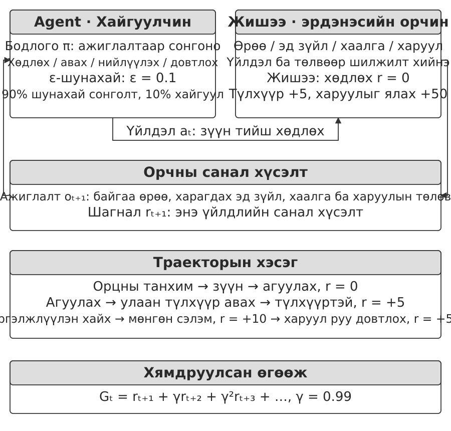

Дараалсан харилцан үйлчлэл **траектор** үүсгэх бөгөөд үүнд алхам бүрийн ажиглалт, үйлдэл, шагнал ба дуусах мэдээлэл ордог; сургалтын систем орчны төлвийг авч чадвал түүнийг ч хамт тэмдэглэж болно. Бодлого хэрхэн үйлдэхийг шийддэг бол **үнэ цэнийн функц (Value Function)** одоогийн төлвөөс эхэлж, тодорхой бодлогоор үргэлжлүүлэн гүйцэтгэвэл ирээдүйд хэдий хэмжээний өгөөж хүлээгдэхийг үнэлнэ.

Agent ба орчны хил нь загварчлах үед сонгосон системийн хүрээгээр тодорхойлогдоно. Энэ номд авч үзэж буй Model ба Harness нь Agent дотор байрлах бөгөөд Tool-ийн интерфэйс түүнийг гадаад аппликейшн, төхөөрөмж ба үйлчилгээтэй холбоно. Жишээлбэл, файл өөрчлөх хүсэлтийг Agent гаргаж, файлын систем бичилтийг гүйцэтгэж, Tool гүйцэтгэлийн үр дүнг Agent-д буцаана.

Суралцах явцад **хайгуул ба ашиглалт (Exploration–Exploitation)**-ын хооронд боломжийг хуваарилах хэрэгтэй. Хайгуул нь бодлогыг хараахан танил бус үйлдэлтэй танилцуулж, ашиглалт нь одоогийн үнэлгээгээр илүү сайн үйлдлийг сонгоно. Хойшлогдсон шагналтай даалгаварт эрт үеийн аль алхам эцсийн үр дүнд хүргэснийг тодорхойлох шаардлагатай бөгөөд үүнийг дараа авч үзэх итгэлийн хуваарилалтын асуудал гэнэ.

Нэг RL аргыг ойлгохдоо эхлээд таван зүйлийг шалгаж болно:

- **Үйлдлийн орон зай**: юу гаргахыг зөвшөөрөх вэ. Шатарт салангид нүүдэл, роботын удирдлагад тасралтгүй үений зорилт ашиглаж болно; үйлдэл төлөв, физик хүрээ ба эрхээр хязгаарлагдаж ч болно.
- **Бодлого**: төлөв, ажиглалт эсвэл түүхэд үндэслэн үйлдэл сонгох дүрэм. Энэ нь хүснэгт ч байж болно, мэдрэлийн сүлжээ ч байж болно.
- **Шагналын дохио**: сургалтын зорилго ямар санал хүсэлтээр илэрхийлэгдэх вэ. Алхам бүрийн шагнал урт хугацааны өгөөжийг бүрдүүлэхэд оролцох бөгөөд бодлого ирээдүйн ашгийн төлөө одоогийн зардлыг хүлээн авч болно.
- **Үнэ цэнийн функц**: дараагийн өгөөжийг үнэлж, үйлдлийг харьцуулах эсвэл бодлогын шинэчлэлтийн дохиог бүрдүүлэхэд ашиглаж болно. Үүнийг тодорхой сурах эсэхийг тухайн алгоритм шийднэ.
- **Орчны загвар**: үйлдлийн дараах төлөв, ажиглалт эсвэл шагналыг таамаглана. Загварт суурилсан арга мэдэгдэж буй эсвэл сурсан орчны загвараар төлөвлөнө; загваргүй арга харилцан үйлчлэлийн өгөгдлөөс бодлого эсвэл үнэ цэнийг шууд сурна.

Хүснэгт 8-3 нь эдгээр ойлголтоос орчин, үйлдэл ба зорилгыг сонгож, хэд хэдэн танил системийг харьцуулна. Эхний хоёр мөрийг уншихдаа «тэнцвэрээ хадгалах» ба «цэвэрлэсэн талбай»-г бид даалгаврыг загварчлахдаа сонгож болох зорилго гэж ойлгож болно.

Хүснэгт 8-3 Төрөл бүрийн Agent системийн гол бүрэлдэхүүний харьцуулалт

| Agent-ийн төрөл | Гадаад орчин | Үйлдлийн илэрхийлэл | Шагнал эсвэл зорилгын жишээ |
| --- | --- | --- | --- |
| Шинэ төрсөн зээрийн янзага | Газрын гадарга, таталцал ба биеийн динамик | Булчингийн тасралтгүй удирдлага | Тэнцвэрээ хадгалах, унахаас сэргийлэх |
| Шал цэвэрлэгч робот | Өрөө, шал ба цэнэглэх байгууламж | Хөдлөх, цэвэрлэх, цэнэглэх рүү буцах ба удирдлагын параметр | Цэвэрлэсэн талбай, цэнэг ба мөргөлдөөний зардал |
| Шатрын Agent | Хөлөг, өрсөлдөгч ба цагийн дүрэм | Одоогийн төлөв дэх хууль ёсны нүүдэл | Ялалт +1, ялагдал −1, тэнцээ 0 |
| Харилцагчийн үйлчилгээний Agent | Хэрэглэгч, бизнесийн өгөгдлийн сан ба үйлчилгээний интерфэйс | Хариу текст, асуулга ба бизнесийн дуудлага | Асуудал шийдэгдсэн, урсгал дүрэмд нийцсэн, боловсруулах хугацаа |
| Кодын туслах Agent | Шаардлагын эх сурвалж, кодын сан ба гүйцэтгэлийн орчин | Хайх, засварлах, ажиллуулах ба хариулах | Тестийн үр дүн, даалгавар гүйцэтгэл, регресс ба зардал |

Эдгээр системийн үйлдлийн илэрхийлэл өөр өөр. Шатар ихэвчлэн алхам бүрд нэг салангид үйлдэл сонгодог, робот заасан хэмжээстэй тасралтгүй удирдлагын хэмжигдэхүүн гаргадаг бол LLM эхлээд token-ий дараалал үүсгэж, дараа нь интерфэйс түүнийг хариу эсвэл Tool дуудлага болгон задална. Дотоод тооцооллыг ч бодлогын загварчлалд оруулж, гадаад төлвийг бодитоор өөрчилдөг Tool гүйцэтгэлээс тусад нь тэмдэглэж болно.

### Үйлдлийн хоёр илэрхийлэл: сонгодог RL-ийн тохиргоо ба LLM-ийн хувьсах урттай бодлого

**Марковын шийдвэрийн процесс (Markov Decision Process, MDP)** нь шийдвэрийн асуудлыг төлөв, үйлдэл, шилжилт ба шагналаар тодорхойлдог. Түүний Марковын шинж чанар дараахыг шаарддаг: одоогийн төлөв ба үйлдэл өгөгдсөн бол дараагийн төлөв ба шагналыг таамаглахад түүхээс нэмж хамаарах шаардлагагүй; таамаглалд хамаатай түүхийн мэдээлэл одоогийн төлөвт аль хэдийн багтсан байна. Зураг 8-2-т зөвхөн тоглогчийн байгаа өрөөг тэмдэглэвэл бэрхшээлтэй тулгарна: нэг хаалганы өмнө хоёр удаа ирсэн ч хаалгыг нээж чадах эсэх нь тоглогч түлхүүрийг аль хэдийн авсан эсэхээс хамаарна.

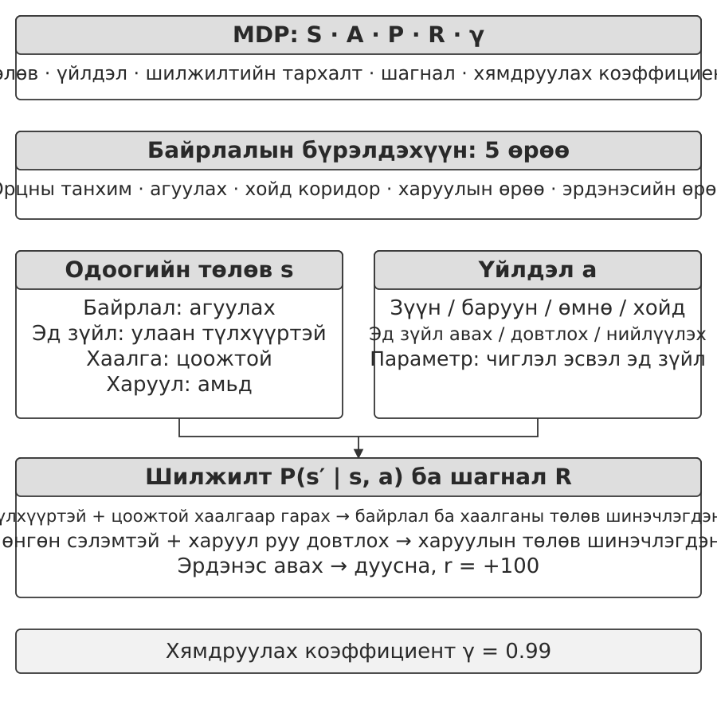

Шатар нь төлөв зохиох нэг жишээ болно. Хүүгийн байрлалаас гадна аль талын ээлж, цайз хийх эрх, замын цохилтын эрх, мөн тавин нүүдлийн дүрэм ба давтагдсан байрлалыг тодорхойлоход шаардлагатай мэдээллийг тэмдэглэх хэрэгтэй. Эдгээрийг төлөвт оруулсны дараа л одоогийн төлвөөр дүрмийг шийдэж чадна. Agent тэдгээрийн зөвхөн нэг хэсгийг харж чадвал түүхээр мэдээллээ нөхөх эсвэл хэсэгчлэн ажиглагдах загварчлалыг ашиглах шаардлагатай.

MDP нь салангид, тасралтгүй ба хосолсон үйлдлийг багтааж чадна. Гоо 361 огтлолцлын цэгтэй бөгөөд нүүдэл алгасах ба хууль ёсны байдлыг ч харгалзах ёстой; Atari тоглоом ихэвчлэн цөөн салангид үйлдэл өгдөг; роботын удирдлагын хэмжигдэхүүнийг үе, барьцаа ба физик хязгаарлалт тодорхойлно. Төлөв ба үйлдлийн тоо хоёулаа бага бол үнэ цэнийг хүснэгтэд шууд хадгалж болно. Хэмжээ томорвол функцийн ойролцоолол, бодлогын оновчлол ба хайлт тус тусын боловсруулах аргыг өгнө.

**Хүснэгтэн Q-learning: нэг алхмын санал хүсэлтээр үйлдлийн үнэ цэнийг шинэчлэх.** $Q(s,a)$ нь $s$ төлөвт $a$ үйлдэл хийсний дараах өгөөжийг үнэлнэ. Оновчтой үйлдлийн үнэ цэнэ Беллманы оновчлолын тэгшитгэлийг хангана:

$$
Q^*(s,a)=\mathbb E\left[r+\gamma\max_{a'}Q^*(s',a')\mid s,a\right]
$$

Энд $r$ нь энэ алхмын шагнал, $s'$ нь дараагийн төлөв, $\gamma$ нь хямдруулах коэффициент. Тасралтгүй даалгаварт ихэвчлэн $0\leq\gamma<1$ авдаг; дуусгавар нь тодорхой, өгөөж нь төгсгөлөг даалгаварт 1 ч авч болно. Их хямдруулах коэффициент алс хойшхи шагналд илүү жин үлдээнэ. Одоогийн агшнаас тооцох өгөөж нь $G_t=\sum_{k\geq0}\gamma^k r_{t+k+1}$.

Нэг харилцан үйлчлэлээр $r$ ба $s'$-ийг авсны дараа Q-learning дараах томьёогоор шинэчилнэ:

$$
Q(s,a)\leftarrow Q(s,a)+\alpha\left[r+\gamma\max_{a'}Q(s',a')-Q(s,a)\right]
$$

$\alpha$ нь суралцах хурд бөгөөд дөрвөлжин хаалтан доторх нь «нэг алхмын шагнал дээр хямдруулсан дараагийн үнэ цэнийг нэмсэн нь» ба одоогийн үнэлгээний зөрүү. Даалгавар дуусах төлөвт хүрвэл дараагийн үнэ цэнийг 0 гэж авна. Хавсаргасан тоглоомд нэг удаа туршъя: санамсаргүй саадыг унтрааж, орцноос зүүн тийш яваад, агуулахад улаан түлхүүрийг авна. Түлхүүр авахад 5 оноо шагнал, алхам бүрт 0.5 оноо хасагддаг тул энэ үйлдлийн буцаах $r$ нь 4.5. Хүснэгтэд «агуулахад түлхүүр авах»-ын хуучин үнэлгээ 0.25, түлхүүр авсны дараа сонгож болох үйлдлийн хамгийн их Q утга 0.63 гэж үзье. $\gamma=0.99$, $\alpha=0.2$ авбал нэг алхмын зорилт $4.5+0.99\times0.63=5.1237$ болно. Хуучин үнэлгээ энэ зорилт руу тавны нэгээр ойртож, 1.22474 болж шинэчлэгдэнэ. Бодит нэг алхмын санал хүсэлтээр үнэлгээг засах энэ аргыг **цаг хугацааны зөрүүгээр суралцах (Temporal-Difference Learning, TD)** гэнэ.

Нэг төлөв дэх үйлдэл бүрийн Q утгыг хамтад нь харвал одоогийн үнэлгээгээр хамгийн сайн үйлдлийг сонгож болно. Зураг 8-3 нь хялбаршуулсан торон зургаар ийм бодлогыг дүрсэлсэн. Нүд бүрийн тоо нь нормчилсон төлвийн үнэ цэнийг илэрхийлнэ. Тоонуудыг гараараа халхлаад зөвхөн сумыг харвал зүүн дээд булангаас эрдэнэс рүү явж чадах уу?

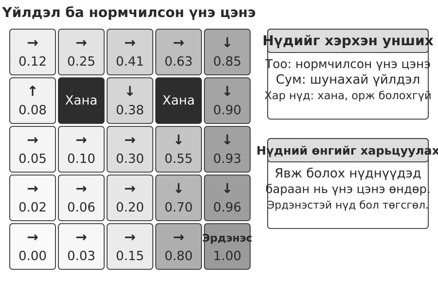

Дараагийн хайгуул сумны чиглэлийг өөрчилж болно. Зураг 8-4 нь саяын улаан түлхүүр авсан тооцоог задалж харуулна: энэ алхамд авсан шагнал «агуулахад түлхүүр авах» гэсэн нэг үнэлгээг өөрчлөх бөгөөд хүснэгтийн бусад төлвийн Q утга тус бүрийн шинэчлэлтийг хүлээнэ.

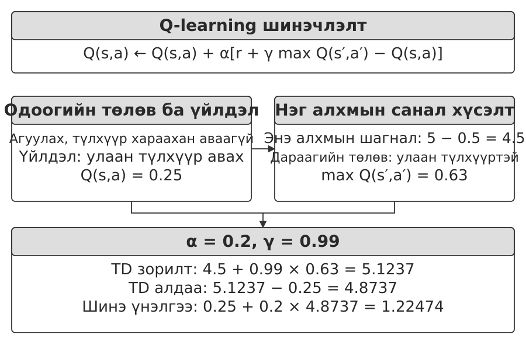

Q-learning-ийн зан төлөвийн бодлого санамсаргүй хайгуулыг агуулж болох бол шинэчлэлтийн зорилт дараагийн төлвийн хамгийн их үйлдлийн үнэ цэнийг ашигладаг тул **бодлогоос гадуурх (Off-Policy)** суралцахуйд хамаарна.

> **Туршилт 8-1 ★: Эрдэнэс хайх тоглоом дахь Q-learning-ийн гүйцэтгэл**
>
> Эрдэнэс хайх тоглоом түлхүүр ба хаалга, зэвсгийн үйлчлэл ба эд зүйл нийлүүлэх зэрэг далд дүрмийг агуулна. Тоглоомыг давахын тулд олон алхмыг дарааллаар нь гүйцэтгэх шаардлагатай бөгөөд оновчтой зам 11 алхам; гол үйлдэл ба ялалт шагнал өгөх бөгөөд бусад алхмын санал хүсэлт цөөн.
>
> Энэ удаагийн эрдэнэс хайх сургалтад суралцах хурд 0.2, хямдруулах коэффициент 0.99 авч, хайгуулын хувь ε-ийг 1.0-оос 0.1 хүртэл аажмаар бууруулна. Хүснэгтэн Q-learning ε-шунахай хайгуул ашигладаг: алхам бүрд ε магадлалаар боломжтой нэг үйлдлийг санамсаргүй сонгож, бусад үед одоогийн Q утга нь хамгийн их үйлдлүүдээс нэгийг сонгоно. Үе шат бүрийн ялалтын хувь, очсон төлвийн тоо ба давах алхмын тоог тэмдэглэнэ.
>
> Эрдэнэс хайх туршилтын сургалт ба үнэлгээний бичлэгийг уншихдаа эхлээд хоёр асуултыг салга: сургалтын явцад санамсаргүй хайгуултай бодлого хэзээ анх эрдэнэсийг олсон бэ? Сургалт дууссаны дараа Q хүснэгтийг тогтоож, шунахай бодлогоор үйлдэхэд тогтвортой давж чадах уу? Эхнийх нь Model замыг хэрхэн олж илрүүлснийг, сүүлийнх нь сурсан үнэ цэнээрээ үйлдлийг сонгож чадах эсэхийг шалгана.
>
> Өмнөх нэг сургалтад эхний 1000 тоглолтод хараахан давж чадаагүй бөгөөд Q хүснэгт 124 төлөв агуулж байв; 5000 тоглолт хүртэл тогтвортой ялаагүй, төлвийн тоо 133; 7000～8000 тоглолтын хооронд ялалтын хувь 34%-иас 96% болж өссөн; 10000 тоглолтод 100%-д хүрч, Q хүснэгт 145 төлөв агуулж, 11 алхмын замыг олсон.
>
> Яагаад эхэндээ удаан ахиц гарахгүй байснаа дараа нь ялалтын хувь маш хурдан өссөн бэ? Хайгуул эхлээд гол үйлдэл ба замыг олж илрүүлж, дараагийн очилтууд төгсгөлийн өгөөжийг урд талын төлвүүд рүү аажмаар тархаадаг. Энэ бүх жижиг симуляци ойролцоогоор 10 секунд шаардах тул маш олон давтан харилцан үйлчлэлийг даах боломжтой.
>
> Шинжлэхдээ тооцооллын хугацаа ба харилцан үйлчлэлийн тоог хамт тэмдэглэ. Тоглоомд нэг үйлдэл маш хямд; хөтөч, утас эсвэл физик төхөөрөмж болгон сольвол нэг харилцан үйлчлэлд хүлээлт, зардал ба төлвийн өөрчлөлт орно. Хүснэгт нь тодорхой төлвийн кодчилолтой холбогдсон тул дүрэм эсвэл газрын зураг өөрчлөгдсөний дараа байгаа үнэ цэнэ хэрэглэгдэх эсэхийг дахин шалгах хэрэгтэй. Дараагийн туршилт урьдчилсан сургалтын мэдлэг хайгуулын эхлэлийн цэгийг хэрхэн өөрчилж болохыг харьцуулна.

**Урьдчилан сургасан LLM: тооцоолол ба үйлдлийг хэлээр илэрхийлэх.**

LLM нь Tool дуудахаас өмнө завсрын тооцоолол үүсгэж ч болно, дуудлагыг шууд гаргаж ч болно. Хоёулаа token-ий дарааллаар илэрхийлэгдэх ч үүрэг нь өөр: завсрын тооцоолол Model-ийн дараа ашиглаж болох Context-ийг өөрчилж, Tool дуудлага гүйцэтгэгдсэний дараа гадаад орчныг өөрчлөх эсвэл уншина. Сургалтын үед эдгээр гаралтыг протоколоор тэмдэглэж, даалгаврын үр дүн ба тооцооллын зардлыг хослуулан үнэлж болно. Ингэснээр «хэр удаан бодох, юу бодох, хэзээ Tool дуудах» нь нэг бодлогын сурч болох сонголт болох бөгөөд дараах AdaptThink дүгнэлтийн төсвийг тойрон өрнөнө.

Хувьсах урттай дараалал илүү том хослолын орон зайг авчирна. Model асуулга, программ, JSON параметр ба олон алхамт гаргалгаа бичиж чадах бөгөөд дарааллын урт нь төсөв ба Context-оор хязгаарлагдана. Урьдчилсан сургалт хайлтад эхлэлийн цэг өгдөг: математикийн материалд нөхцөлийн шинжилгээ ба тооцоолол элбэг, код ба хэлэлцүүлэгт байршил тогтоох, засварлах ба баталгаажуулах нь элбэг. Model эдгээр бүтцийг зээлж нэр дэвшигч зам үүсгээд, орчны санал хүсэлтээр тохируулж болно. Байгаа мэдлэг нь хэрэгтэй үйлдлийн хослолыг анхнаасаа түүвэрлэгдэхэд хялбар болгож, олон холбоогүй замд сохроор туршин алдах хэрэгцээг бууруулна.

Жишээлбэл, «гадаад валютын дүнг ам.доллар руу хөрвүүлэх» нь ханш авч, тооцоолохыг шаарддаг. Урьдчилсан сургалт нь Model-д ийм холбоотой алхмуудыг үүсгэхэд хялбар болгодог; дараах сургалт нь ханшийн эх сурвалж, тооцооллын үр дүн ба даалгаврын хязгаарлалтаар замын магадлалыг цааш нь тохируулж болно. Энд хэлний мэдлэг анхны бодлогыг, шагнал даалгаврын санал хүсэлтийг өгнө.

Зураг 8-5 нь энэ хэсгийн хоёр тохиргоог харьцуулна: хүснэгтэн Q-learning заасан төлвийн кодчилол ба хайгуулын дүрмээс эхэлдэг бол LLM Agent урьдчилан сургасан хэлний бодлогоос эхэлж, Context-оор Tool-ийн ажиглалт ба түүхэн туршлагыг зохион байгуулна.

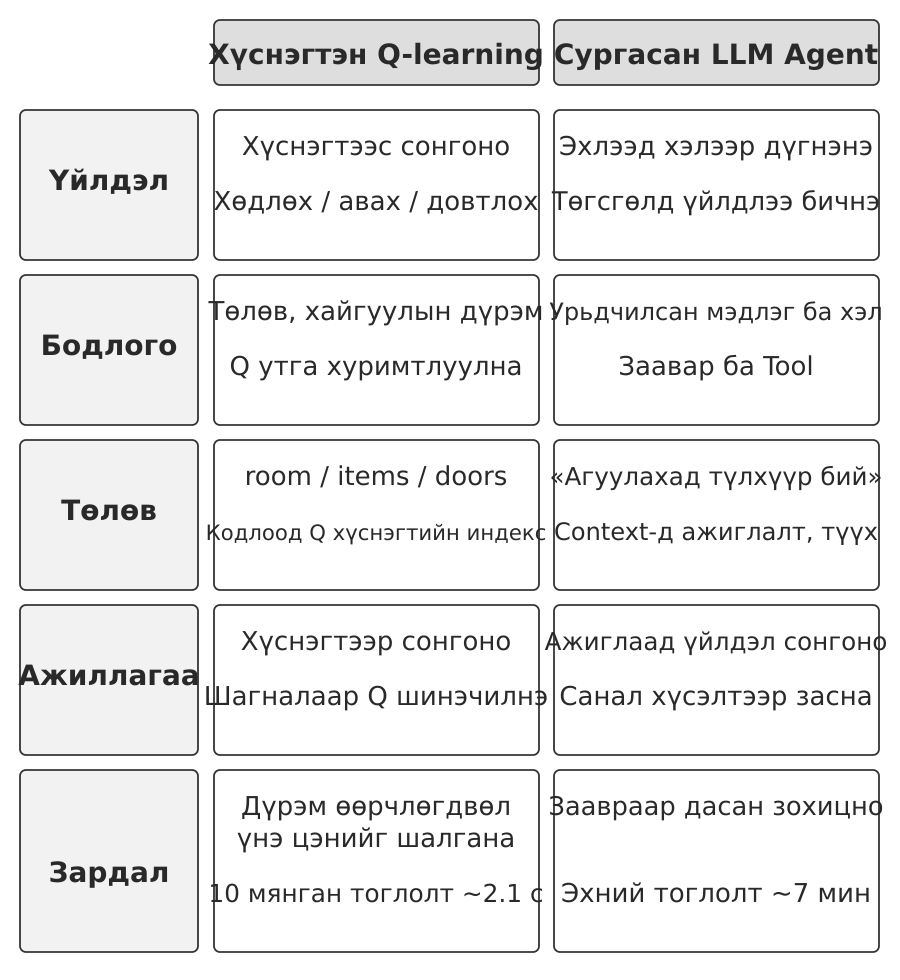

Урьдчилсан сургалт мөн Model-д шинэ зааврыг тайлбарлаж, цөөн үзүүлэнгээр даалгаврын зан төлөвийг тохируулах боломж олгодог. Tool хэлний гаралтыг хайлт, код гүйцэтгэл ба бизнесийн үйлдэлтэй холбоно. Ийм Agent-ийг зохиохдоо Tool-ийн интерфэйс ба гүйцэтгэх эрхийг тогтоохоос гадна даалгаврын үр дүн, ажиллагааны зардал ба гол процессын санал хүсэлтийг бий болгох хэрэгтэй.

Model механик гарыг удирдах бол «дараагийн token-ийг таамаглах»-ыг үйлдэлд хэрхэн хэрэглэх вэ? OpenVLA ойролцоогоор 970 мянган бодит роботын үзүүлэн ашигласан. Үзүүлэн дэх нэг алхмыг авбал оролт нь тухайн үеийн камерын дүрс ба даалгаврын заавар, сургалтын зорилт нь үзүүлэгчийн дараа гүйцэтгэсэн үйлдэл. Жишээлбэл, механик гар хэвтээ чиглэлд хэр их хөдлөх нь угтаа тасралтгүй тоон утга. OpenVLA үйлдлийн хэмжээс бүрийг 256 түвшинд хувааж, аль түвшинд орсныг нэг token-оор илэрхийлдэг. Ингэснээр Model үйлдлийн token-ийг нэг нэгээр нь таамаглаж, зөвхөн эдгээр байрлалд алдагдал тооцож болно.[^ch8-21]

Энэ жишээ мөн зан төлөвийн клончлол ба бататгах сургалтыг ялгах аргыг өгдөг: ямар дохио Model-ийг шинэчилж байгааг харах. OpenVLA үзүүлэнгийн бичлэгээс суралцдаг бөгөөд Model үзүүлсэн үйлдлийн token-д өндөр магадлал өгөх тусам алдагдал бага болох тул энэ нь хяналттай fine-tuning-д хамаарна. Туршилт 8-13-ын SimpleVLA-RL-д бол бодлого орчинд үйлдлийг бодитоор туршиж, даалгаврын шагналаар цаашдын сонголтоо тохируулна.

> **Алгоритм, орчноос урьдчилсан мэдлэг хүртэл**
>
> Yao Shunyu «The Second Half» нийтлэлдээ алгоритм, орчин ба урьдчилсан мэдлэгээр RL-ийн хөгжлийг эргэн харсан.[^ch8-2] Зохиогч үүнд тулгуурлан анхаарлын төвийн өөрчлөлтийг гурван үе шатаар нэгтгэв: 2015—2016 онд алгоритмыг сайжруулахад, 2016—2018 онд орчин бүтээхэд илүү анхаарч, 2018 оноос эхлэн урьдчилсан сургалтын мэдлэгийн үнэ цэнийг аажмаар ухаарсан. Gym нэгдсэн орчны интерфэйс өгч, Universe, World of Bits компьютер ба вэб хуудасны даалгаврыг судалж, Dota 2 зэрэг төсөл нарийн төвөгтэй орчинд сургах чадварыг харуулсан. Дараа нь GPT-2, GPT-3 хэлний урьдчилсан сургалтаар хуримтлуулсан мэдлэг ба илэрхийлэх чадварыг харуулж, WebGPT, ChatGPT зэрэг систем энэ эхлэлийн цэгийг цааш нь ашигласан. Даалгаварт шаардлагатай урьдчилсан мэдлэгийг эхлээд хэлний загварчлалаар олж аваад, дараа нь тодорхой зан төлөвийг оновчлохыг RL-д даатгаж болно.
>
> Зохиогч энд дурдсан инженерийн тэргүүлэх дарааллыг дэмждэг: **урьдчилсан мэдлэг, орчин, алгоритм**. Эхлээд Model ямар мэдлэг, чадвартай байгааг шалгаж, дараа нь тохирох орчин ба санал хүсэлтийг бүтээгээд, эцэст нь түүнд тохирох оновчлолын аргыг сонгоно. Зураг 8-6 нь судалгааны анхаарлын төвүүдийг гарч ирсэн дарааллаар нь байрлуулсан бол төсөл хийхдээ эсрэгээр нь, байгаа чадвараас эхэлж болно.
>
> 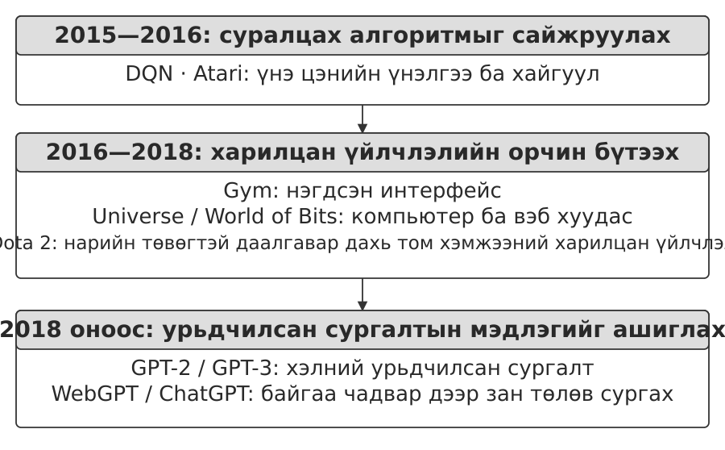

> **Туршилт 8-2 ★★: Уламжлалт RL ба LLM Agent-ийн харьцуулсан судалгаа**
>
> Нэг эрдэнэс хайх тоглоомд хүснэгтэн Q-learning ба LLM Agent-ийг харьцуулна. LLM-ийн тохиргоо Kimi K3-ыг ашиглаж, Context-д хамгийн ихдээ 50 туршлага хадгална. Хоёулаа алхам бүрд орчны өгсөн боломжит үйлдлүүдээс нэгийг сонгоно. Зураг 8-7-ын хоёр замыг дагаж Q хүснэгт ба хэлний Model энэ сонголтыг тус бүр хэрхэн хийдгийг харж болно.
>
> 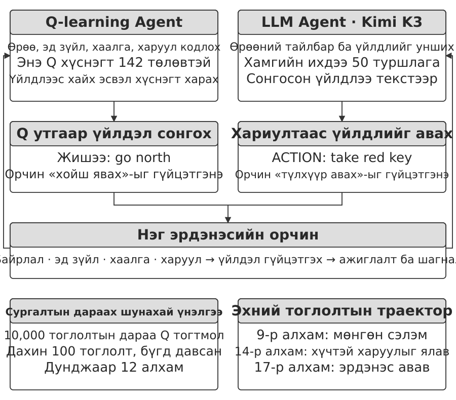
>
> Хавсаргасан Kimi K3-ын ажиллагааны бичлэгт Agent эхний тоглолтод 17 алхам хийсэн. Тэр эхлээд зэвэрсэн сэлэм авч, хойд хаалга цоожтой болохыг мэдээд, агуулах руу очиж улаан түлхүүр ба шидэт болор авч, 9 дэх алхамд сэлэм ба болорыг нийлүүлж мөнгөн сэлэм болгосон. 12 дахь алхамд түлхүүрийг ашиглахыг оролдоход орчин «шаардлагатай үед автоматаар ашиглагдана» гэж сануулсан; 13 дахь алхамд хойш явахад хаалга бодитоор нээгдсэн. 14 дэх алхамд мөнгөн сэлмээр харуулыг ялсны дараа тэр сэлмийг дахин нэг ашиглахыг оролдсон бөгөөд орчин энэ үед ашиглах боломжгүй гэж сануулсан. 17 дахь алхамд эрдэнэсийг авсан. Энэ бичлэгийг уншихдаа дараагийн мөрийг халхлаад, одоогийн санал хүсэлтээр аль алхам хэрэгтэй хэвээр байгааг эхлээд таамаглаж үзэж болно.
>
> Үйлдэл бүрийг тухайн үеийн ажиглалттай зэрэгцүүлбэл Model «түлхүүрээр хаалга нээх», «зэвсгээр харуултай тулах» зэрэг байгаа мэдлэгээ хэрхэн ашигласныг, мөн Tool-ийн санал хүсэлт дараагийн төлөвлөгөөг хэрхэн өөрчилснийг шинжилж болно. Хүснэгтэн арга эдгээр хамаарлыг төлөв—үйлдлийн очилтоор хуримтлуулна.
>
> Энэ харьцуулалтад Q-learning 10000 тоглолт сургахад 2.12 секунд зарцуулж, дараа нь шунахай бодлогоор 100 тоглолтыг тусад нь үнэлэхэд бүгдийг давж, дунджаар 12 алхам хийсэн. Kimi нэг тоглолтод Model-ийг 17 удаа дуудаж, 6 минут 56 секунд зарцуулсан. Зохиогч үүнд тулгуурлан нэг сонголтын зарчим баримталдаг: симуляци хямд, маш олон давтаж болох бол уламжлалт RL-ийн хайгуулыг бүрэн ашиглаж болно; харилцан үйлчлэл бүр хүлээлт, зардал эсвэл бодит үйлдлийн зардал шаарддаг бол байгаа мэдлэгээ ашиглаж чадах бодлогыг түрүүлж авч үзэж, харилцан үйлчлэл бүрийн үнэ цэнийг өсгөнө.

Эдгээр хоёр туршилт энэ бүлгийг өмнөх инженерийн аргуудтай холбоно: Context нэг ажиллагааны дотор туршлагыг зохион байгуулж, гадаад санах ой даалгаврын хооронд туршлагыг хадгалж, дараах сургалт параметрийн шинэчлэлтээр бодлогыг өөрчилнө. Дараа нь эхлээд хэл ба харааны урьдчилсан сургалтын үндсэн процессыг нөхөж, дараа нь тодорхой сургалтын өгөгдөл ба оновчлолын аргыг авч үзнэ.

## Model-ийн урьдчилсан сургалтын үндэс `[Сонголтоор унших]`

Урьдчилсан сургалт Model-ийн анхны дүрслэл ба үүсгэх тархалтыг бүрдүүлэх бөгөөд дараах сургалт энэ эхлэлийн цэгээс параметрийг үргэлжлүүлэн тохируулна. Энэ эхлэлийг ойлгохын тулд эхлээд жижиг хэлний Model текстээс хэрхэн суралцаж байгааг ажиглаад, дараа нь түүнийг харааны оролттой хэрхэн холбодгийг харж болно.

Текстийг эхлээд **токенчлол (Tokenization)**-оор дамжуулж салангид token болгоно. Жишээлбэл, «Би програмчлалд дуртай» гэдгийг «Би», «програмчлах», «дуртай» гэсэн гурван нэгжээр илэрхийлж болох бөгөөд бодит хуваалтыг токенизатор шийднэ. Сургалт өмнөх token-уудыг Context болгон авч, дараагийн token-уудыг таамаглаж, алдагдлыг тооцож, параметрийг шинэчилнэ. Зураг 8-8-т сургалтын өгүүлбэрийг «орчин» гэдэг үг хүртэл далдалж, дараагийн үг юу болохыг таамаглаад, дараа нь эх бичвэрийг нээнэ. Энэ байрлалыг хойш гүйлгэхэд дараагийн таамаглах асуулт бэлэн болно.

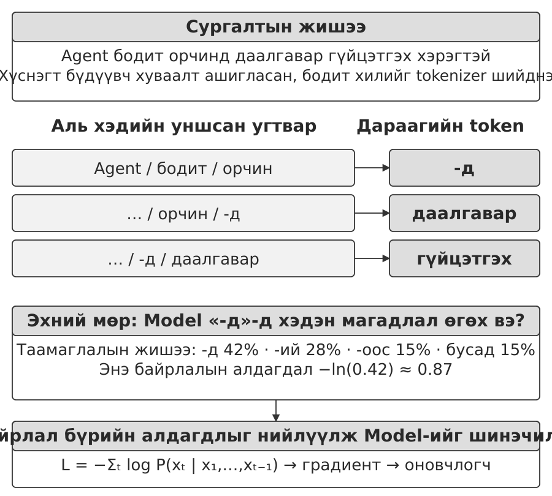

Үндсэн хэлний загварчлалын дараа зааврын үзүүлэн нэмж, хариултын формат ба даалгаврын зан төлөвийг сургаж болно; эсвэл сонголтын өгөгдөл ашиглан DPO зэрэг аргаар илүү хүлээн зөвшөөрөгдсөн хариултын магадлалыг өсгөж болно.

> **Туршилт 8-3 ★★: LLM-ийг эхнээс сургах — алгоритмын сайжруулалтын хүч**
>
> Ойролцоогоор зуун сая параметртэй MiniMind 2-ыг жишээ болгон авч, хэрэглэгчийн түвшний GPU дээр урьдчилсан сургалт, SFT ба сонголтын оновчлолыг гүйцэтгэнэ. Суурь хувилбар ба QK Norm, Muon оновчлогч нэмсэн тохиргоог харьцуулж, алдагдлын бууралт, зорилтот чанарт хүрэхэд шаардлагатай хугацаа ба үүсгэсэн үр дүнг ажиглана. Хавсаргасан нэгтгэл ойролцоогоор 3 дахин хурдан нийлэлтийг тэмдэглэсэн бөгөөд бүрэн сургалт ойролцоогоор 14 цаг, зардал ойролцоогоор 34 ам.доллар.
>
> QK Norm нь анхаарал дахь асуулга ба түлхүүрийн тоон хэмжээг тохируулж, Muon харгалзах параметрийн оновчлолын шинэчлэлтийн аргыг өөрчилнө.
>
> Нэг бүлэг асуултыг үе шаттайгаар ажиглана: урьдчилсан сургалтын Model «Дэлхийн хамгийн өндөр уул» зэрэг асуултад аль хэдийн хариулж чаддаг; SFT-ийн дараа заавар дагах ба гаралтын зохион байгуулалт сайжирна; сонголтын оновчлол баримт хариулах ба илэрхийлэлд үргэлжлүүлэн нөлөөлнө.

> **Туршилт 8-4 ★★: VLM-ийг өөрөө сургах**
>
> Зураг 8-9 нь «харааны кодлогч—проекцын давхарга—хэлний Model» гэсэн холболтыг харуулна. CLIP зэрэг харааны кодлогч зургийн шинж чанарыг гаргаж, проекцын давхарга шинж чанарыг хэлний Model-ийн оролтод шаардагдах хэмжээс ба дүрслэл рүү хувиргаж, хэлний Model эдгээр оролтыг хослуулан тайлбар эсвэл хариулт үүсгэнэ.
>
> 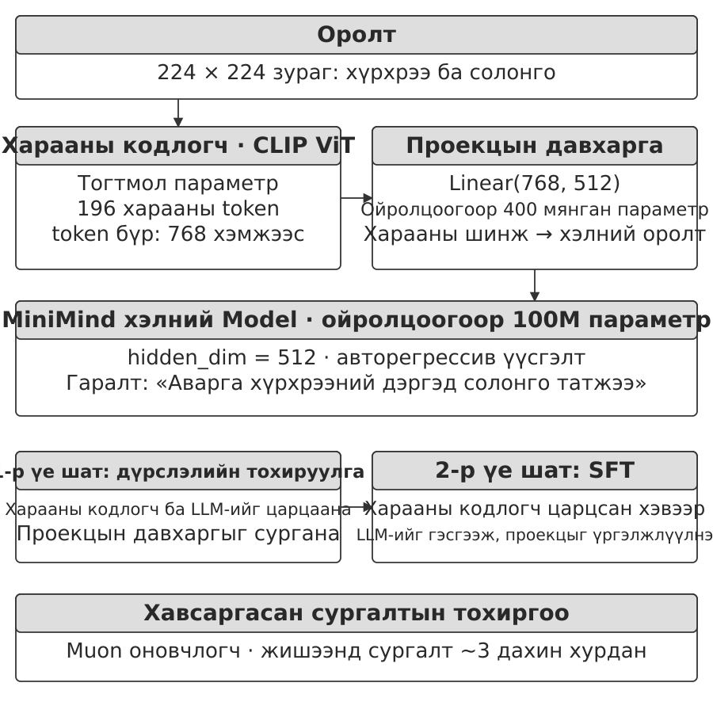
>
> Эхний үе шатанд харааны кодлогч ба LLM-ийг царцааж, шинээр нэмсэн проекцын давхаргыг сургаж, зургийн шинж чанар хэлний таамаглалд оролцох боломж олгоно; хоёр дахь үе шатанд тохиргооны дагуу LLM-ийг задалж, өндөр чанартай зураг—тайлбар эсвэл асуулт хариултын өгөгдлөөр SFT хийнэ. Объект таних, дэлгэрэнгүй тайлбар, хамаарал дүгнэх ба хэлний чадварын өөрчлөлтийг тус тусад нь ажиглана.
>
> Ийм архитектур байгаа хараа ба хэлний Model-ийг дахин ашиглаж, эхлээд модаль хоорондын холбох модулийг төвлөрүүлэн сургадаг тул төсөв хязгаарлагдмал үед түрүүлж туршиж үзэх үнэ цэнэтэй хувилбар юм. Жинг царцаах нь сургаж болох төлвийг багасгаж, дараа нь даалгаврын хэрэгцээгээр харгалзах модулийг задалж болно. Тайлбар буруу гарвал эхлээд объектын мэдээлэл харааны дүрслэлд орсон эсэхийг шалга; мэдээлэл байгаа атал Model түүнийг ашиглаж чадахгүй бол проекцын давхаргын илэрхийлэх чадвар, тохируулгын өгөгдөл ба хэл үүсгэлтийн хяналтад голлон анхаарна. Гаралтыг цааш нь үйлдлийн дүрслэл болгон өөрчилж, удирдлагын интерфэйстэй тохируулбал Бүлэг 6-ын VLA архитектуртай холбогдоно.

Хоёр туршилт оновчлолын тохиргоо ба модаль хоорондын холболт сургалтад хэрхэн нөлөөлдгийг тус тус харуулсан. Төсөв хязгаарлагдмал үед зохиогч эхлээд алгоритм ба архитектурын сайжруулалтын өгөх ашгийг харьцуулж, дараа нь Model-ийн хэмжээг томруулах эсэхийг шийдэхийг зөвлөдөг. Байгаа Model шинэ хэл эсвэл шинэ салбарт орох үед урьдчилсан сургалтын жингээс үргэлжлүүлэн суралцаж ч болно; дараагийн хэсэгт ийм сургалтад өгөгдлийг хэрхэн сонгохыг авч үзнэ.

## Mid-training: мэдлэг ба суурь чадварыг нөхөх

Энэ бүлгийн **Mid-training** нь байгаа Model дээр зорилтот тархалтын эргэн тойронд хэлний Model-ийн сургалтыг нэг үе шат үргэлжлүүлэхийг хэлнэ. Баримт бичиг, код эсвэл гаргалгааны олон token хяналтад оролцох бөгөөд сургалтын үед зорилтот салбарын корпусыг ерөнхий корпустай хольж болно. DAPT/TAPT судалгаа салбар эсвэл даалгавартай холбоотой корпус дээр үргэлжлүүлсэн урьдчилсан сургалт доод түвшний даалгаварт тустай болохыг харуулсан.[^ch8-30]

Өгөгдлийн сонголт хоёр төрлийн дутагдлаас эхэлнэ. Нэг нь мэдлэг ба хэлний хамрах хүрээ, жишээ нь Model байгууллагын протокол, зорилтот хэлний нэр томьёо эсвэл тодорхой кодын сантай бага танилцсан; нөгөө нь даалгаварт шаардагдах суурь чадвар, жишээ нь урт Context дотор төлвийг мөрдөх, баримт бичгүүдийн хоорондын хамаарлыг нэгтгэх эсвэл урт кодын гаргалгаа хийх. Эхлээд алдааны төрлөөр ойлголт, мэдлэг, формат ба үйлдлийн асуудлыг ялгаж, дараа нь нөхөх материалыг тодорхойлно.

Салбарын текстийн алдагдал буурсны дараа Model сурсан мэдлэгээ бодит даалгаварт ашиглаж чадах эсэхийг ч шалгах ёстой. Үргэлжлүүлсэн сургалт ба зааврын сургалтын дараалал, асуулт хариултын зохион байгуулалт ба материалын хэлбэр бүгд мэдлэгийн хэрэглээнд нөлөөлнө.[^ch8-31] Суурь чадвар нь илт дутагдалтай салбарын даалгаврын хувьд зохиогч эхлээд салбарын корпусаар хамрах хүрээг өсгөж, дараа нь SFT үзүүлэнгээр Model-д энэ мэдээллийг даалгаварт ашиглахыг зааж, зөвхөн Model заримдаа зөв хийж чаддаг ч амжилтын хувь бага байгаа үед RL-д хөрөнгө оруулахыг зөвлөдөг.

### Mid-training-ийн өгөгдлийг хэрхэн бүрдүүлэх

**Эхний алхам, бүтэлгүйтлийн тархалтаас шаардлагатай материалыг тодорхойлох.** Сэдэв, хэл, баримтын төрөл, кодын хэв маяг ба Context-ийн уртаар тус тусад нь үнэлж, Pass@1, Pass@k ба алдааны жишээг хослуулан Model ямар нөхцөлд ашиглаж болох шийдэл дутмаг байгааг тодорхойлно. Параметрийн форматтай асуудлыг интерфэйсийн үзүүлэнгээр шийдэж болох бол салбарын ойлголт ба хамаарлын дутагдлыг харгалзах корпус нөхнө.

**Хоёр дахь алхам, нягт өгөгдлийн корпус зохион байгуулах.** Эх баримт бичиг нэр томьёо ба баримтын хамаарлыг, кодын сан модулийн бүтэц ба хамаарлыг өгч, сурах бичгийн маягийн гаргалгаа ба синтез тайлбар далд алхмуудыг нээж, баримт бичгүүдийн хоорондын дээж тархсан мэдээллийг холбоно. Чанарын шүүлт, давхардлыг арилгах ба үнэлгээний багцыг тусгаарлаж дууссаны дараа сургалтын дарааллыг бүрдүүлнэ.

**Гурав дахь алхам, зорилтот чадвараар өгөгдлийг холих.** Байгалийн урт текст ном, баримт бичиг ба кодын сангаас ирж болно; хайлт, олон шатлалт дүгнэлт, заавар дагах, нэгтгэл ба статистикт зориулж гаргалгаатай даалгаврын өгөгдөл нэмж болно; Agent-д төлөвлөгөө, Tool-ийн сонголт, параметр бүрдүүлэлт, төлөв мөрдөлт ба алдаанаас сэргэх траектор нэмж болно. Эдгээр материалыг байгаа өгөгдлийн багц эсвэл багш Model-оос үүсгэж болох бөгөөд сургалтад орохоос өмнө агуулга ба зан төлөвийн шаардлагаар шүүнэ.

**Дөрөв дэх алхам, Model-ийг өмнө нь хийж чаддаг байсан даалгавраа үргэлжлүүлэн дадлагажуулах.** Нэг бүлэг дээж богино текст, ерөнхий корпус ба хуучин асуудлуудыг ашиглана; нөгөө бүлэг ижил даалгаврыг илүү урт Context-д хийж, гол мэдээллийн байрлалыг зөөж, саатуулагч зүйл нэмнэ. Эдгээр хоёр бүлэг материалыг хослуулахдаа анхны сургалтын өгөгдлийн тархалтад тулгуурлаж болно, эсвэл FineWeb-2 зэрэг нээлттэй корпусаар хэд хэдэн харьцааг туршиж, үнэлгээний үр дүнгээр тохируулж болно.

**Тав дахь алхам, олон үзүүлэлтээр үргэлжлүүлэх эсвэл зогсоохыг шийдэх.** Сургалтын алдагдал, тусгаарласан салбарын даалгавар, ерөнхий чадвар, өмнөх заавар дагах ба зорилтот даалгаврын амжилтын хувийг зэрэг тэмдэглэнэ. Салбарын үр дүн өсөж ерөнхий чадвар буурвал холих харьцаа, суралцах хурд ба сургалтын хэмжээг харьцуул; алдагдал буурч зорилтот даалгавар зогсонги байвал сургалтын материал Model-д ийм даалгавар гүйцэтгэхийг зааж чадах эсэх, бодит даалгаварт мэдлэгээ ашиглах үзүүлэн нэмэх шаардлагатай эсэхийг шалга.

Model маш урт захиалгын логиос заасан захиалгын дугаарыг олж чаддаг гэж үзье. Харин «Аль харилцагч олон удаа захиалга өгөөд бүгдийг нь буцаасан бэ» гэж асуувал тэр нэг харилцагчийн захиалгуудыг бүрэн олж, захиалга ба буцаалтын бичлэгийг мөр мөрөөр нь тулгах шаардлагатай. Хоёр асуулт нэг л логийг ашиглаж болох ч шалгаж буй чадвар нь өөр. RULER нэгдсэн даалгавраар оролтын урт ба даалгаврын хүндрэлийг тусад нь хянаж, нэг бичлэгийн хайлт, олон шатлалт мөрдөлт ба нэгтгэлийг тус тусад нь хэмждэг. Зохиогчид 17 Model үнэлсэн бөгөөд олон Model энгийн хайлтад бүтэн оноотой ойр байсан ч оролт уртсах тусам нэгдсэн гүйцэтгэл мэдэгдэхүйц буурсан.[^ch8-ruler]

Энэ ялгаа бодит материалд гарч ирэх эсэхийг харахын тулд LongBench v2-ын олон баримтын, урт ярианы эсвэл кодын сангийн асуултыг цааш ашиглаж болно. Model гаралтын формат зэрэг шаардлагыг санаж чадах эсэхийг тусад нь шалгахын тулд IFEval-ийн шалгаж болох зааврыг авч, урт материалын өөр өөр байрлалд тавьж болно. Хоёр Model-ийг харьцуулахдаа хоёулангийн харж буй зааврын байрлал ба саатуулагч агуулга ижил байх ёстой бөгөөд энэ нь өөрөө зохиосон тест гэдгийг тэмдэглэнэ. Эцэст нь end-to-end Agent даалгавраар эдгээр чадвар хамтран ажиллаж чадах эсэхийг шалгана. Үнэлгээний багц зохиохдоо дараах хэмжүүрүүдийг нэг нэгээр нь шалгаж болно.[^ch8-longbench]

[^ch8-ruler]: Hsieh нар, RULER, 2024.
[^ch8-longbench]: Bai нар, LongBench v2, ACL 2025. Өгүүлэл зургаан төрлийн даалгавар, нийт 503 сонголттой асуулт өгсөн.

- **Байрлал ба хайлт**: ганц эсвэл олон гол мэдээлэл эхлэл, дунд ба төгсгөлд байх үед олж чадах эсэх.
- **Хамаарал ба дүгнэлт**: догол мөр, олон баримтын хоорондын хамаарлыг мөрдөх, зөрчлийг шийдвэрлэх ба нотолгоог хослуулах.
- **Нэгтгэл ба статистик**: урт хүснэгт ба лог дахь тоолол, бүлэглэл, эрэмбэлэлт, харьцуулалт ба чиг хандлагын дүгнэлт.
- **Заавар дагах**: олон шаардлага, зөрчлийг шийдвэрлэх, урсгалын нөхцөл ба гаралтын формат.
- **Урт хэлхээт дүгнэлт**: математик, логик ба кодын даалгавар дахь урт хамаарлын хэлхээ.
- **Agent-ийн үндсэн зан төлөв**: даалгавар задлах, Tool-ийн сонголт, параметр үүсгэлт, төлөв хадгалалт ба бүтэлгүйтлээс сэргэх.

Урт дүгнэлт ба олон ээлжит Tool дуудлага Context-ийг тасралтгүй уртасгаж, эрт үеийн заавар, баримт ба даалгаврын төлөв дараагийн шийдвэрт оролцсоор байх ёстой. Model урт текстээс мэдээлэл олж чадахгүй эсвэл хязгаарлалтыг хадгалж чадахгүй бол урт хугацааны Agent найдвартай ажиллахад хэцүү. Сургалтын төсвийг өргөтгөхөөс өмнө жижиг тохиргоогоор өгөгдлийн харьцаа ба сургалтын хэмжээг харьцуулах хэрэгтэй. Байнга шинэчлэгддэг, эх сурвалж шаарддаг баримтын хувьд зохиогч RAG-ийг түрүүлж ашигладаг; тогтвортой, том хэмжээний салбарын мэдлэг ба суурь чадварын хувьд л үргэлжлүүлэн сургаж параметрт бичихийг бодно.

> **Туршилт 8-5 ★★: Үргэлжлүүлэн сургаж шинэ хэл сурах**
>
> Mistral 7B v0.3-аас эхэлж, солонгос хэлний Википедиа зэрэг материалаар солонгос хэлний чадварыг өсгөнө. Сургалт эхлээд ойролцоогоор 80% солонгос, 20% англи хэлний хольц ашиглаж, дараа нь солонгос хэлний зааврын өгөгдлөөр SFT хийж, хэлний загварчлал ба ярианы зан төлөвийн өөрчлөлтийг тус тусад нь ажиглана.
>
> Солонгос хэлний өгөгдөл зорилтот хэлний хамрах хүрээг нэмэх бол англи хэлний өгөгдөл өмнөх чадварыг хадгалахад ашиглагдана. Үе шат бүрт сургалтад ороогүй ижил багц солонгос ба англи асуултаар туршина. Хавсаргасан үр дүнд солонгос хэлний эцсийн үе шатны сохор үнэлгээ сайжирч, англи хэлний чадвар тодорхой хэмжээгээр буурсан бөгөөд энэ нь дараагийн шатанд англи хэлний сургалтын материалыг илүү их холих эсвэл шинэчлэлтийн эрчмийг бууруулах тодорхой чиглэл өгсөн.
>
> Зорилтот хэл, өмнөх хэл ба баримтын чанарыг тусад нь тэмдэглэвэл ашиг ба зардлыг ялгаж болно; SFT-ийн үе шатанд Model солонгос хэлний зааврын дагуу хариултаа зохион байгуулж чадах эсэхийг дахин шалгана. Ингэснээр үргэлжлүүлсэн урьдчилсан сургалт ба зааврын fine-tuning-ийн үүргийг тусад нь ажиглаж болно.

## SFT (хяналттай fine-tuning)

Салбарын корпус Model-д нэг интерфэйстэй хэдэн удаа танилцах боломж олгодог ч дуудлага бүтэлгүйтсэний дараа параметрийг хэрхэн засахыг заахын тулд нэг удаа шууд үзүүлж болно. SFT даалгаврын оролт өгч, token бүрээр Model-ийг үзүүлэн дэх хариулт эсвэл үйлдлийг үүсгэхээр сургана. Зураг 8-10-ыг харахдаа эхлээд ямар зан төлөвийг заахыг тодорхой төсөөлж, дараа нь үзүүлэнг хэрхэн цуглуулахаа шийд. Үзүүлэн дэх баримт, өнгө аяс ба гаралтын формат ч хамт сургалтад орно.

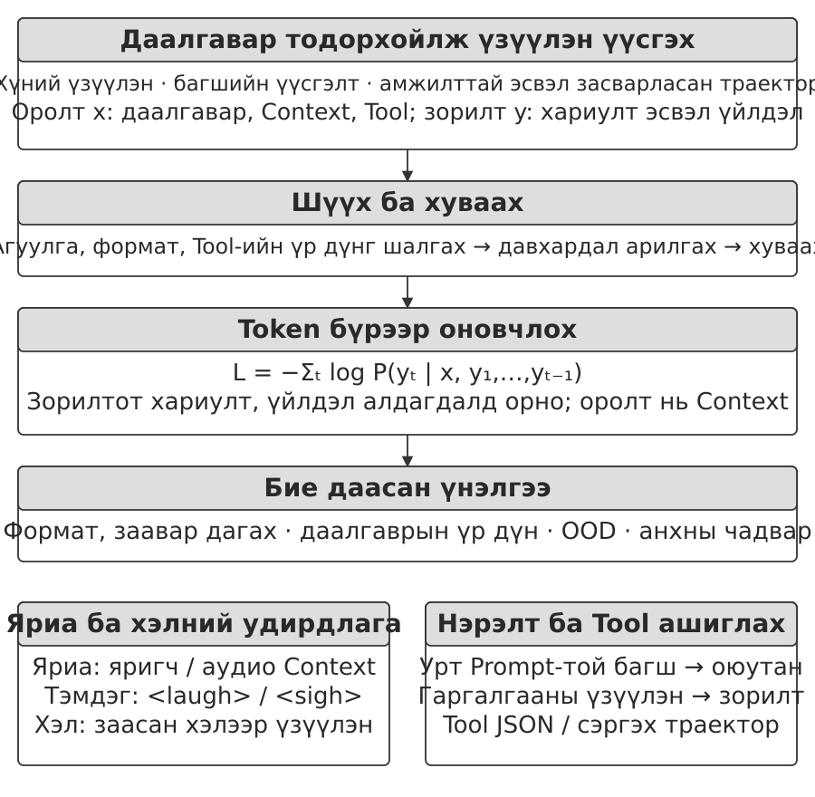

Өгөгдөл ихэвчлэн гурван замаар ирнэ: хүний мэргэжилтэн гол зан төлөв ба хилийг тодорхойлж, багш Model бөөнөөр үзүүлэн бичиж, баталгаажуулагч Model-ийн түүврээс үр дүнтэй гаралтыг шүүнэ. Гурвыг хослуулан ашиглаж болно. Жишээлбэл, эхлээд мэргэжилтэн цөөн Tool дуудлагын үзүүлэн бичиж, дараа нь багш Model даалгаврын нөхцөлийг өөрчлөн илүү олон дээж үүсгэж, эцэст нь параметр, гүйцэтгэлийн үр дүн ба бизнесийн хязгаарлалтыг шалгана.

**SFT-ийн нэг хэрэглээ бол Prompt ба Skill-д дахин дахин бичдэг аргыг Model-д заах явдал.** Бүлэг 7-ын санах ойн үнэлгээг жишээ болгоё: үнэлгээний гарын авлага ба жишээ шийдвэр нийлээд арван мянган token урт гэж үзье. Багш бүрэн гарын авлагад тулгуурлан нэг бүлэг хариултад үнэлгээ өгч, хүний ижил нэр, хамаарал эсрэгээрээ бичигдсэн эсвэл нотолгоо хангалтгүй зэрэг нөхцөлийг хэрхэн боловсруулахыг үзүүлнэ. Оюутан Model-ийг сургахдаа оролтод зөвхөн үнэлгээний богино зүйлийн нэрийг, тухайн удаагийн түүхэн материал ба үнэлэх хариултыг үлдээж, зорилтот гаралт нь багшийн сонгосон зэрэглэл байна. Ашиглалтад оруулсны дараа зөвхөн богино Prompt ба тухайн үеийн материал өгөхөд л хангалттай бөгөөд таамаглал бүрт тэр арван мянган token-ийг хэмнэнэ. Байнга дуудагддаг Skill-ийн хувьд ч ижил аргаар хэзээ материал лавлах, Tool-ийг хэрхэн сонгохыг үзүүлж, эдгээр тогтвортой алхмыг Model руу нэрэж болно.

Өгөгдөл бэлтгэхдээ эхлээд даалгаврын тархалт, гаралтын schema ба хүлээн авах аргыг тодорхойлно. Үзүүлэн шалгалтыг давсны дараа давхардлыг арилгаж, төрөл бүрийн дээжийн харьцааг тохируулж, өгөгдлийн багцыг хуваана. Дээжийн тоо ба хамрах хүрээг хамт төлөвлөх ёстой: нэг асуултыг хэдэн мянган удаа давтах нь ижил хэв маягийг дахин дахин бэхжүүлнэ; гол нөхцөлийн эргэн тойронд өөрчлөлт бүтээх нь Model-д өөр өөр оролтод тохирох зан төлөвийг сонгоход тусална. Зохиогч эхлээд гол нөхцөлийг хамарсан цөөн үзүүлэнг нарийн боловсруулж, дараа нь хэмжээг өргөтгөдөг. SFT зорилтот гаралтыг token бүрээр сурдаг тул буруу баримт, илүүдэл алхам ба тохиромжгүй үйлдлийн дадал ч параметрийг дагаж орно.

> **Туршилт 8-6 ★★★: Ярианы SFT — дууны хуулбараас паралингвистик загварчлал хүртэл `[Өргөтгөсөн туршилт]`**
>
> Orpheus ба Sesame CSM-ийн жишээнээс яригчийн нөхцөл, ярианы Context ба илэрхийллийн тэмдэг яриа үүсгэлтэд хэрхэн оролцдогийг харьцуулна. Orpheus яриаг token болгон илэрхийлж, лавлах текст—ярианы хэсгээр харгалзах өнгө аяс үүсгэж чадах бөгөөд `<laugh>`, `<sigh>` зэрэг илэрхийллийн тэмдэг ч өгдөг. Sesame CSM нь текст, яригчийн танигч ба байгаа дууны хэсгийг хүлээн авч, дараагийн яриаг үүсгэнэ.[^ch8-speech-conditioning]
>
> Сургалтын дээж бүрдүүлэхдээ текст, яригч, дуу ба илэрхийллийн нөхцөлийг тусад нь тэмдэглэнэ; нэг яригчийн өгүүлбэр хоорондын материалаар нийцтэй байдлыг, олон нөхцөл дэх инээд, санаа алдалт ба завсарлагаар илэрхийллийг сурна. Лавлагаагүй, лавлагаатай ба илэрхийллийг заасан нөхцөл дэх гаралтыг харьцуулж, нарийвчлал, байгалийн байдал, сэтгэл хөдлөл ба өнгө аясаар үнэлнэ.
>
> Өгөгдөлд хангалттай яригч, өгүүлбэрийн хэлбэр ба сэтгэл хөдлөлийн хослолыг хамарсан байх ёстой. Яригч хэт цөөн бол гаралт нэг л өнгө аяс руу тэмүүлж болно; нэг тэмдэг байнга нэг дууны хэсэгтэй холбогдвол давтагдсан, механик илэрхийлэл гарч болно.

> **Туршилт 8-7 ★★★: Олон хэлний сэтгэн бодолт — заасан хэлээр гаргалгаа үүсгэх `[Өргөтгөсөн туршилт]`**
>
> gpt-oss-20b-д SFT хийж, зааврын тусламжтайгаар гаргалгааны хэлийг заана. Жишээлбэл, `reasoning language: German` нь герман хэлээр гаргалгааны текст үүсгэхийг шаардана. Сургалтын дээж англи, испани, франц зэрэг хэлийг агуулж, хятад хэлийг туршилтын үе шатанд үлдээнэ.
>
> Хавсаргасан жишээнд сургалтын дараа Chinese гэж заахад Model хятад хэлээр гаргалгаа үүсгэж чадсан. Гурван үр дүнг цааш харьцуулж болно: хэлний шаардлагыг дагасан эсэх, эцсийн хариулт зөв эсэх, мөн үүсгэсэн урт ба зарцуулсан хугацаа хэрхэн өөрчлөгдсөн эсэх. Урьдчилсан сургалтын олон хэлний суурь ба SFT-ээр сурсан удирдлагын арга энэ хэл хоорондын гүйцэтгэлд хамт оролцдог; өөр өөр хэл ба суурь Model-той харьцуулснаар тэдгээрийн үүргийг цааш шинжилж болно.

> **Туршилт 8-8 ★★: Prompt-ийн нэрэлт — бага зардлаар ашиглаж болох чадварыг давтах**
>
> Тогтвортой нэг бизнес хэдэн мянган token-тэй System Prompt-д тулгуурлаж болох бөгөөд багш Model урт гаргалгаа ч үүсгэдэг. Prompt-ийн нэрэлт нь эхлээд багш Model-оор бүрэн нөхцөлд өндөр чанартай гаралт үүсгээд, «хэрэглэгчийн оролт—эцсийн хариулт»-ыг оюутан Model-ийн SFT өгөгдөл болгоно. Оюутан богино Prompt ашиглаж, зорилтот тохиргооны дагуу шууд хариулна.
>
> Эхний сургалтын дээжийг нээхэд л харж болно: Kimi K3 багш латин үсэг холилдсон араб хэлний текст уншаад, дүгнэлтийн үндэслэлээ тайлбарлаж, эцэст нь `ar` гэсэн хэлний кодыг өгсөн. SmolLM2-135M-Instruct оюутанд өгсөн үзүүлэнд зөвхөн эх текст ба `ar` байсан. Ижил 80 туршилтын бичлэгт багш тал хүсэлт бүрт дунджаар 386 token, оюутан тал ойролцоогоор 97 token уншсан. Эдгээр хоёр тоог тус тусын токенизатороор тоолсон.
>
> Хавсаргасан хэл таних харьцуулалтын бичлэг «зөв хариулсан» ба «гаралт форматод нийцсэн» гэдгийг салгахад ашиглаж болно. Багш 160 сургалтын дээж дээр үзүүлэн үүсгэж, өөр 80 туршилтын бичлэг дээр бүгдийг зөв хариулсан. Fine-tuning хийгээгүй оюутан туршилтын үед нэг ч гаралтыг шалгагч задлан шинжилж чадаагүй тул оноо нь тэг байв; fine-tuning-ийн дараа 80-ыг бүгдийг задлан шинжилж, 76-ын шошго зөв гарсан. Суурь хувилбарын тэг оноо нь «хэлийг таньсангүй» ба «таньсан боловч форматын дагуу хариулаагүй» гэдгийг ялгаж чадахгүй. Энэ бүлэг тестэд 75 өөр текст орсон бөгөөд сургалт ба туршилтын хооронд яг ижил текст байхгүй.
>
> Өгөгдөл бүрдүүлэхдээ оюутан даалгаврыг гүйцэтгэхэд шаардлагатай нөхцөлийг ч хадгалах ёстой. Багш Model хамгийн сүүлийн Tool-ийн үр дүнд тулгуурладаг бол харгалзах үр дүнг оюутанд оролт болгон өгч, эсвэл Tool-ийн интерфэйсийг үргэлжлүүлэн хадгалж болно; багш Model системтэй алдаа гаргадаг бол бие даасан баталгаажуулалтаар шүүнэ.
>
> Бүтээгдэхүүний дүрэм тогтвортой, оролтын тархалт тодорхой, дуудлагын зардал өндөр үед зохиогч Prompt-ийн нэрэлтийг түрүүлж үнэлж, дахин дахин боловсруулж буй Prompt ба гаргалгааг параметрт шахахыг зөвлөдөг. Бүтээгдэхүүн хараахан судалгааны шатанд, даалгаврын шаардлага байнга өөрчлөгддөг бол засварлаж болох Prompt ба ил гаргалгааг хадгалж, хурдан туршиж, алдааг олоход хялбар болгоно.

> **Туршилт 8-9 ★★★: Сэтгэлгээний гинжин хэлхээ (Chain of Thought, CoT)-ийн нэрэлт**
>
> CoT-ийн нэрэлт нь багшийн өгсөн гаргалгааны текстийг эцсийн хариулттай хамт хяналт болгон ашиглаж, оюутанд задлах, тооцоолох, шалгах ба засах процессыг сургана. DeepSeek-R1-ийн Qwen, Llama цувралд хийсэн нэрэлт энэ аргын төлөөлөл юм. Өөртөө хяналттай Model эзэмшихийг, нэгэн зэрэг сургалтын хөрөнгө оруулалтаа хянахыг хүсдэг багийн хувьд зохиогч энэ замыг түрүүлж авч үзэхийг зөвлөдөг. Багш зорилтот даалгаварт оюутнаас илт илүү бол үнэ цэнэтэй үзүүлэн өгөх нөхцөл бүрдэнэ; эхлээд бүрэн гаргалгааны гаралт авч болох нээлттэй жинтэй Model-оос сонгон, дараа нь оюутантай харьцуулсан чадварын зөрүү ба өгөгдлийн чанарыг харьцуулна. Интерфэйс зөвхөн гаргалгааны хураангуй өгдөг бол процессын нэрэлтэд ашиглаж болох мэдээлэл ч цөөрнө.
>
> Эхний алхам, багш Model-оор нэг асуудлыг хэд хэдэн аргаар бодуулна. Математикийн асуудлын хариултыг эхлээд тулгаж, кодын асуудлын хувьд тест ажиллуулж, шалгалтыг давсан шийдийг л үлдээнэ; энэ шүүлтийг **татгалзах түүвэрлэлт (Rejection Sampling)** гэнэ. Шүүж авсан шийдлээр хийсэн хяналттай fine-tuning-ийг **татгалзах түүвэрлэлтийн fine-tuning (Rejection Sampling Fine-Tuning, RFT)** гэнэ. Оюутан гаргалгааны процессыг ч сурах бол завсрын алхмуудыг үргэлжлүүлэн тулгаж, гаргалгаа нь буруу боловч санамсаргүй зөв хариулсан үзүүлэнг хасна.
>
> Найдвартай баталгаажуулагчтай даалгаврын хувьд зохиогч эхлээд RFT-ийн суурь шугам тогтоохыг зөвлөдөг: үүсгэх, шүүх ба SFT хийхэд л сургалтын урсгал бүрдэх тул онлайн бодлогын оновчлол ба үнэ цэнийн үнэлгээг хэрэгжүүлэх ажил хэмнэгдэж, үүнд тулгуурлан RL-ийн нэмэлт хөрөнгө оруулалт үнэ цэнэтэй эсэхийг шийдэж болно.
>
> Хоёр дахь алхам, оюутныг сургах. Сонгосон Model-ийн ярианы форматаар «асуулт→гаргалгааны текст＋эцсийн хариулт»-ыг зохион байгуулна; `<think>` ба `</think>` зэрэг хил хэрэглэх үед аль token алдагдалд оролцохыг тодорхойлно. 7B хэмжээний оюутнаас эхэлж, бүрэн траектор, товчилсон траектор ба зөвхөн эцсийн хариултад хяналт тавьсан тохиргоог харьцуулж болно.
>
> Гурав дахь алхам, оюутан юу сурсныг харах. Хавсаргасан туршилтад Kimi K3 24 AIME математикийн асуудал бодож, зөв хариулсан 23 гаргалгааны траекторыг үлдээж, Qwen2.5-1.5B-Instruct-ийг fine-tuning хийхэд ашигласан. Ижил бүлэг асуудлыг дахин бодуулахад оюутан 1 асуудал зөв бодсоноос 2 асуудал зөв бодсон бол багш 23 асуудлыг зөв бодсон. Сургалтын дараах оюутан хааяа эргэж шалгаж ч байсан боловч асуудал бүрийг хослуулсан шалгалт найдвартай нарийвчлалын өсөлт харуулаагүй ($p=1.0$).

> **Ном бичих дадлага: нэрэлтийн туршилтын хөгжлийн явц**
>
> Зохиогч эхлээд GPT-5.6-Sol-оор ажилладаг Codex-оор нэрэлтийн туршилтыг хэрэгжүүлсэн бөгөөд татгалзалтай тулгарч, Claude Opus 5-аар ажилладаг Claude Code руу шилжсэн ч үргэлжлүүлж чадаагүй. Дараа нь Kimi K3-оор код ба ажиллагааг гүйцэтгэж дуусгасан.

Эдгээр дөрвөн жишээ бүгд хяналттай суралцахуйг ашигласан бөгөөд өөр өөр агуулгыг тус тус сурсан: яриа дахь өнгө аяс ба илэрхийллийн нөхцөл, олон хэлний гаргалгаа дахь хэлний удирдлага, Prompt-ийн нэрэлт дэх шууд хариулт, мөн CoT-ийн нэрэлт дэх бодлого бодох процесс.

## SFT-ийн өгөгдлийн синтез: үзүүлэнгээс сургаж болох траектор хүртэл

Нэг бодит гомдлоос бүлэг сургалтын асуулт гаргахын тулд ямар мэдээллийг сольж болох, ямар хамаарлыг заавал хадгалах вэ? Үйлдвэрлэлийн траектороос хэрэглэгчийн зорилго, анхны төлөв, боломжтой Tool, бизнесийн хязгаарлалт ба түгээмэл бүтэлгүйтлийг гаргаж, даалгаврын загвар болгон зохион байгуулна. Хувь хүний мэдээлэл, захиалга, файл ба итгэмжлэлийг солих ёстой; эх асуудал хоёр ижил төстэй захиалгатай холбоотой байсан бол үүсгэсэн жишээнд ч ялгах шаардлагатай энэ хамаарлыг хадгална. Жишээг дахин тохируулж болох орчинд ажиллуулж байж шинэ асуудал эхний хүндрэлийг бодитоор хадгалсан эсэхийг мэдэж болно.

Бүрэн урсгал нь: **үйлдвэрлэлийн жишээ→даалгаврын загвар→синтез жишээ→олон нэр дэвшигч траектор→даалгавар ба траекторын баталгаажуулалт→сургалтын өгөгдөл**. Үүний дотор хоёр төрлийн баталгаажуулалт өөр өөр асуудлыг хариуцна: даалгаврын баталгаажуулалт нөхцөл хангалттай эсэх, зорилт биелүүлж болох эсэх, лавлах үр дүн зөв эсэхийг шалгана; траекторын баталгаажуулалт даалгавар дуусах үеийн төлөв, Tool дуудлагын дараалал ба гүйцэтгэлийн процесс бизнесийн хязгаарлалтад нийцэж буйг мөр бүрээр тулгана.

Гүйцэтгэж болох нөхцөлд тест, өгөгдлийн сангийн баталгаажуулалт эсвэл төлвийн зөрүүний шалгалт ашиглаж, нээлттэй харилцааны чанарт Rubric ба Model-ийн үнэлэлт хэрэглэж, хүний түүврээр шалгуурыг тохируулна. Ур чадварын зураг, гүйцэтгэж болох орчин ба бие даасан баталгаажуулагчийг цааш хослуулбал даалгаврын хамрах хүрээг төлөвлөгөөтэйгээр өргөтгөж болно.[^ch8-12][^ch8-17][^ch8-18][^ch8-19][^ch8-20]

Чанартай үзүүлэн нь саадгүй дууссан траектор ч байж болно, оношлогоо ба засварыг агуулсан бүрэн процесс ч байж болно. Доторх буруу үйлдлийн хувьд дээж дэх үүргийг нь тодорхой болгож, сургалтын зорилтоор алдагдлын байрлалыг сонгох ёстой. Бүтэлгүйтлийн бичлэгийг сонголтын хос бүрдүүлэх, хамрах хүрээний дутагдлыг олж мэдэх ба сэргэх даалгавар үүсгэхэд ч ашиглаж болно. Дараа нь RL-д шилжихэд одоогийн бодлого траекторыг дахин түүвэрлэж, орчны санал хүсэлтээр шинэчилнэ.

Сургалтын багц ба үнэлгээний багцыг зорилгоор нь тусгаарлах аргыг сонгоно: ижил тархалтын үнэлгээ тодорхой жишээг тусгаарлаж болно, шилжилтийн үнэлгээ даалгаврын загвар, хэрэглэгчийн бүлэг эсвэл цаг хугацааны мужийг цааш нь тусгаарлана. Давхардлыг арилгахдаа оролт ба шийдийн ойролцоо давхцлыг шалгана; лавлах хариулт, далд тест ба зөвхөн үнэлгээнд ашиглагдах мэдээллийг даалгаврын протоколоор үнэлгээний талд үлдээнэ.

Fine-tuning дууссаны дараа жингээс сургалтын материалыг эргэн тулгаж болох уу? Нээлттэй дүгнэлтийн Model s1-ийг жишээ болгоё. Сургалтын үеийн токенчлол ба текстийн боловсруулалтын аргаар нээлттэй дээжийг токены дугаар болгон хувиргаж, давхардлыг арилгавал нэг жагсаалт гарна. Дараа нь fine-tuning-ийн өмнөх ба дараах оролтын embedding матрицыг мөр бүрээр харьцуулж, аль токенд харгалзах вектор өөрчлөгдснийг тэмдэглэнэ. Зохиогч дахин шалгахдаа хоёр жагсаалтын 16,573 дугаар нэг нэгээрээ таарсныг олсон. Энэ шалгалтад суурь Model ба токенизаторыг зөв олж, сургалтын тохиргооны дагуу System Prompt нэмж, урт дээжийг таслах шаардлагатай; мөн сургалт оролтын embedding-ийг бодитоор шинэчилсэн эсэх, оролтын embedding ба гаралтын давхаргын жин тусдаа эсэхийг батлах хэрэгтэй. Жишээлбэл, зөвхөн анхаарлын давхаргад LoRA сургасан бол оролтын embedding хэвээр үлдэх тул үүнд тулгуурлан ашигласан токеныг жагсааж чадахгүй.[^ch8-token-provenance]

Гурван токеноор нотолгооны хил хязгаарыг тодорхой харж болно. Хоёр нээлттэй дээж токенчлогдсоны дараа `[10, 20]` ба `[20, 30]` болж, давхардлыг арилгахад `{10, 20, 30}` гарлаа гэж үзье. Одоо `[30, 10]` гэсэн нэг дээжийг нэмж дахин тооцоход олонлог яг ижил байна. Дахин шалгахад дугаар бүр таарсан ч үүнд тулгуурлан гурав дахь дээжийг ашигласан эсэхийг тодорхойлж чадахгүй, мөн ямар нэг үнэлгээний асуудал сургалтын багцад холилдсоныг үгүйсгэж чадахгүй.

[^ch8-token-provenance]: Li Bojie-ийн training-forensics төсөл s1 зэрэг Model-ийн токены олонлог ба боловсруулалтын нөхцөлийг тэмдэглэж, embedding жингийн хуваалцалт ба LoRA харьцуулалтын аргад үзүүлэх нөлөөг авч үзсэн.

Бүлэг 7-ын «эрт дуусгах» жишээг авч үзвэл, дууссан гэж зарлах агшинд угтварыг таслан авч, баталгаажаагүй дуусгасан мэдэгдлийг `rejected` гэж, үлдсэн зорилтыг эхлээд шалгаж, холбогдох тестийг ажиллуулсны дараа хариулах үргэлжлэлийг `chosen` гэж тэмдэглэнэ. Сонголтын хосыг DPO-д ашиглаж болно; доторх шалгалтыг давсан үргэлжлэлийг SFT үзүүлэн болгон тусад нь ашиглаж ч болно.

Дараах хятад муруй хашилт ба тусгай тэмдэгт мөрийн туршилт хяналтын зорилтыг хэрхэн тодорхойлохыг цааш тайлбарлана. Хятад муруй хашилтын даалгавар баримт бичгийн хүрээнээс эхэлж, зорилтот үндсэн текстийг өөрчлөхийг шаардаж, код, иш татал ба JSON-ыг хамгаална; тусгай тэмдэгт мөрийн даалгавар `old_string`-ыг Tool-ийн параметрт байт түвшинд ижил байлгахыг шаардана. Эхнийх нь засварын хүрээ ба баримт бичгийн синтаксийг, сүүлийнх нь яг хуулах ба бодит Tool-ийн тааруулалтыг шалгана. Нийтлэг бүтэлгүйтлийн шалтгаан тогтоох урсгал өөр өөр сургалтын зорилт гаргаж чадна.

## Mid-training, SFT ба RL-ийн алийг хэзээ сонгох вэ

Model Tool-ийн оролтын форматыг ч зөв бичиж чадахгүй бол одоо түүнийг дахин дахин туршиж алдуулбал хэдэн дуудлага бодитоор ажиллах вэ? Зураг 8-11-ийн дагуу эхлээд түүний гацсан алхмыг олж, Хүснэгт 8-4-ийн дагуу сургалтын материал ба санал хүсэлтийн аргыг сонгож болно.

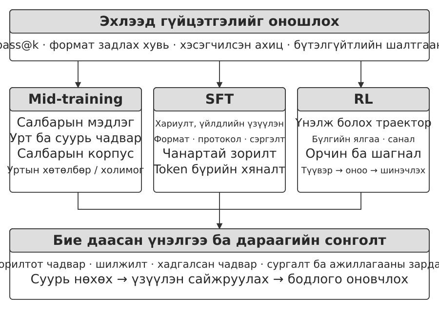

Хүснэгт 8-4 Mid-training, SFT ба RL-ийн сонголтын шалгуур

| Ажиглагдсан үзэгдэл | Түрүүлж шалгах зүйл | Нэр дэвшиж болох арга | Дараагийн үнэлгээний гол зүйл |
| --- | --- | --- | --- |
| Салбарын хэл, ойлголт эсвэл үндсэн үйлдэл сул, олон удаа түүвэрлэсэн ч ахиц бага | Корпусын хамрах хүрээ ба суурь чадвар | Mid-training; хайж болох баримтыг RAG-тай хослуулах | Салбарын даалгавар, ерөнхий чадварыг шалгах тестийн багц ба хэсэгчлэн зөв траектор |
| Агуулга ашиглаж болохуйц, харин формат, параметр эсвэл тогтсон урсгал тогтворгүй | Үзүүлэн, интерфэйс ба хязгаарлалт | SFT, хязгаарласан декодлоолт эсвэл Tool-ийн баталгаажуулалт | Задлан шинжилгээний амжилт, даалгаврын үр дүн ба сэргэх зан төлөв |
| Заримдаа даалгаврыг гүйцэтгэж чаддаг ч амжилтын хувь бага эсвэл байнга төөрөгддөг | Шагналын чанар, хайгуул ба даалгаврын тархалт | RL | Даалгаврын ашиг, шагналын ялгаа, бие даасан ерөнхийлөл ба зардал |
| Үзүүлэн эсвэл сонголтын өгөгдөл байгаа, харилцан үйлчлэлийн орчин хараахан бүрдээгүй | Офлайн өгөгдлийн хамрах хүрээ ба баталгаажуулах арга | SFT, RFT, офлайн сонголтын оновчлол | Суурь шугамын чанар, өгөгдлийн хазайлт ба орчин бүтээх ашиг |

Дөрвөн алхмаар урагшилж болно. Эхлээд Prompt, Context, Tool ба хязгаарлалтын шийдлийн суурь шугамыг тогтооно. Эдгээр арга аль хэдийн даалгаврын шаардлагыг хангаж байвал зохиогч гаднаас засварлаж болох шийдийг түрүүлж үлдээж, сургалт, байршуулалт ба регрессийн арчлалтын зардлыг бууруулна. Динамик баримтыг хайлт ба хувилбарын менежментээр өгнө; дахин дахин сурах шаардлагатай далд дүгнэлт, мэдрэхүйн хэв маяг ба тогтвортой зан төлөвийн хувьд л параметрийн сургалтаар сайжруулахыг бодно.

Хоёр дахь алхам, тусгаарласан даалгавар дээр амжилт, хэсэгчилсэн ахиц, задлан шинжилгээний үр дүн ба алдааны төрлийг ажиглана. Түүвэрлэлтийн тохиргоог тогтоосны дараа Pass@1 ба Pass@k нь одоогийн бодлого ашиглаж болох замтай эсэхийг харуулна; бүтэлгүйтлийн траектор мэдлэг дутагдсан, санал хүсэлт дутуу эсвэл урсгалд алдаатай гэдгийг ялгахад тусална.

Гурав дахь алхам, сурах шаардлагатай зан төлөвт үзүүлэн өгнө. JSON schema, Tool дуудлага, нэр томьёоны хэрэглээ, тодруулга ба сэргэлтийг SFT дээж болгон бичиж болох бөгөөд шаардлагатай мэдлэгийг харгалзах корпус ба даалгаврын Context-оор өгнө.

Дөрөв дэх алхам, RL-ийн санал хүсэлтийн нөхцөлийг үнэлнэ. Үнэлэгдэж болох нэр дэвшигч үүсгэж, шагнал ялгаатай гарч, орчин хангалттай харилцан үйлчлэл хийх боломж өгвөл бодлогын оновчлолын ашгийг харьцуулж болно; шагнал хэт сийрэг бол эхлээд сургалтын хөтөлбөр, хэсэгчилсэн шагнал эсвэл илүү тохирох анхны бодлогыг бодно.

Алхам бүрийн дараах хөрөнгө оруулалтыг үнэлгээний үр дүн шийднэ: формат нь тодорхой даалгаврыг SFT дуусгаад байршуулж болно, эхлэлийн цэг хүчтэй бол шууд RL хийж болно, салбарын үргэлжилсэн сургалтын дараа байгаа зааврын чадварыг дахин ашиглаж ч болно. Дараа нь нэг ээлжит даалгавраар үзүүлэнгийн суралцахуй ба шагналын суралцахуйн үүсгэдэг зан төлөвийн ялгааг тодорхой ажиглана.

Унших зааврын захиалгын асуудал руу буцъя. Нэг ижил бодит Tool-ийн тайлбарыг Model-д шууд өгч, параметрийг зөв бичиж чадах эсэхийг ажигла. Тайлбар дахь талбар аль хэдийн өөрчлөгдсөн бол эхлээд ажиллах үед лавлаж болох тайлбарыг шинэчил. Талбарын утга тодорхой мөртлөө Model хэрэглэгчийн текстийг захиалгын дугаарын байрлалд байнга бөглөдөг бол асуулга, тодруулга ба зөв параметр бөглөлтийг агуулсан SFT үзүүлэн өгч болно. Хэрэв тэр хааяа бүрэн гүйцэтгэж чаддаг, харин асуулгын дараалал өөр байх нь амжилтын хувь ба зардалд нөлөөлдөг бол олон бодлогын траекторыг харьцуулах нөхцөл бүрдсэн гэсэн үг.

## Нэг ээлжит бататгах сургалт: санах ой ба ерөнхийлөлийн харьцуулалт

Нэг ээлжит даалгавар нэг оролтоос эхэлж, Model хариулт илгээж шагнал авснаар дуусна. Model хариулт үүсгэхдээ олон алхамт дүгнэлт хийсээр байж болох бөгөөд сургалтын систем түүнийг нэг асуудлыг дахин дахин турших боломж олгож болно. Харилцан үйлчлэлийг нэг хариултад хязгаарлах нь сургалтын арга Model-ийн зан төлөвийг хэрхэн өөрчилдгийг ажиглахад хялбар болгоно. Дараа нь эхлээд AdaptThink-ээр Model дүгнэлтийн төсвийг хэрхэн хуваарилж сурдгийг тайлбарлаад, дараа нь GeneralPoints-оор SFT ба RL-ийг дүрэм ба харагдах байдал өөрчлөгдөх үеийн гүйцэтгэлээр харьцуулна.

RL алгоритм шагналыг ашиглан Model-ийг хэрхэн шинэчилдгийг ойлгосны дараа дараагийн туршилтуудын сургалтын процессыг уншиж болно. Энэ бүлгийн RL сургалт ихэвчлэн **бодлогын градиент**-д суурилдаг. Ижил асуултаас олон удаа түүвэрлэсэн жишээг авч үзвэл: Model хэд хэдэн хариулт үүсгээд, хариулт бүрийн шагналыг суурь шугамтай харьцуулна. Суурь шугамаас илүү хариулт эерэг дохио авч, сургалт түүний үүсэх магадлалыг өсгөнө; суурь шугамаас доогуур хариулт сөрөг дохио авч, үүсэх магадлал нь буурна.

Ганц шинэчлэлт Model-ийг хазайлгахаас сэргийлэхийн тулд тэргүүлэх **PPO** алгоритм магадлалын харьцаа заасан хязгаараас гарвал прокси зорилтын нэмэлт ашгийг тасалдаг; бодит шинэчлэлтийн хэмжээ суралцах хурд ба шинэчлэлтийн ээлжийн тооноос ч хамаарна. Дараах «үнэ цэнийн сүлжээтэй PPO» хэсэгт үнэ цэнийн үнэлгээ сурч, түүгээр харьцуулах суурь шугам бүрдүүлж, алхам бүрийн үйлдлийн давуу талыг тооцно. **GRPO** ижил асуудлын хэд хэдэн хариултыг шууд харьцуулж, бүлэг доторх шагналаар суурь шугам бүрдүүлдэг тул тусад нь үнэ цэнийн сүлжээ сургах шаардлагагүй болно.

Дараах Python маягийн псевдо код түүвэрлэлт, шагнал, давуу тал ба параметрийн шинэчлэлтийг холбож, алхам бүр мэдээллийг хэрхэн дамжуулдгийг ойлгоход тусална. Бодит сургалтад түүвэрлэлтийн зэрэгцээ, KL регулярчлал ба оновчлогчийг ч тохируулах шаардлагатай.

```python
for prompt in batch:
    group = [rollout(policy, env.reset(prompt)) for _ in range(G)]
    rewards = [verify(trajectory) for trajectory in group]
    advantages = normalize_within_group(rewards)       # GRPO baseline
    update(policy, group, advantages)
```

PPO урт нь өөр өөр траекторын бүлгээр бодлогыг хэрхэн шинэчлэх вэ? Эхлээд траектор бүрийн дотор, төгсгөлөөс нь эхлэн алхам бүрийн хямдруулсан өгөөжийг тооцно. Траектор дуусмагц нэмэлтийг зогсоож, дараагийн асуудлын шагналыг тооцоонд оруулахаас сэргийлнэ. Дараа нь бүх траектор дахь Model-ийн бодитоор сонгосон үйлдлүүдийг хамт авч, энэ бүлэг үйлдлийн дундаж алдагдлыг тооцно. Дараах нь олон ээлжит жижиг багцын оновчлолыг орхигдуулсан нэг шинэчлэлт юм.[^ch8-ppo-method]

```python
states, actions, returns = [], [], []
for trajectory in rollouts:
    states.extend(trajectory.states)       # үйлдэл сонгохоос өмнөх төлөв
    actions.extend(trajectory.actions)     # төлөвтэй зүйл бүрээр харгалзана
    returns.extend(discounted_returns(trajectory.rewards))

returns = tensor(returns)
values = value_model(states)
advantages = returns - stop_gradient(values)
ratio = exp(policy.log_prob(actions, given=states)
            - old_policy.log_prob(actions, given=states))
policy_loss = -mean(min(
    ratio * advantages,
    clip(ratio, 1 - epsilon, 1 + epsilon) * advantages
))
value_loss = mean((values - returns) ** 2)
update(policy, value_model, policy_loss + value_coef * value_loss)
```

GRPO-ийн «харьцангуй» нь ижил асуудлын хэд хэдэн хариултаас гардаг бол энд PPO үнэ цэнийн сүлжээгээр төлөв бүрийн хүлээгдэж буй өгөөжийг үнэлнэ. `old_policy` нь энэ бүлэг траекторыг үүсгэх үед царцсан бодлого. Нэг алхмын үйлдлийн давуу тал 1, одоогийн бодлого түүнд түүвэрлэлтийн үеийнхээс 1.4 дахин их магадлал өгч байна гэж үзье; `epsilon = 0.2` авбал прокси зорилтод энэ зүйлийн оруулах хувь нэмэр `min(1.4, 1.2) = 1.2`. Энэ үйлдлийн магадлалыг цаашид өсгөсөн ч энэ зүйлээс нэмэлт ашиг авахгүй.

Давуу тал −1 бол чиглэл эсрэгээрээ эргэнэ. Магадлалын харьцаа 0.6 болтлоо буурсан үед ижил мөрийн кодод орлуулбал `min(-0.6, -0.8) = -0.8` гарч, магадлалыг цаашид дарахад ч илүү ашиг олохгүй. Харин энэ муу гүйцэтгэлтэй үйлдэл илүү түгээмэл болж, магадлалын харьцаа 1.4 хүрвэл бага утгыг авбал `min(-1.4, -1.2) = -1.4` болж, түүний магадлалыг өсгөхөд зардал хэвээр төлөгдөнө.

> **Туршилт 8-10 ★★: AdaptThink — «хэзээ бодохгүй байх»-ыг сурах**
>
> Дүгнэлтийн Model асуудлыг шийдэхдээ ихэвчлэн урт гаргалгааны процесс ашигладаг. Энгийн асуудлын хувьд шууд хариулах нь гаралтын зардлыг хэмнэнэ. AdaptThink Model-д Thinking ба NoThinking гэсэн хоёр горим өгдөг: энэ протоколыг дэмждэг Model-д NoThinking нь `<think></think>`-оор гаргалгааны хэсгийг дуусгаж, дараа нь шууд хариулт үүсгэдэг. Сургалтын зорилго нь Model-д даалгавраас хамааран тохирох дүгнэлтийн төсвийг сонгохыг заах явдал.
>
> Арга нь хоёр гол бүрэлдэхүүн агуулна. **Хязгаарлагдмал оновчлолын зорилт** нь Model-ийг NoThinking-ийн хэрэглээний хувийг өсгөхийг урамшуулж, нэгэн зэрэг хариултын ерөнхий гүйцэтгэлийг хадгална; **чухал ач холбогдлын түүвэрлэлт** хоёр горимын түүвэрлэлтийн харьцааг тохируулж, жингийн засвараар түүвэрлэлтийн тархалт ба оновчлолын зорилтын зөрүүг залруулна. Анхны Model ихэвчлэн Thinking рүү хазайдаг тул NoThinking дээжийг идэвхтэй нэмсэн тохиолдолд л сургалт хоёр горимыг харьцуулах дохио авна. Эндхийн хүйтэн эхлэлийн асуудал нь тодорхойгоор сургалтын эхэн үед NoThinking дээж дутмаг байхыг хэлнэ.
>
> Энэ номын туршилт 8 ширхэг H100 80GB GPU ашигласан. Сургалтын 300 дахь алхамд MATH500-ийн нарийвчлал 81.00%-иас 81.80% болж, хариултын дундаж урт ойролцоогоор 4,911 token-оос 1,577 token болж буурсан; GSM8K-ийн нарийвчлал 79.68%-иас 81.88% болж, хариултын урт ойролцоогоор 1,025 token-оос 477 token болж буурсан; AIME mean@16 31.46%-иас 31.04% болж, хариултын урт ойролцоогоор 12,120 token-оос 6,402 token болж буурсан. Гурван бүлгийн хариултын урт тус бүр ойролцоогоор 68%, 53% ба 47%-иар буурсан.
>
> Гурван өгөгдлийн багц дахь NoThinking-ийн хувь дарааллаар 83.80%, 84.15% ба 56.25%. Model AIME дээр илүү их дүгнэлтийн тооцооллыг хадгалж, MATH500 ба GSM8K дээр илүү олон удаа шууд хариулсан. AIME2024-ийн асуудал бүрийг 16 удаа түүвэрлэж, mean@16 нь эдгээр 16 хариултын дундаж зөв хариултын хувийг тооцно. 300 дахь алхамд хариултын дундаж урт хоёр дахин орчим богиноссон бөгөөд нарийвчлал ойролцоогоор 0.42 нэгжээр буурсан.

> 300 дахь алхам нь сургалтын дундах нэг баталгаажуулалт байв. Баг анх 3,140 алхам сургахаар төлөвлөсөн боловч ажиллагаа дараа нь хэвийн бус байдлаар тасарч, сүүлийн баталгаажуулалтын бичлэг 410 дахь алхамд зогссон. Тухайн үед AIME2024-ийн дундаж зөв хариултын хувь 31.88%, хариултын дундаж урт ойролцоогоор 5,874 token байв.
>
> AdaptThink-ийг Prompt-ийн нэрэлттэй хослуулж болно: нэрэлт дахин дахин хэрэглэгддэг заавар ба бодлого бодох хэв маягийг параметрт бичиж, AdaptThink дараа нь даалгавар бүрт хэдий хэмжээний дүгнэлтийн тооцоолол хуваарилахыг сурна. Хоёулаа хамт хариултын чанар, хоцролт ба зардалд нөлөөлнө.

> **Туршилт 8-11 ★★: GeneralPoints — нэг ээлжит RL-ийн «санах ой ба ерөнхийлөл»-ийн харьцуулалт**
>
> Chu нар «24 оноо»-той төстэй GeneralPoints хөзрийн тоглоомоор Model-ийн ерөнхийлөл чадварыг шалгасан[^ch8-3]. Дөрвөн хөзрийн тоог тус бүр нэг удаа ашиглаж, нэмэх, хасах, үржүүлэх, хуваах үйлдлээр 24 гаргана. Model асуудлыг бодож сурсан бол хөзрийн дүрэм эсвэл өнгийг сольсны дараа ч зөв бодож чадах уу? Зураг 8-12-т хоёр төрлийн асуултын хэлбэрийг өгсөн: GP-L шууд текстээр өгдөг бол GP-VL Model-ээс хөзрийн дүрсийг уншихыг шаардана.
>
> 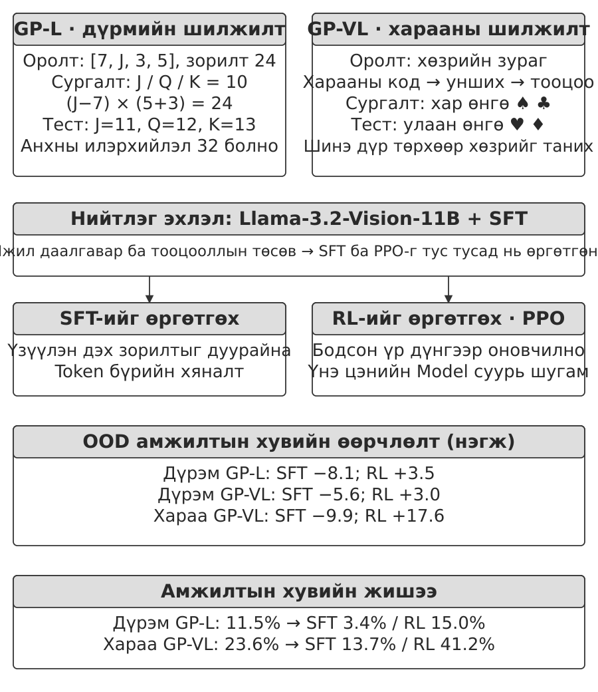
>
> **Дүрмийн хувилбар**: сургалтын үед J/Q/K бүгд 10 гэж тооцогдож, туршилтын үед 11/12/13 гэж тус тус тооцогдоно. Туршилтын багц сургалтад байгаагүй тоон хослолыг агуулах тул Model шинэ дүрмээр 11, 12, 13-ыг ашиглан тооцож чадах эсэхийг шалгаж болно. **Харааны хувилбар**: сургалтад хар өнгийн хөзөр (♠♣), туршилтад улаан өнгийн хөзөр (♥♦) ашиглаж, Model хөзрийн харагдах байдлын өөрчлөлтөд дасан зохицож чадах эсэхийг шалгана.
>
> Туршилт Llama-3.2-Vision-11B-ээс эхэлж, эхлээд SFT-ээр заавар дагах суурь чадварыг бүрдүүлээд, дараа нь үргэлжлүүлсэн SFT ба RL гэсэн хоёр сургалтын салбарт хувааж, ижил тооцооллын төсвөөр харьцуулна. RL салбар үнэ цэнийн сүлжээтэй PPO ашиглана. Хоёр салбар J/Q/K=10 гэсэн дүрмээр сургагдаж, дараа нь тархалтын доторх (ID) ба тархалтаас гадуурх (OOD) туршилтын багцуудад үнэлэгдэнэ.
>
> `[7, J, 3, 5]`-ыг жишээ болгоход, J=10 үед `(J−7)×(5+3)=24` ашиглаж болно; J 11 болсны дараа энэ илэрхийлэл 32 болох тул `(11−5)×(7−3)=24` болгон солих шаардлагатай. Ижил хөзрийн багц Model-ээс одоогийн дүрмийг уншиж, тооцоогоо дахин зохион байгуулахыг шаардана.
>
> Хоёр сургалтын арга тархалтаас гадуурх туршилтад мэдэгдэхүйц зөрүү харуулсан. **Дүрмийн OOD**: GP-L дээр RL-ийн амжилтын хувь 11.5%-иас 15.0% болж, 3.5 нэгжээр өссөн; SFT 11.5%-иас 3.4% болж, 8.1 нэгжээр буурсан. GP-VL дээр RL 3.0 нэгжээр өсч, SFT 5.6 нэгжээр буурсан. **Харааны OOD**: GP-VL дээр RL 23.6%-иас 41.2% болж, 17.6 нэгжээр өссөн; SFT 23.6%-иас 13.7% болж, 9.9 нэгжээр буурсан.
>
> Хөзөр таних үр дүнг цааш шалгаснаар эцсийн хариултын гүйцэтгэлийг харааны мэдрэхүйтэй холбож болно: RL салбарын таних нарийвчлал даалгаврын амжилтын хувьтай хамт өссөн бол SFT салбарын таних нарийвчлал буурсан. Судалгаа энэ зөрүүг сургалтын зорилттой холбосон: token бүрээр ойртуулах нь үзүүлэн дэх текстэн хэв маягийг бэхжүүлж болох бол үр дүнгийн шагнал Model-ээс хөзрийн дүрсийг зөв уншиж, тооцоогоо дуусгахыг тасралтгүй шаарддаг. Мэдрэхүйн нарийвчлал энэ механизмыг шинжлэх завсрын үзүүлэлт болсон.
>
> Эхлээд SFT хийх шалтгааныг гаралтын форматаас ч ойлгож болно. Туршилтын Llama-3.2-Vision-11B суурь Model шаардсан бүтэцтэй гаралтыг тогтвортой үүсгэж чадаагүй тул баталгаажуулагч даалгаврын шагналыг тооцож чадаагүй бөгөөд шууд end-to-end RL хийх оролдлого бүтэлгүйтсэн. SFT эхлээд задлан шинжилж, үнэлэж болох гаралтыг бүрдүүлсний дараа л дараах RL даалгаврын санал хүсэлтийг ашиглаж чадна. Өмнө дурдсан DeepSeek-R1-Zero бол анхнаасаа үнэлэгдэж болох хариулт үүсгэж чаддаг суурь Model-оос эхэлж, шууд RL-д орсон.
>
> Model баталгаажуулагчийн санал хүсэлтээс хэр ихийг сурч чадах вэ? Өгүүллийн 10 дугаар зураг зөвхөн текстэн хөзрийн даалгавар (GP-L)-ыг тусад нь харьцуулсан. Судлаачид 1, 3, 5, 10 удаагийн баталгаажуулалтын давталт тогтоож, RL Model-ийг тус тусад нь сургаж, үнэлсэн. Ижил сургалтын тооцооллын төсвөөр 10 удаа баталгаажуулахыг зөвшөөрсөн бүлэг шинэ дүрэм дээрх амжилтын хувийг тухайн бүлгийн сургалтын эхлэлийн цэгээс 5.99 нэгжээр өсгөсөн бол зөвхөн 1 удаа баталгаажуулсан бүлэг 0.48 нэгжээр өсгөсөн.
>
> Энэ туршилтын тархалтын шилжилтэд SFT-ийн гүйцэтгэл яагаад буурч, RL илүү сайн болсон бэ? Ажиглалттай нийцэх нэг тайлбар: хязгаарлагдмал SFT өгөгдөл «J/Q/K-той тулгарвал 10 гэж үз» гэсэн тогтсон хэв маягийг бэхжүүлсэн; туршилтын үед J=11 байсан ч Model 10 гэж тооцсоор байна. Үр дүнд чиглэсэн RL салбар «зөв хариулт гарах хүртэл дахин тооцох» стратегийг илүү бэхжүүлж болох тул J 11 болсон үед ч хэрэглэж чадсан.
>
> GeneralPoints-ийн дүрмийн өөрчлөлт ба өнгөний өөрчлөлт нь Model шинэ нөхцөлөөр тооцож сурсан эсэх, шинэ харааны оролтыг зөв уншсан эсэхийг тусад нь ажиглах боломж өгнө. Эндхийн Model, сургалтын өгөгдөл ба туршилтын төсвийн хувьд SFT-ийг үргэлжлүүлсэн салбар тархалтаас гадуурх туршилтад ухарч, RL-тэй холбосон салбар сайжирсан. Дүгнэлтийг өөрийн даалгаварт ашиглахын тулд эхлээд асууж болно: оюутан гаралтын формат аль хэдийн эзэмшсэн үү? Шинэ туршилт дүрмийг өөрчилсөн үү, оролтын байдлыг өөрчилсөн үү, эсвэл хоёуланг нь өөрчилсөн үү? Харьцуулалтыг тусад нь хийж байж үзүүлэн нэмэх, мэдрэхүйг сайжруулах эсвэл үр дүнгийн санал хүсэлттэй хайгуулыг нэмэгдүүлэх шаардлагатайг мэдэж болно.

## RL алгоритм: 16 rollout-оос нэг параметрийн шинэчлэлт хүртэл

**GRPO (Group Relative Policy Optimization)**-ийг DeepSeek санал болгосон бөгөөд ижил асуудлын олон оролдлогын харьцангуй гүйцэтгэлээр суралцах дохио бүрдүүлдэг. SWE-bench маягийн кодын засварын даалгаврыг жишээ болгоё: Python төслийн `parser.py` хоосон оролтод `IndexError` үүсгэдэг бөгөөд Agent хэрэгжүүлэлтийг засаж, тестийн файлыг өөрчлөхгүй байх ёстой. Нэг сургалтын давталтыг дөрвөн алхамд хувааж болно.

**Эхний алхам: бодлогын Model-оор давтан оролдуулах.** Бодлогын Model нь сургагдаж буй хэлний Model өөрөө. Систем ижил анхны код ба асуудлын тайлбарыг 16 тусгаарлагдсан sandbox-д хийж, Model-д 16 даалгаврыг бие даан гүйцэтгүүлнэ. Удаа бүр кодыг уншиж эхэлж, засвар, тест хийгээд үр дүнг илгээх хүртэл үргэлжилнэ; энэ бүхэн нэг **rollout** гэнэ. Санамсаргүй түүвэрлэлт ижил эхлэлийн цэгээс өөр өөр зам үүсгэдэг: зарим нь хилийн шалгалтыг нөхдөг, зарим нь зөвхөн алдааг барьдаг, зарим нь буруу файлыг засдаг, зарим нь тестийг өөрчлөхийг оролддог.

**Хоёр дахь алхам: шагналыг тооцох.** Rollout бүр дууссаны дараа баталгаажуулагч цэвэр орчинд нөхөөсийг хэрэглэж, тестийг ажиллуулна. 16 оролдлогын 4 нь бүх тестийг давж, тестийн файлыг өөрчлөөгүй, бусад 12 нь бүтэлгүйтсэн гэж үзвэл давсан 4 нь 1 шагнал, үлдсэн 12 нь 0 шагнал авна. Зураг 8-13 эдгээр 16 траекторын үнэлгээг нэг хүснэгтэд байрлуулсан. Ийм кодын даалгаварт шагналыг тест ба дүрмээр шууд тооцож болно. Уншигдах байдал, тайлбарын чанар зэрэг тест болгон бичихэд хүнд зорилтын хувьд хүний үнэлгээ эсвэл шагналын Model-ийг хослуулж болно.

**Гурав дахь алхам: харьцангуй давуу талыг тооцох.** Шагнал зөвхөн нэг траектор амжилттай эсвэл бүтэлгүй болсныг хэлдэг бол **харьцангуй давуу тал** нь тухайн бүлгийн бусад оролдлоготой харьцуулахад хэр сайн болсныг хэлнэ. Энэ бүлгийн дундаж амжилтын хувь 4/16: шалгалтыг давсан 4 нь бүлгийн дунджаас өндөр тул эерэг давуу тал, бүтэлгүйтсэн 12 нь дунджаас доогуур тул сөрөг давуу тал авна. Бүлэг доторх стандарт хазайлтаар нормчилбол шагналын дундаж 0.25, стандарт хазайлт ойролцоогоор 0.433 бөгөөд амжилттай траекторын давуу тал ойролцоогоор 1.73, бүтэлгүй траекторынх ойролцоогоор −0.58. GRPO ийм бүлэг доторх харьцуулалтаар суралцах дохио бүрдүүлдэг. 16 шагнал бүрэн ижил бол мөр бүрээс бүлгийн дунджийг хасч тэг гарна. Хуваагчид маш бага тогтворжуулах гишүүн нэмэхэд тэгд хуваахаас сэргийлнэ; нормчилсны дараа ч энэ бүлгийн үр дүнгийн шагнал сургалт аль траектор руу хазайх ёстойг зааж чадахгүй хэвээр. Ийм үед замын хязгаарлалт, процессын шагнал эсвэл хэсэгчилсэн ахиц бүлгийн траекторуудыг ялгаж чадах эсэхийг шалгаж болно. Жишээлбэл, кодыг засаж чадаагүй хоёр оролдлогын зөвхөн нэг нь өмнө нь бүтэлгүйтсэн хилийн тестийг давсан. Энэ завсрын үр дүнг бие даан баталгаажуулж чадвал суралцахад ашиглаж болох нэг сэжүүр нэмэгдэнэ.

**Дөрөв дэх алхам: градиентийн буулгалтаар бодлогыг шинэчлэх.** Сургалтын программ харьцангуй давуу талыг сургалтын алдагдал болгон хувиргаж, градиентийг тооцоод, оновчлогч (жишээ нь AdamW, Muon) градиентийн буулгалтыг гүйцэтгэж, эерэг давуу талтай траектор дахь Model-ийн сонголтын магадлалыг өсгөж, сөрөг давуу талтай траектор дахь сонголтын магадлалыг бууруулна. Сургалт олон даалгавар ба rollout дээр эдгээр сонголтын магадлалыг дахин дахин тохируулна. Оновчлол аажмаар үр дүнгээ өгөхөд ижил төстэй алдаатай тулгарахад «эхлээд асуудлыг давтан гаргаж, хилийн нөхцөлийг шалгаж, хэрэгжүүлэлтийг засаад тест ажиллуулах» илүү олон гарч, «алдааг нуун, тестийг өөрчилж, баталгаажуулалгүй илгээх» цөөн гарна.

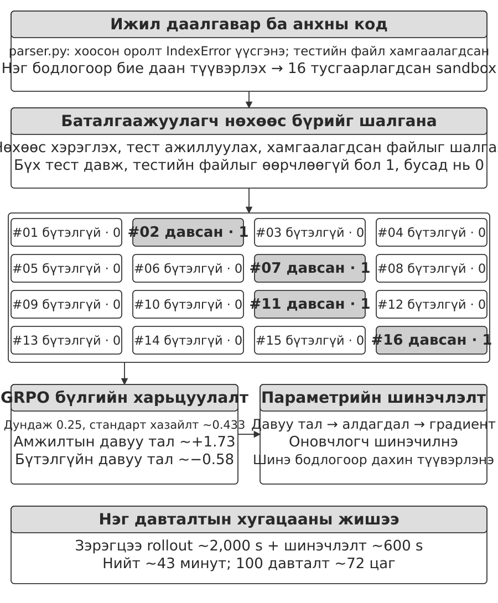

Зураг 8-13-т ижил асуудлыг 16 удаа түүвэрлэхэд хэдэн **сургалтын давталт (step)** болох вэ? Энэ хэсгийн тооллоор эдгээр 16 rollout нэг багцад хамаарна. $k$ дахь ээлжид одоогийн бодлогоор түүвэрлэж, шагнал, давуу тал ба градиентийг тооцоод бодлогыг нэг удаа шинэчилнэ; $k+1$ дэх ээлжид шинэ параметрээр дахин түүвэрлэнэ. 100 step сургах гэдэг нь ийм давталтыг ойролцоогоор 100 удаа хийхийг хэлнэ.

Үүнд тулгуурлан сургалтын хугацааг тооцож болно. Нарийн төвөгтэй нэг даалгавар хэдэн арван ээлжийн Tool дуудлагыг агуулж болно; синхрон сургалт бүх багцын үр дүнг хүлээх үед 16 зэрэгцээ траекторийн хамгийн удаан нь түүвэрлэлтийн үе хэзээ дуусахыг шийднэ. Тэр ойролцоогоор 2,000 секунд зарцуулж, градиентийн тооцоолол ба оновчлогчийн шинэчлэлт дахин 600 секунд зарцуулна гэвэл нэг step ойролцоогоор $2{,}000+600=2{,}600$ секунд, өөрөөр хэлбэл 43 минут болно. Ижил хугацаагаар 100 step сургавал ойролцоогоор 72 цаг шаардагдана.

PPO ба GRPO хоёулаа энэ хаалттай давталтыг дагадаг бөгөөд ялгаа нь голчлон «хэнийг харьцуулах вэ»-д байна. GRPO ижил асуудлын олон rollout-ыг шууд харьцуулж, нэмэлт үнэ цэнийн Model шаарддаггүй; PPO үнэ цэнийн Model сургаж, траекторын алхам бүрд «дунджаар хэр сайн хийж чадах вэ»-г үнэлээд, одоогийн үйлдэл энэ хүлээлтээс илүү сайн эсэхийг дүгнэж, алхам алхмын итгэлийн хуваарилалтад хэрэгтэй суурь шугамыг өгдөг. Хоёулаа прокси зорилтыг таслах зэрэг механизмаар хэт том шинэчлэлтийг хязгаарладаг. DPO өөр: тэр урьдчилан цуглуулсан «илүү сайн хариулт—муу хариулт» сонголтын хосыг шууд сурдаг бөгөөд одоогийн бодлогыг энэ rollout-ы бүлгийг онлайнаар үүсгэхийг шаарддаггүй.

Энэ бүлгийн жишээнүүд өөр өөр сургалтын жор ашигласан: AdaptThink өөрөө тодорхойлсон хязгаарлагдмал зорилт хэрэглэсэн; GeneralPoints, V-IRL ба ReTool PPO ашигласан бөгөөд эхний хоёрын үнэ цэнийн Model давуу талын үнэлгээнд оролцсон; SimpleVLA-RL ба RLVP GRPO ашигласан.

А ба Б гэсэн хоёр асуудлыг тус бүр дөрвөн удаа туршъя: А бүгд зөв, Б бүгд буруу. А-гийн дөрвөн шагнал бүгд 1, Б-гийн дөрвөн шагнал бүгд 0. Бүлэг доторх дунджийг хасахад хоёр бүлгийн давуу тал хоёулаа 0 болно. Харин тооцооллын нөөц байгаа бол дахин хэдэн удаа туршихад алийг нь сонгох нь ашигтай сургалтын дээж авах магадлал өндөр вэ?

Never Give Up энэ сонголтыг түүвэрлэлтийн процесст оруулсан. А бүгд зөв бол энэ бүлгийг алгасна; Б бүгд буруу бол тодорхой магадлалаар нэг бүлэг нэмж түүвэрлэнэ. Хоёр дахь бүлэгт нэг удаа зөв хариулсан гэж үзвэл сургалтын үед хоёр бүлгийн нийт найман хариултыг хамт авч үзнэ: нэг зөв ба долоон буруу шийдэл, ижил асуудалд өндөр ба нам шагналын ялгаа бүрдэнэ. Асинхрон түүвэрлэлт бусад асуудлыг хэвийн үргэлжлүүлэх боломж олгож, Б-гийн үр дүнг хүлээх шаардлагагүй.[^ch8-ngu]

[^ch8-ngu]: Michael Noukhovitch нар, *Learning to Solve Hard Problems in RL for LLMs by Never Giving Up*, 2026. Өгүүлэл дэх нэмэлт түүвэрлэлт сургалтад ашиглагддаг; зөв болсон асуудлыг дараах сургалтад дахин түүвэрлэж болно.

### LLM-ийн RL-д яагаад ихэвчлэн On-Policy-г түрүүлж сонгодог вэ

**Online (онлайн)** ба **On-policy (траектор дээр)** хоёр өөр талыг тодорхойлно. Онлайн сургалт ажиллагааны явцад орчинтой тасралтгүй харилцан үйлчилж өгөгдөл үүсгэдэг; траектор дээрх сургалт өгөгдлийн эх сурвалжид анхаарч, траектор үүсгэсэн зан төлөвийн бодлого $\mu$ нь оновчлох гэж буй бодлого $\pi_\theta$-тэй ижил эсвэл хангалттай ойр байхыг шаарддаг. Асинхрон кластер онлайнаар тасралтгүй түүвэрлэж чадах ч ажилчин хэд хэдэн checkpoint-оор хоцролттой бол буцаах өгөгдөл бодлогын хоцролттой болж, off-policy бүрэлдэхүүн үүснэ.

Зохиогч эхлээд траектор дээрх сургалтад ойрхон тогтвортой суурь шугам тогтоож, дараа нь дамжуулах чадварыг өсгөхийн тулд асинхрон түүвэрлэлт эсвэл хуучин өгөгдлийг дахин ашиглахыг нэвтрүүлэхийг зөвлөдөг. Энэ бүлгийн PPO/GRPO-ийн жор ихэвчлэн step бүрийн эхэнд хамгийн шинэ бодлогоор түүвэрлэдэг. Дараа нь PPO ижил өгөгдөл дээр олон удаа жижиг багцаар шинэчлэлт хийдэг тул одоогийн бодлого өгөгдөл үүсгэсэн `old_policy`-оос аажмаар холдоно. Магадлалын харьцаа энэ өөрчлөлтийг хэмжиж, таслах зорилт хэт том шинэчлэлтийг хязгаарлана.

Бодлогын градиентийн зорилт нь одоогийн бодлого $\pi_\theta$-ийн дорх хүлээгдэж буй шагналтай холбоотой. Зан төлөвийн бодлого $\mu$-ээр түүвэрлэсэн өгөгдөл ашиглахдаа эхлээд ижил төлөв дэх үйлдлийн магадлалын харьцааг тооцоод, үүнд тулгуурлан чухал ач холбогдлын засварыг бүрдүүлж болно:

$$
\rho_t=\frac{\pi_\theta(a_t\mid s_t)}{\mu(a_t\mid s_t)}
=\exp\left(\log\pi_\theta(a_t\mid s_t)-\log\mu(a_t\mid s_t)\right).
$$

Нэг ижил угтварын дараа түүвэрлэлтийн бодлого тодорхой token-д 0.2 магадлал өгч байсан бол одоогийн бодлого түүнд 0.3 өгч байна гэж үзвэл энэ алхмын магадлалын харьцаа 1.5. Тэр хуучин дээжид харьцангуй цөөн гарч байсан тул одоогийн бодлогоор тооцоход ийм дээжийн жин харгалзах байдлаар өснө. Түүвэрлэлт ба сургалт ижил бодлого ашигладаг бол параметрийн шинэчлэлтийн өмнө алхам бүрийн магадлалын харьцаа 1 байна.

Хуучин траекторыг дахин ашигласнаар түүвэрлэлт ба сургалтыг асинхроноор явуулж, дамжуулах чадварыг өсгөж болно. Харин хоёр бодлого чинээ холболсон төдий чинээ цөөн дээж маш том жин авч болно. Бүх траекторыг дахин жинлэхэд алхам бүрийн магадлалын харьцааг хооронд нь үржүүлэх шаардлагатай. PPO үйлдэл бүрийн прокси зорилтод нэмэлт ашгийн нэг хэсгийг таслах нь хэт туйлын магадлалын харьцааны нөлөөг сулруулж чадна; хуучин дээжийн хэзээ ч очоогүй төлвийг зөвхөн шинэ түүвэрлэлтээр харж чадна. Зохиогч шинэ траектор ашиглахыг илүүд үздэг шалтгаан ч энэ.[^ch8-32]

#### Сургалт ба таамаглалын тоон зөрүү

Том хэмжээний LLM-ийн бататгах сургалт ихэвчлэн vLLM, SGLang зэрэг таамаглалын хөдөлгүүрээр түүвэрлэж, дараа нь FSDP, Megatron зэрэг сургалтын системээр логарифм магадлал ба градиентийг тооцдог. Хоёр тал ижил жин ачаалсан ч хөвөгч цэгийн нарийвчлал, нэгтгэлийн дараалал, тензорын зэрэгцээ ажиллагаа, багцын хэмжээ, KV Cache ба нэгтгэсэн kernel-ийн ялгаанаас болж ижил token-д бага зэрэг ялгаатай логарифм магадлал тооцож болно. Ийм үед параметр хараахан шинэчлэгдээгүй байхад $\rho_t$ 1-ээс хазайж, сургалт ба түүвэрлэлтийн хооронд тоон түвшний бодлогын зөрүү гарна. Хяналттай туршилт маш бага token-ийн түвшний зөрүү ч сургалтыг сүйрүүлж болохыг илрүүлсэн.[^ch8-33]

Түүвэрлэлтийн тархалт өөрчлөгдвөл хоёр үйлдлийн шагнал бүрэн ижил байсан ч энгийн бодлогын градиент нэг рүү хазайж болно. Түүвэрлэлтийн үед A ба B тус бүр хагас боломжтой байсан бол сургалтын үед Model A-г сонгох магадлал 0.8 болсон гэж үзье. A-г удирддаг logit-ийн хувьд A сонгогдох үед логарифм магадлалын градиент $1-0.8=0.2$; B сонгогдох үед $0-0.8=-0.8$. Хоёр үйлдэл бүгд 1 оноо авбал түүвэрлэлтийн үеийн магадлалаар дунджилбэл градиент $-0.3$ болно. Хоёр сонголт ижил оноо авсан атал шинэчлэлт A-гийн магадлалыг дарж байна.

Score centering нь ижил угтварын дорх логарифм магадлалын градиентаас түүний түүвэрлэлтийн тархалт дахь дунджийг хасдаг. Дээрх жишээнд $-0.3$-ыг хасахад хоёр гишүүн $0.5$ ба $-0.5$ болж, ижил шагналын үүсгэх дундаж шинэчлэлт яг тэг болно. Өмнөх GRPO бүлэг хариултын шагналаас дунджийг хассан; энд дунджилж буй зүйл нь градиент.[^ch8-sc]

[^ch8-sc]: Martin Marek, Max Ryabinin, *Score Centering Stabilizes Off-policy Reinforcement Learning*, 2026. Түүвэрлэлтийн бодлого хэт хол хоцорсон үед KL регулярчлалаар сургалтын бодлого ба зан төлөвийн бодлогын хоорондын зайг хязгаарлаж ч болно (arXiv:2611.21791).

Сургалтын тал ба түүвэрлэлтийн талын тоон алдаа урт дараалалд хэтэрхий өсөж ч болно: **логарифм магадлалын алдаа → магадлалын харьцааны хазайлт → урт угтварт хуримтлагдах → таслалт ба давуу талын жинлэлтийн өөрчлөлт → градиент ба үр дүнтэй дээжийн тооны өөрчлөлт**. Жишээлбэл, 4,000 token-ийн логарифм магадлалын харьцаа бүгд ижил чиглэлийн $10^{-3}$ хазайлттай бол тооцсон траекторын түвшний магадлалын харьцаа бодит утгаас $e^{4000\times0.001}=e^4\approx54.6$ дахин их болно.

Эрт үеийн магадлалын өөрчлөлт түүвэрлэлтийн үр дүнг ч өөрчилж, дараагийн төлөв өөр замаар хөгжиж болно. Сургалтад ажиглаж болох дохиод чухал ач холбогдлын харьцааны оргил, таслалтын хувийн өсөлт, градиент эсвэл хариултын уртын гэнэтийн өөрчлөлт, мөн шагнал ба энтропийн бууралт орно. Багцын хэмжээ нэгтгэлийн процессыг өөрчлөхөд ижил оролтын тоон үр дүн ч өөрчлөгдөж болох бөгөөд үүнийг багцын инвариант чанар (batch invariance) алдагдсан гэнэ. Холбогдох судалгаа үүнээс үүсэх далд off-policy нөлөөг ажиглаж, түүвэрлэлт ба сургалтын тооцооллыг зэрэгцүүлэх эсвэл бодлогын зөрүүг ил засах замаар тогтвортой байдлыг сайжруулсан.[^ch8-34]

Иймээс зохиогч түүвэрлэлт ба сургалтын тоон нийцлийг сургалт эхлэхээс өмнөх гол шалгалт гэж үздэг бөгөөд шагналын муруйтай хамт тасралтгүй хянадаг. «Зөрүүг хэмжих—тохиргоог зэрэгцүүлэх—хазайлтыг засах—хоцролтыг хянах» гэсэн дөрвөн алхмаар боловсруулж болно:

- **Ямар ч параметрийн шинэчлэлтийн өмнө** ижил бүлэг траектороор түүвэрлэгч (sampler) ба сургалтын тал (trainer)-ын өгсөн token-ийн логарифм магадлалыг харьцуулж, $\rho_t$-ийн дундаж, квантил, хамгийн их утга, ойролцоо KL ба таслагдсан хувийг хяна; энэ нь хамгийн шууд on-policy нэгж тест юм.
- Жин зэрэгцүүлэхдээ LoRA адаптер, токенизатор, ярианы загвар, Model-ийн хувилбар ба байрлалын кодчиллын тохиргоог хамт зэрэгцүүлнэ. Rollout нь түүвэрлэлтийн бодлогын үүсгэх үед өгсөн логарифм магадлалыг хадгалж, дараа нь үүнд тулгуурлан магадлалын харьцааг тооцно.
- Түүвэрлэлт ба сургалтын нарийвчлал, зэрэгцээ ажиллагааны зохион байгуулалт ба гол тооцооллын kernel-ийг аль болох зэрэгцүүл; зэрэгцүүлж чадахгүй бол зөрүүг тодорхой off-policy гэж үзэж, чухал ач холбогдлын засвар хийж, үр дүнтэй дээжийн тоог хянаж, таслалтын хувьтай хамт засварын үр нөлөөг үнэл.
- Шинэчлэгдсэн бодлогоор цаг тухайд нь дахин түүвэрлэж, багц өгөгдөл дээрх шинэчлэлтийн ээлжийн тоо, мөн асинхрон түүвэрлэлтийн сургалтаас хоцрох checkpoint-ийн тоог хязгаарла.

## RL орчин: үнэлгээнээс симуляци хүртэл

Agent-ийн RL сургалт даалгаврыг дахин дахин гүйцэтгэхийг шаарддаг. Нэг кодын засварыг тусгаарлагдсан хуулбарт дахин оролдож болох бол нэг төлбөрийн гүйлгээ бодит дансны төлвийг өөрчилнө. Сургалтын орчин дахин тохируулж болох анхны төлөв, зэрэгцүүлж болох даалгаврын хуулбар ба баталгаажуулж болох үр дүнг өгч, Model-д хяналттай нөхцөлд өөр өөр замыг судлах боломж олгох ёстой. Бүлэг 7-д үнэлгээний орчныг аль хэдийн танилцуулсан; сургалтад ашиглахдаа урт хугацааны ажиллагаа, үйлдлийн гаж нөлөө ба олон харилцан үйлчлэлийн зардлыг ч бодох хэрэгтэй. Зохиогч эхлээд орчин байгуулалтад хүн хүч ба төсөв хуваарилж, дараа нь том хэмжээний сургалтыг төлөвлөдөг. Бодит санал хүсэлт, төлөв дахин тохируулах ба зэрэгцээ тусгаарлалтыг хэрэгжүүлэх нь PPO эсвэл GRPO-г холбохоос ихэвчлэн илүү инженерийн нөөц зарцуулдаг бөгөөд орчин байгуулах зардал сургалтаас ч давж болно.

### Орчин: Model-ийн дадлага хийх талбар

Орчин үйлдлийн дагуу төлвийг шинэчилж, шинэ ажиглалтыг Model-д буцаана. Орчин бүтээхдээ гурван асуултаас эхэлж болно.

- **Харилцан үйлчлэл нь ашиглалтын нөхцөлд ойрхон уу?** Хэрэглэгчийн үйлчилгээний симулятор хэрэглэгчийн нэмэлт мэдээлэл өгөх, шаардлагаа өөрчлөх ба бүрхэг илэрхийлэх зэрэг нөхцөлийг хамах ёстой; Tool-ийн симулятор үйлдвэрлэлд түгээмэл гардаг алдаа ба хоцролтыг буцаах ёстой. Model эдгээр санал хүсэлтээр бодит асуудлыг шийдэж сурна. Хэт нэг хэв маягтай санал хүсэлт бодлогыг симуляцийн тогтсон загварт тулгуурлуулна.
- **Даалгаврыг тогтвортой дахин оролдож, зэрэгцүүлж болох уу?** Rollout бүрт бие даасан захиалга, файл эсвэл дансны төлөв хэрэгтэй бөгөөд дууссаны дараа цэвэрлэж, сэргээж чаддаг байх ёстой. ReTool-ийн кодын тайлбарлагчийн sandbox ба AWorld-ийн MCP sandbox ийм үүрэг гүйцэтгэдэг. Хурдны хязгаарлалт, зардал эсвэл бичих гаж нөлөөтэй бодит API-д даалгаврын хэрэгцээгээр sandbox данс, дахин тоглуулах өгөгдөл эсвэл симуляцийн интерфэйс ашиглаж болно.
- **Үр дүнг хэрхэн дүгнэх вэ?** Орчны төлөв нь шагнал тооцох чухал үндэслэл. Жишээлбэл, буцаалтын даалгаварт дүн, захиалгын төлөв ба зөвшөөрлийн нөхцөлийг шалгаж болно; кодын даалгаварт тест ажиллуулж болно. Шагналын дизайныг дараа тусгайлан авч үзнэ.

**Алгоритм тохируулж эхлэхээс өмнө зохиогч эхлээд шалгахыг зөвлөдөг: симуляцийн орчин бодит даалгаварт хангалттай ойрхон уу? Энэ нь PPO эсвэл GRPO-г сонгохоос илүү чухал.** Нарийвчлал, дахин тохируулах боломж ба баталгаажуулах чадвар хамтдаа Model харилцан үйлчлэлээс юу сурахыг тодорхойлно. Эхлээд цөөн даалгавраар эдгээр гурван шатыг бүрэн туршиж, дараа нь сургалтын хэмжээг өргөтгөвөл асуудлыг илрүүлэхэд ихэвчлэн хялбар байдаг.

### Model-оор Tool ба орчныг дуурайх

Хайлтын үр дүн, хэрэглэгчийн яриа ба нарийн төвөгтэй бизнесийн төлвийг Model-ийн тусламжтайгаар синтезэлж болно. Model-ийн симулятор Agent-ийн үйлдлийг хүлээн авч, дараагийн санал хүсэлтийг үүсгэж, бодит цагийн гадаад үйлчилгээнээс хамаарлыг бууруулна. Энэ аргыг нэг Tool-оос бүх даалгаврын орчин руу өргөтгөж болно.

**Эхний давхарга: Tool-ийн буцаах утгыг синтезлэх.** ZeroSearch[^ch8-13] LLM-ийг хайлтын системийн үүрэг гүйцэтгүүлдэг: оюутан асуулга илгээхэд симулятор хайлтын үр дүнг үүсгэнэ. Ингэснээр сургалт бодит хайлтын API-ийн зардал, хурдны хязгаарлалт ба үр дүнгийн хэлбэлзлээс хамаарахыг багасгана. Мөн сургалтын хөтөлбөрийн маягийн зохион байгуулалт ашиглаж, эхэнд өндөр чанартай, холбогдол ихтэй баримт бичиг буцааж, дараа нь аажмаар шуугианыг нэмж, оюутанд төгс бус материалаас хэрэгтэй мэдээлэл гаргахыг дадлагажуулна. Судалгаанд Model симуляцийн хайлтын орчинд сургалтаа дуусгаад, бодит хайлтын системд холбогдсон ч сайн гүйцэтгэл үзүүлсэн.

**Хоёр дахь давхарга: орчны төлвийн шилжилтийг дуурайх.** DreamGym[^ch8-14] орчны динамикийг дүгнэлтийн туршлагын Model руу нэрдэг. Model одоогийн төлөв ба Agent-ийн үйлдлийг уншиж, дараагийн төлөв ба санал хүсэлтийг гаргаж, онлайн RL-д ашиглах харилцан үйлчлэлийн траекторыг бөөнөөр үүсгэснээр бодит орчинд хандах хэрэгцээг багасгана. Хэрэглэгчийн үйлчилгээ ба борлуулалтын даалгаварт LLM-ээр хэрэглэгчийн үүрэг гүйцэтгүүлж, нэмж асуух, мэдээлэл нөхөх ба шаардлага өөрчлөх байдлыг дуурайлгаж болно. τ-bench цуврал хэрэглэгчийн симулятор ашигласан; ижил төстэй харилцан үйлчлэлийн фрэймворкийг сургалтад ч ашиглаж, дадлага ба үнэлгээний үүргийг тус тусад нь гүйцэтгүүлж болно.

Model-ийн симуляторыг ч тохируулах хэрэгтэй. Хэрэглэгчийн үйлчилгээний симулятор бүрхэг асуултыг үргэлж зөв ойлгодог бол бодлого тодруулга хийх дадлага хийх боломжгүй болно; хайлтын симулятор үргэлж зөв баримт бичиг буцаадаг бол бодлого шуугианыг таних туршлагагүй болно. Сургалт симуляторын үнэлгээний дутагдлыг ашигладаг зан төлөвийг ч бэхжүүлж болно. Зохиогч холимог аргыг санал болгодог: харилцан үйлчлэлийн ихэнхийг Model-ийн симуляциар гүйцэтгэж, тодорхой хугацаанд бодит орчны даалгавраар бодлогын гүйцэтгэлийг шалгаж, илэрсэн зөрүүг симуляторт буцааж мэдэгдэнэ. Ингэснээр «синтетик харилцан үйлчлэл—бодит даалгаврын үнэлгээ—симуляторыг засах» гэсэн давталт бүрдэнэ.

Симулятор Tool ашиглахыг бодитоор зааж чадах эсэхийг хэрхэн мэдэх вэ? Нэг жижиг тест хийж болно: ижил анхны захиалга дээр эхлээд асууж, дараа нь өөрчлөлт илгээж, дахин асуугаад, буцаасан захиалгын талбар үйлдлийн дагуу хүлээгдэж байгаа ёсоор өөрчлөгдсөн эсэхийг шалга. Дараа нь орчныг дахин тохируулж, анхны утгыг дахин уншиж болохыг батал. Зөвхөн «өөрчлөгдлөө» гэсэн итгэмээр сонсогдох өгүүлбэр үүсгэж чаддаг атал дараагийн ээлжид өөрчлөлтийг олж харж чаддаггүй орчин ярих чадвартай бодлогыг шагнаж, тэр нь захиалгыг хэзээ ч өөрчлөөгүй байх болно.

### Орчин, даалгаврын тархалт ба үнэлгээний тусгаарлалт

Сургалтын орчин Model ямар туршлага олж авахыг тодорхойлно. Дахин тохируулж болох төлөв дахин оролдлогыг, тусгаарлагдсан хуулбар зэрэгцээ ажиллагааг, тодорхой төлөв ба баталгаажуулалтын дүрэм дахин гаргах ба оноо тооцох боломжийг дэмжинэ. Даалгаварт өмнө дурдсан өгөгдлийн синтезийн аргыг ашиглаж болно: бодит бизнесийн логоос даалгаврын төлөвлөгөө гаргаж, хувь хүний мэдээллийг хасч, дараа нь зохиомол хүн, захиалга, файл ба анхны төлөвийг үүсгэнэ.

Сургалт ба үнэлгээ даалгавар үүсгэгч ба баталгаажуулах кодыг дахин ашиглаж болох боловч тодорхой даалгаврыг бие даасан багц болгон хуваах ёстой. SWE-Gym, τ²-bench ба AndroidWorld-ийн орчны дизайныг[^ch8-28] үлгэрлэн хүлээн авах тест, үнэлгээнд шаардлагатай далд төлөв ба лавлах шийдийг баталгаажуулагчийн талд хадгалж, Agent даалгаврын тохиролцсон интерфэйсээр ажиглалт авна. Түүвэрлэлтийг өргөтгөхөөс өмнө цөөн rollout-оор даалгаврыг гүйцэтгэж болох эсэх, баталгаажуулагч хүчинтэй ба хүчингүй үр дүнг ялгаж чадах эсэхийг шалга. Үнэлгээний хазайлтыг эрт илрүүлэх нь бодлого баталгаажуулалтын цоорхойг ашиглах магадлалыг бууруулна.

Иймээс орчны инженерийн дараалал нь: **даалгаврын төлөвлөгөө → дахин тохируулж болох орчин → үр дүнгийн баталгаажуулалт → сургалт/үнэлгээний тусгаарлалт → бодит харилцан үйлчлэлээр тохируулах**. Өмнөх өгөгдлийн синтез эдгээр орчноос үр дүнтэй траекторыг шүүж, SFT үзүүлэн бүрдүүлдэг. RL-д орсны дараа одоогийн бодлого орчинд үргэлжлүүлэн туршин алдаж, үзүүлэнгийн гаднах замыг судална.

Баталгаажуулалтыг ч дамжуулах чадварын төсөвт оруулах ёстой. Lean kernel, тестийн гүйцэтгэгч ба контейнерийн гүйцэтгэл CPU ба санах ойг иднэ. GPU-ийн үүсгэх хурд баталгаажуулалтын хурдаас давбал даалгавар баталгаажуулалтын дараалалд хуримтлагдана. Ийм үед баталгаажуулагчийн worker-ийг нэмэх, баталгаажуулалтын хоцролтыг богиносгох, эсвэл үүсгэлт ба баталгаажуулалтын нөөцийн харьцааг тохируулах хэрэгтэй[^ch8-9].

## Нэг ээлжээс олон ээлж хүртэл: даалгаврын нөхцөл ба итгэлийн хуваарилалт

### Олон ээлжит даалгаврын гол бэрхшээл

Зураг 8-14-ийн зүүн талд 24 оноо бодох байна. Model хариултдаа хэд хэдэн алхам тооцож болох ч эдгээр алхам бүгд асуудалд өгөгдсөн дөрвөн хөзрийг ашигладаг бөгөөд дунд нь шинэ орчны ажиглалт байхгүй. Баруун талд гудамжны навигаци байна. Уулзварт хүрч зүүн тийш эргэсний дараа л эргэсэн гудамж харагдана. Дараагийн алхмыг хэрхэн явахыг нүдний өмнөх замын тэмдгээр дахин шийднэ. Бүлэг 1 ба Бүлэг 4-т дурдсан ReAct ийм харилцан үйлчлэлийг зохион байгуулж чадна: Model үйлдэл сонгоно, Tool эсвэл орчин гүйцэтгэнэ, шинэ ажиглалт дараагийн шийдвэрт орно.

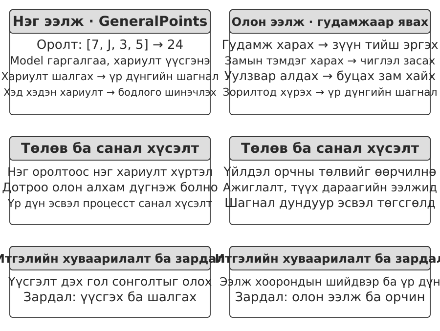

Зураг 8-15-д Agent 3 дахь алхамд уулзварыг алдаж, 4 дэх алхамд төөрснөө олж мэдээд эргэж буцаж, 5 дахь алхамд зорилтот цэгт хүрсэн. Төгсгөлийн шагнал бүх навигацийг дэмжсэн ч буруу зам явсан ба цаг тухайд нь эргэснийг ялгаагүй. Дараагийн удаа энэ уулзварт хүрэхэд бид шууд зөв явахыг хүснэ; хэрэв дахин алдвал эргэхийг нь үргэлжлүүлэн урамшуулах ёстой. Сургалтад өмнөх алхамууд эцсийн өгөөжид хэрхэн нөлөөлснийг үнэлэх шаардлагатай бөгөөд энэ асуудлыг **итгэлийн хуваарилалт (Credit Assignment)** гэнэ. Үнэ цэнэ ба давуу талын үнэлгээ дараагийн өгөөжийг ашиглаж болно; завсрын үйлдлийг найдвартай шалгаж чадвал процессын шагнал нэмж болно. 4 дэх алхамд эргэсэн нь процессын шагналд 0 оноо авсан ч зорилтот цэгт хүрэхэд тустай хэвээр. Энэ алхмын үнэ цэнийг үнэлэхдээ дараагийн өгөөжийг ч тооцох ёстой.

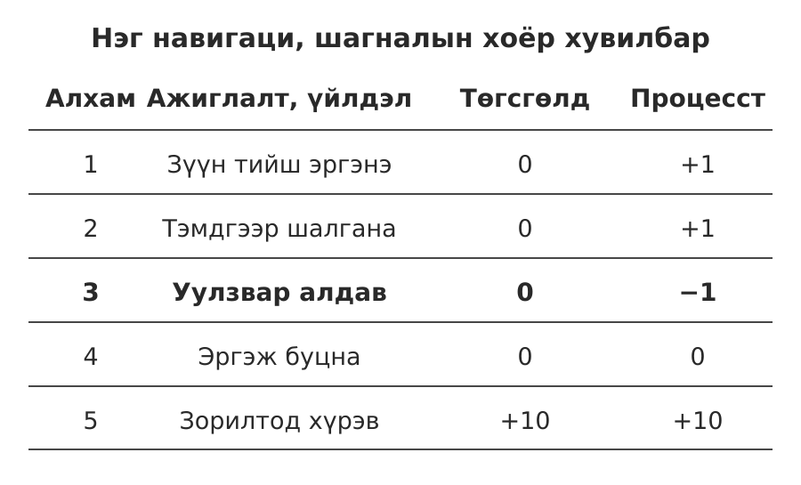

Ижил асуудал хэрэглэгчийн үйлчилгээний ярианд ч гарна. Жишээлбэл, хэрэглэгч 10 дахь ээлжид сайн үнэлгээ өгсөн. 2 дахь ээлжид аль хураамжийн тухай маргаан болж буйг тодруулж, 7 дахь ээлжид зардлыг тайлбарласан — хоёр алхам хоёулаа тустай байж болно. Зөвхөн сүүлийн сайн үнэлгээгээр тус бүрийн гүйцэтгэсэн үүргийг ялгаж чадахгүй. Дараах хоёр туршилт сургагч навигацийн үйлдлийг алхам алхмаар шалгаж чадах, эсвэл зөвхөн даалгаврын үр дүнгээр робот амжилттай болсон эсэхийг дүгнэх нөхцөлийг тус тус авч үзнэ.

> **Туршилт 8-12 ★★★: V-IRL-VL — олон ээлжит харааны навигаци**
>
> V-IRL[^ch8-24]-д Agent нүдний өмнөх гудамжны дүрсээр алхам алхмаар зорилтот цэгийг олох ёстой. Сургалтад Нью-Йоркийн маршрутыг, туршилтад өөр хотуудыг ашиглаж, замын заавар ба зураг дээрх гудамжны дүрсийг хоёуланг нь өөрчилсөн. Дүрмийн өөрчлөлт ба харааны өөрчлөлт гэсэн хоёр төрлийн тархалтаас гадуурх туршилтад RL-ийн гүйцэтгэл SFT-ээс мэдэгдэхүйц дээр байсан. Туршилт үнэ цэнийн сүлжээтэй PPO ашигласан. Алхам бүрт санал хүсэлт өгөх нь урт маршрут дахь аль шийдвэрийг хадгалах нь зүйтэйг ялгахад тусална.

> **Туршилт 8-13 ★★★: SimpleVLA-RL — үр дүнгийн шагналын дор нээлттэй хайгуул `[Өргөтгөсөн туршилт]`**
>
> SimpleVLA-RL LIBERO роботын даалгаварт амжилт／бүтэлгүйтлийн үр дүнгийн шагнал ашигласан. Даалгавар бүрийг нэг үзүүлэн траектороор SFT-ээр хүйтэн эхлүүлж, дараа нь RL-ээр амжилтын хувийг 17.3%-иас 91.7% болтол өсгөж, үзүүлэнд байгаагүй «түлхэж огтлох» үйлдэл үүсгэсэн. Энэ үр дүнг гудамжны навигацитай харьцуулж үзвэл: хэрэв замын дунд аль алхамд алдсаныг найдвартай тодорхойлж чадвал тэр дор нь санал хүсэлт өгч суралцахыг хурдасгаж болно. Даалгаврыг гүйцэтгэхэд ямар хэд хэдэн зам байгааг хараахан мэдэхгүй бол эхлээд үр дүнгээр шагнал өгөх нь Model-д бусад замыг турших боломжийг үлдээнэ. Хүний үзүүлэн дэх үйлдлийн дарааллыг шагналын шаардлага болгон хэт эрт бичвэл «түлхэж огтлох» зэрэг шинэ стратегийн оноог бууруулж болно.

### Tool дуудлага: харилцан үйлчлэлийн явцад гадаад чадвар ашиглаж сурах

Гадаад Tool холбосны дараа Model хайлт, код гүйцэтгэл, файл засвар, өгөгдлийн сангийн асуулга сонгох эсвэл даалгаврын хэрэгцээгээр олон API-г хослуулж болно. Harness шалгалт ба дуудлагын хуваарилалтыг хариуцаж, Tool орчинд гүйцэтгээд ажиглалт буцаана. Зураг 8-16 нэг даалгаврын доторх шийдвэр ба даалгавар дууссаны дараах сургалтыг тусад нь харуулна. Баруун талын сумыг дагавал Tool-ийн үр дүн одоогийн даалгаварт буцаж, Model түүгээр дараагийн алхмаа шийднэ. Доош уншихад даалгавар дууссаны дараа л сургалтын программ бүх траекторыг ашиглан шагнал тооцож, параметрийг шинэчилж, дараагийн ээлжийн түүвэрлэлт шинэ бодлого ашиглана. Нэг даалгаварт хэд хэдэн Tool-ийг дараалан дуудах шаардлагатай үед өмнөх буцаасан үр дүн дараагийн дуудлагын параметрт нөлөөлнө.

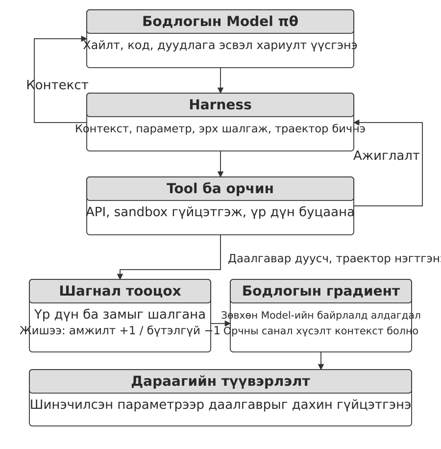

Search-R1[^ch8-25] Model-ийг хэзээ хайх, ямар асуулга илгээхийг шийдэж, үр дүнг хослуулан дүгнэлтээ үргэлжлүүлэхийг сургадаг. ReTool кодын тайлбарлагчийг ижил төрлийн давталтад холбож, Model код гүйцэтгэлийг зохион байгуулах, буцаах утгыг ойлгох ба алдааны мэдээллийн дагуу засахыг сурна. AWorld-train MCP-ийн олон Tool-той sandbox руу өргөжиж, Model Tool сонгож, дуудлагын хоорондын хамаарлыг боловсруулах ёстой бөгөөд сургалтын систем орчныг дахин тохируулж, траекторыг дахин тоглуулах чадвартай байх шаардлагатай.

Tool-ийн траекторт Model-ийн үүсгэсэн token ба орчны буцаасан token-ыг ялгах хэрэгтэй. Бодлогын алдагдлыг тооцохдоо зөвхөн Model-ийн үүсгэсэн гаргалгаа, дуудлагын параметр ба хариулт зэрэг үйлдлийг алдагдалд оруулж, орчны санал хүсэлтэд харгалзах байрлалыг хаана. Санал хүсэлт Context болж дараагийн тооцоололд оролцсоор байж, Model-д дараагийн алхмаа шийдэхэд тусална. Жишээлбэл, тайлбарлагч нэг алдааны мэдээлэл буцаахад сургалтад бэхжүүлэх зүйл нь Model үүний дараа кодыг хэрхэн засах явдал. Алдааны текстийг ч бодлогын алдагдалд оруулбал шинэчлэлтэд «орчны гаралт үүсгэх» гэсэн зорилго холилдож, Model-ийн бодитоор хариуцах шийдвэрээс хазайна.

> **Туршилт 8-14 ★★★: ReTool — кодын тайлбарлагчаар математикийн бодлого бодохыг сайжруулах**
>
> Зураг 8-17 нэг хувьсагчтай квадрат тэгшитгэлийн жишээгээр текстэн дүгнэлт, код үүсгэлт ба тайлбарлагчийн санал хүсэлт хэрхэн ээлжлэн явагддагийг харуулна.
>
> 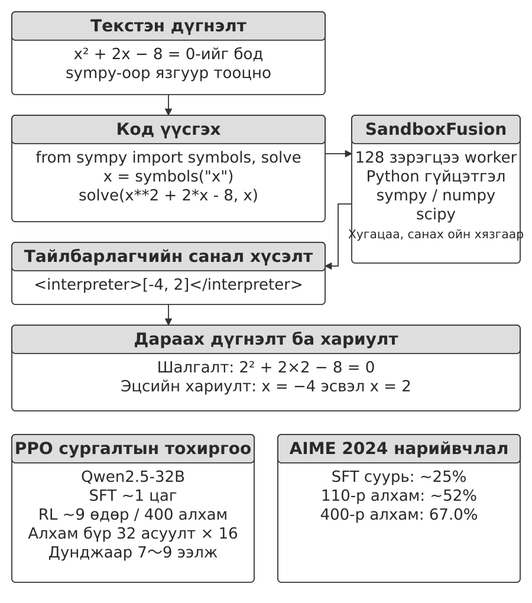
>
> ReTool SFT-ээр урьдчилан бэлтгэсний дараа текстэн сэтгэлгээ, код гүйцэтгэл ба тайлбарлагчийн санал хүсэлтийг ээлжлүүлэн PPO сургалт хийсэн. Model код хэзээ ажиллуулах нь үнэ цэнэтэй, алдааны мэдээллийн дараа хэрхэн засахыг аажмаар сурдаг. Энд DAPO-Math-17k-ийн сургалтын өгөгдөл ашигласан бөгөөд бодлогыг шинэчлэхэд стандарт PPO хэвээр хамаарна[^ch8-26][^ch8-27].
>
> Сургалтын дараа Model AIME 2024 дээрх хариултын нарийвчлалыг ойролцоогоор 25%-иас 67.0% болтол өсгөсөн. Зөвхөн текстэн RL-тэй харьцуулахад кодын санал хүсэлт Model-д нарийн тооцоолол ба алдаа засахыг илүү хурдан сургасан.

> **Туршилт 8-15 ★★★: AWorld-train — sandbox-д Tool ашиглаж сурах**
>
> Зураг 8-18-ын дээд хэсгийг нэг тойрч үзвэл Model нэг Tool дуудлагын үр дүнг хүлээн авч, үргэлжлүүлэн оролдож ч болно. Доод хэсгийг нэг тойрч үзвэл: энэ багц даалгавар аль хэдийн дууссан, сургалтын программ шагналтай траекторыг авч, параметрийг шинэчилж, дараагийн багц даалгавар л шинэ бодлого ашиглана.
>
> 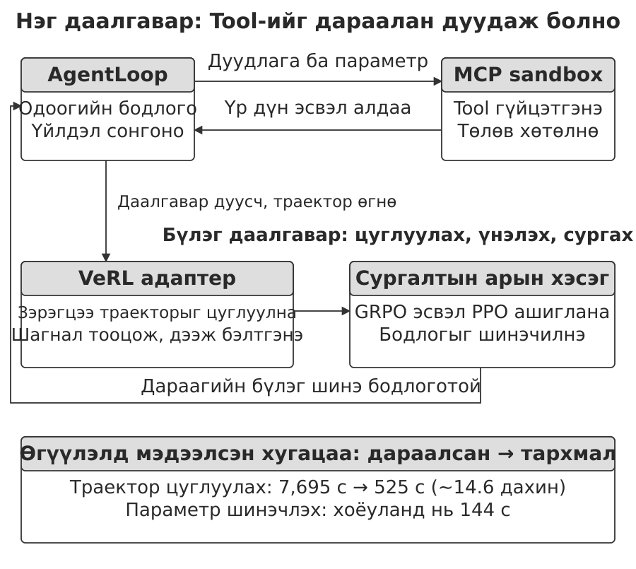
>
> GAIA орчин 26 MCP сервер, 126 Tool функцтэй бөгөөд Playwright-аар вэб хуудас удирдаж, PDF, Word ба слайд дахь агуулгыг гаргаж, аудио хөрвүүлж, текстийг таньж, эсвэл E2B sandbox-д код гүйцэтгэж болно. Excel-ийн Tool томьёо, график ба пивот зэрэг 29 үйлдэл өгдөг бөгөөд мэдлэгийн хайлт Wikipedia, arXiv ба Wayback руу хандаж ч болно. Sandbox-ийг дахин тохируулсны дараа ижил төлвөөс дахин оролдож, эсвэл өмнөх траекторыг дахин тоглуулж болно.
>
> Зураг дахь хугацаа өгүүллийн цуглуулсан харьцуулалтаас авсан. Хавсаргасан туршилт 4B Model-ийн нэг сургалтын тохиргоог тусад нь өгсөн: Qwen3-4B-Thinking-2507, 8 ширхэг A100, Context-ийн дээд хязгаар 131K, хамгийн ихдээ 32 ээлжийн харилцан үйлчлэл, багцын хэмжээ 32, асуудал бүр 16 траектор түүвэрлэж, GRPO-оор шинэчилж, суралцах хурд 1e−6.

Tool үр дүн буцаасан бол сургалтын программ аль алхмыг шагнах ёстой вэ? Нэг амжилттай дуудлага зөвхөн Tool амжилттай ажилласныг хэлнэ. Энэ алхам даалгаврыг урагшлуулсан эсэхийг дүгнэхийн тулд түүний үүсгэсэн өөрчлөлтийг баталгаажуулагчаар шалгаж, дараа нь Model-д ямар шагнал өгөхөө шийдэх хэрэгтэй.

## Шагналын дизайн: даалгаврын зорилгыг суралцах дохио болгох

Хоёр буцаалтын траектор эцэст нь ижил дүнг буцаасан боловч нэг нь зайлшгүй шаардлагатай хувь хүний баталгаажуулалтыг алгасан гэж бодъё. Зөвхөн эцсийн үлдэгдлийг уншвал хоёулаа ижил оноо авна. Хэрэглэгчийн даатгасан бүрэн шаардлагыг суралцах дохио болгохын тулд эхлээд үр дүнг хэн баталгаажуулж чадах, аль алхам нотолгоо олж чадах, Model-д ямар мэдээлэл буцааж өгөх шаардлагатайг тодорхойлж, дараа нь зам дахь эрх ба урсгалын хязгаарлалтыг тусад нь баталгаажуулж болох эсэхийг шалгана.

### Шагнал хаанаас ирдэг вэ: дүрэм, хүний сонголт ба Model-ийн үнэлэлт

Автоматаар дүгнэж болох даалгаврын хувьд зохиогч **баталгаажуулж болох шагналд суурилсан бататгах сургалт (RLVR)**-ыг түрүүлж ашиглаж, хүлээн авах шаардлагыг шууд программ болгон бичдэг. Математикийн асуудлын хариултыг тулгаж, кодын даалгаварт тест ажиллуулж, буцаалтын даалгаварт өгөгдлийн сан дахь дүн ба захиалгын төлвийг шалгаж болно. Давбал 1, бүтэлгүйтвэл 0 гэж тэмдэглэхэд хамгийн энгийн үр дүнгийн шагнал гарна. Дүрэм тодорхой, ажиллагааг дахин гаргаж болох тул үнэлгээний зөрүүг олоход хялбар; баталгаажуулагчийн хамрах хүрээ нь сургалт яг аль шаардлагыг оновчилж байгааг тодорхойлно.

**Хүний санал хүсэлтээр бататгах сургалт (RLHF)** нь хүний сонголтыг сургалтын дохио болгон хувиргана. InstructGPT[^ch8-4] эхлээд хариултуудын хүний харьцуулалтыг цуглуулж, шагналын Model сургаад, дараа нь PPO-оор бодлогыг оновчилсон. Шагналын Model хязгаарлагдмал дээж дэх сонголтыг сурдаг тул Model-ийн илүү өндөр оноог тасралтгүй хөөх нь түүний хазайлтыг өсгөж болно[^ch8-5]. Сургалтад SFT-ийн лавлах Model-той харьцуулсан KL регулярчлалыг ихэвчлэн нэмж, бодлогын хазайлтыг хянадаг. DPO[^ch8-6] «илүү сайн хариулт—муу хариулт» сонголтын хосоор бодлогыг шууд оновчилж, шагналын Model-ийг тусад нь сургах алхмыг хэмнэдэг.

Нээлттэй даалгаварт Model-оор үнэлгээний үндэслэл ба оноо өгүүлж болно. **Үүсгэгч шагналын Model (GRM)**-ийн үүсгэсэн оношлогоог үзүүлэн шүүх, сонголтын хос бүрдүүлэх эсвэл дараагийн засварыг чиглүүлэхэд ч ашиглаж болно. DeepSeek-GRM[^ch8-23] даалгаврын дагуу үнэлгээний зарчим үүсгээд, түүнд тулгуурлан шүүмж ба оноо өгдөг; онлайн RL-ээр үнэлэх зан төлөвөө сайжруулж, олон удаагийн түүвэрлэлт ба туслах шагналын Model-оор дүгнэлтийг нэгтгэдэг.

Үнэлгээний үзүүлэлт ба даалгаврын зорилгын зөрүү ч Model-ийн зан төлөвт нөлөөлнө. **Reward hacking** нь бодлого үнэлгээний дүрэм эсвэл хэрэгжүүлэлтийн дутагдлыг ашиглан өндөр оноо авахыг хэлнэ. Урт хугацааны Agent-д **reward seeking** гэж нэрлэгдэх өөр нэг үзэгдэл бий: Model өөрийн таамагласан үнэлгээний аргын дагуу үйлдэж, жишээ нь давахад хялбар шалгалтыг өөрөө сонгоод, шалгалт давсны дараа даалгавраа дуусгадаг[^ch8-29]. Энэ жишээ хүлээн авах нөхцөл хэрэглэгчийн зорилгоос эхэлж, бодит хүлээлгэн өгөх бүтээгдэхүүнийг хамрах ёстойг сануулна; зөвхөн Model-ийн өөрөө сонгосон үзүүлэлтийг шалгах нь хараахан биелээгүй шаардлагыг орхих магадлалтай.

Буцаалтын даалгаврын шагналыг зохиохдоо эхлээд хүний бичсэн хоёр траекторыг баталгаажуулагчаар дамжуул. А захиалгыг тодруулж, буцаалтын интерфэйсийг дуудаж, баримтыг хэрэглэгчид давтан хэлсэн; Б зөвхөн «буцаалт дууслаа» гэж хэлсэн. Хоёулаа ижил оноо авбал үнэлэгч эцсийн хариу, интерфэйсийн баримт эсвэл захиалгын төлвийн алийг уншсаныг эхлээд шалга. Энэ жижигхэн эсрэг жишээ прокси үзүүлэлтийн асуудлыг илрүүлэхэд хангалттай бөгөөд бүтэн багц сургалт хийснийхээ дараа Model-ийг урьдчилан баяр мэдэгддэг болсныг олж мэдэх зардлаас хэмнэнэ.

### Шагнал хэзээ өгөгдөх вэ: үр дүн ба процесс

**Үр дүнгийн шагнал** нэг episode дууссаны дараа даалгаврын гүйцэтгэлийг үнэлнэ; Model-оор үр дүнг үнэлүүлэх үед ийм Model-ийг **ORM (Outcome Reward Model)** гэнэ. SimpleVLA-RL-ийн амжилт/бүтэлгүйтлийн шагнал бодлогод эцсийн зорилгыг тойрон өөр өөр үйлдлийн дарааллыг судлах боломж олгосон. Ийм дохиог тодорхойлоход хялбар боловч урт траектор бүтэлгүйтсэний дараа Model аль үйлдэл бүтэлгүйтэлд хүргэснийг ялгахын тулд илүү олон оролдлого шаардлагатай. Энэ бол сийрэг санал хүсэлт дээжийн үр ашигт нөлөөлөх нэг шалтгаан[^ch8-8].

Coding Agent эрт дуусгах жишээг авч үзье: Model дууссан гэж мэдэгдсэний дараа Harness тусгаарлагдсан ажлын орон зайд хамгаалагдсан хүлээн авах тестийг ажиллуулна. Тест бодит файл ба орчны төлвийг уншиж, давбал эерэг шагнал, бүтэлгүйтвэл сөрөг шагнал өгнө. Ингэснээр дууссан гэсэн мэдэгдэл гадаад баталгаажуулалтыг өдөөж, даалгаврын үр дүнг хүлээлгэн өгөх бүтээгдэхүүн тодорхойлно. Үнэлгээнд хоёр бүлэг даалгаврыг тус тусад нь бэлтгэнэ: нэг бүлэгт хийх ажил үлдсэн хэвээр бөгөөд эрт дуусгах хувийг хэмжинэ; нөгөө бүлэг аль хэдийн дууссан бөгөөд Model цаг тухайд нь ажлаа дуусгаж чадах эсэхийг шалгана.

**Процессын шагнал** завсрын алхмуудад санал хүсэлт өгнө, жишээ нь хувь хүний баталгаажуулалт, параметрийн сонголт, навигацийн үйлдэл эсвэл гаргалгааны алхмыг үнэлнэ. Процессыг үнэлэх Model-ийг **PRM (Process Reward Model)** гэнэ. OpenAI-ийн «Let's Verify Step by Step»[^ch8-7] математикийн гаргалгаан дахь алхам алхмын баталгаажуулалтыг судалсан. Процессын дохио Model-д алдааг олоход тусалдаг ч тэмдэглэгээ ба баталгаажуулалтын зардлыг өсгөнө. Нэг бодох дарааллыг цорын ганц зөв зам гэж үзвэл бусад үр дүнтэй стратегийн шагналыг ч бууруулна. Иймээс зохиогч зөвхөн бодитоор шалгаж болох завсрын үйл явдалд процессын дохио нэмж, Model-д олон үр дүнтэй шийдлийг үргэлжлүүлэн судлах боломж олгодог. V-IRL-VL (Туршилт 8-12) алхам алхмын навигацийн санал хүсэлт, SimpleVLA-RL (Туршилт 8-13) төгсгөлийн шагнал ашигласан нь хоёр даалгавар санал хүсэлтийн нарийвчлалыг өөр өөрөөр сонгосныг харуулна.

Практикт эхлээд үр дүнгийн шагналын суурь шугам тогтоож, дараа нь хувь хүний баталгаажуулалт дууссан, тест давсан зэрэг завсрын үйл явдалд процессын дохио нэмж болно. Төгсгөлөг урттай олон ээлжит даалгаварт хямдруулах коэффициент $\gamma=1$ авч, төгсгөлийн шагналыг урагш тархаахад ижил жинтэй байлгаж болно. PPO үнэ цэнийн үнэлгээ ба давуу талын тооцооллоор санал хүсэлтийг алхам бүрийн үйлдэлтэй холбодог; траекторын түвшний давуу тал ашигладаг GRPO тухайн траекторын үүсгэсэн token бүрийн бодлогын алдагдлыг ихэвчлэн нэг ижил давуу талын жингээр тооцно.

### Шагнал хэдий хэмжээний мэдээлэл илэрхийлэх ёстой вэ: скаляр, вектор ба үүсгэгч оношлогоо

Шагнал хэзээ гарах нь санал хүсэлтийн нягтыг; шагнал юу агуулах нь дүрслэлийн хэлбэрийг тодорхойлно. Нэг скаляр ерөнхий гүйцэтгэлийг нэгтгэнэ; «товч үндэслэл＋оноо» гэсэн хагас скаляр хэлбэр үнэлгээний үндэслэлийг нөхнө; вектор нарийвчлал, бүрэн байдал, зардал зэрэг хэмжээсийг тус тусад нь илэрхийлнэ; үүсгэгч оношлогоо асуудал ба засах чиглэлийг тодорхой тайлбарлах бөгөөд олон удаагийн түүвэрлэлтээр нэгтгэж ч болно.

- Тодорхой хариулт эсвэл хүлээн авах тест байгаа бол хоёртын скаляраас эхэлж болно.
- Чанарын олон зорилт байгаа бол тус тусад нь үнэлж, бизнесийн шаардлагаар жинлэх эсвэл хязгаарлалт тогтоож болно.
- Үнэлгээ Context-тэй холбон тайлбарлах шаардлагатай бол оношлогоо үүсгэж, баримтын шалгалт ба хүний түүвэр шалгалтаар тохируулж болно.

Жишээлбэл, нэг хэрэглэгчийн үйлчилгээний даалгаварт шийдэгдсэн байдал, ярианы ээлжийн тоо ба хувь хүний баталгаажуулалт дууссан эсэхийг зэрэг тэмдэглэж болно. Гурван хэмжээс тус бүр үр нөлөө, зардал ба урсгалын шаардлагад харгалзана. Тэдгээрийг сургалтад ашиглахаас өмнө үнэлгээ тогтвортой эсэх, бүлэг доторх траекторуудын зан төлөвийг ялгаж чадах эсэхийг шалгах ёстой. Зохиогч цөөн найдвартай үзүүлэлтээс эхэлж, нэг нэгээр баталгаажуулсны дараа хэмжээс нэмдэг. Баталгаажаагүй үнэлгээний зүйл бүр Model-ийг шинэ прокси үзүүлэлтээр оновчлуулж, бодит даалгаврыг сайжруулахгүй байж болно.

### Замын хязгаарлалт ба RLVP

Даалгаврыг гүйцэтгэх явцад бие даасан зан төлөвийн шаардлага ч байж болно: хэрэглэгчтэй ажлын цагаар холбогдох, хувь хүний баталгаажуулалтыг гүйцэтгэх, хамгаалагдсан файлыг өөрчлөхгүй байх. RLVP (Reinforcement Learning with Verified Penalty)[^ch8-9] үр дүнгийн шагналыг баталгаажуулж болох замын торгуультай хослуулдаг бөгөөд зарчим нь **үр дүнг шагнаж, замыг торгох** явдал. Замын дүрэм орчин дахь ажиглаж болох үйлдлээр өдөөгдөж, хүлээлгэн өгөх бүрэн байдлыг даалгаврын хүлээн авах шалгалт үргэлжлүүлэн шалгана.

Хоёр засвар хоёулаа хүлээн авах шалгалтыг давсан ч нэг нь эхлээд унших ёстой файлыг шууд дарж бичсэн. Tool-ийн бичлэгийг шалгавал энэ зөрчсөн үйлдлийг олж болно; харин өмнөх алхам бүр эцсийн амжилтад хэр хувь нэмэр оруулсныг дүгнэх нь хамаагүй хэцүү. Хамгийн энгийн арга бол бүх траекторт нэг оноо $R=O+\beta\Phi$ өгөх: $O$ нь даалгаврын оноо, $\Phi$ нь зөрчлийн хасалт эсвэл баталгаажуулж болох ахицыг нэгтгэх, $\beta$ хоёрын харьцангуй жинг шийднэ. Ингэснээр хоёр засварыг ялгаж болох ч нэг траекторын үйлдэл бүр ижил дохио авна.

Аль ээлжид зөрчил гарсныг мэдэж байгаа бол хасалтыг тэр ээлжид үлдээж болно. Хавсаргасан хэрэгжүүлэлтийн хоёр тестийн траекторыг харъя: А даалгаврыг гүйцэтгэсэн ч хоёр дахь ээлжид зөрчил гаргасан; Б даалгаврыг гүйцэтгээгүй ч хоёр ээлжид хоёуланд нь дүрэм баримталсан. Хоёр траекторын үр дүнгийн оноо 1 ба 0 бөгөөд бүлгийн дунджийг хасахад +0.5 ба −0.5 болно. Траектор бүр хоёр ээлжийн үйлдэлтэй, ээлж бүр 10 үйлдлийн token эзэлнэ. Хэрэгжүүлэлтийн `c2` тохиргооны дагуу хоёр дохиог тусад нь тооцно:

```python
outcome_weight = (1 - 0.5) / 40  # үр дүнгийн дохиог энэ багцын бүх 40 үйлдлийн token-д хуваана
penalty_weight = -0.3 / 10       # зөрчлийн хасалтыг зөвхөн А-гийн хоёр дахь ээлжийн 10 үйлдлийн token-д хуваана
first_turn = outcome_weight
second_turn = outcome_weight + penalty_weight
```

А-гийн эхний ээлжид үйлдлийн token бүр +0.0125 жин авах бол хоёр дахь ээлжид −0.0175 авна. Ингэснээр нэг амжилттай засвар доторх хоёр үйлдэл эсрэг чиглэлийн сургалтын дохио авч болно. Ийм жин бодлогын алдагдалд орсны дараа л оновчлогч үүнд тулгуурлан параметрийг шинэчилнэ. Хэрэглэгчийн үйлчилгээний даалгавар болгон сольсон ч Tool-ийн бичлэг аль ээлжид зөвшөөрлийн шалгалтыг алгассаныг олж чадвал ижил аргаар хасалтыг хуваарилж болно.

Замын дохионы үүргийг бүлэг доторх ялгаагаар ойлгож болно. Нэг бүлэг GRPO траекторын үр дүнгийн шагнал ижил бол тэр шагналаар тооцсон давуу тал тэг; хэрэв тэдгээрийн зөрчлийн тоо өөр бол замын торгууль харьцуулах шинэ үндэслэл өгнө. Хэсэгчилсэн ахицын шагнал ч ижил нөхцөлийг дагана: Model ядаж өөр өөр түвшний ахицыг түүвэрлэж чадсан тохиолдолд л ялгах үүрэг гүйцэтгэнэ.

Замын шагнал зохиохдоо дөрвөн дүрмийг баримталж болно: тодорхой зөрчсөн үйлдлийг торгох; даалгаврын үр дүнгийн шагналыг хадгалах; хязгаарлагдсан зан төлөвт хүрч болох дүрэмд нийцсэн замыг өгөх; давтан гүйцэтгэж болох баталгаажуулалтын дүрэм ашиглах. Жишээлбэл, үйлдэл бүрийг тусад нь торгох нь Model-ийг байрандаа зогсохыг урамшуулах бөгөөд даалгаврын амжилтын шагналыг хадгалснаар л ажлаа дуусгахыг зэрэг түлхэнэ. Суурь Model дүрэмд нийцсэн зам үүсгэхэд хэцүү бол эхлээд цөөн үзүүлэнгээр эхлэлийн цэг бүрдүүлж, дараа нь сургалтаар замын хэлбэржүүлэлтээс хамаарлыг аажмаар бууруулж болно.

> **Туршилт 8-16 ★★★: RLVP — үр дүнг шагнаж, замыг торгох**
>
> Туршилт GRPO-д үр дүнгийн шагнал $O$ ба замын дохио $\Phi$-ийг нэмж, зөвхөн үр дүнгийн шагналтай харьцуулна. TerminalBench-ийн прокси даалгаварт зөрчлийн тоо 3.71-ээс 0.66 болж буурч, амжилтын хувь бараг хэвээр байсан; miniF2F-ийн прокси даалгаварт хүрч болох хэсэгчилсэн ахицын шагнал нэмсний дараа 0.9 амжилтын хувьд хүрэхэд шаардлагатай давталт 7.0-оос 4.4 болж буурсан.
>
> Програм хангамжийн засварын даалгавар дохионы хүрэх боломжийн үүргийг ч харуулсан: бүх rollout ямар ч тестийг давж чадахгүй үед давсан тестийн тоогоор тооцох ахицын шагнал үргэлж ижил байж, бүлэг доторх ялгааг нэмж чадахгүй.

Дундаж зөрчлийн тоо 0.66 болж буурсан нь Model дүрэмд нийцсэн замыг илүү олон сонгох болсныг харуулах боловч хааяа зөрчсөөр байна. Заавал мөрдөх ёстой хязгаарлалтын хувьд Tool гүйцэтгэх үед эрхийг ч шалгах шаардлагатай.

## Нэрэлт: дээжийн үр ашгийг өсгөх

Нэг Agent rollout ихэвчлэн Model-ийн олон ээлжийн үүсгэлт ба Tool гүйцэтгэлийг агуулдаг. **Дээжийн үр ашиг**-ийг өсгөнө гэдэг нь цөөн орчны харилцан үйлчлэлээр зорилтот гүйцэтгэлд хүрэх явдал. Сургалтын алхмын тоо, GPU-ийн хугацаа ба орчны дуудлагын хэмжээ өөр өөр зардлыг илэрхийлэх тул даалгавартай хослуулан харах хэрэгтэй. Жишээлбэл, энэ бүлгийн ReTool жишээнд SFT сургалт ойролцоогоор 1 цаг, RL ойролцоогоор 9 өдөр шаардсан; үүнээс давтан түүвэрлэлт ба Tool гүйцэтгэл их нөөц эзэлсэн.

Төгсгөлийн шагнал ашиглах үед бүтэн траектор зөвхөн нэг амжилт эсвэл бүтэлгүйтлийн оноо авч болно. Бизнесийн Tool «кредит картын сүүлийн дөрвөн оронтой тоо хэрэгтэй» гэж сануулсан ч Agent энэ мэдээллийг орхиж, эцэст нь 0 шагнал авсан гэж бодъё. Сургалт олон оролдлогоос бүтэлгүйтэл талбар дутуу, Tool-ийн параметр буруу эсвэл дараах үйлдлийн алдаанаас үүдсэн эсэхийг ялгах шаардлагатай. Хэрэв багш энэ траектор дээр алхам алхмаар хяналт өгч чадвал нэг орчны харилцан үйлчлэл илүү нарийн суралцах дохио үүсгэж чадна.

### Траектор дээрх нэрэлт: нэг rollout-оор нягт хяналт үүсгэх

**Траектор дээрх нэрэлт (On-Policy Distillation)**-д оюутан траектор үүсгэж, багш оюутны бодитоор үүсгэсэн угтвар дээр хяналт өгнө. Thinking Machines Lab 2025 оны судалгаандаа энэ сургалтын аргыг системтэйгээр харуулсан[^ch8-10]. Гурван төрлийн аргыг ойлгохдоо «сургалтын төлвийг хэн үүсгэдэг» ба «суралцах дохиог хэн өгдөг»-ийг салгаж харж болно:

| Арга | Траектор эсвэл төлвийг хэн үүсгэдэг | Гол суралцах дохио |
| --- | --- | --- |
| SFT／траекторын гаднах нэрэлт | Хүн эсвэл багшийн үзүүлэн | Зорилтот хариултын token бүрийн хяналт |
| On-policy RL | Одоогийн оюутан | Үр дүнгийн эсвэл процессын шагнал |
| On-policy Distillation | Одоогийн оюутан | Багшийн оюутны угтварт өгөх token бүрийн магадлалын үнэлгээ |

Жишээлбэл, багшийн үзүүлэн үргэлж эхлээд захиалгыг асуугаад дараа нь буцаалт хүсдэг бол оюутан эхлээд буцаалт эхлүүлж, «захиалгын дугаар дутуу» гэсэн алдааг хүлээн авч болно. Траектор дээрх нэрэлт багшид оюутны аль хэдийн хүрсэн энэ төлвийг үнэлүүлж, мэдээллээ хэрхэн нөхөж асуухыг зааж өгнө. Ингэснээр сургалт оюутны өөрийн алдаа ба сэргэх замыг хамарч чадна.

Нэг хэрэгжүүлэлтийн арга бол оюутны үүсгэсэн угтвар дээр оюутан ба багшийн хоорондын урвуу KL-ийг багасгах:

$$
D_{\mathrm{KL}}(\pi_\theta\Vert\pi_T)
=\mathbb{E}_{a\sim\pi_\theta(\cdot\mid h)}
\left[\log\pi_\theta(a\mid h)-\log\pi_T(a\mid h)\right],
$$

энд $h$ нь одоогийн угтвар, $a$ нь дараагийн token, $\pi_\theta$ ба $\pi_T$ нь оюутан ба багшийн тархалтыг тус тус илэрхийлнэ. Багшийн илүү тохиромжтой гэж үзсэн token илүү ашигтай сургалтын дохио авна. Хэрэгжүүлэхдээ бүрэн тархалтыг харьцуулж болно, эсвэл оюутны аль хэдийн түүвэрлэсэн token-д багшийн логарифм магадлалыг асууж, token бүрийн оновчлолын дохио бүрдүүлж болно.

«Эхлээд API асууж, дараа нь буцаасан утгыг задлах» жишээг авч үзвэл, нэг байрлал дахь «асуух» ба «дуудах» гэсэн нэр дэвшигч тус бүр нэг token-д харгалздаг бөгөөд багш тэдгээрт 80% ба 15% магадлал, бусад нэр дэвшигчид нийт 5% өгсөн гэж үзье. Энэ нь эцсийн амжилт, бүтэлгүйтлээс илүү нарийн сонголтын үндэслэл өгнө. Нэг траектор Model-ийн үүсгэсэн $T$ token агуулбал ойролцоогоор $T$ байрлалд хяналт авч болно; Tool-ийн буцаасан агуулга Context болж ашиглагдсаар, бодлогын алдагдалд хаагдана.

Дараах нь бүрэн тархалтыг тохируулах хэлбэрээр энэ процессыг илэрхийлнэ:

```python
trajectory = rollout(student, task)
loss = 0
for prefix in model_generated_positions(trajectory):
    target = stop_gradient(teacher.distribution(prefix))
    loss += KL(student.distribution(prefix), target)
update_student(loss)
```

Оюутан хайгуулыг хариуцаж, багш олон байрлалд хяналт өгөх бөгөөд нэмэлт зардал голчлон багшийн таамаглалаас гарна. Орчны харилцан үйлчлэл үнэтэй, багш оюутныг найдвартай чиглүүлж чадах үед зохиогч траектор дээрх нэрэлтийг түрүүлж харьцуулж, орчны дуудлага бүрээс илүү олон үр дүнтэй суралцах дохио гаргуулдаг. Зорилтот хэл, салбарын мэдлэг эсвэл үндсэн үйлдлийг хангалттай эзэмшээгүй оюутны хувьд эхлээд Mid-training ба үзүүлэнгийн сургалтаар үр дүнтэй эхлэлийн цэг бүрдүүлээд, дараа нь траектор дээрх нэрэлтэд орж болно.

Түүвэрлэлт ба сургалтын нийцэл мөн адил чухал: түүвэрлэлтийн хөдөлгүүр $\mu$ бодлогоор траектор үүсгэж, сургалтын хөдөлгүүр $\pi_\theta$-ээр алдагдлыг тооцох бөгөөд хоёрын зөрүү сургалтын төлвийн тархалтыг өөрчилнө.

Thinking Machines Lab-ийн математикийн даалгаврын харьцуулалт ойролцоогоор нэг эрэмбийн сургалтын үр ашгийн өсөлтийг харуулсан. Олон ээлжит Agent-д энэ харьцуулах аргыг дагаж, даалгаврын амжилтын хувь, орчны дуудлагын хэмжээ ба багшийн тооцооллын зардлыг зэрэг тэмдэглэж болно. Оюутны орчинд тулгарах төлөв ба багш найдвартай санал хүсэлт өгч чадах эсэх хамтдаа ашгийг тодорхойлно.

Зохиогч ба хамтран ажиллагчид мөн «цаг хугацааны мэдрэмж» даалгаварт DPO, RL-ийн дөрвөн жор ба траектор дээрх нэрэлтийг харьцуулсан[^ch8-11]. Эхний хэдэн төрлийн жор шагналын сийрэгшил, зорилгын зөрөлт, rollout-ын хэлбэрийн үл нийцэл ба бодлогын сүйрэл зэрэг асуудалтай тус тус тулгарсан. Царцаасан Qwen3-32B багш руу шилжиж, оюутны өөрийн олон ээлжит траектор дээр token бүрээр тохируулсны дараа сургалт жигд нийлж, дөрвөн нөхцөлд давах хувь ижил эх сурвалжтай SFT суурь шугамаас 23～47 нэгжээр өндөр байв. Энэ туршлага зохиогчийг харилцан үйлчлэл бүрийн өгөх дохионы нягтыг илүү үнэлэхэд хүргэсэн. Нэг харилцан үйлчлэл дэх завсрын шийдвэрүүд бүгд суралцахуйд оролцож чадвал байгаа траекторын үнэ цэнийг илүү бүрэн ашиглаж болно.

Математикийн багш гаргалгаанд, кодын багш програм засахад сайн бол нэг оюутан хоёулангийнх нь давуу талыг хэрхэн сурах вэ? Олон багштай траектор дээрх нэрэлт (MOPD) дээрх сургалтын процессыг дагаж, зөвхөн тогтсон багшийг асуудлын салбараар сонгосон багшаар сольдог. Оюутан кодын асуудал бодохдоо дундуур нь төөрсөн ч өөрийн бичсэн угтварыг кодын багшид өгч, дараагийн алхмын магадлалын тархалтыг авна; математикийн асуудал дээр бол математикийн багш оюутны бодолтын явцад зааварчилгаа өгнө. Салбар бүрт багшийг эхлээд бие даан сургаж, нэрэлтийн үе шатанд багшийн параметрийг тогтоож болно. Байршуулахдаа зөвхөн нэг оюутныг ажиллуулахад хангалттай.[^ch8-mopd]

Энд хоёр бодит нөхцөл бий. Нэгдүгээрт, дээрх томьёогоор token бүрийн KL-ийг тооцохын тулд оюутны өгсөн угтвар дээр тохирох багшийн магадлалыг авах боломжтой байх ёстой. Багшийн бичсэн хэдэн бүрэн хариулт л байгаа бол SFT хийхэд ашиглаж болох ч энэ алдагдлыг тооцоход хангалтгүй. Хоёрдугаарт, хүлээн авахдаа салбар бүрийн үр дүнг салгаж харах хэрэгтэй. Оюутны математикийн үр дүн өсөж, кодын үр дүн буурвал өссөн ерөнхий дундаж сүүлийнхийн ухралтыг амархан далдлана.

[^ch8-mopd]: Wenhan Ma нар, *MOPD: Multi-Teacher On-Policy Distillation for Capability Integration in LLM Post-Training*, 2026. Өгүүлэл салбараар сургасан багшийг ашиглаж, оюутны өөрийн траектор дээр нэрэлт хийсэн.

### Траектор дээрх өөрийгөө нэрэх: нэмэлт Context-оор багш бүрдүүлэх

Багт энэ салбарт сайн ганцхан Model байвал хэн багш болох вэ? Нэг асуудлыг түүнд хоёр удаа өгч болно. Эхний удаа байршуулалтын нөхцөлөөр хэрэглэгчийн асуултыг өгнө; хоёр дахь удаа стандарт хариулт, мэргэжилтний үзүүлэн эсвэл салбарын баримт бичгийг нэмж өгнө. Хоёр дахь хариултад нэмэгдсэн мэдээллийг эхний нөхцөл дэх оюутныг чиглүүлэхэд ашиглаж болно.

**Траектор дээрх өөрийгөө нэрэх (On-Policy Self-Distillation, OPSD)**[^ch8-15] нэг Model-д хоёр үүрэг гүйцэтгүүлдэг: оюутан зөвхөн даалгаврын оролтыг харах бол багш стандарт хариулт эсвэл баталгаажсан шийдлийг нэмж хардаг. Оюутан траектор үүсгэсний дараа багш эдгээр давуу эрхийн мэдээллийг хослуулан угтвар бүрийг үнэлж, хяналтыг оюутанд буцаана.

Жишээлбэл, оюутан математикийн бодлого бодож байх үед багш зөв хариултыг аль хэдийн мэдэж байна. Багш үүнд тулгуурлан оюутны одоогийн гаргалгааны чиглэлийг үнэлж, оюутан зөвхөн асуулттай нөхцөлд өөрийн үүсгэлтийг сайжруулж сурна. Дараах псевдо код нэмэлт Context ба градиентийн тусгаарлалтын байрлалыг харуулна:

```python
trajectory = rollout(model, task_without_answer)
loss = 0
for prefix in model_generated_positions(trajectory):
    privileged_prefix = add_verified_answer(prefix)
    target = stop_gradient(model.distribution(privileged_prefix))
    loss += KL(model.distribution(prefix), target)
update(model, loss)
```

Давуу эрхийн мэдээлэл зөвхөн сургалтын үеийн багшийн салбарт орж, оюутны оролт ба үнэлгээний оролт байршуулалтынхтай ижил хэвээр үлдэнэ. Псевдо кодыг дагаж мэдээллийн хоёр замыг шалгаж болно: стандарт хариулт зөвхөн багшийн угтварыг бүрдүүлэх мөрөнд орох тул байршуулалтын үед оюутан түүнийг харахгүй; багшийн гаралт градиент зогсоох боловсруулалтаар дамждаг тул энэ алхамд зөвхөн оюутны салбар хоёр тархалтын зөрүүгээр параметрээ шинэчилнэ. Дараагийн ээлжид шинэчлэгдсэн Model-ийг ашиглахад багшийн дүгнэлт ч дагаж өөрчлөгдөж болно. Ингэснээр нэг Model сургалтын талын илүү бүрэн мэдээллийг ашиглан өөрийн бодит үүсгэлтэд хяналт өгч чадна.

Давуу эрхийн мэдээлэл хүний үзүүлэн эсвэл шүүсэн салбарын баримт бичгээс ч ирж болно. Сонгохдоо тэр нь багшийн дүгнэлтийг сайжруулж чадах эсэхийг шалгах ёстой: мэдээлэл авсны дараах багш оюутны алдааг чинээ сайн таньж чадвал нэрэлтийн дохио төдий чинээ хэрэгтэй. Сургалтын явцад урьдчилан тест болгон үлдээсэн дээжээр анхны чадвар ба үүсгэх хэв маягийг шалгах хэрэгтэй; Purified OPSD зэрэг судалгаа регулярчлалын хязгаарлалтаар Model-д анхны гаргалгааны хэв маягаа хадгалахад цааш нь тусалдаг[^ch8-16].

## Асуудлын жишээнээс дараах сургалт хүртэл

Бүлэг 7-д үйлдвэрлэлийн асуудлыг дахин гаргаж болох даалгавар, бүтэлгүйтлийн шалтгаан ба үнэлгээний шалгуур болгон цэгцэлсэн. Эдгээр материалыг дараах сургалтад ч ашиглаж болно: бүрэн даалгавар харилцан үйлчлэлийн орчныг, алдаа гарахаас өмнөх траекторын угтвар шийдвэрийн Context-ийг өгч, баталгаажуулагч шинээр үүсгэсэн зан төлөвийг шалгана. Хүснэгт 8-5 тэдгээрийн сургалтын аргатай харгалзах байдлыг жагсаав.

Хүснэгт 8-5 Бүлэг 7-ын үнэлгээний материал ба дараах сургалтын хэрэглээ

| Бүлэг 7-ын материал | Бүлэг 8-ын сургалтын хэрэглээ |
| --- | --- |
| End-to-end даалгавар ба баталгаажуулагч | RL түүвэрлэлтийн даалгавар, баталгаажуулж болох шагнал, татгалзах түүвэрлэлтийн даалгаврын сан |
| Траекторын угтвар ба дараах зан төлөв | DPO сонголтын хос, SFT шийдвэрийн үзүүлэн, траектор дээрх нэрэлтийн багшийн оролт |
| Бүтэлгүйтлийн байрлал ба алдааны ангилал | Процессын үнэлгээний шошго, баталгаажуулж болох замын торгуулийн дүрэм |
| Rubric-ийн зүйл бүрийн оноо ба хүний тэмдэглэсэн стандарт хариулт | Олон хэмжээст шагнал, үүсгэгч шагналын Model-ийн сургалт ба тохируулга |

Түүхэн угтварыг үргэлжлэх даалгаврын эхлэлийн цэг болгож болно. Траектор дээрх нэрэлтэд ашиглахдаа эхлээд одоогийн оюутан энэ цэгээс үргэлжлүүлэн үүсгэж, дараа нь багш оюутны бодитоор үүсгэсэн угтварыг үнэлнэ; Tool гүйцэтгэх шаардлагатай бол харгалзах орчны төлвийг хамт сэргээнэ. Ингэснээр Бүлэг 7-ын хэсэгчилсэн шийдвэрийн үнэлгээг энэ бүлгийн түүвэрлэлт ба сургалтын урсгалтай холбоно.

Сургалтад ашиглах даалгаврыг тусгаарласан үнэлгээний даалгавраас салгах ёстой. Хоёр тал интерфэйс ба баталгаажуулах логикийг хуваалцаж болох бөгөөд бие даасан даалгаврын жишээ тус тусад нь ашиглана; даалгавар хоорондын ерөнхийлөлийг шалгах шаардлагатай бол даалгаврын загвар эсвэл бизнесийн төрлөөр хувааж болно. Дараах гурван жишээгээр энэ хувиргалтыг хэрхэн гүйцэтгэхийг тайлбарлана.

### Жишээ 1: Coding Agent эрт дуусгах

Agent тест ажиллуулаагүй байхдаа дууссан гэж зарлах, гурван шаардлагын хоёрыг л засаад илгээх, эсвэл хэдэн удаа бүтэлгүйтээд бууж өгөх нь бүгд эрт дуусгахад хамаарна. Үйлдвэрлэлд хэрэглэгчийн засвар, сөрөг үнэлгээ ба траекторын хяналтаас эдгээр жишээг цуглуулж болно. Жишээлбэл, хэрэглэгч «Чи тестээ хараахан ажиллуулаагүй байна» гэж хэлбэл траекторыг дагаж тухайн үеийн даалгаврын төлөв, байгаа баталгаажуулалтын нотолгоо ба Model-ийн дууссан гэсэн мэдэгдлийг шалгаж болно.

Шалтгааныг шинжлэхдээ эхлээд траекторыг Model «дууслаа» гэж хэлэх гэж буй агшинд зогсоож, өмнө нь шаардлагыг орхиж уншсан, кодыг буруу засварласан эсэхийг харна. Үүнээс хоёр төрлийн сургалтын материал гарна: бүрэн даалгавар Model-д ажлаа гүйцэтгэхийг сургаж, шийдвэрийн угтвар түүнд нотолгоонд тулгуурлан үргэлжлүүлэх эсвэл дуусгахыг сонгохыг сургана.

**Бүрэн даалгаврыг үр дүнгийн шагналтай холбож болно.** Model үр дүнгээ илгээх үед хамгаалагдсан хүлээн авах тестийг ажиллуулж, давбал +1, бүтэлгүйтвэл −1 өгнө. Тест бодит хүлээлгэн өгөх бүтээгдэхүүнийг хамарч, Model хэвийн хөгжүүлэлтийн тестээр санал хүсэлт авч болох бөгөөд эцсийн хүлээн авалтыг сургалтын орчин гүйцэтгэнэ.

**Шийдвэрийн угтвараар сонголтын хос бүрдүүлж болно.** Нэг Context-д сонгогдоогүй дээж (`rejected`) нь нотолгоогүй дууссан гэсэн мэдэгдэл, сонгогдсон дээж (`chosen`) нь шаардлагатай тестийг үргэлжлүүлэн ажиллуулж, дутуу шаардлагыг тулгаж, үлдсэн ажлыг гүйцэтгэнэ. Багшаар хэд хэдэн дараагийн аргыг бичүүлж, баталгаажуулагчаар үзүүлэн болох тохирохыг шүүж болно. Дээж хангалтгүй бол даалгаврын төрөл, дутуу баталгаажуулалтын зүйл ба дуусгах үг хэллэгийг өөрчилж, хэдэн зуун сонголтын хос болгон өргөтгөнө. Дараа нь LoRA-гаар DPO хийж, зохих хэмжээний ерөнхий даалгавар холиж зан төлөвийн хамрах хүрээг хадгална.

**Үнэлгээ дуусаагүй ба дууссан даалгаврыг зэрэг шалгана.** Нэг бүлэг даалгаврыг зөвхөн хэсэгчлэн хийсэн байх бөгөөд Model үргэлжлүүлэх эсэхийг ажиглана; нөгөө бүлэг аль хэдийн шийдэгдсэн бөгөөд цаг тухайд нь дуусгаж чадах эсэхийг харна. Ерөнхий Tool дуудлага ба бусад даалгаврыг ч түүвэрлэн шалгаж, чиглэсэн сургалт байгаа чадварт нөлөөлсөн эсэхийг ажиглана. Зөвхөн эрт дуусгах хувийг бууруулбал Model удаа бүр баталгаажуулалтыг үргэлжлүүлэхийг сонгож, аль хэдийн дууссан ажлаа ч удаан дуусгахгүй байж болно. Ийм үед аль хэдийн шийдэгдсэн бүлэг даалгаварт илүүдэл Tool дуудлага ба хүлээлт харагдана.

> **Туршилт 8-17 ★★: «Эрт дуусгах» асуудлын жишээнээс DPO-оор засах хүртэл**
>
> Туршилт «бүтэлгүйтлийн шалтгаан—шийдвэрийн угтвар—сонголтын хос—LoRA сургалт—тусгаарласан үнэлгээ»-г нэг урсгал болгон холбож, 7B Model-оор сургана.
>
> Өгөгдөл бодит байдалд ойр 24 асуудлын жишээ агуулж, тест ажиллуулалгүй дууссан гэж зарлах, олон зорилтын зөвхөн нэг хэсгийг гүйцэтгэх, хүлээн авах нөхцөл хангагдаагүй, алдаатай тулгараад бууж өгөх гэсэн дөрвөн төрлийг хамарч, бүтэлгүйтсэн тестийг устгах шагналын луйврын хувилбарыг ч агуулна. Үүнээс гадна хийх ажил үлдсэн 12 асуудал ба аль хэдийн дууссан 8 асуудлыг зөвхөн үнэлгээнд зориулж тусгаарласан.
>
> Эхлээд нэг тусгаарласан асуудлыг харъя. Мессежийн дарааллын хэрэглэгч холболт тасраад дахин холбогдсоны дараа мессеж алддаг бөгөөд туслах дахин холбогдох кодыг засварласан ч Tool зөвхөн «файл өөрчлөгдлөө» гэж мэдээлсэн. Энэ агшинд засварласан гэж зарлах уу, эсвэл үргэлжлүүлэн баталгаажуулах уу? Туршилт хоёр нэр дэвшигч хариу өгч, Model аль нэгэнд нь өндөр оноо өгөхийг харьцуулна. Сургалтын өмнө Model дуусаагүй 12 даалгавраас 3-ыг (25.0%) зөв сонгосон; сургалтын дараа 11-ийг (91.7%) зөв сонгосон. Үнэхээр дууссан өөр 8 даалгаварт сургалтын өмнө ба дараа аль алинд нь 8-ыг зөв сонгосон.
>
> Нэр дэвшигч хариуг авч хаяад Model-оор дараагийн алхмаа өөрөө бичүүлбэл үр дүн өөр болно. Туршилтын текстийн ангиллын дүрмээр дуусаагүй даалгавар дахь эрт дууссан гэж зарласан тохиолдол 1/12-оос 0/12 болж буурсан; дууссан даалгавар дахь тодорхой дуусгасан тохиолдол ч 6/8-аас 0/8 болж буурсан. Зөвхөн эхний бүлгийг харвал асуудал засагдсан гэж амархан бодно. Харин хоёр дахь бүлэг Model бэлэн хоёр хариунаас хэзээ зогсохыг таньж чаддаг ч өөрөө хариу бичихдээ дахин шалгахыг байнга шаардаж магадгүйг сануулна. Мессеж алдах жишээ рүү буцвал туслахаар нэг удаа холболт тасраад дахин холбогдох тестийг бодитоор гүйцэтгүүлж, дахин холбогдсоны дараа мессеж хүлээн авч чадах эсэхийг шалгах хэрэгтэй. «Үргэлжлүүлэн баталгаажуулна» гэж хэлэх ба баталгаажуулалтын үр дүнг авах нь хоёр өөр алхам.

### Жишээ 2: Хятад хашилт

«Хятад өгүүлэл дэх шулуун хашилтыг муруй хашилт болгох» нь эхлээд засварын хүрээг тодорхойлохыг шаарддаг. Хятад байгалийн хэл дэх иш таталд `“”` ашиглаж болох бөгөөд оруулсан иш таталыг хятад цэг таслалын дүрмээр боловсруулна; англи эх бичвэр, тэмдэгт мөрийн литерал, JSON, зам ба танигч дахь хашилт өөр өөрийн синтаксийн үүрэгтэй. Сургалтын зорилго нь Model-д эдгээр хүрээг танин, хамгийн бага засварыг гүйцэтгүүлэх явдал.

Эхлээд дүрмийг Skill болгон бичиж, түүнд тулгуурлан оролт ба зорилтот текст үүсгэж болно. Эерэг жишээнд хятад догол мөр, оруулсан иш татал ба хятад тайлбар орно; хамгаалах дээжинд англи иш татал, тэмдэгт мөр ба тэмдэгтийн литерал, JSON, мөр доторх код ба кодын блок орно. Код дахь хятад тайлбарын хувьд тайлбарын хил ба иш таталын хүрээг зэрэг таних ёстой; хүрээг тодорхойлж чадахгүй хэсгийг эх хэвээр нь үлдээнэ. Эдгээр нөхцөлийг нэг баримт бичигт хослуулж байж бодит засварын үеийн хүрээний дүгнэлтийг дадлагажуулж болно.

> **Туршилт 8-18 ★★: Хүрээг мэдэрдэг хятад муруй хашилтын SFT**
>
> Туршилт Qwen3-8B ашиглаж, bf16-аар LoRA SFT хийж, 2 epoch, нийт 256 шинэчлэлт сургана. Сургалтын зорилго нь хятад байгалийн хэл дэх иш таталыг хөрвүүлэхийн зэрэгцээ код ба бүтэцтэй өгөгдөл дэх синтаксийн хашилтыг хадгалах явдал.
>
> Өгөгдлийг 16 төрлийн хэсэг, 10 төрлийн өгүүллийн төрөл ба 9 програмчлалын хэлээр хослуулж, 1,024 сургалтын дээж, 256 тусгаарласан дээж ба 256 хилийн дээж үүсгэнэ. Дээж бүр эх бичвэр ба зорилтот текстийг хадгалж, хөрвүүлэх шаардлагатай иш татал, хамгаалах тэмдэгт мөр, мөн хоёулаа орооцолдсон нөхцөлийг хамарна.
>
> Сургалтын дараа тусгаарласан багцын яг таарах хувь 96.9%, хилийн багцынх 97.7%, хамгаалагдсан бүсийн хадгалалтын хувь 100% байв.
>
> Нэг хүрээний дүрмийг шошго үүсгэх ба гаралтыг шалгахад хоёуланд нь ашиглана. Model засварын хүрээг тодорхойлж сурах бол задлан шинжлэгч ба синтаксийн шалгалт засварласан баримтын бүтцийг баталгаажуулна. Ингэснээр текстийн засварын чанар ба форматын зөв байдлыг тусад нь шалгаж болно.

### Жишээ 3: Файл засварлах нь байнга бүтэлгүйтэх

Бүлэг 5-д `edit_file(path, old_string, new_string)` мэтийн Tool-ийг танилцуулсан. Model эх бичвэрийг `old_string`-д хуулж бичих ёстой бөгөөд Tool яг тааруулалт хийнэ. Зай, мөр шилжилт, урвуу налуу зураас эсвэл Unicode тэмдэгтэд зөрүү гарвал тааруулалт бүтэлгүйтэж болно.

Эхлээд мэдээлэл дамжих хэлхээг дагаж хэсэг бүрийг харьцуулна: **файлын эх байт → Tool-ийн буцаалт → Harness-ийн цуваачлал → Model-ийн Context → Model-ийн token гаралт → декодлосон тэмдэгт мөр → дуудлагын параметрийн задлан шинжилгээ → Tool-ийн тааруулалт**. Унших шатанд байт өөрчлөгдвөл Tool-ийг засна; escape эсвэл Context угсралт агуулгыг өөрчилбөл Harness-ийг засна; кодлоод дахин декодлоход өөрчлөлт гарвал tokenizer-ийг шалгана. Model-ийн оролт бүрэн хэвээр, зөрүү анх Model-ийн үүсгэлтэд гарч ирвэл энэ жишээг яг хуулах чадварын дараах сургалтад ашиглаж болно.

Сургалтын өгөгдөл гурван төрлийн даалгавар агуулж болно: заасан агуулгыг үгчлэн давтах; хэд хэдэн ижил төстэй, ижил урттай тэмдэгт мөрөөс бүрэн таарахыг сонгох; эх бичвэрийг Tool дуудлагын `old_string` талбарт бичих. Дээжид зай, бодит мөр шилжилт, урвуу налуу зураас ба өөр өөр Unicode илэрхийлэл нэмж, бодит засварт алдаа гарахад амархан байрлалыг хамарна.

> **Туршилт 8-19 ★★: Тусгай тэмдэгт мөрийг яг хуулах SFT**
>
> Туршилт Qwen3-8B-г суурь болгож, bf16 LoRA-гаар 2 epoch сургаж, Prompt-ийг алдагдлын тооцооллоос хасна. Шууд давтах асуултад зорилтот тэмдэгт мөрийг үзүүлэн болгож, Tool-ийн параметрийн асуултад зөвхөн `old_string` агуулсан бүрэн JSON-ыг үзүүлэн болгож, талбарын нэр, хашилт ба хаалт хүртэл token бүрийн хяналтад оруулна. Туршилт tokenizer-ийн кодлох—декодлох нийцлийг ч тусад нь шалгана.
>
> Model-ийн тусгаарласан багцын байт бүрийн яг таарах хувь 37.5%-иас 78.9% болж өссөн бөгөөд бие даасан хилийн багцад 80.1% байв; хоёр бүлгийн анхны байтын зөрүүний дундаж байрлал 54.0 ба 54.2. Мөн тусгаарласан ба хилийн нийт 512 туршилтын дээжээр гурван tokenizer-ийг харьцуулахад Qwen3 ба Qwen2.5-ын алдагдалгүй хоёр талын хувиргалтын хувь хоёулаа 80.1% байв.
>
> Fine-tuning-ийн дараа 106 асуултад илүү зөв хариулсан бол өмнө нь зөв хариулсан асуултууд бүгд зөв хэвээр байна уу? Нэг асуултын хоёр хариултыг зэрэгцүүлж харвал 107 асуулт буруугаас зөв болсон, нэг асуулт зөвөөс буруу болсон. Тусгаарласан багцын эхний асуулт нэг JSON объект буцаахыг шаардсан. Суурь Model `old_string`-ыг зөв хуулсан ч файлын зам зэрэг илүү талбар нэмсэн; fine-tuning-ийн дараа зөвхөн асуултын шаардсан талбарыг буцааж, энэ оноог авсан. Ухарсан асуулт (`eval-095`) хоёр мөр текстийг эх хэвээр нь давтахыг шаардсан бөгөөд fine-tuning-ийн дараах хариулт хоёр мөрийг нийлүүлж, дундах мөр шилжилтийг орхисон.

Эдгээр гурван жишээг тус бүр нэг оношлогооны карт болгон бич: бүтэлгүйтлээс өмнө Model-ийн бодитоор харж чадах оролтыг хадгалж, ядаж нэг хүлээн зөвшөөрөгдөх үйлдлийг бичээд, «гаднаасаа төстэй боловч дагаж хийж болохгүй» нэг харьцуулалтыг бич. Жишээлбэл, засварт зөрчил гарвал файлыг дахин унших ёстой бол файл өөрчлөгдөөгүй, засвар баталгаажсан үед дуусгахыг зөвшөөрнө. Эхнийхээр сургаж, дараа нь сургалтад огт оролцоогүй ижил төрлийн ба харьцуулах даалгавраар хүлээн авч байж Model нөхцөлт дүгнэлт сурсан уу, эсвэл юутай ч тулгарсан нэг алхам илүү хийдэг болсон уу гэдгийг шалгаж болно.

## Дараах сургалтын практикийн гол зүйлс

Дараах сургалтын төлөвлөгөө шийдэх ёстой асуудлаас эхлэх ёстой. Салбарын мэдлэг дутуу, гаралтын протокол тогтворгүй, үйлдлийн сонголт сул байх нь өөр өөр өгөгдөл ба санал хүсэлт шаардана. Зохиогч өгөгдөл ба орчны чанарыг илүү чухалчилдаг: тэдгээр Model ямар асуудалтай тулгарах, ямар дохио авахыг тодорхойлж, сургалтын алгоритм дохиог параметрийн шинэчлэлт болгон хувиргана.

Төсөлд хэрэгжүүлэхдээ дараах дарааллаар шалгаж болно.

1. **Мэдлэг ба чадварыг хаана хадгалахыг тодорхойлох.** Тогтвортой салбарын корпусыг Mid-training-д ашиглаж, үзүүлэн Model-д хэрхэн хариулах, үйлдэхийг зааж болно; цаг тухайд нь шинэчлэх, иш татах, эрхээр хянах эсвэл устгах шаардлагатай баримтыг RAG-аар удирдах нь тохиромжтой.
2. **Гаралтыг үнэлж болох эсэхийг шалгах.** Цөөн даалгавар дээр JSON задлан шинжилгээний хувь, параметрийн бүрэн байдал ба Tool дуудлагын амжилтын хувийг хэмжинэ. Форматын алдаа олон бол эхлээд SFT эсвэл хязгаарласан декодлолтоор сайжруулж, дараа нь RL түүвэрлэлтийг өргөтгөнө.
3. **Үр дүнтэй Context-ийн уртыг шалгах.** Model 128K token хүлээн авч чаддаг болсны дараа энэ уртад хайлт, дүгнэлт ба төлөвлөлтийг гүйцэтгэж чадах эсэхийг шалгах хэрэгтэй. Зохиогч «чадвар × урт» матрицаар шат шатаар хүлээн авч, дараа нь цонхыг өргөтгөж, богино дээж ба өмнөх үе шатны өгөгдлийг холиж богино хүрээний чадварыг хадгалдаг.
4. **Үр дүнтэй траекторын түүвэрлэлтийн магадлалыг шалгах.** `pass@k`, хэсэгчилсэн ахиц ба бүлэг доторх шагналын ялгааг хамтад нь ажиглана. Амжилттай дээж маш цөөн бол Mid-training, SFT, нэрэлт эсвэл сургалтын хөтөлбөрийн даалгавраар илүү сайн эхлэлийн цэг бүрдүүлж болно; хэсэгчилсэн шагнал одоогийн бодлогын хүрч чадах ахицтай харгалзах ёстой.
5. **Шагналаар даалгаврын зорилгыг хамруулах.** Зөвхөн хариултын уртаар оноо өгвөл Model нуршуу агуулга нэмж болно. Хүлээн авах шаардлагыг тест, төлвийн шалгалт ба тохируулсан үнэлгээний шалгуур болгон хэрэгжүүлж, дараа нь өндөр оноотой траекторын бодит чанарыг шалгана.
6. **Орчны санал хүсэлтийг тохируулах.** Симуляци ба байршуулалт дахь хэрэглэгчийн илэрхийлэл, Tool-ийн алдаа ба төлвийн өөрчлөлтийг харьцуулж, зөрүүг сургалтын даалгаварт нөхнө. Тогтвортой орчин бүтээх зардлыг ч сургалтын төсөвт оруулах ёстой.
7. **Тусгаарласан даалгавраар ерөнхийлөл ба мартахыг хянах.** Зорилтот чадвар ба өмнөх ерөнхий чадварыг зэрэг ажиглана. Сургалтын үзүүлэлт сайжирсаар байхад тусгаарласан гүйцэтгэл буурвал өгөгдлийн харьцаа, сургалтын ээлжийн тоо эсвэл регулярчлалыг тохируулж, баталгаажуулалтын үр дүнгээр checkpoint-ийг сонгоно.
8. **Үнэ цэнийн үнэлгээ ба хайгуулыг ажиглах.** PPO-ийн үнэ цэнийн алдаа давуу талын тооцоонд нөлөөлнө; түүвэрлэлтийн температур ба санамсаргүй байдал нэр дэвшигч замын олон янз байдалд нөлөөлнө. Шагналын хэлбэлзэл, үнэ цэнийн алдаа, гаралтын энтропи ба траекторын ялгааг хамт харах нь сургалт яагаад зогсонги болсныг дүгнэхэд тусална.
9. **Түүвэрлэлт ба сургалтын тоон нийцлийг хэмжих.** Шинэчлэлтийн өмнө хоёр талын log probability-г харьцуулж, магадлалын харьцаа, ойролцоо KL, таслалтын хувь ба бодлогын хоцролтыг хянаж, жин, загвар ба тооцооллын тохиргоог зэрэгцүүлнэ.
10. **Бүх хэлхээгээр зардлыг тооцох.** RL-ийн зардалд Model-ийн үүсгэлт, Tool-ийн гүйцэтгэл, баталгаажуулалт, параметрийн шинэчлэлт ба хүлээлт орно. ReTool-ийн хугацааны харьцуулалт түүвэрлэлт сургалтын мөчлөгийг ихээхэн уртасгаж болохыг харуулсан. SFT аль хэдийн зорилтот гүйцэтгэлд хүрсэн бол нөөцийг өгөгдөл нөхөх ба байршуулалтын үнэлгээнд түрүүлж зарцуулж болно.
11. **Төрөл бүрийн өгөгдлийн хяналтын чанарыг шалгах.** Mid-training-ийн корпус дахь буруу холбоо, SFT үзүүлэн дэх шуугиан, RL баталгаажуулагчийн хазайлт бүгд сургалтын дохионд орно. Эхлээд жижиг багц өгөгдөл ба траекторыг түүвэрлэн шалгаж, дараа нь хэмжээг өргөтгөнө.

Эдгээр шалгалтыг нэг бага зардалтай туршилтын сургалт болгон зохион байгуулж болно: цөөн салбарын корпусаар мэдлэгийн ашиг ба мартахыг, цөөн үзүүлэнгээр зан төлөвийг сурч болох эсэхийг, жижиг багц rollout-оор шагналын ялгаа ба ажиллагааны зардлыг шалгана. Туршилтын сургалт дараагийн хөрөнгө оруулалтын үндэслэлийг өгнө.

**Дараах сургалтыг RAG ба Context доторх суралцахуйтай ч хослуулж болно.** Та мөнгө шилжүүлэх туслах хийж байна гэж бодъё. Эхлээд Model-д хэдэн үзүүлэн яриа харуулж, хэрэглэгчид зөвшөөрлийн урсгалыг тодорхой тайлбарлуулж үзэж болно; жишээ олон байх тусам уншилт бүрийн хугацаа ба зардал ч өсөж болно. Бодлого өөрчлөгдвөл мэдлэгийн сангаас одоогийн заалтыг хайж, хариултдаа эх сурвалжийг хавсаргана. Мөнгө шилжүүлэхийг илгээх алхамд хүрэхэд зөвшөөрлийн хязгаар олон жил өөрчлөгдөөгүй байсан ч дүн ба зөвшөөрлийг программ тулгах ёстой. Аль аргыг сонгохыг шийдэхдээ мэдээлэл хэр олон удаа өөрчлөгддөгөөс гадна дүгнэлтийн үндэслэлийг дүрэм болгон бичиж болох эсэхийг харна. Байгалийн өнгө аяс, эмнэлгийн зураг дахь хэлбэр зэргийг дүрмээр бүрэн жагсаахад хэцүү бөгөөд ийм хэв маягийг сурахад ихэвчлэн параметрийн сургалт хэрэгтэй.

Нэг систем эхлээд Context-оор стратегийг баталгаажуулж, RAG-аар нотолгоо өгч, программаар хатуу хязгаарлалтыг гүйцэтгээд, дараа нь Mid-training, SFT ба RL-ээр Model-ийн чадварыг сайжруулж болно. Model зорилтод хүрсний дараа нэрэлтээр зан төлөвийг жижиг Model руу шилжүүлж, байршуулалтын зардлыг бууруулж ч болно.

«Model санал хүсэлтээс дүгнэлт хийж сурсан»-ыг хэрхэн хүлээн авах вэ? Зохиогч Порто хотод хийсэн илтгэлдээ Model-ийг жиндээ дүгнэлтээ тасралтгүй сурч, нэгэн зэрэг хуучин чадвараа хадгалуулахыг нээлттэй асуудал гэж нэрлэсэн. Хэрэглэгчийн зассан үлдэгдлийг санах нь баримтын санах ойг шалгана. Model хэрхэн дүгнэхийг сурсан эсэхийг харахын тулд нөхцөлийг сольж дахин асууж болно.

Жишээлбэл, сургалтын материалд хэрэглэгч албан томилолтоор явахдаа төсвөөс бага зэрэг илүү үнэтэй нислэгийг хүлээн авсан тохиолдол орсон. Туршилтын үед танихгүй зочид буудал ба шинэ дүн болгон сольж, нэг асуултад хуралд хүрэх цагийн хязгаарлалтыг хадгалж, нөгөөд нь гэр бүлийн амралт, төсөв хатуу гэсэн нөхцөлийг тодорхой өгнө. Хоёр асуултад хоёуланд нь тухайн үед авч болох хувилбаруудыг өгч, ямар үйлдэл ба тайлбар хүлээн зөвшөөрөгдөхийг урьдчилан бичнэ. Хоёр асуулт хоёуланд нь адилхан үнэ нэмэх эсвэл адилхан тодруулж асуух нь Model зөвхөн гадаргуугийн үйлдлийг санасан байж болзошгүйг илтгэнэ. Дараа нь хуучин хувилбарын аль хэдийн сайн гүйцэтгэдэг байсан даалгаврыг дахин тоглуулна, жишээ нь хэрэглэгчийн тодорхой заасан зардлын нөхөн төлбөрийн дээд хязгаарыг чанд мөрдөх.

## Бүлгийн дүгнэлт

Model буруу боддог асуудалтай тулгарвал эхлээд түүнд хэдэн удаа оролдуулж, хаана бүтэлгүйтэж байгааг хар. Боломжийн түүвэрлэлтийн дараа ч `pass@k` тэгд ойрхон хэвээр бол эхлээд салбарын мэдлэг эсвэл суурь чадвар дутмаг эсэхийг шалгаж, дараа нь Mid-training-ээр корпус нөхөх эсэхээ шийд. Урт баримтыг бүрэн уншиж чадахгүй бол сургалтын уртыг шат шатаар нэмж, богино даалгавраар анхны чадварыг шалга. Model хааяа зөв хариулдаг ч Tool-ийн параметрийг задлан шинжилж болохгүй форматаар байнга бичдэг бол эхлээд SFT үзүүлэн өгөх нь зүйтэй. Тэр олон төрлийн гүйцэтгэж болох траектор үүсгэж чаддаг болж, шагнал тэдгээрийн сайн мууг ялгаж чадах үед л RL сайн стратеги сонгогдох магадлалыг өсгөх боломжтой болно.

**Зохиогч өгөгдөл ба орчинд түрүүлж хөрөнгө оруулдаг.** GeneralPoints-ийн дүрэм ба харааны шилжилтийн туршилтад хязгаарлагдмал үзүүлэнгээр сургасан SFT Model хэт тохирох хандлагатай байсан бол RL салбар тархалтаас гадуурх даалгаварт илүү сайн гүйцэтгэл үзүүлсэн. Өөр багц үзүүлэн эсвэл өөр баталгаажуулалтын арга ашиглавал энэ харьцуулалтыг дахин хийх шаардлагатай. ReTool, V-IRL ба SimpleVLA-RL зэрэг олон ээлжит даалгаварт Tool гүйцэтгэл, навигаци эсвэл үйлдлийн удирдлагын аль үйл явдалд санал хүсэлт өгөх нь зүйтэйг ч шийдэх ёстой. Бодит орчныг ашиглах боломжгүй бол Tool-ийн буцаалт ба төлвийн шилжилтийг дуурайж болох ч Model симуляторын хазайлтыг ашиглаж сурсан эсэхийг бодит даалгавар руу буцаж шалгах хэрэгтэй. Зарим даалгавар зөвхөн суурь мэдлэг ба үзүүлэнгээ нөхөхөд л хүлээлгэн өгөх шаардлагад хүрдэг.

**Зохиогчийн үзэж байгаагаар одоогийн Agent RL-ийн гол гацаа нь дээжийн үр ашиг ба тархалтын нийцэл.** Нэг Tool харилцан үйлчлэлийн зардал маш өндөр болохоор түүнээс илүү ихийг сурч болох уу? Траектор дээрх нэрэлт багшид оюутны бодитоор хүрсэн байрлалд token бүрийн зааварчилгаа өгүүлдэг; RLVP шалгаж болох завсрын үйл явдлаар төгсгөлийн шагналыг нөхдөг. Нөгөө талаар түүвэрлэлтэд ашигласан бодлого сургалтын хувилбараас хоцорсон, эсвэл түүвэрлэлтийн тал ба сургалтын тал нэг гаралтад тооцсон магадлалд мэдэгдэхүйц зөрүүтэй бол эхлээд энэ зөрүүг шалгаж, дараа нь шагналын муруйг тайлбарлах хэрэгтэй.

Эрт дуусгах, засварын хүрээг буруу өөрчлөх ба тэмдэгт мөрийг яг хуулж чадахгүй байх нь бүгд нэг бүтэлгүйтлээс тодорхой сургалтын дээж хүртэл мөрдөж болно. Энэ асуудлыг зассаны дараа бие даасан дээж ба өмнө нь зөв хийдэг байсан даалгавраар регрессийн баталгаажуулалт хийх хэрэгтэй. Дараагийн багц бүтэлгүйтэлтэй тулгарахад аль нь Model-ийг дахин сургах нь зүйтэй, аль нь зөвхөн мэдлэг, заавар эсвэл программыг шинэчлэхэд хангалттай вэ? Энэ бол дараагийн бүлгийн шийдэх сонголт юм.

[^ch8-ppo-method]: Schulman нар, *Proximal Policy Optimization Algorithms*, 2017, arXiv:1707.06347.

[^ch8-1]: Schulman, John and Thinking Machines Lab, “LoRA Without Regret”, 2025.
[^ch8-2]: Yao Shunyu, “The Second Half”, 2025 оны 4 дүгээр сарын 10.
[^ch8-3]: Chu, Tianzhe et al., “SFT Memorizes, RL Generalizes: A Comparative Study of Foundation Model Post-training”, 2025. arXiv:2501.17161.
[^ch8-4]: Ouyang, Long et al., “Training Language Models to Follow Instructions with Human Feedback”, OpenAI, 2022.
[^ch8-5]: Gao, Leo, John Schulman, and Jacob Hilton, “Scaling Laws for Reward Model Overoptimization”, OpenAI, 2023.
[^ch8-6]: Rafailov, Rafael et al., “Direct Preference Optimization: Your Language Model is Secretly a Reward Model”, 2023.
[^ch8-7]: Lightman, Hunter et al., “Let's Verify Step by Step”, OpenAI, 2023.
[^ch8-8]: Silver, David and Richard S. Sutton, “Welcome to the Era of Experience”, 2025.
[^ch8-9]: Li, Bojie, and Noah Shi, “RLVP: Penalize the Path, Reward the Outcome”, 2026. arXiv:2607.07435.
[^ch8-10]: Thinking Machines Lab, “On-Policy Distillation”, 2025.
[^ch8-11]: Li, Bojie, and Noah Shi, “Agents That Sense Physical Time: Urgency, Persistence, and Vigilance as Missing Controls for LLM Agents”, 2026.
[^ch8-12]: Kulikov, Ilia, et al. *Autodata: An Agentic Data Scientist to Create High Quality Synthetic Data.* arXiv:2606.25996, 2026.
[^ch8-13]: Sun, Hao, et al. “ZeroSearch: Incentivize the Search Capability of LLMs without Searching”, 2025. arXiv:2505.04588.
[^ch8-14]: “DreamGym: Scaling Agent Learning via Experience Synthesis”, 2025. arXiv:2511.03773.
[^ch8-15]: Zhao, Siyan, et al. “Self-Distilled Reasoner: On-Policy Self-Distillation for Large Language Models”, 2026. arXiv:2601.18734.
[^ch8-16]: Shen, Ziqi, et al. “Purified OPSD: On-Policy Self-Distillation Without Losing How to Think”, 2026. arXiv:2607.02234.
[^ch8-17]: Tan, Zelin, et al. “SKT: Skill-Use Training at Scale via Verified Synthetic Data Generation”, 2026. arXiv:2608.02287.
[^ch8-18]: Wei, Yifan, et al. “Towards Compositional Generalization of LLMs via Skill Taxonomy Guided Data Synthesis”, 2026. arXiv:2601.03676.
[^ch8-19]: Zhu, Kaijie, et al. “TermiGen: High-Fidelity Environment and Robust Trajectory Synthesis for Terminal Agents”, 2026. arXiv:2602.07274.
[^ch8-20]: Hua, Zhanbo, et al. “CLI-Universe: Towards Verifiable Task Synthesis Engine for Terminal Agents”, 2026. arXiv:2606.22883.
[^ch8-21]: Kim, Moo Jin et al., “OpenVLA: An Open-Source Vision-Language-Action Model”, 2024. arXiv:2406.09246.
[^ch8-23]: Liu, Zijun et al., “Inference-Time Scaling for Generalist Reward Modeling”, 2025. arXiv:2504.02495.
[^ch8-24]: Yang, Jihan et al., “V-IRL: Grounding Virtual Intelligence in Real Life”, 2024. arXiv:2402.03310.
[^ch8-25]: Jin, Bowen et al., “Search-R1: Training LLMs to Reason and Leverage Search Engines with Reinforcement Learning”, 2025. arXiv:2503.09516.
[^ch8-26]: Feng, Jiazhan et al., “ReTool: Reinforcement Learning for Strategic Tool Use in LLMs”, 2025. arXiv:2504.11536.
[^ch8-27]: Yu, Qiying et al., “DAPO: An Open-Source LLM Reinforcement Learning System at Scale”, 2025. arXiv:2503.14476.
[^ch8-28]: Pan, Jiayi et al., “Training Software Engineering Agents and Verifiers with SWE-Gym”, 2024. arXiv:2412.21139; Barres, Victor et al., “$\tau^2$-Bench: Evaluating Conversational Agents in a Dual-Control Environment”, 2025. arXiv:2506.07982; Rawles, Christopher et al., “AndroidWorld: A Dynamic Benchmarking Environment for Autonomous Agents”, 2024. arXiv:2405.14573.
[^ch8-29]: storm, «Урт хугацааны ухаалаг агентын өөрийгөө шалгах ба эрт зогсох зан төлөв: Reward Seeking үзэгдэл ба түүнийг бууруулах арга», Qingke олон нийт, 2026 оны 8 дугаар сарын 6.
[^ch8-30]: Gururangan, Suchin et al., “Don't Stop Pretraining: Adapt Language Models to Domains and Tasks”, ACL, 2020.
[^ch8-31]: Jiang, Zhengbao et al., “Instruction-tuned Language Models are Better Knowledge Learners”, ACL, 2024.
[^ch8-32]: Zheng, Chujie et al., “Stabilizing Reinforcement Learning with LLMs: Formulation and Practices”, 2025. arXiv:2512.01374.
[^ch8-33]: Zhong, Tianle et al., “Diagnosing Training Inference Mismatch in LLM Reinforcement Learning”, 2026. arXiv:2605.14220.
[^ch8-34]: He, Horace and Thinking Machines Lab, “Defeating Nondeterminism in LLM Inference”, 2025.

[^ch8-speech-conditioning]: Orpheus-TTS-ийн тайлбар илэрхийллийн тэмдэг ба текст—ярианы Context-ийн нөхцөлийг агуулдаг; Sesame CSM-ийн интерфэйс текст, яригч ба дууны хэсгээр дараагийн яриаг үүсгэдэг.

## Бодох асуулт

1. ★★ Нэг чиглэсэн fine-tuning зорилтот даалгаврыг сайжруулсан ч ерөнхий Tool дуудах чадварыг бууруулсан. Анхны чадварыг шалгах тестийн багцыг хэрхэн зохиож, өгөгдлийн харьцаа ба сургалтын хэмжээг тохируулж, бүх параметрийн fine-tuning ба LoRA-гийн үр дүнг харьцуулах вэ?
2. ★★ Нэг салбарын чадварыг параметрийн сургалтаар ч сурч болно, Context доторх жишээ ба мэдлэгийн хайлтаар ч дэмжиж болно. Та ямар хүчин зүйлд тулгуурлан хувилбараа сонгох вэ?
3. ★★ Шууд хариулдаг Chat Model, гаргалгааны процесс үүсгэдэг Reasoning Model, мөн олон ээлжид Tool ашигладаг Agentic Model-ийг тус тусад нь нэрэхэд ямар сургалтын материал ба баталгаажуулалтын арга хэрэгтэй вэ?
4. ★★★ Хэрэглэгчийн үйлчилгээний Agent 10 ээлжийн харилцан үйлчлэлээр даалгаврыг гүйцэтгэж, эцэст нь амжилтын шагнал авсан. Энэ дохиог завсрын шийдвэрүүдтэй хэрхэн холбох вэ? Аль алхамд процессын шагнал нэмэх нь тохиромжтой вэ?
5. ★★★ Танд хэрэглэгчийн үйлчилгээний Agent-ийн гүйцэтгэлийг сайжруулах 10,000 ам.долларын төсөв бий. Үнэлгээ, Context ба мэдлэг, Prompt／Skills, программын хязгаарлалт ба параметрийн сургалтад хөрөнгө оруулалтаа хэрхэн хуваарилах вэ?
6. ★★★ Даалгаварт тодорхой шагнал байхгүй, орчны харилцан үйлчлэл бас маш үнэтэй. Ямар эх сурвалжаас суралцах дохио авч болох вэ? Эдгээр дохио даалгаврын гүйцэтгэлийг бодитоор сайжруулсныг хэрхэн баталгаажуулах вэ?
7. ★★ Хэрэглэгч эсвэл компани бүрт тусгай LoRA сургах нь ямар хувийн чадварыг агуулахад тохиромжтой вэ? Ямар мэдээллийг гадаад мэдлэгийн санд үлдээх нь илүү тохиромжтой вэ?
8. ★★★ Weak-to-Strong Generalization судалгааны санаатай холбон бодоход жижиг Model илүү хүчтэй Agent-д хэрэгтэй хяналт өгч чадах уу? Хэсэгчилсэн баталгаажуулалт, сонголтын шошго ба нэмэлт Context-ийг тус тусад нь авч үзэж, хяналтын хазайлтыг шалгах аргыг зохионо уу.
9. ★★ Нэг траекторын завсрын алхмууд ихэнхдээ зөв боловч эцэст нь бүтэлгүйтсэн, нөгөө траектор зөв үр дүнд хүрсэн ч урсгалын хязгаарлалтыг зөрчсөн. Процесс ба үр дүнг хослуулан эдгээр хоёр траекторыг хэрхэн үнэлэх вэ?
10. ★★★ SWE-bench, τ²-bench ба AndroidWorld-ийн орчин ба баталгаажуулагчийг сургалтад ашиглаж болно. Даалгаврын жишээ ба загварыг хэрхэн хувааж, сургалтын материалыг ашиглахын зэрэгцээ бие даасан үнэлгээг хадгалах вэ?
11. ★★★ Зорилтот даалгаврын pass@1 маш бага. pass@k, форматын задлан шинжилгээний хувь, хэсэгчилсэн ахицын хувь ба бүтэлгүйтлийн шалтгааныг хослуулан Mid-training, SFT эсвэл RL-ийн алийг ашиглахаа хэрхэн шийдэх вэ?
12. ★★★ Нэг багц rollout-д цөөн хэт урт хариулт л дуусаагүй, бусад даалгавар аль хэдийн дууссан. Сургалтын кластерын ашиглалтыг хэрхэн өсгөж, асинхрон түүвэрлэлтээс үүдэх бодлогын хоцролтыг хянах вэ?
13. ★★★ Model-оор хайлтын систем эсвэл хэрэглэгчийг дуурайх үед ямар симуляцийн хазайлт Agent-ийг төөрөгдүүлж болох вэ? Даалгаврын төлөв ба бодит харилцан үйлчлэлээр сургалтыг хэрхэн тохируулах вэ?
