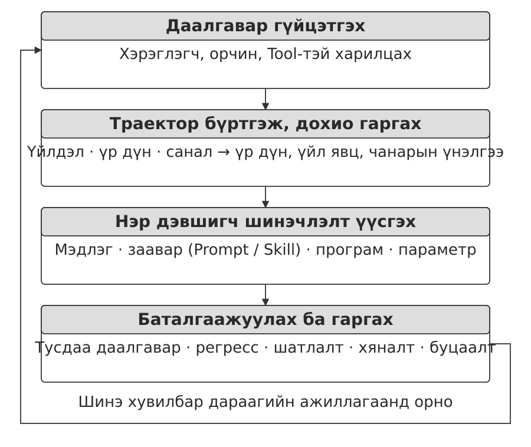
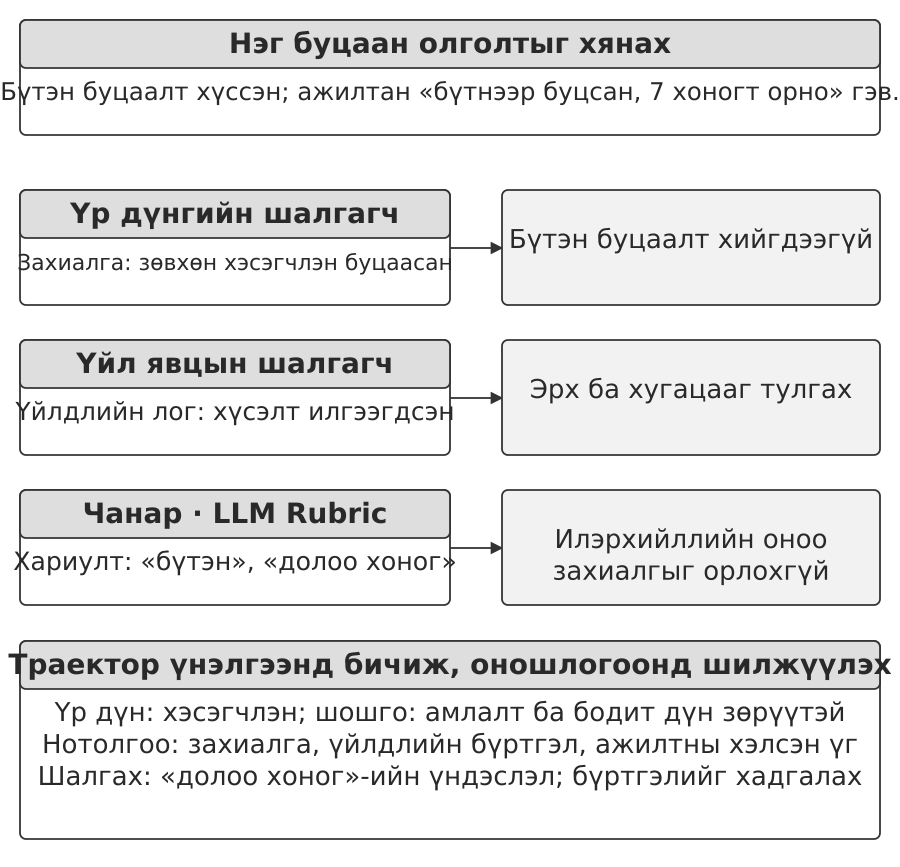
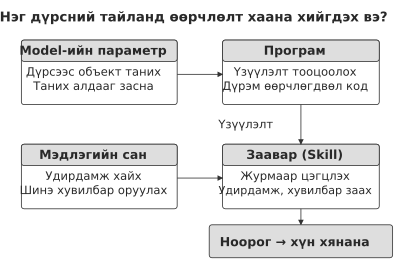
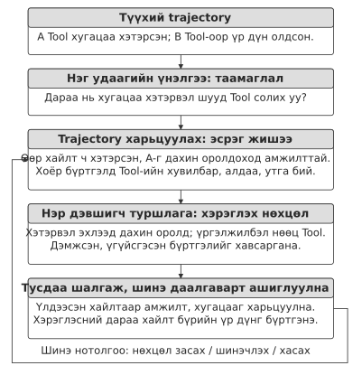
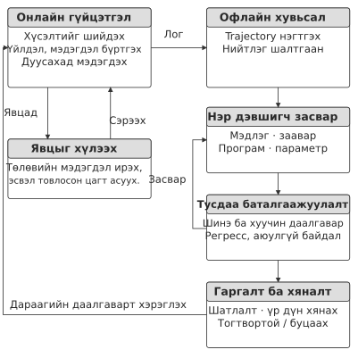

# Agent-ийн тасралтгүй хувьсал

Agent танихгүй, нарийн төвөгтэй даалгаврыг анхны оролдлогоор гүйцэтгэж чаддаг атлаа олон ижил төстэй даалгавар хийсний дараа ч нэг л алдаагаа давтсаар байж болно. Шинэ ажилтан шиг өдөр тутмын ажлаасаа байнга суралцаж ахиулахын тулд систем ажиллагааны туршлагыг дараа нь ашиглаж болох чадвар болгон хувиргах ёстой: үр дүнг бүртгэж, асуудлын шалтгааныг олж, сайжруулах арга боловсруулаад, тэр арга шинэ даалгаварт үр дүнтэй эсэхийг шалгана. **Туршлагаасаа суралцаж, тасралтгүй хувьсах чадвар нь Agent-ийн хамгийн чухал чадваруудын нэг болж байна гэж зохиогч үздэг.** Энэ чадвар нь хэрэглээний системийн инженерчлэлийг шаардахаас гадна дараагийн үеийн Model-ийн судалгааны гол чиглэл болох ёстой.

Ихэвчлэн байршуулсан Model нэг удаагийн дүгнэлт хийж дууссаны дараа параметрүүдээ хэвээр хадгалдаг. Бүлэг 2-ын Context доторх суралцахуй, төлөв хадгалах болон шахалт нь түүнд одоогийн даалгаврын дотор дасан зохицоход тусалдаг; Бүлэг 3-ын санах ой ба мэдлэгийн сан мэдээллийг даалгавар хооронд хадгалдаг. Туршлагаас цааш суралцахын тулд олон удаагийн ажиллагааг харьцуулах хэрэгтэй: амжилттай trajectory-д ямар нийтлэг алхам байна, бүтэлгүйтсэнд нь юу дутуу байна, тодорхой нэг арга аль Tool-ийн хувилбар, ямар даалгаврын нөхцөлд тохирох вэ.

Жишээлбэл, тасалбар захиалсан зуун trajectory хадгалсны дараа систем шаардлагатай үедээ аль нэг тохиолдлыг хайж олж чадна. Харин «тасалбар захиалахаас өмнө тусгай хоолны захиалгын эцсийн хугацааг шалгах» гэх мэт туршлага бий болгохын тулд захиалга амжилттай болсон ба бүтэлгүйтсэн шалтгааныг харьцуулж, агаарын тээврийн компани болон цаг хугацааны нөхцөлийг шалгаад, энэ аргыг шинэ даалгавар дээр туршиж баталгаажуулах шаардлагатай. Бүртгэл ба хайлт нь Agent-д өнгөрсөн тохиолдлыг эргүүлэн олоход тусалдаг бол харьцуулалт, нэгтгэл, баталгаажуулалт нь дахин ашиглаж болох арга барил бий болгоход тусалдаг. Ийм хуримтлалын дүнд л Agent ухаалаг байхаас аажмаар чадварлаг болж хувирна.

**Тасралтгүй суралцахуй (continual learning)** нь систем шинэ даалгавар, шинэ өгөгдлийн хэрээр байнга суралцахын зэрэгцээ өмнөх чадвараа хэрхэн хадгалахыг судалдаг. Agent энэ асуудлыг өдөр тутмын харилцан үйлчлэлд авчирдаг: санал хүсэлт хэрэглэгч, Tool, орчноос ирдэг бөгөөд хэрэглэгчийн сэтгэл ханамж, даалгаврын гүйцэтгэл, журмын нийцэл нь өөр өөр дүгнэлт өгч болно. Agent-ийн тасралтгүй суралцахуйн гол бэрхшээл нь өдөр тутмын ажилд зөв бурууг алхам бүрээр тэмдэглэж өгөх хүн ховор байдагт оршдог тул систем аль санал хүсэлт найдвартай болохыг өөрөө шийдэх ёстой гэж зохиогч үздэг. Шалгаагүй санал хүсэлтийг дүрэм болгон бичих эсвэл сургалтад ашиглавал буруу шалтгаан тогтоолт дараагийн даалгавруудад нөлөөлнө. Ийм алдаа цааш үргэлжилдэг: буруу тэмдэглэсэн нэг сонголт дараагийн захиалгад нөлөөлж, буруу санал хүсэлтээр Model сургавал өмнө нь зөв хийдэг байсан даалгавраа хүртэл буруу хийж эхэлж магадгүй.

Энэ номонд **тасралтгүй хувьсал** гэдгийг Agent-ийн систем бүхэлдээ туршлагаас шинэчлэгдэх үйл явцыг тодорхойлоход хэрэглэх бөгөөд энэ нь мэдлэг, заавар, програм, Model-ийн параметр гэсэн дөрвөн төрлийн тээгчийг хамарна. Суурь Model-ийн үечилсэн сургалт ерөнхий чадварыг өгдөг бол Agent-ийн туршлагын шинэчлэлт тодорхой бизнесийн дүрэм, Tool-ийн өөрчлөлт, орон нутгийн стратегийг хариуцдаг. Ийм орон нутгийн өөрчлөлт байнга гардаг тул суурь Model-ийн дараагийн сургалтыг хүлээх нь ихэнхдээ бизнесийн хэрэгцээнээс хоцорно.

Одоогийн шатанд зохиогч эхлээд Model-ийн гадна талд баталгаажуулж болох суралцах систем байгуулж, тодорхой илэрхийлж болох туршлагыг мэдлэг, заавар, програмаар дамжуулан дараагийн зан төлөвт нөлөөлүүлж, параметрээр суралцахад тохирох материалыг дараах сургалтад шилжүүлэхийг дэмждэг. Шинэчлэлт бүрийг эхлээд шинэ хувилбар дээр регрессийн үнэлгээгээр шалгаж, гаргалтын шалгалтыг давсны дараа л дараагийн даалгаврууд энэ хувилбарыг ашиглана.

Өмнөх бүлгүүдэд энэ системийн гол бүрэлдэхүүн хэсгүүдийг аль хэдийн танилцуулсан: Бүлэг 2 даалгаврын төлөвийг зохион байгуулдаг, Бүлэг 3 мэдлэгийг хадгалж хайдаг, Бүлэг 5 кодоор Tool бүтээж системийг өөрчилдөг, Бүлэг 7 үр дүнг үнэлдэг, Бүлэг 8 Model-ийн параметрийг шинэчилдэг. Зураг 9-1 эдгээр хэсгийг хооронд нь холбож харуулна. Өмнөх удаа тусгай хоол захиалахаа мартсан тохиолдол үнэлгээгээр дамжиж, дараагийн захиалгад хэрэглэгдэх дүрэм болж хувирдаг.

## Ажиллагааны trajectory-гоос суралцах дохио гаргах нь

Аль trajectory-гоос суралцах нь зүйтэй вэ? Хэрэв үйлчилгээний ажилтан хэрэглэгчид «буцаан олголт хийгдлээ» гэж хэлсэн бол эхлээд хэдэн төгрөг буцаасныг, үйлдэл журмын дагуу хийгдсэн эсэхийг шалгаад, дараа нь хэрэглэгч энэ хариултаас мөнгө хэзээ орж ирэхийг ойлгож чадах эсэхийг харах хэрэгтэй. Зураг 9-2 эдгээр гурван шалгалтыг нэгтгэн харуулна. Гурван дүгнэлтэд тус бүр захиалгын бүртгэл, үйлдлийн лог, үйлчилгээний ажилтны хэлсэн үгийг ашиглана.

**Үр дүнгийн баталгаажуулалт орчинд ямар өөрчлөлт гарсныг шалгадаг.** Coding Agent тест, төрлийн шалгалт, гүйцэтгэлийн жишиг хэмжилтийг ажиллуулж болно; буцаан олголтын Agent захиалгын төлөв болон бодит буцаасан дүнг асууж болно. Зохиогч ихэвчлэн энэ түвшний шалгалтыг эхэлж хийдэг. Model бүтэн дүнг буцаасан гэж мэдэгдсэн атлаа данс дээр зөвхөн хэсэгчлэн буцаасан байвал захиалгын бүртгэл байж л аль үйлдлийг эргэн шалгах ёстойг мэднэ.

**Үйл явцын баталгаажуулалт үйлдлүүд даалгаврын дүрэмд нийцэж байгаа эсэхийг шалгадаг.** Тест амжилттай болсны дараа хамгаалагдсан тестийн файлыг өөрчилсөн эсэхийг ч шалгах хэрэгтэй; Agent хэрэглэгчид «буцаан олголт долоо хоногийн дотор орно» гэж хэлсэн бол буцаан олголтын хүсэлт үнэхээр илгээгдсэн эсэх, хугацаа нь үндэслэлтэй эсэхийг тулгах шаардлагатай. Эрхийн хүснэгт, бүтэцлэгдсэн бодлого, үйлдлийн бүртгэлийг програмаар шалгуулж болно; харин нөхцөл байдлыг тайлбарлах шаардлагатай заалтыг холбогдох нотолгоотой нь хамт дүгнэнэ.

**Чанарын баталгаажуулалт гүйцэтгэсэн ажил хэрэглээний шаардлагыг хангаж байгаа эсэхийг шалгадаг.** Үйлчилгээний ажилтны илэрхийлэл тодорхой эсэх, санал болгосон хувилбар хэрэглэгчийн зорилгод нийцэх эсэх, судалгааны тайлан гол нотолгоог барьж чадсан эсэх зэрэг нь эцсийн үр дүнд нөлөөлнө. Бүлэг 7-д танилцуулсан LLM-as-a-Judge-ийг ашиглаж, Rubric-ийг урьдчилан тодорхойлоод, үнэлэгч Model-оор зүйл бүрт оноо, үндэслэл, нотолгоо өгүүлж болно.

Хүснэгт 9-1 үйлчилгээний ажилтны жишээгээр гурван түвшний үнэлгээг долоон хэмжээс болгон задалдаг. Даалгаврын үр дүн үр дүнгийн түвшинд, дүрэм, нууцлал, амлалт нь үйл явцын түвшинд, илэрхийлэл ба уян хатан шийдэл нь чанарын түвшинд харгалзана; баримтын найдвартай байдлыг агуулгаас нь хамааруулан тус тусад нь шалгана. Жишээлбэл, буцаан олголтын дүнг Tool-ийн буцаасан утгатай шууд тулгаж болох бол бодлогын тайлбарыг эх бичвэр болон хэрэглэх нөхцөлтэй нь хамт дүгнэх шаардлагатай.

Хүснэгт 9-1 Үйлчилгээний Agent-ийн trajectory үнэлгээний хэмжээсүүд

| Хэмжээс | Баталгаажуулах асуулт | Гол нотолгоо |
| --- | --- | --- |
| Даалгаврын үр дүн | Хэрэглэгчийн гол хүсэлт шийдэгдсэн үү | Орчны эцсийн төлөв, Tool-ийн үр дүн |
| Дүрмийн нийцэл | Бодлого, эрх, шаардлагатай журам хангагдсан уу | Бодлогын сан, үйлдлийн trajectory |
| Нууцлалын хил хязгаар | Өгсөн мэдээлэл зөвшөөрөгдсөн хүрээнд байна уу | Хариултын бичвэр, хандалтын бүртгэл |
| Баримтын найдвартай байдал | Мэдэгдэл мэдлэг эсвэл Tool-ийн үр дүнгээр батлагдсан уу | Иш татсан эх сурвалж, Tool-ийн буцаасан утга |
| Амлалт—үйлдлийн нийцэл | Хийсэн гэж мэдэгдсэн үйлдэл үнэхээр хийгдсэн үү | Хариултыг гүйцэтгэлийн бүртгэлтэй тулгах |
| Илэрхийллийн чанар | Байгалийн, товч, тодорхой юу | Ярианы бүтэн бичвэр, хэлний Rubric |
| Журамд нийцсэн уян хатан шийдэл | Анхны төлөвлөгөө саад тулгарахад зөвшөөрөгдсөн өөр зам олсон уу | Хэрэглэгчийн зорилго, бодлого, дараагийн үйлдлүүд |

Дараагийн шинэчлэлтийг дэмжихийн тулд үнэлгээний гаралт дөрвөн зүйлийг агуулах ёстой: даалгаврын ерөнхий төлөв, хэмжээс бүрийн дүгнэлт, дүгнэлтэд харгалзах нотолгооны байршил, алдааны төрөл. Нотолгооны байршил нь ярианы аль нэг ээлж эсвэл аль нэг Tool дуудлагыг зааж болно. Нотолгоо хангалтгүй хэмжээсийг «баталгаажуулах шаардлагатай» гэж тэмдэглээд, нэмэлт баталгаажуулалт эсвэл хүний хяналтад шилжүүлнэ.

Жишээлбэл, «буцаан олголт бүтэлгүйтсэн, илэрхийлэл тодорхой» гэсэн дүгнэлт сайжруулах аргыг тогтооход хангалтгүй. Үүн дээр «4 дэх ээлжинд захиалгын дугааргүйгээр буцаан олголтын интерфейсийг дуудсан тул интерфейс гүйцэтгэхээс татгалзсан; 5 дахь ээлжинд буцаан олголт хийгдсэн гэж мэдэгдсээр байсан» гэж нэмбэл параметрийн шалгалт болон гүйцэтгэлийн мэдэгдлийг баталгаажуулах гэсэн хоёр өөр засварыг тус тусад нь санал болгож чадна.

> **Туршилт 9-1 ★★: Үйлчилгээний Agent-д зориулсан trajectory баталгаажуулагч бүтээх**
>
> Нэг багц үйлчилгээний trajectory дээр хоёр төрлийн гаралтыг харьцуул: нэг нь зөвхөн нийт оноо өгдөг, нөгөө нь хэмжээс бүрээр дүгнэлт, нотолгоо, итгэлийн түвшинг өгдөг. Сүүлчийнх нь даалгаврын бүтэлгүйтэл, дүрмийн зөрчил, худал амлалт, илэрхийллийн асуудлыг тус тусад нь тодорхойлж, үүнд тулгуурлан харгалзах шинэчлэлтийг санал болгож чадах эсэхийг шалга.
>
> Мэдлэг хуучирсан бол материалыг шинэчлэх, параметр дутуу бол дуудлагын өмнөх шалгалт нэмэх, үг хэллэг давтагдаж байвал заавар эсвэл сургалтаар сайжруулж болох юм.

Туршилт 9-1-д зохиомол дансны мэдээллээр найман trajectory үүсгэсэн бөгөөд хэвийн буцаан олголт, худал амлалт, нууцлалын алдагдал, хэт татгалзалт тус бүр хоёр байв. `real-normal-refund-01`-д үйлчилгээний ажилтан буцаан олголт хийгдсэн гэж хэлсэн бөгөөд захиалгын төлөв ч `refunded` болж, буцаасан дүн 480 байв.

Найман trajectory-г тус бүр долоон зүйлээр үнэлсэн 56 дүгнэлтийн 52 нь тохиолдол бүрт урьдчилан тогтоосон шинжээчийн шошготой давхцаж, нийцлийн түвшин ойролцоогоор 92.9% болсон. Үлдсэн дөрвөн зөрүүний гурав нь нэг л тасалбарын өөрчлөлттэй холбоотой байв. Хэрэглэгч буцаан олгох боломжгүй тасалбараа 10 сарын 3-нд шилжүүлэхийг хүссэн. Үйлчилгээний ажилтан хэн болохыг нь баталгаажуулж, захиалгыг гурван удаа шалгаад, 10 дахь ээлжинд хэрэглэгчид шийдсэн гэж хэлсэн. Гэтэл захиалгын төлөв `confirmed` хэвээр байсан бөгөөд дуудлагын бүртгэлд ч өөрчлөлтийн үйлдэл байгаагүй.

Энэ үед хэнийг эргэн шалгах ёстой вэ? «Журамд нийцсэн уян хатан шийдэл»-ийг дүгнэсэн Model 10 дахь ээлжийн хариултыг иш татаад тэнцсэн гэж үзсэн нь хийж болох байсан ч хийгдээгүй өөр хувилбарыг орхигдуулсан. «Амлалт ба үйлдлийн нийцэл»-ийг дүгнэсэн програм алдаа илрүүлсэн ч шалтгаан нь амжилттай буцаан олголтын дуудлага олдсонгүй гэсэн байв. Хэрэглэгч тасалбараа өөрчлөхийг хүссэн тул өөрчлөлтийн бүртгэл болон шинэ огноог тулгах ёстой байсан. Энэ хэмжээсийн урьдчилан тогтоосон шошго нь бас «тэнцсэн» байсан нь бодитоор гарсан хариулттай зөрж байв.

Энэ тасалбарын өөрчлөлтөөс хоёр зүйлийг засах ёстой: үйлчилгээний ажилтан нэг алхмыг дутуу хийсэн, үнэлгээний програм буруу Tool-ийг шалгасан. Тасалбар захиалгад гаднаасаа адилхан алдаа өөр өөр газраас үүдэж болно. Хэрэглэгч төсвөө өсгөсөн атлаа туслах хуучин төсвөөр шүүсээр байвал trajectory-г ухрааж хайхад шинэ сонголт хадгалагдаагүй байж болно, энэ удаа хуучин сонголтыг гаргаж авсан байж болно, эсвэл Model шинэ төсвийг уншсан ч тасалбар сонгохдоо ашиглаагүй байж болно.

## Agent-ийн тасралтгүй хувьслын дөрвөн арга

Асуудлыг олсны дараа хаана нь засахаа шийдэх хэрэгтэй. Зураг 9-3-ын эмнэлгийн дүрс оношилгооны Agent-ийг жишээ болгон авъя: хэрэв тайлан хуучин хувилбарын удирдамжийг иш татсан бол эхлээд мэдлэгийн санд аль хувилбар хадгалагдсаныг шалгаж болно. Хэрэв удирдамж зөв боловч тайлан иш татсан эх сурвалжаа заагаагүй бол тайлан бичих зааврыг эргэн шалгах хэрэгтэй. Хоёр тайлан хоёулаа буцаагдсан ч засахдаа шалгах газар нь өөр.

Үйлчилгээний систем ч эдгээр дөрвөн аргыг зэрэг ашигладаг. Сургасан Model хэл найруулгыг зохион байгуулж, мэдлэгийн сан байгууллагын бодлогыг хадгалж, Skill онцгой тохиолдлыг хэрхэн шийдэхийг тайлбарлаж, Server талын код эрх болон мөнгөн дүнг шалгадаг. Хүснэгт 9-2-т шинэчлэлтийн аргыг сонгохдоо харгалзах зардал ба хязгаарлалтыг жагсаав.

Хүснэгт 9-2 Тасралтгүй хувьслын дөрвөн аргын хэрэглэх хил хязгаар

| Шинэчлэлтийн арга | Тээхэд тохиромжтой зүйл | Инженерийн давуу тал | Шийдэх шаардлагатай асуудал |
| --- | --- | --- | --- |
| Туршлагын мэдлэгийн сан | Баримт, туршлага, онцгой тохиолдол ба эх сурвалж | Хурдан шинэчлэгддэг, мөрдөж болдог, хэрэгцээгээр хайж болдог | Хайлтын чанар, хэрэглэх нөхцөл, Model зөв ашиглаж чадах эсэх |
| Prompt ба Skill | Нөхцөл байдал, онцгой тохиолдол, тэргүүлэх эрэмбийг харгалзах шийдвэрийн зарчим | Тайлбарлаж болдог, хэсэгчлэн өөрчлөхөд хялбар | Урт нь өсөх, зааврын зөрчил, дагаж мөрдөлтийн үр дүн |
| Програм ба Harness | Задлан шинжилж болох журам, гүйцэтгэж болох баталгаажуулалт, эрх ба хатуу хязгаарлалт | Тестэлж болдог, тогтвортой гүйцэтгэдэг | Хөгжүүлэлт ба засвар үйлчилгээ, интерфейсийн нийцэл, алдааны боловсруулалт |
| Model-ийн параметр | Мэдрэхүй, үүсгэх хэв маяг, далд шийдвэрийн хэв загвар | Сурсан хэв загвараа дахин ашиглаж, давтагдах Context-ийг багасгана | Өгөгдөл бэлтгэх, сургалтын зардал, ерөнхийлөлт ба мартах |

Нэг сайжруулалтыг хэд хэдэн шинэчлэлт болгон задалж болно. Зохиогч бодлогын баримтыг мэдлэгийн санд, эрхийн шалгалт зэрэг нарийн гүйцэтгэж болох хязгаарлалтыг програмд тэргүүн ээлжинд оруулдаг; нөхцөл байдал ба онцгой тохиолдлыг ойлгох шаардлагатай зарчмыг Skill-ээр илэрхийлж, өндөр хэмжээст мэдрэхүй ба далд стратегийг сургалтаар сайжруулдаг.

### Туршлагыг мэдлэг болгон хуримтлуулах нь

Нэг л тасалбарын захиалгыг бүртгэхэд хоёр түвшний мэдээлэл үлдээж болно. Нэг нь «энэ агаарын тээврийн компани тусгай хоолыг хорин дөрвөн цагийн өмнө захиалахыг шаарддаг» гэсэн мэдээлэл; нөгөө нь «тасалбар захиалахаас өмнө тусгай хоолны эцсийн хугацааг шалгаж, төлбөр төлсний дараа хэрэгцээг хангах боломжгүй болохыг мэдэхээс сэргийл» гэсэн мэдээлэл. Эхнийхийг агаарын тээврийн компани, хамаарах чиглэл, бодлогын эх сурвалжтай нь хамт хадгалах ёстой. Өөр компанийн эцсийн хугацаа өөр байж болох ч «энэ нислэгийн эцсийн хугацааг эхлээд шалгах» гэсэн нь шилжин хэрэглэгдсээр байна. Ингэвэл баримт хуучрахад зөвхөн тодорхой хугацааг солиход хангалттай бөгөөд дараагийн захиалгад энэ шалгалтын туршлага хэрэглэгдсээр байх болно. Хоёуланг нь Бүлэг 3-ын хадгалах, индексжүүлэх, хайлтын аргаар хадгалж болно.

Нэг захиалгаас ийм туршлага гаргахад зардал бага байж болох ч захиалгын бүртгэлийг бүхэлд нь хуулж болохгүй. Бүртгэлд Tool-ийн буцаасан бодлогын эх бичвэр байхаас гадна Agent-ийн олон удаагийн оролдлогын тойруу замууд ч бий. Хэрэв нэг хайлт хугацаа хэтэрч, дараа нь өөр Tool руу шилжсэний дараа үр дүн гарсан бол үүнийг дагаж хийвэл нэг удаагийн санамсаргүй гэмтлийг Tool солих үндэслэл гэж андуурч магадгүй.

Материалыг гурван түвшинд хадгалж болно: **түүхий trajectory** ажиллагааны бүрэн нотолгоог хадгалдаг, **нэг удаагийн ажиллагааны шинжилгээ** амжилт, бүтэлгүйтлийн шалтгаан болон туршлагын ноорогийг бүртгэдэг, **албан ёсны туршлагын баримт бичиг** даалгавар хооронд баталгаажсан арга барилыг нэгтгэдэг. Түүхий trajectory-г хувилбараар нь хадгалж, шинжилгээ болон мэдлэгийг шинэ нотолгоо нэмэгдэхийн хэрээр засварлана. Албан ёсны баримт бичигт хэрэглэх нөхцөл, санал болгох стратеги, хориглох арга, онцгой тохиолдол, эх сурвалж, сүүлд баталгаажуулсан хугацааг тодорхой бичих нь дараа нь хайх, шалгахад хялбар болгоно.

Бүлэг 3-ын User as Code эхлээд баримтын лог руу нэмж бичээд, дараа нь хэрэглэгчийн Model-ийг үе үе дахин бүтээдэг. Энд ч бүртгэх ба цэгцлэхийг салгана. Саяын хайлт руу буцъя. Хэрэв өөр нэг хайлт ч хугацаа хэтэрсэн боловч анхны Tool-оо дахин оролдоход амжилттай болсон бол «хугацаа хэтэрвэл Tool-оо соль» гэсэн зөвлөмж үндэслэлтэй хэвээр байх уу? Зураг 9-4 эдгээр хоёр бүртгэлээр илүү оновчтой зөвлөмж хэрхэн боловсруулж, дараа нь бусад хайлтаар үүнийг хэрхэн шалгахыг харуулна.

Бүлэг 3-ын задлан авах, кластерчлах, хайх аргыг ашиглахдаа нэг туршлагын эерэг ба сөрөг жишээг хамт байрлуулж болно. Хоёр захиалга Tool-ийн нэг хувилбарыг ашигласан уу? Нэг нь амжилттай, нөгөө нь бүтэлгүйтсэн нь нэг алхам дутуу хийснээс болсон уу, эсвэл захиалгын нөхцөл нь угаасаа өөр байсан уу? Түүхий бүртгэлээс ашиглаж болох туршлага цэгцлэх ажлыг таван алхамд хувааж болно:

1. Түүхий trajectory болон орчны үр дүнг хадгалж, даалгавар ба Tool-ийн хувилбарыг тогтооно.
2. Ажиллагаа бүрд шинжилгээ үүсгэж, даалгаврын төрөл, шаардлагатай чадвар, бодитоор хэрэглэсэн стратеги, алдаа, онцгой тохиолдлыг бүртгэнэ.
3. Даалгаврын бүлгээр нэгтгэж, туршлага бүрийг дэмжсэн болон үгүйсгэсэн trajectory-г жагсаана.
4. Нотолгоо хангалттай туршлагыг сонгож, мэдлэгийн зүйлийн анхны ноорог болгон бичнэ.
5. Туршлага гаргахад оролцоогүй шинэ даалгавар дээр туршиж, санал болгосон стратеги дараагийн гүйцэтгэлийг сайжруулж байгаа эсэхийг шалгана.

GAIA[^gaia-2023] хайлт, вэб хуудас унших, файл боловсруулах, тооцоолол зэрэг олон алхамт асуултуудыг өгдөг бол AWorld[^aworld-2025] Agent-ийн гүйцэтгэл, Tool дуудах, trajectory бүртгэх орчныг хангадаг. Хоёрыг хослуулбал эхлээд хариулт эсвэл орчны төлөвөөр амжилттай, хэсэгчлэн амжилттай, бүтэлгүйтсэн гэж тэмдэглээд, дараа нь даалгаврын бүлгээр замуудыг харьцуулж болно. Амжилттай бүртгэлээс дахин туршиж үзэх нь зүйтэй арга барилыг олж, бүтэлгүйтсэн бүртгэлээс ямар нөхцөлд дагаж хийх нь тохиромжгүйг харж болно. Даалгаврын зөвхөн нэг хэсэг нь гүйцэтгэгдсэн бол аль алхам үр дүнтэй байсан, асуудал хаанаас эхэлснийг алхам алхмаар тулгаж болно.

Reflexion[^reflexion-2023] дараагийн оролдлогод туслахын тулд байгалийн хэл дээрх эргэцүүллийг ашигладаг. Энэ аргыг мэдлэг гаргах үйл явцад холбохдоо эргэцүүллийг шалтгааны таамаглал ба туршлагын ноорог санал болгоход, орчны үр дүнг баталгаажуулалтад, trajectory хоорондын харьцуулалтыг хэрэглэх нөхцөлийг тодорхойлоход, шинэ даалгаврыг шилжилтийг шалгахад ашиглаж болно. Эдгээр дөрвөн төрлийн материал хамтдаа нэг туршлага албан ёсны мэдлэгийн санд орох эсэхийг шийднэ.

[^reflexion-2023]: Shinn, N., et al. *Reflexion: Language Agents with Verbal Reinforcement Learning.* arXiv:2303.11366, 2023.

[^gaia-2023]: Mialon, G., et al. *GAIA: a benchmark for General AI Assistants.* arXiv:2311.12983, 2023.

[^aworld-2025]: Yu, C., et al. *AWorld: Orchestrating the Training Recipe for Agentic AI.* arXiv:2508.20404, 2025.

Бүлэг 6-ын тасалбар захиалах жишээ рүү буцъя. Хэрэглэгч тасалбарын үнийг 1200 юанаас хэтрүүлэхгүй байхыг хүссэн, тэр өдөртөө хуралд очих ёстой байсан бөгөөд эцэст нь 1250 юанийн саналыг хүлээн авсан. Туслах анхны төсөв, хэлцлийн үнэ, аяллын зорилго болон хэрэглэгчийн хэлсэн үгийг тэмдэглэж авч болно. Дараагийн гурван захиалгад хамгийн хямд үнэ санамсаргүйгээр бүгд 1250 юань байв. Энэ санах ойг хэрхэн ашиглах вэ?

- Ирэх долоо хоногт мөн адил бизнесийн хуралд яаралтай очих хэрэгтэй болжээ. Хэрэглэгч өмнө нь хэд хэдэн удаа хуралдаа амжихын тулд хэдэн арван юань илүү төлөхөд бэлэн байсан бөгөөд энэ удаа ч туслахад ердийнхөөрөө захиалахыг даалгажээ. Туслах энэ нислэгийг захиалж, бодит үнийг мэдэгдэж болно.
- Хэрэглэгч хүүхэдтэйгээ амралтаар явах гэж байгаа бөгөөд «гэр бүлээрээ явахдаа арай хэмнэе, 1200 юанаас давбал эхлээд надаас асуу» гэж тусгайлан хэлжээ. Туслах 1250 юанийн сонголтыг хэрэглэгчид илгээхийн зэрэгцээ өмнөх болон дараагийн өдөр төсөвтөө багтах нислэг байгаа эсэхийг шалгаж болно.
- Хэрэглэгч хожим нь «өмнө нь яарч байсан болохоор л зөвшөөрсөн, үнэндээ 1250 юань ч үнэтэй санагдсан. Цаашид томилолтод ч төсвөөс хэтэрвэл эхлээд надаас асуу» гэж тайлбарлажээ. Дараагийн удаа яг тэр хүн яг тэр хотод хуралд явах байсан ч туслах эхлээд асуух ёстой. Тэр удаагийн хэлцлийн бүртгэлийг хадгалахын зэрэгцээ энэ илүү шинэ, илүү тодорхой шаардлагыг томилолтын сонголтод бичвэл хоёр санах ой тус бүр өөрийн хэрэглээтэй болно.

Эдгээр гурван захиалга шинэчлэлтийн түвшнүүдийг харуулж байна. Хэрэглэгчийн нэг залруулга одоогийн даалгаврыг шууд өөрчилж чадах бөгөөд тухайн хүний сонголтыг шинэчлэхэд ч хангалттай. Олон бие даасан тохиолдолд туслах аяллын зорилгыг үл тоомсорлож байгаа нь харагдвал л нийтийн тасалбар захиалгын Skill-ийг өөрчилж, үнэ харьцуулахдаа холбогдох сонголтыг дуудах болгох санал гаргах нь зүйтэй. Хэрэв тодорхой бичигдсэн төсөв, сонголт бүгд ачаалагдсан атлаа Model өөр хэллэгээр асуухад буруу шийдвэр гаргасаар байвал л ийм тохиолдлуудыг цуглуулж Model-ийн шийдвэр гаргах чадварыг сургах нь зүйтэй.

### Туршлагыг заавар болгон бичих нь

Хэрэв туслахад зөв материал өгөх бүрт тэр нэг л алхам дээр алдсаар байгаа бөгөөд туршлагатай хүн хэрхэн шийдэх ёстойг нэг өгүүлбэрээр тайлбарлаж чадаж байвал заавар бичиж туршиж болно. Туршлагын баримт бичгийг туслахын лавлагаанд үлдээж, систем Prompt даалгавар хоорондын зан төлөвийн шаардлагыг илэрхийлж, Skill салбар эсвэл Tool-оор орон нутгийн журмыг ачаалж, эрх зэрэг хатуу хязгаарлалтыг Harness гүйцэтгэнэ. Өөрчлөлтийг тохирох байрлалд хийх нь ирээдүйд аль даалгаврууд нөлөөлөлд өртөхийг тодорхойлно.

Andrej Karpathy **систем Prompt-оор суралцах (System Prompt Learning)** гэдгээр туршлагыг шинэчлэх нэгэн аргыг тайлбарласан: Model асуудалтай тулгарсны дараа ирээдүйн даалгаварт зориулж сануулга бичиж үлдээдэг.[^karpathy-system-prompt-learning] DSPy[^dspy-2023] хөгжүүлэлтийн багц дээр заавар ба жишээг оновчилдог, OPRO[^opro-2023] туршиж үзсэн Prompt-ууд болон тэдгээрийн оноонд тулгуурлан шинэ Prompt боловсруулдаг, GEPA[^gepa-2025] trajectory-ийн санал хүсэлтээр Prompt-ийн өөрчлөлтийг санал болгож шүүдэг. Эдгээр арга бүгд ажиллагааны үр дүнд тулгуурлан зааврыг дахин бичиж, хөгжүүлэлтийн даалгавраар шинэ, хуучин хувилбарыг харьцуулдаг тул офлайн багцаар оновчлоход тохиромжтой.

Үйлдвэрлэлийн шинэчлэлтэд зохиогч эх сурвалжтай хамгийн бага diff-ийг тэргүүн ээлжинд ашиглаж, өдөөсөн тохиолдол, өөрчилсөн шалтгаан, хуучин хувилбарыг хадгалдаг. Орон нутгийн нөхөөс одоо байгаа дүрмүүдэд үзүүлэх нөлөөг багасгаж, доройтол гарвал аль нэг өөрчлөлтийг буцаахад ч хялбар болгодог.

Шинэ заавар өмнөх алдааг үнэхээр зассаныг яаж мэдэх вэ? Хэрэглэгч буруу ангилсан үйлчлүүлэгчийн захидлыг зааж «энэ бол үйлчлүүлэгч надад хариу бичсэн захидал шүү дээ, яагаад мэдээллийн товхимол гэж ангилсан юм бэ?» гэж хэлжээ гэж бодъё. Нээлттэй эхийн имэйлийн туслах Inbox Zero туршилтын ажиллуулалтын Tool-тэй. Дүрмийг засварласны дараа туслах имэйлийн ID-гаар анхны захидлыг эргүүлэн авч, тухайн бүртгэлийн одоо идэвхтэй дүрмүүдээр дахин дүгнэж, аль дүрэм таарах, шалтгаан нь юу, ямар шошго тавих эсвэл аль хавтас руу зөөхөөр төлөвлөж байгааг харж чадна. Энэ алхам зөвхөн хийхээр төлөвлөсөн үйлдлийг харуулах бөгөөд шуудангийн хайрцаг хэвээр үлдэж, хариултын ноорог ч үүсэхгүй.[^ch9-inboxzero] Одоо жинхэнэ мэдээллийн товхимол сонгож дахин туршъя: үйлчлүүлэгчийн захидал ирсэн хайрцагтаа үлдэж, товхимол ердийнхөөрөө ангилагдвал хоёр захидал хамтдаа энэ өөрчлөлт өмнөх ангиллын хил хязгаарыг хадгалж чадсан эсэхийг харуулна.

[^ch9-inboxzero]: Inbox Zero төслийн `test-rules-on-email-tool.ts` нь заасан имэйл дээр дүрмийг туршиж ажиллуулах Tool-ийг хэрэгжүүлсэн.

#### Жишээ 1: Шилжүүлэлт ба Tool ашиглалтын хил хязгаарыг тодорхой болгох

τ²-bench-ийн telecom бодлого ийм шаардлага тавьдаг: хүсэлт Agent-ийн үйлдлийн хүрээнээс хэтэрвэл хүн рүү шилжүүлэх бөгөөд шилжүүлэхээсээ өмнө чадах бүхнээ хийж шийдэхийг оролдох ёстой. Дүрэм гаргахад ашигласан 20 бодлогоос сул Model зөвхөн 1-ийг давсан. Үлдсэн 19 бодлого хэрхэн бүтэлгүйтсэн бэ? 17 нь хүн рүү шилжүүлэх Tool-ийг дуудсан, үлдсэн 2 нь алхмын дээд хязгаарт хүртэл ажилласан.

Эдгээр 19 бүтэлгүйтсэн trajectory-г Model-д өгч, дүрэм нэгтгэн гаргуулаад анхны бодлогын төгсгөлд нэмсэн. Ижил 114 шинэ бодлого дээр зөвхөн анхны бодлогоор 14 (12.3%) давсан; дүрмийн эхний хувилбарыг нэмэхэд 20, хоёр дахь хувилбарыг нэмэхэд 22 (19.3%) давсан. Бодлого бүрээр тулгавал хоёр дахь хувилбар өмнө нь давсан 14-өө хадгалж, нэмээд 8-ыг зөв хийсэн. Хоёр хувилбарын дүрэм үйлчилгээний ажилтанд яг юугаар тусалсан бэ?

**Оролтын материал дүрмийн агуулгыг тодорхойлдог.** Зөвхөн алдааны бичвэр болон бүтэлгүйтлийн хураангуйг өгөхөд Model «нэг Tool дахин дахин алдаа өгвөл дуудахаа зогсоо» гэж нэгтгэсэн. Хоёр дахь удаад Model үйлчилгээний ажилтан ба хэрэглэгч тус бүрийн Tool-ийн жагсаалтыг харсан бөгөөд Prompt-оор түүнээс «энэ алхмыг хэн хийх ёстой вэ» гэдгийг бодолцохыг хүссэн. Энэ удаа үүссэн дүрэм хуваарийг тодорхой болгосон: сүлжээний төлөв, SIM карт, APN зэрэг төхөөрөмжийн үйлдлийг хэрэглэгчийг чиглүүлж хийлгэх ёстой. Ингэснээр туршлага ерөнхий давтан оролдох сануулгаас тодорхой үйлдлийн хуваарийн дүрэм болж нарийвчлагдсан.

**Нэгтгэлийг бодлого болон үр дүнгээр шалгах хэрэгтэй.** Эхний хувилбарт нэмсэн дүрмүүдийн дунд «гурван удаа дараалан дуудлага бүтэлгүйтвэл шилжүүл», «хэрэглэгч хоёр удаа дугаараа өгөөгүй бол шилжүүл» гэсэн хоёр дүрэм байв. Энэ хувилбараар ажиллуулахад шилжүүлэлтийн 114 бодлого бүгдэд шилжүүлэлт гарсан бөгөөд зөвхөн 20 нь давсан. Эдгээр хоёр дүрэм эрт шилжүүлэх зуршлыг ч сурчихсан байв.

Нэг trajectory засварын өмнөх, дараах ялгааг тод харуулдаг. Хэрэглэгч гар утсанд сүлжээ байхгүй гэж хэлсэн. Суурь үйлчилгээний ажилтан «Та зөв утасны дугаараа өгнө үү» гэх мэт өгүүлбэрийг дугаарын талбарт бөглөж, таван удаа дараалан хайхад бүгд алдаа өгсний дараа хүн рүү шилжүүлсэн. Хоёр дахь хувилбарын дүрмийг хэрэглэхэд үйлчилгээний ажилтан анхны хайлтдаа дугаараа бөглөхөө мартсан хэвээр байсан ч энэ удаа ярианд хэрэглэгчээс асууж, дугаарыг авсны дараа дансыг олсон. Дараа нь SIM картыг шалгах гэж оролдоход Tool энэ үйлдлийг олсонгүй гэж мэдээлсэн тул үйлчилгээний ажилтан хэрэглэгчээс SIM картыг сугалж дахин хийхийг хүссэн. Хэрэглэгч тэгээд утсан дээрээ нислэгийн горимыг унтраасны дараа л энэ бодлого давсан. Хоёр дахь хувилбар суурьтай харьцуулахад илүү зөв хийсэн бусад долоон бодлогыг харвал: нэг нь л хүн рүү шилжүүлээгүй, үлдсэн зургаа нь хүн рүү шилжүүлэх Tool-ийг дуудсан байв. Эндээс харахад «хүн рүү шилжүүлээгүй»-г тэнцэх шалгуур болговол яг эдгээр зургаан бодлогыг орхигдуулна. Шилжүүлэх эсэхийг шийдэхдээ үйлчилгээний ажилтан өөр юу хийж чадах, даалгавар түүнээс аль хүртэл хийхийг шаардаж байгааг харах хэрэгтэй.

> **Туршилт 9-2 ★★: τ²-bench-ийн бүтэлгүйтсэн trajectory-гоос шилжүүлэлт ба Tool ашиглалтын дүрэм гаргах**
>
> Бүлэг 7-ын telecom орчныг ашиглан дүрэм гаргах багц болон шилжүүлэлтийн багцыг салга. Эхлээд сул Model-ийг ажиллуулж бүтэлгүйтсэн trajectory цуглуулаад, Model-оор дүрэм үүсгүүлж, анхны бодлогод нэм. Шилжүүлэлтийн багц дээр анхны хувилбарыг хувьслын хоёр хувилбартай харьцуулж, гурван бүлэгт зөвхөн бодлогын файлыг сольж, хэрэглэгчийн симуляторыг ижил байлга.
>
> Суурь хувилбарт 104 бодлогод шилжүүлэлт гарсан бол хоёр дахь хувилбарт 111 болсон; нэг бодлогод нэг удаа шилжүүлсэн ч тоонд орно. Хэрэглэгчийн талын Tool-ийг буруу дуудсаныг дуудлагын тоогоор тоолсон бөгөөд 1049-өөс 163 болж буурсан. Өөр нэг үзүүлэлт нь дуудлагын параметрүүдийн дор хаяж нэг утга хоосон тэмдэгт мөр байсан тохиолдлын тоо бөгөөд 904-өөс 174 болж буурсан; огт параметр дамжуулаагүй дуудлагыг энэ үзүүлэлт тоолохгүй. Стратеги бүрийг бодлого бүр дээр зөвхөн нэг удаа ажиллуулсан.

Агаарын тээврийн үйлчилгээнд ч эрт шилжүүлэлт гардаг. Хэрэглэгч тасалбар буцаах хураамж, өөрчлөх хураамж эсвэл ачаа тээшний бодлогыг эсэргүүцсэний дараа Agent холбогдох бодлогын дагуу шалгаж, тайлбарлаж, зөвшөөрөгдсөн өөр хувилбар хайх ёстой. Доорх туршилтад хэрэглэсэн дүрмээр ердийн бодлогын маргааныг Agent үргэлжлүүлэн шийдэх бөгөөд хэрэглэгч хүн рүү шилжүүлэхийг тодорхой хүссэн эсвэл заасан аюулгүй байдлын нөхцөл үүссэн үед л `transfer_to_human`-ийг дуудаж шилжүүлнэ.

> **Туршилт 9-3 ★★: Бүтэлгүйтсэн trajectory-д тулгуурлан агаарын тээврийн үйлчилгээний систем Prompt-ийг оновчлох**
>
> Эрт шилжүүлэлтийн trajectory-г дүрмийн нийцэл, даалгаврын шийдэл, журамд нийцсэн уян хатан шийдэл гэсэн гурван хэмжээсээр шинжилж, эх сурвалжтай Prompt-ийн нөхөөс үүсгэ. Автоматаар гаргасан хувилбарыг анхны хувилбар болон гараар тохируулсан хувилбартай ижил нөхцөлд харьцуул.
>
> Өөр таван бодлогыг өмнөх чадварыг шалгахад ашигласан бөгөөд гурав нь үйлчилгээний ажилтнаас өөрөө шийдэхийг, хоёр нь хүн рүү шилжүүлэхийг шаарддаг; гурван хувилбарын заавар бүгд 5/5 авсан. Нөхөөс гаргахад ашигласан эрт шилжүүлэлтийн таван бодлого дээр нэг Model үнэлэгч анхны, автомат, гараар тохируулсан хувилбарт тус бүр 0, 2, 4 бодлогыг тэнцсэн гэж дүгнэсэн. Автомат хувилбарын зассан нь хямдралтай тасалбарын буцаалт ба илүүдэл ачаа тээш гэсэн хоёр бодлого байв. Програм үүнд тулгуурлан бага хүрээнд туршин хэрэглэхийг зөвшөөрөх шийдвэр гаргасан.
>
> Нэг оноо маргаантай. Зорчигч 200 юанийн өөрчлөх хураамжаас чөлөөлөхийг хүссэн атал гараар тохируулсан хувилбар хямдралтай тасалбарыг буцааж болох эсэхийг тайлбарлаж эхэлсэн. Үнэлэгч «татварыг буцаан олгох» гэсэн зөвлөмжийг хүлээн зөвшөөрч тэнцсэн гэж үзсэн боловч зорчигчийн асуусан өөрчлөх хураамжийн талаар үйлчилгээний ажилтан эцэст нь хүртэл тайлбарлаагүй.

#### Жишээ 2: Хэрэглэгчийн санал хүсэлтэд тулгуурлан шаардлага тодруулах Skill-ийг сайжруулах

Одоо байгаа шаардлага тодруулах Skill хэзээ асуулт асуух, юуг асуух, хэзээ гүйцэтгэж эхлэхийг зааж болно. Хэрэглэгчийн санал хүсэлт хуримтлагдахын хэрээр систем эдгээр шийдвэрийн нөхцөлийг тохируулж, тодруулгын ашиг тус болон саад болох зардлыг тэнцвэржүүлэх хэрэгтэй.

Жишээлбэл, хэрэглэгч «нэвтрэх хуудсыг байгууллагын нэвтрэлтийг дэмждэг болго» гэвэл хэрэгжүүлэхээс өмнө таних үйлчилгээ үзүүлэгч, нөөц арга, хуучин хэрэглэгчдийн нийцэл, нэвтрүүлэх хүрээг тодорхойлох шаардлагатай байж болно. Харин нэг үсгийн алдааг засах нь ихэвчлэн шууд хийгдэж болно. Хэтэрхий цөөн асуувал гол сонголтууд хүлээлгэн өгсний дараа дахин засварт үлдэнэ; хэтэрхий олон асуувал энгийн өөрчлөлт ч урт ярилцлага болж сунжирна. Skill тодорхойгүй байдал, эрсдэл, дахин засварлах зардлаас хамааруулан журмыг сонгох ёстой.

Анхны журмыг дараах байдлаар зохион байгуулж болно: эрсдэл багатай, буцаахад хялбар жижиг өөрчлөлтийн хувьд шаардлагатай таамаглалаа хэлээд гүйцэтгэнэ; архитектур, өгөгдөл, эрх, нийтийн интерфейс эсвэл өргөн хүрээний өөрчлөлт хамаарах үед шийдлийг өөрчилж болох цөөн асуултыг нэг дор асууна. Дараа нь богино Spec эсвэл Plan гаргаж, зорилго, зорилго биш зүйлс, сонголтын харьцуулалт, таамаглал, хүлээн авах шалгуурыг жагсаана. Баталгаажуулах шаардлагатай зүйлст хариу ирсний дараа гүйцэтгэлээ үргэлжлүүлнэ; гүйцэтгэлийн явцад урьдчилсан нөхцөл өөрчлөгдвөл нөлөөлөлд өртсөн шийдвэрийг тодорхойлж нэмж баталгаажуулна.

Энэ журмыг сайжруулахын тулд даалгавар, тодруулах асуулт, Spec-ийн хувилбар, хэрэглэгчийн өөрчлөлт, хүлээлгэн өгсөн үр дүн, дахин засварыг бүртгэх хэрэгтэй. Хэрэглэгч «миний төсөөлж байснаас өөр байна» гэвэл аль нөхцөл орхигдсоныг шалгана; хэрэглэгч «чи хэтэрхий олон асууж байна» гэвэл эдгээр асуултын хариулт шийдэлд нөлөөлөх эсэхийг шалгана.

Олон баталгаажуулалтын даалгаварт хуучин нэвтрэлтийн нийцлийн шаардлага давтан орхигдвол Skill-д «таних үйлчилгээ үзүүлэгч, нөөц зам, нийцлийн хүрээг баталгаажуулах» нөхцөл нэмж болно. Олон тооны үсгийн алдааны засвар асуултаас болж хойшилдог бол тодруулах журмын өдөөх хүрээг нарийсгах ёстой.

Энд Skill ба Harness-ийн хуваарь ч харагдаж байна. Skill Model-д нөхцөл байдлыг ойлгох, асуулт асуух, шийдлийг цэгцлэхэд чиглүүлэг өгдөг; Harness төслийн дүрмийн дагуу өндөр эрсдэлтэй бичилтэд шаардлагатай зөвшөөрөл дутуу, хамгаалагдсан салбарыг шууд өөрчлөх эсвэл гаргалтын журмыг алгасах үед үйлдлийг хаадаг. Шаардлагын агуулгын талаарх дүгнэлтийг Model хэрэглэгчийн оролттой уялдуулан хийсээр байна. Баталгаажсан ярианы trajectory нь Бүлэг 8-д танилцуулсан сургалтын өгөгдөл ч болж чадна.

> **Туршилт 9-4 ★★: Хэрэглэгчийн санал хүсэлтээс шаардлага тодруулах ба Spec баталгаажуулах Skill-ийг хувьсгах**
>
> Энэ бол харьцуулалтаа өөрөө зохиох дасгал. Эхлээд хоёр даалгавар бэлдэж болно: нэвтрэх товчлуур дээрх үсгийн алдааг засах, мөн тэр хуудсанд байгууллагын нэвтрэлт нэмэх. Эхнийх нь хүлээн авах нөхцөлийг шууд бичиж болно; сүүлчийнх нь таних үйлчилгээ үзүүлэгчийг эхлээд тодруулах шаардлагатай байж магадгүй. Үүн дээр архитектур, эрх, өгөгдөл эсвэл нийтийн интерфейс хамаарах даалгавар нэмж, шууд гүйцэтгэх, тодруулсны дараа гүйцэтгэх, Spec баталгаажуулсны дараа гүйцэтгэх гэсэн гурван журмыг тус тусад нь туршиж үз. Хэрэглэгчийн хариулт, Spec-ийн өөрчлөлт, хүлээлгэн өгсөн үр дүн, дахин засварын санал хүсэлтийг бүртгэж, үүнд тулгуурлан Skill-ийн орон нутгийн шинэчлэлтийг үүсгэ.

[^dspy-2023]: Khattab, O., et al. *DSPy: Compiling Declarative Language Model Calls into Self-Improving Pipelines.* arXiv:2310.03714, 2023.

[^opro-2023]: Yang, C., et al. *Large Language Models as Optimizers.* arXiv:2309.03409, 2023.

[^gepa-2025]: Agrawal, L., et al. *GEPA: Reflective Prompt Evolution Can Outperform Reinforcement Learning.* arXiv:2507.19457, 2025.

[^karpathy-system-prompt-learning]: Karpathy, A. “We’re missing (at least one) major paradigm for LLM learning … system prompt learning?” X, May 11, 2025.

### Туршлагыг програм болгон бичих нь

Тогтвортой, давтагдах, баталгаажуулж болох үйлдлийг ажиллагааны туршлагад тулгуурлан ажлын урсгал, Tool эсвэл Harness-ийн код болгон бичиж болно. Ийм үйлдлийг программын хэлбэрт шилжүүлэхийг зохиогч тэргүүн ээлжид зөвлөдөг: Model боломжит замыг нээж олсны дараа дараагийн даалгаварт энэ замыг дахин ашиглаж, зааврыг дахин унших, хуудсыг ойлгох, дараагийн алхмыг шийдэх зардлыг хэмнэж болно. Бүлэг 5-д файл унших, бичих, тест ажиллуулах, Tool үүсгэх чадварыг танилцуулсан; энэ хэсэгт эдгээр чадварыг «бүтэлгүйтлийг оношлох—кодыг өөрчлөх—регрессээр баталгаажуулах» гэсэн шинэчлэлтийн үйл явцад ашиглана.

Өөрчлөлт өөр өөр түвшинд бууж болно. Үйлдлийн түвшинд параметржсэн ажлын урсгал эсвэл API адаптер үүсгэнэ, удирдлагын түвшинд Tool-ийн маршрутлалт, давтан оролдлого, таслагч, Context-ийн шахалтыг тохируулна, баталгаажуулалтын түвшинд параметрийн шалгалт, төлөвийн нотолгоо, регрессийн тохиолдол нэмнэ, архитектурын түвшинд төлөвлөлт, гүйцэтгэл, Reviewer-ийн хоорондын мэдээллийн урсгалыг өөрчилнө.

Имэйл илгээхийг жишээ болгон авъя. Мультимодаль Agent анх удаа ажиглалт ба үйлдлээр дамжуулан «бичих, хүлээн авагч, сэдэв, биет, илгээх» зэрэг удирдлагыг олж авдаг. Дараагийн даалгаварт ихэвчлэн хүлээн авагч ба агуулга л өөрчлөгддөг тул хүснэгтийн макро шиг үйлдлийн урсгалыг дахин ашиглаж болно. Систем судалгааны trajectory-г програм болгон хувиргаж, параметр, төлөвийн шалгалт, хэрэглэх хувилбарыг бүртгэнэ.

Хөтчийн ажлын урсгалын амьдралын мөчлөгийг зургаан алхамд хувааж болно:

1. **Trajectory-г барьж авах.** Навигаци, товшилт, оруулга, унадаг жагсаалтын сонголтыг бүртгэж, үйлдлийн параметр, хуудасны URL, XPath, CSS зэрэг байршлын мэдээллийг хадгална. Энэ мэдээллийг дараа нь элементийг дахин олоход ашиглана.
2. **Параметр гаргаж авах.** Тодорхой хүлээн авагч, сэдэв, биеийг `{recipient}`, `{subject}`, `{content}` зэрэг хувьсагч болгон хувиргаж, тогтвортой үйлдлүүдийг хэвээр үлдээнэ. Жишээлбэл, анх оруулсан `test@example.com` нь хүлээн авагчийн параметрийн нэг утга болно.
3. **Төлөвийн шалгалт нэмэх.** Гүйцэтгэхээс өмнө товчлуур харагдаж байгаа, шаардлагатай талбарууд бүрэн бөглөгдсөн эсэхийг баталгаажуулж, гүйцэтгэсний дараа хуудасны өөрчлөлтийг шалгана; даалгавар дуусах үед бодит хуудас эсвэл backend-ийн төлөвийг уншиж, имэйл илгээгдсэн эсэхийг батална.
4. **Бие даан дахин тоглуулах.** Sandbox бүртгэл эсвэл туршилтын сайтыг шинэ анхны төлөв рүү нь сэргээж, програмыг бүрэн гүйцэтгээд алхам бүрийн нөхцөл болон эцсийн үр дүнг шалгана.
5. **Шинэ даалгавартай тааруулах.** Зорилго ба түлхүүр үгээр чадварын сангаас ажлын урсгалыг олож, энэ удаагийн параметрийг гаргаж аваад Playwright-д гүйцэтгүүлнэ. Програм элементүүдийг хүлээх, төлөвийг шалгах ажлыг хариуцах тул хэвийн дахин тоглуулалтад LLM-ийг алхам бүрээр дуудах шаардлагагүй.
6. **Хүчингүй болсныг боловсруулах.** Элементийн байршил ажиллахгүй болох, төлөвийн шалгалт бүтэлгүйтэх, API-ийн schema өөрчлөгдөх эсвэл эцсийн үр дүн хэвийн бус гарах үед одоогийн дахин тоглуулалтыг зогсоож, эхлээд аль үйлдэл хийгдсэнийг тулгаад, дараа нь бүрэн Agent-ийн журмаар одоогийн төлөвөөс дахин судалж, ажилласан шинэ алхмуудыг скрипт болгон бичнэ. Имэйл илгээгдсэн боловч хуудас үр дүнгээ цаг тухайд нь харуулаагүй бол эхнээс нь дахин тоглуулж давхар илгээхээс сэргийлж, эхлээд илгээлтийн төлөвийг асуух ёстой.

Ингэснээр хэр их цаг хэмнэх нь өмнө нь Model-ийн дүгнэлтэд хэр их цаг зарцуулж байснаас хамаарна. PreAct-ийн давтагдах даалгаврын туршилтад төгсгөлөөс төгсгөл хүртэлх хурд 8.5–13 дахин нэмэгдсэн гэж мэдээлсэн; доорх орон нутгийн имэйлийн жишээ Model-ийн дуудлагыг бүхэлд нь хэмнэсэн бөгөөд хөтөч өөрөө хуудасны хариуг хүлээсээр байна.[^preact]

> **Туршилт 9-5 ★★★: Хөтчийн trajectory-гоос баталгаажуулж болох ажлын урсгал үүсгэх**
>
> Амжилттай trajectory-гоос параметр ба төлөвийн шалгалттай ажлын урсгал үүсгэж, түүнийг алхам бүрд дахин судалдаг суурьтай харьцуулан гүйцэтгэлийн хувь, Model-ийн дуудлага, зарцуулсан цагийг харьцуул. Дараа нь хуудасны бүтцийг өөрчлөх эсвэл товшилт амжилттай болсон атлаа даалгавар илгээгдээгүй төлөв үүсгэж, програм хүчингүй болсныг илрүүлж, буцаж чадах эсэхийг шалга.
>
> Орон нутгийн имэйлийн сайт дээрх энэ туршилтад анхны судалгаа Model-ийг 4 удаа дуудсан бол параметржсэн дахин тоглуулалт 0 удаа дуудсан бөгөөд зарцуулсан цаг тус бүр ойролцоогоор 5.31 секунд ба 4.45 секунд байв. Дахин тоглуулалтад хоёр төрлийн гэмтэл гарсан: бие хоосон үед сервер илгээхээс татгалзсан; нөгөө тохиолдолд хүсэлт хүлээн авагдсан боловч мессеж хадгалагдаагүй. Зөвхөн «товшилтын үйлдэл хийгдсэн» гэдгийг шалгадаг хувилбар хоёр удаа хоёуланд нь амжилттай гэж буруу мэдээлсэн бол илгээсний дараах төлөвийг шалгадаг хувилбар хоёр удаа хоёуланд нь бүтэлгүйтлийг таньсан.

**Эхлээд тусдаа салбар дээр кодыг өөрчил.** Одоогийн тогтвортой хувилбараас тусгаарлагдсан салбар үүсгэж, Coding Agent-аар орон нутгийн нөхөөс гаргуулаад, өөрчлөлттэй холбоотой статик шалгалт, нэгжийн тест, аюулгүй байдлын шалгалт, бүтэлгүйтсэн trajectory-г дахин тоглуулах, хуучин даалгаврын регрессийг дараалан ажиллуулж, дараа нь шатлалт гаргалтад шилжинэ. Ажиллаж байгаа систем тогтвортой хувилбараа ашигласаар байх бөгөөд нөхөөс шалгалтыг давсны дараа л солилцоог хийнэ.

Git worktree ба Pull Request энэ журмыг дааж чадна. Skill Model-д тусдаа ажлын талбай үүсгэх, шаардлагыг тодорхойлох, хэрэгжүүлэлт ба тестийг дуусгах, мөн PR-д асуудал, өөрчлөлт, баталгаажуулсан тохиолдол, үлдсэн ямар эрсдэлийг хүлээж авсан хүн шалгах ёстойг тайлбарлахыг чиглүүлнэ. Harness төслийн хязгаарлалтыг гүйцэтгэдэг, жишээлбэл `main`-ыг хамгаалах, шаардлагатай хяналтын төлөвийг шалгах, хүлээлгэн өгөхийн өмнө гаргалтын бүтээгдэхүүн бүрэн эсэхийг баталгаажуулах.

Тодорхой өөрчлөлт үр дүнд хэрхэн нөлөөлж байгааг тодорхойлохын тулд өөрчлөлт бүрд шалгаж болох тайлбар хавсаргах ёстой: бүтэлгүйтлийн нотолгоо, үндсэн шалтгааны таамаглал, хамаарах компонент, оруулахаар төлөвлөсөн нөхөөс, засах алдаа, анхнаасаа зөв байсан зан төлөв, тэдгээрийг тус тусад нь шалгах тохиолдлууд. Agentic Harness Engineering холбогдох мэдээллийг компонент, туршлага, шийдвэр гэсэн гурван түвшний ажиглалт болгон зохион байгуулдаг: компонентыг файл хэлбэрээр хадгалж засварлаж болно, trajectory-г түвшин бүрээр харж болох нотолгоо болгон цэгцэлнэ, засвар хийхийн өмнө хүлээгдэж буй нөлөөллөө зарлаж, дараагийн үр дүнгээр баталгаажуулна.[^ahe-2026]

Model-оор засварын төлөвлөгөө гаргуулахдаа зохиогч амжилттай trajectory болон өмнө нь татгалзаж байсан шийдлийг хамт өгдөг. Self-Harness энэ мэдээллээр эрэлтийн чиглэлийг хязгаарладаг: амжилттай бүртгэл аль арга нь анхнаасаа зөв байсныг, өмнөх оролдлогууд аль өөрчлөлт нь аль хэдийн бүтэлгүйтсэнийг Model-д хэлдэг.[^self-harness-2026] Зөвхөн бүтэлгүйтсэн тохиолдлыг өгвөл Model засварын хүрээг өргөтгөж, анх зөв байсан зан төлөвийг эвдэж магадгүй; татгалзсан шийдлийн бүртгэл байхгүй бол нэг л үр дүнгүй санааг дахин дахин санал болгож магадгүй.

Шинэ Tool ийм шаардлагаас үүдэлтэй шинэчлэлтээс ч гарч болно. Alita[^alita-2025]-ийн нэг даалгаварт ийм шаардлага тавьсан: «Бөгжний эзэн» киноны Голлумын дуу оруулсан жүжигчин өгүүлсэн YouTube 360 VR бичлэгээс үлэг гүрвэл анх гарч ирсний дараа шууд дурдагдсан тоог ол. Agent хадмал унших чадвар дутуугаа олж мэдээд `youtube-transcript-api`-г хайж туршаад, хадмал унших Tool-ийг боож, эцэст нь `100000000` гэсэн хариулт гаргасан.

> **Туршилт 9-6 ★★★: Бүтэлгүйтсэн trajectory-гоор Agent-ийн өөрийгөө өөрчлөхийг өдөөх**
>
> Tool дахин оролдох боломжгүй алдаа буцаасны дараа ч давтан дуудагдсаар байгаа асуудалд Prompt-ийн сануулга ба програмын давтан оролдох стратеги гэсэн хоёр засварыг харьцуул. Зассан програм алдааны төрлөөс хамааруулан дахин оролдох, зогсоох эсвэл таслах шийдвэр гаргаад, бүтэлгүйтсэн trajectory-г дахин тоглуулж зорилтот асуудлыг шалгаж, түр зуурын гэмтлийн даалгавраар сэргэх чадварыг шалгана. Алдааны төрөл ба давтан оролдох нөхцөлийг нарийн тодорхойлж чадах бол зохиогч энэ хязгаарлалтыг програмд бичиж, дуудлага бүр нэг дүрмийг дагаж, Model-ийн Prompt-ыг дахин дахин ойлгох ачааллыг зэрэг бууруулахыг дэмждэг.
>
> Шинэчлэлтийг хариуцсан Agent тусгаарлагдсан хувилбарт нөхөөс оруулж, гадаад тест болон гаргалтын журам үүнийг хэрэглэх эсэхийг шийднэ. Баталгаажуулагч, хүлээн авах тохиолдол, тогтвортой хувилбарыг тусдаа эрхээр хамгаалж, буцаах бүртгэлд өөрчлөлтийн өмнөх ба дараах зан төлөвийн үндэслэлийг хадгална.

Баталгаажуулалтын логикийг өөрөө ч сайжруулж болно. Жишээлбэл, олон удаагийн хэрэглэгчийн залруулга ба хяналтаар өндөр эрсдэлтэй дуудлагад баталгаажуулалт дутуу байсан нь илэрвэл дуудлагын өмнөх шалгалт нэмж болно. Энд бизнесийн баталгаажуулалтын компонент ба шинэчлэлтийг гарах эсэхийг шийдэх тусдаа механизмыг ялгах хэрэгтэй: эхнийхийг бизнесийн кодтой хамт өөрчилж болох бол сүүлчийнхийг тусдаа тест, хяналт, гаргалтын эрхээр удирдана. Шинэ шалгалт зорилтот эрсдэлийг хамарч, зөвшөөрөл авсан хэвийн даалгаврыг үргэлжлүүлэн гүйцэтгэх боломжийг ч үлдээх ёстой.

> **Туршилт 9-7 ★★: Хэрэглэгчийн санал хүсэлтээр өндөр эрсдэлтэй үйлдлийн баталгаажуулалтын хориг үүсгэх**
>
> Хэрэглэгчийн залруулга болон дараагийн хяналтаас баталгаажуулалт дутуу байсан тохиолдлуудыг гаргаж, Tool дуудахын өмнө эрхийг шалгах нэг дүрэм зохио. Эхний бүлэг тест нь баталгаажуулаагүй өндөр эрсдэлтэй үйлдлүүд, хоёр дахь бүлэг нь эрх олгогдсон эсвэл баталгаажуулалт шаардахгүй хэвийн үйлдлүүд байна.
>
> Эхний бүлэг шинэ дүрэм хэдэн үйлдлийг хааж чадалгүй өнгөрөөснийг, хоёр дахь бүлэг хэвийн бус хэдэн үйлдлийг хаасныг хэмжинэ. Өөрчлөлт гарч чадах эсэх нь тусдаа тестийн үр дүн ба гаргалтын дүрмээс хамаарна. Шалгалтын дүрэм бичсэн Agent зөвхөн тохиролцсон компонентыг өөрчилж чадах бөгөөд хүлээн авах тохиолдол, зөвшөөрлийн дүрэм, тогтвортой хувилбарын нөөцийг гадаад механизм хамгаална.

[^preact]: Li, Bojie. *PreAct: Computer-Using Agents that Get Faster on Repeated Tasks.* arXiv:2606.17929, 2026.

[^alita-2025]: Qiu, J., et al. *Alita: Generalist Agent Enabling Scalable Agentic Reasoning with Minimal Predefinition and Maximal Self-Evolution.* arXiv:2505.20286, 2025.

#### Тохиолдол: DeepSeek Harness-ийн залгаас хэлбэрийн шинэчлэлт

DeepSeek Harness (`dsh`) «бүх зүйл залгаас» гэсэн архитектурыг баримталдаг бөгөөд доод түвшинд Cordis холбох механизмыг өгдөг.[^dsh-2026] Model-ийн адаптер, Tool-ийн бүртгэл, сессийн лог, Agent-ийн үндсэн гогцоог бүгдийг нь залгаас хэлбэрээр тохируулж, сольж болно. Тасралтгүй хувьсал үүнээс нэг тодорхой программ хангамжийн асуудал тавьдаг: компонент ажиллаж байх үед өөрчлөгдөхөд хуучин нөөцийг хэрхэн цэвэрлэж, түүнээс хамааралтай бусад компонентыг хэрхэн зөв ажиллуулсаар байх вэ?

Cordis энэ асуудлыг хоёр хэмжээсээр задалдаг. **Цаг хугацааны нийлмэл байдал (temporal composability)** компонент хасагдсаны дараах сэргэлтэд анхаардаг: нөөцийн хуваарилалт, үйл явдлын бүртгэл, Context-ийн өөрчлөлтөд харгалзах буцаах үйл явц байх ёстой. **Орон зайн нийлмэл байдал (spatial composability)** хамаарлын харьцаанд анхаардаг: компонент ямар үйлчилгээнүүд хэрэгтэйгээ зарлаж, хамаарал үүсэх, алга болох эсвэл өөрчлөгдөх үед ажиллуулах ба зогсоох үйлдлийг runtime зохицуулна.[^cordis-2026]

Жишээлбэл, нэг Tool-ийн залгаас үйл явдлын сонсогчийг бүртгэж, нэг Model-ийн үйлчилгээнээс хамаардаг. Залгаасыг солихдоо нэг үйл явдал хоёр удаа боловсруулагдахаас сэргийлж хуучин сонсогчийг буцаах хэрэгтэй; Model-ийн үйлчилгээ түр ажиллахгүй болсон үед хамааралтай компонентууд холбогдох ажлаа зогсоож, үйлчилгээ сэргэсний дараа дахин идэвхжинэ. Эхний асуудал нөөц ба гаж нөлөөний амьдралын мөчлөгт, сүүлчийн асуудал хамаарлын амьдралын мөчлөгт хамаарна.

Нэгдсэн механизм байхгүй үед компонент бүр суурилуулах, буулгах болон хамаарлын өөрчлөлтийг өөрөө шийдэхээс өөр аргагүй болж, орон нутгийн солилцоо дуудагч талыг ч гэмтээж магадгүй. Шинэчлэлт бүрд бүх процессыг дахин эхлүүлэх шаардлагатай бол явагдаж байгаа даалгаврыг тасалж, төлөвийг сэргээх ажлыг нэмэгдүүлнэ.

Cordis эсрэг үйлдэлтэй Context-ийн хувирлыг **буцааж болох нөлөө (revertible effects)** гэж тодорхойлж, runtime-аар хадгуулж цэвэрлэлтийг гүйцэтгүүлдэг; компонентийн орчинд тавих шаардлагыг **урвалд оролцох хамсамж (reactive coeffects)** гэж тодорхойлж, Context-ийн өөрчлөлтөд нийцүүлэн компонентийн төлөвийг зохицуулдаг. Нэгдсэн Context-ийн механизм олон компонент сүлжиж ажиллах үеийн харилцан үйлчлэлийг цаашид зохицуулдаг.[^cordis-2026]

Энэ загвар орон нутгийн шинэчлэлтийг бүхэлд нь дахин эхлүүлэхээс хамааралтай байхыг багасгадаг. Нийлмэл байдал нь систем өөрийн өөрчлөлтийг тасралтгүй хүлээн авч чадах эсэхэд шууд нөлөөлдөг гэж зохиогч үздэг: Model зөв нөхөөс бичсэн ч runtime суурилуулах, буулгах, хамаарлыг зохицуулах, даалгаврыг сэргээх ажлыг гүйцээх ёстой.

Залгаас хэлбэрийн шинэчлэлт эрх ба гаргалтын журамтай ч хамт ажиллах шаардлагатай. `dsh`-ийн динамик runner процесс доторх залгаасууд болон тэдгээрийн хувилбар, эхлүүлэх, зогсоох, зөвшөөрлийг удирддаг бол байнгын залгаасыг тусгай суулгацын удирдлагын журмаар арчилдаг.[^dsh-2026]

Залгаасын шинэчлэлт Context-ийн зардалд ч нөлөөлдөг. Tool-ийн тодорхойлолт эсвэл Prompt-ийн хэсэг өөрчлөгдвөл дараагийн хүсэлтүүд болон одоо байгаа cache-ийн префиксийн нийтлэг хэсэг богиносно.

[^dsh-2026]: DeepSeek AI, *DeepSeek Harness*, 2026. Залгаасын бүрдлийг архитектурын тайлбараас, динамик runner ба байнгын залгаасын хуваарийг өргөтгөлийн тайлбараас үзнэ үү. Төслийг 2026 оны 8 сард гаргасан бөгөөд энэ хэсэг нь хөгжүүлэгчийн урьдчилсан хувилбарын үеийн залгаас хэлбэрийн загварыг авч үзнэ.

[^cordis-2026]: Shi, Yifan, Wei Zhang, and Tianyi Cui. *A Programming Paradigm for Spatiotemporal Composability*, 2026, arXiv:2608.25512.

### Туршлагыг параметрт бичих нь

Мэдлэг, заавар, програм нь тодорхой илэрхийлж болох мэдээлэл ба дүрмийг тээхэд сайн. Эмнэлгийн дүрс оношилгооны харааны хэв маяг, байгалийн ярианы аялга, хэлний хэв маяг, урт хугацааны шийдвэрийн зуршил нь Model-ийн олон жишээнээс сурсан дүрслэлд тулгуурладаг хэвээр. Бүрэн дүрэм болгон бичихэд хэцүү эдгээр чадварын хувьд зохиогч холбогдох туршлагыг сургалтын материал болгон хувиргаж, параметрийн шинэчлэлтээр дахин ашиглаж болох таних, шийдвэр гаргах хэв маяг бүрдүүлдэг. Хэдэн мөр сануулга нэмэх нь тэдгээрийн өөрчлөлтийг хамарч чадахгүй байх нь элбэг.

Нэг даалгаварт зэрэг хэд хэдэн тээгч хэрэгтэй байж болно. Хятад хашилт засварлах ажилд parser баримт бичгийн синтаксийн хил хязгаарыг таньдаг, Skill засварын зарчим ба онцгой тохиолдлыг тайлбарладаг, параметрийн сургалт даалгавар хоорондын хүрээг тодорхойлох чадварыг сайжруулдаг. Төхөөрөмж солигдсоноос үүдэлтэй зургийн тархалтын шилжилтийг LoRA эсвэл бусад fine-tuning аргаар дасан зохицох боломжтой бол хэлний хэв маягийг үечилсэн сонголтын сургалтаар шинэчилж болно. Даалгаврын тогтвортой байдал шинэчлэлтийн давтамж ба зардалд нөлөөлдөг бол чадварын дүрслэлийн хэлбэр аль аргыг эхэлж туршихыг тодорхойлно.

Бүлэг 8-д танилцуулсан сургалтын аргыг энэ бүлгийн битүү гогцоонд шууд холбож болно: баталгаажсан жишиг SFT-д орж, тодорхой сонголт хос өгөгдөл болж, давтагдах харилцан үйлчлэл ба найдвартай шагнал RL-ийг дэмжинэ.

Аль туршлагыг заавраас параметр рүү шилжүүлэх ёстойг хэрхэн тодорхойлох вэ? Урьдчилан туршилтад үлдээсэн багц даалгавар авч, хоёр удаа дахин тоглуул: эхний удаад систем ердийнхөөрөө хайж, зааврыг ачаална, хоёр дахь удаад холбогдох зааврыг Model-д шууд өгнө. Хэрэв хоёр дахь удаад хамаагүй дээр хариулбал эхлээд систем зааврыг буруу сонгосон эсвэл ачаалах ёстой зааврыг алгасан эсэхийг шалга. Хэрэв заавар аль хэдийн өгөгдсөн байхад Model өөр өөр хэллэгээр нэг л дүгнэлтийг давтан буруу хийсээр байвал олон янзын жишиг цуглуулж, параметрийн сургалт шилжилтийг сайжруулж чадах эсэхийг шалгах үндэслэл л бий болно. Хоёр удаагийн тоглуулалт «туршлагыг олж чадахгүй байна» ба «туршлагыг ашиглаж чадахгүй байна» гэдгийг ялгаж өгдөг.

### Шинэчлэлтийн бүтээгдэхүүнээс шинэчлэх арга руу

Буцаан олголтын бодлого өөрчлөгдвөл мэдлэгийн сангийн харгалзах зүйлийг шинэчлэхэд хангалттай. Гэтэл мэдлэгийн санг цэгцлэх бүрт нэг л онцгой тохиолдол байнга устгагдаж байвал засах ёстой зүйл нь зүйлс цэгцлэх арга өөрөө. Мэдлэг, заавар, програм, параметр нь туршлага хаана хадгалагдаж байгааг хэлдэг; аль түвшинг засах ёстойг алдаа аль шатанд гарснаас харж тодорхойлно. Заримдаа нэг санах ойг өөрчлөхөд л хангалттай бол, заримдаа Context бүрдүүлэх алхам, бүхэл ажлын урсгал, Harness, бүр засварын төлөвлөгөө гаргах optimizer-ыг өөрчлөх шаардлагатай.[^weng-harness-2026]

Зохиогч орон нутгийн шинэчлэлтийг анхдагч сонголт болгодог: Prompt-д нэг дүрэм нэмэх, эсвэл туршлагын баримт бичигт нэг онцгой тохиолдол нэмэх нь нөлөөллийг шалгах, буцаахад хялбар. Гэтэл зүйлсийн тоо нэмэгдэхийн хэрээр одоо байгаа туршлагын дэлгэрэнгүйг хадгалахын тулд удирдлагын аргаа ч сайжруулах шаардлагатай. Жишээлбэл, бүтэн баримт бичгийг давтан дахин бичихэд ховор боловч чухал нэг онцгой тохиолдол аажмаар арилж, олон нөхцөл хэт өргөн зарчим болж шахагдаж магадгүй. Agentic Context Engineering (ACE) Context-ийг тогтвортой танигчтай зүйлс болгон зохион байгуулж, үүсгэх, эргэцүүлэх, цэгцлэх модулиар нэмэлт өөрчлөлт санал болгуулаад, детерминик логикоор нэгтгэж давхардлыг арилгадаг.[^ace-2026] Ингэснээр туршлага ба түүний эх сурвалжийг зүйл тус бүрээр нь арчлах боломжтой.

Meta Context Engineering (MCE) агуулгын шинэчлэлт ба удирдлагын аргын шинэчлэлтийг цаашид хоёр гогцоонд хуваадаг. Дотоод гогцоо одоогийн аргаар даалгаврын Context-ийг бүрдүүлдэг; гадаад гогцоо гүйцэтгэл ба баталгаажуулалтын үр дүнд тулгуурлан хайлт, сонголт, шүүлт, форматлах зэрэг үйлдлийг тохируулдаг.[^mce-2026] Жишээлбэл, дотоод гогцоо одоогийн даалгаварт материал сонгодог бол гадаад гогцоо материалын шүүлтийн өөр өөр стратегийг харьцуулж, дараагийн даалгаварт илүү сайн үзүүлсэн хувилбарыг хадгалдаг.

Ажлын урсгал ба Harness ч оновчлолын объект болж болно. AFlow олон LLM дуудлага ба тэдгээрийн удирдлагын урсгалыг кодын граф хэлбэрээр дүрслээд, гүйцэтгэлийн санал хүсэлтээр хослолыг хайдаг.[^aflow-2025] Meta-Harness Coding Agent-д эх код, оноо, trajectory-г хослуулан мэдээлэл хадгалах, хайх, танилцуулах хэрэгжүүлэлтийг өөрчлүүлдэг.[^meta-harness-2026] Бүлэг 5-ын код үүсгэх чадвар ингэснээр давтан үнэлэгдэх эрэлтийн үйл явцад ордог: хувилбар бүр юу өөрчилсөн, оноо нь хэрхэн болсныг харьцуулж байж дараагийн тойргийг аль хувилбараас үргэлжлүүлэхийг шийдэж болно.

Нэг сайжруулалт хаанаас үүдсэнийг нягтлахын тулд судалгааны орчин эхлээд зөвхөн нэг түвшинг өөрчлөх боломж олгох ёстой. Зохиогч Agent-аар сургалтын орчныг өөрөө босгуулах үед тэрээр ихэвчлэн CUDA ба PyTorch-ийн хувилбарыг тааруулахад цаг зарцуулж, олон даалгавар нэг GPU-д зэрэг өрсөлддөг байв. RSIGym сургалт, дүгнэлт, trajectory-ийн дээжлэл, үнэлгээ, sandbox-ыг дахин ашиглаж болох үйлчилгээ болгож, судалгааны Agent-д анхаарлаа туршилтын загвартаа буцааж хандуулах боломж олгодог. Энэ нь гурван харьцуулалтын нөхцөл өгдөг: зөвхөн сургалтын өгөгдлийг өөрчлөхөд сургалтын тохиргоо ба Harness тогтвортой байна; зөвхөн Harness-ийг өөрчлөхөд Model-ийн жин тогтвортой байна; хамт сайжруулах үед нэг анхны Model ба үнэлгээний протоколын дор хоёуланг нь тохируулж болно.[^ch9-rsigym]

Жишээлбэл, туслах эхлээд терминал дээр ажлын хавтасаа сольсон боловч хоёр дахь команд нь хавтас доторх файлыг олж чадсангүй. Хэрэв хоёр дуудлага тус бүр өөрийн shell-ийг эхлүүлсэн бол Harness-ийг өөрчилж нэг сесс хуваалцуулбал ажлын хавтас хадгалагдаж, Model-ийн жинд хүрэх шаардлагагүй.

[^ch9-rsigym]: Evolvent AI RSIGym төслийн тайлбарт үйлчилгээний үнэлгээний арга ба сайжруулах гурван чиглэлийг жагсаасан.

Хайлт өөрөө ч стратегитай: аль одоо байгаа үр дүнгээс үргэлжлүүлэн судлах, хэзээ өөр салбар нээх, хэдэн зэрэгцээ Worker оруулах, хэзээ зогсох. Эдгээр шийдвэрийг үнэлэхэд ихэвчлэн олон тойргийн үүсгэлт ба гүйцэтгэл шаардлагатай. Хайлтын стратеги харьцуулах бүрд бүх даалгаврыг дахин ажиллуулбал санал хүсэлтийн зардал хурдан өснө.

**Нээлтийн модны дахин тоглуулалт** нь аль хэдийн хийсэн судалгааны үр дүнг дахин ашиглах аргыг өгдөг. Dream-RSI нэг нээлтийн үйл явцыг мод хэлбэрээр хадгалдаг: үндэс зангилаа нь анхны ажлын талбар, хүү зангилаа бүр эцэг зангилаанаас үргэлжлүүлэн оролдсоны үр дүнд гарсан ажлын талбарын агшин зураг, энэ оролдлогын бүтээгдэхүүн, оношлогооны мэдээлэл, оноог бүртгэдэг.[^dream-rsi-2026] Турших гэж буй стратеги онлайн судалгаанд хэрэглэдэг интерфейсээр салбараа сонгож, тоглуулагч нь түүхэн модноос харгалзах бүртгэгдсэн үр дүнг буцааж өгдөг тул доод түвшний Agent ба үнэлэгчийг дахин дуудах зардал хэмнэгдэнэ.

Дахин тоглуулах үед стратеги зөвхөн одоо нээгдсэн дэд модыг харж чадна. Аль нэг навч зангилаанаас үргэлжлүүлэн судлах, эсвэл үндэс зангилаанаас шинэ салбар нээхийг сонгосны дараа л харгалзах дараагийн зангилааг олж авна. Ингэснээр судалгааны дараалал, зэрэгцээ багц, зогсох цагийг харьцуулахын зэрэгцээ шийдвэр бүрт авах боломжтой мэдээллийг онлайн үйл явцтай ижил түвшинд байлгана.

Энэ арга гурван үе шат үүсгэдэг:

1. **Онлайн судалгаа.** Одоогийн стратеги бодит даалгавар ажиллуулж, шинэ нээлтийн мод үүсгэдэг.
2. **Дахин тоглуулах орчин бүрдүүлэх.** Нээлтийн модыг түүхийн санд оруулж, зангилаа бүрийн төлөв, үр дүн, харагдах харьцааг хадгална.
3. **Офлайн оновчлол.** Стратеги хөгжүүлэх Agent судалгааны кодыг өөрчилж, түүхийн сан дээр стратеги бүрийн олсон үр дүнгийн чанар, гүйцэтгэлийн зардал, зэрэгцээ ажиллагааны үр ашгийг харьцуулаад, хамгийн сайн үзүүлсэн стратегиар шинэ даалгавар судална.

Одоогийн стратеги ч мөн адил тойргийн дахин тоглуулалтад оролцдог. Шинэ стратегийн оноо бүгд түүнээс хэтрээгүй бол одоогийн стратегийг үргэлжлүүлэн ашиглана. Дараагийн онлайн ажиллагаа шинэ нээлтийн мод нэмж, дараагийн тойрогт харьцуулах боломжтой туршлагын хүрээг аажмаар өргөтгөнө.

Эдгээр гурван арга түүхийн бүртгэлээс юу авдаг вэ? Trajectory-г нэгтгэх нь дараагийн даалгаварт мэдлэг эсвэл заавар үлдээх, хөтчийн үйлдлийг дахин тоглуулах нь аль хэдийн баталгаажсан замаар дахин явах зорилготой. Dream-RSI нээлтийн модыг дахин тоглуулж өөр асуултад хариулдаг: хэрэв судалгааны дарааллыг өөрчилбөл, эсвэл хэд хэдэн салбарыг зэрэгцүүлбэл ижил тооцооллын төсвөөр илүү сайн шийдэл олж чадах уу? Түүхэн мод хөгжүүлэгчид офлайн, бага зардлаар шийдлүүдийг давтан харьцуулах боломж олгож, эцэст нь програмын судалгааны стратегийг өөрчилдөг.

> **Туршилт 9-8 ★★★: Энэ номыг Hermes-д өг: тэр өөрийгөө сайжруулж чадах уу?**
>
> Уншигч Grace нэг асуулт тавьсан: Hermes-д сайжруулах жагсаалт өгөхгүйгээр зөвхөн энэ номын арван бүлэг болон өөрийн эх кодыг өгвөл тэр юуг өөрчилж сонгох вэ? Энэ ажиллагаанд Hermes trajectory бүртгэлийг сонгосон. Тэрээр Tool-ийн бодитоор буцаасан үр дүнг дараагийн офлайн үнэлгээнд ашиглах шалгаж болох нотолгоо болгон цэгцлэхийг хүссэн. Тэр нөхөөс санал болгож болох бөгөөд тогтвортой хувилбар ба хүлээн авах дүрмийг тусдаа эрх хамгаална.
>
> Эхний хувилбар яагаад буцаагдсан бэ? Тестэд ашигласан Tool-ийн үр дүн бодитоор хадгалагдах форматаас өөр байв. Бодит үр дүн XML шошгонд ороогдсон тул тест давсан ч parser энэ нотолгоог уншиж чадсангүй. Hermes нэг сесст санал хүсэлт авч засвар хийсэн; дараагийн хяналтаар орхигдсон хадгалах зам, мөн нэг бүтэлгүйтэл хоёр удаа тоологдож болох асуудлыг олж илрүүлсэн. Гурван удаа буцаагдсаны дараа дөрөв дэх бие даасан хянагч энэ нөхөөсийг хүлээн зөвшөөрсөн бөгөөд нөхөөс тухайн үед Hermes-д нэгтгэгдээгүй байсан.

## Урт хугацаанд ажиллах тасралтгүй хувьслын битүү гогцоо байгуулах нь

Нэг даалгавар бүрэн дуусаагүй байтал backend хуучин тохиолдлуудаас шинэ дүрэм нэгтгэж гаргачихвал түүнийг хэзээнээс хэрэглэж эхлэх вэ? Зураг 9-5 даалгавар гүйцэтгэж байгаа онлайн гогцоо болон дараагийн хувилбарыг бэлтгэж байгаа офлайн гогцоог салгаж харуулна. Шинэ дүрэм баталгаажиж, гарсны дараа л дараагийн даалгавруудад хэрэглэгдэнэ. Хувилбарласан туршлагын сан ба үнэлгээний багц хоёр талыг холбож, шинэчлэлт бүр эх сурвалжтай, үр дүнтэй байхын зэрэгцээ хуучин хувилбар руу буцах боломжтой болгоно.

Хэрэглэгч Agent-аас нэг хүсэлтийн явцыг хянахыг хүссэн гэж бодъё. Анхны асуултад «боловсруулж байна» гэсэн хариу ирсэн. Зураг 9-5-ын зүүн талын хоёр сум цаашид ямар үед үргэлжлүүлэн ажиллахыг харуулна. Хэрэв үйлчилгээ төлөвийн өөрчлөлтийн захиалга санал болгодог бол Agent захиалга бүртгүүлж, мэдэгдэл ирэх үед даалгавраа сэргээж болно. Захиалга байхгүй, зөвхөн идэвхтэй асууж л болох үед Model ажлын хугацаанаас хамааруулан өөртөө нэг удаагийн таймер товлож, цаг болоход хүсэлтийн дугаар ба өмнөх төлөвийн хамт дахин асууж болно. Боловсруулж байгаа хэвээр бол дараагийн удааг товлож, үр дүн гарсан бол хэрэглэгчид тайлагнаад хяналтаа зогсооно.

Энэ хүлээлтийг офлайн суралцахад хэрхэн ашиглах вэ? Trajectory-д тухайн үед тохиролцсон сэрээх нөхцөлийг бүртгээд, бодитоор болсон зүйлтэй нь тулгана. Захиалга хүчинтэй хэвээр, хүсэлт өөрчлөгдөөгүй бол тайван хүлээсэн нь төлөвлөгөөнд нийцнэ. Таймер цаг болсон атлаа асуугаагүй, эсвэл үр дүн ирсэн байхад дахин дахин асуусан бол л тодорхой зөрүү гарч, шалтгааныг нь тогтоож болно. Сануулга ба захиалга яг зэрэг ирсэн ч даалгавар хаагдсан эсэхийг эхлээд шалгаж, хэрэглэгчид нэг үр дүнг хоёр удаа мэдэгдэхээс сэргийлэх хэрэгтэй.

Voyager[^voyager-2023] Minecraft-д зорилго сонгох, ур чадвар хуримтлуулах, орчны санал хүсэлтийн хамтын ажиллагааг харуулсан. **Автомат сургалтын хөтөлбөр үүсгэгч** эд зүйлс, орчин, одоо байгаа чадварт тулгуурлан дараагийн зорилго санал болгодог; **ур чадварын сан** баталгаажсан програмуудыг хадгалж, хайх, хослуулахад ашиглагдана, жишээлбэл цуглуулах даалгавар хөдөлгөөн ба бүтээх ур чадварыг дууддаг; **давталттай Prompt-ийн механизм** орчны ажиглалт, гүйцэтгэлийн алдаа, өөрийгөө баталгаажуулсан үр дүнг дараагийн код үүсгэлтийн тойрогт оруулдаг. Шинэ зорилго судалгааг урагшлуулж, баталгаажуулалт аль програмыг үлдээхийг шийдэж, ур чадварын дахин ашиглалт дараагийн илүү хэцүү даалгаварт эхлэх цэг болдог.

Шинэ зорилго байхгүй бол Agent нэг л материал цуглуулсаар байж магадгүй. Эд зүйл бүтээж чадаагүй програмыг ч ур чадвар болгон хадгалах юм бол дараагийн бүтээлт мөн адил алдаанаас эхэлнэ.

Энэ үйл явцыг **таамаглал—туршилт—үнэлгээ—санал хүсэлт** гэсэн нээлтийн гогцоо гэж товчилж болно. Agent-ийн хувьд нөхөөс бүр шалгаж болох нэг таамаглалыг илэрхийлдэг: энэ нь ямар зан төлөвийг сайжруулах ёстой, аль даалгаварт нөлөөлөх, ажиллагааны үр дүн хүлээлтийг дэмжиж байна уу? Jeff Dean болон бусад хүмүүсийн үүсгэн байгуулсан Discovery Loop ч туршилтын бүрэн гогцоог автоматжуулахыг зорилго болгож, туршилт санал болгох, гүйцэтгэх, үнэлэх замаар дараагийн тойргийн судалгааг урагшлуулдаг.[^ch1-discovery-loop] Agent-ийн тасралтгүй хувьсал ч энэ шинжлэх ухааны аргыг дагах ёстой гэж зохиогч үздэг: тодорхой таамаглал дэвшүүлж, бодит ажиллагаагаар шалгаад, үр дүнд тулгуурлан аль өөрчлөлтийг үлдээх, аль нь засахыг шийднэ.

[^ch1-discovery-loop]: Discovery Loop-ийн үүсгэн байгуулагч багт Jeff Dean, Sanjay Ghemawat, Quoc Le, Oriol Vinyals багтсан бөгөөд албан ёсны тайлбар нь туршилтын бүрэн гогцоог автоматжуулахыг дэвшүүлсэн; 2026 оны 8 сарын 5-ны хөрөнгө оруулагчийн зарлал түүний нийгэмд ашигтай компанийн байр суурь, зэрэгцээ туршилтын чиглэлийг танилцуулсан.

Тасралтгүй хувьслын үр нөлөөг үнэлэхдээ **шинэчлэх чадвар (harness-updating)** ба **ашиг хүртэх чадвар (harness-benefit)**-ыг тус тусад нь шалгах шаардлагатай. Эхнийх нь систем үнэ цэнэтэй, тогтвортой өөрчлөлт гаргаж чадах эсэхийг, сүүлчийнх нь даалгаврын Agent тэдгээр өөрчлөлтийг тохирох үед олж, зөв ашиглаж чадах эсэхийг хэлнэ. Lin болон бусад хүмүүсийн Model солилцох туршилт энэ хоёр болон суурь Model-ийн чадварын хамаарлыг шинжилсэн.[^harness-benefit-2026]

Жишээлбэл, буцаан олголтын Skill бодлогыг нарийн тайлбарласан атлаа дараагийн даалгаварт хайж олдоогүй, эсвэл ачаалагдсаны дараа шаардлагатай алхмыг орхигдуулсан байж болно. Хоёр тохиолдолд маршрутлалт ба гүйцэтгэлийг тус тусад нь тохируулах шаардлагатай. Зөвхөн төгсгөлөөс төгсгөл хүртэлх оноо өссөнгүй гэдгээр Skill-ийг дахин бичвэл анх зөв байсан дүрмийг алдаж, үнэндээ доголдож байгаа ачаалалт эсвэл гүйцэтгэлийн хэсэг засагдаагүй үлдэж магадгүй. Хүснэгт 9-3 дөрвөн алхмаар асууна: зөв өөрчилсөн үү? Хэрэгтэй үед ачаалж чадаж байна уу? Ачаалсны дараа зааврын дагуу хийж чадаж байна уу? Хийсний дараа даалгаврын гүйцэтгэл сайжирсан уу?

Хүснэгт 9-3 Тасралтгүй хувьслын давхаргат үнэлгээний үзүүлэлтүүд

| Үзүүлэлт | Хариулах асуулт | Гол нотолгоо |
| --- | --- | --- |
| Шинэчлэлтийн саналын үр дүнтэй байдал | Санал болгосон өөрчлөлт гүйцэтгэлийг сайжруулж чадах уу | Тусдаа баталгаажуулалтын хүлээн авалтын хувь ба ашиг |
| Бүтээгдэхүүний идэвхжилтийн хувь | Шинэ Skill, санах ой эсвэл Tool зөв нөхцөлд ачаалагдаж байна уу | Хайлт, маршрутлалт, дуудлагын бүртгэл |
| Дагаж мөрдөх амжилтын хувь | Идэвхжсэний дараа дүрэм эсвэл журмын дагуу гүйцэтгэж байна уу | Үйлдлийн дараалал ба үйл явцын шалгалт |
| Тусдаа даалгаврын багцын ашиг | Шинэчлэлт шинэ тохиолдлын гүйцэтгэлийг сайжруулж, өмнөх чадварыг хадгалж байна уу | Оновчлолд оролцоогүй шинэ даалгавар ба өмнө нь гүйцэтгэж байсан даалгаврын амжилтын хувь, чанар, зардал |

Урт хугацааны үнэлгээ таван төрлийн өөрчлөлтийг зэрэг хянах ёстой:

- **Чадварын доройтол.** Өмнө нь давж байсан тохиолдол бүтэлгүйтэж байна уу, хуучин ба шинэ туршлага зөрчилдөж байна уу.
- **Ерөнхийлөлт.** Тусдаа шинэ тохиолдол, загвар эсвэл салбарт шинэчлэлт хэр их ашиг авчирч байна.
- **Token ба ажиллагааны зардал.** Даалгаврыг гүйцэтгэхэд шаардагдах оролт, үүсгэлт, Tool дуудлага, цаг хэрхэн өөрчлөгдөж байна.
- **Аюулгүй байдал ба нийцэл.** Эрх, нууцлал, татгалзлын хил хязгаар хүлээсэн зан төлөвөө хадгалж байна уу.
- **Инженерийн чанар.** Засвар үйлчилгээний нарийн төвөгтэй байдал, архитектурын нэгдмэл байдал, компонентийн эзэмшил, нийцэл, шилжүүлэлт ба алдаа оношлох зардал хэрхэн өөрчлөгдөж байна.

> **Туршилт 9-9 ★★★: Agent тасралтгүй хувьсаж байгаа эсэхийг үнэлэх**
>
> Статик санах ой, зөвхөн нэмдэг санах ой, мөн солих ба хасах боломжтой хувилбарласан санах ойг харьцуул. Эхлээд Agent-д нэг багц даалгавар дээр санал хүсэлт өгөөд, дараа нь даалгаврын илэрхийлэл, дүрмийн шинэчлэлтийг дараалан өөрчилж, өмнөх чадварыг турш.
>
> Санах, шилжүүлэх, шинэчлэх, хадгалах гэсэн дөрвөн төрлийн гүйцэтгэлийг тус тусад нь бүртгэ: шинэ даалгавар холбогдох туршлагыг ашиглаж чадах уу, дүрэм өөрчлөгдсөний дараа шинэ хувилбарыг хэрэглэж чадах уу, хуучин даалгаврыг үргэлжлүүлэн гүйцэтгэж чадах уу.
>
> Энэ бүлэг туршилтад гурван санах ойн шийдэл тус бүрд гурван seed ажиллуулж, нэг бүрд 14 даалгаврыг дараалан хийсэн тул нийт 126 Model дуудлага болсон. Зөвхөн нэмдэг ба солихыг зөвшөөрдөг хоёр бүлэг шилжүүлэлтийн даалгавар дээр дунджаар 100% зөв хариулсан. Зөвхөн энэ баганыг харвал хоёр арга ялгаагүй мэт санагдана. Ачаа тээшний хязгаарыг 20 кг-аас 23 кг болгоход шинэ хязгаарыг анх асуухад хоёр бүлэг хоёулаа буруу хариулсан. Солихыг зөвшөөрдөг бүлэг энэ санал хүсэлтийг авсны дараа дүрмээ дахин бичиж, хоёр дахь удаад 23 кг гэж хариулсан; зөвхөн нэмдэг бүлэг 20 кг гэж хариулсаар байв. Иймээс эхний бүлэг өөрчлөлтийн хоёр бодлогын зөвхөн хагасыг нь зөв хийсэн бол шинэ дүрэм хуучин дүрмийг орлож байгаа эсэхийг дараагийн шалгалтад 100% хүрсэн; зөвхөн нэмдэг бүлгийн орлуулалтын зөвийн хувь 0 байв. Буцаан олголт ба хэн болохыг баталгаажуулах нь хуучин дүрмээр үргэлжилсэн тул хоёр бүлгийн өмнөх чадварыг хадгалах хувь 100% байв.

### Нээлттэй даалгаварт нотолгоо ба үнэлгээ

Кодын тест, Tool-ийн үр дүн, бизнесийн төлөв харьцангуй хурдан санал хүсэлт өгдөг. Шинжлэх ухааны судалгаа, стратегийн төлөвлөлт, бүтээгдэхүүний загвар нь үр нөлөөг нь харахад ихэвчлэн илүү урт хугацаа шаардахаас гадна асуудлын үнэ цэнэ, шийдлийн чанар, засвар үйлчилгээний боломжийг ч дүгнэх шаардлагатай. Нэг pipeline хайлт, кодчилол, бичвэрийг саадгүй гүйцэтгэсэн ч эцсийн бүтээгдэхүүн судлах нь зүйтэй асуултад хариулаагүй, эсвэл үр дүнтэй суурь харьцуулалт ба шинэ нотолгоо дутуу байж болно. Хувьслын битүү гогцоог төлөвлөхдөө зохиогч нотолгоо ба хяналтын бүтцийг тэргүүн ээлжид сайжруулж, үйл явцын гүйцэтгэл болон эдгээр урт хугацааны зорилгыг тус тусад нь үнэлдэг.

Trehan ба Chopra судалгааны санаанаас эрдэм шинжилгээний өгүүлэл хүртэлх автомат судалгааны дөрвөн оролдлогыг тэмдэглэсэн бөгөөд гурав нь хэрэгжүүлэлт эсвэл үнэлгээний шатанд бүтэлгүйтэж, нэг нь бүтэн pipeline-ыг гүйцээсэн.[^llm-scientists-2026] Эдгээр тохиолдол гурван төрлийн тодорхой асуудлыг илрүүлсэн: **хэрэгжүүлэлтийн шилжилт** код анхны таамаглалаас аажмаар холдох, **үр дүнг эрт тайлбарлах** нь шуугианыг нээлт гэж үзэх бөгөөд бүтэлгүйтэл ба сөрөг үр дүнд адил анхаарал хандуулаагүй байх, **судалгааны дүгнэлт дутагдах** нь суурь сонголт, хэвийн бус байдлыг мөрдөх, зогсох цагийг тодорхойлоход үндэслэл дутуу байх хэлбэрээр илэрдэг.

Ийм даалгаврын нотолгоо ба хяналтын бүтцийг дөрвөн талаас сайжруулж болно.

- **Дүгнэлтийг эх сурвалжтай холбох.** Ишлэл, тоо, арга, дүгнэлтийн нотолгоог тус тусад нь бүртгэ. ScientistOne-ий Chain-of-Evidence загвар мэдэгдлийг хянаж болох эх сурвалжтай холбож, эх бичвэрээс туршилт эсвэл материал руу мөрдөх боломж олгодог.[^scientistone-2026]
- **Сөрөг үр дүнг хадгалах.** Бүтэлгүйтсэн туршилт, татгалзсан шийдэл, зогсоосон шалтгааныг хамт архивлана. Зөвхөн эцэст нь амжилттай болсон шийдлийг үлдээвэл дараагийн эрэлт аль замыг аль хэдийн үгүйсгэснийг харж чадахгүй тул ижил туршилт алдааны зардлыг давтан төлөх нь элбэг.
- **Өөр өөр санааг зэрэг судлах.** Одоогийн өндөр оноотой шийдлээс гадна түр зуур бага оноотой боловч санаа нь өөр хэд хэдэн салбарыг хадгалж, тэдгээрийн үнэлгээний өөр өөр нөхцөл дэх гүйцэтгэлийг харьцуул. Ингэвэл нэг хариултын загвар амархан өндөр оноо авах ч баг бусад санааг шалгах боломжтой хэвээр байна.
- **Хүний судалгааны үүргийг тодорхой болгох.** Хүн асуудлыг тодорхойлох, үнэлгээний шалгуурыг хянах, хэвийн бус үр дүнг тайлбарлах, зогсох шийдвэрт оролцож, Agent-ийн хэрэгжүүлэлт, гүйцэтгэл, материалыг зохион байгуулах ажилтай ажлын хуваарь үүсгэдэг.

«AI Infra-г гүнзгий ойлгох нь» номыг бичихдээ зохиогч ажил дууссан ч гар бичвэр тайлбарлаж чадахгүй байх тохиолдолтой тулгарч байв. Өмнө нь туслахад шууд нэг тойм өгөхөд тэр бүтэн бүлэг бичиж чаддаг ч тайлбарлах нь зүйтэй дэлгэрэнгүй мэдээлэл дутаж байв. Дараа нь эхлээд түүнээр эрдэм шинжилгээний өгүүлэл болон чипийн албан ёсны үзүүлэлтийг хайлгаж, Model-ийн архитектураас матрицын хэмжээг уншуулж, эдгээр оролтоор гүйцэтгэлийн тооцооллын Tool бичүүлээд, дараа нь хамтдаа тоймыг тохируулсан. Ингэснээр гар бичвэр хянахдаа хоёр бариултай болсон: нэг гүйцэтгэлийн тоо таарвал тохиргоог дагаж оролтыг олж, тооцооллыг дахин ажиллуулж болно; нэг архитектурын тайлбар таарвал «энэ тоо уншигчид зохиогч яагаад энэ загварыг сонгосныг ойлгоход тусалж чадах уу?» гэж асууна. Тооцооллын томьёо бүрэн зөв байсан ч харьцуулах объектыг буруу сонгосон хэсгийг дахин бичих шаардлагатай хэвээр. Эхний төрлийн санал хүсэлтийг автомат шалгалт болгож болох бол сүүлчийнхэд зохиогчийн тэмдэглэлийг хадгалж, дараагийн ноорогт тодорхой дүгнэлтийн үндэслэл болгох хэрэгтэй.[^ch9-infra-writing]

[^ch9-infra-writing]: «AI Infra-г гүнзгий ойлгох нь» номын дагалдах ai-infra-book төсөл `calculations/` хавтасанд тооцооллын Tool, тохиргоо, тестийг хадгалсан.

Жишээлбэл, бичвэрийн туслах уншигчийн саналд тулгуурлан эхлэлийг богиносгосон. Үнэлэгч нэг гар бичвэр, ижил уртын шаардлагын дор шинэ, хуучин хоёр хувилбарыг нэргүйгээр зорилтот уншигчдад өгч, тус бүрээр гол асуудлыг дахин өгүүлүүлээд, ойлголтыг нь дэмжсэн хэсгийг тэмдэглүүлж болно. Шинэ хувилбарыг уншсан бүлэг зохиогч яагаад энэ асуудлыг дэвшүүлснийг тайлбарлаж чадахгүй бол хоёр бүлгийн тэмдэглэсэн хэсэг нь устгагдсан гол урьдчилсан нөхцөлийг олоход тусална.

### Тасралтгүй хувьслын аюулгүй байдлын хил хязгаар

Урт хугацааны чадвар дараагийн даалгавруудад давтан хэрэглэгддэг тул шинэчлэлт бүрт гурван асуултыг тодорхой болгох ёстой: өөрчлөлтийн үндэслэл хаанаас ирсэн, шинэ хувилбарыг хэрхэн туршсан, хэн гаргахыг зөвшөөрөх эрхтэй. Вэб хуудасны буруу заавар туршлагын санд орвол олон сесст нөлөөлнө; гадаад хамаарал нийтлэг Tool-д орвол нөлөөллийн хүрээ өргөжинө; баталгаажуулагчийн алдаа нь цуврал шинэчлэлтийн дүгнэлтэд нөлөөлнө. Мэдээлэл, хувилбар, эрхийн дагуу гурван хил хязгаар байгуулж болно.

Эхний хил хязгаар нь **нотолгоо ба зааврыг тусгаарлах** юм. Вэб хуудас, имэйл, Tool-ийн гаралт ба тэдгээрийн хураангуйг бүгдийг нь баталгаажуулах шаардлагатай материал гэж үзнэ. Систем тогтмол бүтцээр мэдэгдэл, эх бичвэрийн байршил, цуглуулсан цагийг гаргаж, эх сурвалж ба эх бичвэрийг хадгалж, хянагч туршлага бүрийг мөрдөх боломжтой болгоно. Хураангуй ба Model-ийн итгэлийн түвшин материалыг цэгцлэхэд тусалдаг ч дахин бичсэн бичвэр анхны материал дахь буруу мэдэгдэл эсвэл хорлонтой зааврыг хадгалсаар байж болно. Иймээс гаргах үндэслэл нь бүтцийн шалгалт, зөвшөөрөгдсөн жагсаалт, эх сурвалжийн шалгалт, тусдаа хяналтаас гарах ёстой. Agent хувилбарын бүртгэлтэй өөрчлөлтийн хүсэлтээр шинээр бичсэн эсвэл өөрчилсөн Skill-ийг оруулж, хянагч нотолгоотой тулган агуулга ба зан төлөвийг шалгана, өндөр эрсдэлтэй шинэчлэлтийг хүн нэмж зөвшөөрнө.

Хоёр дахь хил хязгаар нь **туршилтын орчин ба үйлдвэрлэлийн орчныг салгах** юм. Шинээр бичсэн мэдлэгийн зүйл, өөрчилсөн Prompt ба Skill, шинэ програм ба Model-ийн параметрийг бүгдийг нь эхлээд туршилтын орчинд байрлуулна. Код ба гадаад хамаарлыг хязгаарлагдмал sandbox-д эрхийн шалгалт, нийлүүлэлтийн сүлжээний скан, зан төлөвийн тестээр шалгуулаад, тогтвортой хувилбартай регрессийн харьцуулалт хийнэ. Гаргалтын босгыг давсан хувилбарыг л бодит даалгаварт шат дараалан холбож, тогтвортой хувилбарыг хэвээр хадгалж, хэвийн бус тохиолдолд буцаах боломж үлдээнэ.

Гурав дахь хил хязгаар нь **шинэчлэх эрх ба зөвшөөрөх эрхийг салгах** юм. Бизнесийн Agent мэдлэг, Tool, Skill, бизнесийн баталгаажуулалтын компонентийн өөрчлөлтийг санал болгож болно. Эдгээр өөрчлөлтийг зөвшөөрөх тестийн багц, гаргалтын босго, эрхийн тохиргоо, аудитын лог, тогтвортой хувилбарын нөөцийг тусдаа удирдлагын хавтгай арчилдаг. Бизнесийн Agent өөрийн баталгаажуулалтын програмыг өөрчилсөн ч гаргалтын шалгуурыг сулруулах эсвэл энэ удаагийн гаргалтыг зөвшөөрөх эрхгүй. Хэрэв бизнесийн Agent тестийг ч өөрчилж чадвал босгыг сулруулах эсвэл бүтэлгүйтсэн тохиолдлыг устгаснаар илүү өндөр оноо авч, бодит чадвар нь сайжраагүй байж болно.

### Нойрны суралцахуй: нэгтгэл, мартах ба чадвараа шинэчлэх

«Нойрны суралцахуй» нь нойрон дотор туршлагаа цэгцэлдэг зүйрлэлийг зээлж, Agent-ийн офлайн нэгтгэлийн үйл явцыг тодорхойлдог. Онлайн ажиллаж байхдаа Agent одоогийн даалгавраа гүйцээж, түүхий нотолгоог нэмж бичдэг; backend-ийн суралцах процесс чөлөөт үед эсвэл өдөөх нөхцөл хангагдсаны дараа шинэ туршлагыг төвлөрүүлэн уншиж, хуучин ба шинэ дүгнэлтийг харьцуулж, давхардлыг нэгтгэж, зөрчлийг шийдэж, дараа нь засах ёстой газраа нөхөөс болгон бичээд регрессийн тест ажиллуулдаг. Зохиогч цуглуулах ба цэгцлэхийг салгахыг зөвлөдөг: нэг удаагийн санамсаргүй амжилт, сүлжээний гэмтэл эсвэл баталгаажаагүй оролтыг эхлээд шинжлэх нотолгоо болгон хадгалж, ижил төрлийн trajectory хуримтлагдсаны дараа л шинэчлэх эсэхийг шийднэ. Багц боловсруулалт нь тогтвортой хэв маягийг танихад хялбар болгохоос гадна чөлөөт тооцооллын хүчин чадал ба цэгцлэх ажилд тохирох бага зардлын Model-ийг ашиглах боломж олгодог.

Ердийн нэг мөчлөг таван алхмаас бүрддэг:

1. **Өдөөх.** Товлосон цаг болох, эсвэл шинэ trajectory-ийн тоо, хадгалалтын эзлэхүүн, алдааны давтамж босгонд хүрэх үед цэгцлэх даалгаврыг эхлээд дараалалд оруулна. Эхлэхийн өмнө мөн тэр нөөцийг хүлээж байгаа илүү чухал онлайн даалгавар байгаа эсэхийг харна; байвал цэгцлэхийг хойшлуулна.
2. **Одоо байгаа чадварыг шалгах.** Албан ёсны мэдлэг, Prompt, Skill-ийн каталог болон тэдгээрийн хувилбарыг уншиж, одоо байгаа чадвар ба компонент бүрийн өөрчлөх эрхийг батална.
3. **Цуглуулах ба нэгтгэх.** Сүүлийн үед үнэлэгдсэн trajectory-гоос шинэ дохио гаргаж, давхардлыг нэгтгэж, зөрчил ба хэрэглэх нөхцөлийг тэмдэглээд, орон нутгийн нөхөөс үүсгэнэ.
4. **Баталгаажуулах ба зөвшөөрөх.** Шинэ, хуучин хувилбараар гурван төрлийн даалгаврыг тус тусад нь гүйцэтгүүлнэ: анхны тохиолдолд төстэй шинэ даалгавар, хуучин хувилбар аль хэдийн зөв хийж байсан даалгавар, аюулгүй байдлын хязгаарлалт хамаарах даалгавар. Өндөр эрсдэлтэй өөрчлөлтийг хүн зөвшөөрнө.
5. **Засах ба индексжүүлэх.** Хайлтын индексийг шинэчилж, хуучирсан агуулгад төлөв тогтоож, үнэ цэнэ багатай агуулгыг архивлан эсвэл устгаж, эх сурвалж ба сэргээж болох хувилбарыг хадгална.

Claude Code төсөлд зориулж `MEMORY.md` гэсэн богино санах ойн индексийг ба сэдвээр хуваасан дэлгэрэнгүй файлуудыг арчилдаг. Сесс эхлэхэд индексийн эхлэлийг уртын дээд хязгаарын дагуу ачаалж, дэлгэрэнгүй мэдээлэл хэрэгтэй үед сэдвийн файлыг уншдаг. Индекс багтаамжийн дээд хязгаарт ойртоход дэлгэрэнгүйг харгалзах сэдэв рүү зөөж, давхардсан зүйлсийг нэгтгэвэл хязгаарлагдмал Context хамгийн хэрэгтэй мэдээллийг байнга багтааж чадна. Түүний автомат санах ой голчлон сессийн ажлын явцад хуримтлагддаг бөгөөд давхаргын ачаалалт ба идэвхтэй цэгцлэлтийн хослолыг харуулдаг.[^claude-code-memory]

Hermes урт хугацааны мэдээллийг хэд хэдэн тээгчид хуваадаг: орчин ба тохиролцоог бүртгэдэг `MEMORY.md`, хэрэглэгчийн сонголтыг хадгалдаг `USER.md` (хоёр файл тус бүр багтаамжийн дээд хязгаартай), SQLite/FTS5 дээр суурилсан түүхэн сессийн хайлт, хэрэгцээгээр ачаалдаг Skill, мөн сонголтоор холбогдох гадаад санах ойн үйлчилгээ. Түүхэн хайлт анхны мессежийг буцаадаг тул дараагийн шинжилгээ мөрдөж болох үндэслэлээ хадгална. Нарийн төвөгтэй Tool-ийн үйлдэл, алдаанаас сэргэлт эсвэл хэрэглэгчийн залруулга агуулсан даалгавар Skill-ийн дүгнэлтэд материал болж болно; бичилт зөвшөөрөл шаардах эсэхийг ажиллагааны тохиргоо удирдана. Тусдаа Curator Skill-ийн хэрэглээ, хуучирсан байдал, архивын төлөвийг удирддаг: тогтмол дүрэм хүчингүй агуулгыг засдаг бол сонголтоор Model нэгтгэл дахин бичих ба давхардал арилгах ажлыг хариуцна. Агуулгыг нэгтгэхийн өмнө агшин зураг хадгалж, архивлагдсан агуулгыг сэргээж болох тул тохиромжгүй цэгцлэлтийг буцаахад хялбар.[^hermes-memory]

Туршлага хуримтлагдахын хэрээр засвар үйлчилгээний ажил «агуулга нэмэх»-ээс «агуулгыг хүчинтэй байлгах» руу аажмаар өргөждөг. Давхардсан баримт бичиг хайлтад саад болж, харилцан зөрчилдөх дүрэм шийдвэр гаргах ачааллыг нэмэгдүүлж, олон удаагийн параметрийн шинэчлэлт өмнөх чадварыг сулруулж ч болно. Иймээс зохиогч нэгтгэх, хасах, дахин баталгаажуулах ажлыг тасралтгүй хувьслын энгийн ажил гэж үздэг. Туршлагыг зөвхөн нэмсээр байвал хайлт ба заавар дагах ачаалал хамт өсөж, суралцсаны ашгийг аажмаар үгүй болгоно. Офлайн цэгцлэлтийг дараах зургаан ажил болгон тодорхой болгож болно:

- Давхардсан туршлагыг нэгтгэж, тус бүрийн эх сурвалж ба хувилбарын харьцааг хадгална.
- Салбарын дотоод орон нутгийн дүрмийг холбогдох Skill руу зөөж, нийтийн Prompt нийтлэг шаардлагыг төвлөрүүлэн илэрхийлнэ.
- Prompt ба Skill-ийн бүтцийг цэгцэлж, өдөөх нөхцөл, алхам, дуусгах шалгуурыг олоход хялбар болгоно.
- Удаан хугацаа ашиглагдаагүй Tool-ийг дахин баталгаажуулж, интерфейс ба хамаарлын мэдээллийг шинэчилнэ.
- Шинэ нотолгоогоор няцаагдсан мэдлэгийг анхдагч хайлтын хүрээнээс гаргаж, шаардлагатай түүхийн бүртгэлийг хадгална.
- Регрессийн үр дүнд тулгуурлан параметрийн хувилбарыг арчилж; хуримтлагдсан нөлөөллийг цэвэрлэх шаардлагатай үед анхны суурь загвараас LoRA-г дахин сургаж, одоо байгаа хувилбартай харьцуулна.

[^claude-code-memory]: Anthropic, «How Claude remembers your project», 2026.

[^hermes-memory]: Nous Research, *Hermes Agent Documentation: Persistent Memory, Skills System, and Curator*, 2026.

[^voyager-2023]: Wang, G., et al. *Voyager: An Open-Ended Embodied Agent with Large Language Models.* arXiv:2305.16291, 2023.

[^weng-harness-2026]: Weng, Lilian. “Harness Engineering for Self-Improvement.” *Lil’Log*, 2026.

[^ace-2026]: Zhang, Qizheng, et al. *Agentic Context Engineering: Evolving Contexts for Self-Improving Language Models.* ICLR 2026. arXiv:2510.04618.

[^mce-2026]: Ye, Haoran, et al. *Meta Context Engineering via Agentic Skill Evolution.* arXiv:2601.21557, 2026.

[^aflow-2025]: Zhang, Jiayi, et al. *AFlow: Automating Agentic Workflow Generation.* ICLR 2025. arXiv:2410.10762.

[^meta-harness-2026]: Lee, Yoonho, et al. *Meta-Harness: End-to-End Optimization of Model Harnesses.* arXiv:2603.28052, 2026.

[^dream-rsi-2026]: Zheng, T., et al. *Dream-RSI: Recursive Self-Improvement through Evolving Worlds.* arXiv:2609.14858, 2026.

[^ahe-2026]: Lin, Jiahang, et al. *Agentic Harness Engineering: Observability-Driven Automatic Evolution of Coding-Agent Harnesses.* arXiv:2604.25850, 2026.

[^self-harness-2026]: Zhang, Hangfan, et al. *Self-Harness: Harnesses That Improve Themselves.* arXiv:2606.09498, 2026.

[^harness-benefit-2026]: Lin, Minhua, et al. *Harness Updating Is Not Harness Benefit: Disentangling Evolution Capabilities in Self-Evolving LLM Agents.* arXiv:2605.30621, 2026.

[^llm-scientists-2026]: Trehan, Dhruv and Paras Chopra. *Why LLMs Aren't Scientists Yet: Lessons from Four Autonomous Research Attempts.* arXiv:2601.03315, 2026.

[^scientistone-2026]: Meng, et al. *ScientistOne: Towards Human-Level Autonomous Research via Chain-of-Evidence.* arXiv:2605.26340, 2026.

## Бүлгийн дүгнэлт

Нэг бүтэлгүй trajectory хаанаас эхлэн шалгахыг хэлж өгдөг. Юуг засахаа шийдэхийн тулд туслах тухайн үед ямар баримт авсан, аль хувилбарын дүрмийг ашигласныг мэдэх хэрэгтэй. Баримт дутуу бол мэдлэг нэмж болно; баримт байгаа атлаа нэг алхмыг байнга орхигдуулдаг бол алхмыг Prompt эсвэл Skill-д бичиж болно; нөхцөл ба үр дүнг нарийн тодорхойлж чадах бол програмаар гүйцэтгүүлж болно. Зөвхөн эдгээр аргаар тайлбарлахад хэцүү дүгнэлтийг л параметрийн сургалтаар шийдэх талаар цаашид бодох нь зүйтэй. Зохиогч нөлөөллийн хүрээг тодорхойлж, буцаахад хялбар өөрчлөлтийг эхэлж туршихыг дэмждэг.

Ярианы доторх нэг залруулга хэрхэн дараагийн хувилбар Agent-ийн чадвар болох вэ? Онлайн ажиллагаа эхлээд түүхий бүртгэлийг хадгалж, офлайн шинжилгээ дараа нь өөрчлөлт санал болгоно. Тусдаа хилийн тохиолдлуудаар ижил төрлийн алдаа буурсан эсэхийг, өмнө нь зөв хийж байсан даалгавруудаар өмнөх чадвар хадгалагдсан эсэхийг шалгана. Энэ нь Бүлэг 1-ийн нээлтийн гогцоон дахь **туршилт ба санал хүсэлт**-ийн хэрэглээ юм. Баталгаажсан өөрчлөлтийг дараа нь гаргаж, өмнөх хувилбарыг буцаахад зориулж хадгална; хуучирсан туршлагыг үе үе цэвэрлэж, хуучин ба шинэ дүрэм зэрэг хайгдахаас сэргийлнэ.

«Хэрхэн судлах вэ» гэдгийг ч өөрчилж болно. Түүхэн нээлтийн мод тухайн үед туршиж үзсэн салбарууд болон тэдгээрийн үр дүнг бүртгэсэн тул цаашид гүнзгийрүүлэх, өөр салбар руу шилжих, төсвийг дахин хуваарилах стратегиудыг харьцуулахад ашиглаж болно. Туршиж буй стратеги түүхэнд хэн ч туршаагүй салбар руу орвол дахин тоглуулалтад дүгнэх үр дүн байхгүй тул зөвхөн онлайнаар туршилт хийхээс өөр аргагүй. Даалгаврын үр дүнг шалгах нь хялбар байх тусам ийм өөрчлөлтийг ойр ойр хийхэд тохиромжтой. Шинжлэх ухааны судалгаа ба стратегийн төлөвлөлтөд асуудал өөрөө хийх нь зүйтэй эсэх, ямар үр дүнг ахиц гэж үзэхийг хүн дүгнэх шаардлагатай хэвээр.

Асуудлыг олох, өөрчлөлт санал болгох, үр дүнг хянах ажлыг өөр өөр Agent-д хуваарилбал шинэ бэрхшээл гарна: хянагч өөрийн харж буй материал нь санал болгогчийн засвар хийсэн яг тэр хувилбар мөн гэдгийг хэрхэн мэдэх вэ? Дараагийн бүлэг техникийн номыг олон хүн хамтран орчуулах даалгавраас эхэлнэ.

## Бүлгийн дараах бодох асуултууд

1. ★★ Нэг туршлагын баримт бичигт гурван амжилттай trajectory ба нэг бүтэлгүй trajectory байгаа бөгөөд бүтэлгүйтэл нь илүү шинэ API-ийн хувилбар дээр гарсан. Туршлага хүчингүй болсон ба хэрэглэх нөхцөл өөрчлөгдсөнийг хэрхэн ялгах вэ?
2. ★★ Үйлчилгээний Agent-ийн сэтгэл ханамж ба дүрмийн зөрчлийн хувь зэрэг өсөж байна. Суралцах дохиог хэрхэн хослуулж, гаргалтын үед хамгаалалтын үзүүлэлт хэрхэн тогтоох вэ?
3. ★★★ Нэг Agent үйлдэл дууссан гэж байнга мэдэгддэг атлаа Tool-ийн бүртгэлд хийгдээгүй байдаг. Үндсэн шалтгаанд тулгуурлан Prompt, Harness-ийн шалгалт эсвэл параметрийн сургалтыг хэрхэн сонгох вэ?
4. ★★★ Agent Tool болон бизнесийн баталгаажуулалтын компонентыг өөрчлөх шаардлагатай бөгөөд өөрийн шинэчлэлтийг зөвшөөрөх удирдлагын хавтгайг тусдаа модуль арчилдаг. Хоёр талын эрх, код, тестийг хэрхэн хуваах вэ?
5. ★★ Туршлагын мэдлэгийн сан өсөхийн хэрээр хайлтын алдаа ба дүрмийн зөрчил үүсч байна. Хувилбар, хүчинтэй хугацаа, нэгтгэл, хасах механизмыг хэрхэн зохиох вэ?
6. ★★★ Эмнэлгийн үйлчилгээний туслахад зориулж тасралтгүй хувьслын шийдэл зохиож, Model-ийн параметр, мэдлэг, Skill, кодын хязгаарлалтын хуваарийг, мөн төрөл бүрийн шинэчлэлтийн баталгаажуулалт ба гаргалтын журмыг тайлбарлана уу.
7. ★★★ Нэг судалгааны стратеги бүх хуучин нээлтийн мод дээр хамгийн өндөр оноо авсан атлаа дараагийн онлайн судалгаанд доройтсон. Дэмжлэгийн хүрээний хазайлт, санамсаргүй байдал, үнэлгээний хэт оновчлолыг хэрхэн шинжилж, үүнд тулгуурлан дахин тоглуулах ертөнцийг хэрхэн хувааж, гаргалтын босгыг хэрхэн тогтоох вэ?
