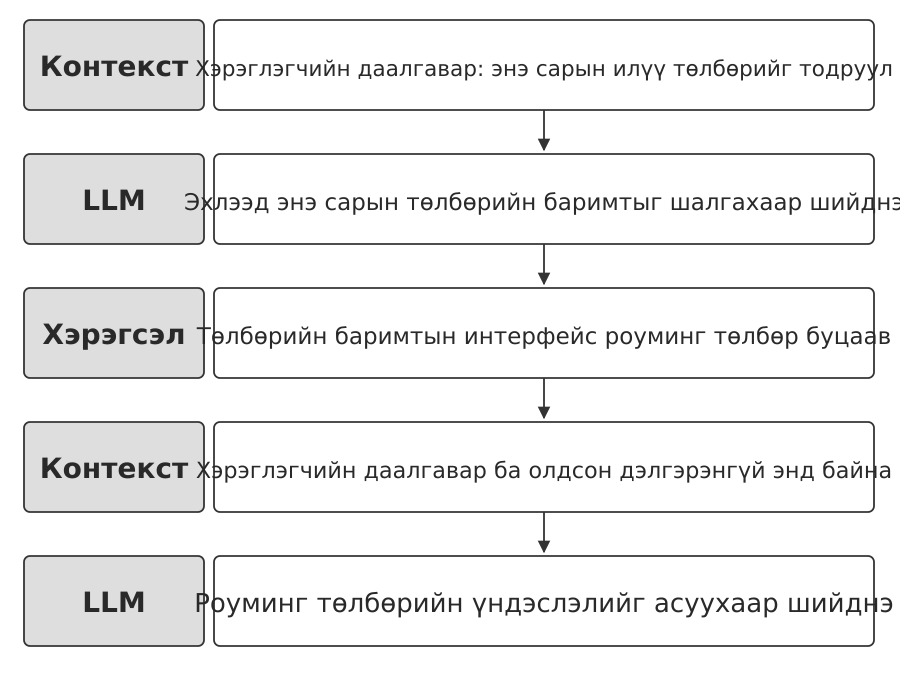
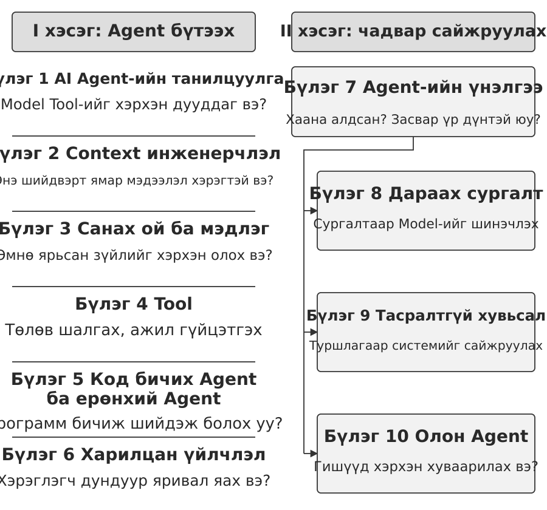

# Өмнөх үг {.unnumbered}

2025 оны наймдугаар сараас 2026 оны эхэн үе хүртэл би Turing-ийн онлайн видео хичээл «AI Agent Bootcamp»-д AI Agent-ийг тайлбарлаж, шалгаж, дахин ашиглаж болох инженерийн аргаар хэрхэн бүтээх тухай лекц уншсан. Хичээл нь нэг Agent-ийг ажиллуулж үзэхээс эхлээд, тэр яагаад ийм архитектуртай болсон, шийдэл бүр ямар асуудлыг шийддэг, ямар үнэ төлбөртэй, ямар даалгаварт тохирохыг задлан шинжилдэг. Энэ ном тэрхүү лекцийн тэмдэглэл ба дагалдах туршилтуудын үндсэн дээр эмхэтгэгдсэн.

> **Энэ ном хэрхэн бүтсэн бэ: хүн ба машины хамтын ажиллагааны нэг туршлага**
>
> Хичээл бэлтгэхдээ би эхлээд лекцийн төлөвлөгөөг Pine-ийн дуут Agent-д хэлж өгөөд, түүгээр материал хайлж, эхний ноорог бичүүлдэг байлаа. Амаар диктовк хийх ийм хамтын ажиллагааг **шивнэж код бичих** (whisper coding) гэж нэрлэдэг. Хичээлийн дараа суралцагчид аль алхамд гацсан, аль туршилтын үр дүн хүлээлтээс зөрснийг харж, би холбогдох жишээ, үндэслэлээ эргэн шалгадаг байв.

2025 оноос хойш нэг чухал өөрчлөлт ажиглагдсан: AI-ийн судалгаа ба салбарын практикийн хүндийн төв нь суурь Model-ийн чадварыг дээшлүүлэхээс Agent-аар бодит даалгавар гүйцэтгүүлэх рүү шилжиж байна. Үүнтэй зэрэгцэн Model-ийн сургалт ба хэрэглээ улам нягт холбогдож байна. DeepSeek-R1 зэрэг дүгнэлтийн Model бататгах сургалтаар математик, программчлал, дүгнэлтийн чадвараа хэрхэн дээшлүүлснийг харуулсан.[^preface-r1] Агентын бататгах сургалт (Agentic Reinforcement Learning) нь хэрэгсэл дуудах ба орчинтой харилцан үйлчлэхийг сургалтад оруулж, Model-д код бичихээс гадна график интерфейс ажиллуулахыг заадаг. Сүүлийн төрлийн даалгаврыг ихэвчлэн Computer Use гэж нэрлэдэг: Model дэлгэцийн зургаас хуудасны төлөвийг тодорхойлоод, дарах, бичих эсвэл гүйлгэх үйлдлээр даалгавраа гүйцэтгэдэг. Харин Manus, Claude Code, OpenClaw зэрэг бүтээгдэхүүн хэрэглэгчид даалгавраа шууд даатгуулах боломж олгож, «код үүсгэх + файлын систем» хослол ерөнхий зориулалтын Agent-ийг хэрхэн тэжээдгийг харуулсан.

2026 оны есдүгээр сард Meta Muse-ийг танилцуулсан. Тэр үед Хятад болон бусад орны хувийн Agent бүтээгдэхүүн мөөг шиг олноор гарч байв. Энэ номд хөндсөн олон асуудлыг би багтайгаа Pine-ийг бүтээх үед аль хэдийн туулсан. Би Pine AI-д ерөнхий эрдэмтний албыг хашиж, хамт олонтойгоо хэрэглэгчийн өмнөөс ажил гүйцэтгэдэг энэ хувийн Agent-ийг бүтээсэн. 2025 оны нэгдүгээр сарын эхээр Pine АНУ-д ажиллаж эхэлсэн бөгөөд хэрэглэгч түүгээр худалдааны байгууллагад залгуулж, төлбөрийн нөхцөл тохиролцуулах, мөнгө буцаан авах хүсэлт гаргуулах эсвэл захиалга цуцлуулах боломжтой байв.

Худалдааны байгууллага утсаар тодорхой хөнгөлөлт хийхийг зөвшөөрөхөд Pine хэрэглэгчид шууд хэлж чадах нь «харилцагчийн үйлчилгээний ажилтан зөвшөөрлөө» гэсэн үг л байв; харин «мөнгө буцаж орлоо» гэж хэлэхийн тулд төлбөрийн баримт дээр тэр буцаалт гарч ирэхийг хүлээх ёстой. Ийм ажил гүйцэтгэхэд Model хэрэглэгч юунд зөвшөөрөл өгснийг санаж, дараа нь юуг шалгах ёстойгоо мэдэж, ажил хаана хүрснийг ялгаж чаддаг байх шаардлагатай. Хожим салбар Skill, Harness ба давталтын инженерчлэл гэж ярих болсон аргуудын ихэнхийг бид яг эдгээр утасны ярианы үеэр туршиж олсон.

- **Skill.** Бид зөвхөн тухайн даалгаварт хэрэгтэй үед л холбогдох Prompt-ийг ачаалдаг байв. Хэрэгсэл олширсны дараа Model-оор хэрэгслүүдийг командын мөрөөр дуудуулдаг болсон нь хүсэлт бүрд бүх хэрэгслийн тодорхойлолтыг жагсаах шаардлагагүй болгосон.
- **Harness.** Бид гүйцэтгэлийн орчин, одоогийн цаг, хэрэглэгчийн ажлын төлөвийг төлөвийн мөрөнд бичиж, Model-ийн шийдвэрт лавлагаа болгодог байв. Model заримдаа үр дүнг зохиож, хэрэгслийг буруу дуудаж эсвэл зааврыг орхидог; аюултай үйлдэл хэрэглэгчийн зөвшөөрлийн хэмжээнээс хэтэрч ч болно. Иймээс бид гүйцэтгэлийн явцад хязгаарлалт нэмсэн бөгөөд хожим Claude Code-оос ижил төстэй аргыг харсан.
- **Давталтын инженерчлэл.** Model заримдаа ажлын талыг л хийчихээд дууссан гэж зарладаг. Бид нэг Agent-аар ажил гүйцэтгүүлж, нөгөөгөөр нь төлбөрийн баримт эсвэл захиалгыг шалгуулж, дутуу хийсэн зүйлийг нь буцааж гүйцэтгүүлдэг байв. Үүнийг санал гаргагч—хянагч (Proposer–Reviewer) гэсэн хуваарь гэж нэрлэдэг.

Бусад Model болон Agent-ийн багууд ижил төстэй асуудлыг шийдэхдээ бие даан төстэй аргад хүрсэн. Энэ нь миний баг туулсан олон бэрхшээл Agent систем бодит хэрэглээнд шилжихэд бүгдээрээ тулгардаг нийтлэг асуудал гэдэгт намайг улам итгүүлсэн. «AI Agent Bootcamp»-аас гадна би 2024–2026 онд Хятадын Шинжлэх ухааны академийн их сургуульд Agent-ийн дадлагын хичээлийг тасралтгүй заасан. Хоёр хичээлийн суралцагчдын тавьсан асуулт аль туршлагыг илүү тодорхой тайлбарлах шаардлагатайг надад олж мэдэхэд тусалсан. Энэ номыг нээлттэй эх хэлбэрээр нийтэлсэн нь илүү олон судлаач, инженер эдгээр аргыг ашиглаж, шалгаж, сайжруулж чадна гэсэн итгэлээс үүдэлтэй.

**Практик түрүүлж, нэршил дараа нь бий болдог.** Хөгжүүлэлтийн багт энэ нь өөр нэг утга агуулдаг: нэр томьёо салбарын нийтлэг ойлголт болох үед тэргүүлэгч багууд түүнийг аль хэдийн удаан хугацаанд судалчихсан байдаг. Өөрийн инженерийн давуу талыг хуримтлуулахын тулд бодит бизнесээс асуудлыг урьдчилан илрүүлж, шийдвэрлэх оролдлого хийх шаардлагатай. Үүний тулд миний бодлоор хоёр гол нөхцөл бий.

**Нэгдүгээрт, Agent-ийн чадварт хангалттай өндөр шаардлага тавьдаг бодит бизнесийг сонгож, эргэх холбоог тасралтгүй авах хэрэгтэй.** Pine-ийн нэг даалгавар хэдэн цаг, бүр хэдэн долоо хоног үргэлжилж, олон талтай харилцах шаардлагатай болдог: урт удаан утасны яриа, төвөгтэй маягт бөглөх, олон удаагийн цахим шуудангийн харилцаа. Үүний зэрэгцээ тоо баримтын нарийвчлал, үйлдлийн хяналт, хэрэглэгчийн эрх ашгийг хамгаалах шаардлага хэвээр тавигдана. Ийм орчин Model-ийн чадвар ба бизнесийн шаардлагын хоорондын зайг байнга илрүүлж, багийг Harness-ээ хөгжүүлэхэд түлхдэг. Хэрэв бүтээгдэхүүний гол үнэ цэнэ зөвхөн тухайн үеийн Model-ийн сул талыг нөхөхөд л оршиж байвал дараагийн Model шинэчлэл тэр үнэ цэнийг утгагүй болгож, баг тогтвортой давуу тал хуримтлуулж чадахгүй.

**Хоёрдугаарт, системтэй үнэлгээний (Evaluation) механизм бүрдүүлэх хэрэгтэй.** Системийг өөрчилсний дараа нэг удаагийн төлбөрийн хэлэлцээ амжилттай болсон нь туслах зөв асуулт тавьснаас ч, эсвэл тухайн удаагийн харилцагчийн үйлчилгээний ажилтан хөнгөлөлт хийх эрхтэй байснаас ч байж болно. Ижил багц жишээгээр хуучин ба шинэ хувилбарыг дахин дахин харьцуулж үзэхэд ялгаа тогтвортой эсэхийг мэдэж болно. Долдугаар бүлэгт амжилтын шалгуурыг хэрхэн тогтоох, үнэлгээний орчин хэрхэн бүрдүүлэх, бүтэлгүйтлийг хэрхэн шинжлэх, өөрчлөлтийг хэрхэн шалгах талаар тодорхой авч үзнэ.

Pine-д бид төлбөрийн хөнгөлөлтөөс нэг арга сурсан: хянагчаар төлбөрийн баримт дээрх тэр мөнгийг харах. Ижил аргыг тасалбар өөрчлөхөд хэрэглэвэл шинэ тасалбар гарсан эсэхийг харах хэрэгтэй. Тодорхой нотолгоо нь бизнесээс хамаарч өөрчлөгддөг ч цаана нь нэг нийтлэг зарчим бий: даалгавар биелсэн эсэхийг тухайн үйлдэл гадаад ертөнцөд ямар үр дагавар үлдээснээр нь шалгана. **Сайн зарчим Model-ийн шинэчлэлийн мөчлөгийг даван хадгалагдана.**

## Энэ номын эрхэм зорилго {.unnumbered}

Хэрэглэгч гар утасны төлбөрийн баримтаа туслахад өгөөд, үүрэн холбооны оператортой холбогдож хөнгөлөлт тохиролцуулахыг хүссэн гэж бодъё. Ажил эхлэхээс өмнө туслах аль төлбөр маргаантай байгааг тодруулах ёстой; ярианы дунд тайлбарыг сонсож, нөхцөлийг тодруулах; дуусахад харилцагчийн үйлчилгээний ажилтан яг юунд зөвшөөрснийг хэрэглэгчид хэлэх ёстой. Туслах алхам бүрд гурван асуултад хариулах ёстой: энэ мөчид туслах юу мэдэж байна вэ? Тэр ямар үйлдэл хийж чадах вэ? Дараагийн алхмаа юунд тулгуурлан сонгох вэ? Энэ ном эдгээр гурван асуултаас эхэлж Agent-ийн бүтэц, бүтээх арга ба чадварын хязгаарыг танилцуулна. Гол томьёо нь **Agent = LLM + Контекст + Хэрэгсэл**: LLM ойлгох, төлөвлөх, шийдвэр гаргах үүрэгтэй; Контекст тухайн шийдвэрт хэрэгтэй мэдээллийг агуулна; Хэрэгсэл гадаад орчинтой холбож, ажиглалт олж авах эсвэл үйлдэл гүйцэтгэнэ.

Зүйрлэлээр хэлбэл, LLM бол «тархи», Контекст бол «тухайн шийдвэрийн харах хүрээ», Хэрэгсэл бол «мэдрэхүй ба гар хөл». Харах хүрээнд орчны мэдээлэл, ярианы түүх, санах ой ба мэдлэг, мөн системийн заавар, хэрэгслийн тодорхойлолт ба даалгаврын төлөв багтана. Хайх, унших, дэлгэцийн зураг авах нь мэдээлэл авчирч, дарах, бичих, бизнесийн интерфейс дуудах нь гадаад төлөвийг өөрчилнө. Зураг 0-1 нэг төлбөрийн баримтын лавлагааг задлан харуулсан. Эхний шийдвэр гаргахдаа Model зөвхөн хэрэглэгч төлбөрт эргэлзэж байгааг мэдэж байсан бол хоёр дахь удаад нь аль мөнгөний тухай асуухыг зааж чаддаг.



Бататгах сургалт (Reinforcement Learning, RL)-тай танил уншигч энэ хуваарийг бодлого, ажиглалт ба үйлдлийн тусламжтайгаар ойлгож болно. LLM контекстэд тулгуурлан дараагийн алхмаа сонгодог ба түүний шийдвэрийн үүрэг нь бодлого (Policy)-той төстэй; контекст тухайн шийдвэрт ашиглагдах ажиглалт ба түүхийг агуулна; хэрэгсэл нь ажиглалт ба үйлдлийн интерфейсийг өгнө. Ажиглалтын орон зай (Observation Space) ямар ажиглалт олж болохыг, үйлдлийн орон зай (Action Space) ямар үйлдэл хийхийг зөвшөөрөхийг тодорхойлдог бөгөөд энэ хоёр Agent ба орчны харилцан үйлчлэлийн хүрээг тодорхойлно.[^preface-spaces] Нэгдүгээр бүлэгт эдгээр ойлголтыг хэрэгсэл дуудах жишээгээр задлан тайлбарлаж, Model ба Harness-ийн үйлдвэрлэлийн хэрэгжилт дэх хуваарийг танилцуулна.

> **Гүнзгий бодол: амьдралаас зохион бүтээсэн нэгж хүртэл**
>
> Инженерийн практикээс гадна Agent нь ухаалаг системийн хувьслын тухай асуудлыг ч тавьдаг. Тьюрингийн шагналт, бататгах сургалтын анхдагч судлаач Richard Sutton орчлон ертөнцийн хувьслыг тоос, од, амьдрал ба «зохион бүтээсэн нэгж» (designed entities) гэсэн дөрвөн үе шатад хураангуйлсан.[^preface-sutton] Биологийн хувьсал санамсаргүй мутаци ба байгалийн шалгарлаар явагддаг бол зохион бүтээсэн нэгжийг аль хэдийн бий болсон ухаалаг систем зориуд бүтээж, сайжруулж чадна.
>
> Agent код үүсгэж, шинэ Agent бүтээгээд, ажиллагааны зан төлөвийг шинжилж, өөрчлөлт санал болгож, үр дүнг шалгаснаар аажмаар өөрөө өөрийгөө эхлүүлэх (bootstrap) ба тасралтгүй хувьсах чадварт хүрч болно. Энэ нь нэг программчлагч өөр программчлагчийг бичиж, тэр нь цааш шинэ систем бүтээхэд оролцож байгаатай адил. Өөрийгөө ойлгож, өөрийгөө сайжруулах энэ боломж нь код үүсгэх ба тасралтгүй хувьсал гэсэн хоёр бүлгийг бичихэд намайг хамгийн их сонирхуулсан асуудлын нэг байв.

## Номын бүтэц {.unnumbered}

Зураг 0-2 бүлгүүдийн холбоог харуулна. Хэрэглэгч утсаар ярианы дунд шаардлагаа гэнэт өөрчлөхөд туслах хуучин зааврын дагуу ажилласан гэж бодъё. Ийм үед зүүн баганын зургаадугаар бүлгээс эхлэн туслах хэрэглэгчийн дундуур орох үгийг хэрхэн зохицуулдгийг үзэж болно. Зассаны дараа өөр ярианд ч шинэ шаардлагыг сонсож байгаа эсэхийг хэрхэн мэдэх вэ? Үүнд баруун баганын долдугаар бүлгийн үнэлгээний арга хэрэгтэй. Долдугаар бүлгээс салж гарсан гурван сум нь үнэлгээний үр дүнг авсны дараа бүтэлгүйтлийн шалтгаанд үндэслэн сайжруулах өөр өөр замыг сонгож болохыг илэрхийлнэ.



- **Нэгдүгээр бүлэг (AI Agent-ийн үндэс)** бүтээгдэхүүн ба хэрэгсэл дуудах жишээгээр гол бүрэлдэхүүн, ажиллах давталт, Harness ба зохион байгуулалтын аргыг танилцуулж, номыг бүхэлд нь ойлгох ойлголтын хүрээг бүрдүүлнэ.
- **Хоёрдугаар бүлэг (Контекстийн инженерчлэл)** номын хамгийн чухал бүлэг бөгөөд Model-д тухайн үед хэрэгтэй мэдээллийг хэрхэн зохион байгуулахыг авч үзнэ. Prompt-ийн дизайн, хэрэгцээгээр ачаалах зарчмаас эхлээд түүхийн удирдлага хүртэл яриад, KV Cache-тэй холбон эдгээр арга хариултын чанар ба ажиллагааны зардалд хэрхэн нөлөөлдгийг тайлбарлана.
- **Гуравдугаар бүлэг (Хэрэглэгчийн санах ой ба мэдлэгийн сан)** сесс дамжуулан мэдээллийг хэрхэн хадгалж, ашиглахыг авч үзнэ. Хэрэглэгчийн санах ойгоос эхлээд RAG, бүтэцтэй индекс ба мэдлэгийн шинэчлэл хүртэл яриад, тогтвортой мэдлэгийг хайж олох ба засварлах аргыг эзэмшихэд тусална.
- **Дөрөвдүгээр бүлэг (Хэрэгсэл)** Agent хэрхэн ажиглалт олж авч, үйлдэл гүйцэтгэж, хамтын ажиллагаа хүсдэгийг авч үзнэ. Хэрэгслийн ангилал, интерфейсийн дизайн, MCP ба гүйцэтгэлийн удирдлагаар дамжуулан гадаад чадварыг системд хэрхэн холбохыг ойлгоно.
- **Тавдугаар бүлэг (Coding Agent ба ерөнхий зориулалтын Agent)** ерөнхий зориулалтын Agent-ийн нэг гол архитектурын санааг дэвшүүлнэ: Coding Agent-ийг гүйцэтгэлийн цөм, файлын системийг ажлын орон зай болгох. Эхлээд хөгжүүлэлтийн урсгалыг тайлбарлаад, олон медиа, бизнесийн систем зэрэг жишээгээр Agent програм бичиж асуудлыг хэрхэн шийдэж, улмаар шинэ хэрэгсэл, шинэ Agent бүтээдгийг харуулна.
- **Зургаадугаар бүлэг (Харилцан үйлчлэл: ажиглалт ба үйлдлийн орон зайг өргөжүүлэх)** Agent-ийн харилцан үйлчлэлийг модаль ба цаг хугацаа гэсэн хоёр хэмжээсээр авч үзнэ. Асинхрон үйл явдал, дуу хоолой, Computer Use ба роботоор дамжуулан тасралтгүй ажиглалт, хурдан ба удаан зам, гүйцэтгэлийн хяналтыг ойлгоно.
- **Долдугаар бүлэг (Agent-ийн үнэлгээ)** системийн гүйцэтгэл ба нэг өөрчлөлтийн үр нөлөөг хэрхэн дүгнэх вэ гэсэн асуултад хариулна. Эхлээд амжилтын шалгуур, орчин ба өгөгдлийн багцыг тодорхойлоод, дараа нь баталгаажуулагч, оноо ба статистик дүн шинжилгээг тайлбарлаж, эцэст нь бүтэлгүйтлийн шалтгааныг шинжлэн сайжруулах чиглэлээ олно.
- **Наймдугаар бүлэг (Model-ийн дараах сургалт)** өгөгдөл ба орчны тусламжтайгаар Model-ийн чадварыг хэрхэн шинэчлэхийг авч үзэж, өгөгдлийн чанар ба сургалтын орчинд тэргүүн зэрэг хөрөнгө оруулахыг санал болгоно. Удирдлагатай fine-tuning, бататгах сургалт ба урамшууллын дизайнаар дамжуулан жишээнээс сурах ба хайгуул (exploration) хийх нь яагаад өөр өөр ерөнхийлөлт үзүүлдэг, зөвхөн алгоритмыг өөрчлөх нь яагаад ихэвчлэн бага үр дүнтэй байдаг талыг тайлбарлана.
- **Есдүгээр бүлэг (Agent-ийн тасралтгүй хувьсал)** ажиллагааны туршлагыг ашиглан Agent-ийн дараагийн хувилбарыг хэрхэн сайжруулахыг авч үзнэ. Мэдлэг, заавар, программ ба параметр гэсэн дөрвөн төрлийн шинэчлэлтийг харьцуулж, баталгаажуулалт, хувилбар гаргах ба сэргээх урсгалаар урт хугацааны өөрчлөлтийг удирдана.
- **Аравдугаар бүлэг (Олон Agent-ийн хамтын ажиллагаа)** олон гишүүн хэзээ нэмэлт үнэ цэнэ бий болгодог, хэрхэн хуваарь гаргаж, харилцаж, зохицуулахыг авч үзнэ. Эхлээд контекст ба хяналтын эрхийг хэрхэн хуваарилахыг тайлбарлаад, жишээгээр хамтын ажиллагааны механизмыг тайлбарлаж, бүтэлгүйтлийн шалтгааныг шинжилж, Agent-ийн нийгэм ба эдийн засгийн боломжит хэлбэрийг хэлэлцэнэ.

## Энэ номыг хэрхэн унших вэ {.unnumbered}

- **Agent бүтээгдэхүүнийг тэгээс бүтээх**: номыг бүхэлд нь уншиж гаргахыг зөвлөнө. Эхлээд нэгээс зургаадугаар бүлгээр ажил гүйцэтгэж чадах туслахыг угсраад, долдугаар бүлгээр түүнийг ямар даалгаварт алдаа гаргах хандлагатайг шалгана. Дараах гурван бүлэг эдгээр бүтэлгүйтэлд тулгуурлан Model, систем эсвэл гишүүдийн хуваарийг хэрхэн сайжруулахыг авч үзнэ.
- **Эхлээд ерөнхий ойлголт бүрдүүлэх**: нэг, хоёр, дөрөв, долдугаар бүлгийг дараалан уншина. Нэг хэрэгсэл дуудлагын дагуу явбал: эхлээд Agent-ийн ажиллах давталтыг мэдэж, дараа нь Model ямар мэдээлэл авдагийг, хэрэгсэл бодитоор юу хийдгийг харж, эцэст нь үнэлгээгээр үр дүн хэрэглэгчийн шаардлагад нийцэж буй эсэхийг дүгнэнэ. Хоёрдугаар бүлгийн KV Cache-ийн хэсэгт анх уншиж байхдаа эхэнд дурдсан гурван дүгнэлтийг ойлгож аваад, туршилт хийсний дараа доод түвшний зарчим руу эргэж харна.
- **Model-ийн сургалтад онцгой анхаарах**: эхлээд нэг, хоёрдугаар бүлгээр Agent-ийн ажиллах аргыг ойлгоод, долдугаар бүлгийн үнэлгээний аргатай хамт наймдугаар бүлгийг уншина. Ингэснээр сургалтын зорилгыг бодит даалгаврын гүйцэтгэлтэй холбож ойлгож болно.
- **Ажиллаж буй Agent-ийн засвар үйлчилгээ**: долдугаар бүлгээс эхлэн бодит даалгаврын багц сонгож үнэлгээ хий. Жишээ нь туслах хэрэглэгчид хуучин үнийг хэлсэн бол эхлээд түүнд аль хувилбарын үнэ очсоныг шалга. Мэдлэг эсвэл урсгал хуучирсан бол энэ бүтэлгүйтлийг дагуулан есдүгээр бүлгийг унш; үнэ болон хэрэгсэл хоёулаа хангалттай өгөгдсөн, урсгалыг зассан ч Model дахин дахин буруу сонгож байгаа бол сургалтын өгөгдөл бэлтгэх нь үнэ цэнэтэй эсэхийг дүгнэхээр наймдугаар бүлгийг унш.

Бүлэг бүрд туршилт ба бодох асуулт багтсан. Туршилтыг «Туршилт X-Y» гэж дугаарласан бөгөөд X нь бүлгийн дугаар, Y нь тухайн бүлэг дэх дараалал юм. Од нь хүндрэлийг илэрхийлнэ: ★ анхан шат, ★★ тодорхой инженерийн туршлага шаардлагатай, ★★★ нээлттэй асуудал эсвэл төвөгтэй системийн дизайн хөндөгдөнө. Ихэнх туршилт ажиллуулж болох кодтой бөгөөд тэдгээрийг нээлттэй репозиторт нэгтгэсэн:

> **Дагалдах кодын репозитор**: `bojieli/ai-agent-book`

Анхны туршилтыг «Туршилт 1-1: Контекстийн гол үүрэг»-ээс эхэлж болно. Git ашигладаг бол терминалд дараахыг ажиллуулна:

```bash
git clone https://github.com/bojieli/ai-agent-book.git
cd ai-agent-book
```

Репозиторын хуудсаас **Code → Download ZIP**-ыг сонгон задлахад ч ижил хавтас бүтэц гарна. Нэгдүгээр бүлгийн туршилтын индексээс (`chapter1/README.md`) 1-1 гэсэн дугаарыг олж, `chapter1/context/README.md`-г нээнэ. Цаашид «Туршилт X-Y»-тай таарвал репозиторын `chapterX/README.md`-ээс төсөл болон ажиллуулах аргыг олж болно. «Дахин хэрэгжүүлэх заавар» нь гадаад төслүүд ба тэдгээрийг авах аргыг зааж, суулгах команд ба хавтасны тайлбарыг README-д нэгтгэн оруулсан.

## Урьдчилсан мэдлэг {.unnumbered}

Энэ ном программчлалын үндсэн чадвартай, Agent-ийг ойлгож бүтээхийг хүсэгч уншигчдад зориулагдсан. Туршилтыг өөрийн гараар хийхэд дараах суурь мэдлэг хэрэгтэй.

**Зайлшгүй: номыг бүхэлд нь унших суурь**

- **Python программчлал**: синтакс, түгээмэл өгөгдлийн бүтэц, pip зэрэг багцын удирдлагын хэрэгсэлд дассан, туршилтын кодыг уншиж, өөрчилж чаддаг байх. Номын ихэнх туршилт Python дээр суурилна.
- **LLM ашигласан туршлага**: ChatGPT, Claude эсвэл ижил төстэй бүтээгдэхүүн ашиглаж, шаардлага тавих, хариулт унших, цааш нь асуух үндсэн үйл явцад дассан байх.
- **Программ хангамжийн инженерийн нийтлэг ойлголт**: командын мөр, Git, JSON ба REST API-г мэдэж, үүний үндсэн дээр төсөл ажиллуулж, өөрчлөлтийг шалгаж, интерфейсийн өгөгдлийг уншиж чаддаг байх.

Туршилтыг өөрийн гараар хийхдээ Claude Code, Codex, Cursor, TRAE-гийн нэгийг сонгохыг би танд чин сэтгэлээсээ зөвлөж байна. Түүгээр нэг хэсэг кодыг дибаг хийлгэж үзээд, ямар файлыг уншиж, ямар хэрэгсэл дуудсаныг нь ажиглаарай. Дараа нь ажиллах давталт ба контекстийн удирдлагын тухай уншихдаа танд харьцуулах өөрийн туршлага бий болно.

**Зөвлөмжит: бүлэг тус бүрээр нэмж бүрдүүлэх мэдлэг**

- **Машин сургалтын үндэс (наймдугаар бүлэг)**: сургалт ба дүгнэлт, алдагдлын функц, градиентийн уруудал ба хэт тохируулалт нь Model-ийн шинэчлэлийн үйл явцыг ойлгоход тусална.
- **Математикийн үндэс (хоёр, гурав, долоо, наймдугаар бүлэг)**: вектор ба матриц нь Embedding ба Attention-ийг ойлгоход, магадлал ба статистик нь үнэлгээний хэмжүүр ба хүлээгдэж буй урамшууллыг ойлгоход тусална. Номд зөн совингийн тайлбар ба бодит хэрэглээг онцолсон.
- **Вэб хөгжүүлэлтийн үндэс (зургаадугаар бүлэг)**: HTTP, WebSocket ба урд, ар талын хуваарь нь асинхрон үйл явдлын архитектур ба бодит цагийн дууны харилцааг ойлгоход тусална.
- **Transformer-ийн үндэс (хоёр, наймдугаар бүлэг)**: Attention ба Model-ийн бүтцийг мэдэх нь контекстийн тооцоолол ба дараах сургалтыг ойлгоход тусална. Системтэй суралцахыг хүсвэл Jay Alammar, Maarten Grootendorst нарын бичсэн, Bojie Li орчуулсан, Turing-ийн хэвлэлийн газраас гаргасан «Том загварыг зураглалаар ойлгох: Генератив AI-ийн зарчим ба практик»-ыг уншиж болно. Уг ном Transformer, урьдчилсан сургалт ба fine-tuning-ийг зургаар тайлбарласан бөгөөд энэ номын инженерийн өнцгийг сайн нөхнө.

Наймдугаар бүлгийн дараах сургалтаас бусдын хувьд математик ба машин сургалтын мэдлэг бага шаардагддаг тул программчлалын үндсэн туршлагатай бол уншиж эхэлж болно.

## Талархал {.unnumbered}

Turing-ийн редактор Мэн Гэ ба Лю Мэйин багш нарт номыг редакцалж, «AI Agent Bootcamp»-ийг зохион байгуулахад хөдөлмөр зарцуулсанд талархал илэрхийлье; Хятадын Шинжлэх ухааны академийн их сургуульд Agent-ийн дадлагын хичээл нээсэн Лю Жүнмин багшид бас талархаж байна. Хоёр хичээлийн суралцагчид ба оюутнуудад талархъя: та бүхний асуулт, туршилтын эргэх холбоо ба санал зөвлөгөө миний тайлбарыг байнга сайжруулж, эдгээр ойлголтыг улам гүнзгий ойлгоход тусалсан.

Pine AI-ийн бүх хамт олонд талархаж байна. Бодит бизнесийн сорилт ба багийн хэлэлцүүлэг нь энэ номын олон арга ба жишээний эх сурвалж болсон. Та бүхний практик ба үзэл бодол эдгээр ойлголтыг байнга төгөлдөржүүлсэн.

AI салбарын найзууддаа талархаж байна. Хэлэлцүүлэг бүрд та бүхэн шударгаар санал гаргаж, өөр өөр туршлага ба дүгнэлтээ хуваалцсанаар Model ба Agent-ийн тухай ойлголт минь улам гүнзгийрсэн.

Хамгийн гол нь гэр бүлдээ, ялангуяа эхнэр Мэн Жяинд талархаж байна. Тэр энэ ном бичигдэх бүхий л хугацаанд намайг дэмжиж, гар бичмэлд олон үнэтэй санал өгсөн.

[^preface-r1]: DeepSeek-AI, *DeepSeek-R1: Incentivizing Reasoning Capability in LLMs via Reinforcement Learning*, 2025.

[^preface-spaces]: Gymnasium-ы баримт бичгийн «Spaces» хэсэг.

[^preface-sutton]: Richard Sutton ба Dwarkesh Patel-ийн ярилцлага, 2025-09-26, «Succession to AI» хэсэг.
