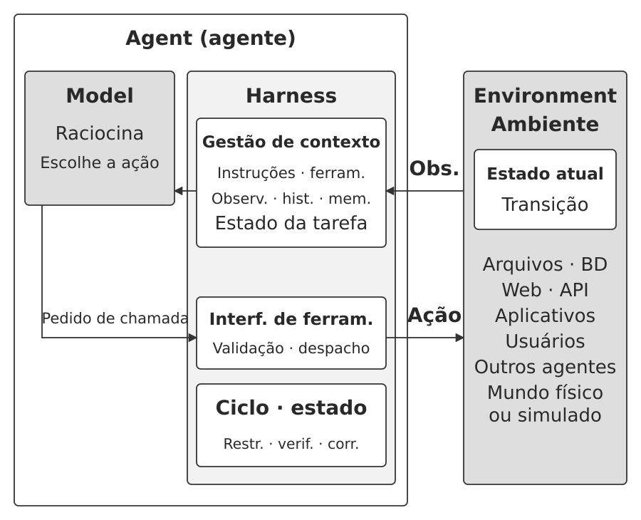
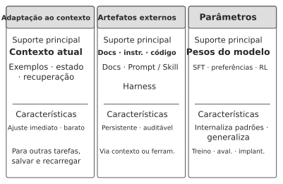
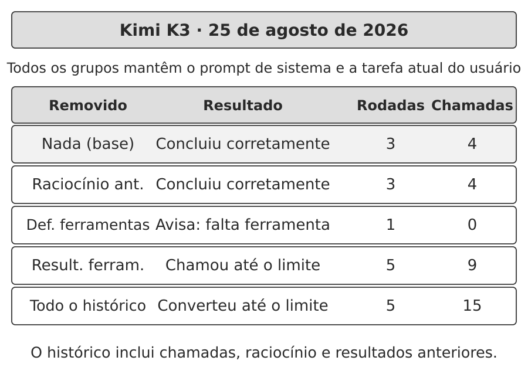
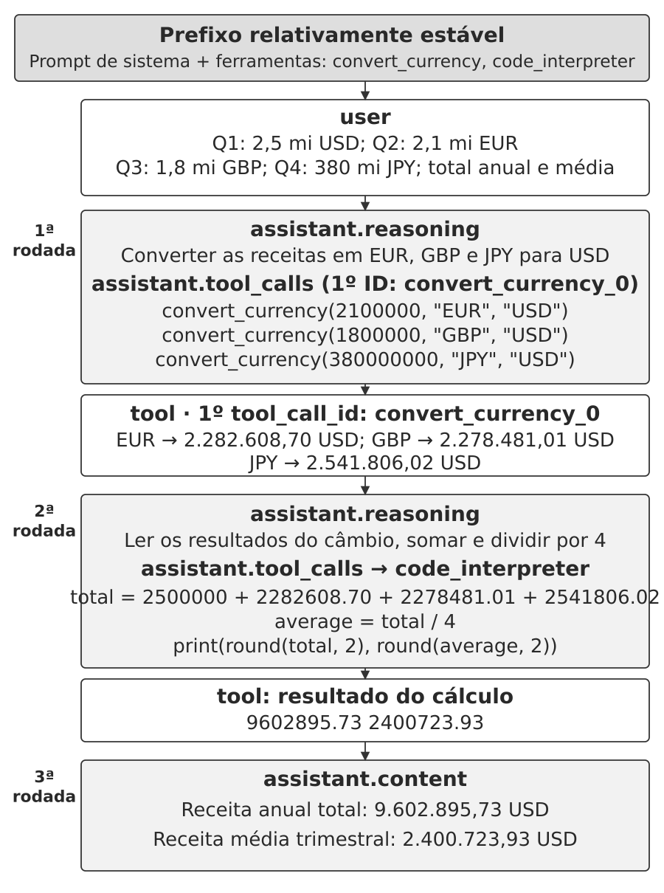
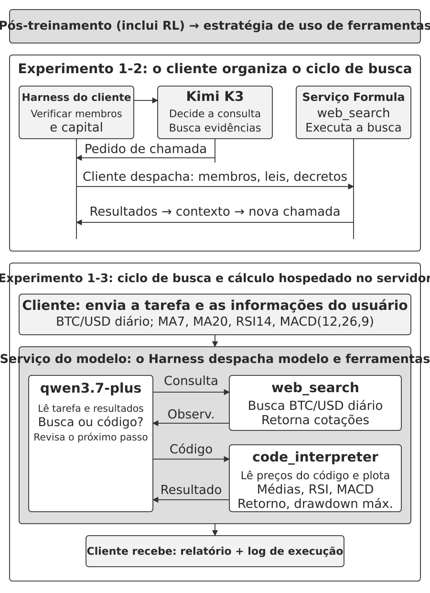
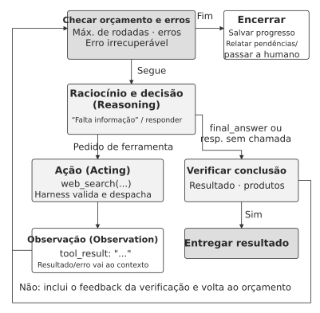
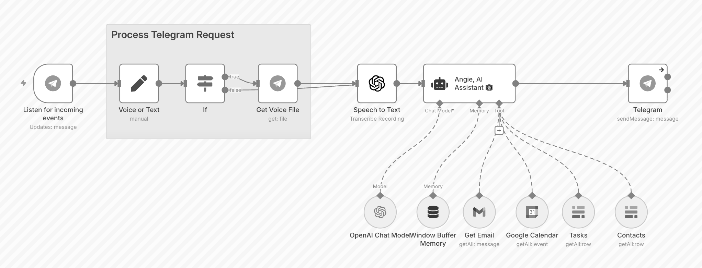

# Introdução aos agentes de IA

Quando você usa o Deep Research para investigar um tema, ele pesquisa e lê repetidas vezes e, ao final, organiza um relatório. O Manus consegue operar um navegador para concluir tarefas online; o assistente de celular Doubao consegue reservar passagens e enviar mensagens no próprio aparelho; o Pine AI consegue telefonar em nome do usuário e negociar com a operadora uma redução na conta. Todas essas são aplicações de agentes de IA.

Quando você pede ao Cursor que corrija uma função, ele localiza a função, edita o arquivo e executa os testes. Se os testes continuam falhando, a mensagem de erro passa a orientar a modificação seguinte; só quando os testes passam ele tem evidências para relatar o resultado a você. A ordem desses três passos — buscar, editar e testar — pode ser escrita de antemão em um programa, mas qual linha alterar e para onde voltar depois de uma falha depende das informações obtidas durante a execução. Esse processo de escolher ações em função de um objetivo e, depois, ajustar o plano com base nos resultados também ocorre em tarefas como pesquisas e negociações por telefone.

## Agente moderno = LLM + contexto + ferramentas

Este livro resume em uma fórmula os três tipos de elemento funcional de um agente moderno: **agente = LLM (modelo de linguagem de grande porte, Large Language Model) + contexto + ferramentas**.

- **O LLM é o cérebro do agente**: ele compreende a tarefa, planeja as etapas e escolhe as ações. O pré-treinamento fornece ao modelo competência linguística e conhecimento de mundo; o pós-treinamento molda, em seguida, comportamentos como seguir instruções, raciocinar e chamar ferramentas. O Capítulo 8 apresenta métodos de pós-treinamento, como o ajuste fino supervisionado e o aprendizado por reforço.
- **O contexto é o campo de visão do agente no momento da decisão**: ele reúne as informações de que a decisão atual precisa, incluindo instruções, definições de ferramentas, observações do ambiente, memória do usuário, conhecimento do domínio, mensagens anteriores, o próprio estado do agente e o andamento da tarefa.
- **As ferramentas são os sentidos, as mãos e os pés do agente**: por meio de interfaces, elas obtêm informações ou executam operações. O sistema de ferramentas abrange definições, protocolos de chamada e adaptadores; ele dá suporte tanto a operações de observação, como buscar, ler e capturar a tela, quanto a gravar dados, executar código, delegar trabalho a subagentes e se comunicar com o usuário.

Uma mesma ferramenta pode cumprir vários papéis. Quando o modelo lê um arquivo pela linha de comando, por exemplo, o conteúdo retornado passa a fundamentar a decisão seguinte; quando executa um programa pela linha de comando, pode também alterar o estado de arquivos ou processos.

Imagine que você acabou de abrir uma encomenda e quer perguntar ao atendimento: “Ainda posso devolver depois de aberto?”. O sistema pode usar **geração aumentada por recuperação** (Retrieval-Augmented Generation, RAG) para encontrar a política de devolução vigente da loja e, em seguida, pedir ao modelo que responda com base nas cláusulas.[^ch1-rag] Basta acompanhar uma única consulta para enxergar a responsabilidade de cada componente. O texto da política e seu índice ficam em uma base de conhecimento externa; a ferramenta de recuperação encontra os trechos relevantes para a pergunta, e o programa que chama o modelo coloca esses trechos, com a indicação de origem, na requisição. Ao ler o item sobre produtos abertos, o modelo consegue explicar a cláusula; se ela ainda distinguir categorias de produto, ele precisa primeiro perguntar o que você comprou.

[^ch1-rag]: Patrick Lewis et al., Retrieval-Augmented Generation for Knowledge-Intensive NLP Tasks, NeurIPS, 2020.

Nessa consulta sobre devolução, iniciar a recuperação é uma ação do agente, e as cláusulas retornadas são a observação que ele obtém do ambiente (Environment). Se o passo seguinte será responder ou fazer uma pergunta adicional depende do que as cláusulas dizem. Forma-se assim o circuito fechado de que falam o aprendizado por reforço e a teoria de controle, mostrado na Figura 1-1.



A camada externa da figura traça a fronteira entre o agente e o ambiente. Arquivos, bancos de dados, páginas web, usuários, outros agentes e mundos físicos ou simulados podem fazer parte do ambiente com o qual ele interage. A camada interna mostra a divisão de trabalho em uma implementação de produção: **o Model compreende, raciocina e decide; o Harness fica dentro da fronteira do agente, mas fora do Model, e organiza o contexto, as interfaces de ferramentas, o ciclo de execução e o estado, além de aplicar restrições, verificações e correções.** O Harness pode criar, isolar ou intermediar o ambiente; já o conteúdo dos arquivos, o estado dos processos e coisas semelhantes mudam no ambiente à medida que as ações ocorrem.[^ch1-harness]

[^ch1-harness]: Consulte “The Anatomy of an Agent Harness”, da LangChain, e “Effective harnesses for long-running agents”, da Anthropic. Algumas implementações incluem a sandbox no Harness; a Figura 1-1 desenha o ambiente separadamente para facilitar o rastreamento do que as ações de fato alteraram.

Por isso, este livro adota duas decomposições complementares: **“LLM + contexto + ferramentas” descreve a composição funcional; “Model + Harness” descreve a implementação de produção.** O contexto é organizado pelo Harness e entregue ao Model; as chamadas de ferramentas são decididas pelo Model, validadas e despachadas pelo Harness e, então, executadas pelas ferramentas ou pelo ambiente. Um sistema simples pode começar pela montagem do contexto e pelo despacho de ferramentas e incorporar aos poucos os mecanismos de restrição, verificação e correção que a operação em produção exige.

Quem conhece aprendizado por reforço pode ler a tabela abaixo a partir de três perguntas: quem decide o próximo passo, com base em quê e como colocá-lo em prática. Trata-se de uma analogia aproximada, feita por função.

| Compreensão intuitiva | Elemento de engenharia | Conceito relacionado no aprendizado por reforço | Significado |
|-----------|-----------|----------------------------|----------------------------------------------|
| **Cérebro** | LLM | **Política** (Policy) | Decide o que fazer em seguida com base nas informações atuais |
| **Campo de visão da decisão** | Contexto | **Observações e histórico** | Organiza as informações retornadas pelo ambiente e o histórico existente como base para a decisão |
| **Sentidos, mãos e pés** | Ferramentas e adaptadores | **Interfaces de observação e de ação** | Definem como ler informações do ambiente, como emitir ações e o formato das chamadas e dos retornos |

### Espaços de observação e de ação: a interface entre o modelo e o mundo

**O espaço de observação descreve quais observações o agente pode receber; o espaço de ação descreve quais ações ele pode emitir.** O contexto de uma chamada carrega as informações concretas, e as ferramentas disponíveis fornecem as interfaces de interação com o ambiente. Além das ferramentas, entradas do usuário, notificações de eventos e outras fontes também podem trazer observações; os parâmetros, as permissões e o ambiente de execução das chamadas de ferramentas delimitam, em conjunto, o alcance das ações.

Imagine duas falhas distintas. Na primeira, o modelo consegue explicar cada item de cobrança de uma fatura, mas não tem acesso à fatura deste mês. Depois que o usuário autoriza a leitura, ainda é preciso buscar a fatura e entregá-la ao modelo para que ele identifique qual cobrança é contestável. Na segunda, o usuário pede ao assistente que mude o plano; o assistente já encontrou uma opção adequada, mas a interface da conta só permite consultas. Por mais que releia a fatura, ele não conseguirá fazer a alteração: precisa da permissão de operação correspondente. O trabalho do Harness é colocar no contexto o material lido, receber a ação escolhida pelo modelo, verificar parâmetros e permissões e, então, despachar a execução.

Consequentemente, **com o modelo subjacente fixo, ajustar os espaços de observação e de ação é um recurso de engenharia importante para melhorar o desempenho na tarefa.** Se o modelo deixa passar um fato essencial, os dados relevantes podem ser incluídos no contexto; se ele costuma escolher a ferramenta errada entre opções parecidas, é possível fundir interfaces redundantes ou carregar apenas as ferramentas de que a tarefa atual precisa.

Com vídeo, surge o problema oposto: a imagem está sempre disponível, mas poucas mudanças justificam uma nova avaliação. Suponha que o assistente esteja aguardando o envio de um arquivo. Chamar o modelo principal a cada avanço da barra de progresso desperdiça muita computação; olhar apenas a cada dez segundos pode deixar escapar uma mensagem de falha que aparece por um instante. **Na minha avaliação, a esparsificação do espaço de observação é uma questão fundamental no projeto de agentes.** O sistema pode observar o ambiente continuamente e entregar ao modelo principal apenas as mudanças capazes de alterar a próxima ação, acompanhadas do contexto necessário.

**Manus: pesquisa, programação e controle do computador em uma mesma tarefa.** O Deep Research é bom em buscar e ler, os agentes de programação conseguem escrever e executar código, e os agentes de Computer Use conseguem operar interfaces. O Manus integrou navegador, sistema de arquivos, execução de código e linha de comando em uma sandbox na nuvem, de modo que um mesmo agente pode primeiro pesquisar, depois processar arquivos e executar código e, por fim, concluir operações pelo navegador. O navegador e a leitura de arquivos ampliam as informações que podem ser obtidas; a execução de código e de comandos amplia as operações que podem ser combinadas. **Na minha avaliação, essa combinação foi um avanço importante para os agentes de propósito geral: um mesmo agente pode atravessar fronteiras que antes separavam produtos e encadear obtenção de material, processamento de dados e execução de operações em uma tarefa completa.**

**OpenClaw: estendendo a interface à vida digital do usuário.** O OpenClaw recebe tarefas e devolve resultados por canais de mensagens como WhatsApp, Telegram, Slack, Discord e iMessage, e usa um Gateway executado no dispositivo do usuário para conectar os canais de mensagens, os modelos e as ferramentas. Com as ferramentas configuradas e a devida autorização, o agente pode processar arquivos locais e também acessar serviços na nuvem, como Google Drive e Notion. Materiais do usuário espalhados por contas e dispositivos passam, assim, a poder entrar no processamento de uma mesma tarefa. Nas primeiras versões, o Manus trabalhava sobretudo em uma sandbox na nuvem, e o usuário precisava enviar os arquivos; o conector do Google Drive e o recurso de desktop My Computer, adicionados depois, ampliaram o acesso a arquivos na nuvem e a recursos locais. Essa evolução mostra que o crescimento das capacidades de um produto muitas vezes vem da ampliação das interfaces de observação e de ação[^ch1-agent-products].

[^ch1-agent-products]: Para a estrutura dos produtos, consulte as apresentações oficiais do Manus sobre a Sandbox, o Google Drive Connector e o My Computer, bem como o repositório oficial e a documentação de ferramentas do OpenClaw. Os recursos efetivamente acessíveis dependem dos conectores, da configuração das ferramentas e da autorização do usuário.

As tarefas variam de produto para produto, mas todas podem ser entendidas a partir de três aspectos: a base da decisão, as operações disponíveis e a estratégia de execução.

| Produto agêntico | Principais informações no contexto | Ferramentas e operações disponíveis | Estratégia de execução |
|----------------|----------------------|----------------------------|------------------------------|
| **Agentes de programação, como o Cursor** | Requisitos, trechos de código, listagens de diretórios, saída do terminal | Busca no código, leitura e gravação de arquivos, execução de comandos | Compreender os requisitos→buscar o código relevante→editar o código→testar e verificar→depurar e corrigir |
| **Agentes de busca, como o Deep Research** | Resultados de busca, conteúdo de páginas web, resumos de artigos e citações | Consultas de busca, leitura de páginas web, geração de relatórios | Ajustar a direção da busca com base nas informações já obtidas e sintetizar gradualmente um relatório completo |
| **Agentes de controle do computador, como o Browser Use** | Capturas de tela, DOM ou árvore de acessibilidade, resultados das operações | Clicar, digitar, rolar, capturar a tela, executar código | Ler a interface→identificar o elemento-alvo→executar a operação→verificar o resultado |
| **Agentes assistentes de celular, como o Doubao** | Capturas da tela do celular, estado da interface dos aplicativos, retorno do sistema | Tocar, deslizar, digitar, abrir aplicativos | Compreender a necessidade→localizar o aplicativo-alvo→executar a operação→confirmar a conclusão |
| **Agentes de tarefas pessoais, como o Pine AI e o Meta Muse** | Registros de conta, faturas e dados de prestadores lidos com autorização | Telefonar, enviar e-mails, preencher formulários, confirmar com o usuário | Coletar informações→definir a estratégia de negociação→contatar o prestador→negociar→relatar o resultado |

**Como um pedido se transforma em uma tarefa executável?** Quando desenvolvi um assistente de tarefas pessoais na Pine, percebi que os usuários muitas vezes informam apenas um objetivo, como “compre minha passagem para a viagem de trabalho, de preferência por até 1.200 yuans”. Antes de contatar o prestador, o assistente precisa esclarecer as datas, o destino e o que mais importa nessa viagem, reunir os dados que faltam e combinar com o usuário como pretende agir e quais condições são negociáveis. As novas informações obtidas durante a execução podem ainda levar a tarefa de volta a uma etapa anterior.

Suponha que a menor tarifa encontrada pelo atendente seja de 1.250 yuans. O modelo vai julgar com base no bom senso, na natureza da viagem e nos hábitos do usuário de que se lembra. Para quem está em viagem de trabalho e costuma aceitar gastar um pouco mais por um itinerário conveniente, o Pine pode comprar a passagem diretamente; se for uma viagem em família, de alguém que no passado deixou claro que se preocupa com o gasto total, ele pode primeiro informar a diferença ao usuário e pedir ao atendente que procure outros voos. Se o usuário acrescentar depois “da próxima vez que a passagem passar do orçamento, pergunte antes”, esse retorno dá à decisão seguinte uma base mais específica do que a experiência genérica.

Em outro cenário, o atendente do banco propõe enviar documentos pelo correio para a casa do usuário, e o assistente se lembra de que o usuário está viajando pelo exterior. Desta vez, o que precisa mudar é a forma de entrega: o agente que está na ligação pode explicar na hora a dificuldade de receber a correspondência e tentar obter o envio por e-mail. Agora considere um abatimento na fatura: o atendente promete por telefone, verbalmente, e o assistente pode relatar com precisão o compromisso assumido pela empresa; para confirmar que o valor foi de fato abatido, porém, ainda é necessária a fatura seguinte como nova observação. O espaço de ação de um assistente pode se estender a telefonemas reais, mas suas conclusões continuam limitadas pelo espaço de observação.

Considerando o que é delegado, este livro trata de três tipos de aplicação: tarefas do dia a dia, trabalho colaborativo e pesquisa científica. Um mesmo assistente pode assumir tarefas de categorias diferentes; o que muda é quem lhe concede a autorização, o que ele pode alterar e quem faz a aceitação final. No escritório, quando um colega entrega o resultado de uma verificação, o ticket já pode ser fechado? Suponha que, em um ticket do Multica, o responsável pelo projeto mencione o assistente pedindo que confira uma diferença em uma planilha de orçamento. Esse comentário dispara a verificação, mas o ticket continua com o responsável original e mantém seu status. O assistente entrega os dois valores e suas fontes, respondendo à pergunta do colega; se o orçamento inteiro pode ser enviado ainda depende de o responsável avaliá-lo junto com as demais pendências.[^ch1-multica]

Também nas tarefas científicas cabe a mesma pergunta: com base em que se pode afirmar que houve progresso? Quando o AlphaEvolve, do Google DeepMind, buscou algoritmos de multiplicação de matrizes, o modelo propunha programas candidatos, e um avaliador executava esses programas, verificando se o produto estava correto e quantas multiplicações eram usadas. As buscas seguintes podiam continuar aprimorando os programas de melhor desempenho. A equipe de pesquisa relatou que um desses algoritmos multiplica duas matrizes complexas $4\times 4$ com 48 multiplicações escalares. “Fazer menos multiplicações” tem um objeto de contagem bem definido, e o algoritmo ainda precisa calcular o produto correto das matrizes.[^ch1-alphaevolve]

[^ch1-multica]: Multica, menção a um agente em comentários de tickets. O Capítulo 10 discute como distinguir, na colaboração, um pedido pontual de ajuda de uma transferência de responsabilidade.

[^ch1-alphaevolve]: Google DeepMind, nota de pesquisa sobre o AlphaEvolve, maio de 2025. O número de multiplicações refere-se às multiplicações escalares do algoritmo; o tempo real de execução depende também da implementação e do hardware.

O espaço de ação desses sistemas tem caráter **aberto**. Termos de busca, textos digitados, código gerado e combinações de operações dificilmente podem ser enumerados de antemão, embora cada ação continue limitada por ferramentas, parâmetros, permissões e ambiente de execução. Justamente por isso, um plano executável precisa deixar espaço para que novas observações mudem o próximo passo.

### Ferramentas: os sentidos, as mãos e os pés do agente

As ferramentas transformam as decisões do modelo em leituras ou operações sobre o ambiente externo. Ferramentas de busca e de leitura trazem observações; ferramentas de gravação de arquivos, execução de comandos e afins concretizam ações. Pelos resultados retornados, o modelo fica sabendo o efeito da operação e decide se continua, tenta de novo ou encerra a tarefa.

Pelo uso principal, este livro divide as ferramentas em cinco tipos. Uma mesma interface pode ter vários usos: uma chamada de voz, por exemplo, serve tanto para obter informações quanto para transmitir pedidos.

**Ferramentas de percepção** obtêm informações: mecanismos de busca fornecem material da web, ferramentas de leitura de arquivos acessam documentos locais, e interfaces de APIs e bancos de dados conectam-se a serviços externos e a dados corporativos.

**Ferramentas de execução** realizam operações: executam código, modificam arquivos, rodam comandos do sistema ou chamam APIs externas, concretizando as decisões no ambiente.

**Ferramentas de colaboração** apoiam a divisão de trabalho e a coordenação: delegam tarefas especializadas a subagentes, coletam resultados e coordenam o trabalho de vários agentes. Quando uma decisão exige participação humana, o sistema também pode pedir confirmação por meio de uma interface de comunicação com o usuário.

**Ferramentas de acionamento por eventos** trazem eventos externos para a execução. Um novo e-mail, a chegada de um horário agendado ou um callback de Webhook podem disparar uma tarefa. Adaptadores de eventos convertem essas entradas em observações que o agente consegue processar, e o mecanismo de agendamento inicia ou retoma a execução; as regras de acionamento podem ser configuradas pelo desenvolvedor ou registradas por meio de chamadas de ferramentas autorizadas.

**Ferramentas de comunicação com o usuário** transmitem informações ao usuário e coletam seu retorno, por exemplo enviando mensagens de texto, fazendo chamadas de voz ou enviando e-mails. Servem para relatar o andamento e pedir confirmações, e também para lembrar o usuário, por iniciativa própria, de algo que ele precisa resolver.

O Capítulo 4 detalha o projeto desses cinco tipos de ferramenta. A definição da interface influencia se o modelo consegue escolher a ferramenta certa e preencher os parâmetros corretamente; o tratamento de erros determina se a execução pode continuar após uma falha; o controle de permissões limita o alcance de cada operação. O MCP (Model Context Protocol, protocolo de contexto de modelo) oferece um modo unificado de descobrir e chamar ferramentas, reduzindo o trabalho de adaptação entre sistemas diferentes.

A **chamada de ferramentas** (Tool Calling) é a capacidade do modelo de formular pedidos de operação em um formato combinado. A conhecida chamada de funções (Function Calling) expressa o pedido com o nome da ferramenta e parâmetros estruturados. Este livro usa de forma consistente o termo “chamada de ferramentas”.

Tome como exemplo a consulta da previsão do tempo em Pequim. O modelo pode escrever o nome da cidade, mas a temperatura real só aparece no contexto depois que o Harness executa a consulta. Estas são as mensagens dos quatro passos dessa chamada:

```text
Passo 1: declarar a ferramenta     Passo 2: o modelo decide chamar
tools: [{                          assistant: {
  name: "get_weather",               tool_calls: [{
  parameters: {                        id: "call_1",
    city: "string"                     function: "get_weather",
  }                                    arguments: {city: "Pequim"}
}]                                   }]
                                   }

Passo 3: resultado vai ao contexto Passo 4: o modelo responde com base nele
tool: {                            assistant: {
  tool_call_id: "call_1",            content: "Hoje em Pequim faz 28°C, céu limpo."
  content: '{"temp":28,"sky":"limpo"}'
}                                  }
```

Nesse exemplo, `call_1` associa o valor retornado pela ferramenta ao pedido de chamada. O desenvolvedor descreve como a ferramenta deve ser chamada, escreve a função que consulta o tempo e devolve o resultado da consulta ao modelo; o modelo decide se vai chamar uma ferramenta, qual delas e com quais parâmetros. O Capítulo 2 apresenta em mais detalhes a estrutura das mensagens da API.

Ao projetar ferramentas, comece oferecendo a capacidade estritamente suficiente. Para as quatro operações aritméticas, basta uma calculadora com parâmetros claros; quando a tarefa passa a incluir ler planilhas, tratar valores ausentes, calcular estatísticas e gerar gráficos, um interpretador de código Python restrito facilita combinar essas etapas. À medida que as capacidades de uso geral crescem, o isolamento e a gestão de recursos precisam acompanhar: o código roda em uma sandbox, o acesso à rede fica desativado por padrão, o acesso a arquivos se limita ao diretório de trabalho autorizado, e há limites para tempo de execução, CPU, memória e tamanho da saída.

Para registrar um trecho de execução, basta uma única ferramenta de log. Tarefas que se estendem por horas ou até dias se beneficiam de um diretório de trabalho virtual controlado, que guarda planos, resultados intermediários, logs de execução e produtos finais, permitindo que o agente retome o trabalho entre execuções. Esse diretório deve restringir os caminhos de leitura e gravação, a capacidade e os tipos de arquivo, além de verificar se algum caminho ultrapassa a fronteira autorizada.

Operações como pagamentos, exclusão de dados, envio de e-mails e implantação em produção envolvem risco elevado ou regras de negócio explícitas; convém encapsulá-las em ferramentas dedicadas, com parâmetros claros, permissões restritas e auditoria de ponta a ponta, acrescentando pré-visualização e confirmação humana quando necessário. **Capacidades básicas de uso geral servem à composição e à exploração; ferramentas dedicadas aplicam as restrições e as regras de negócio das operações de alto risco.**

### LLM: o cérebro do agente

O LLM é o núcleo decisório do agente. Ao receber uma solicitação, ele primeiro identifica, no que o usuário disse, o objetivo e as restrições e, depois, divide a tarefa complexa em etapas executáveis. Durante a execução, ainda precisa decidir o que fazer em seguida, se deve chamar uma ferramenta, qual delas escolher e como preencher os parâmetros. Essas capacidades se apoiam no conhecimento e na competência linguística acumulados no pré-treinamento e são moldadas pelo pós-treinamento em comportamentos de decisão adequados às tarefas. Tanto os fluxos de trabalho quanto os agentes autônomos precisam desse tipo de julgamento; as operações concretas, por sua vez, são realizadas pelo Harness, pelas ferramentas e pelo ambiente.

Planejar e simular antes de agir ajuda o agente a comparar alternativas, prever resultados e reduzir tentativas inúteis. O modelo pode, por exemplo, usar propriedades matemáticas para conferir as etapas de um cálculo, usar relações de causa e efeito para analisar uma falha e organizar a ordem das operações segundo suas dependências. Ele compara as alternativas no raciocínio e, depois de escolher a ação, pede a execução à ferramenta. Sistemas tradicionais de aprendizado por reforço também podem organizar a exploração com políticas aprendidas, funções de valor, modelos do ambiente ou algoritmos de planejamento; o que distingue os agentes baseados em LLM é que, antes de começar uma tarefa concreta, eles já adquiriram, pelo pré-treinamento em larga escala, um amplo repertório de conhecimentos e de padrões de resolução de problemas, e o pós-treinamento reforça ainda mais a maneira de usá-los.

#### Chamada de ferramentas nativa do modelo

O setor usa a expressão “modelo como agente” (Model as Agent) para resumir uma tendência: cada vez mais decisões de planejamento e de chamada de ferramentas ficam a cargo do próprio modelo. Por meio do pós-treinamento, especialmente do aprendizado por reforço, o modelo pode aprender quando chamar uma ferramenta, qual chamar, quais parâmetros passar e como prosseguir depois de obter o resultado. O desenvolvedor fornece objetivos, interfaces e restrições, e o modelo organiza as etapas concretas conforme a tarefa avança.

A autonomia decisória do modelo precisa ser sustentada por um Harness. A palavra *harness* designava originalmente os arreios e as rédeas usados para transmitir a força do cavalo ao veículo e controlar a direção. Em um agente, o Harness organiza as capacidades do modelo em um processo de execução sustentável e assume o gerenciamento de contexto, as interfaces de ferramentas, as restrições, a verificação e a correção. A segunda metade deste capítulo apresenta essas cinco funções uma a uma.

Quanto mais operações o modelo puder organizar por conta própria, maior o alcance que um erro pode ter. Por isso, modelo e Harness precisam ser otimizados em conjunto: o modelo melhora a qualidade do planejamento e da escolha de ferramentas, e o Harness administra permissões, confere resultados e trata falhas. Os fornecedores de modelos podem aprimorar as duas partes ao mesmo tempo, e essa iteração conjunta constitui uma vantagem de engenharia importante.

> **A evolução das capacidades do modelo e do Harness**
>
> Em “A lição amarga” (The Bitter Lesson), Rich Sutton revisita uma tendência de longo prazo da pesquisa em IA: os métodos de busca e de aprendizado capazes de aproveitar mais recursos computacionais acabam superando os métodos que dependem de muito projeto manual específico do domínio[^ch1-1]. Seguindo essa direção, decisões como a escolha de ferramentas e a organização das etapas, antes assumidas por fluxos externos, podem ser gradualmente internalizadas no modelo pelo treinamento.
>
> A posição deste livro é: **concordar com a direção, ser pragmático quanto ao ritmo.** O modelo continuará assumindo parte das responsabilidades decisórias do Harness, mas cada ciclo de treinamento e implantação leva tempo, enquanto as regras de negócio e as preferências dos usuários mudam o tempo todo. As restrições de um negócio real também dificilmente cabem, de uma só vez, nos parâmetros do modelo. Assim, as etapas que o modelo ainda não executa de forma estável são cobertas primeiro pelo Harness. **O limite atual das capacidades do modelo é exatamente onde está, hoje, o valor do Harness.** Essa divisão de trabalho muda à medida que o modelo evolui: cada vez que o modelo domina uma classe de decisões, o Harness pode reduzir a orquestração correspondente e passar a tratar de novas dificuldades. A aplicação de permissões, a persistência de estado e a validação de resultados continuam a cargo do sistema de execução.

[^ch1-1]: Sutton, Rich. The Bitter Lesson, 2019.

#### Mecanismos de aprendizado do agente: da adaptação ao contexto às atualizações persistentes

Depois de um erro de ferramenta, o agente aprendeu, desta vez, a procurar o arquivo por outro caminho. Amanhã, em uma nova sessão, ele ainda se lembrará dessa lição? Acompanhando na Figura 1-2 onde essa experiência fica guardada, é possível distinguir três tipos de atualização.



A **adaptação ao contexto** ocorre durante a execução da tarefa. Ao ler exemplos, o estado da tarefa ou resultados de recuperação, o modelo pode ajustar seu comportamento seguinte. Se a ferramenta informa que o arquivo não existe, por exemplo, o modelo pode procurar o caminho novamente e continuar. Esse caminho responde rápido e custa pouco, e sua eficácia depende da capacidade da janela de contexto e da forma como as informações são organizadas. Para que a experiência sirva a tarefas futuras, é preciso salvar as informações relevantes e fornecê-las de novo ao modelo. O Capítulo 2 apresenta os métodos de organização do contexto.

Os **artefatos externos** (artifacts) permitem guardar a experiência de uma tarefa para outra. Fatos e experiências são registrados em documentos de conhecimento; estratégias que podem ser expressas em linguagem vão para prompts ou Skills; fluxos e restrições determinísticos tornam-se programas ou lógica do Harness. Esses artefatos são fáceis de auditar e revisar e, durante a execução, participam das decisões e das ações por meio do contexto ou das interfaces de ferramentas. Os Capítulos 3 a 5 apresentam os fundamentos de conhecimento e de programação correspondentes, e o Capítulo 9 discute como gerar, validar e publicar atualizações a partir de trajetórias de execução avaliadas.

Os **parâmetros do modelo**, por sua vez, são atualizados por treinamento. Capacidades como compreender imagens médicas, um estilo de linguagem ou uma política de decisão implícita envolvem uma grande quantidade de padrões difíceis de escrever regra por regra; elas podem ser aprendidas com dados e feedback no pós-treinamento. Atualizar parâmetros exige investimento em treinamento, avaliação e implantação, e o objetivo é que o modelo consiga aplicar o que aprendeu também em tarefas novas. O Capítulo 8 detalha esses métodos.

Uma mesma falha pode servir primeiro para corrigir a operação em curso e, depois, ser transformada em uma nota do projeto que o próximo agente poderá consultar. Se o mesmo tipo de erro se repetir em muitos projetos, esses casos também podem ser usados no treinamento.

### Contexto: o campo de visão do agente no momento da decisão

Para decidir, uma pessoa precisa reunir diante de si as instruções da tarefa, os manuais de referência, o registro das conversas e os dados mais recentes. O agente também precisa de um conjunto assim de informações, e esse conjunto é o contexto. A quantidade de informação que uma chamada ao LLM pode receber é limitada pela janela de contexto, e cabe ao Harness selecionar e organizar o que entra nela. Do ponto de vista da API, a implementação básica deste livro inclui cinco tipos de informação:

- **Prompt de sistema** (System Prompt): construído pelo desenvolvedor ou pelo Harness, define a identidade do agente, os limites da tarefa e as normas de comportamento. A engenharia de prompts molda a forma de trabalhar ajustando essas instruções. O prompt de sistema pode permanecer relativamente estável durante a sessão e, conforme a configuração do produto, pode também incluir memória do usuário entre sessões, como preferências, comportamento passado e informações de contexto pessoal, ou receber o estado atual do ambiente. As permissões efetivas são aplicadas pelo Harness e pelos controles de acesso do ambiente. O Capítulo 3 apresenta a memória do usuário.
- **Definições de ferramentas** (Tool Definitions): declaram o nome, a função e o formato dos parâmetros das ferramentas disponíveis, ajudando o modelo a escolher operações e montar requisições. Na implementação básica deste livro, as definições de ferramentas ficam junto ao prompt de sistema no início da requisição, formando um prefixo relativamente estável. Quando há muitas ferramentas, também é possível carregar o schema completo sob demanda, preservando o prefixo existente; os Capítulos 2 e 4 detalham esse método.
- **Mensagens do usuário** (User Messages): contêm a tarefa do usuário e entradas complementares, e podem trazer conhecimento externo obtido por RAG (geração aumentada por recuperação, Retrieval-Augmented Generation), como informações posteriores ao corte dos dados de treinamento ou material privado do domínio. O Capítulo 3 apresenta a recuperação e a organização do conhecimento.
- **Respostas do modelo** (Assistant Messages): incluem o texto dirigido ao usuário, `content`, os pedidos de chamada de ferramentas, `tool_calls`, e as informações de raciocínio fornecidas pelo serviço. Este livro abrevia essas informações como `reasoning`; serviços diferentes podem retornar o conteúdo do raciocínio, um resumo dele ou um estado opaco usado para dar continuidade. Ao chamar uma ferramenta, a resposta pode conter informações de raciocínio e o pedido de chamada; ao concluir a tarefa, pode conter informações de raciocínio e o texto final. Os campos exatos e sua visibilidade são definidos pelo serviço do modelo.
- **Resultados das ferramentas** (Tool Results): contêm o valor retornado, os erros ou o estado após a execução e, ao serem acrescentados ao histórico de mensagens, fundamentam a decisão seguinte. Com base neles, o modelo julga se a operação teve sucesso e se precisa de ajustes, reduzindo tentativas repetidas na tarefa em curso.

A cada chamada ao modelo, o Harness envia o prefixo relativamente estável (prompt de sistema e definições de ferramentas) junto com o histórico de mensagens, que não para de crescer. Assim, mesmo que a ferramenta de câmbio tenha retornado o resultado na rodada anterior, o modelo ainda consegue lê-lo ao calcular o total nesta rodada.

O papel de cada tipo de informação na decisão pode ser examinado por um **estudo de ablação** (Ablation Study): mantêm-se fixas a tarefa e as condições de execução, remove-se um tipo de informação por vez e comparam-se as mudanças de comportamento. O Experimento 1-1 mantém o prompt de sistema e a tarefa atual do usuário, para fixar o papel, as restrições e os requisitos da tarefa, e faz ablações separadas das definições de ferramentas, dos resultados das ferramentas, das informações de raciocínio anteriores e das mensagens anteriores.

> **Experimento 1-1 ★★: o papel crucial do contexto**
>
> Peça a um agente que consolide a receita trimestral de uma empresa: no primeiro trimestre, US$ 2,5 milhões; no segundo, 2,1 milhões de euros; no terceiro, 1,8 milhão de libras; no quarto, 380 milhões de ienes. A tarefa exige converter as receitas para dólares com uma ferramenta de câmbio e, depois, usar uma ferramenta de cálculo para obter a receita anual total e a receita média trimestral, com duas casas decimais. Assim, o modelo precisa tanto escolher ferramentas quanto lembrar quais etapas já concluiu e quais valores recebeu.
>
> O experimento tem uma linha de base completa e quatro grupos de ablação, cada um com no máximo cinco rodadas. Ao remover as informações de raciocínio anteriores, o modelo continua podendo raciocinar de novo a cada rodada; ao remover as definições de ferramentas, a requisição deixa de oferecer ferramentas disponíveis; ao remover os resultados das ferramentas, os registros das chamadas são mantidos, mas o conteúdo retornado fica oculto; ao remover as mensagens anteriores, restam apenas o prompt de sistema, as definições de ferramentas e a tarefa atual do usuário. Antes de continuar, tente prever: saber apenas que “a cotação do iene já foi consultada” permite fazer qual etapa do cálculo? E saber “quantos dólares valem 380 milhões de ienes”? A Figura 1-3 mostra os resultados dos cinco grupos.
>
> 
>
> Na execução com o Kimi K3 em 25 de agosto de 2026, a **linha de base completa** concluiu a tarefa em três rodadas, com quatro chamadas de ferramentas, obtendo receita anual total de US$ 9.602.895,73 e receita média trimestral de US$ 2.400.723,93. **Sem as informações de raciocínio anteriores**, o modelo chegou ao resultado correto com o mesmo número de rodadas e de chamadas: os registros das ferramentas já guardavam os resultados do câmbio, e o modelo pôde reconstruir a partir deles as informações necessárias para o cálculo seguinte.
>
> **Sem as definições de ferramentas**, o modelo não emitiu nenhuma chamada e informou que faltava uma ferramenta de câmbio. **Sem os resultados das ferramentas**, o modelo fez nove chamadas e não concluiu a tarefa dentro do limite de cinco rodadas; os registros de chamadas existentes não lhe diziam quantos dólares o câmbio havia produzido. **Sem as mensagens anteriores**, o modelo acumulou quinze chamadas, repetindo as conversões, e também esgotou o orçamento de cinco rodadas; o trabalho já feito não entrava no contexto da rodada seguinte, de modo que o progresso da tarefa não se acumulava.
>
> Agora, resolva o mesmo problema com outro modelo. Em 1º de setembro, o DeepSeek V4 Flash, sem as informações de raciocínio anteriores, também usou três rodadas e quatro chamadas de ferramentas, mas calculou US$ 9.600.000,00. Para onde foram os US$ 2.895,73 a menos? A primeira chamada de câmbio dá a pista: a receita do segundo trimestre era de 2,1 milhões de euros, e o modelo escreveu o valor como `2.1`, pretendendo contar em “milhões”. A ferramenta recebeu 2,1 euros, converteu e arredondou para duas casas, obtendo US$ 2,28. Em seguida, o modelo somou US$ 2,28 milhões ao total, e o erro de arredondamento da conversão foi multiplicado por um milhão. As outras duas parcelas foram escritas da mesma forma. Mesmo que o total final seja impresso com duas casas decimais, o que foi arredondado antes não volta.[^ch1-context-runs]
>
> Esse contraste mostra o papel de cada tipo de informação: as definições de ferramentas fornecem as capacidades que podem ser chamadas, os resultados das ferramentas fornecem os fatos do ambiente, e as mensagens anteriores guardam o progresso da tarefa. Já o valor das informações de raciocínio anteriores depende de a decisão atual conseguir recuperar seus fundamentos a partir de outros registros.

[^ch1-context-runs]: O diretório `chapter1/context/validation/` do repositório guarda, rodada a rodada, as requisições e respostas das duas execuções. O registro de agosto está em `real_20260825T025409Z/evidence.json`, e o de setembro, em `real_20260901T163146Z/evidence.json`.

### O ciclo ReAct

O **ReAct** (Reasoning + Acting) é uma implementação típica desse ciclo, que organiza raciocínio e ação de forma alternada[^ch1-react]. O modelo primeiro analisa as informações atuais e escolhe uma ação; depois, ajusta o plano com base na **observação** retornada pela ferramenta. Nos exemplos a seguir, usamos um campo `reasoning` curto para indicar o fundamento de cada decisão, ajudando o leitor a entender a ligação entre as ações.

[^ch1-react]: Yao, Shunyu, et al. ReAct: Synergizing Reasoning and Acting in Language Models, ICLR 2023.

A sequência de decisões, ações e observações acumulada durante a execução de uma tarefa é chamada de **trajetória** (trajectory). O histórico de mensagens é uma forma de registrá-la: as mensagens do usuário guardam a tarefa, as respostas do modelo guardam as decisões e os pedidos de chamada, e as mensagens das ferramentas guardam os resultados da execução. Um registro completo da execução pode incluir ainda horários, estado do ambiente e resultados de verificação, para uso em depuração e avaliação.

Na implementação básica desta seção, **o contexto de cada rodada = prefixo relativamente estável + histórico de mensagens acumulado**. O prefixo contém o prompt de sistema e as definições de ferramentas, e o histórico de mensagens cresce com a interação. A Figura 1-4 reproduz as três rodadas de mensagens do Experimento 1-1. Observe os três pedidos de câmbio da primeira rodada: qual resultado corresponde aos 2,1 milhões de euros do segundo trimestre?



O ID do pedido em euros é `convert_currency_0`. O Harness valida os parâmetros, executa a ferramenta e grava o mesmo ID no campo `tool_call_id` da mensagem da ferramenta. Assim, é possível localizar o resultado de US$ 2.282.608,70 e conferir se ele foi usado corretamente na soma da segunda rodada. Esse valor pode ser recalculado: na tabela de câmbio fixa do experimento, 1 dólar equivale a 0,92 euro; dividindo 2.100.000 por 0,92 e arredondando para duas casas, chega-se a esse número. A cotação inversa retornada pela ferramenta, 1,087, já está arredondada; multiplicá-la diretamente pelo valor em euros daria uma diferença de US$ 91,30.[^ch1-context-runs]

O ciclo de execução pode ser representado pelo pseudocódigo em estilo Python abaixo. O Model decide o próximo passo; o Harness monta o contexto, valida e despacha as chamadas; as ferramentas executam no ambiente e retornam observações. Aqui, a condição de término é o modelo deixar de pedir ferramentas; os mecanismos de verificação e de saída dos sistemas de produção são discutidos mais adiante.

```python
history = [user_request]

repeat:
    context = stable_prefix + history
    decision = Model(context)
    history.append(decision)

    if decision has no tool call:
        return decision.answer

    for call in decision.tool_calls:  # chamadas independentes entre si podem rodar em paralelo
        validated_call = Harness.validate(call)
        observation = Harness.dispatch(validated_call)
        history.append(observation)
```

A seguir, reproduzimos trechos das mensagens na ordem da execução de linha de base de agosto, mantendo os IDs de chamada e os nomes de parâmetros originais; os resultados do câmbio mostram apenas valor e moeda, e o código de cálculo foi abreviado. Ao chegar à segunda rodada, procure a origem de cada termo da soma: as receitas trimestrais são quatro, então por que a ferramenta retornou apenas três valores convertidos?

```text
histórico_de_mensagens = [
  {role: "user",
   content: "Q1: US$ 2,5 milhões; Q2: 2,1 milhões de euros; Q3: 1,8 milhão de libras; Q4: 380 milhões de ienes. Converta para dólares com as ferramentas e calcule a receita anual total e a média trimestral."},

  # 1ª rodada: três pedidos de câmbio
  {role: "assistant",
   reasoning: "Primeiro converter para USD as receitas em EUR, GBP e JPY.",
   tool_calls: [
     {id: "convert_currency_0", name: "convert_currency",
      args: {amount: 2100000, from_currency: "EUR", to_currency: "USD"}},
     {id: "convert_currency_1", name: "convert_currency",
      args: {amount: 1800000, from_currency: "GBP", to_currency: "USD"}},
     {id: "convert_currency_2", name: "convert_currency",
      args: {amount: 380000000, from_currency: "JPY", to_currency: "USD"}}
   ]},
  {role: "tool", tool_call_id: "convert_currency_0", content: "2282608.70 USD"},
  {role: "tool", tool_call_id: "convert_currency_1", content: "2278481.01 USD"},
  {role: "tool", tool_call_id: "convert_currency_2", content: "2541806.02 USD"},

  # 2ª rodada: calcular com base nos resultados do câmbio
  {role: "assistant",
   reasoning: "O 1º trimestre já está em dólares; somar com as três conversões e dividir por 4.",
   tool_calls: [
     {id: "code_interpreter_3", name: "code_interpreter",
      args: {code: """
        total = 2500000 + 2282608.70 + 2278481.01 + 2541806.02
        average = total / 4
        print(round(total, 2), round(average, 2))
      """}}
   ]},
  {role: "tool", tool_call_id: "code_interpreter_3",
   content: "9602895.73 2400723.93"},

  # 3ª rodada: entregar o resultado
  {role: "assistant",
   reasoning: "Cálculo concluído; informar o resultado com duas casas decimais.",
   content: "A receita anual total é de US$ 9.602.895,73, e a receita média trimestral, de US$ 2.400.723,93."}
]
```

Os US$ 2,5 milhões do primeiro trimestre já estavam na mensagem do usuário e podem entrar diretamente na soma. As outras três parcelas vêm dos valores retornados pela ferramenta; somando as quatro e dividindo por 4, é possível conferir a média trimestral final. Ao todo, o modelo foi chamado três vezes, e as ferramentas, quatro: na primeira rodada, o modelo pediu de uma só vez três conversões independentes entre si; na segunda, pediu a execução do código de consolidação; na terceira, respondeu diretamente ao usuário.

Registrar a execução como uma trajetória estruturada também ajuda os desenvolvedores a melhorar o sistema. Seguindo a solicitação do usuário, as decisões do modelo, os parâmetros das chamadas e os resultados das ferramentas, é possível localizar a etapa em que a falha ocorreu; reunindo muitas trajetórias, é possível identificar operações repetidas, aprimorar interfaces de ferramentas ou otimizar caminhos de decisão. As experiências avaliadas e selecionadas podem ser registradas em uma base de conhecimento ou servir como dados de pós-treinamento para melhorar o modelo. Os Capítulos 7 a 9 tratam, respectivamente, de avaliação, pós-treinamento e evolução contínua.

A tarefa de câmbio exigiu apenas algumas chamadas de ferramentas. Tarefas de busca e análise costumam exigir ciclos mais longos e estão mais sujeitas a lacunas de informação e falhas de ferramentas. Os dois experimentos a seguir mostram como essas tarefas avançam passo a passo e o que cabe ao cliente e ao servidor.

> **Experimento 1-2 ★: buscas em várias rodadas e ajuste de consultas no Kimi K3**
>
> Uma tarefa de pesquisa normalmente exige várias recuperações: primeiro estabelecer os fatos básicos, depois procurar as evidências que faltam e, por fim, sintetizar os resultados. Neste experimento, o Kimi K3 verifica a composição da ASEAN e a situação da capital da Indonésia. O enunciado também exige que, após a busca inicial, ele continue procurando os fatos ainda não confirmados.
>
> O Kimi K3 adota uma arquitetura de mistura de especialistas (MoE, Mixture of Experts), com cerca de 2,8 trilhões de parâmetros, e oferece visão nativa e contexto de um milhão de tokens. O MoE pode ser comparado a uma equipe de especialistas: para cada token, o mecanismo de roteamento seleciona apenas parte dos especialistas para o cálculo, controlando o custo computacional. Seu pós-treinamento inclui aprendizado por reforço voltado a tarefas gerais, programação e tarefas de agente, com ênfase na capacidade de execução de longo horizonte[^ch1-k3].
>
> Nesta trajetória, o modelo primeiro buscou os dados oficiais sobre os membros da ASEAN, depois complementou com a lista de membros e as datas de adesão e, em seguida, estreitou a consulta para a legislação, os decretos presidenciais e os documentos judiciais relacionados à mudança da capital indonésia. A tarefa terminou com uma resposta estruturada, acompanhada de links para as fontes.
>
> Acompanhando esse processo, percebe-se a divisão de trabalho entre três partes. O **modelo** decide o conteúdo das consultas, os parâmetros das chamadas e a busca seguinte; o **Harness do cliente** obtém as definições de ferramentas, chama o modelo, entrega os pedidos ao Formula e acrescenta os resultados ao contexto; o **serviço de ferramentas Formula** executa as buscas na web e retorna os resultados. Os resultados de uma rodada entram, assim, na requisição da rodada seguinte, e o modelo pode modificar suas consultas com base neles[^ch1-2].
>
> O treinamento pode internalizar nos parâmetros do modelo a estratégia de chamada de ferramentas, enquanto a implementação da busca e o retorno dos resultados ficam a cargo do sistema de execução. Essa divisão vale também para ferramentas como a execução de código: o modelo decide o que executar, o serviço de ferramentas fornece o ambiente de execução, e o Harness organiza as chamadas e o retorno.

[^ch1-k3]: Kimi Team. Kimi K3: Open Frontier Intelligence, 2026. A estrutura do modelo, o tamanho do contexto e os métodos de pós-treinamento estão descritos no relatório técnico; o acesso ao serviço, na documentação oficial de ferramentas da Kimi.

[^ch1-2]: Agradeço ao leitor asdlem, que, na issue nº 30 do repositório complementar, apontou que a decisão de chamar ferramentas e o mecanismo de execução das ferramentas precisam ser explicados separadamente.

> **Experimento 1-3 ★: ciclo de pesquisa hospedado na Responses API**
>
> Depois da busca, muitas vezes ainda é preciso calcular. Para encontrar, por exemplo, o par mais próximo entre um conjunto de capitais, é necessário primeiro obter as coordenadas e depois enumerar os pares de cidades e calcular as distâncias. Este experimento usa o `qwen3.7-plus` do Bailian e, pela Responses API, chama duas ferramentas hospedadas no servidor: `web_search`, que obtém material e fontes, e `code_interpreter`, que executa Python em uma sandbox para fazer cálculos e gráficos[^ch1-hosted].
>
> Na primeira tarefa, esta execução usou as dez capitais de Brunei, Camboja, Indonésia, Laos, Malásia, Mianmar, Filipinas, Singapura, Tailândia e Vietnã. Depois de buscar as coordenadas, o modelo escreveu código que enumera os $10\times9/2=45$ pares de cidades e calcula a distância do círculo máximo pela fórmula de Haversine, com um modelo esférico de raio terrestre de 6.371 quilômetros. Com as coordenadas usadas nesta execução, o par mais próximo é Kuala Lumpur e Singapura, a cerca de 316 quilômetros. A busca fornece as entradas, o código faz um cálculo que pode ser conferido, e o modelo organiza fontes, premissas e resultados na resposta.
>
> A segunda tarefa é “pesquisar a tendência do bitcoin no último mês e fazer uma análise técnica”. O prompt de sistema determina que, se a fonte de dados ou os indicadores não estiverem claros, o modelo deve primeiro pedir esclarecimentos ao usuário. Por isso, o modelo pergunta antes qual fonte de dados e quais indicadores usar; depois que o usuário especifica o preço de fechamento diário BTC/USD da CoinGecko, além de MA7, MA20, RSI14, MACD(12,26,9), retorno no período e drawdown máximo, o modelo começa a buscar e calcular.
>
> Ao abrir o comprovante de execução de código dessa rodada, nota-se um detalhe fácil de passar despercebido. Depois que o acesso direto à API de cotações expirou várias vezes seguidas, o modelo, no último trecho de código Python, gerou 31 datas consecutivas e escreveu 31 preços diretamente em uma lista. O código calculou os indicadores com esses números e também salvou o gráfico na sandbox. No relatório, o modelo afirmou que os preços vinham do material da busca. O comprovante de execução mostra como os indicadores foram calculados, mas a origem da lista de preços continua obscura.
>
> Nas duas tarefas, a busca e a execução de código são hospedadas no servidor; o modelo decide as ações seguintes com base nos resultados retornados, e o Harness do servidor encadeia as chamadas. O cliente envia a tarefa e recebe os resultados; diante de um pedido de esclarecimento, envia as informações complementares do usuário, dando continuidade ao contexto existente. A Figura 1-5 compara essa estrutura com o ciclo do cliente do Experimento 1-2 e mostra as duas divisões de trabalho com etapas concretas de busca e de cálculo.
>
> 

[^ch1-hosted]: Para o acesso às ferramentas hospedadas, consulte a documentação do interpretador de código do Bailian. O modelo, a ordem das chamadas e os resultados deste experimento baseiam-se nos registros de execução complementares.

> **Complemento sobre interfaces: chamada de ferramentas em formato livre**
>
> Os parâmetros de uma ferramenta também podem ser texto em formato livre. Na OpenAI Responses API, por exemplo, depois de declarar uma ferramenta personalizada com `type: "custom"`, o modelo pode enviar diretamente código Python ou consultas SQL, reduzindo o tratamento de escapes necessário para colocar texto de várias linhas dentro de uma string JSON[^ch1-custom]. As ferramentas de função convencionais recebem parâmetros estruturados segundo um JSON schema.
>
> O formato dos parâmetros e o local de execução são duas escolhas de projeto independentes. Uma ferramenta personalizada de formato livre continua tendo a entrada recebida, validada e executada pelo lado da aplicação, que também devolve o resultado; já o interpretador de código hospedado tem a sandbox e o ciclo de execução fornecidos pelo servidor.

[^ch1-custom]: OpenAI, Function calling; a seção Custom tools apresenta a entrada em formato livre e o retorno dos resultados das chamadas.

## Engenharia de Harness: competitividade além do modelo

Duas aplicações de atendimento ao cliente usam o mesmo modelo e respondem ao usuário que “o reembolso foi feito”. A primeira guardou apenas essa frase; a segunda consegue recuperar também o valor reembolsado e o status da transação retornados pelo serviço de pagamento. Para saber qual reembolso de fato se concretizou, é possível retroceder a partir da resposta: o que o serviço de pagamento executou? Qual comprovante o modelo viu antes de responder? Se a chamada expirou, quem registrou essa transação pendente de verificação e como se decide o passo seguinte?

O modelo gerar uma frase e o sistema de pagamento mudar de estado são duas coisas que precisam ser verificadas separadamente. Os LLMs atuais seguem a abordagem conexionista das redes neurais: aprendem a partir dos dados a probabilidade condicional dos tokens e geram, passo a passo, respostas ou pedidos de ferramentas.[^ch1-connectionism] Mesmo que toda decodificação produzisse exatamente a mesma resposta, isso não diria se o dinheiro foi devolvido. A aplicação precisa enviar o pedido de operação para execução, registrar o resultado retornado pela ferramenta e entregá-lo ao modelo, conferindo a resposta final com base nele. Organizar essas etapas é o problema de que trata a engenharia de Harness.

[^ch1-connectionism]: Grupo de Pesquisa Consultiva em Inteligência Artificial das Divisões Acadêmicas da Academia Chinesa de Ciências, *Inteligência artificial a serviço da pesquisa científica: o sistema disciplinar da inteligência artificial* (em chinês), Science Press, 2026, ISBN 978-7-03-084786-7, Capítulo 1, Seção 1.1.

Até aqui, explicamos a composição funcional do agente com o LLM, o contexto e as ferramentas. Na hora de transformá-la em código e serviços, o Model decide com base nas entradas, o Harness organiza as entradas, despacha as chamadas de ferramentas e trata o retorno, e as ferramentas ou o ambiente realizam as operações concretas. Este livro resume essa divisão de trabalho nas fórmulas abaixo e agrupa as responsabilidades do Harness em cinco funções:

> **Agent = Model + Harness**
>
> **Harness = gerenciamento de contexto + interfaces de ferramentas + restrição + verificação + correção**
>
> **Agent $\leftrightarrow$ Environment**

O gerenciamento de contexto e as interfaces de ferramentas sustentam o funcionamento do agente; a restrição, a verificação e a correção aumentam a confiabilidade da execução. Tomemos um agente de reembolso: o Harness organiza no contexto a política de reembolso, o pedido e o motivo da solicitação, e usa as interfaces de ferramentas para consultar o pedido e iniciar o reembolso; antes da execução, verifica as permissões e as regras de valor; depois, consulta o status da transação. Se a requisição expirar, primeiro apura se o reembolso aconteceu e, então, com base na idempotência, decide entre tentar de novo, compensar, reverter ou transferir para um atendente humano.

Essa divisão de trabalho também ajuda a delimitar o sistema. Definições de ferramentas, adaptadores de chamada, permissões da sandbox e mecanismos de reinicialização pertencem ao Harness; os arquivos e processos que mudam na sandbox conforme as operações, os bancos de dados externos, as páginas web, os usuários e o mundo físico pertencem ao ambiente. Mesmo quando um ambiente simulado e o agente rodam no mesmo processo, um continua responsável pela evolução do ambiente, e o outro, pelas decisões de ação.

| Função | Responsabilidades e pontos de projeto | Exemplos práticos | Detalhes |
| --- | --- | --- | --- |
| **Context (gerenciamento de contexto)** | Selecionar e organizar as informações necessárias à decisão atual; guardar o progresso da tarefa e os fundamentos essenciais | Prompt de sistema, base de conhecimento, barra de status do agente, consultas paralelas via Sidecar | Capítulos 2 e 3 |
| **Tools (interfaces de ferramentas)** | Oferecer interfaces de observação e de ação; nomes intuitivos, parâmetros com exemplos, retornos e erros claros | Ferramentas MCP, interpretador de código, ferramentas de busca | Capítulo 4 |
| **Constrain (restrição)** | Liberar capacidades pelo princípio do menor privilégio e verificar, antes da execução, a operação, os parâmetros e o escopo da autorização | Escopo de acesso a arquivos, limite de valor de reembolso, aprovação de chamadas de ferramentas | Capítulo 4 |
| **Verify (verificação)** | Conferir as operações com regras verificáveis, resultados de ferramentas e estado do ambiente; verificar também a origem e a validade dos dados | Linter, checagem de tipos, testes, conferência do status da transação | Capítulos 5 e 6 |
| **Correct (correção)** | Escolher, conforme o tipo de erro, entre nova tentativa, continuação, compensação, reversão ou intervenção humana, limitando o número de recuperações | Nova tentativa silenciosa, continuação da geração, transferência para um humano após o disparo do disjuntor | Capítulos 2 e 5 |

A restrição pode começar desativando por padrão as capacidades sensíveis: as que envolvem recursos sensíveis ou efeitos colaterais externos só são liberadas após autorização explícita, de forma semelhante a um aplicativo de celular que pede permissão para usar a câmera ou a localização. A verificação, por sua vez, precisa ligar as afirmações do modelo a evidências verificáveis. Por exemplo, o sucesso de um reembolso deve ser confirmado pelo status no sistema de transações; quando uma ferramenta retorna JSON, é preciso verificar ainda o tipo, o valor e a origem dos campos. Tanto a saída do modelo quanto o conteúdo de ferramentas externas podem ser afetados por informações erradas ou por injeção de prompt; a lógica de verificação confiável deve operar dentro de uma fronteira de execução independente.

O mecanismo de correção precisa equilibrar a recuperação da tarefa e a experiência do usuário. Diante de uma falha momentânea, pode-se repetir automaticamente a tentativa dentro do orçamento, evitando interromper o usuário a todo momento; quando há efeitos colaterais externos, é preciso primeiro confirmar o estado da execução. Falhas persistentes, por outro lado, devem interromper as repetições, informando o progresso atual e o que precisa de tratamento humano. Acrescentando essas cinco funções ao ciclo anterior, obtém-se o seguinte pseudocódigo:

```python
history = [user_request, Environment.observe()]

while Harness.within_budget():
    decision = Model(Harness.build_context(history))
    history.append(decision)

    if decision has no tool call:
        verdict = Harness.verify_completion(decision, Environment)
        if verdict.passed:
            return decision.answer
        history.append(verdict.feedback)
        continue

    for call in decision.tool_calls:
        permission = Harness.constrain(call)
        if permission.denied:
            history.append(permission.feedback)
            continue

        result = Harness.dispatch(call)
        verdict = Harness.verify(result, Environment)
        if not verdict.passed:
            result = Harness.correct(call, result, verdict)
        history.append(result)

return Harness.report_incomplete(history)
```

Esse ciclo coloca a restrição antes da execução, a verificação no retorno das ferramentas e no fim da tarefa, e leva o resultado da correção de volta ao contexto. O Capítulo 2 detalha o ciclo de mensagens da API, e os Capítulos 4 e 5 apresentam a execução de ferramentas e a verificação automática.

**Da demonstração à produção, o foco da engenharia se desloca de conectar contexto e ferramentas para a restrição, a verificação e a correção.** Uma demonstração pode exibir capacidades com algumas poucas tarefas concluídas sem problemas; um produto precisa entregar de forma contínua diante de entradas variadas, falhas de serviço e execuções prolongadas. Permissões, estado, verificação e recuperação passam, assim, a concentrar o investimento de engenharia. O Claude Code oferece um exemplo concreto: além de leitura e gravação de arquivos, execução de comandos e busca, ele dispõe de mecanismos como regras de permissão, compressão de contexto e checkpoints de arquivos. As regras de permissão determinam se é preciso pedir confirmação conforme o tipo de ferramenta, o escopo da operação e o modo selecionado; os checkpoints permitem restaurar as modificações de arquivos que registraram[^ch1-claude-harness]. No modo automático, o Claude Code ainda recorre a um classificador independente para revisar as chamadas de ferramentas. Há aqui um tipo de trabalho adequado a modelos de julgamento especializados como o Jev: o modelo principal precisa pensar em como concluir a tarefa, enquanto o modelo auxiliar só precisa responder a uma pergunta de escopo bem definido, como “esta operação ultrapassa o que o usuário acabou de pedir?”. O Capítulo 4 usa a aprovação de ferramentas para mostrar como dividir esse trabalho.

A partir desses mecanismos de produto, é possível resumir alguns trabalhos a considerar ao construir um Harness:

- **Gerenciamento do estado do fluxo**: registrar em que etapa a execução está, quais operações já foram concluídas e quais resultados ainda aguardam confirmação.
- **Compressão de contexto**: à medida que as informações crescem, preservar fatos essenciais, restrições e progresso, liberando espaço para as decisões seguintes.
- **Classificação de permissões**: distinguir leituras, modificações, chamadas externas e outras operações, aplicando regras conforme o risco e o escopo da autorização.
- **Disjuntor** (Circuit Breaker): ao atingir um limite de falhas consecutivas, interromper as novas tentativas, para evitar que a mesma falha continue consumindo recursos ou amplie seu impacto, como um disjuntor que desarma diante de uma falha elétrica.
- **Recuperação de erros**: capturar exceções e, com base em checkpoints e no estado do ambiente, escolher entre voltar a um estado estável, tentar de novo ou devolver o controle a um humano.

[^ch1-claude-harness]: Documentação oficial do Claude Code: configuração de permissões, checkpoints, comandos interativos e compressão de contexto. O alcance da restauração por checkpoints de arquivos depende do que a ferramenta registrou; o estado em serviços externos exige mecanismos de recuperação próprios.

### Da engenharia de prompts à engenharia de grafos: a ampliação do escopo da engenharia

Antes de trocar o prompt de uma tarefa que falhou, vale verificar onde a falha ocorreu. Se o modelo entendeu mal uma restrição, convém revisar primeiro as instruções; se a fatura inteira nunca chegou ao modelo, convém revisar a organização das informações; se, após uma interrupção, a tarefa perdeu as etapas já concluídas, é preciso examinar o mecanismo de execução. À medida que as tarefas passam a durar vários dias e a envolver vários participantes, a operação contínua e a estrutura de execução também afetam o resultado. As cinco perspectivas de engenharia a seguir oferecem, cada uma, um ponto de partida para o diagnóstico.

A **engenharia de prompts** (Prompt Engineering) trata da formulação das instruções. A maneira de escrever os objetivos, as restrições e os exemplos da tarefa influencia diretamente como o modelo entende o pedido e gera o resultado.

A **engenharia de contexto** (Context Engineering) vai além e organiza todas as informações que o modelo pode ver, incluindo instruções de sistema, definições de ferramentas, histórico da conversa e conhecimento externo. O prompt é apenas uma parte disso; recuperação, compressão e organização do estado também influenciam as decisões.

A **engenharia de Harness** trata da execução do modelo e de sua interação com o ambiente. Ela organiza a construção do contexto, o despacho de ferramentas, as permissões, a verificação e a recuperação de erros em um sistema executável, para que o modelo consiga concluir tarefas de forma contínua.

A **engenharia de Loop** (Loop Engineering) trata da operação autônoma contínua: quando uma rodada termina, quem identifica a próxima coisa a fazer, quando reiniciar, quando verificar os resultados e com que critério julgar que a tarefa está de fato concluída. O Capítulo 10 desenvolve essa perspectiva com sistemas de colaboração entre vários agentes.

A **engenharia de grafos** (Graph Engineering) trata da combinação de várias unidades de execução. Ciclos de agentes, programas determinísticos e aprovações humanas podem ser nós; as arestas definem o roteamento e as dependências, o estado estruturado é passado entre os nós, e checkpoints são salvos nas fronteiras críticas. Discussões surgidas em 2026 passaram a usar esse nome para resumir esses problemas de orquestração[^ch1-graph-engineering].

O Harness abriga o gerenciamento de contexto e o ciclo de uma tarefa individual, e um mecanismo de agendamento externo pode iniciar tarefas repetidamente; um grafo de execução pode conter ciclos de agentes, e um ciclo também pode chamar um fluxo de trabalho em grafo para concluir subtarefas.

**Quando todos os modelos candidatos já dão conta da tarefa, as práticas de engenharia além do modelo muitas vezes determinam a diferença entre produtos.** As melhorias da LangChain no Terminal Bench 2.0 oferecem um exemplo concreto: mantendo fixo o GPT-5.2-Codex e ajustando apenas o Harness, a pontuação subiu de 52,8% para 66,5%, e a posição no ranking da época passou de fora dos trinta primeiros para o grupo dos cinco melhores. As melhorias incluíram autoverificação antes da conclusão, detecção de operações repetidas, complementação de informações sobre o ambiente e alocação do orçamento de raciocínio. O ganho veio da análise dos padrões de falha nas trajetórias de execução e de sucessivas modificações e avaliações do Harness com base nela[^ch1-langchain-harness].

[^ch1-graph-engineering]: Josh C. Simmons, We Are Entering the Graph Engineering Phase, 4 de julho de 2026, que discute nós, conexões tipadas e estado com checkpoints. Práticas relacionadas aparecem também nos materiais oficiais do LangGraph, dos fluxos de trabalho do Microsoft Agent Framework e do Google ADK.

[^ch1-langchain-harness]: Vivek Trivedy, Improving Deep Agents with harness engineering, 17 de fevereiro de 2026. A pontuação e a posição correspondem ao modelo, ao benchmark e à configuração de teste relatados no texto.

### Princípios essenciais para construir agentes eficazes

Antes de começar o projeto, veja qual etapa o usuário realmente quer delegar. Fiz certa vez um experimento de compras: o assistente escolheu dez produtos, e a compradora, de início, não gostou de nenhum. Ela queria algo bonito, barato e, de preferência, sem avaliações negativas. Só depois de navegar sozinha pelo Taobao e fazer comparações foi que ela formou aos poucos sua opinião sobre em qual desses critérios aceitava ceder — e acabou escolhendo justamente um dos dez produtos originais. Olhando apenas para a compra final, pareceria que a primeira recomendação bastava. Mas, quando viu a lista pela primeira vez, ela ainda não tinha formado preferências suficientes para decidir. O assistente pode ajudá-la a conferir especificações e comparar preços, e também listar as diferenças mais representativas para que ela própria navegue e escolha.

Aplicada à contestação de uma fatura, a mesma pergunta tem outra resposta. O usuário quer entender uma cobrança, mas talvez desistisse por ter de esperar uma hora na fila; o assistente espera e verifica por ele, poupando exatamente o tempo que ele queria poupar. Há ainda tarefas que uma pessoa não conseguiria fazer sozinha, como quando alguém que não sabe programar cria, com ajuda do assistente, uma pequena ferramenta de que precisa. Para definir o escopo da delegação, pode-se perguntar ao usuário: se alguém fizesse isso por você, qual etapa você mais gostaria de evitar? E em qual etapa você quer participar pessoalmente para tirar proveito dela?

A Anthropic resume sua experiência na construção de agentes eficazes em três princípios: manter a simplicidade, manter a transparência e projetar com cuidado a interface entre o agente e as ferramentas[^ch1-anthropic-building-effective-agents].

**Mantenha a simplicidade.** Comece pela solução mais simples capaz de resolver a tarefa e só acrescente mecanismos quando a avaliação revelar problemas recorrentes. Chamar a API diretamente costuma facilitar a visão das entradas, das saídas e do fluxo de controle; ao usar um framework, é preciso conseguir rastrear como ele organiza o contexto e chama as ferramentas.

**Mantenha a transparência.** Para entender por que um reembolso falhou, o desenvolvedor pode seguir o registro da execução até o comprovante da API de pagamento. O usuário, por sua vez, quer saber se o dinheiro foi devolvido e quem cuida do passo seguinte. Planos de tarefa, logs de ferramentas e decisões importantes podem ser registrados, e o progresso e as pendências de confirmação, comunicados ao usuário.

**Projete bem as interfaces de ferramentas.** A ACI (Agent-Computer Interface, interface agente–computador) enfatiza projetar as ferramentas a partir da maneira como o agente as usa: nomes intuitivos, parâmetros acompanhados de exemplos concretos, retornos que facilitem as decisões seguintes e restrições executáveis nos pontos propensos a uso incorreto. Quanto mais clara a interface, mais facilmente o modelo transforma sua intenção na operação correta.

Aqui é possível aproveitar o método **à prova de erros** (Poka-yoke), da indústria. O canto cortado do chip SIM ajuda o usuário a identificar a orientação de encaixe; a trava da porta do micro-ondas faz o aparelho parar de aquecer quando a porta é aberta. No projeto de ferramentas, isso equivale a usar enumerações para limitar os tipos de operação, validação de parâmetros para verificar formatos e controle de permissões para restringir o alcance. O modelo entende a interface pelas definições das ferramentas e pelos resultados retornados; descrições vagas provocam usos incorretos repetidos ao longo de várias chamadas, enquanto interfaces claras e restrições de execução reduzem os erros na origem.

[^ch1-anthropic-building-effective-agents]: Anthropic, Building effective agents, dezembro de 2024.

A seguir, examinamos as decisões de projeto em três frentes: escolha do modelo, padrões de orquestração e guardrails e segurança. A escolha do modelo determina a capacidade de decisão disponível, a orquestração organiza o caminho de execução, e os guardrails levam a restrição, a verificação e a correção às operações concretas.

### Como escolher um modelo

**Escolher o modelo certo costuma ser mais eficaz do que lapidar o prompt repetidas vezes.** O modelo determina quão complexas são as tarefas que o agente consegue entender, se ele acerta na escolha das ferramentas e como se ajusta depois de um erro. Se, mesmo com informações suficientes sobre a tarefa e ferramentas disponíveis, os erros de planejamento ou de uso de ferramentas continuarem se repetindo, compare primeiro a capacidade dos modelos e só então decida quanto investir em prompts e orquestração.

**Modelos fechados são adequados para integração rápida por meio de interfaces de serviço.** A série GPT, da OpenAI, e a série Claude, da Anthropic, são exemplos discutidos neste livro. Na avaliação, é preciso olhar tanto a capacidade na tarefa quanto o modo de chamada de ferramentas oferecido pela API, a capacidade de contexto, os limites do serviço e o custo.

**Modelos de pesos abertos oferecem margem para implantação e personalização.** Modelos como DeepSeek, Kimi e GLM podem ser usados em implantação própria ou em pós-treinamento, conforme as condições de licença de cada versão. A implantação privada facilita o controle do fluxo de dados, e o ajuste fino permite adaptar o modelo a tarefas específicas. **Para negócios em que a capacidade do modelo já basta e o volume de chamadas é estável, ou que exigem controle rigoroso do fluxo de dados, avalio primeiro as opções de pesos abertos.**

No momento em que escrevo, minha impressão, com base na experiência, é que os modelos de pesos abertos já estão a menos de seis meses dos melhores modelos fechados.

**Avalie em conjunto a capacidade do modelo, a interface do produto e as regras de uso.** Quando um mesmo modelo é oferecido por um produto de chat, um agente de programação ou uma API, as ferramentas disponíveis, as permissões e os limites de execução podem variar. Para atividades como segurança cibernética, destilação e extração de modelos, dados privados e operações de alto risco, é preciso ainda conferir, item por item, as regras de uso do serviço.

**Para tarefas de agente com várias etapas, prefiro começar por um modelo de raciocínio.** Planejamento, escolha de ferramentas, conferência de resultados e recuperação de falhas exigem julgamentos encadeados, e investir mais computação de raciocínio nessas etapas costuma melhorar a qualidade da conclusão das tarefas. Para classificações de uma única etapa, conversões de formato simples ou cliques em posições fixas com alvo já definido no Computer Use, um modelo mais leve também pode atender.

**Meça a velocidade na tarefa completa.** Agentes costumam fazer várias rodadas de chamadas sequenciais, e o tempo que o modelo leva para gerar cada rodada se acumula na latência de ponta a ponta. Se uma tarefa exige vinte rodadas de raciocínio e cada uma leva dois segundos a mais, a duração total aumenta em quarenta segundos. A espera pelo primeiro token, a geração do modelo e a execução das ferramentas entram todas nessa conta.

**Verifique a capacidade multimodal de acordo com a forma das entradas.** Quando é preciso entender imagens, áudio ou vídeo, avalie essas capacidades com o material real da tarefa, como textos pequenos em capturas de tela, interrupções na fala ou ações contínuas em um vídeo.

### Padrões de orquestração: fluxo de trabalho e autonomia

Recebida a solicitação do usuário, quem decide o próximo passo? Uma única chamada ao modelo é adequada quando o material disponível basta e o produto a entregar é claro; quando etapas fixas se repetem, um programa pode organizá-las em um fluxo de trabalho; quando é preciso mudar o caminho conforme o retorno do ambiente, a escolha pode ser delegada ao modelo. Essa divisão de trabalho determina como o contexto passa de uma chamada a outra e quando as ferramentas são executadas.

Tomemos como exemplo “extrair memórias pessoais de um milhão de registros de conversa”. Um projeto possível primeiro segmenta as conversas e, depois, faz com que vários agentes extraiam fatos, confiram as falas originais, identifiquem as pessoas mencionadas e organizem as memórias, cabendo a outro agente revisar e mesclar os resultados. O sistema ainda precisa usar um grafo para registrar as relações entre fatos, anotar quais conversas já foram processadas e salvar cada versão dos resultados como um snapshot somente leitura. Cada um desses mecanismos resolve um problema real, mas introduzi-los todos desde o início aumenta o ônus de transmissão de informações, sincronização de estado e localização de erros. Se, a cada situação nova, continuarem sendo acrescentados ramos, os julgamentos semânticos que o modelo poderia fazer com base no contexto vão se transformando em regras fixas difíceis de manter.

Um ponto de partida mais adequado é dar a um agente suficientemente capaz um objetivo claro, o contexto necessário e ferramentas combináveis, deixando que ele verifique o material, compare versões e trate conflitos; o programa aplica as regras que devem valer sempre, como permissões, proteção do material original e publicação atômica. Se a avaliação mostrar que o sistema erra sempre no mesmo tipo de tarefa, aí sim se acrescentam verificadores especializados, agentes independentes ou fluxos determinísticos. **A complexidade da estrutura deve ser guiada pelas restrições do negócio e pelas falhas reais.** O Manus resumiu essa escolha com a frase “Less structure, more intelligence.”

#### Padrão de fluxo de trabalho: orquestração predefinida

Um **fluxo de trabalho** (Workflow) organiza modelos e ferramentas por caminhos de código predefinidos. O desenvolvedor define os nós, as conexões e as condições de ramificação, e dentro dos nós é possível usar um LLM para entender ou gerar conteúdo. Diante de entradas diferentes, o sistema segue para o ramo correspondente de acordo com as condições programadas.

Tomando como exemplo a compra de passagens aéreas, um processo de negócio simplificado pode ser projetado com quatro nós:

1. **Verificar a identidade do usuário**: confirmar a conta e as permissões de operação por meio do serviço de identidade.
2. **Buscar e confirmar o voo**: consultar os voos disponíveis e pedir ao usuário que confirme o itinerário, a tarifa e as regras de remarcação e cancelamento.
3. **Concluir o pagamento**: com a autorização do usuário, processar o valor do pedido pela interface de pagamento.
4. **Confirmar a reserva**: concluir a emissão ou a confirmação conforme o processo do fornecedor e enviar o resultado da reserva ao usuário.

Dentro do nó de busca, o modelo pode converter a necessidade expressa em linguagem natural em datas, destino e critérios de filtragem; o programa, por sua vez, verifica os estados de identidade, cotação e autorização exigidos para entrar no nó de pagamento. A interface real de reservas pode exigir primeiro bloquear o assento e só depois pagar ou emitir; o fluxo de trabalho deve seguir a ordem prevista no protocolo do fornecedor e prever caminhos de compensação para as falhas.

A vantagem do fluxo de trabalho está no **controle explícito do processo**: as etapas-chave, os ramos e os pontos de validação podem ser inspecionados, e o desenvolvedor consegue aplicar em código regras como “só pagar depois de confirmado o valor”. Ele também facilita limitar as permissões e o acesso a dados de cada nó.

Para que um processo fixo trate bem as exceções, o desenvolvedor precisa projetar os ramos correspondentes com antecedência. Quando o usuário muda o itinerário na fase de pagamento, ou quando um voo é cancelado e é preciso comparar alternativas de novo, o sistema só pode seguir os ramos já projetados ou passar o controle a um humano. Quanto mais exceções a tarefa tiver, mais caro fica manter esses ramos.

Outro fluxo de trabalho intuitivo é a **geração de imagens a partir de texto**. O usuário pode dizer apenas: “desenhe como será o trabalho dos programadores depois que a AGI chegar”. O fluxo de trabalho pode ter dois nós:

1. **Reescrita do prompt**: um LLM desdobra o pedido genérico em sujeito, cenário, composição, iluminação e estilo. Por exemplo, imagina a cena como “um programador descansando à beira-mar e comandando funcionários de IA por uma interface cérebro–computador” e a transforma em um prompt adequado ao modelo de destino.
2. **Geração da imagem**: entrega o prompt reescrito ao modelo de geração de imagens e obtém a imagem.

Em alguns fluxos de trabalho do Stable Diffusion, os desenvolvedores costumam usar tags em inglês separadas por vírgulas, palavras de qualidade e prompts negativos. O nó de reescrita pode padronizar esse formato e também acrescentar detalhes de composição. O Stable Diffusion também aceita descrições em linguagem natural[^ch1-image-prompt]. O nó de LLM, aqui, transforma a necessidade do usuário em uma entrada adequada ao modelo de imagem e acrescenta detalhes criativos, podendo ser visto como uma **camada de adaptação** no Harness.

Quando o serviço de geração de imagens consegue entender diretamente pedidos em linguagem natural, **prefiro enviar a descrição original, dispensando a chamada de reescrita que só existe para adaptar o formato da entrada.** Cada reescrita é mais uma oportunidade de uma restrição ser omitida ou alterada. Quando um pedido genérico exige explorar a composição, ou uma série de imagens precisa de estilo uniforme, aí sim o nó de reescrita assume essas tarefas criativas bem definidas.

[^ch1-image-prompt]: Stability AI, referência da API do Stable Diffusion, que apresenta entradas como prompt de texto, prompt negativo e estilo; os casos de uso oficiais mostram o emprego de descrições em linguagem natural.

> **Experimento 1-4 ★: comparação entre o fluxo de trabalho de geração de imagens e a geração direta**
>
> Envie o mesmo pedido por dois caminhos. No **caminho do fluxo de trabalho**, o Kimi K3 primeiro reescreve o prompt e, depois, o Tongyi Wanxiang gera a imagem; no **caminho da geração direta**, o pedido original é enviado ao serviço de geração de imagens. Este registro usou dois serviços de geração direta: o modelo de imagem do Gemini e o GPT-Image 2.
>
> A comparação inclui dois tipos de pedido. Os pedidos específicos são um programador fazendo hora extra no fim de semana, plantas no parapeito da janela à luz da manhã e um cartaz de fones de ouvido com cancelamento de ruído com o slogan “sozinho tarde da noite, e em paz”; os pedidos genéricos são o trabalho dos programadores depois que a AGI chegar e a manhã em uma cidade do futuro.
>
> No caso do cartaz dos fones, o nó de reescrita acrescentou fones pretos foscos, fundo azul-meia-noite, luz de contorno de luar e espaço em branco; ao mesmo tempo, colocou `text` no prompt negativo e sugeriu inserir o slogan em chinês na pós-produção. Assim, o fluxo de trabalho dividiu o que seria uma única entrega do cartaz em geração da imagem e diagramação posterior.

Com o avanço da capacidade dos modelos, parte do trabalho de adaptação pode passar para o modelo ou para a interface do serviço. O ajuste fino por instruções e os modelos de raciocínio reduziram a dependência de alguns exemplos few-shot e de prompts do tipo “pense passo a passo”; a saída estruturada e a chamada de ferramentas nativa reduziram o trabalho de corrigir formatos e de tolerar falhas na análise de JSON; a compreensão de linguagem dos modelos de imagem simplificou a reescrita de prompts. **Depois de atualizar o modelo, remova ativamente o código de adaptação que perdeu a função.** Etapas de tradução de formato e de remendo que antes eram necessárias podem virar chamadas, latência e pontos de falha extras.

#### Agente autônomo: decisões dinâmicas e autônomas

Um **agente autônomo** (Autonomous Agent) escolhe o próximo passo com base no andamento da tarefa e no retorno do ambiente, sendo adequado a problemas cujos caminhos de execução são difíceis de listar de antemão. Quando o usuário diz “compre uma passagem para Xangai na próxima quarta-feira”, o agente pode primeiro consultar os voos; se for exigido login, verifica a identidade e continua a busca; ao descobrir que a opção mais barata tem conexão, pergunta ao usuário se aceita e, ao receber a resposta “só voo direto”, ajusta os critérios. Ele decide as etapas concretas dentro do escopo autorizado, enquanto operações críticas, como o pagamento, continuam sujeitas às regras de negócio.

Se uma consulta falhar, o modelo pode alterar os parâmetros e tentar de novo, mudar a forma de consulta ou pedir mais informações ao usuário. O Harness registra cada tentativa e limita o tempo ou os recursos que a tarefa pode consumir.

Os dois circuitos da Figura 1-6 passam pela verificação de orçamento. À esquerda, a ferramenta retornou um resultado; à direita, o modelo se prepara para encerrar, mas a verificação de aceitação descobre que falta algo. Quando o modelo chama uma ferramenta de saída final, como `final_answer`, ou retorna uma resposta sem chamadas de ferramentas, o Harness verifica se todos os resultados exigidos estão presentes. Só entrega se a verificação passar; se faltar algum produto necessário, o Harness informa ao modelo o que falta e o faz continuar. Diante de um erro irrecuperável, quando os erros passam do limite ou quando se atinge o número máximo de rodadas, ele salva o progresso, relata o que ficou por fazer ou transfere para um humano.



O ciclo autônomo é adequado a cenários em que o número de etapas varia conforme a tarefa, como agentes de programação corrigindo problemas reais de código, agentes de Computer Use operando interfaces e tarefas de pesquisa com buscas e análises repetidas. O SWE-bench, por exemplo, mede a capacidade de correção de código com problemas de repositórios de software reais. Nesse tipo de tarefa, o próximo passo muitas vezes depende da saída de teste, do estado da interface ou do resultado de busca que acabou de ser obtido.

#### Escolha e combinação dos dois padrões

Fluxos de trabalho e agentes autônomos podem ser combinados: o programa define o processo crítico, as condições de verificação e as permissões, e um agente autônomo roda dentro dos nós que exigem julgamento flexível. Seguindo a linha contínua na parte superior da Figura 1-7, a mensagem do Telegram passa primeiro por uma verificação de tipo; mensagens de voz são convertidas em texto, e, por fim, o nó do Telegram envia a resposta. Agora observe as linhas tracejadas abaixo do AI Agent: ferramentas como Gmail e Google Calendar estão ligadas a esse nó, e qual delas chamar é decidido pelo modelo conforme o conteúdo da mensagem[^ch1-n8n].



Outra abordagem é **fazer o agente autônomo gerar primeiro o fluxo de trabalho e, depois, executar o fluxo já verificado**. O agente projeta a topologia de acordo com a tarefa e gera o código de orquestração; o sistema de execução valida o código, as permissões e as entradas e, só então, executa o caminho gerado. Para dados ou etapas processados repetidamente, isso reduz o custo de chamar o modelo a cada despacho, preservando a flexibilidade de projetar o fluxo dinamicamente no início da tarefa. O Capítulo 10 discute essa forma em mais detalhes.

[^ch1-n8n]: n8n, documentação do nó AI Agent.

> **Referência de ferramentas: frameworks e plataformas de agentes**
>
> Os frameworks diferem no grau em que encapsulam o ciclo de execução, o gerenciamento de estado e a integração de ferramentas.[^ch1-frameworks]
>
> | Framework/plataforma | Proposta central | Forma de orquestração | Forma de desenvolvimento | Usos típicos |
> | --- | --- | --- | --- | --- |
> | **Codex Harness** | Runtime de agente integrável | Ciclo autônomo | Integração por código e interfaces | Agentes de programação, agentes embutidos em produtos |
> | **Claude Agent SDK** | Reutiliza as ferramentas e o ciclo de execução do Claude Code | Ciclo autônomo | Python, TypeScript | Tarefas de código, tarefas complexas com ferramentas |
> | **LangChain / LangGraph** | Integração de modelos e ferramentas, orquestração por grafo de estados | Fluxo de trabalho e ciclo autônomo | Código | Tarefas de várias etapas, estado persistente e recuperação |
> | **n8n** | Plataforma visual de automação | Fluxo de trabalho e nós de agente | Visual, nós de código | Automação de negócios, conexão de serviços |
> | **Dify** | Plataforma de desenvolvimento de aplicações com LLM | Fluxo de trabalho, conversa e nós de agente | Visual e API | RAG, bases de conhecimento e aplicações de negócio |
> | **CrewAI** | Equipes de vários agentes e orquestração de processos | Crews e Flows | Código | Divisão de papéis, colaboração e processos de negócio |
> | **OpenClaw** | Assistente pessoal auto-hospedável | Ciclo autônomo e orientação a eventos | Configuração e extensões | Mensagens em várias plataformas, tarefas pessoais e integração de ferramentas |
> | **DeepSeek Harness** | Runtime de agente baseado em plugins | Ciclos e plugins combináveis | Código e configuração | Personalização do mecanismo de execução, desenvolvimento e pesquisa de agentes |
> | **Pi** | Kit enxuto para agentes e agentes de programação | Ciclo autônomo e extensões | Código | Ferramentas personalizadas, ciclo de execução e assistentes de programação |
>
> Tomando o Codex como exemplo, o desenvolvedor pode atribuir tarefas diretamente no aplicativo de desktop, na linha de comando ou no editor. Para embutir essa capacidade no próprio produto, é preciso pensar em como iniciar o runtime, receber eventos e tratar aprovações. Há três formas comuns de integração: `codex exec` serve para tarefas não interativas em scripts e CI; o Codex SDK facilita iniciar, retomar e tratar eventos de tarefas no código da aplicação; o app-server usa comunicação JSON-RPC bidirecional para dar suporte a sessões, fluxos de eventos e interações de aprovação, sendo adequado à construção de clientes personalizados[^ch1-codex-harness]. O Claude Agent SDK, por sua vez, abre às aplicações as ferramentas, o ciclo e o gerenciamento de contexto do Claude Code, e o desenvolvedor pode configurar permissões, sessões e hooks pelo SDK.

[^ch1-codex-harness]: Documentação oficial da OpenAI: Codex SDK, Codex App Server.

[^ch1-frameworks]: As capacidades e interfaces de cada framework estão nos materiais oficiais: Claude Agent SDK, LangGraph, nó de agente do Dify, CrewAI, OpenClaw, DeepSeek Harness, Pi. O nó de agente do n8n está na referência citada anteriormente.

Definido como a tarefa avança, ainda é preciso verificar se cada passo pode ser executado e se, depois de executado, atende aos requisitos. Os guardrails apresentados a seguir levam a restrição, a verificação e a correção a esses pontos.

### Guardrails e segurança

Os **guardrails** levam a restrição, a verificação e a correção às fronteiras do sistema e servem para controlar a exposição de informações sensíveis, as operações não autorizadas e as saídas que não atendem aos requisitos do produto. No projeto, comece identificando os riscos da tarefa: quais dados o modelo vai ler, quais ferramentas pode chamar, quais ações produzem efeitos externos; depois, estabeleça as verificações e os controles correspondentes nesses pontos.

A avaliação dos guardrails precisa cobrir tanto os bloqueios que falharam quanto as **recusas indevidas**. O primeiro caso trata de saber se pedidos perigosos foram deixados passar; o segundo, se tarefas claramente permitidas foram bloqueadas por engano, como testes de segurança autorizados ou pesquisas de destilação de modelos que respeitam as regras do serviço.

#### Tipos de guardrails

Segundo o ponto em que a proteção atua, este livro divide os guardrails em **camada de contexto, camada de execução e camada de dados**. O valor de engenharia dessa divisão está em reduzir gradualmente a dependência da segurança em relação ao julgamento do modelo: as informações que entram no contexto passam por verificações de origem e de conteúdo, as ações efetivas ficam sujeitas às permissões de execução, e as leituras e gravações finais ainda passam pelas regras da camada de dados. Com as três camadas atuando juntas, um problema que escape a uma verificação ainda tem chance de ser detectado em uma fronteira posterior.

A **camada de contexto** trata do que o modelo lê e de como distinguir a origem das informações. Mecanismos comuns incluem:

- **Classificação de relevância**: identificar pedidos que fogem à tarefa do produto; por exemplo, quando um assistente de programação recebe “qual é a altura do Empire State Building?”, decidir, conforme o escopo do produto, se responde ou se reconduz o usuário à tarefa.
- **Classificação de segurança**: identificar pedidos de jailbreak, que tentam induzir o modelo a violar regras de segurança, e injeções de prompt, que tentam transformar dados de entrada em instruções de controle. A injeção de prompt pode aparecer na entrada do usuário ou entrar indiretamente no contexto por páginas web, documentos ou resultados de ferramentas.
- **Moderação de conteúdo**: verificar, conforme a finalidade e as regras, conteúdos que envolvem temas sensíveis, como violência e discriminação, distinguindo discussão e análise de usos não permitidos.
- **Verificação por regras e marcação de origem**: limitar o tamanho das entradas, verificar o formato dos campos, marcar fontes não confiáveis e distinguir, no contexto, instruções de dados. Nas chamadas a bancos de dados, o risco de injeção de SQL deve ser tratado também por mecanismos do lado da execução, como consultas parametrizadas.

**As verificações críticas para a segurança devem ser executadas fora do contexto do modelo.** Quando um conteúdo não confiável já influenciou o julgamento do modelo, pedir ao mesmo modelo que se autoverifique no mesmo contexto tende a manter as premissas contaminadas. A marcação de origem e os classificadores ajudam a reduzir esse problema, enquanto as verificações independentes de permissão e de execução limitam suas consequências reais. O Capítulo 2 detalha a organização do contexto e a defesa contra injeção de prompt.

Os **Constitutional Classifiers**, da Anthropic, mostram outra forma de organizar classificadores: regras em linguagem natural são usadas para gerar dados sintéticos, com os quais se treina a capacidade de verificar entradas e saídas. Os sistemas posteriores julgam pergunta e resposta em conjunto, permitindo que o classificador entenda o sentido com base na conversa; por exemplo, uma menção a “temperos alimentícios”, aparentemente comum quando vista isoladamente, pode, no contexto, referir-se na verdade a um reagente químico. Para reduzir o custo computacional, o sistema primeiro faz uma triagem com sondas leves que leem as ativações internas e, em seguida, envia as conversas suspeitas a um conjunto de classificadores mais fortes para revisão. O primeiro nível faz a triagem, e o julgamento final cabe à etapa de revisão, o que ajuda a equilibrar custo e taxa de recusas indevidas[^ch1-3].

[^ch1-3]: Anthropic, Next-generation Constitutional Classifiers, 9 de janeiro de 2026; Cunningham et al., Constitutional Classifiers++.

A **camada de execução** trata de saber se as operações propostas pelo modelo podem ter efeito. As chamadas de ferramentas podem ser classificadas em risco baixo, médio e alto conforme a reversibilidade, o escopo de permissão, o impacto financeiro e a sensibilidade dos dados, com verificações dinâmicas baseadas nos parâmetros reais. Ler material público e alterar dados de uma conta exigem controles diferentes; operações de alto risco podem receber revisão independente adicional ou confirmação humana.

As verificações de execução devem ser aplicadas por mecanismos com fronteira de permissão independente, como processos de revisão confiáveis, credenciais de menor privilégio, sandboxes e aprovação humana. Mesmo que o modelo seja influenciado por conteúdo não confiável, as chamadas efetivas ainda precisam passar por essas verificações. A resposta devolvida ao usuário também é uma ação: um filtro de PII (informações de identificação pessoal) pode verificar campos sensíveis, como números de documento de identidade e de celular, e a validação da saída pode verificar se o conteúdo atende à finalidade do produto e aos requisitos da marca. O Capítulo 4 apresenta os riscos das ferramentas e as permissões de execução.

A **camada de dados** controla diretamente o acesso aos recursos e sua modificação. As políticas de segurança em nível de linha do banco de dados determinam quais registros a identidade atual pode acessar; restrições e validadores verificam se as gravações são válidas; visões controladas e procedimentos armazenados delimitam as operações executáveis; e um runtime confiável vincula a identidade ao contexto de acesso. Quando todas as leituras e gravações efetivas passam por esses mecanismos e as credenciais de execução também têm permissões limitadas, a camada de dados ainda consegue recusar acessos não autorizados mesmo que o código gerado nas camadas superiores tenha omitido alguma verificação. O Capítulo 5 mostra, com software gerado dinamicamente, como levar a fronteira de confiança até essa camada.

#### Intervenção humana

O **humano no circuito** (human-in-the-loop, HITL) designa sistemas que, em certas etapas, pedem a uma pessoa que julgue ou assuma o controle. O assistente pode, por exemplo, conferir a fatura sozinho, enviar ao usuário os dois planos entre os quais ele precisa escolher e a diferença de preço e, recebida a resposta, fazer a alteração. Cada consulta adicional custa ao usuário mais um pouco de atenção; se essa pausa deve existir depende do custo de uma escolha errada e de o usuário já ter dado uma autorização suficientemente clara. No início da implantação, o feedback humano também ajuda a equipe a identificar padrões de falha, acrescentar casos-limite e melhorar a avaliação. Um sistema de atendimento ao cliente pode transferir a questão a um atendente humano, e um agente de programação pode devolver ao desenvolvedor os problemas não resolvidos e as modificações em curso.

Duas situações são particularmente adequadas para acionar a intervenção humana: uma é **ultrapassar o limite de falhas**, como quando o número de novas tentativas ou de operações atinge o máximo; a outra são as **operações de alto risco**, como reembolsos de valor elevado, pagamentos ou modificações de dados difíceis de desfazer. As condições de acionamento devem estar escritas nas regras de execução, para que o sistema consiga parar a tempo, salvar o estado e transferir o controle.

Na transferência, devem ser fornecidos o objetivo original, as etapas concluídas, o resultado atual, o motivo da falha e as decisões pendentes. Se o usuário estiver temporariamente offline, é possível salvar a tarefa e aguardar ou, segundo regras predefinidas, continuar trabalhos independentes de baixo risco; as operações que exigem autorização devem permanecer pendentes. Assim, quem assumir poderá decidir diretamente o passo seguinte, e a tarefa poderá ser retomada a partir do estado salvo.

### As cinco funções do Harness e sua correspondência com o livro

**“LLM + contexto + ferramentas” descreve a composição funcional; “Model + Harness” descreve a implementação de produção.** A primeira explica de onde vêm as capacidades; a segunda, como o sistema funciona.

A tabela abaixo lista as funções do Harness discutidas em cada capítulo e os riscos correspondentes.

| Função do Harness | Capítulos principais | Conteúdo técnico | Preocupações de segurança e confiabilidade |
| --- | --- | --- | --- |
| Gerenciamento de contexto | Capítulo 2 | Engenharia de prompts, barra de status, compressão de contexto, Agent Skills | Injeção de prompt, contaminação do contexto, perda de progresso |
| Gerenciamento de contexto (entre sessões) | Capítulo 3 | Memória do usuário, RAG, índices estruturados, Agentic RAG | Exposição de informações sensíveis, origem e privacidade |
| Interfaces de ferramentas e restrição | Capítulo 4 | Classificação de ferramentas, controle de permissões, MCP, descoberta ativa de ferramentas | Operações incorretas, acesso não autorizado, operações irreversíveis |
| Verificação | Capítulos 5 e 7 | Desenvolvimento orientado a testes, regras em código, avaliação de produtos | Fronteiras de identidade e responsabilidade, julgamento incorreto de resultados |
| Correção | Capítulos 2 e 5 | Reconstrução do contexto, novas tentativas seguras, conferência de estado, rollback e intervenção humana | Execução duplicada, falha na recuperação, propagação de erros |

O Capítulo 6 amplia as modalidades e os momentos da interação, como imagens, voz, operação de interfaces e eventos assíncronos; essas capacidades precisam ser sustentadas por contexto e interfaces de ferramentas adequados. O Capítulo 7 mede o desempenho do agente como um todo; os Capítulos 8 e 9 melhoram suas capacidades por meio da atualização de parâmetros e de artefatos externos, respectivamente; e o Capítulo 10 estuda como vários agentes dividem o trabalho, se comunicam e se coordenam.

A segurança atravessa todos esses capítulos. Os controles das camadas de contexto e de execução são organizados principalmente pelo Harness, enquanto o controle de acesso da camada de dados atua do lado do ambiente. Cada capítulo mostra, com técnicas concretas, onde esses controles devem ficar e como se combinam.

O caso de agentes de longa duração da Anthropic mostra as cinco funções trabalhando juntas: um **agente inicializador** prepara o ambiente e decompõe a lista de tarefas, e os **agentes executores** seguintes avançam item por item, deixando ao fim de cada sessão um registro de progresso e produtos que permitem dar continuidade. Uma nova sessão lê esses registros e continua o trabalho, enquanto os testes e a lista de tarefas ajudam o sistema a saber quais funcionalidades ainda não foram concluídas. Esse arranjo atenua as dificuldades de passagem entre contextos e o problema de declarar a tarefa concluída cedo demais[^ch1-long-running]. O Capítulo 2 começa pela organização do contexto, e o Capítulo 5 discute o Harness completo de um agente de programação.

[^ch1-long-running]: Anthropic, Effective harnesses for long-running agents, 26 de novembro de 2025.

## Padrões de projeto que permeiam o livro

Imagine um agente encarregado de atualizar a política de atendimento ao cliente. O revisor precisa conseguir encontrar o texto original das cláusulas alteradas; ao executar, o modelo só precisa ver primeiro o índice da política; depois da atualização, ainda é preciso recuperar a versão antiga e verificar as perguntas que antes eram respondidas corretamente. Nessa única tarefa já aparecem vários dos padrões de design a seguir.

**Proponente–revisor (Proposer–Reviewer)** entrega a produção e a avaliação a dois papéis independentes. No exemplo da atualização da política de atendimento, um agente redige as alterações, e outro as confere com as cláusulas originais em mãos. O método de revisão depende do que é entregue: para revisar slides, pode-se olhar o resultado renderizado; para revisar código, a saída dos testes; para revisar chamadas de ferramentas, os parâmetros. O revisor precisa conhecer o contexto da tarefa e julgar com um contexto independente, reduzindo a influência das conclusões já formadas por quem produziu. A autorrevisão do modelo tende a repetir as premissas anteriores; a revisão independente aumenta a chance de descobrir pontos cegos, enquanto as fronteiras de permissão e as verificações determinísticas continuam responsáveis por restringir a execução. O Capítulo 3 o utiliza para atualizar conhecimento, e o Capítulo 4, para revisar chamadas de ferramentas, apresentando também a variante somente leitura Sidecar; os casos de PPT, vídeo e logs do Capítulo 5, a avaliação de UI do Capítulo 7, a revisão de regras do Capítulo 9 e a colaboração entre pares do Capítulo 10 também usam esse padrão.

**Revelação progressiva (Progressive Disclosure)** fornece primeiro um índice ou resumo pesquisável e carrega os detalhes sob demanda. Isso controla o custo de contexto e ajuda o modelo a restringir primeiro o leque de escolhas. As Agent Skills do Capítulo 2 mantêm os metadados permanentemente no contexto e carregam o corpo sob demanda; a recuperação em camadas do Capítulo 3, a descoberta ativa de ferramentas e a paginação com truncamento do Capítulo 4 e a descoberta de agentes do Capítulo 10 adotam métodos semelhantes.

**Somente acréscimos (Append-only)** expressa mudanças acrescentando registros, preservando o histórico para cache, replay e auditoria. No Capítulo 2, um prefixo estável favorece a reutilização do cache KV; quanto mais cedo ocorre a mudança, mais caches subsequentes costumam ser afetados. A memória baseada em eventos do Capítulo 3 registra mudanças de estado com novos eventos, e o Capítulo 4, ao acrescentar sob demanda schemas de ferramentas ao contexto seguinte, também aproveita a ideia de preservar o prefixo existente; o log de entrada do Capítulo 6 acrescenta a um mesmo registro os eventos das diversas fontes, para despacho, replay e investigação. Quando é preciso comprimir ou atualizar o estado, pode-se gerar uma nova versão, guardando os registros necessários para rastreá-la.

**Conjunto de fronteira + conjunto de retenção (Boundary Set + Retention Set)** valida uma modificação em duas direções: um conjunto reúne os problemas que se espera corrigir desta vez, e o outro, as tarefas que a versão antiga já resolvia corretamente. Por exemplo, depois de corrigir um tipo de erro nos parâmetros de uma ferramenta, é preciso testar de novo essas amostras com erro e também verificar as tarefas que antes eram concluídas. Testar apenas as amostras-alvo facilita confundir com progresso um sobreajuste a elas; testar apenas as capacidades existentes pode levar a aceitar uma modificação sem efeito algum. A avaliação de regressão do Capítulo 7, a separação entre treinamento e avaliação do Capítulo 8 e a validação de atualizações do Capítulo 9 usam esse tipo de contraste, verificando ao mesmo tempo ganhos e regressões.

**Diff mínimo + reversibilidade** exige que cada mudança tenha escopo claro e origem conhecida e possa ser revertida para a versão anterior. Modificações pequenas facilitam atribuir o efeito a uma mudança específica e desfazê-la em caso de falha. A atualização de conhecimento do Capítulo 3, os patches de código do Capítulo 5 e as atualizações de prompts e programas do Capítulo 9 seguem essa ideia. Contexto, artefatos externos e parâmetros do modelo têm formas próprias de recuperação: salvar snapshots das entradas, versões dos artefatos ou checkpoints do modelo permite restaurar o estado correspondente; efeitos colaterais externos já produzidos exigem mecanismos de compensação.

## Resumo do capítulo

**As capacidades do agente vêm da cooperação entre o LLM, o contexto e as ferramentas.** Voltando ao exemplo da passagem aérea, a cotação de 1.250 yuans é a observação dada pelo atendente, o propósito da viagem de trabalho e o feedback anterior do usuário compõem o contexto atual, e o modelo, com base nisso, escolhe aceitar a cotação ou continuar perguntando. O assistente continua negociando por telefone; para dizer ao usuário que “a passagem está comprada”, ainda precisa obter a confirmação de que a reserva foi efetuada.

**Ampliar o contexto e as ferramentas é um dos principais recursos de engenharia para aumentar a capacidade de um agente.** Com o modelo fixo, acrescentar material essencial e oferecer as operações necessárias muitas vezes torna viáveis tarefas antes impossíveis. Os casos do Manus e do OpenClaw mostram essa ampliação; ferramentas, parâmetros, permissões e ambiente de execução definem, ao mesmo tempo, os limites da ação.

**A organização do contexto influencia cada rodada de decisão.** A implementação básica fornece ao modelo um prefixo relativamente estável e o histórico de mensagens acumulado. No estudo de ablação, as definições de ferramentas mostram ao modelo quais capacidades estão disponíveis, os resultados das ferramentas fornecem os fatos necessários ao cálculo, e as mensagens anteriores guardam as etapas já concluídas. Quando os registros existentes bastam para recuperar os fundamentos da decisão, o modelo também consegue concluir a tarefa sem as informações de raciocínio anteriores. O ReAct encadeia raciocínio, ação e novas observações, permitindo que a tarefa avance passo a passo.

**O Harness é a chave para que um produto agêntico acumule competitividade de engenharia.** Quando todos os modelos candidatos atendem aos requisitos básicos de capacidade, o gerenciamento de contexto, as interfaces de ferramentas, a restrição, a verificação e a correção determinam se o produto consegue entregar de forma contínua e confiável.

**A orquestração deve começar por soluções simples e ganhar complexidade conforme a necessidade.** Tente primeiro uma única chamada; quando forem necessárias várias etapas fixas, adote um fluxo de trabalho; quando for preciso ajustar o caminho conforme o retorno, introduza um agente autônomo. As três abordagens também podem ser combinadas.

E se o assistente começar a processar pedidos que antes não tinha permissão para tratar? Investigue primeiro por três linhas — origem dos dados, permissões das ferramentas e mudanças de estado: de quais registros o modelo tirou o pedido, por que a camada de execução aceitou a operação e se o controle de acesso do ambiente a bloqueou. Diante de operações de alto risco ou fora da autorização, o assistente pode parar e pedir a intervenção de uma pessoa. Suponha que a investigação revele uma regra de autorização ampla demais: o proponente pode alterar apenas essa regra. O revisor monta um conjunto de fronteira com pedidos não autorizados e um conjunto de retenção com pedidos normais, para verificar se, após a alteração, o que deve ser bloqueado é bloqueado e o que deve ser processado continua sendo. As regras podem ser carregadas sob demanda, e as alterações devem ser acrescentadas ao histórico, para que a versão antiga possa ser restaurada se necessário. Essas práticas voltarão repetidamente nos capítulos seguintes.

Voltemos à ligação para comprar a passagem. Quando o atendente informa 1.250 yuans, o assistente precisa ver ao mesmo tempo a cotação, o orçamento do usuário e as condições já acertadas. Se a ligação já dura meia hora, quais mensagens a próxima rodada ainda deve manter, e quais informações podem ser guardadas à parte e recuperadas quando necessário? O Capítulo 2 responde a essa pergunta começando pela entrada real de uma chamada ao modelo. A relação entre o agente do aprendizado por reforço e o agente baseado em LLM de que tratamos aqui será desenvolvida no Capítulo 8.

## Questões para reflexão

1. ★★ Se você só pudesse priorizar a melhoria de um entre modelo, contexto e ferramentas, como decidiria onde vale mais a pena investir? Quais resultados de avaliação o fariam mudar de escolha?
2. ★★★ Supondo que cada rodada acrescente aproximadamente a mesma quantidade de mensagens e que, a cada rodada, o modelo receba todo o histórico anterior, por que o volume acumulado de entrada cresce de forma aproximadamente quadrática com o número de rodadas? Que custos o cache, a compressão e o corte do histórico alteram, respectivamente?
3. ★★ O modelo assume cada vez mais decisões de chamada de ferramentas, e o Harness também precisa dar suporte a tarefas mais longas e complexas. Como mudarão as responsabilidades de cada um? Quais mecanismos podem ser simplificados, e quais precisam ser reforçados?
4. ★★ No experimento, a falta dos resultados das ferramentas provoca chamadas repetidas. Em um sistema de produção, que outras causas podem gerar ciclos semelhantes? Como detectá-los, recuperar-se deles e definir condições de término?
5. ★ Escolha um produto de IA que você usa no dia a dia e liste as principais informações em seu contexto, as operações disponíveis e a estratégia de execução. Em que etapa ele falha com mais facilidade? Como você o melhoraria?
6. ★★ Projete um processo para um atendimento de reserva de passagens aéreas: quais etapas são adequadas a um fluxo de trabalho e quais a um agente autônomo? Quando o usuário muda o itinerário de última hora, como as duas partes cooperam?
7. ★★★ Com uma mesma ferramenta `delete_file`, excluir arquivos temporários e excluir arquivos críticos do sistema têm riscos diferentes. Como você combinaria parâmetros, escopo dos recursos e recuperabilidade para fazer uma avaliação de risco dinâmica?
8. ★★ Um espaço de ação aberto permite conteúdos e combinações de operações difíceis de enumerar de antemão. Em que tarefas é mais adequado limitar as ações a um pequeno número de opções predefinidas? Que benefícios e custos essa limitação traz?
9. ★★ Quando o agente precisa de confirmação humana, o usuário pode estar offline, demorar a responder ou dar instruções ambíguas. Que estado o sistema deve salvar, quais trabalhos pode continuar e quais operações precisam aguardar?
10. ★★★ Dê um exemplo de método de engenharia que se simplificará à medida que os modelos evoluírem, explicando que problema ele resolvia originalmente e como o princípio de projeto de sistemas por trás dele continua atuando.
